# تصاميم الشاشات ونظام التصميم — بصمة

> صور تصميم ثابتة للعرض، وليست برمجة للمنصة. كل لوحة بالثيمين الفاتح والغامق، ومبنية على [الهوية البصرية ونظام التصميم](../docs/15-visual-identity.md). والمواصفة الكاملة (الألوان، وسجل الحالات، والمكوّنات وحالاتها، والمقاسات، والتأكيد والتراجع، والطباعة، والعملة، والخريطة، وقفل التطبيق) هناك، وهذا الملف يشرح كيف تُبنى اللوحات وكيف يُعدَّل النظام **مرة واحدة** فيسري على كل شيء.

## 1. المصدر الواحد: `styles/tokens.json`

| الملف | ما فيه | يُعدَّل يدوياً؟ |
|---|---|---|
| `styles/tokens.json` | **المصدر الوحيد** بصيغة W3C Design Tokens: ألوان الثيمين، وفئات الحالات التسع (اللون والأيقونة وشكل الشارة)، والخطوط للويب بالبكسل وللتطبيق بالنقطة، والمسافات، والزوايا، والحركة، وطبقات العمق، وحلقة التركيز، ونقاط التحوّل، وألوان الطباعة، وألوان بوابة الأمن | **نعم، هنا فقط** |
| `styles/tokens.css` | متغيرات CSS للموقع واللوحات، والاسم المرجعي يصبح `var()` ليسري تغيير اللون الأساسي | لا، مولَّد |
| `styles/status.css` | أصناف فئات الحالات: `.pill.<فئة>` و`.a-badge.<فئة>` و`.badge-<فئة>` و`.tone-<فئة>` | لا، مولَّد |
| `styles/tokens.native.json` | **تصدير التطبيق (React Native)**: القيم محلولة لكل ثيم، والأبعاد أرقام بالنقطة أو dp، وسجل الفئات | لا، مولَّد |
| `styles/components.css` | المكوّنات المشتركة بكل حالاتها، تقرأ من الرموز فقط | نعم |
| `styles/panel.css`، `app.css`، `web.css`، `shop.css`، `admin.css`، `police.css`، `lifecycle.css`، `brand.css` | هيكل كل واجهة ولوحاتها | نعم، دون ألوان حرفية إلا الاستثناءات أدناه |

وفي التنفيذ ينتقل `tokens.json` كما هو إلى `packages/ui/tokens/tokens.json`، والمولّدات نفسها تخرج متغيرات CSS وإعداد Tailwind وسمة React Native وطبقة الطباعة (فاتحة دائماً)، وخط النشر يفشل إذا اختلف ملف مولَّد عن مصدره أو ظهر لون أو مسافة حرفية خارج الرموز ([العملية الهندسية](../docs/22-engineering-process.md) §3.2). والقابل للتغيير من لوحة الإدارة (SMART-02) هو **عائلة اللون الأساسي فقط**، مشتقة بالخوارزمية نفسها ([الهوية البصرية](../docs/15-visual-identity.md) §3.6)، وألوان الحالات والطباعة مقفلة.

## 2. كيف تضيف أو تعدّل مرة واحدة

| التغيير | تعدّل أين | ما يسري تلقائياً |
|---|---|---|
| تغيير لون أو مسافة أو خط | `tokens.json` (الفاتح والغامق معاً، والبناء يرفض رمزاً بلا مقابل في الثيم الآخر) | `tokens.css` و`tokens.native.json`، وكل اللوحات عند البناء، وجدول سجل الحالات |
| إضافة **فئة حالة** جديدة (نادر) | `tokens.json`: ثلاثة رموز في كل ثيم (`<فئة>`، `<فئة>-bg`، `<فئة>-border`) وصف في `status` بالأيقونة وشكل الشارة، ثم صفها في [الهوية البصرية](../docs/15-visual-identity.md) §3.4 | أصناف `.pill.<فئة>` وأخواتها في `status.css`، ولوحة «سجل الحالات» تُعاد من الملف نفسه، وتصدير التطبيق |
| حالة جديدة في آلة | **لا تغيير في التصميم**: صف الآلة في 19 §8.0 يأخذ الفئة من نوع الحالة (15 §3.4)، ونصها لكل جمهور في 24 §7 | الشارة بلونها وأيقونتها في كل الواجهات |
| مكوّن جديد | `components.css` بالرموز فقط، وبكل الحالات (`.is-hover`، `.is-focus`، `.is-active`، `.is-disabled`، `.is-loading`، `.is-error`)، ثم مثاله في لوحة «المكوّنات» وصفه في 15 §11 | كل لوحة تستعمله |
| لوحة شاشة جديدة | ملف `src/<group>/NN-name.html` أول سطر فيه `<!-- meta: {"title":"…","fullPage":true} -->`، والأجزاء المشتركة بـ `{{> name}}`، والأيقونات بـ `{{icon name}}`، وQR بـ `{{qr https://…/v/<رمز 22 حرفاً>}}` | تُكتشف وتُصوَّر بالثيمين وتظهر في المعرض أدناه |
| جدول سجل الحالات داخل لوحة | `{{status-registry}}` | يُرسم من `tokens.json` |

## 3. البناء

```
node /home/user/imei/design/build.mjs                 # الرموز ثم كل اللوحات (أو: cd design && npm run build)
node /home/user/imei/design/build.mjs tokens          # توليد الرموز وفحص تطابق الثيمين فقط
node /home/user/imei/design/build.mjs web             # مجموعة واحدة
node /home/user/imei/design/build.mjs web 01-home,09-verify
```

يستعمل Chromium من Playwright المثبّت (`PLAYWRIGHT_BROWSERS_PATH=/opt/pw-browsers`، أو `CHROME_PATH`)، ويكتب `dist/<group>/*.html` و`screens/<group>/light|dark/*.png`، ثم يعيد كتابة المعرض تحت العلامة في آخر هذا الملف ويُبقي ما فوقها. ومخططات الدورة التشغيلية تُولَّد من كتل Mermaid في [الوثيقة 14](../docs/14-operational-lifecycle.md) بأداة `mmdc` (mermaid-cli) بسمة الهوية وخط IBM Plex Sans Arabic، إلى `screens/lifecycle/diagrams/NN-name.png`، كلما تغيّرت كتلة.

**القياس في لوحات التطبيق:** إطار الجهاز 316×668 بكسل، فالشاشة نحو 0.76 من نقاط iPhone الحقيقية. أحجام النص داخل الإطارات للعرض فقط، والأحجام المعتمدة للتطبيق في رموز `app-fs-*` (عنوان 22، ونص 16 حداً أدنى، وتسمية 13، وتبويب 11).

## 4. الاستثناءات من منع الألوان الحرفية

الألوان الحرفية مسموحة فقط في الرسوم التوضيحية التي تمثّل أشياء من العالم: إطارات الأجهزة وشريط الحالة، والكاميرا والماسح، وبطاقة الهوية والكرتونة والباركود، ورسم الخريطة، وشريط ألوان العلم، والورق الحراري الأبيض والأسود. وكل لون له معنى في الواجهة يأتي من رمز.

## 5. فحص قبل اعتماد أي لوحة

| # | الفحص | المرجع |
|---|---|---|
| 1 | لا معرّف غير مخفي: IMEI أول 8 ثم ••• ثم آخر 4 في كل ما يُشارك، والرقم الوطني آخر 3، والموبايل `0933••••12`، وIMSI آخر رقمين | [نموذج التهديد](../docs/20-threat-model.md) §2.2 |
| 2 | كل QR يحمل رمزاً عشوائياً من 22 حرفاً، لا رقم وثيقة ولا معرّفاً متسلسلاً (`/v/TX-…` ممنوع) | [التصميم التقني](../docs/19-technical-design.md) §13.3 |
| 3 | لا وعد بيقين: لا «سليم» ولا «تأكد أنه غير مسروق»، والنتيجة «معلومة وليست ضماناً» | [كتالوج المحتوى](../docs/24-content-catalog.md) §1.3 |
| 4 | الشارات من فئات السجل، و«لا بلاغات» و«مسروق» و«مفقود» لحقائق الجهاز فقط | 15 §3.4 |
| 5 | لا زر شراء ولا سعر ولا دعوة للشراء في لوحات التطبيق، و«اطلب التفعيل» أو «اطلب الاشتراك» في الموقع فقط | D-86، D-93 |
| 6 | المدير العام يعمل وحده بضوابط تعويضية، ولا واجهة «موافقة ثانية» إلا حيث قُررت (التصحيح، والتسويات، والاسترداد، وإيقاف السحب، والاستعادة بالهوية، وبلاغات ⛔) | D-102 |
| 7 | الثيمان، وتباين 4.5:1 للنص و3:1 للحدود، وحلقة تركيز ظاهرة | [المتطلبات غير الوظيفية](../docs/08-non-functional-requirements.md) §7 |
| 8 | لا ⚙️ داخل نص الواجهة نفسه، ولا أيقونة وحدها لفعل خطر | 15 §11 |

<!-- gallery:start — ما تحت هذا السطر مولَّد من build.mjs -->

# معرض الشاشات

## الهوية البصرية

### لوحة الهوية البصرية

| فاتح | غامق |
|---|---|
|  |  |

### سجل الحالات: الفئات والألوان والأيقونات وأنماط الشارة، والمعرّفات المخفية، وعلامات الخريطة

| فاتح | غامق |
|---|---|
| 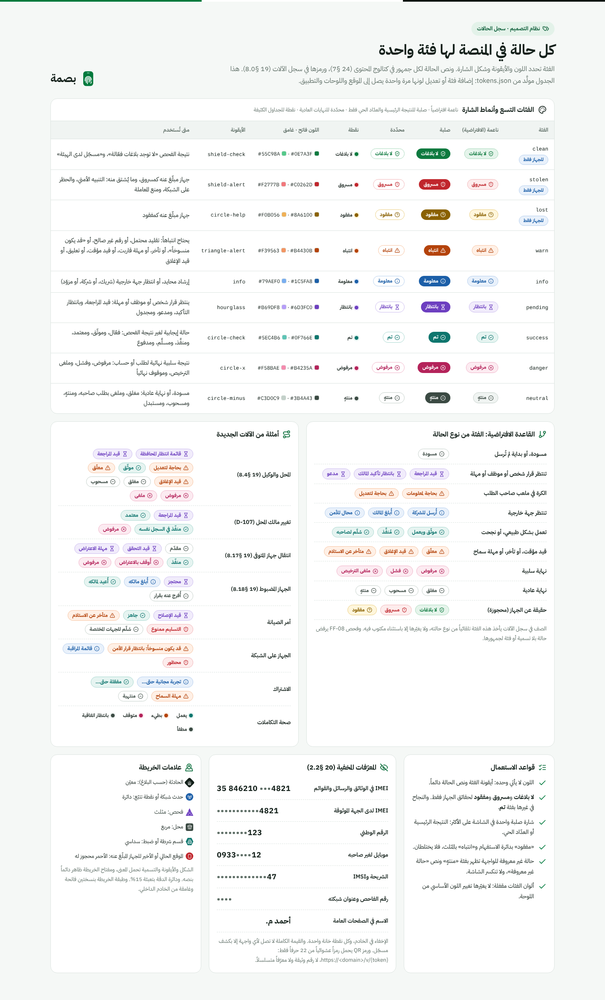 | 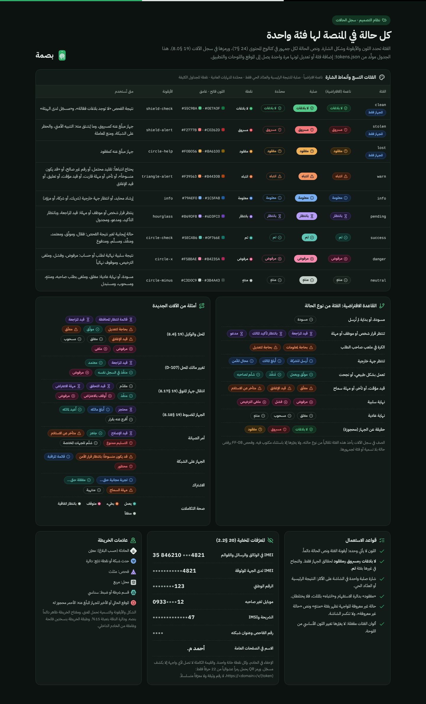 |

### المكوّنات وحالاتها: الأزرار والحقول والرموز والمفاتيح والجداول والنوافذ والإشعارات والأشرطة

| فاتح | غامق |
|---|---|
| 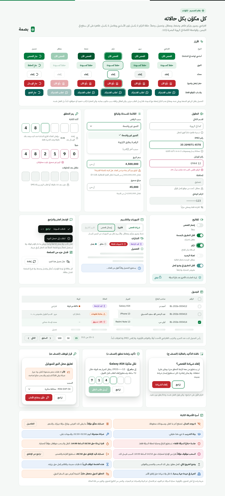 | 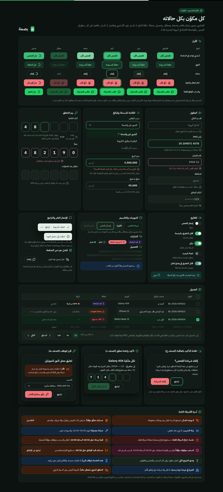 |

### الوثائق المطبوعة: قالب A4 والإيصال الحراري 58 و80 مم وملصق الخصوصية في المحل

| فاتح | غامق |
|---|---|
| 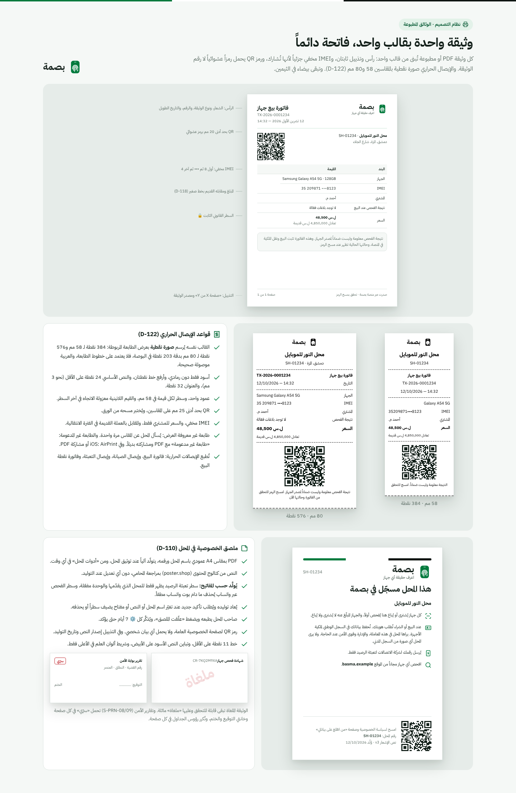 | 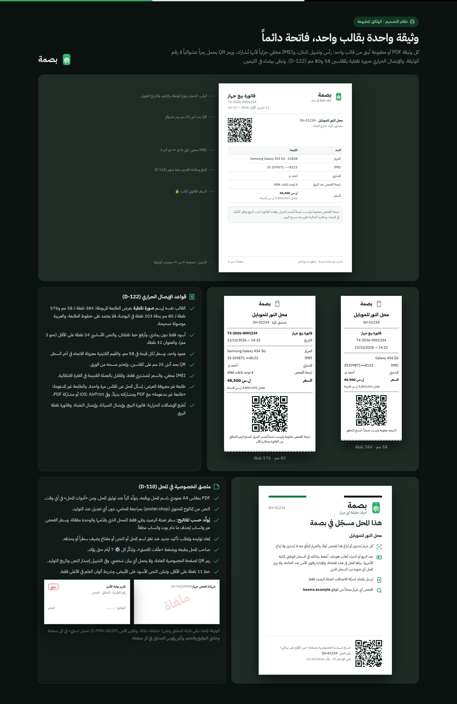 |

### المقاسات والأجهزة: نقاط التحوّل والهاتف الصغير والجهاز اللوحي والموقع على الموبايل واللوحات

| فاتح | غامق |
|---|---|
| 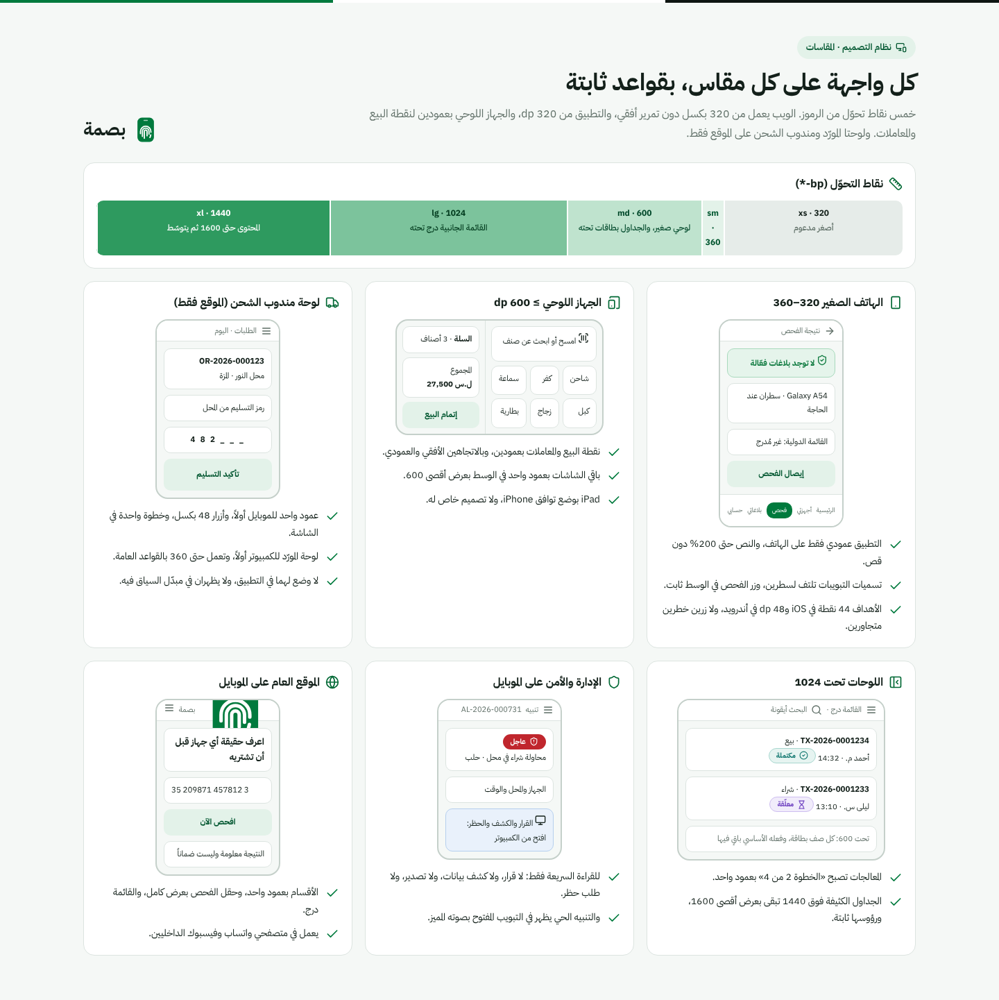 | 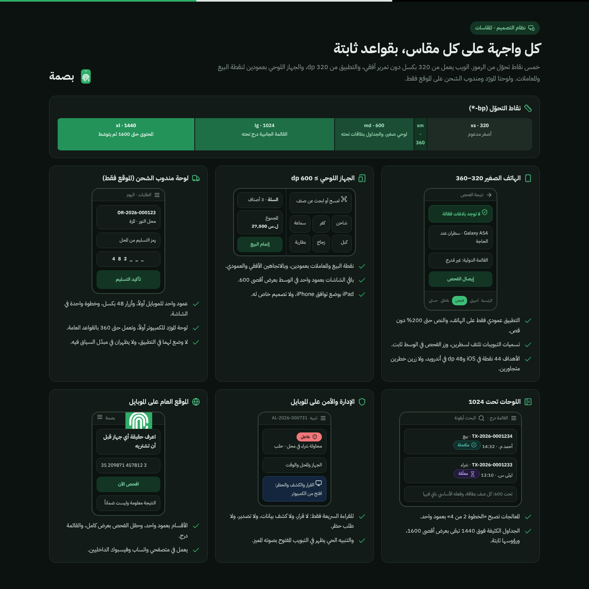 |

## الدورة التشغيلية

### الدورة الكاملة لحياة الجهاز

| فاتح | غامق |
|---|---|
|  |  |

### رحلة البلاغ من التقديم حتى الاسترداد

| فاتح | غامق |
|---|---|
|  |  |

### مسار الرصد والتنبيهات

| فاتح | غامق |
|---|---|
|  |  |

### حالات الكيانات: الجهاز والحساب والمحل والشبكة والإرث والمضبوط والصيانة

| فاتح | غامق |
|---|---|
| 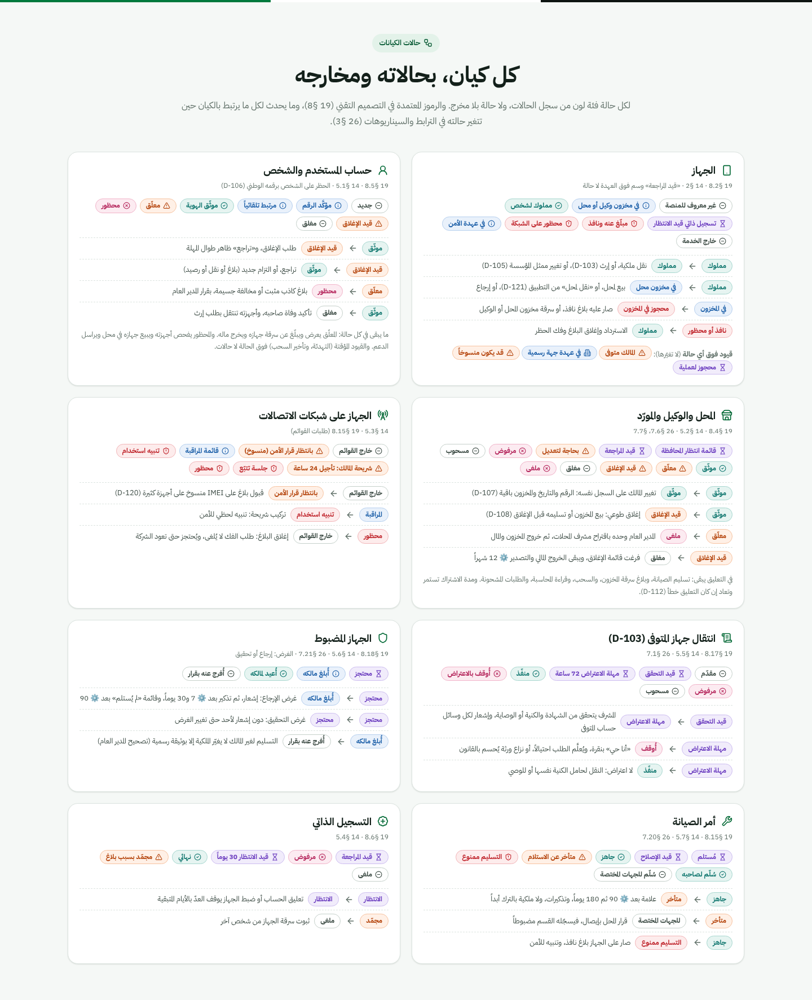 | 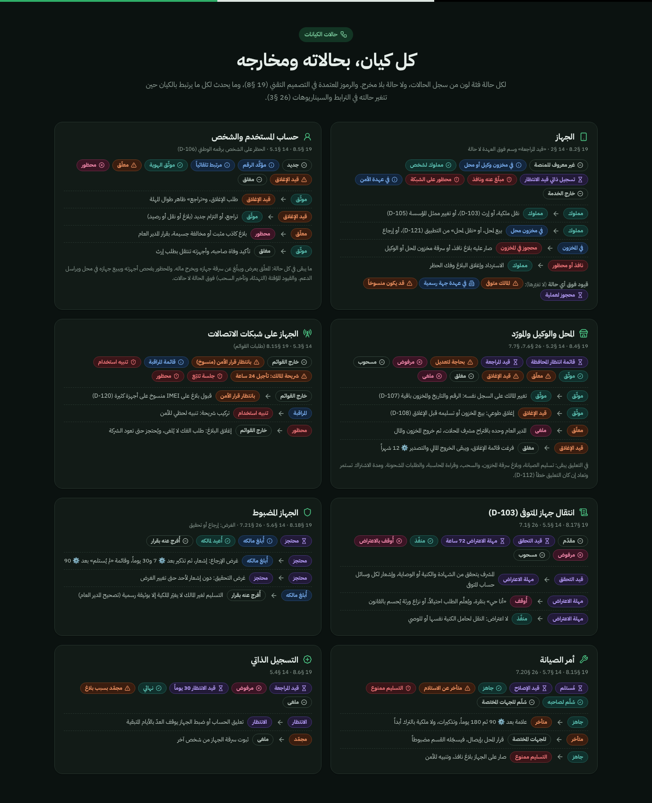 |

### أحداث الحياة: الإرث، وتغيير مالك المحل، والإغلاق والإلغاء، والنقل لمحل، والمضبوط، والصيانة المتروكة

| فاتح | غامق |
|---|---|
| 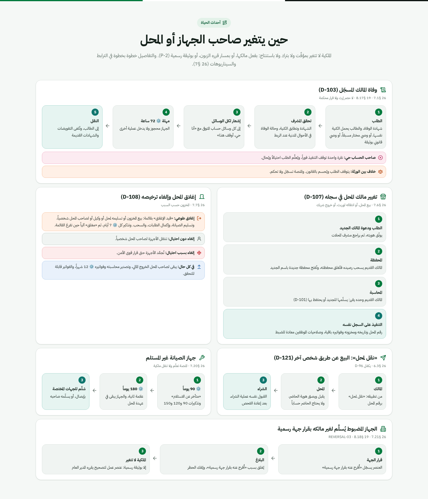 | 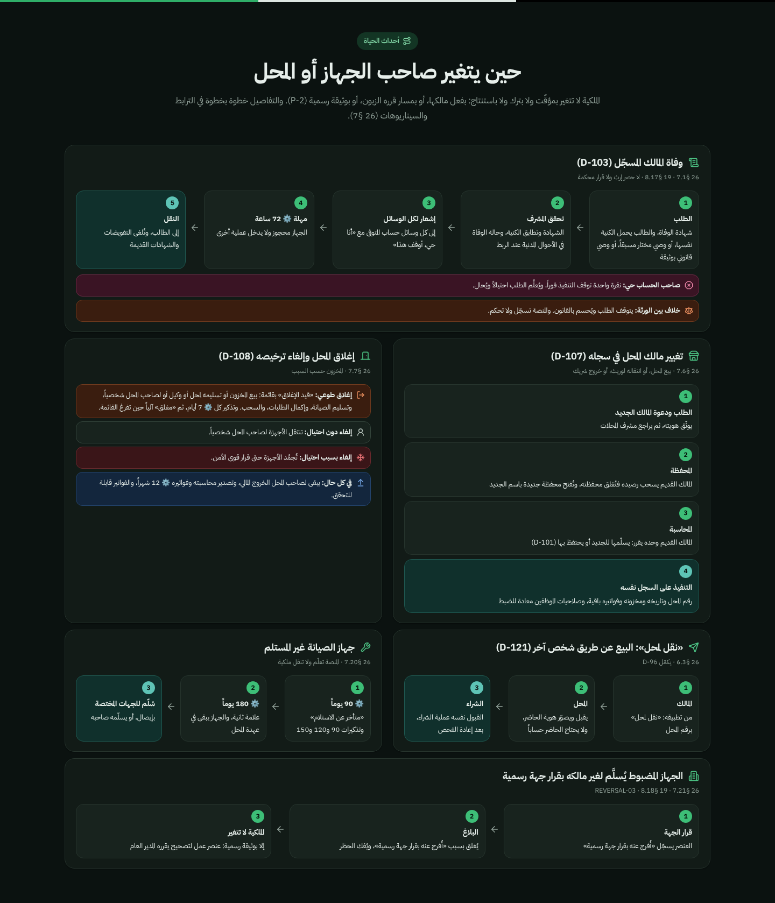 |

## الموقع

### الصفحة الرئيسية

| فاتح | غامق |
|---|---|
|  |  |

### الإقناع بتفعيل الموقع قبل الفحص

| فاتح | غامق |
|---|---|
|  |  |

### نتيجة الفحص: لا توجد بلاغات

| فاتح | غامق |
|---|---|
|  |  |

### نتيجة الفحص: مسروق

| فاتح | غامق |
|---|---|
|  |  |

### نتيجة الفحص: مفقود

| فاتح | غامق |
|---|---|
|  |  |

### إيصال الفحص

| فاتح | غامق |
|---|---|
|  |  |

### إنشاء حساب وتأكيد الرقم عبر واتساب

| فاتح | غامق |
|---|---|
|  |  |

### تسجيل الدخول

| فاتح | غامق |
|---|---|
|  |  |

### التحقق من شهادة أو فاتورة أو إيصال

| فاتح | غامق |
|---|---|
|  |  |

### احمِ جهازك

| فاتح | غامق |
|---|---|
|  |  |

### بصمة للمحلات

| فاتح | غامق |
|---|---|
|  |  |

## التطبيق (آيفون وأندرويد)

### الفحص في التطبيق: زائر دون حساب

| فاتح | غامق |
|---|---|
|  |  |

### المواطن: الرئيسية وأجهزتي وشهادة الفحص

| فاتح | غامق |
|---|---|
|  |  |

### المواطن: البلاغ وحماية لحظة السرقة

| فاتح | غامق |
|---|---|
|  |  |

### المواطن: نقل الملكية والتسجيل الذاتي

| فاتح | غامق |
|---|---|
|  |  |

### المحل: البيع والشراء في التطبيق

| فاتح | غامق |
|---|---|
|  |  |

### المحل: الشراء من شخص والموظفون والأدوات

| فاتح | غامق |
|---|---|
|  |  |

### الحساب: الإشعارات والدعم والإعدادات والإكمال من الموقع

| فاتح | غامق |
|---|---|
|  |  |

### البداية: الترحيب والدخول ورمز التحقق وتوثيق الهوية

| فاتح | غامق |
|---|---|
|  |  |

### محل الصيانة وحالات التطبيق الخاصة

| فاتح | غامق |
|---|---|
|  |  |

### المحل: المحفظة وتعبئة الرصيد

| فاتح | غامق |
|---|---|
|  |  |

### قفل التطبيق بالبصمة أو الوجه: الفتح، والبديل، وبعد المحاولات، والإعداد

| فاتح | غامق |
|---|---|
| 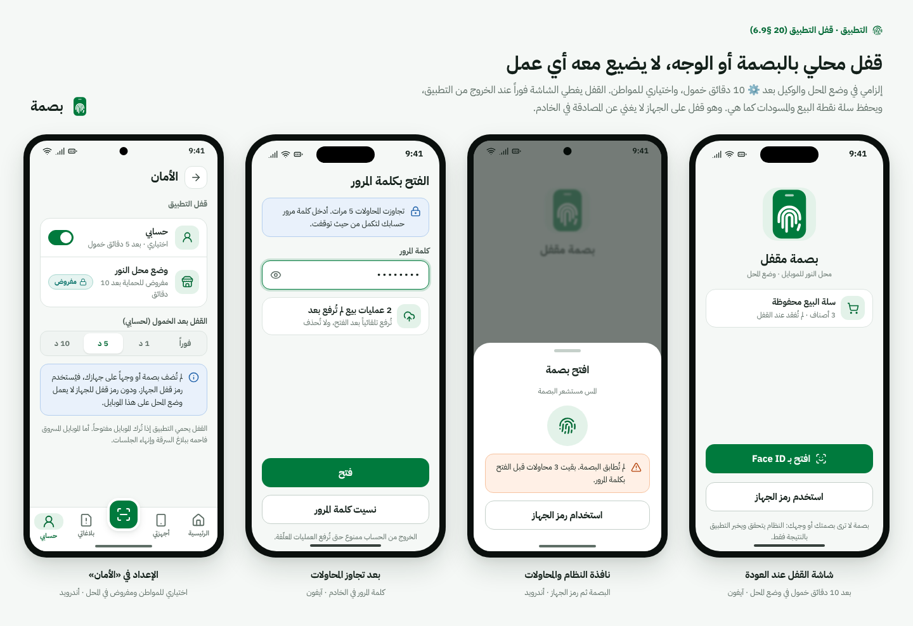 | 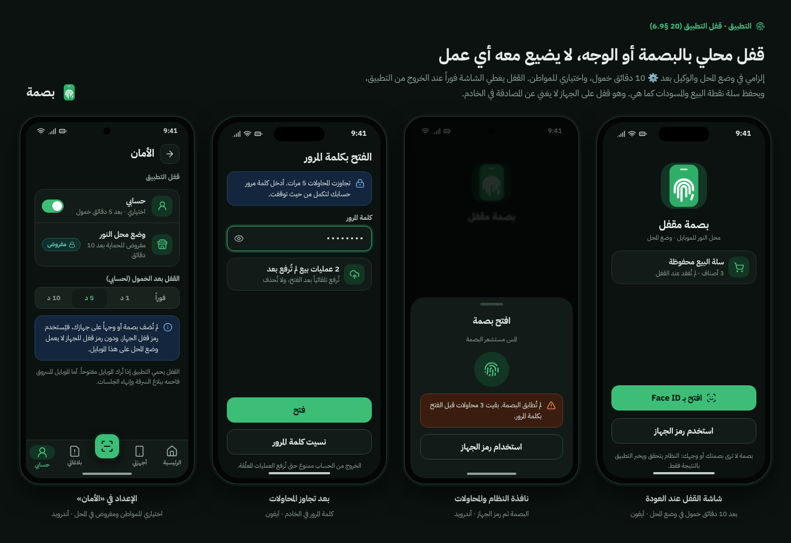 |

## لوحة المحل والوكيل على الموقع

### لوحة المحل: مؤشرات اليوم والمعاملات والالتزام

| فاتح | غامق |
|---|---|
|  |  |

### عملية بيع جديدة: التحقق من المشتري وإكمال الموقع بالتطبيق

| فاتح | غامق |
|---|---|
|  |  |

### المعاملات: البحث والتصفية ومعاينة الفاتورة

| فاتح | غامق |
|---|---|
|  |  |

### الموظفون: الأجهزة المربوطة والصلاحيات التي يحددها صاحب المحل

| فاتح | غامق |
|---|---|
|  |  |

### المتجر: منتجات مورّدين معتمدين تبيعها بصمة وتشحنها للمحل

| فاتح | غامق |
|---|---|
|  |  |

### لوحة الوكيل: استيراد الأجهزة بالجملة والنقل للمحلات

| فاتح | غامق |
|---|---|
|  |  |

### المحاسبة وإدارة المحل: الأقسام والأرباح ونقطة البيع والصندوق

| فاتح | غامق |
|---|---|
| 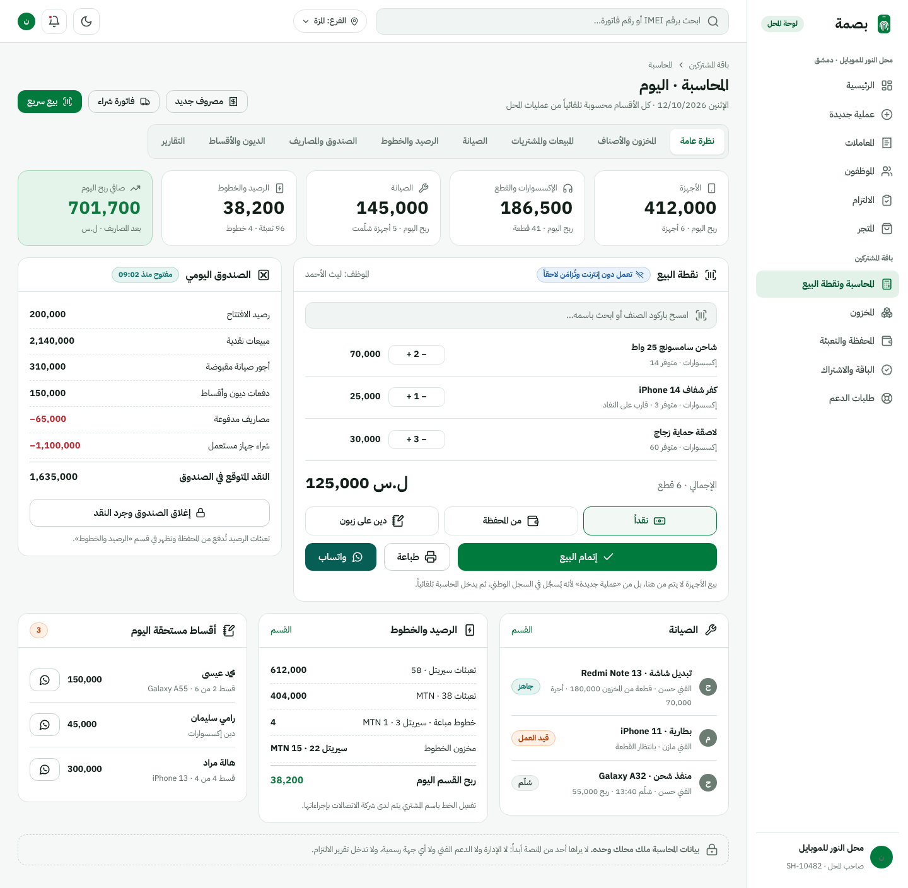 | 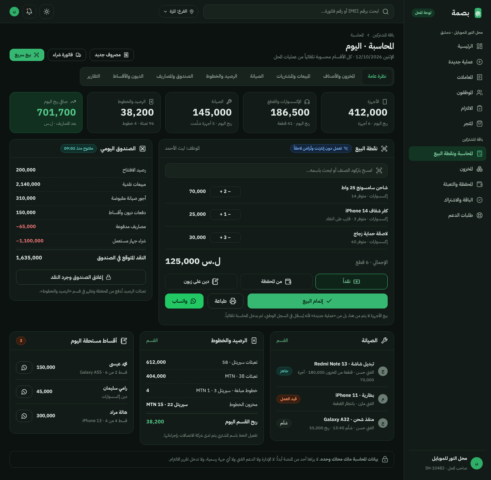 |

### الباقة والاشتراك: المجانية لكل المحلات وباقة المشتركين

| فاتح | غامق |
|---|---|
| 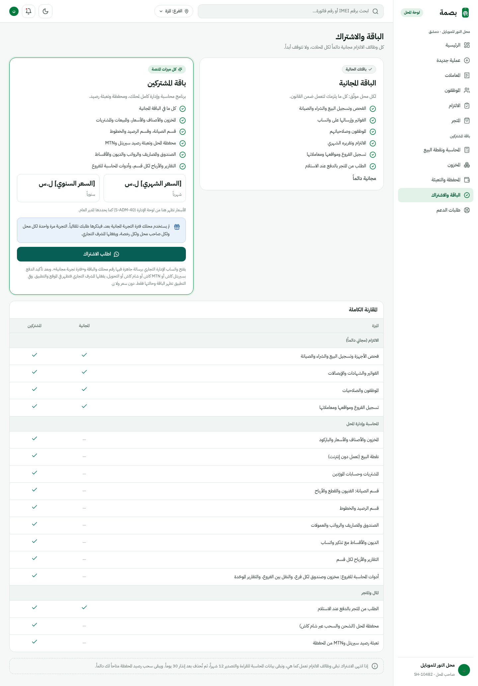 | 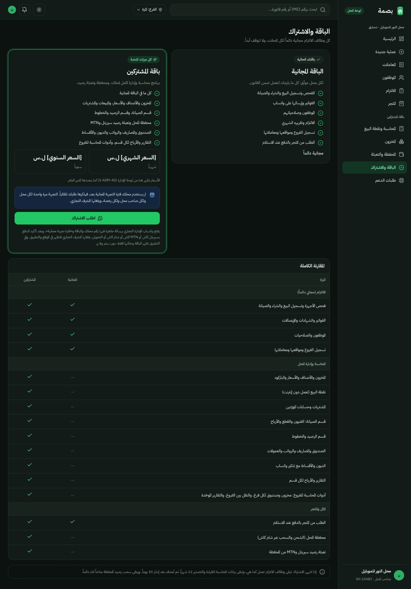 |

## لوحة الإدارة

### الرئيسية الذكية: قوائم العمل حسب الأولوية والمهلة

| فاتح | غامق |
|---|---|
|  |  |

### مراجعة بلاغ: الأدلة ومستوى الموثوقية والقرار

| فاتح | غامق |
|---|---|
|  |  |

### توثيق الهوية: صورة البطاقة ومطابقة الأحوال المدنية

| فاتح | غامق |
|---|---|
|  |  |

### تنبيه أمني عاجل: محاولة شراء جهاز مبلّغ عنه في محل

| فاتح | غامق |
|---|---|
|  |  |

### سجل الجهاز: البحث الموحّد والملكية والخريطة وكشف البيانات بسبب

| فاتح | غامق |
|---|---|
|  |  |

### الإعدادات: القيم بحدودها ومفاتيح تشغيل الوحدات والخدمات

| فاتح | غامق |
|---|---|
|  |  |

### الأدوار والصلاحيات: الأدوار الافتراضية ودور مخصّص بنطاق محافظة

| فاتح | غامق |
|---|---|
|  |  |

### الخدمات التجارية: طلبات التفعيل عبر واتساب والتحقق من الدفع

| فاتح | غامق |
|---|---|
|  |  |

### طلبات الدعم: المحادثة والردود الجاهزة والتصعيد واستعادة الحساب بالهوية

| فاتح | غامق |
|---|---|
|  |  |

### تصحيح قرار: أربع عيون وإعادة حساب الآثار دون حذف

| فاتح | غامق |
|---|---|
|  |  |

### صحة النظام: التكاملات وإيصال الرسائل والصيانة

| فاتح | غامق |
|---|---|
|  |  |

### سجل التدقيق: سجل إضافة فقط مع تمييز كشف البيانات الحساسة

| فاتح | غامق |
|---|---|
| 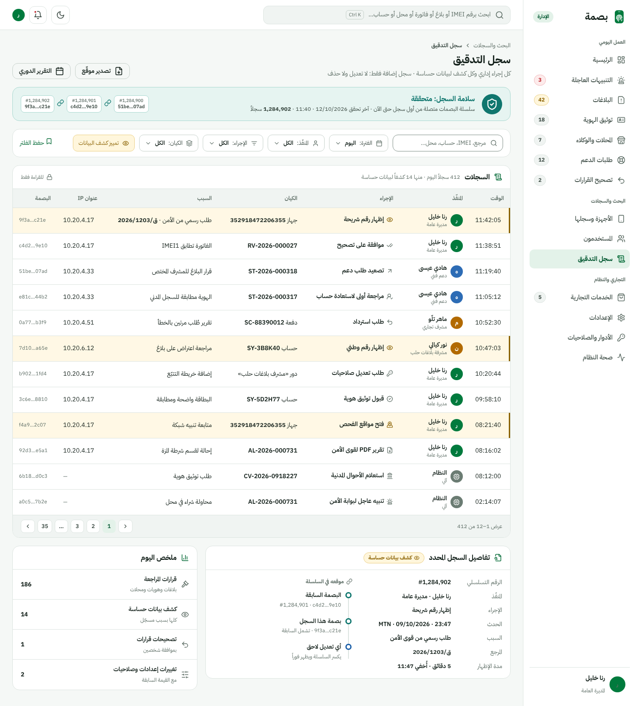 | 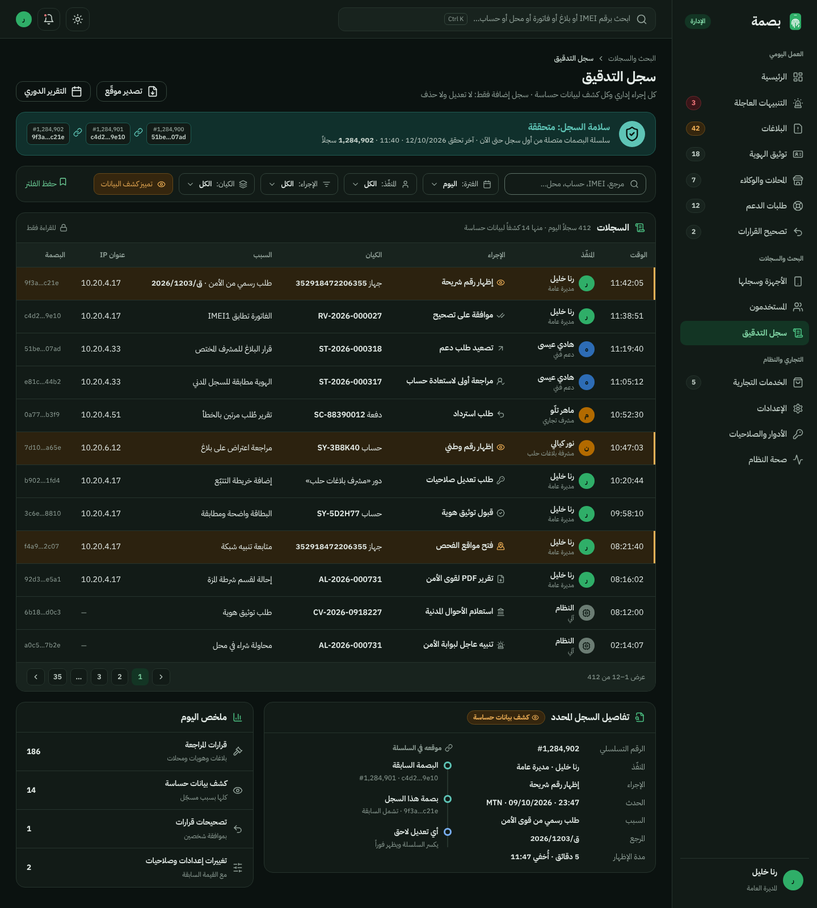 |

## بوابة قوى الأمن

### الرئيسية: تنبيهات النطاق اللحظية وخريطة المحافظة

| فاتح | غامق |
|---|---|
|  |  |

### تنبيه شبكة لحظي: قرار الحظر أو التتبّع

| فاتح | غامق |
|---|---|
|  |  |

### البحث بالرقم الوطني ضمن النطاق برقم قضية

| فاتح | غامق |
|---|---|
|  |  |

### ملف بلاغ: المسار والقرارات وإرجاع المضبوطات

| فاتح | غامق |
|---|---|
|  |  |

### إضافة بلاغ رسمي نافذ فوراً

| فاتح | غامق |
|---|---|
|  |  |

### سجل النشاط: رقابة مسؤول الأمن على عناصره

| فاتح | غامق |
|---|---|
|  |  |

## مخططات الدورة التشغيلية التفصيلية

> مولَّدة من مخططات Mermaid في [الدورة التشغيلية](../docs/14-operational-lifecycle.md) (الطريقة في أعلى هذا الملف).

### الصورة الكاملة (14 §1)


### حالات الجهاز (14 §2)


### البلاغ من التقديم حتى الإغلاق (14 §3)


### مسار الرصد والتنبيهات (14 §4)


### الحساب (14 §5.1)


### المحل والوكيل (14 §5.2)


### الجهاز على شبكات الاتصالات (14 §5.3)


### التسجيل الذاتي (14 §5.4)


### انتقال جهاز المتوفى (14 §5.5)

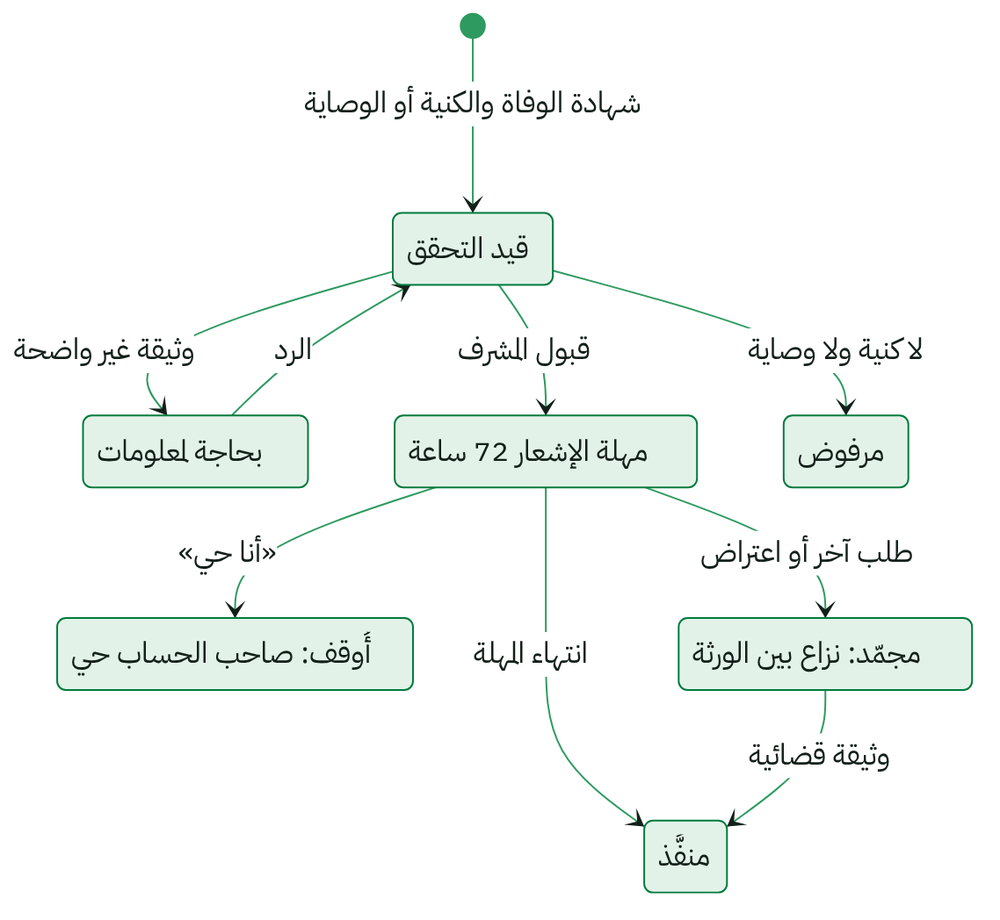

### الجهاز المضبوط (14 §5.6)

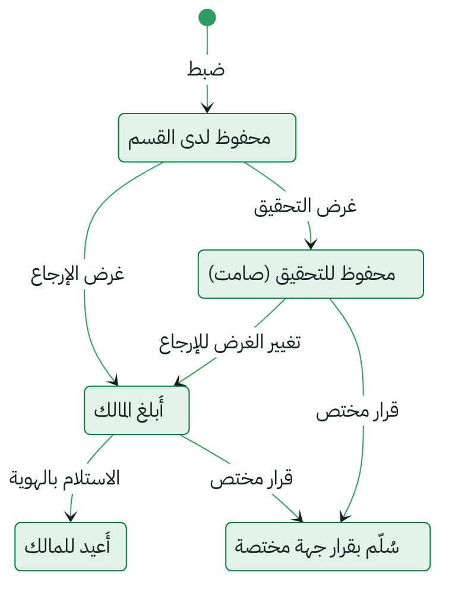

### أمر الصيانة (14 §5.7)

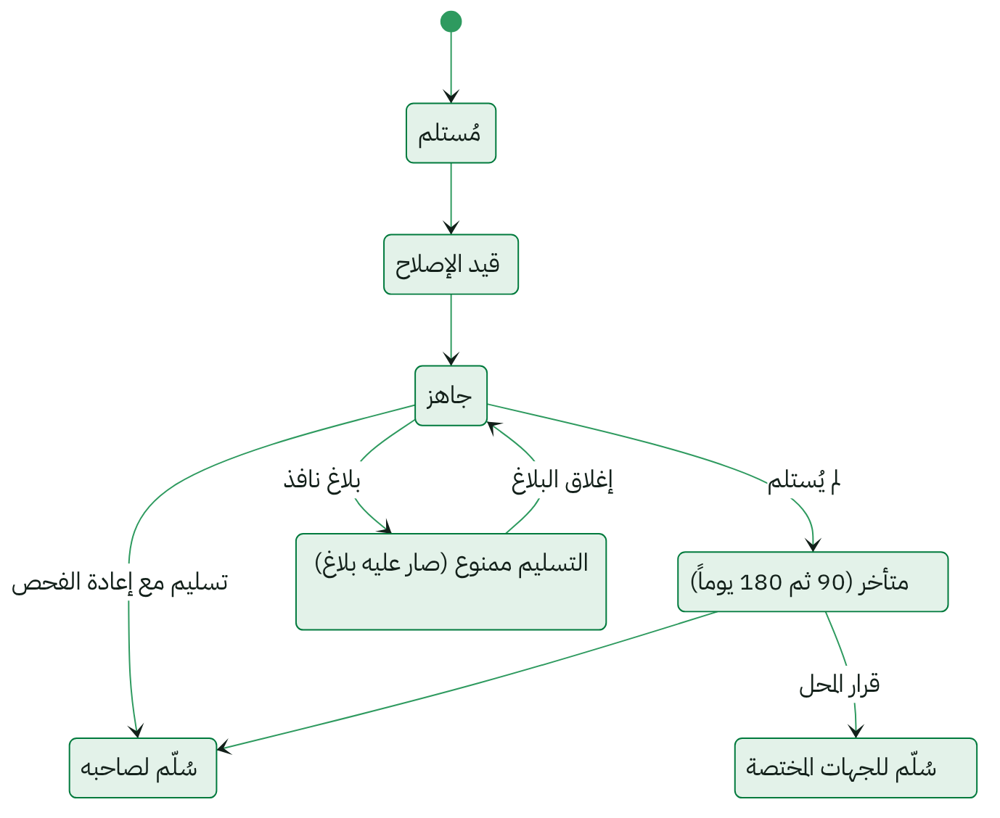

