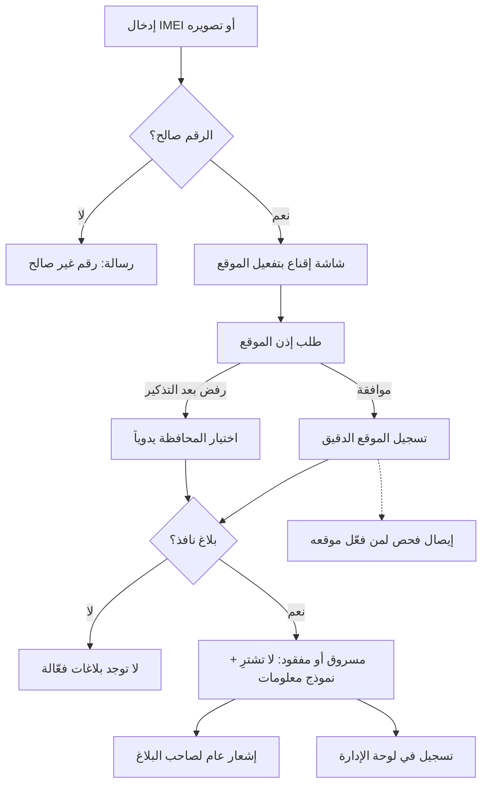
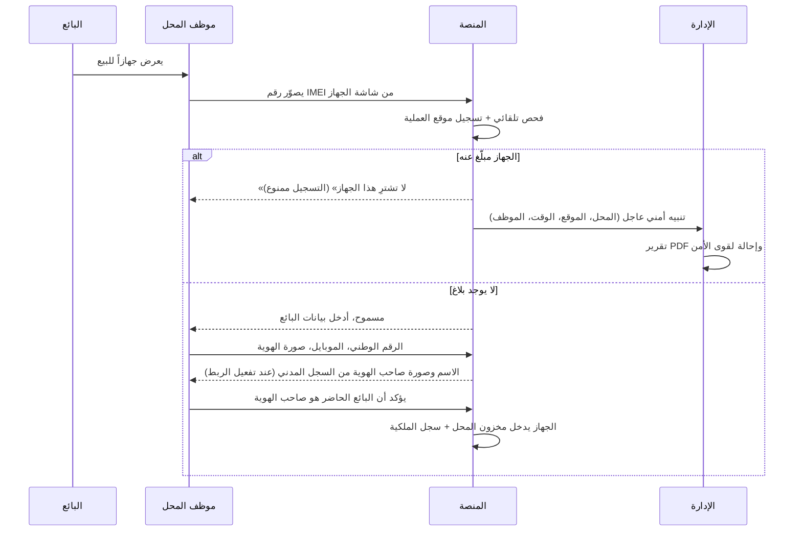
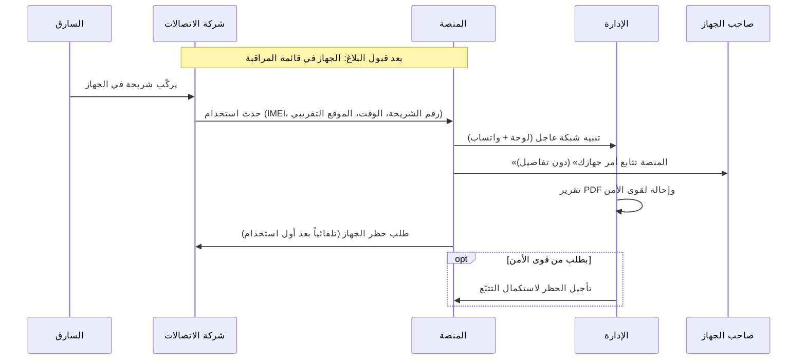

# 05 — رحلات المستخدمين

كل رحلة تصف سيناريو حقيقياً خطوة بخطوة، وتشير إلى المتطلبات المرتبطة في [المتطلبات الوظيفية](04-functional-requirements.md).

---

## الرحلة 1: زائر يفحص جهازاً قبل شرائه

**الشخص:** سامر، يريد شراء جهاز مستعمل من إعلان على فيسبوك.

1. يفتح الموقع، ويكتب رقم IMEI أو يصوّر شاشة `*#06#` على الجهاز المعروض عليه (CHECK-01، CHECK-05).
2. تتحقق المنصة من صحة الرقم، وتعرض «Samsung Galaxy A54» كموديل متوقع (CHECK-03، CHECK-04).
3. تظهر شاشة قصيرة: «فعّل موقعك واحصل على إيصال فحص يحميك إذا تبيّن لاحقاً أن الجهاز مسروق، وتساعد أصحاب الأجهزة المسروقة. موقعك لا يُكشف لأحد»، ثم يطلب المتصفح إذن الموقع. إذا رفض يُذكَّر مرة واحدة، وإذا رفض نهائياً يختار المحافظة من قائمة ويكمل (GEO-02، CHECK-17).
4. **النتيجة أ:** «لا توجد بلاغات فعّالة على هذا الرقم في قاعدة بيانات المنصة حتى تاريخه». ينصحه الموقع بأن يطلب من البائع نقل الملكية عبر المنصة أو شهادة فحص. وإذا كان قد فعّل موقعه، يحفظ **إيصال الفحص** ليحتفظ به (CHECK-16).
5. **النتيجة ب:** «مبلّغ عنه: مسروق — لا تشترِ هذا الجهاز»، مع تاريخ البلاغ والموديل، ونموذج «عندك معلومات؟» (CHECK-10). يستطيع سامر كتابة المكان الذي عُرض فيه الجهاز.
6. في الخلفية: يُسجَّل الفحص بموقعه، ويتلقى صاحب الجهاز إشعاراً عاماً بأن جهازه فُحص، ويظهر الفحص في لوحة الإدارة (CHECK-12، CHECK-14).

---

## الرحلة 2: إنشاء حساب وتوثيق الهوية

1. يدخل رقم موبايله وكلمة مرور.
2. يصله رمز عبر واتساب، فيدخله ويتأكد رقمه (AUTH-01).
3. يكمل ملفه: الاسم الكامل، والرقم الوطني، والمحافظة (AUTH-04).
4. **إذا كان قد اشترى جهازاً من محل مسجّل** بنفس الرقم الوطني ونفس رقم الموبايل: يجد أجهزته وفواتيرها في «أجهزتي» فوراً (AUTH-06).
5. **لتقديم بلاغ** (أو إن لم يكن له أجهزة مربوطة): يصوّر هويته (الوجهين) بالكاميرا من داخل المنصة، دون سيلفي، وتراجعها الإدارة، ويصله إشعار بالنتيجة (AUTH-05). وهذا يتم مرة واحدة فقط لكل حساب.

---

## الرحلة 3: بلاغ عن جهاز مسجّل باسم صاحبه (🟢 موثّق)

**الشخص:** أحمد، اشترى جهازه من محل مسجّل في المنصة، وسُرق منه.

1. يدخل حسابه، ويفتح «أجهزتي»، ويختار الجهاز، ثم «بلّغ عنه» (REPORT-03). وإذا لم يكن قد وثّق هويته بالصورة من قبل، يُطلب منه تصويرها أولاً (D-32).
2. يختار «مسروق»، ويكتب تاريخ الحادثة ومكانها (المحافظة والمنطقة) ووصفاً مختصراً (REPORT-02).
3. يوافق على إقرار المسؤولية ويرسل (REPORT-08).
4. يصل البلاغ للإدارة بمستوى 🟢، فيراجعه المشرف بسرعة ويقبله (ADMIN-02).
5. يصبح البلاغ **نافذاً فوراً**: أي فحص للجهاز يظهر «مسروق»، وتُرسل معرّفاته لشركات الاتصالات لإضافته إلى قائمة المراقبة (TELCO-01).
6. يتلقى أحمد إشعاراً بالقبول.

---

## الرحلة 4: بلاغ عن جهاز غير مسجّل (بالكرتونة)

**الشخص:** ليلى، اشترت جهازها قبل إطلاق المنصة، وأضاعته.

1. تفتح «بلّغ عن جهاز»، وتدخل IMEI (من الكرتونة أو الفاتورة).
2. ترفع صورة واضحة للصاقة الكرتونة، فتقرأ المنصة الباركود وتتأكد من التطابق (REPORT-04، REPORT-05).
3. تعطيها المنصة رمزاً (مثل `K7-492`). تكتبه على ورقة، وتضعها بجانب الكرتونة، وتلتقط «صورة حيّة» من داخل المنصة.
4. تضيف أدلة اختيارية: صورة الفاتورة القديمة، وصورة لها مع الجهاز.
5. يُحسب مستوى الموثوقية (🟡 أو 🔴) ويصل البلاغ للمشرف (REPORT-07).
6. قد يطلب المشرف معلومات إضافية فترد ليلى (REPORT-10)، ثم يقبل البلاغ أو يرفضه مع السبب.

---

## الرحلة 5: تسجيل محل جديد

**الشخص:** أبو خالد، صاحب محل موبايلات في حمص.

1. ينشئ حساباً ويوثّق هويته (الرحلة 2).
2. يختار «سجّل محلك»، ويدخل اسم المحل والمحافظة والمنطقة والعنوان التفصيلي ورقم هاتف المحل (SHOP-01).
3. يحدد موقع المحل على الخريطة من GPS وهو داخل المحل، أو بتحريك الدبوس (SHOP-02).
4. يرفع صورة السجل التجاري أو الترخيص، وصوراً لواجهة المحل.
5. يراجع مشرف المحلات الطلب، ويقارن الموقع بالعنوان والصور، ثم يقبل (SHOP-03، ADMIN-06).
6. يدعو موظفيه بأرقام موبايلاتهم، ويحدد صلاحياتهم (SHOP-05).

---

## الرحلة 6: محل يشتري جهازاً مستعملاً

**ملاحظة سلامة:** المنصة لا تطلب من الموظف احتجاز البائع ولا مواجهته. يكفي أن يمتنع عن الشراء، وتتولى الإدارة وقوى الأمن الباقي.

---

## الرحلة 7: محل يبيع جهازاً، والزبون يستلم فاتورته

1. يختار الموظف «بيع»: جهاز جديد يصوّر رقمه، أو جهاز مستعمل يختاره من المخزون (SHOP-07).
2. فحص تلقائي: لا بلاغ ولا تعارض (SHOP-08).
3. يدخل بيانات المشتري: الرقم الوطني، والاسم (يُعبّأ تلقائياً من السجل المدني عند تفعيل الربط، مع صورة صاحب الهوية ليطابقها مع المشتري)، والموبايل، والإيميل (اختياري)، والسعر (اختياري) (SHOP-19).
4. تصدر الفاتورة برقم فريد وQR، وتُطبع على الطابعة الحرارية أو A4 (SHOP-10).
5. يصل للزبون رابط الفاتورة على واتساب (SHOP-11)، وتنتقل الملكية باسمه.
6. عندما يفتح الزبون حساباً لاحقاً بنفس الرقم الوطني والموبايل، يجد الجهاز في «أجهزتي» (AUTH-06).

---

## الرحلة 8: نقل ملكية بين شخصين

**الأشخاص:** رامي يبيع جهازه المسجّل لوسيم مباشرة، دون محل.

1. يفتح رامي «أجهزتي»، ويختار الجهاز، ثم «نقل الملكية» (OWN-04).
2. يدخل رقم موبايل وسيم ورقمه الوطني، ويؤكد برمز واتساب.
3. يصل لوسيم رابط على واتساب. يدخل حسابه الموثّق (أو ينشئه ويوثّقه) ويضغط «قبول».
4. تتحقق المنصة من مطابقة رقمه الوطني، فتنتقل الملكية فوراً، ويحصل الطرفان على إيصال نقل.
5. لم يعد رامي قادراً على التبليغ عن الجهاز (OWN-07)، **وهكذا تُغلق ثغرة البائع النصّاب.**

---

## الرحلة 9: شهادة فحص في إعلان بيع

1. يفتح المالك «أجهزتي»، ويختار الجهاز، ثم «إصدار شهادة فحص» (OWN-09).
2. يحصل على رابط وصورة QR، ويضعهما في إعلانه على فيسبوك.
3. يفتح المشتري الرابط، فيرى الموديل، وIMEI مخفياً جزئياً، وتاريخ الإصدار، و**الحالة الحالية لحظياً** (OWN-10).
4. يطابق المشتري آخر خانات IMEI مع شاشة `*#06#` على الجهاز، ثم يطلب من البائع نقل الملكية عبر المنصة.

---

## الرحلة 10: تركيب شريحة في جهاز مسروق (التكامل مع الاتصالات)

(TELCO-01 إلى TELCO-06)

---

## الرحلة 11: استرداد الجهاز وإغلاق البلاغ

1. يستعيد أحمد جهازه، فيفتح البلاغ ويضغط «طلب إغلاق»، ويختار السبب «تم الاسترداد» (REPORT-11).
2. يبقى الجهاز «مبلّغاً عنه» حتى تراجع الإدارة الطلب (D-21).
3. يقبل المشرف الطلب، فيعود الجهاز إلى «لا توجد بلاغات فعّالة»، وتطلب المنصة تلقائياً فك الحظر وحذف الجهاز من قائمة المراقبة (ADMIN-03، TELCO-07).
4. يتلقى أحمد إشعاراً بالإغلاق.

---

## الرحلة 12: اعتراض على بلاغ

**الشخص:** مازن، اشترى جهازاً ثم اكتشف أنه مبلّغ عنه، ويعتقد أن البائع بلّغ عنه كيداً.

1. يفحص الجهاز، فيظهر «مسروق». يدخل حسابه الموثّق ويختار «تقديم اعتراض» (DISPUTE-01).
2. يرفع أدلته: محادثة البيع، وإيصال التحويل، ورقم البائع.
3. يُبلَّغ المبلّغ بوجود اعتراض، ويُطلب رده **مع أدلته** ضمن مهلة (DISPUTE-03).
4. يقارن المشرف أدلة الطرفين ويقرر: إبقاء البلاغ، أو إلغاءه وحظر المبلّغ الكاذب، أو إحالة الملف لقوى الأمن (DISPUTE-02).

---

## الرحلة 13: الإدارة تعالج تنبيهاً أمنياً

1. يظهر في لوحة الإدارة تنبيه عاجل بأن محل «النور» في حمص فحص جهازاً مسروقاً قبل 3 دقائق، ويصل التنبيه نفسه على واتساب الإدارة (ADMIN-08، NOTIF-06).
2. يفتح المشرف التنبيه، فيرى الجهاز والبلاغ والمحل على الخريطة والموظف وموقع العملية وسجل الجهاز (ADMIN-11، ADMIN-12).
3. يضغط «تقرير PDF»، ويرسله لقوى الأمن عبر القناة المتفق عليها، ثم يسجّل الإحالة (ADMIN-10).
4. يُغلق التنبيه بعد الإحالة، مع إمكانية إضافة ملاحظات المتابعة.

---

## الرحلة 14: تسجيل جهاز ذاتياً، ومحاولة سارق تسجيل جهاز مسروق

**أ) صاحب الجهاز الحقيقي:** نور اشترت جهازها من صديقة قبل إطلاق المنصة.

1. توثّق هويتها بصورة الهوية، ثم تختار «أجهزتي» ← «سجّل جهازاً» (OWN-03).
2. تصوّر الكرتونة مع رمز التحقق، وتضيف صورة قديمة لها مع الجهاز، وتوافق على الإقرار القانوني.
3. يراجع المشرف الطلب، ويرى نتيجة سجل الشريحة إن توفر الربط: «رقمها مستخدم في الجهاز منذ 14 شهراً» (OWN-16)، فيقبل.
4. يبقى الجهاز «قيد الانتظار» 30 يوماً (لا نقل ولا شهادة)، ثم يصبح التسجيل نهائياً بوسم «تسجيل ذاتي» (OWN-12، OWN-14).

**ب) سارق يحاول تسجيل جهاز مسروق:**

| الحالة | ماذا يحدث |
|---|---|
| الجهاز مسجّل أصلاً باسم صاحبه | يُرفض الطلب آلياً، ويصل لصاحبه: «حاول شخص تسجيل جهازك، هل جهازك معك؟»، ويُنبَّه المشرف بالمحاولة وصاحبها (OWN-13) |
| الجهاز غير مسجّل، والسارق سبق صاحبه | يكشف السارق هويته الحقيقية بنفسه، ولا يستطيع البيع ولا النقل 30 يوماً. وعندما يبلّغ صاحب الجهاز يُجمَّد التسجيل ويصبح تعارضاً، ويُظهر سجل الشريحة أن رقم السارق لم يُستخدم في الجهاز قبل السرقة، فتُحال بياناته لقوى الأمن (REPORT-15، TELCO-12) |
