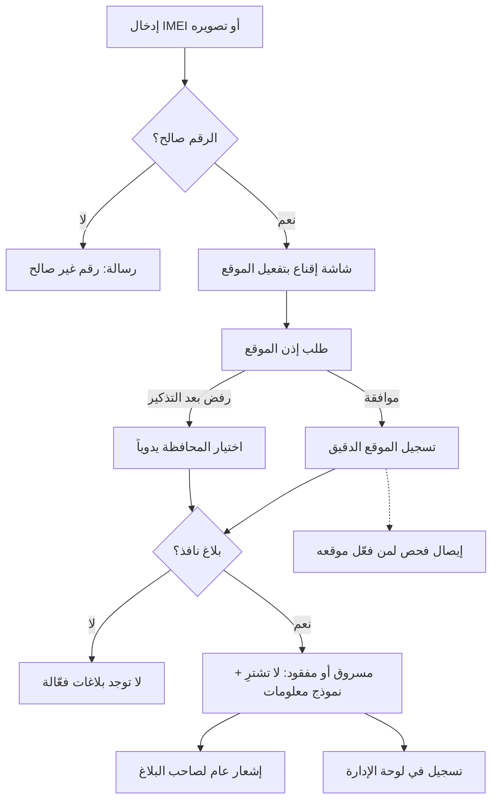
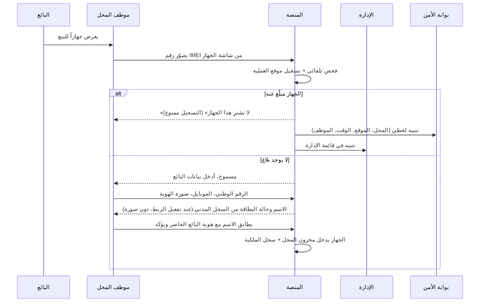
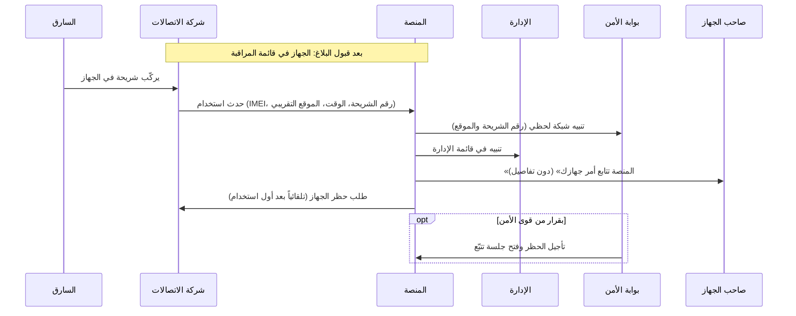

# 05 — رحلات المستخدمين

كل رحلة تصف سيناريو حقيقياً خطوة بخطوة، وتشير إلى المتطلبات المرتبطة في [المتطلبات الوظيفية](04-functional-requirements.md). والقاعدة الملزمة لكل فرع وكل ظرف غير عادي في [الترابط والسيناريوهات](26-scenarios-and-linkage.md): الرحلات أمثلة، وتلك الوثيقة هي المواصفة. والرحلات 26 إلى 31 تغطي أحداث الحياة التي حسمها الزبون (D-103، D-104، D-107، D-108، D-119، D-121).

---

## الرحلة 1: زائر يفحص جهازاً قبل شرائه

**الشخص:** سامر، يريد شراء جهاز مستعمل من إعلان على فيسبوك.

1. يفتح الموقع، ويكتب رقم IMEI أو يصوّر شاشة `*#06#` على الجهاز المعروض عليه (CHECK-01، CHECK-05).
2. تتحقق المنصة من صحة الرقم، وتعرض «Samsung Galaxy A54» كموديل متوقع (CHECK-03، CHECK-04).
3. تظهر شاشة قصيرة: «فعّل موقعك واحصل على إيصال فحص يحميك إذا تبيّن لاحقاً أن الجهاز مسروق، وتساعد أصحاب الأجهزة المسروقة. موقعك لا يظهر لصاحب الجهاز ولا لأي شخص، وتستخدمه الإدارة والجهات المختصة فقط»، ثم يطلب المتصفح إذن الموقع. إذا رفض يُذكَّر مرة واحدة، وإذا رفض نهائياً يختار المحافظة من قائمة ويكمل (GEO-02، CHECK-17).
4. **النتيجة أ:** «لا توجد بلاغات فعّالة على هذا الرقم في قاعدة بيانات المنصة حتى تاريخه». ينصحه الموقع بأن يطلب من البائع نقل الملكية عبر المنصة أو شهادة فحص. وإذا كان قد فعّل موقعه، يحفظ **إيصال الفحص** ليحتفظ به (CHECK-16).
   ومع النتيجة سطران إضافيان عند تفعيل الربط: حالة الجهاز دولياً من قاعدة GSMA، وحالة تسجيله لدى الهيئة الناظمة («مسجّل رسمياً» أو «غير مسجّل وقد لا يعمل على الشبكة») (GSMA-02، CUSTOMS-02). وإذا كان الرقم يظهر على أجهزة كثيرة يُضاف سطر محايد «قد يكون منسوخاً» (D-120).
   وإذا كان سامر قد وجد الجهاز ولم يكن يشتريه، يظهر له زر هادئ «وجدت هذا الجهاز؟» فيُبلَّغ مالكه المسجّل دون أن يُكشف لسامر شيء ([الترابط والسيناريوهات](26-scenarios-and-linkage.md) §7.19).
5. **النتيجة ب:** «مبلّغ عنه: مسروق — لا تشترِ هذا الجهاز»، مع تاريخ البلاغ والموديل، ونموذج «عندك معلومات؟» (CHECK-10). يستطيع سامر كتابة المكان الذي عُرض فيه الجهاز.
6. في الخلفية: يُسجَّل الفحص بموقعه، ويتلقى صاحب الجهاز إشعاراً عاماً بأن جهازه فُحص، ويظهر الفحص في لوحة الإدارة (CHECK-12، CHECK-14).

---

## الرحلة 2: إنشاء حساب وتوثيق الهوية

1. يدخل رقم موبايله وكلمة مرور.
2. يصله رمز عبر واتساب، فيدخله ويتأكد رقمه (AUTH-01).
3. يكمل ملفه: الاسم الكامل، والرقم الوطني، والمحافظة (AUTH-04).
4. **إذا كان قد اشترى جهازاً من محل مسجّل** بنفس الرقم الوطني ونفس رقم الموبايل: يجد أجهزته وفواتيرها في «أجهزتي» فوراً (AUTH-06).
5. **لتقديم بلاغ** (أو إن لم يكن له أجهزة مربوطة): يصوّر هويته (الوجهين) بالكاميرا من داخل المنصة، دون سيلفي، وتراجعها الإدارة، ويصله إشعار بالنتيجة (AUTH-05). وهذا يتم مرة واحدة فقط لكل حساب.

---

## الرحلة 3: بلاغ عن جهاز مسجّل باسم صاحبه (🟢 موثّق)

**الشخص:** أحمد، اشترى جهازه من محل مسجّل في المنصة، وسُرق منه.

1. يدخل حسابه، ويفتح «أجهزتي»، ويختار الجهاز، ثم «بلّغ عنه» (REPORT-03). وإذا لم يكن قد وثّق هويته بالصورة من قبل، يُطلب منه تصويرها أولاً (D-32).
2. يختار «مسروق»، ويكتب تاريخ الحادثة ومكانها (المحافظة والمنطقة) ووصفاً مختصراً (REPORT-02).
3. يوافق على إقرار المسؤولية ويرسل (REPORT-08).
4. يصل البلاغ للإدارة بمستوى 🟢، فيراجعه المشرف بسرعة ويقبله (ADMIN-02).
5. يصبح البلاغ **نافذاً فوراً**: أي فحص للجهاز يظهر «مسروق»، وتُرسل معرّفاته لشركات الاتصالات لإضافته إلى قائمة المراقبة (TELCO-01). وإن كان الجهاز في مخزون محل أو تحت الصيانة أو في نقل بالجملة يُحجز هناك ويصل الأمن تنبيه عاجل (26 §3.2). وإن كان الرقم منسوخاً على أجهزة كثيرة لا يُرسل طلب المراقبة آلياً، وتقرره جهة الأمن المختصة (D-120).
6. يتلقى أحمد إشعاراً بالقبول.

---

## الرحلة 4: بلاغ عن جهاز غير مسجّل (بالكرتونة)

**الشخص:** ليلى، اشترت جهازها قبل إطلاق المنصة، وأضاعته.

1. تفتح «بلّغ عن جهاز»، وتدخل IMEI (من الكرتونة أو الفاتورة).
2. ترفع صورة واضحة للصاقة الكرتونة، فتقرأ المنصة الباركود وتتأكد من التطابق (REPORT-04، REPORT-05).
3. تكتب **رقم حسابها** (مثل `SY-4K7P92`) على ورقة، وتضعها بجانب الكرتونة، وتلتقط «صورة حيّة» بالكاميرا من داخل المنصة (D-39).
4. تضيف أدلة اختيارية: صورة الفاتورة القديمة، وصورة لها مع الجهاز.
5. يُحسب مستوى الموثوقية (🟡 أو 🔴) ويصل البلاغ للمشرف (REPORT-07).
6. قد يطلب المشرف معلومات إضافية فترد ليلى (REPORT-10)، ثم يقبل البلاغ أو يرفضه مع السبب.
7. **إن كان أحد قد سبقها ببلاغ على الجهاز نفسه** (شريك سابق يحمل الكرتونة مثلاً): لا يُرفض بلاغها ولا يُكشف لها البلاغ القائم. يصلها «تلقّينا بلاغك وسيُراجع مع المعلومات المتوفرة عن الجهاز»، ويُقدَّم بلاغها ادعاءً منافساً يقارن فيه المشرف أدلة الطرفين بموافقة مشرف ثانٍ (SOP-03، 26 §9).

---

## الرحلة 5: تسجيل محل جديد

**الشخص:** أبو خالد، صاحب محل موبايلات في حمص.

1. ينشئ حساباً ويوثّق هويته (الرحلة 2).
2. يختار «سجّل محلك»، ويدخل اسم المحل والمحافظة والمنطقة والعنوان التفصيلي ورقم هاتف المحل (SHOP-01).
3. يحدد موقع المحل على الخريطة من GPS وهو داخل المحل، أو بتحريك الدبوس (SHOP-02).
4. يرفع صورة السجل التجاري أو الترخيص، وصوراً لواجهة المحل.
5. يراجع مشرف المحلات الطلب، ويقارن الموقع بالعنوان والصور، ثم يقبل (SHOP-03، ADMIN-06).
6. ينشئ حسابات موظفيه من لوحة المحل (الاسم، والرقم الوطني، والموبايل، والصلاحيات). يصل لكل موظف رابط تفعيل على واتساب، فيضع كلمة مروره ويوثّق هويته، ثم يبدأ العمل بدخوله الخاص (SHOP-05). والشخص المحظور أو الممنوع من العمل في المحلات لا يُفعَّل، ويرى صاحب المحل «تعذّر تفعيل هذا الموظف» (D-106).
7. مع التوثيق يصله ملف **ملصق إشعار الخصوصية** باسم محله، فيطبعه ويعلّقه ويؤكد «علّقت الملصق» (D-110).
8. إن كان له فرع في مكان آخر يسجّله مجاناً بموقعه الموثّق، ومعاملاته موسومة بالفرع، والمدفوع هو أدوات محاسبة الفروع فقط (D-109).

---

## الرحلة 6: محل يشتري جهازاً مستعملاً

**ملاحظة سلامة:** المنصة لا تطلب من الموظف احتجاز البائع ولا مواجهته. يكفي أن يمتنع عن الشراء، وتتولى الإدارة وقوى الأمن الباقي.

**فروع الرحلة** (القاعدة الكاملة في [الترابط والسيناريوهات](26-scenarios-and-linkage.md) §6):

| الحالة | ماذا يحدث |
|---|---|
| الجهاز عليه بلاغ قيد المراجعة | تُعلَّق العملية برسالة محايدة لا تذكر البلاغ |
| الجهاز مسجّل باسم شخص غير البائع (D-96) | تُعلَّق لمراجعة الإدارة برسالة محايدة، أو يرسله مالكه المسجّل للمحل من تطبيقه «نقل لمحل» (D-121، الرحلة 30) |
| مالكه المسجّل متوفى | تُعلَّق برسالة المحل المحايدة الموحّدة، دون أي تلميح بالوفاة. والورثة يعرفون طريق «نقل جهاز متوفى» من الدعم (الرحلة 26) |
| الرقم «قد يكون منسوخاً» ولا بلاغ عليه | يُدخل الموظف معرّفاً ثانياً (IMEI الثاني، أو الرقم التسلسلي، أو ملصق الكرتونة بالرقمين): إن كان صحيحاً تكتمل العملية موسومة، وإلا تُعلَّق للمراجعة برسالة محايدة (D-120) |
| المالك المسجّل أرسل الجهاز للمحل نفسه «نقل لمحل» بعد التعليق | يقبله المحل فتصير المعاملة شراءً كاملاً، وتُلغى العملية المعلّقة (D-121) |
| البائع دون هوية سورية | يصوّر الموظف بطاقة اللاجئ الفلسطيني السوري أو الجواز مع الإقامة السارية، والمعاملة تمضي موسومة للتحقق اليدوي (D-104، الرحلة 29) |
| البائع قاصر | يجب حضور وليّه، فالجهاز مسجّل باسم الولي (D-97) |
| قاعدة GSMA لا ترد | تمضي العملية موسومة «لم يُتحقق دولياً»، وإن ظهر الجهاز مُدرجاً لاحقاً يُراجع دون عكس آلي |
| هاتف ذكي مقفل بحساب لم يُزله البائع أمام الموظف | تُعلَّق للمراجعة برسالة محايدة |
| بعد الشراء | يصل المالك السابق «سُجّل شراء جهازك من محل …» مع زر «لم أبِع هذا الجهاز» |

---

## الرحلة 7: محل يبيع جهازاً، والزبون يستلم فاتورته

1. يختار الموظف «بيع»: جهاز جديد يصوّر رقمه، أو جهاز مستعمل يختاره من المخزون (SHOP-07).
2. فحص تلقائي: لا بلاغ ولا تعارض (SHOP-08).
3. يدخل بيانات المشتري: الرقم الوطني، والاسم (يُعبّأ تلقائياً من السجل المدني عند تفعيل الربط، مع حالة البطاقة ودون صورة)، والموبايل، والإيميل (اختياري)، والسعر (اختياري) (SHOP-19).
4. تصدر الفاتورة برقم فريد وQR، وتُطبع على الطابعة الحرارية (58 أو 80 مم حسب الطابعة المربوطة، D-122) أو A4 (SHOP-10).
5. يصل للزبون رابط الفاتورة على واتساب (SHOP-11) مع زر «لم أشترِ هذا الجهاز» لمن وصلته فاتورة لا تخصه، وتنتقل الملكية باسمه.
6. عندما يفتح الزبون حساباً لاحقاً بنفس الرقم الوطني والموبايل، يجد الجهاز في «أجهزتي» (AUTH-06).

---

## الرحلة 8: نقل ملكية بين شخصين

**الأشخاص:** رامي يبيع جهازه المسجّل لوسيم مباشرة، دون محل.

1. يفتح رامي «أجهزتي»، ويختار الجهاز، ثم «نقل الملكية» (OWN-04).
2. يدخل رقم موبايل وسيم ورقمه الوطني، ويؤكد برمز واتساب. ولا يستطيع ذلك خلال ⚙️ 24 ساعة من إعادة تعيين كلمة مروره، ولا خلال ⚙️ 72 ساعة من تغيير رقمه أو استعادة حسابه، ولا إن كان على الجهاز بلاغ نافذ أو قيد المراجعة.
3. يصل لوسيم رابط على واتساب. يدخل حسابه (أو ينشئه برقم موبايله) ويضغط «قبول».
4. تتحقق المنصة من مطابقة رقمه الوطني ورقم موبايله **الحالي الموثّق** لطلب النقل، فتنتقل الملكية فوراً، ويحصل الطرفان على إيصال نقل. وإن لم يقبل خلال ⚙️ 72 ساعة يُلغى الطلب.
5. لم يعد رامي قادراً على التبليغ عن الجهاز (OWN-07)، **وهكذا تُغلق ثغرة البائع النصّاب.** والاستثناء الوحيد: إن كان النقل قد جرى خلال ⚙️ 72 ساعة من إعادة تعيين كلمة مرور رامي (موبايل سُرق وهو مفتوح)، فلرامي ⚙️ 7 أيام يُقبل فيها بلاغه ⛔ ويُراجع (26 §9).

---

## الرحلة 9: شهادة فحص في إعلان بيع

1. يفتح المالك «أجهزتي»، ويختار الجهاز، ثم «إصدار شهادة فحص» (OWN-09).
2. يحصل على رابط وصورة QR، ويضعهما في إعلانه على فيسبوك.
3. يفتح المشتري الرابط، فيرى الموديل، وIMEI مخفياً جزئياً، وتاريخ الإصدار، و**الحالة الحالية لحظياً** (OWN-10).
4. يطابق المشتري آخر خانات IMEI مع شاشة `*#06#` على الجهاز، ثم يطلب من البائع نقل الملكية عبر المنصة.

---

## الرحلة 10: تركيب شريحة في جهاز مسروق (التكامل مع الاتصالات)

(TELCO-01 إلى TELCO-06)

---

## الرحلة 11: استرداد الجهاز وإغلاق البلاغ

1. يستعيد أحمد جهازه، فيفتح البلاغ ويضغط «طلب إغلاق»، ويختار السبب «تم الاسترداد» (REPORT-11).
2. يبقى الجهاز «مبلّغاً عنه» حتى تراجع الإدارة أو قوى الأمن الطلب (D-21، D-58).
3. يقبل المشرف (أو عنصر الأمن) الطلب، فيعود الجهاز إلى «لا توجد بلاغات فعّالة»، وتطلب المنصة تلقائياً فك الحظر وحذف الجهاز من قائمة المراقبة (ADMIN-03، TELCO-07)، ولا يُلغى هذا الطلب أبداً ولو كانت إحدى الشركات متوقفة. وتصل جهات الأمن رسالة «البلاغ لم يعد نافذاً»، وتُغلق التنبيهات المفتوحة، ويُبلَّغ مزوّدو الخط والمحافظ بإغلاق البلاغ (26 §3.2 ج).
4. يتلقى أحمد إشعاراً بالإغلاق.
5. إن وضع أحمد شريحته في الجهاز قبل قبول طلب الإغلاق، تعرف المنصة رقمه فتؤجل الحظر ⚙️ 24 ساعة وتنبّه الأمن «غالباً المالك» وتذكّره بطلب الإغلاق (26 §7.22).

---

## الرحلة 12: اعتراض على بلاغ

**الشخص:** مازن، اشترى جهازاً ثم اكتشف أنه مبلّغ عنه، ويعتقد أن البائع بلّغ عنه كيداً.

1. يفحص الجهاز، فيظهر «مسروق». يدخل حسابه الموثّق ويختار «تقديم اعتراض» (DISPUTE-01).
2. يرفع أدلته: محادثة البيع، وإيصال التحويل، ورقم البائع.
3. يُبلَّغ المبلّغ بوجود اعتراض، ويُطلب رده **مع أدلته** ضمن مهلة (DISPUTE-03).
4. يقارن المشرف أدلة الطرفين ويقرر: إبقاء البلاغ، أو إلغاءه وحظر المبلّغ الكاذب، أو إحالة الملف لقوى الأمن (DISPUTE-02).
5. إن كان الجهاز مسجّلاً باسم مازن، فقد وصله إشعار محايد عند قبول البلاغ مع رابط الاعتراض (D-119، الرحلة 31). وإن أُغلق البلاغ بطريق آخر قبل القرار، ينتهي الاعتراض «لم يعد له موضوع» ويُبلَّغ الطرفان. ولا يقدّم مازن اعتراضاً جديداً إلا بأدلة جديدة.

---

## الرحلة 13: تنبيه أمني يصل للأمن والإدارة

1. محل «النور» في حمص يفحص جهازاً مسروقاً. يصل تنبيه لحظي لعناصر أمن حمص في بوابتهم (PP-05)، ويظهر التنبيه نفسه في قائمة الإدارة (ADMIN-08). وفي الليل ينتظر في قائمة الإدارة حتى بداية الدوام (D-85)، بينما يصل للأمن فوراً.
2. يفتح عنصر الأمن التنبيه، فيرى الجهاز والبلاغ والمحل على الخريطة والموظف وموقع العملية وسجل الجهاز، ويقرر التحرك (PP-06).
3. تتابع الإدارة التنبيه وتضيف ما لديها. وإذا احتاجت جهة أمنية خارج البوابة تقريراً، يصدر المشرف تقرير PDF ويسجّل الإحالة (ADMIN-10).
4. يُغلق التنبيه بعد المعالجة، مع ملاحظات المتابعة ونتيجة الإحالة.

---

## الرحلة 14: تسجيل جهاز ذاتياً، ومحاولة سارق تسجيل جهاز مسروق

**أ) صاحب الجهاز الحقيقي:** نور اشترت جهازها من صديقة قبل إطلاق المنصة.

1. توثّق هويتها بصورة الهوية، ثم تختار «أجهزتي» ← «سجّل جهازاً» (OWN-03).
2. تصوّر الكرتونة مع ورقة عليها رقم حسابها، وتضيف صورة قديمة لها مع الجهاز، وتوافق على الإقرار القانوني.
3. يراجع المشرف الطلب، ويرى نتيجة سجل الشريحة إن توفر الربط: «رقمها مستخدم في الجهاز منذ 14 شهراً» (OWN-16)، فيقبل.
4. يبقى الجهاز «قيد الانتظار» 30 يوماً (لا نقل ولا شهادة)، ثم يصبح التسجيل نهائياً بوسم «تسجيل ذاتي» (OWN-12، OWN-14).

**ب) سارق يحاول تسجيل جهاز مسروق:**

| الحالة | ماذا يحدث |
|---|---|
| الجهاز مسجّل أصلاً باسم صاحبه | يُرفض الطلب آلياً، ويصل لصاحبه: «حاول شخص تسجيل جهازك، هل جهازك معك؟»، ويُنبَّه المشرف بالمحاولة وصاحبها (OWN-13) |
| الجهاز غير مسجّل، والسارق سبق صاحبه | يكشف السارق هويته الحقيقية بنفسه، ولا يستطيع البيع ولا النقل 30 يوماً. وعندما يبلّغ صاحب الجهاز يُجمَّد التسجيل ويصبح تعارضاً، ويُظهر سجل الشريحة أن رقم السارق لم يُستخدم في الجهاز قبل السرقة، فتُحال بياناته لقوى الأمن (REPORT-15، TELCO-12) |

---

## الرحلة 15: جلسة تتبّع مباشر

1. ركّب السارق شريحة في جهاز مسروق، فوصل تنبيه الشبكة للإدارة (الرحلة 10).
2. تطلب قوى الأمن تأجيل الحظر لتتبّع الجهاز. يسجّل المشرف التأجيل ويفتح **جلسة تتبّع** مع مرجع الطلب (TELCO-06، TRACK-05).
3. تصل تحديثات الموقع من شركة الاتصالات كل 10 دقائق وعند تغيّر البرج، وتظهر لحظياً على الخريطة 🔵 مع خط السير (TRACK-01، TRACK-04).
4. يضغط المشرف على آخر نقطة فيرى الوقت ورقم الشريحة ودقة الموقع، والمحلات الموثّقة القريبة (TRACK-03، TRACK-06).
5. يرسل تقرير PDF بالخريطة لقوى الأمن (TRACK-07). وعند انتهاء الجلسة أو طلب الأمن، يُطلب الحظر تلقائياً.
6. **صاحب الجهاز لا يرى أي موقع**، ويصله فقط «المنصة تتابع أمر جهازك» (D-46).

---

## الرحلة 16: فحص عبر بوت واتساب

1. يرسل سامر رقم IMEI إلى رقم واتساب المنصة (WABOT-01).
2. يطلب البوت مشاركة الموقع مقابل إيصال فحص، فيشارك موقعه (WABOT-03).
3. يرد البوت: «لا توجد بلاغات فعّالة على هذا الرقم...» مع الموديل، ورابط إيصال الفحص.
4. لو كان الجهاز مبلّغاً عنه: «لا تشترِ هذا الجهاز»، والمكافأة إن أعلنها صاحبه، ورابط «عندك معلومات؟» (WABOT-04).

---

## الرحلة 17: محل صيانة يستلم جهازاً ويستبدل لوحته

1. يصوّر الموظف رقم IMEI للجهاز المستلم، فيجري الفحص تلقائياً (REPAIR-01).
2. لا يوجد بلاغ، فيُدخل الرقم الوطني لمن أحضر الجهاز (فيُعبّأ الاسم وتظهر حالة البطاقة دون أي صورة عند تفعيل الأحوال المدنية، D-84)، ووصف العطل. وإن كان من أحضره غير مالكه المسجّل يمضي الاستلام (الاستعمال العائلي طبيعي)، ويصل المالك المسجّل إشعار محايد.
3. يصل لصاحب الجهاز إيصال استلام على واتساب (REPAIR-02).
4. يحتاج الجهاز لوحة أم جديدة. يسجّل الموظف الرقم القديم والجديد، فتفحص المنصة الرقم الجديد. **لو كان لجهاز مسروق تُمنع العملية ويصدر تنبيه** (REPAIR-04). ولو كان لجهاز آخر مسجّل، فلا يُقبل إلا إن كان ذلك الجهاز «مفكَّكاً» في مخزون المحل نفسه ودون بلاغ، وإلا يُمنع ويُفتح تعارض «احتمال تبييض».
5. يسلّم الجهاز لصاحبه ويسجّل التسليم، فيُغلق أمر الصيانة (REPAIR-03). والتسليم يعيد الفحص: إن صار على الجهاز بلاغ نافذ أثناء الصيانة يُمنع التسليم برسالة محايدة «لا تسلّم هذا الجهاز» ويصل الأمن تنبيه عاجل.
6. إن لم يعد صاحبه: تذكيرات بعد ⚙️ 90 و120 و150 يوماً، وتعليم للإدارة عند ⚙️ 90 ثم 180 يوماً، وللمحل أن يسجّل «سُلّم للجهات المختصة». ولا ينتقل الجهاز للمحل بالترك أبداً (26 §7.20).

---

## الرحلة 18: جهاز جديد من الوكيل حتى المشتري

1. يرفع الوكيل ملف Excel بألف جهاز جديد، فتتحقق المنصة من الأرقام وتعطيه تقريراً بالمرفوض وأسبابه (IMPORTER-03).
2. الأجهزة المقبولة تأخذ أصل «وكيل» وتدخل مخزون الوكيل (IMPORTER-04).
3. ينقل الوكيل 50 جهازاً لمحل الأمل في دمشق، ويؤكد المحل الاستلام فتدخل مخزونه (IMPORTER-05).
4. يبيع المحل جهازاً منها لأحمد من المخزون، فتصدر الفاتورة وتنتقل الملكية (IMPORTER-06).
5. سجل الجهاز عند الإدارة: **وكيل ← محل الأمل ← أحمد**، وأي بلاغ لاحق من أحمد يكون 🟢.

---

## الرحلة 19: بلاغ بالنيابة عن شخص بلا موبايل ذكي

1. أبو محمود (70 سنة) سُرق جهازه البسيط، ولا يملك موبايلاً ذكياً. يتصل ابنه بالدعم الفني، أو يحضر أبو محمود شخصياً.
2. يتحقق موظف الدعم من هويته (صورة الهوية، والأحوال المدنية عند تفعيلها)، ويسجّل بيانات الجهاز والحادثة ورقم موبايل للتواصل (ONBEHALF-01، ONBEHALF-02).
3. يُوسم البلاغ «بالنيابة» باسم الموظف، ويراجعه **مشرف بلاغات آخر** (ONBEHALF-03).
4. تصل الإشعارات لأبي محمود برسائل SMS أو واتساب، ويُنشأ له حساب يستطيع تفعيله لاحقاً (ONBEHALF-04، ONBEHALF-05).
5. كل متابعة لاحقة (الرد على طلب معلومات، أو طلب الإغلاق، أو استلام الجهاز من القسم) يؤديها الدعم عنه بعد التحقق من هويته في كل مرة، موسومة «عبر الدعم»، وطلب الإغلاق يقرره مشرف غير ذلك الموظف.

---

## الرحلة 20: سُرق موبايل أحمد مع شريحته، وأخوه يبلّغ عنه

1. سُرق موبايل أحمد وفيه شريحته وواتسابه، ولا يملك جهازاً آخر. يفتح أخوه (جهة موثوقة سجّلها أحمد مسبقاً) حسابه ويختار «بلاغ عاجل عن أحمد» (TRUSTED-02).
2. فوراً: تُنهى كل جلسات حساب أحمد، وتتوقف الرسائل لرقمه المسروق، ويُطلب إيقاف خطه من شركة الاتصالات، وتجميد محفظته على سيريتل كاش (THEFT-03، THEFT-04، LINE-01، WALLET-01).
3. يُدخل الأخ رقمه كرقم بديل، فتصل عليه رسائل البلاغ (THEFT-02).
4. البلاغ العاجل يدخل المراجعة مباشرة والحماية مطبّقة. ويؤكده أحمد خلال ⚙️ 72 ساعة: من حسابه، أو من صفحة التأكيد التي يصله رابطها على الرقم البديل (بكلمة مروره، دون جلسة ودون رموز)، أو عبر الدعم الفني بهويته، ولا تنتهي المهلة قبل نهاية يوم الدوام الثاني، وتتوقف ما دام له طلب دعم مفتوح للتأكيد. ويقبله المشرف فيصبح نافذاً. أما الرقم البديل فيستلم الإشعارات فقط (TRUSTED-03، D-81).
   **فروع:** إن لم يؤكد أحمد يُرفض البلاغ آلياً **وتُرفع الحماية كلها** (تعود الرسائل، ويُبلَّغ مزوّدو الخط والمحافظ). وإن قال «لم أطلب ذلك» يُرفض فوراً وتُرفع الحماية، ويستطيع إزالة الجهة الموثوقة، ويوسم أمرها للمراجعة.
5. يستخرج أحمد شريحة بدل ضائع، ويؤكد استعادة رقمه في المنصة، فتعود الرسائل إليه (THEFT-05).

---

## الرحلة 21: الأمن يضبط جهازاً ويعيده لصاحبه

1. يضبط عنصر أمن في حمص جهازاً مع موقوف، ويُدخل رقمه في بوابة الأمن (PP-10).
2. تُظهر البوابة أن الجهاز مبلّغ عنه كمسروق في دمشق، ومسجّل باسم ليلى عبر محل.
3. يسجّل العنصر «الجهاز محفوظ لدى قسم شرطة [...] في حمص» بغرض «للإرجاع لصاحبه»، فيصل لليلى: «جهازك موجود لدى [القسم]، راجعه ومعك هويتك». ولو كان الغرض «للتحقيق» (ضُبط من مالكه المسجّل مثلاً) لا يُرسل أي إشعار. وإن لم تأتِ ليلى تصلها تذكيرات بعد ⚙️ 7 و30 يوماً، وبعد ⚙️ 90 يوماً يظهر الجهاز للجهة في قائمة «لم يُستلم».
4. تستلم ليلى جهازها، فيسجّل العنصر التسليم، ويُغلق البلاغ (وإن كان ما زال قيد المراجعة يُلغى بسبب «استُرد»)، ويُطلب فك الحظر تلقائياً (TELCO-07)، وتقترح البوابة إغلاق القضية.
5. لو سلّمت الجهة الجهاز لشخص غير المالك المسجّل بقرار مختص، يُغلق البلاغ «سُلّم بقرار جهة مختصة»، ولا تتغير الملكية إلا بتصحيح موثّق بوثيقة الجهة يعتمده المدير العام (26 §3.2 هـ).

---

## الرحلة 22: محل يتعرّض للسرقة (D-94)

1. سُرق من محل النور ليلاً 14 جهازاً من مخزونه المسجّل في المنصة.
2. يفتح صاحب المحل «بلاغ سرقة المحل»، فيختار الأجهزة من مخزونه، ويضيف رقم الضبط من القسم (REPORT-18).
3. البلاغ موثوقيته 🟢 لأن الأجهزة مسجّلة باسم المحل، وتراجعه الإدارة أو قوى الأمن بأولوية، فتدخل الأجهزة كلها قوائم المراقبة.
4. بعد أيام يحاول شخص بيع أحدها لمحل في حماة: يظهر للمحل «لا تشترِ هذا الجهاز»، ويصل تنبيه لحظي لبوابة الأمن.
5. يتابع صاحب المحل كل جهاز على حدة: ما زال مفقوداً، أو ظهر، أو ضُبط، أو أُعيد.
6. لو سُرق موبايل صاحب المحل في السرقة نفسها، يبلّغ من جهاز آخر بجلسة «بلاغ السرقة فقط» بكلمة المرور، أو عبر الدعم الفني بهويته، والبلاغ الرسمي من الأمن طريق متاح دائماً. والوكيل الذي يُسرق مخزونه يبلّغ بالطريقة نفسها (26 §7.22). وبلاغ سرقة المخزون مسموح حتى لو كان المحل معلّقاً.

## الرحلة 23: محل يطلب بضاعة من المتجر (D-87)

1. يطلب محل النور 20 شاحناً من المتجر، والمورّد ظاهر على كل منتج (STORE-04).
2. تصدر المنصة فاتورة الطلب، ويجهزه المورّد، ويستلمه مندوب الشحن (STORE-09).
3. عند التسليم يعطي المحل المندوب رمز التسليم من لوحته، ويدفع نقداً، فيُسجَّل التسليم والقبض. ولا أجور توصيل منفصلة (D-117). وإن ألغى المحل طلباً مدفوعاً مسبقاً قبل تأكيده يعود المبلغ نفسه لمصدره آلياً (D-116)، وبعد «قيد التجهيز» لا يلغيه إلا بطلب يقرره المشرف التجاري.
4. بعد انتهاء مهلة الإرجاع (7 أيام) يدخل الطلب كشف تسوية المورّد الأسبوعي، ويعتمده المشرف التجاري ثم المدير العام (STORE-10).
5. وإذا وجد المحل قطعة معيبة خلال 7 أيام، يقدّم طلب إرجاع بصورة حيّة، فيُقبل مبدئياً ويصله رمز استلام يعطيه للمندوب خلال ⚙️ 7 أيام، ثم تُفحص القطعة عند وصولها فيُرد حقه أو تُستبدل، ويُخصم من تسوية المورّد (STORE-11).

## الرحلة 24: محل يعبّئ رصيداً لزبون (D-89، D-93)

1. محل النور مشترك في باقة المشتركين ومحفظته مفعّلة لدى شام كاش.
2. يطلب زبون رصيداً لرقمه، فيُدخل الموظف الرقم، وتُعرف الشبكة من بادئته، ويختار القيمة ضمن حده اليومي (TOPUP-01).
3. تصل التعبئة لحظياً، ويُطبع الإيصال، وتظهر العملية وربحها في قسم «الرصيد والخطوط» بالمحاسبة (SHOPPRO-16).
4. لو فشلت التعبئة، يعود المبلغ للمحفظة تلقائياً (TOPUP-02). ولو بقيت معلّقة تُحسم خلال ⚙️ 24 ساعة، ثم تظهر «قيد المتابعة مع الشركة» حتى تحسمها المطابقة، ولا يُرد مال قبل تأكيد الشركة.
5. آخر الشهر يسحب صاحب المحل جزءاً من الرصيد إلى محفظة شام كاش باسمه، برمز المحفظة ورمز التحقق (SHOPWALLET-03). والسحب متاح في كل حال، حتى لو انتهى الاشتراك أو عُلّق المحل، إلا: ⚙️ 72 ساعة بعد تغيير رقمه أو استعادة حسابه، و⚙️ 24 ساعة بعد تغيير رمز المحفظة (D-115)، وإيقاف السحب بقرار شخصين عند اختراق مؤكد (D-100).

## الرحلة 25: قاصر يشتري جهازاً مع والده (D-97)

1. يأتي سامي (16 سنة) مع والده لشراء جهاز من محل.
2. يُسجَّل البيع باسم الوالد ورقمه الوطني، ويطابق الموظف اسم الوالد وحالة بطاقته من السجل المدني (D-84).
3. تصل الفاتورة للوالد، ويظهر الجهاز في «أجهزتي» لديه، ويضيف سامي مستخدماً مفوّضاً عليه.
4. عند بلوغ سامي 18 سنة وإنشائه حساباً مستقلاً، ينقل الوالد الملكية إليه (OWN-04).

---

## الرحلة 26: وفاة صاحب الأجهزة وانتقالها لابنته (D-103، D-129)

**الأشخاص:** محمود الخطيب توفي وله جهازان مسجّلان. ابنته رنا الخطيب تحمل الكنية نفسها.

1. تفتح رنا من حسابها الموثّق «نقل جهاز متوفى»، وتدخل الرقم الوطني لوالدها، وتصوّر شهادة الوفاة بالكاميرا، وتدخل رقم IMEI للجهاز الذي معها، وتختار «وأي جهاز آخر مسجّل باسمه». **ولا تُعرض لها أجهزة والدها** في أي مرحلة قبل التنفيذ.
2. يتحقق مشرف واحد من الشهادة وتاريخ الوفاة ومن تطابق الكنية (ومن حالة الوفاة في الأحوال المدنية عند الربط)، فيوافق، ويثبّت المجموعة: الجهازان المسجّلان باسم محمود. ويتوقف أي نقل معلّق لهما، ولا يتحركان إلا بهذا الطلب.
3. يصل لكل وسائل حساب محمود (رقمه، والرقم البديل، والتطبيق على أجهزته، والبريد إن وُجد): «طُلب نقل أجهزة صاحب هذا الحساب بعد الإبلاغ بوفاته. إن كان صاحب الحساب حياً فاضغط «أنا حي» لإيقاف الطلب»، وتصل جهاته الموثوقة رسالة إعلام. وترى رنا «سيُنفَّذ الانتقال بعد انتهاء المهلة إن لم يُوقفه أحد».
4. بعد ⚙️ 72 ساعة دون إيقاف ينتقل الجهازان لرنا مع إيصال، ويُغلق حساب محمود بسبب الوفاة، ويُكتب في سجل كل جهاز «انتقل بالإرث». والمفوّضون على الجهازين يبقون، وتختار رنا «إبقاء» أو «إزالة» لكل منهم.
5. تبيع رنا أحد الجهازين لمحل بشراء عادي، أو ترسله من تطبيقها «نقل لمحل» (الرحلة 30).

| الفرع | ماذا يحدث |
|---|---|
| ابن عم بكنية مختلفة | لا يحق له إلا إن كان **وصياً معيّناً** اختاره محمود من حسابه قبل وفاته، أو **وصياً قانونياً** بوثيقة وصاية رسمية. ولا تُقبل الوكالة |
| ابن قاصر | ينتقل الجهاز لوليّه ويُضاف القاصر مستخدماً مفوّضاً |
| ضغط أحد «أنا حي» | **يتوقف الطلب للمراجعة** ولا يُعاقب أحد بالنقر وحده، وتُبلَّغ رنا «أُوقف الطلب مؤقتاً للمراجعة». فإن ثبت أن محمود حي (دخل حسابه بكلمة المرور ورمز من موبايله السابق، أو أثبت هويته لدى الدعم) يُرفض الطلب ويُعلَّم احتيالاً ويُحال الطالب. وإن لم يثبت أحد ذلك وتأكدت الوفاة، يرفض المشرف الاعتراض ويكمل الطلب مهلته |
| محمود لم يكن له حساب، أو لم يصل الإشعار لأي وسيلة من وسائله | تُطلب من رنا مع الشهادة **بيان عائلي أو إخراج قيد** يثبت القرابة، أو تأكيد الوفاة من الأحوال المدنية عند الربط (D-129)، وتبقى مهلة الـ 72 ساعة |
| أخ يطلب الجهاز نفسه | طلب مفتوح واحد لكل جهاز: يُرد بنص محايد ويُرشد إلى الاعتراض عبر الدعم. واعتراضه الموثّق يرفض طلب رنا، ويبقى الجهاز باسم المتوفى، ويُبلَّغ الجميع أن الخلاف بين الورثة يُحسم بالقانون، والمنصة تنفّذ الوثيقة القضائية بالتصحيح |
| رنا غيّرت رأيها | تسحب طلبها في أي وقت قبل التنفيذ، وتُبلَّغ وسائل حساب والدها |
| على الجهاز بلاغ قدّمه شخص آخر | ينتظر الجهاز نتيجة البلاغ وينتقل آلياً إن رُفض أو أُغلق، ويسقط إن قُبل، مع تذكير لرنا أسبوعياً |
| على الجهاز بلاغ قدّمه محمود نفسه | ينتقل الجهاز، وتصبح رنا جهة التواصل للبلاغ |
| الجهاز مضبوط لدى قوى الأمن | ينتقل لرنا ويبقى لدى الأمن، والإرجاع لاحقاً لها |
| محل حاول شراء الجهاز قبل الانتقال | تُعلَّق العملية برسالة المحل المحايدة الموحّدة، ولا يعرف المحل أن المالك متوفى |
| لمحمود محل | عند التنفيذ يُعلَّق المحل بسبب الوفاة، وتصير رنا «الخلف المعتمد» فترى في حسابها «محلات صاحب الأجهزة»، وتطلب منها تغيير مالكه (الرحلة 27) أو إغلاقه (الرحلة 28). ورصيد محفظته يتبع إجراءات شام كاش للورثة |
| تبيّن لاحقاً أن الشهادة مزوّرة | «إلغاء تأكيد الوفاة» بموافقة المدير العام أو نائبه: يعود الحساب لصاحبه، وتُصحَّح الانتقالات، ويُحال الطالب |

---

## الرحلة 27: بيع المحل لمالك جديد على السجل نفسه (D-107)

**الأشخاص:** أبو خالد يبيع محله في حمص لسامر.

1. يفتح أبو خالد «تغيير مالك المحل» بتحقق إضافي، ويدخل رقم موبايل سامر ورقمه الوطني، ويرفع الترخيص الجديد باسم سامر.
2. يصل سامر رابط قبول ملكية المحل، فيقبل من حسابه الموثّق خلال ⚙️ 7 أيام.
3. يراجع مشرف المحلات الترخيص وهوية سامر **ويعتمد** الطلب. والمحل يعمل كالمعتاد بأبي خالد طوال ذلك.
4. تظهر لأبي خالد قائمة الشروط: يسحب رصيد محفظته كاملاً فتُغلق، ولا عملية معلّقة عليها. ويختار مصير بيانات المحاسبة: «تسليم لسامر» أو «الاحتفاظ لنفسي» (الافتراضي إن لم يختر).
5. حين تكتمل الشروط يُنفَّذ التغيير آلياً: يبقى رقم المحل `SH-` وتاريخه ومخزونه وفواتيره، ويصبح سامر المالك، ولا يبقى لأبي خالد إلا تصدير محاسبته إن احتفظ بها ⚙️ 12 شهراً.
6. صلاحيات الموظفين معادة للضبط: يرى سامر شاشة تقترح صلاحياتهم السابقة فيعيدها بنقرة. ومفاتيح الربط البرمجي القديمة أُلغيت. والاشتراك يبقى للمحل بمدته، ولا تجربة مجانية جديدة (D-113).
7. يفعّل سامر محفظة جديدة باسمه إن كان مشتركاً، ويظهر تغيير المالك في تقرير الالتزام.

| الفرع | ماذا يحدث |
|---|---|
| سامر لم يقبل خلال ⚙️ 7 أيام أو رفض | يسقط الطلب ويُبلَّغ أبو خالد، ويبقى هو المالك |
| سامر غير موثّق أو محظور | لا يستطيع القبول، ويصل أبا خالد نص محايد لا يذكر السبب |
| لم يكمل أبو خالد الشروط خلال ⚙️ 30 يوماً من الاعتماد | يسقط الطلب بعد تذكير، ويبقى هو المالك. وإن كان على محفظته إيقاف سحب أو تجميد خارجي تتوقف المهلة حتى يُرفع |
| أبو خالد احتفظ بالمحاسبة | يبدأ سامر دفاتر جديدة، ويُعاد بناء مخزون الأجهزة فيها من السجل بكلفة «غير محدد». وتُمحى بيانات أبي خالد بعد مدتها أو حين يحذفها، ولا يرى أحد من المنصة البيانات في الحالتين (D-101) |
| استرداد لطلب متجر دفعه أبو خالد من محفظته القديمة | يذهب لمحفظة شام كاش الشخصية لأبي خالد، لا لمحفظة سامر |
| شريك يدّعي ملكية المحل | لا يتغير المالك بقول شريك، بل بترخيص محدّث أو حكم يقدّمه مشرف المحلات ويعتمده المدير العام، ويصل أبا خالد زر «لم أطلب هذا» |
| المحل معلّق لتحقيق | لا يُقبل الطلب حتى يُحسم التعليق |
| انتقل المحل لوريث | الخلف المعتمد (الرحلة 26) يقدّم الطلب من «محلات صاحب الأجهزة» مع الترخيص، والمحفظة أغلقها النظام بسبب الوفاة |
| أبو خالد حُظر | يُعلَّق المحل آلياً، ويقدّم أبو خالد الطلب من سياق الخروج |
| أوامر صيانة أو طلبات متجر قائمة | تستمر دون انقطاع |

---

## الرحلة 28: إغلاق المحل نهائياً (D-108)

**الشخص:** أبو سليم يتقاعد ويغلق محله في حماة.

1. يفتح «إغلاق المحل نهائياً» بتحقق إضافي، فيدخل المحل حالة «قيد الإغلاق»: لا شراء ولا استلام صيانة جديد، والبيع من المخزون مسموح.
2. تعرض له المنصة قائمة الإغلاق بعدّاداتها: 6 أجهزة في المخزون، وأمرا صيانة، وطلب متجر مشحون، ورصيد في المحفظة، واشتراك سنوي.
3. يبيع 4 أجهزة، ويسلّم جهازين لمحل صديقه بـ«تسليم مخزون الإغلاق» فيقبلهما المحل ويُعاد فحص كل جهاز عند القبول. (وكان يستطيع نقلهما لنفسه شخصياً.)
4. يسلّم جهازي الصيانة لصاحبيهما، ويستلم الطلب المشحون ويدفعه، ويطلب استرجاع الأشهر الكاملة الباقية من سنته (D-111)، ثم يسحب رصيده كاملاً فتُغلق المحفظة.
5. ينتهي الاشتراك.
6. حين تفرغ القائمة يُغلق المحل **آلياً** دون خطوة أخيرة: تنتهي العضويات، وتُلغى مفاتيح الربط، ويبقى له تصدير محاسبته وفواتيره ⚙️ 12 شهراً، والفواتير قابلة للتحقق، ويظهر في تقرير الالتزام «أُغلق بطلب صاحبه»، ويستطيع الآن إغلاق حسابه الشخصي إن شاء.

| الفرع | ماذا يحدث |
|---|---|
| أراد التوقف مؤقتاً فقط | تعليق بطلبه يرفعه بطلبه |
| غيّر رأيه أثناء الإغلاق | يلغي الإغلاق ويعود المحل موثّقاً |
| لم يتقدّم في القائمة | تذكير كل ⚙️ 7 أيام، وبعد ⚙️ 90 يوماً يتصل به مشرف المحلات |
| صاحب جهاز صيانة لا يأتي | «سُلّم للجهات المختصة» |
| صار أحد أجهزة المخزون مبلّغاً عنه أثناء الإغلاق | لا يبيعه ولا يسلّمه، بل يسلّمه لقسم الشرطة المختص فيسجّل الأمن ضبطه، وبه يُغلق البند |
| المحل معلّق لتحقيق | لا يبدأ الإغلاق، ويصله نص محايد «لا يمكن بدء الإغلاق الآن. للاستفسار تواصل مع الدعم الفني» |
| توفي أبو سليم أثناء الإغلاق | يبقى المحل قيد الإغلاق، ويكمل الموظفون بيع المخزون، ويكمل ابنه (الخلف المعتمد) القائمة ويستلم الأجهزة الباقية «لصاحب المحل شخصياً» بفاتورة، والمحفظة تُغلق بسبب الوفاة ويتبع رصيدها إجراءات شام كاش |
| **أُلغي ترخيص المحل دون احتيال** | ينفّذ المدير العام الإلغاء، وتنتقل أجهزة المخزون لصاحب المحل شخصياً جهازاً جهازاً، ويبقى له السحب والتصدير وتسليم الصيانة، ويتصل مشرف المحلات بزبائن الصيانة، ولا استرجاع للاشتراك |
| **أُلغي الترخيص بسبب احتيال** | تُجمَّد أجهزة المخزون، وتصل قائمتها لجهة الأمن في النطاق، فتقرر لكل جهاز «ضُبط» أو «أُفرج عنه» (فيُسلَّم لصاحب المحل)، وتُذكَّر الجهة أسبوعياً، ويُبلَّغ صاحب المحل بكل قرار |

---

## الرحلة 29: لاجئة فلسطينية سورية تشتري جهازاً، ومقيمة أجنبية تبيع جهازها (D-104)

1. تشتري لينا (لاجئة فلسطينية سورية) جهازاً من محل. يختار الموظف نوع الوثيقة «بطاقة اللاجئ الفلسطيني السوري» ويصوّرها كالهوية ويدخل رقمها. لا استعلام من الأحوال المدنية، والمعاملة تمضي موسومة للتحقق اليدوي.
2. تصل الفاتورة للينا على رقمها السوري، ويظهر الجهاز في «أجهزتي» حين تفتح حساباً بالوثيقة نفسها ويوثّقها المشرف يدوياً.
3. تبيع ماريا (مقيمة أجنبية) جهازها لمحل: يصوّر الموظف جوازها وإقامتها السورية **السارية**. والإقامة المنتهية لا تُقبل لمعاملة جديدة.
4. يراجع مشرف المحلات عينة من هذه المعاملات (SOP-22).

| الفرع | ماذا يحدث |
|---|---|
| ليس للشخص رقم سوري | يستطيع الفحص، أما الحساب فيحتاج رقماً سورياً، ولا ترسل المنصة لأرقام أجنبية |
| مغترب انقطع رقمه السوري | يستعيد حسابه بالهوية برقم سوري جديد |
| انتهت الإقامة بعد الشراء | الملكية القائمة تبقى |

---

## الرحلة 30: المالك يرسل جهازه لمحل ليبيعه أخوه عنه (D-121)

**الأشخاص:** رامي في دمشق، وأخوه وسيم يبيع جهاز رامي لمحل في حمص.

1. يفتح رامي «أجهزتي» ← الجهاز ← «نقل لمحل»، ويدخل رقم المحل `SH-` الذي سيبيع له وسيم، ويؤكد برمز.
2. يحمل وسيم الجهاز للمحل. يفتح الموظف «نقل وارد من مالك» في لوحة المحل، ويفحص الجهاز، ويصوّر هوية وسيم ويدخل رقمه الوطني، ثم «قبول».
3. **القبول نفسه هو معاملة الشراء**: الجهاز في مخزون المحل، ويصل رامي إيصال بأن المحل قبل الجهاز. ووسيم لا يحتاج حساباً.

| الفرع | ماذا يحدث |
|---|---|
| لم يقبل المحل خلال ⚙️ 72 ساعة | يُلغى النقل ويبقى الجهاز لرامي |
| رقم المحل خاطئ | يلغي رامي النقل قبل القبول، أو يرفضه المحل فيُبلَّغ رامي بالرفض |
| على الجهاز بلاغ | لا يُنشأ النقل ولا يُقبل |
| رامي غيّر رقمه أو أعاد كلمة مروره للتو | لا يستطيع النقل أثناء التهدئة أو قيد إعادة التعيين |
| حاول وسيم البيع قبل أن ينقل رامي | تُعلَّق المعاملة لمراجعة الإدارة برسالة محايدة (D-96). وإذا أرسل رامي «نقل لمحل» **للمحل نفسه** أثناء المراجعة، يأخذ النقل مكان المعاملة المعلّقة، وقبوله يلغيها ويصير هو الشراء، وإن انتهى النقل أو أُلغي تعود المعاملة للمراجعة. والنقل لمحل آخر لا يُنشأ ما دامت المعاملة معلّقة |
| نشاط المحل صيانة فقط | لا يستطيع قبول النقل إلا لشراء «للقطع» |

---

## الرحلة 31: مشترٍ حسن النية يكتشف بلاغاً على جهازه (D-119)

**الشخص:** مازن اشترى جهازاً بنقل ملكية عبر المنصة.

1. يقدّم شخص آخر بلاغ سرقة على الجهاز. لأن الجهاز مسجّل باسم مازن يُحسب البلاغ ⛔ ويحتاج قبوله مبرراً مكتوباً وموافقة مشرف ثانٍ (SOP-03).
2. يُقبل البلاغ، فيصل مازن إشعار محايد: «يوجد بلاغ نافذ على جهاز مسجّل باسمك»، مع رابط الاعتراض ودعوة للاحتفاظ بإيصال النقل أو إيصال الفحص (D-37)، دون أي معلومة عن المبلّغ. و«أجهزتي» تُظهر «عليه بلاغ من شخص آخر».
3. يقدّم مازن اعتراضاً بأدلته (الرحلة 12)، ويُطلب من المبلّغ الرد بأدلته.
4. **إن رُفض البلاغ:** يُبلَّغ مازن «لم يعد على جهازك بلاغ نافذ».
5. **إن ضبط الأمن الجهاز وسلّمه للمبلّغ:** يُغلق البلاغ «سُلّم بقرار جهة مختصة»، ولا تتغير الملكية آلياً، بل بتصحيح موثّق بوثيقة الأمن يعتمده المدير العام، ويُبلَّغ مازن بحياد، وحقوقه تُطلب بالقانون.
