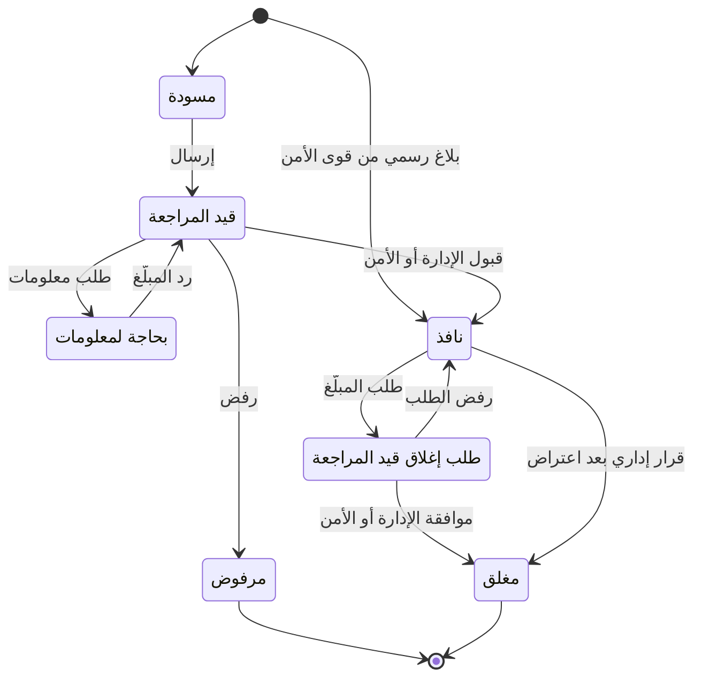

# 06 — قواعد العمل

القيم المعلَّمة بـ ⚙️ افتراضية، ويمكن تعديلها من إعدادات لوحة الإدارة دون تعديل الكود.

---

## 1. المعرّفات (IMEI والرقم التسلسلي)

| القاعدة | التفصيل |
|---|---|
| الصيغة | IMEI يتكون من 15 خانة رقمية بعد إزالة المسافات والشرطات وتحويل الأرقام العربية إلى إنكليزية |
| خانة التحقق | الخانة الأخيرة تُتحقق بخوارزمية Luhn، والرقم الذي يفشل يُرفض كـ«رقم غير صالح» |
| TAC | أول 8 خانات تحدد الماركة والموديل. إن لم يُعرف الموديل يُقبل الرقم دون عرضه |
| الأجهزة ثنائية الشريحة | للجهاز معرّفان IMEI. كلاهما يُسجَّل ويرتبط بالجهاز نفسه، والفحص بأي منهما يعطي النتيجة نفسها |
| الرقم التسلسلي | لأجهزة آبل يُسجَّل الرقم التسلسلي كمعرّف إضافي، ويمكن الفحص به |
| التفرّد | المعرّف الواحد ينتمي لجهاز واحد فقط في المنصة. محاولة ربطه بجهاز آخر تُنشئ تعارضاً للإدارة |
| عدم تطابق الموديل | إذا اختلف الموديل الذي يؤكده المحل عن موديل TAC، يُعلَّم كمؤشر محتمل على تلاعب بالرقم |
| تطابق الرقمين | IMEI الأول والثاني يجب أن يعودا للموديل نفسه حسب TAC، وإلا يُحال التسجيل للمراجعة (D-66) |
| الرقم غير المخصص | TAC غير مخصص لأي جهاز في قاعدة GSMA يُظهر تحذير «قد يكون مقلّداً» (D-65) |

## 2. حالات الجهاز العامة (ما يراه الفاحص)

| الحالة | متى |
|---|---|
| لا توجد بلاغات فعّالة | لا يوجد بلاغ نافذ على أي من معرّفات الجهاز (بما فيها حالة وجود بلاغ قيد المراجعة) |
| مبلّغ عنه: مسروق | يوجد بلاغ نافذ من نوع «مسروق» |
| مبلّغ عنه: مفقود | يوجد بلاغ نافذ من نوع «مفقود» |
| رقم غير صالح | الرقم لا يطابق الصيغة أو يفشل في Luhn |
| مؤشرات إضافية | تظهر بجانب الحالة الأساسية دون أن تغيّرها: الحالة الدولية (GSMA)، والتسجيل لدى الهيئة، وتحذير التقليد، والمكافأة (CHECK-08) |

## 3. دورة حياة البلاغ

| الحالة | المعنى | ظاهر للعامة؟ |
|---|---|---|
| مسودة | بدأه المبلّغ ولم يرسله | لا |
| قيد المراجعة | أُرسل وينتظر المشرف | لا |
| بحاجة لمعلومات | طلب المشرف معلومات إضافية | لا |
| مرفوض | رفضه المشرف مع السبب | لا |
| نافذ | قبله المشرف، ويظهر في الفحص فوراً | نعم |
| طلب إغلاق قيد المراجعة | طلب المبلّغ الإغلاق، والجهاز ما زال مبلّغاً عنه | نعم (كنافذ) |
| مغلق | أُغلق بموافقة الإدارة (تم الاسترداد، أو سحب البلاغ، أو قرار إداري بعد اعتراض) | لا |

**قواعد إضافية:**

- ⚙️ مهلة الرد على «بحاجة لمعلومات»: 14 يوماً، وبعدها يُرفض البلاغ تلقائياً بسبب «عدم الرد»، ويمكن تقديمه من جديد.
- البلاغ المرفوض لا يُعدَّل، بل يُقدَّم بلاغ جديد.
- عند قبول البلاغ: تُلغى أي شهادة فحص فعّالة للجهاز، وتُلغى طلبات نقل الملكية المعلّقة، ويُرسل الجهاز لقائمة المراقبة لدى شركات الاتصالات.

### 3.1 مصادر البلاغ

| المصدر | القواعد |
|---|---|
| مستخدم | كل ما سبق |
| قوى الأمن (مستورد، أو فردي، أو من البوابة) | نافذ فوراً، ومرجعه رقم الضبط. يُغلق من بوابة الأمن، أو بطلب صاحبه وموافقة الإدارة أو الأمن. والتعارض مع ملكية مسجّلة يُحال لقوى الأمن ولا يُلغى البلاغ تلقائياً |
| بالنيابة | ينشئه موظف الدعم بعد التحقق من الهوية، ويراجعه مشرف بلاغات آخر غير منشئه، ويمر بدورة الحياة العادية |
| جهة موثوقة (عاجل) | تُطبَّق حماية لحظة السرقة فوراً، ولا يصبح نافذاً في الفحص إلا بعد المراجعة وتأكيد صاحب الجهاز |

### 3.2 حماية لحظة السرقة

| القاعدة | التفصيل |
|---|---|
| الرقم البديل | يُؤكَّد برمز، وتذهب إليه كل الرسائل حتى يؤكد المستخدم استعادة رقمه الأصلي |
| إنهاء الجلسات | تلقائي عند البلاغ إذا كانت شريحة الحساب داخل الجهاز المسروق |
| إيقاف الخط وتجميد المحافظ | باختيار صاحب الجهاز (أو الجهة الموثوقة)، وإعادة التشغيل عبر المزوّد نفسه |
| الإجراءات الحساسة أثناء البلاغ | كلمة المرور ورمز للرقم البديل |
| ⚙️ الجهات الموثوقة | حتى 3 لكل مستخدم |

## 4. مستويات موثوقية البلاغ

تُحسب آلياً عند الإرسال، وتساعد المشرف ولا تحل محل قراره.

| المستوى | الشرط | المراجعة المتوقعة |
|---|---|---|
| 🟢 موثّق | الجهاز مسجّل باسم المبلّغ (أو هو مستخدم مفوّض عليه) وأصل تسجيله **وكيل** أو **جمركة** أو **محل** (معاملة محل، أو نقل ملكية لجهاز أصله أحدها)، أو البلاغ رسمي من قوى الأمن | سريعة |
| 🟡 مدعوم | الجهاز مسجّل باسم المبلّغ وأصل تسجيله **ذاتي**، أو جهاز غير مسجّل مع صورة كرتونة حيّة يطابق باركودها الرقم ودليل إضافي واحد على الأقل (فاتورة أو صورة قديمة) | عادية |
| 🔴 ضعيف | جهاز غير مسجّل، مع صورة الكرتونة فقط، أو باركود غير مقروء | مشدّدة، ويُفضَّل طلب معلومات |
| ⛔ متعارض | الجهاز مسجّل باسم شخص آخر (بما فيه التسجيل الذاتي)، أو الصورة مكررة من طلب آخر، أو الباركود لا يطابق الرقم | يُوقف البلاغ ويتطلب تحقيقاً، والقبول يحتاج مبرراً مكتوباً |

## 5. الملكية

| القاعدة | التفصيل |
|---|---|
| مالك واحد | لكل جهاز مالك حالي واحد: شخص (برقمه الوطني) أو محل (عندما يكون في مخزونه) |
| مصادر الملكية | بيع من محل، أو شراء محل من شخص (يصبح المحل مالكاً)، أو نقل ملكية بين أفراد، أو تسجيل ذاتي معتمد (§5.1) |
| الملكية للشخص لا للحساب | الملكية مرتبطة بالرقم الوطني، فيمكن تسجيل جهاز لمشترٍ ليس له حساب بعد |
| منع النقل | لا نقل ولا بيع لجهاز عليه بلاغ نافذ أو قيد المراجعة |
| ⚙️ مهلة قبول النقل | 72 ساعة، وبعدها يُلغى الطلب تلقائياً |
| أثر النقل | يفقد المالك السابق كل صلاحية، وتُلغى التفويضات والشهادات الفعّالة |
| المستخدم المفوّض | ⚙️ حتى 3 مفوّضين لكل جهاز، وقد يكون المفوّض قاصراً بلا هوية. يحق له **بدء** البلاغ فقط، لا النقل ولا إصدار الشهادات |
| تأكيد بلاغ المفوّض | يصل للمالك طلب تأكيد عبر واتساب. إذا لم يكن المالك موثّق الهوية بالصورة، يُطلب منه رفع صورة هويته أثناء التأكيد (D-32). ⚙️ مهلة التأكيد 48 ساعة، وبعدها يُلغى طلب البلاغ ويُبلَّغ المفوّض |
| السجل التاريخي | لا تُحذف أي ملكية سابقة، بل تُغلق بتاريخ انتهاء، فيبقى السجل الكامل متاحاً للإدارة |
| أصل التسجيل | لكل جهاز «أصل تسجيل» ثابت حسب أول ظهور له في المنصة: **وكيل** (سجّله وكيل أو مستورد عند دخوله)، أو **جمركة** (ظهر أولاً عبر بيانات الهيئة الناظمة)، أو **محل** (معاملة محل)، أو **ذاتي**. لا يتغير بانتقال الملكية، ويظهر في الشهادة وللمحل |
| مالك الجهاز الجديد | الجهاز الذي سجّله وكيل يكون في مخزون الوكيل، ثم مخزون المحل بعد النقل بالجملة، ثم باسم المشتري بعد البيع |

### 5.1 التسجيل الذاتي والحماية من تسجيل السارق للجهاز (D-36)

**الخطر:** سارق سرق الجهاز مع كرتونته يحاول تسجيله باسمه قبل أن يبلّغ صاحبه.

| طبقة الحماية | القاعدة |
|---|---|
| الهوية الحقيقية | التسجيل الذاتي يتطلب حساباً موثّق الهوية بالصورة، فالسارق يكشف هويته بنفسه |
| التحذير القانوني | إقرار صريح قبل الإرسال بأن تسجيل جهاز ليس ملكه يعرّضه للملاحقة، وبأن بياناته تُحال لقوى الأمن |
| ⚙️ فترة الانتظار | 30 يوماً بعد القبول: لا نقل ملكية، ولا شهادة فحص، ولا بيع لمحل. والتبليغ مسموح للمسجِّل |
| البلاغ يغلب التسجيل الذاتي | بلاغ من شخص آخر على جهاز مسجّل ذاتياً (في فترة الانتظار أو بعدها) يجمّد التسجيل فوراً ويحوّله لتعارض ⛔. وإذا ثبتت السرقة تُلغى الملكية الذاتية وتُحال بيانات المسجِّل لقوى الأمن |
| سجل الشريحة | عند توفر الربط مع شركات الاتصالات: هل رقم موبايل المسجِّل مستخدم في الجهاز؟ ومنذ متى؟ استخدام قديم يدعم الملكية، واستخدام حديث جداً أو معدوم يُعلَّم للمشرف (TELCO-12) |
| تنبيه المالك | محاولة تسجيل جهاز مسجّل لشخص آخر تُرفض آلياً، ويُنبَّه المالك والإدارة (OWN-13) |
| الوسم الدائم | أصل التسجيل «ذاتي» يبقى ظاهراً في الشهادة وللمحلات (OWN-14) |
| ⚙️ الحد الأقصى | 3 تسجيلات ذاتية مقبولة لكل حساب سنوياً، وما يزيد يُحال كحالة مشبوهة |
| التسجيل المبكر | حملة «سجّل جهازك قبل ما يضيع» عند الإطلاق: كل جهاز يسجّله صاحبه الحقيقي مبكراً يُغلق الباب أمام السارق |

## 6. المحلات

| القاعدة | التفصيل |
|---|---|
| التوثيق قبل العمل | لا يستطيع المحل تسجيل أي معاملة قبل موافقة الإدارة |
| حسابات الموظفين | ينشئها صاحب المحل، ولا يعمل الموظف قبل توثيق هويته بالصورة. لكل موظف دخول خاص، ويُمنع تشارك الحسابات (D-40) |
| الموقع إجباري | لا تعمل وظائف المحل (فحص، شراء، بيع) دون تفعيل الموقع (D-41) |
| الفحص قبل الشراء | إلزامي ويتم آلياً، ولا يمكن تجاوزه |
| منع المعاملة | يُمنع شراء أو بيع جهاز عليه بلاغ نافذ، وتُنشأ تنبيهات أمنية |
| التعارض في البيع | بيع جهاز مسجّل باسم شخص آخر ولم يمرّ بمخزون المحل يُعلَّق لمراجعة مشرف المحلات |
| بيانات البائع | الاسم الكامل والرقم الوطني وصورة الهوية **إلزامية** في الشراء من الأفراد، لأن البائع قد يكون سارقاً (D-31) |
| ⚙️ مسافة العملية | العملية التي تُنفَّذ على بُعد أكثر من 500 متر من موقع المحل الموثّق تُعلَّم للإدارة |
| ⚙️ مهلة الإلغاء الذاتي | 30 دقيقة من تسجيل المعاملة، مع ذكر السبب. وبعدها بطلب يراجعه مشرف المحلات |
| ⚙️ عدد الفحوص | 300 فحص في الساعة لكل محل (للحماية من الاستخدام كأداة مسح) |
| تعليق المحل | المحل المعلَّق لا يستطيع تسجيل معاملات، وتبقى سجلاته محفوظة، ويُبلَّغ صاحبه بالسبب |
| نوع النشاط | «بيع وشراء» أو «صيانة» أو كلاهما. محل الصيانة فقط لا يسجّل بيعاً ولا شراءً إلا شراء أجهزة «للقطع» إن سُمح له |
| استلام الصيانة | الفحص إلزامي قبل الاستلام. الجهاز المبلّغ عنه لا يُستلم ويُنشأ تنبيه أمني. والاستلام لا ينقل الملكية |
| استبدال اللوحة الأم | يُسجَّل الرقم القديم والجديد معاً. ويُمنع تركيب لوحة رقمها لجهاز مبلّغ عنه، ويُنشأ تنبيه |
| ⚙️ الصيانة المتأخرة | جهاز لم يُسلَّم خلال 90 يوماً يُعلَّم للإدارة |
| أجهزة القطع | تُعلَّم «مفكَّكة». وظهور رقمها لاحقاً نشطاً على الشبكة أو في معاملة يُنبّه المشرف |

### 6.1 الوكلاء والمستوردون

| القاعدة | التفصيل |
|---|---|
| التوثيق | السجل التجاري وإجازة الاستيراد أو الوكالة، ويوثّقهم مشرف المحلات |
| التسجيل بالجملة | كل رقم يُتحقق منه (Luhn والتكرار)، والرقم الموجود مسبقاً يُرفض ويُنشئ تعارضاً |
| النقل للمحلات | لمحلات موثّقة فقط، ويتطلب تأكيد استلام من المحل. ⚙️ الطلب غير المؤكَّد خلال 7 أيام يُعلَّم |
| المحل والأجهزة الجديدة | المحل يستطيع بيع جهاز جديد وارد من وكيل (من مخزونه)، أو جهاز جديد غير مسجّل بإدخال رقمه كما هو معمول به |

### 6.2 المكافأة (D-50)

| القاعدة | التفصيل |
|---|---|
| من يحددها | صاحب البلاغ فقط، وهي اختيارية، ويعدّلها أو يلغيها طالما البلاغ نافذ |
| دور المنصة | العرض فقط. لا تتدخل المنصة في الاستحقاق ولا الدفع، ويظهر تنويه «التزام شخصي من صاحب الجهاز، والمنصة غير مسؤولة عنه» |
| صياغة المسروق | المكافأة مرتبطة بالمعلومات المقدّمة عبر المنصة، لا بإعادة الجهاز مقابل مال |

## 7. الهوية والرقم الوطني

| القاعدة | التفصيل |
|---|---|
| الصيغة | الرقم الوطني السوري 11 خانة رقمية. يُتحقق من الصيغة دائماً، ومن المطابقة مع السجل المدني عند تفعيل الربط (CIVIL-01) |
| التفرّد | رقم وطني واحد لكل حساب. محاولة استخدام رقم مسجّل تُحال للدعم الفني |
| الربط التلقائي | تطابق الرقم الوطني ورقم الموبايل المؤكَّد مع بيانات مشترٍ في معاملة محل (AUTH-06). يتيح «أجهزتي» والنقل والشهادة، **ولا يُغني عن توثيق الهوية للبلاغ** |
| توثيق الهوية | صورة الهوية (الوجهان) **دون سيلفي**، تُلتقط مباشرة بالكاميرا من داخل المنصة لا من المعرض، ويراجعها مشرف البلاغات ويطابقها مع الاسم والرقم الوطني (D-32) |
| ما يتطلب توثيق الهوية بالصورة | تقديم البلاغ (أو تأكيد بلاغ المفوّض)، والاعتراض، والتسجيل الذاتي للأجهزة، وتسجيل محل، والعمل كموظف في محل |
| ما يكفيه الربط التلقائي | «أجهزتي»، ونقل الملكية، وشهادة الفحص، وإضافة مستخدم مفوّض |
| ⚙️ محاولات التوثيق | 3 محاولات مرفوضة، وبعدها يُحال الحساب للدعم الفني |

### 7.1 الربط مع الأحوال المدنية (D-38)

| القاعدة | التفصيل |
|---|---|
| تحقّق لا استعلام | لا يحصل أي مستخدم أو محل على بيانات شخص أو صورته بمجرد إدخال رقمه الوطني |
| توثيق المستخدم | مطابقة (نعم/لا) للرقم الوطني والاسم وبيان إضافي، وصورة السجل المدني للمشرف فقط، مع بقاء تصوير البطاقة إلزامياً |
| ما يراه المحل (D-84) | الاسم الكامل وحالة البطاقة فقط، **دون أي صورة**، وداخل معاملة جارية بعد فحص الجهاز، ويطابق الموظف الاسم مع هوية الشخص الحاضر |
| ⚙️ حدود المحل | 30 استعلاماً في الساعة لكل موظف، و100 لكل محل. والاستعلام الذي لا تكتمل بعده معاملة يُعلَّم، وتكراره يُحال للإدارة |
| الهوية غير السارية | بطاقة مفقودة أو ملغاة أو لمتوفى: يُمنع التوثيق وإكمال المعاملة، ويُنبَّه المشرف |
| عند تعطل الربط | يستمر العمل بالتوثيق اليدوي (صورة الهوية ومراجعة الإدارة)، وتُعلَّم المعاملات التي تمت دون تحقق ليُعاد التحقق منها لاحقاً |

## 8. حدود الفحص والحماية من الإساءة

| الفاحص | ⚙️ الحد | ⚙️ تحقق «لست روبوتاً» |
|---|---|---|
| زائر (لكل عنوان شبكة أو جهاز) | 20 فحصاً في الساعة | من الفحص الرابع في الساعة |
| مستخدم مؤكَّد الرقم | 60 فحصاً في الساعة | عند الاشتباه فقط |
| محل | 300 فحص في الساعة | لا |

- تجاوز الحد يعطي رسالة «حاول لاحقاً» ويُسجَّل.
- أنماط الفحص المتسلسل (أرقام متتالية) تُعلَّم كمحاولة مسح، ويُحظر مصدرها مؤقتاً.

### 8.1 الفحص الدولي والجمركة

| القاعدة | التفصيل |
|---|---|
| نتيجة GSMA | تظهر منفصلة عن نتيجة المنصة، وتمنع شراء المحل للجهاز مع تنبيه عادي للإدارة |
| ⚙️ حفظ نتيجة GSMA | 24 ساعة لكل رقم لتقليل عدد الاستعلامات. ⚙️ ومهلة الاستعلام 800 ملّي ثانية، وبعدها تظهر نتيجة المنصة وتُستكمل لاحقاً (GSMA-01) |
| تعطل GSMA | يكمل الفحص بنتيجة المنصة مع ملاحظة «تعذّر التحقق الدولي حالياً» |
| حالة الجمركة | معلومة للمشتري فقط، ولا تمنع المعاملات، لكن الجهاز غير المسجّل يُعلَّم للمحل |

## 9. الإشعارات

| القاعدة | التفصيل |
|---|---|
| محتوى إشعار الفحص | الماركة والموديل والتاريخ فقط، ولا شيء عن الفاحص أو موقعه أو رقم الشريحة (D-09) |
| إشعار الفحص داخل المنصة | إشعار واحد لكل عملية فحص (D-42) |
| ⚙️ إشعار الفحص على واتساب | رسالة واحدة كحد أقصى كل 6 ساعات لكل جهاز، تذكر عدد عمليات الفحص في الفترة |
| ⚙️ صلاحية رمز التحقق | 5 دقائق، وحتى 5 محاولات إدخال، وحتى 5 رموز في الساعة لكل رقم |
| إشعارات الإدارة العاجلة | تُرسل فوراً دون تجميع |

## 10. شهادة الفحص

| القاعدة | التفصيل |
|---|---|
| من يصدرها | المالك المسجّل فقط |
| الشرط | لا بلاغ نافذ ولا قيد المراجعة، وألا يكون الجهاز في فترة انتظار التسجيل الذاتي |
| ⚙️ الصلاحية | 30 يوماً |
| أصل التسجيل | تعرض الشهادة أصل التسجيل: «وكيل» أو «جمركة» أو «محل» أو «تسجيل ذاتي» |
| الحالة اللحظية | صفحة الشهادة تعرض دائماً الحالة الحالية، لا حالة يوم الإصدار فقط |
| الإلغاء التلقائي | عند نقل الملكية، أو تقديم بلاغ، أو انتهاء الصلاحية |

### 10.1 إيصال الفحص (D-37)

| القاعدة | التفصيل |
|---|---|
| متى يصدر | فقط إذا فعّل الفاحص موقعه الدقيق (GPS)، وهذا هو الحافز لتفعيله |
| من يحصل عليه | أي فاحص، بحساب أو دونه |
| المحتوى | رقم الإيصال، وIMEI، والماركة والموديل، والنتيجة، والتاريخ والوقت، والمحافظة. ولا يتضمن الإحداثيات الدقيقة |
| الثبات | الإيصال يوثّق النتيجة **لحظة الفحص** ولا يتغير بعدها، بعكس الشهادة. وصلاحيته دائمة |
| التحقق | QR يفتح صفحة تؤكد صحة الإيصال (PUB-06) |
| الصيغة القانونية | «يثبت هذا الإيصال أن الرقم المذكور فُحص عبر المنصة بالتاريخ والوقت المذكورين، وكانت النتيجة كما هو مبيّن. لا يُعد الإيصال إثباتاً للملكية» |
| الاستخدام | يقدّمه المشتري كدليل على حسن نيته إذا تبيّن لاحقاً أن الجهاز مسروق، والقرار للجهات المختصة |

## 11. الأدلة والصور

| القاعدة | التفصيل |
|---|---|
| الصيغ | JPG وPNG وHEIC للصور، وPDF للمستندات |
| الحجم | تُضغط الصور على جهاز المستخدم قبل الرفع (⚙️ أقصى بُعد 2000 بكسل)، ⚙️ وأقصى حجم للملف 10 ميغابايت |
| الصورة الحيّة | تُظهر الكرتونة وبجانبها ورقة مكتوب عليها **رقم حساب** المستخدم بخط يده (D-39)، وتُلتقط من الكاميرا داخل المنصة لا من معرض الصور. والمشرف يتأكد من وضوح الرقم ومطابقته للحساب |
| التكرار | لكل صورة بصمة، والصورة المطابقة أو شبه المطابقة لصورة في طلب آخر تُعلَّم |
| الخصوصية | الصور لا تُعرض للعامة أبداً، وتُفتح للإدارة بروابط مؤقتة |

## 12. التكامل مع شركات الاتصالات

| القاعدة | التفصيل |
|---|---|
| الإضافة للمراقبة | عند قبول البلاغ (نافذ) |
| ⚙️ الحظر | بعد أول حدث استخدام على الشبكة، وفاصل الحظر الافتراضي: فوراً |
| تأجيل الحظر | بقرار مشرف مع السبب والمدة، بطلب من قوى الأمن. وعند انتهاء المدة يُطلب الحظر تلقائياً |
| فك الحظر | تلقائياً عند إغلاق البلاغ أو إلغائه |
| الجهاز الذي لم يتصل بالشبكة | يبقى في قائمة المراقبة ما دام البلاغ نافذاً |
| ⚙️ المطابقة الدورية | يومياً مع كل شركة |
| جلسة التتبّع المباشر | تُفتح أثناء تأجيل الحظر فقط، من عنصر الأمن ضمن نطاقه أو من المشرف بطلب موثّق من الأمن، مع رقم القضية. ⚙️ مدتها 72 ساعة، و⚙️ تحديث الموقع كل 10 دقائق وعند تغيّر البرج. تتوقف تلقائياً عند الحظر أو إغلاق البلاغ أو انتهاء المدة (TRACK-05) |
| لا تتبّع لصاحب الجهاز | صاحب الجهاز لا يرى أي موقع للجهاز في المنصة، ولا يوجد تتبّع من داخل تطبيقنا (D-46) |
| نطاق الأمن | عنصر المحافظة يرى ما يرتبط بمحافظته فقط (مكان الحادثة، أو موقع التنبيه، أو المحل)، والإدارة المركزية ترى الكل |
| البحث بالرقم الوطني للأمن | يتطلب رقم قضية وسبباً، ويُسجَّل |
| سرية التحقيق | اطلاع الأمن على بيانات شخص لا يظهر له في «من اطّلع على بياناتي» إلا بعد إغلاق القضية أو حسب الاتفاقية |
| حدود الحظر | الحظر يشمل الشبكات السورية فقط، ولا يمنع استخدام الجهاز على الواي فاي أو على شبكات خارج سوريا |

## 13. المخالفات والعقوبات

| المخالفة | الإجراء |
|---|---|
| بلاغ كاذب مثبت | إغلاق البلاغ، وحظر الحساب نهائياً، وإمكانية إحالة الملف لقوى الأمن |
| تلاعب بالأدلة (صور معدّلة أو مكررة) | رفض الطلب، وتعليق الحساب للتحقيق |
| محل لا يسجّل معاملاته أو يسجّل بيانات وهمية | تعليق المحل، وإبلاغ قوى الأمن حسب الاتفاق |
| محاولة مسح قاعدة البيانات | حظر المصدر |

## 14. الصيغ القانونية الثابتة

- نتيجة الفحص السليمة: «لا توجد بلاغات فعّالة على هذا الرقم في قاعدة بيانات المنصة حتى تاريخه. هذه النتيجة لا تُعد ضماناً لمصدر الجهاز.»
- إقرار المبلّغ: «أُقرّ بأن المعلومات والأدلة المقدّمة صحيحة، وبأنني أتحمّل المسؤولية القانونية الكاملة عن أي بلاغ كاذب.»
- تذييل الفاتورة: «فاتورة موثّقة عبر المنصة. تحقّق من صحتها بمسح رمز QR.»

> الصيغ النهائية تخضع لمراجعة المحامي.

## 14.1 الخدمات التجارية (D-70، D-71)

| القاعدة | التفصيل |
|---|---|
| المجانية الدائمة | الفحص والبلاغ وكل التزامات المحلات مجانية، ولا يُشترط شراء أي شيء |
| الأصناف الممنوعة | أدوات أو برامج تغيير IMEI أو إصلاحه، وتجاوز قفل iCloud أو حساب جوجل، وفك أقفال الأجهزة |
| أماكن الإعلانات | لوحة المحل، والصفحة الرئيسية، والمتجر فقط. ولا إعلانات في الشاشات الرسمية أو الردود أو الوثائق |
| الاستهداف | بالمحافظة ونوع النشاط فقط، ولا استخدام لبيانات المعاملات |
| المنافسة مع المحلات | المنصة لا تبيع أجهزة للجمهور مباشرة |
| التشغيل | لكل خدمة زر تشغيل، والتوصية بالتفعيل بعد الإطلاق بـ 3 إلى 6 أشهر |
| تقرير تاريخ الجهاز | مجاني للمالك الحالي، ومدفوع لغيره، وخالٍ من أي بيانات شخصية |
| الشراء والتفعيل (D-86) | عبر رقم واتساب الإدارة التجاري أو زر «اطلب التفعيل» في الموقع، والدفع بالمحافظ أو التحويل أو عند الاستلام، والتفعيل يدوي من المشرف التجاري. وفي التطبيقين لا زر شراء ولا دعوة للشراء للخدمات الرقمية |
| متجر المورّدين (D-87) | المحل يطلب، والمنصة تصدر الفاتورة وتشحن وتقبض، ثم تحاسب المورّد بكشف تسوية دوري ⚙️ أسبوعي: المسلَّم والمدفوع ناقص حصة المنصة ⚙️ والمرتجعات. الإرجاع خلال ⚙️ 7 أيام، والمنصة مسؤولة أمام المحل وترجع على المورّد بالعيوب. واعتماد كل تسوية بشخصين: المشرف التجاري ثم المدير العام |

## 15. فهرس الإعدادات

كل ما يلي يُعدَّل من شاشة الإعدادات في لوحة الإدارة **دون برمجة** (D-43، ADMIN-16). لكل قيمة حد أدنى وأعلى، وكل تغيير يُسجَّل مع سببه ويمكن الرجوع عنه.

### 15.1 القيم الرقمية

| المجموعة | الإعداد | الافتراضي |
|---|---|---|
| البلاغات | مهلة الرد على «بحاجة لمعلومات» | 14 يوماً |
| البلاغات | مهلة رد المبلّغ على الاعتراض | 7 أيام |
| الملكية | مهلة قبول نقل الملكية | 72 ساعة |
| الملكية | الحد الأقصى للمستخدمين المفوّضين لكل جهاز | 3 |
| الملكية | مهلة تأكيد المالك لبلاغ المفوّض | 48 ساعة |
| التسجيل الذاتي | فترة الانتظار | 30 يوماً |
| التسجيل الذاتي | الحد الأقصى للتسجيلات المقبولة لكل حساب سنوياً | 3 |
| الشهادة | مدة صلاحية شهادة الفحص | 30 يوماً |
| المحلات | المسافة القصوى للعملية عن موقع المحل | 500 متر |
| المحلات | مهلة الإلغاء الذاتي للمعاملة | 30 دقيقة |
| الهوية | عدد محاولات التوثيق المرفوضة قبل الإحالة للدعم | 3 |
| الأحوال المدنية | الحد الأقصى للاستعلامات في الساعة (لكل موظف / لكل محل) | 30 / 100 |
| الفحص | حد الفحص في الساعة (زائر / مستخدم / محل) | 20 / 60 / 300 |
| الفحص | بداية تحقق «لست روبوتاً» للزائر | الفحص الرابع في الساعة |
| الإشعارات | الفاصل الأدنى بين رسائل واتساب لإشعار الفحص | 6 ساعات |
| رموز التحقق | الصلاحية / محاولات الإدخال / الرموز في الساعة | 5 دقائق / 5 / 5 |
| الصور | أقصى بُعد بعد الضغط / أقصى حجم للملف | 2000 بكسل / 10 ميغابايت |
| الاتصالات | الفاصل قبل طلب الحظر بعد أول استخدام | فوراً |
| الاتصالات | دورية مطابقة القوائم | يومياً |
| التتبّع | مدة جلسة التتبّع / فاصل تحديث الموقع | 72 ساعة / 10 دقائق |
| بوت واتساب | حد الفحوص لكل رقم واتساب في الساعة | 20 |
| الصيانة | مدة الجهاز دون تسليم قبل التعليم | 90 يوماً |
| الوكلاء | مهلة تأكيد المحل لاستلام النقل بالجملة | 7 أيام |
| GSMA | مدة حفظ نتيجة الاستعلام الدولي | 24 ساعة |
| تقرير الالتزام | دورية التقرير لوزارة الداخلية | شهرياً |
| الجهات الموثوقة | الحد الأقصى لكل مستخدم | 3 |
| SMS | حد الرسائل لكل رقم في الساعة | 10 |
| بوابة الأمن | مدة الجلسة / حصر الشبكات | قصيرة / اختياري |
| الخدمات التجارية | عمولة المتجر / مهلة سماح الاشتراك / حد تكرار الإعلان | تُحدد لاحقاً |
| التطبيق | أدنى إصدار مدعوم / الإصدار الموصى به | يُحدد عند كل إصدار |
| الأمان | الحد الأدنى لطول كلمة المرور | 8 أحرف |
| مهل الإدارة | الأهداف الزمنية لقوائم العمل (تنبيه عاجل، بلاغ 🟢، بلاغ 🟡/🔴، إغلاق، هوية، محل، اعتراض) | ساعة، 4 ساعات، 24، 24، 24، 48، 72 ساعة |

### 15.2 النصوص والقوائم

| الإعداد | الوصف |
|---|---|
| قوالب الرسائل | نصوص رسائل واتساب والإشعارات داخل المنصة |
| الصيغ القانونية | نتيجة الفحص، وإقرار المبلّغ، وإقرار التسجيل الذاتي، وتذييل الفاتورة والإيصال |
| نص شاشة الإقناع بتفعيل الموقع | (GEO-02، CHECK-17) |
| الصفحات القانونية | الشروط والأحكام، وسياسة الخصوصية، واتفاقية المحلات |
| المحافظات والمناطق | القائمة المرجعية (GEO-01) |
| أسباب الرفض الجاهزة | قوائم أسباب رفض البلاغات والهويات والمحلات، ليختار المشرف منها بسرعة |

### 15.3 التشغيل والتكاملات

| الإعداد | الوصف |
|---|---|
| قناة إرسال الرسائل | واتساب، أو SMS، أو تلغرام (NOTIF-03) |
| الربط مع كل شركة اتصالات | تفعيل أو إيقاف، والإعدادات غير السرية (العناوين والمهل). **الأسرار والمفاتيح والشهادات في الخزنة فقط ولا تظهر في اللوحة** (07 §2) |
| الربط مع الأحوال المدنية | تفعيل أو إيقاف، والإعدادات غير السرية. الأسرار في الخزنة فقط |
| رقم واتساب الإدارة للتنبيهات العاجلة | الأرقام التي تصلها التنبيهات |
| حصر دخول لوحة الإدارة | قائمة عناوين الشبكة المسموحة (اختياري) |
| بوت واتساب | تفعيل أو إيقاف، ونصوص الردود |
| الربط مع GSMA والهيئة الناظمة | تفعيل أو إيقاف، والإعدادات غير السرية. الأسرار في الخزنة فقط |
| مزوّدو المحافظ والبنوك | قائمة المنضمّين والإعدادات غير السرية. الأسرار في الخزنة فقط |
| الرقم القصير للـ SMS | تفعيل أو إيقاف، ونصوص الردود |
| الخدمات التجارية | زر تشغيل لكل من: المتجر، والإعلانات (لكل مكان)، وأدوات المحل المدفوعة، وتقرير تاريخ الجهاز، والربط للشركات |
| الأصناف الممنوعة في المتجر | القائمة قابلة للإضافة فقط، ولا يمكن حذف الأصناف الأساسية منها |
| الأسعار والباقات | أسعار الاشتراكات والتقارير والإعلانات والربط |
| محتوى «احمِ جهازك» | خطوات الحماية ونصوصها |
