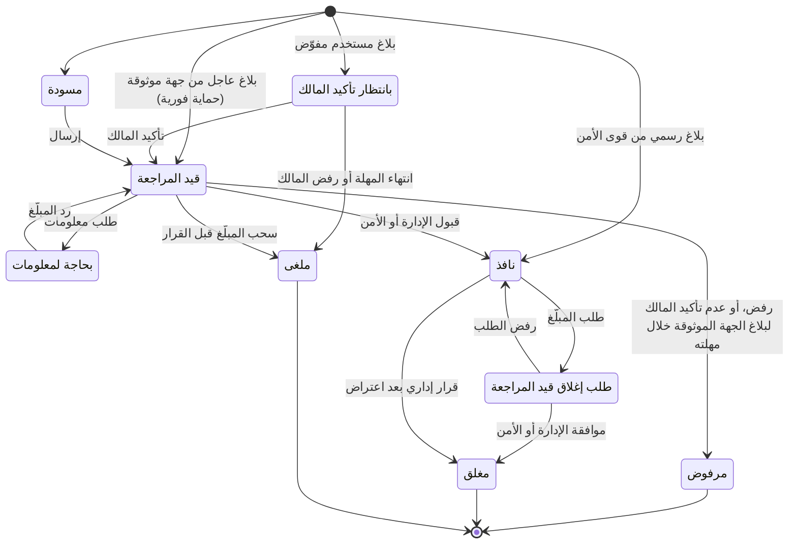

# 06 — قواعد العمل

القيم المعلَّمة بـ ⚙️ افتراضية، ويمكن تعديلها من إعدادات لوحة الإدارة دون تعديل الكود. ولكل قيمة حد أدنى وأعلى، ووحدة، وفئة مهلة، ومن يغيّرها، في [فهرس الإعدادات](#15-فهرس-الإعدادات) (§15)، ومواصفات كل حقل إدخال في §16.

هذه الوثيقة تكتب كل قاعدة بصيغة قصيرة ملزمة. أما المصفوفات التفصيلية (أثر تغيّر حالة الأصل على كل ما يتبعه، وما يُتاح في كل حالة للمحل والحساب، والاستحقاقات حسب الباقة، والأحداث الحياتية، والسلاسل من البداية للنهاية، وأوضاع التعطل) فمكانها الوحيد [مصفوفات العمل](26-business-matrices.md)، وآلياتها التقنية في [التصميم التقني](19-technical-design.md).

---

## 0. مبادئ الحسم الافتراضية

حين تسكت الوثائق عن حالة، تُحسم بالمبادئ الأربعة عشر بترتيبها، والرقم الأصغر يغلب عند التعارض. **النص الكامل لكل مبدأ وأمثلته في [مصفوفات العمل](26-business-matrices.md) §1**، وهذا الجدول للإحالة فقط:

| المبدأ | المعنى المختصر |
|---|---|
| P-1 | سلامة الناس أولاً: لا يُدفع أحد لمواجهة أحد، والإجراءات الحامية لا يمنعها تعليق ولا قيد ولا اشتراك ولا مفتاح تشغيل |
| P-2 | الحقوق بالقانون: المنصة تسجّل وتوجّه ولا تحكم بالملكية. والملكية لا تتغير إلا بفعل المالك أو بتصحيح موثّق |
| P-3 | لا احتجاز لمال أو جهاز: لكل حالة تحتجز مال غيره أو جهازه مخرج بمهلة ومسؤول |
| P-4 | أقل قدر من البيانات، وD-101 مطلق |
| P-5 | وظائف الالتزام لا تتوقف لسبب تجاري أو بمفتاح تشغيل |
| P-6 | الإغلاق عند الشك فيما ينقل قيمة أو يمنح صلاحية، والمتابعة مع علامة وإعادة تحقق فيما يحمي أو يتحقق |
| P-7 | لا حذف: التصحيح بقرار مقابل مرتبط، والحالات النهائية لا تتغير |
| P-8 | إشعار محايد كامل لكل من تغيّر حقه أو ماله أو جهازه أو مهلته |
| P-9 | إيقاف الجديد وإتمام الجاري |
| P-10 | البشر يقررون، والمؤقتات تنفّذ المهل المعلنة فقط ولا تقرر ضد أحد لغياب الموظفين |
| P-11 | أربع عيون حيث قُررت فقط، والمدير العام ينفّذ وحده بضوابط معوّضة، ولا موافق جديد أبداً |
| P-12 | المساءلة تتبع الشخص برقمه الوطني لا الحساب |
| P-13 | الوقائع بتاريخها: الوثائق والقرارات السابقة تبقى كما صدرت |
| P-14 | خطأ المنصة يُعوَّض، وخطأ الطرف لا يُعوَّض (وحسمه D-111 للخدمات المدفوعة) |

**ثلاثة استثناءات ثابتة:** قرار الزبون في [سجل القرارات](02-decisions-log.md) يغلب كل مبدأ. وD-101 مطلق. وD-100 الإيقاف البشري الوحيد المسموح للسحب، أما تأخيرات D-115 فآلية محددة المدة.

**الحالة غير المتوقعة:** لا يخمّن النظام. تُحفظ الحالة في قائمة العمل `unforeseen` مع سياقها كاملاً، وتبقى الحمايات قائمة والمال في مكانه وقابلاً للوصول، ويُستخدم السبب `RSN-*-99`، ويقرر المدير العام. ولا يُستخدم أي مبدأ لاختراع موافق جديد أو حركة مال أو إفصاح أو تغيير ملكية، فهذه تصير دائماً عملاً بشرياً. وإجراء التسجيل وسجل الحالات غير المتوقعة (UC-NN) في [مصفوفات العمل](26-business-matrices.md) §13 و[العملية الهندسية](22-engineering-process.md).

## 1. المعرّفات (IMEI والرقم التسلسلي)

| القاعدة | التفصيل |
|---|---|
| الصيغة | IMEI يتكون من 15 خانة رقمية بعد إزالة المسافات والشرطات وتحويل الأرقام العربية إلى إنكليزية. والتطبيع واستخراج الرقم من النص والملصقات في §16.3 |
| خانة التحقق | الخانة الأخيرة تُتحقق بخوارزمية Luhn، والرقم الذي يفشل يُرفض كـ«رقم غير صالح» |
| TAC | أول 8 خانات تحدد الماركة والموديل. إن لم يُعرف الموديل يُقبل الرقم دون عرضه |
| الأجهزة ثنائية الشريحة | للجهاز معرّفان IMEI. كلاهما يُسجَّل ويرتبط بالجهاز نفسه، والفحص بأي منهما يعطي النتيجة نفسها. وIMEI الثاني المطابق للأول يُرفض كخطأ إدخال (§16.3) |
| الأجهزة دون شريحة (D-91) | الحاسوب والتابلت دون شريحة يُعرَّف بالشركة المصنّعة والرقم التسلسلي معاً، ويخضع لكل قواعد الفحص والبلاغ والملكية والمحلات، عدا المراقبة والحظر والتتبّع من الشبكة (SERIAL). وصيغ الرقم لكل شركة في §16.4 |
| قراءة الرقم التسلسلي في المحل | يقرأ الموظف الرقم التسلسلي من نظام الجهاز نفسه ويطابقه مع الملصق، ويُرفض الشراء إذا تعذّرت قراءته أو اختلف (SERIAL-04) |
| الرقم التسلسلي | لأجهزة آبل يُسجَّل الرقم التسلسلي كمعرّف إضافي، ويمكن الفحص به |
| التفرّد | المعرّف الواحد ينتمي لجهاز واحد فقط في المنصة في أي لحظة، ويبقى تاريخ ربطه محفوظاً. محاولة ربطه بجهاز آخر تُنشئ تعارضاً للإدارة، إلا حالة اللوحة المانحة في §6 |
| عدم تطابق الموديل | إذا اختلف الموديل الذي يؤكده المحل عن موديل TAC، يُعلَّم كمؤشر محتمل على تلاعب بالرقم |
| تطابق الرقمين | IMEI الأول والثاني يجب أن يعودا للموديل نفسه حسب TAC، وإلا يُحال التسجيل للمراجعة (D-66) |
| الرقم غير المخصص | TAC غير مخصص لأي جهاز في قاعدة GSMA يُظهر تحذير «قد يكون مقلّداً» (D-65) |
| الأرقام المحجوزة وأرقام الاختبار | قائمة ⚙️ بأنماط لا تخص جهازاً واحداً (15 خانة متطابقة، والأرقام المتسلسلة المعروفة، والأرقام الافتراضية المنسوخة المعروفة) يعطي فحصها «رقم غير صالح» مع سطر تحذير التقليد، ولا يُقبل وحده معرّفاً لتسجيل أو بلاغ. وTAC الذي يبدأ بـ `00` يُفحص عادياً مع تحذير التقليد، ويُحال تسجيله أو بلاغه **للمراجعة لا للرفض** برسالة محايدة (§16.3) |
| المعرّف المشترك «قد يكون منسوخاً» (D-120) | يُعلَّم المعرّف آلياً حين تُظهر أحداث الشبكة استخدامه في ⚙️ 5 أجهزة مختلفة (شرائح مختلفة) أو أكثر خلال ⚙️ 30 يوماً، أو حين يُدرج في قائمة الأرقام المنسوخة التي تديرها الإدارة. الأثر: الفحص يضيف المؤشر المحايد «قد يكون منسوخاً». والتسجيل والتسجيل الذاتي عليه يتطلبان معرّفاً ثانياً (IMEI الثاني أو الرقم التسلسلي) ويُحالان للمراجعة. والبلاغ عليه **يُقبل** ويأخذ صاحبه حمايته كاملة داخل المنصة، لكن طلب المراقبة والحظر لدى الشبكات **لا يُرسل آلياً**، بل ينتظر قرار وحدة قوى الأمن المختصة في البوابة (§12) |
| أنواع الأجهزة ذات IMEI | الموبايل والتابلت بشريحة، والراوتر والمودم، والساعة بشريحة، وجهاز الدفع، والمتتبّع: كلها تُفحص ويُبلَّغ عنها وتُسجَّل بنوعها. **وإلزام المحلات بتسجيل بيعها وشرائها** واجب للموبايل والتابلت بشريحة، ولكل نوع آخر مفتاح تشغيل يُفعَّل حين تدرجه الوزارة في الإلزام، على نمط D-91 (§6) |

## 2. حالات الجهاز العامة (ما يراه الفاحص)

| الحالة | متى |
|---|---|
| لا توجد بلاغات فعّالة | لا يوجد بلاغ نافذ على أي من معرّفات الجهاز (بما فيها حالة وجود بلاغ قيد المراجعة) |
| مبلّغ عنه: مسروق | يوجد بلاغ نافذ من نوع «مسروق» |
| مبلّغ عنه: مفقود | يوجد بلاغ نافذ من نوع «مفقود» |
| رقم غير صالح | الرقم لا يطابق الصيغة، أو يفشل في Luhn، أو من الأنماط المحجوزة (§1) |
| مؤشرات إضافية | تظهر بجانب الحالة الأساسية دون أن تغيّرها: الحالة الدولية (GSMA)، والتسجيل لدى الهيئة، وتحذير التقليد، و«قد يكون منسوخاً» (D-120)، وتطابق الرقمين لنفس الموديل، والمكافأة (CHECK-08) |

## 3. دورة حياة البلاغ

| الحالة | المعنى | ظاهر للعامة؟ |
|---|---|---|
| مسودة | بدأه المبلّغ ولم يرسله | لا |
| بانتظار تأكيد المالك | بلاغ من مستخدم مفوّض ينتظر تأكيد صاحب الجهاز خلال ⚙️ 48 ساعة | لا |
| قيد المراجعة | أُرسل وينتظر المشرف | لا |
| بحاجة لمعلومات | طلب المشرف معلومات إضافية | لا |
| مرفوض | رفضه المشرف مع السبب | لا |
| نافذ | قبله المشرف، ويظهر في الفحص فوراً | نعم |
| طلب إغلاق قيد المراجعة | طلب المبلّغ الإغلاق، والجهاز ما زال مبلّغاً عنه | نعم (كنافذ) |
| مغلق | أُغلق بموافقة الإدارة أو قوى الأمن (تم الاسترداد، أو سحب البلاغ، أو قرار إداري بعد اعتراض) | لا |
| ملغى | سحبه المبلّغ قبل القرار، أو انتهت مهلة تأكيد المالك لبلاغ المفوّض | لا |

**قواعد إضافية:**

- ⚙️ مهلة الرد على «بحاجة لمعلومات»: 14 يوماً، وبعدها يُرفض البلاغ تلقائياً بسبب «عدم الرد»، ويمكن تقديمه من جديد.
- البلاغ المرفوض لا يُعدَّل، بل يُقدَّم بلاغ جديد (بحدود §3.6).
- **عند تقديم أي بلاغ** على الجهاز، ولو بقي قيد المراجعة أو كان ادعاءً منافساً: تُلغى شهادة الفحص الفعّالة فوراً وتعرض صفحتها «الشهادة لم تعد صالحة» دون ذكر البلاغ (حماية للمشتري، ودون كشف ما يخفيه CHECK-15)، ويُمنع النقل والبيع (§5). وإن رُفض البلاغ أو أُلغي يستطيع المالك إصدار شهادة جديدة.
- **عند قبول البلاغ:** تُلغى طلبات نقل الملكية المعلّقة، ويُرسل الجهاز لقائمة المراقبة لدى شركات الاتصالات (إلا المعرّف المشترك، §1 وD-120)، ويُبلَّغ الحائز المسجّل إن كان غير المبلّغ (§3.3)، وتنطبق آثار القبول على الجهاز أينما كان (§3.4).
- **بلاغ نافذ واحد لكل جهاز، وادعاءات متعددة قيد المراجعة:** البلاغ من شخص **آخر** على جهاز عليه بلاغ نافذ أو قيد المراجعة لا يُرفض، بل يُسجَّل **ادعاءً منافساً** بمستوى ⛔ مرتبطاً بالبلاغ الأول، ويرى صاحبه إيصال استلام محايداً لا يكشف البلاغ الأول ([كتالوج المحتوى](24-content-catalog.md)). والمشرف يقارن أدلة ما قبل الحادثة وسجل الشريحة للطرفين بموافقة مشرف ثانٍ، ويُرفض الادعاء الخاسر. وتكرار البلاغ من **الشخص نفسه** يعطيه خطأ البلاغ المكرر في سياق «بلاغاتي» فقط، ولا يكشف خطأٌ لأحد وجود بلاغ قيد المراجعة. وإرجاع المضبوطات وإغلاق البلاغ ينتظران قرار الادعاءات المفتوحة، وترى قوى الأمن علامة «ادعاءات متعددة».
- **حادثة خارج سوريا:** يُقبل مكان الحادثة «خارج سوريا» مع الدولة. ويصير نطاق الأمن للإدارة المركزية وحدها، ويُشارك البلاغ مع GSMA كالمعتاد.
- **تغيير نوع البلاغ** (مفقود ↔ مسروق): بطلب المبلّغ، ويعيد البلاغ لمراجعة المشرف، وتتغير صياغة المكافأة تلقائياً (§6.2).
- **معلومة جديدة من المبلّغ:** يضيفها على بلاغه النافذ، فتصل كمعلومة واردة مصدرها «المبلّغ» وتظهر على خريطة التتبّع، مع تذكير السلامة الثابت بعدم المواجهة أو الشراء أو الاسترداد بالنفس (D-46)، وبحد ⚙️ يومي.

### 3.1 مصادر البلاغ

| المصدر | القواعد |
|---|---|
| مستخدم | كل ما سبق |
| قوى الأمن (مستورد، أو فردي، أو من البوابة) | نافذ فوراً، ومرجعه رقم الضبط. يُغلق من بوابة الأمن، أو بطلب صاحبه وموافقة الإدارة أو الأمن. والتعارض مع ملكية مسجّلة يُحال لقوى الأمن ولا يُلغى البلاغ تلقائياً |
| بالنيابة | ينشئه موظف الدعم بعد التحقق من الهوية، ويراجعه مشرف بلاغات آخر غير منشئه، ويمر بدورة الحياة العادية. وإجراءات المبلّغ اللاحقة (الرد على طلب المعلومات، وطلب الإغلاق، والرد على الاعتراض، واستلام المضبوط) يؤديها الدعم عنه بعد التحقق من هويته في كل مرة، موسومة «عبر الدعم» |
| جهة موثوقة (عاجل) | تُطبَّق حماية لحظة السرقة فوراً، ولا يصبح نافذاً في الفحص إلا بعد المراجعة وتأكيد صاحب الجهاز. ومهلة التأكيد: الأبعد من ⚙️ 72 ساعة ونهاية يوم الدوام الثاني، وتتوقف ما دام لصاحب الجهاز طلب دعم مفتوح لتأكيد هويته (§15، فئة المهلة) |
| محل أو وكيل تعرّض للسرقة (D-94) | بلاغ واحد لأجهزة من مخزونه، موثوقيته 🟢 لأنها مسجّلة باسمه، ويُراجع بأولوية. والدفعة فوق ⚙️ 5 أجهزة دون رقم ضبط من الأمن تُراجع مراجعة مشدّدة (REPORT-18). ويشمل **مخزون الوكيل** والأجهزة في نقل بالجملة لم يُقبل بعد، فتُسحب من النقل. ويقدّمه صاحب المحل أو الوكيل من حسابه، أو من جلسة «بلاغ السرقة فقط» إن سُرق موبايله في الحادثة نفسها (معلَّماً للمراجع)، أو عبر الدعم بعد التحقق من هويته فيراجعه مشرف آخر. وبوابة الأمن (PP-04) طريق متاح دائماً |
| صاحب حساب معلّق أو محظور | بلاغ سرقة جهازه الخاص لا يمنعه التعليق ولا الحظر (P-1): المعلّق يقدّمه من حسابه، والمحظور عبر الدعم أو قوى الأمن. ويُعلَّم للمراجعة، ويراجعه مشرف غير من علّق الحساب |

### 3.2 حماية لحظة السرقة

| القاعدة | التفصيل |
|---|---|
| الرقم البديل | يُؤكَّد برمز، وتذهب إليه **الإشعارات فقط** حتى يؤكد المستخدم استعادة رقمه الأصلي. ولا يتلقى رموز تحقق ولا يُستخدم لاستعادة الحساب أو تأكيد أي إجراء (D-81) |
| إنهاء الجلسات | تلقائي عند البلاغ إذا كانت شريحة الحساب داخل الجهاز المسروق |
| إيقاف الخط وتجميد المحافظ | باختيار صاحب الجهاز (أو الجهة الموثوقة)، وإعادة التشغيل عبر المزوّد نفسه |
| الإجراءات الحساسة أثناء البلاغ | حسب جدول إعادة المصادقة في [نموذج التهديد](20-threat-model.md) §6.6. وإذا كان رقم الحساب متوقفاً، تُؤجَّل الإجراءات التي تحتاج رمزاً حتى استعادة الرقم، أو تتم عبر الدعم الفني بالهوية (THEFT-07) |
| ⚙️ الجهات الموثوقة | حتى 3 لكل مستخدم |
| رفع الحماية (تطبيق وإزالة متلازمان) | الحمايات التي طُبّقت عند دخول البلاغ (إيقاف الرسائل للرقم، وإنهاء الجلسات، وطلبات إيقاف الخط وتجميد المحافظ، وتجميد التسجيل الذاتي، والرقم البديل كقناة) تُرفع عند **كل** خروج غير نافذ (مرفوض، أو ملغى، أو مغلق، أو تصحيح القبول)، لا عند انتهاء المهلة وحده. ويُبلَّغ مزوّدو الخط والمحافظ بالإغلاق (LINE-02، WALLET-03). وتبقى الرسائل للرقم الأصلي متوقفة حتى استعادته (THEFT-03)، **إلا** إذا رفض صاحب الجهاز البلاغ العاجل أو رُفض البلاغ لأنه ليس جهازه، فتُستأنف فوراً ويُبلَّغ على كل وسائله. وبعد تأكيد صاحب الجهاز لا يلغي البلاغ إلا هو، لا الجهة الموثوقة |

### 3.3 إبلاغ الحائز المسجّل (D-119)

| القاعدة | التفصيل |
|---|---|
| متى | عند **قبول** بلاغ (من أي مصدر، ومنه الرسمي والمحل) على جهاز مسجّل باسم شخص غير المبلّغ وغير محله أو وكيله |
| ماذا يُرسل | رسالة محايدة على كل وسائله (نصها في [كتالوج المحتوى](24-content-catalog.md)) تذكر الموديل وأن على الجهاز بلاغاً نافذاً، وأن النقل والبيع والشهادة متوقفة، وأن يحتفظ بفاتورته أو إيصال فحصه (D-37)، ورابط **اعتراض** (DISPUTE-01)، وأن الحقوق تُطلب عبر الجهات المختصة. **دون هوية المبلّغ أبداً** |
| في «أجهزتي» | يظهر الجهاز بحالة «عليه بلاغ من شخص آخر» |
| الاستثناء | إذا طلبت قوى الأمن سرية التحقيق للبلاغ الرسمي، يتأخر الإشعار حتى ترفعها أو ⚙️ 30 يوماً أيهما أقرب، ويُسجَّل ذلك |

### 3.4 البلاغ على جهاز داخل عملية

عند قبول بلاغ (أو وصول بلاغ رسمي) يُبحث عن الجهاز في كل حيازة مفتوحة، وتنطبق القاعدة حسب مكانه. والقائمة الكاملة لكل حيازة وأثرها في [مصفوفات العمل](26-business-matrices.md) §3:

| مكان الجهاز | ما يحدث |
|---|---|
| مخزون محل أو وكيل (غير بلاغ سرقته هو) | يُعلَّم «محجوز، لا يُباع»، وتنبيه أمني عاجل لنطاق قوى الأمن بموقع المحل ومعاملة الشراء، ورسالة محايدة للمحل ألا يبيعه ولا يسلّمه لأحد وأن يحتفظ به. ولا يخرج من المخزون إلا بإجراء قوى الأمن أو بإغلاق البلاغ |
| أمر صيانة مفتوح | يُمنع التسليم برسالة محايدة للمحل أن يحتفظ بالجهاز، وتنبيه أمني عاجل لقوى الأمن ببيانات من سلّمه |
| معاملة معلّقة للمراجعة | تُرفض آلياً بسبب مسجّل، مع تنبيه أمني |
| نقل بالجملة أو سطر طلب متجر لم يُسلَّم | يُستبعد الجهاز عند القبول أو التسليم، مع تنبيه أمني |
| طلب نقل ملكية معلّق | يُلغى (§3) |
| فحوص سابقة أثناء «قيد المراجعة» | تتحول فحوص المحلات للجهاز خلال ⚙️ 30 يوماً قبل القبول إلى تنبيهات أمنية لاحقة |

**القاعدة العامة:** كل عملية تنقل جهازاً (اعتماد معاملة معلّقة، وقبول نقل بالجملة، وتسليم طلب المتجر، وتسليم الصيانة، وقبول نقل الملكية، ونقل مخزون الإغلاق، والإرث) تعيد فحص البلاغ والملكية والاحتجاز داخل العملية نفسها (§5.3).

### 3.5 انتهاء نفاذ البلاغ

| القاعدة | التفصيل |
|---|---|
| إشعار قوى الأمن | عند إغلاق البلاغ النافذ أو تصحيح قبوله أو دمجه في بلاغ آخر، تصل لكل وحدة أمن في نطاقه رسالة لحظية «البلاغ لم يعد نافذاً» في كل أوقات السنة (D-85)، وتُغلق التنبيهات المفتوحة في اللوحة، وتُعلَّم «سُحب البلاغ» في البوابة |
| الجهاز المضبوط | يبقى في عهدة قوى الأمن ويُبلَّغ بها مالكه المسجّل، والقرار لها |
| ما أُلغي بسببه | يُرفع ما طبّقه النظام آلياً (الحمايات، والتجميد)، أما ما يمس الملكية (تسجيل ذاتي أُلغي، أو معاملة رُفضت) فيصير عملاً للمراجعة ولا يعود آلياً (P-7) |
| الملكية | إغلاق البلاغ لا يغيّر الملكية أبداً، ولا الاعتراض ولا قرار حسمه (P-2) |

### 3.6 حدود إعادة التقديم

| الطلب | الحد |
|---|---|
| الاعتراض | اعتراض واحد مفتوح لكل بلاغ. وبعد القرار لا يقدّم المعترض نفسه اعتراضاً جديداً إلا **بدليل جديد** بعد ⚙️ 30 يوماً، ولا يُطلب من المبلّغ الرد إلا إن عدّ المشرف الدليل جوهرياً |
| طلب الإغلاق | بعد رفضه لا يُقدَّم طلب جديد قبل ⚙️ 7 أيام، إلا إن كانت قوى الأمن طرفاً |
| البلاغ بعد الإغلاق | بلاغ ثانٍ على الجهاز نفسه من المبلّغ نفسه خلال ⚙️ 30 يوماً من إغلاق بسبب «وجدته» أو «بلاغ بالخطأ» يُراجع مراجعة مشدّدة 🔴 ويُفحص للإساءة (§13) |
| التسجيل الذاتي | ⚙️ 3 طلبات لكل جهاز لكل شخص خلال 90 يوماً (§5.1) |
| الاعتراض على قرار عقوبة | مرة واحدة لكل قرار (§13) |
| تكرار بلا دليل جديد | يُرد برد ثابت ويُغلق |

## 4. مستويات موثوقية البلاغ

تُحسب آلياً عند الإرسال، وتساعد المشرف ولا تحل محل قراره. **وتتبع الموثوقية طريقة اكتساب المالك الحالي للجهاز، لا أصل تسجيله وحده.**

| المستوى | الشرط | المراجعة المتوقعة |
|---|---|---|
| 🟢 موثّق | الجهاز مسجّل باسم المبلّغ (أو هو مستخدم مفوّض عليه) **واكتسبه من محل أو وكيل أو المتجر**، أو بنقل من شخص اكتسبه كذلك، أو بإرث موثّق عن مالك اكتسبه كذلك (§5.2). أو البلاغ رسمي من قوى الأمن. أو ملكية تسجيل ذاتي لجهاز أصله «جمركة» تحمل بيانات الهيئة فيه الرقم الوطني نفسه للمسجِّل | سريعة |
| 🟡 مدعوم | الجهاز مسجّل باسم المبلّغ وملكيته **بتسجيل ذاتي** مهما كان أصل تسجيله، أو جهاز غير مسجّل مع صورة كرتونة حيّة يطابق باركودها الرقم ودليل إضافي واحد على الأقل (فاتورة أو صورة قديمة) | عادية |
| 🔴 ضعيف | جهاز غير مسجّل، مع صورة الكرتونة فقط، أو باركود غير مقروء. أو بلاغ متكرر بعد إغلاق «وجدته» أو «بالخطأ» (§3.6) | مشدّدة، ويُفضَّل طلب معلومات |
| ⛔ متعارض | الجهاز مسجّل باسم شخص آخر (بما فيه التسجيل الذاتي)، أو الصورة مكررة من طلب آخر، أو الباركود لا يطابق الرقم، أو **ادعاء منافس** لبلاغ قائم (§3)، أو بلاغ المالك السابق خلال مهلة الاعتراض على خروج الملكية (§5) | يُوقف البلاغ ويتطلب تحقيقاً، والقبول يحتاج مبرراً مكتوباً وموافقة مشرف ثانٍ |

## 5. الملكية

| القاعدة | التفصيل |
|---|---|
| مالك واحد | لكل جهاز مالك حالي واحد: شخص (برقمه الوطني، أو بوثيقته البديلة §7.2)، أو محل أو وكيل (عندما يكون في مخزونه) |
| مصادر الملكية | كل انتقال للحيازة أو الملكية من نوع معرّف في §5.3، ولا مصدر غيرها |
| الملكية للشخص لا للحساب | الملكية مرتبطة بالرقم الوطني، فيمكن تسجيل جهاز لمشترٍ ليس له حساب بعد |
| منع النقل | لا نقل ولا بيع لجهاز عليه بلاغ نافذ، أو قيد المراجعة، أو **بانتظار تأكيد المالك**، أو ادعاء منافس، ولا لجهاز **محتجز لدى جهة رسمية**، ولا لجهاز **مالكه متوفى** إلا بالإرث (§5.2)، ولا أثناء فترة التهدئة أو حجز إعادة تعيين كلمة المرور للمالك (§7) |
| ⚙️ مهلة قبول النقل | 72 ساعة، وبعدها يُلغى الطلب تلقائياً |
| أثر النقل | يفقد المالك السابق كل صلاحية، وتُلغى التفويضات والشهادات الفعّالة |
| إشعار خروج الملكية | كل خروج لجهاز من ملكية شخص (نقل، أو شراء محل منه، أو اعتماد معاملة معلّقة، أو نقل بالجملة، أو تصحيح، أو إرث) يُبلَّغ به **المالك السابق على كل وسائله** برسالة محايدة تذكر الموديل وطريقة الخروج والتاريخ (نصها في [كتالوج المحتوى](24-content-catalog.md))، مع زر «لم أفعل ذلك». ويخدم كإيصال للبائع الأمين أيضاً. وفي فاتورة البيع زر للمشتري «لم أشترِ هذا الجهاز». وأي من الزرين يفتح طلب دعم عاجلاً مرتبطاً بالمعاملة، ويعلّمها «ينكرها طرفها» للمراجعة |
| ⚙️ مهلة الاعتراض على خروج الملكية | 14 يوماً بعد كل خروج للملكية: بلاغ المالك السابق أو إنكاره لا يمنعه OWN-07، بل يُقبل للمراجعة بمستوى ⛔ (§4). والمعاملة الوهمية المثبتة تُصحَّح بقرار المدير العام (REVERSAL-03) مع العقوبة (§13) |
| المستخدم المفوّض | ⚙️ حتى 3 مفوّضين لكل جهاز، وقد يكون المفوّض قاصراً بلا هوية. يحق له **بدء** البلاغ فقط، لا النقل ولا إصدار الشهادات |
| تأكيد بلاغ المفوّض | يصل للمالك طلب تأكيد عبر واتساب. إذا لم يكن المالك موثّق الهوية بالصورة، يُطلب منه رفع صورة هويته أثناء التأكيد (D-32). ⚙️ مهلة التأكيد 48 ساعة، وبعدها يُلغى طلب البلاغ ويُبلَّغ المفوّض. والبلاغ العاجل من جهة موثوقة يحل محل بلاغ المفوّض المنتظر (يُلغى بسبب «حلّ محله بلاغ عاجل» ويُبلَّغ المفوّض) |
| السجل التاريخي | لا تُحذف أي ملكية سابقة، بل تُغلق بتاريخ انتهاء وسبب، فيبقى السجل الكامل متاحاً للإدارة |
| أصل التسجيل | لكل جهاز «أصل تسجيل» ثابت حسب أول ظهور له في المنصة: **وكيل** (سجّله وكيل أو مستورد عند دخوله)، أو **جمركة** (ظهر أولاً عبر بيانات الهيئة الناظمة)، أو **محل** (معاملة محل)، أو **ذاتي**. لا يتغير بانتقال الملكية، ويظهر في الشهادة وللمحل |
| مالك الجهاز الجديد | الجهاز الذي سجّله وكيل يكون في مخزون الوكيل، ثم مخزون المحل بعد النقل بالجملة، ثم باسم المشتري بعد البيع |
| البيع بالتقسيط أو بالدين | ملكية السجل تنتقل للمشتري عند التسليم مهما كانت طريقة الدفع. والتعثّر دين مدني بين المحل والزبون يُطلب بالقانون، ولا يملك المحل استرجاع الجهاز ولا التبليغ عنه (OWN-07)، ويظهر هذا السطر في شاشة التقسيط |
| التخلي عن الجهاز | يصرّح المالك «لم يعد الجهاز معي» بسبب: أُتلف، أو بيع أو أُهدي خارج سوريا، أو سُلّم لإعادة التدوير، أو أُرسل للكفالة خارج سوريا. بإعادة تحقق، ودون بلاغ مفتوح أو طلب نقل معلّق. فتنتهي ملكيته بسبب «تخلٍّ»، وتنتهي الشهادات والتفويضات. وأي ظهور لاحق للجهاز (فحص محل، أو حدث شبكة، أو تسجيل) يُنبّه المشرف، والتسجيل الذاتي عليه يُراجع كمتعارض |
| أجهزة المؤسسات والشركات (D-105) | تُسجَّل باسم **ممثل مسؤول**: شخص طبيعي برقمه الوطني يحدده الكيان. ويستخدمها الموظفون كمستخدمين مفوّضين (OWN-08). وتغيير الممثل نقل ملكية عادي من الممثل القديم للجديد، وإن تعذّر حضوره فبتصحيح موثّق بكتاب الكيان (REVERSAL-03). ولا نوع مالك جديد للمؤسسات |
| الجهاز المحتجز لدى جهة رسمية | ما دام الجهاز مسجّلاً مضبوطاً لدى قوى الأمن (محفوظ أو أُبلغ صاحبه)، يُمنع إنشاء النقل وقبوله وإصدار الشهادة وتعديل المفوّضين وإنهاء التسجيل الذاتي، برسالة محايدة |
| إعادة المضبوط لغير المالك المسجّل | **لا تغيّر الملكية آلياً** (P-2). يُغلق البلاغ بسبب «أُفرج عنه بقرار جهة رسمية»، ويُنشأ عمل للإدارة يطلب الوثيقة الرسمية، ولا تتغير الملكية إلا بتصحيح المدير العام عليها (REVERSAL-03)، مع إشعار محايد للطرفين |
| الحكم القضائي | ينفّذه المدير العام بتصحيح موثّق (REVERSAL-03) بعد تحقق المحامي من صحته لدى المحكمة المصدرة، مع حجز قانوني للملف |

### 5.1 التسجيل الذاتي والحماية من تسجيل السارق للجهاز (D-36)

**الخطر:** سارق سرق الجهاز مع كرتونته يحاول تسجيله باسمه قبل أن يبلّغ صاحبه.

| طبقة الحماية | القاعدة |
|---|---|
| الهوية الحقيقية | التسجيل الذاتي يتطلب حساباً موثّق الهوية بالصورة، فالسارق يكشف هويته بنفسه |
| التحذير القانوني | إقرار صريح قبل الإرسال بأن تسجيل جهاز ليس ملكه يعرّضه للملاحقة، وبأن بياناته تُحال لقوى الأمن |
| ⚙️ فترة الانتظار | 30 يوماً بعد القبول: لا نقل ملكية، ولا شهادة فحص، ولا بيع لمحل. والتبليغ مسموح للمسجِّل |
| البلاغ يغلب التسجيل الذاتي | بلاغ من شخص آخر على جهاز مسجّل ذاتياً (في فترة الانتظار أو بعدها) يجمّد التسجيل فوراً ويحوّله لتعارض ⛔. وطلب تسجيل ذاتي ما زال قيد المراجعة يُوقف حتى يُحسم البلاغ. وإذا ثبتت السرقة تُلغى الملكية الذاتية وتُحال بيانات المسجِّل لقوى الأمن |
| سجل الشريحة | عند توفر الربط مع شركات الاتصالات: هل رقم موبايل المسجِّل مستخدم في الجهاز؟ ومنذ متى؟ استخدام قديم يدعم الملكية، واستخدام حديث جداً أو معدوم يُعلَّم للمشرف (TELCO-12) |
| تنبيه المالك | محاولة تسجيل جهاز مسجّل لشخص آخر تُرفض آلياً، ويُنبَّه المالك والإدارة (OWN-13). ولا يصل المالك إلا تنبيه واحد لكل جهاز كل ⚙️ 7 أيام، وما بعده للإدارة فقط. ورد المالك «الجهاز معي» يُسجَّل ويرفع علامة المحاول |
| تكرار المحاولة | من تُرفض له آلياً ⚙️ 2 محاولتان على أجهزة مسجّلة لغيره خلال 90 يوماً يُوضع عليه قيد `self_registration` ويُراجع (§13) |
| الوسم الدائم | أصل التسجيل «ذاتي» يبقى ظاهراً في الشهادة وللمحلات (OWN-14)، والموثوقية لملكية ذاتية 🟡 مهما كان الأصل (§4) |
| ⚙️ الحد الأقصى | 3 تسجيلات ذاتية مقبولة **لكل شخص** (برقمه الوطني) خلال **365 يوماً متحركة**، وما يزيد يُحال كحالة مشبوهة. وكل حدود «في السنة» لمكافحة الإساءة متحركة لا تقويمية |
| إعادة التقديم | ⚙️ 3 طلبات لكل جهاز لكل شخص خلال 90 يوماً، وبعدها لا يُقبل طلب جديد إلا عبر الدعم بدليل جديد |
| مصدر الجهاز | يسأل الطلب «من أين حصلت عليه؟» (اسم المحل ومحافظته، أو شخص، أو من الخارج مع فاتورة أو إيصال جمركة). والمحلات المذكورة غير المسجّلة تُجمع في تقرير الالتزام (COMPLIANCE-05) |
| التسجيل المبكر | حملة «سجّل جهازك قبل ما يضيع» عند الإطلاق: كل جهاز يسجّله صاحبه الحقيقي مبكراً يُغلق الباب أمام السارق |

### 5.2 انتقال جهاز المتوفى (D-103)

وباقي الأحداث الحياتية للشخص والمحل (الوفاة، وفقد الرقم، والسفر، والوصاية، وانتقال المحل) بخطواتها في [مصفوفات العمل](26-business-matrices.md) §7.

| القاعدة | التفصيل |
|---|---|
| من يطلب | شخص موثّق الهوية من حسابه، أو عبر الدعم بعد التحقق من هويته، يقدّم **شهادة وفاة** المالك المسجّل (تصوير مباشر بالكاميرا)، ويسمّي المستلم لكل جهاز |
| من يجوز أن يستلم | (أ) شخص يحمل **نفس الكنية** التي يحملها المتوفى، أو (ب) **وصي**: وصي اختاره صاحب الحساب مسبقاً من حسابه (⚙️ حتى 2، ويقبل كل منهم من حسابه كالجهة الموثوقة)، أو وصي قانوني بوثيقة وصاية أو وكالة رسمية. والمستلم موثّق الهوية. ولا يلزم حصر إرث ولا قرار محكمة |
| التحقق | يتحقق المشرف من الشهادة، ومن تطابق الكنية بعد التطبيع (§16.7) أو من صفة الوصي، ومن حالة الوفاة في الأحوال المدنية عند الربط. وحالة «متوفى» من السجل المدني وحدها لا تنقل شيئاً: تُعلِم المالك «متوفى» وتنشئ عملاً للمراجعة فقط |
| الإشعار والمهلة | بعد التحقق يصل إشعار إلى **كل وسائل حساب المتوفى** (رقمه، والرقم البديل، والبريد إن وُجد، وجهاته الموثوقة وأوصياؤه)، ويُنفَّذ النقل بعد ⚙️ 72 ساعة إن لم يعترض أحد. والمهلة تُمدَّد إذا تعطلت المنصة أثناءها (فئة المهلة في §15) |
| صاحب الحساب حي | يوقف الطلب **بنقرة** من حسابه أو برد على الإشعار، فيُلغى ويُعلَّم احتيالاً، ويُقيَّد مقدّمه ويُراجع للحظر والإحالة لقوى الأمن (§13) |
| الاعتراض والخلاف | اعتراض أي شخص آخر (وريث آخر مثلاً) يوقف التنفيذ ويُحسم بالقانون: لا تتغير الملكية إلا بوثيقة رسمية ينفّذها المدير العام (REVERSAL-03). والمنصة لا تقرر بين الورثة |
| التنفيذ | تنتقل الملكية بنوع «إرث» (§5.3) مع إعادة فحص البلاغ والاحتجاز، ويُغلق حساب المتوفى بسبب «وفاة» دون مهلة التراجع، وتُنهى جلساته وتُلغى طلباته المعلّقة وعلاقاته كجهة موثوقة، ويبقى المفوّضون على الأجهزة حتى يزيلهم المالك الجديد |
| البلاغات | تبقى بلاغات المتوفى النافذة نافذة، ويصير المستلم مسؤولاً عنها (يتلقى إشعاراتها ويطلب إغلاقها) |
| شراء محل من الوارث قبل الانتقال | يُعلَّق وفق D-96 برسالة محايدة تشرح طريق الإرث، ولا يُعتمد قبل تنفيذ الانتقال |
| محل المتوفى | تغيير المالك على السجل نفسه (§6.3، D-107). والمحفظة لدى شام كاش باسم المحل، ولا سحب عبر المنصة دون مالك، ويُفرج عنها لورثته بإجراءات شام كاش، ويظهر ذلك كتجميد خارجي |
| الأثر في الموثوقية | الجهاز الموروث يحمل موثوقية اكتساب المتوفى نفسه (§4) |

### 5.3 أنواع انتقال الحيازة والملكية

كل عملية تغيّر مالك الجهاز أو مكان حيازته تمر بباب واحد: تقفل الجهاز، وتعيد فحص البلاغات (النافذة وقيد المراجعة والمنتظرة والادعاءات)، والاحتجاز، والحجز القانوني، والتسجيل الذاتي المنتظر، والتعارض المفتوح، والحجز لعملية أخرى، وحالة GSMA، ثم تنفّذ أو تعلّق أو تمنع، وتبلّغ المالك السابق. والآلية التقنية في [التصميم التقني](19-technical-design.md)، وأثر كل نوع على الأطراف في [مصفوفات العمل](26-business-matrices.md) §6.

| النوع | من ← إلى | تتغير الملكية؟ | الدليل المطلوب | إشعار المالك السابق |
|---|---|---|---|---|
| شراء محل (`shop_purchase`) | شخص ← محل | نعم | هوية البائع وصورتها (D-31)، وفحص فوري | نعم |
| شراء بقبول «نقل لمحل» (D-121) | شخص ← محل | نعم | طلب المالك المسجّل من تطبيقه برقم المحل، وصورة هوية الحاضر | نعم (هو صاحب الطلب) |
| بيع محل (`shop_sale`) | محل ← شخص | نعم | هوية المشتري، وفاتورة | — |
| استرجاع بعد مهلة الإلغاء (`shop_buyback`) | المشتري المسجّل ← المحل | نعم | شراء من المالك المسجّل مرتبط بالبيع الأصلي، وهوية البائع (D-31) | نعم |
| نقل بين منشأتين (`b2b_transfer`) | محل أو وكيل ← محل أو وكيل موثّق | نعم | إرسال من المرسل وقبول من المستلم، وإعادة فحص كل جهاز عند القبول | — |
| نقل بالجملة (`wholesale_transfer`) وإرجاعه (`wholesale_return`) | وكيل ⇄ محل | نعم | إرسال وقبول، والأجهزة المرسلة محجوزة حتى القرار | — |
| تسليم طلب المتجر (`store_delivery`) وإرجاعه (`store_return`) | وكيل ⇄ محل | نعم | رمز التسليم، وإعادة فحص كل سطر قبل التسليم، والإرجاع يعيد الجهاز لمخزون الوكيل إن بقي في مخزون المحل | — |
| قبول نقل ملكية (`transfer_accept`) | شخص ← شخص | نعم | رمز المالك، وقبول المستلم بمطابقة رقمه ورقمه الوطني | نعم |
| استلام الصيانة وتسليمها (`repair_intake` / `repair_delivery`) | حيازة مؤقتة | لا | فحص عند الاستلام وإعادة فحص عند التسليم | إشعار محايد للمالك المسجّل إن كان غير المقدّم |
| الضبط وإرجاعه (`seizure` / `seizure_return`) | حيازة قوى الأمن | لا | سجل الضبط ورقم القضية | حسب غرض الضبط (§12) |
| نقل مخزون الإغلاق (`closure_handover`) | محل أو وكيل ← منشأة موثّقة أو صاحبها شخصياً | نعم | قبول المستلم، وإعادة الفحص (§6.3) | — |
| إرث (`succession`) | متوفى ← وارث بالكنية أو وصي | نعم | §5.2 | نعم (لكل وسائل حساب المتوفى) |
| تصحيح (`correction`) | أي ← أي | نعم | قرار المدير العام بالأدلة (REVERSAL-03) | نعم للطرفين |
| تبديل اللوحة (`board_swap`) | معرّف من جهاز مفكَّك ← جهاز آخر | لا (المعرّف فقط) | §6 | — |
| تخلٍّ (`relinquish`) | شخص ← لا أحد | تنتهي | تصريح المالك بإعادة تحقق | — |
| تسجيل الوكيل (`importer_intake`) والتسجيل الذاتي النهائي (`self_registration`) | — ← وكيل أو شخص | نعم | دفعة الوكيل، أو §5.1 | — |

## 6. المحلات

| القاعدة | التفصيل |
|---|---|
| التوثيق قبل العمل | لا يستطيع المحل تسجيل أي معاملة قبل موافقة الإدارة |
| حسابات الموظفين | ينشئها صاحب المحل، ولا يعمل الموظف قبل توثيق هويته بالصورة. لكل موظف دخول خاص، ويُمنع تشارك الحسابات (D-40). ولا يُفعَّل موظفاً من عليه قيد `staff_bar` أو حظر (§13)، ويتلقى صاحب المحل نصاً محايداً دون سبب، ولا تذكر الواجهة إن كان للمدعو حساب سابق |
| الموقع إجباري | لا تعمل وظائف المحل (فحص، شراء، بيع) دون تفعيل الموقع (D-41) |
| الفحص قبل الشراء | إلزامي ويتم آلياً، ولا يمكن تجاوزه |
| منع المعاملة | يُمنع شراء أو بيع جهاز عليه بلاغ نافذ، وتُنشأ تنبيهات أمنية |
| جهاز عليه بلاغ قيد المراجعة | يُعلَّق شراؤه أو بيعه لمراجعة الإدارة، وتظهر للمحل رسالة محايدة: «هذه العملية تحتاج مراجعة، سنبلغك بالنتيجة» دون ذكر البلاغ |
| التعارض في البيع | بيع جهاز مسجّل باسم شخص آخر ولم يمرّ بمخزون المحل يُعلَّق لمراجعة مشرف المحلات |
| الشراء من غير المالك المسجّل (D-96، D-121) | إذا كان الجهاز مسجّلاً باسم شخص غير البائع تُعلَّق العملية لمراجعة الإدارة برسالة محايدة للمحل. **أو** ينقله المالك المسجّل من تطبيقه «نقل لمحل» برقم المحل `SH-`، فيقبله المحل (صاحبه أو موظف بصلاحية الشراء، في موقع المحل D-41) ويصوّر هوية الشخص الحاضر (D-31)، فيصبح **القبول نفسه معاملة الشراء** (§5.3)، ولا يحتاج الحاضر حساباً. وطلب «نقل لمحل» تنتهي مهلته كطلب النقل العادي |
| القاصرون (D-97) | من عمره أقل من 18 سنة تُسجَّل معاملته باسم وليّ أمره الحاضر وهويته، ويُضاف القاصر مستخدماً مفوّضاً على الجهاز. والحساب المستقل من عمر 18 سنة |
| بيانات البائع | الاسم الكامل والرقم الوطني (أو الوثيقة البديلة، §7.2) وصورة الهوية **إلزامية** في الشراء من الأفراد، لأن البائع قد يكون سارقاً (D-31). والطرف بوثيقة بديلة يُعلَّم للمعاينة الدورية |
| ⚙️ مسافة العملية | العملية التي تُنفَّذ على بُعد أكثر من 500 متر من الموقع الموثّق **للفرع الذي يعمل فيه الموظف** (أو المحل إن لم تكن له فروع) تُعلَّم للإدارة |
| ⚙️ مهلة الإلغاء الذاتي | 30 دقيقة من تسجيل المعاملة، مع ذكر السبب. وبعدها بطلب يراجعه مشرف المحلات. والإلغاء للأخطاء فقط، والإرجاع الحقيقي بعد المهلة استرجاع (أدناه) |
| ⚙️ عدد الفحوص | 300 فحص في الساعة لكل محل (للحماية من الاستخدام كأداة مسح)، ويُرفع للمحلات الكبيرة بإجراء الاستثناء في §8 |
| تعليق المحل | المحل المعلّق لا يستطيع تسجيل معاملات أجهزة جديدة، وتبقى سجلاته محفوظة، ويُبلَّغ صاحبه بالسبب وبما يبقى متاحاً (§6.3) |
| نوع النشاط (D-90) | واحد أو أكثر من: «بيع وشراء أجهزة»، و«صيانة»، و«خدمات اتصالات وإكسسوارات»، و«حواسيب». محل الصيانة فقط لا يسجّل بيعاً ولا شراءً إلا شراء أجهزة «للقطع». ومحل خدمات الاتصالات يستخدم الخدمات التجارية دون تسجيل معاملات أجهزة، فإذا باع أو اشترى جهازاً وجب عليه تسجيله |
| إزالة نوع نشاط | طلب تعديل لا يُعتمد حتى تنتهي العناصر المفتوحة لذلك النشاط (تسليم أوامر الصيانة، والتصرف بمخزون الأجهزة بقواعد §6.3)، ويتوقف الاستلام الجديد لذلك النشاط فور الطلب |
| الأجهزة غير الموبايل ذات IMEI | الراوتر والساعة وجهاز الدفع والمتتبّع: يسجّل المحل بيعها وشراءها **اختيارياً** حتى يُفعَّل إلزام نوعها بمفتاحه (§1). ومحل خدمات الاتصالات الذي يبيع الراوترات لا يصير ملزماً بها قبل ذلك |
| استلام الصيانة | الفحص إلزامي قبل الاستلام. الجهاز المبلّغ عنه لا يُستلم ويُنشأ تنبيه أمني. والاستلام لا ينقل الملكية. وإن كان الجهاز مسجّلاً لشخص غير المقدّم يكتمل الاستلام (استخدام العائلة شائع) ويصل المالك المسجّل إشعار محايد برابط «بلّغ عنه» |
| الجهاز المقفل بحساب | في الشراء يُسأل إلزامياً عن قفل الحساب (iCloud أو حساب جوجل) للموبايلات الذكية، وإن لم يستطع البائع إزالته أمام الموظف تُعلَّق العملية للمراجعة برسالة محايدة ولا تكتمل آلياً. والاستلام للصيانة مسموح، وأي طلب «فك قفل حساب» يُرفض (D-70) |
| تسليم الصيانة | يعيد الفحص قبل التسليم، ويُمنع تسليم جهاز صار عليه بلاغ (§3.4) |
| استبدال اللوحة الأم | يُسجَّل الرقم القديم والجديد معاً. ويُمنع تركيب لوحة رقمها لجهاز مبلّغ عنه، ويُنشأ تنبيه. و**اللوحة المانحة** ذات الرقم المعروف لا تُقبل إلا من جهاز «مفكَّك» في مخزون المحل نفسه دون بلاغ نافذ أو قيد المراجعة، فينتقل المعرّف إليه في العملية نفسها ويُسجَّل في الجهاز المانح «لوحتها نُقلت إلى جهاز آخر». وكل حالة أخرى تُمنع وتصير تعارضاً موسوماً «احتمال تبييض» للمراجعة الأمنية |
| ⚙️ الصيانة المتأخرة (الجهاز المتروك) | جهاز لم يُسلَّم خلال 90 يوماً يُعلَّم للإدارة، ويُذكَّر الزبون (بموافقته على الرسائل) عند 90 و120 يوماً، ويُعلَّم ثانية عند ⚙️ 180 يوماً. والمنصة **تعلّم فقط**: لا تنقل الملكية للمحل أبداً، والحقوق تُطلب بالقانون. ولصاحب المحل خيار «سُلّم للجهات المختصة» يُغلق الأمر ويُنشئ لدى قوى الأمن سجل ضبط بغرض «وديعة غير مُطالب بها». ولا يكتسب المحل الجهاز إلا بشراء عادي من مالكه المسجّل |
| أجهزة القطع | تُعلَّم «مفكَّكة». وظهور رقمها لاحقاً نشطاً على الشبكة أو في معاملة يُنبّه المشرف |
| الاسترجاع والتبادل | إرجاع الزبون لجهاز بعد مهلة الإلغاء يُسجَّل **شراءً من المالك المسجّل** (المشتري الأصلي) مرتبطاً بالبيع الأصلي، بصورة هويته (D-31) ودون تعليق D-96، وتبقى الفاتورة الأصلية في السلسلة، ويدخل الجهاز المخزون بوسم «مرتجع». والتبادل استرجاع ثم بيع في شاشة واحدة. وإرجاع جهاز بيع بالتقسيط يخفض الدين |
| النقل بين محلين | تبادل الأجهزة بين المنشآت الموثّقة (محل أو وكيل) بنقل يرسله المرسل من مخزونه ويقبله المستلم في سياقه، مع إعادة فحص كل جهاز عند القبول، ودون هوية شخصية، ويظهر في سجلي الطرفين وتقرير الالتزام. ويخضع لنوع النشاط (محل الصيانة لا يستقبل إلا «للقطع») |
| البيع بالتوصيل | بيع لمشترٍ غير حاضر: رقمه الوطني واسمه ورقم موبايله دون تأكيد الحضور. يبقى الجهاز في المخزون «قيد التسليم»، وتنتقل الملكية حين يقبل المشتري برابط ومطابقة رقمه الوطني خلال ⚙️ 72 ساعة، وإلا يعود متاحاً. ويُعلَّم في تقرير الالتزام |
| احتيال الموظف | إن سجّل موظف بيعاً أو نقلاً وهمياً: يوقفه صاحب المحل ويطلب الإلغاء بسبب «احتيال موظف»، فيتحقق المشرف ويعتمد المدير العام إرجاع الملكية (REVERSAL-03)، ثم يعود الجهاز للمخزون ويمكن البلاغ عنه (REPORT-18)، ويُحال الموظف لقوى الأمن (§13) |
| الطلبات الرسمية للمحل | طلبات قوى الأمن تصل المحل عبر المنصة (PP-09 في لوحته) أو بأمر خطي رسمي فقط. والمحل لا يعطي بيانات زبون ولا جهازاً لمتصل هاتفي، والمنصة لا تطلب رمزاً أو كلمة مرور أو مالاً بالهاتف أبداً، و«انتحال صفة» تصنيف دعم ينشئ تنبيهاً أمنياً |
| الطابعات الحرارية (D-122) | المقاسان 58 و80 مم مدعومان حسب الطابعة المربوطة، وكل وثيقة حرارية (فاتورة، وإيصال، ورمز QR بحجم أدنى مقروء) تُطبع على المقاسين، مع قائمة ⚙️ اختيارية بالموديلات المجرّبة |

### 6.1 الوكلاء والمستوردون

| القاعدة | التفصيل |
|---|---|
| التوثيق | السجل التجاري وإجازة الاستيراد أو الوكالة، ويوثّقهم مشرف المحلات |
| التسجيل بالجملة | كل رقم يُتحقق منه (Luhn والتكرار)، والرقم الموجود مسبقاً يُرفض ويُنشئ تعارضاً. والسطر الذي يحمل رقماً عليه بلاغ نافذ يُرفض بسبب «مبلّغ عنه» ويُنشئ تنبيهاً أمنياً عاجلاً كمحاولة شراء محل |
| مفتاح التسجيل البرمجي | مفتاح الوكيل لتسجيل أجهزته وظيفة التزام: لا اشتراك ولا فوترة، وحدود طلبات فقط، ولا يتأثر بإطفاء الربط البرمجي للشركات (BIZAPI) ولا بحصصه |
| النقل للمحلات | لمحلات موثّقة فقط، ويتطلب تأكيد استلام من المحل. والأجهزة المرسلة **محجوزة** حتى القرار (لا نقل آخر ولا بيع ولا سطر متجر). ويقبل المحل كل الأجهزة أو بعضها، فيصير النقل «مقبولاً جزئياً» والباقي يعود لمخزون الوكيل. ويستطيع الوكيل إلغاءه ما دام مرسلاً. ⚙️ الطلب غير المؤكَّد خلال 7 أيام يُعلَّم ويُذكَّر الطرفان، ويُلغى آلياً بعد ⚙️ 30 يوماً وتبقى الأجهزة في مخزون الوكيل |
| الإرجاع للوكيل | نقل عكسي من المحل للوكيل للأجهزة الجديدة المعيبة، بقبول الوكيل |
| استبدال الكفالة لدى الوكيل | يتحقق الوكيل أن الزبون هو المالك المسجّل (صورة الهوية D-31)، ثم في عملية واحدة: يدخل الجهاز القديم مخزون الوكيل وينتقل البديل للزبون، مع الإشارة للفاتورة الأصلية. ويُمنع إن كان على القديم بلاغ نافذ أو قيد المراجعة |
| المحل والأجهزة الجديدة | المحل يستطيع بيع جهاز جديد وارد من وكيل (من مخزونه)، أو جهاز جديد غير مسجّل بإدخال رقمه كما هو معمول به |
| سرقة مخزون الوكيل | كبلاغ سرقة المحل (§3.1، D-94) |
| طلب الوكيل من المتجر | بطرق دفع المحل في الباقة المجانية نفسها (§14.1) |

### 6.2 المكافأة (D-50)

| القاعدة | التفصيل |
|---|---|
| من يحددها | صاحب البلاغ فقط، وهي اختيارية، ويعدّلها أو يلغيها طالما البلاغ نافذ، بحد ⚙️ 3 تعديلات لكل بلاغ تُسجَّل ويراها المراجع |
| دور المنصة | العرض فقط. لا تتدخل المنصة في الاستحقاق ولا الدفع، ويظهر تنويه «التزام شخصي من صاحب الجهاز، والمنصة غير مسؤولة عنه» |
| صياغة المسروق | المكافأة مرتبطة بالمعلومات المقدّمة عبر المنصة، لا بإعادة الجهاز مقابل مال |
| المبلغ | ليرات كاملة، من مضاعفات ⚙️ خطوة التقريب وضمن ⚙️ حد أدنى وأعلى (§16.8). ويُرفض المبلغ الذي يطابق نمط رقم هاتف بعد حذف الأصفار البادئة، ويُعرض بكلمات مختصرة («500 ألف ل.س») حتى لا يصير قناة اتصال جانبية |

### 6.3 دورة حياة المحل: التعليق وسحب الترخيص والإغلاق وتغيير المالك

تنطبق القواعد على المحل والوكيل، وعلى المورّد وشركة الشحن فيما يخصهما. والحالات: بانتظار المراجعة، وموثّق، ومعلّق، ومسحوب الترخيص، و**قيد الإغلاق** (`closing`)، و**مغلق** (`closed`). وما يُتاح في كل حالة لصاحب المحل وموظفيه، وأثرها على كل ما يتبع المحل (المعاملات، والصيانة، والنقل، وطلبات المتجر، والإعلانات، والاشتراك، والمحفظة، والمحاسبة)، جدول واحد في [مصفوفات العمل](26-business-matrices.md) §3 و§4.

| القاعدة | التفصيل |
|---|---|
| التعليق | يوقف **كل استلام جديد** للأجهزة (شراء، وبيع، واستلام صيانة، وقبول نقل، واستعلام سجل مدني، ونقطة بيع، وتعبئة، ودفع من المحفظة، وطلب متجر جديد، وإعلان جديد، وتجربة جديدة). ويبقى متاحاً: السجلات والفواتير للقراءة وإعادة إرسالها، وطلبات التصحيح، و**تسليم أجهزة الصيانة لأصحابها** بإعادة الفحص، و**بلاغ سرقة المحل** (P-1)، والمعلومات الواردة، وإيقاف الموظفين، و**سحب رصيد المحفظة** وكشفها، وقراءة المحاسبة وتصديرها، ومزامنة مبيعات نقطة البيع المسجّلة قبل التعليق، ودفع التجديد. وطلبات المتجر الجديدة والمؤكدة تُلغى آلياً بسبب مع إلغاء آلي للمبلغ (§14.3)، وما قيد التجهيز أو مع الشحن يكمل حتى التسليم (وللمحل رفضه عند الباب). والحملات الإعلانية تتوقف وتُحفظ أيامها الباقية، وتذكيرات الزبائن تتوقف. وعند رفع التعليق يعود كل شيء، وتُستأنف الإعلانات بأيامها الباقية، والتذكيرات للمواعيد المقبلة فقط |
| مدة الاشتراك أثناء التعليق (D-112) | تستمر، وتُعاد الأيام آلياً إن أُلغي التعليق لأنه خطأ (تصحيح القرار، أو رفعه بسبب «لم تثبت مخالفة») |
| سحب الترخيص | يقترحه مشرف المحلات، **وينفّذه المدير العام وحده** (D-102). تنتهي عضويات الموظفين، ويبقى لصاحب المحل **سياق المالك السابق** (خروج فقط): رصيد المحفظة وكشفها و**السحب حتى الصفر** ثم تُغلق المحفظة آلياً، وقراءة المحاسبة وتصديرها حتى ⚙️ 12 شهراً من السحب ثم تُحذف بعد تذكير 30 يوماً، ومعاملاته وفواتيره للقراءة، و**تسليم أوامر الصيانة المفتوحة** فقط. والاشتراك يُلغى دون استرجاع إن كان السحب لمخالفة (D-111). ثم يمر المحل بـ«قيد الإغلاق» حتى يُصفّى مخزونه |
| مخزون المحل عند الإغلاق (D-108) | **الإغلاق الطوعي:** يجب بيع المخزون أو تسليمه قبل الإغلاق، لمنشأة موثّقة (محل أو وكيل) بنقل مخزون الإغلاق الذي يقبله المستلم، أو لصاحب المحل شخصياً بمعاملة موثّقة بفاتورة. **سحب الترخيص دون احتيال:** تنتقل الأجهزة لصاحب المحل شخصياً بنقل مخزون الإغلاق ينفّذه مشرف المحلات. **سحب الترخيص بسبب احتيال:** تُجمَّد الأجهزة وتُرسل قائمتها لوحدة قوى الأمن في النطاق، ولا تتحرك حتى قرارها. وكل جهاز يحتفظ بسلسلته كاملة |
| الإغلاق الطوعي | يطلبه صاحب المحل بإعادة تحقق، ويؤكده مشرف المحلات. ولا يُغلق المحل قبل اكتمال **قائمة الإغلاق** التي يحسبها النظام: لا معاملات معلّقة، ولا أوامر صيانة مفتوحة (سُلّمت أو «سُلّمت للجهات المختصة»)، ومخزون الأجهزة صفر، ولا نقل بالجملة ولا طلب متجر ولا إرجاع غير منتهٍ، والمحفظة مسحوبة ومغلقة، والاشتراك منتهٍ (الاسترجاع حسب D-111)، والإعلانات منتهية. فيصير «مغلقاً»: تنتهي العضويات، وتبقى المحاسبة للقراءة والتصدير ⚙️ 12 شهراً، والفواتير قابلة للتحقق، ويظهر في تقرير الالتزام «أُغلق بطلب صاحبه». والإيقاف المؤقت بطلب صاحبه يبقى تعليقاً يرفعه بطلبه |
| متابعة «قيد الإغلاق» | لا يبقى المحل قيد الإغلاق دون متابعة: تذكير لصاحبه وعمل لمشرف المحلات كل ⚙️ 30 يوماً بما بقي في القائمة |
| تغيير المالك (D-107) | عند بيع المحل أو انتقاله لوريث أو خروج شريك: **يبقى السجل نفسه** برقمه `SH-` وتاريخه ومخزونه. يقدّم الطلب المالك الحالي (أو الوارث بوثيقة §5.2)، ويوثّق المالك الجديد هويته، ويراجع مشرف المحلات انتقال الترخيص. ويبقى المالك القديم عاملاً حتى الموافقة. **المحفظة:** يسحب المالك القديم كامل رصيدها وتُغلق، وتُفتح محفظة جديدة باسم المالك الجديد إن كان مشتركاً. **المحاسبة:** يقرر المالك القديم في الطلب تسليمها للجديد أو الاحتفاظ بها لنفسه (للتصدير ⚙️ 12 شهراً)، والافتراضي عدم التسليم، ولا يراها أحد من المنصة (D-101). **الموظفون:** تبقى عضوياتهم، وتُعاد صلاحياتهم الحساسة والمدفوعة للضبط حتى يمنحها المالك الجديد. **الاشتراك:** يبقى للمحل بأيامه، ولا تجربة جديدة. ويُبلَّغ المالكان |
| المالك لا يتغير بكلمة شريك | يتغير المالك فقط بترخيص محدّث أو وثيقة رسمية أو حكم، لا بطلب شريك وحده |
| حساب صاحب المحل | **معلّق:** يستمر المحل ووظائف الالتزام للموظفين، وتتوقف إجراءات المالك وحده (إدارة الموظفين، والفوترة، وإدارة المحفظة) حتى رفع التعليق، ولا يسقط حقه في السحب. **محظور:** يُعلَّق المحل آلياً ويراجع مشرف المحلات خلال ⚙️ 48 ساعة دوام: تغيير المالك أو الإغلاق (D-106). **متوفى:** تغيير المالك للوارث (§5.2). **إغلاق الحساب:** متاح بعد أن يصير المحل مغلقاً، فالمحل المغلق أو المسحوب لا يُعد «محلاً نشطاً» |
| تغيير المحافظة | المحل يستمر حتى لو لم تُفعَّل المحافظة الجديدة بعد، والعناصر الجديدة تحمل المحافظة الجديدة، والروابط القديمة بنطاق الأمن تبقى |
| إلغاء تفعيل محافظة | يوقف طلبات المحلات الجديدة فيها (قائمة الانتظار)، وتستمر المحلات الموثّقة والتزاماتها |
| الوثائق السابقة | الفواتير والإيصالات الصادرة قبل أي تغيير تبقى صالحة وتعرض الوقائع بتاريخ صدورها (P-13) |

### 6.4 الفروع (D-109)

| القاعدة | التفصيل |
|---|---|
| ما هو مجاني | تسجيل الفرع وموقعه وتوثيقه، وتسجيل معاملات الأجهزة فيه، **مجاني وغير محدود** لأنه التزام قانوني |
| التوثيق | يوثّق مشرف المحلات موقع كل فرع كما في تعديل الموقع (SHOP-04)، والمحل يعمل أثناء ذلك. والفرع دون موقع موثّق لا تُسجَّل فيه معاملات أجهزة |
| الموظف والفرع | يُسند الموظف لفرع أو أكثر، ويختار فرعه عند العمل. ومسافة العملية ونطاق الأمن وتقرير الالتزام تستخدم موقع الفرع ومحافظته |
| ما هو مدفوع | **أدوات المحاسبة للفروع فقط** في باقة المشتركين: مخزون وصندوق لكل فرع، والنقل بين الفروع، والتقارير الموحّدة. والباقة المجانية: الفرع الرئيسي فقط في المحاسبة |
| انتهاء الاشتراك | تصير محاسبة الفروع للقراءة فقط، ولا يتوقف أي التزام في أي فرع |
| إغلاق فرع | يخرج موقعه من المرجع، وتُحدَّث فروع الموظفين، ومخزونه المحاسبي للقراءة |
| فرع بترخيص مستقل | يجوز تسجيله محلاً مستقلاً بدل فرع |

### 6.5 ملصق إشعار الخصوصية في المحل (D-110)

| القاعدة | التفصيل |
|---|---|
| التوليد | ملف PDF بمقاس A4 باسم المحل ورقمه يتولّد آلياً عند التوثيق، ويبقى محدّثاً عند تغيّر اسم المحل أو نص الإشعار |
| المحتوى | ما يجمعه المحل من الزبون ولماذا، وحق الزبون في «من اطّلع على بياناتي»، ورمز QR لصفحة الخصوصية. والنص في [كتالوج المحتوى](24-content-catalog.md) بمراجعة المحامي |
| التأكيد | يطبعه المحل ويؤكد صاحبه «علّقت الملصق» من لوحته، ويُذكَّر حتى يؤكد. وعدم التأكيد ملاحظة في حالة التزام المحل لا عقوبة آلية |
| تحديث النص | عند تغيّر النص يُطلب تأكيد جديد |

## 7. الهوية والرقم الوطني

| القاعدة | التفصيل |
|---|---|
| الصيغة | الرقم الوطني السوري 11 خانة رقمية. يُتحقق من الصيغة دائماً، ومن المطابقة مع السجل المدني عند تفعيل الربط (CIVIL-01). ومن لا يحمل رقماً وطنياً سورياً يُسجَّل بوثيقة بديلة (§7.2) |
| التفرّد | حساب واحد لكل شخص (برقمه الوطني أو وثيقته البديلة). محاولة استخدام رقم مسجّل تُحال للدعم الفني. ولا يفتح المحظور حساباً آخر طوال حظره (D-106) |
| العدادات للشخص | حدود الإساءة وقيودها (التسجيلات الذاتية، ومحاولات التوثيق المرفوضة، والبلاغات المتكررة، وغيرها) تُعدّ على **الشخص** لا الحساب. ومن يغلق حسابه ويفتح غيره خلال ⚙️ 12 شهراً يرث عداداته وقيوده (P-12) |
| الربط التلقائي | تطابق الرقم الوطني ورقم الموبايل المؤكَّد مع بيانات مشترٍ في معاملة محل (AUTH-06). يتيح «أجهزتي» والنقل والشهادة، **ولا يُغني عن توثيق الهوية للبلاغ** |
| توثيق الهوية | صورة الهوية (الوجهان) **دون سيلفي**، تُلتقط مباشرة بالكاميرا من داخل المنصة لا من المعرض، ويراجعها مشرف البلاغات ويطابقها مع الاسم والرقم الوطني (D-32) |
| ما يتطلب توثيق الهوية بالصورة | تقديم البلاغ (أو تأكيد بلاغ المفوّض)، والاعتراض، والتسجيل الذاتي للأجهزة، وتسجيل محل، والعمل كموظف في محل، وطلب انتقال جهاز المتوفى أو استلامه، والقبول كوصي |
| ما يكفيه الربط التلقائي | «أجهزتي»، ونقل الملكية، وشهادة الفحص، وإضافة مستخدم مفوّض |
| ⚙️ محاولات التوثيق | 3 محاولات مرفوضة، وبعدها يُحال الحساب للدعم الفني. والرفض لعدم تطابق الاسم وحده لا يُحسب محاولة (§7.1) |
| إدخال الرقم الوطني | لا يُخبر النظام أحداً إن كان رقم وطني أو رقم موبايل مستخدماً إلا بعد إثبات صاحبه (رمز الرقم الجديد). وتغيير الرقم الوطني في الملف بحد ⚙️ 3 مرات كل 30 يوماً مع «لست روبوتاً» |
| الأرقام المحجوزة | الأرقام الوطنية التي تبدأ بـ `000` وأرقام الموبايل `0900000000` إلى `0900099999` نطاقات اختبار، تُرفض في الإنتاج بخطأ حقل واضح، إلا لحسابات الفحص الدوري ومراجعة المتجرين ([العملية الهندسية](22-engineering-process.md)) |
| حجز إعادة تعيين كلمة المرور | كل استعادة لكلمة المرور برمز، **ولو من جهاز مربوط**، تبدأ حجزاً ⚙️ 24 ساعة يمنع: النقل الصادر، وطلب إغلاق البلاغ، وإصدار الشهادة، وتغيير الجهات الموثوقة والرقم البديل والبريد، وتغيير الرقم، وإغلاق الحساب. ويبقى البلاغ والفحص وقبول النقل الوارد متاحة. والسحب من المحفظة يبقى محمياً برمز المحفظة وتأخيره (§14.3) |
| فترة التهدئة | ⚙️ 72 ساعة بعد تغيير الرقم أو استعادة الحساب بالهوية أو استعادة الرقم الأصلي أو فك تجميد «لم أكن أنا»، تُمنع خلالها الإجراءات الحساسة ومنها السحب من المحفظة (D-115) |
| البريد الإلكتروني الاختياري (D-126) | للمواطن بريد اختياري **للتنبيهات الأمنية فقط** (مثل «يجري استعادة حسابك»)، يُؤكَّد برابط تأكيد لا يفتح جلسة، ولا يحمل أبداً رمز تحقق ولا رابط دخول. وتغييره يتطلب إعادة تحقق (كلمة المرور ورمز)، ويُمنع أثناء التهدئة والحجز، ويُبلَّغ العنوان القديم وكل الأجهزة، ويسري الجديد بعد ⚙️ 72 ساعة. ولا يُستخدم أبداً لاستعادة الحساب (D-81) |
| المغترب | يبقى حسابه ما دام رقمه السوري فعّالاً. وإن انتهى رقمه فالاستعادة بالهوية برقم سوري جديد. والمنصة لا ترسل لأرقام غير سورية أبداً |

### 7.1 الربط مع الأحوال المدنية (D-38)

| القاعدة | التفصيل |
|---|---|
| تحقّق لا استعلام | لا يحصل أي مستخدم أو محل على بيانات شخص أو صورته بمجرد إدخال رقمه الوطني |
| توثيق المستخدم | مطابقة (نعم/لا) للرقم الوطني والاسم وبيان إضافي، وصورة السجل المدني للمشرف فقط، مع بقاء تصوير البطاقة إلزامياً |
| مقارنة الاسم | تُقارن الأسماء بعد التطبيع (§16.7). وعدم تطابق **الاسم وحده** مع تطابق الرقم الوطني والبيان الإضافي يُحال لمراجعة يدوية ولا يُحسب محاولة مرفوضة |
| ما يراه المحل (D-84) | الاسم الكامل وحالة البطاقة فقط، **دون أي صورة**، وداخل معاملة جارية بعد فحص الجهاز، ويطابق الموظف الاسم مع هوية الشخص الحاضر |
| ⚙️ حدود المحل | 30 استعلاماً في الساعة لكل موظف، و100 لكل محل. والاستعلام الذي لا تكتمل بعده معاملة يُعلَّم، وتكراره يُحال للإدارة |
| الهوية غير السارية | بطاقة مفقودة أو ملغاة أو لمتوفى: يُمنع التوثيق وإكمال المعاملة، ويُنبَّه المشرف. وحالة «متوفى» لا تغيّر ملكية ولا تغلق حساباً وحدها، بل تنشئ عملاً للمراجعة (§5.2) |
| عند تعطل الربط | يستمر العمل بالتوثيق اليدوي (صورة الهوية ومراجعة الإدارة)، وتُعلَّم المعاملات التي تمت دون تحقق ليُعاد التحقق منها لاحقاً |

### 7.2 الأشخاص دون رقم وطني سوري (D-104)

| القاعدة | التفصيل |
|---|---|
| الوثائق المقبولة | بطاقة اللاجئ الفلسطيني السوري، أو جواز سفر مع إقامة سورية سارية. وجواز السفر السوري يحمل الرقم الوطني فيُسجَّل به. وصيغ كل وثيقة في §16.6، وقائمتها ⚙️ في §15.2 |
| أين تُقبل | طرفاً في معاملة المحل (بائعاً أو مشترياً)، ومالكاً مسجّلاً، ومبلّغاً، وصاحب حساب موثّق الهوية |
| التحقق | يصوّرها المحل كالهوية (الوجهان، تصوير مباشر، D-31)، ويتحقق منها المشرف يدوياً لأنها خارج ربط السجل المدني. وتُعلَّم المعاملة «طرف بوثيقة بديلة» للمعاينة الدورية |
| التفرّد | فريدة لكل (نوع الوثيقة، وبلد الإصدار، والرقم) |
| الإقامة المنتهية | لا تمس ملكية قائمة، لكنها تتطلب تحديث الوثيقة قبل أي إجراء حساس جديد |
| رقم الحساب | سوري دائماً (D-104) |

## 8. حدود الفحص والحماية من الإساءة

| الفاحص | ⚙️ الحد | ⚙️ تحقق «لست روبوتاً» |
|---|---|---|
| زائر (لكل جهاز زائر) | 20 فحصاً في الساعة | من الفحص الرابع في الساعة |
| مستخدم مؤكَّد الرقم | 60 فحصاً في الساعة | عند الاشتباه فقط |
| محل | 300 فحص في الساعة | لا |

- تجاوز الحد يعطي رسالة «حاول لاحقاً» ويُسجَّل.
- **عنوان الشبكة لا يرفض وحده:** كثيرون في سوريا يتشاركون عنوان شبكة الموبايل نفسه. لذلك الحدود الصارمة (الرفض) على مفتاح جهاز الزائر أو رقم الموبايل أو الحساب أو المحل فقط، وعنوان الشبكة **يرفع صعوبة «لست روبوتاً» فقط**، مع حد خشن للفيضان في [التصميم التقني](19-technical-design.md) §3.8. ولا يُرفض أبداً عنوان في نطاقات الشبكات المشتركة.
- أنماط الفحص المتسلسل (أرقام متتالية) تُعلَّم كمحاولة مسح، ويُحظر **مفتاح مصدرها** (جهاز الزائر أو الحساب) مؤقتاً، لا عنوان الشبكة.
- **استثناء الحدود للمستخدمين الكبار:** يطلب صاحب المحل أو الوكيل رفع حده عبر الدعم، فيعتمده مشرف المحلات حتى ⚙️ 3 أضعاف الافتراضي لمدة ⚙️ 90 يوماً كحد أقصى بسبب مكتوب. وما يزيد، وكل رفع لحدود السجل المدني، للمدير العام وحده. ولكل استثناء تاريخ انتهاء، وتذكير قبله بسبعة أيام، وسجل تدقيق.

### 8.1 الفحص الدولي والجمركة

وسلوك كل رحلة عند تعطل كل اعتمادية (فتح مع علامة، أو إغلاق مع رسالة، أو انتظار، أو بديل يدوي) في [مصفوفات العمل](26-business-matrices.md) §10.

| القاعدة | التفصيل |
|---|---|
| نتيجة GSMA | تظهر منفصلة عن نتيجة المنصة، وتمنع شراء المحل للجهاز مع تنبيه عادي للإدارة |
| ⚙️ حفظ نتيجة GSMA | 24 ساعة لكل رقم لتقليل عدد الاستعلامات. ⚙️ ومهلة الاستعلام 800 ملّي ثانية، وبعدها تظهر نتيجة المنصة وتُستكمل لاحقاً (GSMA-01) |
| تعطل GSMA | يكمل الفحص بنتيجة المنصة مع ملاحظة «تعذّر التحقق الدولي حالياً» |
| الشراء أثناء التأخر أو التعطل | إن كانت النتيجة «جارٍ التحقق» ينتظر الإكمال ⚙️ 5 ثوانٍ إضافية. وإن كانت «تعذّر» يكتمل الشراء بعلامة «لم يُتحقق دولياً» ويُعاد الاستعلام عند العودة. والإدراج المتأخر في القائمة العالمية ينشئ تنبيهاً عادياً ورسالة محايدة للمحل وعملاً للمراجعة، **دون إلغاء آلي** للمعاملة. والقاعدة نفسها لاستلام الصيانة |
| حالة الجمركة | معلومة للمشتري فقط، ولا تمنع المعاملات، لكن الجهاز غير المسجّل يُعلَّم للمحل |

## 9. الإشعارات

| القاعدة | التفصيل |
|---|---|
| محتوى إشعار الفحص | الماركة والموديل والتاريخ فقط، ولا شيء عن الفاحص أو موقعه أو رقم الشريحة (D-09) |
| إشعار الفحص داخل المنصة | إشعار واحد لكل عملية فحص (D-42) |
| ⚙️ إشعار الفحص على واتساب | رسالة واحدة كحد أقصى كل 6 ساعات لكل جهاز، تذكر عدد عمليات الفحص في الفترة |
| ⚙️ صلاحية رمز التحقق | 5 دقائق، وحتى 5 محاولات إدخال، وحتى 5 رموز في الساعة لكل رقم |
| إشعارات الإدارة العاجلة | تظهر فوراً داخل لوحة الإدارة لمن هو فيها. وعلى رقم واتساب الإدارة خارج الدوام **ملخص واحد عند بداية الدوام التالي** (D-85، NOTIF-06)، ويمكن ⚙️ جعلها فورية بمحتوى عام دون بيانات حساسة. **وتنبيهات قوى الأمن لحظية في كل الأوقات** |
| الإشعار المحايد الكامل | يُبلَّغ كل طرف تغيّر حقه أو ماله أو جهازه أو مهلته، بصياغة لا تسمّي الطرف الآخر، إلا ما تمنعه قائمة «لا يُرسل أبداً» أو سرية التحقيق (P-8). وكل حدث إما له قاعدة إشعار أو تصريح «لا إشعار» بسبب ([التصميم التقني](19-technical-design.md)) |
| ⚙️ رسائل يطلقها شخص لرقم غيره | الدعوات (جهة موثوقة، ومفوّض، وموظف)، وطلبات النقل، والفواتير لرقم مُدخل، وتنبيه «حاول أحدهم إنشاء حساب برقمك»: حد لكل **رقم مستلم** من كل المرسلين معاً: 3 يومياً و10 كل 30 يوماً، وما يزيد يُسقط بصمت دون تغيير لدى المرسل. ولكل منها رد سريع **«لا أعرف هذا الشخص — أوقف»** يمنع ذلك المرسل عن ذلك الرقم ⚙️ 180 يوماً ويُحسب على المرسل (§13). وإعادة دعوة الرقم نفسه بعد رفضه أو انتهائها ممنوعة ⚙️ 30 يوماً. ولا تشمل الحدود رموز التحقق ولا رسائل السلامة |
| اسم المرسل للغير | الاسم الظاهر لغير صاحب الحساب هو الاسم الأول الموثّق مع أول حرف من الكنية («أحمد م.»)، أو «أحد مستخدمي بصمة» إن لم يكن موثّق الهوية. ولا يصل اسم كتبه المستخدم بنفسه دون توثيق |
| إشعار خروج الملكية والحائز المسجّل | §5 و§3.3 |
| حساب المتوفى | إشعار طلب الانتقال يصل لكل وسائل الحساب (§5.2) |
| البريد الإلكتروني | للفواتير إن أُدخل، وللتنبيهات الأمنية إن أكّده صاحب الحساب (§7، D-126)، ولا يحمل رمزاً ولا رابط دخول |

## 10. شهادة الفحص

| القاعدة | التفصيل |
|---|---|
| من يصدرها | المالك المسجّل فقط |
| الشرط | لا بلاغ نافذ ولا قيد المراجعة ولا ادعاء منافس، وألا يكون الجهاز في فترة انتظار التسجيل الذاتي، ولا محتجزاً لدى جهة رسمية، ولا مالكه متوفى، ولا أثناء حجز إعادة التعيين أو التهدئة |
| ⚙️ الصلاحية | 30 يوماً |
| أصل التسجيل | تعرض الشهادة أصل التسجيل: «وكيل» أو «جمركة» أو «محل» أو «تسجيل ذاتي» |
| الحالة اللحظية | صفحة الشهادة تعرض دائماً الحالة الحالية، لا حالة يوم الإصدار فقط |
| الإلغاء التلقائي | عند نقل الملكية، أو **تقديم** بلاغ (ولو بقي قيد المراجعة، §3)، أو انتهاء الصلاحية. وصفحة الشهادة الملغاة تقول «الشهادة لم تعد صالحة» دون ذكر السبب |

### 10.1 إيصال الفحص (D-37)

| القاعدة | التفصيل |
|---|---|
| متى يصدر | فقط إذا فعّل الفاحص موقعه الدقيق (GPS)، وهذا هو الحافز لتفعيله |
| من يحصل عليه | أي فاحص، بحساب أو دونه |
| المحتوى | رقم الإيصال، وIMEI، والماركة والموديل، والنتيجة، والتاريخ والوقت، والمحافظة. ولا يتضمن الإحداثيات الدقيقة |
| الثبات | الإيصال يوثّق النتيجة **لحظة الفحص** ولا يتغير بعدها، بعكس الشهادة. وصلاحيته دائمة |
| التحقق | QR يفتح صفحة تؤكد صحة الإيصال (PUB-06) |
| الصيغة القانونية | «يثبت هذا الإيصال أن الرقم المذكور فُحص عبر المنصة بالتاريخ والوقت المذكورين، وكانت النتيجة كما هو مبيّن. لا يُعد الإيصال إثباتاً للملكية» |
| الاستخدام | يقدّمه المشتري كدليل على حسن نيته إذا تبيّن لاحقاً أن الجهاز مسروق، والقرار للجهات المختصة |

## 11. الأدلة والصور

| القاعدة | التفصيل |
|---|---|
| الصيغ | JPG وPNG وHEIC للصور، وPDF للمستندات. والتفصيل لكل غرض رفع في §16.9 |
| الحجم | تُضغط الصور على جهاز المستخدم قبل الرفع (⚙️ أقصى بُعد 2000 بكسل)، ⚙️ وأقصى حجم للملف 10 ميغابايت |
| الصورة الحيّة | تُظهر الكرتونة وبجانبها ورقة مكتوب عليها **رقم حساب** المستخدم بخط يده (D-39)، وتُلتقط من الكاميرا داخل المنصة لا من معرض الصور. والمشرف يتأكد من وضوح الرقم ومطابقته للحساب |
| التكرار | لكل صورة بصمة، والصورة المطابقة أو شبه المطابقة لصورة في طلب آخر تُعلَّم |
| الخصوصية | الصور لا تُعرض للعامة أبداً، وتُفتح للإدارة بروابط مؤقتة |
| المحتوى المخالف | في كل شاشة مراجعة تصنيف «محتوى مخالف». والمرفقات القادمة من معرض الصور (طلبات الدعم والمعلومات الواردة) تظهر للموظف **مموّهة افتراضياً** وتُكشف بنقرة تُسجَّل. والمراجع يرفض بسبب محايد، فينتقل الملف إلى مخزن مقيّد خارج العرض العادي ويُحذف بعد ⚙️ 30 يوماً ما لم يوجد حجز. والصور غير القانونية المشتبه بها (مثل استغلال الأطفال) تُحفظ بحجز قانوني وتُحال لقوى الأمن بإجراء المحامي، ولا تُمرَّر داخلياً أبداً. والعقوبة حسب §13 |

## 12. التكامل مع شركات الاتصالات

| القاعدة | التفصيل |
|---|---|
| الإضافة للمراقبة | عند قبول البلاغ (نافذ)، إلا المعرّف المشترك (أدناه) |
| ⚙️ الحظر | بعد أول حدث استخدام على الشبكة، وفاصل الحظر الافتراضي: فوراً |
| تأجيل الحظر | بقرار مشرف مع السبب والمدة، بطلب من قوى الأمن. وعند انتهاء المدة يُطلب الحظر تلقائياً |
| فك الحظر | تلقائياً عند إغلاق البلاغ أو إلغائه |
| الجهاز الذي لم يتصل بالشبكة | يبقى في قائمة المراقبة ما دام البلاغ نافذاً |
| ⚙️ المطابقة الدورية | يومياً مع كل شركة |
| جلسة التتبّع المباشر | تُفتح أثناء تأجيل الحظر فقط، من عنصر الأمن ضمن نطاقه أو من المشرف بطلب موثّق من الأمن، مع رقم القضية. ⚙️ مدتها 72 ساعة، و⚙️ تحديث الموقع كل 10 دقائق وعند تغيّر البرج. تتوقف تلقائياً عند الحظر أو إغلاق البلاغ أو انتهاء المدة (TRACK-05) |
| لا تتبّع لصاحب الجهاز | صاحب الجهاز لا يرى أي موقع للجهاز في المنصة، ولا يوجد تتبّع من داخل تطبيقنا (D-46) |
| نطاق الأمن | عنصر المحافظة يرى ما يرتبط بمحافظته فقط (مكان الحادثة، أو موقع التنبيه، أو المحل)، والإدارة المركزية ترى الكل |
| البحث بالرقم الوطني للأمن | يتطلب رقم قضية وسبباً، ويُسجَّل |
| سرية التحقيق | اطلاع الأمن على بيانات شخص لا يظهر له في «من اطّلع على بياناتي» إلا بعد إغلاق القضية أو حسب الاتفاقية |
| حدود الحظر | الحظر يشمل الشبكات السورية فقط، ولا يمنع استخدام الجهاز على الواي فاي أو على شبكات خارج سوريا |
| المعرّف المشترك (D-120) | البلاغ على معرّف «قد يكون منسوخاً» (§1) يُقبل، لكن طلب المراقبة والحظر **لا يُرسل آلياً**، بل يظهر قراراً لوحدة قوى الأمن المختصة في البوابة، فتطلبه أو تتركه بسبب مسجّل، لأن الحظر يقطع الخدمة عن مشترين حسني النية |
| حدث على جهاز بلا بلاغ نافذ | حدث الاستخدام أو التكرار لجهاز بلاغه لم يعد نافذاً، أو وقع قبل قبول البلاغ أو بعد انتهائه: **لا تنبيه ولا حظر ولا إرسال لقوى الأمن**. يُحفظ في سجل الجهاز للإدارة مع علامة، ويُعاد طلب الإزالة فوراً إن كانت الشركة ما زالت تدرجه. والحدث الأقدم من ⚙️ 24 ساعة لبلاغ نافذ يصير عملاً للإدارة لا تنبيهاً لحظياً. ويُعاد فحص نفاذ البلاغ عند الإرسال لقوى الأمن |
| شريحة المالك في جهاز مُسترد | إذا طابق رقم الشريحة في حدث الاستخدام رقم المبلّغ الأساسي أو البديل، يُؤجَّل الحظر الآلي ⚙️ 24 ساعة، ويُوسم التنبيه لقوى الأمن «على الأرجح صاحب الجهاز»، ويُبلَّغ المبلّغ «إن استرددت جهازك فاطلب إغلاق البلاغ»، ويُحال لقائمة الإغلاق |
| الإطفاء والانقطاع | إطفاء التكامل أو انتظار اتفاقيته **لا يلغي** أي طلب سابق: طلبات فك الحظر والإزالة تُحفظ وتُرسل عند العودة أو بالقناة اليدوية الرسمية، ولا تضيع أبداً (§14.5) |
| أولوية الطلبات | الحظر بعد أول استخدام وكل فك أو إزالة لبلاغ انتهى أولاً، ثم الإضافة العادية، ثم الدفعات الكبيرة (التحميل الأولي، والاستيراد، وإعادة المطابقة) بقناتها |

## 13. المخالفات والعقوبات (سلّم العقوبات المتدرّج)

### 13.1 القواعد العامة

| القاعدة | التفصيل |
|---|---|
| الحالة غير القيد | حالة الحساب أو المحل تصف دورة حياته فقط (نشط، ومعلّق، ومحظور، ومغلق). وكل منع جزئي **قيد** مستقل له نوع ومصدر ونطاق ومدة، يُرفع وحده دون أن يمس قيداً آخر. ورفع تعليق المحل مثلاً لا يرفع تجميد صاحبه لمحفظته. وأنواع القيود في §13.3 |
| الشخص لا الحساب | العدادات والقيود والحظر تتبع **الشخص** برقمه الوطني أو وثيقته البديلة (P-12، D-106)، فإغلاق الحساب وفتح غيره لا يمحوها (§7) |
| الدرجات | (1) تحذير بسبب من قائمة الأسباب، ثم (2) قيد على ميزة لمدة ⚙️، ثم (3) تعليق الحساب أو المحل، ثم (4) حظر الشخص. ولكل مخالفة عتبة دليل ودرجة بداية في §13.4، ويجوز البدء بدرجة أعلى للمخالفة الجسيمة بسبب مكتوب |
| من يقرر | التحذير والقيد والتعليق: المشرف المختص (SOP-18 للحسابات، وSOP-23 للمحلات). **الحظر وسحب الترخيص: المدير العام وحده** بناء على اقتراح المشرف، بالضوابط المعوّضة (D-102). والقيود الآلية (عند بلوغ عتبة في §13.4، والتهدئة، وحجز إعادة التعيين) يضعها النظام ويرفعها انتهاء مدتها أو المشرف بسبب |
| معاينة الأثر | قبل التعليق أو الحظر أو سحب الترخيص يرى المقرر قائمة آثار القرار المحسوبة (ما سيُلغى أو يُعلَّق أو يُحال)، وتُحفظ مع القرار |
| الاعتراض | مرة واحدة لكل قرار عبر طلب دعم (SOP-19)، ويراجعه غير صاحب القرار، والقرار الذي اتخذه المدير العام يُعاد إليه مع ملخص الاعتراض. وتكرار الاعتراض دون دليل جديد يُرد برد ثابت ويُغلق |
| الإشعار | يُبلَّغ الشخص بما قُيّد ولماذا وحتى متى، بشريط في حسابه، دون كشف ما يخص غيره. والمحل يتلقى عن موظفه نصاً محايداً دون سبب |
| ما لا يُقيَّد أبداً | الإجراءات الحامية (P-1): بلاغ سرقة جهازه وحمايات لحظة السرقة (§3.1). والوصول لماله ضمن مسار الخروج (P-3، §14.3). والتواصل مع الدعم، بطلب جديد واحد يومياً على الأقل |
| الأثر على العلاقات | **التعليق:** علاقاته كجهة موثوقة ووصي معلّقة، وطلبات النقل الصادرة منه والشهادات ملغاة، ومحله غير متأثر إلا إن كان السبب يخصه. **الحظر:** تُزال علاقاته كجهة موثوقة ووصي ويُبلَّغ أصحابها، ويُعلَّق محله (§6.3). والتفصيل لكل علاقة في [مصفوفات العمل](26-business-matrices.md) §3 |

### 13.2 الحظر على الشخص (D-106)

| القاعدة | التفصيل |
|---|---|
| ما يُمنع طوال مدة الحظر | فتح حساب آخر برقمه الوطني أو وثيقته، وامتلاك محل أو وكيل أو مورّد أو العمل فيه (يُرفض تفعيله موظفاً ويُنهى عمله القائم)، وأن يكون جهة موثوقة أو وصياً مختاراً، والتسجيل الذاتي، ونقل الملكية من شخص لشخص |
| ما يبقى له | الدخول بحسابه **للقراءة**: فحص أجهزته وعرضها وفواتيرها. وبيع جهازه في محل كطرف معاملة. والتواصل مع الدعم. وبلاغ سرقة جهازه عبر الدعم أو قوى الأمن (P-1) |
| المدة | ⚙️ 365 يوماً افتراضياً، وحتى 5 سنوات. ويجوز أن يكون دائماً للمخالفات الجسيمة المنصوص عليها في §13.4 |
| عند الانتهاء | يعود الحساب للقراءة حتى يطلب صاحبه إعادة التفعيل عبر الدعم، وتبقى عداداته وسجله |
| أثره على من يتعامل معه | المحل الذي يعمل فيه يتلقى نصاً محايداً بانتهاء العضوية أو تعذّر التفعيل، دون سبب |

### 13.3 أنواع القيود

| النوع | ما يمنعه | يضعه | يرفعه | ⚙️ المدة الافتراضية |
|---|---|---|---|---|
| `invites` | إرسال دعوات وطلبات لأرقام الغير (جهة موثوقة، ووصي، ومفوّض، وموظف، ونقل ملكية) | المشرف، أو النظام عند ⚙️ 3 ردود «أوقف» خلال 30 يوماً | انتهاء المدة أو المشرف | 30 يوماً |
| `uploads_gallery` | إرفاق صور من معرض الصور | المشرف | انتهاء المدة أو المشرف | 30 يوماً |
| `self_registration` | التسجيل الذاتي | المشرف، أو النظام (§5.1) | انتهاء المدة أو المشرف | 90 يوماً |
| `tips` | إرسال المعلومات الواردة و«وجدته» والإبلاغ عن الإعلانات (تُستقبل برد ثابت ولا تدخل القائمة) | النظام عند ⚙️ إغلاق 2 كاذبين خلال 30 يوماً، أو المشرف | انتهاء المدة | 30 يوماً |
| `support_new_tickets` | أكثر من طلب دعم جديد واحد يومياً | مشرف الدعم | انتهاء المدة | 30 يوماً |
| `staff_bar` | العمل موظفاً في أي محل أو وكيل أو مورّد (يُفحص عند التفعيل وعند كل دخول بسياق منشأة) | مشرف المحلات | انتهاء المدة أو المدير العام | 180 يوماً |
| `se_flag_l3` | علامة «محاولة خداع»: كل طلب دعم حساس يتطلب التحقق من المستوى الثالث | الدعم | انتهاء المدة | 30 يوماً |
| `cod_blocked` | الدفع عند الاستلام في المتجر (والدفع المسبق متاح) | النظام بعد ⚙️ 3 طلبات لم تُستلم خلال 90 يوماً | انتهاء المدة أو المشرف التجاري بسبب | 90 يوماً |
| `recipient_block` | رسائل مرسل معيّن لرقم معيّن (§9) | المستلم برد «أوقف» | انتهاء المدة | 180 يوماً |
| `person_ban` | §13.2 | المدير العام | انتهاء المدة أو المدير العام | 365 يوماً |
| `password_reset_hold` | §7 | النظام | انتهاء المدة | 24 ساعة |
| `cooldown` | §7، ومنه السحب (D-115) | النظام | انتهاء المدة | 72 ساعة |
| `phone_compromised` | الرسائل لرقم الحساب المسروق (THEFT-03) | النظام عند البلاغ | استعادة الرقم | حتى الاستعادة |
| قيود المحفظة | `wallet_owner_freeze`، و`wallet_not_me`، و`wallet_admin_freeze`، و`wallet_recon_hold`، و`wallet_external_freeze`، و`withdrawal_stop`، و`pin_reset_delay` | §14.3 | §14.3 | §14.3 |
| `tenant_suspended` | §6.3 | المشرف | المشرف | حتى الرفع |
| `held_by_authority` | §5 (الجهاز المضبوط) | قوى الأمن | الإرجاع أو القرار | حتى القرار |
| `owner_deceased` | §5.2 | النظام بعد التحقق | تنفيذ الإرث | حتى الإرث |

وإذا اجتمعت عدة قيود على المحفظة يعرض النظام أعلاها أولوية: الخارجي، ثم إيقاف السحب (D-100)، ثم تجميد صاحب المحل و«لم أكن أنا»، ثم فرق المطابقة، ثم تجميد الإدارة، ثم تعليق المحل.

### 13.4 سلّم المخالفات

| المخالفة | الدليل المطلوب | المسار بالدرجات | ملاحظات |
|---|---|---|---|
| بلاغ كاذب متعمد مثبت | قرار مكتوب بعد تحقيق (SOP-18) | إغلاق البلاغ وتعليق الحساب ← حظر الشخص (يجوز دائماً) وإحالة الملف لقوى الأمن | — |
| تلاعب بالأدلة (صور معدّلة أو مكررة) | تطابق البصمة أو تقرير المراجع | رفض الطلب وتحذير ← `uploads_gallery` ← تعليق ← حظر | — |
| محاولة تسجيل جهاز ليس ملكه | رفض آلي أو قرار المراجع | تحذير ← `self_registration` (آلياً بعد محاولتين في 90 يوماً) ← تعليق ← حظر | §5.1 |
| إساءة الجهة الموثوقة (بلاغ عاجل كيدي) | قرار المراجع، أو رفض صاحب الجهاز «لم أطلب ذلك» | إزالة العلاقة وتحذير ← `invites` ← تعليق ← حظر | — |
| إزعاج الغير بالدعوات والرسائل | ردود «أوقف» | `invites` آلياً بعد 3 ردود في 30 يوماً ← تعليق | §9 |
| محتوى مسيء أو مخالف | قرار المراجع | رفض وتحذير ← `uploads_gallery` ← تعليق ← حظر | المحتوى غير القانوني: حجز قانوني وإحالة فورية (§11) |
| معلومات أو «وجدته» كاذبة | إغلاقها كاذبة | `tips` آلياً بعد 2 في 30 يوماً ← تعليق الحساب | — |
| إغراق الإبلاغ عن إعلانات منافس | نمط مرصود | تحذير ← `tips` | — |
| إساءة استخدام الدعم أو الإساءة لموظفيه | تقرير الدعم | تحذير ← `support_new_tickets` ← تعليق | بلاغ السرقة العاجل لا يُقيَّد (§13.1) |
| محاولة هندسة اجتماعية على الدعم | مؤشرات SOP-13 | `se_flag_l3` ← تعليق عند التكرار | — |
| إعادة التقديم للإنهاك | تجاوز حدود §3.6 | ردود ثابتة ← تحذير ← تعليق | — |
| ادعاء وفاة مزوّر | صاحب الحساب أوقف الطلب، أو تزوير الشهادة | إلغاء الطلب وتعليمه احتيالاً وتعليق ← حظر الشخص (يجوز دائماً) وإحالة لقوى الأمن | §5.2 |
| سوء سلوك موظف محل (تشارك الحساب، والاستعلام دون معاملة، وغيرها) | سجل النشاط | تحذير وإيقافه من المحل ← `staff_bar` ← حظر الشخص | العقوبة على **الشخص** فلا ينتقل لمحل آخر |
| احتيال موظف في معاملة | قرار المراجعة | إيقاف فوري و`staff_bar` وإحالة لقوى الأمن ← حظر | §6 |
| معاملة وهمية أو ينكرها طرفها وثبتت | قرار المراجعة | المحل: تعليق (RSN-SUS-01) وإحالة لقوى الأمن وذكر في تقرير الالتزام. والموظف المنفّذ: `staff_bar` أو حظر | §5 |
| محل لا يسجّل معاملاته أو يسجّل بيانات وهمية | تقرير الالتزام أو التحقيق | تحذير ← تعليق المحل ← سحب الترخيص (المدير العام) وإبلاغ قوى الأمن حسب الاتفاق | §6.3 |
| طلبات متجر بالدفع عند الاستلام لم تُستلم | 3 خلال 90 يوماً | `cod_blocked` آلياً | الدفع المسبق متاح |
| محاولة مسح قاعدة البيانات أو أتمتة الفحص | نمط مرصود | حظر مؤقت **لمفتاح المصدر** (جهاز الزائر أو الحساب) ⚙️ 24 ساعة ← قيد على الحساب ← تعليق | لا يُحظر عنوان شبكة مشترك أبداً (§8) |

## 14. الصيغ القانونية الثابتة

- نتيجة الفحص السليمة: «لا توجد بلاغات فعّالة على هذا الرقم في قاعدة بيانات المنصة حتى تاريخه. هذه النتيجة لا تُعد ضماناً لمصدر الجهاز.»
- إقرار المبلّغ: «أُقرّ بأن المعلومات والأدلة المقدّمة صحيحة، وبأنني أتحمّل المسؤولية القانونية الكاملة عن أي بلاغ كاذب.»
- تذييل الفاتورة: «فاتورة موثّقة عبر المنصة. تحقّق من صحتها بمسح رمز QR.»

> الصيغ النهائية تخضع لمراجعة المحامي.

## 14.1 الخدمات التجارية (D-70، D-71)

| القاعدة | التفصيل |
|---|---|
| المجانية الدائمة | الفحص والبلاغ وكل التزامات المحلات مجانية، ولا يُشترط شراء أي شيء |
| الأصناف الممنوعة | أدوات أو برامج تغيير IMEI أو إصلاحه، وتجاوز قفل iCloud أو حساب جوجل، وفك أقفال الأجهزة، واللوحات الأم المستعملة مجهولة المصدر، وأدوات التجسّس والتتبّع، وأجهزة التشويش على الشبكات، والبرامج غير المرخّصة (D-70، D-99) |
| أماكن الإعلانات | لوحة المحل، والصفحة الرئيسية، والمتجر فقط. ولا إعلانات في الشاشات الرسمية أو الردود أو الوثائق |
| الاستهداف | بالمحافظة ونوع النشاط فقط، ولا استخدام لبيانات المعاملات |
| المنافسة مع المحلات | المنصة لا تبيع أجهزة للجمهور مباشرة |
| التشغيل | لكل خدمة زر تشغيل، ويفتحها المدير العام حين يقرر (D-95). والإطفاء تصفية لا قطع (§14.5) |
| تقرير تاريخ الجهاز | مجاني للمالك الحالي، ومدفوع لغيره، وخالٍ من أي بيانات شخصية. يُطلب لمعرّف موجود في السجل فقط، ويُلتقط عند التفعيل، ويعيد المشتري فتحه من حسابه ⚙️ 30 يوماً |
| الشراء والتفعيل (D-86) | عبر رقم واتساب الإدارة التجاري أو زر «اطلب التفعيل» في الموقع، والدفع بالمحافظ أو التحويل أو عند الاستلام، والتفعيل يدوي من المشرف التجاري. وفي التطبيقين لا زر شراء ولا دعوة للشراء للخدمات الرقمية |
| متجر المورّدين (D-87، D-117) | المحل يطلب، والمنصة تصدر الفاتورة وتشحن وتقبض، ثم تحاسب المورّد بكشف تسوية دوري ⚙️ أسبوعي: المسلَّم والمدفوع ناقص حصة المنصة ⚙️ والمرتجعات. الإرجاع خلال ⚙️ 7 أيام، والمنصة مسؤولة أمام المحل وترجع على المورّد بالعيوب. واعتماد كل تسوية بشخصين: المشرف التجاري ثم المدير العام. **ولا أجور توصيل منفصلة:** كلفة التوصيل من حصة المنصة (D-117) |
| إلغاء طلب المتجر | يلغيه المحل بنفسه قبل حالة «قيد التجهيز» فقط، وبعدها بطلب يراجعه المشرف التجاري. والإلغاء قبل «قيد التجهيز» (من المحل، أو آلياً، أو بسبب تعليق المحل) يعيد المبلغ المدفوع مسبقاً **إلغاءً آلياً** إلى مصدره نفسه دون موافقات، لأن الخدمة لم تبدأ (D-116، §14.3). والطلب غير المؤكد يُلغى آلياً بعد الأبعد من ⚙️ 48 ساعة ونهاية يوم الدوام الثاني |
| حجز الكمية والأسطر | تُحجز الكمية عند إنشاء الطلب وتُحرَّر عند الإلغاء أو فشل التسليم، ولا يخفض المورّد مخزونه تحت المحجوز. وإلغاء سطر واحد مسموح في «مؤكد» و«قيد التجهيز» بموافقة المحل المسجّلة، فتُعاد الفاتورة ويُخفض مبلغ الدفع عند الاستلام ويُلغى آلياً ما دُفع مسبقاً عنه. وللمنتج مدة كفالة ⚙️، ومطالبة الكفالة إرجاع من نوع «كفالة» حتى نهايتها تُحمَّل على المورّد ولو بعد التسوية. والمنتج المستدعى يُبلَّغ مشتروه ويُقبل إرجاعه دون مهلة الأيام السبعة |
| أسطر الأجهزة في المتجر | يحدد الوكيل الأجهزة بأرقامها من مخزونه عند «قيد التجهيز» فتُحجز للطلب. وعند التسليم يُعاد فحص كل جهاز، ومن صار عليه بلاغ أو خرج من مخزون الوكيل يُستبعد ولا يُسلَّم، فتُخفض الفاتورة ومبلغ التحصيل آلياً ويُلغى آلياً ما دُفع مسبقاً عنه، ويُنشأ التنبيه الأمني، ويعيد المندوب الجهاز للوكيل. وإرجاع سطر جهاز مقبول يعيده لمخزون الوكيل إن بقي في مخزون المحل، وإلا يُرفض الإرجاع. ولا يضيف منتجات الأجهزة لسلته محلٌ لا يسمح نشاطه بشراء الأجهزة |
| آخر قطعة في نقطة البيع | بيعتان دون اتصال لآخر قطعة تُقبلان معاً عند المزامنة، ويظهر المخزون السالب لصاحب المحل ليصححه (SHOPPRO-03) |
| الأجهزة في المتجر (D-88) | من وكيل معتمد فقط، وتنتقل لمخزون المحل بأرقامها عند التسليم |
| محفظة المحل (D-89) | للمحلات الموثّقة فقط. المال لدى شام كاش باسم المحل. الشحن من شام كاش، والسحب لصاحب المحل فقط إلى محفظة شام كاش باسمه، **ويُطابَق برقمه الوطني** لا باسمه. لا تحويل بين المحلات ولا للأفراد. الموظف يعبّئ ويدفع ضمن حده ولا يسحب. ومتى يُمنع السحب في §14.3 |
| تعبئة الرصيد (D-89) | لأرقام سيريتل وMTN من محفظة المحل، والتنفيذ لحظي، والفشل يعيد المبلغ تلقائياً، والمطابقة يومية مع الشركتين. والتعبئة التي ترفضها الشركة لأن الرقم ليس من مشتركيها (رقم منقول) تفشل ويعود المبلغ آلياً، وتُعلَّم البادئة للمراجعة، ولا تُعاد على الشركة الأخرى |
| برنامج المحاسبة (D-92، D-101) | اشتراك شهري أو سنوي مع فترة تجربة، ووظائف الالتزام لا تتوقف بانتهائه. بيانات المحاسبة ملك المحل وحده، ولا يراها أحد من المنصة أبداً، ولا حتى الدعم بإذن صاحب المحل. وبعد انتهاء الاشتراك تبقى للقراءة والتصدير 12 شهراً ⚙️ ثم تُحذف بعد تذكير 30 يوماً، وتتوقف هذه المدة ما دام الوصول متعذّراً بسبب المنصة |
| الباقات (D-93، D-109) | المجانية لكل المحلات: الالتزام كله، و**طلب المتجر بكل طرق الدفع الخارجية** (عند الاستلام، والمحافظ برقم مرجعي، والتحويل البنكي). والمشتركين (شهري أو سنوي): المحاسبة وإدارة المحل، والمحفظة وتعبئة الرصيد (والدفع من محفظة المحل)، و**أدوات المحاسبة للفروع** (§6.4). وظائف الالتزام لا تدخل أي باقة مدفوعة أبداً. وعند انتهاء الاشتراك يبقى سحب رصيد المحفظة متاحاً لصاحب المحل (§14.3) |
| أهلية الخدمات حسب النشاط (D-90، D-93) | «متاحة لكل المحلات الموثّقة» يعني أن أي نوع نشاط مؤهل، ومنه محل خدمات الاتصالات. لكن المحفظة والتعبئة والمحاسبة تتطلب باقة المشتركين دائماً |

## 14.2 الاشتراكات والباقات

وما يُتاح لكل نوع حساب في كل باقة وحالة اشتراك جدول واحد في [مصفوفات العمل](26-business-matrices.md) §5.

| القاعدة | التفصيل |
|---|---|
| الاسترجاع حسب المسؤول (D-111) | **بسبب المنصة** (إطفاء خدمة، أو عطل أطول من ⚙️ 24 ساعة متصلة، أو خطأ، أو سحب الباقة): يختار الزبون تمديداً بالأيام الضائعة أو استرجاعاً نسبياً. **بسبب مخالفة** (سحب ترخيص، أو حذف إعلان لمخالفة): لا استرجاع. **إذا ألغى الزبون أو أغلق محله:** لا استرجاع للاشتراك الشهري، ويُسترجع للسنوي ما بقي من **أشهر كاملة**. وتنطبق القاعدة نفسها على الإعلانات وتقرير التاريخ والربط البرمجي |
| مدة الاشتراك أثناء التعليق (D-112) | §6.3 |
| التجربة المجانية مرة واحدة (D-113) | مرة واحدة **لكل محل، ولكل صاحب محل برقمه الوطني، ولكل رخصة**، عبر كل الباقات. والاستثناء الوحيد تفعيل دون دفع من المدير العام بسبب. ⚙️ مدة التجربة الافتراضية 30 يوماً، ويؤكدها المدير العام قبل تشغيل الباقة |
| الترقية أثناء المدة (D-114) | تسري فوراً: تتحوّل الأيام المدفوعة الباقية إلى أيام في الباقة الجديدة **بنسبة السعرين** (الأيام الباقية × السعر اليومي القديم ÷ السعر اليومي الجديد، مقرّبة لأقل يوم كامل)، دون دفع ولا استرجاع |
| التخفيض | عند التجديد فقط. وإن تجاوز الاستخدام حدود الباقة الجديدة (عدد الفروع مثلاً) يختار صاحب المحل قبل التجديد ما يبقى قابلاً للكتابة، والافتراضي الأقدم أولاً، والباقي للقراءة |
| التجديد | أثناء مهلة السماح: تبدأ المدة الجديدة من نهاية المدة السابقة. وبعد الانتهاء: مدة جديدة من التفعيل، وتعود بيانات المحاسبة قابلة للكتابة (وإن حُذفت يبدأ المحل فارغاً). والدفع أثناء التجربة: يُحفظ الاشتراك المدفوع «بالانتظار» ويبدأ عند نهاية التجربة دون فجوة ولا مهلة سماح |
| حساب المدد | الشهري: اليوم نفسه من الشهر التالي، ويُقصر لآخر الشهر إن لم يوجد. والسنوي: التاريخ نفسه من السنة التالية (29 شباط يصير 28). بتوقيت دمشق |
| الإلغاء | `cancelled` نهاية فورية دون مهلة سماح، وآثاره كآثار الانتهاء (المحاسبة للقراءة 12 شهراً، والتذكيرات تتوقف). ويجوز من التجربة ومهلة السماح |
| انتهاء الاستحقاق | تتوقف كل تذكيرات الزبائن (الأقساط والديون والكفالة و«جهازك جاهز») دون إبلاغ الزبائن، ويُبلَّغ صاحب المحل. وتُغلق الصناديق المفتوحة آلياً «أغلقها النظام» ويضيف صاحب المحل الجرد عند التجديد. وتستمر قيود السجل والمتجر والتعبئة كقيود معلّقة تُرحَّل عند التجديد بوسم «سُجّلت أثناء توقف الاشتراك»، دون أي اطلاع بشري (D-101). وعند التجديد تُستأنف التذكيرات للمواعيد المقبلة فقط |
| التجديد من المحفظة | دفع تجديد باقة المحل نفسه من محفظته مسموح في كل حالات الاشتراك وأثناء تعليق المحل، لصاحب المحل فقط ومن الموقع فقط وبرمز المحفظة |
| الباقة المؤرشفة | لا تُؤرشف باقة دون باقة خليفة يجدد إليها المشتركون، وإلا ينتهي الاشتراك بمدته |
| الباقة المجانية | لا تُنقص ميزاتها ولا حدودها أبداً، ويجوز الإضافة إليها |
| تعديل الباقات | لا يمس الاشتراكات القائمة حتى تجديدها (PAY-09) |

## 14.3 المال: الإلغاء الآلي والاسترداد وبوابات السحب

| القاعدة | التفصيل |
|---|---|
| الإلغاء الآلي (D-116) | الإلغاء **قبل بدء الخدمة أو قبل تأكيد الطلب** (ولطلب المتجر: قبل «قيد التجهيز») يعيد **المبلغ نفسه إلى المصدر نفسه** آلياً، ويُسجَّل في التدقيق، دون موافقات. أمثلة: طلب متجر مدفوع مسبقاً أُلغي وهو «جديد» أو «مؤكد»، وطلب تفعيل خدمة أُلغي قبل تفعيلها، وتقرير تاريخ لم يصدر، وسطر جهاز استُبعد عند التسليم |
| الاسترداد | كل إرجاع آخر للمال (بعد التأكيد أو التسليم أو بقرار تقديري) **بموافقة شخصين**: يقترحه المشرف التجاري ويوافق المدير العام (PAY-04، D-102). والاسترداد الموافق عليه غير المنفّذ يُصعَّد للمدير العام بعد ⚙️ يومي دوام |
| تأكيد المال | إشعار المزوّد الوارد تلميح فقط: لا يتحرك مال إلا بعد أن يؤكد استعلامنا (أو رد طلبنا نفسه) المرجع والمبلغ. والإشعارات الواردة تُحفظ دائماً ثم تُعالج |
| المال دون مطابقة | المبلغ الوارد دون مرجع صحيح أو بمبلغ مختلف أو لطلب ملغى أو حساب مغلق يُحفظ «غير مخصص» ثم يُخصَّص أو يُعاد لمصدره، **ولا يُصادَر أبداً**، ويُصعَّد للمدير العام بعد ⚙️ 90 يوماً |
| العملية المعلّقة | لكل عملية مالية معلّقة مهلة حسم ⚙️، وبعدها تصير «قيد التحقيق» ويقررها إنسان بالموافقات المقررة. والنتيجة المتأخرة أو المتعارضة لا تحرك مالاً آلياً بل تصير فرق مطابقة وعملاً |
| التصحيح | الحالات النهائية لا تُعدَّل، والتصحيح عملية مرتبطة جديدة (P-7) |
| تغيير وجهات المال وهوية المنصة | حسابات الدفع الرسمية، وأرقام واتساب المنصة والدعم والتجاري، وحسابات التسوية لدى شام كاش والتعبئة والشحن، ووجهات المحوّلات: التغيير **يُجدول بعد ⚙️ 72 ساعة**، والقيمة القديمة سارية حتى ذلك، ويظهر التغيير المنتظر في صفحة القنوات الرسمية العامة، ويُبلَّغ المدير العام وجهة الرقابة فوراً، ويستطيع المدير العام أو حساب الطوارئ إلغاءه خلال المهلة. والوجهات التقنية تُختار من قائمة مجهّزة مسبقاً في البنية، ولا تُدخل اللوحة عنواناً جديداً (D-102 محفوظ: تأخير لا موافق) |
| السحب للمالك | يُطابَق المستفيد برقمه الوطني لدى شام كاش. وإن تعذّرت المطابقة بالرقم الوطني فكل وجهة سحب جديدة تنتظر ⚙️ 72 ساعة مع اتصال تأكيد على الرقم الأساسي للمالك |
| الشحن الوارد | تحويل من شام كاش إلى حساب المحل نفسه لا تملك المنصة رفضه: يُعكس ويُطابَق في كل حالات المحفظة عدا «مغلقة»، وإطفاء الوحدة يخفي شاشة الشحن فقط |
| لا أجور توصيل (D-117) | §14.1 |

**بوابات السحب.** صاحب المحل يسحب رصيده في كل حالة، ولا يمنعه إلا ما في هذا الجدول. ولا تُضاف بوابة إلا بقرار من الزبون:

| البوابة | نوعها | يمنع السحب؟ | ترفعها |
|---|---|---|---|
| إيقاف السحب عند اختراق مؤكد (`withdrawal_stop`، D-100) | قرار بشري بموافقة شخصين من الإدارة، **والاستثناء البشري الوحيد** | نعم، ⚙️ 24 ساعة تُجدَّد بقرار مسجّل من المدير العام | انتهاء المدة |
| تأخير أمني بعد تغيير الرقم أو استعادة الحساب (`cooldown`، D-115) | آلي، محدد المدة | نعم، ⚙️ 72 ساعة | انتهاء المدة |
| تأخير أمني بعد تغيير رمز المحفظة (`pin_reset_delay`، D-115) | آلي، محدد المدة | نعم، ⚙️ 24 ساعة | انتهاء المدة |
| تجميد صاحب المحل لمحفظته، و«لم أكن أنا»، وقفل رمز المحفظة بعد المحاولات الخاطئة | باختيار صاحب المحل أو لحمايته | نعم | صاحب المحل بكلمة المرور ورمز تحقق، وقفل الرمز بإعادة تعيينه (فيبدأ التأخير أعلاه) |
| تجميد خارجي من شام كاش أو بأمر جهة رسمية (`wallet_external_freeze`) | خارج المنصة | نعم، ويظهر بأنه خارجي | لدى الجهة |
| تجميد الإدارة للاشتباه (`wallet_admin_freeze`) | قرار إداري | **لا**: يوقف التعبئة والدفع فقط | المشرف التجاري بموافقة المدير العام |
| فرق المطابقة (`wallet_recon_hold`) | آلي | **لا** للرصيد المؤكد: يُستثنى المبلغ المتنازع عليه فقط | حسم الفرق |
| انتهاء الاشتراك، أو إطفاء الوحدة، أو تعليق المحل، أو سحب ترخيصه، أو إغلاقه | — | **لا** | — |

وكل سحب يتطلب رمز المحفظة ورمز تحقق دائماً، وكل عملية دفع أو تعبئة من حساب صاحب المحل تتطلب رمز المحفظة أو بصمة أُدخلت خلال ⚙️ دقيقتين.

## 14.4 العملة والمبالغ (D-118)

| القاعدة | التفصيل |
|---|---|
| وحدة الحساب | الحساب والتخزين بالوحدة الرسمية الحالية فقط، وكل مبلغ مخزّن يحمل رمز عملته. ولا يُحوَّل أي مبلغ مخزّن في مكانه، والعرض فقط يحوّل عبر جدول وحدات العملة (§15.2) |
| الفترة الانتقالية | خلال الفترة الانتقالية الرسمية (تاريخاها ⚙️ يضبطهما المدير العام) يظهر المقابل بالوحدة القديمة **بخط صغير** في شاشات إدخال المبالغ والإيصالات والفواتير: «يعادل … ل.س قديمة» |
| تنبيه المئة ضعف | حين يبدو المبلغ المُدخل أكبر بمئة مرة من المعتاد للحقل أو لسعر الصنف، أو يتجاوز ⚙️ الحد المعقول للحقل (§16.8)، تطلب الواجهة تأكيداً وتعرض المبلغ بالكلمات |
| التقريب | الإدخال والأسعار بليرات كاملة. والنسب بنقاط الأساس. وكل حصة أو عمولة تُحسب لكل سطر وتُقرَّب **نصفاً لأعلى إلى ليرة كاملة** لحظة حسابها، وصافي المورّد هو الباقي فتتوازن المجاميع دائماً. والمجاميع والتسويات مجموع أسطر مقرّبة ولا يُعاد تقريبها. وعمولة شركة الاتصالات حسب ملفها |
| المزوّدون | كل محوّل يعلن الوحدة التي يتعامل بها ويحوّل عند الحدود. والمبلغ الذي يختلف عن الكتالوج بمئة ضعف خطأ مزوّد لا نجاح: تفشل العملية ويُنشأ تنبيه |
| تبديل العملة | السجلات والوثائق التاريخية تبقى بعملتها ومبالغها الأصلية. والأسعار والحدود والأرصدة المفتوحة والمبالغ غير المسوّاة تُحوَّل بترحيل واحد يعتمده المدير العام ويُدقَّق، ومرآة المحفظة تتبع شام كاش. والتقارير الممتدة عبر التبديل تحوّل للعرض فقط |
| القيم المالية في الإعدادات | مكتوبة بالوحدة الرسمية الجديدة (بعد حذف الصفرين)، ومقابلها بالقديمة مئة ضعف |

## 14.5 إطفاء الوحدات: التصفية والمسارات المحمية

| القاعدة | التفصيل |
|---|---|
| الإطفاء تصفية | «أطفئ» ينقل الوحدة إلى **التصفية** (`draining`): يتوقف كل **جديد** (سلة، وطلب، وتعبئة، وتفعيل، وحملة، وتسجيل)، ويكمل كل **جارٍ** طريقه حتى نهايته بآلته نفسها، ويرى أصحابه الشاشات اللازمة لإكماله. وتصير الوحدة مطفأة آلياً حين لا يبقى فيها عنصر مفتوح، وتعرض شاشة المفاتيح العدد الحي المتبقي (P-9) |
| الإطفاء الطارئ | للعطل الخطير (RSN-FTR-02) يوقف مسارات التصفية أيضاً، **ولا يوقف المسارات المحمية أبداً** |
| المسارات المحمية | لا يوقفها أي مفتاح ولا أي حالة: حسم الأموال ومطابقتها، وإشعارات المزوّدين الواردة (تُحفظ ثم تُعالج)، والتزامات الفك والإزالة والإبلاغ للمزوّدين (فك الحظر، والحذف من القوائم، وإشعار إغلاق الخط والمحافظ)، ومؤقتات السلامة (مهلة البلاغ العاجل، وانتهاء التتبّع وتأجيل الحظر، وانتهاء إيقاف السحب)، ووصول صاحب البيانات وتصديرها ضمن مدة الحفظ (الفواتير، والمحاسبة، والتقارير المشتراة)، وإرجاع الحيازة (تسليم الصيانة، وإرجاع المضبوطات)، ووظائف الالتزام، والتدقيق، والإشعارات عن كل ذلك |
| التكاملات | المفتاح أو انتظار الاتفاقية لا يلغي حالة مطلوبة لدى الشريك أبداً، بل تُحفظ حتى يعود. وإنهاء الاتفاقية ينتج كشفاً موقّعاً بالالتزامات المعلّقة. وانتهاء اتفاقية شام كاش يعطي المحلات ⚙️ 30 يوماً للسحب عبر المنصة، ثم تُبلَّغ أن الحساب باسم المحل لدى شام كاش مباشرة |
| المشتركون المتضررون | الإطفاء بسبب المنصة يمنح التمديد أو الاسترجاع النسبي (D-111) |
| الحواسيب بعد الإلزام | بعد إدراج محلات الحواسيب في الإلزام لا تُطفأ الوحدة إلا لعطل خطير لمدة ⚙️ 72 ساعة كحد أقصى أو بطلب رسمي، وتبقى سجلاتها وبلاغاتها وملكياتها وأوامر صيانتها ظاهرة وقابلة للإنهاء |
| الجدول لكل وحدة | ما يتوقف وما يكمل لكل مفتاح في [مصفوفات العمل](26-business-matrices.md) §11، والآلية في [التصميم التقني](19-technical-design.md) §14.3 |

## 14.6 قواعد ثابتة للتشغيل والأمان (D-123 إلى D-126)

| القاعدة | التفصيل |
|---|---|
| تقويم الدوام (D-123) | تقويم الدولة الرسمي: عطلة الجمعة والسبت، والأعياد والعطل الرسمية كما تُعلن، ودوام رمضان المخفّض. يدخل المدير العام التواريخ حين تُعلن (الأعياد القمرية مبدئية قابلة للتعديل، والإغلاق الطارئ في اليوم نفسه مسموح)، وكل تعديل يعيد حساب مهل الدوام المفتوحة وتنبيهات 80% (المتجاوز يبقى متجاوزاً). **وتنبيهات قوى الأمن لحظية في كل أيام السنة** |
| الاستضافة (D-124) | المسار الحساس كله داخل سوريا: الفحص، والبلاغات، والمحلات، وبوابة الأمن، والرسائل القصيرة، والربط مع الاتصالات. والنسخ الاحتياطية المشفّرة وموقع الطوارئ خارجها |
| دخول الموظفين (D-125) | مفتاح مرور على الجهاز المعتمد أو مفتاح أمان **إلزامي** للمدير العام ومسؤولي الأمن والإدارة المركزية وكل دور يكشف بيانات أو يصدّرها أو يبحث بالرقم الوطني أو يتتبّع. وباقي الأدوار برمز التطبيق مع **قائمة عناوين مسموحة إلزامية**. والأدوار في [الأدوار والصلاحيات](03-roles-and-permissions.md) §2.5.2 |
| البريد الإلكتروني (D-126) | §7 |
| الوقت | «في السنة» لمكافحة الإساءة = 365 يوماً متحركة، والسنة التقويمية للترقيم والتقارير فقط. وحساب الأشهر يُقصر لآخر الشهر. والمهمة الدورية تعمل مرة واحدة لكل تاريخ محلي بتوقيت دمشق، وتُشغَّل الفترة الفائتة مرة واحدة عند عودة المجدول |

## 15. فهرس الإعدادات

كل ما يلي يُعدَّل من شاشة الإعدادات في لوحة الإدارة **دون برمجة** (D-43، ADMIN-16). وهذا الفهرس **المرجع الوحيد لقيمها**: الوثائق الأخرى تذكر المفتاح أو تحيل إلى هنا ولا تكرر القيمة، وما اقترحته [إجراءات التشغيل](23-operations-sops.md) §13 و[معايير القبول](25-acceptance-criteria.md) §8 و[نموذج التهديد](20-threat-model.md) §19 مدموج هنا بقيمة واحدة. وكل تغيير يُسجَّل مع سببه ويمكن الرجوع عنه. ومدد الاحتفاظ بالبيانات وحدها جدولها في [الخصوصية](21-privacy-dpia.md) §5.2، بالقواعد نفسها (فئة «قانوني»، ويغيّرها المدير العام برأي مسؤول حماية البيانات، وحدها الأدنى رأي المحامي). وأهداف قوائم العمل هنا في §15.1.11.

**أعمدة الجداول:**

| العمود | المعنى |
|---|---|
| المفتاح | اسم الإعداد في سجل الإعدادات والكود ([التصميم التقني](19-technical-design.md) §14.2) |
| الافتراضي | قيمة يوم الإطلاق |
| الحدود | الأدنى–الأعلى. لا يتجاوزها أحد ولو المدير العام منفرداً، فهي من الضوابط المعوّضة لـ D-102 |
| الفئة | **حماية:** ضابط أمني، وتخفيفه إجراء خطر للمدير العام بتحقق لحظي وإشعار فوري ([نموذج التهديد](20-threat-model.md) §10.1)، وتشديده متاح دائماً. **قانوني:** حماية مستهلك أو حق قانوني، وحده الأدنى رأي المحامي. **اتفاقية:** قيمة من اتفاقية شريك تُحفظ مع مرجعها، ولا تُشغَّل وحدتها قبل توقيعها (D-95). **تشغيلي:** باقي القيم |
| فئة المهلة | للمؤقتات فقط. `WALL_SECURITY`: مطلقة لا تُزاح ولا تتوقف. `WALL_USER`: مطلقة لمهل المستخدم، **تُزاح** إذا منع عطل معلن أو صيانة رحلتها، إلى نهاية النافذة + ⚙️ 24 ساعة. `BUSINESS`: بساعات الدوام وتقويمه (D-98، D-123). `BUSINESS_FLOOR`: الأبعد من المدة المطلقة ونهاية يوم الدوام N، حين تكون الخطوة التالية لموظف والمهلة يراها مستخدم. `PAUSABLE`: تتوقف ما دام شرط معلن قائماً. والآلية في [التصميم التقني](19-technical-design.md) §10.1، والمعنى العملي في [مصفوفات العمل](26-business-matrices.md) §12 |
| السريان | أثر تغيير القيمة على العناصر الجارية. **جديد:** على ما يُنشأ بعد التغيير فقط، والمهل المحفوظة باقية. **يعاد حسابه:** تُعاد المهل المفتوحة. **فوري:** على كل طلب تالٍ. وتخفيض حد عددي لا يحذف ما زاد عنه، بل يمنع الإضافة الجديدة |
| من يغيّره | المدير العام وحده (D-102) ما لم يُذكر غيره |

**قيود بين المفاتيح:** التذكير أقصر من المهلة التي يذكّر بها. وتنبيه 80% أقل من التصعيد. وبديل SMS للرمز أقصر من صلاحية الرمز. ومهلة GSMA أقل من هدف زمن الفحص. ومهل التكاملات بين نصف قيمتها الافتراضية وثلاثة أضعافها ودون نافذة قاطع الدائرة. وإن أُضيف إعداد تشغيلي دون حد مكتوب فحدّه ربع الافتراضي إلى أربعة أضعافه، والنسب من 0 إلى 100%.

**القيمة الحية بعد الإطلاق:** القيم هنا افتراضيات يوم الإطلاق. وبعده قاعدة بيانات الإنتاج هي الحقيقة لكل ما يملكه المدير العام (القيم، وحالات المفاتيح، والنصوص، والأسعار، والتقويم)، و**الإصدار الجديد لا يعيد كتابتها أبداً**: أي تغيير لقيمة قائمة يصل «اقتراحاً» يعتمده المدير العام ([العملية الهندسية](22-engineering-process.md)). واللوحة تُظهر «يختلف عن الافتراضي».

**القيم المالية** بالليرة السورية بالوحدة الرسمية الجديدة (بعد حذف الصفرين، §14.4).

### 15.1 القيم الرقمية

#### 15.1.1 البلاغات والاعتراضات

| المفتاح | الإعداد | الافتراضي | الحدود | الوحدة | الفئة | فئة المهلة | السريان | من يغيّره |
|---|---|---|---|---|---|---|---|---|
| `report.needs_info.reply_window` | مهلة الرد على «بحاجة لمعلومات» | 14 | 7–30 | يوم | تشغيلي | `WALL_USER` | جديد | المدير العام |
| `report.needs_info.remind_before` | التذكير قبل نهاية مهلة المعلومات | 3 | 1–7 | يوم | تشغيلي | `WALL_USER` | جديد | المدير العام |
| `report.dispute.reply_window` | مهلة رد المبلّغ على الاعتراض | 7 | 3–14 | يوم | قانوني | `WALL_USER` | جديد | المدير العام |
| `report.dispute.remind_before` | التذكير قبل نهاية مهلة الاعتراض | 2 | 1–5 | يوم | تشغيلي | `WALL_USER` | جديد | المدير العام |
| `report.dispute.resubmit_after` | إعادة الاعتراض بدليل جديد بعد القرار | 30 | 14–90 | يوم | حماية | — | فوري | المدير العام |
| `report.closure.rerequest_after` | طلب إغلاق جديد بعد الرفض | 7 | 1–30 | يوم | تشغيلي | — | فوري | المدير العام |
| `report.rereport.strict_window` | البلاغ المتكرر بعد إغلاق «وجدته» أو «بالخطأ» يُراجع مشدّداً | 30 | 7–90 | يوم | حماية | — | فوري | المدير العام |
| `report.draft.stale_notify` | تذكير المسودة غير المرسلة | 24 | 6–72 | ساعة | تشغيلي | `WALL_USER` | جديد | المدير العام |
| `report.draft.expire` | حذف المسودة القديمة (يُحسب وقت التشغيل) | 30 | 7–90 | يوم | تشغيلي | `WALL_USER` | فوري | المدير العام |
| `report.delegate_confirmation.window` | مهلة تأكيد المالك لبلاغ المفوّض | 48 | 24–96 | ساعة | تشغيلي | `WALL_USER` | جديد | المدير العام |
| `report.trusted_confirmation.window` | مهلة تأكيد صاحب الجهاز للبلاغ العاجل: الأبعد منها ومن نهاية يوم الدوام الثاني بعد التقديم، وتتوقف ما دام طلب دعم لتأكيد الهوية مفتوحاً | 72 | 48–168 | ساعة | حماية | `BUSINESS_FLOOR` و`PAUSABLE` | جديد | المدير العام |
| `report.trusted_confirmation.floor_days` | يوم الدوام الأدنى للمهلة السابقة | 2 | 1–5 | يوم دوام | تشغيلي | `BUSINESS` | جديد | المدير العام |
| `report.per_person.flag` | البلاغات المرسلة للشخص خلال 30 يوماً قبل التعليم للمراجعة | 3 | 2–10 | بلاغ | حماية | — | فوري | المدير العام |
| `report.onbehalf.staff_alert` | بلاغات الدعم بالنيابة لكل موظف أسبوعياً قبل التنبيه | 10 | 5–40 | بلاغ | حماية | — | فوري | المدير العام |
| `report.shop_theft.strict_batch` | دفعة بلاغ سرقة المحل أو الوكيل دون رقم ضبط قبل التدقيق المشدّد | 5 | 2–50 | جهاز | حماية | — | فوري | المدير العام |
| `report.retro_alert.window` | فحوص المحلات أثناء «قيد المراجعة» تصير تنبيهات بعد القبول | 30 | 7–90 | يوم | حماية | — | فوري | المدير العام |
| `report.holder_notice.secrecy_max` | أقصى تأخير لإشعار الحائز المسجّل بطلب سرية من الأمن | 30 | 0–90 | يوم | قانوني | `WALL_SECURITY` | جديد | المدير العام |
| `report.reporter_info.daily` | المعلومات التي يضيفها المبلّغ يومياً | 5 | 1–20 | معلومة | تشغيلي | — | فوري | المدير العام |
| `report.reward.step` | خطوة تقريب المكافأة | 100 | 10–10,000 | ل.س | تشغيلي | — | جديد | المدير العام |
| `report.reward.min` | أدنى مكافأة | 100 | 10–10,000 | ل.س | تشغيلي | — | جديد | المدير العام |
| `report.reward.max` | أعلى مكافأة | 1,000,000 | 10,000–10,000,000 | ل.س | تشغيلي | — | جديد | المدير العام |
| `report.reward.max_edits` | تعديلات المكافأة لكل بلاغ | 3 | 1–10 | تعديل | حماية | — | جديد | المدير العام |
| `report.incident.max_age` | أقدم تاريخ مقبول للحادثة | 5 | 1–10 | سنة | تشغيلي | — | فوري | المدير العام |

#### 15.1.2 الملكية والتسجيل الذاتي والإرث

| المفتاح | الإعداد | الافتراضي | الحدود | الوحدة | الفئة | فئة المهلة | السريان | من يغيّره |
|---|---|---|---|---|---|---|---|---|
| `ownership.transfer.accept_window` | مهلة قبول نقل الملكية ومنه «نقل لمحل» | 72 | 24–168 | ساعة | قانوني | `WALL_USER` | جديد | المدير العام |
| `ownership.delegates.max` | المستخدمون المفوّضون لكل جهاز | 3 | 1–5 | مفوّض | تشغيلي | — | جديد | المدير العام |
| `ownership.exit_contest_window` | مهلة الاعتراض على خروج الملكية | 14 | 7–30 | يوم | حماية | `WALL_USER` | جديد | المدير العام |
| `certificate.validity` | صلاحية شهادة الفحص | 30 | 7–90 | يوم | تشغيلي | `WALL_SECURITY` | جديد | المدير العام |
| `self_registration.waiting_period` | فترة الانتظار بعد قبول التسجيل الذاتي | 30 | 14–90 | يوم | حماية | `WALL_SECURITY` | جديد | المدير العام |
| `self_registration.max_per_person` | التسجيلات المقبولة لكل شخص خلال 365 يوماً متحركة | 3 | 1–10 | تسجيل | حماية | — | فوري | المدير العام |
| `self_registration.resubmissions` | طلبات الجهاز الواحد لكل شخص خلال 90 يوماً | 3 | 1–5 | طلب | حماية | — | فوري | المدير العام |
| `self_registration.sim_recent_threshold` | حد «الاستخدام الحديث» في سجل الشريحة | 30 | 7–90 | يوم | تشغيلي | — | فوري | المدير العام |
| `self_registration.owner_alert_interval` | الفاصل الأدنى بين تنبيهات المالك عن محاولة تسجيل جهازه | 7 | 1–30 | يوم | حماية | — | فوري | المدير العام |
| `self_registration.auto_reject_restrict` | المحاولات المرفوضة آلياً خلال 90 يوماً قبل قيد `self_registration` | 2 | 1–5 | محاولة | حماية | — | فوري | المدير العام |
| `succession.objection_window` | مهلة الاعتراض قبل تنفيذ انتقال جهاز المتوفى (D-103) | 72 | 48–168 | ساعة | حماية | `WALL_USER` | جديد | المدير العام |
| `succession.designated_guardians.max` | الأوصياء المختارون مسبقاً لكل حساب | 2 | 1–3 | وصي | تشغيلي | — | جديد | المدير العام |
| `succession.designation.accept_window` | مهلة قبول الوصي المختار للدعوة | 7 | 3–30 | يوم | تشغيلي | `WALL_USER` | جديد | المدير العام |

#### 15.1.3 المحلات والوكلاء والصيانة

| المفتاح | الإعداد | الافتراضي | الحدود | الوحدة | الفئة | فئة المهلة | السريان | من يغيّره |
|---|---|---|---|---|---|---|---|---|
| `shop.tx.max_distance` | المسافة القصوى للعملية عن موقع الفرع أو المحل | 500 | 100–5,000 | متر | تشغيلي | — | فوري | المدير العام |
| `shop.tx.self_cancel_window` | مهلة الإلغاء الذاتي للمعاملة | 30 | 5–120 | دقيقة | حماية | `WALL_SECURITY` | جديد | المدير العام |
| `shop.tx.checked_expiry` | انتهاء المعاملة المفحوصة غير المكتملة | 30 | 10–120 | دقيقة | تشغيلي | `WALL_SECURITY` | جديد | المدير العام |
| `shop.checks_per_hour` | الفحوص لكل محل في الساعة | 300 | 100–900 | فحص | حماية | — | فوري | المدير العام |
| `shop.draft_pii.ttl` | بقاء مسودة معاملة فيها بيانات شخصية على جهاز المحل | 24 | 1–72 | ساعة | حماية | `WALL_SECURITY` | فوري | المدير العام |
| `shop.member_invite.ttl` | صلاحية رابط تفعيل موظف المحل أو الوكيل أو المورّد أو مندوب الشحن | 72 | 24–168 | ساعة | حماية | `WALL_SECURITY` | جديد | المدير العام |
| `shop.remote_sale.accept_window` | مهلة قبول المشتري في البيع بالتوصيل | 72 | 24–168 | ساعة | قانوني | `WALL_USER` | جديد | المدير العام |
| `shop.rate_override.max_factor` | أقصى رفع لحد محل يعتمده مشرف المحلات | 3 | 1–5 | ضعف | حماية | — | جديد | المدير العام |
| `shop.rate_override.max_days` | أقصى مدة للرفع | 90 | 7–180 | يوم | حماية | `WALL_SECURITY` | جديد | المدير العام |
| `repair.overdue.first_flag` | تعليم الجهاز المتروك وتذكير الزبون الأول | 90 | 30–180 | يوم | تشغيلي | `WALL_USER` | فوري | المدير العام |
| `repair.overdue.reminder_2` | التذكير الثاني للزبون | 120 | 60–240 | يوم | تشغيلي | `WALL_USER` | فوري | المدير العام |
| `repair.overdue.second_flag` | التعليم الثاني | 180 | 120–365 | يوم | تشغيلي | `WALL_USER` | فوري | المدير العام |
| `importer.transfer.overdue_flag` | تعليم النقل بالجملة غير المؤكد | 7 | 3–30 | يوم | تشغيلي | `WALL_USER` | جديد | المدير العام |
| `importer.transfer.auto_cancel` | الإلغاء الآلي للنقل غير المؤكد | 30 | 14–90 | يوم | تشغيلي | `WALL_USER` | جديد | المدير العام |
| `tenant.owner_banned.review` | مراجعة محل صاحبه محظور | 48 | 24–96 | ساعة دوام | تشغيلي | `BUSINESS` | جديد | المدير العام |
| `tenant.closing.followup` | متابعة المحل «قيد الإغلاق» | 30 | 7–90 | يوم | تشغيلي | `WALL_USER` | جديد | المدير العام |
| `tenant.poster.reminder` | تذكير تأكيد ملصق الخصوصية | 7 | 1–30 | يوم | تشغيلي | `WALL_USER` | جديد | المدير العام |

#### 15.1.4 الهوية والسجل المدني والحساب

| المفتاح | الإعداد | الافتراضي | الحدود | الوحدة | الفئة | فئة المهلة | السريان | من يغيّره |
|---|---|---|---|---|---|---|---|---|
| `identity.rejected_attempts.max` | محاولات التوثيق المرفوضة قبل الإحالة للدعم | 3 | 2–5 | محاولة | حماية | — | فوري | المدير العام |
| `civil.lookups.member_hour` | استعلامات السجل المدني لكل موظف في الساعة | 30 | 10–100 | استعلام | حماية | — | فوري | المدير العام |
| `civil.lookups.shop_hour` | استعلامات السجل المدني لكل محل في الساعة | 100 | 30–300 | استعلام | حماية | — | فوري | المدير العام |
| `civil.lookups.per_draft` | الاستعلامات لكل مسودة معاملة | 2 | 1–3 | استعلام | حماية | — | فوري | المدير العام |
| `civil.unused.alert_daily` | الاستعلامات دون معاملة لكل موظف يومياً قبل التنبيه | 3 | 1–10 | استعلام | حماية | — | فوري | المدير العام |
| `identity.nid_changes` | تغيير الرقم الوطني في الملف خلال 30 يوماً | 3 | 1–5 | مرة | حماية | — | فوري | المدير العام |
| `person.reopen.inherit_window` | وراثة العدادات والقيود عند إعادة فتح حساب | 12 | 6–60 | شهر | حماية | — | فوري | المدير العام |
| `email.change.effective_after` | سريان البريد الإلكتروني الجديد (D-126) | 72 | 72–168 | ساعة | حماية | `WALL_SECURITY` | جديد | المدير العام |
| `account.closure.undo_window` | مهلة التراجع عن إغلاق الحساب | 7 | 3–30 | يوم | قانوني | `WALL_USER` | جديد | المدير العام |
| `account.pending_signup.ttl` | حذف الحساب غير المؤكد الرقم | 24 | 1–72 | ساعة | تشغيلي | `WALL_SECURITY` | جديد | المدير العام |

#### 15.1.5 الفحص وحدود الطلبات ومكافحة الإساءة

| المفتاح | الإعداد | الافتراضي | الحدود | الوحدة | الفئة | فئة المهلة | السريان | من يغيّره |
|---|---|---|---|---|---|---|---|---|
| `check.visitor.per_hour` | حد الفحص لكل جهاز زائر في الساعة | 20 | 5–80 | فحص | حماية | — | فوري | المدير العام |
| `check.user.per_hour` | حد الفحص للمستخدم المؤكد في الساعة | 60 | 20–240 | فحص | حماية | — | فوري | المدير العام |
| `check.visitor.altcha_from` | ترتيب الفحص في الساعة الذي يبدأ عنده «لست روبوتاً» للزائر | 4 | 2–10 | فحص | حماية | — | فوري | المدير العام |
| `check.sequential.count` | أرقام متتالية تُعد مسحاً | 5 | 3–20 | رقم | حماية | — | فوري | المدير العام |
| `check.sequential.window` | نافذة المسح المتسلسل | 10 | 5–60 | دقيقة | حماية | — | فوري | المدير العام |
| `check.sequential.block` | حظر مفتاح المصدر بعد المسح | 24 | 1–72 | ساعة | حماية | `WALL_SECURITY` | فوري | المدير العام |
| `check.repeat_same_device.alert` | فحص الجهاز نفسه من المصدر نفسه خلال 24 ساعة قبل التنبيه | 5 | 3–20 | فحص | حماية | — | فوري | المدير العام |
| `ratelimit.ip.coarse` | الحد الخشن لعنوان الشبكة (يرفع صعوبة «لست روبوتاً» ولا يرفض)، وأعلى للنطاقات المشتركة | 600 | 300–3,000 | طلب في الدقيقة | حماية | — | فوري | المدير العام |
| `ratelimit.shared_ranges` | نطاقات عناوين المشغّلين المشتركة | تُعبّأ عند الإطلاق | قائمة | — | حماية | — | فوري | المدير العام |
| `ratelimit.signup` | التسجيل لكل جهاز زائر في الساعة | 5 | 2–20 | طلب | حماية | — | فوري | المدير العام |
| `ratelimit.public_forms` | النماذج العامة لكل جهاز زائر في الساعة | 5 | 2–20 | طلب | حماية | — | فوري | المدير العام |
| `ratelimit.documents.verify` | التحقق من الوثائق لكل عنوان قبل «لست روبوتاً» | 30 | 10–120 | في الدقيقة | حماية | — | فوري | المدير العام |
| `ratelimit.shop_tx_search` | البحث في معاملات المحل في الساعة | 120 | 30–480 | بحث | حماية | — | فوري | المدير العام |
| `ratelimit.websocket` | اتصالات WebSocket للحساب | 3 | 1–10 | اتصال | حماية | — | فوري | المدير العام |
| `altcha.difficulty` | صعوبة «لست روبوتاً»: عادية / مرتفعة / بدء التحدي للتحقق اليدوي من الوثائق | تُحل في أقل من ثانية على جهاز ضعيف / نحو 10 أضعافها / الطلب الخامس في الساعة | 1–20 ضعفاً / 2–20 | — | حماية | — | فوري | المدير العام |
| `whatsapp_bot.checks_per_number` | فحوص كل رقم واتساب في الساعة | 20 | 5–80 | فحص | حماية | — | فوري | المدير العام |
| `sms.checks_per_number` | رسائل الفحص لكل رقم في الساعة | 10 | 3–40 | رسالة | حماية | — | فوري | المدير العام |
| `sms.found_window` | مهلة «وجدته» بعد الفحص | 24 | 6–72 | ساعة | تشغيلي | `WALL_USER` | جديد | المدير العام |
| `tips.per_source.daily` | المعلومات الواردة و«وجدته» لكل مصدر يومياً | 3 | 1–10 | معلومة | حماية | — | فوري | المدير العام |
| `tips.false.restrict` | المعلومات المغلقة كاذبة خلال 30 يوماً قبل قيد `tips` | 2 | 1–5 | معلومة | حماية | — | فوري | المدير العام |
| `image.similarity_bits` | عتبة تشابه الصور (فرق البصمة الإدراكية من 64) | 8 | 4–16 | بت | تشغيلي | — | فوري | المدير العام |
| `identifiers.shared.devices` | الأجهزة المختلفة لمعرّف واحد قبل وسم «قد يكون منسوخاً» (D-120) | 5 | 3–50 | جهاز | حماية | — | فوري | المدير العام |
| `identifiers.shared.window` | نافذة العدّ السابقة | 30 | 7–90 | يوم | حماية | — | فوري | المدير العام |

#### 15.1.6 رموز التحقق والدخول والجلسات والاستعادة

| المفتاح | الإعداد | الافتراضي | الحدود | الوحدة | الفئة | فئة المهلة | السريان | من يغيّره |
|---|---|---|---|---|---|---|---|---|
| `otp.validity` | صلاحية رمز التحقق | 5 | 2–10 | دقيقة | حماية | `WALL_SECURITY` | جديد | المدير العام |
| `otp.attempts` | محاولات إدخال الرمز | 5 | 3–10 | محاولة | حماية | — | جديد | المدير العام |
| `otp.per_number.hour` | الرموز لكل رقم في الساعة | 5 | 3–10 | رمز | حماية | — | فوري | المدير العام |
| `otp.per_number.day` | الرموز لكل رقم يومياً | 10 | 5–20 | رمز | حماية | — | فوري | المدير العام |
| `otp.per_ip.hour` | طلبات الرموز لكل عنوان في الساعة قبل رفع صعوبة «لست روبوتاً» (لا رفض) | 20 | 10–100 | طلب | حماية | — | فوري | المدير العام |
| `otp.resend_after` | إعادة إرسال الرمز بعد | 60 | 30–120 | ثانية | حماية | — | فوري | المدير العام |
| `otp.sms_fallback_after` | إرسال الرمز نفسه بـ SMS إن لم يصل واتساب | 60 | 30–120 | ثانية | حماية | `WALL_SECURITY` | فوري | المدير العام |
| `otp.telegram_gateway` | رموز التحقق عبر بوابة التحقق الرسمية من تلغرام | معطّلة | معطّلة / مفعّلة | — | حماية | — | فوري | المدير العام |
| `login.new_device_otp` | رمز تحقق عند الدخول من جهاز جديد | مفعّل | مفعّل فقط | — | حماية | — | فوري | المدير العام |
| `password.min_length.user` | أدنى طول لكلمة مرور المستخدم (الأقصى 128) | 8 | 8–64 | حرف | حماية | — | جديد | المدير العام |
| `password.min_length.staff` | أدنى طول لكلمة مرور الإدارة والأمن | 12 | 12–64 | حرف | حماية | — | جديد | المدير العام |
| `login.source.lock_threshold` | المحاولات الفاشلة لكل مصدر قبل القفل | 5 | 3–10 | محاولة | حماية | — | فوري | المدير العام |
| `login.source.lock_first` | القفل الأول للمصدر | 15 | 5–60 | دقيقة | حماية | `WALL_SECURITY` | فوري | المدير العام |
| `login.source.lock_second` | القفل الثاني للمصدر | 60 | 30–240 | دقيقة | حماية | `WALL_SECURITY` | فوري | المدير العام |
| `login.account.lock` | المحاولات الفاشلة خلال 24 ساعة قبل قفل الحساب كله حتى إعادة التعيين | 20 | 10–50 | محاولة | حماية | — | فوري | المدير العام |
| `login.ip.altcha` | المحاولات الفاشلة لكل عنوان خلال 15 دقيقة قبل «لست روبوتاً» | 20 | 10–60 | محاولة | حماية | — | فوري | المدير العام |
| `login.staff.disable` | المحاولات الفاشلة خلال 24 ساعة قبل تعطيل حساب الإدارة أو الأمن | 10 | 5–20 | محاولة | حماية | — | فوري | المدير العام |
| `session.access_token` | صلاحية رمز الدخول | 15 | 5–60 | دقيقة | حماية | `WALL_SECURITY` | جديد | المدير العام |
| `session.refresh_token` | صلاحية رمز التجديد | 30 | 7–90 | يوم | حماية | `WALL_SECURITY` | جديد | المدير العام |
| `session.staff.idle` | خمول جلسة الإدارة والأمن | 30 | 10–60 | دقيقة | حماية | `WALL_SECURITY` | جديد | المدير العام |
| `session.staff.absolute` | المدة المطلقة لجلسة الإدارة والأمن (جلسة واحدة) | 8 | 4–12 | ساعة | حماية | `WALL_SECURITY` | جديد | المدير العام |
| `session.web_shop.idle` | خمول الموقع لوظائف المحل | 12 | 1–24 | ساعة | حماية | `WALL_SECURITY` | جديد | المدير العام |
| `session.app_lock.shop` | قفل التطبيق في وضع المحل | 10 | 2–30 | دقيقة | حماية | — | فوري | المدير العام |
| `session.max_per_account` | الجلسات للحساب العام | 10 | 3–20 | جلسة | حماية | — | جديد | المدير العام |
| `session.devices_per_member` | أجهزة العضو في المحل | 2 | 1–5 | جهاز | حماية | — | جديد | المدير العام |
| `stepup.user` | حداثة إعادة المصادقة للمستخدم | 5 | 1–15 | دقيقة | حماية | `WALL_SECURITY` | فوري | المدير العام |
| `stepup.staff` | حداثة إعادة المصادقة للموظف | 15 | 5–30 | دقيقة | حماية | `WALL_SECURITY` | فوري | المدير العام |
| `security.cooldown` | فترة التهدئة بعد تغيير الرقم أو الاستعادة بالهوية أو استعادة الرقم أو فك «لم أكن أنا» | 72 | 72–168 | ساعة | حماية | `WALL_SECURITY` | جديد | المدير العام |
| `security.password_reset_hold` | حجز ما بعد إعادة تعيين كلمة المرور برمز | 24 | 12–72 | ساعة | حماية | `WALL_SECURITY` | جديد | المدير العام |
| `recovery.notice_before_execute` | الإشعار قبل تنفيذ الاستعادة بالهوية | 24 | 24–72 | ساعة | حماية | `WALL_SECURITY` | جديد | المدير العام |
| `recovery.request.expire` | طلب استعادة لم تُرفع له الهوية | 72 | 24–168 | ساعة | تشغيلي | `WALL_USER` | جديد | المدير العام |
| `phone.recycled.detach_notice` | الإشعار قبل فصل الرقم المعاد تخصيصه عن الحساب القديم | 72 | 72–168 | ساعة | حماية | `WALL_SECURITY` | جديد | المدير العام |
| `simswap.signal_window` | نافذة إشارة تبديل الشريحة | 72 | 24–168 | ساعة | حماية | — | فوري | المدير العام |
| `security.not_me_link.validity` | صلاحية رابط «لم أكن أنا» | 7 | 3–30 | يوم | حماية | `WALL_SECURITY` | جديد | المدير العام |
| `theft_session.per_account` | جلسات «بلاغ السرقة فقط» للحساب كل 24 ساعة | 1 | 1–3 | جلسة | حماية | — | فوري | المدير العام |
| `theft_session.per_device` | حسابات هذه الجلسة لكل جهاز أو عنوان يومياً | 3 | 1–10 | حساب | حماية | — | فوري | المدير العام |
| `theft_session.refresh_max` | أقصى عمر لرمز تجديدها | 24 | 6–72 | ساعة | حماية | `WALL_SECURITY` | جديد | المدير العام |
| `handoff.code.validity` | صلاحية رمز الإكمال بالتطبيق | 10 | 3–30 | دقيقة | حماية | `WALL_SECURITY` | جديد | المدير العام |
| `handoff.wrong_codes` | الرموز القصيرة الخاطئة خلال 10 دقائق | 5 | 3–10 | رمز | حماية | — | فوري | المدير العام |
| `handoff.codes_per_hour` | رموز الإكمال لكل حساب في الساعة | 10 | 5–30 | رمز | حماية | — | فوري | المدير العام |
| `staff.activation_link` | صلاحية رابط تفعيل موظفي الإدارة وعناصر الأمن | 24 | 12–72 | ساعة | حماية | `WALL_SECURITY` | جديد | المدير العام |
| `staff.reset_link` | صلاحية رابط إعادة تعيين كلمة مرور الموظف بعد الموافقة | 24 | 12–72 | ساعة | حماية | `WALL_SECURITY` | جديد | المدير العام |
| `staff.inactive.disable` | إيقاف حسابات الإدارة والأمن غير النشطة | 60 | 30–180 | يوم | حماية | — | فوري | المدير العام |
| `staff.role_unused.disable` | تعطيل الدور غير المستخدم | 90 | 30–180 | يوم | حماية | — | فوري | المدير العام |
| `staff.access_review` | مراجعة الأدوار والحسابات | 3 | 1–6 | شهر | حماية | — | فوري | المدير العام |
| `staff.gm_channels.change_delay` | سريان وسيلة إشعار جديدة للمدير العام | 72 | 72–168 | ساعة | حماية | `WALL_SECURITY` | جديد | المدير العام |
| `trusted.max` | الجهات الموثوقة لكل مستخدم | 3 | 1–5 | جهة | تشغيلي | — | جديد | المدير العام |
| `trusted.invite.expire` | انتهاء دعوة الجهة الموثوقة | 7 | 3–30 | يوم | تشغيلي | `WALL_USER` | جديد | المدير العام |
| `trusted.activation_after_accept` | تفعيل الجهة الموثوقة بعد القبول | 72 | 24–168 | ساعة | حماية | `WALL_SECURITY` | جديد | المدير العام |
| `trusted.confirm_page.attempts` | محاولات كلمة المرور في رابط تأكيد البلاغ العاجل | 5 | 3–10 | محاولة | حماية | — | فوري | المدير العام |
| `line_wallet.requests_per_person` | طلبات إيقاف الخط وتجميد المحافظ لكل شخص خلال 30 يوماً | 3 | 1–10 | طلب | حماية | — | فوري | المدير العام |

#### 15.1.7 الإدارة والكشف والتصدير والحوكمة

| المفتاح | الإعداد | الافتراضي | الحدود | الوحدة | الفئة | فئة المهلة | السريان | من يغيّره |
|---|---|---|---|---|---|---|---|---|
| `staff.reveal.hour` | كشف البيانات للموظف في الساعة | 30 | 10–60 | كشف | حماية | — | فوري | المدير العام |
| `staff.reveal.day` | كشف البيانات للموظف يومياً | 150 | 50–300 | كشف | حماية | — | فوري | المدير العام |
| `staff.search.page_size` | نتائج البحث للصفحة | 20 | 10–50 | نتيجة | حماية | — | فوري | المدير العام |
| `export.four_eyes.threshold` | التصدير الذي يحتاج أربع عيون من غير المدير العام | 100 | 20–500 | سجل شخصي | حماية | — | فوري | المدير العام |
| `four_eyes.request.expire` | انتهاء طلب أربع عيون غير الموافق عليه | 24 | 4–72 | ساعة | حماية | `WALL_SECURITY` | جديد | المدير العام |
| `staff.collusion.threshold` | عتبة التواطؤ خلال 30 يوماً | 5 | 3–20 | حالة | حماية | — | فوري | المدير العام |
| `staff.after_hours.policy` | نشاط الموظف خارج الدوام | تنبيه مع سبب | تنبيه / منع | — | حماية | — | فوري | المدير العام |
| `audit.anchor.interval` | تثبيت سلسلة التدقيق | 60 | 15–240 | دقيقة | حماية | — | فوري | المدير العام |
| `breakglass.review` | مراجعة استخدام حساب الطوارئ | 2 | 1–5 | يوم دوام | حماية | `BUSINESS` | جديد | المدير العام |
| `breakglass.drill` | اختبار إجراء حساب الطوارئ | 6 | 3–12 | شهر | حماية | — | فوري | المدير العام |
| `governance.money_routing.time_lock` | تأخير تغيير وجهات المال وهوية المنصة (§14.3) | 72 | 72–168 | ساعة | حماية | `WALL_SECURITY` | جديد | المدير العام |
| `governance.backup_whatsapp.time_lock` | التأخير لتفعيل رقم واتساب الاحتياطي أثناء خطة تعطّل الرقم | 24 | 12–72 | ساعة | حماية | `WALL_SECURITY` | جديد | المدير العام |

#### 15.1.8 بوابة قوى الأمن والتتبّع والمضبوطات

| المفتاح | الإعداد | الافتراضي | الحدود | الوحدة | الفئة | فئة المهلة | السريان | من يغيّره |
|---|---|---|---|---|---|---|---|---|
| `police.session.idle` | خمول جلسة البوابة | 30 | 10–60 | دقيقة | حماية | `WALL_SECURITY` | جديد | المدير العام |
| `police.session.absolute` | المدة المطلقة لجلسة البوابة | 8 | 4–12 | ساعة | حماية | `WALL_SECURITY` | جديد | المدير العام |
| `police.network_restriction` | حصر شبكات الجهة | إلزامي لمن يدخل برمز التطبيق، واختياري لمن يدخل بمفتاح المرور (D-125) | — | — | حماية | — | فوري | المدير العام |
| `police.quota.nid_officer` | البحث بالرقم الوطني لكل عنصر يومياً | 20 | 5–40 | بحث | حماية | — | فوري | المدير العام |
| `police.quota.nid_unit` | البحث بالرقم الوطني لكل جهة يومياً | 200 | 50–500 | بحث | حماية | — | فوري | المدير العام |
| `police.quota.imei` | البحث بـ IMEI لكل عنصر يومياً | 300 | 100–1,000 | بحث | حماية | — | فوري | المدير العام |
| `police.quota.reveal` | الكشف لكل عنصر يومياً | 50 | 10–100 | كشف | حماية | — | فوري | المدير العام |
| `police.quota.pdf` | تقارير PDF لكل عنصر يومياً | 50 | 10–100 | تقرير | حماية | — | فوري | المدير العام |
| `police.nid_search.alert` | عتبة تنبيه البحث بالرقم الوطني للعنصر يومياً | 10 | 5–20 | بحث | حماية | — | فوري | المدير العام |
| `police.seizure_file.rows` | أسطر ملف فحص المضبوطات | 1,000 | 100–5,000 | سطر | تشغيلي | — | فوري | المدير العام |
| `police.seizure_file.daily` | ملفات فحص المضبوطات يومياً | 5 | 1–20 | ملف | حماية | — | فوري | المدير العام |
| `police.tracking.concurrent` | جلسات التتبّع المتزامنة لكل جهة | 5 | 1–20 | جلسة | حماية | — | فوري | المدير العام |
| `police.case_number.regex` | صيغة رقم القضية حتى تحددها الوزارة | `^[0-9]{1,7}/[0-9]{4}$` | تعبير يُختبر بمحرّك خطّي | — | حماية | — | فوري | المدير العام |
| `police.reason.min_length` | أدنى طول لسبب البحث أو القرار | 20 | 10–100 | حرف | حماية | — | فوري | المدير العام |
| `police.nids_per_case` | الأرقام الوطنية لكل قضية | 10 | 1–50 | رقم | حماية | — | فوري | المدير العام |
| `police.scope_extension` | توسيع النطاق المؤقت | 7 | 1–30 | يوم | حماية | `WALL_SECURITY` | جديد | المدير العام |
| `police.allowed_countries` | الدول المسموح الدخول منها | سوريا | قائمة | — | حماية | — | فوري | المدير العام |
| `police.review_sample` | عيّنة المراجعة الشهرية لنشاط العناصر | 10 | 5–50 | % | حماية | — | فوري | المدير العام |
| `police.leaver_disable` | تعطيل حساب من ترك الخدمة بعد إبلاغ الجهة | 24 | 1–72 | ساعة | حماية | `WALL_SECURITY` | جديد | المدير العام |
| `transparency.police_delay` | تأخير ظهور اطلاع الأمن في «من اطّلع على بياناتي» | 180 | 90–365 | يوم | قانوني | `WALL_SECURITY` | جديد | المدير العام ومسؤول حماية البيانات |
| `transparency.police_extension` | التمديد (حتى مرتين) | 180 | 30–180 | يوم | قانوني | `WALL_SECURITY` | جديد | المدير العام ومسؤول حماية البيانات |
| `tracking.session.duration` | مدة جلسة التتبّع | 72 | 24–168 | ساعة | حماية | `WALL_SECURITY` | جديد | المدير العام |
| `tracking.location.interval` | فاصل تحديث الموقع | 10 | 5–60 | دقيقة | حماية | — | فوري | المدير العام |
| `tracking.nearby_shops.radius` | نطاق «المحلات القريبة» في خريطة التتبّع | 2 | 0.5–10 | كيلومتر | تشغيلي | — | فوري | المدير العام |
| `seizure.owner_reminders` | تذكير المالك باستلام المضبوط | 7 و30 | 3–60 | يوم | تشغيلي | `WALL_USER` | جديد | المدير العام |
| `seizure.unit_followup` | عمل للجهة لمضبوط لم يُستلم | 90 | 30–180 | يوم | تشغيلي | `WALL_USER` | جديد | المدير العام |

#### 15.1.9 الاتصالات وGSMA والتكاملات

| المفتاح | الإعداد | الافتراضي | الحدود | الوحدة | الفئة | فئة المهلة | السريان | من يغيّره |
|---|---|---|---|---|---|---|---|---|
| `telecom.block.delay` | الفاصل قبل طلب الحظر بعد أول استخدام | 0 (فوراً) | 0–72 | ساعة | حماية | `WALL_SECURITY` | جديد | المدير العام |
| `telecom.reconcile.time` | موعد المطابقة اليومية مع كل شركة | 02:15 | — | وقت | تشغيلي | — | فوري | المدير العام |
| `telecom.request.alert` | تنبيه فشل الطلب: محاولات / دقائق (والمحاولات تستمر حتى 24 ساعة) | 5 / 60 | 3–10 / 15–240 | — | تشغيلي | — | فوري | المدير العام |
| `telecom.stale_event` | الحدث الأقدم من هذا لا ينبّه الأمن لحظياً | 24 | 1–72 | ساعة | حماية | — | فوري | المدير العام |
| `telecom.owner_sim.hold` | تأجيل الحظر حين تكون الشريحة للمالك | 24 | 6–72 | ساعة | حماية | `WALL_SECURITY` | جديد | المدير العام |
| `telecom.breaker.threshold` | قاطع الدائرة للحظر وفكه وتنبيه الأحداث (من المتوسط المتحرك لأسبوعين) | 3 | 2–10 | ضعف | حماية | — | فوري | المدير العام |
| `telecom.critical.reserve` | سعة الشريك المحجوزة للطلبات الحرجة والعادية | 50 | 30–90 | % | تشغيلي | — | فوري | المدير العام |
| `telecom.bulk.alert` | تنبيه دفعة كبيرة غير مؤكدة | 24 | 6–72 | ساعة | تشغيلي | — | فوري | المدير العام |
| `gsma.cache` | حفظ نتيجة GSMA والجمركة | 24 | 6–72 | ساعة | تشغيلي | — | فوري | المدير العام |
| `gsma.timeout.app` | مهلة الاستعلام في الموقع والتطبيق | 800 | 400–2,000 | ملّي ثانية | تشغيلي | — | فوري | المدير العام |
| `gsma.timeout.messaging` | انتظار واتساب والـ SMS | 2 | 1–5 | ثانية | تشغيلي | — | فوري | المدير العام |
| `gsma.screen.max_wait` | أقصى انتظار لإكمال الشاشة قبل «تعذّر» | 10 | 5–30 | ثانية | تشغيلي | — | فوري | المدير العام |
| `gsma.purchase.extra_wait` | الانتظار الإضافي عند شراء المحل | 5 | 0–15 | ثانية | تشغيلي | — | فوري | المدير العام |
| `integration.timeouts` | مهل التكاملات: الاتصالات / الأحوال المدنية / الجمركة / واتساب / SMS / شام كاش / التعبئة / الشحن | 5 / 3 / 0.8 / 10 / 5 / 10 / 15 / 10 | نصف القيمة إلى 3 أضعافها | ثانية | تشغيلي | — | فوري | المدير العام |
| `integration.failure.alert` | تنبيه فشل التكامل: محاولات / دقائق | 5 / 60 | 3–10 / 15–240 | — | تشغيلي | — | فوري | المدير العام |
| `integration.partner_exit.notice` | مهلة السحب عبر المنصة عند انتهاء اتفاقية شام كاش | 30 | 14–90 | يوم | اتفاقية | `WALL_USER` | جديد | المدير العام |
| `integration.code_outage.detect` | اعتبار إرسال الرموز متوقفاً حين يتعطل واتساب وSMS معاً | 5 | 1–15 | دقيقة | تشغيلي | — | فوري | المدير العام |

#### 15.1.10 الإشعارات والرسائل والتذكيرات

| المفتاح | الإعداد | الافتراضي | الحدود | الوحدة | الفئة | فئة المهلة | السريان | من يغيّره |
|---|---|---|---|---|---|---|---|---|
| `notifications.check_digest.interval` | الفاصل الأدنى بين رسائل واتساب لإشعار الفحص | 6 | 1–24 | ساعة | تشغيلي | — | فوري | المدير العام |
| `notifications.critical.retries` | إعادة الرسائل الحرجة ثم SMS | بعد 1 و5 و15 دقيقة | 1–30 | دقيقة | تشغيلي | — | فوري | المدير العام |
| `notifications.retry` | محاولات إعادة الرسائل العادية | 3 | 1–5 | محاولة | تشغيلي | — | فوري | المدير العام |
| `notifications.quiet_hours` | ساعات الهدوء | 22:00–08:00 | — | وقت | تشغيلي | — | فوري | المدير العام |
| `notifications.admin_after_hours_mode` | تنبيهات الإدارة العاجلة على واتساب خارج الدوام | `digest`: ملخص واحد عند بداية الدوام | `digest` / `immediate` بمحتوى عام | — | تشغيلي | `BUSINESS` | فوري | المدير العام |
| `notifications.third_party.daily` | رسائل يطلقها الغير لكل رقم مستلم يومياً | 3 | 1–5 | رسالة | حماية | — | فوري | المدير العام |
| `notifications.third_party.monthly` | رسائل يطلقها الغير لكل رقم مستلم خلال 30 يوماً | 10 | 3–20 | رسالة | حماية | — | فوري | المدير العام |
| `notifications.recipient_block` | منع المرسل عن الرقم بعد «لا أعرف هذا الشخص — أوقف» | 180 | 30–365 | يوم | حماية | `WALL_SECURITY` | جديد | المدير العام |
| `notifications.reinvite_after` | إعادة دعوة الرقم نفسه بعد رفض أو انتهاء | 30 | 7–90 | يوم | حماية | — | فوري | المدير العام |
| `notifications.invites.stop_restrict` | ردود «أوقف» خلال 30 يوماً قبل قيد `invites` | 3 | 2–10 | رد | حماية | — | فوري | المدير العام |
| `marketing.shop.per_month` | أقصى رسائل تسويقية للمحل شهرياً | 2 | 0–8 | رسالة | تشغيلي | — | فوري | المدير العام |
| `shoppro.debt.reminders` | تذكير الدين والقسط: قبل الموعد / بعد التأخر / الحد اليومي للزبون | يوم واحد / كل 3 أيام / رسالة واحدة | 1–3 / 1–7 / 1–2 | — | تشغيلي | `WALL_USER` | جديد | المدير العام |
| `reminders.protect.interval` | الفاصل الأدنى لتذكير «احمِ جهازك» لكل جهاز | 30 | 7–90 | يوم | تشغيلي | — | فوري | المدير العام |
| `whatsapp_bot.session_reset` | إعادة ضبط جلسة البوت بعد الخمول | 10 | 2–30 | دقيقة | تشغيلي | — | فوري | المدير العام |
| `whatsapp_bot.checking_msg` | رسالة «جارٍ الفحص» بعد | 3 | 1–10 | ثانية | تشغيلي | — | فوري | المدير العام |
| `whatsapp_bot.support_per_day` | طلبات الدعم الجديدة لكل رقم يومياً | 3 | 1–10 | طلب | حماية | — | فوري | المدير العام |
| `ui.slow_loading` | رسالة «الاتصال ضعيف» بعد | 8 | 3–20 | ثانية | تشغيلي | — | فوري | المدير العام |
| `ui.request_timeout` | مهلة الطلب في التطبيق والموقع | 30 | 10–60 | ثانية | تشغيلي | — | فوري | المدير العام |
| `maintenance.notice_before` | الإعلان المسبق عن الصيانة المخططة | 24 | 2–72 | ساعة | تشغيلي | — | جديد | المدير العام |
| `incident.deadline_shift` | إزاحة مهل `WALL_USER` بعد نهاية العطل أو الصيانة | 24 | 6–72 | ساعة | تشغيلي | `WALL_USER` | يعاد حسابه | المدير العام |

#### 15.1.11 مهل الإدارة وقوائم العمل (بساعات الدوام، D-98)

| المفتاح | الإعداد | الافتراضي | الحدود | الوحدة | الفئة | فئة المهلة | السريان | من يغيّره |
|---|---|---|---|---|---|---|---|---|
| `backoffice.hours` | أيام الدوام وساعاته | الأحد إلى الخميس 08:00–16:00 بتوقيت دمشق، ودوام رمضان الرسمي المخفّض | — | — | تشغيلي | `BUSINESS` | يعاد حسابه | المدير العام |
| `backoffice.calendar` | تقويم العطل (D-123) | تقويم الدولة الرسمي، يدخله المدير العام عند الإعلان | قائمة | — | تشغيلي | `BUSINESS` | يعاد حسابه | المدير العام |
| `backoffice.calendar.check` | التنبيه إن لم تُدخل عطل السنة التالية | 1 كانون الأول | — | تاريخ | تشغيلي | — | فوري | المدير العام |
| `backoffice.sla.warn` | التنبيه قبل تجاوز المهلة | 80 | 50–95 | % | تشغيلي | `BUSINESS` | يعاد حسابه | المدير العام |
| `backoffice.sla.unopened_return` | إعادة البند المسند غير المفتوح للقائمة | 80 | 50–95 | % من المهلة | تشغيلي | `BUSINESS` | فوري | المدير العام |
| `backoffice.second_approver.escalate` | إبلاغ المدير العام إن لم يتوفر موافق ثانٍ | 50 | 25–90 | % من المهلة | تشغيلي | `BUSINESS` | فوري | المدير العام |
| `sla.reports` | تنبيه عاجل / بلاغ 🟢 / بلاغ 🟡 و🔴 / إغلاق / هوية / محل / اعتراض | 1 / 4 / 24 / 24 / 24 / 48 / 72 | ربع القيمة إلى ضعفيها | ساعة دوام | تشغيلي | `BUSINESS` | يعاد حسابه | المدير العام |
| `sla.queues` | تسجيل ذاتي / معلومة واردة / تواصل أول لإرجاع مفقود / بلاغ عاجل أو بالنيابة / تعارض معلّق (مراجعة أولى) / تعارضات أخرى وتصحيح / طلب تعليق من الأمن / توثيق وكيل | 48 / 24 / 8 / 4 / 2 / 24 / 4 / 48 | ربع القيمة إلى ضعفيها | ساعة دوام | تشغيلي | `BUSINESS` | يعاد حسابه | المدير العام |
| `sla.account` | استعادة الحساب وتغيير الرقم (مراجعة / موافقة ثانية) / تصحيح قرار (عاجل / عادي) | 8 / 4 / 2 / 8 | ربع القيمة إلى ضعفيها | ساعة دوام | تشغيلي | `BUSINESS` | يعاد حسابه | المدير العام |
| `sla.commerce` | تأكيد دفعة وتفعيل / تفعيل تجربة أو اشتراك / مراجعة منتج أو مورّد أو إعلان / قرار استرداد / تأكيد طلب متجر / تجهيز المورّد / قرار إرجاع / استثناءات المحفظة / تنبيه محفظة مشبوهة / تفعيل شركة شحن / حساب مندوب / عميل ربط برمجي | 4 / 4 / 48 / 24 / 4 / 8 / 24 / 24 / 4 / 48 / 8 / 48 | ربع القيمة إلى ضعفيها | ساعة دوام | تشغيلي | `BUSINESS` | يعاد حسابه | المدير العام |
| `sla.merge` | اقتراح دمج سجلّي جهاز (عادي / على أحدهما بلاغ نافذ) | 24 / 4 | ربع القيمة إلى ضعفيها | ساعة دوام | تشغيلي | `BUSINESS` | يعاد حسابه | المدير العام |
| `sla.new_queues` | انتقال جهاز متوفى / وثيقة بديلة / تغيير مالك محل / إغلاق محل / توثيق موقع فرع / حالة غير متوقعة / معاملة ينكرها طرفها | 24 / 24 / 48 / 48 / 48 / 24 / 4 | ربع القيمة إلى ضعفيها | ساعة دوام | تشغيلي | `BUSINESS` | يعاد حسابه | المدير العام |
| `sla.support.first_response` | أول رد على طلب الدعم: عاجل / الحساب / بلاغ / محل / ملكية / دفع / الخصوصية وبياناتي / أخرى | 2 / 4 / 4 / 4 / 8 / 8 / 8 / 16 | ربع القيمة إلى ضعفيها | ساعة دوام | تشغيلي | `BUSINESS` | يعاد حسابه | المدير العام |
| `support.autoclose` | إغلاق طلب الدعم «بانتظار ردّك» دون رد | 7 | 3–14 | يوم | تشغيلي | `WALL_USER` | جديد | المدير العام |
| `support.autoclose.remind_before` | التذكير قبل الإغلاق الآلي | 2 | 1–3 | يوم | تشغيلي | `WALL_USER` | جديد | المدير العام |
| `support.open_tickets.max` | الطلبات المفتوحة لكل حساب | 3 | 1–10 | طلب | حماية | — | فوري | المدير العام |
| `compliance.report.period` | دورية تقرير الالتزام لوزارة الداخلية | شهرياً | أسبوعياً–ربعياً | — | اتفاقية | — | فوري | المدير العام |
| `compliance.below_usual` | عتبة «أقل من المعتاد» في تقرير الالتزام / فترة المتوسط | 50% / 3 أشهر | 20–80% / 1–12 | — | تشغيلي | — | فوري | المدير العام |
| `anomaly.thresholds` | كشف الشذوذ: أجهزة مبلّغ عنها لمحل في 7 أيام / بلاغات لحساب في 30 يوماً / استعلامات هوية دون معاملة لموظف في 24 ساعة / مضاعف الفحص لمصدر | 3 / 3 / 5 / 5 أضعاف | 2–10 / 2–10 / 3–20 / 2–20 | — | حماية | — | فوري | المدير العام |
| `anomaly.cross_shop` | بائع في مشتريات المحلات خلال 30 يوماً (أو عدد المحلات) / مشترٍ في مبيعات خلال 30 يوماً / نسبة الإلغاء الذاتي أو عدده اليومي للمحل أو الموظف | 3 (أو محلان) / 5 / 10% أو 5 | 2–10 / 3–20 / 5–30% أو 3–20 | — | حماية | — | فوري | المدير العام |

#### 15.1.12 المتجر والمورّدون والشحن والإعلانات

| المفتاح | الإعداد | الافتراضي | الحدود | الوحدة | الفئة | فئة المهلة | السريان | من يغيّره |
|---|---|---|---|---|---|---|---|---|
| `store.order.auto_cancel` | إلغاء الطلب غير المؤكد: الأبعد من المدة ونهاية يوم الدوام الثاني | 48 ساعة / يوما دوام | 24–96 ساعة / 1–3 أيام دوام | — | تشغيلي | `BUSINESS_FLOOR` | جديد | المدير العام |
| `store.cod.open_orders` | أقصى طلبات مفتوحة بالدفع عند الاستلام للمحل | 5 | 1–20 | طلب | حماية | — | فوري | المدير العام |
| `store.cod.block_after` | الطلبات غير المستلمة خلال 90 يوماً قبل قيد `cod_blocked` | 3 | 2–10 | طلب | حماية | — | فوري | المدير العام |
| `store.return_window` | مهلة الإرجاع من الاستلام | 7 | 7–30 | يوم | قانوني | `WALL_USER` | جديد | المدير العام |
| `store.return.handover` | تسليم المرتجع الموافق عليه للمندوب قبل إلغاء الإرجاع | 7 | 3–14 | يوم | تشغيلي | `WALL_USER` | جديد | المدير العام |
| `store.product.warranty_default` | مدة كفالة المنتج إن لم يحددها المورّد | 0 | 0–730 | يوم | اتفاقية | — | جديد | المدير العام |
| `store.settlement.period` | دورية تسوية المورّدين | أسبوعياً | أسبوعياً–شهرياً | — | اتفاقية | — | جديد | المدير العام |
| `store.settlement.week_end` | نهاية أسبوع التسوية | الخميس 23:59 بتوقيت دمشق | — | وقت | اتفاقية | — | جديد | المدير العام |
| `store.courier_cash.reconcile` | مطابقة نقد الشحن | يومياً 22:00 | — | وقت | تشغيلي | — | فوري | المدير العام |
| `store.platform_share` | حصة المنصة | حسب اتفاقية كل مورّد أو صنف | 0–100 | % | اتفاقية | — | جديد | المدير العام |
| `store.courier.cash_cap` | سقف النقد غير المورَّد لكل مندوب | حسب اتفاقية الشحن | ضمن الاتفاقية | ل.س | اتفاقية | — | فوري | المدير العام |
| `store.courier.remit_deadline` | مهلة توريد النقد | 1 | 1–3 | يوم دوام | اتفاقية | `BUSINESS` | جديد | المدير العام |
| `store.return_ratio.alert` | عتبة نسبة الإرجاع للمنتج (من متوسط الصنف) | 2 | 1.5–5 | ضعف | تشغيلي | — | فوري | المدير العام |
| `store.supplier.new_hold` | المبلغ المحتجز للمورّد الجديد | حسب اتفاقية المورّد | ضمن الاتفاقية | ل.س | اتفاقية | — | جديد | المدير العام |
| `store.supplier.payout_change` | سريان حساب التسوية الجديد للمورّد | 72 | 72–168 | ساعة | حماية | `WALL_SECURITY` | جديد | المدير العام |
| `store.supplier.payout_alert_before` | التنبيه بتغيير حساب التسوية قبل التسوية | 7 | 1–14 | يوم | حماية | — | فوري | المدير العام |
| `billing.service_order.expire` | انتهاء طلب «اطلب التفعيل» دون تواصل: الأبعد من المدة و5 أيام دوام | 7 أيام / 5 أيام دوام | 3–30 / 2–10 | — | تشغيلي | `BUSINESS_FLOOR` | جديد | المدير العام |
| `money.refund.escalate` | تصعيد الاسترداد الموافق غير المنفّذ للمدير العام | 2 | 1–5 | يوم دوام | تشغيلي | `BUSINESS` | جديد | المدير العام |
| `money.unallocated.escalate` | تصعيد المال غير المخصص للمدير العام | 90 | 30–180 | يوم | تشغيلي | `WALL_USER` | جديد | المدير العام |
| `ads.max_impressions` | أقصى ظهور للإعلان نفسه للمشاهد يومياً | 3 | 1–10 | مرة | تشغيلي | — | فوري | المدير العام |
| `ads.slider.rotation` | فاصل تبديل شرائح الإعلان (مع زر إيقاف دائم، ودون تبديل آلي عند «تقليل الحركة») | 7 | 5–15 | ثانية | تشغيلي | — | فوري | المدير العام |
| `history.redownload` | إعادة فتح تقرير التاريخ المشترى | 30 | 7–365 | يوم | تشغيلي | — | جديد | المدير العام |

#### 15.1.13 الاشتراكات والمحاسبة ونقطة البيع

| المفتاح | الإعداد | الافتراضي | الحدود | الوحدة | الفئة | فئة المهلة | السريان | من يغيّره |
|---|---|---|---|---|---|---|---|---|
| `billing.renewal.reminders` | تذكير التجديد قبل الانتهاء | 7 ويوم واحد | 1–14 | يوم | تشغيلي | `WALL_USER` | جديد | المدير العام |
| `billing.grace` | مهلة السماح (لا تنتهي ما دام طلب تجديد بانتظار تأكيد دفعته) | 7 | 3–14 | يوم | قانوني | `PAUSABLE` | جديد | المدير العام |
| `billing.trial.days` | مدة التجربة الافتراضية لباقة المشتركين | 30 | 7–60 | يوم | تشغيلي | `WALL_USER` | جديد | المدير العام |
| `billing.trial.remind_before` | تذكير نهاية التجربة | 3 | 1–7 | يوم | تشغيلي | `WALL_USER` | جديد | المدير العام |
| `billing.platform_outage.threshold` | العطل المتصل الذي يمنح التمديد أو الاسترجاع (D-111) | 24 | 4–72 | ساعة | قانوني | — | جديد | المدير العام |
| `accounting.readonly.retention` | حفظ المحاسبة للقراءة والتصدير بعد انتهاء الاشتراك أو سحب الترخيص أو الإغلاق (تتوقف ما دام الوصول متعذّراً بسبب المنصة) | 12 | 12–24 | شهر | قانوني | `PAUSABLE` | جديد | المدير العام ومسؤول حماية البيانات |
| `accounting.delete.reminder` | التذكير قبل حذف المحاسبة | 30 | 14–60 | يوم | قانوني | `WALL_USER` | جديد | المدير العام |
| `accounting.export.file_ttl` | حذف ملف التصدير الجاهز | 24 | 1–72 | ساعة | حماية | `WALL_SECURITY` | جديد | المدير العام |
| `accounting.warranty.alert` | تنبيه الكفالة قبل انتهائها | 7 | 1–30 | يوم | تشغيلي | — | جديد | المدير العام |
| `pos.offline.hours` | أقصى مدة دون اتصال لنقطة البيع | 72 | 24–168 | ساعة | حماية | `WALL_SECURITY` | جديد | المدير العام |
| `pos.offline.sales` | أقصى عمليات دون اتصال | 500 | 100–2,000 | عملية | حماية | — | جديد | المدير العام |
| `pos.cancel.owner_approval_after` | إلغاء البيع الذي يحتاج موافقة صاحب المحل بعد | 10 | 2–60 | دقيقة | حماية | — | فوري | المدير العام |
| `pos.entitlement.cache` | حفظ قرار الاستحقاق | 60 | 10–300 | ثانية | حماية | — | فوري | المدير العام |
| `pos.entitlement.offline_token` | صلاحية رمز الاستحقاق دون اتصال | 72 | 24–168 | ساعة | حماية | `WALL_SECURITY` | جديد | المدير العام |
| `pos.sync.unsupported_grace` | قبول مزامنة نقطة البيع من إصدار صار غير مدعوم | 30 | 7–90 | يوم | تشغيلي | — | جديد | المدير العام |
| `pos.wallet_pay.match_window` | انتظار تحويل الزبون في الدفع من المحفظة بنقطة البيع | 15 | 5–60 | دقيقة | تشغيلي | `WALL_USER` | جديد | المدير العام |

#### 15.1.14 محفظة المحل وتعبئة الرصيد

| المفتاح | الإعداد | الافتراضي | الحدود | الوحدة | الفئة | فئة المهلة | السريان | من يغيّره |
|---|---|---|---|---|---|---|---|---|
| `wallet.withdraw.daily` | حد السحب اليومي | قيمة اتفاقية شام كاش | ضمن الاتفاقية | ل.س | اتفاقية | — | جديد | المدير العام |
| `wallet.withdraw.monthly` | حد السحب الشهري | قيمة اتفاقية شام كاش | ضمن الاتفاقية | ل.س | اتفاقية | — | جديد | المدير العام |
| `wallet.withdraw.min` | أدنى مبلغ للسحب | 100 | 10–10,000 | ل.س | تشغيلي | — | جديد | المدير العام |
| `wallet.pin.attempts` | محاولات رمز المحفظة قبل القفل | 5 | 3–10 | محاولة | حماية | — | جديد | المدير العام |
| `wallet.owner_alert.threshold` | إشعار صاحب المحل بكل عملية تتجاوز هذه النسبة من حد السحب اليومي (وبكل سحب دائماً) | 25 | 5–100 | % | حماية | — | فوري | المدير العام |
| `wallet.withdraw.new_destination` | انتظار وجهة سحب جديدة إن تعذّرت المطابقة بالرقم الوطني | 72 | 72–168 | ساعة | حماية | `WALL_SECURITY` | جديد | المدير العام |
| `wallet.delay.after_phone_or_recovery` | تأخير السحب بعد تغيير الرقم أو استعادة الحساب (D-115) | 72 | 72–168 | ساعة | حماية | `WALL_SECURITY` | جديد | المدير العام |
| `wallet.delay.after_pin_change` | تأخير السحب بعد تغيير رمز المحفظة (D-115) | 24 | 24–72 | ساعة | حماية | `WALL_SECURITY` | جديد | المدير العام |
| `wallet.withdrawal_stop.duration` | مدة إيقاف السحب عند اختراق مؤكد، تُجدَّد بقرار مسجّل (D-100) | 24 | 1–24 | ساعة | حماية | `WALL_SECURITY` | جديد | المدير العام |
| `wallet.pin_freshness` | حداثة رمز المحفظة أو البصمة لدفع صاحب المحل وتعبئته | 2 | 1–10 | دقيقة | حماية | `WALL_SECURITY` | فوري | المدير العام |
| `wallet.suspicious` | قواعد الاشتباه: نسبة السحب من الوارد خلال 24 ساعة / المحافظ المرسلة يومياً / مضاعف حجم التعبئة | 80% / 20 / 3 أضعاف | 50–100% / 5–100 / 2–10 | — | حماية | — | فوري | المدير العام |
| `wallet.pending.resolve` | مهلة حسم عملية المحفظة المعلّقة قبل «قيد التحقيق» | 24 | 1–72 | ساعة | تشغيلي | `WALL_USER` | جديد | المدير العام |
| `topup.same_number.hour` | التعبئات لنفس الرقم في الساعة | 3 | 1–10 | تعبئة | حماية | — | فوري | المدير العام |
| `topup.staff.daily` | الحد اليومي للموظف | يحدده صاحب المحل | 0–حد المحفظة | ل.س | تشغيلي | — | فوري | صاحب المحل |
| `topup.pending.resolve` | مهلة حسم التعبئة المعلّقة قبل «قيد التحقيق» | 24 | 1–72 | ساعة | تشغيلي | `WALL_USER` | جديد | المدير العام |
| `topup.max_single` | الحد الأعلى للتعبئة الواحدة | حسب اتفاقية التوزيع | ضمن الاتفاقية | ل.س | اتفاقية | — | جديد | المدير العام |
| `topup.platform_hourly` | سقف المنصة في الساعة | حسب اتفاقية التوزيع | ضمن الاتفاقية | ل.س | اتفاقية | — | جديد | المدير العام |
| `topup.mask_after` | إخفاء رقم زبون التعبئة إلا آخر 4 خانات | 12 | 1–24 | شهر | قانوني | — | جديد | المدير العام ومسؤول حماية البيانات |

#### 15.1.15 القيود والعقوبات (§13)

| المفتاح | الإعداد | الافتراضي | الحدود | الوحدة | الفئة | فئة المهلة | السريان | من يغيّره |
|---|---|---|---|---|---|---|---|---|
| `restriction.invites` | مدة قيد الدعوات | 30 | 7–90 | يوم | حماية | `WALL_SECURITY` | جديد | المدير العام |
| `restriction.uploads_gallery` | مدة قيد رفع الصور من المعرض | 30 | 7–90 | يوم | حماية | `WALL_SECURITY` | جديد | المدير العام |
| `restriction.self_registration` | مدة قيد التسجيل الذاتي | 90 | 30–365 | يوم | حماية | `WALL_SECURITY` | جديد | المدير العام |
| `restriction.tips` | مدة قيد المعلومات الواردة | 30 | 7–90 | يوم | حماية | `WALL_SECURITY` | جديد | المدير العام |
| `restriction.support_new_tickets` | مدة قيد طلبات الدعم الجديدة | 30 | 7–90 | يوم | حماية | `WALL_SECURITY` | جديد | المدير العام |
| `restriction.staff_bar` | مدة منع العمل موظفاً | 180 | 30–730 | يوم | حماية | `WALL_SECURITY` | جديد | المدير العام |
| `restriction.se_flag_l3` | مدة علامة «محاولة خداع» | 30 | 7–90 | يوم | حماية | `WALL_SECURITY` | جديد | المدير العام |
| `restriction.cod_blocked` | مدة إيقاف الدفع عند الاستلام | 90 | 30–180 | يوم | حماية | `WALL_SECURITY` | جديد | المدير العام |
| `restriction.person_ban.default` | مدة حظر الشخص (أو دائم للمخالفات الجسيمة) | 365 | 30–1,825 | يوم | حماية | `WALL_SECURITY` | جديد | المدير العام |
| `restriction.scan_source_block` | حظر مفتاح مصدر المسح الآلي | 24 | 1–72 | ساعة | حماية | `WALL_SECURITY` | جديد | المدير العام |

#### 15.1.16 الخصوصية والموقع والملفات

| المفتاح | الإعداد | الافتراضي | الحدود | الوحدة | الفئة | فئة المهلة | السريان | من يغيّره |
|---|---|---|---|---|---|---|---|---|
| `geo.precision.reduce_after` | تخفيض دقة مواقع الفحوص غير المرتبطة ببلاغ | 90 | 30–365 | يوم | قانوني | — | فوري | المدير العام ومسؤول حماية البيانات |
| `receipt.desktop_accuracy` | الدقة المطلوبة لإيصال الفحص من متصفح الكمبيوتر | 100 | 20–500 | متر | تشغيلي | — | فوري | المدير العام |
| `privacy.export.link` | صلاحية رابط نسخة البيانات | 24 | 6–72 | ساعة | قانوني | `WALL_SECURITY` | جديد | المدير العام |
| `privacy.export.interval` | الفاصل بين تنزيلين لنسخة البيانات | 24 | 12–72 | ساعة | قانوني | — | فوري | المدير العام |
| `files.image.max_dimension` | أقصى بُعد للصورة بعد الضغط | 2000 | 1000–4000 | بكسل | تشغيلي | — | فوري | المدير العام |
| `files.max_size` | أقصى حجم لملف صورة أو مستند (والاستيراد في §16) | 10 | 2–20 | ميغابايت | تشغيلي | — | فوري | المدير العام |
| `files.upload.daily_account` | حصة الرفع اليومية للحساب | 50 | 10–200 | ملف | حماية | — | فوري | المدير العام |
| `files.upload.daily_shop` | حصة الرفع اليومية للمحل | 300 | 50–1,000 | ملف | حماية | — | فوري | المدير العام |
| `files.signed_url` | صلاحية الروابط الموقّعة للملفات | 5 | 1–15 | دقيقة | حماية | `WALL_SECURITY` | فوري | المدير العام |
| `content.restricted_store.retention` | حذف المحتوى المخالف من المخزن المقيّد ما لم يوجد حجز | 30 | 7–90 | يوم | قانوني | `WALL_SECURITY` | جديد | المدير العام ومسؤول حماية البيانات |
| `idempotency.retention` | الاحتفاظ بمفتاح عدم التكرار | 24 | 24–72 | ساعة | تشغيلي | — | فوري | المدير العام |
| مدد الاحتفاظ `retention.*` | مدد الاحتفاظ بالبيانات | [الخصوصية](21-privacy-dpia.md) §5.2 | أدناها رأي المحامي | — | قانوني | — | جديد | المدير العام ومسؤول حماية البيانات |

#### 15.1.17 التطبيق والإصدارات والطوارئ والعملة

| المفتاح | الإعداد | الافتراضي | الحدود | الوحدة | الفئة | فئة المهلة | السريان | من يغيّره |
|---|---|---|---|---|---|---|---|---|
| `app.min_version` | أدنى إصدار مدعوم للتطبيق | يُحدد عند كل إصدار | — | إصدار | تشغيلي | — | فوري | المدير العام |
| `app.recommended_version` | الإصدار الموصى به | يُحدد عند كل إصدار | — | إصدار | تشغيلي | — | فوري | المدير العام |
| `app.rollout.steps` | خطوات الطرح التدريجي | 1% ← 10% ← 50% ← 100% | — | % | تشغيلي | — | فوري | المدير العام |
| `app.recommended.snooze` | تأجيل تنبيه التحديث الموصى به | 3 | 1–14 | يوم | تشغيلي | — | فوري | المدير العام |
| `app.attestation.cache` | حفظ نتيجة إثبات سلامة التطبيق | 24 | 1–72 | ساعة | حماية | `WALL_SECURITY` | فوري | المدير العام |
| `app.drafts.wipe` | مسح المسودات المحلية القديمة | 7 | 1–30 | يوم | حماية | — | فوري | المدير العام |
| `app.capture_token` | صلاحية رمز الالتقاط بالكاميرا | 10 | 3–30 | دقيقة | حماية | `WALL_SECURITY` | فوري | المدير العام |
| `app.store_review.autoclose` | الإغلاق الآلي لمفتاح «مراجعة المتجر» | 14 | 1–30 | يوم | حماية | `WALL_SECURITY` | جديد | المدير العام |
| `emergency.*` | مفاتيح الطوارئ ([نموذج التهديد](20-threat-model.md) §15.2) | معطّلة | — | — | حماية | — | فوري | المدير العام، والتفعيل للمناوبة التقنية أيضاً |
| `serial.hard_off.max` | أقصى إطفاء طارئ لوحدة الحواسيب بعد الإلزام | 72 | 6–168 | ساعة | تشغيلي | `WALL_SECURITY` | جديد | المدير العام |
| `restore.sequence_jump` | قفزة أرقام الوثائق بعد استعادة بفقد بيانات | 10,000 | 1,000–1,000,000 | رقم | تشغيلي | — | جديد | المدير العام |
| `restore.unknown_token_wording` | عرض «تعذّر التحقق مؤقتاً» للرموز غير المعروفة بعد الاستعادة | 90 | 30–180 | يوم | تشغيلي | — | جديد | المدير العام |
| `jobs.missed.alert` | التنبيه حين تفوت مهمة دورية موعدها | 2 | 1–24 | ساعة | تشغيلي | — | فوري | المدير العام |
| `api.key_rotation` | تدوير مفتاح الربط البرمجي | 12 | 3–24 | شهر | حماية | — | جديد | المدير العام |
| `bizapi.reported_repeat.alert` | تكرار فحص جهاز مبلّغ عنه عبر الربط يومياً قبل التنبيه | 5 | 2–20 | فحص | حماية | — | فوري | المدير العام |
| `pilot.exit_window` | نافذة قياس معايير الخروج من التجريب المغلق | 14 | 7–60 | يوم | تشغيلي | — | جديد | المدير العام |
| `currency.transition.period` | الفترة الانتقالية الرسمية لعرض المقابل بالعملة القديمة (D-118) | تاريخا القرار الرسمي | — | تاريخ | تشغيلي | — | فوري | المدير العام |
| `currency.plausibility.factor` | مضاعف التنبيه للمبلغ المُدخل | 100 | 10–1,000 | ضعف | تشغيلي | — | فوري | المدير العام |

#### 15.1.18 الحقول والاستيراد (§16)

| المفتاح | الإعداد | الافتراضي | الحدود | الوحدة | الفئة | فئة المهلة | السريان | من يغيّره |
|---|---|---|---|---|---|---|---|---|
| `names.max_digit_run` | أطول تتابع أرقام مسموح في اسم المحل أو المورّد أو المنتج | 5 | 3–9 | رقم | حماية | — | جديد | المدير العام |
| `amount.price.max` | أعلى سعر لمعاملة أو منتج | 10,000,000 | 100,000–1,000,000,000 | ل.س | تشغيلي | — | فوري | المدير العام |
| `shoppro.installments.max` | أقصى عدد أقساط للبيع الواحد | 24 | 6–60 | قسط | تشغيلي | — | جديد | المدير العام |
| `import.importer.rows` | صفوف ملف استيراد الوكيل | 5,000 | 500–20,000 | صف | تشغيلي | — | فوري | المدير العام |
| `import.importer.size` | حجم ملف استيراد الوكيل | 5 | 1–20 | ميغابايت | تشغيلي | — | فوري | المدير العام |
| `import.police.rows` | صفوف ملف استيراد بلاغات قوى الأمن | 250,000 | 10,000–500,000 | صف | تشغيلي | — | فوري | المدير العام |
| `import.police.size` | حجم ملف استيراد بلاغات قوى الأمن | 50 | 10–100 | ميغابايت | تشغيلي | — | فوري | المدير العام |
| `import.wholesale.rows` | صفوف ملف النقل بالجملة | 1,000 | 100–5,000 | صف | تشغيلي | — | فوري | المدير العام |

### 15.2 النصوص والقوائم

| الإعداد | الوصف |
|---|---|
| قوالب الرسائل | نصوص رسائل واتساب والإشعارات داخل المنصة. ويستطيع المدير العام تعطيل قناة غير إلزامية لحدث بأرشفة قالبها، والقنوات الإلزامية (رموز التحقق، ولحظة السرقة، وقوى الأمن، والقانونية) لا تُعطَّل |
| الصيغ القانونية | نتيجة الفحص، وإقرار المبلّغ، وإقرار التسجيل الذاتي، وتذييل الفاتورة والإيصال، ونص ملصق الخصوصية (D-110) |
| نص شاشة الإقناع بتفعيل الموقع | (GEO-02، CHECK-17) |
| الصفحات القانونية | الشروط والأحكام، وسياسة الخصوصية، واتفاقية المحلات، وسياسة الاسترجاع (D-111) |
| المحافظات والمناطق | القائمة المرجعية (GEO-01) |
| الشركات المصنّعة | قائمة الشركات وصيغة الرقم التسلسلي لكل منها (§16.4) ومكانه على الجهاز (SERIAL-01)، مع معاينة عدد الأرقام المسجّلة التي لا تطابق الصيغة الجديدة قبل الحفظ |
| بادئات أرقام الشبكات | بادئات أرقام سيريتل وMTN لتمييز الشبكة في تعبئة الرصيد (TOPUP-01، §16.5) |
| أسباب الرفض الجاهزة | قوائم الأسباب الجاهزة لكل قرار (`RSN-<القائمة>-NN`) كما في [إجراءات التشغيل](23-operations-sops.md) §12، ليختار المشرف منها بسرعة |
| أنماط المعرّفات المحجوزة والمنسوخة | `identifiers.invalid_patterns` (§16.3) وقائمة الأرقام المنسوخة المعروفة (§1، D-120). قابلة للإضافة، ولا تُحذف الأنماط الأساسية |
| أنواع الأجهزة ذات IMEI وإلزامها | الأنواع ومفتاح إلزام كل نوع على المحلات (§1، §6) |
| وثائق الهوية البديلة | أنواعها وصيغها (§7.2، §16.6) |
| الكلمات المحجوزة والمسيئة | كلمات لا تُقبل في الأسماء (بصمة، دعم، إدارة، شرطة، أمن، وزارة، رمز، تحقق، وما يُضاف)، وقائمة كلمات مسيئة تنبّه قبل الإرسال (§16.1) |
| تصنيفات طلبات الدعم | التسمية، والدور الذي تُحال إليه، ومفتاح مهلتها، والحالة (فعّال أو مؤرشف). ولا يُحذف تصنيف مستخدم |
| تقويم الدوام | العطل الرسمية وأيام الدوام المخفّض بتواريخها ومرجع القرار وعلامة «مبدئي» (D-123) |
| وحدات العملة | الرمز، والاسم، وعدد الخانات الفرعية، وتاريخ السريان، ونسبة التحويل للوحدة السابقة (D-118) |
| موديلات الطابعات المجرّبة | قائمة اختيارية بالموديلات المجرّبة لكل مقاس (D-122) |
| مواصفات أماكن الإعلانات | لكل مكان: المقاس (مثل 1200×400 للموقع و1080×540 للتطبيق)، ومنطقة النص الآمنة، وموضع كلمة «إعلان» (أعلى البداية بشارة مستقلة)، وأن التصميم يصلح للثيمين بخلفية معتمة |
| قائمة الإغلاق للمحل | بنود قائمة الإغلاق الطوعي (§6.3)، يحسبها النظام ولا تُحذف منها البنود الأساسية |
| قائمة تحقق شهادة الوفاة والوصاية | ما يتحقق منه المشرف في §5.2، بمراجعة المحامي |

### 15.3 التشغيل والتكاملات

| الإعداد | الوصف |
|---|---|
| قناة إرسال الرسائل | واتساب، أو SMS، أو تلغرام لمن ربطه (NOTIF-03) |
| الربط مع كل شركة اتصالات | تفعيل أو إيقاف (مفتاح التشغيل هو المفتاح التجاري الوحيد)، والإعدادات غير السرية. **ووضع التكامل** (حي أو معطّل) إعداد بيئة يظهر في اللوحة للقراءة فقط، والتكامل يعمل فقط إذا كان المفتاح مفعّلاً والوضع حياً، والمهل في §15.1 وحدها. **الأسرار والمفاتيح والشهادات في الخزنة فقط ولا تظهر في اللوحة** (07 §2) |
| الربط مع الأحوال المدنية | تفعيل أو إيقاف، والإعدادات غير السرية. الأسرار في الخزنة فقط |
| أرقام واتساب المنصة | رقم المنصة (الرموز والإشعارات والبوت)، ورقم الدعم الفني (SUPPORT-03)، والرقم التجاري (PAY-01)، ورقم احتياطي موثّق مسبقاً، وأرقام الإدارة التي تصلها التنبيهات العاجلة. وتغيير أي منها يُجدول بعد مهلة `governance.money_routing.time_lock` ويُعلن (§14.3) |
| حصر دخول لوحة الإدارة | قائمة عناوين الشبكة المسموحة: **إلزامية** لكل دور يدخل برمز التطبيق، واختيارية لمن يدخل بمفتاح المرور (D-125) |
| بوت واتساب | تفعيل أو إيقاف، ونصوص الردود |
| الربط مع GSMA والهيئة الناظمة | تفعيل أو إيقاف، والإعدادات غير السرية. الأسرار في الخزنة فقط |
| مزوّدو المحافظ والبنوك | قائمة المنضمّين والإعدادات غير السرية. الأسرار في الخزنة فقط |
| حسابات الدفع الرسمية | أرقام محافظ المنصة وحساباتها البنكية التي تُعرض للدافعين. يغيّرها المدير العام، ويسري التغيير بعد مهلة `governance.money_routing.time_lock` المعلنة في صفحة القنوات الرسمية (§14.3) |
| وجهات المحوّلات | تُختار من وجهات مجهّزة مسبقاً في البنية (أساسية واحتياطية)، ولا تُدخل اللوحة عنواناً جديداً |
| الرقم القصير للـ SMS | تفعيل أو إيقاف، ونصوص الردود |
| الخدمات التجارية | زر تشغيل لكل من: المتجر، والإعلانات (لكل مكان)، وأدوات المحل المدفوعة، وتقرير تاريخ الجهاز، والربط للشركات. وحالاته: مفعّل، وتصفية (مع العدد الحي المتبقي)، ومطفأ، وإطفاء طارئ (§14.5) |
| الأصناف الممنوعة في المتجر | القائمة قابلة للإضافة فقط، ولا يمكن حذف الأصناف الأساسية منها |
| الأسعار والباقات | أسعار الاشتراكات والتقارير والإعلانات والربط |
| محتوى «احمِ جهازك» | خطوات الحماية ونصوصها |
| مفاتيح الطوارئ | قائمتها الوحيدة في [نموذج التهديد](20-threat-model.md) §15.2 |

## 16. مواصفات الحقول وقالب الاستيراد

**قواعد عامة لكل حقل نصي:** تُحوَّل الأرقام العربية والفارسية إلى لاتينية في الحقول الرقمية. وتُزال من **كل** نص حر محارف الاتجاه والمحارف الصفرية العرض (U+202A إلى U+202E، وU+2066 إلى U+2069، وU+200B إلى U+200F، وU+FEFF)، ويُعرض النص الحر للموظفين معزولاً. والأطوال تُعدّ بالحروف المرئية (grapheme) لا بالبايت. والرموز التعبيرية مسموحة في النص الحر فقط. وتطبيع العربية للبحث والمطابقة دالة واحدة `ar_norm_v1` في [التصميم التقني](19-technical-design.md) §16.2، ومختصرها في §16.7.

### 16.1 أطوال النصوص الحرة وصيغها

| الحقل | الحد | ملاحظات |
|---|---|---|
| الاسم الكامل | 2 إلى 80 حرفاً | حروف عربية أو لاتينية ومسافات، دون أرقام ولا رموز، ودون خلط أبجديتين في كلمة واحدة، ودون الكلمات المحجوزة (§15.2) فيُرفض بـ `NAME_NOT_ALLOWED`. وأجزاء الاسم في §16.7 |
| وصف البلاغ، و«ماذا رأيت؟»، ووصف طلب الدعم | حتى 1000 حرف | تُزال الروابط تلقائياً من وصف البلاغ ومعلومات الفاحص. وقائمة الكلمات المسيئة تنبّه الكاتب قبل الإرسال دون أن تمنع |
| سبب القرار الإداري أو الكشف | 10 إلى 500 حرف | إلزامي، ويُختار من الأسباب الجاهزة مع نص اختياري |
| العنوان التفصيلي للمحل | حتى 200 حرف | — |
| اسم المحل، واسم المورّد، واسم المنتج | 3 إلى 60 حرفاً | حروف وأرقام ومسافات فقط. يُرفض نمط الرابط ونمط رقم الهاتف وأي تتابع أرقام أطول من ⚙️ 5 (`names.max_digit_run`)، والكلمات المحجوزة، وخلط الأبجديات. ويُقارن «هيكله» البصري (معيار Unicode TR39) بأسماء المحلات في المحافظة نفسها، فيرى المراجع «يشبه اسم SH-…». ويُطبَّق عند الطلب وعند كل تعديل |
| الاسم الظاهر لأدوار الإدارة الديناميكية وأسماء الموظفين | 2 إلى 60 حرفاً | القواعد نفسها، ولا يشبه «الإدارة» أو «الدعم» أو «المنصة» أو «الوزارة» |
| ملاحظة المعاملة أو الصيانة | حتى 300 حرف | — |
| اسم مرسل نموذج «تواصل معنا» | 2 إلى 80 حرفاً | — |
| رقم الموبايل | §16.5 | يُقبل بصيغة +963 وبالأرقام العربية ويُوحَّد |
| الرقم الوطني والوثيقة البديلة | §16.6 | §7، §7.2 |
| IMEI | §16.3 | §1 |
| الرقم التسلسلي | §16.4 | SERIAL-01 |
| البريد الإلكتروني | حتى 254 حرفاً | صيغة RFC 5322 المبسطة، ونطاق بحروف صغيرة. ويُؤكَّد برابط تأكيد لا يفتح جلسة (D-126) |
| كلمة المرور | المستخدم 8 إلى 128، والإدارة والأمن 12 إلى 128 | تُطبَّع NFKC قبل الحفظ والمقارنة، والحد الأدنى ⚙️ (§15) |
| تاريخ الحادثة | لا يسبق اليوم بأكثر من ⚙️ 5 سنوات، وليس في المستقبل | — |
| مكان الحادثة | المحافظة والمنطقة، أو «خارج سوريا» مع الدولة | §3 |
| المكافأة | §16.8 و§6.2 | يُرفض نمط رقم الهاتف `9[3-9]\d{7}` بعد حذف الأصفار البادئة |
| رقم القضية | صيغة ⚙️ (§15.1.8) | تُختبر التعابير بمحرّك خطّي آمن |
| مخزون المنتج | 0 إلى 100,000 | — |
| خصم نقطة البيع | لا يتجاوز إجمالي السطر | — |
| عدد أقساط البيع | 2 إلى ⚙️ 24 | — |

### 16.2 قالب استيراد الوكلاء (IMPORTER)

| البند | المواصفة |
|---|---|
| الصيغة | Excel (‎.xlsx) هو القالب المعتمد بأعمدة معرّفات منسّقة «نصاً» وسطر تعليمات، ويُقبل CSV بترميز UTF-8. ويُنزَّل القالب الفارغ من لوحة الوكيل. وقواعد القراءة في §16.10 |
| الأعمدة بالترتيب | `imei1`، `imei2` (اختياري)، `serial` (لأجهزة آبل والحواسيب)، `manufacturer`، `model`، `color` (اختياري)، `storage` (اختياري)، `customs_ref` (اختياري)، `device_kind` (اختياري، الافتراضي موبايل). وتُعرف الأعمدة بعناوينها |
| الحدود | ⚙️ 5000 صف و⚙️ 5 ميغابايت لكل ملف |
| التحقق | صيغة كل رقم وLuhn (§16.3)، والتكرار داخل الملف ومع السجل، وتطابق الموديل مع TAC، والمعرّفات المحجوزة والمنسوخة، والرقم الذي عليه بلاغ نافذ (يُرفض السطر بسبب «مبلّغ عنه» مع تنبيه أمني، §6.1)، وعرض نتيجة كل صف قبل التأكيد |
| النتيجة | دفعة برقم `BT-` تُسجَّل كاملة أو لا تُسجَّل، مع تقرير بالصفوف المرفوضة وأسبابها قابل للتنزيل |

### 16.3 IMEI والمعرّفات المشابهة

| الحالة | القاعدة |
|---|---|
| التطبيع | تحويل الأرقام العربية والفارسية، وإزالة المسافات والشرطات والنقاط، وإزالة التسميات (IMEI، وIMEI1، وIMEI2، وMEID، وS/N)، وقطع لاحقة إصدار البرنامج `/NN` في نهاية الرقم |
| النص الملصوق ونتائج المسح | الرقم المرشح = تتابع من 15 خانة بالضبط يمر بـ Luhn. وتُتجاهل باركودات 12 و13 خانة (UPC وEAN) والرقم التسلسلي وباركود 16 خانة (IMEISV). في الماسح: مرشح واحد يُملأ، ومرشحان لموديل TAC نفسه يصيران IMEI1 وIMEI2 حسب التسمية المطبوعة وإلا حسب الترتيب من الأعلى، مع زر تبديل، وأكثر من اثنين أو موديلان مختلفان يختار المستخدم. وفي الحقل المكتوب أو الملصوق يُقبل مرشح واحد فقط وإلا يظهر الخطأ المعتاد. والبوت يقبل رقماً واحداً لكل رسالة |
| 15 خانة | تمر بـ Luhn فتُقبل، وإلا «رقم غير صالح» |
| 14 خانة | خطأ «ينقص خانة» مع إرشاد ‎*#06#‎، ولا يُكمل النظام الخانة الأخيرة بنفسه. وفي ملفات الاستيراد يُرفض السطر بسبب «14 خانة» |
| 16 خانة (IMEISV) | أول 14 خانة جسم IMEI: يحسب النظام خانة التحقق ويعرض IMEI ذا الـ 15 خانة للتأكيد، ولا يُخزَّن الرقم بـ 16 خانة أبداً |
| MEID وESN | 14 خانة ست عشرية أو 18 خانة عشرية: خطأ يشرح أنه معرّف لأجهزة CDMA غير المستخدمة في سوريا ويطلب IMEI |
| IMEI الثاني يساوي الأول | خطأ حقل `CHECK_IMEI_PAIR_IDENTICAL` على الثاني |
| الأنماط المحجوزة `identifiers.invalid_patterns` ⚙️ | 15 خانة متطابقة، و`012345678901237`، و`123456789012347`، وما تضيفه الإدارة من الأرقام الافتراضية المنسوخة: الفحص «رقم غير صالح» بسبب `reserved` مع سطر التقليد، والتسجيل أو البلاغ بهذا المعرّف وحده يطلب معرّفاً ثانياً ثم المراجعة |
| TAC يبدأ بـ `00` (نطاق الاختبار) | الفحص يعطي النتيجة العادية مع تحذير التقليد. والتسجيل والتسجيل الذاتي والبلاغ تُحال **للمراجعة لا للرفض** برسالة محايدة أن الرقم من نطاق الاختبار وسيراجعه فريق المنصة. وأرقام الفحص الدوري وحساب مراجعة المتجرين وحدها تستخدم هذه النطاقات في الإنتاج |
| المعرّف المشترك | §1 (D-120) |

### 16.4 الأرقام التسلسلية لكل شركة مصنّعة (D-91، SERIAL-01)

| البند | القاعدة |
|---|---|
| التطبيع | إزالة الفراغات من الطرفين، وNFKC، وأحرف كبيرة، وإزالة المسافات والشرطات |
| المطابقة | تامة بعد التطبيع. **ولا يُوحَّد O مع 0 ولا I مع 1** عند الحفظ أو المطابقة التامة |
| إنقاذ الأحرف الملتبسة | إن لم يجد الفحص جهازاً، يجرب النظام بدائل الأحرف الملتبسة (حتى 16 بديلاً)، فإن طابق بديل واحد فقط جهازاً مبلّغاً عنه تظهر نتيجته مع تنبيه «تحقق من الأحرف المتشابهة» (السلامة أولاً) |
| الصيغ ⚙️ | يراجع مشرف المحلات كل صيغة جديدة مع معاينة أثرها على الأرقام المسجّلة (§15.2) |

| الشركة | الصيغة الافتراضية ⚙️ |
|---|---|
| Apple | `^[A-Z0-9]{10}$` أو `^[A-Z0-9]{11,12}$` |
| Dell (Service Tag) | `^[A-Z0-9]{7}$` |
| Lenovo | `^[A-Z0-9]{8,10}$` |
| HP | `^[A-Z0-9]{10}$` |
| ASUS | `^[A-Z0-9]{12,15}$` |
| Acer | `^[A-Z0-9]{22}$` |
| Samsung (الأجهزة اللوحية) | `^R[A-Z0-9]{10}$` |
| Microsoft | `^\d{12}$` |
| أخرى | `^[A-Z0-9-]{6,25}$` |

### 16.5 أرقام الهواتف

| البند | القاعدة |
|---|---|
| التطبيع | تحويل الأرقام العربية، وإزالة المسافات والشرطات والأقواس |
| الصيغ المقبولة للموبايل | `^(?:\+\|00)?963 ?0?9\d{8}$` و`^0?9\d{8}$`، ويُخزَّن دائماً `+9639XXXXXXXX`. وما عداها `AUTH_PHONE_INVALID` |
| رقم الحساب ورمز التحقق والرقم البديل والجهة الموثوقة والوصي والموظف | موبايل سوري فقط. ولا تُقبل أرقام غير سورية أبداً (D-104) |
| هاتف المحل والوكيل والمورّد | موبايل سوري أو هاتف أرضي: `^\+963(9\d{8}\|[1-5]\d{6,8})$` |
| الشبكة من البادئة | جدول ⚙️ (§15.2): `093` و`098` و`099` سيريتل، و`094` و`095` و`096` MTN، وتُؤكد مع الاتفاقيات. والرقم المنقول بين الشبكتين تعالجه قاعدة التعبئة في §14.1 |
| نطاق الاختبار | `0900000000` إلى `0900099999` يُرفض في الإنتاج بخطأ حقل (§7) |

### 16.6 الرقم الوطني والوثائق البديلة (D-104)

| الوثيقة (`id_document_type`) | الصيغة | التحقق |
|---|---|---|
| الرقم الوطني السوري (`sy_national_id`) | 11 خانة رقمية بعد التطبيع، تُخزَّن نصاً فلا يضيع الصفر البادئ. والأرقام التي تبدأ بـ `000` محجوزة للاختبار | السجل المدني عند الربط (CIVIL-01)، وإلا صورة البطاقة ومراجعة المشرف |
| جواز السفر السوري | يحمل الرقم الوطني فيُسجَّل به | كالرقم الوطني |
| بطاقة اللاجئ الفلسطيني السوري (`palestinian_syrian_card`) | ⚙️ أحرف وأرقام من 4 إلى 20 بعد التطبيع (أحرف كبيرة، دون مسافات)، حتى تُعتمد صيغتها الرسمية | تصوير الوجهين ومراجعة المشرف يدوياً |
| جواز سفر أجنبي مع إقامة سورية سارية (`foreign_passport_residence`) | رقم الجواز أحرف وأرقام من 5 إلى 20، وبلد الإصدار (ISO 3166)، ورقم الإقامة وتاريخ انتهائها، وتكون الإقامة سارية عند التحقق والمعاملة | تصوير الجواز والإقامة ومراجعة المشرف يدوياً |

والتفرّد لكل (نوع، وبلد، ورقم)، والرقم مخزّن مشفّراً مع فهرس بحث أعمى، وصيغته القانونية الثابتة للفهرس محددة مرة واحدة ولا تتغير دون إصدار جديد ([التصميم التقني](19-technical-design.md)).

### 16.7 الأسماء

| البند | القاعدة |
|---|---|
| الحفظ | الاسم الكامل دائماً، ومعه أجزاؤه حين تُعرف: الاسم، واسم الأب، و**الكنية**، من السجل المدني أو من حقول منفصلة عند التوثيق. واسم الأم لا يُخزَّن ([الخصوصية](21-privacy-dpia.md)) |
| العرض العام | الاسم الأول كاملاً (والمركّب يبقى مركّباً: «عبد …»، و«أبو …»، و«أم …») مع أول حرف من الكنية بعد حذف «ال»: «عبدالله محمد الخطيب» ← «عبدالله خ.» |
| المطابقة | بعد `ar_norm_v1`: NFKC، وحذف التشكيل والتطويل، وتوحيد أ إ آ إلى ا، وة إلى ه، وى إلى ي، وک إلى ك، وی إلى ي، وضم «عبد الله» إلى «عبدالله»، وطيّ المسافات |
| مطابقة الكنية للإرث (D-103) | تطابق الكنيتين بعد التطبيع. وإن جُهلت كنية أحدهما يقارن المشرف الوثيقتين بنفسه |
| عدم التطابق في السجل المدني | §7.1 |

### 16.8 المبالغ والعملة (D-118)

| البند | القاعدة |
|---|---|
| التخزين | أعداد صحيحة بالوحدات الفرعية مع رمز العملة ([التصميم التقني](19-technical-design.md) §3.10)، والإدخال والعرض بليرات كاملة دون كسور، والمبلغ الفرعي = الليرات × 100، وفي الواجهة البرمجية عدد صحيح آمن |
| التقريب | §14.4 |
| الحدود لكل حقل ⚙️ | المكافأة: مضاعفات الخطوة بين الحد الأدنى والأعلى (§15.1.1). وسعر المعاملة الاختياري وسعر المنتج: 1 إلى 10,000,000. والسحب: من الحد الأدنى (§15.1.14) إلى حدود الاتفاقية. وقيمة التعبئة: من قائمة الاتفاقية. وخصم نقطة البيع لا يتجاوز السطر |
| التنبيه | المبلغ الذي يتجاوز الحد المعقول للحقل أو يبلغ مئة ضعف المعتاد يطلب تأكيداً ويعرض المبلغ بالكلمات (§14.4) |
| المقابل بالقديمة | خلال الفترة الانتقالية: «يعادل … ل.س قديمة» بخط صغير تحت الحقل وفي الإيصالات والفواتير |

### 16.9 الملفات والمرفقات حسب الغرض

| الغرض | الصيغ | الحد | المصدر |
|---|---|---|---|
| صورة الهوية، والصورة الحيّة، وصور التسجيل الذاتي، وصور الإرجاع، وهوية البائع، وشهادة الوفاة | JPG وPNG وHEIC | ⚙️ 10 ميغابايت | **تصوير مباشر بكاميرا المنصة فقط** |
| أدلة البلاغ الإضافية (فاتورة، وصور قديمة، وصورة شاشة Find My) | JPG وPNG وHEIC وPDF | ⚙️ 10 ميغابايت | الكاميرا أو المعرض |
| مرفقات طلب الدعم والمعلومات الواردة | JPG وPNG وHEIC وPDF | ⚙️ 10 ميغابايت | الكاميرا أو المعرض، وتظهر مموّهة للموظف إن كانت من المعرض (§11) |
| وثائق المنشأة (السجل التجاري، وإجازة الاستيراد، والترخيص، وعقد المورّد) ووثيقة الوصاية أو الوكالة | JPG وPNG وPDF | ⚙️ 10 ميغابايت | الكاميرا أو الملف |
| أصول الهوية البصرية (SMART-02) | PNG وWebP، و**SVG ممنوع** | 2 ميغابايت | ملف |
| ملف استيراد الوكيل | XLSX وCSV | ⚙️ 5 ميغابايت و5000 صف | §16.2 |
| ملف استيراد بلاغات قوى الأمن | XLSX وCSV | ⚙️ 50 ميغابايت و250,000 صف | §16.11 |
| ملف فحص المضبوطات وملف النقل بالجملة | XLSX وCSV | ⚙️ 1000 صف | §16.12 |

### 16.10 قواعد قراءة ملفات Excel وCSV (لكل استيراد)

| البند | القاعدة |
|---|---|
| نوع الخلية | الخلية النصية تُقرأ عادياً. والرقمية تُقبل فقط إن كانت عدداً صحيحاً حتى 15 خانة، فتُكمَّل بأصفار بادئة إلى 15 لأعمدة `imei*` (ويُعاد Luhn) وإلى 11 للأرقام الوطنية. وأي قيمة فيها `E+` أو جزء عشري أو أكثر من 15 خانة معنوية تُرفض بخطأ السطر `ROW_IDENTIFIER_EXCEL_FORMAT` الذي يطلب جعل العمود من نوع «نص» ونسخ الأرقام من مصدرها |
| الترميز | يُفحص UTF-8 (مع BOM أو دونه). وإن لم يكن صالحاً يُجرَّب Windows-1256 وتُعرض معاينة للتأكيد، وإلا `IMPORT_ENCODING_UNSUPPORTED` |
| الفاصل | يُكتشف آلياً بين `,` و`;` و`؛` والجدولة |
| العناوين | تُعرف الأعمدة بعناوينها، وسطر التعليمات في القالب يُتجاهل |
| النتيجة | الدفعة كاملة أو لا شيء، مع تقرير بالمرفوض وأسبابه |

### 16.11 قالب استيراد بلاغات قوى الأمن (POLICE-01)

| البند | المواصفة |
|---|---|
| الصيغة | CSV بترميز UTF-8 أو XLSX، بقواعد §16.10 |
| الأعمدة | `identifier_type` (`imei` أو `serial`)، و`imei1`، و`imei2`، و`manufacturer`، و`serial`، و`brand`، و`model`، و`report_date` بصيغة YYYY-MM-DD، و`governorate_code` (رمز المحافظة المرجعي)، و`police_reference`، و`owner_national_id` (اختياري) |
| الحدود | ⚙️ 250,000 صف و⚙️ 50 ميغابايت |
| اختلاف ملف الوزارة | خطوة ربط أعمدة يجريها المشرف، ويُحفظ الربط لكل مصدر |
| التحقق | كقالب الوكيل. والمعرّف الذي عليه بلاغ نافذ يُربط ولا يُكرَّر، والتعارض مع ملكية مسجّلة يُحال لقوى الأمن (POLICE-06)، والمعرّف المشترك يُعلَّم (D-120) |

### 16.12 ملف فحص المضبوطات وملف النقل بالجملة

| الملف | الأعمدة | الحدود والتحقق |
|---|---|---|
| فحص المضبوطات (PP-11) | `imei`، أو `manufacturer` و`serial` | ⚙️ 1000 صف و⚙️ 5 ملفات يومياً للعنصر، ونتيجة لكل سطر |
| النقل بالجملة بملف (IMPORTER-05) | `imei1`، أو `manufacturer` و`serial` | ⚙️ 1000 صف، وكل سطر يجب أن يكون في مخزون الوكيل وغير محجوز لعملية أخرى |
