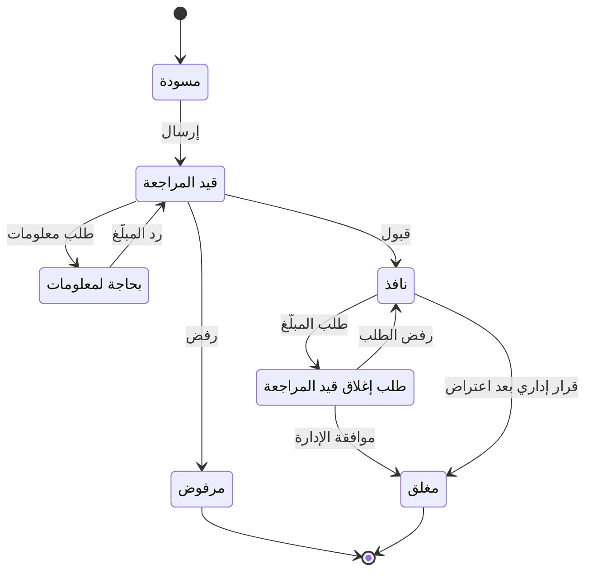

# 06 — قواعد العمل

القيم المعلَّمة بـ ⚙️ افتراضية، ويمكن تعديلها من إعدادات لوحة الإدارة دون تعديل الكود.

---

## 1. المعرّفات (IMEI والرقم التسلسلي)

| القاعدة | التفصيل |
|---|---|
| الصيغة | IMEI يتكون من 15 خانة رقمية بعد إزالة المسافات والشرطات وتحويل الأرقام العربية إلى إنكليزية |
| خانة التحقق | الخانة الأخيرة تُتحقق بخوارزمية Luhn، والرقم الذي يفشل يُرفض كـ«رقم غير صالح» |
| TAC | أول 8 خانات تحدد الماركة والموديل. إن لم يُعرف الموديل يُقبل الرقم دون عرضه |
| الأجهزة ثنائية الشريحة | للجهاز معرّفان IMEI. كلاهما يُسجَّل ويرتبط بالجهاز نفسه، والفحص بأي منهما يعطي النتيجة نفسها |
| الرقم التسلسلي | لأجهزة آبل يُسجَّل الرقم التسلسلي كمعرّف إضافي، ويمكن الفحص به |
| التفرّد | المعرّف الواحد ينتمي لجهاز واحد فقط في المنصة. محاولة ربطه بجهاز آخر تُنشئ تعارضاً للإدارة |
| عدم تطابق الموديل | إذا اختلف الموديل الذي يؤكده المحل عن موديل TAC، يُعلَّم كمؤشر محتمل على تلاعب بالرقم |

## 2. حالات الجهاز العامة (ما يراه الفاحص)

| الحالة | متى |
|---|---|
| لا توجد بلاغات فعّالة | لا يوجد بلاغ نافذ على أي من معرّفات الجهاز (بما فيها حالة وجود بلاغ قيد المراجعة) |
| مبلّغ عنه: مسروق | يوجد بلاغ نافذ من نوع «مسروق» |
| مبلّغ عنه: مفقود | يوجد بلاغ نافذ من نوع «مفقود» |
| رقم غير صالح | الرقم لا يطابق الصيغة أو يفشل في Luhn |

## 3. دورة حياة البلاغ

| الحالة | المعنى | ظاهر للعامة؟ |
|---|---|---|
| مسودة | بدأه المبلّغ ولم يرسله | لا |
| قيد المراجعة | أُرسل وينتظر المشرف | لا |
| بحاجة لمعلومات | طلب المشرف معلومات إضافية | لا |
| مرفوض | رفضه المشرف مع السبب | لا |
| نافذ | قبله المشرف، ويظهر في الفحص فوراً | نعم |
| طلب إغلاق قيد المراجعة | طلب المبلّغ الإغلاق، والجهاز ما زال مبلّغاً عنه | نعم (كنافذ) |
| مغلق | أُغلق بموافقة الإدارة (تم الاسترداد، أو سحب البلاغ، أو قرار إداري بعد اعتراض) | لا |

**قواعد إضافية:**

- ⚙️ مهلة الرد على «بحاجة لمعلومات»: 14 يوماً، وبعدها يُرفض البلاغ تلقائياً بسبب «عدم الرد»، ويمكن تقديمه من جديد.
- البلاغ المرفوض لا يُعدَّل، بل يُقدَّم بلاغ جديد.
- عند قبول البلاغ: تُلغى أي شهادة فحص فعّالة للجهاز، وتُلغى طلبات نقل الملكية المعلّقة، ويُرسل الجهاز لقائمة المراقبة لدى شركات الاتصالات.

## 4. مستويات موثوقية البلاغ

تُحسب آلياً عند الإرسال، وتساعد المشرف ولا تحل محل قراره.

| المستوى | الشرط | المراجعة المتوقعة |
|---|---|---|
| 🟢 موثّق | الجهاز مسجّل باسم المبلّغ (أو هو مستخدم مفوّض عليه) عبر معاملة محل أو نقل ملكية أو تسجيل ذاتي معتمد | سريعة |
| 🟡 مدعوم | جهاز غير مسجّل، مع صورة كرتونة حيّة يطابق باركودها الرقم، ودليل إضافي واحد على الأقل (فاتورة أو صورة قديمة) | عادية |
| 🔴 ضعيف | جهاز غير مسجّل، مع صورة الكرتونة فقط، أو باركود غير مقروء | مشدّدة، ويُفضَّل طلب معلومات |
| ⛔ متعارض | الجهاز مسجّل باسم شخص آخر، أو الصورة مكررة من طلب آخر، أو الباركود لا يطابق الرقم | يُوقف البلاغ ويتطلب تحقيقاً، والقبول يحتاج مبرراً مكتوباً |

## 5. الملكية

| القاعدة | التفصيل |
|---|---|
| مالك واحد | لكل جهاز مالك حالي واحد: شخص (برقمه الوطني) أو محل (عندما يكون في مخزونه) |
| مصادر الملكية | بيع من محل، أو شراء محل من شخص (يصبح المحل مالكاً)، أو نقل ملكية بين أفراد، أو تسجيل ذاتي معتمد |
| الملكية للشخص لا للحساب | الملكية مرتبطة بالرقم الوطني، فيمكن تسجيل جهاز لمشترٍ ليس له حساب بعد |
| منع النقل | لا نقل ولا بيع لجهاز عليه بلاغ نافذ أو قيد المراجعة |
| ⚙️ مهلة قبول النقل | 72 ساعة، وبعدها يُلغى الطلب تلقائياً |
| أثر النقل | يفقد المالك السابق كل صلاحية، وتُلغى التفويضات والشهادات الفعّالة |
| المستخدم المفوّض | ⚙️ حتى 3 مفوّضين لكل جهاز، وقد يكون المفوّض قاصراً بلا هوية. يحق له **بدء** البلاغ فقط، لا النقل ولا إصدار الشهادات |
| تأكيد بلاغ المفوّض | يصل للمالك طلب تأكيد عبر واتساب. إذا لم يكن المالك موثّق الهوية بالصورة، يُطلب منه رفع صورة هويته أثناء التأكيد (D-32). ⚙️ مهلة التأكيد 48 ساعة، وبعدها يُلغى طلب البلاغ ويُبلَّغ المفوّض |
| السجل التاريخي | لا تُحذف أي ملكية سابقة، بل تُغلق بتاريخ انتهاء، فيبقى السجل الكامل متاحاً للإدارة |

## 6. المحلات

| القاعدة | التفصيل |
|---|---|
| التوثيق قبل العمل | لا يستطيع المحل تسجيل أي معاملة قبل موافقة الإدارة |
| الفحص قبل الشراء | إلزامي ويتم آلياً، ولا يمكن تجاوزه |
| منع المعاملة | يُمنع شراء أو بيع جهاز عليه بلاغ نافذ، وتُنشأ تنبيهات أمنية |
| التعارض في البيع | بيع جهاز مسجّل باسم شخص آخر ولم يمرّ بمخزون المحل يُعلَّق لمراجعة مشرف المحلات |
| بيانات البائع | الاسم الكامل والرقم الوطني وصورة الهوية **إلزامية** في الشراء من الأفراد، لأن البائع قد يكون سارقاً (D-31) |
| ⚙️ مسافة العملية | العملية التي تُنفَّذ على بُعد أكثر من 500 متر من موقع المحل الموثّق تُعلَّم للإدارة |
| ⚙️ مهلة الإلغاء الذاتي | 30 دقيقة من تسجيل المعاملة، مع ذكر السبب. وبعدها بطلب يراجعه مشرف المحلات |
| ⚙️ عدد الفحوص | 300 فحص في الساعة لكل محل (للحماية من الاستخدام كأداة مسح) |
| تعليق المحل | المحل المعلَّق لا يستطيع تسجيل معاملات، وتبقى سجلاته محفوظة، ويُبلَّغ صاحبه بالسبب |

## 7. الهوية والرقم الوطني

| القاعدة | التفصيل |
|---|---|
| الصيغة | الرقم الوطني السوري 11 خانة رقمية (يُتحقق من الصيغة فقط، دون الربط بقاعدة بيانات حكومية حالياً) |
| التفرّد | رقم وطني واحد لكل حساب. محاولة استخدام رقم مسجّل تُحال للدعم الفني |
| الربط التلقائي | تطابق الرقم الوطني ورقم الموبايل المؤكَّد مع بيانات مشترٍ في معاملة محل (AUTH-06). يتيح «أجهزتي» والنقل والشهادة، **ولا يُغني عن توثيق الهوية للبلاغ** |
| توثيق الهوية | صورة الهوية (الوجهان) **دون سيلفي**، تُلتقط مباشرة بالكاميرا من داخل المنصة لا من المعرض، ويراجعها مشرف البلاغات ويطابقها مع الاسم والرقم الوطني (D-32) |
| ما يتطلب توثيق الهوية بالصورة | تقديم البلاغ (أو تأكيد بلاغ المفوّض)، والاعتراض، والتسجيل الذاتي للأجهزة، وتسجيل محل، والعمل كموظف في محل |
| ما يكفيه الربط التلقائي | «أجهزتي»، ونقل الملكية، وشهادة الفحص، وإضافة مستخدم مفوّض |
| ⚙️ محاولات التوثيق | 3 محاولات مرفوضة، وبعدها يُحال الحساب للدعم الفني |

## 8. حدود الفحص والحماية من الإساءة

| الفاحص | ⚙️ الحد | ⚙️ تحقق «لست روبوتاً» |
|---|---|---|
| زائر (لكل عنوان شبكة أو جهاز) | 20 فحصاً في الساعة | من الفحص الرابع في الساعة |
| مستخدم مؤكَّد الرقم | 60 فحصاً في الساعة | عند الاشتباه فقط |
| محل | 300 فحص في الساعة | لا |

- تجاوز الحد يعطي رسالة «حاول لاحقاً» ويُسجَّل.
- أنماط الفحص المتسلسل (أرقام متتالية) تُعلَّم كمحاولة مسح، ويُحظر مصدرها مؤقتاً.

## 9. الإشعارات

| القاعدة | التفصيل |
|---|---|
| محتوى إشعار الفحص | الماركة والموديل والتاريخ فقط، ولا شيء عن الفاحص أو موقعه أو رقم الشريحة (D-09) |
| ⚙️ تكرار إشعار الفحص | إشعار واحد كحد أقصى كل 6 ساعات لكل جهاز، ويذكر عدد الفحوص في الفترة |
| ⚙️ صلاحية رمز التحقق | 5 دقائق، وحتى 5 محاولات إدخال، وحتى 5 رموز في الساعة لكل رقم |
| إشعارات الإدارة العاجلة | تُرسل فوراً دون تجميع |

## 10. شهادة الفحص

| القاعدة | التفصيل |
|---|---|
| من يصدرها | المالك المسجّل فقط |
| الشرط | لا بلاغ نافذ ولا قيد المراجعة |
| ⚙️ الصلاحية | 30 يوماً |
| الحالة اللحظية | صفحة الشهادة تعرض دائماً الحالة الحالية، لا حالة يوم الإصدار فقط |
| الإلغاء التلقائي | عند نقل الملكية، أو تقديم بلاغ، أو انتهاء الصلاحية |

## 11. الأدلة والصور

| القاعدة | التفصيل |
|---|---|
| الصيغ | JPG وPNG وHEIC للصور، وPDF للمستندات |
| الحجم | تُضغط الصور على جهاز المستخدم قبل الرفع (⚙️ أقصى بُعد 2000 بكسل)، ⚙️ وأقصى حجم للملف 10 ميغابايت |
| ⚙️ رمز الصورة الحيّة | صالح 15 دقيقة، ويُلتقط من الكاميرا داخل المنصة، لا من معرض الصور |
| التكرار | لكل صورة بصمة، والصورة المطابقة أو شبه المطابقة لصورة في طلب آخر تُعلَّم |
| الخصوصية | الصور لا تُعرض للعامة أبداً، وتُفتح للإدارة بروابط مؤقتة |

## 12. التكامل مع شركات الاتصالات

| القاعدة | التفصيل |
|---|---|
| الإضافة للمراقبة | عند قبول البلاغ (نافذ) |
| ⚙️ الحظر | بعد أول حدث استخدام على الشبكة، وفاصل الحظر الافتراضي: فوراً |
| تأجيل الحظر | بقرار مشرف مع السبب والمدة، بطلب من قوى الأمن. وعند انتهاء المدة يُطلب الحظر تلقائياً |
| فك الحظر | تلقائياً عند إغلاق البلاغ أو إلغائه |
| الجهاز الذي لم يتصل بالشبكة | يبقى في قائمة المراقبة ما دام البلاغ نافذاً |
| ⚙️ المطابقة الدورية | يومياً مع كل شركة |
| حدود الحظر | الحظر يشمل الشبكات السورية فقط، ولا يمنع استخدام الجهاز على الواي فاي أو على شبكات خارج سوريا |

## 13. المخالفات والعقوبات

| المخالفة | الإجراء |
|---|---|
| بلاغ كاذب مثبت | إغلاق البلاغ، وحظر الحساب نهائياً، وإمكانية إحالة الملف لقوى الأمن |
| تلاعب بالأدلة (صور معدّلة أو مكررة) | رفض الطلب، وتعليق الحساب للتحقيق |
| محل لا يسجّل معاملاته أو يسجّل بيانات وهمية | تعليق المحل، وإبلاغ قوى الأمن حسب الاتفاق |
| محاولة مسح قاعدة البيانات | حظر المصدر |

## 14. الصيغ القانونية الثابتة

- نتيجة الفحص السليمة: «لا توجد بلاغات فعّالة على هذا الرقم في قاعدة بيانات المنصة حتى تاريخه. هذه النتيجة لا تُعد ضماناً لمصدر الجهاز.»
- إقرار المبلّغ: «أُقرّ بأن المعلومات والأدلة المقدّمة صحيحة، وبأنني أتحمّل المسؤولية القانونية الكاملة عن أي بلاغ كاذب.»
- تذييل الفاتورة: «فاتورة موثّقة عبر المنصة. تحقّق من صحتها بمسح رمز QR.»

> الصيغ النهائية تخضع لمراجعة المحامي.
