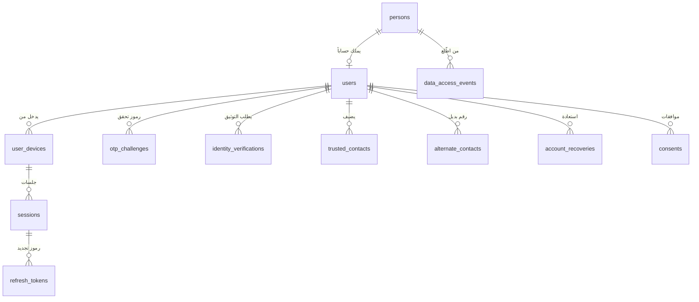
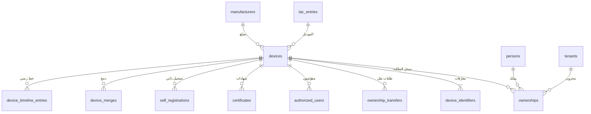
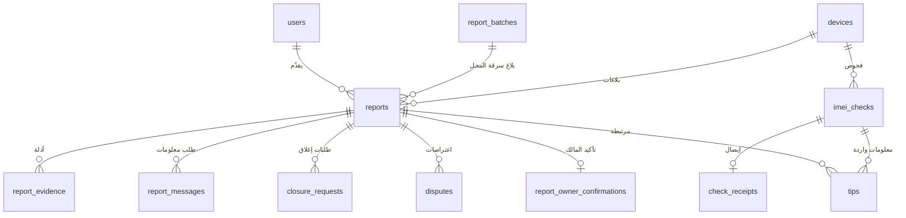
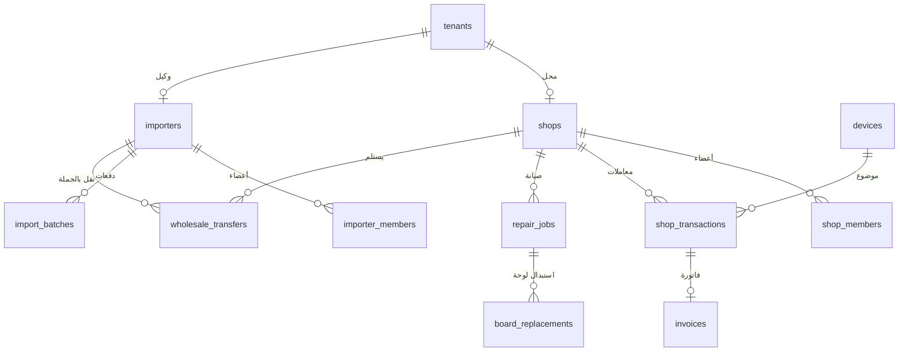
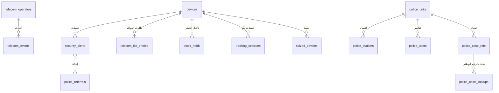
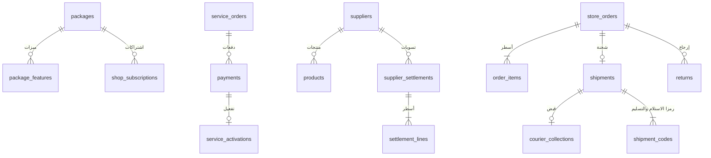
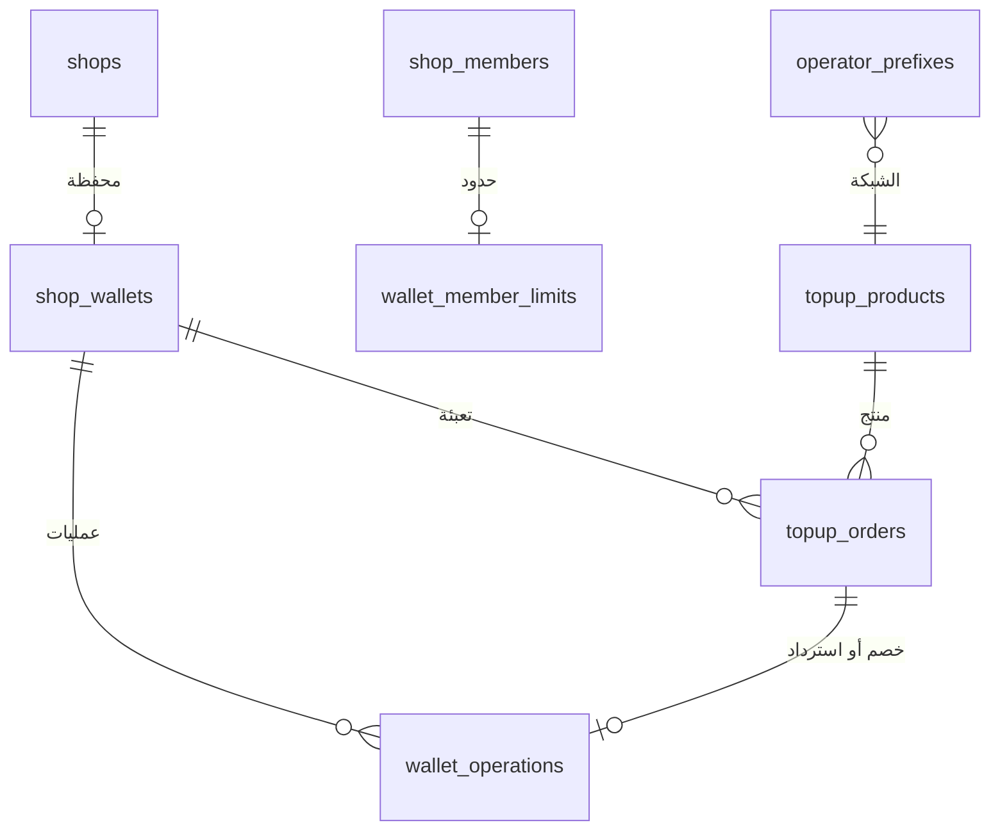
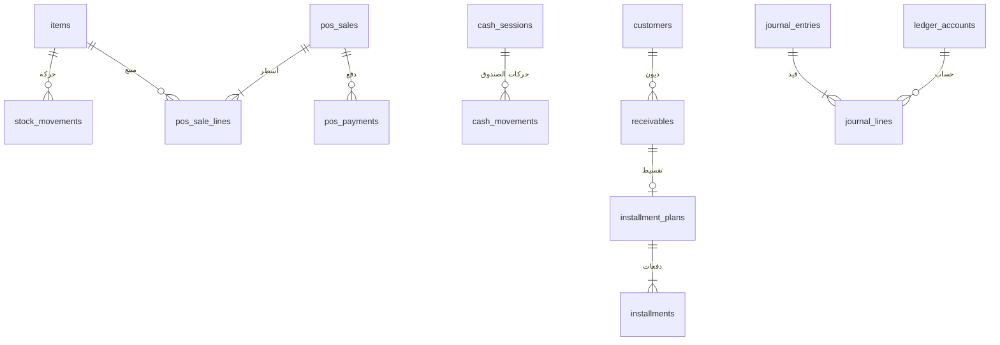
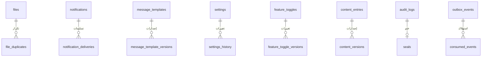

# 09 — نموذج البيانات

> النموذج الفيزيائي الكامل لقاعدة بيانات المنصة: كل جدول بأعمدته وأنواعها وقابليتها للفراغ وقيودها وفهارسها، مع علامات التشفير والمواقع والعزل، والمتطلبات التي يخدمها. أسماء الجداول والحقول بالإنكليزية لأنها تُستخدم كما هي في الكود والترحيلات. ويُقرأ مع [التصميم التقني](19-technical-design.md) الذي يحدد آلات الحالة والصلاحيات والعزل والأحداث التي تعمل على هذه الجداول، ومع [الخصوصية وتقييم الأثر](21-privacy-dpia.md) الذي يحدد مدد الاحتفاظ.

---

## 1. الاصطلاحات

### 1.1 المخططات

| المخطط | المحتوى | من يصل إليه |
|---|---|---|
| `app` | الكيانات الأساسية: الحسابات، والأجهزة، والملكية، والبلاغات، والمحلات، والتكاملات، والإدارة، والأمن، والإشعارات، والخصوصية | أدوار التشغيل حسب [التصميم التقني §6.2](19-technical-design.md) |
| `commerce` | الخدمات التجارية: الباقات، والمدفوعات، والمتجر، والمورّدون، والشحن، والتسويات، والمحفظة، والتعبئة، والإعلانات، والربط البرمجي | **لا وصول لدور بوابة الأمن** (D-83) |
| `shoppro` | المحاسبة وإدارة المحل (D-92) | المحل نفسه فقط، والقيود الآلية بدور `shoppro_system`. **لا وصول لأحد من المنصة أبداً**: لا الإدارة ولا الدعم ولا المبرمجون ولا الأمن ولا التقارير، ولا حتى بإذن صاحب المحل (D-101) |
| `geo_private` | المواقع الدقيقة للأشخاص والأجهزة (07 §2) | الإدارة والأمن ضمن النطاق قراءةً، والواجهة العامة إدراجاً فقط |
| `audit` | سجل التدقيق وختمه | إدراج فقط لكل الأدوار، وقراءة لشاشة التدقيق |
| `ops` | صندوق الصادر، ومفاتيح عدم التكرار، والمؤقّتات، والرسائل الواردة، والمطابقات، وسجلات التشغيل | أدوار التشغيل حسب الحاجة |

أسماء الجداول دون بادئة في هذه الوثيقة تعني المخطط `app`.

### 1.2 الأنواع والأعمدة القياسية

| النوع | الاستخدام |
|---|---|
| `uuid` | المفاتيح الأساسية والأجنبية، UUIDv7 يولّده التطبيق (ADR-15) |
| `timestamptz` | كل الأوقات بتوقيت UTC |
| `date` | التواريخ المجرّدة بتقويم دمشق |
| `text` | النصوص، مع قيد `CHECK` للصيغ (IMEI، والمراجع، والرموز) |
| `citext` | أسماء الدخول للموظفين |
| `bigint` بلاحقة `_minor` | المبالغ بأصغر وحدة حسب ISO 4217، ومعها `currency char(3)` |
| `bytea` بلاحقة `_enc` | الحقول المشفّرة 🔐 بصيغة الظرف في [التصميم التقني §17.5](19-technical-design.md) |
| `bytea` بلاحقة `_bidx` | بصمة البحث #️⃣ (HMAC-SHA256، 32 بايت) |
| `text` بلاحقة `_mask` | نص مخفي جزئياً للعرض مثل `01*******89` |
| `geography(Point,4326)` | النقاط 📍 بالأمتار |
| `geometry(MultiPolygon,4326)` | مضلّعات المحافظات والمناطق |
| `jsonb` | الملخصات واللقطات والإعدادات المرنة فقط، لا لبيانات يُبحث فيها بانتظام |
| أنواع القيم (enum) | كل عمود حالة أو نوع `text` بقيد `CHECK` على القائمة المذكورة، لتسهيل إضافة قيمة بترحيل توسيع (ADR-03) |

**الأعمدة القياسية** تُذكر في رأس كل جدول ولا تتكرر في جدوله:

| الوسم | الأعمدة |
|---|---|
| «قياسية» | `id uuid PK`، و`created_at timestamptz NOT NULL DEFAULT now()`، و`updated_at timestamptz NOT NULL`، و`version int NOT NULL DEFAULT 1` (للتزامن المتفائل، [التصميم التقني §3.7](19-technical-design.md)) |
| «ثابتة» | `id uuid PK`، و`created_at timestamptz NOT NULL DEFAULT now()` فقط: جدول للإضافة، وأي تصحيح يكون بصف جديد |
| «مقسّم» | الجدول مقسّم زمنياً بعمود الوقت المذكور، والمفتاح الأساسي يضمّه، والتفاصيل في §17 |

### 1.3 الرموز

| الرمز | المعنى |
|---|---|
| 🔐 | حقل مشفّر في التطبيق بـ AES-256-GCM (ADR-07). لا يُقرأ في SQL، ولا يُفهرس إلا عبر بصمته |
| #️⃣ | بصمة بحث للمطابقة التامة دون فك التشفير |
| 📍 | موقع دقيق. مواقع الأشخاص والأجهزة في `geo_private` فقط، وموقع المحل أو الوكيل التجاري في جدوله لأنه عنوان عمل يراجعه المشرف |
| RLS | الجدول معزول بـ Row-Level Security بالعمود المذكور ([التصميم التقني §6](19-technical-design.md)) |
| نطاق الأمن | للجدول سياسة قراءة لدور بوابة الأمن بالمحافظة ([التصميم التقني §5.6](19-technical-design.md)) |
| FK | مفتاح أجنبي إلى الجدول المذكور. وكل مفتاح أجنبي مفهرس |

### 1.4 قواعد عامة

- **لا حذف** للكيانات الأساسية (الملكية، والمعاملات، والبلاغات، والفحوص، والقرارات، والتنبيهات، والمدفوعات، والقيود المحاسبية). الحذف الفعلي فقط بمحرك الاحتفاظ (§17).
- الفهارس المذكورة في نهاية كل جدول هي الإضافية على المفتاح الأساسي والمفاتيح الأجنبية. وصيغة الاسم: `uq_` للفريد، و`ix_` للعادي، و`px_` للجزئي.
- الأسماء العربية المطبَّعة للبحث في أعمدة `*_norm` تُحدَّث بمحفّز بقواعد التطبيع في [التصميم التقني §16.2](19-technical-design.md)، وعليها فهرس GIN بـ `gin_trgm_ops`.
- كل جدول فيه `status` يتغير عبر آلة الحالة في [التصميم التقني §8](19-technical-design.md)، ويُكتب كل انتقال في `state_transitions` (§16.4).
- هذا الإصدار يحل محل التصميم المبدئي، وكل ما فيه باقٍ بالأسماء نفسها عدا ما يلي:

| في التصميم المبدئي | في هذا النموذج |
|---|---|
| `shop_documents` | `tenant_documents` لكل أنواع المستأجرين |
| `telecom_list_entries` (الطلبات) | الاسم نفسه للطلبات، ومعه `telecom_list_states` للحالة المطلوبة والمؤكدة |
| `telecom_location_updates` | `geo_private.telecom_location_updates` |
| `audit_logs` | `audit.audit_logs` مع `audit.seals` و`audit.anchors` |
| `gsma_checks` و`customs_lookups` | `gsma_cache` و`customs_cache` |
| `store_orders` و`store_order_items` | `commerce.store_orders` و`commerce.order_items` |
| `ad_stats` | `commerce.ad_stats_daily` |
| `subscription_plans` و`subscriptions` | `commerce.packages` و`commerce.package_features` و`commerce.shop_subscriptions` و`commerce.api_subscriptions` (D-93) |
| `api_usage` | `commerce.api_usage_events` و`commerce.api_usage_daily` |
| `shoppro_*` | المخطط `shoppro` (D-92) |
| `police_units` (الجهة) | بالمعنى نفسه، ومعه `police_stations` للأقسام |

## 2. المخطط العام

مخططات صغيرة حسب المجال، والعلاقات الكاملة في جداول الأقسام التالية.

### 2.1 الحسابات والهوية

### 2.2 الأجهزة والملكية

### 2.3 البلاغات والفحوص

### 2.4 المستأجرون وعمليات المحل

### 2.5 التنبيهات والاتصالات والتتبّع والأمن

### 2.6 الباقات والمدفوعات والمتجر

### 2.7 المحفظة وتعبئة الرصيد

### 2.8 المحاسبة وإدارة المحل (`shoppro`)

### 2.9 البنية المشتركة

## 3. المرجعيات والجغرافيا

### 3.1 `governorates` — المحافظات
**ثابتة جزئياً** (المفتاح `smallint` من 1 إلى 14) · **المتطلبات:** GEO-01، ROLLOUT-02، D-80

| العمود | النوع | فارغ | القيود والوصف |
|---|---|---|---|
| id | smallint | لا | PK |
| code | text | لا | فريد، رمز لاتيني ثابت |
| name_ar | text | لا | الاسم المعروض |
| sort | smallint | لا | ترتيب العرض |
| polygon | geometry(MultiPolygon,4326) | لا | الحدود الإدارية (§15.2 في 19) |
| polygon_version | int | لا | إصدار المضلّع المبذور |
| centroid | geography(Point,4326) | لا | — |
| updated_at | timestamptz | لا | — |

**الفهارس:** `ix_governorates_polygon` (GiST).

### 3.2 `areas` — المناطق
**قياسية** (المفتاح `int`) · **المتطلبات:** GEO-01، GEO-05، 07 §2

| العمود | النوع | فارغ | القيود والوصف |
|---|---|---|---|
| governorate_id | smallint | لا | FK → governorates |
| name_ar | text | لا | — |
| name_norm | text | لا | للبحث |
| polygon | geometry(MultiPolygon,4326) | نعم | إن توفر |
| centroid | geography(Point,4326) | لا | يُستخدم عند تخفيض دقة المواقع |
| active | boolean | لا | — |

**الفهارس:** `uq_areas_gov_name (governorate_id, name_ar)`، و`ix_areas_polygon` (GiST)، و`ix_areas_name_norm` (trgm).

### 3.3 `manufacturers` — الشركات المصنّعة
**قياسية** (المفتاح `int`) · **المتطلبات:** SERIAL-01، SERIAL-02، CHECK-01، D-91

| العمود | النوع | فارغ | القيود والوصف |
|---|---|---|---|
| name | text | لا | فريد، الاسم اللاتيني |
| name_ar | text | لا | — |
| serial_pattern | text | نعم | ⚙️ تعبير صيغة الرقم التسلسلي، يُختبر بمحرّك خطّي قبل الحفظ |
| serial_hint_content_key | text | نعم | مفتاح محتوى إرشاد مكان الرقم (SERIAL-02) |
| device_kinds | text[] | لا | من `phone`، `laptop`، `desktop`، `tablet`، `watch`، `other` |
| active | boolean | لا | — |

### 3.4 `tac_entries` — قاعدة TAC
**المفتاح:** `tac char(8)` · **المتطلبات:** CHECK-04، FAKE-01، FAKE-02، 06 §1، R-16

| العمود | النوع | فارغ | القيود والوصف |
|---|---|---|---|
| tac | char(8) | لا | PK، أرقام فقط |
| manufacturer_id | int | نعم | FK → manufacturers |
| brand | text | لا | — |
| model | text | لا | — |
| marketing_name | text | نعم | — |
| device_kind | text | لا | — |
| allocated | boolean | لا | مخصص في GSMA. `false` يعطي تحذير التقليد |
| source | text | لا | `gsma`، `open_db`، `shop_confirmed`، `manual` |
| confirmations_count | int | لا | تأكيدات المحلات (للتعلّم) |
| confirmed | boolean | لا | اعتمده مشرف |
| updated_at | timestamptz | لا | — |

### 3.5 `shop_activity_types` — أنواع نشاط المحل
**المفتاح:** `code text` · **المتطلبات:** D-90، SHOP-01، 06 §6

| العمود | النوع | فارغ | القيود والوصف |
|---|---|---|---|
| code | text | لا | PK: `trade` (بيع وشراء أجهزة)، `repair` (صيانة)، `telecom_services` (خدمات اتصالات وإكسسوارات)، `computers` (حواسيب) |
| name_ar | text | لا | — |
| allows_device_trade | boolean | لا | `repair` وحده لا يسمح إلا بشراء «للقطع» |
| sort | smallint | لا | — |
| active | boolean | لا | — |

### 3.6 مخطط `geo_private` — المواقع الدقيقة

كل جداول هذا المخطط: **الواجهة العامة إدراج فقط**، والإدارة قراءة، والأمن قراءة بنطاق المحافظة (نطاق الأمن). **المتطلبات:** 07 §2، GEO-02..07، D-46، CT-30.

**`geo_private.check_locations`** — موقع الفحص · **مقسّم** شهرياً بـ `checked_at`

| العمود | النوع | فارغ | القيود والوصف |
|---|---|---|---|
| check_id | uuid | لا | PK مع `checked_at`، FK منطقي → imei_checks |
| checked_at | timestamptz | لا | مفتاح التقسيم |
| point 📍 | geography(Point,4326) | نعم | يُفرَّغ عند تخفيض الدقة |
| accuracy_m | int | نعم | — |
| source | text | لا | `gps`، `whatsapp_share` |
| governorate_id | smallint | نعم | FK → governorates |
| area_id | int | نعم | FK → areas |
| precision_level | text | لا | `exact`، `area` |
| precision_reduced_at | timestamptz | نعم | بعد 90 يوماً ⚙️ لما لا يرتبط ببلاغ |
| report_linked | boolean | لا | يمنع التخفيض ما دام البلاغ قائماً |

**الفهارس:** `ix_check_locations_point` (GiST)، و`px_check_locations_reduce (checked_at) WHERE precision_level='exact' AND NOT report_linked`.

**`geo_private.operation_locations`** — موقع عمليات المحل · **ثابتة** · **المتطلبات:** SHOP-14، GEO-04، D-41

| العمود | النوع | فارغ | القيود والوصف |
|---|---|---|---|
| subject_type | text | لا | `shop_transaction`، `repair_job`، `board_replacement`، `topup` |
| subject_id | uuid | لا | — |
| tenant_id | uuid | لا | FK → tenants |
| point 📍 | geography(Point,4326) | لا | — |
| accuracy_m | int | لا | — |
| distance_from_shop_m | int | لا | [التصميم التقني §15.4](19-technical-design.md) |
| out_of_range | boolean | لا | — |
| low_accuracy | boolean | لا | — |
| captured_at | timestamptz | لا | وقت الجهاز |

**الفهارس:** `uq_operation_locations_subject (subject_type, subject_id)`، و`ix_operation_locations_point` (GiST).

**`geo_private.incident_locations`** — نقطة الحادثة الاختيارية · **المفتاح:** `report_id` · **المتطلبات:** REPORT-02، GEO-05

| العمود | النوع | فارغ | القيود والوصف |
|---|---|---|---|
| report_id | uuid | لا | PK، FK → reports |
| point 📍 | geography(Point,4326) | لا | — |
| created_at | timestamptz | لا | — |

**`geo_private.findmy_locations`** — آخر موقع من صاحب الجهاز · **ثابتة** · **المتطلبات:** REPORT-16، TRACK-02

| العمود | النوع | فارغ | القيود والوصف |
|---|---|---|---|
| report_id | uuid | لا | FK → reports |
| point 📍 | geography(Point,4326) | لا | — |
| accuracy_m | int | نعم | — |
| observed_at | timestamptz | لا | وقت الظهور في Find My |
| screenshot_file_id | uuid | لا | FK → files |

**`geo_private.telecom_location_updates`** — مواقع الشبكة · **مقسّم** شهرياً بـ `received_at` · **المتطلبات:** TELCO-02، TELCO-13، TRACK-01..04

| العمود | النوع | فارغ | القيود والوصف |
|---|---|---|---|
| id | uuid | لا | PK مع `received_at` |
| received_at | timestamptz | لا | مفتاح التقسيم |
| operator_id | uuid | لا | FK → telecom_operators |
| device_id | uuid | لا | FK → devices |
| tracking_session_id | uuid | نعم | FK → tracking_sessions |
| telecom_event_id | uuid | نعم | حدث الاستخدام المصدر |
| source | text | لا | `usage_event`، `location_update` |
| point 📍 | geography(Point,4326) | لا | الموقع التقريبي (البرج أو المنطقة) |
| radius_m | int | لا | نصف قطر الدقة (TRACK-04) |
| msisdn_enc 🔐 | bytea | نعم | رقم الشريحة (TRACK-03) |
| msisdn_bidx #️⃣ | bytea | نعم | — |
| observed_at | timestamptz | لا | وقت الرصد |
| governorate_id | smallint | نعم | محسوبة من النقطة، لنطاق الأمن |

**الفهارس:** `ix_tlu_device_time (device_id, observed_at)`، و`ix_tlu_session (tracking_session_id)`.

## 4. الأشخاص والحسابات

### 4.1 `persons` — الأشخاص الطبيعيون
**قياسية** · **المتطلبات:** AUTH-04، AUTH-06، AUTH-07، SHOP-06، SHOP-07، POLICE-03، 06 §5، 06 §7

الشخص كيان مستقل عن الحساب: من سجّله محل أو استورده الأمن موجود هنا ولو لم يفتح حساباً.

| العمود | النوع | فارغ | القيود والوصف |
|---|---|---|---|
| full_name | text | لا | آخر اسم معتمد (من التوثيق أو السجل المدني) |
| name_norm | text | لا | للبحث الإداري |
| national_id_enc 🔐 | bytea | لا | الرقم الوطني |
| national_id_bidx #️⃣ | bytea | لا | فريد |
| national_id_mask | text | لا | `01*******89` |
| phone_e164 | text | نعم | آخر رقم معروف |
| id_card_status | text | لا | `valid`، `lost`، `cancelled`، `deceased`، `unknown` (CIVIL-05) |
| id_card_status_checked_at | timestamptz | نعم | — |
| civil_verified_at | timestamptz | نعم | آخر مطابقة ناجحة |
| source | text | لا | `account`، `shop_transaction`، `repair_intake`، `police_import`، `on_behalf`، `seizure` |

**الفهارس:** `uq_persons_national_id (national_id_bidx)`، و`ix_persons_name_norm` (trgm)، و`ix_persons_phone (phone_e164)`.

### 4.2 `users` — حسابات الجمهور
**قياسية** · **المتطلبات:** AUTH-01..12، THEFT-03، THEFT-06، ROLLOUT-01، PRIV-02، PRIV-09، D-81

| العمود | النوع | فارغ | القيود والوصف |
|---|---|---|---|
| account_number | text | لا | فريد، `^SY-[2-9A-HJKMNPQRTUVWXY]{6}$` (AUTH-12) |
| person_id | uuid | نعم | FK → persons، فريد (حساب واحد لكل رقم وطني) |
| phone_e164 | text | لا | فريد، `^\+9639\d{8}$` |
| phone_verified_at | timestamptz | نعم | — |
| phone_compromised_at | timestamptz | نعم | الرقم في جهاز مسروق (THEFT-03): لا رسائل ولا رموز إليه |
| phone_restored_at | timestamptz | نعم | — |
| password_hash | text | لا | Argon2id |
| password_changed_at | timestamptz | لا | — |
| governorate_id | smallint | نعم | FK → governorates |
| status | text | لا | `pending_phone`، `active`، `suspended`، `banned`، `closing`، `closed` |
| status_reason | text | نعم | — |
| identity_status | text | لا | `none`، `pending`، `verified`، `rejected` |
| identity_rejections | smallint | لا | 3 ⚙️ تحيل للدعم |
| auto_linked_at | timestamptz | نعم | الربط التلقائي (AUTH-06) |
| cooldown_until | timestamptz | نعم | فترة التهدئة 72 ساعة ⚙️ |
| frozen_by_owner_at | timestamptz | نعم | «لم أكن أنا» |
| login_locked_at | timestamptz | نعم | قفل الحساب كله بعد ⚙️ 20 إخفاقاً خلال 24 ساعة من أي مصادر، ويُفك بإعادة تعيين كلمة المرور برمز. والقفل لكل مصدر (15 دقيقة ثم ساعة ⚙️) في Redis بمفتاح (الحساب، المصدر) لا هنا ([التصميم التقني §4.2.3](19-technical-design.md)) |
| minor_managed | boolean | لا | قاصر بإدارة وليّ الأمر (PRIV-09) |
| age_confirmed_at | timestamptz | نعم | إقرار «18 سنة أو أكثر» (21 §10) |
| created_via | text | لا | `self`، `on_behalf`، `member_invite` |
| invite_id | uuid | نعم | FK → rollout_invites |
| closure_requested_at | timestamptz | نعم | — |
| closed_at | timestamptz | نعم | — |
| authz_version | int | لا | يرتفع مع كل تغيير صلاحيات |
| last_login_at | timestamptz | نعم | — |

**الفهارس:** `uq_users_account_number`، و`uq_users_phone`، و`uq_users_person (person_id) WHERE person_id IS NOT NULL`، و`ix_users_status (status)`.

### 4.3 `user_devices` — أجهزة الدخول
**قياسية** · **المتطلبات:** AUTH-08، 07 §5، CT-11

| العمود | النوع | فارغ | القيود والوصف |
|---|---|---|---|
| user_id | uuid | لا | FK → users |
| client_device_id | uuid | لا | يولّده التطبيق أو الموقع |
| platform | text | لا | `web`، `ios`، `android` |
| distribution_channel | text | نعم | `play`، `app_store`، `direct_apk` |
| device_model | text | نعم | — |
| os_version | text | نعم | — |
| app_version | text | نعم | — |
| public_key | bytea | نعم | مفتاح P-256 للجهاز (§4.2.4 في 19) |
| trusted_at | timestamptz | نعم | تأكيد الجهاز برمز |
| push_token | text | نعم | — |
| push_provider | text | نعم | `apns`، `fcm` |
| last_seen_at | timestamptz | لا | — |
| revoked_at | timestamptz | نعم | — |

**الفهارس:** `uq_user_devices (user_id, client_device_id)`.

### 4.4 `sessions` — جلسات الجمهور
**قياسية** (المعرّف هو `sid` في رمز الدخول) · **المتطلبات:** AUTH-08، THEFT-04، TRUSTED-02

| العمود | النوع | فارغ | القيود والوصف |
|---|---|---|---|
| user_id | uuid | لا | FK → users |
| user_device_id | uuid | نعم | FK → user_devices. فارغ لجلسة `theft_report` |
| last_used_at | timestamptz | لا | — |
| expires_at | timestamptz | لا | 30 يوماً ⚙️ من آخر تجديد |
| step_up_at | timestamptz | نعم | آخر إعادة تحقق |
| tenant_context_id | uuid | نعم | آخر سياق مستأجر مختار (للعرض فقط) |
| scope | text | لا | `full`، `theft_report` (جلسة «بلاغ السرقة فقط» دون جهاز موثّق، [التصميم التقني §4.2.13](19-technical-design.md)) |
| client_kind | text | لا | `app`، `web_bff` (الموقع: الرموز عند خادم Next.js) |
| ip | inet | نعم | حساسة بتشفير التخزين، ويُحذف بالاحتفاظ |
| governorate_hint | smallint | نعم | للعرض في قائمة الجلسات |
| revoked_at | timestamptz | نعم | — |
| revoke_reason | text | نعم | `logout`، `logout_others`، `password_changed`، `phone_changed`، `recovery`، `reuse_detected`، `theft_protection`، `trusted_contact_report`، `suspended`، `not_me`، `member_removed` |

**الفهارس:** `px_sessions_active (user_id) WHERE revoked_at IS NULL`.

### 4.5 `refresh_tokens` — رموز التجديد
**ثابتة** (مع تحديث `used_at`) · **المتطلبات:** AUTH-02، CT-09

| العمود | النوع | فارغ | القيود والوصف |
|---|---|---|---|
| session_id | uuid | لا | FK → sessions |
| token_hash | bytea | لا | فريد، SHA-256 للرمز |
| parent_id | uuid | نعم | FK ذاتي |
| issued_at | timestamptz | لا | — |
| expires_at | timestamptz | لا | — |
| used_at | timestamptz | نعم | — |
| replaced_by_id | uuid | نعم | FK ذاتي |
| reuse_detected_at | timestamptz | نعم | — |

**الفهارس:** `uq_refresh_tokens_hash (token_hash)`، و`ix_refresh_tokens_session (session_id)`.

### 4.6 `otp_challenges` — رموز التحقق
**ثابتة** (مع تحديث العدّادات) · **المتطلبات:** AUTH-01، AUTH-03، AUTH-09، OWN-04، THEFT-02، 06 §9

| العمود | النوع | فارغ | القيود والوصف |
|---|---|---|---|
| user_id | uuid | نعم | FK → users (فارغ قبل إنشاء الحساب) |
| target_enc 🔐 | bytea | لا | الرقم الوجهة |
| target_bidx #️⃣ | bytea | لا | لحد الرموز لكل رقم |
| purpose | text | لا | `sign_up`، `login_new_device`، `password_reset`، `phone_change_old`، `phone_change_new`، `transfer_confirm`، `step_up`، `phone_restore`، `alternate_verify`، `trusted_invite`، `wallet_withdraw`، `recovery_new_phone` |
| context_type | text | نعم | مثل `ownership_transfer` |
| context_id | uuid | نعم | — |
| code_hash | bytea | لا | HMAC للرمز |
| channel | text | لا | `whatsapp`، `sms` |
| attempts | smallint | لا | — |
| max_attempts | smallint | لا | 5 ⚙️ |
| expires_at | timestamptz | لا | 5 دقائق ⚙️ |
| resend_available_at | timestamptz | لا | 60 ثانية ⚙️ |
| consumed_at | timestamptz | نعم | — |
| invalidated_at | timestamptz | نعم | — |
| notification_id | uuid | نعم | — |

**الفهارس:** `ix_otp_target_time (target_bidx, created_at)`، و`px_otp_open (user_id, purpose) WHERE consumed_at IS NULL AND invalidated_at IS NULL`.

### 4.7 `identity_verifications` — طلبات توثيق الهوية
**قياسية** · **المتطلبات:** AUTH-05، ADMIN-05، CIVIL-01، CIVIL-02، CIVIL-05، D-32

| العمود | النوع | فارغ | القيود والوصف |
|---|---|---|---|
| user_id | uuid | لا | FK → users |
| declared_full_name | text | لا | — |
| declared_national_id_enc 🔐 | bytea | لا | — |
| declared_national_id_bidx #️⃣ | bytea | لا | لمنع استخدام رقم مسجّل (06 §7) |
| extra_field_kind | text | نعم | `mother_name`، `birth_date` (CIVIL-01) |
| extra_field_enc 🔐 | bytea | نعم | — |
| front_file_id | uuid | لا | FK → files، التقاط حي |
| back_file_id | uuid | لا | FK → files |
| civil_match | text | لا | `match`، `no_match`، `unavailable`، `not_enabled` |
| civil_query_id | uuid | نعم | — |
| civil_card_status | text | نعم | — |
| status | text | لا | `pending`، `approved`، `rejected`، `cancelled`، `reversed` |
| assigned_admin_id | uuid | نعم | FK → admin_users |
| decided_by_admin_id | uuid | نعم | FK → admin_users |
| decided_at | timestamptz | نعم | — |
| reason_code | text | نعم | من الأسباب الجاهزة |
| reason_text | text | نعم | — |
| attempt_no | smallint | لا | — |

**الفهارس:** `px_idv_pending (user_id) WHERE status='pending'` فريد، و`ix_idv_queue (status, created_at)`.

### 4.8 `alternate_contacts` — الأرقام البديلة
**قياسية** · **المتطلبات:** THEFT-02، TRUSTED-02، D-81

| العمود | النوع | فارغ | القيود والوصف |
|---|---|---|---|
| user_id | uuid | لا | FK → users |
| report_id | uuid | نعم | FK → reports |
| phone_enc 🔐 | bytea | لا | للإشعارات فقط، لا يُستخدم في أي مسار دخول أو استعادة |
| phone_bidx #️⃣ | bytea | لا | — |
| phone_mask | text | لا | — |
| source | text | لا | `self`، `trusted_contact` |
| added_by_user_id | uuid | لا | FK → users |
| verified_at | timestamptz | نعم | — |
| active | boolean | لا | — |
| deactivated_at | timestamptz | نعم | عند استعادة الرقم الأصلي |

**الفهارس:** `px_alternate_active (user_id) WHERE active` فريد.

### 4.9 `trusted_contacts` — الجهات الموثوقة
**قياسية** · **المتطلبات:** TRUSTED-01..05، 06 §3.2

| العمود | النوع | فارغ | القيود والوصف |
|---|---|---|---|
| user_id | uuid | لا | FK → users (صاحب الحساب) |
| contact_user_id | uuid | نعم | FK → users، بعد القبول |
| invited_phone_e164 | text | لا | — |
| display_name | text | لا | — |
| status | text | لا | `invited`، `active`، `declined`، `expired`، `removed` |
| expires_at | timestamptz | نعم | الدعوة 7 أيام ⚙️ |
| responded_at | timestamptz | نعم | — |
| removed_at | timestamptz | نعم | — |

**الفهارس:** `px_trusted_open (user_id, invited_phone_e164) WHERE status IN ('invited','active')` فريد، وحد 3 ⚙️ يُفرض بقفل على صف المستخدم.

### 4.10 `account_recoveries` — استعادة الحساب بالهوية
**قياسية** · **المتطلبات:** THEFT-06، THEFT-07، AUTH-09، D-81، CT-07، CT-12

| العمود | النوع | فارغ | القيود والوصف |
|---|---|---|---|
| user_id | uuid | لا | FK → users (يُحدَّد من رقم الحساب أو `SY-` المدخل، والرد للمستخدم محايد دائماً) |
| initiated_by_type | text | لا | `self` (يبدأها المستخدم دون جلسة، THEFT-06)، `support` |
| kind | text | لا | `identity_recovery`، `assisted_phone_change`، `phone_restore` (رفع إيقاف الرسائل عن الرقم الأصلي بالهوية L3)، `unfreeze` (فك تجميد «لم أكن أنا» بالهوية) |
| support_ticket_id | uuid | لا | FK → support_tickets |
| new_phone_e164 | text | نعم | `CHECK (kind IN ('phone_restore','unfreeze') OR new_phone_e164 IS NOT NULL)` |
| new_phone_verified_at | timestamptz | نعم | رمز `recovery_new_phone`، إلزامي للبدء الذاتي |
| recovery_token_hash | bytea | نعم | فريد. رمز الاستعادة المعتم (256 بت) في التطبيق: يسمح برموز الالتقاط ورفع الهوية ومتابعة الحالة فقط، ولا جلسة |
| recovery_token_expires_at | timestamptz | نعم | ⚙️ 72 ساعة |
| notice_sent_at | timestamptz | نعم | إشعار ⚙️ 24 ساعة قبل التنفيذ مع «لم أكن أنا» |
| id_front_file_id | uuid | نعم | FK → files |
| id_back_file_id | uuid | نعم | FK → files |
| civil_match | text | نعم | — |
| initiated_by_admin_id | uuid | نعم | FK → admin_users. فارغ للبدء الذاتي. `CHECK ((initiated_by_type = 'self') = (initiated_by_admin_id IS NULL))` |
| reviewed_by_admin_id | uuid | نعم | موظف الدعم المراجع |
| approved_by_admin_id | uuid | نعم | `CHECK (approved_by_admin_id <> reviewed_by_admin_id AND approved_by_admin_id IS DISTINCT FROM initiated_by_admin_id)` |
| status | text | لا | `requested`، `under_review`، `approved`، `waiting`، `executed`، `rejected`، `cancelled`، `expired` |
| execute_after | timestamptz | نعم | 24 ساعة ⚙️ بعد الموافقة |
| executed_at | timestamptz | نعم | — |
| reason_text | text | نعم | — |

### 4.11 `phone_changes` — تغييرات الرقم
**ثابتة** · **المتطلبات:** AUTH-09

| العمود | النوع | فارغ | القيود والوصف |
|---|---|---|---|
| user_id | uuid | لا | FK → users |
| old_phone_e164 | text | لا | — |
| new_phone_e164 | text | لا | — |
| method | text | لا | `self_otp`، `recovery` |
| account_recovery_id | uuid | نعم | — |
| old_verified_at | timestamptz | نعم | — |
| new_verified_at | timestamptz | نعم | — |
| completed_at | timestamptz | نعم | — |

## 5. الإدارة والصلاحيات وقوائم العمل

### 5.1 `admin_users` — حسابات الإدارة
**قياسية** · **المتطلبات:** AUTH-11، ADMIN-14، D-78، 03 §4

| العمود | النوع | فارغ | القيود والوصف |
|---|---|---|---|
| username | citext | لا | فريد |
| full_name | text | لا | — |
| work_phone_e164 | text | نعم | — |
| work_email | text | نعم | — |
| own_national_id_bidx #️⃣ | bytea | نعم | لتعارض المصالح مع طلباته هو |
| password_hash | text | لا | Argon2id، 12 حرفاً ⚙️ |
| status | text | لا | `invited`، `active`، `suspended`، `disabled` (بعد ⚙️ 10 إخفاقات خلال 24 ساعة، يفكّه المدير العام) |
| is_break_glass | boolean | لا | حساب الطوارئ المختوم (D-102): واحد فقط، `CHECK` بفهرس فريد جزئي، وأي دخول به ينبّه الجميع |
| ip_allowlist | cidr[] | نعم | — |
| failed_login_count | smallint | لا | — |
| locked_until | timestamptz | نعم | 15 دقيقة ثم ساعة ⚙️ |
| coi_declared_at | timestamptz | نعم | إقرار تعارض المصالح |
| authz_version | int | لا | — |
| created_by_admin_id | uuid | نعم | FK ذاتي |
| last_login_at | timestamptz | نعم | — |

### 5.2 `roles` — الأدوار
**قياسية** · **المتطلبات:** D-78، SMART-03، REVERSAL-02

| العمود | النوع | فارغ | القيود والوصف |
|---|---|---|---|
| key | text | لا | فريد: `general_manager`، `reports_supervisor`، `shops_supervisor`، `support`، `commercial_supervisor`، أو مفتاح دور ديناميكي |
| name_ar | text | لا | — |
| description | text | نعم | — |
| kind | text | لا | `system_default`، `custom` |
| rank | smallint | لا | لقاعدة «مساوٍ أو أعلى» |
| archived_at | timestamptz | نعم | — |
| created_by_admin_id | uuid | نعم | — |

### 5.3 `permissions` — كتالوج الصلاحيات
**المفتاح:** `key text` · بذور فقط · **المتطلبات:** [التصميم التقني §5.9](19-technical-design.md)

| العمود | النوع | فارغ | القيود والوصف |
|---|---|---|---|
| key | text | لا | PK |
| module | text | لا | — |
| name_ar | text | لا | — |
| domain | text | لا | `admin`، `police`، `public`، `tenant`، `machine` |
| assignable | boolean | لا | قابلة للإسناد لدور ديناميكي |
| gm_only | boolean | لا | — |
| sensitive | boolean | لا | 🔒 سبب وتدقيق |
| requires_step_up | boolean | لا | — |
| four_eyes | boolean | لا | لا يُطبَّق على إجراء فاعله المدير العام، إلا التصحيحات والتسويات والاسترداد وإيقاف السحب (D-102) |
| compliance | boolean | لا | وظيفة التزام لا تخضع للباقات |
| requires_feature | text | نعم | FK → commerce.features. `CHECK (NOT (compliance AND requires_feature IS NOT NULL))` |

### 5.4 `role_permissions` و`admin_user_roles` و`permission_sod_rules`
**المتطلبات:** SMART-03، ADMIN-14، CT-21، CT-22

| الجدول | الأعمدة |
|---|---|
| `role_permissions` | `role_id uuid` FK، و`permission_key text` FK، وPK مركّب، و`granted_by_admin_id`، و`granted_at` |
| `admin_user_roles` | `admin_user_id uuid` FK، و`role_id uuid` FK، وPK مركّب، و`assigned_by_admin_id`، و`assigned_at`، و`reason_text` |
| `permission_sod_rules` | `permission_a`، و`permission_b`، وPK مركّب، و`note`. بذور: أزواج فصل المهام ([التصميم التقني §5.4](19-technical-design.md)) |

### 5.5 `staff_mfa_factors` — العامل الثاني
**ثابتة** (مع `revoked_at`) · **المتطلبات:** AUTH-11، PP-02، CT-10

| العمود | النوع | فارغ | القيود والوصف |
|---|---|---|---|
| staff_type | text | لا | `admin`، `police` |
| staff_id | uuid | لا | FK منطقي → admin_users أو police_users |
| kind | text | لا | `totp`، `webauthn` |
| totp_secret_enc 🔐 | bytea | نعم | — |
| webauthn_credential_id | bytea | نعم | فريد |
| webauthn_public_key | bytea | نعم | — |
| sign_count | bigint | نعم | — |
| label | text | نعم | — |
| last_used_at | timestamptz | نعم | — |
| revoked_at | timestamptz | نعم | — |

### 5.6 `staff_sessions` و`staff_invitations` و`staff_coi_declarations`
**المتطلبات:** ADR-12، PP-01، 03 §4

| الجدول | الأعمدة |
|---|---|
| `staff_sessions` (ثابتة) | `session_hash bytea` فريد، و`staff_type`، و`staff_id`، و`last_seen_at`، و`idle_expires_at`، و`absolute_expires_at`، و`mfa_at`، و`ip inet`، و`user_agent_hash bytea`، و`revoked_at`، و`revoke_reason`. والحالة الحية في Redis |
| `staff_invitations` (ثابتة) | `staff_type`، و`staff_id`، و`token_hash bytea` فريد، و`expires_at` (24 ساعة ⚙️)، و`used_at`، و`created_by_type`، و`created_by_id` |
| `staff_credential_resets` (قياسية) | «نسيت كلمة المرور» وفقدان العامل الثاني للإدارة والأمن ([التصميم التقني §4.3](19-technical-design.md)): `staff_type`، و`staff_id`، و`kind` (`password`، `mfa`، `both`)، و`requested_at`، و`requested_via` (`login_screen`، `manager`)، و`approver_type` (`admin` للمدير العام، `police` لمسؤول أمن الجهة)، و`approver_id`، و`identity_check` (`in_person`، `video_call`)، و`identity_checked_at`، و`status` (`requested`، `approved`، `rejected`، `completed`، `expired`)، و`reset_token_hash` (رابط لمرة واحدة ⚙️ 24 ساعة يُسلَّم في الجلسة نفسها)، و`completed_at`، و`mfa_rebound_at` (إلزامي عند الإكمال)، و`reason_text`. ولا قناة SMS أو واتساب في أي خطوة |
| `staff_coi_declarations` (ثابتة) | `staff_type`، و`staff_id`، و`relative_national_id_bidx #️⃣`، و`relation`، و`removed_at` |

### 5.7 `saved_filters` و`dashboard_layouts`
**المتطلبات:** SMART-08، SMART-13

| الجدول | الأعمدة |
|---|---|
| `saved_filters` (قياسية) | `admin_user_id` FK، و`screen text`، و`name text`، و`filter jsonb`، و`deleted_at` |
| `dashboard_layouts` | `admin_user_id` PK، و`layout jsonb`، و`theme text`، و`updated_at` |

### 5.8 `admin_work_items` — قوائم العمل الموحّدة
**قياسية** · إسقاط يُحدَّث من الأحداث · **المتطلبات:** ADMIN-01، SMART-05، SMART-08

| العمود | النوع | فارغ | القيود والوصف |
|---|---|---|---|
| queue | text | لا | `reports`، `closures`، `disputes`، `identities`، `self_registrations`، `tenant_applications`، `tx_conflicts`، `security_alerts`، `network_alerts`، `tips`، `support`، `recoveries`، `reversals`، `device_merges`، `device_conflicts`، `police_shop_suspensions`، `compliance`، `store_orders`، `returns`، `settlements`، `payments`، `reconciliation_diffs`، `product_reviews`، `ad_reviews`، `data_subject_requests` |
| entity_type | text | لا | — |
| entity_id | uuid | لا | — |
| priority_score | int | لا | الخطورة والموثوقية والمهلة (SMART-05) |
| sla_due_at | timestamptz | نعم | بساعات الدوام |
| assigned_admin_id | uuid | نعم | FK → admin_users |
| governorate_id | smallint | نعم | — |
| status | text | لا | `open`، `done` |

**الفهارس:** `uq_work_items (queue, entity_id)`، و`px_work_items_open (queue, priority_score DESC, sla_due_at) WHERE status='open'`.

## 6. الأجهزة

### 6.1 `devices` — الأجهزة
**قياسية** · **المتطلبات:** 06 §1، 06 §2، 06 §5، 14 §2، CHECK-08، REPORT-13، TELCO-01، REPAIR-05، FAKE-02، SERIAL-01، D-91

| العمود | النوع | فارغ | القيود والوصف |
|---|---|---|---|
| device_class | text | لا | `mobile`، `sim_less` |
| device_kind | text | لا | `phone`، `laptop`، `desktop`، `tablet`، `watch`، `other` |
| primary_imei | text | نعم | IMEI الأول. `CHECK ((device_class='mobile') = (primary_imei IS NOT NULL))` |
| manufacturer_id | int | نعم | FK → manufacturers، إلزامي لـ `sim_less` |
| primary_serial | text | نعم | المعرّف الرئيسي للجهاز دون شريحة |
| tac | char(8) | نعم | أول 8 خانات من IMEI الأول |
| brand | text | نعم | — |
| model | text | نعم | — |
| color | text | نعم | — |
| model_source | text | نعم | `tac`، `shop_confirmed`، `importer`، `customs`، `user` |
| registration_origin | text | نعم | `importer`، `customs`، `shop`، `self`. يُضبط مرة واحدة ويمنع محفّز تعديله |
| origin_set_at | timestamptz | نعم | — |
| current_owner_type | text | لا | `none`، `person`، `shop`، `importer` |
| current_owner_person_id | uuid | نعم | FK → persons (نسخة سريعة من الملكية الحالية) |
| current_owner_tenant_id | uuid | نعم | FK → tenants |
| custody_state | text | لا | `unknown`، `importer_stock`، `shop_stock`، `owned`، `self_reg_waiting`، `dismantled` |
| public_status | text | لا | `no_active_reports`، `reported_stolen`، `reported_lost` |
| active_report_id | uuid | نعم | FK → reports |
| has_pending_report | boolean | لا | لـ CHECK-15 |
| network_status | text | لا | `none`، `watch`، `block_delayed`، `blocked`. `CHECK (device_class='mobile' OR network_status='none')` |
| block_due_at | timestamptz | نعم | فاصل الحظر ⚙️ بعد أول استخدام |
| dismantled_at | timestamptz | نعم | — |
| flag_model_mismatch | boolean | لا | موديل المحل يخالف TAC |
| flag_dual_imei_mismatch | boolean | لا | D-66 |
| flag_counterfeit_tac | boolean | لا | D-65 |
| record_status | text | لا | `active`، `merged` |
| merged_into_id | uuid | نعم | FK ذاتي |

**الفهارس:** `px_devices_active_report (active_report_id) WHERE active_report_id IS NOT NULL`، و`px_devices_owner_person (current_owner_person_id) WHERE current_owner_person_id IS NOT NULL`، و`px_devices_owner_tenant (current_owner_tenant_id) WHERE current_owner_tenant_id IS NOT NULL`، و`px_devices_network (network_status) WHERE network_status <> 'none'`، و`uq_devices_primary_imei (primary_imei) WHERE primary_imei IS NOT NULL`.

### 6.2 `device_identifiers` — المعرّفات
**قياسية** · **المتطلبات:** 06 §1، REPORT-13، REPAIR-04، SERIAL-01، CHECK-01

| العمود | النوع | فارغ | القيود والوصف |
|---|---|---|---|
| device_id | uuid | لا | FK → devices |
| type | text | لا | `imei`، `serial` |
| manufacturer_id | int | نعم | FK → manufacturers. `CHECK (type='imei' OR manufacturer_id IS NOT NULL)` |
| value | text | لا | IMEI: `^\d{15}$` مع Luhn. التسلسلي: حروف كبيرة وأرقام |
| slot | smallint | نعم | 1 أو 2 لـ IMEI |
| status | text | لا | `active`، `retired` |
| source | text | لا | مصدر الإضافة |
| retired_at | timestamptz | نعم | — |
| retired_reason | text | نعم | `board_replaced`، `merged`، `corrected` |

**الفهارس:** `uq_identifier_imei (value) WHERE type='imei'`، و`uq_identifier_serial (manufacturer_id, value) WHERE type='serial'`، و`px_identifier_slot (device_id, slot) WHERE type='imei' AND status='active'` فريد. المعرّف المتقاعد يبقى فريداً (06 §1).

### 6.3 `device_merges` — دمج السجلات
**قياسية** · **المتطلبات:** ADMIN-18، [التصميم التقني §7.4](19-technical-design.md)، 06 §1

| العمود | النوع | فارغ | القيود والوصف |
|---|---|---|---|
| survivor_device_id | uuid | لا | FK → devices |
| merged_device_id | uuid | لا | FK → devices |
| reason_text | text | لا | — |
| evidence_file_ids | uuid[] | نعم | — |
| status | text | لا | `proposed`، `approved`، `executed`، `rejected`، `failed` |
| proposed_by_type | text | لا | `admin`، `system` |
| proposed_by_admin_id | uuid | نعم | — |
| approved_by_admin_id | uuid | نعم | يختلف عن المقترح |
| executed_at | timestamptz | نعم | — |
| summary | jsonb | نعم | ما نُقل |
| last_error | text | نعم | — |

### 6.4 `device_conflicts` — تعارضات الأجهزة
**قياسية** · **المتطلبات:** 06 §1، IMPORTER-07، POLICE-06، CUSTOMS-04، FAKE-02

| العمود | النوع | فارغ | القيود والوصف |
|---|---|---|---|
| type | text | لا | `identifier_bound_elsewhere`، `dual_imei_model_mismatch`، `official_report_vs_registered_owner`، `importer_duplicate`، `customs_unregistered`، `model_mismatch` |
| device_id | uuid | نعم | FK → devices |
| other_device_id | uuid | نعم | FK → devices |
| source_type | text | لا | — |
| source_id | uuid | لا | — |
| status | text | لا | `open`، `resolved`، `referred` |
| assigned_admin_id | uuid | نعم | — |
| resolution_text | text | نعم | — |
| resolved_by_admin_id | uuid | نعم | — |
| resolved_at | timestamptz | نعم | — |
| governorate_id | smallint | نعم | — |

### 6.5 `device_timeline_entries` — الخط الزمني للجهاز
**ثابتة** · **مقسّم** سنوياً بـ `occurred_at` · **نطاق الأمن** · **المتطلبات:** ADMIN-11، ADMIN-12، PP-06، HISTORY-01

| العمود | النوع | فارغ | القيود والوصف |
|---|---|---|---|
| device_id | uuid | لا | FK → devices |
| occurred_at | timestamptz | لا | — |
| kind | text | لا | `registered`، `ownership_changed`، `shop_transaction`، `repair`، `board_replaced`، `report_status`، `check`، `network_event`، `alert`، `seizure`، `wholesale_transfer`، `store_delivery`، `merged` |
| ref_type | text | لا | — |
| ref_id | uuid | لا | — |
| summary | jsonb | لا | دون بيانات شخصية |
| governorate_id | smallint | نعم | — |
| tenant_id | uuid | نعم | — |

**الفهارس:** `ix_timeline_device (device_id, occurred_at DESC)`.

## 7. الملكية

### 7.1 `ownerships` — سجل الملكية
**قياسية** · **المتطلبات:** 06 §5، OWN-01، OWN-07، IMPORTER-04، REVERSAL-03

| العمود | النوع | فارغ | القيود والوصف |
|---|---|---|---|
| device_id | uuid | لا | FK → devices |
| owner_type | text | لا | `person`، `shop`، `importer` |
| owner_person_id | uuid | نعم | FK → persons |
| owner_tenant_id | uuid | نعم | FK → tenants. `CHECK` يربط النوع بالعمود الممتلئ |
| source | text | لا | `shop_sale`، `shop_purchase`، `transfer`، `self_registration`، `importer_intake`، `wholesale_transfer`، `correction` |
| source_ref_type | text | نعم | — |
| source_ref_id | uuid | نعم | — |
| started_at | timestamptz | لا | — |
| ended_at | timestamptz | نعم | فارغ للملكية الحالية |
| end_reason | text | نعم | `transfer`، `sale`، `purchase`، `correction`، `self_reg_cancelled`، `merged`، `tx_cancelled` |

**الفهارس:** `px_ownership_current (device_id) WHERE ended_at IS NULL` فريد، و`px_ownership_person (owner_person_id) WHERE ended_at IS NULL`، و`px_ownership_tenant (owner_tenant_id) WHERE ended_at IS NULL`.

### 7.2 `ownership_transfers` — طلبات نقل الملكية
**قياسية** · **المتطلبات:** OWN-04..07، 06 §5

| العمود | النوع | فارغ | القيود والوصف |
|---|---|---|---|
| device_id | uuid | لا | FK → devices |
| from_person_id | uuid | لا | FK → persons |
| from_user_id | uuid | لا | FK → users |
| to_phone_e164 | text | لا | — |
| to_national_id_enc 🔐 | bytea | لا | — |
| to_national_id_bidx #️⃣ | bytea | لا | للمطابقة عند القبول |
| to_national_id_mask | text | لا | — |
| to_user_id | uuid | نعم | بعد القبول |
| to_person_id | uuid | نعم | — |
| status | text | لا | `pending`، `accepted`، `cancelled`، `expired` |
| cancel_reason | text | نعم | `owner`، `report`، `owner_changed`، `cooldown` |
| expires_at | timestamptz | لا | 72 ساعة ⚙️ |
| accepted_at | timestamptz | نعم | — |
| receipt_code_id | uuid | نعم | FK → verification_codes (إيصال النقل) |

**الفهارس:** `px_transfer_pending (device_id) WHERE status='pending'` فريد، و`ix_transfer_to_phone (to_phone_e164) WHERE status='pending'`.

### 7.3 `authorized_users` — المستخدمون المفوّضون
**قياسية** · **المتطلبات:** OWN-08، D-33، PRIV-09، D-97

| العمود | النوع | فارغ | القيود والوصف |
|---|---|---|---|
| device_id | uuid | لا | FK → devices |
| granted_by_person_id | uuid | لا | FK → persons |
| granted_by_user_id | uuid | نعم | FK → users. فارغ عند الإضافة في معاملة محل لوليّ أمر بلا حساب |
| source | text | لا | `owner` (من حساب المالك)، `shop_transaction` (D-97: يضيفه الموظف في معاملة وليّ الأمر) |
| shop_transaction_id | uuid | نعم | FK → shop_transactions، إلزامي عند `source = 'shop_transaction'` |
| recorded_by_member_id | uuid | نعم | FK → shop_members، الموظف الذي سجّل الإضافة |
| full_name | text | لا | — |
| relation | text | لا | `child`، `spouse`، `parent`، `sibling`، `other` |
| phone_e164 | text | لا | — |
| user_id | uuid | نعم | FK → users |
| person_id | uuid | نعم | فارغ للقاصر بلا هوية |
| is_minor | boolean | لا | علَم «قاصر بإدارة وليّ الأمر» |
| guardian_declaration_at | timestamptz | نعم | إقرار وليّ الأمر (CN-GUARDIAN في `consents`). `CHECK (NOT is_minor OR guardian_declaration_at IS NOT NULL)`. ولا رقم وطني ولا تاريخ ميلاد للقاصر |
| revoked_at | timestamptz | نعم | — |
| revoke_reason | text | نعم | `owner`، `ownership_changed` |

**الفهارس:** `px_authorized_active (device_id) WHERE revoked_at IS NULL`، والحد 3 ⚙️ بقفل صف الجهاز.

### 7.4 `self_registrations` — التسجيل الذاتي
**قياسية** · **المتطلبات:** OWN-03، OWN-12..16، REPORT-15، D-36، 06 §5.1

| العمود | النوع | فارغ | القيود والوصف |
|---|---|---|---|
| user_id | uuid | لا | FK → users |
| person_id | uuid | لا | FK → persons |
| device_class | text | لا | — |
| manufacturer_id | int | نعم | للتسلسلي |
| imei1 | text | نعم | — |
| imei2 | text | نعم | — |
| serial | text | نعم | — |
| brand | text | نعم | — |
| model | text | نعم | — |
| color | text | نعم | — |
| device_id | uuid | نعم | يُضبط عند القبول |
| declaration_accepted_at | timestamptz | لا | الإقرار القانوني |
| status | text | لا | `pending_review`، `rejected`، `waiting`، `final`، `frozen`، `cancelled` |
| auto_reject_reason | text | نعم | `registered_to_other` (OWN-13) |
| suspicious_annual_limit | boolean | لا | تجاوز 3 ⚙️ في السنة |
| sim_history_query_id | uuid | نعم | FK → telecom_sim_history_queries |
| sim_history_answer | text | نعم | `yes`، `no`، `unknown` |
| sim_history_first_used_at | date | نعم | — |
| assigned_admin_id | uuid | نعم | — |
| decided_by_admin_id | uuid | نعم | — |
| decided_at | timestamptz | نعم | — |
| reason_code | text | نعم | — |
| reason_text | text | نعم | — |
| waiting_until | timestamptz | نعم | 30 يوماً ⚙️ |
| remaining_wait_at_freeze | interval | نعم | لاستئناف الانتظار (14 §5.4) |
| finalized_at | timestamptz | نعم | — |
| frozen_at | timestamptz | نعم | — |
| frozen_by_report_id | uuid | نعم | FK → reports |

**الفهارس:** `px_selfreg_open_imei (imei1) WHERE status IN ('pending_review','waiting','frozen')` فريد، و`px_selfreg_open_serial (manufacturer_id, serial) WHERE status IN ('pending_review','waiting','frozen')` فريد، و`ix_selfreg_user_year (user_id, decided_at)` للحد السنوي.

### 7.5 `self_registration_evidence` و`registration_attempts`
**ثابتة** · **المتطلبات:** OWN-03، OWN-13، REPORT-05، REPORT-06

| الجدول | الأعمدة |
|---|---|
| `self_registration_evidence` | `self_registration_id` FK، و`type` (`carton`، `live_photo`، `serial_label`، `invoice`، `old_photo`، `other`)، و`file_id` FK، و`barcode_value`، و`barcode_matches boolean`، و`account_number_visible` (`yes`، `no`، `unclear`)، و`duplicate_of_file_id` |
| `registration_attempts` | `device_id` FK، و`attempted_by_user_id` FK، و`self_registration_id` FK، و`owner_notified_at`، و`alert_id` FK |

### 7.6 `certificates` — شهادات الفحص
**قياسية** · **المتطلبات:** OWN-09..11، PUB-03، 06 §10

| العمود | النوع | فارغ | القيود والوصف |
|---|---|---|---|
| device_id | uuid | لا | FK → devices |
| owner_person_id | uuid | لا | FK → persons |
| issued_by_user_id | uuid | لا | FK → users |
| verification_code_id | uuid | لا | FK → verification_codes (`CR-`) |
| issued_at | timestamptz | لا | — |
| expires_at | timestamptz | لا | 30 يوماً ⚙️ |
| status | text | لا | `active`، `cancelled`، `expired` |
| cancel_reason | text | نعم | `owner`، `transfer`، `report`، `merged` |
| cancelled_at | timestamptz | نعم | — |
| pdf_file_id | uuid | نعم | — |

**الفهارس:** `px_certificates_active (device_id) WHERE status='active'`.

### 7.7 `protect_checklist_progress` — «احمِ جهازك»
**المفتاح:** (`user_id`، `device_id`، `step_key`) · **المتطلبات:** PROTECT-01، PROTECT-02

| العمود | النوع | فارغ | القيود والوصف |
|---|---|---|---|
| user_id | uuid | لا | FK → users |
| device_id | uuid | لا | FK → devices |
| step_key | text | لا | مفتاح الخطوة من المحتوى |
| done_at | timestamptz | نعم | — |
| reminded_at | timestamptz | نعم | — |

## 8. الفحص

### 8.1 `imei_checks` — سجل الفحوص
**ثابتة** · **مقسّم** شهرياً بـ `checked_at` · **المتطلبات:** CHECK-01..17، CHECK-12، WABOT-05، SMS-03، BIZAPI-05، GSMA-01، CUSTOMS-02، FAKE-01، SERIAL-02

| العمود | النوع | فارغ | القيود والوصف |
|---|---|---|---|
| id | uuid | لا | PK مع `checked_at` |
| checked_at | timestamptz | لا | مفتاح التقسيم |
| identifier_type | text | لا | `imei`، `serial` |
| manufacturer_id | int | نعم | للتسلسلي |
| identifier_value | text | لا | بعد التطبيع |
| valid | boolean | لا | — |
| device_id | uuid | نعم | FK → devices |
| result | text | لا | `no_active_reports`، `reported_stolen`، `reported_lost`، `invalid` |
| report_id | uuid | نعم | البلاغ النافذ إن وُجد |
| pending_report_hit | boolean | لا | CHECK-15 |
| gsma_status | text | لا | `listed`، `not_listed`، `pending`، `unavailable`، `not_applicable` |
| customs_status | text | لا | `registered`، `unregistered`، `pending`، `unavailable`، `not_applicable` |
| counterfeit_warning | boolean | لا | — |
| reward_shown | boolean | لا | — |
| checker_type | text | لا | `visitor`، `user`، `shop`، `importer`، `police`، `business` |
| platform | text | لا | `web`، `ios`، `android`، `whatsapp`، `sms`، `police_portal`، `business_api` |
| purpose | text | لا | `public`، `shop_purchase`، `shop_sale`، `repair_intake`، `board_replacement`، `seizure`، `seizure_bulk` |
| user_id | uuid | نعم | FK → users |
| tenant_id | uuid | نعم | FK → tenants |
| member_user_id | uuid | نعم | الموظف المنفّذ |
| police_user_id | uuid | نعم | — |
| api_client_id | uuid | نعم | — |
| visitor_key_hash | bytea | نعم | بصمة مفتاح جهاز الزائر (§3.8 في 19) |
| wa_number_enc 🔐 | bytea | نعم | رقم واتساب الفاحص (WABOT-05) |
| wa_number_bidx #️⃣ | bytea | نعم | — |
| sms_sender_enc 🔐 | bytea | نعم | رقم مرسل SMS (SMS-03) |
| sms_sender_bidx #️⃣ | bytea | نعم | — |
| location_mode | text | لا | `precise`، `manual_governorate`، `ip_only`، `none` |
| manual_governorate_id | smallint | نعم | — |
| ip | inet | نعم | حساسة بتشفير التخزين الكامل لا تشفير حقل (07 §1)، وتُحذف بعد سنتين (RT-07). وفهرس لتحقيقات الإساءة |
| ip_governorate_id | smallint | نعم | — |
| governorate_id | smallint | نعم | المحافظة المعتمدة للفحص |
| app_version | text | نعم | — |
| user_agent_hash | bytea | نعم | — |
| receipt_issued | boolean | لا | — |
| precision_reduced_at | timestamptz | نعم | نسخة من حالة موقعه (21 §5.4) |
| scan_flag | boolean | لا | نمط مسح |

**الفهارس (لكل قسم):** `ix_checks_device (device_id, checked_at)`، و`ix_checks_identifier (identifier_value)`، و`px_checks_report (report_id) WHERE report_id IS NOT NULL`، و`px_checks_tenant (tenant_id, checked_at) WHERE tenant_id IS NOT NULL`، و`px_checks_wa (wa_number_bidx) WHERE wa_number_bidx IS NOT NULL`.

### 8.2 `check_receipts` — إيصالات الفحص
**ثابتة** · **المتطلبات:** CHECK-16، PUB-06، D-37، 06 §10.1

| العمود | النوع | فارغ | القيود والوصف |
|---|---|---|---|
| check_id | uuid | لا | فريد |
| checked_at | timestamptz | لا | — |
| verification_code_id | uuid | لا | FK → verification_codes (`CR-`) |
| snapshot | jsonb | لا | IMEI والموديل والنتيجة والتاريخ والمحافظة، ثابتة لا تتغير |
| user_id | uuid | نعم | «إيصالاتي» |
| pdf_file_id | uuid | نعم | — |

### 8.3 `bot_sessions` — محادثات البوت والرقم القصير
**قياسية** · **المتطلبات:** WABOT-01..07، SMS-01..04، SUPPORT-03

| العمود | النوع | فارغ | القيود والوصف |
|---|---|---|---|
| channel | text | لا | `whatsapp_check`، `whatsapp_support`، `sms` |
| sender_enc 🔐 | bytea | لا | — |
| sender_bidx #️⃣ | bytea | لا | — |
| state | text | لا | حالة المحادثة (`S-BOT-NN` في [قائمة الشاشات](18-screen-inventory.md)) |
| context | jsonb | نعم | المعرّف المنتظر وموقعه، ومعرّف الفحص |
| last_message_at | timestamptz | لا | — |
| expires_at | timestamptz | لا | — |

**الفهارس:** `uq_bot_sessions (channel, sender_bidx)`.

## 9. البلاغات والاعتراضات والمعلومات الواردة

### 9.1 `reports` — البلاغات
**قياسية** · **نطاق الأمن** · **المتطلبات:** REPORT-01..18، ONBEHALF-01..05، POLICE-02..06، PP-04، PP-08، TRUSTED-02، TRUSTED-03، THEFT-01، TIP-04، SERIAL-03، 06 §3، 06 §4

| العمود | النوع | فارغ | القيود والوصف |
|---|---|---|---|
| report_number | text | نعم | فريد، `BL-YYYY-NNNNNN` عند الإرسال |
| batch_id | uuid | نعم | FK → report_batches (بلاغ سرقة المحل) |
| device_id | uuid | نعم | FK → devices، إلزامي من `pending_review` فصاعداً |
| device_class | text | لا | — |
| manufacturer_id | int | نعم | — |
| imei1 | text | نعم | المدخل |
| imei2 | text | نعم | — |
| serial | text | نعم | — |
| brand | text | نعم | — |
| model | text | نعم | — |
| color | text | نعم | — |
| type | text | لا | `stolen`، `lost` |
| source | text | لا | `user`، `police`، `on_behalf`، `trusted_contact`، `shop` |
| police_origin | text | نعم | `portal`، `import`، `referral` |
| via_theft_session | boolean | لا | قُدّم أو أُكّد من جلسة «بلاغ السرقة فقط» (علامة للمراجع) |
| status | text | لا | `draft`، `awaiting_owner`، `pending_review`، `needs_info`، `rejected`، `active`، `closure_requested`، `closed`، `cancelled` |
| trust_level | text | نعم | `documented`، `supported`، `weak`، `conflicting` |
| priority | text | لا | `urgent`، `normal` |
| reporter_user_id | uuid | نعم | FK → users |
| responsible_person_id | uuid | نعم | FK → persons (المالك المسؤول قانونياً) |
| reporter_tenant_id | uuid | نعم | FK → tenants (بلاغ المحل) |
| initiated_by_user_id | uuid | نعم | المفوّض أو الجهة الموثوقة |
| created_by_admin_id | uuid | نعم | البلاغ بالنيابة |
| police_user_id | uuid | نعم | FK → police_users |
| police_unit_id | uuid | نعم | FK → police_units |
| police_reference | text | نعم | رقم الضبط |
| police_import_id | uuid | نعم | FK → police_imports |
| incident_at | timestamptz | نعم | — |
| incident_time_approx | boolean | لا | — |
| governorate_id | smallint | نعم | إلزامي عند الإرسال (GEO-05) |
| area_id | int | نعم | — |
| has_incident_pin | boolean | لا | النقطة في `geo_private.incident_locations` |
| description | text | نعم | — |
| declaration_accepted_at | timestamptz | نعم | REPORT-08 |
| sim_in_device | boolean | نعم | THEFT-01 |
| theft_protection_at | timestamptz | نعم | — |
| owner_confirmation_required | boolean | لا | — |
| owner_confirmed_at | timestamptz | نعم | — |
| reward_amount_minor | bigint | نعم | REPORT-17 |
| reward_currency | char(3) | نعم | `SYP` |
| reward_updated_at | timestamptz | نعم | — |
| submitted_at | timestamptz | نعم | — |
| info_due_at | timestamptz | نعم | 14 يوماً ⚙️ |
| accepted_at | timestamptz | نعم | تاريخ النشر الظاهر في الفحص |
| decided_by_type | text | نعم | `admin`، `police`، `system` |
| decided_by_id | uuid | نعم | — |
| reason_code | text | نعم | — |
| reason_text | text | نعم | — |
| conflict_justification | text | نعم | إلزامي لقبول ⛔ |
| closed_at | timestamptz | نعم | — |
| close_reason | text | نعم | `recovered`، `found`، `mistake`، `dispute_decision`، `police_closure`، `seizure_returned`، `reversal`، `merged_duplicate`، `official_closure` |
| closed_by_type | text | نعم | — |
| closed_by_id | uuid | نعم | — |
| cancelled_at | timestamptz | نعم | — |
| cancel_reason | text | نعم | `withdrawn`، `owner_declined`، `owner_timeout`، `draft_expired` |
| draft_expires_at | timestamptz | نعم | 30 يوماً ⚙️ |
| client_draft_id | uuid | نعم | فريد مع `reporter_user_id` |

**الفهارس:** `px_reports_open_device (device_id) WHERE status IN ('awaiting_owner','pending_review','needs_info','active','closure_requested')` فريد (REPORT-12)، و`ix_reports_queue (status, priority, submitted_at)`، و`ix_reports_reporter (reporter_user_id)`، و`ix_reports_gov (governorate_id, status)`، و`ix_reports_batch (batch_id)`.

### 9.2 `report_batches` — بلاغ سرقة المحل
**قياسية** · **RLS** (`tenant_id`) · **المتطلبات:** REPORT-18، D-94

| العمود | النوع | فارغ | القيود والوصف |
|---|---|---|---|
| tenant_id | uuid | لا | FK → tenants (المحل) |
| submitted_by_user_id | uuid | لا | صاحب المحل |
| police_reference | text | نعم | — |
| devices_count | int | لا | — |
| status | text | لا | `submitted`، `partially_decided`، `decided` |
| decided_by_type | text | نعم | — |
| decided_by_id | uuid | نعم | — |
| decided_at | timestamptz | نعم | — |

### 9.3 `report_evidence` — أدلة البلاغ
**ثابتة** · **المتطلبات:** REPORT-04..07، SERIAL-03، D-39

| العمود | النوع | فارغ | القيود والوصف |
|---|---|---|---|
| report_id | uuid | لا | FK → reports |
| type | text | لا | `carton`، `live_photo`، `serial_label`، `invoice`، `old_photo`، `findmy_screenshot`، `other` |
| file_id | uuid | لا | FK → files |
| barcode_value | text | نعم | المقروء على الخادم |
| barcode_matches | boolean | نعم | — |
| account_number_visible | text | نعم | `yes`، `no`، `unclear` (يحدده المشرف) |
| duplicate_of_file_id | uuid | نعم | — |
| added_by_user_id | uuid | نعم | — |
| added_by_admin_id | uuid | نعم | — |

### 9.4 `report_messages`، و`report_owner_confirmations`، و`closure_requests`
**المتطلبات:** REPORT-10، REPORT-11، ADMIN-03، OWN-08، TRUSTED-03، 06 §5

| الجدول | الأعمدة |
|---|---|
| `report_messages` (ثابتة) | `report_id` FK، و`author_type` (`admin`، `reporter`، `system`)، و`author_id`، و`body text`، و`file_ids uuid[]`، و`read_at` |
| `report_owner_confirmations` (قياسية) | `report_id` FK فريد، و`owner_person_id` FK، و`owner_user_id` FK، و`kind` (`delegate`: بلاغ المفوّض في `awaiting_owner`، `trusted_contact`: البلاغ العاجل في `pending_review`)، و`channel` (`account`، `theft_session`، `support_identity`؛ **ولا تأكيد من الرقم البديل أبداً**، D-81)، و`status` (`pending`، `confirmed`، `declined`، `expired`)، و`expires_at` (⚙️ 48 ساعة للمفوّض، و⚙️ 72 ساعة للبلاغ العاجل)، و`confirmed_at`، و`identity_verification_id` FK |
| `closure_requests` (قياسية) | `report_id` FK، و`requested_by_user_id` FK، و`reason` (`recovered`، `found`، `mistake`)، و`note`، و`status` (`pending`، `approved`، `rejected`، `withdrawn`)، و`decided_by_type`، و`decided_by_id`، و`reason_code`، و`reason_text`، و`decided_at`. وفهرس `px_closure_pending (report_id) WHERE status='pending'` فريد |

### 9.5 `disputes` و`dispute_evidence` — الاعتراضات
**قياسية** · **المتطلبات:** DISPUTE-01..03، ADMIN-04، D-34

| العمود (`disputes`) | النوع | فارغ | القيود والوصف |
|---|---|---|---|
| report_id | uuid | لا | FK → reports |
| disputant_user_id | uuid | لا | FK → users |
| disputant_person_id | uuid | لا | FK → persons |
| statement | text | لا | — |
| status | text | لا | `submitted`، `awaiting_response`، `under_review`، `upheld`، `report_closed`، `referred`، `withdrawn` |
| response_due_at | timestamptz | نعم | 7 أيام ⚙️ |
| reporter_response | text | نعم | — |
| reporter_responded_at | timestamptz | نعم | — |
| no_response | boolean | لا | — |
| decided_by_admin_id | uuid | نعم | — |
| decision_reason | text | نعم | — |
| decided_at | timestamptz | نعم | — |
| police_referral_id | uuid | نعم | FK → police_referrals |

**الفهارس:** `px_dispute_open (report_id, disputant_user_id) WHERE status IN ('submitted','awaiting_response','under_review')` فريد.

`dispute_evidence` (ثابتة): `dispute_id` FK، و`party` (`disputant`، `reporter`)، و`type`، و`file_id` FK، و`note`.

### 9.6 `tips` — المعلومات الواردة
**قياسية** · **نطاق الأمن** · **المتطلبات:** TIP-01..03، SHOP-16، TRACK-02

| العمود | النوع | فارغ | القيود والوصف |
|---|---|---|---|
| type | text | لا | `info`، `found` |
| check_id | uuid | نعم | الفحص المرتبط |
| checked_at | timestamptz | نعم | — |
| report_id | uuid | لا | FK → reports |
| device_id | uuid | لا | FK → devices |
| body | text | لا | — |
| seen_governorate_id | smallint | نعم | — |
| seen_area_id | int | نعم | — |
| contact_enc 🔐 | bytea | نعم | وسيلة التواصل الاختيارية |
| contact_kind | text | نعم | `phone`، `whatsapp`، `other` |
| file_id | uuid | نعم | — |
| submitted_by_user_id | uuid | نعم | — |
| submitted_by_tenant_id | uuid | نعم | — |
| status | text | لا | `new`، `in_review`، `actioned`، `closed` |
| handled_by_admin_id | uuid | نعم | — |
| notes | text | نعم | داخلية |
| governorate_id | smallint | نعم | لنطاق الأمن |

### 9.7 `police_imports` و`police_import_rows` — استيراد بلاغات قوى الأمن
**المتطلبات:** POLICE-01..06، D-52

| الجدول | الأعمدة |
|---|---|
| `police_imports` (قياسية) | `uploaded_by_admin_id` FK، و`file_id` FK، و`source_reference`، و`status` (`uploaded`، `validating`، `processed`، `failed`)، و`total_rows`، و`accepted_rows`، و`rejected_rows`، و`conflict_rows`، و`rejection_report_file_id`، و`started_at`، و`finished_at` |
| `police_import_rows` (ثابتة) | `import_id` FK، و`row_no`، و`identifier_type`، و`manufacturer_id`، و`identifier_value`، و`brand`، و`model`، و`report_date date`، و`governorate_id`، و`police_reference`، و`owner_national_id_enc 🔐`، و`owner_national_id_bidx #️⃣`، و`status` (`accepted`، `rejected`، `conflict`)، و`reason_code`، و`report_id` FK |

## 10. المستأجرون: المحلات والوكلاء والصيانة

### 10.1 `tenants` — المستأجرون
**ثابتة** · **المتطلبات:** [التصميم التقني §6.1](19-technical-design.md)

| العمود | النوع | فارغ | القيود والوصف |
|---|---|---|---|
| kind | text | لا | `shop`، `importer`، `supplier`، `courier` |
| display_name | text | لا | نسخة للعرض والتدقيق |

معرّف المستأجر هو نفسه معرّف المحل أو الوكيل أو المورّد أو جهة الشحن في جدولها.

### 10.2 `shops` — المحلات
**قياسية** (المعرّف FK → tenants) · **RLS** (`id`) · **المتطلبات:** SHOP-01..04، GEO-03، ADMIN-06، ROLLOUT-02، D-23، D-90

| العمود | النوع | فارغ | القيود والوصف |
|---|---|---|---|
| shop_code | text | نعم | فريد، `SH-NNNNN` عند التوثيق |
| name | text | لا | — |
| name_norm | text | لا | — |
| owner_user_id | uuid | لا | FK → users (موثّق الهوية) |
| governorate_id | smallint | لا | FK → governorates |
| area_id | int | نعم | FK → areas |
| city | text | لا | — |
| address_detail | text | لا | الشارع والمعلم والطابق |
| location 📍 | geography(Point,4326) | لا | موقع عمل موثّق |
| location_accuracy_m | int | نعم | — |
| phone_e164 | text | لا | — |
| license_number | text | لا | — |
| parts_purchase_allowed | boolean | لا | لمحل الصيانة فقط |
| status | text | لا | `pending_review`، `waitlisted`، `needs_changes`، `verified`، `rejected`، `suspended`، `revoked` |
| status_reason | text | نعم | — |
| verified_by_admin_id | uuid | نعم | — |
| verified_at | timestamptz | نعم | — |
| suspended_at | timestamptz | نعم | — |
| revoked_at | timestamptz | نعم | — |

**الفهارس:** `uq_shops_code`، و`ix_shops_gov_status (governorate_id, status)`، و`ix_shops_location` (GiST)، و`ix_shops_name_norm` (trgm).

### 10.3 `shop_activities` — أنواع نشاط كل محل
**RLS** (`tenant_id`) · **المتطلبات:** D-90، SHOP-01

| العمود | النوع | فارغ | القيود والوصف |
|---|---|---|---|
| tenant_id | uuid | لا | PK مركّب، FK → shops |
| activity_type | text | لا | PK مركّب، FK → shop_activity_types |
| created_at | timestamptz | لا | — |

### 10.4 `importers` — الوكلاء والمستوردون
**قياسية** (المعرّف FK → tenants) · **RLS** (`id`) · **المتطلبات:** IMPORTER-01، 06 §6.1، D-49

| العمود | النوع | فارغ | القيود والوصف |
|---|---|---|---|
| importer_code | text | نعم | فريد، `IM-NNNN` |
| company_name | text | لا | — |
| name_norm | text | لا | — |
| commercial_register_no | text | لا | — |
| license_kind | text | لا | `import`، `agency` |
| license_no | text | لا | — |
| governorate_id | smallint | لا | — |
| address_detail | text | لا | — |
| location 📍 | geography(Point,4326) | لا | — |
| admin_user_id | uuid | لا | FK → users (المسؤول) |
| phone_e164 | text | لا | — |
| status | text | لا | `pending_review`، `needs_changes`، `verified`، `rejected`، `suspended`، `revoked`. ولا `waitlisted`: قائمة الانتظار للمحلات وحدها (ROLLOUT-02) |
| verified_by_admin_id | uuid | نعم | — |
| verified_at | timestamptz | نعم | — |
| api_enabled | boolean | لا | التسجيل عبر الربط البرمجي |

### 10.5 وثائق المستأجر وتعديلاته وفروعه
**RLS** (`tenant_id`) · **المتطلبات:** SHOP-01، SHOP-04، IMPORTER-01، SHOPPRO-12

| الجدول | الأعمدة |
|---|---|
| `tenant_documents` (ثابتة، يحل محل `shop_documents`) | `tenant_id` FK، و`type` (`license`، `commercial_register`، `import_license`، `facade_outside`، `facade_inside`، `supplier_contract`، `other`)، و`file_id` FK، و`uploaded_by_user_id`، و`superseded_at` |
| `tenant_change_requests` (قياسية) | `tenant_id` FK، و`requested_by_user_id`، و`changes jsonb` (الاسم أو الموقع أو الترخيص)، و`status` (`pending`، `approved`، `rejected`)، و`decided_by_admin_id`، و`reason_text`، و`decided_at` |
| `shop_branches` (قياسية) | `tenant_id` FK، و`name`، و`address_detail`، و`location 📍 geography` (اختياري)، و`is_main boolean`، و`active boolean`. وفهرس `px_branch_main (tenant_id) WHERE is_main` فريد |

### 10.6 `shop_members` و`importer_members` — الأعضاء
**قياسية** · **RLS** (`tenant_id`، ومعه `user_id = app.user_id` للقراءة) · **المتطلبات:** SHOP-05، IMPORTER-02، D-40، 03 §2.4

| العمود | النوع | فارغ | القيود والوصف |
|---|---|---|---|
| tenant_id | uuid | لا | FK → shops أو importers |
| user_id | uuid | لا | FK → users |
| role | text | لا | `owner`، `employee` |
| permissions | text[] | لا | من قائمة نوع المستأجر ([التصميم التقني §5.5](19-technical-design.md)) |
| branch_ids | uuid[] | نعم | للمحل |
| status | text | لا | `invited`، `pending_identity`، `active`، `suspended`، `removed` |
| invited_by_user_id | uuid | نعم | — |
| invite_token_hash | bytea | نعم | رابط التفعيل |
| invite_expires_at | timestamptz | نعم | 72 ساعة ⚙️ |
| activated_at | timestamptz | نعم | — |
| suspended_at | timestamptz | نعم | — |
| removed_at | timestamptz | نعم | — |

**الفهارس:** `px_members_unique (tenant_id, user_id) WHERE status <> 'removed'` فريد، و`px_members_owner (tenant_id) WHERE role='owner' AND status='active'` فريد، و`ix_members_user (user_id)`.

### 10.7 `shop_transactions` — معاملات المحلات
**قياسية** · **RLS** (`tenant_id`) · **نطاق الأمن** (`governorate_id`) · **المتطلبات:** SHOP-06..19، SERIAL-04، FAKE-03، GSMA-03، CIVIL-03، CIVIL-04، D-31، D-84، 06 §6

| العمود | النوع | فارغ | القيود والوصف |
|---|---|---|---|
| tenant_id | uuid | لا | FK → shops |
| tx_number | text | نعم | فريد، `TX-YYYY-NNNNNNN` عند الإكمال |
| type | text | لا | `purchase`، `sale` |
| condition | text | لا | `new`، `used`، `parts` |
| status | text | لا | `checked`، `blocked`، `under_review`، `completed`، `rejected`، `cancelled`، `expired` |
| hold_reason | text | نعم | `sold_to_other_registered`، `purchase_from_non_owner` (D-96)، `pending_report` (بلاغ قيد المراجعة على الجهاز)، `dual_imei_mismatch`. والمحل يرى رسالة محايدة فقط |
| block_reason | text | نعم | `active_report`، `gsma_listed`، `self_reg_waiting`، `card_invalid` |
| device_id | uuid | نعم | FK → devices |
| device_class | text | لا | — |
| manufacturer_id | int | نعم | — |
| entered_imei1 | text | نعم | — |
| entered_imei2 | text | نعم | — |
| entered_serial | text | نعم | — |
| confirmed_brand | text | نعم | — |
| confirmed_model | text | نعم | — |
| tac_model_mismatch | boolean | لا | — |
| counterfeit_warning | boolean | لا | — |
| counterparty_person_id | uuid | نعم | FK → persons |
| counterparty_full_name | text | نعم | إلزامي عند الإكمال |
| counterparty_national_id_enc 🔐 | bytea | نعم | إلزامي عند الإكمال |
| counterparty_national_id_bidx #️⃣ | bytea | نعم | — |
| counterparty_national_id_mask | text | نعم | ما يراه المحل دائماً |
| counterparty_phone_e164 | text | نعم | — |
| counterparty_email_enc 🔐 | bytea | نعم | اختياري (SHOP-11) |
| minor_involved | boolean | لا | الطرف الحاضر وليّ أمر لقاصر (D-97): المعاملة باسم وليّ الأمر وهويته |
| minor_authorized_user_id | uuid | نعم | FK → authorized_users، القاصر المضاف مفوّضاً في المعاملة نفسها. `CHECK (NOT minor_involved OR status <> 'completed' OR type = 'purchase' OR minor_authorized_user_id IS NOT NULL)` |
| seller_id_front_file_id | uuid | نعم | FK → files، إلزامي في الشراء من فرد |
| seller_id_back_file_id | uuid | نعم | FK → files |
| civil_status | text | لا | `verified`، `unverified_offline`، `not_enabled` |
| civil_card_status | text | نعم | — |
| civil_reverify_due | boolean | لا | — |
| price_amount_minor | bigint | نعم | اختياري، للمشتري فقط (D-17) |
| price_currency | char(3) | نعم | — |
| performed_by_user_id | uuid | لا | FK → users |
| performed_by_member_id | uuid | لا | FK → shop_members |
| branch_id | uuid | نعم | FK → shop_branches |
| check_id | uuid | نعم | — |
| checked_at | timestamptz | نعم | — |
| governorate_id | smallint | لا | محافظة المحل |
| distance_from_shop_m | int | نعم | — |
| out_of_range | boolean | لا | — |
| low_accuracy | boolean | لا | — |
| expires_at | timestamptz | نعم | 30 دقيقة ⚙️ للحالة `checked` |
| completed_at | timestamptz | نعم | — |
| cancelled_at | timestamptz | نعم | — |
| cancelled_by_user_id | uuid | نعم | — |
| cancel_reason | text | نعم | — |
| decided_by_admin_id | uuid | نعم | — |
| decision_reason | text | نعم | — |
| client_draft_id | uuid | نعم | فريد مع `performed_by_user_id` |

**الفهارس:** `ix_stx_tenant_time (tenant_id, created_at DESC)`، و`uq_stx_number`، و`ix_stx_device (device_id)`، و`ix_stx_counterparty (counterparty_national_id_bidx)`، و`px_stx_review (status) WHERE status='under_review'`، و`ix_stx_gov (governorate_id, completed_at)`.

### 10.8 `shop_tx_corrections` — طلبات التصحيح والإلغاء
**قياسية** · **RLS** (`tenant_id`) · **المتطلبات:** SHOP-15، ADMIN-07

| العمود | النوع | فارغ | القيود والوصف |
|---|---|---|---|
| tenant_id | uuid | لا | — |
| transaction_id | uuid | لا | FK → shop_transactions |
| requested_by_user_id | uuid | لا | — |
| kind | text | لا | `cancel`، `correct_counterparty`، `correct_device`، `correct_price` |
| proposed | jsonb | نعم | — |
| reason_text | text | لا | — |
| status | text | لا | `pending`، `approved`، `rejected` |
| decided_by_admin_id | uuid | نعم | — |
| decided_at | timestamptz | نعم | — |
| decision_reason | text | نعم | — |

### 10.9 `invoices` — فواتير الأجهزة
**قياسية** · **RLS** (`tenant_id`، ومعه قراءة `buyer_user_id = app.user_id`) · **المتطلبات:** SHOP-10، SHOP-11، PUB-02، D-13

| العمود | النوع | فارغ | القيود والوصف |
|---|---|---|---|
| tenant_id | uuid | لا | — |
| transaction_id | uuid | لا | فريد، FK → shop_transactions |
| invoice_number | text | لا | فريد، مساوٍ لـ `tx_number` |
| verification_code_id | uuid | لا | FK → verification_codes |
| buyer_person_id | uuid | لا | FK → persons |
| buyer_user_id | uuid | نعم | عند الربط |
| pdf_file_id | uuid | نعم | A4 |
| thermal_pdf_file_id | uuid | نعم | 80 مم |
| status | text | لا | `valid`، `cancelled` |
| cancelled_at | timestamptz | نعم | — |
| cancel_reason | text | نعم | — |
| corrected_from_invoice_id | uuid | نعم | FK ذاتي |
| sent_whatsapp_at | timestamptz | نعم | — |
| sent_email_at | timestamptz | نعم | — |

### 10.10 `repair_jobs` — أوامر الصيانة
**قياسية** · **RLS** (`tenant_id`) · **نطاق الأمن** · **المتطلبات:** REPAIR-01..06، SERIAL-04

| العمود | النوع | فارغ | القيود والوصف |
|---|---|---|---|
| tenant_id | uuid | لا | — |
| verification_code_id | uuid | لا | إيصال الاستلام `CR-` (REPAIR-02) |
| device_id | uuid | لا | FK → devices |
| owner_person_id | uuid | لا | FK → persons |
| owner_full_name | text | لا | — |
| owner_national_id_enc 🔐 | bytea | لا | — |
| owner_national_id_bidx #️⃣ | bytea | لا | — |
| owner_phone_e164 | text | لا | — |
| issue_description | text | لا | — |
| device_condition | text | نعم | — |
| check_id | uuid | لا | — |
| civil_status | text | لا | — |
| status | text | لا | `received`، `in_repair`، `ready`، `delivered`، `overdue` |
| received_by_member_id | uuid | لا | — |
| received_at | timestamptz | لا | — |
| delivered_by_member_id | uuid | نعم | — |
| delivered_at | timestamptz | نعم | — |
| delivered_to_name | text | نعم | — |
| delivered_to_relation | text | نعم | `owner`، `authorized_person` |
| overdue_flagged_at | timestamptz | نعم | 90 يوماً ⚙️ |
| branch_id | uuid | نعم | — |
| governorate_id | smallint | لا | — |

**الفهارس:** `ix_repair_tenant_status (tenant_id, status)`، و`ix_repair_device (device_id)`.

### 10.11 `board_replacements` — استبدال اللوحة الأم
**ثابتة** · **RLS** (`tenant_id`) · **المتطلبات:** REPAIR-04، R-22

| العمود | النوع | فارغ | القيود والوصف |
|---|---|---|---|
| tenant_id | uuid | لا | — |
| repair_job_id | uuid | لا | FK → repair_jobs |
| device_id | uuid | لا | FK → devices |
| old_imei1 | text | لا | — |
| old_imei2 | text | نعم | — |
| new_imei1 | text | لا | — |
| new_imei2 | text | نعم | — |
| new_check_id | uuid | لا | — |
| status | text | لا | `completed`، `blocked` |
| blocked_reason | text | نعم | — |
| performed_by_member_id | uuid | لا | — |
| performed_at | timestamptz | لا | — |

### 10.12 دفعات الوكلاء والنقل بالجملة
**RLS** · **المتطلبات:** IMPORTER-03..08، SERIAL-06، STORE-13، CUSTOMS-04

| الجدول | الأعمدة |
|---|---|
| `import_batches` (قياسية، RLS `tenant_id`) | `tenant_id` FK، و`batch_number` فريد (`BT-YYYY-NNNN`)، و`source` (`file`، `api`)، و`file_id`، و`api_client_id`، و`status` (`uploaded`، `validating`، `processed`، `failed`)، و`total_rows`، و`accepted_rows`، و`rejected_rows`، و`conflict_rows`، و`report_file_id`، و`uploaded_by_user_id`، و`started_at`، و`finished_at` |
| `import_batch_rows` (ثابتة، RLS `tenant_id`) | `tenant_id`، و`batch_id` FK، و`row_no`، و`device_class`، و`manufacturer_id`، و`imei1`، و`imei2`، و`serial`، و`brand`، و`model`، و`color`، و`status` (`accepted`، `rejected`، `conflict`)، و`reason_code`، و`device_id` FK |
| `wholesale_transfers` (قياسية، RLS `tenant_id` أو `recipient_tenant_id`) | `tenant_id` (الوكيل) FK، و`recipient_tenant_id` (المحل) FK، و`transfer_number` فريد (`TR-YYYY-NNNNN`)، و`source` (`manual`، `store_order`)، و`store_order_id`، و`status` (`sent`، `accepted`، `rejected`، `cancelled`)، و`item_count`، و`sent_by_user_id`، و`sent_at`، و`decided_by_user_id`، و`decided_at`، و`overdue_flagged_at` (7 أيام ⚙️)، و`note` |
| `wholesale_transfer_items` (ثابتة، RLS كالسابق) | `tenant_id`، و`recipient_tenant_id`، و`transfer_id` FK، و`device_id` FK، و`status` (`pending`، `accepted`، `rejected`). وفهرس `uq_wti (transfer_id, device_id)` |

## 11. التنبيهات وبوابة الأمن

### 11.1 `security_alerts` — التنبيهات
**قياسية** · **نطاق الأمن** · **المتطلبات:** ADMIN-08، ADMIN-09، TELCO-03، TELCO-08، PP-05، SMART-06، SERIAL-05، D-85

| العمود | النوع | فارغ | القيود والوصف |
|---|---|---|---|
| type | text | لا | `shop_check_hit`، `purchase_attempt`، `sale_attempt`، `repair_intake_attempt`، `stolen_board`، `individual_check_hit`، `network_usage`، `duplicate_imei`، `far_operation`، `dismantled_reappeared`، `gsma_listed_purchase`، `counterfeit_purchase`، `card_invalid`، `civil_unused_lookups`، `registration_attempt`، `anomaly`، `wallet_anomaly`، `topup_anomaly` |
| priority | text | لا | `urgent`، `normal` |
| device_id | uuid | نعم | FK → devices |
| report_id | uuid | نعم | FK → reports |
| source_type | text | لا | — |
| source_id | uuid | لا | — |
| check_id | uuid | نعم | — |
| tenant_id | uuid | نعم | المحل |
| telecom_event_id | uuid | نعم | — |
| governorate_id | smallint | نعم | لنطاق الأمن |
| status | text | لا | `new`، `in_progress`، `referred`، `closed` |
| assigned_admin_id | uuid | نعم | — |
| admin_due_at | timestamptz | نعم | بساعات الدوام |
| police_acknowledged_by_user_id | uuid | نعم | — |
| police_acknowledged_at | timestamptz | نعم | — |
| closed_at | timestamptz | نعم | — |
| close_note | text | نعم | — |
| dedup_key | text | لا | فريد، يمنع تكرار التنبيه للمصدر نفسه |

**الفهارس:** `ix_alerts_queue (status, priority, created_at)`، و`ix_alerts_gov (governorate_id, created_at)`، و`ix_alerts_device (device_id)`.

### 11.2 ملاحظات التنبيهات والإحالات والشذوذ
**المتطلبات:** ADMIN-10، SMART-06، 14 §4

| الجدول | الأعمدة |
|---|---|
| `alert_notes` (ثابتة) | `alert_id` FK، و`author_type` (`admin`، `police`)، و`author_id`، و`body` |
| `police_referrals` (قياسية) | `report_id`، و`device_id`، و`pdf_file_id`، و`recipient text`، و`recipient_unit_id` FK، و`channel` (`portal`، `official_letter`، `email`، `in_person`، `other`)، و`sent_by_admin_id`، و`sent_at`، و`outcome`، و`outcome_recorded_at` |
| `police_referral_alerts` | `referral_id`، و`alert_id`، وPK مركّب |
| `anomaly_detections` (ثابتة) | `rule_key`، و`subject_type`، و`subject_id`، و`window_start`، و`window_end`، و`metric numeric`، و`threshold numeric`، و`alert_id` FK |

### 11.3 `police_units` — الجهات الأمنية
**قياسية** · **المتطلبات:** PP-01، PP-03، PP-05، D-58، D-80

| العمود | النوع | فارغ | القيود والوصف |
|---|---|---|---|
| kind | text | لا | `central`، `governorate_command` |
| name | text | لا | — |
| scope_all | boolean | لا | الإدارة المركزية |
| governorate_ids | smallint[] | نعم | نطاق المحافظات. `CHECK (scope_all OR governorate_ids IS NOT NULL)` |
| alert_phone_e164 | text | نعم | رقم الجهة لتنبيهات واتساب (PP-05) |
| network_allowlist | cidr[] | نعم | ⚙️ حصر الشبكات |
| status | text | لا | `active`، `suspended` |
| created_by_admin_id | uuid | لا | — |

### 11.4 `police_stations` — الأقسام
**قياسية** · **المتطلبات:** PP-10، D-63

| العمود | النوع | فارغ | القيود والوصف |
|---|---|---|---|
| unit_id | uuid | لا | FK → police_units |
| name | text | لا | يظهر لصاحب الجهاز المضبوط |
| governorate_id | smallint | لا | — |
| area_id | int | نعم | — |
| address | text | لا | — |
| phone_e164 | text | نعم | — |
| active | boolean | لا | — |

### 11.5 `police_users` — عناصر الأمن
**قياسية** · **المتطلبات:** PP-01، PP-02، PP-13

| العمود | النوع | فارغ | القيود والوصف |
|---|---|---|---|
| unit_id | uuid | لا | FK → police_units |
| station_id | uuid | نعم | FK → police_stations |
| full_name | text | لا | — |
| rank_title | text | نعم | — |
| employee_number | text | لا | فريد ضمن الجهة |
| username | citext | لا | فريد |
| password_hash | text | لا | — |
| role | text | لا | `unit_admin`، `officer` |
| status | text | لا | `invited`، `active`، `suspended`، `disabled` |
| created_by_police_user_id | uuid | نعم | — |
| created_by_admin_id | uuid | نعم | — |
| failed_login_count | smallint | لا | — |
| locked_until | timestamptz | نعم | — |
| authz_version | int | لا | — |
| last_login_at | timestamptz | نعم | — |

**الفهارس:** `uq_police_users_emp (unit_id, employee_number)`.

### 11.6 نطاق الأمن والقضايا والبحث
**المتطلبات:** PP-03، PP-07، DATAACCESS-02، PRIV-05، D-80

| الجدول | الأعمدة |
|---|---|
| `police_scope_links` (ثابتة) | `subject_type` (`report`، `device`، `alert`)، و`subject_id`، و`governorate_id`، و`reason` (`incident`، `alert`، `shop`، `seizure`). وفهرس `uq_scope_links (subject_type, subject_id, governorate_id)` |
| `police_case_refs` (قياسية) | `unit_id` FK، و`case_number` (يطابق التعبير ⚙️)، و`status` (`open`، `closed`)، و`opened_by_user_id`، و`closed_by_user_id`، و`closed_at`، و`secrecy_extended_until`، و`secrecy_extensions smallint` (حتى 2 ⚙️). وفهرس `uq_case (unit_id, case_number)` |
| `police_case_lookups` (ثابتة) | `police_user_id` FK، و`unit_id`، و`case_ref_id` FK، و`national_id_enc 🔐`، و`national_id_bidx #️⃣`، و`reason_text`، و`result_count`. وفهرس `ix_case_lookups_user_time (police_user_id, created_at)` لحصص البحث |

### 11.7 المضبوطات وطلبات التعليق
**نطاق الأمن** · **المتطلبات:** PP-09، PP-10، PP-11، D-63

| الجدول | الأعمدة |
|---|---|
| `seized_devices` (قياسية) | `device_id` FK، و`unit_id` FK، و`station_id` FK، و`police_user_id` FK، و`case_ref_id`، و`seized_at`، و`entered_identifier`، و`match_kind` (`reported`، `registered`، `unknown`)، و`report_id`، و`owner_person_id`، و`governorate_id`، و`status` (`held`، `owner_notified`، `returned`، `released`)، و`owner_notified_at`، و`returned_at`، و`returned_to_name`، و`returned_to_person_id`، و`return_police_user_id` |
| `seizure_bulk_checks` (ثابتة) | `police_user_id`، و`unit_id`، و`file_id`، و`total`، و`reported_count`، و`registered_count`، و`unknown_count`، و`result_file_id` |
| `police_shop_suspension_requests` (قياسية) | `tenant_id` FK، و`police_user_id`، و`unit_id`، و`case_ref_id`، و`reason_text`، و`status` (`pending`، `executed`، `rejected`)، و`handled_by_admin_id`، و`handled_at`، و`decision_reason` |

## 12. التكاملات

### 12.1 `telecom_operators` — شركات الاتصالات
**قياسية** · **المتطلبات:** TELCO-11، 06 §15.3، C-12

| العمود | النوع | فارغ | القيود والوصف |
|---|---|---|---|
| code | text | لا | فريد: `syriatel`، `mtn`، `regulator` |
| name | text | لا | — |
| kind | text | لا | `operator`، `regulator_hub` |
| mode | text | لا | `live`، `simulator`، `disabled` |
| toggle_key | text | لا | FK → feature_toggles |
| config | jsonb | لا | الإعدادات غير السرية (العناوين والمهل ⚙️) |
| vault_ref | text | لا | مسار الأسرار في الخزنة، لا الأسرار نفسها |
| capabilities | jsonb | لا | المراقبة، والحظر، والموقع، وسجل الشريحة، وإيقاف الخط، والتعبئة |

### 12.2 `telecom_list_states` و`telecom_list_entries` — قوائم المراقبة والحظر
**المتطلبات:** TELCO-01، TELCO-05..07، TELCO-09، TELCO-10، REVERSAL-04

`telecom_list_states` يحفظ الحالة المطلوبة والمؤكدة لكل (جهاز، شركة، قائمة)، و`telecom_list_entries` (اسمه من التصميم المبدئي) هو الطلبات الفردية.

| الجدول | الأعمدة |
|---|---|
| `telecom_list_states` | `device_id`، و`operator_id`، و`list_type` (`watch`، `block`)، وPK مركّب، و`desired` (`present`، `absent`)، و`confirmed` (`present`، `absent`، `unknown`)، و`last_entry_id`، و`updated_at` |
| `telecom_list_entries` (قياسية) | `device_id` FK، و`operator_id` FK، و`list_type`، و`action` (`add`، `remove`)، و`identifiers text[]` (أرقام IMEI لحظة الطلب)، و`report_id`، و`status` (`pending`، `sent`، `confirmed`، `failed`، `superseded`)، و`attempts`، و`next_attempt_at`، و`external_ref`، و`last_error`، و`sent_at`، و`confirmed_at`. وفهرس `px_tle_open (device_id, operator_id, list_type) WHERE status IN ('pending','sent')` فريد |

### 12.3 `block_holds` — تأجيل الحظر
**قياسية** · **المتطلبات:** TELCO-06، PP-06

| العمود | النوع | فارغ | القيود والوصف |
|---|---|---|---|
| device_id | uuid | لا | FK → devices |
| report_id | uuid | لا | FK → reports |
| requested_by_type | text | لا | `admin`، `police` |
| requested_by_id | uuid | لا | — |
| police_request_ref | text | نعم | — |
| case_ref_id | uuid | نعم | — |
| reason_text | text | لا | — |
| hold_until | timestamptz | لا | — |
| status | text | لا | `active`، `ended` |
| ended_reason | text | نعم | `expired`، `block_requested`، `report_closed` |
| ended_at | timestamptz | نعم | — |

### 12.4 `telecom_events` — أحداث الشبكة
**ثابتة** · **مقسّم** شهرياً بـ `received_at` · **المتطلبات:** TELCO-02، TELCO-03، TELCO-08، TELCO-11

| العمود | النوع | فارغ | القيود والوصف |
|---|---|---|---|
| id | uuid | لا | PK مع `received_at` |
| received_at | timestamptz | لا | — |
| operator_id | uuid | لا | FK → telecom_operators |
| inbound_message_id | uuid | لا | FK → ops.inbound_messages (التكرار يُمنع هناك) |
| external_event_id | text | لا | — |
| type | text | لا | `usage`، `duplicate_imei` |
| imei | text | لا | — |
| device_id | uuid | نعم | — |
| msisdn_enc 🔐 | bytea | نعم | رقم الشريحة |
| msisdn_bidx #️⃣ | bytea | نعم | — |
| imsi_enc 🔐 | bytea | نعم | — |
| imsi_bidx #️⃣ | bytea | نعم | — |
| observed_at | timestamptz | لا | — |
| has_location | boolean | لا | النقطة في `geo_private.telecom_location_updates` |
| plausibility_flag | text | نعم | فحص المعقولية |
| processed_at | timestamptz | نعم | — |
| alert_id | uuid | نعم | — |

**الفهارس:** `ix_tev_device (device_id, observed_at)`، و`ix_tev_msisdn (msisdn_bidx)`.

### 12.5 سجل الشريحة وإيقاف الخط
**المتطلبات:** TELCO-12، OWN-16، LINE-01..03، D-60

| الجدول | الأعمدة |
|---|---|
| `telecom_sim_history_queries` (قياسية) | `operator_id` FK، و`device_id` FK، و`imei`، و`msisdn_enc 🔐`، و`msisdn_bidx #️⃣`، و`purpose` (`self_registration`، `conflict`، `dispute`)، و`purpose_ref_id`، و`requested_by_admin_id`، و`answer` (`yes`، `no`، `unknown`، `error`)، و`first_used_at date`، و`answered_at` |
| `line_suspension_requests` (قياسية) | `report_id` FK، و`operator_id` FK، و`msisdn_enc 🔐`، و`msisdn_bidx #️⃣`، و`owner_person_id`، و`requested_by_user_id`، و`requested_via` (`owner`، `trusted_contact`، `support`)، و`status` (`requested`، `sent`، `executed`، `reinstated`، `rejected`، `failed`)، و`attempts`، و`external_ref`، و`sent_at`، و`executed_at`، و`reinstated_at` (إعادة التشغيل بشريحة بدل ضائع LINE-02، وهي أحد إثباتات استعادة الرقم الأصلي في [التصميم التقني §4.2.7](19-technical-design.md))، و`report_closed_notified_at`، و`last_error` |

### 12.6 `tracking_sessions` و`tracking_session_extensions` — جلسات التتبّع
**نطاق الأمن** · **المتطلبات:** TRACK-05، TELCO-13، PP-06

| العمود (`tracking_sessions`، قياسية) | النوع | فارغ | القيود والوصف |
|---|---|---|---|
| device_id | uuid | لا | FK → devices |
| report_id | uuid | لا | FK → reports |
| block_hold_id | uuid | لا | FK → block_holds |
| opened_by_type | text | لا | `admin`، `police` |
| opened_by_id | uuid | لا | — |
| police_request_ref | text | نعم | — |
| case_ref_id | uuid | نعم | — |
| reason_text | text | لا | — |
| status | text | لا | `pending_start`، `active`، `ended`، `failed` |
| started_at | timestamptz | نعم | — |
| ends_at | timestamptz | لا | 72 ساعة ⚙️ |
| extensions_count | smallint | لا | — |
| ended_at | timestamptz | نعم | — |
| end_reason | text | نعم | `expired`، `blocked`، `report_closed`، `stopped`، `failed` |
| interval_minutes | smallint | لا | 10 ⚙️ |
| governorate_id | smallint | نعم | — |

**الفهارس:** `px_tracking_active (device_id) WHERE status IN ('pending_start','active')` فريد.

`tracking_session_extensions` (ثابتة): `session_id` FK، و`extended_by_type`، و`extended_by_id`، و`reason_text`، و`old_ends_at`، و`new_ends_at`.

### 12.7 `civil_registry_queries` — استعلامات السجل المدني
**ثابتة** · **مقسّم** شهرياً بـ `created_at` · **RLS** (`tenant_id` إدراج فقط للواجهة العامة) · **المتطلبات:** CIVIL-01..09، D-38، D-84

| العمود | النوع | فارغ | القيود والوصف |
|---|---|---|---|
| id | uuid | لا | PK مع `created_at` |
| type | text | لا | `match`، `name`، `photo`، `card_status` |
| national_id_enc 🔐 | bytea | لا | — |
| national_id_bidx #️⃣ | bytea | لا | — |
| purpose | text | لا | `identity_review`، `shop_purchase`، `shop_sale`، `repair_intake`، `on_behalf`، `recovery`، `reverify` |
| purpose_ref_type | text | لا | — |
| purpose_ref_id | uuid | لا | المعاملة الجارية أو طلب التوثيق |
| requested_by_type | text | لا | `admin`، `shop_member`، `system` |
| requested_by_id | uuid | نعم | — |
| tenant_id | uuid | نعم | — |
| result | text | لا | `match`، `no_match`، `found`، `not_found`، `valid`، `lost`، `cancelled`، `deceased`، `error`، `unavailable` |
| external_ref | text | نعم | — |
| latency_ms | int | نعم | — |
| tx_completed | boolean | نعم | لتعليم CIVIL-08 |
| flagged_at | timestamptz | نعم | — |

**الفهارس:** `ix_civil_tenant_time (tenant_id, created_at)`، و`ix_civil_requester_time (requested_by_id, created_at)`. ولا عمود للصورة إطلاقاً (CIVIL-06).

### 12.8 GSMA والجمركة
**المتطلبات:** GSMA-01..05، CUSTOMS-01..04، FAKE-01

| الجدول | الأعمدة |
|---|---|
| `gsma_cache` | `imei` PK، و`listed boolean`، و`detail jsonb`، و`fetched_at`، و`expires_at` (24 ساعة ⚙️) |
| `gsma_shares` (قياسية) | `report_id` FK، و`device_id` FK، و`imei`، و`action` (`share`، `unshare`)، و`channel` (`operator`، `regulator`)، و`operator_id`، و`status` (`pending`، `sent`، `confirmed`، `failed`)، و`attempts`، و`sent_at`، و`confirmed_at` |
| `customs_cache` | `imei` PK، و`registered boolean`، و`registered_on date`، و`fetched_at`، و`expires_at` (24 ساعة ⚙️) |
| `customs_feed_runs` (ثابتة) | `started_at`، و`finished_at`، و`records`، و`devices_created`، و`mismatches`، و`status` (`running`، `completed`، `failed`) |

### 12.9 المحافظ وطلبات التجميد
**المتطلبات:** WALLET-01..04، PAY-01، D-61

| الجدول | الأعمدة |
|---|---|
| `wallet_providers` (قياسية) | `code` فريد، و`name`، و`kind` (`wallet`، `bank`)، و`enabled`، و`supports_freeze`، و`supports_payment_api`، و`supports_shop_wallet` (شام كاش، D-89)، و`mode`، و`config jsonb`، و`vault_ref`، و`display_order` |
| `wallet_freeze_requests` (قياسية) | `report_id` FK، و`provider_id` FK، و`msisdn_enc 🔐`، و`msisdn_bidx #️⃣`، و`owner_person_id`، و`requested_by_user_id`، و`requested_via`، و`status` (`requested`، `sent`، `executed`، `rejected`، `failed`)، و`attempts`، و`external_ref`، و`sent_at`، و`executed_at`، و`report_closed_notified_at`، و`last_error` |

## 13. الإشعارات والدعم والإكمال بالتطبيق والإطلاق والتصحيح والالتزام

### 13.1 قوالب الرسائل
**المتطلبات:** NOTIF-02، SMART-01، [كتالوج المحتوى](24-content-catalog.md)

| الجدول | الأعمدة |
|---|---|
| `message_templates` (قياسية) | `key` فريد (`T-WA-NN`، `T-SMS-NN`...)، و`channel` (`whatsapp`، `sms`، `push`، `inapp`، `email`، `pdf`)، و`name`، و`category` (`authentication`، `utility`، `marketing`)، و`wa_template_name`، و`meta_status` (`draft`، `submitted`، `approved`، `rejected`، `paused`)، و`current_version_id`، و`enabled` |
| `message_template_versions` (ثابتة) | `template_id` FK، و`version_no`، و`body`، و`variables jsonb`، و`status` (`draft`، `published`، `archived`)، و`created_by_admin_id`، و`published_by_admin_id`، و`published_at` |

### 13.2 `notifications` — الإشعارات
**ثابتة** (مع `read_at`) · **مقسّم** شهرياً بـ `created_at` · **المتطلبات:** NOTIF-01..07، NOTIF-04، THEFT-02، THEFT-03، D-42، D-85

| العمود | النوع | فارغ | القيود والوصف |
|---|---|---|---|
| id | uuid | لا | PK مع `created_at` |
| recipient_type | text | لا | `user`، `person`، `admin_group`، `police_unit`، `phone_only` |
| user_id | uuid | نعم | — |
| person_id | uuid | نعم | — |
| police_unit_id | uuid | نعم | — |
| target | text | لا | `primary`، `alternate`، `unit_phone`، `admin_phone`، `email`، `inapp_only`. والعنوان الفعلي يُحل لحظة الإرسال |
| template_key | text | لا | — |
| category | text | لا | `otp`، `security`، `transactional`، `digest`، `commercial` |
| payload | jsonb | لا | متغيرات القالب، دون بيانات حساسة جداً (CT-32) |
| inapp | boolean | لا | يظهر في مركز الإشعارات |
| read_at | timestamptz | نعم | — |
| priority | text | لا | `urgent`، `normal` |
| scheduled_for | timestamptz | نعم | رسائل الإدارة خارج الدوام (D-85) |
| dedup_key | text | نعم | — |
| related_type | text | نعم | — |
| related_id | uuid | نعم | — |

**الفهارس:** `px_notif_inbox (user_id, created_at DESC) WHERE inapp`، و`px_notif_scheduled (scheduled_for) WHERE scheduled_for IS NOT NULL`.

### 13.3 `notification_deliveries` — التسليمات
**ثابتة** (مع تحديث الحالة) · **مقسّم** شهرياً · **المتطلبات:** NOTIF-03، NOTIF-07، SMART-09، SMART-10

| العمود | النوع | فارغ | القيود والوصف |
|---|---|---|---|
| id | uuid | لا | PK مع `created_at` |
| notification_id | uuid | لا | — |
| channel | text | لا | `whatsapp`، `sms`، `push`، `email`، `inapp` |
| provider | text | لا | — |
| attempt_no | smallint | لا | — |
| status | text | لا | `queued`، `sent`، `delivered`، `read`، `failed` |
| provider_message_id | text | نعم | — |
| error_code | text | نعم | — |
| fallback_of_id | uuid | نعم | التحويل من واتساب إلى SMS |
| sent_at | timestamptz | نعم | — |
| delivered_at | timestamptz | نعم | — |
| failed_at | timestamptz | نعم | — |
| next_retry_at | timestamptz | نعم | — |

**الفهارس:** `ix_deliv_provider_msg (provider, provider_message_id)`، و`px_deliv_retry (next_retry_at) WHERE status='queued'`.

### 13.4 `check_notification_windows` — تجميع إشعار الفحص
**المفتاح:** `device_id` · **المتطلبات:** NOTIF-04، D-42، CT-51

| العمود | النوع | فارغ | القيود والوصف |
|---|---|---|---|
| device_id | uuid | لا | PK |
| report_id | uuid | لا | — |
| window_started_at | timestamptz | لا | — |
| window_ends_at | timestamptz | لا | 6 ساعات ⚙️ |
| hits_count | int | لا | — |
| last_wa_sent_at | timestamptz | نعم | — |

### 13.5 الدعم الفني
**المتطلبات:** SUPPORT-01..07، D-82

| العمود (`support_tickets`، قياسية) | النوع | فارغ | القيود والوصف |
|---|---|---|---|
| ticket_number | text | لا | فريد، `ST-YYYY-NNNNNN` |
| requester_user_id | uuid | نعم | — |
| requester_phone_e164 | text | نعم | لطلبات واتساب الدعم |
| channel | text | لا | `app`، `web`، `whatsapp`، `contact_form`، `admin_created` |
| category | text | لا | `account`، `report`، `shop`، `ownership`، `payment`، `privacy`، `other` |
| description | text | لا | — |
| status | text | لا | `new`، `in_progress`، `awaiting_user`، `resolved`، `closed` |
| priority | text | لا | — |
| assigned_admin_id | uuid | نعم | — |
| routed_queue | text | لا | `support`، `reports`، `shops`، `commercial`، `privacy` |
| linked_report_id | uuid | نعم | — |
| linked_device_id | uuid | نعم | — |
| linked_transaction_id | uuid | نعم | — |
| linked_tenant_id | uuid | نعم | — |
| account_number_claimed | text | نعم | من محادثة واتساب الدعم |
| sla_due_at | timestamptz | نعم | المهلة لكل تصنيف ⚙️ |
| first_response_at | timestamptz | نعم | — |
| resolved_at | timestamptz | نعم | — |
| autoclose_at | timestamptz | نعم | 7 أيام ⚙️ |
| closed_at | timestamptz | نعم | — |
| close_reason | text | نعم | `confirmed`، `auto_no_reply`، `duplicate`، `abuse`، `recovery_completed` |
| rating | smallint | نعم | `CHECK (rating BETWEEN 1 AND 5)` |
| rating_comment | text | نعم | — |

**الفهارس:** `ix_tickets_queue (routed_queue, status, sla_due_at)`، و`ix_tickets_requester (requester_user_id)`.

| الجدول | الأعمدة |
|---|---|
| `support_messages` (ثابتة) | `ticket_id` FK، و`author_type` (`requester`، `agent`، `system`)، و`author_id`، و`body`، و`is_internal boolean` (ملاحظة لا يراها المستخدم)، و`file_ids uuid[]`، و`read_by_requester_at` |
| `canned_replies` (قياسية) | `key` فريد، و`title`، و`body`، و`category`، و`active` |

### 13.6 `handoff_tokens` — الإكمال بالتطبيق
**قياسية** · **المتطلبات:** HANDOFF-01..04، D-79، CT-61

| العمود | النوع | فارغ | القيود والوصف |
|---|---|---|---|
| user_id | uuid | نعم | FK → users. فارغ في الاستعادة بالهوية |
| recovery_id | uuid | نعم | FK → account_recoveries (HANDOFF-02: لا جلسة في الاستعادة). `CHECK ((user_id IS NULL) <> (recovery_id IS NULL))` |
| step | text | لا | `id_capture`، `live_photo`، `selfreg_photos`، `shop_purchase`، `shop_sale`، `repair_intake`، `evidence_capture`، `return_photos`، `recovery_id_capture` |
| context_type | text | لا | — |
| context_id | uuid | لا | — |
| token_hash | bytea | لا | فريد، سر QR بطول 128 بت |
| short_code_hash | bytea | لا | الرمز القصير |
| web_session_id | uuid | نعم | جلسة الموقع المصدرة، أو فارغ لصفحة الاستعادة دون جلسة |
| status | text | لا | `issued`، `claimed`، `completed`، `expired`، `cancelled` |
| claimed_by_user_device_id | uuid | نعم | فارغ عند المسح دون دخول في الاستعادة |
| claimed_at | timestamptz | نعم | — |
| completed_at | timestamptz | نعم | — |
| expires_at | timestamptz | لا | 10 دقائق ⚙️ |
| failed_attempts | smallint | لا | 5 تلغيه |
| result | jsonb | نعم | معرّفات الملفات أو المعاملة |

**الفهارس:** `uq_handoff_token (token_hash)`، و`px_handoff_short (short_code_hash) WHERE status IN ('issued','claimed')`.

### 13.7 التجريب والإطلاق
**المتطلبات:** ROLLOUT-01..05، D-18

| الجدول | الأعمدة |
|---|---|
| `rollout_invites` (قياسية) | `phone_e164`، و`invitee_kind` (`citizen`، `shop`، `importer`، `police`، `supplier`)، و`governorate_id`، و`invited_by_admin_id`، و`status` (`active`، `consumed`، `revoked`، `expired`)، و`consumed_by_user_id`، و`consumed_at`، و`expires_at`، و`note`. وفهرس `px_invites_active (phone_e164) WHERE status='active'` فريد |
| `governorate_activations` (قياسية، المفتاح `governorate_id`) | `shop_obligation_active boolean`، و`activated_at`، و`activated_by_admin_id`، و`reason_text` |
| `governorate_activation_changes` (ثابتة) | `governorate_id`، و`new_state boolean`، و`changed_by_admin_id`، و`reason_text` |
| `pilot_metric_snapshots` (ثابتة) | `captured_at`، و`metric_key`، و`value numeric`، و`target numeric`، و`governorate_id` |

### 13.8 `reversal_requests` — تصحيح القرارات
**قياسية** · **المتطلبات:** REVERSAL-01..05

| العمود | النوع | فارغ | القيود والوصف |
|---|---|---|---|
| decision_type | text | لا | `report_accept`، `report_reject`، `report_close`، `identity_approve`، `identity_reject`، `tenant_verify`، `tenant_suspend`، `selfreg_approve`، `dispute_decision`، `account_suspend`، `ownership_correction` |
| target_type | text | لا | — |
| target_id | uuid | لا | — |
| original_audit_id | uuid | لا | سطر التدقيق للقرار الأصلي |
| original_decider_type | text | لا | — |
| original_decider_id | uuid | لا | — |
| requested_outcome | text | لا | من النتائج المسموحة ([التصميم التقني §8.12](19-technical-design.md)) |
| reason_text | text | لا | — |
| evidence_file_ids | uuid[] | نعم | — |
| requested_by_admin_id | uuid | لا | — |
| status | text | لا | `requested`، `approved`، `rejected`، `withdrawn`، `executed`، `failed` |
| approved_by_admin_id | uuid | نعم | `CHECK` يختلف عن الطالب، وعن صاحب القرار حين يكون موظفاً |
| approved_at | timestamptz | نعم | — |
| rejection_reason | text | نعم | — |
| executed_at | timestamptz | نعم | — |
| execution_summary | jsonb | نعم | — |
| last_error | text | نعم | — |

### 13.9 `compliance_reports` — تقارير التزام المحلات
**قياسية** · **المتطلبات:** COMPLIANCE-01..03، D-57

| العمود | النوع | فارغ | القيود والوصف |
|---|---|---|---|
| period_start | date | لا | — |
| period_end | date | لا | — |
| governorate_id | smallint | لا | — |
| status | text | لا | `generated`، `under_review`، `approved`، `sent` |
| metrics | jsonb | لا | من جداول السجل فقط، **ولا شيء من `shoppro`** (SHOPPRO-14) |
| pdf_file_id | uuid | لا | — |
| xlsx_file_id | uuid | لا | — |
| reviewed_by_admin_id | uuid | نعم | — |
| approved_at | timestamptz | نعم | — |
| sent_at | timestamptz | نعم | — |
| sent_channel | text | نعم | — |
| recipient | text | نعم | — |
| regenerated_from_id | uuid | نعم | — |

**الفهارس:** `uq_compliance_period (governorate_id, period_start) WHERE regenerated_from_id IS NULL`.

### 13.10 `shop_compliance_status` — حالة التزام المحل لنفسه
**قياسية** · **RLS** (`tenant_id`) · **المتطلبات:** COMPLIANCE-04

| العمود | النوع | فارغ | القيود والوصف |
|---|---|---|---|
| tenant_id | uuid | لا | PK، FK → shops |
| status | text | لا | `all_recorded` (كل عملياته مسجّلة)، `gaps` (نواقص يراها)، `under_review` (ملاحظة من الإدارة قيد المتابعة) |
| open_items | jsonb | لا | النواقص بأعدادها ومراجعها للمحل نفسه فقط: معاملات منتهية دون إكمال، وأجهزة في مخزونه دون معاملة خروج، وطلبات تصحيح معلّقة |
| admin_note | text | نعم | ملاحظة الإدارة (`compliance.shop_note.write`) |
| admin_note_by_admin_id | uuid | نعم | لا يُعرض للمحل إلا «الإدارة» |
| admin_note_at | timestamptz | نعم | — |
| last_report_id | uuid | نعم | FK → compliance_reports، آخر تقرير شمله |
| last_report_period_end | date | نعم | ما يراه المحل: تاريخ آخر تقرير شمله، دون التقرير نفسه |
| computed_at | timestamptz | لا | مهمة `compliance.shop_status.refresh` |

لا مقارنة بمحلات أخرى ولا ترتيب، ولا يرى المحل التقرير المرسل للوزارة.

### 13.11 `kpi_reports` — التقرير الدوري للمؤشرات
**قياسية** · **المتطلبات:** SMART-15، D-22

| العمود | النوع | فارغ | القيود والوصف |
|---|---|---|---|
| period_month | date | لا | أول يوم من الشهر، فريد مع `regenerated_from_id IS NULL` |
| metrics | jsonb | لا | **أرقام مجمّعة فقط**: الفحوص، والبلاغات وزمن مراجعتها بساعات الدوام، والأجهزة المستردة، والتزام المحلات، وصحة التكاملات. من دور `reporting_ro`، ولا شيء من `shoppro`، ولا أي بيانات شخصية |
| pdf_file_id | uuid | لا | — |
| xlsx_file_id | uuid | لا | — |
| status | text | لا | `generated`، `sent` |
| sent_by_admin_id | uuid | نعم | المدير العام (`kpi.report.send`) |
| sent_at | timestamptz | نعم | — |
| sent_channel | text | نعم | — |
| recipient | text | نعم | الوزارة |
| regenerated_from_id | uuid | نعم | — |

ولا صفحة إحصاءات عامة تقرأ من هذا الجدول (D-22).

## 14. الخدمات التجارية (مخطط `commerce`)

كل الجداول هنا خلف مفاتيح التشغيل التجارية ([التصميم التقني §14.3](19-technical-design.md))، ولا يصل إليها دور بوابة الأمن (D-83). والشراء من التطبيقين للخدمات الرقمية غير ممكن (D-86).

### 14.1 الباقات والاستحقاق (D-93)
**المتطلبات:** PAY-09، SHOPPRO-01، SHOPWALLET-01، BIZAPI-03

| الجدول | الأعمدة |
|---|---|
| `features` (المفتاح `key`) | `key` PK، و`name_ar`، و`kind` (`compliance`، `paid_eligible`)، و`limit_type` (`none`، `count`)، و`description` |
| `packages` (قياسية) | `code` فريد، و`name_ar`، و`audience` (`shop`، `business_api`)، و`is_free boolean`، و`monthly_price_minor`، و`yearly_price_minor`، و`currency`، و`trial_days smallint` ⚙️، و`status` (`draft`، `active`، `archived`)، و`approved_by_admin_id` |
| `package_features` | `package_id` FK، و`feature_key` FK، وPK مركّب، و`limit_value int` (مثل عدد الفروع). ومحفّز يرفض ميزة `compliance` |
| `shop_subscriptions` (قياسية، RLS `tenant_id`) | `tenant_id` FK، و`package_id` FK، و`package_snapshot jsonb` (الميزات والحدود لحظة التفعيل)، و`period` (`monthly`، `yearly`، `trial`)، و`status` (`trial`، `active`، `grace`، `expired`، `cancelled`)، و`starts_at`، و`ends_at`، و`grace_until`، و`activated_by_admin_id`، و`last_activation_id`، و`reminder_sent_at`، و`read_only_until` (المحاسبة 12 شهراً ⚙️ بعد الانتهاء). وفهرس `px_shop_sub_live (tenant_id) WHERE status IN ('trial','active','grace')` فريد |
| `api_subscriptions` (قياسية) | `api_client_id` FK، و`package_id`، و`package_snapshot`، و`status` (`trial`، `active`، `grace`، `expired`، `cancelled`)، و`starts_at`، و`ends_at`، و`grace_until`، و`quota jsonb` (الحصة الشهرية والمعدل) |

### 14.2 الطلبات والمدفوعات والتفعيل (D-86)
**المتطلبات:** PAY-01..09، HISTORY-03، ADS-04، BIZAPI-03

| العمود (`service_orders`، قياسية، RLS `tenant_id` إن وُجد) | النوع | فارغ | القيود والوصف |
|---|---|---|---|
| order_number | text | لا | فريد، `SV-YYYY-NNNNNN` |
| kind | text | لا | `package`، `history_report`، `ad_campaign`، `bizapi_plan` |
| subject_type | text | لا | `user`، `tenant`، `api_client` |
| user_id | uuid | نعم | — |
| tenant_id | uuid | نعم | — |
| api_client_id | uuid | نعم | — |
| package_id | uuid | نعم | — |
| period | text | نعم | `monthly`، `yearly` |
| target_ref_type | text | نعم | الحملة أو التقرير |
| target_ref_id | uuid | نعم | — |
| amount_minor | bigint | نعم | يُحدد عند التسعير |
| currency | char(3) | نعم | — |
| channel | text | لا | `web_request_button`، `admin_whatsapp` |
| status | text | لا | `requested`، `awaiting_payment`، `paid`، `activated`، `expired`، `cancelled`، `refunded` |
| expires_at | timestamptz | نعم | 7 أيام ⚙️ للطلب من الموقع |
| paid_payment_id | uuid | نعم | — |
| activated_at | timestamptz | نعم | — |
| created_by_admin_id | uuid | نعم | — |
| cancel_reason | text | نعم | — |

| العمود (`payments`، قياسية، RLS `tenant_id` إن وُجد) | النوع | فارغ | القيود والوصف |
|---|---|---|---|
| purpose_type | text | لا | `service_order`، `store_order` |
| service_order_id | uuid | نعم | — |
| store_order_id | uuid | نعم | — |
| payer_type | text | لا | `user`، `tenant`، `api_client` |
| user_id | uuid | نعم | — |
| tenant_id | uuid | نعم | — |
| api_client_id | uuid | نعم | — |
| method | text | لا | `wallet_reference`، `bank_transfer`، `wallet_api`، `cash_on_delivery`، `shop_wallet` |
| provider_id | uuid | نعم | FK → wallet_providers |
| amount_minor | bigint | لا | — |
| currency | char(3) | لا | — |
| status | text | لا | `initiated`، `pending_confirmation`، `pending_collection`، `collected`، `confirmed`، `rejected`، `failed`، `expired`، `disputed`، `refunded`، `partially_refunded` |
| reference_raw | text | نعم | الرقم المرجعي كما أدخله الزبون أو المشرف |
| reference_normalized | text | نعم | — |
| provider_ref | text | نعم | — |
| wallet_operation_id | uuid | نعم | للدفع من محفظة المحل |
| courier_collection_id | uuid | نعم | للدفع عند الاستلام |
| confirmed_by_admin_id | uuid | نعم | — |
| confirmed_at | timestamptz | نعم | — |
| rejected_reason | text | نعم | — |
| reconciled_by_admin_id | uuid | نعم | يختلف عن المفعِّل (CT-53) |
| reconciled_at | timestamptz | نعم | — |

**الفهارس:** `px_payments_reference (method, reference_normalized) WHERE reference_normalized IS NOT NULL` فريد، و`ix_payments_status (status, created_at)`.

| الجدول | الأعمدة |
|---|---|
| `refunds` (قياسية) | `payment_id` FK، و`return_id` FK، و`amount_minor`، و`reason_text`، و`status` (`requested`، `approved`، `rejected`، `paid`)، و`requested_by_admin_id`، و`approved_by_admin_id` (المدير العام)، و`approved_at`، و`paid_reference`، و`paid_at`. و`CHECK (approved_by_admin_id <> requested_by_admin_id)` |
| `service_activations` (ثابتة) | `service_order_id` FK، و`payment_id` FK فريد (فارغ للتفعيل دون دفعة)، و`subject_type`، و`subject_id`، و`kind`، و`target_ref_type`، و`target_ref_id`، و`period_start`، و`period_end`، و`payment_reference`، و`without_payment boolean`، و`reason_text`، و`activated_by_admin_id` (PAY-07) |
| `commercial_invoices` (قياسية، RLS `billed_tenant_id`) | `invoice_number` فريد (`IN-YYYY-NNNNNN`)، و`kind` (`service`، `store_order`، `bizapi_usage`، `ad`)، و`service_order_id`، و`store_order_id`، و`billed_type`، و`billed_tenant_id`، و`billed_user_id`، و`billed_api_client_id`، و`billed_name`، و`supplier_name` (STORE-08)، و`lines jsonb`، و`subtotal_minor`، و`tax_minor`، و`total_minor`، و`currency`، و`verification_code_id`، و`pdf_file_id`، و`issued_at`، و`status` (`issued`، `voided`)، و`void_reason` |

### 14.3 المورّدون والمنتجات (D-87، D-88)
**المتطلبات:** STORE-01..03، STORE-06، STORE-12، STORE-13

| العمود (`suppliers`، قياسية، المعرّف FK → tenants، RLS `id`) | النوع | فارغ | القيود والوصف |
|---|---|---|---|
| supplier_code | text | نعم | فريد، `SP-NNNN` |
| legal_name | text | لا | — |
| display_name | text | لا | يظهر في الفاتورة |
| name_norm | text | لا | — |
| is_platform | boolean | لا | سجل المنصة نفسها لمنتجاتها |
| importer_tenant_id | uuid | نعم | FK → importers. وحده يستطيع عرض الأجهزة (STORE-13) |
| commercial_register_no | text | نعم | — |
| contact_name | text | لا | — |
| contact_phone_e164 | text | لا | — |
| contract_file_id | uuid | نعم | — |
| status | text | لا | `pending_review`، `needs_changes`، `verified`، `rejected`، `suspended`، `revoked` (بلا قائمة انتظار) |
| verified_by_admin_id | uuid | نعم | — |

| الجدول | الأعمدة |
|---|---|
| `supplier_users` (قياسية، RLS `tenant_id`) | `tenant_id` FK، و`user_id` FK، و`role` (`owner`، `staff`)، و`permissions text[]`، و`status` (`invited`، `active`، `suspended`، `removed`) |
| `supplier_payout_accounts` (قياسية، RLS `tenant_id`) | `tenant_id`، و`method` (`bank`، `sham_cash`، `syriatel_cash`، `mtn_cash`)، و`holder_name`، و`account_ref_enc 🔐`، و`account_ref_mask`، و`status` (`pending_verification`، `approved`، `active`، `retired`)، و`verified_out_of_band_at`، و`requested_by_user_id`، و`approved_by_admin_id`، و`second_approver_admin_id`، و`active_from` (بعد تهدئة 72 ساعة ⚙️)، و`retired_at`. وفهرس `px_payout_active (tenant_id) WHERE status='active'` فريد |
| `supplier_commission_rules` (قياسية) | `supplier_tenant_id` FK، و`category_id` FK فارغ (للمورّد كله)، و`share_bp int` (حصة المنصة بنقاط الأساس ⚙️)، و`effective_from`، و`effective_to`، و`set_by_admin_id` |
| `product_categories` (قياسية) | `parent_id` FK ذاتي، و`name_ar`، و`is_prohibited boolean` (D-70، D-99)، و`system_locked boolean` (لا يُحذف)، و`is_device_category boolean`، و`sort` |

| العمود (`products`، قياسية، RLS `supplier_tenant_id` للكتابة) | النوع | فارغ | القيود والوصف |
|---|---|---|---|
| supplier_tenant_id | uuid | لا | FK → suppliers |
| category_id | uuid | لا | FK → product_categories، ومحفّز يرفض قسماً ممنوعاً |
| name | text | لا | — |
| name_norm | text | لا | — |
| description | text | لا | — |
| image_file_ids | uuid[] | لا | في `public-assets` بعد الاعتماد |
| price_minor | bigint | لا | — |
| currency | char(3) | لا | — |
| stock_qty | int | لا | — |
| compatible_badge | boolean | لا | «متوافق مع المنصة» |
| is_device | boolean | لا | `CHECK` بالمحفّز: المورّد وكيل (STORE-13) |
| status | text | لا | `draft`، `pending_review`، `published`، `rejected`، `removed` |
| reviewed_by_admin_id | uuid | نعم | — |
| reviewed_at | timestamptz | نعم | — |
| rejection_reason | text | نعم | — |
| deleted_at | timestamptz | نعم | — |

**الفهارس:** `ix_products_published (category_id) WHERE status='published'`، و`ix_products_name_norm` (trgm).

### 14.4 طلبات المتجر والشحن والإرجاع
**RLS** (`buyer_tenant_id` أو `supplier_tenant_id`، والمورّد عبر العرض `commerce.v_supplier_orders`) · **المتطلبات:** STORE-04، STORE-05، STORE-08..13

| العمود (`store_orders`، قياسية) | النوع | فارغ | القيود والوصف |
|---|---|---|---|
| order_number | text | لا | فريد، `OR-YYYY-NNNNNN` |
| buyer_tenant_id | uuid | لا | FK → tenants (محل أو وكيل) |
| buyer_user_id | uuid | نعم | — |
| supplier_tenant_id | uuid | لا | FK → suppliers (طلب واحد لكل مورّد) |
| channel | text | لا | `app_cart`، `web_cart`، `admin_whatsapp` |
| delivery_address | jsonb | لا | اسم المحل والعنوان والهاتف (ما يراه المورّد) |
| payment_method | text | لا | `cash_on_delivery`، `wallet_reference`، `bank_transfer`، `shop_wallet` |
| payment_id | uuid | نعم | — |
| subtotal_minor | bigint | لا | — |
| platform_share_minor | bigint | لا | — |
| total_minor | bigint | لا | — |
| currency | char(3) | لا | — |
| status | text | لا | `new`، `confirmed`، `preparing`، `shipped`، `delivered`، `cancelled`، `returned` |
| confirmed_by_admin_id | uuid | نعم | — |
| confirmed_at | timestamptz | نعم | — |
| delivered_at | timestamptz | نعم | — |
| return_window_ends_at | timestamptz | نعم | 7 أيام ⚙️ |
| cancel_requested_at | timestamptz | نعم | طلب إلغاء من المحل بعد «قيد التجهيز» يقرّه المشرف التجاري |
| cancel_requested_by_user_id | uuid | نعم | — |
| cancelled_at | timestamptz | نعم | — |
| cancel_reason | text | نعم | — |
| commercial_invoice_id | uuid | نعم | — |
| created_by_admin_id | uuid | نعم | طلب من واتساب الإدارة |

**الفهارس:** `ix_orders_buyer (buyer_tenant_id, created_at DESC)`، و`ix_orders_supplier (supplier_tenant_id, status)`.

| الجدول | الأعمدة |
|---|---|
| `order_items` (ثابتة مع تحديث الإرجاع) | `order_id` FK، و`buyer_tenant_id`، و`supplier_tenant_id`، و`product_id` FK، و`name_snapshot`، و`unit_price_minor`، و`qty`، و`line_total_minor`، و`share_bp` (لقطة)، و`returned_qty`، و`settlement_eligible_at` (= `delivered_at` + مهلة الإرجاع ⚙️ 7 أيام، ويُؤجَّل ما دام عليه طلب إرجاع مفتوح) |
| `order_item_devices` | `order_item_id`، و`device_id`، وPK مركّب، و`buyer_tenant_id`، و`supplier_tenant_id`، و`assigned_at`. والتسليم ينقلها لمخزون المحل كنقل بالجملة (STORE-13) |
| `couriers` (قياسية، المعرّف FK → tenants) | `name`، و`kind` (`company`، `platform_own`)، و`integration_mode` (`none`، `api`)، و`contact_phone_e164`، و`status` (`verified`، `suspended`، `revoked`) |
| `courier_users` (قياسية، RLS `tenant_id`) | `tenant_id` FK، و`user_id` FK، و`status` (`invited`، `active`، `suspended`، `removed`). والدخول من الموقع فقط |
| `shipments` (قياسية، RLS `courier_tenant_id` وطرفا الطلب للقراءة) | `order_id` FK فريد، و`courier_tenant_id` FK، و`courier_user_id`، و`status` (`created`، `ready_for_pickup`، `picked_up`، `delivered`، `delivery_failed`، `returned_to_supplier`)، و`cod_amount_minor`، و`picked_up_at`، و`delivered_at`، و`failed_reason`، و`external_ref` |
| `shipment_codes` (قياسية، RLS `holder_tenant_id` فقط، ولا يقرؤه المندوب) | `shipment_id` FK، و`kind` (`pickup`: يعطيه المورّد للمندوب، `delivery`: يعطيه المحل للمندوب، STORE-09)، و`holder_tenant_id` (المورّد أو المحل المشتري)، و`code_enc 🔐` (للعرض في لوحة صاحبه حتى الاستخدام)، و`code_hash` (للتحقق)، و`attempts` (قفل بعد 5 ⚙️)، و`used_at` (لمرة واحدة)، و`locked_at`. وفهرس `uq_shipment_code (shipment_id, kind)` (CT-102) |
| `courier_collections` (قياسية، RLS `courier_tenant_id`) | `shipment_id` FK فريد، و`courier_tenant_id`، و`courier_user_id`، و`amount_minor`، و`currency`، و`collected_at`، و`remitted_at`، و`reconciliation_run_id`، و`status` (`collected`، `remitted`، `reconciled`، `disputed`) |
| `returns` (قياسية، RLS الطرفان) | `return_number` فريد (`RN-YYYY-NNNNNN`)، و`order_id` FK، و`buyer_tenant_id`، و`supplier_tenant_id`، و`requested_by_user_id`، و`reason_text`، و`photo_file_ids uuid[]` (التقاط حي بالكاميرا فقط، `files.purpose = return_photo`)، و`status` (`requested`، `approved`، `rejected`، `received`، `refunded`)، و`supplier_fault boolean`، و`decided_by_admin_id`، و`decided_at`، و`refund_id` |
| `return_items` (ثابتة) | `return_id` FK، و`order_item_id` FK، و`qty`، و`amount_minor` |

### 14.5 تسويات المورّدين (STORE-10)
**RLS** (`supplier_tenant_id`، والمورّد يرى من `approved`) · **المتطلبات:** STORE-10، STORE-11، CT-103

| العمود (`supplier_settlements`، قياسية) | النوع | فارغ | القيود والوصف |
|---|---|---|---|
| settlement_number | text | لا | فريد، `SE-YYYY-NNNNN` |
| supplier_tenant_id | uuid | لا | FK → suppliers |
| period_start | date | لا | — |
| period_end | date | لا | أسبوعياً ⚙️ |
| opening_balance_minor | bigint | لا | الرصيد السالب المرحَّل من الكشف السابق (صفر أو سالب) |
| gross_minor | bigint | لا | أسطر انتهت مهلة إرجاعها فقط (`order_items.settlement_eligible_at`) |
| platform_share_minor | bigint | لا | — |
| returns_minor | bigint | لا | — |
| adjustments_minor | bigint | لا | — |
| net_minor | bigint | لا | يشمل الرصيد المرحَّل |
| carried_forward_minor | bigint | لا | إن كان الصافي سالباً: يُرحَّل كله للكشف التالي ولا يُحوَّل شيء (STORE-10) |
| currency | char(3) | لا | — |
| status | text | لا | `draft`، `prepared`، `approved`، `paid`، `carried_forward` (صافٍ سالب أو صفر بلا تحويل)، `cancelled`. `CHECK (status <> 'paid' OR net_minor > 0)` |
| prepared_by_admin_id | uuid | نعم | — |
| prepared_at | timestamptz | نعم | — |
| approved_by_admin_id | uuid | نعم | `CHECK (approved_by_admin_id <> prepared_by_admin_id)` |
| approved_at | timestamptz | نعم | — |
| payout_account_id | uuid | نعم | الحساب المعتمد النشط فقط |
| paid_reference | text | نعم | — |
| paid_at | timestamptz | نعم | — |
| pdf_file_id | uuid | نعم | — |

`settlement_lines` (ثابتة): `settlement_id` FK، و`supplier_tenant_id`، و`line_type` (`order_item`، `platform_share`، `return`، `defect`، `adjustment`، `carried_forward`)، و`order_item_id`، و`return_id`، و`amount_minor`، و`note`. وفهرس `px_settlement_item (order_item_id) WHERE line_type='order_item'` فريد (لا دفع مزدوج).

### 14.6 محفظة المحل (D-89)
**RLS** (`tenant_id`) · **المتطلبات:** SHOPWALLET-01..08

| العمود (`shop_wallets`، قياسية) | النوع | فارغ | القيود والوصف |
|---|---|---|---|
| tenant_id | uuid | لا | فريد، FK → shops |
| provider_id | uuid | لا | FK → wallet_providers (شام كاش) |
| external_account_ref_enc 🔐 | bytea | نعم | رقم الحساب لدى شام كاش |
| external_account_mask | text | نعم | — |
| status | text | لا | `pending_activation`، `active`، `frozen`، `held`، `suspended`، `external_frozen` (من شام كاش أو بأمر جهة مختصة)، `closed`. والسحب حسب الحالة في [التصميم التقني §8.11 ح](19-technical-design.md)، ولا يوقفه للمنصة إلا D-100 |
| pin_hash | text | نعم | Argon2id لرمز المحفظة (6 أرقام) |
| pin_failed_count | smallint | لا | — |
| pin_locked_until | timestamptz | نعم | بعد 5 ⚙️ |
| pin_set_at | timestamptz | نعم | — |
| balance_mirror_minor | bigint | نعم | **للعرض فقط**: ما أكدته شام كاش |
| currency | char(3) | لا | — |
| balance_synced_at | timestamptz | نعم | — |
| owner_destination_enc 🔐 | bytea | نعم | محفظة شام كاش باسم صاحب المحل |
| owner_destination_mask | text | نعم | — |
| owner_destination_verified_at | timestamptz | نعم | تحقق شام كاش من الاسم |
| alert_threshold_minor | bigint | نعم | حد التنبيه ⚙️ |
| frozen_by_type | text | نعم | `owner` (يوقف كل العمليات حتى يرفعه)، `not_me` (من «لم أكن أنا»)، `admin` (يوقف التعبئة والدفع فقط)، `external` |
| frozen_reason | text | نعم | — |
| activated_at | timestamptz | نعم | — |

| الجدول | الأعمدة |
|---|---|
| `wallet_member_limits` (RLS `tenant_id`) | `tenant_id`، و`member_id` FK، وPK مركّب، و`can_topup boolean`، و`can_pay boolean`، و`daily_topup_limit_minor` ⚙️، و`daily_pay_limit_minor`، و`updated_by_user_id`، و`updated_at` |
| `wallet_operation_refs` | `provider_ref text` PK، و`operation_id`، و`created_at`: يمنع تكرار مرجع المزوّد عبر الأقسام |

| العمود (`wallet_operations`، ثابتة مع تحديث الحالة، **مقسّم** شهرياً) | النوع | فارغ | القيود والوصف |
|---|---|---|---|
| id | uuid | لا | PK مع `created_at` |
| operation_number | text | لا | `WL-YYYY-NNNNNNNN` |
| tenant_id | uuid | لا | — |
| wallet_id | uuid | لا | FK → shop_wallets |
| type | text | لا | `fund_in`، `withdraw`، `topup_debit`، `topup_refund`، `store_payment`، `service_payment`، `payment_refund` |
| direction | text | لا | `credit`، `debit` |
| amount_minor | bigint | لا | `CHECK (amount_minor > 0)` |
| currency | char(3) | لا | — |
| status | text | لا | `pending`، `succeeded`، `failed`، `refunded` |
| initiated_by_user_id | uuid | نعم | فارغ للشحن الوارد |
| counterparty_ref_enc 🔐 | bytea | نعم | للشحن الوارد (`fund_in`): رقم محفظة شام كاش المرسِلة كما تبلّغه شام كاش |
| counterparty_ref_bidx #️⃣ | bytea | نعم | لعدّ المحافظ المرسِلة المختلفة يومياً في رصد الأنماط (SMART-06) دون فك التشفير |
| counterparty_mask | text | نعم | **ما يراه صاحب المحل:** رقم المرسِل مخفياً جزئياً واسمه بأحرفه الأولى إن أرسلته شام كاش. ولا يُعرض الرقم الكامل في أي واجهة للمحل |
| member_id | uuid | نعم | — |
| related_type | text | نعم | `topup_order`، `store_order`، `service_order` |
| related_id | uuid | نعم | — |
| reverses_operation_id | uuid | نعم | العملية التي تعكسها |
| provider_ref | text | نعم | — |
| provider_status | text | نعم | — |
| failure_code | text | نعم | — |
| settled_at | timestamptz | نعم | — |
| reconciliation_status | text | لا | `unreconciled`، `matched`، `diff` |
| reconciliation_run_id | uuid | نعم | — |

**الفهارس:** `ix_wallet_ops_wallet (wallet_id, created_at DESC)`، و`px_wallet_ops_pending (status) WHERE status='pending'`، و`ix_wallet_ops_member_day (member_id, created_at)` لحدود الموظف.

### 14.7 تعبئة الرصيد (D-89)
**المتطلبات:** TOPUP-01..06

| الجدول | الأعمدة |
|---|---|
| `topup_products` (قياسية) | `operator_code` (`syriatel`، `mtn`)، و`product_code`، و`kind` (`credit`، `bundle`)، و`name_ar`، و`face_value_minor`، و`price_minor`، و`shop_commission_bp` ⚙️ حسب الاتفاقية، و`active`، و`agreement_ref`. وفهرس `uq_topup_product (operator_code, product_code)` |
| `operator_prefixes` (المفتاح `prefix`) | `prefix text` PK (مثل `093`)، و`operator_code`، و`active`، و`updated_at` ⚙️ |

| العمود (`topup_orders`، قياسية، RLS `tenant_id`، **مقسّم** شهرياً) | النوع | فارغ | القيود والوصف |
|---|---|---|---|
| id | uuid | لا | PK مع `created_at` |
| topup_number | text | لا | `TP-YYYY-NNNNNNN` |
| tenant_id | uuid | لا | — |
| member_id | uuid | لا | — |
| user_id | uuid | لا | المنفّذ |
| operator_code | text | لا | من البادئة |
| product_id | uuid | لا | FK → topup_products |
| msisdn_enc 🔐 | bytea | نعم | رقم الزبون، يُرسل لشركته وحدها. يُمحى عند الإخفاء |
| msisdn_bidx #️⃣ | bytea | نعم | لحد الرقم في الساعة (TOPUP-05) وطلب الزبون سجل تعبئاته. يُمحى عند الإخفاء |
| msisdn_mask | text | لا | ما يُعرض في الإيصال والكشف: مخفي جزئياً، وآخر 4 خانات فقط بعد الإخفاء |
| masked_at | timestamptz | نعم | تنفيذ RT-53: بعد ⚙️ سنة من التعبئة يُمحى `msisdn_enc` و`msisdn_bidx`، ويبقى السجل المالي (RT-54). `CHECK (masked_at IS NOT NULL OR msisdn_enc IS NOT NULL)` |
| face_value_minor | bigint | لا | — |
| debit_amount_minor | bigint | لا | القيمة ناقص العمولة |
| commission_minor | bigint | لا | ربح المحل (TOPUP-04) |
| status | text | لا | `pending`، `succeeded`، `failed`، `refunded` |
| wallet_operation_id | uuid | نعم | الخصم |
| refund_operation_id | uuid | نعم | الاسترداد |
| client_request_id | uuid | لا | مرجع عدم التكرار للشركة |
| provider_ref | text | نعم | — |
| provider_status | text | نعم | — |
| attempts | smallint | لا | — |
| resolved_by | text | نعم | `realtime`، `callback`، `poll`، `reconciliation`، `admin` |
| settled_at | timestamptz | نعم | — |

**الفهارس:** `ix_topup_tenant_time (tenant_id, created_at DESC)`، و`ix_topup_msisdn (msisdn_bidx, created_at) WHERE msisdn_bidx IS NOT NULL`، و`px_topup_to_mask (created_at) WHERE masked_at IS NULL`، و`px_topup_pending (created_at) WHERE status='pending'`، و`uq_topup_client_request (tenant_id, client_request_id, created_at)`.

### 14.8 الإعلانات والتقارير والربط البرمجي
**المتطلبات:** ADS-01..08، HISTORY-01..04، BIZAPI-01..05، PAY-08

| الجدول | الأعمدة |
|---|---|
| `ad_placements` (المفتاح `key`) | `key` PK، و`name_ar`، و`surface` (`shop_dashboard`، `home`، `store`)، و`toggle_key`، و`max_slots`، و`allows_digital_promotions boolean` (على الموقع فقط، PAY-08) |
| `ad_campaigns` (قياسية) | `advertiser_kind` (`platform`، `supplier`، `shop`)، و`advertiser_tenant_id`، و`title`، و`creative_file_id`، و`body_text`، و`link_url`، و`audience` (`shops`، `public`)، و`governorate_ids smallint[]`، و`activity_types text[]` (الاستهداف المسموح فقط، ADS-06)، و`placements text[]`، و`promotes_digital_service boolean`، و`starts_at`، و`ends_at`، و`service_order_id`، و`status` (`draft`، `submitted`، `approved`، `rejected`، `scheduled`، `running`، `paused`، `ended`)، و`reviewed_by_admin_id`، و`review_reason`، و`frequency_cap` |
| `ad_stats_daily` | `campaign_id`، و`day date`، و`placement_key`، و`governorate_id`، وPK مركّب، و`impressions`، و`clicks`. مجمّعة دون أي تتبّع فردي |
| `history_reports` (قياسية) | `verification_code_id` FK (`CR-`)، و`identifier_type`، و`identifier_value`، و`device_id`، و`requested_by_user_id`، و`api_client_id`، و`free_for_owner boolean`، و`service_order_id`، و`snapshot jsonb` (دون أي بيانات شخصية، HISTORY-02)، و`pdf_file_id`، و`issued_at` |
| `api_clients` (قياسية) | `company_name`، و`legal_reg_no`، و`contact_name`، و`contact_phone_e164`، و`contact_email`، و`kind` (`business`، `importer_integration`)، و`importer_tenant_id`، و`status` (`pending`، `active`، `suspended`، `revoked`)، و`contract_ref`، و`allowed_ips cidr[]`، و`approved_by_admin_id` |
| `api_client_users` (قياسية) | `api_client_id` FK، و`user_id` FK (حساب شخصي مؤكَّد الرقم)، و`role` (`owner`، `developer`)، و`status` (`invited`، `active`، `removed`). لوحة الربط في الموقع فقط |
| `api_keys` (قياسية) | `api_client_id` FK، و`key_id` فريد (`bk_live_...`)، و`secret_enc 🔐`، و`key_version`، و`scopes text[]`، و`status` (`active`، `revoked`، `expired`)، و`created_by_user_id` (مسؤول العميل من لوحته)، و`secret_shown_at` (عُرض السر مرة واحدة، ولا يُعرض بعدها أبداً)، و`expires_at`، و`last_used_at`، و`revoked_at`، و`revoked_by_type` (`client`، `admin`)، و`revoked_reason`. وحد مفتاحين نشطين لكل عميل |
| `api_usage_events` (ثابتة، **مقسّم** شهرياً بـ `occurred_at`) | `api_client_id`، و`key_id`، و`endpoint`، و`status_code`، و`billable boolean`، و`latency_ms`، و`request_id`، و`check_id` |
| `api_usage_daily` | `api_client_id`، و`day`، و`endpoint`، وPK مركّب، و`calls`، و`billable_calls`، و`errors` |

## 15. المحاسبة وإدارة المحل (مخطط `shoppro`)

**كل جداول هذا المخطط: RLS (`tenant_id`)**، ولا يملك أي دور غير `api_public` (لمستأجره) و`shoppro_system` صلاحية عليه، فلا وصول للإدارة ولا الدعم ولا الأمن ولا التقارير ولا الوصول التقني للحوادث، ولا حتى بإذن صاحب المحل (D-101، [التصميم التقني §6.8](19-technical-design.md)). والكتابة من المحل نفسه، أو من القيود الآلية بدور `shoppro_system`. **المتطلبات العامة:** SHOPPRO-01..15، D-92.

### 15.1 الإعداد والأصناف والمخزون
**المتطلبات:** SHOPPRO-02، SHOPPRO-12، SHOPPRO-13

| الجدول | الأعمدة |
|---|---|
| `shoppro.tenant_settings` (المفتاح `tenant_id`) | `tenant_id` PK، و`cost_method` (`weighted_average`)، و`installment_reminders boolean`، و`default_warranty_days`، و`receipt_footer`، و`read_only_since` (بعد انتهاء الاشتراك)، و`updated_at`، و`version` |
| `shoppro.item_categories` (قياسية) | `tenant_id`، و`name`، و`parent_id` |
| `shoppro.items` (قياسية) | `tenant_id`، و`sku`، و`barcodes text[]`، و`name`، و`name_norm`، و`category_id`، و`unit`، و`avg_cost_minor`، و`price_minor`، و`is_registry_device boolean` (الأجهزة المسجّلة تُتابع بالوحدة)، و`low_stock_threshold`، و`archived_at`. وفهرس `ix_items_barcode` (GIN على `barcodes`)، و`uq_items_sku (tenant_id, sku)` |
| `shoppro.stock_levels` | `tenant_id`، و`item_id`، و`branch_id`، وPK مركّب، و`qty numeric`، و`needs_count boolean` (كمية سالبة بعد مزامنة)، و`updated_at` |
| `shoppro.stock_movements` (ثابتة) | `tenant_id`، و`item_id`، و`branch_id`، و`qty_delta numeric`، و`unit_cost_minor`، و`reason` (`purchase`، `pos_sale`، `registry_purchase`، `registry_sale`، `store_delivery`، `adjustment`، `count`، `transfer_out`، `transfer_in`، `repair_use`، `return_in`، `return_out`)، و`source_type`، و`source_id`، و`created_by_user_id` |
| `shoppro.device_units` | `tenant_id`، و`device_id`، وPK مركّب، و`branch_id`، و`item_id`، و`cost_minor`، و`status` (`in_stock`، `sold`، `returned`، `dismantled`)، و`in_source_type`، و`in_source_id`، و`out_source_type`، و`out_source_id`، و`updated_at`. تُدار آلياً من أحداث السجل (SHOPPRO-02) |
| `shoppro.stock_counts` و`shoppro.stock_count_lines` | الجرد: (`tenant_id`، و`branch_id`، و`status` `open` أو `closed`، و`counted_by_user_id`، و`closed_at`)، وأسطره (`count_id`، و`item_id`، و`expected_qty`، و`counted_qty`، و`difference`) |
| `shoppro.branch_transfers` و`shoppro.branch_transfer_lines` | التحويل بين الفروع: (`tenant_id`، و`from_branch_id`، و`to_branch_id`، و`status`، و`sent_at`، و`received_at`)، وأسطره (`transfer_id`، و`item_id`، و`qty`) |

### 15.2 المشتريات والزبائن والمورّدون
**المتطلبات:** SHOPPRO-04، SHOPPRO-08

| الجدول | الأعمدة |
|---|---|
| `shoppro.vendors` (قياسية) | `tenant_id`، و`name`، و`phone_e164`، و`is_platform_store boolean` (المتجر)، و`notes` |
| `shoppro.purchase_invoices` (قياسية) | `tenant_id`، و`vendor_id`، و`source` (`manual`، `store_order`، `registry_purchase`)، و`source_ref_id`، و`invoice_no`، و`invoice_date`، و`branch_id`، و`total_minor`، و`paid_minor`، و`status` (`open`، `paid`)، و`file_id`. وفهرس `uq_purchase_source (tenant_id, source, source_ref_id) WHERE source <> 'manual'` فريد لعدم تكرار القيد الآلي |
| `shoppro.purchase_invoice_lines` (ثابتة) | `tenant_id`، و`invoice_id`، و`item_id`، و`qty`، و`unit_cost_minor`، و`line_total_minor` |
| `shoppro.vendor_payments` (قياسية) | `tenant_id`، و`vendor_id`، و`amount_minor`، و`method` (`cash`، `wallet`، `transfer`)، و`cash_session_id`، و`paid_at`، و`reference` |
| `shoppro.customers` (قياسية) | `tenant_id`، و`name`، و`name_norm`، و`phone_enc 🔐`، و`phone_bidx #️⃣`، و`phone_mask`، و`whatsapp_reminders boolean`، و`notes` |

### 15.3 نقطة البيع والصندوق
**المتطلبات:** SHOPPRO-03، SHOPPRO-05، [التصميم التقني §7.9](19-technical-design.md)

| العمود (`shoppro.pos_sales`، قياسية) | النوع | فارغ | القيود والوصف |
|---|---|---|---|
| tenant_id | uuid | لا | — |
| client_sale_id | uuid | لا | يولّده الجهاز، فريد مع `tenant_id` |
| terminal_id | uuid | لا | FK → pos_terminals |
| local_seq | bigint | لا | — |
| sale_number | text | نعم | الرقم النهائي بعد المزامنة |
| branch_id | uuid | لا | — |
| member_id | uuid | لا | — |
| customer_id | uuid | نعم | — |
| device_time | timestamptz | لا | وقت الجهاز |
| received_at | timestamptz | لا | وقت الاستلام في الخادم |
| offline | boolean | لا | — |
| subtotal_minor | bigint | لا | — |
| discount_minor | bigint | لا | — |
| total_minor | bigint | لا | — |
| payment_kind | text | لا | `cash`، `wallet`، `debt`، `mixed` (دون اتصال: `cash` فقط) |
| cash_session_id | uuid | نعم | — |
| status | text | لا | `applied`، `voided` |
| sync_flags | text[] | نعم | `negative_stock`، `clock_skew`، `closed_session` |
| voided_at | timestamptz | نعم | — |
| void_reason | text | نعم | — |

| الجدول | الأعمدة |
|---|---|
| `shoppro.pos_sale_lines` (ثابتة) | `tenant_id`، و`sale_id`، و`item_id`، و`qty`، و`unit_price_minor` (سعر لحظة البيع)، و`discount_minor`، و`unit_cost_minor`، و`line_total_minor` |
| `shoppro.pos_payments` (ثابتة) | `tenant_id`، و`sale_id`، و`method` (`cash`، `wallet`، `debt`)، و`amount_minor`، و`wallet_operation_id`، و`receivable_id` |
| `shoppro.pos_terminals` (قياسية) | `tenant_id`، و`branch_id`، و`user_device_id`، و`last_sync_at`، و`last_local_seq`، و`offline_since` (حد 72 ساعة ⚙️) |
| `shoppro.cash_sessions` (قياسية) | `tenant_id`، و`branch_id`، و`member_id`، و`client_session_id uuid`، و`opened_at`، و`opening_float_minor`، و`closed_at`، و`expected_cash_minor`، و`counted_cash_minor`، و`difference_minor`، و`status` (`open`، `closed`، `correction`) |
| `shoppro.cash_movements` (ثابتة) | `tenant_id`، و`cash_session_id`، و`direction` (`in`، `out`)، و`amount_minor`، و`reason` (`pos_sale`، `topup_cash`، `debt_payment`، `expense`، `vendor_payment`، `salary`، `advance`، `withdrawal`، `deposit`، `adjustment`)، و`source_type`، و`source_id`، و`created_by_user_id` |

### 15.4 المصاريف والموظفون والديون والكفالات والصيانة
**المتطلبات:** SHOPPRO-06..10

| الجدول | الأعمدة |
|---|---|
| `shoppro.expense_categories` و`shoppro.expenses` | التصنيفات (`tenant_id`، و`name`)، والمصاريف (قياسية: `tenant_id`، و`category_id`، و`amount_minor`، و`expense_date`، و`branch_id`، و`cash_session_id`، و`note`، و`file_id`) |
| `shoppro.salary_profiles` | `tenant_id`، و`member_id`، وPK مركّب، و`base_salary_minor`، و`sales_commission_bp`، و`repair_commission_bp`، و`updated_at`. مخفية عن الموظفين افتراضياً (SHOPPRO-13) |
| `shoppro.salary_advances` (قياسية) | `tenant_id`، و`member_id`، و`amount_minor`، و`advance_date`، و`cash_session_id`، و`settled_in_payslip_id` |
| `shoppro.payslips` (قياسية) | `tenant_id`، و`member_id`، و`month date`، و`base_minor`، و`commissions_minor`، و`advances_minor`، و`deductions_minor`، و`net_minor`، و`status` (`draft`، `paid`)، و`paid_at`، و`cash_session_id` |
| `shoppro.receivables` (قياسية) | `tenant_id`، و`customer_id`، و`source_type` (`pos_sale`، `repair`، `manual`)، و`source_id`، و`principal_minor`، و`balance_minor`، و`due_date`، و`status` (`open`، `settled`، `written_off`)، و`installment_plan_id` |
| `shoppro.installment_plans` (قياسية) | `tenant_id`، و`customer_id`، و`receivable_id`، و`total_minor`، و`installments_count`، و`frequency` (`weekly`، `monthly`)، و`start_date`، و`status` |
| `shoppro.installments` | `tenant_id`، و`plan_id`، و`due_date`، و`amount_minor`، و`paid_minor`، و`status` (`due`، `paid`، `overdue`)، و`reminder_sent_at` (تذكير واتساب) |
| `shoppro.customer_payments` (قياسية) | `tenant_id`، و`customer_id`، و`receivable_id`، و`installment_id`، و`amount_minor`، و`method`، و`cash_session_id`، و`paid_at` |
| `shoppro.warranties` (قياسية) | `tenant_id`، و`customer_id`، و`item_id`، و`device_id`، و`source_type` (`registry_sale`، `pos_sale`، `repair`)، و`source_id`، و`starts_on`، و`ends_on`، و`terms`، و`reminder_sent_at` |
| `shoppro.repair_tasks` (قياسية) | `tenant_id`، و`repair_job_id` (أمر الصيانة في السجل)، و`technician_member_id`، و`status` (`assigned`، `in_progress`، `done`)، و`price_minor`، و`notes`، و`customer_notified_at` |
| `shoppro.repair_parts_used` (ثابتة) | `tenant_id`، و`repair_task_id`، و`item_id`، و`qty`، و`unit_cost_minor` |

### 15.5 الدفتر (القيد المزدوج المبسّط)
**المتطلبات:** SHOPPRO-05، SHOPPRO-11

لا يكتب المستخدم قيوداً مباشرة: كل وثيقة عمل (بيع، وشراء، ومصروف، ودفعة دين، وراتب، وفرق صندوق، وتعبئة، ومعاملة سجل، وتسليم متجر) تولّد قيدها آلياً من دليل حسابات ثابت. والتقارير تُشتق من الدفتر.

| الجدول | الأعمدة |
|---|---|
| `shoppro.ledger_accounts` (قياسية) | `tenant_id`، و`system_key` (`cash`، `wallet`، `inventory`، `receivables`، `payables`، `sales`، `cogs`، `topup_commission`، `repair_income`، `salaries`، `expense:<تصنيف>`)، و`name`، و`type` (`asset`، `liability`، `equity`، `income`، `expense`)، و`branch_id`. وفهرس `uq_ledger_account (tenant_id, system_key, branch_id)` |
| `shoppro.journal_entries` (ثابتة) | `tenant_id`، و`entry_date date`، و`source_type`، و`source_id`، و`posting_kind`، و`memo`، و`reversal_of_id`، و`created_by` (`system` أو مستخدم). وفهرس `uq_journal_source (tenant_id, source_type, source_id, posting_kind)` فريد يجعل القيد الآلي قابلاً للتكرار دون أثر |
| `shoppro.journal_lines` (ثابتة) | `tenant_id`، و`entry_id`، و`account_id`، و`debit_minor`، و`credit_minor`، و`branch_id`. و`CHECK (debit_minor >= 0 AND credit_minor >= 0 AND (debit_minor = 0) <> (credit_minor = 0))`، ومحفّز قيد مؤجل يضمن تساوي المدين والدائن لكل قيد |

### 15.6 إذن الدعم والتصدير
**المتطلبات:** SHOPPRO-11، SHOPPRO-14، SHOPPRO-15

| الجدول | الأعمدة |
|---|---|
| `shoppro.report_exports` (ثابتة) | `tenant_id`، و`kind`، و`params jsonb`، و`file_id`، و`requested_by_user_id` |

## 16. البنية المشتركة

### 16.1 الإعدادات ومفاتيح التشغيل والمحتوى
**المتطلبات:** ADMIN-16، SMART-01، SMART-02، SMART-04، SMART-11، SMART-12، SMART-14، ROLLOUT-06، ROLLOUT-07، APPVER-01، D-43، D-95

| العمود (`settings`، المفتاح `key`) | النوع | فارغ | القيود والوصف |
|---|---|---|---|
| key | text | لا | PK، مثل `report.needs_info_days` |
| group_key | text | لا | المجموعة في الشاشة |
| value_type | text | لا | `int`، `duration`، `percent`، `bool`، `text`، `enum`، `list`، `regex`، `json` |
| current_value | jsonb | لا | — |
| min_value | jsonb | نعم | — |
| max_value | jsonb | نعم | — |
| allowed_values | jsonb | نعم | — |
| unit | text | نعم | — |
| description_ar | text | لا | — |
| is_public | boolean | لا | يصل للواجهات في `bootstrap` |
| requires_dpo_note | boolean | لا | مدد الاحتفاظ (21 §5.5): يُسجَّل رأي مسؤول حماية البيانات مع التغيير. ولا موافقة ثانية على المدير العام (D-102) |
| current_version_no | int | لا | — |
| updated_at | timestamptz | لا | — |

| الجدول | الأعمدة |
|---|---|
| `settings_history` (ثابتة) | `setting_key` FK، و`version_no`، و`value jsonb`، و`effective_from`، و`changed_by_admin_id`، و`dpo_note`، و`reason_text`، و`rolled_back_from_version` |
| `feature_toggles` (المفتاح `key`) | `key` PK (الأسماء المعتمدة في [التصميم التقني §14.3](19-technical-design.md))، و`kind` (`module`، `integration`، `commercial`، `ad_placement`، `rollout`، `kill_switch`، `system`)، و`state` (`on`، `off`، `awaiting_agreement`)، و`rules jsonb` (محافظات، وجمهور، ومنصات، وأدنى إصدار، ومعرّفات مستأجرين لإيقاف السحب)، و`depends_on text[]`، و`description_ar`، و`expires_at` (يعود المفتاح لحالته السابقة آلياً، مثل إيقاف السحب ⚙️ 24 ساعة)، و`requested_by_admin_id`، و`second_approver_admin_id` (لما يتطلب شخصين: `emergency.wallet_withdrawal_stop` فقط، D-100. `CHECK (second_approver_admin_id IS DISTINCT FROM requested_by_admin_id)`)، و`renewed_by_admin_id` (المدير العام وحده)، و`renewal_count`، و`current_version_no`، و`updated_at` |
| `feature_toggle_versions` (ثابتة) | `toggle_key`، و`version_no`، و`state`، و`rules`، و`expires_at`، و`changed_by_admin_id`، و`second_approver_admin_id`، و`reason_text` |
| `content_entries` (المفتاح `key`) | `key` PK، و`kind` (`ui_text`، `legal_page`، `guidance`، `protect_step`، `rejection_reason`، `bot_reply`، `sms_reply`، `error_text`، `permission_text`، `empty_state`، `brand`)، و`surfaces text[]`، و`current_version_id`، و`updated_at` |
| `content_versions` (ثابتة) | `entry_key`، و`version_no`، و`body text`، و`status` (`draft`، `published`، `archived`)، و`created_by_admin_id`، و`published_by_admin_id`، و`published_at` |
| `maintenance_windows` (قياسية) | `kind` (`banner`، `maintenance`)، و`surfaces text[]`، و`content_key`، و`starts_at`، و`ends_at`، و`created_by_admin_id`، و`active` |

### 16.2 الملفات ورموز التحقق
**المتطلبات:** 06 §11، REPORT-05، REPORT-06، PUB-02، PUB-03، PUB-06، CIVIL-06، [التصميم التقني §12](19-technical-design.md)

| العمود (`files`، قياسية) | النوع | فارغ | القيود والوصف |
|---|---|---|---|
| purpose | text | لا | الأغراض في [التصميم التقني §12.1](19-technical-design.md) |
| bucket | text | لا | `quarantine`، `evidence`، `documents`، `imports`، `exports`، `public-assets` |
| object_key | text | لا | فريد |
| status | text | لا | `pending_upload`، `uploaded`، `processing`، `ready`، `rejected`، `purged` |
| declared_mime | text | لا | — |
| sniffed_mime | text | نعم | — |
| size_bytes | bigint | لا | 10 ميغابايت ⚙️ حداً |
| sha256 | bytea | لا | — |
| phash | bigint | نعم | بصمة إدراكية |
| phash_bands | smallint[] | نعم | أربع شرائح للبحث عن المتشابه |
| dhash | bigint | نعم | — |
| width | int | نعم | — |
| height | int | نعم | — |
| page_count | int | نعم | — |
| uploader_type | text | لا | `user`، `admin`، `police`، `system` |
| uploader_id | uuid | نعم | — |
| tenant_id | uuid | نعم | — |
| capture_nonce_id | uuid | نعم | الالتقاط داخل التطبيق |
| captured_in_app | boolean | لا | — |
| encryption | text | لا | `storage`، `object_envelope` |
| dek_enc 🔐 | bytea | نعم | مفتاح الملف مغلّفاً |
| key_version | int | نعم | — |
| cohort_key_ref | text | نعم | مفتاح المجموعة للمحو التشفيري |
| scan_status | text | لا | `pending`، `clean`، `infected`، `error` |
| rejection_reason | text | نعم | — |
| barcode_values | text[] | نعم | — |
| retention_class | text | نعم | — |
| retain_until | timestamptz | نعم | — |
| attached_type | text | نعم | — |
| attached_id | uuid | نعم | يُرفق مرة واحدة |
| processed_at | timestamptz | نعم | — |
| purged_at | timestamptz | نعم | — |

**الفهارس:** `ix_files_sha256 (sha256)`، و`ix_files_phash_bands` (GIN على `phash_bands`)، و`px_files_retention (retain_until) WHERE status='ready'`.

| الجدول | الأعمدة |
|---|---|
| `capture_nonces` (ثابتة) | `user_id` (فارغ في الاستعادة)، و`recovery_id` (FK → account_recoveries)، و`purpose` (ومنها `return_photo`)، و`nonce_hash bytea` فريد، و`expires_at` (10 دقائق)، و`used_at`. `CHECK ((user_id IS NULL) <> (recovery_id IS NULL))` |
| `file_duplicates` (ثابتة) | `file_id`، و`duplicate_of_file_id`، و`kind` (`exact`، `perceptual`)، و`distance smallint`، و`context_type`، و`context_id` |
| `verification_codes` (ثابتة) | `code text` فريد (`CR-` أو رقم الوثيقة)، و`kind` (`certificate`، `check_receipt`، `transfer_receipt`، `repair_receipt`، `history_report`، `invoice`، `commercial_invoice`)، و`ref_id`، و`token_hash bytea` فريد (رمز QR بطول 128 بت)، و`revoked_at` |
| `link_tokens` (قياسية) | رموز الروابط في الرسائل ([التصميم التقني §13.3](19-technical-design.md)): `prefix` (`n`، `t`)، و`token_hash bytea` فريد (رمز 128 بت، 22 حرفاً base64url)، و`purpose` (`notification`، `transfer_accept`، `recovery_start`، `tip_followup`، `receipt`)، و`action` (`open` دائماً، و`not_me_freeze` وحده يعمل دون دخول)، و`notification_id`، و`target_type`، و`target_id`، و`recipient_user_id` (فارغ لمستلم بلا حساب)، و`recipient_phone_bidx #️⃣`، و`expires_at` (⚙️ 30 يوماً، و7 أيام لـ «لم أكن أنا»)، و`max_uses`، و`used_count`، و`first_opened_at`، و`revoked_at`. ولا يحمل الرابط أي معرّف مقروء |

### 16.3 الخصوصية والموافقات والاحتفاظ
**المتطلبات:** DATAACCESS-01..03، PRIV-01..10، PP-14 و§5 و§9 في [الخصوصية وتقييم الأثر](21-privacy-dpia.md)، D-67. وPRIV-11 (D-101) قيد صلاحيات على مخطط `shoppro` لا جدول (§15)

| العمود (`data_access_events`، ثابتة، **مقسّم** شهرياً) | النوع | فارغ | القيود والوصف |
|---|---|---|---|
| id | uuid | لا | PK مع `created_at` |
| person_id | uuid | لا | صاحب البيانات |
| accessor_type | text | لا | `shop`، `admin`، `police`، `support`، `system` |
| accessor_tenant_id | uuid | نعم | — |
| accessor_admin_id | uuid | نعم | — |
| accessor_police_user_id | uuid | نعم | — |
| accessor_display | text | لا | ما يظهر للمستخدم: اسم المحل أو «الإدارة» أو «جهة مختصة» |
| purpose_code | text | لا | — |
| purpose_ref_type | text | نعم | — |
| purpose_ref_id | uuid | نعم | — |
| fields | text[] | لا | ما اطُّلع عليه |
| visible_from | timestamptz | نعم | فارغ حتى إغلاق القضية لاطلاع الأمن |
| case_ref_id | uuid | نعم | — |
| secrecy_extended_until | timestamptz | نعم | ⚙️ 180 يوماً لكل تمديد |
| secrecy_extensions | smallint | لا | حتى 2 ⚙️ |
| flagged_suspicious_at | timestamptz | نعم | DATAACCESS-03 |
| support_ticket_id | uuid | نعم | — |

**الفهارس:** `ix_dae_person (person_id, created_at DESC)`، و`px_dae_hidden (case_ref_id) WHERE visible_from IS NULL`.

| الجدول | الأعمدة |
|---|---|
| `consent_purposes` (المفتاح `code`) | `code` PK (`CN-...`)، و`description_ar`، و`legal_basis`، و`default_state` (دائماً معطّلة) |
| `consent_texts` (ثابتة) | `purpose_code`، و`version_no`، و`body`، و`sha256`، و`approved_by_admin_id`، و`published_at` |
| `consents` (ثابتة، للإضافة فقط) | `subject_type` (`user`، `person`، `anonymous`)، و`user_id`، و`person_id`، و`anonymous_ref_hash`، و`purpose_code`، و`text_version_id`، و`action` (`grant`، `withdraw`)، و`channel` (`web`، `app`، `whatsapp`، `shop`، `support`)، و`screen_id`، و`app_version`، و`entered_by_type` (`self`، `shop_member`، `guardian`)، و`entered_by_id` |
| `terms_acceptances` (ثابتة) | `user_id`، و`tenant_id`، و`document` (`terms`، `privacy_policy`، `shop_agreement`، `importer_agreement`، `supplier_agreement`، `courier_agreement`، `bizapi_terms`)، و`version`، و`content_version_id`، و`channel`، و`accepted_at` (PRIV-10) |
| `retention_policies` (المفتاح `code`) | `code` PK (`RT-NN`)، و`table_name`، و`columns text[]`، و`duration_setting_key`، و`anchor_column`، و`action` (`delete`، `anonymize`، `reduce_precision`، `archive`)، و`hold_types text[]`، و`active`، و`description` |
| `retention_holds` (قياسية) | `subject_type`، و`subject_id`، و`hold_type` (`LH-1` إلى `LH-5`)، و`reference` (رقم القضية أو الطلب)، و`case_ref_id` (FK → police_case_refs لحجز LH-2 من البوابة، PP-14)، و`placed_by_type` (`system`، `admin`، `police`)، و`placed_by_id`، و`review_due_at` (180 يوماً ⚙️)، و`released_at`، و`released_by_id`، و`reason_text`. وفهرس `px_holds_active (subject_type, subject_id) WHERE released_at IS NULL` |
| `purge_runs` (ثابتة) | `policy_code`، و`started_at`، و`finished_at`، و`dry_run boolean`، و`counts jsonb`، و`excluded_by_hold int`، و`errors int`، و`status` (`running`، `completed`، `failed`، `halted`: توقف آلي عند تجاوز الحد)، و`triggered_by` |
| `data_subject_requests` (قياسية) | `user_id`، و`person_id`، و`kind` (`access`، `export`، `correction`، `closure`، `objection`، `human_review`، `complaint`)، و`support_ticket_id`، و`status` (`received`، `in_progress`، `completed`، `rejected`)، و`due_at` ⚙️، و`completed_at`، و`handled_by_admin_id`، و`outcome_text` (PRIV-06) |
| `privacy_incidents` (قياسية) | `title`، و`severity` (`critical`، `high`، `medium`، `low`)، و`description`، و`data_categories text[]`، و`affected_count`، و`discovered_at`، و`confirmed_at`، و`notification_decision`، و`notifications jsonb`، و`root_cause`، و`actions`، و`status` (`open`، `contained`، `notified`، `closed`) (PRIV-07) |
| `external_disclosures` (قياسية) | `requester`، و`legal_basis_ref`، و`request_file_id`، و`approved_by_admin_id`، و`second_approver_admin_id`، و`data_scope`، و`person_ids uuid[]`، و`delivered_at`، و`channel`، و`visible_from` (PRIV-08) |

### 16.4 سجل الانتقالات
**ثابتة** · **مقسّم** شهرياً بـ `occurred_at` · **المتطلبات:** [التصميم التقني §7.8 و§8](19-technical-design.md)، REVERSAL-05، SMART-05

| العمود (`state_transitions`) | النوع | فارغ | القيود والوصف |
|---|---|---|---|
| id | uuid | لا | PK مع `occurred_at` |
| occurred_at | timestamptz | لا | — |
| entity_type | text | لا | — |
| entity_id | uuid | لا | — |
| from_status | text | نعم | — |
| to_status | text | لا | — |
| trigger | text | لا | — |
| actor_type | text | لا | `user`، `admin`، `police`، `system`، `partner` |
| actor_id | uuid | نعم | — |
| reason_code | text | نعم | — |
| reason_text | text | نعم | — |
| request_id | uuid | نعم | — |

**الفهارس:** `ix_transitions_entity (entity_type, entity_id, occurred_at)`.

### 16.5 مخطط `ops`
**المتطلبات:** [التصميم التقني §3.6 و§9 و§10 و§11 و§13](19-technical-design.md)، TELCO-11، SMART-09

| الجدول | الأعمدة |
|---|---|
| `ops.outbox_events` (**مقسّم** يومياً بـ `occurred_at`) | `id bigint` تسلسل، و`event_id uuid` فريد، و`event_type`، و`schema_version`، و`aggregate_type`، و`aggregate_id`، و`aggregate_seq`، و`payload jsonb`، و`headers jsonb` (الفاعل والتتبّع)، و`tenant_id`، و`governorate_id`، و`occurred_at`، و`published_at`. وفهرس `px_outbox_unpublished (id) WHERE published_at IS NULL` |
| `ops.consumed_events` | `consumer text`، و`event_id uuid`، وPK مركّب، و`consumed_at` |
| `ops.dead_letters` (قياسية) | `source` (`event`، `job`)، و`queue`، و`job_name`، و`event_id`، و`payload jsonb`، و`error`، و`attempts`، و`first_failed_at`، و`last_failed_at`، و`status` (`open`، `retried`، `discarded`)، و`handled_by_admin_id` |
| `ops.idempotency_keys` | `scope_hash bytea` (النطاق والفاعل والطريقة والمسار)، و`idem_key text`، وPK مركّب، و`request_hash bytea`، و`status` (`in_progress`، `completed`)، و`response_status smallint`، و`response_body jsonb`، و`response_headers jsonb`، و`resource_type`، و`resource_id`، و`created_at`، و`expires_at` (24 ساعة ⚙️) |
| `ops.scheduled_tasks` | `id`، و`task_name`، و`subject_type`، و`subject_id`، و`due_at`، و`dedup_key` فريد، و`payload jsonb`، و`status` (`pending`، `done`، `cancelled`، `failed`)، و`attempts`، و`last_error`، و`created_at`. وفهرس `px_tasks_due (due_at) WHERE status='pending'` |
| `ops.job_runs` (ثابتة) | `job_name`، و`started_at`، و`finished_at`، و`status`، و`processed_count`، و`cursor jsonb`، و`error`، و`triggered_by` |
| `ops.number_sequences` | `scope text`، و`period smallint` (السنة أو 0)، وPK مركّب، و`last_value bigint`، و`updated_at` |
| `ops.inbound_messages` (ثابتة) | `source` (`telecom:<op>`، `whatsapp`، `sms:<gw>`، `shamcash`، `topup:<op>`، `wallet:
`، `courier:<c>`، `customs`)، و`external_id`، و`received_at`، و`signature_valid boolean`، و`mtls_fingerprint`، و`payload_enc 🔐`، و`payload_hash`، و`processing_status`، و`processed_at`، و`error`. وفهرس `uq_inbound (source, external_id)` |
| `ops.integration_calls` (ثابتة، **مقسّم** شهرياً) | `integration`، و`operation`، و`direction`، و`partner_code`، و`correlation_id`، و`request_hash`، و`status_code`، و`outcome` (`ok`، `error`، `timeout`، `circuit_open`)، و`latency_ms`، و`error_code`، و`payload_enc 🔐` (للاتصالات والمزوّدين الماليين فقط) |
| `ops.health_status` (المفتاح `integration_key`) | `status` (`green`، `amber`، `red`)، و`circuit_state`، و`last_success_at`، و`last_error_at`، و`last_error_human`، و`updated_at` |
| `ops.rate_limit_overrides` (قياسية) | `subject_kind` (`cidr`، `api_client`، `tenant`)، و`subject_value`، و`policy_key`، و`limit_value`، و`reason_text`، و`expires_at` |
| `ops.probe_identifiers` (قياسية) | أرقام الطُعم (CT-39): `identifier_type` (`imei`، `serial`)، و`manufacturer_id` (للتسلسلي)، و`value_bidx #️⃣` (البصمة فقط، **ولا يُخزَّن الرقم نفسه** في أي جدول)، و`created_by_admin_id`، و`active`، و`retired_at`، و`retired_reason` (`collision_with_real_device`، `rotated`)، و`hits_count`، و`last_hit_at`. وفهرس `uq_probe (identifier_type, value_bidx)`. لا يقرؤه إلا `worker` ومسؤول الأمن، وتُحمَّل البصمات النشطة في Redis ([التصميم التقني §3.8](19-technical-design.md)) |
| `ops.encryption_keys` | `key_class`، و`key_version`، وPK مركّب، و`kms_ref`، و`status` (`active`، `decrypt_only`، `retired`)، و`activated_at`، و`retired_at`. **بيانات وصفية فقط** |
| `ops.reconciliation_runs` (قياسية) | `domain` (`telecom_lists`، `shamcash_wallets`، `topup`، `courier_cash`، `manual_payments`، `bizapi_usage`، `integrity`: فحص الخصم المكرر والعمليات اليتيمة)، و`partner_code`، و`business_date date`، و`status` (`running`، `completed`، `failed`)، و`expected_count`، و`partner_count`، و`matched_count`، و`diff_count`، و`auto_fixed_count`، و`report_file_id`، و`performed_by_admin_id` (للمطابقة اليدوية). وفهرس `uq_recon_run (domain, partner_code, business_date)` |
| `ops.reconciliation_diffs` (قياسية) | `run_id` FK، و`kind` (`missing_at_partner`، `extra_at_partner`، `amount_mismatch`، `status_mismatch`)، و`subject_type`، و`subject_id`، و`partner_ref`، و`expected jsonb`، و`actual jsonb`، و`status` (`open`، `auto_fixed`، `resolved`)، و`resolved_by_admin_id`، و`resolution_text`، و`resolved_at` |

### 16.6 مخطط `audit`
**للإدراج فقط** · **المتطلبات:** ADMIN-15، PP-13، SMART-14، 07 §4، CT-89، [التصميم التقني §17](19-technical-design.md)

| العمود (`audit.audit_logs`، **مقسّم** شهرياً بـ `occurred_at`) | النوع | فارغ | القيود والوصف |
|---|---|---|---|
| id | bigint | لا | تسلسل، PK مع `occurred_at` |
| event_id | uuid | لا | فريد مع `occurred_at` |
| occurred_at | timestamptz | لا | — |
| actor_type | text | لا | `user`، `admin`، `police`، `system`، `partner`، `api_client` |
| actor_id | uuid | نعم | — |
| actor_display | text | نعم | الاسم لحظتها |
| identity_domain | text | لا | `public`، `admin`، `police`، `machine` |
| session_ref | text | نعم | — |
| on_behalf_of | uuid | نعم | — |
| action | text | لا | مفتاح الصلاحية أو اسم الحدث |
| entity_type | text | نعم | — |
| entity_id | uuid | نعم | — |
| entity_ref | text | نعم | المرجع المقروء |
| tenant_id | uuid | نعم | — |
| governorate_id | smallint | نعم | — |
| police_unit_id | uuid | نعم | لسجل نشاط الجهة |
| reason_code | text | نعم | — |
| reason_text | text | نعم | — |
| outcome | text | لا | `success`، `denied`، `failed` |
| request_id | uuid | نعم | — |
| ip | inet | نعم | — |
| user_agent_hash | bytea | نعم | — |
| changes | jsonb | نعم | قبل وبعد، والحقول الحساسة ببصماتها |

**الفهارس:** `ix_audit_actor (actor_id, occurred_at)`، و`ix_audit_entity (entity_type, entity_id, occurred_at)`، و`ix_audit_unit (police_unit_id, occurred_at)`.

| الجدول | الأعمدة |
|---|---|
| `audit.seals` (للإدراج فقط) | `seq bigint` PK، و`event_id uuid` فريد، و`event_month date`، و`prev_hash bytea`، و`hash bytea`، و`sealed_at` |
| `audit.anchors` (للإدراج فقط) | `id`، و`up_to_seq`، و`head_hash`، و`signature`، و`anchor_location` (مفتاح الكائن في المخزن غير القابل للتعديل)، و`anchored_at` |

## 17. التقسيم والاحتفاظ والحذف

### 17.1 الجداول المقسّمة

| الجدول | عمود التقسيم | الحجم | ما يحدث للأقسام القديمة |
|---|---|---|---|
| `imei_checks` | `checked_at` | شهري | حذف أو إخفاء هوية بسياسة الاحتفاظ، قسماً كاملاً حيث أمكن |
| `geo_private.check_locations` | `checked_at` | شهري | تخفيض الدقة بعد 90 يوماً ⚙️، ثم الحذف بالسياسة |
| `geo_private.telecom_location_updates` | `received_at` | شهري | بالسياسة، والمرتبط ببلاغ محجوز يبقى |
| `telecom_events` | `received_at` | شهري | بالسياسة |
| `civil_registry_queries` | `created_at` | شهري | بالسياسة والاتفاقية (CIVIL-07) |
| `notifications`، `notification_deliveries` | `created_at` | شهري | بالسياسة |
| `data_access_events` | `created_at` | شهري | بالسياسة |
| `state_transitions` | `occurred_at` | شهري | أرشفة |
| `wallet_operations`، `topup_orders` | `created_at` | شهري | السجلات المالية بمدتها القانونية (RT-41 في 21) |
| `api_usage_events`، `ops.integration_calls` | `occurred_at`، `created_at` | شهري | بالسياسة |
| `ops.outbox_events` | `occurred_at` | يومي | حذف بعد 7 أيام |
| `audit.audit_logs` | `occurred_at` | شهري | **لا حذف أبداً**، وأرشفة بعد سنتين (07 §4) |
| `device_timeline_entries` | `occurred_at` | سنوي | يتبع الجهاز |

- الأقسام تُنشأ قبل 3 أشهر من موعدها بمهمة `platform.partitions.maintain`، وغياب قسم قادم تنبيه فوري.
- الفهارس محلية لكل قسم. والتفرّد العابر للأقسام يُضمن بجدول مرجعي غير مقسّم حيث يلزم (`ops.inbound_messages`، و`wallet_operation_refs`).
- الأرشفة: فصل القسم ثم تصديره موقّعاً إلى تخزين بارد في الولاية القضائية نفسها، مع بصمة تُسجَّل في `purge_runs`.

### 17.2 الاحتفاظ

- **المدد** في [الخصوصية وتقييم الأثر](21-privacy-dpia.md) §5 برموز `RT-NN`، وكل مدة إعداد ⚙️ بموافقة شخصين.
- **الآلية** في `retention_policies` (§16.3): الجدول والأعمدة ومفتاح المدة وعمود البداية والإجراء (`delete`، `anonymize`، `reduce_precision`، `archive`). ومحرك الاحتفاظ ([التصميم التقني §10](19-technical-design.md)) يقرأ السياسات ولا مدة مكتوبة في الكود.
- **الحجز** في `retention_holds` يستثني الكيان وما يرتبط به (البلاغ مع أدلته وفحوص جهازه وأحداث شبكته، والشخص مع معاملاته).
- **الملفات** تُحذف من المخزن مع الصف (`files.status = purged`)، ومفاتيح المجموعات تتيح المحو التشفيري للنسخ الاحتياطية ([التصميم التقني §12.5](19-technical-design.md)).
- **المحاسبة** (`shoppro`) تبقى للقراءة والتصدير ⚙️ 12 شهراً بعد انتهاء الاشتراك ثم تُحذف ما لم يُجدَّد (SHOPPRO-15).

### 17.3 الحذف

| الفئة | القاعدة |
|---|---|
| لا حذف أبداً | `ownerships`، و`shop_transactions`، و`invoices`، و`reports` بعد الإرسال، و`security_alerts`، و`state_transitions`، و`reversal_requests`، و`payments`، و`service_activations`، و`commercial_invoices`، و`supplier_settlements`، و`shoppro.journal_*` ما دام الاشتراك أو مهلة القراءة قائمة، و`audit.*` |
| إخفاء ثم حذف بالسياسة (`deleted_at`) | `saved_filters`، و`products` المسحوبة، والمسودات (`reports` بحالة `draft` تُلغى ثم تُحذف بالسياسة) |
| حذف بمحرك الاحتفاظ فقط | كل ما سواها حسب `retention_policies`، ولا حذف يدوي خارجه إلا بإجراء موثّق ضمن طلب صاحب بيانات أو حادث |
| إغلاق الحساب (PRIV-02) | يُحذف من `users` بيانات الدخول، ومن `sessions` و`refresh_tokens` و`user_devices` و`alternate_contacts` و`trusted_contacts` كل الصفوف، وصور الهوية ما لم يوجد حجز. ويبقى `persons` وملكياته ومعاملاته وبلاغاته في السجل الوطني |

### 17.4 الترحيلات والبيانات الأولية

الترحيلات للأمام فقط بنمط «توسيع ثم تقليص» ([التصميم التقني ADR-03](19-technical-design.md)). والبذور ترحيلات مرقّمة قابلة للتكرار:

| البذرة | الجداول |
|---|---|
| المرجعيات الجغرافية | `governorates` بمضلّعاتها، و`areas`، و`governorate_activations` (كلها غير مفعّلة) |
| الأجهزة | `manufacturers`، و`tac_entries` الأولية |
| الأنشطة | `shop_activity_types` |
| الصلاحيات | `permissions`، و`roles` الخمسة، و`role_permissions`، و`permission_sod_rules` |
| الإعدادات | `settings` بافتراضات 06 §15 و[التصميم التقني](19-technical-design.md) |
| المفاتيح | `feature_toggles` بحالة يوم الإطلاق (ROLLOUT-06) |
| المحتوى | `content_entries` و`message_templates` من [كتالوج المحتوى](24-content-catalog.md) |
| التجارة | `features`، والباقتان الافتراضيتان في `packages` (D-93)، و`product_categories` مع الأقسام الممنوعة المقفلة (`is_prohibited` و`system_locked`): خطوط D-70، ومعها حسب D-99 اللوحات الأم المستعملة مجهولة المصدر، وأدوات التجسّس والتتبّع، وأجهزة التشويش على الشبكات، والبرامج غير المرخّصة، و`ad_placements`، و`operator_prefixes` |
| الخصوصية | `consent_purposes`، و`retention_policies` |
| الدفتر | دليل حسابات `shoppro.ledger_accounts` يُبذر لكل محل عند أول تفعيل للباقة |

## 18. ملخص العزل والتشفير والمواقع

### 18.1 الجداول المعزولة بـ RLS

| المستأجر | الجداول |
|---|---|
| المحل | `shops`، و`shop_activities`، و`shop_branches`، و`shop_members`، و`shop_transactions`، و`shop_tx_corrections`، و`shop_compliance_status`، و`invoices`، و`repair_jobs`، و`board_replacements`، و`report_batches`، و`shop_subscriptions`، و`shop_wallets`، و`wallet_member_limits`، و`wallet_operations`، و`topup_orders`، وكل مخطط `shoppro` |
| الوكيل | `importers`، و`importer_members`، و`import_batches`، و`import_batch_rows` |
| طرفان | `wholesale_transfers` و`wholesale_transfer_items` (الوكيل والمحل)، و`store_orders` و`order_items` و`order_item_devices` و`returns` (المشتري والمورّد) |
| المورّد | `suppliers`، و`supplier_users`، و`supplier_payout_accounts`، و`products` (للكتابة)، و`supplier_settlements`، و`settlement_lines` |
| مندوب الشحن | `couriers`، و`courier_users`، و`shipments`، و`courier_collections` |
| صاحب الرمز | `shipment_codes` (المورّد لرمز الاستلام، والمحل المشتري لرمز التسليم، ولا يقرؤه المندوب) |
| كل الأنواع | `tenant_documents`، و`tenant_change_requests`، و`civil_registry_queries` (إدراج)، و`service_orders`، و`payments`، و`commercial_invoices` |

### 18.2 نطاق الأمن

`reports`، و`tips`، و`security_alerts`، و`shop_transactions`، و`repair_jobs`، و`seized_devices`، و`tracking_sessions`، و`device_timeline_entries`، وجداول `geo_private`، عبر `governorate_id` و`police_scope_links`. والبحث الوطني برقم IMEI عبر دالة الملخص الوحيدة ([التصميم التقني §6.2](19-technical-design.md)). ولا وصول لـ `commerce` و`shoppro`.

### 18.3 الحقول المشفّرة 🔐

| فئة المفتاح | الحقول |
|---|---|
| `pii.national_id` | `persons.national_id_enc`، و`identity_verifications.declared_national_id_enc`، و`ownership_transfers.to_national_id_enc`، و`shop_transactions.counterparty_national_id_enc`، و`repair_jobs.owner_national_id_enc`، و`police_case_lookups.national_id_enc`، و`police_import_rows.owner_national_id_enc`، و`civil_registry_queries.national_id_enc` |
| `pii.msisdn` | `telecom_events.msisdn_enc` و`imsi_enc`، و`geo_private.telecom_location_updates.msisdn_enc`، و`telecom_sim_history_queries.msisdn_enc`، و`line_suspension_requests.msisdn_enc`، و`wallet_freeze_requests.msisdn_enc`، و`alternate_contacts.phone_enc`، و`imei_checks.wa_number_enc` و`sms_sender_enc`، و`bot_sessions.sender_enc`، و`otp_challenges.target_enc`، و`topup_orders.msisdn_enc`، و`shoppro.customers.phone_enc` |
| عناوين الشبكة | لا تشفير حقل: `imei_checks.ip` و`sessions.ip` و`staff_sessions.ip` و`audit.audit_logs.ip` بتشفير التخزين الكامل، ويحكمها الاحتفاظ |
| `pii.contact` | `tips.contact_enc`، و`shop_transactions.counterparty_email_enc`، و`identity_verifications.extra_field_enc` |
| `wallet.destination` | `shop_wallets.external_account_ref_enc` و`owner_destination_enc`، و`supplier_payout_accounts.account_ref_enc`، و`wallet_operations.counterparty_ref_enc` (المحفظة المرسِلة في الشحن الوارد) |
| `secret.code` | `shipment_codes.code_enc` (رمزا الاستلام والتسليم لمرة واحدة) |
| `secret.totp`، `secret.api` | `staff_mfa_factors.totp_secret_enc`، و`api_keys.secret_enc` |
| `partner.payload` | `ops.inbound_messages.payload_enc`، و`ops.integration_calls.payload_enc` |
| `file.dek` | `files.dek_enc` لصور الهويات وهوية البائع والأدلة والاستيراد والتصدير |

ولكل حقل بحث بصمته #️⃣ بمفتاح منفصل لكل فئة (CT-27).

### 18.4 المواقع 📍

مواقع الأشخاص والأجهزة في `geo_private` فقط: `check_locations`، و`operation_locations`، و`incident_locations`، و`findmy_locations`، و`telecom_location_updates`. ومواقع العمل الموثّقة في جداولها: `shops.location`، و`importers.location`، و`shop_branches.location`. ولا يُعرض أي موقع لصاحب الجهاز أبداً (D-46).

## 19. تغطية المتطلبات

| الوحدة في 04 | الجداول |
|---|---|
| AUTH | §4، و`admin_users` و`staff_*` (§5) |
| CHECK، WABOT، SMS | `imei_checks`، و`check_receipts`، و`bot_sessions`، و`geo_private.check_locations`، و`gsma_cache`، و`customs_cache` |
| REPORT، ONBEHALF، TRUSTED، THEFT | §9، و`alternate_contacts`، و`trusted_contacts`، و`line_suspension_requests`، و`wallet_freeze_requests` |
| SHOP، REPAIR، IMPORTER | §10، و`geo_private.operation_locations` |
| OWN، PROTECT | §7 |
| NOTIF | §13.1 إلى §13.4 |
| TIP، DISPUTE | `tips`، و`disputes`، و`dispute_evidence` |
| ADMIN، SMART | §5، و§16.1، و`admin_work_items`، و`ops.health_status`، و`ops.dead_letters`، و`audit.*` |
| TELCO، TRACK | §12.1 إلى §12.6، و`geo_private.telecom_location_updates` |
| GEO | `governorates`، و`areas`، و`geo_private.*` |
| PUB | `verification_codes`، و`invoices`، و`certificates`، و`check_receipts` |
| CIVIL | `civil_registry_queries` |
| POLICE، PP | `police_imports`، و`police_import_rows`، و§11.3 إلى §11.7 |
| GSMA، CUSTOMS، FAKE | §12.8، و`tac_entries`، و`device_conflicts` |
| APPVER، THEME، ROLLOUT | `settings`، و`feature_toggles`، و`content_entries`، و§13.7 |
| COMPLIANCE | `compliance_reports`، و`shop_compliance_status` (COMPLIANCE-04) |
| SMART-15 | `kpi_reports` |
| ADMIN-18 | `device_merges`، و`devices.merged_into_id`، و`device_timeline_entries` |
| PRIV-01..11 | §16.3، و`users.minor_managed` و`authorized_users.is_minor` (PRIV-09)، وغياب أي صلاحية على `shoppro` لغير المحل (PRIV-11، D-101) |
| PP-14 | `retention_holds` (LH-2 بـ `case_ref_id`)، و`data_access_events.secrecy_extended_until` |
| D-96، D-97 | `shop_transactions.hold_reason` و`minor_involved`، و`authorized_users.source` |
| المراجعة الثانية | الاستعادة الذاتية (`account_recoveries.initiated_by_type` و`recovery_token_hash`، و`handoff_tokens.recovery_id`، و`capture_nonces.recovery_id`)، وجلسة «بلاغ السرقة فقط» (`sessions.scope`، و`reports.via_theft_session`)، و«نسيت كلمة المرور» للموظفين (`staff_credential_resets`)، وحساب الطوارئ (`admin_users.is_break_glass`)، والروابط (`link_tokens`)، وD-100 (`feature_toggles.expires_at` و`second_approver_admin_id`)، وحالات المحفظة (`external_frozen`)، و`returns.return_number`، ومسؤولو عملاء الربط (`api_client_users`)، وD-101 (حذف جداول إذن الدعم) |
| DATAACCESS | `data_access_events` |
| LINE، WALLET | `line_suspension_requests`، و`wallet_providers`، و`wallet_freeze_requests` |
| STORE، PAY | §14.1 إلى §14.5 |
| ADS، HISTORY، BIZAPI | §14.8 |
| SHOPWALLET، TOPUP | §14.6، و§14.7، و`ops.reconciliation_*` |
| SHOPPRO | §15، و`shop_subscriptions` |
| SUPPORT | §13.5 |
| HANDOFF | `handoff_tokens`، و`capture_nonces` |
| REVERSAL | `reversal_requests`، و`state_transitions` |
| SERIAL | `manufacturers`، و`devices.device_class`، و`device_identifiers` (`serial`) |
| الخصوصية (21) | §16.3 |

## 20. تغطية بنود مراجعة الجاهزية

| البند في [مراجعة الجاهزية](16-readiness-review.md) | ما يغلقه هنا | القسم |
|---|---|---|
| **B-08** نموذج البيانات الفيزيائي المكتمل | كل جدول بأعمدته وأنواعها وقابليتها للفراغ وقيودها وفهارسها، مع علامات التشفير والمواقع والعزل والمتطلبات، ومخططات العلاقات حسب المجال | §1 إلى §16 |
| ب.8 نموذج البيانات الفيزيائي | كما في B-08 | §1 إلى §16 |
| ب.10 التفرّد ودمج الأجهزة (جانب البيانات) | الفهارس الفريدة والجزئية، و`device_merges`، و`device_conflicts` | §6، §7، §9 |
| ب.18 الحذف المنطقي والإصدارات | `version`، وجداول الإصدارات، وقواعد الحذف | §1.2، §16.1، §17.3 |
| ب.19 الاحتفاظ والأرشفة والتقسيم | الجداول المقسّمة، وجداول الاحتفاظ والحجز وتشغيلاتها | §17، §16.3 |
| ب.20 ترحيلات قاعدة البيانات والبيانات الأولية | سياسة الترحيل والبذور | §17.4 |
| ب.22 سجل التدقيق وإصدارات المفاتيح | مخطط `audit` والختم، و`ops.encryption_keys` | §16.5، §16.6 |
| هـ.10 التشفير وتصنيف البيانات | علامات 🔐 و#️⃣ و📍 لكل حقل، وفئات المفاتيح | §1.3، §18.3، §18.4 |
| هـ.15 آلية الاحتفاظ والحذف (جانب البيانات) | `retention_policies`، و`retention_holds`، و`purge_runs` | §16.3، §17 |
| هـ.17 الأساس القانوني وسجلات الموافقة | `consent_purposes`، و`consent_texts`، و`consents`، و`terms_acceptances` | §16.3 |
| أ.22 سجل قبول الشروط | `terms_acceptances` | §16.3 |
| و.14 التحكم بالدفعات حسب المحافظة والتجريب بدعوة (جانب البيانات) | `rollout_invites`، و`governorate_activations` | §13.7 |
