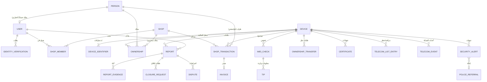

# 09 — نموذج البيانات (تصميم مبدئي)

هذا تصميم منطقي يوضح الكيانات والعلاقات الأساسية، وسيُفصَّل في مرحلة التصميم التقني (أنواع الحقول، والفهارس، والقيود). أسماء الجداول والحقول بالإنكليزية لأنها ستُستخدم كما هي في الكود.

**رموز:** 🔐 حقل مشفّر · #️⃣ بصمة للبحث (HMAC) · 📍 إحداثيات جغرافية

---

## 1. المخطط العام

## 2. الأشخاص والحسابات

### `persons` — الأشخاص الطبيعيون
الشخص كيان مستقل عن الحساب: المشتري الذي سجّله المحل موجود هنا حتى لو لم يفتح حساباً بعد.

| الحقل | الوصف |
|---|---|
| id | المعرّف |
| full_name | الاسم الكامل |
| national_id 🔐 #️⃣ | الرقم الوطني (فريد) |
| phone_e164 | آخر رقم موبايل معروف |
| created_at | تاريخ الإنشاء |

### `users` — حسابات المستخدمين
| الحقل | الوصف |
|---|---|
| id | المعرّف |
| person_id | الشخص المرتبط (يُملأ بعد توثيق الهوية) |
| phone_e164 | رقم الموبايل (فريد) |
| phone_verified_at | وقت تأكيد الرقم |
| password_hash | كلمة المرور (Argon2id) |
| governorate_id | المحافظة |
| identity_status | لا يوجد / قيد المراجعة / موثّق / مرفوض |
| status | نشط / معلّق / محظور |

### `identity_verifications` — طلبات توثيق الهوية
`user_id`، وصور الهوية والسيلفي (`file_id`)، والاسم والرقم الوطني المصرّح بهما 🔐، والطريقة (تلقائي / يدوي)، والحالة، والمراجِع، والسبب، والتواريخ.

### `otp_challenges` و `sessions`
رموز التحقق (مخزّنة كبصمة، مع الغرض، والصلاحية، وعدد المحاولات)، وجلسات الدخول (الجهاز، والمنصة، وآخر نشاط، والإلغاء).

### `admin_users` — حسابات الإدارة
الاسم، واسم الدخول، وكلمة المرور، ومفتاح التحقق الثنائي 🔐، والدور (مدير عام / مشرف بلاغات / مشرف محلات / دعم فني)، والحالة.

## 3. المحلات

### `shops`
| الحقل | الوصف |
|---|---|
| id, shop_code | المعرّف، ورقم المحل الظاهر |
| name | اسم المحل |
| owner_user_id | صاحب المحل |
| governorate_id, area_id | المحافظة والمنطقة |
| address_detail | العنوان التفصيلي |
| location 📍 | الموقع على الخريطة |
| phone | هاتف المحل |
| license_number | رقم السجل التجاري أو الترخيص |
| status | قيد المراجعة / بحاجة لتعديل / موثّق / معلّق / ملغى |
| verified_by, verified_at | من وثّقه ومتى |

### `shop_documents`
الترخيص وصور الواجهة (`type`، `file_id`).

### `shop_members`
`shop_id`، و`user_id`، والدور (صاحب / موظف)، والصلاحيات (`can_sell`، `can_buy`، `can_view_all`)، والحالة.

### `shop_transactions` — معاملات المحلات
| الحقل | الوصف |
|---|---|
| id | المعرّف |
| shop_id | المحل |
| type | شراء / بيع |
| device_id | الجهاز |
| condition | جديد / مستعمل |
| counterparty_person_id | البائع أو المشتري |
| counterparty_phone, counterparty_email | للتواصل وإرسال الفاتورة |
| seller_id_photo_file_id | صورة هوية البائع (في الشراء) |
| price, currency | السعر (اختياري) |
| performed_by | الموظف المنفّذ |
| location 📍 | موقع تنفيذ العملية |
| check_id | الفحص الذي سبق العملية |
| status | مكتملة / ملغاة / قيد المراجعة (تعارض) |

### `invoices`
`transaction_id`، ورقم الفاتورة (فريد)، ورمز QR العام (`public_token`)، وملف PDF، والحالة (صالحة / ملغاة)، وقنوات الإرسال وحالتها.

## 4. الأجهزة والملكية

### `devices`
| الحقل | الوصف |
|---|---|
| id | المعرّف |
| brand, model, color | الماركة والموديل واللون |
| tac | أول 8 خانات من IMEI الأول |
| current_owner_type | شخص / محل / غير معروف |
| current_person_id / current_shop_id | المالك الحالي |
| public_status | الحالة العامة المحسوبة (لا بلاغات / مسروق / مفقود) |

### `device_identifiers`
`device_id`، والنوع (IMEI / تسلسلي)، والقيمة (فريدة على مستوى المنصة)، والخانة (1 / 2).

### `ownerships` — سجل الملكية
`device_id`، والمالك (شخص أو محل)، والمصدر (بيع محل / شراء محل / نقل / تسجيل ذاتي)، ومرجع المصدر، و`started_at`، و`ended_at` (فارغ للملكية الحالية).

### `authorized_users` — المستخدمون المفوّضون
`device_id`، و`person_id`، ومن منح التفويض، وتاريخ المنح والإلغاء.

### `self_registrations` — طلبات التسجيل الذاتي
المستخدم، والمعرّفات، والأدلة، والحالة، والمراجِع، والسبب.

### `ownership_transfers` — طلبات نقل الملكية
`device_id`، والمالك الحالي، ورقم موبايل المستلم، ورقمه الوطني 🔐 #️⃣، والمستلم بعد القبول، والحالة (معلّق / مقبول / ملغى / منتهٍ)، و`expires_at`، ورقم الإيصال.

### `certificates` — شهادات الفحص
`device_id`، والمُصدر، والرمز العام، و`issued_at`، و`expires_at`، والحالة (فعّالة / ملغاة / منتهية)، وسبب الإلغاء.

### `tac_entries` — قاعدة TAC
`tac`، والماركة، والموديل، والمصدر، ومؤكَّد أم لا.

## 5. البلاغات

### `reports`
| الحقل | الوصف |
|---|---|
| id, report_number | المعرّف ورقم البلاغ |
| device_id | الجهاز |
| reporter_user_id | المبلّغ |
| type | مسروق / مفقود |
| status | مسودة / قيد المراجعة / بحاجة لمعلومات / مرفوض / نافذ / طلب إغلاق / مغلق |
| trust_level | موثّق / مدعوم / ضعيف / متعارض |
| incident_at | وقت الحادثة |
| governorate_id, area_id, incident_location 📍 | مكان الحادثة |
| description | الوصف |
| submitted_at, approved_at, approved_by | الإرسال والقبول |
| rejection_reason, closed_at, close_reason | الرفض والإغلاق |

### `report_evidence`
`report_id`، والنوع (كرتونة / صورة حيّة / فاتورة / صورة قديمة / أخرى)، و`file_id`، ورمز التحقق، وقيمة الباركود المقروءة، والتطابق (نعم / لا)، وبصمة الصورة.

### `report_messages`
محادثة «طلب المعلومات» بين المشرف والمبلّغ (النص والمرفقات).

### `closure_requests`
`report_id`، والسبب، والحالة، والمراجِع، وسبب القرار.

### `disputes` و `dispute_evidence`
المعترض، والإفادة، والأدلة، ورد المبلّغ، والحالة، والقرار، ومن قرّر.

## 6. الفحص والمعلومات والتنبيهات

### `imei_checks` — سجل الفحوص
| الحقل | الوصف |
|---|---|
| id | المعرّف |
| identifier_value | الرقم المفحوص |
| device_id | الجهاز (إن وُجد) |
| result | النتيجة |
| checker_type | زائر / مستخدم / محل |
| user_id, shop_id, shop_member_id | هوية الفاحص إن عُرفت |
| gps_location 📍, gps_accuracy | الموقع الدقيق (إن سُمح) |
| manual_governorate_id | المحافظة المختارة يدوياً |
| ip_address 🔐, ip_geo | عنوان الشبكة وموقعه التقريبي |
| platform, user_agent | ويب / آيفون / أندرويد |
| created_at | الوقت |

### `tips` — المعلومات الواردة
`check_id`، و`report_id`، والنوع (معلومات / عثور على مفقود)، والنص، ومكان الرؤية، ووسيلة التواصل 🔐، والمرفق، والحالة.

### `security_alerts` — التنبيهات
| الحقل | الوصف |
|---|---|
| type | فحص من محل / محاولة شراء / محاولة بيع / فحص من فرد / استخدام على الشبكة / تكرار IMEI / عملية بعيدة عن المحل |
| priority | عاجل / عادي |
| device_id, report_id | الجهاز والبلاغ |
| check_id, shop_id, telecom_event_id | مصدر التنبيه |
| status | جديد / قيد المعالجة / أُحيل / مغلق |
| assigned_to, notes | المشرف والملاحظات |

### `police_referrals` — الإحالات لقوى الأمن
التنبيهات المشمولة، وملف تقرير PDF، والجهة المستلمة، والقناة، والمرسل، ووقت الإرسال.

## 7. التكامل مع شركات الاتصالات

### `telecom_operators`
اسم الشركة، وإعدادات الربط (مشفّرة)، والحالة (مفعّل / غير مفعّل).

### `telecom_list_entries` — طلبات المراقبة والحظر
`device_id`، والشركة، ونوع القائمة (مراقبة / حظر)، والإجراء (إضافة / حذف)، والحالة (معلّق / مُرسل / مؤكَّد / فشل)، وعدد المحاولات، و`block_hold_until`، وسبب التأجيل، ومن أجّل.

### `telecom_events` — أحداث الشبكة
الشركة، والنوع (استخدام / تكرار IMEI)، وIMEI، ورقم الشريحة 🔐 #️⃣، ووقت الحدث، والموقع التقريبي 📍، والرسالة الأصلية 🔐، ووقت الاستلام.

## 8. البنية المشتركة

| الجدول | الوصف |
|---|---|
| `files` | كل الملفات المرفوعة: مفتاح التخزين، والنوع، والحجم، وبصمة SHA-256، وبصمة الصورة، والرافع |
| `notifications` | المستلم، والقناة، والقالب، والمحتوى، والحالة، والمحاولات، وأوقات الإرسال والتسليم |
| `message_templates` | قوالب رسائل واتساب والإشعارات |
| `governorates`, `areas` | المحافظات الأربع عشرة ومناطقها |
| `settings` | الإعدادات القابلة للتعديل ⚙️ |
| `audit_logs` | سجل التدقيق (للإضافة فقط): الفاعل، والإجراء، والكيان، والسبب، والعنوان، والوقت |

## 9. ملاحظات تصميمية

- **قاعدة البيانات:** PostgreSQL مع إضافة PostGIS للبيانات الجغرافية، مثل حساب بُعد العملية عن المحل وعرض الخرائط.
- **عدم الحذف:** الكيانات الأساسية (الملكية، والمعاملات، والبلاغات، والفحوص) لا تُحذف، بل تتغير حالتها.
- **الحالة العامة للجهاز** تُحسب من البلاغات وتُخزَّن للسرعة، ويُعاد حسابها عند كل تغيير في بلاغ.
- **البحث بالرقم الوطني** يتم عبر البصمة (#️⃣) دون فك التشفير.
