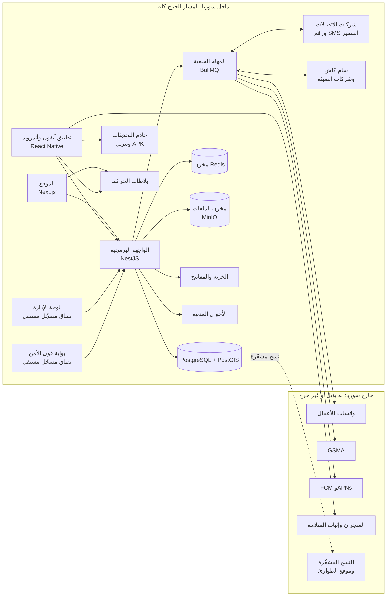

# 10 — البنية التقنية والتقنيات المقترحة

> البنية المعتمدة على مستوى عالٍ. القرارات المعمارية النهائية وتفاصيلها في [التصميم التقني](19-technical-design.md)، ومنهجية البناء والتغيير والإصلاح في [العملية الهندسية](22-engineering-process.md). ولا يبدأ أي عمل برمجي قبل موافقة الزبون (D-29).

---

## 1. مبادئ التصميم

1. **خادم واحد يخدم كل الواجهات:** الموقع وتطبيقا آيفون وأندرويد ولوحة الإدارة وبوابة الأمن تتعامل مع واجهة برمجية (API) واحدة، فتُكتب كل قاعدة عمل مرة واحدة.
2. **لغة واحدة (TypeScript) في كل الطبقات:** المنطق المشترك (مثل التحقق من IMEI والرقم الوطني وتطبيع العربية) يُكتب مرة ويُستخدم في كل مكان.
3. **تطبيق موبايل بكود واحد** لأندرويد وآيفون.
4. **الاستقلال عن الخدمات الأجنبية وقت التشغيل:** المسار الحرج كله (الفحص، والبلاغات، والمحلات، وبوابة الأمن، والرسائل القصيرة، والربط مع الاتصالات) لا يعتمد على أي مضيف خارج سوريا (D-124). وكل خدمة أجنبية (واتساب، وGSMA، والإشعارات الفورية، والمتجران) لها بديل جاهز ووضع تدهور معلن (§10).
5. **قابلية النقل:** كل المكوّنات في حاويات (Docker) ومستضافة ذاتياً، فمكان الاستضافة إعداد بنية تحتية لا يتطلب إعادة تصميم. والقرار المعتمد في §7.
6. **المركزية الموحّدة (D-76):** مصدر واحد لكل شيء: خادم واحد لكل الواجهات، ونظام تصميم واحد (حزمة `packages/ui` مع «رموز التصميم» للألوان والخطوط والمسافات في الثيمين)، وإعدادات ومحتوى ونصوص تُقرأ من قاعدة البيانات وتُدار من لوحة الإدارة ضمن حدود، ومفاتيح تشغيل لكل وحدة. فالتعديل يتم في مكان واحد وينعكس في كل مكان.
7. **المنهجية الموحّدة (M-0..M-15):** كل حقيقة تقرؤها الآلة (الحالات، والأحداث، والقوالب، ورموز الأخطاء، والصلاحيات، والإعدادات، والمفاتيح، والقيود...) سجل معلن واحد في المستودع، ومنه تُولَّد قاعدة البيانات والعقد والواجهات والاختبارات وجداول الوثائق. فأي تعديل لاحق يبدأ من صف واحد ويسري على كل شيء، والميزة الجديدة تندمج بملء خانات «عقد الميزة» دون شرح مفصّل، وخط النشر يفشل عند أي خانة فارغة (§9).

## 2. المخطط العام



## 3. المكوّنات والتقنيات

| الطبقة | التقنية المقترحة | السبب |
|---|---|---|
| الخادم (API) | **Node.js + NestJS** بلغة TypeScript | بنية منظمة ووحدات واضحة، ومناسب للأنظمة الكبيرة، ومنتشر |
| قاعدة البيانات | **PostgreSQL** مع **PostGIS** (الإصدار الرئيسي المستقر عند بدء البناء، وسياسة الإصدارات في [العملية الهندسية §4.6](22-engineering-process.md)) | موثوقة، وتدعم البيانات الجغرافية (المسافات والخرائط) والتشفير. وتُنشأ بإعداد محلي يدعم الحروف العربية في البحث والفرز |
| طبقة الوصول للبيانات | **Drizzle ORM** | تدعم الأنواع الجغرافية، وأداؤها جيد، وتعطي تحكماً كاملاً بالاستعلامات |
| الذاكرة المؤقتة وحدود الطلبات | مخزن **متوافق مع Redis** بترخيص مفتوح | سرعة الفحص، وتطبيق حدود الفحص. وليس مصدر حقيقة، فيُعاد بناؤه من قاعدة البيانات |
| المهام الخلفية | **BullMQ** | إرسال الرسائل، وتوليد ملفات PDF، ومعالجة الصور، والتواصل مع شركات الاتصالات، مع إعادة المحاولة |
| السجلات المعلنة | حزمة `packages/registry` بملفات YAML ومخططاتها ومولّداتها | مصدر واحد لكل حقيقة تقرؤها الآلة، ومنه تُولَّد قيود قاعدة البيانات والعقد والأنواع والتسميات والاختبارات (§9) |
| الموقع | **Next.js** (React) | صفحات سريعة وخفيفة تُبنى على الخادم، وهذا مهم للإنترنت الضعيف ولمحركات البحث. وكل صفحة تعرض حالة جهاز أو وثيقة أو بيانات مستخدم لا تُخزَّن مؤقتاً |
| لوحة الإدارة وبوابة الأمن | **Next.js** كتطبيقين مستقلين، كل على نطاق مسجّل مستقل | عزل أمني تام عن الموقع العام |
| التصميم | **Tailwind CSS** مع مكتبة مكوّنات تدعم اليمين لليسار، ورموز تصميم من مصدر واحد | تنسيق موحّد، ودعم كامل للعربية |
| الخط | خط عربي مفتوح المصدر يُستضاف داخلياً (مثل IBM Plex Sans Arabic) | وضوح، ولا اعتماد على خدمات خارجية |
| تطبيق الموبايل | **React Native + Expo**، يُبنى على خوادم بناء نملكها | تطبيق واحد لأندرويد وآيفون، ومشاركة المنطق مع الموقع، ومفاتيح التوقيع لا تغادر خزنتنا |
| التحديث الفوري للتطبيق | خادم تحديثات ببروتوكول Expo Updates **مستضاف ذاتياً على نطاقنا**، بتحديثات موقّعة | لا اعتماد على خدمة Expo السحابية، ولا يستطيع أي مضيف تزوير تحديث (§11) |
| الإشعارات الفورية | FCM وAPNs برموز الأجهزة الأصلية، تُرسل مباشرة من الخادم | لا وسيط أجنبي إضافي (لا خدمة إشعارات Expo)، والإشعار الفوري أفضل جهد ولا يعتمد عليه إجراء حرج |
| إثبات سلامة التطبيق | Play Integrity بطلبات تُفك محلياً، مع رجوع آلي إلى Android Key Attestation، وآلية Huawei للأجهزة دون خدمات جوجل | لا يُرفض محل لأن خدمة جوجل غير متاحة لسوريا، بل فقط بحكم سلبي |
| قراءة الباركود والنص | في التطبيق: كاميرا Expo وتقنية التعرف على النص على الجهاز. في الموقع: واجهة المتصفح لقراءة الباركود مع مكتبة بديلة. ودالة واحدة تستخرج IMEI1 وIMEI2 من بين باركودات الكرتونة ونص `*#06#` | قراءة IMEI دون إنترنت إضافي ودون خلط بين الباركودات |
| الخرائط | **OpenStreetMap** بخادم بلاطات مستضاف ذاتياً، مع MapLibre | مجانية، ولا قيود على استخدامها في سوريا، ولا تخرج مواقع الناس لطرف خارجي |
| الموقع التقريبي من الشبكة | قاعدة بيانات محلية لعناوين الشبكة (مثل GeoLite2) تُحدَّث من مرآة داخلية | لا يحتاج اتصالاً بخدمة خارجية، مع العلم أن دقتها محدودة في سوريا |
| تحقق «لست روبوتاً» | حل مستضاف ذاتياً يعتمد على «إثبات العمل» (مثل ALTCHA) | لا يعتمد على خدمات أجنبية قد تُحجب، ويحترم الخصوصية |
| ملفات PDF | تحويل HTML إلى PDF بمتصفح Chromium على الخادم، دون وصول للشبكة | عرض صحيح للعربية (الاتجاه ووصل الحروف) في الفواتير والتقارير |
| الطباعة | الطابعات الحرارية **58 مم و80 مم** حسب الطابعة المربوطة (D-122)، والإيصال يُرسل لها صورة نقطية عبر البلوتوث (ESC/POS) في أندرويد، وفي iOS عبر AirPrint أو مشاركة PDF، والطابعة العادية A4 | وصل الحروف العربية لا يعتمد على خطوط الطابعة، وQR مقروء على المقاسين |
| تخزين الملفات | مخزن متوافق مع S3 مستضاف ذاتياً (مثل MinIO)، مكشوف فقط عبر وكيل يسمح بالروابط الموقّعة | البيانات داخل الاستضافة المعتمدة (ADR-14) |
| المصادقة | تنفيذ داخلي: Argon2id، ورموز دخول قصيرة العمر مع تجديد. **وللموظفين** (D-125): مفتاح مرور على الجهاز المعتمد أو مفتاح أمان إلزامي للمدير العام ومسؤولي الأمن والإدارة المركزية وكل دور يكشف بيانات أو يصدّرها أو يبحث بالرقم الوطني أو يتتبّع، وباقي الأدوار برمز التطبيق (TOTP) مع قائمة عناوين مسموحة إلزامية | تحكم كامل دون الاعتماد على مزوّد خارجي، ودخول مقاوم للتصيّد للأدوار الحساسة |
| التحديث اللحظي | WebSocket (Socket.IO أو ما يماثله) من الخادم للوحة الإدارة وبوابة الأمن، والإشعار في التبويب المفتوح فقط دون خدمات إشعارات المتصفح | خريطة التتبّع المباشر وقوائم العمل والتنبيهات العاجلة دون تحديث الصفحة |
| استيراد الملفات بالجملة | معالجة ملفات Excel وCSV في المهام الخلفية مع تقرير بالأخطاء، وقراءة نوع الخلية فلا تفسد الصيغة العلمية أو الأصفار البادئة أرقام IMEI والأرقام الوطنية | تسجيل آلاف الأجهزة من الوكلاء دون إبطاء النظام ودون أرقام فاسدة |

## 4. التكاملات الخارجية

### 4.1 واتساب والرسائل
- **WhatsApp Business Platform الرسمية** فقط، في الاتجاهين: إرسال الرموز والإشعارات، واستقبال رسائل **بوت الفحص** عبر نقطة استقبال آمنة (WABOT). البوتات غير الرسمية قد تؤدي لحظر الرقم.
- طبقة إرسال موحّدة بواجهة ثابتة، تحتها «مزوّدات» قابلة للتبديل (واتساب، أو SMS، أو تلغرام) (NOTIF-03). وبلوغ حد المراسلة اليومي لرقم واتساب يحوّل رموز التحقق والرسائل الحرجة إلى SMS فوراً.
- بريد إلكتروني اختياري للمواطن للتنبيهات الأمنية فقط (D-126)، ولا يحمل رمزاً ولا رابط دخول أبداً.
- ⚠️ يجب التحقق من إتاحة الخدمة لرقم ونشاط تجاري سوري ([الأسئلة المفتوحة](12-risks-and-open-questions.md)).

### 4.2 شركات الاتصالات
- خدمة مستقلة داخل الخادم (وحدة TELCO) تتعامل مع كل شركة عبر «محوّل» خاص بها، لأن كل شركة قد تفرض صيغة مختلفة.
- الاتجاهان:
  - **صادر:** طلبات الإضافة والحذف لقوائم المراقبة والحظر، وطلبات بدء وإيقاف تحديثات الموقع لجلسات التتبّع، واستعلامات سجل الشريحة. والطلبات الحرجة (حظر بعد أول استخدام، وفك حظر) تُخدم قبل الطلبات الجماعية.
  - **وارد:** أحداث الاستخدام، وتكرار IMEI، وتحديثات الموقع، عبر نقطة استقبال آمنة.
- IMEI منسوخ على أجهزة كثيرة: البلاغ يُقبل، لكن طلب المراقبة والحظر لا يُرسل آلياً وينتظر قرار وحدة الأمن المختصة (D-120).
- أمان الربط: اتصال مشفّر بشهادات متبادلة (mTLS)، وقائمة عناوين مسموحة، وتوقيع الرسائل، وتسجيلها كلها.
- **بيئة محاكاة** تحاكي سلوك شركة اتصالات، لاختبار المسار كاملاً قبل توقيع الاتفاقية. ولا محاكي في الإنتاج أبداً.

### 4.3 الأحوال المدنية
- وحدة مستقلة (CIVIL) بمحوّل قابل للتكييف مع صيغة نظام الشؤون المدنية، وبيئة محاكاة للاختبار قبل الاتفاق.
- العمليات: مطابقة (نعم/لا)، وتعبئة الاسم ضمن معاملة، وجلب الصورة لحظة العرض دون تخزين، وحالة البطاقة. والمطابقة تتم بعد تطبيع العربية، فلا يُحسب فرق إملاء الاسم محاولة فاشلة.
- الصلاحية تُفحص في الخادم لكل طلب: لا استعلام إلا من مشرف يراجع طلب توثيق، أو من موظف ضمن معاملة جارية بعد فحص الجهاز (مبدأ «تحقّق، لا استعلام»).
- أمان الربط مثل شركات الاتصالات: mTLS، وقائمة عناوين مسموحة، وتسجيل كل طلب.

### 4.4 قاعدة TAC
- المصادر بترتيب الأولوية، وكل مصدر يُفعَّل بمفتاحه: (1) تصدير GSMA الرسمي لقاعدة TAC عند توفر الاشتراك، (2) بيانات الهيئة الناظمة والجمركة (الماركة والموديل للأجهزة المسجّلة)، (3) تأكيدات المحلات للموديل بعد مراجعة شهرية. وعند التعارض يغلب مصدر GSMA.
- حالة تخصيص TAC ثلاثية (مخصص، وغير مخصص، ومجهول)، ولا يضع «غير مخصص» إلا مصدر GSMA. والـ TAC المجهول يعني «الموديل غير معروف» ولا يُظهر أبداً تحذير «قد يكون مقلّداً» (FAKE-01).
- فالتصميم يدعم كل المصادر، ويبقى قرار الاشتراك في GSMA (Q-06) قرار تفعيل لا قرار تصميم ([الأسئلة المفتوحة](12-risks-and-open-questions.md)).

### 4.5 GSMA والهيئة الناظمة
- محوّل لخدمة GSMA للفحص الدولي مع حفظ مؤقت للنتائج، ومسار المشاركة عبر شركات الاتصالات أو الهيئة.
- محوّل لنظام تسجيل الأجهزة في الهيئة الناظمة (الجمركة).
- كل منهما يتعطل بأمان: الفحص يكمل بنتيجة المنصة مع ملاحظة.

### 4.6 الرقم القصير والمحافظ والبنوك
- بوابة SMS مع شركات الاتصالات لاستقبال رسائل الفحص على الرقم القصير والرد عليها، وهي أيضاً البديل لرموز التحقق.
- محوّلات لطلبات إيقاف الخط (عبر شركات الاتصالات) وتجميد المحافظ والبنوك، بنمط موحّد: طلب، ومتابعة حالة، وإعادة محاولة، وتسجيل.
- محفظة المحل عبر شام كاش وتعبئة الرصيد عبر سيريتل وMTN بنمط مال واحد لكل حركة (M-9): الرد الوارد تلميح لا يحرّك مالاً قبل استعلامنا عن الحالة، والمهلة ليست فشلاً، والتصحيح عملية مرتبطة جديدة.

### 4.7 بوابة قوى الأمن
- تطبيق ويب مستقل على نطاق مسجّل منفصل، يتصل بالخادم نفسه، والصلاحيات والنطاق (المحافظات) تُفرض في الخادم لكل طلب.
- التنبيهات اللحظية عبر WebSocket، كما في لوحة الإدارة، وتعمل في كل الأوقات ولا تدخل الصيانة أبداً.

> التصميم التقني التفصيلي (وحدات النشر وعناوينها، والقرارات المعمارية، والواجهة البرمجية، والصلاحيات، وآلات الحالة، والآليات الموحّدة) في [التصميم التقني](19-technical-design.md)، ونموذج البيانات الكامل في [نموذج البيانات](09-data-model.md).

## 5. هيكل المستودع المقترح

```
imei/
├── apps/
│   ├── api/        الخادم (NestJS) والعمّال، ومهام تصحيح البيانات المراجَعة
│   ├── web/        الموقع (Next.js)
│   ├── admin/      لوحة الإدارة (Next.js)
│   ├── police/     بوابة قوى الأمن (Next.js)
│   └── mobile/     تطبيق آيفون وأندرويد (React Native + Expo)
├── contracts/      ملفات OpenAPI المولّدة لكل نطاق ووصف الأحداث، محفوظة ومراجَعة
├── packages/
│   ├── registry/   السجلات المعلنة ومولّداتها (الحالات، والأحداث، والقوالب، والأخطاء، والصلاحيات، والإعدادات، والمفاتيح...)
│   ├── shared/     منطق مشترك: التحقق من IMEI والرقم الوطني، وتطبيع العربية، والمال، والأنواع، ورموز المحافظات الثابتة
│   ├── ui/         مكوّنات واجهة مشتركة ورموز التصميم
│   ├── api-client/ عميل الواجهة البرمجية المولَّد من OpenAPI
│   ├── content/    النصوص والقوالب من كتالوج المحتوى
│   ├── commerce/   منطق الباقات والمحفظة والمتجر المشترك
│   ├── test-data/  مولّدات البيانات الاصطناعية وحسابات الأدوار للتطوير
│   ├── simulators/ محاكيات كل التكاملات
│   └── config/     إعدادات موحّدة للأدوات
├── infra/          البنية كرمز، والحاويات، والنشر، ووضع التكاملات لكل بيئة، وجرد الوجهات الخارجية
└── docs/           هذه الوثائق، وأدلة التشغيل، ودليل المطوّر
```

**المحافظات:** `packages/shared` يحمل **رمز المحافظة الثابت ونوعه** فقط. أما الأسماء وترتيبها ومضلّعاتها فمن قاعدة البيانات عبر نقطة الإقلاع، والأسماء تُعدَّل من اللوحة. وإضافة محافظة (تغيير قانوني) ترحيل وقرار معماري ونطاق أمن (D-80) وتفعيل ومراجعة سعة.

الهيكل المفصّل وقواعده في [العملية الهندسية §4.1](22-engineering-process.md).

## 6. البيئات والنشر

| البيئة | الغرض |
|---|---|
| المحلية | جهاز المطوّر، ببيانات اصطناعية ومحاكيات، وتعمل بأمر واحد |
| التطوير | دمج عمل المطوّرين، ببيانات اصطناعية ومحاكيات |
| التجريب | اختبار كل تعديل قبل الإنتاج، واختبار قبول الزبون، بمحاكيات كل التكاملات |
| التدريب | تدريب المشرفين وعناصر الأمن والمحلات، ببيانات اصطناعية وشريط «بيئة تدريب» (ROLLOUT-04) |
| الإنتاج | المنصة الحقيقية داخل سوريا، والتجريب المغلق داخله بمفاتيح الدعوات والمحافظات |

التفاصيل في [العملية الهندسية](22-engineering-process.md) §8.

- بناء واختبار آلي في خط النشر (مثل GitHub Actions). وصور الحاويات والحزم تُنسخ إلى سجل خاص ومرآة داخل بيئة الاستضافة، فيعمل النشر والتراجع والتوسع في الإنتاج حتى أثناء انقطاع الإنترنت الدولي.
- النشر على الإنتاج بموافقة مسؤول الإصدار، تدريجياً، مع تراجع آلي سريع.
- الإصدار لا يكتب أبداً فوق قيمة غيّرها المدير العام من اللوحة (الإعدادات، وحالات المفاتيح، والنصوص المنشورة)، والتغيير المطلوب عليها يصل مقترحاً ينشره المدير العام ([العملية الهندسية §5.8](22-engineering-process.md)).
- التطبيقات تُوزَّع عبر المتجرين وقناة APK البديلة، وتُحدَّث فورياً من خادمنا (§11).

## 7. الاستضافة

**القرار (D-124، يحسم Q-05):**

| الموقع | ما فيه |
|---|---|
| **داخل سوريا (الموقع الرئيسي)** | المسار الحرج كله وقت التشغيل: الفحص (الموقع والتطبيق وواتساب والرقم القصير)، والبلاغات، ومعاملات المحلات، وبوابة الأمن وتنبيهاتها، ولوحة الإدارة، والربط مع الاتصالات والأحوال المدنية وشام كاش وشركات التعبئة. وكل مخازن البيانات الحية: قاعدة البيانات، والملفات، وRedis، والخزنة، والسجلات والمؤشرات والتتبّع وتتبّع الأعطال. وخادم التحديثات وصفحة تنزيل APK، وبلاطات الخرائط، والمرايا الداخلية للحزم والصور والقواعد المرجعية، ومصدرا الوقت |
| **خارج سوريا** | **النسخ الاحتياطية المشفّرة وموقع الطوارئ** فقط. والنسخ تُشفَّر قبل خروجها بمفاتيح لا تغادر الخزنة، وبيانات محاسبة المحلات فيها نص مشفّر لا يقرؤه أحد (D-101). وموقع الطوارئ يُشغَّل بقرار مسجّل عند فقدان الموقع الرئيسي، ويُختبر بتمرين تعافٍ كامل مرتين في السنة. **وإن لم تسمح الوزارة بالنسخ خارج سوريا** ([الأسئلة المفتوحة](12-risks-and-open-questions.md) Q-28) يكون موقع الطوارئ والنسخ في **مدينة سورية ثانية** في محافظة أخرى وعلى شبكة كهرباء واتصالات مختلفة، بالتشفير والتمارين نفسها، ولا يتغير شيء في البنية ([الإطلاق والتشغيل](11-launch-and-operations.md) §4.4) |

- **الأثر:** انقطاع الإنترنت الدولي يُدهور فقط ما له بديل (واتساب ← SMS، وGSMA ← «تعذّر التحقق الدولي حالياً»، والإشعار الفوري ← مركز الإشعارات)، وتبقى تنبيهات الأمن ومعاملات المحلات والفحص تعمل (§10).
- الموثوقية داخل الموقع: خادم رئيسي ونسخة متزامنة ونسخة قراءة، وتوافر عالٍ للخزنة والملفات وRedis، وأهداف الاستعادة في [الأمان §7](07-security-privacy-legal.md) و[العملية الهندسية §12.2](22-engineering-process.md).
- التفصيل في [التصميم التقني](19-technical-design.md) ADR-14.

## 8. المراقبة

- تتبّع موحّد (OpenTelemetry) للطلبات عبر الخادم والطوابير والعمّال والمحوّلات، بمعرّف طلب واحد من شاشة المستخدم حتى رسالة واتساب أو طلب الحظر.
- **رقم المرجع للمستخدم** (`ER-XXXXXXXX`) يظهر مع كل خطأ، ويبحث به الدعم الفني عن سبب الفشل دون أي بيانات محمية، ثم يصعّد للمهندس بالمعرّف نفسه.
- مؤشرات ولوحات تشغيلية (Prometheus + Grafana)، وسجلات مركزية لا تُكتب فيها أي بيانات حساسة.
- تتبّع الأعطال في الخادم والتطبيقات بأداة مستضافة ذاتياً (مثل Sentry بالاستضافة الذاتية)، دون بيانات شخصية، وخرائط المصدر فيها وحدها لا تُنشر على أي نطاق.
- تنبيهات لفريق التشغيل حسب [العملية الهندسية §12.4](22-engineering-process.md): تعطل الربط مع واتساب أو شركات الاتصالات، وتراكم الطوابير، والرسائل الميتة، وارتفاع الأخطاء، وانحراف الساعة، وتقادم القواعد المرجعية.
- مسابير خارجية، إحداها داخل سوريا، للموقع والواجهة البرمجية وصفحات التحقق والنطاقات والشهادات.

## 9. الآليات الموحّدة للمنصة

هذه الآليات تجعل «أي تعديل يسري على كل شيء، وأي ميزة جديدة تندمج دون شرح». كل منها **سجل معلن** في المستودع + **محرّك واحد** يقرؤه وقت التشغيل + **مولّدات** تنتج منه ما يلزم + **فحص** يفشل عند خانة ناقصة. والتصميم التقني لكل منها في [التصميم التقني](19-technical-design.md)، والعملية (السجلات، وعقد الميزة، وبروتوكول التغيير، والفحوص) في [العملية الهندسية](22-engineering-process.md)، والسلوك على مستوى العمل في [مصفوفات سلوك المنصة](26-scenarios-and-linkage.md).

| الآلية | ما تحسمه مرة واحدة | التصميم |
|---|---|---|
| M-0 السجلات كرمز والمولّدات | لكل حقيقة بيت واحد، ومنه قاعدة البيانات والعقد والواجهات والاختبارات والوثائق | 19 ADR-18 و§20، و22 §4.7 |
| M-1 سجل آلات الحالة | لكل حالة مخرج، ولكل انتقال فاعل وحدث وتدقيق وإشعار وتصحيح عكسي، والحمايات تُرفع على كل مخرج | 19 §8.0 |
| M-2 التتابع | حين يتغير الأب يتصرف كل ابن بسياسة معلنة، مع معاينة الأثر قبل القرار | 19 §8.16 |
| M-3 حارس الحيازة | باب واحد لكل حركة جهاز بإعادة الفحص نفسها، و«أين الجهاز» حين يُبلَّغ عنه | 19 §7.10 |
| M-4 القيود | كل قيد صف مستقل بمصدره ومدته، فرفع قيد لا يلغي غيره | 19 §5.11 |
| M-5 محلّل القدرات | جواب واحد على «هل يجوز هذا الآن؟» للخادم والواجهات والمهام، برمز خطأ واحد وخطوة تالية | 19 §5.12 |
| M-6 الإطفاء التدريجي | إطفاء وحدة يوقف الجديد ويكمل الجاري ولا يمس المحمي أبداً | 19 §14.3 |
| M-7 المؤقّتات والتقويم | كل مهلة بصنف واحد وتقويم الدوام الرسمي (D-123) | 19 §10.1، §15.5 |
| M-8 موجّه الإشعارات | كل حدث له مستلمون وقوالب أو «لا شيء» بسبب، ولا يُنسى طرف | 19 §9.6 |
| M-9 نمط المال | المعلّق والحسم والمطابقة والتصحيح والإرجاع والاسترداد بنمط واحد لكل حركة | 19 §11.5 |
| M-10 توجيه العمل | كل حالة تنتظر موظفاً لها طابور ومهلة وتصعيد | 19 §20.11 |
| M-11 أصناف البيانات والمصبّات | لا يصل صنف بيانات إلى مكان ممنوع (رمز التحقق، ومحاسبة المحل) | 19 §20.12، 21 |
| M-12 أصناف الإساءة | لكل عملية صنف حد ومفاتيح موثوقة وسلّم عقوبات على الشخص | 19 §3.8 |
| M-13 صفة التمثيل ودورة حياة الشخص | من يتصرف عن من، والوفاة والوصي (D-103) | 19 §5.1، §20.14 |
| M-14 الأوضاع المتدهورة | لكل تبعية × رحلة وضع ولافتة وأثر على المهل وتعافٍ | 19 §11.6 |
| M-15 الوثائق من مصدر واحد | القيمة تُكتب في بيتها فقط، والبقية تشير بالمعرّف، ومدقّق آلي للوثائق | 22 §16.3، §16.7 |

## 10. الاستقلال عن الخدمات الأجنبية وقت التشغيل

جرد كل وجهة خارجية في البنية كرمز مع وضع تدهورها (M-14). وما ليس في هذا الجدول لا يُستدعى من الإنتاج:

| الوجهة | مكانها | إذا تعذّرت |
|---|---|---|
| شركات الاتصالات، والأحوال المدنية، وشام كاش، وشركات التعبئة، وبوابة SMS، وشركة الشحن | داخل سوريا | حسب وضع كل منها: طابور الحالة المرغوبة للاتصالات، والتوثيق اليدوي مع إعادة التحقق للأحوال المدنية، و«معلّقة» دون حركة مال لشام كاش والتعبئة |
| واتساب (Meta) | خارج سوريا | رموز التحقق والرسائل الحرجة بـ SMS، والبقية مؤجلة أو داخل التطبيق |
| GSMA | خارج سوريا | الفحص يكمل بنتيجة المنصة مع «تعذّر التحقق الدولي حالياً» |
| FCM وAPNs | خارج سوريا | مركز الإشعارات داخل التطبيق وواتساب أو SMS للحرج |
| Google Play وApp Store | خارج سوريا | قناة APK من موقعنا لأندرويد، والتحديث الفوري من خادمنا |
| Play Integrity | خارج سوريا | رجوع آلي إلى Key Attestation (وآلية Huawei) |
| مصادر الوقت (NTP)، وشهادات TLS، وقواعد ClamAV وGeoLite وTAC، وسجلات الحزم والحاويات | مرايا ومصادر داخلية | مصدرا وقت داخليان، وتجديد مبكر للشهادات، ومرايا بتنبيه عند التقادم |

ويُختبر ذلك بتمرين دوري «القطع الخارجي» يحجب كل خروج إلى خارج سوريا ([العملية الهندسية §6.11](22-engineering-process.md)).

## 11. توزيع التطبيق وتحديثه

| البند | القاعدة |
|---|---|
| البناء والتوقيع | على خوادم بناء نملكها، بمفاتيح المتجرين ومفتاح توقيع التحديثات من الخزنة المدعومة بالعتاد، ولا تُرفع المفاتيح ولا الكود لأي خدمة بناء سحابية |
| التوزيع | Google Play وApp Store، ولأندرويد **قناة APK بديلة** على الموقع الرسمي، موقّعة بمفتاح التطبيق نفسه مع بصمة SHA-256، فيُنقل بين القناتين دون حذف التطبيق |
| التحديث الفوري (OTA) | من خادم التحديثات على نطاقنا داخل سوريا، لتغييرات JavaScript والموارد المتوافقة فقط، وكل تحديث موقّع ويُرفض غير الموقّع، ويُتراجع عنه بإعادة نشر السابق. والمسموح والممنوع في [العملية الهندسية §10.5](22-engineering-process.md) |
| التحديث الإجباري | «أدنى إصدار مدعوم» من الإعدادات (APPVER)، والتثبيت من قناة APK يفتح صفحة التنزيل بدل المتجر، ومزامنة مبيعات نقطة البيع مستثناة مدة محددة فلا تضيع |
| الفحص الذاتي | التطبيق يتحقق من حزمته النشطة بتوقيع بيان التحديث، فيكشف إعادة التغليف دون أن يكسر التحديثات |
