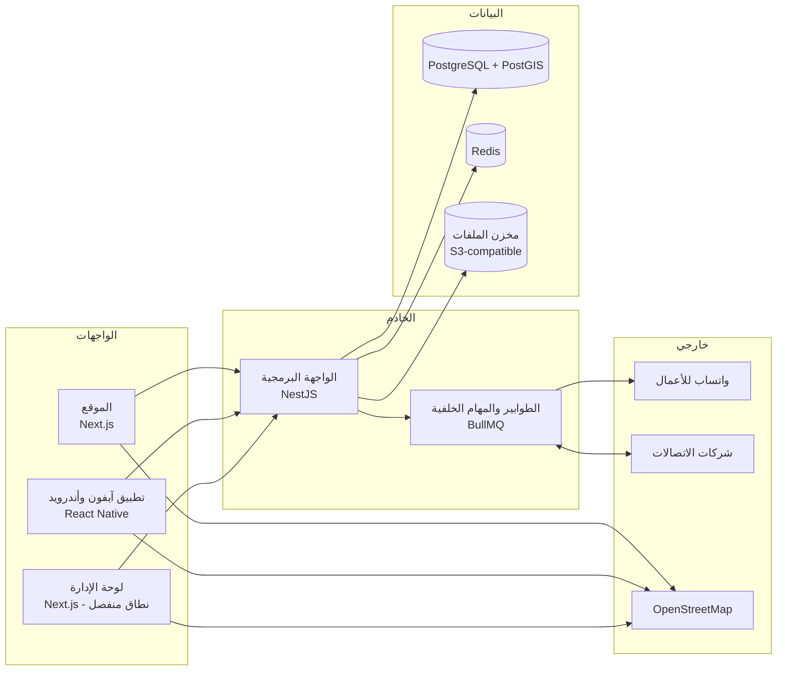

# 10 — البنية التقنية والتقنيات المقترحة

> **اقتراح للنقاش.** لا يبدأ أي عمل برمجي قبل موافقة الزبون (D-29). الاختيارات النهائية تُحسم في مرحلة التصميم التقني التفصيلي.

---

## 1. مبادئ التصميم

1. **خادم واحد يخدم كل الواجهات:** الموقع وتطبيقا آيفون وأندرويد ولوحة الإدارة تتعامل مع واجهة برمجية (API) واحدة، فتُكتب كل قاعدة عمل مرة واحدة.
2. **لغة واحدة (TypeScript) في كل الطبقات:** المنطق المشترك (مثل التحقق من IMEI والرقم الوطني) يُكتب مرة ويُستخدم في كل مكان.
3. **تطبيق موبايل بكود واحد** لأندرويد وآيفون.
4. **عدم الاعتماد على خدمات قد لا تكون متاحة في سوريا** إلا عند الضرورة، ومع بديل جاهز.
5. **قابلية النقل:** كل المكوّنات في حاويات (Docker)، فيمكن تشغيلها عند أي مزوّد استضافة، أو داخل سوريا إن اشترطت الاتفاقية ذلك.

## 2. المخطط العام



## 3. المكوّنات والتقنيات

| الطبقة | التقنية المقترحة | السبب |
|---|---|---|
| الخادم (API) | **Node.js + NestJS** بلغة TypeScript | بنية منظمة ووحدات واضحة، ومناسب للأنظمة الكبيرة، ومنتشر |
| قاعدة البيانات | **PostgreSQL** مع **PostGIS** | موثوقة، وتدعم البيانات الجغرافية (المسافات والخرائط) والتشفير |
| طبقة الوصول للبيانات | **Drizzle ORM** | تدعم الأنواع الجغرافية، وأداؤها جيد، وتعطي تحكماً كاملاً بالاستعلامات |
| الذاكرة المؤقتة وحدود الطلبات | **Redis** | سرعة الفحص، وتطبيق حدود الفحص |
| المهام الخلفية | **BullMQ** (على Redis) | إرسال الرسائل، وتوليد ملفات PDF، ومعالجة الصور، والتواصل مع شركات الاتصالات، مع إعادة المحاولة |
| الموقع | **Next.js** (React) | صفحات سريعة وخفيفة تُبنى على الخادم، وهذا مهم للإنترنت الضعيف ولمحركات البحث |
| لوحة الإدارة | **Next.js** كتطبيق مستقل | عزل أمني تام عن الموقع العام |
| التصميم | **Tailwind CSS** مع مكتبة مكوّنات تدعم اليمين لليسار | تنسيق موحّد، ودعم كامل للعربية |
| الخط | خط عربي مفتوح المصدر يُستضاف داخلياً (مثل IBM Plex Sans Arabic) | وضوح، ولا اعتماد على خدمات خارجية |
| تطبيق الموبايل | **React Native + Expo** | تطبيق واحد لأندرويد وآيفون، ومشاركة المنطق مع الموقع |
| قراءة الباركود والنص | في التطبيق: كاميرا Expo وتقنية التعرف على النص على الجهاز. في الموقع: واجهة المتصفح لقراءة الباركود مع مكتبة بديلة | قراءة IMEI من الكرتونة وشاشة `*#06#` دون إنترنت إضافي |
| الخرائط | **OpenStreetMap** مع MapLibre أو Leaflet | مجانية، ولا قيود على استخدامها في سوريا |
| الموقع التقريبي من الشبكة | قاعدة بيانات محلية لعناوين الشبكة (مثل GeoLite2) | لا يحتاج اتصالاً بخدمة خارجية، مع العلم أن دقتها محدودة في سوريا |
| تحقق «لست روبوتاً» | حل مستضاف ذاتياً يعتمد على «إثبات العمل» (مثل ALTCHA) | لا يعتمد على خدمات أجنبية قد تُحجب، ويحترم الخصوصية |
| ملفات PDF | تحويل HTML إلى PDF بمتصفح Chromium على الخادم | عرض صحيح للعربية (الاتجاه ووصل الحروف) في الفواتير والتقارير |
| تخزين الملفات | مخزن متوافق مع S3 (مثل MinIO مستضاف ذاتياً، أو خدمة مزوّد) | مرونة في مكان الاستضافة |
| المصادقة | تنفيذ داخلي: Argon2id، ورموز دخول قصيرة العمر مع تجديد، وتحقق ثنائي (TOTP) للإدارة | تحكم كامل دون الاعتماد على مزوّد خارجي |

## 4. التكاملات الخارجية

### 4.1 واتساب
- **WhatsApp Business Platform الرسمية** فقط. البوتات غير الرسمية قد تؤدي لحظر الرقم.
- طبقة إرسال موحّدة بواجهة ثابتة، تحتها «مزوّدات» قابلة للتبديل (واتساب، أو SMS، أو تلغرام) (NOTIF-03).
- ⚠️ يجب التحقق من إتاحة الخدمة لرقم ونشاط تجاري سوري، ومن تكلفة الرسائل ([الأسئلة المفتوحة](12-risks-and-open-questions.md)).

### 4.2 شركات الاتصالات
- خدمة مستقلة داخل الخادم (وحدة TELCO) تتعامل مع كل شركة عبر «محوّل» خاص بها، لأن كل شركة قد تفرض صيغة مختلفة.
- الاتجاهان:
  - **صادر:** طلبات الإضافة والحذف لقوائم المراقبة والحظر.
  - **وارد:** أحداث الاستخدام وتكرار IMEI عبر نقطة استقبال آمنة.
- أمان الربط: اتصال مشفّر بشهادات متبادلة (mTLS)، وقائمة عناوين مسموحة، وتوقيع الرسائل، وتسجيلها كلها.
- **بيئة محاكاة** تحاكي سلوك شركة اتصالات، لاختبار المسار كاملاً قبل توقيع الاتفاقية.

### 4.3 قاعدة TAC
- مصادر محتملة: قاعدة GSMA الرسمية (تتطلب اشتراكاً)، أو قواعد مفتوحة جزئية، أو التعلّم من تأكيدات المحلات للموديل مع مراجعة.
- تُحسم في التصميم التفصيلي ([الأسئلة المفتوحة](12-risks-and-open-questions.md)).

## 5. هيكل المستودع المقترح

```
imei/
├── apps/
│   ├── api/        الخادم (NestJS)
│   ├── web/        الموقع (Next.js)
│   ├── admin/      لوحة الإدارة (Next.js)
│   └── mobile/     تطبيق آيفون وأندرويد (React Native + Expo)
├── packages/
│   ├── shared/     منطق مشترك: التحقق من IMEI والرقم الوطني، والأنواع، والثوابت (المحافظات)
│   ├── ui/         مكوّنات واجهة مشتركة
│   └── config/     إعدادات موحّدة للأدوات
├── infra/          إعدادات الحاويات والنشر
└── docs/           هذه الوثائق
```

## 6. البيئات والنشر

| البيئة | الغرض |
|---|---|
| التطوير | عمل المطوّرين، ببيانات وهمية |
| التجريب | اختبار كل تعديل قبل الإنتاج، واختبار قبول الزبون، ومحاكاة شركات الاتصالات |
| الإنتاج | المنصة الحقيقية |

- بناء واختبار ونشر آلي عبر GitHub Actions.
- النشر على الإنتاج بموافقة يدوية، مع إمكانية التراجع السريع.
- التطبيقات تُنشر عبر متجري Google Play وApp Store، مع تحديثات فورية للأجزاء غير الأصلية عند الحاجة.

## 7. الاستضافة

| الخيار | الإيجابيات | السلبيات |
|---|---|---|
| مزوّد سحابي خارج سوريا (أوروبا أو الخليج أو تركيا) | موثوقية عالية، وخدمات مُدارة | يجب التأكد من قبوله للخدمة المتعلقة بسوريا. وقد تشترط الاتفاقية مع وزارة الداخلية أن تكون البيانات داخل سوريا |
| مركز بيانات داخل سوريا | يلبي اشتراط توطين البيانات إن وُجد، وزمن وصول أقل | الموثوقية والكهرباء والخبرات تحتاج تقييماً |
| هجين | البيانات الحساسة داخل سوريا، والواجهات العامة خارجها | تعقيد أكبر |

**التوصية:** يُحسم الخيار بعد معرفة شروط وزارة الداخلية. البنية قابلة للنقل في كل الأحوال.

## 8. المراقبة

- تتبّع موحّد (OpenTelemetry) للطلبات عبر الخادم والطوابير.
- مؤشرات ولوحات تشغيلية (Prometheus + Grafana)، وسجلات مركزية لا تُكتب فيها أي بيانات حساسة.
- تتبّع الأعطال في الخادم والتطبيقات (مثل Sentry، مع خيار الاستضافة الذاتية).
- تنبيهات لفريق التشغيل: تعطل الربط مع واتساب أو شركات الاتصالات، وتراكم الطوابير، وارتفاع الأخطاء.
