# 14 — الدورة التشغيلية الكاملة

> خريطة لكل ما يحدث في المنصة، من لحظة دخول الجهاز إلى سوريا حتى عودته لصاحبه بعد سرقته (D-73). الصور بالثيمين وصور المخططات التفصيلية في [معرض التصاميم](../design/README.md). التفاصيل الدقيقة لكل خطوة في [المتطلبات](04-functional-requirements.md) و[قواعد العمل](06-business-rules.md)، ورموز الحالات المعتمدة في [التصميم التقني](19-technical-design.md) §8. **وما يحدث لكل ما يرتبط بكيان حين تتغير حالته، وكل ظرف غير عادي، في [الترابط والسيناريوهات](26-scenarios-and-linkage.md)**، وهذه الخريطة تلخّصه بصرياً.

---

## 1. الصورة الكاملة: حياة الجهاز في بصمة

المخطط التفصيلي:

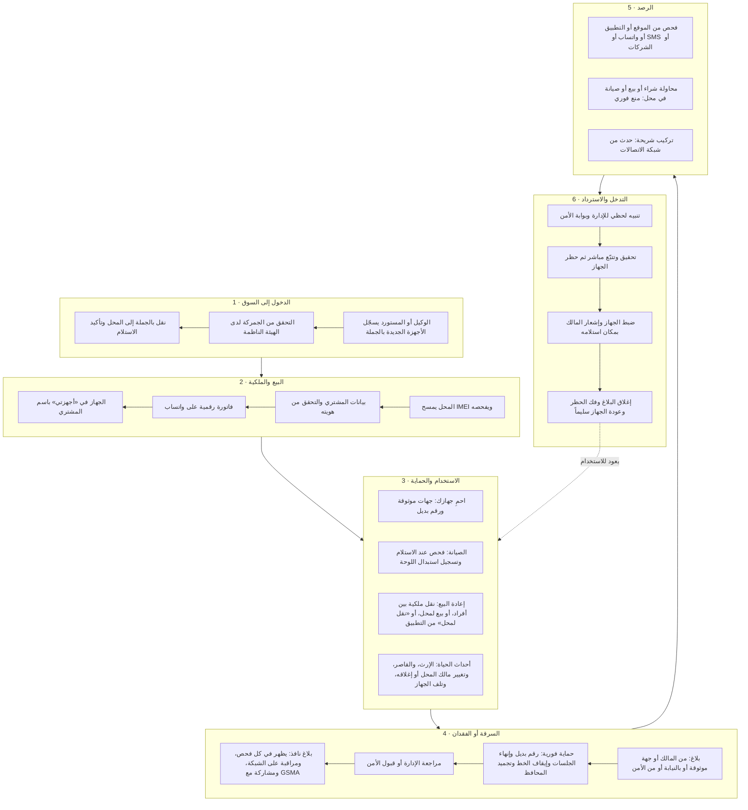

## 2. حالات الجهاز

«قيد المراجعة» وسم فوق أي عهدة لا حالة مستقلة، والرموز المعتمدة في [التصميم التقني](19-technical-design.md) §8.2. وكل سهم يغيّر الملكية أو العهدة يمر بحارس الحيازة ويعيد الفحص ([الترابط والسيناريوهات](26-scenarios-and-linkage.md) §6).

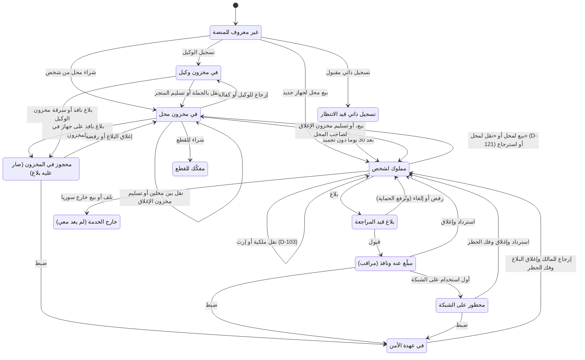

**قيود فوق أي حالة** (لا تغيّر الحالة، وتمنع أفعالاً محددة):

| القيد | يظهر حين | يمنع |
|---|---|---|
| المالك متوفى | تأكيد الوفاة (D-103) | النقل والبيع والشهادة حتى تنفيذ الإرث |
| في عهدة الأمن | الضبط | النقل والشهادة وتغيير المفوّضين وإتمام التسجيل الذاتي |
| قد يكون منسوخاً | ظهور الرقم على أجهزة كثيرة (D-120) | الإرسال الآلي للمراقبة والحظر: تقرره جهة الأمن |
| محجوز لعملية | نقل أو طلب متجر أو معاملة معلّقة أو إرث قائم | دخول الجهاز في عملية أخرى |

## 3. البلاغ من التقديم حتى الإغلاق

التسلسل التفصيلي:

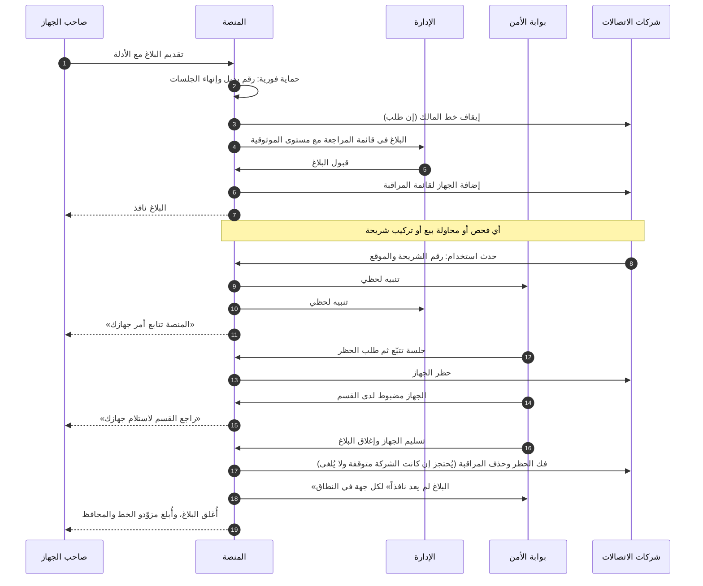

- البلاغ العاجل من جهة موثوقة يدخل المراجعة مباشرة والحماية مطبّقة، ويؤكده المالك خلال ⚙️ 72 ساعة وإلا يُرفض **وتُرفع الحماية**. وكل خروج من البلاغ دون نفاذ (رفض، أو إلغاء، أو رفض المالك) يرفع الحماية كذلك.
- إذا كان الجهاز مسجّلاً باسم غير المبلّغ يصل الحائز المسجّل إشعار محايد برابط اعتراض بعد القبول (D-119).
- إذا كان الجهاز داخل عملية (مخزون، أو صيانة، أو نقل، أو طلب متجر) عند القبول، يُحجز هناك ويصل الأمن تنبيه عاجل ([الترابط والسيناريوهات](26-scenarios-and-linkage.md) §3.2).

## 4. مسار الرصد والتنبيهات

المخطط التفصيلي:

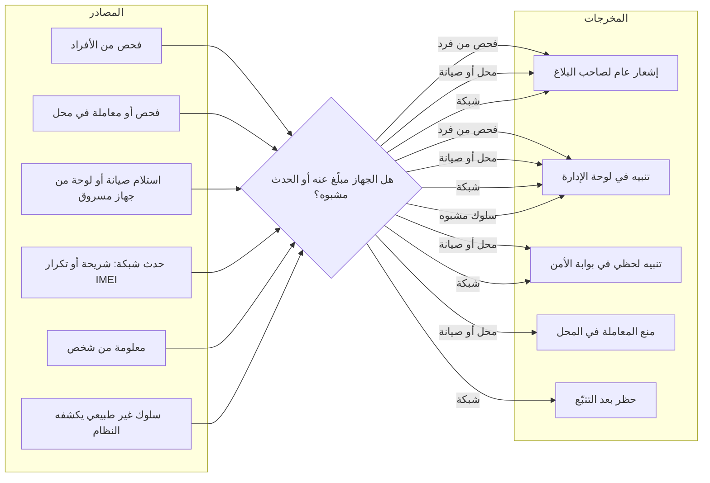

- حدث الشبكة لجهاز بلاغه لم يعد نافذاً، أو حدث قديم وصل متأخراً، **لا يصل الأمن تنبيهاً حياً**، ويُحفظ في سجل الجهاز للإدارة.
- شريحة المالك نفسه في جهاز استعاده: تأجيل الحظر ⚙️ 24 ساعة وتنبيه موسوم «غالباً المالك».
- IMEI منسوخ على أجهزة كثيرة: البلاغ نافذ داخل المنصة، والمراقبة والحظر على الشبكات بقرار جهة الأمن (D-120).
- تنبيهات الأمن لحظية في كل أيام السنة، والإدارة خارج الدوام تتلقى خلاصة عند بدء الدوام (D-85).

## 5. دورات الحياة الأخرى

### 5.1 الحساب

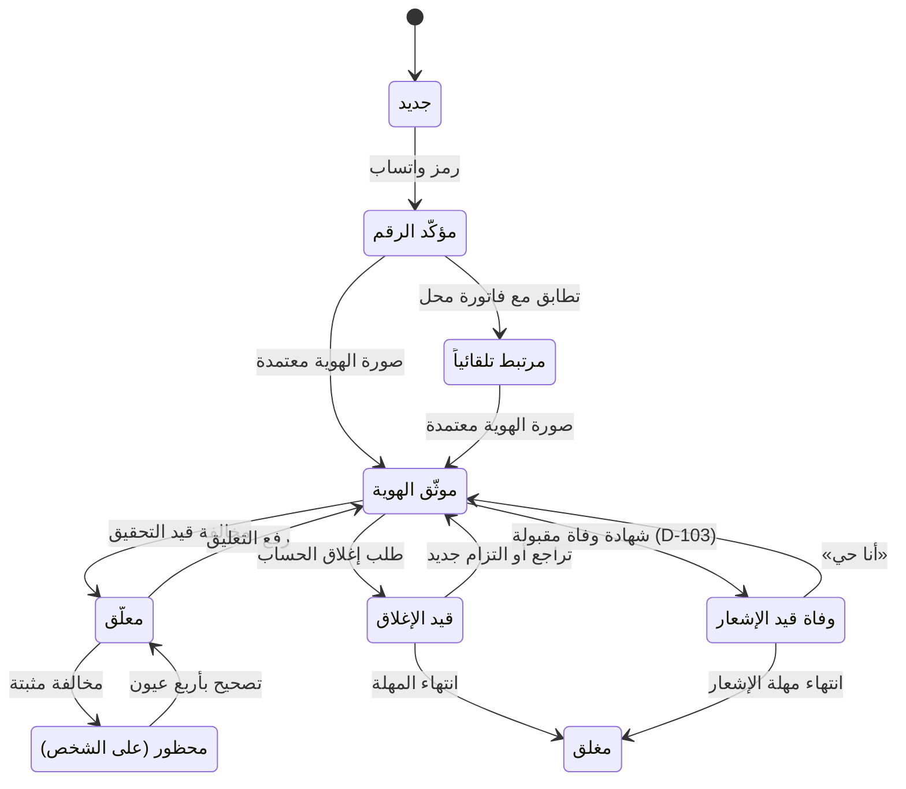

| الحالة | ما يبقى لصاحبها |
|---|---|
| معلّق | العرض، وبلاغ سرقة جهازه، والدعم، والخروج المالي إن كان يملك محلاً |
| محظور | على **الشخص** طوال المدة: لا حساب جديد، ولا محل، ولا دور جهة موثوقة أو وصي. ويبقى: فحص أجهزته، وبيع جهازه في محل، والدعم، وبلاغ سرقة جهازه (D-106) |
| مغلق | أجهزته باسمه برقمه الوطني، ويستطيع فتح حساب جديد يرتبط بها إلا المحظور |
| وفاة | الأجهزة تنتقل بالإرث للكنية نفسها أو للوصي (D-103) |

القيود الأخرى (التهدئة بعد تغيير الرقم، وقيد إعادة تعيين كلمة المرور، وتأخيرات السحب) قيود مؤقتة فوق الحالة لا حالات ([الترابط والسيناريوهات](26-scenarios-and-linkage.md) §4.3).

### 5.2 المحل

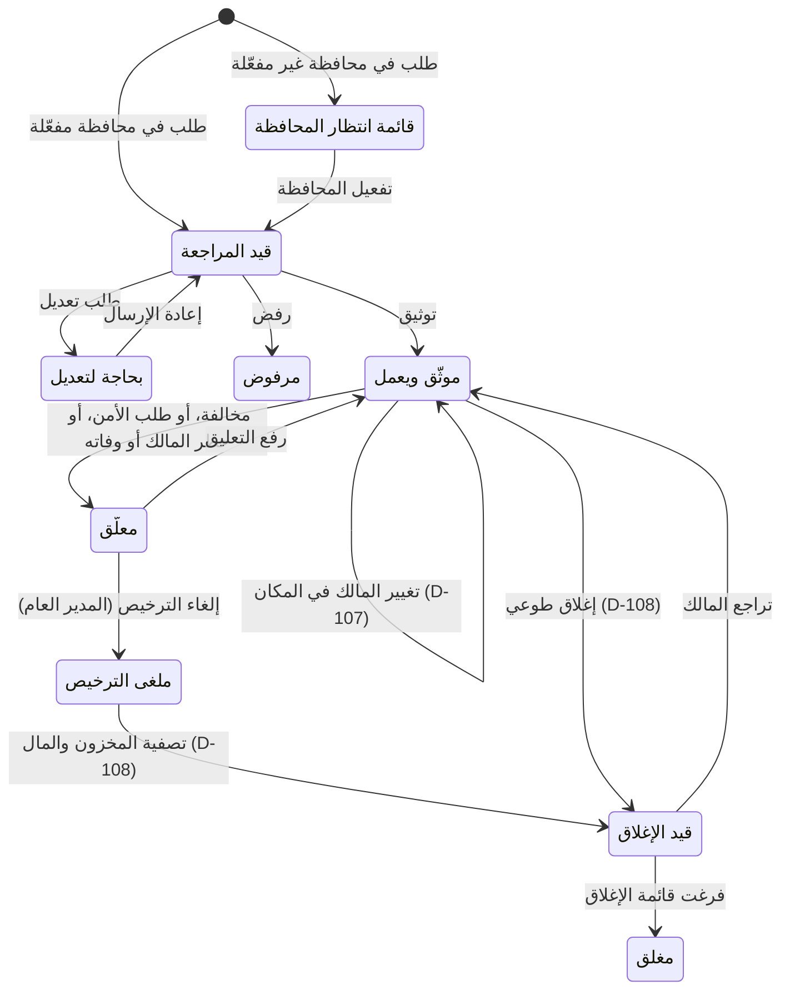

| الحالة | الجوهر |
|---|---|
| معلّق | لا معاملة جديدة في السجل، ويبقى: تسليم الصيانة، وبلاغ سرقة المخزون، والسحب، وقراءة المحاسبة وتصديرها، والطلبات المشحونة. ومدة الاشتراك تستمر وتعاد إن كان التعليق خطأ (D-112) |
| تغيير المالك | الرقم والتاريخ والمخزون باقية، ومحفظة جديدة للمالك الجديد، وصلاحيات الموظفين معادة للضبط، والمحاسبة يقرر مصيرها المالك القديم (D-107) |
| قيد الإغلاق | المخزون يُباع أو يُسلَّم قبل الإغلاق. وفي الإلغاء دون احتيال ينتقل لصاحب المحل شخصياً، وفي الاحتيال يُجمَّد حتى قرار الأمن (D-108) |
| مغلق | يبقى لصاحبه تصدير محاسبته وفواتيره ⚙️ 12 شهراً، والفواتير قابلة للتحقق |

### 5.3 الجهاز على شبكات الاتصالات

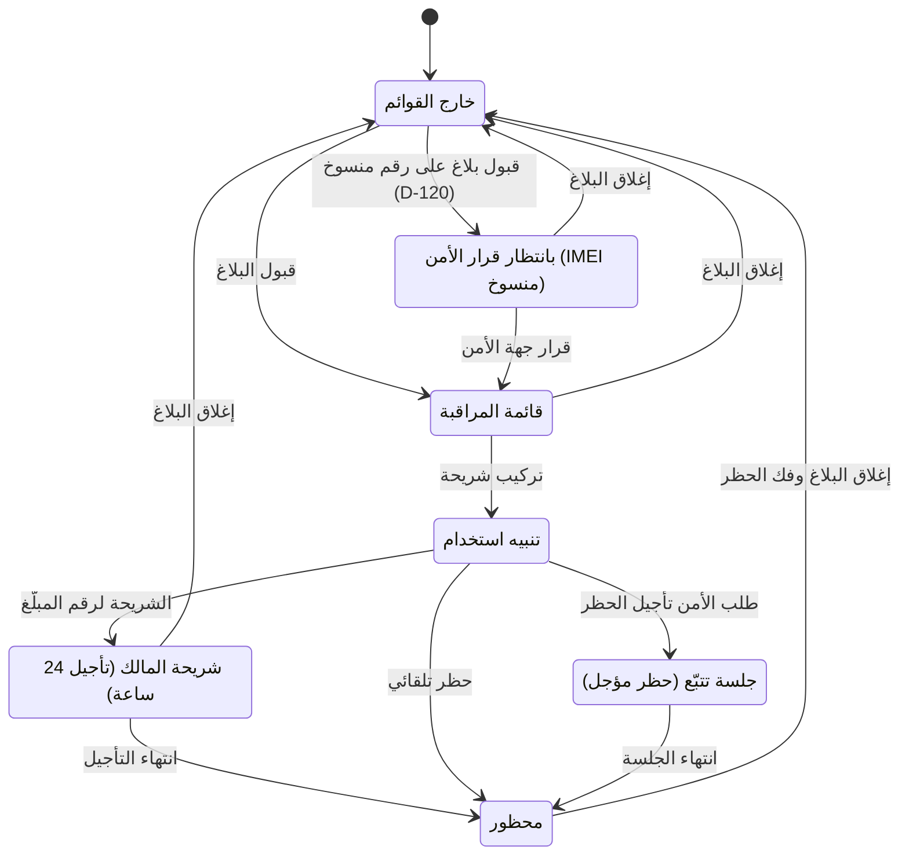

- طلب الإزالة وفك الحظر **لا يُلغى أبداً**: إن كانت الشركة متوقفة أو لم توقّع بعد يُحتجز ويُرسل عند عودتها بعد مطابقة كاملة، والإزالة قبل الإضافة.

### 5.4 التسجيل الذاتي

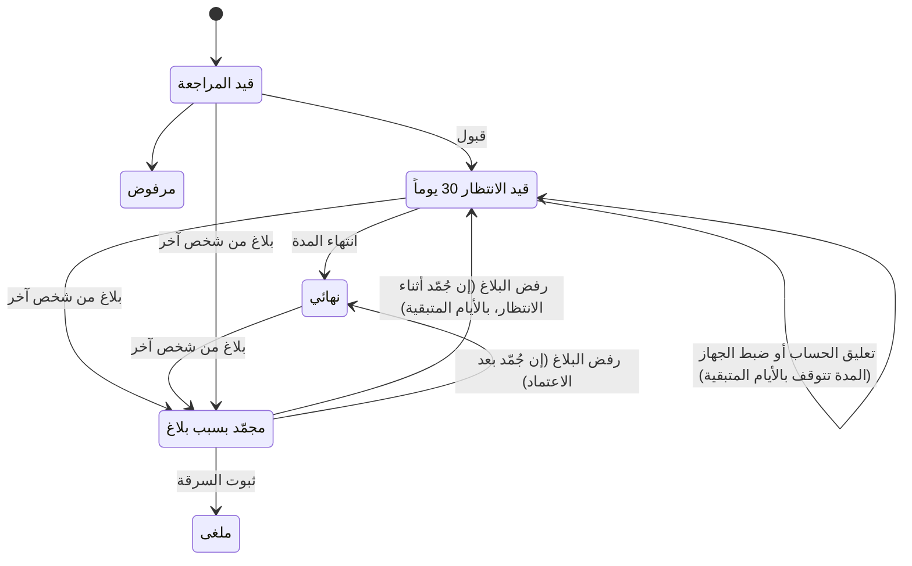

- الموثوقية لاحقاً 🟡 أياً كان أصل الجهاز، حتى لجهاز أدخله مسافر بأصل «جمركة»، إلا إذا ذكر سجل الجمركة الرقم الوطني نفسه.

### 5.5 الإرث (D-103)

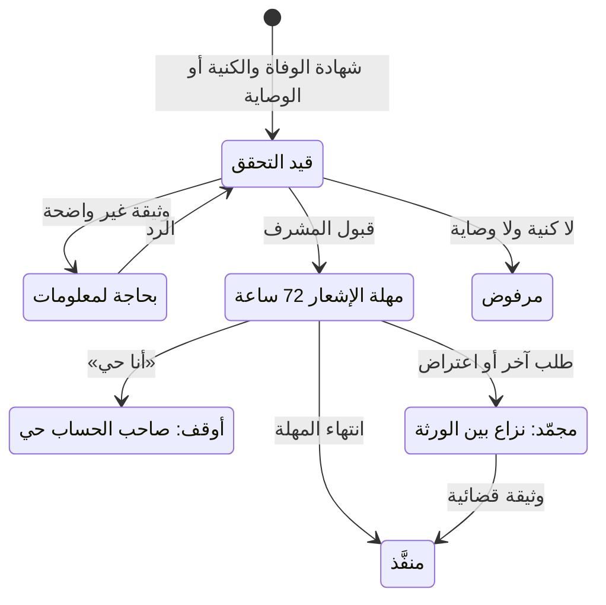

### 5.6 الجهاز المضبوط

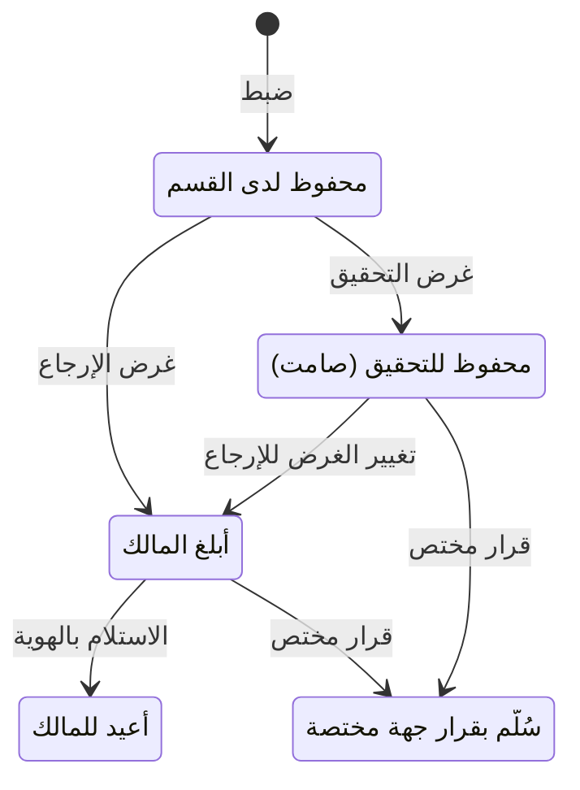

- تذكير المالك بعد ⚙️ 7 و30 يوماً، وبعد ⚙️ 90 يوماً قائمة «لم يُستلم» للجهة. والتسليم لغير المالك لا يغيّر الملكية إلا بتصحيح موثّق.

### 5.7 أمر الصيانة

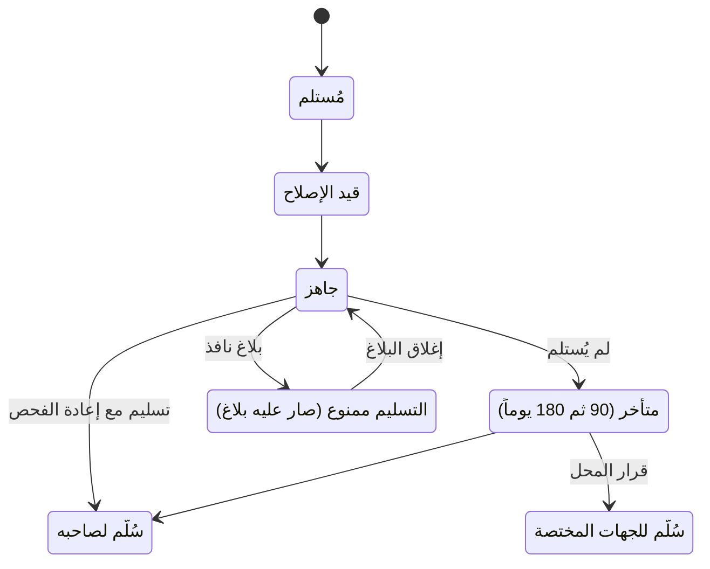

## 6. الإيقاع التشغيلي: ماذا يحدث ومتى

| التوقيت | ما يحدث | المسؤول |
|---|---|---|
| **لحظياً** | التنبيهات الأمنية وتنبيهات الشبكة، والإشعارات، ومنع المعاملات المشبوهة، والحماية الفورية عند البلاغ | النظام آلياً، والإدارة، وبوابة الأمن |
| **خلال ساعات** | مراجعة البلاغات وطلبات الإغلاق والهويات والمحلات حسب الأولوية والمهلة | مشرفو الإدارة |
| **يومياً** | مطابقة القوائم مع شركات الاتصالات، والنسخ الاحتياطي، ومراقبة صحة النظام والتكاملات | النظام آلياً، والإدارة |
| **أسبوعياً** | مراجعة المحلات المتعارضة وغير النشطة، ومراجعة تنبيهات السلوك غير الطبيعي | مشرف المحلات والمدير العام |
| **شهرياً** | تقرير التزام المحلات لوزارة الداخلية، والتحديثات الأمنية | مشرف المحلات، وفريق التشغيل |
| **دورياً** | استيراد بلاغات قوى الأمن، واختبار استعادة النسخ الاحتياطي، واختبار الاختراق | الإدارة وفريق التشغيل |
| **أسبوعياً** | مراجعة الأسباب «99» وسجل الحالات غير المتوقعة، وتحويل المتكرر لقواعد ([الترابط والسيناريوهات](26-scenarios-and-linkage.md) §13) | المدير العام |
| **عند تعديل التقويم** | إعادة حساب كل مهل الدوام المفتوحة وتنبيهات 80% (D-123) | النظام آلياً |
| **عند إطفاء ميزة** | تتوقف الطلبات الجديدة، ويكمل القائم حتى نهايته، والمسارات المحمية لا تتوقف (26 §11) | المدير العام والنظام |

- «أيام الدوام» حسب تقويم الدولة الرسمي: عطلة الجمعة والسبت، والأعياد والعطل الرسمية، ودوام رمضان المخفّض، ويحدّثها المدير العام عند إعلانها (D-123). وما يجري آلياً يجري كل يوم، وكل مهمة دورية فاتها موعدها تُعوَّض مرة واحدة أو تُتخطى حسب نوعها.
- مهل الإدارة بساعات الدوام، ومهل المستخدم بالساعات المطلقة وتتمدد إن منعه عطل، ومهل الأمان لا تتحرك أبداً ([الترابط والسيناريوهات](26-scenarios-and-linkage.md) §12).

## 7. من يفعل ماذا

| الجزء من الدورة | المواطن | المحل | الوكيل | الإدارة | الأمن | الاتصالات | الأحوال المدنية |
|---|---|---|---|---|---|---|---|
| دخول الجهاز | | يؤكد الاستلام | يسجّل وينقل | يوثّق الوكلاء | | | |
| البيع والملكية | يستلم الفاتورة | يفحص ويبيع | | يوثّق المحلات | | | يتحقق من الهوية |
| الاستخدام والصيانة | يحمي جهازه | يستلم ويصلح | | | | | |
| إعادة البيع | ينقل الملكية | يشتري بعد الفحص | | يراجع التعارضات | | | يتحقق من الهوية |
| السرقة | يبلّغ | | | تراجع وتقبل | يقبل ويضيف بلاغات | يوقف الخط ويراقب | |
| الرصد | يُشعَر فقط | يمتنع عن الشراء | | تتابع التنبيهات | يتابع لحظياً | يرسل الأحداث | |
| الاسترداد | يستلم جهازه | | | تغلق البلاغ | يتتبّع ويضبط ويسلّم | يحظر ثم يفك الحظر | |
| الإرث (D-103) | يطلب بشهادة الوفاة، أو يضغط «أنا حي» | | | تتحقق من الشهادة والكنية أو الوصاية | يتلقى إحالة الشهادات المزوّرة | | تؤكد حالة الوفاة عند الربط |
| تغيير مالك المحل أو إغلاقه (D-107، D-108) | | يطلب، ويسحب رصيده، ويصفّي مخزونه | يصفّي مخزونه | تراجع، وينفّذ المدير العام الإلغاء | يقرر في مخزون المحل الملغى للاحتيال | | |

## 8. قصة جهاز من البداية للنهاية

| التاريخ | الحدث |
|---|---|
| 01/03/2026 | وكيل في دمشق يسجّل ألف جهاز جديد، منها Samsung Galaxy A54، والهيئة تؤكد جمركتها |
| 05/03/2026 | الوكيل ينقل 50 جهازاً لمحل الأمل، والمحل يؤكد الاستلام |
| 12/03/2026 | أحمد يشتري الجهاز، فتصله الفاتورة على واتساب ويظهر الجهاز في «أجهزتي» |
| 20/03/2026 | أحمد يضيف أخاه جهة موثوقة، ويفعّل Find My |
| 02/09/2026 | الجهاز يُسرق مع شريحة أحمد. أخوه يقدّم بلاغاً عاجلاً، فتُنهى الجلسات ويُوقف الخط وتُجمّد المحفظة فوراً |
| 02/09/2026 | أحمد يؤكد البلاغ عبر الدعم الفني بهويته، والإدارة تقبله (موثوقية 🟢 موثّق)، والجهاز يدخل قائمة المراقبة |
| 04/09/2026 | محل في حمص يحاول شراء الجهاز: «لا تشترِ هذا الجهاز»، وتنبيه لحظي للأمن |
| 06/09/2026 | السارق يركّب شريحة: الشبكة ترسل رقمها وموقعها، والأمن يفتح جلسة تتبّع |
| 07/09/2026 | الأمن يضبط الجهاز، ويُطلب حظره. أحمد يصله: «راجع القسم لاستلام جهازك» |
| 08/09/2026 | أحمد يستلم جهازه، والبلاغ يُغلق، والحظر يُفك، والجهاز يعود «لا توجد بلاغات» |

## 9. الدورات من البداية إلى النهاية

كل دورة هنا جدول قفزات كامل في [الترابط والسيناريوهات](26-scenarios-and-linkage.md) §8: المحفّز، والفاعل، وما يُسلَّم، والشرط، وما يراه كل طرف، والإشعار، والمؤقّت، وفرع الفشل.

| الدورة | من | إلى | التفصيل |
|---|---|---|---|
| حياة الجهاز | تسجيل الوكيل | الاسترداد وشهادة جديدة | 26 §8.1 |
| البلاغ من كل مصدر | المالك، والمفوّض، والجهة الموثوقة، والدعم، والمحل، والوكيل، والأمن | النفاذ أو الرفض مع رفع الحماية | 26 §8.2 |
| حياة المحل | التسجيل | تغيير المالك أو الإغلاق | 26 §8.3، §7.6، §7.7 |
| حساب المواطن | التثبيت | الإغلاق أو الوفاة | 26 §8.4، §7.1 |
| الأمن | تأهيل الجهة | إغلاق القضية | 26 §8.5 |
| موظفو الإدارة | الإنشاء | المغادرة | 26 §8.6 |
| المورّد وشركة الشحن | الاعتماد | الإنهاء | 26 §8.7 |
| الفحص العام | الفحص | الإيصال أو «وجدته» | 26 §8.8 |

## 10. ماذا لو؟

| السؤال | الجواب |
|---|---|
| ماذا يحدث لكل ما يرتبط بكيان حين تتغير حالته؟ | 26 §3 |
| من يستطيع ماذا في كل حالة؟ | 26 §4، §5 |
| كيف يتحرك الجهاز بين أيدٍ مختلفة دون أن تضيع ملكيته؟ | 26 §6 |
| الوفاة، والقاصر، ودون هوية سورية، والمؤسسات، والحظر، وتغيير مالك المحل وإغلاقه، والفروع | 26 §7 |
| بلاغان على جهاز، أو بلاغ وبيع في اللحظة نفسها | 26 §9 |
| تعطّلت شركة أو واتساب أو انقطع الإنترنت الدولي | 26 §10 |
| أُطفئت ميزة وفيها عمل قائم أو مال مدفوع | 26 §11 |
| حالة لم يذكرها أحد | 26 §1، §13 |
