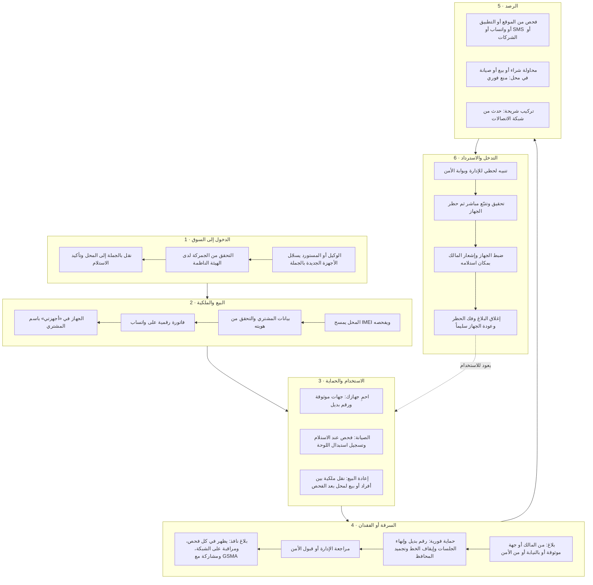
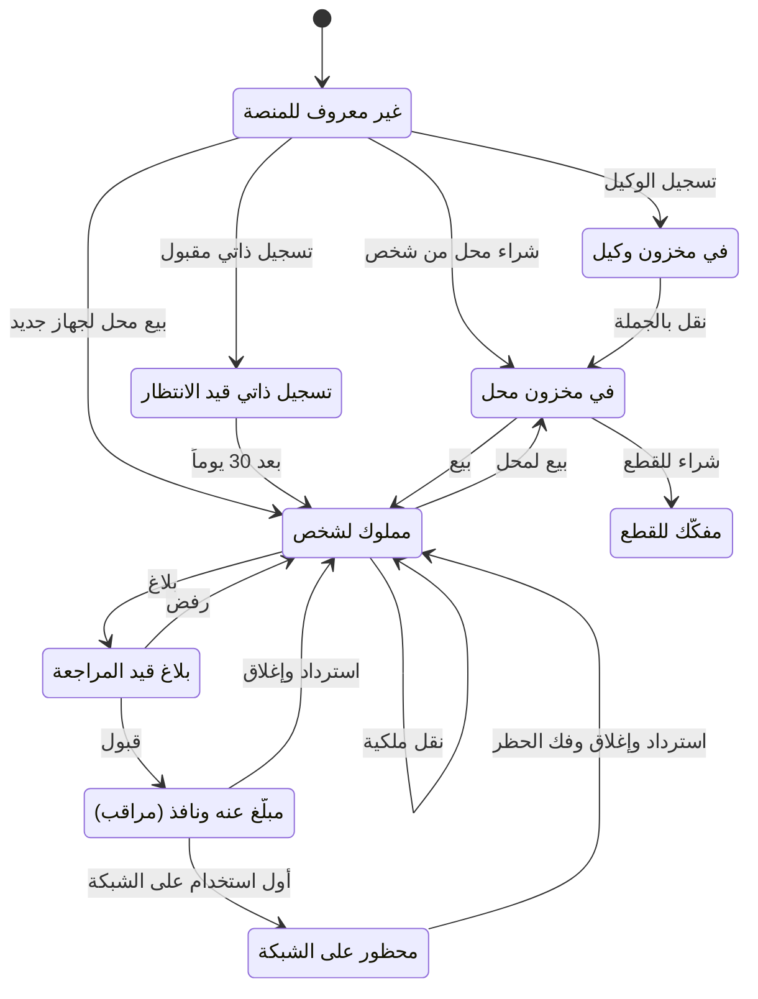
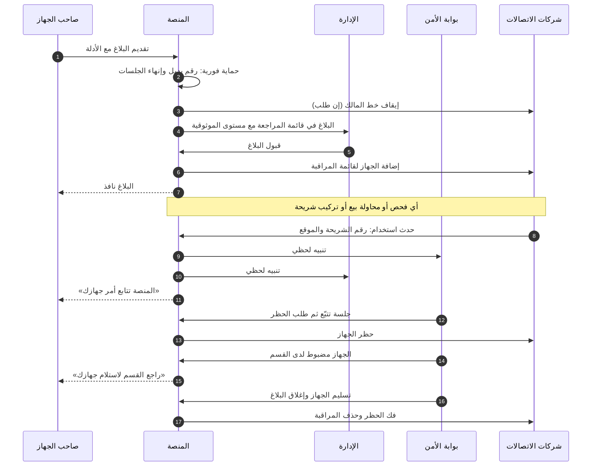
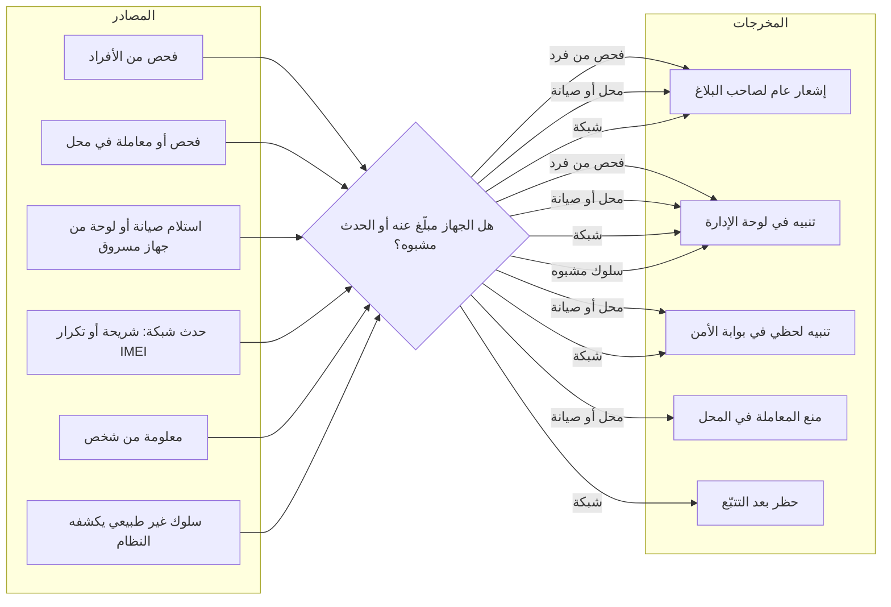
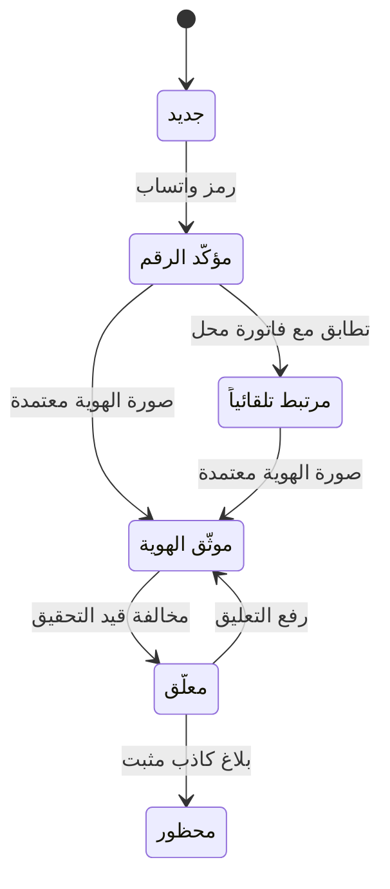
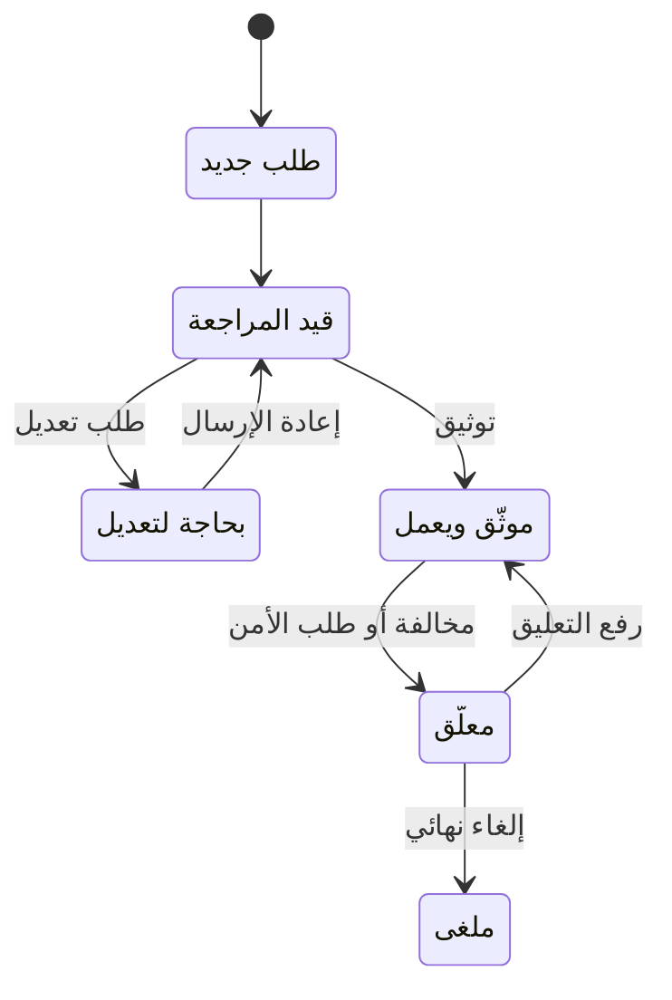
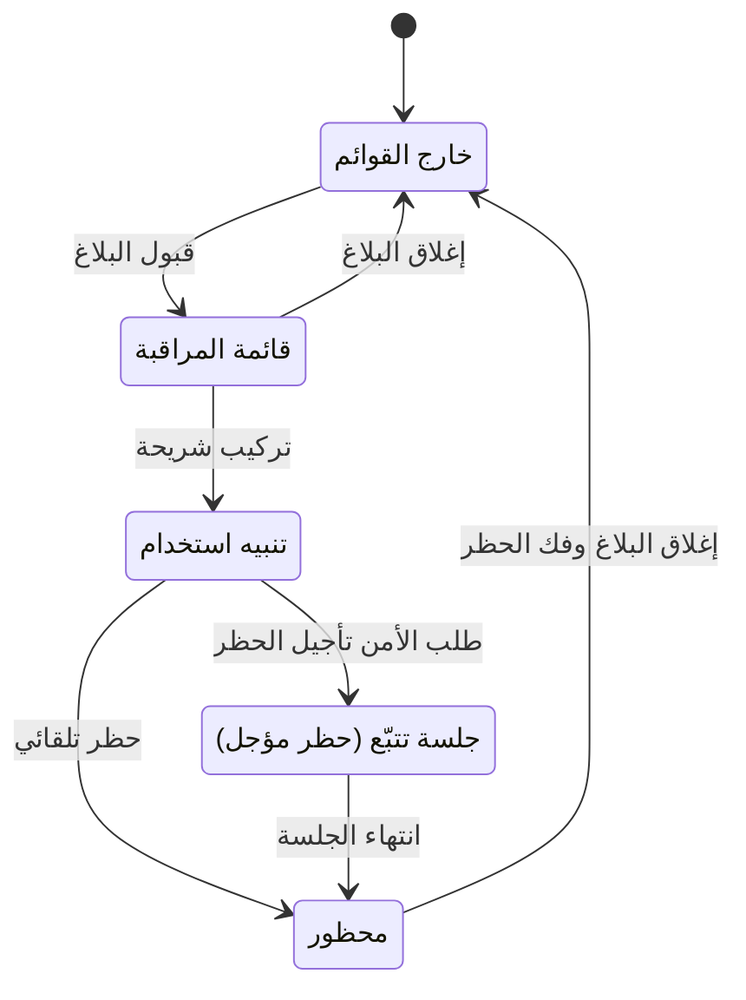
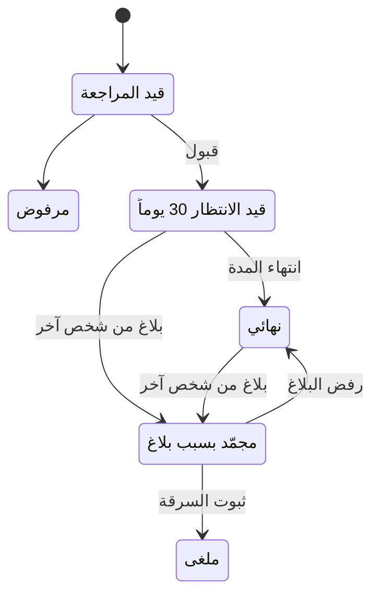

# 14 — الدورة التشغيلية الكاملة

> خريطة لكل ما يحدث في المنصة، من لحظة دخول الجهاز إلى سوريا حتى عودته لصاحبه بعد سرقته (D-73). الصور بالثيمين وصور المخططات التفصيلية في [معرض التصاميم](../design/README.md). التفاصيل الدقيقة لكل خطوة في [المتطلبات](04-functional-requirements.md) و[قواعد العمل](06-business-rules.md).

---

## 1. الصورة الكاملة: حياة الجهاز في بصمة

المخطط التفصيلي:

## 2. حالات الجهاز

## 3. البلاغ من التقديم حتى الإغلاق

التسلسل التفصيلي:

## 4. مسار الرصد والتنبيهات

المخطط التفصيلي:

## 5. دورات الحياة الأخرى

### 5.1 الحساب

### 5.2 المحل

### 5.3 الجهاز على شبكات الاتصالات

### 5.4 التسجيل الذاتي

## 6. الإيقاع التشغيلي: ماذا يحدث ومتى

| التوقيت | ما يحدث | المسؤول |
|---|---|---|
| **لحظياً** | التنبيهات الأمنية وتنبيهات الشبكة، والإشعارات، ومنع المعاملات المشبوهة، والحماية الفورية عند البلاغ | النظام آلياً، والإدارة، وبوابة الأمن |
| **خلال ساعات** | مراجعة البلاغات وطلبات الإغلاق والهويات والمحلات حسب الأولوية والمهلة | مشرفو الإدارة |
| **يومياً** | مطابقة القوائم مع شركات الاتصالات، والنسخ الاحتياطي، ومراقبة صحة النظام والتكاملات | النظام آلياً، والإدارة |
| **أسبوعياً** | مراجعة المحلات المتعارضة وغير النشطة، ومراجعة تنبيهات السلوك غير الطبيعي | مشرف المحلات والمدير العام |
| **شهرياً** | تقرير التزام المحلات لوزارة الداخلية، والتحديثات الأمنية | مشرف المحلات، وفريق التشغيل |
| **دورياً** | استيراد بلاغات قوى الأمن، واختبار استعادة النسخ الاحتياطي، واختبار الاختراق | الإدارة وفريق التشغيل |

## 7. من يفعل ماذا

| المرحلة | المواطن | المحل | الوكيل | الإدارة | الأمن | الاتصالات | الأحوال المدنية |
|---|---|---|---|---|---|---|---|
| دخول الجهاز | | يؤكد الاستلام | يسجّل وينقل | يوثّق الوكلاء | | | |
| البيع والملكية | يستلم الفاتورة | يفحص ويبيع | | يوثّق المحلات | | | يتحقق من الهوية |
| الاستخدام والصيانة | يحمي جهازه | يستلم ويصلح | | | | | |
| إعادة البيع | ينقل الملكية | يشتري بعد الفحص | | يراجع التعارضات | | | يتحقق من الهوية |
| السرقة | يبلّغ | | | تراجع وتقبل | يقبل ويضيف بلاغات | يوقف الخط ويراقب | |
| الرصد | يُشعَر فقط | يمتنع عن الشراء | | تتابع التنبيهات | يتابع لحظياً | يرسل الأحداث | |
| الاسترداد | يستلم جهازه | | | تغلق البلاغ | يتتبّع ويضبط ويسلّم | يحظر ثم يفك الحظر | |

## 8. قصة جهاز من البداية للنهاية

| التاريخ | الحدث |
|---|---|
| 01/03/2026 | وكيل في دمشق يسجّل ألف جهاز جديد، منها Samsung Galaxy A54، والهيئة تؤكد جمركتها |
| 05/03/2026 | الوكيل ينقل 50 جهازاً لمحل الأمل، والمحل يؤكد الاستلام |
| 12/03/2026 | أحمد يشتري الجهاز، فتصله الفاتورة على واتساب ويظهر الجهاز في «أجهزتي» |
| 20/03/2026 | أحمد يضيف أخاه جهة موثوقة، ويفعّل Find My |
| 02/09/2026 | الجهاز يُسرق مع شريحة أحمد. أخوه يقدّم بلاغاً عاجلاً، فتُنهى الجلسات ويُوقف الخط وتُجمّد المحفظة فوراً |
| 02/09/2026 | الإدارة تقبل البلاغ (🟢 موثّق)، والجهاز يدخل قائمة المراقبة |
| 04/09/2026 | محل في حمص يحاول شراء الجهاز: «لا تشترِ هذا الجهاز»، وتنبيه لحظي للأمن |
| 06/09/2026 | السارق يركّب شريحة: الشبكة ترسل رقمها وموقعها، والأمن يفتح جلسة تتبّع |
| 07/09/2026 | الأمن يضبط الجهاز، ويُطلب حظره. أحمد يصله: «راجع القسم لاستلام جهازك» |
| 08/09/2026 | أحمد يستلم جهازه، والبلاغ يُغلق، والحظر يُفك، والجهاز يعود «لا توجد بلاغات» |
