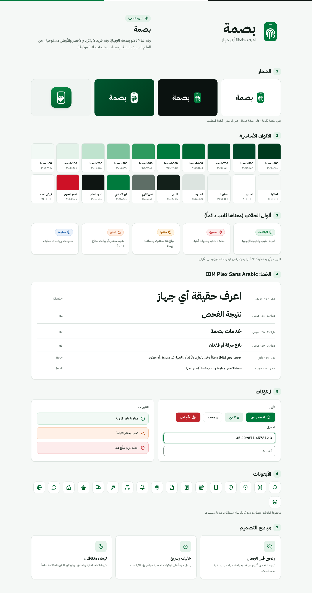

# 15 — الهوية البصرية ونظام التصميم المركزي

> المرجع البصري الوحيد لكل واجهات المنصة (D-74). المصدر التقني لكل القيم هو ملف رموز التصميم [`design/styles/tokens.css`](../design/styles/tokens.css)، وعند التنفيذ ينتقل كما هو إلى حزمة التصميم المشتركة (`packages/ui`). **أي تعديل يتم في مكان واحد وينعكس على كل الواجهات** (D-76).

---

## 1. الاسم

| البند | القيمة |
|---|---|
| الاسم | **بصمة** (اسم عمل قابل للتغيير، Q-01) |
| المعنى | رقم IMEI هو بصمة الجهاز: رقم فريد لا يتكرر |
| الشعار النصي | «اعرف حقيقة أي جهاز» |

## 2. الشعار

- **الرمز:** هاتف بزوايا مستديرة، وفي داخله خطوط بصمة إصبع. يجمع الفكرتين: الجهاز، وهويته الفريدة.
- **الكلمة:** «بصمة» بخط IBM Plex Sans Arabic بوزن عريض (700).
- **الملفات:** [الرمز](../design/assets/logo-mark.svg) · [أيقونة التطبيق](../design/assets/app-icon.svg)

| الاستخدام | الصيغة |
|---|---|
| على خلفية فاتحة | رمز أخضر، وكلمة بلون النص الداكن |
| على خلفية غامقة | رمز أخضر، وكلمة بيضاء |
| على الأخضر | رمز أبيض بخطوط خضراء، وكلمة بيضاء |
| أيقونة التطبيق | مربع أخضر متدرج بزوايا مستديرة، والرمز بخطوط بيضاء |

**قواعد:** مساحة فارغة حول الشعار لا تقل عن نصف عرض الرمز. أصغر حجم للرمز 20 بكسل. **ممنوع:** مطّ الشعار، أو تغيير ألوانه خارج الصيغ أعلاه، أو إضافة ظلال أو تأثيرات عليه.

## 3. الألوان

الأخضر والأبيض مستوحيان من العلم السوري، ليعطيا إحساس منصة وطنية موثوقة. والأسود والأحمر يُستخدمان بحذر.

### 3.1 ألوان الهوية

| الرمز | الفاتح | الغامق | الاستخدام |
|---|---|---|---|
| `brand-500` | `#007A3D` | `#2FAE68` | اللون الأساسي للهوية |
| `brand-600` | `#006834` | `#4CC384` | الروابط والعناصر النشطة |
| `brand-700` | `#00562F` | `#7FD3A3` | نصوص على خلفيات الهوية الفاتحة |
| `brand-100` | `#E3F2E9` | `#133524` | خلفيات الأيقونات والشارات |
| `brand-50` | `#F2F9F5` | `#0F2419` | خلفيات التنبيهات الهادئة |
| `primary` (الزر الأساسي) | `#007A3D` ونص أبيض | `#3DBE77` ونص داكن | كل الأزرار الأساسية |
| `ink` (أسود العلم) | `#0E1512` | — | تذييل الموقع، وأزرار المتاجر |
| `accent-red` (نجوم العلم) | `#CE1126` | — | لمسات محدودة جداً، وليس للحالات |

### 3.2 الأسطح والنصوص

| الرمز | الفاتح | الغامق |
|---|---|---|
| `bg` الخلفية | `#F5F8F6` | `#0B1210` |
| `surface` السطح | `#FFFFFF` | `#121B17` |
| `surface-2` | `#F0F4F2` | `#18231E` |
| `border` الحدود | `#DCE4E0` | `#26342D` |
| `text` النص | `#13201A` | `#E6EEEA` |
| `text-muted` النص الثانوي | `#5E6E66` | `#93A39B` |

### 3.3 ألوان الحالات (معناها ثابت دائماً)

| الحالة | الفاتح | الغامق | المعنى |
|---|---|---|---|
| `clean` لا بلاغات | `#0E7A3F` | `#55C98A` | النتيجة الإيجابية |
| `stolen` مسروق | `#C0262D` | `#F2777B` | خطر: لا تشترِ، وتنبيهات أمنية |
| `lost` مفقود | `#A85B00` | `#F0B056` | مبلّغ عنه كمفقود |
| `warn` تحذير | `#B4430B` | `#F39563` | تقليد محتمل، أو بيانات تحتاج انتباهاً |
| `info` معلومة | `#1C5FA8` | `#79AEF0` | إرشادات محايدة |

**قاعدة:** اللون لا يأتي وحده أبداً، بل مع أيقونة ونص، ليفهمه المصابون بعمى الألوان (THEME-03).

## 4. الخط

**IBM Plex Sans Arabic** (رخصة مفتوحة OFL)، يُستضاف داخل المنصة دون الاعتماد على خدمات خارجية. والأرقام بالصيغة الإنكليزية (0-9) في الواجهات، مع قبول الأرقام العربية في الإدخال.

| المستوى | الحجم | الوزن |
|---|---|---|
| عرض (Display) | 48 | 700 |
| عنوان 1 | 34 | 700 |
| عنوان 2 | 26 | 700 |
| عنوان 3 | 20 | 700 |
| نص | 16 (ارتفاع السطر 1.75) | 400 |
| صغير | 14 | 400–500 |
| ملاحظة | 12.5 | 400 |

## 5. الأيقونات

مجموعة أيقونات خطية موحّدة (Lucide)، بسماكة 2 وزوايا مستديرة، وبلون الهوية أو النص. لا تُخلط مع مجموعات أخرى.

## 6. المسافات والزوايا والظلال

| النوع | القيم |
|---|---|
| المسافات (مضاعفات 4) | 4، 8، 12، 16، 20، 24، 32، 40، 48، 64، 80 |
| الزوايا | 8 (صغيرة)، 12 (حقول وأزرار)، 16 (بطاقات)، 24 (نوافذ وأقسام مميزة) |
| الظلال | خفيفة للبطاقات، ومتوسطة للعناصر الطافية، وكبيرة للنوافذ المنبثقة |

## 7. الثيمان الفاتح والغامق (D-75)

- كل الواجهات بالثيمين: الموقع، والتطبيق، ولوحة الإدارة، وبوابة الأمن.
- الافتراضي يتبع إعداد الجهاز، ويستطيع المستخدم التبديل من زر في الرأس ويُحفظ اختياره.
- ألوان الحالات تحافظ على معناها في الثيمين.
- **الوثائق المطبوعة** (الفواتير، والإيصالات، والشهادات، والتقارير) **فاتحة دائماً**.
- في الغامق: الأزرار الأساسية خضراء فاتحة بنص داكن لوضوح أعلى.

## 8. نبرة الكتابة

- فصحى مبسطة، وجمل قصيرة، وأفعال واضحة: «افحص الآن»، «بلّغ عن جهازك».
- النتيجة أولاً، ثم التفاصيل.
- لا لوم ولا تهويل. وفي حالات الخطر نذكّر بالسلامة: «لا تحاول مواجهة البائع».
- نذكر حدود المنصة بصدق: «النتيجة معلومة وليست ضماناً».

## 9. المركزية في التنفيذ

| الطبقة | المصدر الواحد |
|---|---|
| الألوان والخطوط والمسافات | رموز التصميم (`tokens.css`، ثم `packages/ui`) |
| المكوّنات (أزرار، حقول، بطاقات، حالات) | مكتبة مكوّنات واحدة لكل الواجهات |
| الشعار والاسم واللون الأساسي | من لوحة الإدارة مع فحص الوضوح (SMART-02) |
| النصوص والمحتوى | من لوحة الإدارة (SMART-01) |

### 9.1 تمييز الواجهات ضمن الهوية الواحدة

| الواجهة | ما يميّزها | المصدر |
|---|---|---|
| التطبيق (آيفون وأندرويد) | تطبيق واحد يتغيّر شريطه السفلي حسب الدور (زائر، مواطن، محل، صيانة)، مع زر الفحص في المنتصف. يتبع أعراف كل نظام: شريط الحالة المعكوس في العربية، ومؤشر التبويب النشط بشكل كبسولة في أندرويد | `styles/app.css` |
| لوحة المحل والوكيل على الموقع | الهيكل المشترك للوحات: قائمة جانبية بلون السطح، وشريط علوي فيه البحث | `styles/panel.css` |
| لوحة الإدارة | الهيكل نفسه، مع أعداد قوائم العمل في القائمة الجانبية، والبحث الموحّد | `styles/panel.css` |
| بوابة قوى الأمن | الهيكل نفسه، لكن القائمة الجانبية **داكنة في الثيمين** ليعرف العنصر فوراً أنه في البوابة الرسمية، ونطاقه ظاهر دائماً في الشريط العلوي | `styles/panel.css`، `styles/police.css` |

الوثائق المطبوعة (الفاتورة، والشهادة، والإيصال، وتقرير الأمن) تبقى بيضاء في الثيمين لأنها للطباعة والمشاركة.

## 10. الملفات

- [لوحة الهوية (فاتح)](../design/screens/brand/light/01-identity.png) · [لوحة الهوية (غامق)](../design/screens/brand/dark/01-identity.png)
- [رموز التصميم](../design/styles/tokens.css) · [المكوّنات](../design/styles/components.css) · [مكوّنات التطبيق](../design/styles/app.css) · [هيكل اللوحات](../design/styles/panel.css)
- [معرض تصاميم الشاشات](../design/README.md)
