# 18 — قائمة الشاشات وخريطة التنقّل

> المرجع الذي يبني منه المصممون ومطوّرو الواجهات: كل شاشة في كل واجهة ولكل دور، بمعرّف ثابت `S-<AREA>-NN`، ومن يراها، وعلى أي منصة، ولماذا، وأي متطلبات تنفّذ، وعناصرها وإجراءاتها، وحالاتها الخاصة. ومعها خريطة تنقّل لكل واجهة، وسلوك الموقع الإلكتروني على الكمبيوتر مقابل التطبيق (D-79)، وشريط التطبيق السفلي لكل دور (D-44)، ومصفوفة تثبت أن كل متطلب له واجهة في [المتطلبات الوظيفية](04-functional-requirements.md) يظهر في شاشة واحدة على الأقل. المصطلحات بمعانيها في [مسرد المصطلحات](17-glossary.md)، والنصوص الحرفية والرسائل والأخطاء في [كتالوج المحتوى](24-content-catalog.md). وما يُسمح لكل فاعل في كل حالة على مستوى العمل في [الترابط والسيناريوهات](26-scenarios-and-linkage.md) §4 و§5، وهذه الوثيقة تحوّله إلى شاشات وحالات.

---

## 1. طريقة القراءة

### 1.1 المناطق والمعرّفات

| المنطقة | المعرّف | الواجهة | النطاق (الدومين) | المستخدمون |
|---|---|---|---|---|
| الموقع العام | `S-PUB-NN` | صفحات الجمهور وصفحات التحقق، وتُعرض شاشات الفحص منها في التطبيق أيضاً | الموقع العام | الجميع |
| الدخول والتسجيل | `S-AUT-NN` | إنشاء الحساب، والدخول، ورمز التحقق، والاستعادة، وتفعيل الموظف | الموقع العام والتطبيق | الحسابات العامة |
| حساب المواطن | `S-USR-NN` | الأجهزة، والبلاغات، والملكية، والحماية، والدعم، والإعدادات. شاشات مشتركة بين الموقع والتطبيق | الموقع العام والتطبيق | المستخدم، والمفوّض، والجهة الموثوقة |
| المحل | `S-SHP-NN` | لوحة المحل، والشراء والبيع، والفواتير، والموظفون، والمتجر، والمحفظة وتعبئة الرصيد، وبرنامج المحاسبة، والباقة | الموقع العام والتطبيق | صاحب المحل، وموظف المحل |
| الصيانة | `S-RPR-NN` | استلام أجهزة الصيانة وتسليمها واستبدال اللوحة | الموقع العام والتطبيق | محل الصيانة وموظفوه |
| الوكيل | `S-IMP-NN` | التسجيل بالجملة، والمخزون، والنقل للمحلات | الموقع العام والتطبيق | مسؤول الوكيل وموظفوه |
| المورّد | `S-SUP-NN` | لوحة المورّد: المنتجات، والطلبات المسندة، وكشوف التسوية | الموقع العام | المورّد المعتمد |
| مندوب الشحن | `S-CUR-NN` | مهام التوصيل والاستلام والتسليم والقبض، ومندوبو شركة الشحن لمديرها | الموقع العام (موبايل) | مندوب المنصة أو شركة الشحن، ومدير شركة الشحن |
| عميل الربط البرمجي | `S-BIZ-NN` | لوحة الشركة المرتبطة: الاشتراك والحصة، والمفاتيح، والأعضاء، والاستخدام والفواتير | الموقع العام فقط | مسؤول العميل ومطوّروه |
| التطبيق | `S-APP-NN` | ما لا يوجد إلا في التطبيق: الإقلاع، والتحديث، والأذونات، والماسحات، والكاميرا، وبلا اتصال | التطبيق | الجميع |
| لوحة الإدارة | `S-ADM-NN` | قوائم العمل والمراجعات والتنبيهات والتجاري والإعدادات | نطاق الإدارة المنفصل | الأدوار الإدارية |
| بوابة الأمن | `S-POL-NN` | التنبيهات اللحظية، والبحث، والتحقيق، والمضبوطات | نطاق البوابة المنفصل | مسؤول أمن، وعنصر أمن |
| بوت واتساب | `S-BOT-NN` | حالات المحادثة مع رقم الفحص ورقم الدعم والرقم التجاري | واتساب | الجميع |
| الرسائل النصية | `S-SMS-NN` | ردود الرقم القصير | SMS | الجميع |
| الوثائق المطبوعة | `S-PRN-NN` | الفواتير والإيصالات والشهادات والتقارير بصيغة PDF أو للطباعة | PDF وطابعة | حسب الوثيقة |

> منطقتا `S-PRN` و`S-CUR` أضافتهما هذه الوثيقة: الأولى لتمييز الوثائق المطبوعة عن الشاشات، والثانية لمندوب الشحن (STORE-09). ومنطقة `S-BIZ` لعميل الربط البرمجي الذي ينشئ مفاتيحه بنفسه ولا يرى أحد من المنصة سرّها ([التصميم التقني](19-technical-design.md) §3.13). ونصوص الوثائق المطبوعة قوالب `T-PDF-NN` في [كتالوج المحتوى](24-content-catalog.md).

### 1.2 أعمدة جداول الشاشات

| العمود | المعنى |
|---|---|
| المعرّف | ثابت لا يُعاد استخدامه. الشاشة المحذوفة يبقى رقمها محجوزاً |
| من يراها | الدور أو العلاقة. وفي الإدارة تُختصر الأدوار الافتراضية: **عام** (المدير العام)، و**بلاغات** (مشرف البلاغات)، و**محلات** (مشرف المحلات)، و**دعم** (الدعم الفني)، و**تجاري** (المشرف التجاري)، ومعها أي دور ديناميكي يحمل الصلاحية نفسها (SMART-03)، ومنه **مسؤول حماية البيانات**: دور ديناميكي اختياري يُنشئه المدير العام إن شاء لشاشات الخصوصية، وإن لم يُنشأ بقيت للمدير العام |
| المنصات | **موقع**: الموقع الإلكتروني على الكمبيوتر والموبايل. **موقع◐**: على الكمبيوتر تُكمل خطوة الكاميرا أو الموقع الدقيق بالتطبيق (القسم 4). **تطبيق**: تطبيق أندرويد وآيفون. **لوحة** و**بوابة**: على نطاقيهما. **واتساب** و**SMS** و**PDF** و**طباعة** |
| المتطلبات | أرقام [المتطلبات الوظيفية](04-functional-requirements.md) التي تنفّذها الشاشة. ومنها بُنيت حالة الإطلاق في القسم 22 والمصفوفة في القسم 23 |
| العناصر والإجراءات | ما تعرضه الشاشة وأزرارها. وكل إجراء يقابله `operationId` واحد على الأقل في كتالوج العمليات المولَّد من العقد، ويفحص ذلك CI ([هندسة البرمجيات](22-engineering-process.md) §6.2)، وكل زر ينتمي لصنف تأكيد (القسم 2.1). والمكوّنات وحالاتها في [الهوية البصرية](15-visual-identity.md) §11 |
| الحالات الخاصة | ما يزيد على الحالات الموحّدة في القسم 2 وعلى عائلة الشاشة في القسم 2.3. وإذا لم يُذكر شيء فالحالات الموحّدة تكفي |

## 2. الحالات الموحّدة للشاشات

كل شاشة تدعم الحالات التالية بالسلوك نفسه، ولا تُعاد في الجداول إلا إذا كان للشاشة سلوك مختلف. والنصوص في [كتالوج المحتوى](24-content-catalog.md).

**الحالات تُشتق ولا تُبرمج لكل شاشة:** نقطة الإقلاع تعيد للواجهة خريطة القدرات للسياق الحالي، لكل قدرة `allow` أو `deny(code, nextStep)` ([التصميم التقني](19-technical-design.md) §5.12، §14.5)، فتُبنى منها الحالة ونصها وخطوتها التالية. وحين يمنع الإجراءَ أكثر من سبب يُعرض **رمز واحد**: أول فحص يفشل بالترتيب الثابت (نطاق الجلسة، ثم مفتاح التشغيل، ثم حالة الحساب وقيوده، ثم حالة المنشأة، ثم العضوية والهوية، ثم الصلاحية، ثم نوع النشاط، ثم الاستحقاق، ثم خصائص المورد، ثم الحدود، [الترابط والسيناريوهات](26-scenarios-and-linkage.md) §5.1). والقدرات **الحامية** (بلاغ السرقة وحماياتها، وتأكيد البلاغ العاجل أو رفضه، وبلاغ سرقة المخزون، وطلب الدعم) لا تحجبها حالة الحساب أو المنشأة أبداً، وتُوسم للمراجع (P-1). وحين تجتمع حالات على شاشة واحدة يظهر شريط واحد بالأعلى أولوية ومعه «وغيره (n)» بترتيب [الهوية البصرية](15-visual-identity.md) §11.3.

| الحالة | متى | السلوك الموحّد | المرجع |
|---|---|---|---|
| **تحميل** | انتظار رد الخادم | هيكل رمادي بشكل المحتوى (لا مؤشر دوّار وحده)، وبعد ⚙️ 8 ثوانٍ نص `ui.slow_loading` مع زر «إلغاء» ([كتالوج المحتوى](24-content-catalog.md) §7.1). وفي نتيجة الفحص تظهر نتيجة المنصة أولاً و«جارٍ التحقق الدولي» حتى يصل رد GSMA والهيئة | 08 §4، GSMA-01 |
| **فارغة** | لا عناصر بعد | جملة تشرح لماذا هي فارغة، وزر للخطوة الطبيعية التالية (مثل «سجّل جهازاً»). لا رسوم ولا إحصاءات | 24 §7.2 |
| **خطأ** | رد بخطأ من الخادم | رسالة تقول ماذا حدث وماذا تفعل، من حقل `code` في رد الخطأ، دون تفاصيل تقنية. والحقل الخاطئ يُعلَّم في مكانه. ويبقى ما أدخله المستخدم | 08 §7 |
| **بلا اتصال** | لا شبكة | في التطبيق: شريط «لا يوجد اتصال» مع آخر ما حُمّل، وحفظ المدخلات كمسودة، ولا فحص ولا معاملة سجل ولا إرسال دون اتصال (S-APP-13)، إلا بيع الإكسسوارات النقدي وفتح الصندوق في نقطة البيع بالتطبيق (S-SHP-41، S-SHP-26) فيستمر ويُزامَن لاحقاً، ونتيجته في سجل المزامنة (S-SHP-67). وفي الموقع: شريط وإعادة محاولة | SHOP-17، 08 §4 |
| **بلا صلاحية** | الدور أو درجة الحساب لا تكفي | لا تُخفى الشاشة إن كان لها مدخل ظاهر، بل تشرح ما ينقص وتعرض الخطوة («وثّق هويتك لتقديم بلاغ» ← S-USR-30). وفي الإدارة والبوابة: نص الكتالوج «لا تملك صلاحية عرض هذه الصفحة.» أو «هذه القائمة خارج صلاحيات دورك.» (24 §7.1، §7.2) دون كشف وجود البيانات. ورمز منع لا تعرفه نسخة قديمة من الواجهة: «غير متاح الآن» دون زر، ووجهة إشعار لا تعرفها: مركز الإشعارات S-USR-36. والموظف بعد تغيير مالك المحل: «صلاحياتك بانتظار ضبط المالك الجديد» | 03، D-80 |
| **محدود** | تجاوز حد الطلبات | «حاول لاحقاً» مع الوقت المتبقي، ولغز «لست روبوتاً» حيث تنطبق القاعدة | CHECK-13، 06 §8 |
| **انتهت الجلسة** | انتهاء الجلسة أو إنهاؤها من جهاز آخر | العودة لشاشة الدخول (S-AUT-13) ثم إلى الشاشة نفسها بعد الدخول، مع بقاء المسودة | AUTH-08، THEFT-04 |
| **فترة التهدئة وقيد إعادة التعيين** | ⚙️ 72 ساعة بعد تغيير الرقم أو الاستعادة أو فك تجميد «لم أكن أنا»، و⚙️ 24 ساعة بعد إعادة تعيين كلمة المرور برمز | الإجراءات الحساسة معطّلة بسبب واضح ووقت انتهاء الفترة: النقل الصادر و«نقل لمحل»، وطلب إغلاق البلاغ، والشهادة، وتغيير الجهات الموثوقة والوصي والرقم البديل والبريد والرقم، وإغلاق الحساب. ويبقى البلاغ والفحص وقبول النقل الوارد متاحة. والسحب من المحفظة يتأخر فقط بعد تغيير الرقم أو الاستعادة أو استعادة الرقم الأصلي (⚙️ 72 ساعة) وبعد تغيير رمز المحفظة (⚙️ 24 ساعة) بشريط «يتاح السحب في [الوقت]»، ولا تؤخره التهدئة بعد فك «لم أكن أنا» أو إعادة التعيين من جهاز غير مربوط | THEFT-06، AUTH-14، SHOPWALLET-09، D-115 |
| **حساب معلّق** | قرار إداري (نطاق الجلسة `read_only`) | شريط ثابت بالسبب العام وطريق «طلب دعم» واعتراض واحد على القرار. والقراءة متاحة، والقدرات الحامية متاحة موسومة للمراجع (بلاغ سرقة جهازه وحمايته، وطلب إغلاق بلاغه، والاعتراض، والدعم). والممنوع: النقل والشهادة والتسجيل الذاتي وإضافة الجهات والوصي والعمل جهةً موثوقة، كلٌّ بسبب واضح | 26 §4.1، REPORT-28 |
| **محل أو وكيل معلّق** | قرار إداري أو طلب الأمن أو حظر المالك أو وفاته | شريط ثابت بالسبب العام و**قائمة ما يبقى متاحاً**: يُمنع الجديد (الشراء، والبيع، و**كل بيع في نقطة البيع ولو إكسسوارات**، واستلام الصيانة، وقبول النقل الوارد، وكل خروج لجهاز من المخزون إلا الضبط وتسليم الصيانة، وطلب المتجر، والتعبئة، والدفع من المحفظة)، ويبقى تسليم الصيانة لأصحابها، وبلاغ سرقة المخزون، والسحب والكشف، وقراءة المحاسبة وتصديرها، ومزامنة مبيعات نقطة البيع السابقة للتعليق، والسجلات والفواتير وإعادة إرسالها، وطلبات التصحيح، وإيقاف الموظفين، ودفع التجديد. وفي التطبيق الحالة دون أي دعوة تجارية | TENANT-02، 26 §4.2 |
| **ميزة خارج الباقة** | محل باقته مجانية، أو لم تكن الميزة له قط، أو حُذفت بياناته (`PACKAGE_FEATURE_REQUIRED`)، أو خصم من المحفظة دون استحقاق (`SHOPWALLET_PACKAGE_INACTIVE`) | S-SHP-47: سبب القفل، و«اطلب الاشتراك» في الموقع فقط، والحالة وحدها في التطبيق «هذه الميزة غير مفعّلة لمحلك.»، وللموظف «اطلب من صاحب المحل» دون أي صياغة شراء. **ولا تُقفل أبداً:** وظائف الالتزام، والسحب والكشف، وقراءة المحاسبة وتصديرها ضمن نافذتها، ودفع تجديد الباقة | SHOPPRO-01، PAY-08، 26 §5 |
| **نافذة القراءة فقط** | اشتراك منتهٍ أو ملغى، أو محل معلّق، ضمن ⚙️ 12 شهراً | شاشات المحاسبة تفتح للقراءة والتصدير بشريط «للقراءة والتصدير حتى [التاريخ]»، والكتابة ترد `SHOPPRO_READ_ONLY`. وفي الموقع «اطلب التجديد»، وفي التطبيق الحالة فقط. وقبل الحذف إنذار ⚙️ 30 يوماً، وبعده «المجانية» | SHOPPRO-18، PAY-15، 26 §5.2 |
| **الخروج المالي فقط** | صاحب محل حسابه معلّق أو محظور، أو محله ملغى أو مغلق، أو مالك سابق بعد تغيير المالك، وله رصيد أو بيانات محاسبة ضمن نافذتها | جلسة `exit_only` (S-AUT-16) تُفتح بكلمة المرور ورمز التحقق، ورمز المحفظة للسحب وحده، وتفتح سياقاً واحداً S-SHP-64: الرصيد والكشف، والسحب إلى محفظته الموثّقة، وتصدير المحاسبة، وتنزيل الفواتير، وتسليم الصيانة المفتوحة ومخزون الإغلاق، وللمالك المحظور طلب تغيير المالك أو الإغلاق (S-SHP-59، S-SHP-62)، والدعم. وكل شاشة أخرى ترد `AUTH_SESSION_SCOPE_RESTRICTED` مع «العودة إلى الخروج المالي». وأثناء إيقاف السحب (D-100) أو تجميد خارجي أو تأخير أمني (D-115) يتوقف السحب وحده بسببه ووقته، ويبقى التصدير والفواتير ([التصميم التقني](19-technical-design.md) §4.2.14) | TENANT-03، SHOPWALLET-09، 26 §4.5 |
| **جلسة مقيّدة** | جلسة «بلاغ السرقة فقط»، أو رمز الاستعادة، أو رمز الإكمال بالتطبيق، أو نطاق «الخلف» لمحل صاحب أجهزة متوفى (`banner.successor`: تغيير المالك أو الإغلاق وما يلزمهما فقط) | شريط ثابت باسم الجلسة وما تسمح به وحده، وكل مدخل خارجها مخفي. والرابط المباشر لشاشة أخرى: «هذه الجلسة لا تسمح بهذا الإجراء» دون كشف أي بيانات للحساب | THEFT-08، 26 §4.5 |
| **مقيّد** | قيد نافذ على الشخص أو الحساب أو المحل أو المحفظة أو الجهاز ([قواعد العمل](06-business-rules.md) §13) | شريط بالقيد الأعلى أسبقية: **ما المقيّد، ولماذا (سبب عام)، وحتى متى**، ورابط «القيود على حسابي» (S-USR-61) واعتراض واحد لكل قرار. والميزة المقيّدة وحدها تُعطَّل، وكل ما عداها يعمل. ولا يُقيَّد أبداً: بلاغ سرقة الجهاز وحماياته، والوصول للمال في مسار الخروج، وطلب دعم واحد يومياً على الأقل. ولمن يتأثر بقيد غيره (صاحب محل يدعو موظفاً محظوراً) نص محايد دون سبب | RESTRICT-01، RESTRICT-04، RESTRICT-08 |
| **محجوز لدى الجهات** | جهاز مضبوط لدى قوى الأمن، أو مخزون مجمّد بقرار احتيال بانتظار قرار الجهة (D-108)، أو جهاز مالكه متوفى بانتظار الإرث | شارة محايدة على بطاقة الجهاز («الجهاز لدى جهة رسمية» أو «بانتظار انتقال الإرث»، ولا تظهر للغير ولا في المحل)، والنقل والشهادة وتعديل المفوّضين والبيع معطّلة برسالة محايدة `DEVICE_HELD_BY_AUTHORITY`، والفحص يعمل. ولا يُعرض للمالك غرض «حفظ كدليل» أبداً | OWN-20، PP-15، SUCCESSION-09 |
| **مفتاح مطفأ** | الوحدة مطفأة يوم الإطلاق أو بعده (القسم 22) | تختفي مداخلها من كل الواجهات، ويرفض الخادم طلباتها. ومن يفتح رابطها مباشرة يرى «هذه الخدمة غير متاحة حالياً». وتشغيلها لا يحتاج تحديثاً للتطبيق أو الموقع. **وقيد التجهيز للفتح** (وحدات التجارة): لا يراها المحلات ولا العامة، وتعمل لوحات المورّد وشركة الشحن والمشرف التجاري وحدها بشريط `banner.preparing` | SMART-04، ROLLOUT-07، ROLLOUT-12، D-95 |
| **قيد الإطفاء** | الوحدة أُطفئت وما زال لها عناصر جارية (`draining`) | لا مدخل لإنشاء جديد، والعناصر القائمة تكمل بشاشاتها مع شريط «هذه الخدمة لا تستقبل طلبات جديدة حالياً، وطلبك القائم يكمل». وحين تنتهي العناصر تصير «مفتاح مطفأ». والمسارات المحمية (السحب، والتسويات، وتسليم الصيانة، والفواتير والتصدير، وظهور البلاغ في الفحص) لا تتبع المفتاح أبداً، وفي الإطفاء الطارئ يُعرض على من دفع خيار التعويض (S-USR-56) | ROLLOUT-08، ROLLOUT-09، 26 §11 |
| **تكامل متدهور** | تبعية خارجية متوقفة أو بطيئة (الأحوال المدنية، وGSMA، وشام كاش، وشركة تعبئة، وإرسال الرموز، وتخزين الملفات) | لافتة بالنص المعلن لكل رحلة، والوضع المعلن في [الترابط والسيناريوهات](26-scenarios-and-linkage.md) §10: يمضي موسوماً (الأحوال المدنية: الاسم يدوياً؛ GSMA: «تعذّر التحقق الدولي»)، أو يتوقف برمز ولافتة («إرسال رموز التحقق متوقف مؤقتاً»؛ «رفع الصور متوقف مؤقتاً» مع حفظ المسودة)، أو تمضي الحماية (البلاغ يُقدَّم والأدلة «قيد المعالجة») | 19 §11.6، 26 §10 |
| **موقوف بانتظار قرار** | حالة لا تغطيها القواعد أُوقفت في قائمة الحالات غير المتوقعة | «طلبك قيد المراجعة لدى الإدارة» دون أي تفاصيل داخلية، والحماية قائمة، والمال في مكانه، ولا مهلة تُحسب على المستخدم | ADMIN-21، PLATFORM-01 |
| **حسابك قيد الإغلاق** | ⚙️ 7 أيام بعد طلب إغلاق الحساب | شريط ثابت «حسابك قيد الإغلاق حتى [التاريخ]» مع «تراجع». القراءة والتنزيل وبلاغ السرقة متاحة، والنقل الصادر والشهادة والمحل والوصي ممنوعة بسببها، والنقل الوارد يُرفض | AUTH-10، 26 §4.1 |
| **وضع الصيانة** | مفعّل من اللوحة (S-ADM-50) بنوعيه: **شريط** أو **توقف كامل** | الشريط: رسالة ووقت الانتهاء والعمل مستمر. التوقف الكامل: S-PUB-21 للواجهات المشمولة، والنماذج الجارية تحتفظ بمسوداتها مع نص `MAINTENANCE_MODE`. **ولا يدخل التوقف الكامل أبداً:** بوابة الأمن ومسار التنبيهات، ولوحة الإدارة، وصفحات التحقق `/v`، وجلسة «بلاغ السرقة فقط» وتقديم البلاغ (لافتة فقط). ومهل المستخدم التي تحين داخله تتمدد | SMART-11، PLATFORM-03، 19 §14.3 |
| **بيئة التدريب** | كل شاشات بيئة التدريب | شريط ثابت «بيئة تدريب» أعلى كل شاشة، بلون مختلف لا يُخفى | ROLLOUT-04 |
| **تحديث مطلوب** | إصدار التطبيق أقل من الأدنى | S-APP-02 تمنع الاستخدام، إلا مزامنة مبيعات نقطة البيع غير المزامنة فتتم أولاً. وأقل من الموصى به: S-APP-03. ونسخ قناة APK ترى صفحة التنزيل الرسمية مع بصمة SHA-256 | APPVER-02 |
| **جزء تعذّر تحميله** | لوحة تجمع عدة مصادر (S-ADM-03، S-SHP-03، S-IMP-03، S-POL-03، S-SUP-03، S-BIZ-01) | كل بطاقة تُحمَّل وتفشل وحدها: «تعذّر تحميل هذا الجزء» مع «إعادة المحاولة»، ولا تفرغ الصفحة لفشل بطاقة | 08 §4 |

### 2.1 أصناف التأكيد

الأصناف أ إلى و، وشكل كل صنف، وصنف كل فعل في [الهوية البصرية](15-visual-identity.md) §13 (المرجع الوحيد)، ونصوص النوافذ بمفاتيح `confirm.<action>.*` في [كتالوج المحتوى](24-content-catalog.md). والزر يُقفل فور الضغط ويحمل الطلب مفتاح عدم التكرار (15 §11.1، [التصميم التقني](19-technical-design.md) §3.6). وتُنسب أزرار هذه الوثيقة لأصنافها هكذا، وما يُذكر صنفه في عمود عناصر شاشته يغلب:

| الصنف | الاسم | أزرار هذه الوثيقة |
|---|---|---|
| أ | دون تأكيد | الفحص، والتصفية، وفتح التفاصيل، وتحديد الإشعارات كمقروءة، وتبديل الثيم |
| ب | تراجع فوري | حذف مسودة (S-APP-14)، وإزالة صنف من السلة (S-SHP-22) |
| ج | تأكيد بالعاقبة | قبول نقل وارد (S-USR-08)، وتقديم البلاغ مع إقراره (S-USR-19، S-SHP-49، S-IMP-14)، وسحب البلاغ أو طلب إغلاقه (S-USR-22)، وإلغاء الشهادة والتفويض (S-USR-10، S-USR-11)، وإزالة جهة موثوقة أو وصي (S-USR-26، S-USR-59)، وإنهاء الجلسات (S-USR-32)، وإيقاف موظف أو إزالته (S-SHP-16، S-IMP-10، S-SUP-12)، وإلغاء طلب متجر قبل التجهيز (S-SHP-23)، وتسليم جهاز الصيانة (S-RPR-07، S-RPR-08)، وتجميد المالك لمحفظته (S-SHP-33)، ورفض نقل وارد (S-SHP-19) |
| د | تأكيد بإعادة تحقق | إرسال طلب نقل (S-USR-06)، و«نقل لمحل» (S-USR-51)، والسحب (S-SHP-35)، ودفع طلب متجر من المحفظة (S-SHP-22)، وإغلاق الحساب (S-USR-34، S-PUB-23)، وإغلاق المحل (S-SHP-62)، وطلب تغيير المالك (S-SHP-59)، وتغيير الرقم والرقم البديل والبريد ورمز المحفظة (S-USR-33، S-USR-29، S-USR-47، S-SHP-37، S-SHP-51)، و«لم يعد الجهاز معي» (S-USR-54)، وتعيين وصي (S-USR-59)، وإنشاء مفتاح ربط (S-BIZ-02، S-IMP-13) |
| هـ | قرار موظف | كل قرار في S-ADM وS-POL: معاينة الأثر (S-ADM-70)، وسبب من قائمة، وتحقق إضافي (S-ADM-67، S-POL-26). وما قُررت له موافقة ثانية يطلبها بعده، **والقائمة المغلقة لهذه الأفعال ومن يطلب ومن يوافق في كل منها في سجل الأربع عيون** ([التصميم التقني](19-technical-design.md) §5.4)، لا في هذه الوثيقة. وما عداها فاعل واحد، وأفعال المدير العام دون موافقة ثانية (D-102)، ونائبه المؤقت يوافق بدله في أزواج المال والتصحيح (D-128) |
| و | لا رجعة فيه | إصدار فاتورة البيع (S-SHP-11)، وتسجيل الشراء (S-SHP-08)، وقبول «نقل لمحل» (S-SHP-53)، والاسترجاع (S-SHP-54)، وتعبئة الرصيد (S-SHP-38) |

**ومهلة التراجع التي في القاعدة نفسها** تظهر شريطاً ثابتاً بعدّاد و«تراجع» طوال مدتها: إغلاق الحساب (S-USR-34)، وإغلاق المحل الطوعي (S-SHP-62)، وطلب النقل قبل قبوله (S-USR-07، S-USR-51)، وطلب الإرث (S-USR-58: «سحب الطلب» صالح في كل حالة حتى التنفيذ، ومنها مهلة الاعتراض والإيقاف للمراجعة، و«أنا حي» S-PUB-26 حتى التنفيذ)، وطلب تغيير المالك حتى تنفيذه (S-SHP-59)، وإلغاء معاملة المحل ⚙️ 30 دقيقة (S-SHP-15).

### 2.2 أعراف التفاعل والمقاسات

المرجع الوحيد للأعراف والمقاسات وعرض المعرّفات [الهوية البصرية](15-visual-identity.md) §11.2 و§12 و§19، ومنها: الرجوع داخل المعالج («حفظ كمسودة» أو «تجاهل»)، والترقيم (25 و50 و100 في اللوحات، و20 متتابعة في التطبيق)، والترتيب الافتراضي، وحفظ المرشحات، والبحث بعد حرفين و300 ملّي ثانية، والقص دون قص IMEI أو أي معرّف، والاهتزاز، وإعلان العدّادات، ونقاط التحوّل، واللوحات والبوابة للقراءة فقط تحت 1024. وما يخص شاشات هذه الوثيقة:

| البند | القاعدة |
|---|---|
| شاشة المنع S-SHP-09 | لا مسودة: الرجوع فيها = «إنهاء العملية» |
| اللوحات تحت 1024 | كل قرار أو كشف أو تصدير أو طلب حظر في S-ADM وS-POL يعرض «افتح من الكمبيوتر» |
| لوحة المندوب | للموبايل أولاً، بخطوة واحدة في الشاشة (S-CUR-02) |
| الجهاز اللوحي | نقطة البيع والمعاملات بعمودين (S-SHP-41، S-SHP-14) |
| المعرّفات المخفية | بصيغ [نموذج التهديد](20-threat-model.md) §2.2 في كل شاشة ووثيقة وصورة قابلة للمشاركة، ورمز QR بالرمز العشوائي وحده |

### 2.3 انطباق الحالات على عائلات الشاشات

كل شاشة تعلن معالجتها لكل حالة منطبقة على عائلتها، وهذا ما يفحصه FF-37 ([هندسة البرمجيات](22-engineering-process.md) §16.7). والشاشة الجديدة تُنسب لعائلة هنا، وما يختلف عنها يُكتب في عمود «الحالات الخاصة».

**المفتاح:** ✅ تنطبق بالسلوك الموحّد · ◐ تنطبق جزئياً (الحالات الخاصة للشاشة) · — لا تنطبق.

| العائلة | تحميل وفارغة وخطأ | بلا اتصال | بلا صلاحية | مطفأ أو قيد الإطفاء | خارج الباقة أو للقراءة | معلّق | تهدئة | مقيّد | محجوز لدى الجهات | خروج مالي | تكامل متدهور | صيانة | تحديث مطلوب |
|---|---|---|---|---|---|---|---|---|---|---|---|---|---|
| الفحص ونتائجه (S-PUB-01 إلى S-PUB-07، S-PUB-22، S-PUB-24) | ✅ | ◐ لا فحص دون اتصال | — | ◐ قنوات SERIAL والبوت | — | — | — | ◐ قيد `tips` | — | — | ✅ GSMA والجمركة | ✅ | ✅ |
| صفحات التحقق والصفحات العامة (S-PUB-08 إلى S-PUB-21، S-PUB-23، S-PUB-25 إلى S-PUB-30) | ✅ | ✅ | — | — | — | — | — | — | — | — | ◐ «تعذّر التحقق مؤقتاً» | ◐ لا تدخل التوقف الكامل | — |
| الدخول والاستعادة (S-AUT) | ✅ | ✅ | — | — | — | ✅ | ✅ | ✅ `person_ban` | — | ✅ S-AUT-16 | ✅ إرسال الرموز | ✅ | ✅ |
| أجهزة المواطن والملكية (S-USR-01 إلى S-USR-13، S-USR-50 إلى S-USR-58) | ✅ | ✅ | ✅ درجة الحساب | ◐ «نقل لمحل» والبيع بالتوصيل | — | ✅ | ✅ | ✅ | ✅ | — | ✅ | ✅ | ✅ |
| البلاغات والحماية (S-USR-14 إلى S-USR-29، S-USR-48، S-USR-49) | ✅ | ◐ مسودة | ✅ | ◐ الخط والمحافظ والجهات الموثوقة | — | ◐ حامية | ◐ البلاغ متاح | ◐ لا تُقيَّد الحماية | ✅ | — | ✅ تخزين الملفات | ◐ لا يدخل التوقف الكامل | ✅ |
| الحساب والأمان والدعم والخصوصية (S-USR-30 إلى S-USR-47، S-USR-59 إلى S-USR-62) | ✅ | ✅ | ✅ | ◐ البريد وتلغرام | — | ✅ | ✅ | ✅ | — | — | ✅ | ✅ | ✅ |
| الخدمات المدفوعة للمواطن (S-USR-41، S-USR-42، S-USR-44، S-USR-56) | ✅ | ✅ | ✅ | ✅ | — | ✅ | — | — | — | — | — | ✅ | ✅ |
| عمليات المحل والصيانة (S-SHP-03 إلى S-SHP-20، S-SHP-49 إلى S-SHP-58، S-SHP-65، S-RPR) | ✅ | ◐ مسودة فقط | ✅ صلاحية الموظف ونوع النشاط | ◐ وحدات الالتزام لا تُطفأ | — | ✅ | ✅ | ✅ `staff_bar` | ✅ | ◐ تسليم الصيانة | ✅ الأحوال المدنية وGSMA | ✅ | ✅ |
| المتجر والإعلانات (S-SHP-21 إلى S-SHP-23، S-SHP-31، S-SHP-32) | ✅ | ✅ | ✅ | ✅ | — | ✅ | — | ✅ `cod_blocked` | — | — | ✅ | ✅ | ✅ |
| الباقة والمحاسبة (S-SHP-24 إلى S-SHP-30، S-SHP-41 إلى S-SHP-48، S-SHP-66) | ✅ | ◐ نقطة البيع النقدية | ✅ | ✅ | ✅ | ✅ | — | — | — | ✅ | — | ✅ | ✅ |
| المحفظة والتعبئة (S-SHP-33 إلى S-SHP-40، S-SHP-51) | ✅ | ◐ لا تعبئة ولا سحب | ✅ | ◐ السحب محمي | ✅ | ◐ السحب متاح | ✅ D-115 | ✅ تجميد وقيود المحفظة | — | ✅ | ✅ شام كاش والتعبئة | ✅ | ✅ |
| دورة حياة المحل (S-SHP-59 إلى S-SHP-64) | ✅ | ✅ | ✅ المالك وحده | — | — | ✅ | ✅ | ✅ | ✅ مخزون مجمّد | ✅ | — | ✅ | ✅ |
| الوكيل (S-IMP) | ✅ | ◐ مسودة | ✅ | ◐ الربط البرمجي التزام | — | ✅ | ✅ | ✅ | ✅ | ◐ | ✅ | ✅ | ✅ |
| المورّد والمندوب وعميل الربط (S-SUP، S-CUR، S-BIZ) | ✅ | ◐ قراءة فقط | ✅ | ✅ | — | ✅ | — | ✅ | — | — | ✅ | ✅ | — |
| شاشات التطبيق (S-APP) | ✅ | ✅ | — | — | — | — | — | — | — | — | — | ✅ | ✅ |
| لوحة الإدارة (S-ADM) | ✅ | ◐ إعادة الاتصال | ✅ | ✅ | — | — | — | — | — | — | ✅ | ◐ لا تدخل التوقف الكامل | — |
| بوابة الأمن (S-POL) | ✅ | ◐ إعادة الاتصال | ✅ النطاق | — | — | — | — | — | — | — | ✅ | — | — |
| البوت والرسائل (S-BOT، S-SMS) | ◐ | — | — | ✅ رد ثابت | — | — | — | ✅ | — | — | ✅ | ✅ | — |
| الوثائق المطبوعة (S-PRN) | ◐ | — | — | — | — | — | — | — | — | — | — | — | — |

## 3. العناصر المشتركة

| العنصر | أين | القاعدة | المرجع |
|---|---|---|---|
| رأس الموقع | كل صفحات الموقع | الشعار، وروابط: الرئيسية، واحمِ جهازك، وللمحلات، والتحقق من وثيقة، وعن المنصة، وزر الثيم، و«تسجيل الدخول» و«إنشاء حساب». وبعد الدخول: الإشعارات وقائمة الحساب مع مبدّل الدور (S-USR-43) | D-22، THEME-02 |
| تذييل الموقع | كل صفحات الموقع | الخدمات، والمنصة (ومنها «للوكلاء والمستوردين»)، والقانوني، وتواصل معنا (واتساب الدعم، والفحص برسالة SMS، والنموذج)، وعبارة «نتيجة الفحص معلومة وليست ضماناً لمصدر الجهاز» | PUB-04، PUB-05 |
| زر الثيم | كل الواجهات | فاتح، أو غامق، أو تلقائي، ويُحفظ الاختيار. وهو وجرس الإشعارات زرّا أيقونة مسموحان بتلميح ظاهر واسم مقروء ([المتطلبات غير الوظيفية](08-non-functional-requirements.md) §7) | THEME-02 |
| ألوان الحالات | كل نتيجة وحالة | اللون مع أيقونة ونص دائماً | THEME-03 |
| الشريط العلوي للوحات | لوحة المحل والوكيل والإدارة والبوابة | البحث، والإشعارات، والثيم، والحساب. وفي البوابة يظهر **نطاق العنصر** دائماً، والقائمة الجانبية داكنة في الثيمين | 15 §9.1، PP-03 |
| الإعلانات | الأماكن المسموحة فقط | سلايدر الصفحة الرئيسية للموقع والتطبيق (S-PUB-01، S-USR-01)، وسلايدر لوحة المحل (S-SHP-03)، ولافتات المتجر (S-SHP-21). ولكل مكان مقاسه ومنطقة نص آمنة ([قواعد العمل](06-business-rules.md) §15.2)، وكلمة «إعلان» بشارة مستقلة أعلى البداية، والتصميم صالح للثيمين، والتبديل كل ⚙️ 7 ثوانٍ مع زر إيقاف ظاهر دائماً، ولا تبديل آلي عند «تقليل الحركة» ([الهوية البصرية](15-visual-identity.md) §18). ولا إعلان في أي شاشة أخرى | ADS-01، ADS-02، ADS-10 |
| العروض التجارية | حسب المنصة | في الموقع: الأسعار و«اطلب التفعيل» و«اطلب الاشتراك». وفي التطبيق: حالة الخدمة الرقمية فقط دون زر شراء ولا دعوة للشراء ولا رابط. والمنتجات المادية تُطلب من الاثنين. ولا شيء تجاري في بوابة الأمن | PAY-01، PAY-06، PAY-08، D-86 |
| تحذير الدعم | كل شاشة دعم | «فريق الدعم لا يطلب منك كلمة المرور أو رمز التحقق أبداً» | SUPPORT-05 |
| «طلب دعم» | المكان نفسه في كل شاشة | في التطبيق والموقع للمواطن: قائمة الرأس الإضافية (⋮) وبند في «حسابي»، وفي اللوحات: الشريط العلوي. ويفتح S-USR-38 بسياق الشاشة | 08 §7، SUPPORT-01 |
| منع تصوير الشاشة | التطبيق: شاشات بيانات السجل المدني وصور الهويات ورموز التحقق وسرّ مفتاح الربط | يُفعَّل منع التقاط الشاشة في هذه الشاشات | 12 R-19 |
| حقل المبلغ والعملة | كل إدخال مبلغ، والإيصالات والفواتير | المبالغ بالليرة كاملة بالوحدة الرسمية الحالية. وخلال الفترة الانتقالية الرسمية لتبديل العملة يظهر المقابل بالوحدة القديمة بخط صغير «تعادل … ل.س قديمة» في شاشات الإدخال والإيصالات والفواتير، وإذا بدا المبلغ المدخل أكبر بمئة مرة من المعتاد يظهر تنبيه لا يمنع ويحتاج تأكيداً واحداً ([الهوية البصرية](15-visual-identity.md) §15) | PAY-17، D-118 |
| شريط الحالة الموحّد | أعلى كل شاشة في سياق | شريط واحد بالأعلى أولوية من أسرة الأشرطة الثابتة ([الهوية البصرية](15-visual-identity.md) §11.3) ومعه «وغيره (n)» | 19 §5.12، RESTRICT-04 |
| منتقي الفرع | رأس لوحة المحل لمن يعمل في أكثر من فرع | «الفرع: [الاسم]» بقائمة الفروع المسندة للعضو، والافتراضي آخر فرع استُخدم. وبوابة الموقع تفحص موقع الفرع المختار، والمخزون والصندوق يتبعانه. والفرع جزء من المحل لا محل مستقل، ولا رقم `SH-` له | TENANT-10، D-109 |
| نوع وثيقة الهوية | كل خانة رقم وطني لطرف (التوثيق، والشراء، والبيع، والصيانة) | «هوية سورية» (افتراضي)، أو «بطاقة اللاجئ الفلسطيني السوري»، أو «جواز سفر مع إقامة سورية سارية»، فيتغير الحقل والإرشاد وتصوير الوجهين أو الصفحتين، ولا استعلام من الأحوال المدنية للوثيقة البديلة، ويُعلَّم الطرف للمعاينة الدورية | PERSON-01، PERSON-02، SHOP-30 |
| صفة التصرف | كل إجراء قام به شخص عن غيره | تظهر الصفة بجانب الإجراء في سجل صاحب الشأن وفي التدقيق: «عبر الدعم الفني»، أو «بوكالة»، أو «بصفة وصي»، أو «وليّ أمر»، أو «جهة موثوقة»، أو «ممثل مؤسسة» ([الأدوار والصلاحيات](03-roles-and-permissions.md) §2.7) | PERSON-05 |
| قفل التطبيق | التطبيق: سياق المحل والوكيل إلزامياً، والمواطن اختيارياً | قفل بالبصمة أو الوجه أو رمز الجهاز (S-APP-15، [الهوية البصرية](15-visual-identity.md) §17)، دون فقد المسودات أو سلة نقطة البيع | 20 §6.9 |

## 4. الموقع على الكمبيوتر والتطبيق (D-79 والإكمال بالتطبيق)

### 4.1 ما يعمل أين

| الوظيفة | الموقع على الكمبيوتر | الموقع على الموبايل | التطبيق |
|---|---|---|---|
| الفحص بإدخال الرقم | ✅ | ✅ | ✅ |
| مسح IMEI بالكاميرا | ◐ بكاميرا الكمبيوتر إن وُجدت، وإلا الإدخال اليدوي | ✅ بكاميرا المتصفح | ✅ S-APP-08 |
| إيصال الفحص | ✅ إذا أعطى المتصفح موقعاً بدقة لا تتجاوز ⚙️ 100 متر، وإلا تكتمل النتيجة دون إيصال مع جملة «للحصول على إيصال افحص من التطبيق» | ✅ | ✅ |
| تصوير الهوية (للتوثيق، ولهوية البائع، وللاستعادة) | ◐ رمز إكمال | ◐ زر «أكمل في التطبيق» | ✅ S-APP-10 |
| الصورة الحيّة للكرتونة (البلاغ والتسجيل الذاتي) | ◐ رمز إكمال | ◐ زر «أكمل في التطبيق» | ✅ S-APP-11 |
| الأدلة الاختيارية والمرفقات والصور القديمة | ✅ رفع ملف | ✅ رفع ملف أو كاميرا | ✅ |
| عمليات المحل (شراء، وبيع، واستلام صيانة) | ◐ الخطوة الميدانية بالتطبيق (المسح، والفحص الفوري، والموقع، وصورة الهوية)، ثم يكمل الموظف البيانات والطباعة على الكمبيوتر | ◐ زر «أكمل في التطبيق» | ✅ |
| رفع دفعات الوكيل والملفات الكبيرة | ✅ (الأنسب) | ✅ | ✅ والمسح بالكاميرا |
| طباعة A4 وحرارية | ✅ A4، والحراري بالمتصفح بمقاس الطابعة | ✅ | آيفون: AirPrint أو مشاركة PDF. أندرويد: طابعة حرارية بلوتوث (ESC/POS) بمقاس 58 أو 80 مم حسب الطابعة المقترنة (S-SHP-57)، مع قائمة اختيارية بالموديلات المجرّبة (D-122) |
| الخدمات الرقمية المدفوعة وباقة المشتركين | ✅ «اطلب التفعيل» و«اطلب الاشتراك» | ✅ «اطلب التفعيل» و«اطلب الاشتراك» | حالة فقط |
| محفظة المحل وتعبئة الرصيد وبرنامج المحاسبة (لباقة المشتركين) | ✅ | ✅ | ✅ ونقطة البيع تعمل دون اتصال للبيع النقدي |
| الفحص والبلاغ بالرقم التسلسلي (عند تفعيل الوحدة) | ✅ | ✅ | ✅ |
| لوحة المورّد ومهام المندوب ولوحة عميل الربط البرمجي | ✅ | ✅ | — لا وضع لها في التطبيق |
| الخروج المالي لصاحب المحل (S-AUT-16، S-SHP-64) | ✅ | ✅ | ✅ |
| لوحة الإدارة وبوابة الأمن | ✅ مصمّمتان للكمبيوتر | للقراءة السريعة فقط | — لا تطبيق لهما |

**على الموقع من الموبايل:** لا يمكن مسح رمز QR بالجهاز نفسه، فيعرض الموقع بدل الرمز زر «أكمل في التطبيق» الذي يفتح التطبيق مباشرة بالرمز نفسه (رابط عميق)، ومعه الرمز القصير. وإن لم يكن التطبيق مثبتاً يفتح صفحة التنزيل (HANDOFF-04).

**داخل متصفحات واتساب وفيسبوك:** صفحات التحقق والنتيجة تعمل فيها كاملة. أما خطوات الإكمال والدخول فتعرض «افتح في المتصفح أو التطبيق» لأن هذه المتصفحات لا تحفظ الجلسة.

### 4.2 مسار الإكمال بالتطبيق

| الخطوة | الموقع | التطبيق |
|---|---|---|
| 1 | يصل المستخدم لخطوة تحتاج كاميرا أو موقعاً دقيقاً، فيعرض الموقع لوحة «أكمل هذه الخطوة بالتطبيق»: رمز QR، والرمز القصير من 6 خانات، والعدّ التنازلي ⚙️ 10 دقائق | — |
| 2 | — | يفتح المستخدم S-APP-09 من «حسابي» أو من زر المسح، ويمسح الرمز أو يكتب الرمز القصير |
| 3 | — | يتحقق التطبيق أن الحساب نفسه، ثم يفتح الخطوة مباشرة (S-APP-10، أو S-APP-11، أو S-APP-12، أو خطوة المحل الميدانية) |
| 4 | تتحدث الصفحة لحظياً: «اكتملت الخطوة في التطبيق»، وتظهر الصور المصغرة أو نتيجة الفحص | «عُد إلى الموقع لإكمال الطلب» |
| 5 | يكمل المستخدم باقي الطلب ويرسله | — |

| الحالة | السلوك |
|---|---|
| انتهت المهلة أو أُغلقت الصفحة | يُلغى الرمز، وزر «رمز جديد» في الموقع |
| التطبيق على حساب آخر | يرفض التطبيق: «سجّل الدخول بالحساب نفسه المفتوح على الموقع» |
| التطبيق غير مسجّل الدخول | الدخول أولاً (S-AUT-05) ثم متابعة الرمز تلقائياً |
| التطبيق غير مثبت | يفتح المسح صفحة التنزيل (S-PUB-20)، والرمز صالح ضمن مهلته |
| الرمز مستخدم | «استُخدم هذا الرمز من قبل» |
| استعادة الحساب بالهوية (لا جلسة على الموقع) | يُربط الرمز بطلب الاستعادة لا بجلسة، ويمسحه التطبيق دون دخول (S-AUT-09، THEFT-06) |
| مسح رمز `/h/` من ماسح IMEI أو الزر الأوسط | يتعرّف عليه الماسح فيحوّل إلى S-APP-09 بدل الفحص |
| خطوة ميدانية للمحل | يبدّل التطبيق إلى سياق المحل نفسه (S-USR-43) ويمر ببوابة موقع المحل (S-SHP-04) قبل فتح الخطوة |

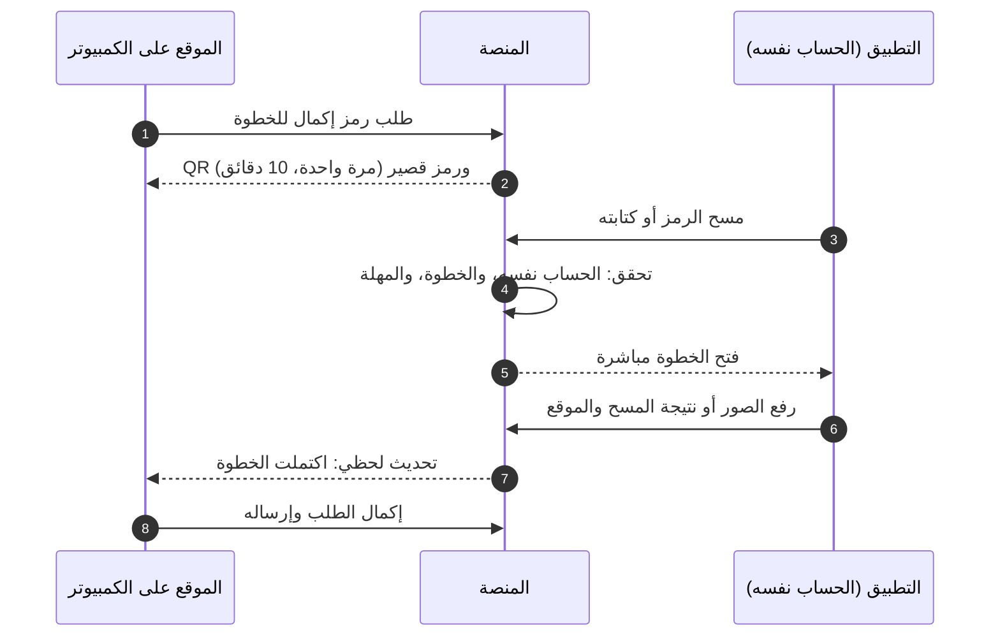

## 5. الروابط العميقة وروابط الرسائل

كل رابط في رسالة واتساب أو SMS أو إشعار يفتح شاشة محددة. في التطبيق إن كان مثبتاً، وإلا في الموقع. وإن احتاجت الشاشة دخولاً تظهر S-AUT-12 ثم تعود للشاشة نفسها.

| الرابط | يصل عبر | يفتح | يحتاج دخولاً |
|---|---|---|---|
| رابط الفاتورة | واتساب أو إيميل الفواتير للمشتري | S-PUB-09، وللمالك بعد الدخول S-USR-12 بالتفاصيل الكاملة | لا (للتحقق) |
| طلب نقل ملكية | واتساب للمستلم | S-USR-08 | نعم، أو إنشاء حساب بالرقم نفسه |
| دعوة جهة موثوقة | واتساب | S-USR-27 | نعم |
| تأكيد بلاغ المفوّض | واتساب للمالك | S-USR-25 | نعم |
| تفعيل حساب موظف | واتساب للموظف | S-AUT-11 | لا |
| تغيّر حالة بلاغ، أو طلب معلومات، أو اعتراض، أو جهاز مضبوط | إشعار وواتساب | S-USR-20 (أو S-USR-21، أو S-USR-23) | نعم |
| رد على طلب دعم | إشعار وواتساب | S-USR-39 | نعم |
| طلب استلام نقل بالجملة أو نقل من محل | إشعار للمحل | S-SHP-19 في سياق المحل | نعم |
| طلب «نقل لمحل» من مالك (D-121) | إشعار لصاحب المحل ولمن له صلاحية الشراء | S-SHP-53 في سياق المحل | نعم |
| دعوة لملكية محل (D-107) | واتساب للمالك الجديد | S-SHP-60 | نعم |
| تفعيل خدمة مدفوعة | إشعار | S-USR-42 أو S-SHP-24 | نعم |
| شهادة فحص | يشاركها البائع | S-PUB-10 | لا |
| إيصال فحص | يشاركه الفاحص | S-PUB-11 | لا |
| رمز الإكمال | QR على شاشة الكمبيوتر | S-APP-09 ثم الخطوة، أو S-PUB-20 دون تطبيق | نعم (الحساب نفسه) |
| «عندك معلومات؟» من البوت | رد بوت واتساب | نموذج المعلومات في S-PUB-05 مرتبطاً بالفحص | لا |
| روابط البلاغ والحساب من البوت | رد بوت واتساب | S-USR-15 أو S-AUT-01 | حسب الشاشة |
| رابط إيصال الصيانة | واتساب لصاحب الجهاز | S-PUB-13 | لا |
| تغيّر حالة طلب المتجر | إشعار للمحل | S-SHP-23 | نعم |
| سحب من المحفظة، أو عملية فوق حد التنبيه | إشعار وواتساب لصاحب المحل | S-SHP-36 | نعم |
| حُسمت تعبئة معلّقة | إشعار للمحل | S-SHP-40 | نعم |
| طلب مسند للتجهيز | إشعار وواتساب للمورّد | S-SUP-07 | نعم |
| كشف تسوية جاهز | إشعار للمورّد | S-SUP-09 | نعم |
| «أنا حي»: إيقاف نقل أجهزة الحساب (D-103) | كل وسائل حساب المتوفى المزعوم | S-PUB-26 بنقرة تأكيد دون دخول | لا |
| تأكيد البلاغ العاجل أو رفضه | كل وسائل صاحب الجهاز ومنها الرقم البديل | S-PUB-27 بكلمة المرور دون جلسة، أو S-USR-25 بعد الدخول | لا (كلمة المرور فقط) |
| «لم أكن أنا» في أي تنبيه أمني | واتساب وSMS والبريد الأمني | S-PUB-29 «جمّد حسابي» | لا |
| تأكيد البريد الأمني (D-126) | البريد الجديد | S-PUB-28 | لا |
| «هذا رقمي، أوقف»: الاعتراض على فصل رقم أُعيد تخصيصه | الأجهزة المربوطة بالحساب القديم وبريده الأمني | S-PUB-30 بنقرة تأكيد دون دخول | لا |
| بلاغ على جهاز مسجّل باسمك (D-119) | كل وسائل الحائز المسجّل | S-USR-50 | نعم |
| خرج جهاز من ملكيتك | كل وسائل المالك السابق | S-USR-53 | نعم |
| «لم أشترِ هذا الجهاز» | رسالة فاتورة المشتري | S-USR-12 بعد الدخول، فيُفتح طلب دعم عاجل | نعم |
| يقول شخص إنه وجد جهازك | المالك المسجّل | S-USR-55 | نعم |
| طلب نقل جهاز متوفى | الطالب | S-USR-58 | نعم |
| دعوة وصي | الوصي المدعو | S-USR-60 | نعم |
| قيد على حسابك أو محلك | صاحب الحساب أو المحل | S-USR-61 | نعم |
| اختيار التعويض عن خدمة توقفت (D-111) | من دفع | S-USR-56 في الموقع، والحالة في التطبيق | نعم |
| قبول شراء بالتوصيل | المشتري غير الحاضر | S-USR-52 | نعم |
| تذكير قائمة الإغلاق | صاحب المحل قيد الإغلاق | S-SHP-62 | نعم |
| جهاز في مخزونك صار مبلّغاً عنه | صاحب المحل أو الوكيل | S-SHP-13 أو S-IMP-06 | نعم |
| مفتاح ربط أُنشئ أو أُلغي | مسؤول عميل الربط | S-BIZ-02 | نعم |

كل رابط في الرسائل بصيغ [التصميم التقني](19-technical-design.md) §13.3 وحدها، و**لا يسجّل الدخول ولا ينفّذ إجراءً عند فتحه**: الإجراء دائماً بضغطة تأكيد. والاستثناءات التي تعمل دون دخول (S-PUB-26، S-PUB-27، S-PUB-29، S-PUB-30) لا تكشف أي بيانات للحساب، وكلها تحمي ولا تنقل حقاً لأحد.

### 5.1 وجهة كل إشعار

كل حدث في [التصميم التقني](19-technical-design.md) §9.5 له وجهة في هذا الجدول أو «لا وجهة» مسبّبة (NOTIF-10)، وعمود «يفتح» في [كتالوج المحتوى](24-content-catalog.md) §3 يشير إليه.

| عائلة الحدث | يفتح | السياق | يحتاج دخولاً |
|---|---|---|---|
| `report.*` للمبلّغ (القبول، والرفض، وطلب المعلومات، والاعتراض، والإغلاق، ورفع الحمايات، وربط بلاغ الأمن) | S-USR-20، وطلب المعلومات S-USR-21، والاعتراض S-USR-23 | حسابي | نعم |
| `report.accepted` للحائز المسجّل غير المبلّغ (D-119) | S-USR-50 | حسابي | نعم |
| `report.owner_confirmation.*` | S-USR-25، وللرقم البديل S-PUB-27 | حسابي | نعم، والرقم البديل لا |
| `report.batch.*` | S-SHP-50 أو S-IMP-14 | المنشأة | نعم |
| `police.seizure.*` | المالك S-USR-20، وصاحب المحل S-SHP-50 | حسابي أو المحل | نعم |
| `ownership.transfer.*` | المرسل S-USR-07 (و«نقل لمحل» S-USR-51)، والمستلم S-USR-08، والمحل S-SHP-53 | حسب الطرف | نعم |
| `device.custody.changed` لمالك سابق | S-USR-53 | حسابي | نعم |
| `ownership.registration_attempt.blocked` | S-USR-03 مع «الجهاز معي» | حسابي | نعم |
| `ownership.certificate.*`، `ownership.authorized_user.*`، `ownership.self_registration.*` | S-USR-10، S-USR-11، S-USR-05 | حسابي | نعم |
| `device.relinquished` | S-USR-54 (الإيصال) | حسابي | نعم |
| `succession.*`، `person.death_reversed` | الطالب S-USR-58 (والجهاز المنقول S-USR-02)، ووسائل حساب صاحب الأجهزة S-PUB-26 وزر «طلب دعم» S-USR-38، والوصي S-USR-60، والشخص بعد إلغاء تأكيد الوفاة S-USR-32 | — | الطالب والوصي نعم، وS-PUB-26 لا |
| `account.trusted_contact.invited`، `account.executor.invited` | S-USR-27، S-USR-60 | حسابي | نعم |
| `account.*` الأمنية (جهاز جديد، والتهدئة، وتغيير الرقم أو البريد، وجلسة بلاغ السرقة، والاستعادة) | S-USR-32، والاستعادة S-AUT-10، و«لم أكن أنا» S-PUB-29، و«هذا رقمي، أوقف» S-PUB-30 | حسابي | نعم إلا «لم أكن أنا» و«هذا رقمي» |
| `restriction.*` | S-USR-61، وللمحل S-SHP-03 | حسب الموضوع | نعم |
| `tip.*` «وُجد جهازك» | S-USR-55 | حسابي | نعم |
| `support.ticket.*` | S-USR-39 | سياق الطلب | نعم |
| `tenant.*` (التوثيق، والتعليق، والإغلاق، وتغيير المالك، والفروع) | S-SHP-02، S-SHP-03، S-SHP-62، والمقدّم S-SHP-59، والمالك الجديد المدعو S-SHP-60، **والمالك الجديد بعد `tenant.owner_changed` S-SHP-61**، والفروع S-SHP-65، وقرار مخزون مجمّد S-SHP-64 | المنشأة | نعم |
| `tenant.member.*` | الدعوة S-AUT-11، وتغيّر الصلاحيات S-SHP-03 | المنشأة | نعم |
| `shop.transaction.*` (المعلّقة، والمحجوبة، والمنكرة، والملغاة) | S-SHP-15 | المحل | نعم |
| `importer.transfer.*` والنقل بين المنشآت | المستلم S-SHP-19، والمرسل S-IMP-08 أو S-SHP-55 | المنشأة | نعم |
| `repair.*` | المحل S-RPR-05، وصاحب الجهاز S-PUB-13 | المحل أو عام | المحل نعم |
| `store.*` | المحل S-SHP-23 والمرتجع S-SHP-32، والمورّد S-SUP-07 أو S-SUP-08 أو S-SUP-09، والمندوب S-CUR-01 | السياق | نعم |
| `shop_wallet.*` | S-SHP-33، والعملية S-SHP-36، والسحب S-SHP-35 | المحل | نعم |
| `ewallet_freeze.*` | S-USR-20 | حسابي | نعم |
| `store.payout_account.*` | S-SUP-10 | المورّد | نعم |
| `topup.*` | S-SHP-40 | المحل | نعم |
| `billing.*` | المواطن S-USR-42، والمحل S-SHP-24، والتعويض S-USR-56 | السياق | نعم |
| `bizapi.*` | S-BIZ-02 أو S-BIZ-04 | عميل الربط | نعم |
| `config.toggle.draining` لمن له عنصر جارٍ | شاشة العنصر نفسه بلافتة «قيد الإطفاء» | السياق | نعم |
| تنبيهات الإدارة وبوابة الأمن | **بلا روابط** ([التصميم التقني](19-technical-design.md) §13.3): العدد في S-ADM-03 أو S-POL-03، وداخل اللوحة: مفتاح طوارئ فعّله المناوب S-ADM-45، ونيابة المدير العام وأفعال النائب S-ADM-80 وS-ADM-52، وملخص المناوبة S-ADM-79، وقرارات المخزون المجمّد S-POL-24 | — | — |

| القاعدة | التفصيل |
|---|---|
| الوجهة لم تعد متاحة | فقد المستلم الصلاحية، أو انتهى العنصر، أو تغيّر مالك المحل: يفتح مركز الإشعارات S-USR-36 برسالة «لم يعد هذا متاحاً لك» دون ذكر السبب |
| السياق زال | خرج المستلم من المحل أو أُغلق: يفتح «حسابي» |
| تبديل السياق | الإشعار يحمل سياقه، والضغط عليه يبدّل السياق تلقائياً (القسم 20.2) |

## 6. الموقع العام (S-PUB)

صفحات بلا دخول على الموقع. وشاشات الفحص (S-PUB-01 إلى S-PUB-07) هي نفسها تبويب «فحص» في التطبيق للزائر، والفحص السريع للمستخدم، بالمكوّنات نفسها.

| المعرّف | الشاشة | من يراها | المنصات | الغرض | المتطلبات | العناصر والإجراءات | الحالات الخاصة |
|---|---|---|---|---|---|---|---|
| S-PUB-01 | الصفحة الرئيسية وخانة الفحص | الجميع | موقع، تطبيق | الفحص بخطوة واحدة، والتعريف بالمنصة | PUB-01، PUB-07، CHECK-01، CHECK-02، CHECK-03، CHECK-04، CHECK-05، CHECK-06، CHECK-13، ADS-01، ROLLOUT-01، SERIAL-07، CHECK-19، CHECK-20، CHECK-22، PUB-08 | خانة IMEI أو الرقم التسلسلي لأجهزة آبل تقبل الأرقام العربية وتتجاهل المسافات، ورابط «حاسوب أو جهاز دون شريحة؟» إلى S-PUB-22 عند تفعيل الوحدة، وزر المسح بالكاميرا، وتلميح `*#06#` الثابت، والموديل المتوقع بعد 8 خانات، و«افحص الآن»، و«بلّغ عن جهاز»، وشرح «كيف تعمل»، وقنوات الفحص الأخرى (واتساب، وSMS)، وروابط المتجرين وشريط اقتراح التطبيق على الموبايل، وسلايدر الإعلانات إن فُعّل. والخانة تستخرج الرقم من النص الملصوق (مثل «IMEI1: ٣٥ 693803 564380 9/01») وتتجاهل التسميات والفواصل والرقم الإضافي بعد الشرطة المائلة. والصفحة قابلة للفهرسة بعنوان ووصف ومعاينة مشاركة عربية | رقم غير صالح بخطأ في مكانه قبل الإرسال؛ لغز «لست روبوتاً» من ⚙️ الفحص الرابع؛ «حاول لاحقاً» بعد الحد؛ الفحص مغلق في وضع الدعوات حسب ⚙️ الإعداد؛ لا فحص دون اتصال؛ 14 خانة: «ينقص خانة» دون إكمال آلي؛ 16 خانة (IMEISV): تُحوَّل إلى IMEI وتُعرض للتأكيد؛ نمط محجوز (خانات متطابقة، أو أرقام متسلسلة معروفة، أو أرقام افتراضية منسوخة): «رقم غير صالح» مع تحذير التقليد |
| S-PUB-02 | الإقناع بتفعيل الموقع | كل فاحص لم يمنح الإذن بعد | موقع، تطبيق | شرح الحافز قبل نافذة إذن النظام | GEO-02، CHECK-07، CHECK-17 | «فعّل موقعك واحصل على إيصال فحص»، والنقاط الثلاث (الإيصال، ومساعدة أصحاب الأجهزة، و«موقعك لا يظهر لصاحب الجهاز ولا لأي شخص، وتستخدمه الإدارة والجهات المختصة فقط»)، و«تفعيل الموقع»، و«ليس الآن» | لا تظهر لمن منح الإذن سابقاً؛ على الكمبيوتر بدقة ضعيفة تكتمل النتيجة دون إيصال |
| S-PUB-03 | التذكير واختيار المحافظة | فاحص رفض الإذن | موقع، تطبيق | تذكير لطيف واحد، ثم إكمال الفحص بالمحافظة | GEO-02، GEO-01 | جملة تذكير واحدة مع «فعّل الآن»، ثم قائمة المحافظات الأربع عشرة، و«متابعة» | الرفض النهائي من النظام: القائمة مباشرة مع رابط «افتح الإعدادات» في التطبيق (S-APP-07) |
| S-PUB-04 | النتيجة: لا توجد بلاغات فعّالة | الفاحص | موقع، تطبيق | عرض نتيجة «لا توجد بلاغات فعّالة» بصيغتها القانونية | CHECK-08، CHECK-09، CHECK-11، CHECK-15، GSMA-01، GSMA-02، GSMA-05، CUSTOMS-02، FAKE-01، FAKE-02، HISTORY-01، PAY-08، THEME-03، CHECK-18، CHECK-21، TIP-07 | الرقم المفحوص، والموديل، ووقت الفحص، وبطاقة الحالة الخضراء بالصيغة الثابتة، والمؤشرات الإضافية (الدولية، والهيئة، والتقليد، وتطابق الرقمين لنفس الموديل)، و«حفظ إيصال الفحص»، و«مشاركة»، و«فحص جهاز آخر»، ونصائح قبل الشراء (طابق `*#06#`، واطلب نقل الملكية أو شهادة فحص). وفي الموقع فقط: «اطلب تقرير تاريخ الجهاز» (S-USR-41). ونوع الجهاز إن عُرف (موبايل، أو تابلت، أو راوتر، أو ساعة بشريحة، أو جهاز دفع، أو متتبّع)، وسطر محايد «قد يكون منسوخاً» بجانب الحالة دون أن يغيّرها، ورابط هادئ «وجدت هذا الجهاز؟» (S-PUB-24) | «جارٍ التحقق الدولي» ثم استكمال تلقائي؛ «تعذّر التحقق الدولي حالياً»؛ دون إيصال لمن رفض الموقع؛ في التطبيق لا يظهر طلب التقرير المدفوع لغير المالك |
| S-PUB-05 | النتيجة: مبلّغ عنه — مسروق | الفاحص | موقع، تطبيق | التحذير، وجمع المعلومات بأمان | CHECK-08، CHECK-10، CHECK-11، CHECK-14، TIP-01، TIP-04، TIP-05، TIP-06، DISPUTE-01، PROTECT-03، THEME-03، CHECK-18، TIP-08 | «مبلّغ عنه: مسروق — لا تشترِ هذا الجهاز»، وتاريخ نشر البلاغ، والموديل، وبطاقة المكافأة مع تنويه عدم مسؤولية المنصة، وتحذير السلامة «لا تحاول مواجهة البائع أو احتجازه»، ونموذج «عندك معلومات؟» (المحافظة، والمكان، والوصف، وصورة ووسيلة تواصل اختياريتان)، و«ماذا يعني هذا؟»، و«تعتقد أن البلاغ خاطئ؟ قدّم اعتراضاً» (S-USR-24 بعد الدخول) | تأكيد إرسال المعلومات؛ لغز «لست روبوتاً» عند تكرار الإرسال؛ الإيصال متاح لمن فعّل موقعه؛ حد ⚙️ 3 معلومات لكل مصدر يومياً؛ «قد يكون منسوخاً» بجانب الحالة |
| S-PUB-06 | النتيجة: مبلّغ عنه — مفقود | الفاحص | موقع، تطبيق | التحذير، والمساعدة في الإرجاع | CHECK-08، CHECK-10، TIP-02، TIP-04، TIP-05، THEME-03، CHECK-18، TIP-08 | «مبلّغ عنه: مفقود»، وتاريخ النشر، والموديل، والمكافأة «لمن يعيده عبر المنصة» مع التنويه، ونموذج «وجدت هذا الجهاز؟» (رقم للتواصل، ومكان العثور، وملاحظات)، وجملة «ننسّق الإرجاع دون كشف رقمك لصاحب الجهاز أو رقمه لك» | تأكيد الإرسال؛ المؤشرات الإضافية كما في S-PUB-04؛ «قد يكون منسوخاً» بجانب الحالة؛ حد المعلومات كما في S-PUB-05 |
| S-PUB-07 | إيصال الفحص | فاحص فعّل موقعه الدقيق | موقع، تطبيق | حفظ إثبات حسن النية ومشاركته | CHECK-16، THEME-04 | رقم الإيصال `CR-`، وIMEI، والموديل، والنتيجة وقت الفحص، **وسطر الفحص الدولي دائماً** (نتيجة GSMA إن عُرفت وقت الفحص، وإلا «لم يُتحقق دولياً»، ويُجمَّد مع الإيصال)، والتاريخ والوقت، والمحافظة، وQR، والصيغة القانونية «لا يُعد الإيصال إثباتاً للملكية»، و«تحميل PDF» (S-PRN-04)، و«حفظ كصورة»، و«مشاركة»، و«طباعة». ويُحفظ في «إيصالاتي» للمسجّل | — |
| S-PUB-08 | التحقق من وثيقة | الجميع | موقع، تطبيق | الوصول لصفحة تحقق برقم الوثيقة أو مسح QR | PUB-02، PUB-03، PUB-06، HISTORY-04، PUB-08 | اختيار نوع الوثيقة (شهادة فحص، وفاتورة، وإيصال فحص، وتقرير تاريخ، وإيصال نقل أو صيانة)، وخانة الرقم، و«تحقق»، ومسح QR في التطبيق، وشرح كل نوع. ولنوع «فاتورة» خانة ثانية إلزامية «آخر 4 خانات من IMEI» | «لم نجد وثيقة بهذا الرقم»؛ حد للمحاولات ضد التخمين؛ عدم التطابق في أي خانة يعطي الرد نفسه «لم نجد وثيقة بهذا الرقم» دون تمييز؛ صفحات التحقق لا تُفهرس، ومعاينة مشاركتها عامة «تحقّق من وثيقة صادرة عبر بصمة» دون أي بيانات |
| S-PUB-09 | التحقق من فاتورة | الجميع، والمالك بتفاصيل كاملة بعد الدخول | موقع، تطبيق | إثبات صحة فاتورة محل | PUB-02، SHOP-10 | اسم المحل ورقمه، والتاريخ، والموديل، وIMEI واسم المشتري مخفيان جزئياً، وحالة الفاتورة (صالحة أو ملغاة)، و«ادخل لعرض التفاصيل الكاملة». ولصاحب الفاتورة بعد الدخول «لم أشترِ هذا الجهاز» (S-USR-12) | فاتورة ملغاة بشريط واضح؛ غير موجودة |
| S-PUB-10 | التحقق من شهادة فحص | الجميع | موقع، تطبيق | يرى المشتري حالة الجهاز الآن | PUB-03، OWN-10، OWN-11، OWN-14، CUSTOMS-03، REPORT-30 | الموديل، وIMEI مخفياً جزئياً، وتاريخ الإصدار والانتهاء، وأصل التسجيل (وكيل، أو جمركة، أو محل، أو تسجيل ذاتي)، و**الحالة الآن لحظياً** تتحدث تلقائياً، ونصيحة مطابقة آخر الخانات مع `*#06#` | منتهية؛ ملغاة (بنقل أو يدوياً)؛ **صار على الجهاز بلاغ** فيظهر تحذير أحمر واضح؛ قُدّم بلاغ على الجهاز ولو بقي قيد المراجعة: «الشهادة لم تعد صالحة» دون ذكر السبب |
| S-PUB-11 | التحقق من إيصال فحص | الجميع | موقع، تطبيق | إثبات أن رقماً فُحص في وقت معيّن | PUB-06 | رقم الإيصال، وIMEI مخفياً جزئياً، والموديل، والنتيجة وقت الفحص، والتاريخ والوقت، والمحافظة، **دون أي بيانات عن الفاحص** | غير موجود |
| S-PUB-12 | التحقق من تقرير تاريخ الجهاز | الجميع | موقع، تطبيق | إثبات صحة تقرير صادر | HISTORY-04، HISTORY-02 | تاريخ اللقطة، وملخص التقرير دون بيانات شخصية، وصحة التقرير | غير موجود |
| S-PUB-13 | التحقق من إيصال نقل أو إيصال صيانة | الجميع | موقع، تطبيق | إثبات صحة إيصال نقل الملكية أو استلام الصيانة | OWN-04، REPAIR-02 | نوع الإيصال، والتاريخ، والموديل، وIMEI مخفياً جزئياً، والمحل (لإيصال الصيانة)، والصحة. وإيصال انتقال الجهاز بالإرث أو «نقل لمحل» | غير موجود |
| S-PUB-14 | احمِ جهازك | الجميع | موقع، تطبيق | الحماية قبل السرقة، وما يُفعل لحظتها | PROTECT-01، PROTECT-03 | الخطوات: Find My، وقفل الشاشة، وحفظ IMEI وصورة الكرتونة، وتسجيل الجهاز، والجهات الموثوقة، والرقم البديل. ثم «سُرق جهازك؟ افعل هذا فوراً» و«بلّغ عن جهازك الآن»، وتحذير «لا تحاول استرداد جهازك بنفسك» | للمسجّل: يتحول إلى S-USR-40 بتقدّمه الشخصي |
| S-PUB-15 | بصمة للمحلات | الجميع | موقع | تعريف المحلات بالخدمة وبدء التسجيل | SHOP-01 | المزايا (الفحص قبل الشراء، والفواتير المجانية، والموظفون، والصيانة، والاستلام من الوكلاء)، وخطوات التسجيل الأربع، و«سجّل محلك الآن» (S-AUT-12 ثم S-SHP-01)، و«حمّل التطبيق» | — |
| S-PUB-16 | للوكلاء والمستوردين | الجميع | موقع | تعريف الوكلاء بالتسجيل بالجملة | IMPORTER-01 | ما يقدّمه التسجيل (أصل «وكيل»، والنقل بالجملة)، والمستندات المطلوبة، و«سجّل كوكيل» (S-AUT-12 ثم S-IMP-01) | — |
| S-PUB-17 | عن المنصة | الجميع | موقع، تطبيق | التعريف بالمنصة والجهات الشريكة | PUB-05 | نص من إدارة المحتوى، وحدود المنصة بصدق | — |
| S-PUB-18 | تواصل معنا | الجميع | موقع، تطبيق | قناة تواصل لمن ليس له حساب | PUB-05، SUPPORT-03، SUPPORT-05 | نموذج بسيط (الاسم، والموبايل، والرسالة) يدخل قائمة الدعم نفسها برقم `ST-`، ورقم واتساب الدعم، والرقم القصير للفحص، وتحذير الدعم، ورابط «طلب دعم» لأصحاب الحسابات. **وليس مركز مساعدة** (D-22) | تأكيد برقم الطلب |
| S-PUB-19 | الصفحات القانونية | الجميع | موقع، تطبيق | الشروط والأحكام، وسياسة الخصوصية، واتفاقية المحلات | PUB-04، SMART-01 | ثلاث صفحات بقالب واحد، برقم الإصدار وتاريخه. والقبول يُسجَّل عند إنشاء الحساب وتسجيل المحل | — |
| S-PUB-20 | تنزيل التطبيق وإكمال الخطوة دون تطبيق | من مسح رمز إكمال دون تطبيق، ومن رابط التنزيل | موقع | التنزيل ثم العودة للخطوة | PUB-07، HANDOFF-04 | زرا المتجرين، وإن جاء من رمز إكمال: «ثبّت التطبيق ثم امسح الرمز مرة أخرى، صالح حتى [الوقت]» | الرمز منتهٍ: «اطلب رمزاً جديداً من الموقع» |
| S-PUB-21 | صفحات الخطأ والصيانة | الجميع | موقع، تطبيق، لوحة، بوابة | حالات الخطأ العامة | SMART-11، CHECK-13 | الصفحة غير موجودة، وخطأ في الخادم، و«حاول لاحقاً» مع الوقت، ووضع الصيانة بوقت الانتهاء، والرابط منتهي الصلاحية (دعوة، أو نقل، أو إكمال)، و«افتح في المتصفح» داخل متصفحات التطبيقات. و«تعذّر التحقق من هذه الوثيقة مؤقتاً، راجع الجهة المُصدِرة» لوثيقة صدرت قبل عطل استعادة البيانات (⚙️ 90 يوماً)، وصفحة الحالة الثابتة عند التوقف الكامل على مضيف منفصل | التوقف الكامل للصيانة لا يمس صفحات التحقق ولا جلسة «بلاغ السرقة فقط» |
| S-PUB-22 | الفحص بالرقم التسلسلي | الجميع (عند تفعيل الوحدة) | موقع، تطبيق | فحص حاسوب أو جهاز دون شريحة | SERIAL-02، SERIAL-01، SERIAL-07، SERIAL-09 | اختيار الشركة المصنّعة من قائمة، ونوع الجهاز، وخانة الرقم التسلسلي بصيغة الشركة ⚙️، وإرشاد مصوّر لمكان الرقم على الجهاز والكرتونة، و«افحص». ثم S-PUB-02 والنتائج S-PUB-04 إلى S-PUB-06 **دون مؤشرات الشبكة** (الدولية والهيئة والتقليد) | صيغة لا تطابق الشركة المختارة؛ الوحدة مطفأة: لا مدخل؛ لم يُعثر على الرقم: يُجرَّب بديل الحروف الملتبسة (O و0، وI و1) ويُعرض المبلّغ عنه الوحيد مع تنبيه «تحقق من الحروف» |
| S-PUB-23 | إغلاق الحساب من رابط عام | صاحب حساب لا يملك التطبيق أو لا يستطيع الدخول إليه | موقع | طلب إغلاق الحساب دون تثبيت التطبيق (سياسات المتجرين) | PRIV-02 | شرح ما يُحذف وما يُحتفظ به قانوناً، ورقم الموبايل، ثم رمز تحقق، ثم كلمة المرور، و«طلب إغلاق الحساب» مع مهلة التراجع ⚙️ 7 أيام | الرسائل موقوفة لرقم مسروق: «استعد حسابك بهويتك أولاً» (S-AUT-08) |
| S-PUB-24 | وجدت هذا الجهاز؟ | الجميع (من نتيجة الفحص) | موقع، تطبيق | إبلاغ المنصة بالعثور على جهاز دون إخبار الواجد بشيء | TIP-07، TIP-08، TIP-02 | مكان العثور (المحافظة والمنطقة)، ورقم للتواصل اختياري، وملاحظات، و«إرسال». والرد واحد في كل الحالات: «شكراً، وصلت معلومتك. إن لم يتواصل معك أحد خلال أيام فسلّم الجهاز لأقرب مركز لقوى الأمن»، دون أي إشارة لوجود مالك مسجّل (P-4) | حد ⚙️ 3 لكل مصدر يومياً؛ مصدر أُغلقت له ⚙️ معلومتان كاذبتان خلال 30 يوماً: الرد نفسه ولا تدخل معلوماته القائمة ⚙️ 30 يوماً؛ لغز «لست روبوتاً» للزائر |
| S-PUB-25 | قنوات بصمة الرسمية | الجميع | موقع، تطبيق | التحقق من أرقام المنصة وحساباتها قبل التعامل معها | ADMIN-23، SUPPORT-05 | أرقام واتساب الثلاثة (الفحص، والدعم، والتجاري) والرقم القصير، والنطاقات الرسمية، وحسابات الدفع الرسمية للخدمات (في الموقع فقط)، وتحذير الدعم. وكل تغيير مجدول يظهر قبل سريانه بـ ⚙️ 72 ساعة: «يتغير في [التاريخ]» | في التطبيق: دون حسابات الدفع (D-86) |
| S-PUB-26 | أنا حي: إيقاف طلب نقل الأجهزة | من وصله إشعار طلب الإرث على وسيلة من وسائل حساب صاحب الأجهزة (الرقم الأساسي، والرقم البديل، والأجهزة المربوطة، والبريد الأمني، وجهات الثقة، والوصي المعيّن) | موقع، تطبيق | إيقاف طلب الإرث بنقرة دون دخول | SUCCESSION-06، SUCCESSION-05، SUCCESSION-12 | «طُلب نقل أجهزة صاحب هذا الحساب بعد الإبلاغ بوفاته. إن كنت صاحب الحساب فأوقف الطلب»، وزر «أنا حي، أوقف هذا» بضغطة تأكيد (رمز الرابط `action = succession_object`، 19 §13.3)، ثم «أوقفنا الطلب ويراجعه فريق المنصة» مع رابط واتساب الدعم، وطريق إثبات الحياة: الدخول بكلمة المرور ورمز التحقق من جهاز مربوط، أو مراجعة الدعم بالهوية. ولا أي بيانات عن الطالب أو الأجهزة. والنقرة توقف الطلب للمراجعة فقط، ولا تمنح أي صلاحية على الحساب، ولا تعلّم أحداً محتالاً وحدها | الطلب نُفّذ أو انتهى: «لم يعد هذا الرابط صالحاً، راسل الدعم الفني» (وإلغاء تأكيد الوفاة عبر الدعم)؛ أُوقف من قبل: «أُوقف هذا الطلب»؛ رُفض الاعتراض بعد المراجعة: الرابط نفسه لا يعود يوقف الطلب، والاعتراض بإثبات الحياة أو عبر الدعم |
| S-PUB-27 | تأكيد البلاغ العاجل أو رفضه دون جلسة | صاحب الجهاز من رابط الإشعار، ومنه الرقم البديل | موقع، تطبيق | قرار صاحب الجهاز في بلاغ عاجل حين لا يستطيع الدخول | TRUSTED-03، TRUSTED-06، REPORT-26 | الموديل فقط، ومن بدأ البلاغ بالاسم المختصر، والمهلة الباقية، وكلمة مرور الحساب، و«أؤكد البلاغ» أو «لم أطلب ذلك». **دون جلسة ودون أي رمز تحقق** (D-81، `action = urgent_report_decision`)، و⚙️ 5 محاولات لكلمة المرور (`trusted.confirm_page.attempts`) | «لم أطلب ذلك»: يُرفض البلاغ وتُرفع الحمايات وتُستأنف الرسائل للرقم، ويُعرض «أزل هذه الجهة الموثوقة»؛ المهلة انتهت: «انتهت المهلة»؛ نفدت المحاولات: «تواصل مع الدعم الفني بهويتك» |
| S-PUB-28 | تأكيد البريد الأمني | صاحب البريد من رابط التأكيد | موقع | تأكيد ملكية العنوان فقط | AUTH-13 | «أؤكد أن هذا العنوان لي» بضغطة تأكيد، وجملة «لن يصلك على هذا البريد أي رمز أو رابط دخول، بل تنبيهات أمنية فقط»، وموعد سريان العنوان الجديد (⚙️ 72 ساعة عند التغيير) | الرابط منتهٍ (⚙️ 24 ساعة) أو مستخدم |
| S-PUB-29 | لم أكن أنا: جمّد حسابي | صاحب الحساب من رابط تنبيه أمني | موقع، تطبيق | تجميد الحساب فوراً دون دخول | THEFT-06، THEFT-04، AUTH-13 | «إن لم تكن أنت من قام بهذا فجمّد حسابك الآن»، وزر «جمّد حسابي» بضغطة تأكيد، ثم ما حدث (أُنهيت الجلسات، وأُوقف الإجراء الجاري، وفُتح طلب دعم عاجل) وطريق فك التجميد (الدعم بالهوية، أو كلمة المرور ورمز ثم فترة التهدئة) | الرابط منتهٍ (⚙️ 7 أيام) أو مستخدم: «جمّدت حسابك من قبل» أو إرشاد الدعم |
| S-PUB-30 | هذا رقمي: أوقف فصل الرقم | صاحب حساب قديم من رابط الإشعار 193 (على أجهزته المربوطة أو بريده الأمني) | موقع، تطبيق | الاعتراض على فصل رقم موبايل يقول حامله الجديد إنه أُعيد تخصيصه (19 §8.14 `number_detach`) دون دخول | AUTH-07، AUTH-09، AUTH-15 | «طلب شخص آخر ربط رقم الموبايل المسجّل في حسابك بحساب جديد، ويُفصل في [الموعد]. إن كان الرقم ما زال معك فأوقف الطلب»، وزر «هذا رقمي، أوقف» بضغطة تأكيد، ثم «أوقفنا طلب فصل الرقم وأحلناه للدعم». **ولا يظهر أي بيان عن الطالب**، ولا تُفتح جلسة (نصوصه 24 §2.14.1، ورمز الرابط `action = phone_detach_object` مطلوب في 19 §13.3) | الرابط منتهٍ أو مستخدم، أو انقضت المهلة ونُفّذ الفصل: «لم يعد هذا الرابط صالحاً، تواصل مع الدعم الفني بهويتك» |

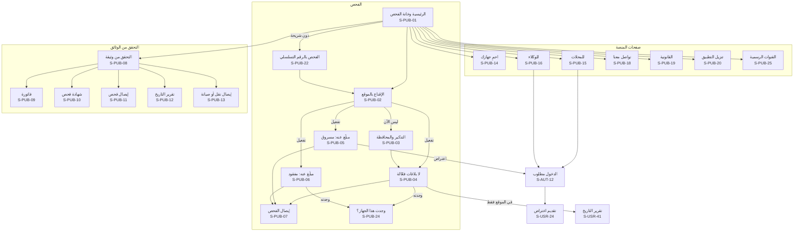

والصفحات S-PUB-26 إلى S-PUB-30 لا مدخل لها من القوائم: تُفتح من روابط الرسائل وحدها (القسم 5).

## 7. الدخول والتسجيل والاستعادة (S-AUT)

للحسابات العامة فقط (المواطن، والمحل، والوكيل وموظفوهما). ودخول الإدارة والبوابة في S-ADM-01 وS-POL-01 على نطاقيهما.

| المعرّف | الشاشة | من يراها | المنصات | الغرض | المتطلبات | العناصر والإجراءات | الحالات الخاصة |
|---|---|---|---|---|---|---|---|
| S-AUT-01 | إنشاء حساب | زائر | موقع، تطبيق | فتح حساب برقم وكلمة مرور (الخطوة 1 من 3) | AUTH-01، AUTH-07، ROLLOUT-01، PUB-04، ONBEHALF-05، PRIV-10، AUTH-15، RESTRICT-05 | رقم الموبايل السوري (`09XXXXXXXX`)، وإقرار «عمري 18 سنة أو أكثر» (ومن دونها يدخل فقط بدعوة وليّ أمره مستخدماً مفوّضاً، D-97)، وكلمة المرور مع مؤشر القوة وفحص الكلمات المسرّبة، وقبول الشروط والخصوصية بإصداريهما، ومؤشر الخطوات (الحساب، وتأكيد الرقم، والملف الشخصي) | الرقم مسجّل: يظهر ذلك **بعد تأكيد رمز الرقم فقط** «لهذا الرقم حساب، ادخل أو استعد كلمة المرور»؛ شخص محظور برقمه الوطني (D-106): «تعذّر إنشاء الحساب، تواصل مع الدعم الفني» دون ذكر الحظر؛ الرقم غير مدعو في وضع الدعوات؛ حساب أُنشئ له بالنيابة: يُكمل التفعيل بالرمز ثم كلمة مرور |
| S-AUT-02 | رمز التحقق | كل من يُرسل إليه رمز | موقع، تطبيق | إدخال رمز من 6 أرقام لأي غرض | AUTH-01، AUTH-03، AUTH-09، OWN-04، THEFT-02 | الرقم مخفياً جزئياً، و6 خانات بلصق تلقائي، والعدّ التنازلي لإعادة الإرسال ⚙️ 60 ثانية، و«أو عبر رسالة SMS»، و«تغيير الرقم»، وتحذير «لا تشارك الرمز مع أحد، حتى فريق الدعم». الشاشة نفسها لتأكيد التسجيل، والاستعادة، وتغيير الرقم، ونقل الملكية، والرقم البديل، والجهاز الجديد للمحل | رمز منتهٍ (⚙️ 5 دقائق)؛ نفدت المحاولات (⚙️ 5)؛ حد الرموز في الساعة؛ الرسائل موقوفة لرقم مسروق (THEFT-03) |
| S-AUT-03 | الملف الشخصي الأولي | حساب جديد مؤكَّد الرقم | موقع، تطبيق | الاسم الكامل كما في الهوية، والرقم الوطني، والمحافظة (الخطوة 3 من 3) | AUTH-04، AUTH-07، GEO-01، PERSON-01، PERSON-03، AUTH-15 | ثلاثة حقول، وشرح سبب طلب الرقم الوطني. ونوع وثيقة الهوية (القسم 3): الرقم الوطني السوري، أو الوثيقة البديلة بنوعها وبلدها ورقمها (D-104) | صيغة رقم وطني خاطئة (11 خانة)؛ الرقم الوطني مستخدم: إحالة للدعم (06 §7)؛ تغيير الرقم الوطني في الملف ⚙️ 3 مرات كل 30 يوماً مع «لست روبوتاً»؛ وثيقة بديلة: التوثيق يدوي، والإقامة المنتهية تمنع الإجراءات الحساسة الجديدة حتى تحديثها |
| S-AUT-04 | الترحيب ونتيجة الربط التلقائي | حساب جديد | موقع، تطبيق | إظهار الأجهزة المرتبطة والخطوة التالية | AUTH-06، OWN-02 | «وجدنا [N] أجهزة مسجّلة باسمك» مع بطاقاتها، أو «لا أجهزة بعد». ثم: وثّق هويتك (للبلاغ)، واحمِ جهازك، وحمّل التطبيق | — |
| S-AUT-05 | تسجيل الدخول | زائر | موقع، تطبيق | الدخول برقم الموبايل وكلمة المرور | AUTH-02، ROLLOUT-01 | الرقم، وكلمة المرور، و«تذكّرني»، و«نسيت كلمة المرور؟»، و«إنشاء حساب»، ورابط «سُرق موبايلك ولا يصلك الرمز؟» (S-AUT-08). ورابط «لك رصيد أو بيانات في محل لا تستطيع الدخول إليه؟» (S-AUT-16) | بيانات خاطئة دون تحديد أيهما؛ لغز «لست روبوتاً» من المحاولة الفاشلة الثانية؛ قفل لهذا المصدر بعد ⚙️ 5 محاولات (⚙️ 15 دقيقة ثم ساعة)، وقفل الحساب كله بعد ⚙️ 20 محاولة في 24 ساعة حتى إعادة التعيين برمز (20 §6.4)؛ حساب معلّق أو محظور؛ جهاز جديد لحساب محل يتطلب رمزاً (S-AUT-02) |
| S-AUT-06 | نسيت كلمة المرور | صاحب حساب | موقع، تطبيق | طلب رمز الاستعادة | AUTH-03 | رقم الموبايل، و«أرسل الرمز» | الرسائل موقوفة لرقم مسروق: شرح وتحويل إلى S-AUT-08 |
| S-AUT-07 | كلمة مرور جديدة | صاحب حساب أكّد الرمز | موقع، تطبيق | تعيين كلمة المرور | AUTH-03، AUTH-08، AUTH-14 | كلمة المرور مرتين، وتنبيه «ستُنهى كل الجلسات الأخرى». وتنبيه «تبدأ بعدها فترة حجز ⚙️ 24 ساعة تمنع الإجراءات الحساسة، ولا تمنع البلاغ ولا الفحص» | — |
| S-AUT-08 | لا أستطيع استلام الرمز | صاحب حساب فقد رقمه | موقع، تطبيق | شرح الطريق الصحيح دون أي ثغرة | THEFT-06، THEFT-08، SUPPORT-03، AUTH-09، SUPPORT-05 | أربعة خيارات: «أعرف كلمة المرور» (الدخول عادياً)، و«بلّغ عن السرقة الآن» بجلسة البلاغ فقط (S-AUT-15)، و«استعد حسابك بهويتك» (S-AUT-09)، و«راسل واتساب الدعم». وجملة واضحة: «الرقم البديل والجهات الموثوقة لا تُستخدم لاستعادة الحساب» | — |
| S-AUT-09 | استعادة الحساب بالهوية | صاحب حساب لا يستطيع الدخول | موقع◐، تطبيق | يبدأ صاحب الحساب الاستعادة بنفسه | THEFT-06، AUTH-09، HANDOFF-01، HANDOFF-02 | تبدأ من خيار «استعادة الحساب بالهوية» في الدخول أو من واتساب الدعم: رقم الحساب أو الرقم القديم، والرقم الوطني، والرقم الجديد مع رمز له، ثم تصوير الهوية في التطبيق (S-APP-10) برمز مرتبط بطلب الاستعادة لا بجلسة، ثم الإرسال برقم طلب `ST-` | البيانات لا تطابق حساباً: رسالة عامة دون كشف؛ حد المحاولات |
| S-AUT-10 | حالة طلب الاستعادة | صاحب الطلب برابط ورمز على الرقم الجديد | موقع، تطبيق | متابعة الاستعادة حتى التنفيذ | THEFT-06 | خط زمني: مراجعة الدعم، ثم موافقة مشرف ثانٍ، ثم إشعار ⚙️ 24 ساعة إلى كل وسائل الحساب مع رابط «لم أكن أنا»، ثم التنفيذ وتعيين كلمة المرور، ثم فترة التهدئة ⚙️ 72 ساعة بعدّاد | «لم أكن أنا» من أي وسيلة يوقف التنفيذ ويفتح طلباً عاجلاً؛ مرفوض بالسبب وطريق «طلب دعم» |
| S-AUT-11 | تفعيل حساب موظف | موظف محل أو وكيل أو مورّد، ومندوب شحن، ومسؤول عميل الربط البرمجي أو مطوّره، مدعو | موقع، تطبيق (ودعوة عميل الربط على الموقع وحده) | قبول الدعوة وبدء الحساب | SHOP-05، IMPORTER-02، RESTRICT-06، AUTH-15، STORE-22، BIZAPI-01 | يفتحه رابط الدعوة مباشرة. اسم المحل أو الوكيل أو المورّد أو شركة الشحن أو عميل الربط، ومن دعاه، والصلاحيات الممنوحة والفرع المسند، ثم تعيين كلمة مرور، أو «لدي حساب» للربط بحسابه السابق، ثم الانتقال لتوثيق الهوية (S-USR-30) | رابط منتهٍ؛ الدعوة أُلغيت؛ الرقم الوطني لا يطابق الحساب الموجود: رسالة محايدة للمدعو والداعي؛ شخص عليه قيد منع العمل موظفاً أو محظور: «تعذّر تفعيل هذا الحساب»، والداعي يتلقى نصاً محايداً دون سبب؛ الدعوة لا تكشف للداعي إن كان للمدعو حساب سابق |
| S-AUT-12 | الدخول مطلوب لإكمال الإجراء | زائر يطلب إجراءً يحتاج حساباً | موقع، تطبيق | الدخول أو التسجيل ثم العودة للإجراء نفسه | AUTH-01، AUTH-02 | بطاقة تشرح ما يحتاجه الإجراء (مثل «لتقديم بلاغ تحتاج حساباً موثّق الهوية»)، و«تسجيل الدخول»، و«إنشاء حساب». والعودة تلقائية بعد النجاح | — |
| S-AUT-13 | الجلسة انتهت أو أُنهيت | من انتهت جلسته | موقع، تطبيق | شرح سبب الخروج | AUTH-08، THEFT-04 | «انتهت جلستك» أو «أُنهيت جلستك من جهاز آخر»، و«تسجيل الدخول» | — |
| S-AUT-14 | قبول الشروط المحدّثة | كل مستخدم بعد تغيير جوهري في الشروط أو الخصوصية | موقع، تطبيق | إعادة القبول بالإصدار الجديد | PRIV-10، PUB-04 | ملخص ما تغيّر، ورابط النص الكامل، و«أوافق» قبل متابعة الاستخدام. ويُسجَّل القبول بإصداره | الرفض: تبقى قراءة البيانات وتنزيلها وإغلاق الحساب متاحة |
| S-AUT-15 | جلسة «بلاغ السرقة فقط» | صاحب حساب سُرق موبايله ويدخل من جهاز جديد دون رمز | موقع، تطبيق | التبليغ والحماية فوراً دون فتح الحساب كاملاً | THEFT-08، THEFT-03، THEFT-04، LINE-01، REPORT-21، TRUSTED-03 | كلمة المرور، ولغز «لست روبوتاً»، وتحقق سلامة التطبيق في الموبايل (أو تحقق الروبوت المعزّز في الموقع)، ثم شريط ثابت «جلسة مقيّدة: بلاغ السرقة فقط». **المتاح وحده:** حمايات لحظة السرقة (إيقاف الرسائل للرقم، وإنهاء الجلسات الأخرى، وطلب إيقاف الخط حيث تعمل الوحدة)، وبلاغ سرقة عن جهاز مسجّل باسمه لحساب موثّق (S-USR-15، ثم S-USR-16 من «أجهزتي» فقط، ثم S-USR-17 وS-USR-19)، وتأكيد بلاغ عاجل بدأته جهته الموثوقة أو رفضه (S-USR-25)، ولصاحب محل موثّق بلاغ سرقة المخزون (S-SHP-49)، وعرض حالة بلاغه. وتجميد المحافظ يظهر **إرشاداً** للتواصل مع المزوّد لا إجراءً | حساب غير موثّق أو جهاز غير مسجّل: تُطبَّق الحمايات ثم يُفتح طلب دعم عاجل آلياً يقود لبلاغ بالنيابة، وتعرض الجلسة هذا المسار؛ كل بلاغ منها يُعلَّم للمراجع ويُشعَر كل جهاز مربوط والبريد الأمني مع «لم أكن أنا»؛ الجلسة لا تتجاوز ⚙️ 24 ساعة؛ الجلسة الكاملة بعد استعادة الرقم (S-USR-29) أو الاستعادة بالهوية (S-AUT-09) |
| S-AUT-16 | الدخول بنطاق الخروج المالي | صاحب محل أو مالك سابق لا تتيح حالته الجلسة العادية | موقع، تطبيق | إخراج المال والبيانات دون فتح الحساب كاملاً (P-3) | TENANT-03، TENANT-07، SHOPWALLET-09 | الرقم وكلمة المرور، ثم رمز المحفظة، ثم رمز تحقق على الرقم الأساسي، ثم شريط ثابت «جلسة الخروج المالي» بعدّاد ⚙️ 30 دقيقة دون تجديد، والانتقال إلى S-SHP-64. وإن تعذّر الرقم: «استعد حسابك بهويتك» (S-AUT-09) أو الدعم بالهوية | إيقاف السحب (D-100) أو تجميد خارجي أو تأخير أمني (D-115): السحب وحده متوقف بسببه ووقته؛ لا رصيد ولا نافذة محاسبة: «لا شيء بانتظارك هنا»؛ رمز المحفظة مقفل: الاستعادة (S-SHP-51) |

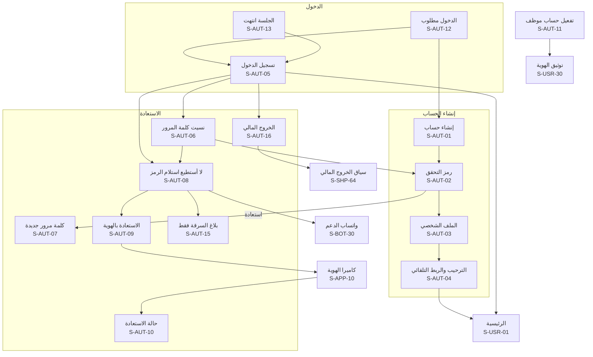

## 8. حساب المواطن (S-USR)

شاشات مشتركة بين الموقع والتطبيق بالمحتوى نفسه، وتختلف في التخطيط فقط. والمستخدم المفوّض والجهة الموثوقة **ليسا دورين** بل علاقتان، فشاشاتهما جزء من حساب المواطن (S-USR-02، وS-USR-16، وS-USR-27، وS-USR-28).

| المعرّف | الشاشة | من يراها | المنصات | الغرض | المتطلبات | العناصر والإجراءات | الحالات الخاصة |
|---|---|---|---|---|---|---|---|
| S-USR-01 | الرئيسية | كل مستخدم | موقع، تطبيق | نقطة البداية بعد الدخول | NOTIF-05، PROTECT-02، OWN-02، ADS-01، REPORT-25، SUCCESSION-06 | فحص سريع، واختصارات (بلّغ عن سرقة، ونقل ملكية، وسجّل جهازاً، واحمِ جهازك)، و«ينتظر إجراءك» (طلب نقل إليك، وتأكيد بلاغ مفوّض أو عاجل، وطلب معلومات، واعتراض، ودعوة جهة موثوقة أو وصي، وبلاغ على جهاز باسمك، وخروج جهاز من ملكيتك، و«وُجد جهازك»، واختيار تعويض)، وملخص «أجهزتي»، وشريط حالة الهوية، وسلايدر الإعلانات إن فُعّل | فارغة لحساب جديد: «وثّق هويتك» و«سجّل جهازك»؛ طلب نقل أجهزة هذا الحساب بعد الإبلاغ بوفاة صاحبه: شريط أعلى الصفحة «طُلب نقل أجهزتك بعد الإبلاغ بوفاتك» مع «أنا حي، أوقف هذا» (كما في S-PUB-26)؛ شريط الحالة الموحّد (القسم 3) |
| S-USR-02 | أجهزتي | مرتبط تلقائياً، وموثّق الهوية، والمفوّض | موقع، تطبيق | كل الأجهزة باسمي والمفوّض عليها | OWN-01، OWN-02، OWN-08، OWN-12، PROTECT-02، REPORT-25، OWN-20، OWN-19 | تبويبان: «باسمي» و«مفوّض عليها». بطاقة لكل جهاز: الموديل، وIMEI مخفياً جزئياً، وأصل التسجيل، وشارات الحالة (لا بلاغات، أو بلاغ نافذ، أو قيد الانتظار مع الأيام الباقية، أو «عليه بلاغ من شخص آخر»، أو «الجهاز لدى جهة رسمية»، أو «طلب نقل لمحل معلّق»)، و«+ سجّل جهازاً»، وتنبيه «نقل ملكية بانتظار قبولك» | فارغة؛ مؤكَّد الرقم فقط: «لا أجهزة مرتبطة بك. وثّق هويتك لتسجيل جهاز»؛ جهاز صرّح صاحبه «لم يعد معي»: ينتقل إلى «أجهزة سابقة» |
| S-USR-03 | تفاصيل الجهاز | المالك | موقع، تطبيق | كل ما يخص جهازاً وإجراءاته | OWN-01، OWN-14، OWN-12، OWN-07، HISTORY-03، PROTECT-02، OWN-19، OWN-20، OWN-21، SHOP-20 | المعرّفات، والمالك منذ، وأصل التسجيل، والفواتير، وسجل ملكيتي، والإجراءات: شهادة فحص، ونقل الملكية، و«نقل لمحل» (S-USR-51)، و«لم يعد الجهاز معي» (S-USR-54)، وتاريخ الجهاز (مجاني للمالك)، والمستخدمون المفوّضون، وخطوات الحماية، و«بلّغ عن سرقة أو فقدان» | قيد الانتظار: النقل والشهادة معطّلان مع العدّاد؛ بلاغ نافذ: الإجراءات محصورة بالبلاغ؛ تسجيل مجمّد بسبب بلاغ؛ الجهاز لدى جهة رسمية أو بانتظار انتقال إرث: النقل والشهادة وتعديل المفوّضين معطّلة برسالة محايدة؛ بلاغ «بانتظار تأكيد المالك» أو ادعاء منافس: النقل معطّل كالبلاغ قيد المراجعة |
| S-USR-04 | تسجيل جهاز ذاتياً | موثّق الهوية | موقع◐، تطبيق | تسجيل جهاز قديم بلا فاتورة | OWN-03، OWN-15، FAKE-02، REPORT-05، HANDOFF-01، SERIAL-01، SERIAL-04، OWN-24، CHECK-21 | IMEI1 وIMEI2 بالمسح (S-APP-08)، أو الشركة المصنّعة والرقم التسلسلي لجهاز دون شريحة عند تفعيل الوحدة، وتأكيد الموديل، والصورة الحيّة بالكاميرا مع رقم الحساب (S-APP-11)، وأدلة اختيارية، والإقرار القانوني الصريح، و«إرسال للمراجعة» مع شرح فترة الانتظار ⚙️ 30 يوماً. ونوع الجهاز (موبايل، أو تابلت، أو راوتر، أو ساعة بشريحة، أو جهاز دفع، أو متتبّع)، وسؤال إلزامي «من أين حصلت عليه؟» (محل باسمه، أو شخص، أو هدية، أو خارج سوريا) | الجهاز مسجّل لغيرك: رفض آلي بصياغة محايدة؛ تجاوز الحد السنوي ⚙️ 3: «سيُراجع طلبك يدوياً»؛ الرقمان لا يطابقان الموديل؛ فترة التهدئة؛ مسودة؛ ⚙️ 3 طلبات لكل جهاز لكل شخص خلال 90 يوماً؛ رقم «قد يكون منسوخاً»: يُطلب معرّف ثانٍ (رقم Apple التسلسلي أو كرتونة تُظهر الرقمين) ويُراجع يدوياً |
| S-USR-05 | حالة طلب التسجيل الذاتي | صاحب الطلب | موقع، تطبيق | متابعة الطلب حتى الاعتماد | OWN-03، OWN-12، REPORT-15 | خط زمني: قيد المراجعة، ثم مرفوض بالسبب أو قيد الانتظار حتى [تاريخ]، ثم نهائي. ووسم «تسجيل ذاتي» | مجمّد بسبب بلاغ: «يراجع المشرف الملف» دون تفاصيل الطرف الآخر |
| S-USR-06 | نقل الملكية: الطلب | المالك (مرتبط تلقائياً أو موثّق الهوية) | موقع، تطبيق | بدء نقل الجهاز لمشترٍ | OWN-04، OWN-06، OWN-12، THEFT-07، OWN-21 | الجهاز، ورقم موبايل المشتري ورقمه الوطني، وتنبيه «يجب أن يطابقا حساب المشتري»، و«تُلغى الشهادة والتفويضات وتفقد صلاحياتك»، ثم رمز على رقمك (S-AUT-02) | ممنوع لبلاغ نافذ أو قيد المراجعة أو فترة انتظار؛ فترة التهدئة؛ أثناء بلاغ نافذ على جهاز آخر: كلمة المرور ورمز للرقم البديل؛ ممنوع أيضاً لبلاغ بانتظار تأكيد المالك أو ادعاء منافس أو جهاز لدى جهة رسمية أو مالكه متوفى (OWN-21) |
| S-USR-07 | طلب النقل المعلّق | المالك | موقع، تطبيق | متابعة طلب أرسلته | OWN-05 | المستلم مخفياً جزئياً، والعدّاد ⚙️ 72 ساعة، و«إلغاء الطلب» | منتهٍ؛ مقبول (مع رابط الإيصال)؛ ملغى |
| S-USR-08 | قبول نقل الملكية | المستلم (مؤكَّد الرقم على الأقل) | موقع، تطبيق | قبول جهاز من بائع | OWN-04، NOTIF-09، OWN-22 | الجهاز، والبائع بالاسم الأول الموثّق وأول حرف من الكنية (أو «أحد مستخدمي بصمة»)، والعدّاد، وفحوص المطابقة (رقم الموبايل، والرقم الوطني، ولا بلاغات، وأصل التسجيل)، و«قبول الملكية» و«رفض»، وتنبيه «لتقديم بلاغ عنه لاحقاً تحتاج توثيق هويتك» | عدم المطابقة: «بيانات الطلب لا تطابق حسابك» دون تفاصيل؛ لا رقم وطني في الملف: إكماله أولاً (S-AUT-03)؛ منتهٍ أو ملغى؛ مستلم دون موبايل ذكي: القبول عبر الدعم بهويته ورمز النقل من المالك (S-ADM-69) |
| S-USR-09 | إيصال نقل الملكية | الطرفان | موقع، تطبيق | وثيقة النقل | OWN-04 | رقم `CR-`، والتاريخ، والجهاز، وQR، و«تحميل PDF» (S-PRN-05)، و«مشاركة» | — |
| S-USR-10 | شهادة الفحص | المالك | موقع، تطبيق | إصدار شهادة للإعلان وإدارتها | OWN-09، OWN-10، OWN-11، REPORT-30 | «إصدار شهادة»، ثم البطاقة: رقم `CR-`، والرابط، وصورة QR، وتاريخ الانتهاء ⚙️ 30 يوماً، و«مشاركة»، و«حفظ كصورة»، و«إلغاء الشهادة» | غير متاحة لبلاغ أو فترة انتظار؛ منتهية؛ أُلغيت تلقائياً بالنقل أو البلاغ؛ قُدّم بلاغ على الجهاز ولو بقي قيد المراجعة: أُلغيت الشهادة فوراً، وتُصدر جديدة إن رُفض البلاغ أو أُلغي |
| S-USR-11 | المستخدمون المفوّضون | المالك | موقع، تطبيق | من يستخدم جهازي دون نقل ملكيته | OWN-08، TRUSTED-05، PRIV-09، PERSON-04، NOTIF-08 | القائمة حتى ⚙️ 3، و«إضافة» (الاسم، وصلة القرابة، ورقم الموبايل، وعلَم «قاصر بإدارة وليّ الأمر» مع إقرار وليّ الأمر، D-97)، و«إلغاء التفويض»، وشرح الفرق عن الجهة الموثوقة. ولممثل المؤسسة (D-105): موظفو المؤسسة مستخدمون مفوّضون على كل جهاز، وتغيير الممثل نقل ملكية عادي | الحد الأقصى؛ أُلغيت التفويضات بالنقل؛ رقم ردّ «لا أعرف هذا الشخص — أوقف»: لا تصله دعوة منك ⚙️ 180 يوماً، وإعادة الدعوة بعد رفضها بعد ⚙️ 30 يوماً |
| S-USR-12 | فواتيري | المشتري | موقع، تطبيق | فواتير أجهزتي بتفاصيلها الكاملة | OWN-01، SHOP-11، PUB-02، OWN-17 | قائمة، وتفاصيل الفاتورة كاملة (والسعر يظهر للمشتري وحده)، و«تحميل PDF»، ورابط التحقق. و«لم أشترِ هذا الجهاز» على كل فاتورة، يفتح طلب دعم عاجلاً ويعلّم المعاملة «ينكرها طرفها» | فارغة؛ فاتورة ملغاة |
| S-USR-13 | إيصالاتي | مستخدم | موقع، تطبيق | إيصالات الفحص وإيصالات النقل المحفوظة | CHECK-16، OWN-04 | قائمة بالتاريخ والنتيجة والموديل، وفتح الإيصال (S-PUB-07) | فارغة: «افحص وموقعك مفعّل لتحصل على إيصال» |
| S-USR-14 | بلاغاتي | المبلّغ | موقع، تطبيق | كل بلاغاتي ومسوداتي | REPORT-09، REPORT-14، POLICE-03، REPORT-19 | قائمة برقم `BL-` والحالة والتاريخ، والمسودات، والبلاغات الرسمية المرتبطة برقمي الوطني، و«بلاغ جديد» | فارغة؛ بلاغ ثانٍ منك على الجهاز نفسه: خطأ «بلاغ مكرر» يظهر هنا فقط |
| S-USR-15 | بلاغ جديد: حماية فورية | مستخدم (والمفوّض) | موقع، تطبيق | حماية الرقم والمحافظ قبل أي شيء | THEFT-01، THEFT-02، THEFT-03، THEFT-04، THEFT-05، LINE-01، LINE-03، WALLET-01، REPORT-28 | «هل كانت شريحة رقمك داخل الجهاز المسروق؟». إن نعم: إيقاف الرسائل لرقمك، وإنهاء الجلسات الأخرى (تلقائي)، و«أوقف خطي» مع اختيار الشركة ومع جملة «منفصل عن حظر الجهاز»، وتجميد المحافظ من قائمة المزوّدين المنضمّين، ثم الرقم البديل مع رمزه وجملة «للإشعارات فقط»، والإرشادات الفورية | داخل جلسة «بلاغ السرقة فقط» (S-AUT-15): هذا المعالج وحده متاح؛ مزوّد غير منضمّ: إرشاد التواصل معه فقط؛ لا شريحة: تخطٍّ مباشر للخطوة التالية؛ غير موثّق الهوية: إيقاف الرسائل وإنهاء الجلسات فوراً، وطلبا الخط والمحافظ بعد التوثيق لأنهما يُرسلان ببيانات صاحبهما الموثّقة؛ حساب معلّق: المعالج متاح موسوماً للمراجع، وحساب محظور: عبر جلسة «بلاغ السرقة فقط» أو الدعم أو قوى الأمن |
| S-USR-16 | بلاغ جديد: الجهاز والنوع | موثّق الهوية، والمفوّض (بتأكيد المالك) | موقع، تطبيق | اختيار الجهاز ونوع البلاغ | REPORT-01، REPORT-03، REPORT-12، OWN-08، SERIAL-03، REPORT-27، OWN-18 | الاختيار من «أجهزتي» أو «مفوّض عليها» (فلا تُطلب أدلة)، أو «جهاز غير مسجّل» بإدخال IMEI، أو «حاسوب أو جهاز دون شريحة» بالشركة المصنّعة والرقم التسلسلي عند تفعيل الوحدة مع جملة «لا حظر ولا تتبّع من الشبكة لهذا الجهاز، والحماية بمنع بيعه عبر المحلات وإبلاغ الجهات المختصة»، ثم «سرقة» أو «فقدان» | غير موثّق الهوية: «وثّق هويتك لتقديم البلاغ» (S-USR-30) مع حفظ المسودة؛ يوجد بلاغ نافذ أو قيد المراجعة على الجهاز: رابطه؛ جهاز خرج من ملكيتك خلال ⚙️ 14 يوماً: يُقبل البلاغ للمراجعة ⛔ ولا يمنعه النقل؛ بلاغ متكرر خلال ⚙️ 30 يوماً بعد إغلاق «وجدته» أو «بالخطأ»: مراجعة مشدّدة |
| S-USR-17 | بلاغ جديد: الحادثة | المبلّغ | موقع، تطبيق | متى وأين وماذا حدث | REPORT-02، GEO-05، GEO-08، REPORT-16، REPORT-17، TIP-05، TIP-06، REPORT-24 | التاريخ والوقت التقريبي، والمحافظة والمنطقة (إلزاميتان)، ونقطة اختيارية على الخريطة مع «لا يظهر لأي شخص»، والوصف، واللون والتسلسلي والرقم الثاني، و«آخر موقع من Find My» مع صورة الشاشة (اختياري)، والمكافأة (اختيارية) مع تنويهها | «خارج سوريا» مع اختيار الدولة، فيصير نطاق الأمن للإدارة المركزية وحدها |
| S-USR-18 | بلاغ جديد: الأدلة | المبلّغ عن جهاز غير مسجّل | موقع◐، تطبيق | إثبات الملكية لجهاز غير مسجّل | REPORT-04، REPORT-05، REPORT-06، HANDOFF-01، SERIAL-03 | صورة لصاقة الكرتونة مع قراءة الباركود ومقارنته (وللجهاز دون شريحة: صورة ملصق الرقم التسلسلي على الجهاز أو الكرتونة، أو الفاتورة)، والصورة الحيّة بالكاميرا مع رقم الحساب ظاهراً (S-APP-11)، وأدلة اختيارية (فاتورة، وصور قديمة، ومستندات) | عدم تطابق الباركود: تنبيه قبل الإرسال؛ باركود غير مقروء؛ رفع مستأنف؛ مسودة دون اتصال |
| S-USR-19 | بلاغ جديد: المراجعة والإقرار | المبلّغ | موقع، تطبيق | التأكد والإرسال | REPORT-08، REPORT-14، PROTECT-03، OWN-08، REPORT-19، REPORT-30 | ملخص كل الخطوات مع «تعديل»، ونص الإقرار الثابت، وتحذير «لا تحاول استرداد جهازك بنفسك»، و«إرسال». والنتيجة: «قيد المراجعة» برقم `BL-` | للمفوّض: «بانتظار تأكيد المالك» خلال ⚙️ 48 ساعة؛ على الجهاز بلاغ لشخص آخر: يُقدَّم ادعاءً منافساً بإيصال محايد «تلقّينا بلاغك وسيُراجع» دون كشف وجود البلاغ الأول؛ الإرسال يلغي شهادة الفحص الفعّالة فوراً |
| S-USR-20 | تفاصيل البلاغ | المبلّغ | موقع، تطبيق | متابعة البلاغ وإجراءاته | REPORT-09، REPORT-17، TELCO-01، TELCO-04، NOTIF-04، LINE-01، WALLET-02، THEFT-03، PP-08، PP-10، SERIAL-03، REPORT-22، REPORT-23، REPORT-26، LINE-04، WALLET-05، TELCO-16، PP-16 | خط زمني بالحالة ومن قرر (الإدارة أو قوى الأمن)، و«الجهاز في قائمة المراقبة لدى الشبكات» دون أي تفاصيل (ولا يظهر هذا السطر للجهاز دون شريحة)، وحالة إيقاف الخط وتجميد كل محفظة، وإشعارات الفحص العامة «تم فحص جهازك»، وتعديل المكافأة أو إلغاؤها، و«استعدت رقمي الأصلي»، وأزرار: الرد على طلب المعلومات، والرد على الاعتراض، و«طلب إغلاق». وعند الضبط: «جهازك موجود لدى [القسم]، راجعه ومعك هويتك». وأزرار «أضف معلومة» (S-USR-48) و«تغيير نوع البلاغ» (S-USR-49)، وعند كل خروج للبلاغ (رفض، أو إلغاء، أو إغلاق، أو تصحيح): سطر «رُفعت الحمايات وأُبلغت شركة الخط ومزوّدو المحافظ». وللمفقود عند تنسيق الإرجاع: **رمز التسليم** الذي تعطيه لمن يعيده. وللمضبوط: العنوان والقسم وتذكير بعد ⚙️ 7 و30 يوماً. وإجراءات قام بها الدعم عنك موسومة «عبر الدعم» باسم الموظف | مرفوض بالسبب و«قدّم بلاغاً جديداً»؛ مغلق؛ **لا يظهر أبداً** موقع أو فاحص أو رقم شريحة؛ ظهرت شريحتك في الجهاز المبلّغ عنه: «إن استعدت جهازك فاطلب إغلاق البلاغ» مع زر S-USR-22 |
| S-USR-21 | الرد على طلب المعلومات | المبلّغ | موقع◐، تطبيق | الرد على سؤال المشرف | REPORT-10 | رسالة المشرف، ونص الرد، والمرفقات (والكاميرا بالإكمال على الكمبيوتر)، والمهلة ⚙️ 14 يوماً | انتهت المهلة: رُفض البلاغ تلقائياً |
| S-USR-22 | طلب إغلاق البلاغ | المبلّغ | موقع، تطبيق | إنهاء البلاغ بعد الاسترداد أو الخطأ | REPORT-11، THEFT-07، REPORT-27 | السبب (تم الاسترداد، أو وجدته، أو بلاغ بالخطأ)، وتنبيه «يبقى الجهاز مبلّغاً عنه حتى المراجعة»، وكلمة المرور، ورمز للرقم البديل إن وُجد | فترة التهدئة؛ طلب قيد المراجعة؛ طلب سابق رُفض: لا طلب جديد قبل ⚙️ 7 أيام؛ سبب جديد «تلف الجهاز نهائياً» يقرره المشرف |
| S-USR-23 | الرد على اعتراض | المبلّغ | موقع◐، تطبيق | تقديم أدلتي مقابل الاعتراض | DISPUTE-03 | «قُدّم اعتراض على بلاغك» دون هوية المعترض، والمهلة ⚙️ 7 أيام، والإفادة، والأدلة | انتهت المهلة: «يُؤخذ عدم الرد بعين الاعتبار» |
| S-USR-24 | تقديم اعتراض | موثّق الهوية يحمل الجهاز | موقع◐، تطبيق | الطعن في بلاغ نافذ | DISPUTE-01، DISPUTE-04 | IMEI (من النتيجة)، والإفادة، والأدلة (فاتورة، ومحادثات البيع، وإيصال تحويل، وشهود)، والإقرار | غير موثّق الهوية: S-USR-30 أولاً؛ اعتراض قائم من الشخص نفسه؛ اعتراض مفتوح على البلاغ: لا اعتراض ثانٍ؛ إعادة الاعتراض بعد القرار بدليل جديد فقط وبعد ⚙️ 30 يوماً |
| S-USR-25 | تأكيد بلاغ المفوّض أو البلاغ العاجل | المالك أو صاحب الجهاز | موقع◐، تطبيق | تأكيد بلاغ لم يقدّمه بنفسه | OWN-08، TRUSTED-03، TRUSTED-06، REPORT-26 | ملخص البلاغ ومن بدأه. لبلاغ المفوّض: العدّاد ⚙️ 48 ساعة، و«تأكيد وإرسال للإدارة» و«رفض»، وتصوير الهوية ضمن التأكيد إن لم تكن موثّقة. وللبلاغ العاجل من جهة موثوقة: العدّاد حتى الأبعد من ⚙️ 72 ساعة ونهاية يوم الدوام الثاني (ويتوقف ما دام لك طلب دعم مفتوح لتأكيد هويتك) و«أؤكد البلاغ» أو «لم أطلب ذلك» | بلاغ المفوّض منتهٍ: أُلغي وأُبلغ المفوّض؛ البلاغ العاجل منتهٍ: رُفض آلياً؛ الرقم البديل لا يؤكد شيئاً (D-81)؛ «لم أطلب ذلك»: يُرفض البلاغ وتُرفع الحمايات وتُستأنف الرسائل لرقمك؛ ومن لا يستطيع الدخول يقرر من S-PUB-27 |
| S-USR-26 | الجهات الموثوقة | مستخدم | موقع، تطبيق | من يبلّغ عني إن سُرق موبايلي | TRUSTED-01، TRUSTED-04، TRUSTED-05، NOTIF-08، RESTRICT-05 | القائمة حتى ⚙️ 3 بالحالة (بانتظار القبول، أو نشطة)، و«دعوة» (الاسم والرقم)، و«إزالة»، وسجل ما فعلته كل جهة مع «تراجع عبر الدعم الفني»، وجملة «لا تستطيع الجهة استعادة حسابك» | فترة التهدئة تمنع التغيير؛ فارغة؛ المدعو محظور أو مقيّد: «تعذّر إضافة هذه الجهة» دون السبب؛ إعادة دعوة رقم رفض بعد ⚙️ 30 يوماً |
| S-USR-27 | أنا جهة موثوقة لـ | مؤكَّد الرقم | موقع، تطبيق | دعواتي ومن أبلّغ عنهم | TRUSTED-01، TRUSTED-02، NOTIF-09 | الدعوات بانتظار الرد («قبول» و«رفض»)، والأشخاص الذين اختاروني، و«بلاغ عاجل عن [الاسم]». والداعي يظهر بالاسم الأول الموثّق وأول حرف من الكنية، وفي الدعوة «لا أعرف هذا الشخص — أوقف» | فارغة |
| S-USR-28 | بلاغ عاجل عن شخص | الجهة الموثوقة | موقع، تطبيق | التبليغ والحماية الفورية عن غيري | TRUSTED-02، TRUSTED-03، THEFT-02، THEFT-03، THEFT-04، LINE-01، WALLET-01 | اختيار جهاز صاحب الحساب (الموديل فقط)، والنوع، والحادثة باختصار، والحمايات (إنهاء الجلسات وإيقاف الرسائل فوراً، وإيقاف الخط، وتجميد المحافظ)، و«رقمي رقماً بديلاً للإشعارات فقط»، والإقرار | بعد الإرسال: «قيد المراجعة» مع الحمايات مطبّقة، ويُطلب تأكيد صاحب الجهاز من حسابه (S-USR-25) أو عبر الدعم بالهوية خلال ⚙️ 72 ساعة، وإلا يُرفض البلاغ آلياً |
| S-USR-29 | الرقم البديل | مستخدم | موقع، تطبيق | رقم تصل عليه الإشعارات | THEFT-02، THEFT-03 | إضافة الرقم وتأكيده برمز، وحالته، و«استعدت رقمي الأصلي»، وجملة «للإشعارات فقط، ولا يُستخدم أبداً لاستعادة حسابك أو تأكيد إجراء حساس» | فترة التهدئة تمنع التغيير |
| S-USR-30 | توثيق الهوية | مؤكَّد الرقم، ومرتبط تلقائياً، وموظف جديد | موقع◐، تطبيق | رفع درجة الحساب إلى «موثّق الهوية» | AUTH-05، CIVIL-01، CIVIL-05، HANDOFF-01، PERSON-01، PERSON-02، PERSON-03، CIVIL-10 | لماذا (البلاغ، والاعتراض، والتسجيل الذاتي، والمحل، والعمل موظفاً)، والاسم والرقم الوطني **معبّأين من التسجيل (S-AUT-03) للقراءة فقط** (تعديلهما عبر الدعم)، والبيان الإضافي عند تفعيل الأحوال المدنية، ثم تصوير الوجهين بالكاميرا دون سيلفي (S-APP-10)، ثم «إرسال». والحالة بعدها. ونوع وثيقة الهوية (القسم 3): الوثيقة البديلة (بطاقة اللاجئ الفلسطيني السوري، أو جواز سفر مع إقامة سارية) تُصوَّر بوجهيها أو صفحتيها وتُراجع يدوياً | قيد المراجعة؛ مرفوض بالسبب والمحاولات الباقية (⚙️ 3)؛ أُحيل للدعم؛ بطاقة غير سارية؛ عدم تطابق الاسم وحده مع تطابق الرقم الوطني: مراجعة يدوية لا تُحسب محاولة مرفوضة؛ إقامة منتهية: «حدّث وثيقتك قبل أي إجراء حساس جديد» والملكية القائمة باقية |
| S-USR-31 | حسابي | مستخدم | موقع، تطبيق | الملف والإعدادات ومداخل الأمان | AUTH-04، AUTH-12، THEME-02، NOTIF-01 | الاسم، ورقم الحساب `SY-` مع «نسخ»، وشارة «هوية موثّقة» أو «رقم مؤكَّد»، والمظهر (فاتح، وغامق، وتلقائي)، والإشعارات، ومداخل: الجهات الموثوقة، والوصي على أجهزتي وأنا وصي لـ (S-USR-59، S-USR-60)، والرقم البديل، والبريد الأمني (S-USR-47)، وتلغرام (S-USR-62)، والقيود على حسابي (S-USR-61)، والأجهزة والجلسات، ومن اطّلع على بياناتي، وطلباتي، وفواتيري، وإيصالاتي، والخدمات المدفوعة، والتبديل إلى المحل أو الوكيل، والقانونية، وتسجيل الخروج | الاسم والرقم الوطني مقفلان بعد التوثيق: التعديل عبر «طلب دعم» |
| S-USR-32 | الأجهزة والجلسات وكلمة المرور | مستخدم | موقع، تطبيق | إدارة الدخول | AUTH-08، AUTH-03، AUTH-14 | الجلسات النشطة (الجهاز، والمنصة، وآخر نشاط) مع «إنهاء»، و«الخروج من كل الأجهزة»، و«تغيير كلمة المرور». و«قفل التطبيق» بالبصمة أو الوجه أو رمز الجهاز (S-APP-15): اختياري للمواطن بمدة يختارها (فوراً، أو 1، أو 5، أو 10 دقائق)، و«مفروض» يظهر للقراءة مع سببه في سياق المحل والوكيل | قيد إعادة التعيين ⚙️ 24 ساعة بعد استعادة كلمة المرور برمز: شريط بوقت انتهائه |
| S-USR-33 | تغيير رقم الموبايل | مستخدم | موقع، تطبيق | نقل الحساب لرقم جديد | AUTH-09، THEFT-07، AUTH-15 | رمز للرقم القديم ثم رمز للجديد، وتنبيه فترة التهدئة ⚙️ 72 ساعة وإنهاء الجلسات، و«فقدت رقمي القديم» ← S-AUT-08 | أثناء بلاغ نافذ: كلمة المرور ورمز للرقم البديل؛ الرقم الجديد مسجّل لحساب آخر؛ أن الرقم الجديد مستخدم يظهر بعد تأكيد رمزه فقط |
| S-USR-34 | إغلاق الحساب | مستخدم | موقع، تطبيق | طلب إنهاء الحساب من داخله | AUTH-10، PRIV-02، TENANT-07 | ما يُحذف وما يُحتفظ به قانوناً، وكلمة المرور ورمز، و«طلب إغلاق الحساب»، ومهلة التراجع ⚙️ 7 أيام مع «تراجع عن الإغلاق». ويظهر في التطبيق إلزاماً حسب سياسات المتجرين | بلاغ أو نقل جارٍ: شرح أثره قبل التأكيد؛ تملك محلاً غير مغلق: «أغلق محلك أو انقل ملكيته أولاً» مع رابط S-SHP-62 أو S-SHP-59؛ أثناء مهلة الإغلاق: حالة «حسابك قيد الإغلاق» (القسم 2) |
| S-USR-35 | من اطّلع على بياناتي | مستخدم | موقع، تطبيق | شفافية الاطلاع على بياناتي | DATAACCESS-01، DATAACCESS-02، DATAACCESS-03، PERSON-05 | قائمة (الجهة، والتاريخ، والغرض مثل «معاملة شراء رقم...»)، و«اطلاع مشبوه» يفتح طلب دعم مربوطاً. وما فعله غيرك نيابة عنك بصفته (الدعم، أو حامل وكالة، أو جهة موثوقة، أو وليّ أمر) | فارغة. واطلاع قوى الأمن لا يظهر قبل موعده دون أي إشارة لوجوده |
| S-USR-36 | الإشعارات | مستخدم | موقع، تطبيق | مركز الإشعارات | NOTIF-01، NOTIF-04، NOTIF-05، CHECK-14، PAY-07، NOTIF-10 | قائمة بالأيقونة والوقت والسياق (حسابي أو المحل)، و«تحديد الكل كمقروء»، وكل إشعار يفتح شاشته (القسم 5). ووجهة كل إشعار في القسم 5.1، وما لم يعد متاحاً يفتح هنا بـ «لم يعد هذا متاحاً لك» | فارغة |
| S-USR-37 | طلباتي | مستخدم، وصاحب المحل والوكيل | موقع، تطبيق | متابعة طلبات الدعم | SUPPORT-02، SUPPORT-05 | قائمة برقم `ST-` والحالة (جديد، وقيد المعالجة، وبانتظار ردّك، ومحلول، ومغلق)، و«+ طلب جديد»، وتحذير الدعم | فارغة |
| S-USR-38 | طلب دعم جديد | مستخدم، وصاحب المحل والوكيل | موقع، تطبيق | فتح طلب برقم مرجعي | SUPPORT-01، SUPPORT-05، SUPPORT-08، SUPPORT-09، SHOP-27 | التصنيف، والوصف، والصور، والربط ببلاغ أو جهاز أو معاملة، وتحذير الدعم، و«إرسال». والتصنيفات من قائمة تديرها الإدارة، ومنها «انتحال صفة» و«تأكيد بلاغ عاجل بالهوية» و«انتقال جهاز متوفى» و«إجراء بموجب وكالة». وتنبيه قبل الإرسال لنص فيه ألفاظ مسيئة دون منعه | تأكيد برقم `ST-`؛ ⚙️ 3 طلبات مفتوحة: تُضاف رسالتك لآخر طلب مفتوح؛ قيد بسبب الإساءة: طلب جديد واحد يومياً، والبلاغ العاجل لا يُقيَّد أبداً |
| S-USR-39 | تفاصيل طلب الدعم | صاحب الطلب | موقع، تطبيق | المحادثة مع الدعم | SUPPORT-02، SUPPORT-05، SUPPORT-06 | الرسائل، و«رد»، والمرفقات، و«حُلّت مشكلتي»، والتقييم من 1 إلى 5 بعد الحل | أُغلق تلقائياً بعد ⚙️ 7 أيام دون رد |
| S-USR-40 | احمِ أجهزتي | مستخدم | موقع، تطبيق | تقدّم خطوات الحماية لكل جهاز | PROTECT-01، PROTECT-02، PROTECT-03 | خطوات «احمِ جهازك» مع «تم» و«لم يتم» لكل جهاز، وتذكير لطيف بالناقص، وتحذير «لا تحاول استرداد جهازك بنفسك» | — |
| S-USR-41 | تقارير تاريخ الأجهزة | مستخدم | موقع، تطبيق | التقرير المجاني للمالك والمطلوب لغيره | HISTORY-01، HISTORY-02، HISTORY-03، HISTORY-04، PAY-01، PAY-08، HISTORY-05 | للمالك: «أصدر تقرير جهازك» مجاناً. ولغيره **في الموقع فقط**: IMEI والسعر و«اطلب التفعيل» الذي يفتح واتساب الإدارة التجاري برسالة فيها رقم الحساب والخدمة وIMEI. وقائمة التقارير الصادرة مع «عرض» و«PDF» (S-PRN-07) | في التطبيق: قائمة التقارير الصادرة وحالة الطلب فقط، دون سعر ولا زر ولا دعوة للشراء؛ بانتظار التفعيل؛ الطلب لمعرّف موجود في السجل فقط؛ إعادة فتح التقرير المشترى ⚙️ 30 يوماً؛ المدفوع يصدر ولو أُطفئت الوحدة قبل إصداره |
| S-USR-42 | الخدمات المدفوعة ومدفوعاتي | مستخدم، وصاحب المحل | موقع، تطبيق | حالة الخدمات وإيصالات الدفع | PAY-01، PAY-02، PAY-03، PAY-04، PAY-07، PAY-08، PAY-10، PAY-11 | الخدمات بحالتها («مفعّلة حتى [التاريخ]» أو «غير مفعّلة»)، والدفعات وإيصالاتها (S-PRN-11)، وتذكير التجديد. وفي الموقع فقط: الأسعار و«اطلب التفعيل». والإبطال الآلي (إلغاء قبل بدء الخدمة: المبلغ نفسه إلى المصدر نفسه دون موافقات) منفصلاً عن الاسترداد، وخيار التعويض عن خدمة توقفت (S-USR-56) | في التطبيق: الحالة والإيصالات فقط؛ استرداد قيد المعالجة |
| S-USR-43 | مبدّل الدور | من يحمل أكثر من سياق | موقع، تطبيق | التنقّل بين حسابي والمحل والوكيل | SHOP-05، IMPORTER-02، STORE-12، BIZAPI-01 | قائمة السياقات: «حسابي»، وكل محل بدوره فيه (صاحب أو موظف)، وكل وكيل، وفي الموقع فقط: المورّد، وشركة الشحن، وعميل الربط البرمجي، وسياق «الخروج المالي» لمحل لا تتيح حالته غيره، ومعها «طلب اعتماد مورّد» و «سجّل محلك» و«سجّل كوكيل» لموثّق الهوية | سياق معلّق: يظهر بشارته ويفتح للقراءة؛ دعوة موظف جديدة بانتظار التفعيل |
| S-USR-44 | طلب تفعيل خدمة مدفوعة | مستخدم، وصاحب المحل (بالغ) | موقع | بدء طلب خدمة رقمية أو باقة | PAY-01، PAY-07، PAY-11 | **في الموقع فقط**: اختيار الخدمة أو الباقة والمدة، وملخص السعر، و«اطلب التفعيل» فيُنشأ طلب برقم `SV-` ويفتح واتساب الإدارة التجاري برسالة جاهزة فيها رقم الحساب والخدمة ورقم الطلب (S-BOT-51)، ثم حالة الطلب (بانتظار الدفع، ومفعّل، وملغى) | الخدمة مطفأة: لا مدخل؛ حساب قاصر: لا يظهر؛ الإلغاء قبل الدفع أو قبل بدء الخدمة: يعود المبلغ آلياً إلى المصدر نفسه (إبطال) |
| S-USR-45 | بياناتي وتنزيل نسخة | مستخدم | موقع، تطبيق | الاطلاع على كل بياناتي وتنزيلها | PRIV-01، DATAACCESS-01 | البيانات الشخصية مجمّعة بأقسام، و«تنزيل نسخة» PDF وJSON بعد كلمة المرور ورمز تحقق، ورابط صالح ⚙️ 24 ساعة، و«طلب تصحيح» (طلب دعم بتصنيف الخصوصية) | تنزيل سابق خلال ⚙️ 24 ساعة: وقت التنزيل التالي |
| S-USR-46 | الخصوصية والموافقات | مستخدم | موقع، تطبيق | إدارة موافقاتي | PRIV-03، PRIV-10 | الموافقات بإصداراتها وتواريخها، و«سحب» لكل موافقة قابلة للسحب، ومفتاح الرسائل التجارية، والصفحات القانونية بإصداراتها المقبولة | حساب قاصر: لا مفتاح للرسائل التجارية |
| S-USR-47 | البريد الإلكتروني للتنبيهات الأمنية | مستخدم | موقع، تطبيق | بريد اختياري للتنبيهات الأمنية فقط (D-126) | AUTH-13 | الحالة (غير مضاف، أو بانتظار التأكيد، أو يسري في [الوقت]، أو مفعّل)، و«إضافة» بإعادة تحقق (كلمة المرور ورمز) ثم رابط تأكيد للعنوان (S-PUB-28)، و«تغيير» و«حذف». وما يصل عليه: الدخول من جهاز جديد، وبدء التهدئة، والاستعادة، وجلسة «بلاغ السرقة فقط»، وتغيير الرقم أو البريد. وجملة «لا يصلك على البريد رمز ولا رابط دخول، ولا يصلح لاستعادة حسابك» | التغيير أثناء التهدئة أو قيد إعادة التعيين ممنوع بسببه؛ العنوان الجديد يسري بعد ⚙️ 72 ساعة ويُبلَّغ العنوان القديم وكل الأجهزة، و«لم أكن أنا» يلغيه؛ الوحدة مطفأة: لا مدخل |
| S-USR-48 | أضف معلومة إلى بلاغي | المبلّغ على بلاغه النافذ | موقع◐، تطبيق | إيصال ما رآه المبلّغ (في محل أو على الإنترنت) للإدارة والأمن | REPORT-22، TIP-03 | النص، والمكان (المحافظة والمنطقة ونقطة اختيارية)، وصورة أو لقطة شاشة اختيارية، ورابط الإعلان إن وُجد، والنص الثابت «لا تواجه أحداً ولا تحاول الشراء أو الاسترداد بنفسك»، و«إرسال». وتصل الإدارة معلومةً مصدرها «المبلّغ» وتظهر على خريطة التتبّع | حد ⚙️ يومي؛ بلاغ غير نافذ: لا مدخل |
| S-USR-49 | طلب تغيير نوع البلاغ | المبلّغ | موقع، تطبيق | تحويل «مفقود» إلى «مسروق» أو العكس | REPORT-23، TIP-06 | النوع الحالي والمطلوب، والسبب، وتنبيه «يعود البلاغ للمراجعة والحماية قائمة أثناءها، وتتغير صياغة المكافأة تلقائياً»، و«إرسال» | طلب قيد المراجعة: لا طلب ثانٍ |
| S-USR-50 | بلاغ على جهاز مسجّل باسمك | الحائز المسجّل الذي لم يقدّم البلاغ | موقع، تطبيق | إبلاغه بصياغة محايدة وطريق الاعتراض (D-119) | REPORT-25، DISPUTE-01، OWN-12 | «يوجد بلاغ نافذ على جهاز مسجّل باسمك ([الموديل])»، **دون هوية المبلّغ** ودون تفاصيل البلاغ، ونصيحة «احتفظ بفاتورتك أو إيصال فحصك»، وما يعنيه البلاغ (لا نقل ولا بيع ولا شهادة حتى الحسم)، و«قدّم اعتراضاً» (S-USR-24) | طلب سرية من قوى الأمن: يتأخر الإشعار ⚙️ 30 يوماً كحد أقصى؛ رُفض البلاغ بعد الاعتراض: «لم يعد على جهازك بلاغ نافذ» |
| S-USR-51 | نقل لمحل | المالك المسجّل (مرتبط تلقائياً أو موثّق الهوية) | موقع، تطبيق | بيع الجهاز لمحل عن طريق شخص يحضر بدلاً منه (D-121) | SHOP-20، OWN-05، OWN-21 | الجهاز، و**رقم المحل `SH-`** ثم اسمه ومحافظته للتأكيد (لا دليل محلات، D-22)، وجملة «من يحضر الجهاز إلى المحل لا يحتاج حساباً، ويصوّر المحل هويته»، و«تُلغى الشهادة والتفويضات عند القبول»، ثم رمز على رقمك (S-AUT-02). ثم المتابعة: العدّاد ⚙️ 72 ساعة، و«إلغاء الطلب»، والنتيجة (قُبل بفاتورة شراء من المحل، أو رُفض، أو انتهى) | ممنوع حيث يُمنع النقل (OWN-21)؛ فترة التهدئة؛ محل غير موثّق أو معلّق أو قيد الإغلاق أو لا يسمح نشاطه بالشراء: رفض بسببه |
| S-USR-52 | قبول شراء بالتوصيل | مشترٍ غير حاضر من رابط الإشعار | موقع، تطبيق | استلام ملكية جهاز باعه محل بالتوصيل (يُبنى مطفأً حتى يقرّه الزبون) | SHOP-24 | اسم المحل، والجهاز، والعدّاد ⚙️ 72 ساعة، ومطابقة الرقم الوطني والموبايل، و«استلمت الجهاز، أقبل الملكية» أو «لم أستلمه». وبعد القبول الفاتورة في «فواتيري» | عدم المطابقة: «بيانات الطلب لا تطابق حسابك» دون تفاصيل؛ منتهٍ: يبقى الجهاز في مخزون المحل؛ الوحدة مطفأة: لا مدخل |
| S-USR-53 | خرج جهاز من ملكيتك | المالك السابق بعد كل خروج لجهاز من ملكيته | موقع، تطبيق | التنبّه لنقل أو بيع لم يقم به | OWN-17، OWN-18 | الجهاز (الموديل وIMEI مخفياً جزئياً)، وطريقة الخروج (نقل، أو بيع لمحل، أو «نقل لمحل»، أو إرث، أو تصحيح)، والتاريخ، وزر «لم أفعل ذلك» يفتح طلب دعم عاجلاً ويعلّم المعاملة «ينكرها طرفها»، وجملة «خلال ⚙️ 14 يوماً تستطيع أيضاً التبليغ عنه، ويُراجع بعناية» | بعد ⚙️ 14 يوماً: «لم أفعل ذلك» يفتح طلب دعم عادياً |
| S-USR-54 | لم يعد الجهاز معي | المالك | موقع، تطبيق | إنهاء الملكية لجهاز أُتلف أو خرج من سوريا | OWN-19 | السبب (أُتلف، أو بيع أو أُهدي خارج سوريا، أو سُلّم لإعادة التدوير، أو أُرسل للكفالة خارج سوريا)، وتنبيه «تنتهي ملكيتك وشهاداتك وتفويضاتك، وأي ظهور لاحق للجهاز ينبّه الإدارة»، وكلمة المرور ورمز، ثم تأكيد في «إيصالاتي» | بلاغ نافذ أو قيد المراجعة أو نقل معلّق: غير متاح مع السبب؛ فترة التهدئة؛ جهاز عليه بلاغ ثم تلف: «اطلب إغلاق البلاغ بسبب تلف الجهاز» (S-USR-22) |
| S-USR-55 | يقول شخص إنه وجد جهازك | المالك المسجّل | موقع، تطبيق | قرار المالك في معلومة «وُجد جهاز» غير مبلّغ عنه | TIP-07، TIP-02 | الجهاز، و«يقول شخص إنه وجد جهازاً مسجّلاً باسمك» دون أي بيانات عن الواجد، وزرّان: «بلّغ عنه كمفقود» (S-USR-16 معبّأً) و«الجهاز معي»، وجملة «إن أبلغت تنسّق الإدارة الإرجاع دون كشف رقمك أو رقمه» | «الجهاز معي»: تُغلق المعلومة؛ لا رد: تبقى للإدارة |
| S-USR-56 | تعويض عن خدمة توقفت | من دفع لخدمة أو باقة أو حملة توقفت بسبب المنصة | موقع، تطبيق (الحالة فقط) | اختيار التمديد أو الاسترجاع النسبي (D-111) | PAY-10، ADS-09، PAY-04 | الخدمة، وسبب التوقف (إطفاء، أو عطل من المنصة أو من شام كاش أو شريك التعبئة أطول من ⚙️ 24 ساعة متصلة، أو خطأ، أو سحب الباقة)، والأيام المفقودة، وخياران: «تمديد عند عودة الخدمة» أو «استرجاع نسبي [المبلغ] إلى المصدر نفسه»، و«تأكيد الاختيار». ويُسجَّل الاختيار ويُنفَّذ الاسترجاع بالموافقات المقررة | في التطبيق: الحالة فقط («بانتظار اختيارك» أو «اخترت التمديد») دون مبلغ ولا زر؛ لم تعد الخدمة خلال ⚙️ 30 يوماً: يُعرض الاسترجاع مجدداً؛ توقف لمخالفة: لا تعويض، مع السبب؛ إلغاء الزبون: الشهري لا يُسترجع، والسنوي أشهره الكاملة الباقية |
| S-USR-57 | نقل جهاز متوفى: الطلب | موثّق الهوية يحمل كنية المتوفى، أو وصي اختاره المتوفى، أو وصي قانوني بوثيقة وصاية | موقع◐، تطبيق | طلب انتقال أجهزة مالك متوفى (D-103، D-129) | SUCCESSION-01، SUCCESSION-02، SUCCESSION-04، HANDOFF-01، SUCCESSION-13، SUCCESSION-15 | الرقم الوطني للمتوفى أو وثيقته البديلة، والصفة (نفس الكنية، أو وصي اختاره المتوفى، أو وصي قانوني بوثيقة وصاية، ولا تُقبل الوكالة)، وتصوير شهادة الوفاة بالكاميرا مباشرة (S-APP-12 دون معرض) وتاريخ الوفاة منها، ووثيقة الوصاية للوصي القانوني، و**نطاق الطلب**: أرقام IMEI التي تعرفها، و/أو «وأي جهاز آخر مسجّل باسمه»، أو «تأكيد الوفاة فقط، دون أجهزة»، والقاصرون المستفيدون (الاسم والصلة)، وبيان عائلي أو إخراج قيد حين يُطلب (D-129)، والإقرار، و«إرسال» برقم `SU-` واحد للطلب كله. **ولا تُعرض قائمة أجهزة المتوفى في أي مرحلة قبل التنفيذ** | غير موثّق الهوية: S-USR-30 أولاً؛ محظور: غير متاح؛ جهاز غير مسجّل باسم المتوفى أو عليه طلب قائم: نص محايد واحد (`SUCCESSION_NOT_ELIGIBLE`) دون تفاصيل؛ الخلف قاصر: يقدّم وليّه الطلب ويعلن القاصرين، فينتقل الجهاز للولي ويُضاف القاصر مفوّضاً؛ طلب لاحق بعد تأكيد الوفاة: المسار والمهلة نفسهما، والإشعار للخلف السابقين والوصي |
| S-USR-58 | حالة طلب نقل جهاز متوفى | الطالب، والخلف الموثّق بعد التنفيذ | موقع، تطبيق | متابعة الطلب حتى التنفيذ، ثم التصرف في محلات صاحب الأجهزة | SUCCESSION-05، SUCCESSION-07، SUCCESSION-08، SUCCESSION-11، SUCCESSION-14، TENANT-12 | خط زمني بتسميات `status.succession_requests.*` (24 §7.4): مقدّم، ثم قيد التحقق، ثم «بحاجة لمعلومات حتى [التاريخ]» مع «أرسل المطلوب»، ثم «مهلة الاعتراض» ⚙️ 72 ساعة بعدّاد و«أُرسل إشعار لكل وسائل حساب صاحب الأجهزة»، ثم «متوقف للمراجعة» إن اعتُرض، ثم منفّذ والأجهزة في «أجهزتي» مع إيصال الانتقال (S-PRN-05) والمفوّضون عليها بخياري «إبقاء» و«إزالة»، وما ينتظر منها بحالته. و«أضف أرقام IMEI» حتى قبول الطلب فقط، و«سحب الطلب» (صنف ج) في كل حالة قبل التنفيذ. **وبعد التنفيذ قسم «محلات صاحب الأجهزة»** للخلف الموثّق: كل محل باسم المتوفى بحالته، و«تغيير المالك» (S-SHP-59) و«إغلاق المحل» (S-SHP-62) في نطاق «الخلف» بشريط `banner.successor`، أو «عبر الدعم الفني» (S-ADM-76). وبعد التنفيذ يصير الطالب جهة التواصل لبلاغات المتوفى النافذة على ما انتقل | شهادة غير مقروءة أو وثيقة قرابة مطلوبة: «بحاجة لمعلومات» بالسبب والمهلة؛ مرفوض بالسبب مع إرشاد للوصاية القانونية إن لم تطابق الكنية؛ متوقف بعد اعتراض: «أُوقف الطلب مؤقتاً للمراجعة» دون من اعترض؛ رُفض بعد الاعتراض: «الخلاف بين الورثة يُحسم بالقانون»؛ جهاز ينتظر انتهاء إجراء آخر: «ينتظر» دون سببه، وتذكير أسبوعي؛ جهاز تعذّر نقله: «تعذّر نقله» و«طلب جديد له»؛ بعد التنفيذ يختفي «سحب الطلب» |
| S-USR-59 | الوصي على أجهزتي | مستخدم | موقع، تطبيق | اختيار من تنتقل إليه أجهزتي بعد وفاتي (D-103) | SUCCESSION-03 | الوصي الحالي (⚙️ واحد) بحالته (بانتظار القبول، أو نشط)، و«تعيين وصي» (الاسم، والموبايل، والرقم الوطني) بإعادة تحقق، و«إزالة»، وجملة «لا يملك الوصي أي صلاحية على حسابك أو أجهزتك في حياتك، ولا يستعيد حسابك» | فترة التهدئة تمنع التغيير؛ المدعو محظور: «تعذّر إضافة هذا الوصي» دون السبب؛ الدعوة لم تُقبل خلال ⚙️ 7 أيام: منتهية؛ الوصي أغلق حسابه أو توفي: يُزال ويُبلَّغ صاحب الحساب |
| S-USR-60 | أنا وصي لـ | مؤكَّد الرقم (والقبول يحتاج توثيق الهوية) | موقع، تطبيق | دعواتي وصياً ومن اختاروني | SUCCESSION-03، NOTIF-09 | الدعوات بانتظار الرد والداعي بالاسم الأول الموثّق وأول حرف من الكنية، و«قبول» (بعد توثيق الهوية) و«رفض»، ومن اختاروني، و«نقل أجهزة [الاسم] بعد وفاته» يفتح S-USR-57 بصفة «وصي معيّن» | فارغة؛ «لا أعرف هذا الشخص — أوقف» في الدعوة يمنع الداعي ⚙️ 180 يوماً |
| S-USR-61 | القيود على حسابي | مستخدم، وصاحب المحل لقيود محله | موقع، تطبيق | معرفة ما قُيّد ولماذا وحتى متى، والاعتراض | RESTRICT-03، RESTRICT-04، RESTRICT-05، RESTRICT-07، RESTRICT-08، RESTRICT-01 | القيود النافذة: النوع بتسمية مفهومة (مثل «رفع الصور من المعرض متوقف»، و«دعوة جهات جديدة متوقفة»، و«الدفع عند الاستلام متوقف لمحلك»، و«الحظر»)، والسبب العام، ومنذ متى وحتى متى، وما يبقى متاحاً، و«اعتراض» مرة واحدة لكل قرار برسالة وأدلة، وحالة الاعتراض. وسجل القيود المنتهية | اعتراض ثانٍ دون دليل جديد: رد ثابت؛ الحظر: يبقى الدخول للقراءة وفحص أجهزته وبيع جهازه في محل والدعم وبلاغ سرقة جهازه عبر الدعم |
| S-USR-62 | ربط تلغرام للإشعارات | مستخدم | موقع، تطبيق | قناة إشعارات إضافية حين تعتمدها المنصة | NOTIF-03 | «ربط تلغرام» يفتح البوت برابط لمرة واحدة، ثم «مربوط» و«فك الربط»، وجملة «لا تصلك على تلغرام رموز تحقق أبداً» | التكامل مطفأ: لا مدخل |

**خريطة التنقّل (1): الأجهزة والملكية**

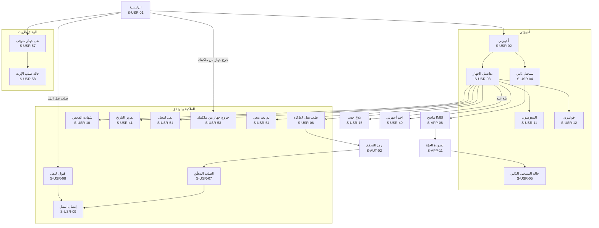

**خريطة التنقّل (2): البلاغ والحماية**

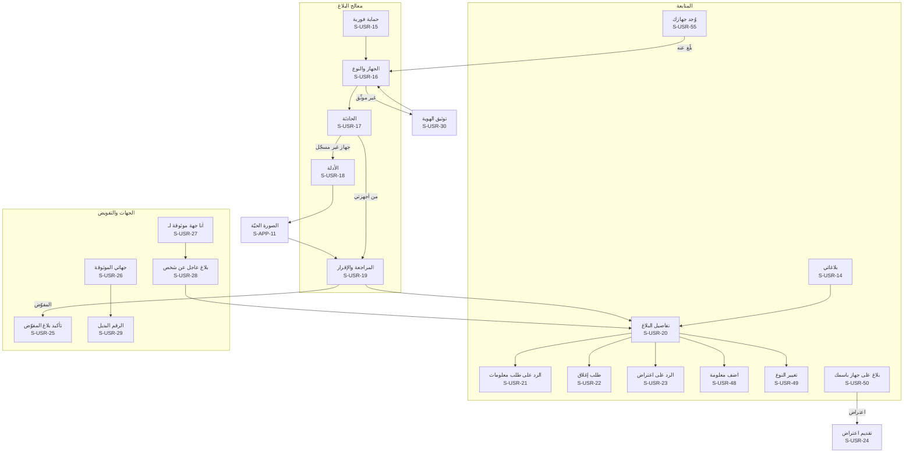

**خريطة التنقّل (3): الحساب والدعم**

```mermaid
flowchart TD
    S_USR_01["الرئيسية<br/>S-USR-01"]
    S_USR_31["حسابي<br/>S-USR-31"]
    subgraph SEC ["الأمان"]
        S_USR_32["الأجهزة والجلسات<br/>S-USR-32"]
        S_USR_33["تغيير الرقم<br/>S-USR-33"]
        S_USR_34["إغلاق الحساب<br/>S-USR-34"]
        S_USR_35["من اطّلع على بياناتي<br/>S-USR-35"]
        S_USR_26["الجهات الموثوقة<br/>S-USR-26"]
        S_USR_29["الرقم البديل<br/>S-USR-29"]
        S_USR_47["البريد الأمني<br/>S-USR-47"]
        S_USR_59["الوصي على أجهزتي<br/>S-USR-59"]
        S_USR_60["أنا وصي لـ<br/>S-USR-60"]
        S_USR_61["القيود على حسابي<br/>S-USR-61"]
        S_USR_62["ربط تلغرام<br/>S-USR-62"]
    end
    subgraph SUP ["الدعم"]
        S_USR_37["طلباتي<br/>S-USR-37"]
        S_USR_38["طلب جديد<br/>S-USR-38"]
        S_USR_39["تفاصيل الطلب<br/>S-USR-39"]
    end
    subgraph DOCS ["الوثائق والخدمات"]
        S_USR_12["فواتيري<br/>S-USR-12"]
        S_USR_13["إيصالاتي<br/>S-USR-13"]
        S_USR_42["الخدمات المدفوعة<br/>S-USR-42"]
        S_USR_56["التعويض<br/>S-USR-56"]
    end
    S_USR_36["الإشعارات<br/>S-USR-36"]
    S_USR_43["مبدّل الدور<br/>S-USR-43"]
    S_SHP_03["لوحة المحل<br/>S-SHP-03"]
    S_IMP_03["لوحة الوكيل<br/>S-IMP-03"]
    S_USR_01 --> S_USR_36 & S_USR_31
    S_USR_31 --> S_USR_32 & S_USR_33 & S_USR_34 & S_USR_35 & S_USR_26 & S_USR_29
    S_USR_31 --> S_USR_47 & S_USR_59 & S_USR_60 & S_USR_61 & S_USR_62
    S_USR_42 --> S_USR_56
    S_USR_31 --> S_USR_37 --> S_USR_38
    S_USR_37 --> S_USR_39
    S_USR_35 -- "اطلاع مشبوه" --> S_USR_38
    S_USR_31 --> S_USR_12 & S_USR_13 & S_USR_42
    S_USR_31 --> S_USR_43 --> S_SHP_03 & S_IMP_03
```

## 9. المحل: صاحبه وموظفوه (S-SHP)

تعمل في سياق المحل بعد اختياره من مبدّل الدور. **الموقع إلزامي لكل وظائف المحل** (D-41)، فتسبقها بوابة الموقع S-SHP-04. والموظف يرى من الشاشات والأزرار ما تسمح به صلاحياته فقط (`can_buy` و`can_sell` و`can_repair` و`can_view_all`)، وما لا يملكه لا يظهر له أصلاً. ونوع النشاط يحدد الوظائف: محل «خدمات اتصالات وإكسسوارات» لا يرى الشراء والبيع، ومحل «حواسيب» يتعامل بالرقم التسلسلي عند تفعيل الوحدة (D-90، SERIAL-04). وفي كل شاشة فيها بيانات من السجل المدني: **الاسم وحالة البطاقة فقط، دون أي صورة** (D-84). وما يُتاح في كل حالة للمحل (موثّق، ومعلّق، وقيد الإغلاق، ومغلق، وملغى، وتغيير مالك قيد المراجعة) وفي كل حالة اشتراك في [الترابط والسيناريوهات](26-scenarios-and-linkage.md) §4.2 و§5.2، والشاشات تتبعه بالحالات القياسية (القسم 2).

| المعرّف | الشاشة | من يراها | المنصات | الغرض | المتطلبات | العناصر والإجراءات | الحالات الخاصة |
|---|---|---|---|---|---|---|---|
| S-SHP-01 | سجّل محلك | موثّق الهوية | موقع، تطبيق | طلب تسجيل محل | SHOP-01، SHOP-02، GEO-03، GEO-08، ROLLOUT-02، PUB-04، RESTRICT-05، ROLLOUT-10 | خطوات: اسم المحل ونوع النشاط (واحد أو أكثر من: بيع وشراء أجهزة، وصيانة، وخدمات اتصالات وإكسسوارات، وحواسيب)، والمحافظة والمنطقة والعنوان التفصيلي (الشارع، والمعلم، والطابق) وهاتف المحل، ثم الخريطة بدبوس من GPS أو بالسحب، ثم رقم السجل التجاري أو الترخيص مع صورته، وصور الواجهة من الخارج والداخل، ثم قبول اتفاقية المحلات و«إرسال» | محافظة غير مفعّلة: «سجّل اهتمامك» في قائمة انتظار المحافظة بدل الإرسال؛ غير موثّق الهوية: S-USR-30 أولاً؛ مسودة؛ شخص محظور (D-106): «تعذّر إرسال الطلب، تواصل مع الدعم الفني»؛ محافظة أُلغي تفعيلها: قائمة الانتظار للطلبات الجديدة فقط |
| S-SHP-02 | حالة طلب المحل | صاحب الطلب | موقع، تطبيق | متابعة التوثيق | SHOP-03، SHOP-04، TENANT-01، SHOP-29 | الحالة: قيد المراجعة، أو بحاجة لتعديل (مع الحقول المطلوبة و«تعديل وإعادة إرسال»)، أو مرفوض بالسبب، أو موثّق برقم `SH-` و«ابدأ: أضف موظفيك». وعند التوثيق «اطبع ملصق إشعار الخصوصية» (S-SHP-58) | قائمة انتظار المحافظة؛ مسحوب بطلبك؛ مرفوض لانتهاء مهلة التعديل ⚙️ 30 يوماً، وإعادة التقديم طلب جديد |
| S-SHP-03 | لوحة المحل | صاحب المحل، والموظف | موقع، تطبيق | نقطة البداية في سياق المحل | SHOP-12، SHOP-14، IMPORTER-05، ADS-01، SHOPWALLET-01، TOPUP-01، TENANT-02، TENANT-07، TENANT-10، SHOP-27، SHOP-29، REPORT-29 | رأس فيه اسم المحل والدور مع مبدّل السياق، وأزرار العمليات حسب الصلاحية ونوع النشاط (فحص، وشراء، وبيع، واستلام صيانة، وتعبئة رصيد)، ورصيد المحفظة لصاحب المحل، وأعداد اليوم، وآخر المعاملات، وتنبيهات المحل (طلب استلام من وكيل لصاحب المحل، وجهاز مبلّغ عنه عُرض اليوم)، وسلايدر الإعلانات إن فُعّل. ومنتقي الفرع (القسم 3)، وبطاقة ثابتة «طلبات قوى الأمن تصل عبر المنصة أو بأمر خطي فقط، ولا تعطِ بيانات زبون أو جهاز لمتصل هاتفي»، وتنبيه «جهاز في مخزونك صار مبلّغاً عنه: لا تبعه واحتفظ به»، وتذكير «علّقت الملصق؟» حتى التأكيد. وكل بطاقة تُحمَّل وحدها | محل معلّق: شريط السبب وقائمة ما يبقى متاحاً (القسم 2)؛ قيد الإغلاق: شريط بالبنود الباقية ورابط S-SHP-62؛ تغيير مالك قيد المراجعة: شريط للطرفين؛ حساب المالك معلّق: المحل يعمل بموظفيه، وإجراءات المالك وحده موقوفة عدا السحب والتصدير بالخروج المالي؛ موظف بانتظار التوثيق: S-SHP-20 |
| S-SHP-04 | بوابة الموقع لوظائف المحل | صاحب المحل، والموظف | موقع، تطبيق | منع أي عملية دون موقع | GEO-04، SHOP-14، TENANT-10 | شرح «وظائف المحل تحتاج موقعك، ويُسجَّل موقع كل عملية»، و«فعّل الموقع»، ومؤشر «ضمن نطاق المحل [المسافة]». ولمن اختار فرعاً: المسافة عن موقع الفرع الموثّق | الإذن مرفوض: S-APP-07؛ أبعد من ⚙️ 500 متر: «أنت بعيد عن موقع المحل الموثّق، وستُعلَّم العملية للإدارة»؛ على الكمبيوتر: الموقع من التطبيق عبر الإكمال |
| S-SHP-05 | فحص جهاز من المحل | صاحب المحل، والموظف | موقع◐، تطبيق | فحص سريع قبل أي حديث مع الزبون | CHECK-14، SHOP-16، GSMA-03، FAKE-03، SHOP-18، SERIAL-04، SERIAL-05، CHECK-18 | المسح (S-APP-08) أو الرقم التسلسلي لمحل «حواسيب»، والنتيجة بالصيغة نفسها مع ما يخص المحل: وسم «تسجيل ذاتي» وتاريخه، وتحذير التقليد، وحالة الهيئة، ثم أزرار «سجّل شراء» أو «سجّل بيع» أو «استلام صيانة» حسب الصلاحية. و«قد يكون منسوخاً» بجانب النتيجة دون أن يغيّرها | مبلّغ عنه: S-SHP-09؛ حد ⚙️ 300 فحص في الساعة |
| S-SHP-06 | شراء: الجهاز والفحص | صاحب المحل، والموظف بصلاحية الشراء | موقع◐، تطبيق | الخطوة 1 من 3 في شراء جهاز مستعمل | SHOP-06، SHOP-09، SHOP-17، SHOP-18، GSMA-03، FAKE-03، OWN-12، CUSTOMS-02، HANDOFF-01، SERIAL-04، SHOP-25، GSMA-06، CHECK-19 | مسح IMEI1 وIMEI2 (أو الشركة المصنّعة والرقم التسلسلي لجهاز دون شريحة)، وتأكيد الماركة والموديل، ونتيجة الفحص الفوري، وأصل التسجيل ووسم «تسجيل ذاتي» إن وُجد، وتحذير التقليد (يُسمح بالشراء ويُعلَّم)، و«غير مسجّل لدى الهيئة» كمعلومة، ثم «التالي: البائع». ونوع الجهاز (موبايل أو تابلت بشريحة، وغيرهما من أجهزة IMEI حين تُفعَّل أنواعها) | مبلّغ عنه، أو في القائمة الدولية، أو في فترة انتظار التسجيل الذاتي: S-SHP-09؛ دون اتصال: مسودة فقط؛ «جارٍ التحقق الدولي» ينتظر ⚙️ 5 ثوانٍ إضافية، ثم «تعذّر» يكمل الشراء بعلامة «لم يُتحقق دولياً»؛ رقم محجوز أو TAC يبدأ بـ 00: يُحال للمراجعة لا للرفض |
| S-SHP-07 | شراء: بيانات البائع | صاحب المحل، والموظف بصلاحية الشراء | موقع◐، تطبيق | توثيق البائع | SHOP-06، SHOP-19، CIVIL-03، CIVIL-04، CIVIL-05، CIVIL-08، HANDOFF-01، SHOP-30، PERSON-02، CIVIL-10، SUCCESSION-09 | الرقم الوطني، ثم الاسم وحالة البطاقة من السجل المدني **دون صورة** مع «طابق الاسم مع هوية الشخص الحاضر»، والموبايل، وتصوير هوية البائع بوجهيها بالكاميرا (S-APP-10)، و«تحققت من الهوية بنفسي». ونوع وثيقة الهوية للطرف دون هوية سورية (القسم 3) | بطاقة غير سارية: يُمنع الإكمال ويُنبَّه المشرف؛ تعطل الربط: إدخال الاسم يدوياً وتعليم المعاملة لإعادة التحقق؛ تجاوز ⚙️ 30 استعلاماً في الساعة؛ الربط غير مفعّل: الاسم يدوياً؛ **البائع غير المالك المسجّل**: لا رسالة في هذه الخطوة، والتعليق يظهر في نتيجة «تسجيل الشراء» (S-SHP-08) بالنص المحايد الواحد (D-96)؛ بائع دون 18 سنة: المعاملة باسم وليّ أمره الحاضر وهويته (D-97)؛ وثيقة بديلة: لا استعلام، والاسم يدوياً، وتُعلَّم المعاملة للمعاينة؛ عدم تطابق الاسم وحده: يكمل بالمطابقة اليدوية ويُعلَّم؛ المالك المسجّل متوفى: لا شيء خاص هنا، والتعليق محايد في S-SHP-08 دون أي إشارة لوفاة (24 §5.1 القاعدة 11)؛ «نقل لمحل» من المالك: الطريق الثاني لـ D-96 (S-SHP-53) |
| S-SHP-08 | شراء: الحالة والسعر والتأكيد | صاحب المحل، والموظف بصلاحية الشراء | موقع، تطبيق | إتمام الشراء | SHOP-06، REPAIR-05، SHOP-23، SHOPPRO-19، PAY-17، SHOP-31، SUCCESSION-09 | حالة الجهاز (مستعمل، أو «للقطع» إن سُمح للمحل)، والسعر اختياري، والملخص، و«تسجيل الشراء». والنتيجة: الجهاز في مخزون المحل، مع مؤشر الموقع ومهلة الإلغاء ⚙️ 30 دقيقة. وسؤال إلزامي للموبايل الذكي «هل أُزيل قفل الحساب (iCloud أو Google) وقفل الشاشة أمامك؟»، وللمحل المشترك حقل خاص للكلفة لا يدخل سجل المعاملات. ولمعرّف «قد يكون منسوخاً» حقل المعرّف الثاني (IMEI الثاني، أو الرقم التسلسلي، أو ملصق الكرتونة) قبل التسجيل (`CHECK_IDENTIFIER_SHARED`) | **التعليق للمراجعة نتيجة هذه الخطوة** (`SHOP_TRANSACTION_HELD` 202) بالنص المحايد الواحد وسطره العام عن «نقل لمحل» (24 §2.9) أياً كان السبب الداخلي: بائع ليس المالك (D-96)، أو مالك مسجّل متوفى، أو معرّف مشترك دون معرّف ثانٍ صالح، أو قفل لم يُزل أمام الموظف؛ معرّف ثانٍ صالح لمعرّف مشترك: تكتمل موسومة |
| S-SHP-09 | منع المعاملة | صاحب المحل، والموظف | موقع، تطبيق | إيقاف أي عملية على جهاز مبلّغ عنه بأمان | SHOP-06، SHOP-08، SHOP-16، GSMA-03، REPAIR-01، REPAIR-04، OWN-12 | شاشة حمراء كاملة: «لا تشترِ هذا الجهاز» أو «لا تبِعه» أو «لا تستلمه» حسب العملية، و«لا تواجه البائع ولا تحتجزه»، و«اعتذر بهدوء دون ذكر السبب»، و«الباقي على الإدارة وقوى الأمن»، ونموذج «عندك معلومات؟» اختياري (وصف البائع)، و«إنهاء العملية». لا تفاصيل عن البلاغ ولا صاحبه | للقائمة الدولية ولفترة الانتظار: نص «لا يمكن تسجيل هذه العملية الآن» دون عبارة «مبلّغ عنه» |
| S-SHP-10 | بيع: الجهاز والفحص | صاحب المحل، والموظف بصلاحية البيع | موقع◐، تطبيق | الخطوة 1 من 3 في البيع | SHOP-07، SHOP-08، SHOP-09، IMPORTER-06، FAKE-02، HANDOFF-01، SERIAL-04، SHOP-25، REPORT-29 | «جهاز جديد» بالمسح أو بالرقم التسلسلي، أو «من مخزوني»، والفحص الفوري، والملكية الحالية (ملك المحل، أو وارد من وكيل، أو جديد غير مسجّل)، وتطابق الرقمين. ونوع الجهاز | مبلّغ عنه: S-SHP-09؛ مسجّل باسم شخص آخر ولم يمرّ بالمخزون: «عُلّق البيع كتعارض لمراجعة مشرف المحلات»؛ يُعاد الفحص عند إتمام البيع، والجهاز الذي صار مبلّغاً عنه يُحجب |
| S-SHP-11 | بيع: المشتري والسعر | صاحب المحل، والموظف بصلاحية البيع | موقع، تطبيق | الخطوة 2 من 3 في البيع | SHOP-07، SHOP-19، CIVIL-03، CIVIL-04، CIVIL-05، SHOP-30، PERSON-04، SHOPPRO-19، SHOP-24 | الرقم الوطني، ثم الاسم وحالة البطاقة من السجل المدني دون صورة، وموبايل المشتري لإرسال الفاتورة، والإيميل اختياري، والسعر اختياري «يظهر للمشتري فقط»، و«تحققت من الهوية بنفسي»، و«إصدار الفاتورة». ونوع وثيقة الهوية، وللمؤسسة «الشراء باسم ممثلها المسؤول» (D-105)، وللمحل المشترك حقل خاص للسعر، و«بيع بالتوصيل» (S-SHP-56) عند تفعيله | حالات السجل المدني كما في S-SHP-07؛ مشترٍ دون 18 سنة: الفاتورة باسم وليّ أمره الحاضر وهويته، ثم «أضف القاصر مستخدماً مفوّضاً» من حساب وليّ الأمر (D-97) |
| S-SHP-12 | الفاتورة | صاحب المحل، والموظف | موقع، تطبيق | الخطوة 3 من 3: إصدار الفاتورة وتسليمها | SHOP-10، SHOP-11، THEME-04، SHOP-28، OWN-17 | «سُجّل البيع وانتقلت الملكية»، ورقم `TX-`، ومؤشر الموقع ضمن النطاق، وحالة الإرسال على واتساب والإيميل، و«طباعة A4» (S-PRN-01) و«طباعة حرارية» (S-PRN-02)، و«عملية جديدة». والطباعة الحرارية بمقاس الطابعة المقترنة 58 أو 80 مم (S-SHP-57)، ورسالة الفاتورة للمشتري فيها «لم أشترِ هذا الجهاز» | فشل الإرسال: «إعادة الإرسال»؛ فاتورة ملغاة بعلامة واضحة |
| S-SHP-13 | المخزون | صاحب المحل، والموظف | موقع، تطبيق | الأجهزة التي يملكها المحل الآن | SHOP-13، IMPORTER-06، REPAIR-05، STORE-13، REPORT-29، IMPORTER-09، SHOP-21 | قائمة بالأجهزة المستعملة المشتراة، والجديدة الواردة من الوكلاء بالنقل أو بطلب من المتجر (تدخل بأرقامها تلقائياً عند التسليم)، والمعلَّمة «للقطع»، مع البحث بالرقم، و«بيع». ووسوم «مرتجع»، و«محجوز في نقل أو طلب متجر»، و«مجمّد حتى قرار الجهات» | فارغة؛ جهاز صار مبلّغاً عنه: شريط أحمر «لا تبعه واحتفظ به، والجهات المختصة مُبلَّغة» |
| S-SHP-14 | المعاملات | صاحب المحل (كلها)، والموظف (كلها أو ما سجّله) | موقع، تطبيق | سجل معاملات المحل وحده | SHOP-12 | بحث وتصفية **داخل معاملات المحل فقط**: التاريخ، ورقم الفاتورة، وIMEI، والموظف، والنوع (بيع، وشراء، وصيانة لمحل الصيانة). والأنواع أيضاً: استرجاع، ونقل بين المنشآت، و«نقل لمحل»، وتسليم مخزون الإغلاق، وبيع بالتوصيل | فارغة؛ دون صلاحية «عرض كل المعاملات»: ما سجّله الموظف فقط؛ دون اتصال: آخر ما حُمّل للقراءة |
| S-SHP-15 | تفاصيل المعاملة والإلغاء والتصحيح | صاحب المحل، والموظف (لما سجّله) | موقع، تطبيق | مراجعة معاملة وتصحيحها | SHOP-15، SHOP-08، SHOP-26، OWN-17 | التفاصيل (الطرف مخفي جزئياً)، والمنفّذ، والموقع، والفاتورة، و«إلغاء» مع سبب خلال ⚙️ 30 دقيقة، وبعدها «طلب تصحيح أو إلغاء» مع السبب، وحالة الطلب. ولصاحب المحل سبب «احتيال موظف» (إعادة الملكية بقرار المدير العام، وإيقاف الموظف) | تعارض قيد المراجعة؛ طلب تصحيح مرفوض بالسبب؛ معاملة ينكرها طرفها: شارة «قيد المراجعة» |
| S-SHP-16 | الموظفون | صاحب المحل | موقع، تطبيق | إدارة الموظفين | SHOP-05، SHOPPRO-17، TENANT-10 | قائمة بالاسم والحالة (بانتظار التفعيل، وبانتظار توثيق الهوية، ونشط، وموقوف) والجهاز المربوط وآخر نشاط، و«+ موظف». والفرع المسند لكل موظف | فارغة؛ إزالة موظف: تُزامَن مبيعاته السابقة، ويُغلق صندوقه آلياً والفرق لصاحب المحل وحده، وتعود أعمال الصيانة المسندة إليه بلا إسناد؛ بعد تغيير المالك: «صلاحيات بانتظار الضبط» (S-SHP-61) |
| S-SHP-17 | إضافة موظف أو تعديل صلاحياته | صاحب المحل | موقع، تطبيق | إنشاء حساب موظف وتحديد ما يفعل | SHOP-05، SHOPWALLET-05، RESTRICT-06، AUTH-15 | الاسم، والرقم الوطني، والموبايل، والصلاحيات حسب نوع النشاط (البيع، والشراء من أشخاص، والصيانة، وعرض كل المعاملات، وتعبئة رصيد بحد يومي ⚙️، والدفع من المحفظة لطلبات المتجر)، و«إرسال الدعوة على واتساب»، و«إعادة الإرسال»، و«إيقاف الموظف». والفرع. والصلاحيات المدفوعة تظهر **باهتة** لمحل غير مشترك («ضمن باقة المشتركين» في الموقع، و«غير مفعّلة» في التطبيق) ويمكن منحها فتعمل عند الاشتراك | الرقم له حساب سابق: يُربط به عند القبول دون إظهار ذلك لصاحب المحل؛ شخص عليه قيد منع العمل موظفاً: «تعذّر تفعيل هذا الموظف» دون السبب؛ الصيانة غير متاحة لمحل بلا نشاط صيانة |
| S-SHP-18 | بيانات المحل | صاحب المحل | موقع، تطبيق | عرض بيانات المحل وتعديلها | SHOP-04، SHOP-01، GEO-03، TENANT-08 | رقم المحل `SH-`، والبيانات، والموقع، والترخيص، ونوع النشاط، و«تعديل». ومداخل: الفروع (S-SHP-65)، والطابعة (S-SHP-57)، والملصق (S-SHP-58)، وتغيير المالك (S-SHP-59)، وإغلاق المحل (S-SHP-62) | تعديل الاسم أو الموقع أو الترخيص: «يُراجع، ويعمل المحل ببياناته السابقة حتى الموافقة»؛ إزالة نوع نشاط: يتوقف الجديد منه فوراً وتُعتمد بعد انتهاء عناصره المفتوحة؛ تغيير المحافظة: المحل يعمل ولو لم تُفعَّل المحافظة الجديدة |
| S-SHP-19 | طلبات الاستلام من الوكلاء | صاحب المحل | موقع، تطبيق | تأكيد استلام النقل بالجملة | IMPORTER-05، IMPORTER-09، SHOP-22 | الطلبات الواردة من الوكلاء والمحلات (المرسل، والعدد، وقائمة الأجهزة)، و«تأكيد الاستلام» فتدخل المخزون، و«رفض» مع السبب. و«قبول جزئي» باختيار الأجهزة، ويُعاد فحص كل جهاز عند القبول ويُستبعد المبلّغ عنه | فارغة؛ طلب أُلغي من الوكيل؛ يُلغى آلياً بعد ⚙️ 30 يوماً دون قبول؛ المحل معلّق: يُرفض الوارد آلياً ويعود للمرسل |
| S-SHP-20 | بانتظار توثيق هويتك | موظف جديد | موقع، تطبيق | منع العمل قبل التوثيق | SHOP-05 | «لا يمكنك العمل في [المحل] قبل توثيق هويتك»، و«وثّق هويتك» (S-USR-30)، وحالة الطلب | مرفوض: الأسباب والمحاولات الباقية |
| S-SHP-21 | المتجر | صاحب المحل، ومسؤول الوكيل | موقع، تطبيق | منتجات المنصة والمورّدين | STORE-01، STORE-02، STORE-06، STORE-07، ADS-01، PAY-06 | الأقسام (أدوات المنصة، وعدّة الصيانة، والبرامج القانونية، والقطع والإكسسوارات)، والمنتجات مع وسم «متوافق مع المنصة»، ولافتات «إعلان»، والتنويه الثابت «الشراء اختياري، ولا علاقة له بالتزامك بالتسجيل» | المتجر مطفأ: يختفي مدخله؛ فارغة |
| S-SHP-22 | المنتج والسلة والطلب | صاحب المحل، ومسؤول الوكيل | موقع، تطبيق | طلب منتج مادي من المنصة | STORE-03، STORE-04، PAY-01، PAY-08، SHOPWALLET-04، STORE-15، STORE-18، STORE-20، SHOPWALLET-12، PAY-17 | صور المنتج ووصفه وسعره واسم مورّده، و«أضف للسلة»، وعنوان التوصيل (افتراضياً عنوان المحل)، وطريقة الدفع: من محفظة المحل (لصاحبه، أو لموظف بصلاحية الدفع)، أو عند الاستلام لمندوب الشحن، أو بمحفظة أو تحويل برقم مرجعي يؤكده المشرف التجاري، و«تأكيد الطلب». متاح في التطبيق لأنه منتج مادي. ويمكن الطلب أيضاً عبر رقم واتساب الإدارة التجاري. ولا أجر توصيل منفصل. وطرق الدفع الخارجية لكل محل موثّق، والدفع من محفظة المحل للمشتركين برمزها أو البصمة. وأسطر الأجهزة لمحل يسمح نشاطه بشرائها فقط | نفدت الكمية؛ منتج أُوقف بعد الإضافة للسلة؛ الدفع عند الاستلام متوقف لمحلك بعد ⚙️ 3 طلبات لم تُستلم خلال 90 يوماً: «يمكنك الطلب بالدفع المسبق» حتى [التاريخ] |
| S-SHP-23 | طلبات المتجر | صاحب المحل، ومسؤول الوكيل | موقع، تطبيق | متابعة الطلب حتى الاستلام | STORE-05، STORE-08، STORE-09، STORE-13، STORE-16، STORE-17، STORE-19، STORE-21 | الحالة (جديد، ومؤكَّد، وقيد التجهيز عند المورّد، ومع الشحن، ومسلَّم ومدفوع، وملغى، ومرتجع) مع إشعار عند كل تغيير، و**رمز التسليم** الذي يعطيه المحل للمندوب عند الاستلام فقط، ويُقفل بعد ⚙️ `store.delivery_code.attempts` محاولات خاطئة (`STORE_DELIVERY_CODE_LOCKED`) فيظهر «رمز جديد» يولّده صاحب المحل بإعادة تحقق ويُلغي القديم (SOP-41)، والمبلغ المطلوب عند الاستلام، و«لم أستلم» إن عُلّم الطلب مسلَّماً دون استلام، و«إلغاء الطلب» قبل «قيد التجهيز» فقط وبعدها «طلب إلغاء» يقرره المشرف التجاري، وفاتورة المنصة باسم المورّد (S-PRN-11)، وسياسة الإرجاع والكفالة، و«طلب إرجاع» خلال المهلة (S-SHP-32). والأجهزة المطلوبة من وكيل تدخل المخزون بأرقامها عند التسليم. والإلغاء قبل «قيد التجهيز» يعيد المدفوع آلياً إلى مصدره (إبطال)، وإلغاء سطر واحد بموافقتك مع فاتورة معدّلة، ومطالبة الكفالة حتى نهاية مدة كفالة المنتج، ورمز الاستلام لمندوب الإرجاع | فارغة؛ ملغى بالسبب؛ مهلة الإرجاع انتهت؛ طلب لم يؤكَّد خلال الأبعد من ⚙️ 48 ساعة ونهاية يوم الدوام الثاني: أُلغي آلياً وأُعيد المبلغ؛ مورّد عُلّق: يُعاد تأمين الطلب من مورّد آخر أو يُلغى بإبطال آلي؛ سطر جهاز صار مبلّغاً عنه: يُستبعد وتُخفَّض الفاتورة والتحصيل آلياً |
| S-SHP-24 | باقة المحل والاشتراك | صاحب المحل | موقع، تطبيق | معرفة الباقة وما تفتحه | SHOPPRO-01، SHOPPRO-15، PAY-01، PAY-03، PAY-07، PAY-08، PAY-12، PAY-13، PAY-14، PAY-15، PAY-10 | الباقة الحالية: **المجانية** (كل وظائف الالتزام وطلب المتجر بالدفع عند الاستلام، ولا تتوقف أبداً) أو **المشتركين** (برنامج المحاسبة، والمحفظة، والتعبئة، والفروع) مع حالتها: تجربة مجانية حتى [التاريخ] ⚙️، أو مفعّلة حتى [التاريخ]، أو منتهية. ومقارنة الباقتين بميزاتهما. **في الموقع فقط**: الأسعار الشهرية والسنوية و«اطلب الاشتراك» الذي يفتح واتساب الإدارة التجاري برسالة فيها رقم الحساب والباقة. وتذكير التجديد ومهلة السماح ⚙️. والتجربة المجانية مرة واحدة لكل محل ولكل صاحب محل ولكل رخصة: «جرّبها مجاناً» في الموقع فقط إن لم تُستعمل، وإلا «اشترك شهرياً أو سنوياً». والترقية إلى باقة أعلى فورية بتحويل الأيام الباقية بنسبة السعرين دون دفع، والتخفيض عند التجديد فقط (S-SHP-66). والمقارنة تعرض ميزات الوحدات المفعّلة فقط | في التطبيق: الباقة وحالتها وميزاتها فقط، دون سعر ولا زر ولا دعوة للتواصل؛ منتهية: «بياناتك محفوظة للقراءة والتصدير ⚙️ 12 شهراً، ثم تُحذف بعد إنذار ⚙️ 30 يوماً»؛ محل معلّق: المدة تستمر، وتعود الأيام آلياً إن أُلغي التعليق لأنه خطأ؛ الدفع أثناء التجربة يبدأ عند نهايتها دون فجوة؛ التجديد في السماح يمتد من نهاية المدة الأصلية؛ إلغاء صاحب المحل: الشهري لا يُسترجع، والسنوي أشهره الكاملة الباقية؛ توقف بسبب المنصة: S-USR-56؛ بعد تغيير المالك: الاشتراك باقٍ بمدته ولا تجربة جديدة |
| S-SHP-25 | المخزون الكامل | صاحب المحل، والموظف بما يسمح له (باقة المشتركين) | موقع، تطبيق | كل بضاعة المحل | SHOPPRO-02، SHOPPRO-13، SHOPPRO-19 | الأصناف (أجهزة، وإكسسوارات، وقطع) بالباركود والكمية وسعر الكلفة، والأجهزة المسجّلة تدخل وتخرج تلقائياً مع معاملاتها، و«طباعة ملصقات باركود» (S-PRN-18)، و«جرد»، وتنبيه النفاد، وتقييم المخزون بالكلفة (مخفي عن الموظف افتراضياً). وعند أول تفعيل يُبذَر مخزون الأجهزة من السجل بكلفة «غير محدد»، وقائمة «سعر ناقص». والمعاملات المسجّلة أثناء توقف الاشتراك تُرحَّل آلياً عند التجديد بوسم «سُجّلت أثناء توقف الاشتراك» | غير مشترك: S-SHP-47؛ منتهٍ: للقراءة |
| S-SHP-26 | الصندوق اليومي | صاحب المحل، والموظف (صندوقه) | موقع، تطبيق | النقد لكل موظف أو فرع | SHOPPRO-05، SHOPPRO-17، SHOPPRO-18 | «فتح الصندوق» برصيد افتتاحي (ويُفتح في التطبيق دون اتصال ويُزامَن)، والمقبوضات والمدفوعات (تدخلها تلقائياً مبيعات نقطة البيع والتعبئة ودفعات الديون)، و«إغلاق الصندوق» بجرد النقد وإظهار الفرق، وسجل الصناديق لصاحب المحل | غير مشترك: S-SHP-47؛ صندوق مفتوح من أمس: «أغلقه أولاً»؛ صندوق أغلقه النظام (انتهاء الاستحقاق أو إزالة موظف): «أغلقه النظام» والفرق لصاحب المحل وحده |
| S-SHP-27 | الديون والتقسيط | صاحب المحل، والموظف بما يسمح له | موقع، تطبيق | ديون الزبائن والبيع بالتقسيط | SHOPPRO-08، OWN-25، SHOPPRO-18 | الزبائن ورصيد كل منهم، والدفعات، و«بيع بالتقسيط» بجدول دفعات، وتذكير على واتساب بموعد كل دفعة، و«كشف حساب الزبون» (S-PRN-19). وجملة ثابتة «البيع بالتقسيط ينقل ملكية الجهاز للمشتري عند التسليم، والتعثر دين مدني لا يتيح استرجاع الجهاز ولا التبليغ عنه» | غير مشترك: S-SHP-47؛ دفعة متأخرة بشارة؛ انتهاء الاستحقاق: تتوقف تذكيرات الزبائن دون إبلاغهم ويُبلَّغ صاحب المحل، وتُستأنف للمواعيد القادمة عند التجديد |
| S-SHP-28 | الكفالات | صاحب المحل، والموظف | موقع، تطبيق | كفالات المبيعات والصيانة | SHOPPRO-09 | الكفالات بتاريخ انتهائها، وتنبيه قبل الانتهاء، والبحث بالزبون أو الجهاز | غير مشترك: S-SHP-47 |
| S-SHP-29 | محاسبة الفروع | صاحب المحل | موقع، تطبيق | أدوات المحاسبة لكل فرع (المدفوع من الفروع، D-109) | SHOPPRO-12، TENANT-10 | لكل فرع مسجّل (S-SHP-65) مخزونه وصندوقه، و«تحويل بضاعة بين الفروع»، والتقارير المجمّعة، وحد الفروع في الباقة. **وتسجيل الفروع ومواقعها ومعاملات أجهزتها مجاني في S-SHP-65** | غير مشترك: S-SHP-47 (الفرع الرئيسي فقط)؛ بعد الانتهاء: للقراءة، والتزام الفروع مستمر؛ بلغ حد الباقة: اختيار ما يبقى قابلاً للكتابة عند التجديد (S-SHP-66) |
| S-SHP-30 | التقارير والتصدير | صاحب المحل (والموظف بما يسمح له) | موقع، تطبيق | أرباح المحل وأداؤه | SHOPPRO-11، SHOPPRO-15 | الأرباح يومياً وشهرياً وسنوياً، والأكثر مبيعاً، وربح الرصيد والخطوط منفصلاً، وأداء الموظفين والفروع، وحركة المخزون، و«طباعة» و«تصدير Excel وPDF» (S-PRN-19)، وجملة «هذه البيانات ملكك ولا يراها غيرك» | غير مشترك: S-SHP-47؛ بعد الانتهاء: التصدير متاح ⚙️ 12 شهراً ثم حذف بعد إنذار ⚙️ 30 يوماً |
| S-SHP-31 | إعلانات المحل | صاحب المحل الموثّق | موقع، تطبيق | الإعلان للجمهور «اشترِ من محل موثّق» | ADS-03، ADS-04، ADS-05، ADS-06، ADS-07، PAY-01، PAY-08، ADS-09، ADS-10 | **في الموقع**: إنشاء حملة (الصورة، والنص، والرابط، والمحافظة، والمدة، والباقة) و«اطلب التفعيل». وفي الاثنين: الحملات بحالتها (قيد المراجعة، ومفعّلة حتى، ومنتهية، ومرفوضة بالسبب)، والمشاهدات والضغطات. ومواصفات المكان (المقاس، ومنطقة النص الآمنة، وصلاحية الثيمين) | في التطبيق: الحالة والإحصاءات فقط؛ الإعلانات مطفأة: يختفي المدخل؛ المعلن معلّق: الحملة «موقوفة مؤقتاً» بأيامها الباقية؛ إطفاء المكان بقرار المنصة: خيار التعويض (S-USR-56)؛ حذف لمخالفة: لا تعويض |
| S-SHP-32 | طلب إرجاع أو عيب | صاحب المحل، ومسؤول الوكيل | موقع، تطبيق | إرجاع منتج معيب أو غير مطابق | STORE-11، STORE-19 | اختيار الطلب والمنتج والكمية، والسبب (عيب، أو غير مطابق، أو تالف عند الاستلام)، والصور **بالكاميرا مباشرة**، و«إرسال»، ثم الحالة وقرار المشرف التجاري وطريقة إعادة الحق. ونوع «كفالة» حتى نهاية مدة كفالة المنتج، والمنتج المستدعى يُقبل إرجاعه دون مهلة الأيام السبعة. وبعد القبول رمز الاستلام لمندوب الإرجاع | بعد ⚙️ 7 أيام من الاستلام: «انتهت مهلة الإرجاع» مع «طلب دعم»؛ قيد المراجعة |
| S-SHP-33 | محفظة المحل | صاحب المحل (والموظف يرى زر التعبئة وحدّه المتبقي فقط) | موقع، تطبيق | الرصيد والعمليات السريعة | SHOPWALLET-01، SHOPWALLET-04، SHOPWALLET-07، SHOPWALLET-08، SHOPWALLET-09، SHOPWALLET-13 | «تفعيل المحفظة» أول مرة لمحل مشترك، ثم الرصيد، وجملة «أموال محفظتك محفوظة لدى شام كاش في حساب باسم محلك»، وأزرار: شحن، وسحب، وتعبئة رصيد، وكشف الحساب، والإعدادات، و«تجميد المحفظة فوراً» | غير مشترك: S-SHP-47؛ اشتراك منتهٍ: التعبئة والدفع متوقفان و«السحب متاح لك دائماً»؛ غير مفعّلة؛ مجمّدة من صاحبها أو من الإدارة: التعبئة والدفع متوقفان والسحب متاح؛ تجميد من شام كاش أو بأمر جهة رسمية: يظهر بأنه خارجي؛ إيقاف السحب المؤقت عند اختراق مؤكد (D-100): السبب ووقت الانتهاء؛ محل معلّق: المحفظة معلّقة معه؛ فرق مطابقة يوقف العمليات المعنية؛ الحالة المعروضة هي القيد الأعلى أسبقية: الخارجي، ثم إيقاف السحب، ثم التأخيرات الأمنية (D-115: «يتاح السحب في [الوقت]»)، ثم تجميد صاحبها و«لم أكن أنا»، ثم فرق المطابقة، ثم تجميد الإدارة، ثم تعليق المحل؛ تغيير المالك أو الإغلاق: «اسحب رصيدك كاملاً لتُغلق المحفظة»؛ وفاة صاحب المحل: «يتبع إجراءات شام كاش للورثة» |
| S-SHP-34 | شحن المحفظة | صاحب المحل | موقع، تطبيق | إدخال مال من شام كاش | SHOPWALLET-02، SHOPWALLET-11 | رقم محفظة المحل ورمز QR لمسحه من تطبيق شام كاش، و«نسخ الرقم»، وآخر عمليات الشحن بحالتها | بانتظار تأكيد شام كاش؛ تعطل الربط؛ التحويل الوارد يُسجَّل ويُطابق في كل حالات المحفظة عدا «مغلقة»، وإطفاء الوحدة يخفي هذه الشاشة وحدها |
| S-SHP-35 | السحب إلى شام كاش | صاحب المحل فقط | موقع، تطبيق | إخراج المال لمحفظة صاحب المحل | SHOPWALLET-03، SHOPWALLET-07، SHOPWALLET-09، SHOPWALLET-10، SHOPWALLET-15 | محفظة شام كاش المسجّلة **باسم صاحب المحل نفسه** (لا إدخال لمحفظة أخرى)، والمبلغ، والحدان اليومي والشهري المتبقيان ⚙️، ثم رمز المحفظة ورمز التحقق (S-AUT-02). والمطابقة برقمك الوطني لدى شام كاش، وكل وجهة جديدة دون مطابقة تنتظر ⚙️ 72 ساعة مع اتصال تأكيد على رقمك | متاح في كل الحالات حتى بعد انتهاء الاشتراك أو التجميد، إلا أثناء إيقاف السحب المؤقت (D-100) أو تجميد خارجي فيظهر سببه ووقت انتهائه؛ خطر خدمات الوصول أو التراكب على هذا الجهاز: يُرفض السحب **من هذا الجهاز وحده** برسالة تذكر السبب وطريقه، ويعمل من جهاز مربوط آخر؛ تجاوز الحد؛ رمز المحفظة مقفل بعد ⚙️ 5 محاولات؛ لا محفظة باسم المالك: شرح طريقة ربطها؛ بعد تغيير الرقم أو الاستعادة أو استعادة الرقم الأصلي (⚙️ 72 ساعة) أو تغيير رمز المحفظة (⚙️ 24 ساعة): «يتاح السحب في [الوقت]» (D-115)، ولا تأخير بعد فك «لم أكن أنا»؛ تجميدك أو تجميد الإدارة أو تعليق المحل أو انتهاء الاشتراك لا يمنع السحب؛ فرق مطابقة: السحب حتى الرصيد المؤكد |
| S-SHP-36 | كشف حساب المحفظة | صاحب المحل فقط | موقع، تطبيق | كل حركة على المحفظة | SHOPWALLET-06، TOPUP-04 | العمليات برقمها المرجعي ونوعها (شحن، وسحب، وتعبئة، ودفع طلب، ودفع خدمة، واسترداد تعبئة) ومنفّذها ووقتها، والبحث، و«تصدير» (S-PRN-16) | فارغة |
| S-SHP-37 | إعدادات المحفظة | صاحب المحل فقط | موقع، تطبيق | الأمان وحدود الموظفين | SHOPWALLET-05، SHOPWALLET-07، SHOPWALLET-09 | تعيين رمز المحفظة وتغييره، وحد التعبئة اليومي لكل موظف، وصلاحية الدفع من المحفظة، وحد التنبيه ⚙️، وفك التجميد | تغيير الرمز يتطلب رمز تحقق؛ تغيير رمز المحفظة يؤخر السحب ⚙️ 24 ساعة (D-115) |
| S-SHP-38 | تعبئة رصيد | صاحب المحل، والموظف بصلاحية التعبئة | موقع، تطبيق | بيع رصيد لرقم زبون | TOPUP-01، TOPUP-05، SHOPWALLET-05، SHOPWALLET-12، PAY-17 | رقم الزبون، والشبكة المميَّزة تلقائياً من البادئة، والقيم أو الباقات المتاحة، وعمولة المحل، ثم شاشة التأكيد بالرقم **بخط كبير** والشبكة والقيمة، و«تأكيد التعبئة». ولصاحب المحل رمز المحفظة أو البصمة خلال ⚙️ دقيقتين قبل التأكيد | غير مشترك أو اشتراك منتهٍ: S-SHP-47؛ بادئة غير معروفة؛ رصيد المحفظة لا يكفي؛ تجاوز حد الموظف اليومي أو حد الرقم في الساعة ⚙️؛ الشركة مطفأة؛ دون اتصال: لا تعبئة |
| S-SHP-39 | نتيجة التعبئة وإيصالها | صاحب المحل، والموظف بصلاحية التعبئة | موقع، تطبيق | معرفة ما حدث فوراً | TOPUP-02، TOPUP-03، TOPUP-07 | ناجحة مع الإيصال و«طباعة» (S-PRN-15)، أو معلّقة مع «تُحسم خلال ⚙️ مهلة المطابقة»، أو فاشلة مع «أُعيد المبلغ لمحفظتك» | معلّقة طويلاً: تظهر في السجل حتى الحسم؛ رفضت الشركة لأن الرقم ليس من مشتركيها: فاشلة مع إعادة المبلغ آلياً، ولا إعادة على الشركة الأخرى |
| S-SHP-40 | سجل التعبئات وأرباحها | صاحب المحل (كله)، والموظف (ما نفّذه) | موقع، تطبيق | متابعة التعبئات وعمولتها | TOPUP-03، TOPUP-04 | البحث برقم الهاتف أو التاريخ أو الموظف، والحالة، والعمولة لكل عملية، والكشف الشهري للأرباح | فارغة |
| S-SHP-41 | نقطة البيع | صاحب المحل، والموظف بصلاحية البيع (باقة المشتركين) | موقع، تطبيق | بيع الإكسسوارات والقطع بسرعة | SHOPPRO-03، SHOPPRO-20، SHOPPRO-21، PAY-17 | مسح الباركود أو البحث، والسلة، والخصم، والدفع نقداً أو من المحفظة أو بالدين، و«فاتورة» مطبوعة أو على واتساب (S-PRN-17). **والأجهزة لا تُباع هنا** بل تُحوَّل إلى معاملة السجل (S-SHP-10). والدفع من محفظة الزبون: رمز QR أو رقم محفظة المحل مع المبلغ ومرجع البيع، والبيع «بانتظار التحويل» ⚙️ 15 دقيقة ثم يُحوَّل نقداً أو يُلغى، وربط تحويل مطابق حديث يدوياً لمن له صلاحية الدفع. و«مرتجع» مقابل بيع سابق برقم مرتجع، بإعادة نقدية من الصندوق أو تخفيض الدين | **دون اتصال (التطبيق وحده): البيع النقدي للإكسسوارات يستمر** بآخر قائمة أصناف حُدّثت عند كل مزامنة، ويُزامَن عند عودة الشبكة مع شارة «بانتظار المزامنة»، ونتيجة كل بيع في سجل المزامنة (S-SHP-67)، والدفع من المحفظة والدين يحتاجان اتصالاً، والموقع لا يعمل دون اتصال؛ المحل معلّق: لا بيع إطلاقاً، والمزامنة لما سبق التعليق وحده؛ غير مشترك: S-SHP-47؛ موظف لم يزامن مبيعاته: لا يستطيع الخروج من التطبيق حتى المزامنة |
| S-SHP-42 | المشتريات وحسابات المورّدين | صاحب المحل (والموظف بما يسمح له) | موقع، تطبيق | ما يشتريه المحل وما عليه | SHOPPRO-04 | فواتير الشراء من المتجر (تلقائياً) أو من خارجه (يدوياً)، وحساب كل مورّد للمحل (له وعليه)، و«تسجيل دفعة» | غير مشترك: S-SHP-47 |
| S-SHP-43 | المصاريف | صاحب المحل | موقع، تطبيق | مصاريف المحل | SHOPPRO-06 | المصاريف بتصنيفات يحددها المحل (إيجار، وكهرباء، وإنترنت، ورواتب، وغيرها)، و«إضافة مصروف» مع صورة الإيصال | غير مشترك: S-SHP-47 |
| S-SHP-44 | الرواتب والعمولات | صاحب المحل | موقع، تطبيق | مستحقات الموظفين | SHOPPRO-07 | لكل موظف: الراتب والسلف ونسبة العمولة على المبيعات أو الصيانة، والكشف الشهري. والموظف يرى كشفه هو فقط إن سمح صاحب المحل | غير مشترك: S-SHP-47 |
| S-SHP-45 | ما يراه الموظفون في البرنامج | صاحب المحل | موقع، تطبيق | ضبط رؤية البرنامج لكل موظف | SHOPPRO-13 | لكل موظف: الشاشات المتاحة من البرنامج، وإظهار الأسعار والتكاليف والأرباح (مخفية افتراضياً)، وكلفة الآخرين وأرباحهم ورواتبهم (مخفية افتراضياً، وقابلة للمنح) | — |
| S-SHP-46 | خصوصية بيانات المحاسبة | صاحب المحل | موقع، تطبيق | طمأنة صاحب المحل أن بياناته له وحده | SHOPPRO-14، PRIV-11 | «بيانات المحاسبة ملكك وحدك: لا يراها أحد من المنصة أبداً، لا الإدارة ولا الدعم ولا المبرمجون ولا قوى الأمن ولا الوزارة، ولا حتى بإذنك»، و«الدعم يساعدك بالشرح فقط»، ورابط «طلب دعم» و«تصدير بياناتي» (S-SHP-30) | — |
| S-SHP-47 | ميزة ضمن باقة المشتركين | صاحب المحل والموظف في محل باقته مجانية أو منتهية | موقع، تطبيق | توضيح سبب قفل الميزة | SHOPPRO-01، PAY-08، SHOPWALLET-01 | اسم الميزة وما تقدّمه، و«ضمن باقة المشتركين». **في الموقع**: «اطلب الاشتراك» (واتساب الإدارة التجاري). **في التطبيق**: جملة واحدة فقط `package.locked.app` «هذه الميزة غير مفعّلة لمحلك.» دون اسم الباقة ولا وصفها ولا زر ولا دعوة. وللمحفظة بعد الانتهاء: «السحب متاح لك دائماً» | للموظف: «اطلب من صاحب المحل» دون أي إشارة للشراء؛ صلاحية مدفوعة منحها المالك والمحل غير مستحق: محفوظة دون أثر، وتعود فوراً عند التجديد |
| S-SHP-48 | الرصيد والخطوط | صاحب المحل (والموظف بما يسمح له) (باقة المشتركين) | موقع، تطبيق | قسم مستقل لتجارة الرصيد والشرائح | SHOPPRO-16، TOPUP-04 | تبويبات: التعبئات وأرباحها (من S-SHP-40 تلقائياً)، ومخزون الخطوط لكل شركة بأرقامها وكلفتها، و«تسجيل بيع خط» بالسعر والعمولة، وربح الرصيد والخطوط منفصلاً. وجملة «تفعيل الخط باسم المشتري لدى شركة الاتصالات بإجراءاتها، ولا يجمع البرنامج بيانات هوية مشتري الخط» | غير مشترك: S-SHP-47؛ خط مسجّل مبيعاً من قبل |
| S-SHP-49 | بلاغ سرقة المحل | صاحب المحل | موقع، تطبيق | التبليغ عن أجهزة المخزون المسروقة دفعة واحدة | REPORT-18، REPORT-08، SERIAL-03، REPORT-21 | اختيار الأجهزة من المخزون (بعضها أو «كلها»، موبايلات بـ IMEI وحواسيب بالرقم التسلسلي) مع العدد، وتاريخ الحادثة ومكانها (المحل افتراضياً)، ورقم الضبط إن وُجد، والوصف، والإقرار، و«إرسال». والنتيجة: بلاغ واحد برقم `BL-` للدفعة يُراجع بأولوية، ولكل جهاز رقم فرعي `BL-…/k` | جهاز عليه بلاغ قائم: يُستثنى مع السبب؛ غير موثّق الهوية: S-USR-30 أولاً؛ سُرق موبايلك مع المخزون: من جلسة «بلاغ السرقة فقط» (S-AUT-15) بكلمة المرور موسوماً، أو عبر الدعم بهويتك فيراجعه مشرف آخر، أو ببلاغ رسمي من قوى الأمن |
| S-SHP-50 | متابعة بلاغ سرقة المحل | صاحب المحل | موقع، تطبيق | حالة كل جهاز مسروق على حدة | REPORT-18، REPORT-09، PP-10 | حالة البلاغ، ثم قائمة الأجهزة وحالة كل منها: ما زال مفقوداً، أو ظهر (دون مكان ولا فاحص)، أو ضُبط لدى [القسم]، أو أُعيد. و«طلب إغلاق» لجهاز أُعيد أو للبلاغ كله. ولكل جهاز رقمه الفرعي | — |
| S-SHP-51 | رمز المحفظة: التعيين والاستعادة | صاحب المحل فقط | موقع، تطبيق | رمز المحفظة المستقل عن كلمة المرور | SHOPWALLET-07 | عند التفعيل: تعيين رمز من 6 أرقام مرتين. و«نسيت رمز المحفظة»: كلمة المرور ثم رمز تحقق ثم رمز جديد، ويُوقف السحب ⚙️ 72 ساعة بعد الاستعادة كفترة التهدئة | قُفل الرمز بعد ⚙️ 5 محاولات: الاستعادة وحدها تفتحه؛ رمز ضعيف (تكرار أو تسلسل): رفض |
| S-SHP-52 | حالة التزام المحل | صاحب المحل | موقع، تطبيق | يعرف المحل وضعه هو فقط | COMPLIANCE-04 | هل كل العمليات مسجّلة، وملاحظات الإدارة إن وُجدت، وتاريخ آخر تقرير شمله. **لا يرى التقرير المرسل للوزارة ولا بيانات غيره** | محل جديد: «لم يشمله تقرير بعد» |
| S-SHP-53 | نقل وارد من مالك: القبول كشراء | صاحب المحل، والموظف بصلاحية الشراء | موقع◐، تطبيق | إتمام «نقل لمحل» (D-121): القبول نفسه معاملة الشراء | SHOP-20، SHOP-06، CIVIL-03، HANDOFF-01 | الطلبات الواردة (الجهاز، والمالك المسجّل مخفياً جزئياً، والعدّاد)، ثم عند حضور الشخص: الفحص الفوري، وبيانات الحاضر وتصوير هويته بالكاميرا (S-APP-10، ولا يحتاج حساباً)، و«تحققت من الهوية بنفسي»، وحالة الجهاز والسعر الاختياري، و«قبول وتسجيل الشراء»، فتصدر معاملة شراء واحدة ويدخل الجهاز المخزون. أو «رفض» بسبب | بوابة الموقع إلزامية؛ صار على الجهاز بلاغ أو محجوز: S-SHP-09؛ منتهٍ أو ألغاه المالك؛ محل معلّق أو قيد الإغلاق: لا قبول |
| S-SHP-54 | استرجاع جهاز أو استبداله | صاحب المحل، والموظف بصلاحيتي الشراء والبيع | موقع◐، تطبيق | زبون يعيد جهازاً بعد مهلة الإلغاء أو يستبدله | SHOP-21، SHOPPRO-21، CIVIL-03 | البحث بفاتورة البيع الأصلية `TX-` أو IMEI، والتحقق أن المعيد هو المالك المسجّل (تصوير هويته، دون تعليق D-96)، والسبب، والمبلغ المعاد، فيُسجَّل **شراء مرتبط بالبيع الأصلي** ويدخل الجهاز المخزون بوسم «مرتجع». و«استبدال»: الاسترجاع ثم بيع جهاز آخر في الشاشة نفسها بفاتورتين مرتبطتين. وللمشتركين: مستند «مرتجع مبيعات» آلي | خلال ⚙️ 30 دقيقة من البيع: «إلغاء» في S-SHP-15 لا استرجاع؛ المعيد ليس المالك المسجّل: لا يُسجَّل استرجاعاً، بل شراء عادي بنتيجته المحايدة في S-SHP-08؛ عليه بلاغ: S-SHP-09 |
| S-SHP-55 | نقل أجهزة لمنشأة أخرى أو إرجاعها للوكيل | صاحب المحل، والموظف بصلاحية البيع | موقع، تطبيق | التجارة بين المحلات، وإرجاع الجديد المعيب للوكيل | SHOP-22، IMPORTER-12، IMPORTER-09 | النوع: «نقل لمنشأة» أو «إرجاع للوكيل» (للأجهزة الواردة منه)، ورقم المنشأة المستلمة `SH-` أو `IM-` ثم اسمها للتأكيد، واختيار الأجهزة من المخزون (تُحجز فوراً)، وسبب الإرجاع، و«إرسال». ثم الحالة (مُرسل، أو مقبول كلياً أو جزئياً، أو مرفوض، أو ملغى)، و«إلغاء» ما دام مُرسلاً، ومذكرة النقل (S-PRN-22) | المستلم معلّق أو لا يسمح نشاطه بالشراء: رفض؛ جهاز صار مبلّغاً عنه: يُستبعد عند القبول بإعادة الفحص؛ دون قبول خلال ⚙️ 30 يوماً: يُلغى آلياً وتعود الأجهزة |
| S-SHP-56 | بيع بالتوصيل | صاحب المحل، والموظف بصلاحية البيع | موقع، تطبيق | البيع لمشترٍ غير حاضر (يُبنى مطفأً حتى يقرّه الزبون) | SHOP-24 | الجهاز من المخزون، والرقم الوطني للمشتري والاسم من السجل المدني والموبايل، والسعر الاختياري، و«إرسال رابط القبول». ثم الجهاز «قيد التسليم» في المخزون حتى يقبل المشتري (S-USR-52) خلال ⚙️ 72 ساعة، فتصدر الفاتورة وتنتقل الملكية، ويُعلَّم البيع في تقرير الالتزام. والوحدة خلف المفتاح `module.remote_sale` | المهلة انتهت: يعود الجهاز متاحاً؛ «لم أستلمه»: يبقى في المخزون ويُعلَّم؛ الوحدة مطفأة: لا مدخل |
| S-SHP-57 | الطابعة: الإقران والمقاس | صاحب المحل، والموظف | تطبيق، موقع | ربط طابعة حرارية واختيار مقاسها (D-122) | SHOP-28، SHOP-10 | الطابعات المقترنة بهذا الجهاز، و«إقران طابعة» (بلوتوث في أندرويد)، والمقاس 58 أو 80 مم، و«طباعة تجريبية» بفاتورة نموذجية ورمز QR، وقائمة اختيارية بالموديلات المجرّبة، والطابعة الافتراضية لكل نوع وثيقة. وفي آيفون والموقع: AirPrint أو PDF | طابعة غير مدعومة: «طابعة غير مدعومة، اطبع PDF»؛ انقطع الاتصال أثناء الطباعة: إعادة المحاولة دون إصدار وثيقة ثانية |
| S-SHP-58 | ملصق إشعار الخصوصية | صاحب المحل | موقع، تطبيق | تعليق إشعار الخصوصية في المحل وتأكيده (D-110) | SHOP-29 | معاينة الملصق (S-PRN-21) باسم المحل ورقمه، و«تنزيل PDF» و«طباعة A4»، وملصق لكل فرع، وزر «علّقت الملصق» بتاريخ التأكيد | لم يؤكد: تذكير في لوحة المحل حتى التأكيد؛ تغيّر النص (وحدة شُغّلت أو تغيّر الاسم): «حدّثنا الملصق، اطبعه وأكّد من جديد» |
| S-SHP-59 | تغيير مالك المحل | صاحب المحل الحالي، أو المالك المحظور من سياق الخروج، أو الخلف الموثّق بعد وفاته (نطاق «الخلف») | موقع، تطبيق | نقل ملكية المحل لمالك جديد على السجل نفسه (D-107) | TENANT-06، SHOPPRO-22، SHOPWALLET-13، SUCCESSION-10، TENANT-12، TENANT-14 | السبب (بيع المحل، أو خروج شريك، أو إرث)، وموبايل المالك الجديد ورقمه الوطني، ووثيقة الترخيص المحدّث، ثم **خط زمني بالترتيب الواحد**: قبول المالك الجديد (S-SHP-60) ← مراجعة مشرف المحلات واعتماده ← الشروط بعدّاداتها (سحب رصيد المحفظة القديمة حتى الصفر فتُغلق، ولا عملية معلّقة عليها) ← تنفيذ تلقائي. واختيار مصير المحاسبة «تسليم للمالك الجديد» أو «الاحتفاظ لنفسي» (الافتراضي، للتصدير ⚙️ 12 شهراً، و«احذفها الآن») وليس شرطاً. وجملة «يبقى رقم المحل وتاريخه ومخزونه واشتراكه، ولا يرى أحد من المنصة بيانات المحاسبة». و«سحب الطلب» حتى التنفيذ | طلب قائم: `TENANT_OWNER_CHANGE_PENDING`؛ ممنوع (تعليق لتحقيق، أو قيد الإغلاق، أو ملغى): `TENANT_OWNER_CHANGE_BLOCKED` بنص محايد؛ لم يقبل المالك الجديد خلال ⚙️ 7 أيام أو رفض: ينتهي الطلب؛ لم تكتمل الشروط بعد الاعتماد خلال ⚙️ 30 يوماً: ينتهي بعد تذكير، والعدّاد يتوقف ما دام إيقاف سحب (D-100) أو تجميد خارجي أو عملية معلّقة؛ الخلف بعد الوفاة: المحفظة تُغلق عند الاعتماد ورصيدها لدى شام كاش للورثة؛ المالك المحظور: من سياق الخروج المالي (S-SHP-64) |
| S-SHP-60 | قبول ملكية المحل | المالك الجديد المدعو (موثّق الهوية، أو بوثيقة بديلة) | موقع، تطبيق | قبول ملكية محل قائم | TENANT-06، TENANT-11 | اسم المحل ورقمه ومحافظته، والمالك الحالي بالاسم المختصر، وما ينتقل (الرقم، والتاريخ، والمخزون، والاشتراك بمدته) وما لا ينتقل (المحفظة: تفعّل محفظة جديدة باسمك بعد التنفيذ، والمحاسبة حسب اختيار المالك الحالي، ومفاتيح الربط ورموز البيع دون اتصال تُنشأ من جديد، وصلاحيات الموظفين تُمنح من جديد)، و«قبول الملكية» و«لا أقبل» خلال ⚙️ 7 أيام. ثم حالة الطلب حتى التنفيذ، وبعده: «فعّل محفظتك» للمحل المشترك، ثم S-SHP-61 | غير موثّق الهوية: S-USR-30 أولاً؛ غير مؤهل (محظور أو ممنوع من العمل في المحلات): `TENANT_NEW_OWNER_NOT_ELIGIBLE` بنص محايد واحد؛ الرقم الوطني أو الموبايل لا يطابق الطلب: النص نفسه؛ انتهت المهلة: «انتهى الطلب» |
| S-SHP-61 | ضبط صلاحيات الموظفين بعد تغيير المالك | المالك الجديد | موقع، تطبيق | إعادة منح الصلاحيات التي أُعيدت للضبط | TENANT-06، SHOP-05، TENANT-13 | الموظفون بصلاحياتهم السابقة مقترحة، و«منح السابقة» بنقرة لكل موظف أو للجميع، أو تعديلها، أو «إيقاف الموظف». والموظفون يرون حتى ذلك «صلاحياتك بانتظار ضبط المالك الجديد». وتنبيه بما أُلغي عند التنفيذ: مفاتيح الربط ومستخدموه الذين دعاهم المالك السابق، ونقاط الإشعار الآلي (تحتاج تأكيدك)، ورموز البيع دون اتصال، ودعوات الموظفين المعلّقة | يفتحها إشعار `tenant.owner_changed` (221) |
| S-SHP-62 | إغلاق المحل نهائياً: قائمة الإغلاق | صاحب المحل، أو المالك المحظور من سياق الخروج، أو الخلف الموثّق (نطاق «الخلف») | موقع، تطبيق | إغلاق طوعي لا يحبس مال أحد ولا جهازه (D-108) | TENANT-04، TENANT-05، TENANT-09، TENANT-16 | «إغلاق المحل نهائياً» بإعادة تحقق ومعاينة الأثر، ثم **قائمة الإغلاق** بعدّاد لكل بند: أجهزة المخزون (بيع، أو تسليم مخزون الإغلاق S-SHP-63، أو إرجاع للوكيل، أو تسليم المبلّغ عنه لقسم الشرطة)، وأوامر الصيانة (تسليم أو «سُلّم للجهات المختصة»)، والمعاملات المعلّقة، والنقل المرسل (والوارد يُرفض فقط)، وطلبات المتجر والمرتجعات، والمحفظة (سحب حتى الصفر ثم إغلاق، دون عمليات معلّقة)، والاشتراك (ينتهي، وطلب استرجاع السنوي قبل إغلاق المحفظة، D-111)، والحملات. **ويصير المحل «مغلقاً» آلياً حين تفرغ القائمة، دون زر «إنهاء» ولا تأكيد أخير**. و«إلغاء الإغلاق» قبل اكتماله | محل معلّق لتحقيق: «لا يمكن بدء الإغلاق الآن» (`TENANT_CLOSURE_BLOCKED`) دون سبب؛ أثناء «قيد الإغلاق»: لا شراء ولا استلام جديد، وتذكير كل ⚙️ 7 أيام بما بقي، وبعد ⚙️ 90 يوماً دون تقدّم يتصل بك مشرف المحلات؛ جهاز في المخزون صار مبلّغاً عنه: بند «سلّمه لقسم الشرطة» يكتمل حين تسجّل الجهة ضبطه، وتذكير أسبوعي؛ وفاة صاحب المحل أثناء الإغلاق: يبقى قيد الإغلاق، ويكمل الموظفون البيع، ويصير الخلف الموثّق هو الفاعل؛ بعد الإغلاق: سياق الخروج المالي (S-SHP-64) ⚙️ 12 شهراً، والفواتير قابلة للتحقق؛ الإغلاق المؤقت تعليق بطلبك لا إغلاق |
| S-SHP-63 | تسليم مخزون الإغلاق | صاحب المحل | موقع، تطبيق | إخراج أجهزة المخزون قبل الإغلاق أو بعد الإلغاء | TENANT-05، SHOP-22 | الوجهة: محل أو وكيل موثّق يقبلها (رقمه ثم اسمه، وتصله كنقل وارد)، أو **صاحب المحل شخصياً** بفاتورة لكل جهاز، واختيار الأجهزة أو «كلها»، و«إرسال». ثم حالة كل جهاز | محل معلّق لم يبدأ الإغلاق: `TENANT_HANDOVER_BLOCKED` بنص محايد؛ إلغاء الترخيص دون احتيال: تُنقل لصاحب المحل شخصياً آلياً (أو للخلف الموثّق) وتظهر هنا للعلم؛ إلغاء بسبب احتيال: «مجمّدة حتى قرار الجهات» ولا تسليم، وما أُفرج عنه يظهر منقولاً لك ولو بعد الإغلاق؛ جهاز عليه بلاغ: لا يُسلَّم؛ صاحب المحل متوفى: «لصاحب المحل شخصياً» يعني الخلف المقدّم بفاتورة |
| S-SHP-64 | سياق الخروج المالي | صاحب المحل أو المالك السابق في جلسة الخروج المالي | موقع، تطبيق | إخراج المال والبيانات حين لا تتيح الحالة غيره (P-3) | TENANT-03، SHOPWALLET-09، SHOPWALLET-13، TENANT-14، TENANT-15 | بطاقة واحدة: الرصيد والكشف (S-SHP-36)، و«سحب» إلى محفظتك الموثّقة (S-SHP-35)، و«تصدير المحاسبة» حتى [التاريخ] (S-SHP-30)، والفواتير، وأوامر الصيانة المفتوحة للتسليم (S-RPR-07)، وتسليم مخزون الإغلاق (S-SHP-63)، وقرارات الجهة في المخزون المجمّد (القالب 313)، وللمالك المحظور «تغيير المالك» و«إغلاق المحل»، و«طلب دعم». والجلسة بكلمة المرور ورمز التحقق، ورمز المحفظة للسحب وحده. وشريط «جلسة الخروج المالي» بعدّادها | الجلسة تُفتح ولو أثناء إيقاف السحب (D-100) أو تجميد خارجي أو تأخير أمني (D-115): زر «سحب» معطّل مع سببه ووقته، والباقي متاح؛ الرصيد صفر وانتهت نافذة المحاسبة: «لا شيء بانتظارك هنا» |
| S-SHP-65 | الفروع: التسجيل والمواقع | صاحب المحل | موقع، تطبيق | تسجيل الفروع ومواقعها مجاناً ودون حد (D-109) | TENANT-10، GEO-03، SHOP-14 | الفروع بحالتها (قيد التوثيق، أو موثّق، أو مغلق)، و«+ فرع»: الاسم، والعنوان، والدبوس من داخل الفرع، وصور الواجهة، وترخيص الفرع إن كان مستقلاً، ثم مراجعة مشرف المحلات. وإسناد الموظفين للفروع، و«إغلاق فرع»، وملصق خصوصية لكل فرع (S-SHP-58). **ومحاسبة الفروع** في S-SHP-29 للمشتركين | فرع قيد التوثيق: لا معاملات أجهزة فيه، والمحل يعمل بموقعه؛ فرع بترخيص مستقل: «يمكنك تسجيله محلاً مستقلاً» |
| S-SHP-66 | التجديد إلى باقة أدنى | صاحب المحل | موقع | اختيار ما يبقى قابلاً للكتابة إذا تجاوز الاستخدام حدود الباقة الأدنى | PAY-14، PAY-16 | الباقة الجديدة وموعد سريانها (عند التجديد فقط)، والبنود التي تتجاوز حدودها (مثل الفروع في المحاسبة) مع اختيار ما يبقى قابلاً للكتابة (الافتراضي الأقدم)، والباقي للقراءة، و«تأكيد» | في التطبيق: الحالة فقط؛ الترقية فورية في S-SHP-24 دون هذه الشاشة |
| S-SHP-67 | سجل مزامنة نقطة البيع | صاحب المحل، والموظف لمبيعاته | تطبيق، موقع (للقراءة) | نتيجة كل بيع سُجّل دون اتصال بعد مزامنته | SHOPPRO-03 | لكل بيع مزامَن: رقمه المؤقت على الجهاز `مؤقت-…` ثم رقمه الدائم `PS-…`، ووقته على الجهاز، والموظف، والنتيجة بتسمية 24 §7.4.7 («سُجّل»، أو «مكرر، لم يُسجَّل مرتين»، أو «يحتاج مراجعتك»، أو «رُفض» بسببه)، والملاحظات (كمية تجاوزت المخزون، أو صنف غير معروف). ولصاحب المحل وحده: «اعتماد القيد العكسي» أو «رفض» لبيع رُفض بعد تسجيل نقده | فارغة: «كل المبيعات متزامنة.»؛ محل معلّق: تُقبل مبيعات ما قبل التعليق وحدها؛ يفتحه زر «سجل المزامنة» في `POS_SYNC_CONFLICT` و`POS_SYNC_REJECTED` |

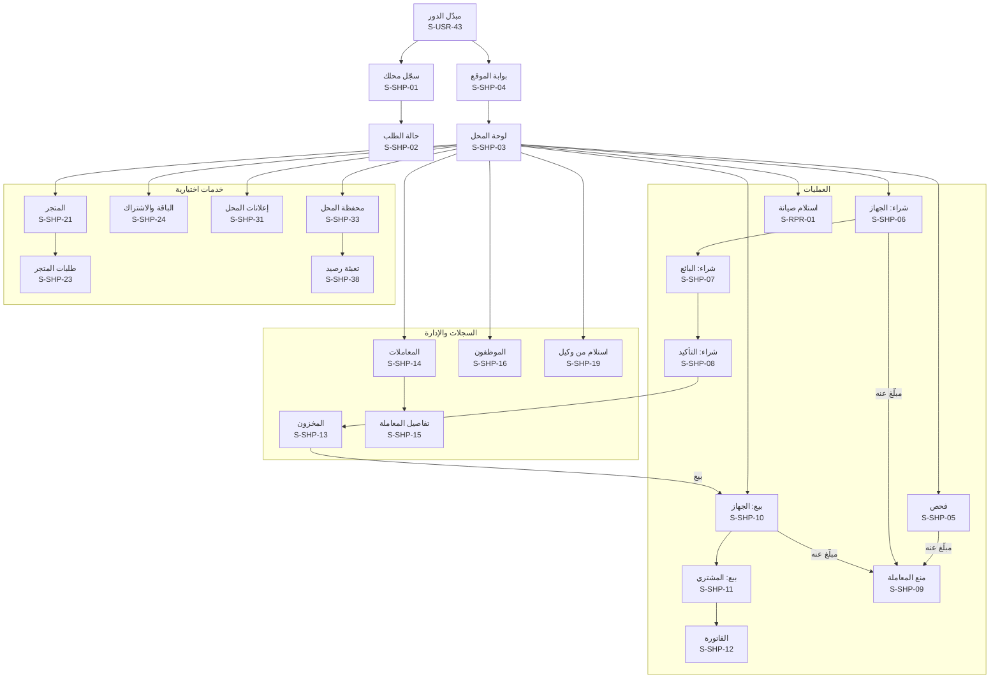

**خريطة التنقّل: الحيازة ودورة حياة المحل**

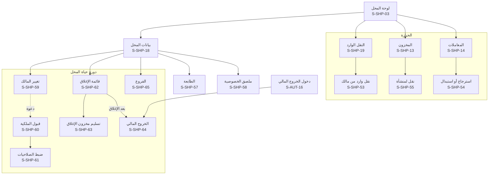

## 10. محل الصيانة (S-RPR)

لمحل نوع نشاطه «صيانة» أو «كلاهما»، ولموظف بصلاحية «تسجيل صيانة». تخضع لبوابة الموقع S-SHP-04، وتشارك شاشة المنع S-SHP-09. وشراء جهاز «للقطع» يتم بمسار الشراء العادي (S-SHP-06 إلى S-SHP-08).

| المعرّف | الشاشة | من يراها | المنصات | الغرض | المتطلبات | العناصر والإجراءات | الحالات الخاصة |
|---|---|---|---|---|---|---|---|
| S-RPR-01 | استلام للصيانة: الجهاز والفحص | صاحب محل الصيانة، والموظف بصلاحية الصيانة | موقع◐، تطبيق | فحص إلزامي قبل الاستلام | REPAIR-01، SHOP-09، GEO-04، HANDOFF-01، SERIAL-04، GSMA-06، SHOP-23 | مسح IMEI (أو الرقم التسلسلي لحاسوب)، والفحص الفوري، والموديل، و«التالي: صاحب الجهاز» | مبلّغ عنه: S-SHP-09 بنص «لا تستلم هذا الجهاز»؛ دون اتصال: لا استلام؛ «تعذّر التحقق الدولي»: يكمل الاستلام بعلامة ويُعاد الاستعلام؛ جهاز مقفل بحساب: الاستلام مسموح، وطلب فك قفل الحساب مرفوض |
| S-RPR-02 | استلام: صاحب الجهاز والعطل | صاحب المحل، والموظف بصلاحية الصيانة | موقع، تطبيق | تسجيل صاحب الجهاز وحالته | REPAIR-01، REPAIR-06، CIVIL-03، CIVIL-04، REPAIR-08، REPAIR-07، SHOP-30 | الرقم الوطني، والاسم وحالة البطاقة من السجل المدني دون صورة، والموبايل، ووصف العطل وحالة الجهاز، و«اللوحة الأم قد تُستبدل»، وتنبيه «الاستلام لا ينقل الملكية»، و«تسجيل الاستلام وإرسال الإيصال». وموافقة صاحب الجهاز على تذكيرات الاستلام، ونوع وثيقة الهوية | حالات السجل المدني كما في S-SHP-07؛ الجهاز مسجّل لشخص غير المقدّم: يكتمل الاستلام ويصل المالك المسجّل إشعار محايد برابط «بلّغ عنه» |
| S-RPR-03 | إيصال الاستلام | صاحب المحل، والموظف | موقع، تطبيق | تسليم إيصال لصاحب الجهاز | REPAIR-02، THEME-04 | رقم `CR-` وQR، وحالة الإرسال على واتساب، و«طباعة حرارية» (S-PRN-06) | فشل الإرسال: «إعادة الإرسال» |
| S-RPR-04 | أوامر الصيانة | صاحب المحل، والموظف بصلاحية الصيانة | موقع، تطبيق | الأجهزة في المحل | REPAIR-03، SHOPPRO-10، REPAIR-07 | تبويبات: في المحل، وجاهزة، وسُلّمت، و«متأخر عن الاستلام» بعد ⚙️ 90 يوماً ثم ⚙️ 180 يوماً، مع تذكير الزبون بعد 90 و120 و150 يوماً، و«سُلّم للجهات المختصة» (S-RPR-08)، وبحث بالرقم | فارغة؛ المحل لا يملك الجهاز المتروك أبداً: «حقوقك تُطلب عبر القانون» |
| S-RPR-05 | تفاصيل أمر الصيانة | صاحب المحل، والموظف بصلاحية الصيانة | موقع، تطبيق | تحديث حالة الجهاز | REPAIR-03، REPAIR-06، SHOPPRO-10، REPORT-29، REPAIR-11 | الحالة (مستلم، وقيد الصيانة، وجاهز، و«سُلّم للجهات المختصة» حين تضبطه قوى الأمن)، والملاحظات، و«استبدال اللوحة الأم»، و«تسليم». وبالصيانة المتقدمة المدفوعة: الفني، والقطع المستخدمة، والتسعير، و«أبلغ الزبون بالجاهزية» | الصيانة المتقدمة غير مفعّلة: الحقول الأساسية فقط؛ صار على الجهاز بلاغ: «لا تسلّمه واحتفظ به، والجهات المختصة مُبلَّغة» والتسليم معطّل |
| S-RPR-06 | استبدال اللوحة الأم | صاحب المحل، والموظف بصلاحية الصيانة | موقع◐، تطبيق | تسجيل تغيّر IMEI | REPAIR-04، FAKE-02، REPAIR-09 | IMEI القديم (معبّأ)، ومسح IMEI الجديد، والفحص الفوري للجديد، و«تسجيل الاستبدال». وتبقى الملكية كما هي. و«لوحة من جهاز مفكَّك في مخزوني» فينتقل المعرّف بين الجهازين في عملية واحدة | الرقم الجديد لجهاز مبلّغ عنه: S-SHP-09 وتنبيه أمني؛ الرقم الجديد مرتبط بجهاز آخر: تعارض للمراجعة؛ لوحة رقمها لجهاز آخر ليس مفكَّكاً في مخزون المحل نفسه، أو عليه بلاغ نافذ أو قيد المراجعة: تُمنع وتصير تعارضاً «احتمال تبييض» |
| S-RPR-07 | تسليم الجهاز | صاحب المحل، والموظف بصلاحية الصيانة | موقع، تطبيق | إغلاق أمر الصيانة | REPAIR-03، REPAIR-10 | المستلِم: صاحب الجهاز أو من يفوّضه (الاسم ورقمه)، و«تسجيل التسليم» | التسليم يعيد الفحص: جهاز صار مبلّغاً عنه لا يُسلَّم، وتنبيه أمني ببيانات من حضر للاستلام؛ محل معلّق أو قيد الإغلاق أو في الخروج المالي: التسليم متاح دائماً |
| S-RPR-08 | سُلّم للجهات المختصة | صاحب محل الصيانة | موقع، تطبيق | إنهاء أمر صيانة لجهاز متروك دون أن يملكه المحل | REPAIR-07 | الجهاز، ومدة الترك، والتذكيرات المرسلة، والقسم الذي سُلّم إليه وتاريخ التسليم واسم المستلم، و«تسجيل التسليم»، فيُغلق الأمر «سُلّم للجهات المختصة» وتسجّله قوى الأمن وديعة غير مُطالب بها | قبل ⚙️ 90 يوماً من الجاهزية: غير متاح |

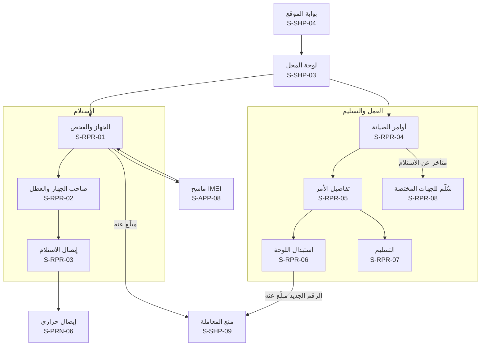

## 11. الوكيل والمستورد (S-IMP)

في سياق الوكيل بعد اختياره من مبدّل الدور. الموقع الإلكتروني هو الأنسب للملفات الكبيرة، والتطبيق للمسح. ومسؤول الوكيل يرى كل الشاشات، والموظف ما تمنحه صلاحياته: **رفع الدفعات**، و**النقل بالجملة**، و**عرض كل المعاملات** (بالقواعد نفسها لموظفي المحلات، IMPORTER-02).

| المعرّف | الشاشة | من يراها | المنصات | الغرض | المتطلبات | العناصر والإجراءات | الحالات الخاصة |
|---|---|---|---|---|---|---|---|
| S-IMP-01 | سجّل كوكيل أو مستورد | موثّق الهوية | موقع، تطبيق | طلب توثيق جهة استيراد | IMPORTER-01، GEO-03، PUB-04 | اسم الشركة، ورقم السجل التجاري وصورته، وإجازة الاستيراد أو الوكالة وصورتها، والمحافظة والعنوان، والخريطة بدبوس، وبيانات المسؤول (صاحب الطلب)، و«إرسال» | غير موثّق الهوية: S-USR-30 أولاً؛ مسودة |
| S-IMP-02 | حالة طلب التوثيق | صاحب الطلب | موقع، تطبيق | متابعة التوثيق | IMPORTER-01 | قيد المراجعة، أو بحاجة لتعديل، أو مرفوض بالسبب، أو موثّق برقم الوكيل | — |
| S-IMP-03 | لوحة الوكيل | المسؤول، والموظف | موقع، تطبيق | نقطة البداية في سياق الوكيل | IMPORTER-08، CUSTOMS-04 | عدد الأجهزة في المخزون، وآخر الدفعات، وطلبات النقل المعلّقة، والأجهزة المعلَّمة «غير مسجّلة لدى الهيئة»، وأزرار «رفع دفعة» و«نقل لمحل» حسب الصلاحية | وكيل معلّق: للقراءة فقط؛ قيد الإغلاق أو ملغى: كما في المحل (S-SHP-62، S-SHP-64) |
| S-IMP-04 | رفع دفعة أجهزة | المسؤول، والموظف بصلاحية الرفع | موقع، تطبيق | تسجيل أجهزة جديدة بالجملة | IMPORTER-03، FAKE-02، IMPORTER-07، SERIAL-06 | «تنزيل نموذج الملف» (وللحواسيب: الشركة المصنّعة والرقم التسلسلي بدل IMEI)، ورفع Excel أو CSV، أو مسح الأجهزة واحداً واحداً بالتطبيق، ومعاينة أول الأسطر، و«إرسال للمعالجة» | الملف بصيغة خاطئة أو أعمدة ناقصة؛ قيد المعالجة بشريط تقدّم ويمكن مغادرة الشاشة |
| S-IMP-05 | تقرير الدفعة | المسؤول، والموظف بصلاحية الرفع | موقع، تطبيق | معرفة المقبول والمرفوض | IMPORTER-03، IMPORTER-07، CUSTOMS-04، IMPORTER-10 | عدد المقبول والمرفوض، والأسطر المرفوضة بأسبابها (Luhn، ومكرر في الملف، وموجود في المنصة فصار تعارضاً، والرقمان لا يطابقان الموديل، و«مبلّغ عنه» الذي ينشئ تنبيهاً أمنياً عاجلاً)، و«تنزيل التقرير» (S-PRN-12) | — |
| S-IMP-06 | مخزون الوكيل | المسؤول، والموظف | موقع، تطبيق | الأجهزة بأصل «وكيل» في المخزون | IMPORTER-04، CUSTOMS-04، SERIAL-06، REPORT-29، IMPORTER-09 | قائمة بالبحث والتصفية (الموديل، والدفعة، ونوع الجهاز)، ووسم «غير مسجّل لدى الهيئة»، واختيار أجهزة للنقل | فارغة؛ جهاز صار مبلّغاً عنه: «لا تنقله واحتفظ به»؛ محجوز في نقل أو سطر متجر: وسم «محجوز» |
| S-IMP-07 | نقل بالجملة لمحل | المسؤول، والموظف بصلاحية النقل | موقع، تطبيق | إرسال أجهزة لمحل موثّق | IMPORTER-05، IMPORTER-09 | **رقم المحل `SH-`** ثم ظهور اسمه ومحافظته للتأكيد (لا قائمة محلات ولا دليل، D-22)، واختيار الأجهزة (بالمسح، أو بملف، أو من المخزون)، و«إرسال طلب النقل». وملف الأرقام بقالبه (⚙️ 1,000 سطر، وكل سطر من مخزونك) | محل غير موثّق أو معلّق: رفض؛ رقم محل خاطئ؛ الأجهزة المرسلة محجوزة حتى القبول أو الإلغاء؛ دون قبول خلال ⚙️ 30 يوماً يُلغى آلياً |
| S-IMP-08 | طلبات النقل | المسؤول، والموظف | موقع، تطبيق | متابعة الاستلام | IMPORTER-05، IMPORTER-09، IMPORTER-12 | الطلبات بحالتها (بانتظار تأكيد المحل، ومؤكَّد، ومرفوض بالسبب، وملغى)، و«إلغاء» قبل التأكيد. والحالة «مقبول جزئياً» بقائمة المقبول والمرفوض. وتبويب «وارد»: إرجاعات المحلات للأجهزة الجديدة المعيبة، و«قبول» يعيدها للمخزون بإعادة الفحص | معلّق أكثر من ⚙️ 7 أيام: شارة «عُلّم للإدارة»؛ يُلغى آلياً بعد ⚙️ 30 يوماً دون قبول |
| S-IMP-09 | سجل معاملات الوكيل | المسؤول، والموظف بصلاحية العرض | موقع، تطبيق | السجل الكامل للوكيل | IMPORTER-08 | الدفعات، والنقل لكل محل، وحركة المخزون، مع البحث والتصفية | فارغة |
| S-IMP-10 | الموظفون | مسؤول الوكيل | موقع، تطبيق | إدارة موظفي الوكيل | IMPORTER-02 | كما في S-SHP-16 | فارغة |
| S-IMP-11 | إضافة موظف أو تعديل صلاحياته | مسؤول الوكيل | موقع، تطبيق | حساب موظف بصلاحياته | IMPORTER-02 | الاسم، والرقم الوطني، والموبايل، والصلاحيات (رفع الدفعات، والنقل بالجملة، وعرض كل المعاملات)، والدعوة، والإيقاف | كما في S-SHP-17 |
| S-IMP-12 | بيانات الوكيل | مسؤول الوكيل | موقع، تطبيق | عرض البيانات وتعديلها | IMPORTER-01 | البيانات والمستندات، و«تعديل» يعيد المسّ بالسجل أو الإجازة أو الموقع للمراجعة | — |
| S-IMP-13 | الربط البرمجي | مسؤول الوكيل | موقع | تسجيل الأجهزة آلياً من نظام الوكيل | IMPORTER-03، IMPORTER-11 | حالة الربط (غير مطلوب، أو بانتظار اعتماد مشرف المحلات، أو مفعّل)، و«طلب الربط»، وإنشاء المفتاح وعرضه مرة واحدة، وتدويره، وإلغاؤه، وسجل الاستخدام. وجملة «مفتاح التسجيل وظيفة التزام: لا اشتراك ولا فوترة، ولا يتأثر بإيقاف الربط البرمجي للشركات»، وكل دفعة عبره تصلك بإشعار مع «لم أكن أنا» الذي يوقف المفتاح ويجمّد الدفعة للمراجعة | السر يُعرض مرة واحدة فقط مع نسخ وتنزيل، ولا يراه أحد من المنصة |
| S-IMP-14 | بلاغ سرقة مخزون الوكيل ومتابعته | مسؤول الوكيل | موقع، تطبيق | التبليغ عن أجهزة مستودع أو نقل مسروقة دفعة واحدة | REPORT-20، REPORT-18، REPORT-09 | كما في S-SHP-49 وS-SHP-50: اختيار الأجهزة من المخزون أو من نقل «مُرسل» لم يُقبل (فتُسحب منه)، وتاريخ الحادثة ومكانها (المستودع أو الطريق)، ورقم الضبط اختياري، والإقرار، و«إرسال» برقم `BL-` للدفعة، ثم حالة كل جهاز برقمه الفرعي | فوق ⚙️ 5 أجهزة: مراجعة مشدّدة؛ جهاز عليه بلاغ قائم: يُستثنى مع السبب؛ سُرق موبايل المسؤول: جلسة «بلاغ السرقة فقط» أو الدعم |
| S-IMP-15 | الاستبدال بالكفالة | مسؤول الوكيل، والموظف بصلاحية النقل | موقع◐، تطبيق | استبدال جهاز زبون معيب بجديد في عملية واحدة | IMPORTER-12، CIVIL-03 | فحص الجهاز القديم، والتحقق أن الزبون هو المالك المسجّل (تصوير هويته)، والفاتورة الأصلية، واختيار البديل من المخزون، و«تسجيل الاستبدال»: يعود القديم لمخزون الوكيل وينتقل البديل للزبون، مع إيصال يذكر الفاتورة الأصلية | الزبون ليس المالك المسجّل: «اطلب نقل الملكية أولاً»؛ القديم عليه بلاغ: S-SHP-09 |

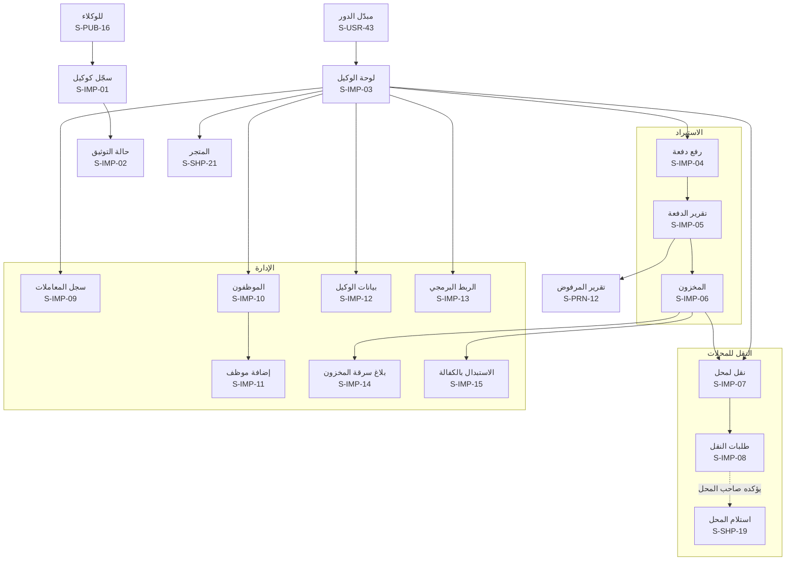

## 12. المورّد المعتمد (S-SUP)

لوحة المورّد في سياق «مورّد» بعد اختياره من مبدّل الدور (D-87). **على الموقع الإلكتروني فقط** (ويصلح لشاشة الموبايل)، ولا وضع لها في التطبيق. والمورّد **لا يرى من المحلات إلا اسم المحل وعنوان التوصيل لطلباته**، ولا علاقة له بالأجهزة أو البلاغات أو الهويات (03 §2.4.3، STORE-12). ولا يُنشر منتج ولا تعديل عليه إلا بعد مراجعة المشرف التجاري. والمتجر لكل ما يخص الموبايلات والحواسيب (D-88). **والوكيل المعتمد الذي يعرض الأجهزة نفسها في المتجر** يستخدم هذه الشاشات من سياق الوكيل بالفروق المذكورة في S-SUP-05 وS-SUP-07 (STORE-13).

| المعرّف | الشاشة | من يراها | المنصات | الغرض | المتطلبات | العناصر والإجراءات | الحالات الخاصة |
|---|---|---|---|---|---|---|---|
| S-SUP-01 | طلب اعتماد مورّد | صاحب حساب يمثّل جهة توريد | موقع | التقدّم للبيع في المتجر | STORE-03، STORE-12، STORE-22 | اسم الجهة، والسجل التجاري وصورته، والرقم الضريبي، وجهة التواصل، والأقسام، ونطاق التوصيل، وقبول اتفاقية المورّد (حصة المنصة، وسياسة الإرجاع والكفالة)، و«إرسال». والطريق الثاني: ينشئ المشرف التجاري سجل المورّد بعد التعاقد فتصل مسؤوله دعوة تفعيل (S-AUT-11)، والطريقان يراجعهما المشرف التجاري | المتجر مطفأ: لا مدخل؛ مسودة |
| S-SUP-02 | حالة طلب الاعتماد | صاحب الطلب | موقع | متابعة الاعتماد | STORE-03 | قيد المراجعة، أو مرفوض بالسبب الجاهز، أو معتمد مع حصة المنصة المتفق عليها و«ابدأ: أضف منتجاتك» | — |
| S-SUP-03 | لوحة المورّد | المورّد المعتمد | موقع | نقطة البداية | STORE-05، STORE-10، STORE-12، STORE-21 | الطلبات الجديدة المسندة للتجهيز، والمنتجات قيد المراجعة أو المرفوضة، وآخر كشف تسوية وصافيه، وتنبيه المرتجعات | مورّد معلّق: شريط السبب، ومنتجاته مخفية ومحفوظة، ولا طلبات جديدة، و«قيد التجهيز» يكمل إلا لاحتيال أو صنف ممنوع، والمشحون والمرتجعات والتسويات تستمر؛ سحب الاعتماد: كشف نهائي بعد آخر مهلة إرجاع |
| S-SUP-04 | منتجاتي | المورّد المعتمد | موقع | كتالوج المورّد | STORE-02، STORE-06، STORE-12 | المنتجات بحالتها (قيد المراجعة، ومنشور، ومرفوض بالسبب، وموقوف)، والسعر والمخزون، و«+ منتج»، وتحديث المخزون. وتحديث كمية المخزون لا يحتاج مراجعة | فارغة |
| S-SUP-05 | إضافة منتج أو تعديله | المورّد المعتمد | موقع | عرض منتج للمراجعة | STORE-02، STORE-06، STORE-12، STORE-13، STORE-19 | الاسم، والقسم، والصور، والوصف، والسعر، والمخزون، وتنويه ثابت بالأصناف الممنوعة. وللوكيل: اختيار موديل من مخزونه بعدد الأجهزة المتاحة، والأجهزة نفسها لا يعرضها إلا وكيل، و«إرسال للمراجعة». وأي تعديل على منتج منشور يعيده للمراجعة. ومدة كفالة المنتج. والتعديل ينشئ نسخة قيد المراجعة والنسخة المنشورة باقية في المتجر حتى الموافقة | القسم ضمن الأصناف الممنوعة: لا يُقبل الإرسال؛ تعديل السعر أو الوصف: «يبقى المنتج بنسخته السابقة حتى الموافقة» |
| S-SUP-06 | الطلبات المسندة | المورّد المعتمد | موقع | ما يجب تجهيزه | STORE-05، STORE-12 | تبويبات: للتجهيز، وبانتظار الشحن، ومع الشحن، ومسلَّمة، وملغاة، ومرتجعة. ولكل طلب: الرقم، واسم المحل، والمحافظة، والأصناف | فارغة |
| S-SUP-07 | تجهيز الطلب وتسليمه للشحن | المورّد المعتمد | موقع | تجهيز الطلب وتسليمه للمندوب | STORE-05، STORE-09، STORE-12، STORE-13، STORE-18 | الأصناف والكميات، واسم المحل وعنوان التوصيل فقط، وللوكيل: مسح أرقام الأجهزة المرسلة فتنتقل لمخزون المحل بأرقامها عند التسليم كنقل بالجملة، و«الطلب جاهز للاستلام»، و**رمز الاستلام** الذي يعطيه المورّد للمندوب، و«طباعة ملصق الطلب» (S-PRN-14). ولأسطر الأجهزة: يُعاد فحص كل جهاز قبل التسليم، والمبلّغ عنه أو الخارج من المخزون يُستبعد مع تخفيض الفاتورة آلياً | صنف نفد: «تعذّر التجهيز» مع السبب فيراجعه المشرف التجاري |
| S-SUP-08 | المرتجعات والعيوب | المورّد المعتمد | موقع | معرفة ما خُصم ولماذا | STORE-11، STORE-19 | المرتجعات المرتبطة بمنتجاته، وقرار المشرف التجاري، والقيمة المخصومة من التسوية، و«ملاحظة للمشرف». وشحنات الإرجاع العكسية برمز استلامها، ومطالبات الكفالة حتى نهاية مدتها والمنتجات المستدعاة | فارغة |
| S-SUP-09 | كشوف التسوية | المورّد المعتمد | موقع | معرفة المستحقات | STORE-10 | الكشوف الدورية (⚙️ أسبوعياً): الطلبات المسلّمة والمدفوعة، ناقص حصة المنصة، وناقص المرتجعات والعيوب، والصافي، وحالة التحويل ورقمه المرجعي، و«تحميل PDF» (S-PRN-13). و«أضف ملاحظة» على الكشف من حالة «جاهز للمراجعة» (`prepared`) قبل الاعتماد، وحالتها «قيد المراجعة» ثم الرد (SOP-44، `settlement_remarks`، `store.settlement.remark_added`) | كشف قيد الإعداد أو بانتظار الموافقة؛ فارغة؛ تغيير حساب التسوية قيد التنفيذ: الكشوف المعتمدة «محتجزة» لا تُدفع لأي حساب حتى سريان الجديد |
| S-SUP-10 | بيانات المورّد وحساب التسوية | المورّد المعتمد | موقع | البيانات والحساب المستلم | STORE-03، STORE-10 | البيانات والمستندات والرقم الضريبي والأقسام ونطاق التوصيل، والحساب المستلم للتسويات بحقوله (24 `supplier.payout.fields`): طريقة الاستلام (حساب بنكي، أو شام كاش، أو سيريتل كاش، أو MTN كاش)، واسم صاحب الحساب، ورقم الحساب مقنّعاً. **وتغيير الحساب:** طلب بإعادة تحقق، ثم تحويل اختباري و«أكّد وصول التحويل الاختباري» برقمه المرجعي أو برفع كتاب من البنك، ثم إعداد المشرف التجاري، ثم اعتماد المدير العام أو نائبه، ثم يسري بعد ⚙️ 72 ساعة. وخط زمني بتسميات 24 §7.4 (قيد التحقق، وجاهز للاعتماد، ومعتمد يسري في [الوقت]، وفعّال، وسابق، وموقوف باعتراض)، مع إشعار على كل وسائل المورّد في كل خطوة | تغيير قيد التنفيذ: التسويات المعتمدة محتجزة حتى سريانه؛ «لم أكن أنا» في أي خطوة: يفتح S-PUB-29 (تجميد الحساب)، ويصير التغيير «موقوفاً باعتراض» مع التسويات، ويُفتح طلب دعم عاجل؛ رقم مرجعي لا يطابق التحويل: «لم نجد هذا التحويل»؛ صاحب الحساب لا يطابق المورّد بالرقم الوطني: يُرفض |
| S-SUP-11 | إعلانات المورّد | المورّد المعتمد | موقع | الإعلان للمحلات | ADS-03، ADS-04، ADS-05، ADS-07، PAY-01 | كما في S-SHP-31: إنشاء حملة للمحلات، و«اطلب التفعيل»، والحالة، والمشاهدات والضغطات | الإعلانات مطفأة: يختفي المدخل |
| S-SUP-12 | موظفو المورّد | مسؤول المورّد | موقع | إدارة حسابات موظفي المورّد | STORE-12، STORE-03 | قائمة بالاسم والحالة (بانتظار التفعيل، أو بانتظار توثيق الهوية، أو نشط، أو موقوف) وآخر نشاط، و«+ موظف» | فارغة |
| S-SUP-13 | إضافة موظف مورّد أو تعديل صلاحياته | مسؤول المورّد | موقع | حساب موظف بصلاحياته | STORE-12 | الاسم، والرقم الوطني، والموبايل، والصلاحيات (المنتجات، وتجهيز الطلبات، والمرتجعات، وعرض كشوف التسوية)، و«إرسال الدعوة» (S-AUT-11)، و«إيقاف الموظف». ولا صلاحية لموظف على حساب التسوية | كما في S-SHP-17 |

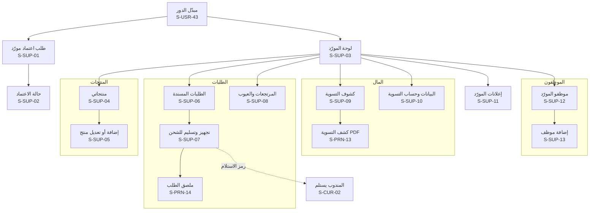

## 13. مندوب الشحن وعميل الربط البرمجي (S-CUR، S-BIZ)

### 13.1 مندوب الشحن (S-CUR)

لكل مندوب بحساب، سواء كان **مندوب المنصة أو مندوب شركة شحن متعاقدة** (STORE-09، STORE-14، [الأدوار والصلاحيات](03-roles-and-permissions.md) §2.4.4). **على الموقع الإلكتروني فقط** من متصفح الموبايل، ولا وضع له في التطبيق. والربط الآلي لشركة الشحن قناة بديلة تُسجّل الاستلام والتسليم والقبض دون شاشات لمن لا يستخدمها. والمندوب يرى لكل طلب **اسم المحل وعنوانه وهاتفه ومبلغ التحصيل فقط**. ومدير شركة الشحن المتعاقدة (دور `manager`، [الأدوار والصلاحيات](03-roles-and-permissions.md) §2.4.4) يطلب حسابات مندوبي شركته ويوقفها من S-CUR-04.

| المعرّف | الشاشة | من يراها | المنصات | الغرض | المتطلبات | العناصر والإجراءات | الحالات الخاصة |
|---|---|---|---|---|---|---|---|
| S-CUR-01 | مهام التوصيل | مندوب المنصة أو مندوب شركة الشحن | موقع (موبايل) | طلبات اليوم المسندة إليه | STORE-14، STORE-09، STORE-11 | الطلبات بترتيب الاستلام ثم التسليم: المورّد، والمحل وعنوانه وهاتفه، ومبلغ التحصيل، والحالة، والنقد المحصّل اليوم. ومهام الاستلام العكسي للمرتجعات (من المحل إلى المورّد) برمزيها | فارغة؛ بلا اتصال: آخر ما حُمّل للقراءة، ولا تسجيل دون اتصال |
| S-CUR-02 | الاستلام والتسليم والقبض | مندوب المنصة أو مندوب شركة الشحن | موقع (موبايل) | إثبات كل خطوة | STORE-14، STORE-09، STORE-05، STORE-18 | عند المورّد: «أدخل رمز الاستلام». وعند المحل: «أدخل رمز التسليم من المحل»، والمبلغ المقبوض، و«تم التسليم والقبض». والطلب لا يصبح «مسلَّماً ومدفوعاً» دون الرمزين | رمز خاطئ: `STORE_DELIVERY_CODE_INVALID` مع عدد المحاولات الباقية؛ رمز التسليم أو الاستلام مقفل بعد ⚙️ 5 محاولات خاطئة: `STORE_DELIVERY_CODE_LOCKED` وزر «اتصل بالدعم»، وينشئ المحل رمزاً جديداً؛ المحل غير موجود أو لم يستلم: «تعذّر التسليم» بسببه، فمحاولة ثانية (`delivery_failed` ثم خروج للتوصيل)، ثم عودة للمورّد بعد فشلها؛ المحل رفض الاستلام: السبب ويعود الطلب للمورّد؛ سطر جهاز صار مبلّغاً عنه: «احجب هذه الوحدة ولا تسلّمها» ويُخفَّض المبلغ المطلوب آلياً |
| S-CUR-03 | نقد اليوم وتوريده | مندوب المنصة أو مندوب شركة الشحن | موقع (موبايل) | تسليم ما قبضه للمنصة | STORE-09 | الطلبات المسلّمة اليوم ومبالغها، والمجموع، و«سُلّم النقد» برقم مرجعي يطابقه المشرف التجاري في S-ADM-36. والتوريد برقم مرجعي يُحفظ لكل يوم ويطابقه المشرف التجاري | فرق مع المطابقة: يظهر للمندوب بلا تفاصيل غيره |
| S-CUR-04 | مندوبو الشركة | مدير شركة الشحن | موقع | إدارة مندوبي الشركة المتعاقدة | STORE-14، STORE-09 | المندوبون بحالتهم، و«طلب حساب مندوب» (الاسم، والموبايل، والرقم الوطني) يفعّله المشرف التجاري، و«إيقاف»، وطلبات الشركة المسندة، والنقد غير المورَّد لكل مندوب وكشف التوريد. ولا يرى غير ذلك (الصلاحيتان `courier.members.request` و`courier.company.view` لمدير الشركة، `courier_users.role = manager`) | شركة دون مدير بحساب: طلباتها بكتاب موقّع يعالجه المشرف التجاري في S-ADM-34 |

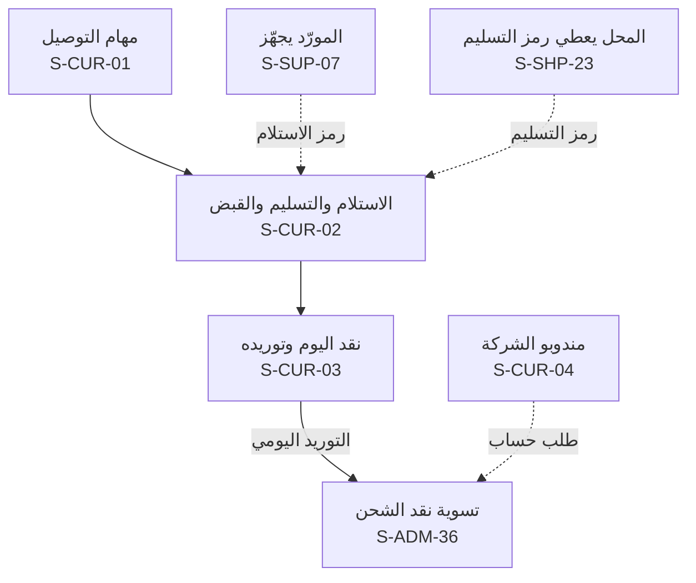

### 13.2 عميل الربط البرمجي (S-BIZ)

لوحة الشركة المرتبطة بعقد (BIZAPI) **على الموقع فقط**، في سياق «عميل الربط» من مبدّل الدور، لحساب شخصي مؤكَّد الرقم مرتبط بالعميل. ومسؤول العميل **ينشئ مفاتيحه بنفسه** ويرى السر مرة واحدة، ولا يراه أحد من المنصة أبداً، ولا يُرسل عبر أي رسالة ([التصميم التقني](19-technical-design.md) §3.13). وشاشة الإدارة S-ADM-41 تعرض معرّفات المفاتيح وبادئاتها فقط. ومفتاح الوكيل لتسجيل أجهزته وظيفة التزام في S-IMP-13 لا هنا.

| المعرّف | الشاشة | من يراها | المنصات | الغرض | المتطلبات | العناصر والإجراءات | الحالات الخاصة |
|---|---|---|---|---|---|---|---|
| S-BIZ-01 | لوحة عميل الربط | مسؤول العميل ومطوّروه | موقع | حالة الاشتراك والحصة والاستخدام | BIZAPI-01، BIZAPI-03، BIZAPI-04 | الاشتراك وحالته وموعد انتهائه، والحصة الشهرية والمتبقي ومعدل الطلبات، والاستخدام اليومي، وتنبيه بلوغ ⚙️ 80% من الحصة (`bizapi.quota.warning_threshold`)، والمفاتيح النشطة بمعرّفاتها | الحصة نفدت: «تُرد الطلبات حتى [التاريخ]»؛ الوحدة قيد الإطفاء: العملاء القائمون حتى نهاية مدتهم؛ عميل معلّق: شريط السبب |
| S-BIZ-02 | المفاتيح | مسؤول العميل | موقع | إنشاء المفاتيح وتدويرها وإلغاؤها ذاتياً | BIZAPI-01، BIZAPI-06 | المفاتيح بمعرّفها `bk_live_…` وبادئتها وآخر استخدام ونطاقاتها وقائمة عناوينها وموعد انتهائها، و«مفتاح جديد» بإعادة تحقق (كلمة المرور ورمز): **النطاقات** يختارها المسؤول من نطاقات عقده، و**قائمة العناوين المسموحة على المفتاح نفسه** (إلزامية لكل مفتاح بنطاق كتابة، واختيارية للقراءة، وتُحرَّر هنا)، وموعد الانتهاء (الافتراضي ⚙️ 365 يوماً `bizapi.key.default_ttl`). فيُعرض **السر مرة واحدة فقط** مع «نسخ» و«تنزيل ملف» ثم لا يُعرض لأحد أبداً، و«إلغاء» فوري. ومفاتيح الاختبار `bk_test_` تُنشأ من موقع بيئة التجريب وحده، ولا مفتاح اختبار في الإنتاج | عميل قيد الاعتماد أو دون عقد أو دفعة، أو معلّق أو منتهٍ: «لا يمكن إنشاء مفتاح الآن» مع الحالة و«مفتاح جديد» معطّل؛ حد مفتاحين نشطين: «ألغِ القديم أولاً»؛ منع تصوير الشاشة لحظة عرض السر؛ ألغت الإدارة مفتاحاً للاشتباه: شارة «أُلغي بقرار الإدارة» وإشعار؛ مفتاح الكتابة لوكيل تغيّر مالكه: أُلغي آلياً عند التنفيذ ويُنشئ المالك الجديد مفتاحاً |
| S-BIZ-03 | الأعضاء | مسؤول العميل | موقع | دعوة مطوّرين بحسابات شخصية | BIZAPI-01 | الأعضاء (مسؤول، ومطوّر) بحالتهم، و«دعوة مطوّر» برقم موبايله (يقبلها من رابط الدعوة في S-AUT-11)، و«إزالة». والمطوّر يرى الاستخدام والمفاتيح بمعرّفاتها ولا ينشئ مفتاحاً | فارغة |
| S-BIZ-04 | الاستخدام والفواتير | مسؤول العميل | موقع | الاستخدام اليومي والفواتير الدورية | BIZAPI-04، PAY-08 | الاستخدام بالنطاق واليوم، والفواتير الدورية بحالتها وإيصالاتها (S-PRN-11)، و«اطلب التجديد» | — |


## 14. شاشات التطبيق الخاصة (S-APP)

ما لا يوجد إلا في التطبيق. وطلب أي إذن يكون **لحظة الحاجة** بعد شاشة تمهيد، لا عند أول فتح. وتمهيد إذن الموقع هو S-PUB-02 في الفحص، وS-SHP-04 في المحل.

| المعرّف | الشاشة | من يراها | المنصات | الغرض | المتطلبات | العناصر والإجراءات | الحالات الخاصة |
|---|---|---|---|---|---|---|---|
| S-APP-01 | شاشة الإقلاع | الجميع | تطبيق | فحص الإصدار وفتح السياق الأخير | APPVER-01، SMART-11، ROLLOUT-04 | الشعار، ومقارنة الإصدار بالأدنى والموصى به، ثم فتح آخر سياق (زائر، أو حسابي، أو محل، أو وكيل) | لا اتصال: فتح آخر سياق بشريط «لا يوجد اتصال»؛ وضع الصيانة؛ شريط بيئة التدريب |
| S-APP-02 | التحديث الإجباري | من إصداره أقل من الأدنى | تطبيق | منع الاستخدام حتى التحديث | APPVER-02، APPVER-03، SHOPPRO-03 | «يلزم تحديث التطبيق»، وإصدارك والأدنى المدعوم، وجملة «أجهزتك وبلاغاتك محفوظة في حسابك»، و«تحديث الآن» إلى المتجر، و«يمكنك الفحص من الموقع حتى ذلك الحين». ومن لديه مبيعات نقطة بيع غير مزامنة: «لديك [n] عملية بيع غير مزامنة، نزامنها الآن قبل التحديث، ولا تحذف التطبيق» ثم المزامنة أولاً (⚙️ 30 يوماً بعد صيرورة الإصدار غير مدعوم). ونسخة قناة APK: «حمّل التحديث من الصفحة الرسمية» مع بصمة SHA-256 بدل المتجر | يظهر أيضاً إذا رفض الخادم الطلب لإصدار غير مدعوم |
| S-APP-03 | تحديث موصى به | من إصداره أقل من الموصى به | تطبيق | دعوة للتحديث يمكن تأجيلها | APPVER-02 | نافذة سفلية: ما الجديد باختصار، و«تحديث»، و«لاحقاً» (يعود بعد ⚙️ 3 أيام). ونسخة قناة APK: صفحة التنزيل الرسمية مع بصمة SHA-256 | — |
| S-APP-04 | الترحيب | أول فتح للتطبيق | تطبيق | البدء دون عوائق | CHECK-01، AUTH-01، AUTH-02 | **شاشة واحدة**: الشعار والشعار النصي، والعنوان والنص `app.welcome.1.title` و`app.welcome.1.body` (24 §2.13)، و«افحص جهازاً الآن» (دون حساب)، و«تسجيل الدخول أو إنشاء حساب». لا شرائح ولا نقاط تمرير ولا «ابدأ» ولا «تخطٍّ»، ولا طلب أذونات، ولا أي وعد بمعرفة حقيقة الجهاز | — |
| S-APP-05 | تمهيد إذن الإشعارات | مستخدم بعد أول دخول، أو عند أول بلاغ أو نقل | تطبيق | شرح الفائدة قبل نافذة النظام | NOTIF-01 | ما سيصله (قبول البلاغ، وفحص جهازك، والفواتير، وطلبات النقل)، و«فعّل الإشعارات»، و«لاحقاً». وجملة «نصلك على واتساب أيضاً» | الرفض: لا يُعاد قبل إجراء جديد يحتاجه |
| S-APP-06 | تمهيد إذن الكاميرا | عند أول مسح أو تصوير | تطبيق | شرح الاستخدام قبل نافذة النظام | CHECK-05، AUTH-05، REPORT-04 | للمسح: «نقرأ الرقم على جهازك ولا تُرفع الصورة». وللتصوير: «تُلتقط الصورة مباشرة وتُحفظ مشفّرة ولا يراها إلا المشرف» | — |
| S-APP-07 | الإذن مرفوض: افتح الإعدادات | من رفض إذناً نهائياً | تطبيق | طريق واضح لتغيير القرار | GEO-02، GEO-04، CHECK-05، NOTIF-01 | ما الإذن، ولماذا يلزم هنا، و«افتح الإعدادات»، والبديل المتاح (إدخال IMEI يدوياً، أو اختيار المحافظة) | للمحل: لا بديل للموقع، فتبقى وظائف المحل مغلقة |
| S-APP-08 | ماسح IMEI | كل من يدخل IMEI | تطبيق | قراءة الرقم دون كتابة | CHECK-05، SHOP-09، REPORT-05، IMPORTER-05، CHECK-20 | إطار الكاميرا، والمصباح، وقراءة الباركود والنص من شاشة `*#06#` أو لصاقة الكرتونة على الجهاز نفسه، وعرض IMEI1 وIMEI2 والموديل المتوقع، و«افحص» أو «استخدم هذا الرقم»، و«إدخال الرقم يدوياً». وللوكيل: مسح متتابع لعدة أجهزة. ويستخرج المرشحين (15 خانة تمر بـ Luhn) من كل الباركودات والنص، ويتجاهل باركودات EAN وUPC والرقم التسلسلي وIMEISV. مرشح واحد: يُملأ. اثنان للموديل نفسه: IMEI1 وIMEI2 بالتسمية المطبوعة وإلا بالترتيب من الأعلى، مع زر «تبديل». أكثر أو موديلات مختلفة: يختار المستخدم | لم يُقرأ شيء بعد ثوانٍ: تلميح بالإضاءة والمسافة والإدخال اليدوي؛ إذن مرفوض: S-APP-07 |
| S-APP-09 | ماسح رمز الإكمال | مستخدم يكمل خطوة بدأها على الكمبيوتر | تطبيق | فتح الخطوة نفسها في التطبيق | HANDOFF-02، HANDOFF-03 | مسح QR من شاشة الكمبيوتر، أو «اكتب الرمز القصير»، ثم فتح الخطوة مباشرة | منتهٍ؛ مستخدم؛ حساب آخر؛ غير مسجّل الدخول (القسم 4.2) |
| S-APP-10 | كاميرا تصوير الهوية | التوثيق، وهوية البائع، والاستعادة | تطبيق | صورة حيّة للبطاقة دون معرض | AUTH-05، SHOP-06، THEFT-06 | إطار البطاقة، والوجه الأمامي ثم الخلفي (1 من 2)، وفحص الوضوح والحواف والانعكاس، و«إعادة التصوير»، وجملة «دون سيلفي». ومنع تصوير الشاشة | الصورة غير واضحة: إعادة؛ إذن مرفوض |
| S-APP-11 | كاميرا الصورة الحيّة للكرتونة | البلاغ عن جهاز غير مسجّل، والتسجيل الذاتي | تطبيق | إثبات حيازة الكرتونة برقم الحساب | REPORT-04، REPORT-05، OWN-03، AUTH-12 | رقم الحساب `SY-` ظاهر أعلى الشاشة مع «اكتبه على ورقة بجانب الملصق»، وإطار الكرتونة والورقة، وقراءة الباركود ومقارنته بالرقم المدخل، و«لا يُقبل رفع صورة من المعرض» | الباركود لا يطابق: تنبيه قبل المتابعة |
| S-APP-12 | تصوير مستند أو دليل | الأدلة، والردود، والدعم، وصور المحل | تطبيق | إرفاق صورة أو مستند | REPORT-04، REPORT-10، DISPUTE-01، SUPPORT-01، SHOP-01، STORE-11، SUCCESSION-01 | الكاميرا مع خيار المعرض للأدلة الاختيارية وصور المحل (لأنها قد تكون صوراً قديمة)، و**الكاميرا فقط** لصور الإرجاع، والقص، والضغط قبل الرفع (⚙️ 2000 بكسل، و⚙️ 10 ميغابايت). وشهادة الوفاة ووثيقة الوصاية **بالكاميرا فقط** أيضاً | رفع مستأنف عند ضعف الشبكة |
| S-APP-13 | بلا اتصال | الجميع | تطبيق | حالة واضحة دون فقدان البيانات | SHOP-17، SHOPPRO-03 | شريط أو شاشة «لا يوجد اتصال، يمكنك تصفّح آخر ما حُمّل»، وجملة «تسجيل العمليات يحتاج اتصالاً لأن فحص الجهاز يجب أن يكون لحظياً». والاستثناء الوحيد بيع الإكسسوارات النقدي في نقطة البيع (S-SHP-41) يستمر ويُزامَن لاحقاً، ووقت آخر تحديث، و«إعادة المحاولة» | يعود تلقائياً عند الاتصال |
| S-APP-14 | المسودات | مستخدم، وصاحب المحل، والموظف | تطبيق | استكمال ما بدأ دون اتصال | SHOP-17، REPORT-14، SHOPPRO-03 | مسودات البلاغات والمعاملات ومبيعات نقطة البيع بانتظار المزامنة بتاريخها، و«متابعة» (تُعيد الفحص الفوري قبل أي معاملة)، و«حذف المسودة» | فارغة |
| S-APP-15 | قفل التطبيق | من فعّله، وكل من في سياق محل أو وكيل | تطبيق | منع استخدام جلسة مفتوحة على جهاز تُرك أو سُرق | AUTH-08، THEFT-04 | شاشة القفل: الرمز، والسياق، وما حُفظ («سلة البيع محفوظة»)، و«افتح بـ Face ID» أو «افتح بالبصمة»، و«استخدم رمز الجهاز»، وبعد ⚙️ 5 محاولات «الفتح بكلمة المرور» ثم يكمل من حيث توقف. والشاشة تُغطّى فور الخروج من التطبيق فلا تظهر في مبدّل التطبيقات. ويُطلب بعد ⚙️ 10 دقائق خمول في سياق المحل والوكيل، وبالمدة التي يختارها المواطن في S-USR-32 ([الهوية البصرية](15-visual-identity.md) §17) | جهاز بلا رمز قفل: لا يعمل عليه وضع المحل؛ الخروج من الحساب ممنوع ما دامت عمليات غير مرفوعة؛ منع تصوير الشاشة |

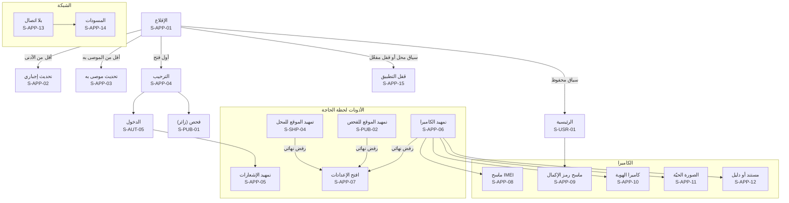

## 15. لوحة الإدارة (S-ADM)

موقع مستقل على نطاق منفصل، للكمبيوتر أساساً. القائمة الجانبية تُبنى من صلاحيات المستخدم، فلا يرى أحد بنداً لا يملك صلاحيته، وأعداد قوائم العمل بجانب البنود. وكل قرار بسبب مكتوب، وكل كشف لبيانات مخفية بسبب مسجّل (ADMIN-17)، ولا يراجع المشرف ما يخصّه (03 §4). والتحديث لحظي دون إعادة تحميل، مع شريط «إعادة الاتصال» عند انقطاعه، وإشعارات المتصفح تظهر **من التبويب المفتوح فقط** عبر الاتصال اللحظي نفسه، دون أي خدمة إشعارات خارجية. و**المدير العام ينفّذ إجراءاته وحده** دون موافقة شخص ثانٍ (D-102)، مع تحقق ثنائي قوي إلزامي، وتحقق إضافي عند كل إجراء خطر، وإشعار فوري به على وسائله، وسجل تدقيق ثابت. وتبقى موافقة الشخصين حيث قُررت لغيره، **والقائمة المغلقة لهذه الأفعال ومن يطلب ومن يوافق في كل منها في سجل الأربع عيون** ([التصميم التقني](19-technical-design.md) §5.4، ADMIN-28)، وكل ما عداها بفاعل واحد. ويعيّن المدير العام نائباً مؤقتاً يوافق بدله في أزواج المال والتصحيح وحدها (D-128، S-ADM-80). ولا إعلانات ولا عروض تجارية إلا في شاشات إدارتها (ADS-02، PAY-06). و**مفتاح المرور على الجهاز المعتمد أو مفتاح الأمان إلزامي** للمدير العام وكل دور يكشف بيانات أو يصدّرها أو يبحث بالرقم الوطني أو يتتبّع، وباقي الأدوار برمز التطبيق مع قائمة عناوين مسموحة إلزامية (D-125، S-ADM-66). وكل قرار من صنف التأكيد «هـ» (القسم 2.1)، وقرارات التعليق والحظر والإلغاء والإيقاف تسبقها معاينة الأثر (S-ADM-70).

| المعرّف | الشاشة | من يراها | المنصات | الغرض | المتطلبات | العناصر والإجراءات | الحالات الخاصة |
|---|---|---|---|---|---|---|---|
| S-ADM-01 | دخول اللوحة | كل موظفي الإدارة | لوحة | الدخول بكلمة المرور | AUTH-11، AUTH-16 | اسم الدخول، وكلمة المرور | عنوان شبكة غير مسموح ⚙️؛ قفل مؤقت؛ حساب موقوف؛ دور يتطلب مفتاح الأمان: لا يُقبل له رمز التطبيق؛ الأدوار الأخرى: من عنوان شبكة مسموح فقط |
| S-ADM-02 | التحقق الثنائي | كل موظفي الإدارة | لوحة | العامل الثاني الإلزامي | AUTH-11، AUTH-16 | مفتاح المرور على الجهاز المعتمد أو مفتاح الأمان (إلزامي للمدير العام وكل دور يكشف بيانات أو يصدّرها أو يبحث بالرقم الوطني أو يتتبّع)، ورمز تطبيق المصادقة لغيرها، وعند أول دخول: تسجيل العامل الثاني إلزامياً (S-ADM-66) | رمز خاطئ؛ فقدان العامل الثاني: عبر المدير العام |
| S-ADM-03 | الرئيسية: قوائم العمل | كل الأدوار (بطاقات حسب الصلاحية) | لوحة | ما ينتظر قراري الآن | ADMIN-01، SMART-05، SMART-13، NOTIF-06، SUPPORT-04، ADMIN-24، ADMIN-21 | شريط «تنبيهات عاجلة وصلت خارج الدوام، ووصلت لبوابة الأمن لحظياً» مع مهلة بداية الدوام، وبطاقة لكل قائمة (العدد، وأقدم عنصر، والمهلة المتبقية ⚙️) مرتّبة آلياً بالخطورة والموثوقية والمهلة، و«تخصيص البطاقات»، وآخر التنبيهات العاجلة وحالتها في البوابة. وبطاقة «الحالات غير المتوقعة» للمدير العام، وإعادة التوزيع الآلية: البند المسند يعود للقائمة عند غياب الموظف أو تعليقه أو فقده الصلاحية أو عدم فتحه البند حتى ⚙️ 80% من المهلة، وعند 100% يُبلَّغ دور القائمة والمدير العام | فارغة: «لا أعمال معلّقة»؛ إعادة الاتصال؛ كل بطاقة تُحمَّل وحدها (القسم 2)؛ لا موافق ثانٍ حتى ⚙️ 50% من المهلة: تنبيه للمدير العام |
| S-ADM-04 | البحث الموحّد | كل الأدوار (النتائج حسب الصلاحية) | لوحة | إيجاد أي شيء بخانة واحدة | SMART-07، ADMIN-17 | خانة تقبل IMEI والرقم التسلسلي و`BL-` و`TX-` و`SH-` و`IM-` و`SY-` و`ST-` و`CR-` و`AL-` و`RV-` و`SU-` وغيرها من صيغ 19 §13.1، والنتائج مجمّعة بالنوع، وكل بحث بالأشخاص يُسجَّل | لا نتائج؛ نتائج خارج الصلاحية لا تظهر ولا يُشار إليها |
| S-ADM-05 | حسابي في الإدارة | كل موظفي الإدارة | لوحة | أمان حسابي | AUTH-11، ADMIN-24، AUTH-16 | تغيير كلمة المرور، وإدارة عوامل التحقق، والجلسات، وتعهد تعارض المصالح. و«غائب من … إلى …» يعيد عناصري للقوائم، ومفاتيح الأمان (S-ADM-66) | — |
| S-ADM-06 | قائمة البلاغات | عام، بلاغات | لوحة | توزيع البلاغات ومراجعتها بالأولوية | ADMIN-01، ADMIN-02، SMART-05، SMART-08، CHECK-15، ONBEHALF-03، REPORT-18، REPORT-19، REPORT-27، REPORT-28 | تبويبات: بانتظار المراجعة، وبحاجة لمعلومات، وبانتظار تأكيد المالك، ومتعارضة ⛔. والأعمدة: `BL-`، والنوع، والموثوقية (🟢🟡🔴⛔)، والمصدر (مستخدم، أو بالنيابة، أو عاجل، أو **سرقة محل** بعدد أجهزتها وأولوية أعلى)، والعمر والمهلة، وشارة «فُحص أثناء المراجعة». وإسناد جماعي وفلاتر محفوظة. وتبويب «ادعاءات متنافسة ⛔» (S-ADM-68)، وأوسمة «من جلسة بلاغ السرقة»، و«من حساب معلّق»، و«مراجعة مشدّدة» للمتكرر بعد إغلاق، و«خارج سوريا» | البلاغ بالنيابة لا يظهر لمنشئه |
| S-ADM-07 | مراجعة البلاغ | عام، بلاغات | لوحة | القرار في بلاغ | ADMIN-02، REPORT-05، REPORT-06، REPORT-07، REPORT-15، REPORT-16، ONBEHALF-03، TRUSTED-03، OWN-08، ADMIN-17، PRIV-12، REPORT-24، REPORT-28 | الأدلة مع التكبير، ونتيجة الباركود، والصور المكررة، والموثوقية وأسبابها، والصورة الحيّة ورقم الحساب، وسجل الجهاز وأي تعارض، وتأكيد المالك أو صاحب الجهاز، ومحادثة طلب المعلومات، والقرار: قبول، أو رفض بسبب جاهز، أو طلب معلومات. وتصنيف «محتوى مخالف» لأي مرفق، ومرفقات المعرض مموّهة افتراضياً حتى «إظهار» | مُسند لمشرف آخر: اسمه ومؤشر حضور من يفتح البند الآن، ولا قفل صارم، والحفظ فوق تعديل أحدث يُرفض بتعارض الإصدار؛ تعارض مصالح: لا قرار؛ ⛔ يحتاج مبرراً مكتوباً للقبول ثم الموافقة الثانية حسب سجل الأربع عيون (19 §5.4)؛ قبله عنصر أمن ضمن نطاقه: للعرض؛ بلاغ من حساب معلّق: لا يراجعه من علّق الحساب؛ حادثة خارج سوريا: نطاق الأمن للإدارة المركزية وحدها |
| S-ADM-08 | طلبات الإغلاق | عام، بلاغات | لوحة | قرار إغلاق البلاغات النافذة | ADMIN-03، POLICE-05، TELCO-07 | الطلب وسببه، والبلاغ وسجل الجهاز، والقرار: قبول (مع أثره: فك الحظر وحذف المراقبة) أو رفض بسبب | — |
| S-ADM-09 | الاعتراضات | عام، بلاغات | لوحة | الحسم بين المعترض والمبلّغ | ADMIN-04، DISPUTE-02، DISPUTE-03، TELCO-12، DISPUTE-04، PRIV-12 | أدلة الطرفين جنباً إلى جنب، ومهلة رد المبلّغ وحالتها، و«استعلام سجل الشريحة» بسبب، والقرار: إبقاء البلاغ، أو إلغاؤه (وحظر المبلّغ الكاذب عند الإثبات)، أو الإحالة لقوى الأمن. وتصنيف «محتوى مخالف» لأي مرفق أو نص، ومرفقات المعرض مموّهة افتراضياً حتى «إظهار» (مسجّل) | الاستعلام عن الشريحة غير متاح قبل تفعيل الربط؛ اعتراض ثانٍ من المعترض نفسه: بدليل جديد فقط وبعد ⚙️ 30 يوماً، ولا يُطلب رد المبلّغ إلا إن عُدّ الدليل جوهرياً |
| S-ADM-10 | توثيق الهويات | عام، بلاغات | لوحة | اعتماد صور الهويات | ADMIN-05، AUTH-05، CIVIL-01، CIVIL-02، CIVIL-05، CIVIL-06، PERSON-02، PERSON-03، CIVIL-10، PRIV-12 | صورتا الهوية بالتكبير، والاسم والرقم الوطني المدخلان، ونتيجة المطابقة، وصورة السجل المدني تُجلب لحظة العرض ولا تُحفظ، وحالة البطاقة، وعدد المحاولات، والقرار بسبب جاهز. والوثيقة البديلة بنوعها وبلدها ورقمها ومراجعتها اليدوية، وتصنيف «محتوى مخالف» | الربط معطّل: مراجعة يدوية مع علامة «يُعاد التحقق لاحقاً»؛ بطاقة غير سارية؛ عدم تطابق الاسم وحده مع تطابق الرقم الوطني والبيان الإضافي: مراجعة يدوية لا تُحسب محاولة مرفوضة؛ وثيقة بالنوع والبلد والرقم لشخص آخر: تعارض |
| S-ADM-11 | مراجعة التسجيل الذاتي | عام، بلاغات | لوحة | اعتماد تسجيل جهاز ذاتياً | OWN-03، OWN-12، OWN-13، OWN-15، OWN-16، TELCO-12، FAKE-02، OWN-24، OWN-23، PRIV-12 | الصورة الحيّة ووضوح رقم الحساب، والباركود، والأدلة، ونتيجة سجل الشريحة، وعدد تسجيلات الحساب هذا العام، ومحاولات سابقة على الجهاز، والقرار: قبول (يبدأ الانتظار ⚙️ 30 يوماً) أو رفض. وجواب «من أين حصلت عليه؟»، وعدد المحاولات المرفوضة آلياً للشخص. وتصنيف «محتوى مخالف» لأي مرفق أو نص، ومرفقات المعرض مموّهة افتراضياً حتى «إظهار» (مسجّل) | تجاوز الحد السنوي: شارة «حالة مشبوهة»؛ رقم «قد يكون منسوخاً»: يحتاج معرّفاً ثانياً |
| S-ADM-12 | التنبيهات الأمنية | عام، بلاغات | لوحة | متابعة كل التنبيهات | ADMIN-08، ADMIN-09، CHECK-14، GSMA-03، FAKE-03، CIVIL-05، CIVIL-08، SHOP-14، SHOP-18، REPAIR-03، REPAIR-05، OWN-13، SMART-06، SERIAL-05، REPORT-29، TELCO-14 | قائمة لحظية بالنوع (ومنها تنبيهات الأجهزة دون شريحة، دون تنبيهات شبكة لها) (فحص أو محاولة شراء أو بيع أو استلام في محل، ولوحة من جهاز مبلّغ عنه، وفحص فرد، وعملية بعيدة، وظهور جهاز مفكَّك، واستعلامات هوية دون معاملة، وأنماط شاذة) والأولوية (عاجل أو عادي) والحالة (جديد، وقيد المعالجة، وأُحيل، ومغلق)، و«وصل للبوابة لحظياً»، والإسناد. والتنبيهات الرجعية لفحوص المحلات خلال ⚙️ 30 يوماً قبل قبول البلاغ، و«جهاز في عملية جارية» (مخزون، أو صيانة، أو نقل، أو طلب متجر) | فارغة؛ حدث شبكة لجهاز لم يعد بلاغه نافذاً، أو أقدم من ⚙️ 24 ساعة: عنصر للإدارة لا تنبيه لحظي |
| S-ADM-13 | تفاصيل التنبيه والإحالة | عام، بلاغات | لوحة | معالجة تنبيه حتى إغلاقه | ADMIN-08، ADMIN-10، NOTIF-06 | الجهاز، والبلاغ، والمحل (الاسم، والمحافظة، والعنوان، والخريطة، والهاتف)، والموظف المنفّذ، والوقت، وموقع العملية، وسجل الجهاز، وما فعلته قوى الأمن في البوابة، و«تقرير PDF لقوى الأمن» (S-PRN-08)، و«تسجيل إحالة» (الجهة، والقناة، والتاريخ)، والملاحظات، و«إغلاق» بنتيجة المتابعة | — |
| S-ADM-14 | تنبيهات الشبكة | عام، بلاغات | لوحة | أحداث الشبكة وحالة الحظر | TELCO-02، TELCO-03، TELCO-05، TELCO-08، TELCO-09، TELCO-14، TELCO-15، TELCO-16 | الأحداث (الشركة، ورقم الشريحة مخفياً جزئياً، والوقت، والموقع التقريبي)، وحالة طلب الحظر لكل شركة (مُرسل، ومؤكَّد، وفشل)، وتنبيهات تكرار IMEI، و«تأجيل الحظر» (S-ADM-18). ووسم «قد يكون منسوخاً» دون طلب حظر آلي حتى قرار الجهة الأمنية (S-POL-24)، ووسم «غالباً المالك» لشريحة المبلّغ مع تأجيل الحظر الآلي ⚙️ 24 ساعة | فشل متكرر لدى شركة: شارة وإحالة لصحة النظام |
| S-ADM-15 | المعلومات الواردة | عام، بلاغات | لوحة | معالجة «عندك معلومات؟» والإرجاع | TIP-01، TIP-02، TIP-03، SHOP-16، REPORT-22، TIP-07، TIP-08، PRIV-12 | المعلومة مرتبطة بالبلاغ والفحص وموقعه، ومصدرها (فرد أو محل)، وللمفقود: تنسيق الإرجاع والتواصل مع الطرفين دون كشف أرقامهما، والحالة. ومصادر جديدة: «المبلّغ» (S-USR-48) و«موجود» (S-PUB-24)، و**رمز التسليم** لإرجاع المفقود يُحفظ ويظهر للطرفين. وتصنيف «محتوى مخالف» لأي مرفق أو نص، ومرفقات المعرض مموّهة افتراضياً حتى «إظهار» (مسجّل) | فارغة؛ مصدر تجاوز حدوده أو ثبت كذبه: موسوم ومعلوماته خارج القائمة ⚙️ 30 يوماً |
| S-ADM-16 | سجل الجهاز | عام، بلاغات، محلات | لوحة | الخط الزمني الكامل لجهاز | ADMIN-11، ADMIN-12، REPAIR-06، ADMIN-17، SUCCESSION-09، OWN-19، CHECK-18، PP-19 | التسجيلات، والملكيات، ومعاملات المحلات، وأوامر الصيانة واستبدال اللوحة، والبلاغات، والفحوص، وأحداث الشبكة، مع تبويب الخريطة. والبيانات الشخصية مخفية جزئياً و«إظهار» بسبب. وأوسمة «مالكه متوفى»، و«لم يعد مع مالكه»، و«قد يكون منسوخاً»، و«ادعاءات متعددة»، والمعرّف المنقول باستبدال لوحة مانحة | — |
| S-ADM-17 | خريطة التتبّع | عام، بلاغات | لوحة | مواقع الجهاز المبلّغ عنه لحظياً | TRACK-01، TRACK-02، TRACK-03، TRACK-04، TRACK-06، TRACK-07، TRACK-08، TELCO-13، GEO-06، GEO-07، GEO-08، REPORT-16 | سبب الفتح أولاً، ثم الخريطة بالنقاط الملونة حسب المصدر، والتفاصيل عند الضغط، وخط السير ودوائر الدقة، والمنزلق الزمني، واللوحة الجانبية (الجهاز، والبلاغ، والسجل، والمحلات الموثّقة القريبة)، و«تقرير PDF». وعلامات الخريطة بالشكل والأيقونة والتسمية لكل مصدر، ولون «مسروق» للموقع الحالي للجهاز وحده، ومفتاح ظاهر دائماً ([الهوية البصرية](15-visual-identity.md) §16) | لا نقاط بعد؛ إعادة الاتصال؛ جلسة نشطة بعدّادها |
| S-ADM-18 | تأجيل الحظر وجلسة التتبّع | عام، بلاغات | لوحة | تأجيل الحظر بطلب قوى الأمن | TELCO-06، TRACK-05، TELCO-13 | مرجع طلب قوى الأمن ورقم القضية، والسبب، والمدة ⚙️ 72 ساعة، و«تمديد» بسبب، و«إيقاف الجلسة وطلب الحظر» | انتهت المدة: طلب الحظر تلقائياً |
| S-ADM-19 | استيراد بلاغات قوى الأمن | عام، بلاغات | لوحة | تحويل سجلات قوى الأمن إلى بلاغات رسمية | POLICE-01، POLICE-04، POLICE-06، POLICE-07 | رفع الملف، والتحقق الآلي، وتقرير الأسطر المرفوضة (S-PRN-12)، والتعارضات مع ملكيات مسجّلة وإحالتها، وإدخال بلاغ رسمي فردي محال عبر القناة المتفق عليها. وقالب الملف المعتمد، وربط الأعمدة مرة لكل مصدر يختلف ملفه ويُحفظ، والأسطر «المرتبطة» ببلاغ مواطن قائم (لا مرفوضة) | قيد المعالجة؛ ملف بصيغة خاطئة |
| S-ADM-20 | بلاغ بالنيابة | دعم (إنشاء)، عام | لوحة | البلاغ عن شخص بلا موبايل ذكي | ONBEHALF-01، ONBEHALF-02، ONBEHALF-03، ONBEHALF-04، ONBEHALF-05، REPORT-21 | صورة هوية الشخص (أي وسيلة)، والتحقق من الأحوال المدنية عند تفعيلها، ورقم التواصل وقناة الإشعار (SMS أو واتساب)، وبيانات الجهاز والحادثة والأدلة، ثم الإرسال بوسم «بالنيابة» واسم المنشئ، وإنشاء حساب للشخص يفعّله لاحقاً. وبلاغ سرقة المخزون عن صاحب محل سُرق موبايله، بعد التحقق من هويته، يراجعه مشرف آخر. وإجراءات المبلّغ اللاحقة في S-ADM-69 | — |
| S-ADM-21 | طلبات المحلات | عام، محلات | لوحة | توثيق المحلات | ADMIN-06، SHOP-03، SHOP-04، GEO-03، TENANT-10، TENANT-06، TENANT-08 | الخريطة بالدبوس مقابل العنوان، وصور الواجهة والترخيص، والبيانات ونوع النشاط (الأربعة، D-90)، والقرار: توثيق (يصدر `SH-`)، أو رفض بسبب، أو طلب تعديل. وتبويب «تعديلات تنتظر المراجعة». وتبويبات: «تغيير المالك» (S-ADM-76)، و«مواقع الفروع» (التوثيق كموقع المحل)، و«إزالة نوع نشاط» | — |
| S-ADM-22 | ملف المحل | عام، محلات | لوحة | كل ما يخص محلاً | ADMIN-06، PP-09، SHOP-05، SHOP-12، ADMIN-20، ADMIN-25، TENANT-03، TENANT-07، TENANT-09، SUCCESSION-10 | الحالة وتاريخها، والباقة وحالة الاشتراك، و**لا شيء من بيانات المحاسبة** (SHOPPRO-14)، والموظفون وحالاتهم، والمعاملات (قراءة)، والتنبيهات والتعارضات، وطلبات التعليق من قوى الأمن، و«تعليق» و«إلغاء» و«رفع التعليق» بسبب. و«اقتراح إلغاء» بمعاينة الأثر (S-ADM-70) وتحديد السبب احتيالاً أو غيره، والإلغاء للمدير العام وحده، و«استثناء حد» (حتى ⚙️ 3 أضعاف لمدة ⚙️ 90 يوماً بسبب، وما يزيد للمدير العام)، وقائمة الإغلاق إن كان «قيد الإغلاق» | حساب المالك محظور: مراجعة خلال ⚙️ 48 ساعة دوام؛ قيد الإغلاق دون تقدّم ⚙️ 90 يوماً: عنصر عمل للاتصال بالمالك؛ وفاة المالك: تعليق بسببها ثم تغيير المالك أو الإغلاق |
| S-ADM-23 | تعارضات المحلات والتصحيح | عام، محلات | لوحة | حسم تعارضات المعاملات | ADMIN-07، SHOP-08، SHOP-14، SHOP-15، IMPORTER-07، POLICE-06، SHOP-26، OWN-17، PERSON-02، SUCCESSION-09 | الأنواع (بيع جهاز مسجّل لغيره، وعملية بعيدة، وطلب تصحيح أو إلغاء، ورقم وكيل موجود مسبقاً، وبلاغ رسمي على ملكية مسجّلة)، والأدلة، والقرار بسبب. وأنواع «احتيال موظف» (إعادة الملكية بموافقة المدير العام)، و«معاملة ينكرها طرفها»، و«مالك متوفى»، و«قفل حساب لم يُزل»، وعيّنة المعاينة الدورية لمعاملات «طرف بوثيقة بديلة» | — |
| S-ADM-24 | الوكلاء والمستوردون | عام، محلات | لوحة | توثيق الوكلاء ومتابعتهم | IMPORTER-01، IMPORTER-03، CUSTOMS-04، IMPORTER-09، ADMIN-25 | طلبات التوثيق والقرار، وملف كل وكيل، والأجهزة غير المسجّلة لدى الهيئة، وطلبات النقل غير المؤكَّدة بعد ⚙️ 7 أيام، واعتماد الربط البرمجي للوكيل. والنقل الملغى آلياً بعد ⚙️ 30 يوماً، واستثناءات الحدود | — |
| S-ADM-25 | تقرير التزام المحلات | عام، محلات | لوحة | التقرير الدوري لوزارة الداخلية | COMPLIANCE-01، COMPLIANCE-02، COMPLIANCE-03، COMPLIANCE-05 | التقرير المولَّد ⚙️ شهرياً لكل محافظة، والمراجعة، و«إرسال PDF وExcel» (S-PRN-10)، وتسجيل الإحالة. أداة متابعة وليست لوحة إحصائيات. وأقسام: «تجّار ذُكروا ولم يُسجَّلوا»، والمحلات المغلقة بطلب أصحابها أو الملغاة، والبيع بالتوصيل، والنقل بين المنشآت، والمعاملات التي ثبت أنها وهمية | — |
| S-ADM-26 | قائمة طلبات الدعم | عام، دعم | لوحة | استقبال الطلبات وتوزيعها | SUPPORT-03، SUPPORT-04، DATAACCESS-03، SUPPORT-09 | الطلبات بالقناة (الحساب، وواتساب، ونموذج التواصل)، والتصنيف، والأولوية، والمهلة المستهدفة ⚙️ لكل تصنيف، والإسناد، والفلاتر. والتصنيفات من القائمة المدارة (S-ADM-75) | فارغة |
| S-ADM-27 | معالجة طلب الدعم | عام، دعم | لوحة | الرد والتحويل حتى الإغلاق | SUPPORT-04، SUPPORT-05، SUPPORT-06، SUPPORT-07، TRUSTED-04، SHOPPRO-14، SHOP-27، PRIV-12 | المحادثة، والردود الجاهزة، والملاحظات الداخلية، والربط بالحساب أو البلاغ أو المعاملة، و«تحويل للمشرف المختص» مع بقاء الرد على الدعم، و«التراجع عن إجراء جهة موثوقة» بطلب صاحب الحساب، ولا أي وصول لبيانات محاسبة المحلات: الدعم يشرح فقط (D-101)، و«محلول». و«ابحث برقم مرجع الخطأ `ER-`» لطلب مفتوح فقط، وتصنيف «انتحال صفة» ينشئ تنبيهاً أمنياً، وردود الزبائن على رسائل المحلات لا تظهر هنا أبداً (D-101). وتصنيف «محتوى مخالف» لأي مرفق أو نص، ومرفقات المعرض مموّهة افتراضياً حتى «إظهار» (مسجّل) | — |
| S-ADM-28 | المساعدة في الحساب | عام، دعم | لوحة | حل مشاكل الدخول الشائعة | AUTH-09، ADMIN-13، SMART-10، THEFT-06 | إعادة إرسال رمز، وفك قفل الحساب، وبدء تغيير الرقم، وموافقته الثانية حسب سجل الأربع عيون (19 §5.4). و«إعادة إرسال رمز» تُصدر **رمزاً جديداً** لرقم صاحب الحساب نفسه، ولا يرى الموظف أي رمز أبداً | الإجراء ينتظر الموافقة الثانية؛ المدير العام لا يوافق بدل المشرف الثاني هنا |
| S-ADM-29 | طلبات استعادة الحساب | عام، دعم (والموافقة الثانية حسب 19 §5.4) | لوحة | الاستعادة بالهوية فقط | THEFT-06، CIVIL-01، AUTH-17 | صور الهوية مقابل هوية الحساب، ونتيجة المطابقة، والتحقق، ثم الموافقة الثانية، ثم إشعار ⚙️ 24 ساعة لكل وسائل الحساب مع «لم أكن أنا»، ثم التنفيذ، ثم عدّاد فترة التهدئة ⚙️ 72 ساعة | رفض بسبب؛ «لم أكن أنا» من بريد أُضيف أو تغيّر بعد آخر حدث خطر أو خلال ⚙️ 30 يوماً قبل الطلب: لا يلغي الاستعادة بل يجمّد الحساب ويُحال للمدير العام؛ الشخص نفسه بوثيقة بديلة ثانية: «قد يكون الشخص نفسه» للمراجعة |
| S-ADM-30 | المستخدمون | عام، بلاغات (للتعليق بسبب بلاغ كيدي) | لوحة | البحث عن حساب | ADMIN-13، ADMIN-17 | البحث (يُسجَّل)، والقائمة بالحالة ودرجة الحساب | — |
| S-ADM-31 | ملف المستخدم | عام، بلاغات، دعم (قراءة محدودة) | لوحة | كل ما يخص حساباً | ADMIN-13، ADMIN-17، AUTH-10، RESTRICT-05، ADMIN-20، PLATFORM-05 | البيانات مخفية جزئياً و«إظهار» بسبب، والأجهزة، والبلاغات، وحالة الهوية، والجلسات، وطلبات الإغلاق، و«تعليق» و«حظر» بسبب. والقيود ورابط S-ADM-77، وعدّادات الشخص التي تتبعه برقمه الوطني عبر حساباته، و«حظر» للمدير العام وحده بمعاينة الأثر (S-ADM-70) ويشمل الشخص لا الحساب فقط | — |
| S-ADM-32 | المنتجات ومراجعتها | عام، تجاري | لوحة | كتالوج المتجر ومراجعة كل منتج | STORE-02، STORE-06، STORE-12، STORE-19 | منتجات المنصة والمورّدين، وقائمة المراجعة (الجديد والمعدّل)، والقرار بسبب جاهز، ووسم «متوافق مع المنصة»، والأصناف الممنوعة (للإضافة فقط بقرار المدير العام). ونسخة المنتج قيد المراجعة مقابل المنشورة، و«استدعاء منتج معيب» يبلّغ مشتريه ويفتح مرتجعاته خارج المهلة | منتج من قسم ممنوع: حذف وحظر المورّد |
| S-ADM-33 | المورّدون واتفاقياتهم | عام، تجاري | لوحة | اعتماد المورّدين وإدارتهم | STORE-03، STORE-12، STORE-21، STORE-22 | طلبات الاعتماد والقرار، وملف المورّد، وحصة المنصة ⚙️ لكل مورّد أو صنف، وتأكيد تغيير حساب التسوية، و«حظر». والطريقان: طلبات الاعتماد من الموقع، و«إنشاء مورّد بعد التعاقد» يرسل دعوة لمسؤوله، و«تعليق» و«سحب الاعتماد» بمعاينة الأثر، و«إعداد» تغيير حساب التسوية بعد التحويل الاختباري، والاعتماد للمدير العام في S-ADM-37 | — |
| S-ADM-34 | طلبات المتجر والشحن | عام، تجاري | لوحة | إدارة الطلب من التأكيد حتى التسليم | STORE-04، STORE-05، STORE-08، STORE-09، STORE-12، STORE-16، STORE-17 | الطلبات بحالاتها، وإدخال طلب وصل عبر واتساب الإدارة التجاري، وتأكيد الطلب ودفعه المرجعي، والإسناد للمورّد، والإسناد لشركة الشحن أو لمندوب المنصة، وفاتورة المنصة (S-PRN-11)، والإلغاء بسبب، وحسابات المندوبين. والإلغاء قبل «قيد التجهيز» يعيد المدفوع آلياً (إبطال دون موافقات)، والإلغاء الآلي للطلب غير المؤكد بعد الأبعد من ⚙️ 48 ساعة ونهاية يوم الدوام الثاني، وشحنات الإرجاع العكسية، ومدراء شركات الشحن وطلباتهم (S-CUR-04). و«دعوة مندوب» من المنصة أو بطلب مدير شركة الشحن (S-AUT-11) | بلاغ «لم أستلم» من محل: شارة عاجلة |
| S-ADM-35 | المرتجعات والعيوب | عام، تجاري | لوحة | قرار الإرجاع | STORE-11، STORE-19 | طلب المحل وصوره، وتاريخ الاستلام، والمسؤول (المورّد أو الشحن أو لا أحد)، والقرار، وإعادة حق المحل، وقيمة الخصم من تسوية المورّد. ومطالبات الكفالة حتى نهاية مدتها، ومرتجعات المنتجات المستدعاة | خارج المهلة ⚙️ 7 أيام: قرار استثنائي بسبب |
| S-ADM-36 | تسوية نقد الشحن | عام، تجاري | لوحة | مطابقة ما قبضه الشحن بما سلّمه | STORE-09 | ⚙️ يومياً لكل شركة شحن ولكل مندوب: الطلبات المسلّمة والمدفوعة، والمبالغ المقبوضة، والمحوَّل للمنصة، والفروق، و«تسجيل التوريد» برقم مرجعي. ومرجع التوريد اليومي لكل مندوب | فرق غير مفسَّر: تنبيه ويبقى الكشف مفتوحاً |
| S-ADM-37 | كشوف تسوية المورّدين | تجاري (إعداد)، عام (موافقة) | لوحة | محاسبة المورّدين بفصل المهام | STORE-10، STORE-11 | الكشف المولَّد ⚙️ أسبوعياً لكل مورّد: المسلَّم والمدفوع بعد مهلة الإرجاع، ناقص حصة المنصة، وناقص المرتجعات والعيوب، والصافي. ثم «اعتماد» من المشرف التجاري، و«موافقة» من المدير العام، و«تسجيل التحويل» برقم مرجعي، و«PDF» (S-PRN-13). واعتماد تغيير حساب استلام المورّد (المدير العام، غير من أعدّه)، والكشوف المحتجزة أثناء التغيير | معدّ الكشف لا يوافق عليه؛ حساب التسوية تغيّر حديثاً: إيقاف حتى التأكيد |
| S-ADM-38 | الإعلانات والحملات | عام، تجاري | لوحة | مراجعة الإعلانات ونشرها | ADS-03، ADS-04، ADS-05، ADS-06، ADS-07، ADS-08، ADS-09، ADS-10 | قائمة المراجعة، والمعاينة في مكانها، والتأكد من كلمة «إعلان»، والاستهداف بالمحافظة ونوع النشاط فقط، والقرار، وحد التكرار ⚙️، والإحصاءات. والتحقق من مواصفات المكان، وتعليق المعلن (حملاته موقوفة بأيامها) أو سحب اعتماده | — |
| S-ADM-39 | طلبات التفعيل والمدفوعات | عام، تجاري | لوحة | تأكيد الدفع وتفعيل الخدمة | PAY-01، PAY-02، PAY-03، PAY-04، PAY-07، HISTORY-01، SHOPPRO-01، PAY-10، PAY-11، PAY-13، PAY-14، PAY-18، PAY-19، PAY-20 | تسجيل طلب وصل عبر واتساب الإدارة التجاري (رقم الحساب، والخدمة أو الباقة)، وبدء فترة التجربة، والرقم المرجعي للدفعة وتأكيده، و«تفعيل» على الحساب أو المحل مع المدة، والإيصال، وطلبات الاسترداد (تحتاج موافقة المدير العام أو نائبه المؤقت). **وتأكيد الدفعة اليدوية** (محفظة خارجية أو تحويل): حساب الدافع من الكشف يُسجَّل مشفّراً ويظهر مقنّعاً، ووجهة أي إبطال أو استرداد تُنسخ منه للقراءة فقط، ومنفّذ الإرجاع غير من أكّد الدفعة، ومرجع التحويل الصادر إلزامي. **وعملة الإبطال والاسترداد** عملة الدفعة الأصلية، تُحوَّل عند التنفيذ بجدول وحدات العملة إلى ليرة كاملة، ولا يتجاوز المسترد المدفوع. وتبويبات: «الإبطال الآلي» (للعرض والتدقيق دون موافقات، وحالته «أُبطل» لا «اُسترد»)، و«الاسترداد» بأربع عيون، و«التعويض» (اختيار الزبون، D-111)، و«مبالغ غير مخصصة» (تخصيص لطلب أو إعادة لمصدرها، وتُصعَّد للمدير العام بعد ⚙️ 90 يوماً)، و«الترقية» بتحويل الأيام، والتجربة مرة واحدة لكل محل وصاحب ورخصة (والاستثناء للمدير العام بسبب) | دفعة لم تُطابق بعد؛ دفعة بطاقة أو محفظة بدأت ولم تكتمل: «بدأت» دون أثر حتى تأكيد الشريك؛ إرجاع يدوي لا يطابق مرجعه الصادر حساب الدافع: يُعلَّم للمطابقة؛ استرداد بانتظار الموافقة؛ استرداد معتمد غير منفّذ بعد ⚙️ يومي دوام: يُصعَّد للمدير العام |
| S-ADM-40 | الباقات وميزاتها | تجاري (إعداد)، عام (موافقة) | لوحة | باقات المحلات والخدمات دون برمجة | PAY-09، SHOPPRO-01، BIZAPI-03، PAY-03، PAY-16 | الباقات (المجانية والمشتركين افتراضياً، وما يُنشأ غيرهما)، واختيار ميزات كل باقة من قائمة الميزات، والسعر الشهري والسنوي، وفترة التجربة ⚙️، والحدود (مثل عدد الفروع)، ومهلة السماح ⚙️. ووظائف الالتزام **لا تظهر في قائمة الميزات القابلة للبيع أصلاً**. وكل تغيير بموافقة المدير العام، ولا يمس الاشتراكات القائمة حتى تجديدها. واعتماديات الميزات، والباقة الخليفة إلزامية قبل أرشفة أي باقة، و«الباقة المجانية لا تُنقص أبداً» | تغيير بانتظار موافقة المدير العام |
| S-ADM-41 | عملاء الربط البرمجي | عام، تجاري | لوحة | الشركات المرتبطة بعقد | BIZAPI-01، BIZAPI-03، BIZAPI-04، BIZAPI-06 | الشركات وعقودها وحالة كل منها، و«دعوة مسؤول العميل» بعد الاعتماد إلى رقم مسؤول الشركة (يقبلها في S-AUT-11 فيصير «مالك» العميل)، و**معرّفات المفاتيح وبادئاتها فقط** مع آخر استخدام، والحصص، وسجل الاستخدام، والفواتير الدورية، و«إلغاء مفتاح» فوراً عند الاشتباه مع إشعار مسؤول العميل. **ولا تنشئ اللوحة سرّاً ولا تعرضه أبداً**: المفاتيح ينشئها مسؤول العميل في S-BIZ-02 | — |
| S-ADM-42 | حسابات الإدارة | عام | لوحة | موظفو الإدارة | ADMIN-14، AUTH-11، ADMIN-19، AUTH-16 | الإنشاء، والأدوار، والإيقاف، وتعهد تعارض المصالح، وطلبات «نسيت كلمة المرور» من الموظفين: التحقق من الهوية حضورياً أو بمكالمة فيديو، ثم الموافقة، ثم إعادة ربط العامل الثاني. والمدير العام ينفّذ وحده مع تحقق إضافي (D-102). والأدوار التي تتطلب مفتاح الأمان (D-125) وحالة تسجيله لكل موظف، و**سجل المفاتيح المسجّلة لكل حساب** (النوع، وتاريخ التسجيل، وآخر استخدام) في المراجعة الدورية مع «إلغاء غير المستخدم» (SOP-59، SOP-89)، والأدوار الأخرى بقائمة عناوين مسموحة إلزامية | — |
| S-ADM-43 | الأدوار والصلاحيات | عام | لوحة | الأدوار الخمسة والأدوار الجديدة | SMART-03 | الأدوار الافتراضية، و«دور جديد» من قائمة الصلاحيات المتاحة بضوابطها | — |
| S-ADM-44 | الإعدادات | عام | لوحة | كل قيمة ⚙️ دون برمجة | ADMIN-16، GEO-01، WALLET-04، NOTIF-03، SMART-14، SERIAL-01، TOPUP-01، TOPUP-04، PLATFORM-02، ROLLOUT-11، ADMIN-25 | الإعدادات بمجموعاتها (06 §15، ومنها مواعيد المهام الدورية §15.1.19)، ولكل قيمة الافتراضي والحد الأدنى والأعلى والوحدة وفئة المؤقّت (`WALL_SECURITY` أو `WALL_USER` أو `BUSINESS` أو `BUSINESS_FLOOR` أو `PAUSABLE`) وأثر التغيير على العناصر الجارية، وشارة «يختلف عن الافتراضي»، وشارة «مجدول: يسري في [الموعد]» على أي قيمة لها تغيير مجدول (`scheduled_setting_changes`، تُلغى من S-ADM-73)، والسبب الإلزامي، والسجل، و«رجوع». وقناة الإرسال، ونسب عمولة التعبئة وحدودها، وحدود السجل المدني (للمدير العام وحده). والقوائم المدارة في S-ADM-75، والتغييرات المجدولة واقتراحات الإصدار في S-ADM-73. ولا تظهر الأسرار أبداً | قيمة خارج الحدود: رفض |
| S-ADM-45 | مفاتيح الميزات | عام | لوحة | فتح الوحدات وإغلاقها دون أي تحديث | ROLLOUT-07، ROLLOUT-06، SMART-04، ADS-08، ROLLOUT-01، SERIAL-07، TOPUP-06، ROLLOUT-08، ROLLOUT-09، SERIAL-08، ROLLOUT-12، ROLLOUT-13، ROLLOUT-14 | كل وحدة وتكامل وخدمة تجارية ومكان إعلاني بحالتها: **مفعّلة**، أو **مطفأة**، أو **بانتظار اتفاقية**، مع حالتها المعتمدة يوم الإطلاق (القسم 22)، ومن غيّرها ومتى ولماذا. و«تشغيل» أو «إيقاف» بسبب إلزامي وتأكيد، مع تنبيه بما يظهر أو يختفي في الواجهات. والتغيير ينعكس فوراً دون تحديث للتطبيق أو الموقع. والحالة «قيد الإطفاء» بعدّاد حي للعناصر الجارية حتى تصير «مطفأة» آلياً، والمسارات المحمية لكل وحدة (لا تتوقف أبداً)، والحالة الفعلية لكل تكامل (المفتاح مع وضع الشريك)، والاعتماديات. ومنها المفاتيح المطفأة يوم الإطلاق `module.remote_sale` (البيع بالتوصيل، UC-05) و`module.security_email` و`integration.telegram`، و`registry.device_kind.{kind}` لكل نوع جهاز وما ينطفئ معها، و«إطفاء طارئ» بسبب (يوقف التصفية أيضاً) مع خيار التعويض للمتضررين. **ولكل مفتاح «مجموعة التصفية»** المعلنة: ما يُعدّ جارياً فيه وكيف ينتهي كل نوع، وما ليس جارياً ويبقى لأصحابه (المحفظة الفعّالة، والمنتجات المنشورة، والمورّدون وشركات الشحن الموثّقون، والطلبات المسلّمة ضمن كفالتها، والذمم). **وحالة «قيد التجهيز للفتح»** للوحدات التجارية بين المطفأة والمفعّلة: يعمل فيها تسجيل المورّدين ومراجعة المنتجات وتفعيل شركات الشحن وعمل المشرف التجاري وحده، ولا يرى المحلات والجمهور شيئاً، ومعها قائمة جاهزية الفتح (SOP-60). ومفاتيح الطوارئ (قائمتها في 20 §15.2) يفعّلها المدير العام أو المناوب التقني بإعادة تحقق وسبب في أي ساعة، والمناوب **للتفعيل وحده** ودون مفتاح إيقاف السحب، ويصل المدير العام والمناوبة فوراً إشعار عام (القالب 310)، ويرفعها المدير العام وحده. وإطفاء وحدة كاملة لا يمس أي بلاغ فردي ولا حماياته. ومفتاح «البيع بالتوصيل» `module.remote_sale` مطفأ حتى يقرّه الزبون (UC-05) | وحدة بانتظار اتفاقية: لا تُشغَّل قبل تفعيل ربطها؛ «قيد التجهيز» دون مورّد ومنتجات معتمدة وشركة شحن فعّالة: «فتح» معطّل؛ المناوب يرى «تفعيل» فقط على مفاتيح الطوارئ؛ إيقاف وحدة فيها عمليات جارية: تحذير بعددها؛ وحدة الحواسيب بعد الإلزام: إطفاء طارئ ⚙️ 72 ساعة حداً أقصى أو بطلب رسمي فقط |
| S-ADM-46 | التجريب والإطلاق المتدرّج | عام | لوحة | وضع الدعوات والمحافظات ومؤشرات التجريب | ROLLOUT-01، ROLLOUT-02، ROLLOUT-03، ROLLOUT-05، ROLLOUT-10 | وضع الدعوات وقائمة الأرقام المدعوة بأنواعها، و⚙️ الفحص العام مفتوح أو مغلق، وتفعيل المحافظات واحدة واحدة، وقائمة انتظار كل محافظة، ومؤشرات التجريب مقابل أهدافها | إلغاء تفعيل محافظة: تتحول الطلبات الجديدة فيها لقائمة الانتظار، والمحلات الموثّقة تعمل |
| S-ADM-47 | المحتوى والقوالب | عام | لوحة | النصوص والرسائل والصفحات | SMART-01، NOTIF-02، PROTECT-01 | نصوص الواجهات، وقوالب الرسائل مع حالة اعتمادها من Meta، والصفحات القانونية، ومحتوى «احمِ جهازك»، والمعاينة، والنسخ | — |
| S-ADM-48 | الهوية البصرية | عام | لوحة | الشعار والاسم واللون | SMART-02، THEME-01 | الرفع والتعديل مع فحص وضوح الألوان في الثيمين والمعاينة على كل الواجهات. والدرجات والثيم الغامق تُشتق بخوارزمية [الهوية البصرية](15-visual-identity.md) §3.6 | لون لا ينجح في فحص الوضوح: لا يُحفظ |
| S-ADM-49 | صحة النظام وحل المشاكل | عام | لوحة | حالة الخدمات والتكاملات | SMART-09، SMART-10، NOTIF-07، TELCO-09، TELCO-10، WALLET-02، TELCO-17، PLATFORM-04، PLATFORM-08 | حالة كل خدمة باللون وآخر خطأ بلغة مفهومة، وسجل الرسائل، ونتائج المطابقة اليومية مع الشركات، و«إعادة المحاولة»، و«إعادة إرسال رسالة»، و«إعادة مزامنة جهاز مع الشركات»، و«إعادة توليد فاتورة أو تقرير». والطلبات المحتجزة لكل شريك متوقف أو بانتظار اتفاقيته (لا تُلغى، والحرجة أولاً عند العودة)، والرسائل الميتة مجمّعة بالعائلة مع «إعادة جماعية» و«إسقاط» بسبب (ممنوع لعائلات المال والمحاسبة وأوامر الاتصالات وتنبيهات الأمن والرموز)، و«إعادة بناء قائمة عمل» من جداولها، ووضع إرسال الرموز، ورسائل المحلات لزبائنها بأعدادها وحالاتها فقط دون محتوى ولا مستلم ولا إعادة إرسال (D-101)، وحالة الاستضافة داخل سوريا والنسخ الاحتياطية خارجها. **وبعد استعادة من نسخة احتياطية**: نافذة العطل المسجّلة تُزيح مهل المستخدمين، وقائمة النقرات المعاد بناؤها للفترة المفقودة («أنا حي»، و«لم أكن أنا»، و«لم أبِع») من سجلات الحافة والتطبيق، وإزالات الشركاء في الفترة المفقودة معتمدة كعناصر عمل حتى يُقرَّر فيها (SOP-92). وسجل الرسائل لفئتي الرموز والتنبيهات الأمنية يعرض القالب والقناة والحالة فقط، **دون أي نص أو رمز**، ولا يُعاد إرسال رمز فشل | — |
| S-ADM-50 | وضع الصيانة والإعلانات العامة | عام | لوحة | رسالة عامة أو صيانة | SMART-11، PLATFORM-03 | النص، والواجهات المشمولة، ووقت البدء والانتهاء. ونوع الوضع: **شريط** أو **توقف كامل** (لا يشمل بوابة الأمن ولوحة الإدارة وصفحات التحقق وجلسة «بلاغ السرقة فقط»)، و«نافذة عطل» تُسجَّل مع لافتة الأزمة فتتمدد مهل المستخدم الواقعة فيها، وقوالب الأزمات الجاهزة. والشريط من أسرة الأشرطة الثابتة ([الهوية البصرية](15-visual-identity.md) §11.3) | — |
| S-ADM-51 | إدارة الإصدارات | عام | لوحة | الإصدار الأدنى والموصى به | SMART-12، APPVER-01 | لكل منصة (أندرويد، وآيفون) | — |
| S-ADM-52 | سجل التدقيق | عام | لوحة | كل إجراء وكشف | ADMIN-15، SMART-14، CIVIL-07، PP-13، REVERSAL-05، PERSON-05 | البحث والتصفية بالفاعل والإجراء والكيان والوقت، وسجل نشاط عناصر الأمن، وسجل استعلامات السجل المدني، وتقرير التصحيحات الدوري. وصفة التصرف لكل إجراء، والإجراءات الحساسة للمدير العام وإشعارها الفوري، ومهام تصحيح البيانات (S-ADM-78) | — |
| S-ADM-53 | تصحيح القرارات | من يملك صلاحية القرار الأصلي (طلب)، والموافق حسب سجل الأربع عيون (19 §5.4)، والمدير العام أو نائبه المؤقت (تصحيح الملكية وإلغاء تأكيد الوفاة) | لوحة | تصحيح الخطأ دون حذف | REVERSAL-01، REVERSAL-02، REVERSAL-03، REVERSAL-04، REVERSAL-06، REVERSAL-07، REVERSAL-08، ADMIN-28، SUCCESSION-16 | «طلب تصحيح» (القرار الأصلي، والسبب، والأدلة)، ومعاينة الآثار (المراقبة والحظر، وحالة الفحص، والإشعارات المحايدة، وتقرير الالتزام)، وقائمة الطلبات بانتظار الموافقة، والقرار. وقرارات إضافية قابلة للتصحيح: حظر الشخص، وسحب الترخيص، والدمج، وحسم المعاملة المعلّقة، ورفض التسجيل الذاتي، وانتقال جهاز المتوفى. و**«إلغاء تأكيد الوفاة»** بعد تنفيذ طلب إرث بشهادة مزوّرة: يطلبه مشرف بإثبات هوية الشخص الحي بالمستوى الثالث، ويعتمده المدير العام أو نائبه لا طالبه، فيعود الشخص نشطاً بحسابه نفسه، وتُرفع علامات «مالكه متوفى» وتعليق الوفاة عن محلاته، وتُصحَّح الانتقالات المنفّذة بقرار ملكية لكل جهاز. وما قرره المدير العام وحده يُصحَّح بطلب مشرف وموافقة المدير العام أو نائبه. و«حكم قضائي»: يتحقق المحامي من صحته ثم ينفّذه المدير العام مع حجز قانوني. والتصحيح يرفع ما طبّقه النظام آلياً، أما ما يمس الملكية فيصير عنصر مراجعة | صاحب القرار الأصلي أو الطالب لا يرى زر الموافقة |
| S-ADM-54 | جهات الأمن ومسؤولوها | عام | لوحة | تأسيس بوابة الأمن | PP-01، PP-03 | الجهات (الإدارة المركزية وقيادات المحافظات) ونطاقها، وإنشاء حساب «مسؤول أمن» لكل جهة وإيقافه | — |
| S-ADM-55 | محافظ المحلات ومطابقتها | عام، تجاري (والتعليق مع المحل لمشرف المحلات) | لوحة | متابعة المحافظ دون إمساك أموالها | SHOPWALLET-06، SHOPWALLET-07، SHOPWALLET-08، SMART-06، SHOPWALLET-09، SHOPWALLET-14 | المحافظ التي فيها فروق مطابقة أو تجميد فقط (لا كل العمليات)، ونتيجة المطابقة اليومية مع شام كاش، والعمليات الموقوفة بسببها، والأنماط غير الطبيعية، و«تجميد» (يوقف التعبئة والدفع فقط) و«فك التجميد» بسبب، و«إيقاف السحب مؤقتاً» عند اختراق مؤكد بموافقة شخصين لمدة ⚙️ 24 ساعة (D-100): **سجل واحد على المحفظة** ولو بدأ من مفتاح الطوارئ، بموعد انتهائه وطالبه وموافقه، و«رفع مبكر» بالشخصين أنفسهم، و«تجديد» من المدير العام أو نائبه بقرار مسجّل، وتذكير قبل انتهائه بـ ⚙️ 4 ساعات في أي ساعة (القالب 311). و«فك التجميد» بفاعل واحد | فرق مفتوح: العمليات المعنية موقوفة حتى حلّه، والسحب حتى الرصيد المؤكد؛ التأخيرات الأمنية (D-115) تظهر بموعد انتهائها وليست قراراً بشرياً؛ تجميد الإدارة لا يمنع السحب؛ انتهى الإيقاف ولم يُجدَّد: يُرفع آلياً ويُشعَر صاحب المحل |
| S-ADM-56 | التعبئة ومطابقتها مع الشركات | عام، تجاري | لوحة | سلامة عمليات التعبئة | TOPUP-02، TOPUP-04، TOPUP-05، TOPUP-06 | المطابقة اليومية مع سيريتل وMTN، والتعبئات المعلّقة وحسمها، والفروقات، والعمولات والكشوف الشهرية، والأنماط غير الطبيعية (تكرار رقم، أو موظف يتجاوز المعتاد) | تعطل ربط شركة: إيقافها بمفتاحها |
| S-ADM-58 | الحجز القانوني | عام، ومسؤول حماية البيانات (دور ديناميكي اختياري) | لوحة | منع حذف بيانات بعينها | PRIV-05، PP-14 | الحجوزات النافذة (الجهاز أو الشخص، والسبب، والمرجع، ومن طلبه، والمدة)، و«حجز جديد»، و«رفع الحجز» بسبب، وطلبات الحجز الواردة من بوابة الأمن برقم القضية | — |
| S-ADM-59 | الاحتفاظ وتدقيق الحذف | عام، ومسؤول حماية البيانات | لوحة | تطبيق مدد الاحتفاظ | PRIV-04، PRIV-12 | سياسات الاحتفاظ لكل نوع بيانات، والمهام المجدولة ونتيجتها، وتدقيق الحذف، والتقرير الشهري. وتبويب «المحتوى المخالف المقيّد»: الملفات المرفوضة مموّهة، وموعد حذفها بعد ⚙️ 30 يوماً ما لم يوجد حجز، و«حجز قانوني وإحالة عبر المحامي» للمحتوى غير القانوني، ولا تحويل داخلي له | مهمة فشلت: تنبيه |
| S-ADM-60 | طلبات أصحاب البيانات | عام، ومسؤول حماية البيانات، ودعم (الاستقبال) | لوحة | معالجة طلبات الاطلاع والتصحيح والإغلاق | PRIV-06، PRIV-02 | الطلبات بنوعها ومهلتها ⚙️ وتنبيه قبل تجاوزها، والإسناد، والقرار، وطلبات إغلاق الحساب في مهلة التراجع | فارغة |
| S-ADM-61 | حوادث الخصوصية | عام، ومسؤول حماية البيانات | لوحة | تسجيل الحوادث ومهل الإخطار | PRIV-07 | الحادثة، والبيانات والأشخاص المتأثرون، ومهلة الإخطار محسوبة آلياً، والإجراءات والإخطارات المرسلة | — |
| S-ADM-62 | سجل الإفصاح الخارجي | عام، ومسؤول حماية البيانات | لوحة | كل طلب بيانات من خارج البوابة | PRIV-08 | الجهة الطالبة، والسند، والبيانات المفصح عنها، والمرسل، والتاريخ | — |
| S-ADM-63 | التقرير الشهري للمؤشرات | عام | لوحة | المؤشرات للمدير العام والوزارة دون صفحة إحصاءات | SMART-15 | الفترة، والمؤشرات (الفحوص، والبلاغات وزمن مراجعتها، والأجهزة المستردة، والتزام المحلات، وصحة التكاملات)، و«تصدير PDF وExcel» (S-PRN-20)، وسجل الإرسال | — |
| S-ADM-64 | دمج سجلّي جهاز | عام، بلاغات، محلات (طلب)، والموافق حسب سجل الأربع عيون (19 §5.4) | لوحة | توحيد سجلّين يخصّان الجهاز نفسه | ADMIN-18 | السجلان جنباً إلى جنب (المعرّفات، والملكيات، والبلاغات، والمعاملات)، والسبب والأدلة، و«طلب الدمج»، ثم الموافقة الثانية (مشرف آخر، أو المدير العام إن اختلفت الملكية). ويبقى تاريخ كل سجل كاملاً دون حذف | تعارض في الملكية أو بلاغان نافذان: يُحال للتعارضات أولاً |
| S-ADM-65 | نسيت كلمة المرور (الإدارة) | موظف إدارة | لوحة | استعادة الدخول دون رسائل | ADMIN-19 | اسم الدخول، و«اطلب إعادة التعيين»، وجملة «تواصل مع المدير العام للتحقق من هويتك حضورياً أو بمكالمة فيديو». وبعد الموافقة: كلمة مرور جديدة وإعادة ربط العامل الثاني. **لا رسالة ولا واتساب** | الطلب مكرر؛ حساب غير موجود: الرد نفسه دون كشف |
| S-ADM-66 | مفتاح الأمان: التسجيل والإدارة | كل موظفي الإدارة | لوحة | تسجيل مفتاح المرور أو مفتاح الأمان (D-125) | AUTH-16، AUTH-11 | المفاتيح المسجّلة (الاسم، والنوع: مفتاح مرور على الجهاز المعتمد أو مفتاح أمان، وتاريخ التسجيل، وآخر استخدام)، و«تسجيل مفتاح» بإعادة تحقق، و«إزالة» مع إبقاء مفتاح واحد على الأقل، والأدوار التي تتطلبه، وجملة «لا يُقبل لدورك عامل أضعف» للأدوار الحساسة | دور حساس دون مفتاح مسجّل: لا دخول قبل تسجيله بالتحقق الحضوري أو بمكالمة فيديو؛ فقد كل المفاتيح: إعادة التعيين عبر المدير العام (S-ADM-42) |
| S-ADM-67 | التحقق الإضافي للإجراء الخطر | كل من ينفّذ قراراً من الصنف «هـ» | لوحة | تأكيد الشخص قبل كل إجراء خطر (D-102، D-125) | AUTH-16، ADMIN-14 | نافذة فوق الإجراء: ملخصه وأثره والسبب المختار، ثم لمس مفتاح الأمان (أو رمز التطبيق للأدوار غير الحساسة)، وللمدير العام: «سيصلك إشعار فوري بهذا الإجراء على وسائلك» | تحقق أقدم من ⚙️ 15 دقيقة (حداثة إعادة المصادقة للموظف): يُطلب من جديد؛ فشل: لا يُنفَّذ شيء |
| S-ADM-68 | الادعاءات المتنافسة | عام، بلاغات (ومشرف ثانٍ للموافقة) | لوحة | حسم ادعاءين على جهاز واحد | REPORT-19، PP-19، ADMIN-02 | البلاغ القائم والادعاء المنافس جنباً إلى جنب: أدلة ما قبل الحادثة، وسجل الشريحة للطرفين، وسجل الجهاز والملكيات، والتواريخ، والقرار: إبقاء الأول ورفض المنافس، أو قبول المنافس وإغلاق الأول، بمبرر مكتوب، ثم موافقة مشرف ثانٍ | إرجاع الأمن وطلبات الإغلاق على الجهاز تنتظر الحسم؛ التلفيق المثبت: إحالة للقيود (S-ADM-77) |
| S-ADM-69 | الإجراءات عبر الدعم بالنيابة | دعم (التنفيذ)، والمراجع حسب سجل الأربع عيون (19 §5.4)، والمدير العام (نقل الملكية بوكالة) | لوحة | أداء إجراءات من لا يستطيع بنفسه بعد التحقق من هويته كل مرة | ONBEHALF-06، OWN-22، PERSON-06، REPORT-21 | التحقق من هوية الشخص في كل مرة، ثم الإجراء: الرد على طلب المعلومات، أو طلب الإغلاق، أو الرد على الاعتراض، أو استلام مضبوط، أو قبول نقل ملكية بالرمز الذي يعطيه المالك، أو بلاغ سرقة مخزون عن صاحب محل، أو **إجراء بموجب وكالة** (الوكالة الموثّقة التي تسمّي المالك والإجراء، وقائمة تحقق المحامي، ثم موافقة مشرف البلاغات، ونقل الملكية ينفّذه المدير العام). وكل إجراء موسوم «عبر الدعم» أو «بوكالة» باسم الموظف، ويُبلَّغ صاحب الشأن | الممنوع دائماً: استعادة الحساب، وتغيير الرقم، والسحب من المحفظة؛ الموظف لا يراجع ما أنشأه |
| S-ADM-70 | معاينة أثر القرار | كل من يقترح أو يقرر تعليقاً أو حظراً أو إلغاءً أو إيقافاً | لوحة | رؤية ما سيحدث قبل القرار | ADMIN-20، RESTRICT-02 | تُفتح قبل تعليق حساب أو حظره، أو تعليق محل أو إلغائه، أو إيقاف موظف أو عنصر أمن: قائمة الآثار المحسوبة من سجل التتابعات (ما يُلغى، وما يُعلَّق، وما يُحال، وما يبقى محمياً مثل السحب وتسليم الصيانة) بأعدادها، ومن سيُبلَّغ. وتُحفظ المعاينة مع القرار | تغيّرت الآثار بين المعاينة والتنفيذ: تُعاد المعاينة |
| S-ADM-71 | الحالات غير المتوقعة | عام (القرار)، وغيره للعرض حسب صلاحياته | لوحة | قرار ما لا تغطيه القواعد دون تعطيل أحد | ADMIN-21، PLATFORM-01 | العناصر الموقوفة بأسباب `RSN-*-99`: السياق، والمبدأ المطبّق مؤقتاً (P-1 إلى P-14)، والسلوك المؤقت وقابلية التراجع، والحماية القائمة، ورقم UC المرتبط، و«قرار» المدير العام بسبب. و«المراجعة الأسبوعية» تجمع المتكرر لتحويله إلى سبب أو قاعدة | لا عنصر يحرّك مالاً أو ملكية أو إفصاحاً دون قرار؛ فارغة |
| S-ADM-72 | تقويم الدوام | عام | لوحة | أيام الدوام وساعاته والعطل الرسمية (D-123) | ADMIN-22، PLATFORM-02، PLATFORM-07 | التقويم السنوي: عطلة الجمعة والسبت، والأعياد والعطل الرسمية بتواريخ مبدئية قابلة للتعديل (الهجرية «مبدئية» حتى الإعلان)، ودوام رمضان المخفّض، و«إغلاق طارئ اليوم»، ومعاينة أثر التعديل على المهل المفتوحة قبل الحفظ. ولا تصير أي مهلة بعد إعادة الحساب أقرب من الآن + ⚙️ ساعة دوام (`calendar.recompute.min_lead`)، واليوم الذي يُعدَّل لاحقاً إلى يوم دوام لا يضيف وقتاً منقضياً. وجملة «تنبيهات قوى الأمن لحظية في كل أيام السنة» | لم تُدخل عطل السنة التالية حتى ⚙️ 1 كانون الأول: تنبيه؛ كل تعديل يعيد حساب مهل الدوام المفتوحة وتنبيهات 80%، والمتجاوز يبقى متجاوزاً |
| S-ADM-73 | التغييرات المجدولة | عام | لوحة | تغييرات وجهات المال وهوية المنصة بمهلة قبل سريانها | ADMIN-23، ROLLOUT-11 | التغييرات المجدولة (حسابات الدفع الرسمية، وأرقام واتساب المنصة، وحسابات التسوية، ووجهات المحوّلات) بموعد سريانها بعد ⚙️ 72 ساعة وظهورها في «قنوات بصمة الرسمية» (S-PUB-25)، و«إلغاء التغيير» خلال المهلة. والإعدادات المجدولة الأخرى، واقتراحات الإصدار لقيم قائمة بانتظار اعتماد المدير العام | كل تغيير يُبلَّغ المدير العام وجهة الرقابة فوراً؛ الملغى يبقى في السجل |
| S-ADM-74 | طلبات انتقال أجهزة المتوفين | عام، بلاغات | لوحة | التحقق من طلبات الإرث وحسم الاعتراض (D-103، D-129) | SUCCESSION-04، SUCCESSION-07، CIVIL-11، SUCCESSION-09، SUCCESSION-12، SUCCESSION-13، SUCCESSION-15 | الطلبات بحالتها وتسميات `status.succession_requests.*` (24 §7.4): مقدّم، وقيد التحقق، وبحاجة لمعلومات، ومهلة الاعتراض بعدّادها، ومتوقف للمراجعة، ومنفّذ، ومرفوض، ومسحوب. وفي الطلب: شهادة الوفاة بالتكبير وتاريخ الوفاة منها، وبيانات المتوفى، وتطابق الكنية بعد التطبيع أو أساس الوصاية (وصي اختاره المتوفى، أو وثيقة وصاية قانونية، ولا وكالة)، ووثيقة القرابة (بيان عائلي أو إخراج قيد) حين لا وسيلة للحساب، وحالة الوفاة من الأحوال المدنية عند الربط، والقاصرون المستفيدون، والنطاق (أرقام محددة، أو «كل ما هو مسجّل باسمه»، أو تأكيد الوفاة فقط)، و**المجموعة النهائية للأجهزة تُثبَّت عند القبول**: المؤهل «مشمول»، وغيره «مستبعد» بسببه (جهاز مؤسسة: `SUCCESSION_ORG_DEVICE` ويُحال لمساره). والقرار بفاعل واحد (المشرف، أو المدير العام، أو نائبه): «قبول» (يبدأ مهلة الاعتراض ⚙️ 72 ساعة ويُرسل الإشعار لكل وسائل حساب المتوفى)، أو «رفض» بسبب، أو «اطلب معلومات» بمهلة ⚙️ 14 يوماً. وفي «متوقف للمراجعة»: مصدر الاعتراض (رابط، أو داخل الحساب، أو الدعم، أو إثبات حياة) دون كشفه للطالب، وعدّاد ⚙️ 7 أيام لإثبات الحياة، ثم «رفض الاعتراض» (حين لا إثبات حياة، وتأكدت الوفاة، ولا نزاع ورثة مثبت، فتُستأنف المهلة بما لا يقل عن ⚙️ 24 ساعة) أو «رفض الطلب». وتبويب «إشارات وفاة» من الأحوال المدنية: عنصر عمل لا يغلق حساباً ولا ينقل ملكية | **إثبات الحياة** (دخول بكلمة المرور ورمز من جهاز مربوط قبل تاريخ الوفاة، أو المستوى الثالث لدى الدعم، أو «حي» من الأحوال المدنية): يُرفض الطلب آلياً ويُعلَّم احتيالاً ويُحال الطالب للقيود، والنقرة وحدها لا تعلّم احتيالاً؛ نزاع ورثة: يُحسم بوثيقة قضائية عبر S-ADM-53؛ جهاز عليه إجراء آخر عند التنفيذ: «ينتظر» حتى ⚙️ 180 يوماً ثم «سقط»؛ جهاز مضبوط: ينتقل ملكاً ويبقى لدى الجهة؛ بلاغ قدّمه المتوفى: يستمر، والخلف جهة التواصل؛ طلب لاحق لنفس المتوفى: المهلة نفسها والإشعار للخلف السابقين والوصي، دون رابط «أنا حي»؛ شهادة مزوّرة بعد التنفيذ: «إلغاء تأكيد الوفاة» في S-ADM-53 |
| S-ADM-75 | القوائم المدارة وسجل تغييراتها | عام، ومن يحمل صلاحية القائمة | لوحة | تعديل قوائم اللوحة دون مبرمج مع الرجوع | SUPPORT-09، ADMIN-16، ROLLOUT-11 | القوائم: المحافظات والمناطق، وأسباب الرفض الجاهزة، وتصنيفات الدعم ودورها ومهلتها، والشركات المصنّعة وصيغ أرقامها التسلسلية، وأنواع النشاط، والمزوّدون المنضمّون، وبادئات الشبكات، والأرقام المنسوخة المعروفة، ووحدات العملة وفترتها الانتقالية. وكل تعديل **مجموعة تغييرات** بسبب ومعاينة أثرها (مثل عدد المحلات التي يمسها تغيير صيغة)، ثم السجل بكل مجموعة و«رجوع» لمجموعة سابقة. والسبب المستخدم لا يُحذف بل يُعطَّل | تغيير يمس عناصر جارية: تحذير بعددها؛ الإصدار الجديد لا يكتب فوق القوائم بل يصل اقتراحاً (S-ADM-73) |
| S-ADM-76 | طلبات تغيير مالك المحل | عام، محلات | لوحة | مراجعة نقل ملكية محل على السجل نفسه (D-107) | TENANT-06، SUCCESSION-10، TENANT-11، TENANT-12، TENANT-13 | الطلب ومقدّمه (المالك الحالي، أو المالك المحظور من الخروج المالي، أو الخلف الموثّق، أو الإدارة بوثيقة رسمية)، والسبب (بيع، أو خروج شريك، أو إرث، أو وثيقة رسمية)، والمحل، والمالك الحالي والجديد (موثّق الهوية، ودون قيد منع)، ووثيقة الترخيص المحدّث. والخط الزمني بالترتيب الواحد: قبول المالك الجديد، ثم «اعتماد» أو «اطلب تعديلاً» أو «رفض» بسبب، ثم الشروط بعدّاداتها (المحفظة القديمة: مسحوبة حتى الصفر ومغلقة، أو مالكها متوفى، أو مُفرَج عنها لدى المزوّد، ولا عملية معلّقة)، ثم تنفيذ آلي. واختيار مصير المحاسبة (تسليم أو احتفاظ) يظهر اسمه فقط **دون أي اطلاع على محتواها**. والطلب بوثيقة رسمية يعتمده المدير العام أو نائبه | لم يقبل المالك الجديد: «بانتظار القبول» دون قرار؛ المالك الجديد غير مؤهل: `TENANT_NEW_OWNER_NOT_ELIGIBLE`؛ محل معلّق لتحقيق أو قيد الإغلاق: لا يُقبل الطلب (`TENANT_OWNER_CHANGE_BLOCKED`)؛ الشروط لم تكتمل خلال ⚙️ 30 يوماً: ينتهي بعد تذكير، والعدّاد يتوقف ما دام إيقاف سحب أو تجميد خارجي؛ خلاف شركاء: يُحسم بالقانون، والمنصة لا تغيّر المالك بقول شريك؛ المالك الحالي متوفى ولا خلف يستخدم المنصة: يقدّم الخلف الطلب عبر الدعم |
| S-ADM-77 | القيود والعقوبات | عام، ومن يحمل صلاحية القيد حسب نوعه | لوحة | وضع القيود ورفعها بسلّم العقوبات (06 §13) | RESTRICT-02، RESTRICT-03، RESTRICT-04، RESTRICT-05، RESTRICT-06، RESTRICT-07، RESTRICT-01 | البحث بالشخص أو الحساب أو المحل أو المحفظة أو الجهاز، والقيود النافذة والمنتهية بالمصدر (آلي أو بشري) والسبب والمدة، و«وضع قيد» بالنوع ودرجة السلّم المقترحة (تحذير، ثم قيد ميزة لمدة، ثم تعليق، ثم حظر الشخص) ومعاينة الأثر (S-ADM-70)، و«رفع» بسبب، وقائمة الاعتراضات (مرة لكل قرار، يراجعها غير صاحب القرار). والحظر وسحب الترخيص للمدير العام وحده باقتراح المشرف | رفع قيد لا يرفع غيره؛ القيد الآلي (ردود «أوقف»، والمعلومات الكاذبة، ومحاولات التسجيل المرفوضة، والدفع عند الاستلام) يُرفع بانتهاء مدته أو بقرار مسبّب |
| S-ADM-78 | مهام تصحيح البيانات | عام (العرض والموافقة على التشغيل الفعلي) | لوحة | متابعة تصحيح بيانات كتبها خلل دون أي SQL يدوي | SMART-10، ADMIN-15 | المهام بتذكرتها ووصفها ومالكها، ونتيجة التشغيل التجريبي (الأعداد وعيّنة من مراجع الكيانات دون بيانات شخصية)، وخطوات التشغيل (بيئة الاختبار، ثم التجريبي في الإنتاج، ثم الفعلي) وموافقة كل خطوة مسجّلة، والحالة، ونتيجة التحقق واختبار الرجوع. **ولا محرّر استعلامات ولا تعديل لأي سجل** من اللوحة. والعرض بالصلاحية `system.corrections.view` (للقراءة)، وتسجيل موافقة المدير العام على كل تشغيل بـ `system.corrections.approve_run` | تصحيح له معنى عمل: يُحال لمسار المنتج (S-ADM-53، أو المطابقة، أو الدمج)؛ بيانات المحاسبة: تُصحَّح بمهمة نظامية تُتحقق بالعدّادات وحدها ولا تظهر قيمها هنا |
| S-ADM-79 | ملخص المناوبة | المناوب التقني (الكتابة)، ومشرفو البلاغات (الإقرار)، والمدير العام (نسخة) | لوحة | تسليم ما حدث ليلاً لأول الدوام | ADMIN-27، ADMIN-21 | قالب ثابت ببنوده التسعة (SOP-67): الحوادث، والتكاملات، وبوابة الأمن، واللافتات، وما ينتظر قراراً بشرياً، ومفاتيح الطوارئ المفعّلة ليلاً، ونوافذ الحوادث ووضع توقف الرموز، والرسائل الميتة، وما لم تفعله المناوبة عمداً. و«إرسال» للمناوب، و«أقرّ بالاستلام» لأول مشرف في الدوام فيُسجَّل اسمه ووقته، وسجل الملخصات السابقة للقراءة | لا ملخص لليلة سابقة: «لم يُكتب ملخص لهذه الليلة» ويظهر للمدير العام؛ لم يُقرّ خلال أول نصف ساعة من الدوام: يظهر للمدير العام؛ لا بيانات شخصية في الملخص، والمراجع بأرقامها فقط |
| S-ADM-80 | نائب المدير العام المؤقت | المدير العام (التعيين والإنهاء)، والنائب (القراءة) | لوحة | استمرار موافقات المال والتصحيح في غياب المدير العام (D-128) | ADMIN-26 | النيابة الحالية بحالتها (ساري حتى [التاريخ]، أو منتهٍ، أو أنهاه المدير العام)، و«تعيين نائب مؤقت» بإعادة تحقق: حساب إدارة نشط يدخل بمفتاح أمان، ومن وإلى بما لا يتجاوز ⚙️ 30 يوماً، والسبب، مع ما يوافق عليه بدل المدير العام (الاسترداد، والتسويات، وتصحيح المال، وتغيير حساب تسوية مورّد، والتفعيل دون دفع، وإيقاف السحب وتجديده، وتصحيح القرارات والملكية، وتغيير المالك بوثيقة رسمية) وما لا يملكه (الحسابات والأدوار والإعدادات والمفاتيح والتكاملات والتصدير وسحب الترخيص والحظر والتقويم والقوالب)، و«إنهاء النيابة». وسجل أفعال النائب، وكل فعل يصل المدير العام فوراً (القالب 315) | نيابة نافذة قائمة: «تعيين» معطّل حتى إنهائها، والتجديد تعيين جديد؛ تعيين يترك زوجاً مالياً بأقل من شخصين مؤهلين: تحذير قبل الحفظ؛ النائب لا يوافق على ما طلبه أو أعدّه، ولا يكون طرفَي إيقاف السحب؛ انتهاء المدة: تنتهي آلياً ويصل المدير العام والنائب إشعار (القالب 314) |

> الرقم 57 في منطقة لوحة الإدارة محجوز: كان «بيانات محاسبة محل بإذن مؤقت» وأُلغي بقرار D-101، فلا مسار لأي شخص من المنصة إلى بيانات محاسبة المحلات (SHOPPRO-14، PRIV-11).

**خريطة التنقّل (1): البلاغات والأمن**

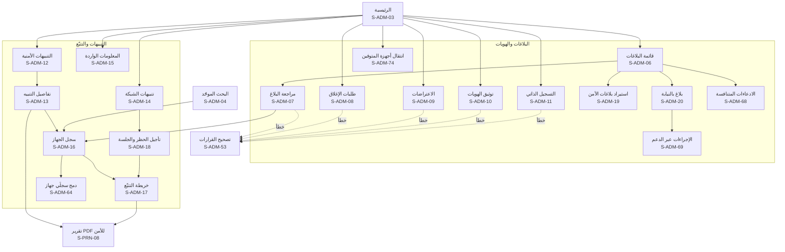

**خريطة التنقّل (2): المحلات والدعم والتجاري**

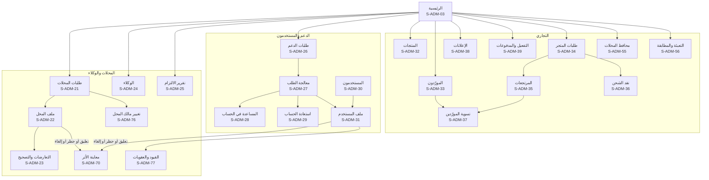

**خريطة التنقّل (3): النظام (المدير العام)**

```mermaid
flowchart TD
    S_ADM_01["الدخول<br/>S-ADM-01"]
    S_ADM_65["نسيت كلمة المرور<br/>S-ADM-65"]
    S_ADM_02["التحقق الثنائي<br/>S-ADM-02"]
    S_ADM_03["الرئيسية<br/>S-ADM-03"]
    S_ADM_05["حسابي<br/>S-ADM-05"]
    subgraph PEOPLE ["الحسابات والصلاحيات"]
        S_ADM_42["حسابات الإدارة<br/>S-ADM-42"]
        S_ADM_43["الأدوار والصلاحيات<br/>S-ADM-43"]
        S_ADM_54["جهات الأمن<br/>S-ADM-54"]
    end
    subgraph CONF ["الإعدادات والتشغيل"]
        S_ADM_44["الإعدادات<br/>S-ADM-44"]
        S_ADM_45["مفاتيح الميزات<br/>S-ADM-45"]
        S_ADM_46["التجريب والإطلاق<br/>S-ADM-46"]
        S_ADM_47["المحتوى والقوالب<br/>S-ADM-47"]
        S_ADM_48["الهوية البصرية<br/>S-ADM-48"]
        S_ADM_50["وضع الصيانة<br/>S-ADM-50"]
        S_ADM_51["الإصدارات<br/>S-ADM-51"]
        S_ADM_40["الباقات وميزاتها<br/>S-ADM-40"]
        S_ADM_41["عملاء الربط<br/>S-ADM-41"]
    end
    subgraph OBS ["المراقبة"]
        S_ADM_49["صحة النظام<br/>S-ADM-49"]
        S_ADM_52["سجل التدقيق<br/>S-ADM-52"]
        S_ADM_53["تصحيح القرارات<br/>S-ADM-53"]
        S_ADM_58["الحجز القانوني<br/>S-ADM-58"]
        S_ADM_63["تقرير المؤشرات<br/>S-ADM-63"]
    end
    S_ADM_01 --> S_ADM_02 --> S_ADM_03 --> S_ADM_05
    S_ADM_01 --> S_ADM_65 -. "يوافق المدير العام" .-> S_ADM_42
    S_ADM_03 --> S_ADM_42 & S_ADM_43 & S_ADM_54
    S_ADM_03 --> S_ADM_44 & S_ADM_45 & S_ADM_46 & S_ADM_47 & S_ADM_48 & S_ADM_50 & S_ADM_51
    S_ADM_03 --> S_ADM_40 & S_ADM_41
    S_ADM_03 --> S_ADM_49 & S_ADM_52 & S_ADM_53 & S_ADM_58 & S_ADM_63
```

**خريطة التنقّل (4): الحوكمة والوقت والأمان**

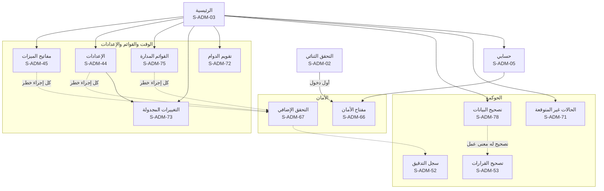

**القائمة الجانبية حسب الدور الافتراضي:**

| القسم | البنود | عام | بلاغات | محلات | دعم | تجاري |
|---|---|---|---|---|---|---|
| العمل اليومي | الرئيسية (S-ADM-03) | ✅ | ✅ | ✅ | ✅ | ✅ |
| | التنبيهات العاجلة، والبلاغات، وتوثيق الهوية، والتسجيل الذاتي، والمعلومات الواردة، والتتبّع (S-ADM-06 إلى S-ADM-19) | ✅ | ✅ | ❌ | ❌ | ❌ |
| | بلاغ بالنيابة (S-ADM-20) | ✅ | ❌ | ❌ | 🔒 | ❌ |
| | المحلات والوكلاء والالتزام (S-ADM-21 إلى S-ADM-25) | ✅ | ❌ | ✅ | ❌ | ❌ |
| | طلبات الدعم والمساعدة والاستعادة (S-ADM-26 إلى S-ADM-29)، والإجراءات عبر الدعم (S-ADM-69) | ✅ | ❌ | ❌ | 🔒 | ❌ |
| | الادعاءات المتنافسة (S-ADM-68)، وانتقال أجهزة المتوفين (S-ADM-74) | ✅ | ✅ | ❌ | ❌ | ❌ |
| | تغيير مالك المحل (S-ADM-76) | ✅ | ❌ | ✅ | ❌ | ❌ |
| | القيود والعقوبات (S-ADM-77) ومعاينة الأثر (S-ADM-70) | ✅ | ◐ قيود البلاغات | ◐ قيود المحلات | ❌ | ◐ قيود التجارة |
| | تصحيح القرارات (S-ADM-53) | ✅ | ✅ | ✅ | ❌ | ✅ |
| البحث والسجلات | البحث الموحّد (S-ADM-04) | ✅ | ✅ | ✅ | ◐ الحسابات والطلبات | ◐ التجاري |
| | سجل الجهاز (S-ADM-16) ودمج السجلين (S-ADM-64) | 🔒 | 🔒 | 🔒 | ❌ | ❌ |
| | المستخدمون (S-ADM-30، S-ADM-31) | ✅ | ◐ للتعليق بسبب بلاغ كيدي | ❌ | ◐ للقراءة في طلب | ❌ |
| | سجل التدقيق (S-ADM-52) | ✅ | ❌ | ❌ | ❌ | ❌ |
| الخصوصية | الحجز، والاحتفاظ، وطلبات أصحاب البيانات، والحوادث، والإفصاح (S-ADM-58 إلى S-ADM-62)، ومعها دور «مسؤول حماية البيانات» الديناميكي الاختياري (SMART-03) | ✅ | ❌ | ❌ | ◐ استقبال الطلبات | ❌ |
| | التقرير الشهري للمؤشرات (S-ADM-63) | ✅ | ❌ | ❌ | ❌ | ❌ |
| التجاري والنظام | الخدمات التجارية والمحافظ والتعبئة (S-ADM-32 إلى S-ADM-41، وS-ADM-55، وS-ADM-56) | ✅ | ❌ | ❌ | ❌ | ✅ (والموافقة على التسوية والاسترداد للمدير العام) |
| | الإعدادات والمفاتيح والتجريب والمحتوى والهوية والصيانة والإصدارات (S-ADM-44 إلى S-ADM-51) | ✅ | ❌ | ❌ | ❌ | ❌ |
| | حسابات الإدارة والأدوار وجهات الأمن (S-ADM-42، S-ADM-43، S-ADM-54) | ✅ | ❌ | ❌ | ❌ | ❌ |
| | تقويم الدوام، والتغييرات المجدولة، والقوائم المدارة، والحالات غير المتوقعة، وتصحيح البيانات (S-ADM-71 إلى S-ADM-73، S-ADM-75، S-ADM-78) | ✅ | ❌ | ❌ | ❌ | ❌ |
| الحساب | حسابي ومفتاح الأمان والتحقق الإضافي (S-ADM-05، S-ADM-66، S-ADM-67) | ✅ | ✅ | ✅ | ✅ | ✅ |

## 16. بوابة قوى الأمن (S-POL)

موقع مستقل على نطاق منفصل، بقائمة جانبية داكنة في الثيمين، و**نطاق العنصر ظاهر دائماً** في الشريط العلوي (15 §9.1). البحث برقم IMEI في كل المحافظات، وما عداه ضمن نطاق جهة العنصر، والإدارة المركزية لكل المحافظات (D-80، PP-03). كل عرض وبحث وقرار يُسجَّل (PP-13). **لا إعلانات ولا عروض تجارية إطلاقاً** (D-83). ودخول كل العناصر بمفتاح المرور على الجهاز المعتمد أو مفتاح الأمان (D-125، S-POL-26)، وكل قرار بسبب وتحقق إضافي (القسم 2.1). والتنبيهات تصل لحظياً في كل الأوقات (D-85)، مع تنبيه صوتي قابل للكتم وشريط «إعادة الاتصال» عند انقطاع التحديث اللحظي، وإشعارات المتصفح من التبويب المفتوح فقط دون خدمة إشعارات خارجية.

| المعرّف | الشاشة | من يراها | المنصات | الغرض | المتطلبات | العناصر والإجراءات | الحالات الخاصة |
|---|---|---|---|---|---|---|---|
| S-POL-01 | دخول البوابة | مسؤول أمن، وعنصر أمن | بوابة | الدخول بحساب شخصي | PP-02، AUTH-16 | اسم الدخول وكلمة المرور | شبكة غير مسموحة ⚙️؛ قفل مؤقت؛ حساب موقوف؛ لا يُقبل عامل أضعف من مفتاح الأمان |
| S-POL-02 | التحقق الثنائي | مسؤول أمن، وعنصر أمن | بوابة | العامل الثاني الإلزامي | PP-02، AUTH-16 | مفتاح المرور على الجهاز المعتمد أو مفتاح الأمان (إلزامي لكل عناصر البوابة لأنهم يبحثون بالرقم الوطني ويتتبّعون)، وتسجيله عند أول دخول (S-POL-26) | — |
| S-POL-03 | الرئيسية والتنبيهات اللحظية | مسؤول أمن، وعنصر أمن | بوابة | ما يحدث الآن في النطاق | PP-03، PP-05، SERIAL-05، PP-17، PP-18 | قائمة لحظية بالتنبيهات الأمنية (ومنها الأجهزة دون شريحة) وتنبيهات الشبكة في النطاق (النوع، والجهاز، والمكان، والوقت، والحالة)، والعدد غير المقروء، والتنبيه الصوتي، وجلسات التتبّع النشطة. وبطاقة «قرارات بانتظار الجهة» (S-POL-24)، و«المضبوطات بانتظار الاستلام» (S-POL-25)، وشارة «سُحب البلاغ» على التنبيهات المفتوحة لبلاغ لم يعد نافذاً | فارغة؛ إعادة الاتصال؛ انقطع التحديث اللحظي: لافتة «قد تتأخر التنبيهات، اعتمدوا القنوات المتفق عليها» ثم «عادت»؛ كل بطاقة تُحمَّل وحدها |
| S-POL-04 | تفاصيل التنبيه | مسؤول أمن، وعنصر أمن | بوابة | التحقيق في تنبيه | PP-05، PP-06، ADMIN-08، PP-17، TELCO-16 | الجهاز، والبلاغ، والمحل على الخريطة وعنوانه وهاتفه، والموظف المنفّذ، وموقع العملية، ورقم الشريحة وشركتها لتنبيه الشبكة، وسجل الجهاز، وما فعلته الإدارة، و«فتح الخريطة»، و«طلب الحظر أو تأجيله»، و«تقرير PDF» | خارج النطاق: لا يظهر؛ البلاغ لم يعد نافذاً: «سُحب البلاغ» لحظياً؛ شريحة المبلّغ نفسه في الجهاز: وسم «غالباً المالك» |
| S-POL-05 | البحث برقم IMEI | مسؤول أمن، وعنصر أمن | بوابة | حالة أي جهاز في كل المحافظات | PP-07، PP-03 | خانة البحث في الشريط العلوي، والنتيجة: الحالة، والبلاغات، وأصل التسجيل، ومحافظة الارتباط، ثم ملف الجهاز (S-POL-07) بالتفاصيل التي يسمح بها النطاق. وخارج النطاق ملخص فقط (الحالة، والموديل، ومحافظة البلاغ) دون أي بيانات أشخاص | لا نتائج: «لا سجل لهذا الرقم» وزر «تسجيل جهاز مضبوط» (S-POL-13) بالرقم معبّأ |
| S-POL-06 | البحث بالرقم الوطني | مسؤول أمن، وعنصر أمن | بوابة | أجهزة شخص ومعاملاته ضمن النطاق | PP-07، PP-03 | الرقم الوطني، و**رقم القضية** بالصيغة المعتمدة ⚙️، والسبب (إلزاميان)، والنتائج ضمن النطاق فقط | صيغة رقم القضية خاطئة؛ خارج النطاق: «لا نتائج ضمن نطاقك» |
| S-POL-07 | ملف الجهاز | مسؤول أمن، وعنصر أمن | بوابة | التحقيق في جهاز | PP-06، PP-09، PP-19، SUCCESSION-09، CHECK-18 | سجل الجهاز، والبلاغات، ومعاملات المحلات، وأوامر الصيانة، وأحداث الشبكة، و«خريطة التتبّع»، و«تسجيل كجهاز مضبوط». وأوسمة «ادعاءات متعددة»، و«مالكه متوفى»، و«قد يكون منسوخاً» | تفاصيل خارج النطاق مخفية مع جملة توضّح ذلك |
| S-POL-08 | خريطة التتبّع | مسؤول أمن، وعنصر أمن | بوابة | مواقع الجهاز لحظياً | PP-06، TRACK-08، TRACK-01، TRACK-02 | كما في S-ADM-17، وسبب الفتح إلزامي. وعلامات الخريطة بالشكل والأيقونة (15 §16) | — |
| S-POL-09 | جلسات التتبّع والحظر | مسؤول أمن، وعنصر أمن | بوابة | التحكم بالحظر والتتبّع | PP-06، TELCO-06، TRACK-05 | الجلسات النشطة بعدّاداتها، و«طلب الحظر»، و«تأجيل الحظر وفتح جلسة» برقم القضية والسبب والمدة ⚙️ 72 ساعة، و«تمديد»، و«إيقاف» | — |
| S-POL-10 | البلاغات في النطاق | مسؤول أمن، وعنصر أمن | بوابة | بلاغات المحافظة | PP-03، PP-08، REPORT-24 | تبويبات: بلاغات مواطنين قيد المراجعة، ونافذة، وطلبات إغلاق، وبلاغات رسمية، مع البحث | فارغة؛ حادثة «خارج سوريا»: تظهر للإدارة المركزية وحدها |
| S-POL-11 | تفاصيل البلاغ والقرار | مسؤول أمن، وعنصر أمن | بوابة | قبول بلاغ أو إغلاقه ضمن النطاق | PP-08، POLICE-05، REPORT-18، PP-19 | تفاصيل البلاغ وأدلته وموثوقيته (وبلاغ سرقة المحل بقائمة أجهزته وحالة كل منها)، و«قبول» لبلاغ قيد المراجعة، و«إغلاق» لبلاغ نافذ، مع السبب الإلزامي. والقرار يُسجَّل باسم العنصر ويُبلَّغ صاحب البلاغ | خارج النطاق: للعرض دون قرار؛ ادعاءات متعددة: لا يُغلق البلاغ بالإرجاع قبل حسمها |
| S-POL-12 | إضافة بلاغ رسمي | مسؤول أمن، وعنصر أمن | بوابة | بلاغ نافذ فوراً | PP-04، POLICE-06 | رقم الضبط، وIMEI (والثاني)، والموديل، وتاريخ الحادثة، والمحافظة، والرقم الوطني لصاحب الجهاز (اختياري)، والإقرار | الجهاز مسجّل باسم شخص آخر: «سيُنشأ تعارض» مع المتابعة؛ على الجهاز بلاغ مواطن: **يُربط ولا يُرفض**؛ قيد المراجعة يُقبل كقرار من الجهة إن كان في النطاق، والنافذ يُرفق به المرجع، ويُبلَّغ المبلّغ |
| S-POL-13 | تسجيل جهاز مضبوط | مسؤول أمن، وعنصر أمن | بوابة | إبلاغ صاحب الجهاز بمكانه | PP-10، PP-15، REPAIR-11 | يفتحه بند «تسجيل جهاز مضبوط» في القائمة الجانبية، وS-POL-05 عند «لا نتائج»، وS-POL-07. IMEI، والنتيجة (مبلّغ عنه، أو مسجّل لشخص، أو غير معروف)، والقسم الحافظ، و«تسجيل»، فيصل لصاحبه «جهازك موجود لدى [القسم]». و**الغرض** إلزامياً إن كان للجهاز مالك مسجّل: «إرجاع لصاحبه» (الافتراضي للمبلّغ عنه)، أو «حفظ كدليل» (صامت لا يُشعر أحداً، وإلزامي إن ضُبط من مالكه المسجّل)، أو «وديعة غير مُطالب بها»، وخيار «أبلغ المالك» (افتراضي للإرجاع، ومعطّل للدليل)، ورقم القضية | غير معروف: يُحفظ دون إشعار؛ جهاز عليه أمر صيانة مفتوح: يُغلق الأمر «سُلّم للجهات المختصة» مرتبطاً بالضبط وتُلغى تذكيرات الزبون، ولا رسالة له إن كان الغرض «حفظ كدليل»، وإلا فرسالة محايدة؛ جهاز من مخزون مجمّد لمحل ملغى: يُسجَّل من S-POL-24 |
| S-POL-14 | تسليم الجهاز المضبوط | مسؤول أمن، وعنصر أمن | بوابة | إرجاع الجهاز وإغلاق البلاغ | PP-10، TELCO-07، PP-16 | المستلم (صاحب الجهاز بعد التحقق من هويته)، و«تسجيل التسليم» فيُغلق البلاغ ويُطلب فك الحظر. والمستلم هو المالك المسجّل بعد التحقق من هويته، والإرجاع يغلق البلاغ ويقترح إغلاق القضية (S-POL-23) | ادعاءات متعددة: لا إرجاع قبل حسمها؛ التسليم لغير المالك المسجّل: من S-POL-25 إفراجاً بقرار جهة مختصة |
| S-POL-15 | فحص المضبوطات بالجملة | مسؤول أمن، وعنصر أمن | بوابة | فحص عدد كبير من الأجهزة | PP-11 | رفع ملف الأرقام، والنتيجة لكل رقم، و«تنزيل النتائج» (S-PRN-12). وقالب الملف: `imei` أو `manufacturer,serial`، حتى ⚙️ 1,000 سطر | ملف بصيغة خاطئة |
| S-POL-16 | المحلات في النطاق | مسؤول أمن، وعنصر أمن | بوابة | التحقيق في محل | PP-09 | البحث برقم المحل، ومعاملاته في النطاق، و«طلب تعليق» بسبب ينفّذه مشرف المحلات | — |
| S-POL-17 | التقارير | مسؤول أمن، وعنصر أمن | بوابة | تقرير PDF لأي جهاز أو بلاغ أو تنبيه | PP-12 | اختيار الموضوع، و«إنشاء التقرير» مع الخريطة (S-PRN-09)، والتقارير السابقة | — |
| S-POL-18 | عناصر الجهة | مسؤول أمن | بوابة | إدارة حسابات العناصر | PP-01، ADMIN-19، ADMIN-20 | العناصر (الاسم، والرتبة، والرقم الوظيفي، والحالة)، و«عنصر جديد» (يدخل كل عنصر بمفتاح مرور أو مفتاح أمان)، و«إيقاف»، وطلبات «نسيت كلمة المرور» من العناصر: التحقق من الهوية حضورياً أو بمكالمة فيديو، ثم الموافقة وإعادة ربط العامل الثاني. و«إعادة إسناد» عمل الجهة بين عناصرها، وسجل مفاتيح الأمان المسجّلة لكل عنصر في المراجعة الدورية (SOP-28)، والعنصر الجديد أو الجهة الجديدة أو مسؤول أمنها الجديد لا يبحث بالرقم الوطني قبل ⚙️ `police.new_officer.nid_delay` ويُبلَّغ الوزارة به، ومعاينة أثر إيقاف عنصر (عمله المفتوح يعود للجهة) | — |
| S-POL-19 | سجل نشاط العناصر | مسؤول أمن | بوابة | الرقابة على عناصر الجهة | PP-13 | كل عرض وبحث وقرار لعناصر الجهة، مع التصفية | — |
| S-POL-20 | حسابي في البوابة | مسؤول أمن، وعنصر أمن | بوابة | أمان الحساب | PP-02 | كلمة المرور، والعامل الثاني، والجلسات | — |
| S-POL-21 | طلب حجز البيانات | مسؤول أمن، وعنصر أمن | بوابة | منع حذف بيانات تحتاجها قضية | PP-14، PRIV-05، DATAACCESS-02 | الجهاز أو الشخص (ضمن النطاق)، ورقم القضية بالصيغة ⚙️، والسبب، والمدة، و«تمديد تأخير الظهور في «من اطّلع على بياناتي»» بسبب، وحالة الطلب. والطلب مرتبط بقضية (S-POL-23) ويراجعه واضعه كل ⚙️ 180 يوماً | خارج النطاق: لا يُقبل |
| S-POL-22 | نسيت كلمة المرور (البوابة) | عنصر أمن، ومسؤول أمن | بوابة | استعادة الدخول دون رسائل | ADMIN-19، PP-02 | اسم الدخول، و«اطلب إعادة التعيين»، وجملة «تواصل مع مسؤول الأمن في جهتك للتحقق من هويتك حضورياً أو بمكالمة فيديو» (ولمسؤول الأمن: إدارة المنصة). وبعد الموافقة: كلمة مرور جديدة وإعادة ربط العامل الثاني. **لا رسالة ولا واتساب** | حساب غير موجود: الرد نفسه دون كشف |
| S-POL-23 | قضايا الجهة | مسؤول أمن، وعنصر أمن | بوابة | متابعة قضايا الجهة وإغلاقها | PP-14، DATAACCESS-02، PP-16 | القضايا بأرقامها بالصيغة المعتمدة ⚙️، وما يرتبط بكل قضية (المضبوطات، والبلاغات، والاستعلامات بالرقم الوطني، وحجوزات البيانات، وتمديد تأخير الظهور)، و«إغلاق القضية» بسبب، فيُحسب منه ظهور الاطلاع لصاحب البيانات ويُرفع الحجز المرتبط بها | البوابة تقترح الإغلاق عند إرجاع مضبوط؛ قضية خارج النطاق: لا تظهر |
| S-POL-24 | قرارات بانتظار الجهة | مسؤول أمن، وعنصر أمن (ضمن النطاق) | بوابة | قرارات تخص الجهة المختصة وحدها | PP-18، TELCO-15، TENANT-05، PP-20، TENANT-15 | تبويبان: **«معرّف قد يكون منسوخاً»**: بلاغ مقبول على معرّف يُستخدم في أجهزة كثيرة في الوقت نفسه، مع عدد الشرائح والمدة، و«طلب المراقبة والحظر» أو «عدم الطلب» بسبب مسجّل (D-120). و**«مخزون محل أُلغي لاحتيال»**: قضية واحدة لكل محل بأجهزتها المجمّدة، وقرار لكل جهاز أو لدفعة: «ضُبط» (يدخل عهدة الجهة بغرض تختاره، كما في S-POL-13) أو «أُفرج عنه» (يُسلَّم لصاحب المحل شخصياً ولو بعد إغلاق المحل، أو للخلف الموثّق إن توفي)، بسبب ورقم قضية (D-108). وحالة القضية (مفتوحة حتى يُقرَّر في كل أجهزتها) | خارج النطاق: لا يظهر؛ قبل القرار: البلاغ نافذ داخل المنصة دون أي طلب للشبكات؛ قضية تجميد لم يُقرَّر فيها: تذكير لمسؤول أمن الجهة كل ⚙️ 7 أيام، وبعد ⚙️ 30 يوماً تصل مشرف المحلات للمتابعة |
| S-POL-25 | المضبوطات بانتظار الاستلام | مسؤول أمن، وعنصر أمن | بوابة | متابعة المضبوطات حتى الإرجاع أو الإفراج | PP-16، PP-15 | المضبوطات بغرضها وحالتها (محتجز، أو أُبلغ مالكه، أو لم يُستلم بعد ⚙️ 90 يوماً)، والتذكيرات المرسلة للمالك (⚙️ 7 و30 يوماً)، و«تغيير الغرض» (إلى «إرجاع لصاحبه» يرسل الإشعار)، و«إفراج بقرار جهة مختصة» بسبب (قرار قضائي، أو سُلّم لطرف آخر، أو أُتلف بقرار، أو غير مُطالب به حسب القانون) ورقم القضية، و«نقل لقسم آخر» عند تعطيل قسم | الإفراج لغير المالك المسجّل: يُغلق البلاغ بسبب «أُفرج عنه بقرار جهة رسمية» ولا تتغير الملكية؛ ادعاءات متعددة: لا إرجاع قبل حسمها |
| S-POL-26 | مفتاح الأمان والتحقق الإضافي | مسؤول أمن، وعنصر أمن | بوابة | الدخول المقاوم للتصيد لكل عناصر البوابة (D-125) | AUTH-16، PP-02 | تسجيل مفتاح المرور على الجهاز المعتمد أو مفتاح الأمان عند أول دخول، والمفاتيح المسجّلة و«إزالة» مع إبقاء واحد، ونافذة التحقق الإضافي قبل البحث بالرقم الوطني، وفتح التتبّع، وطلب الحظر، وتسليم المضبوط والإفراج عنه | لا مفتاح مسجّل: لا دخول قبل تسجيله بإشراف مسؤول الأمن في الجهة؛ فقد المفاتيح: S-POL-22؛ تحقق أقدم من ⚙️ 15 دقيقة: يُطلب من جديد قبل الإجراء |

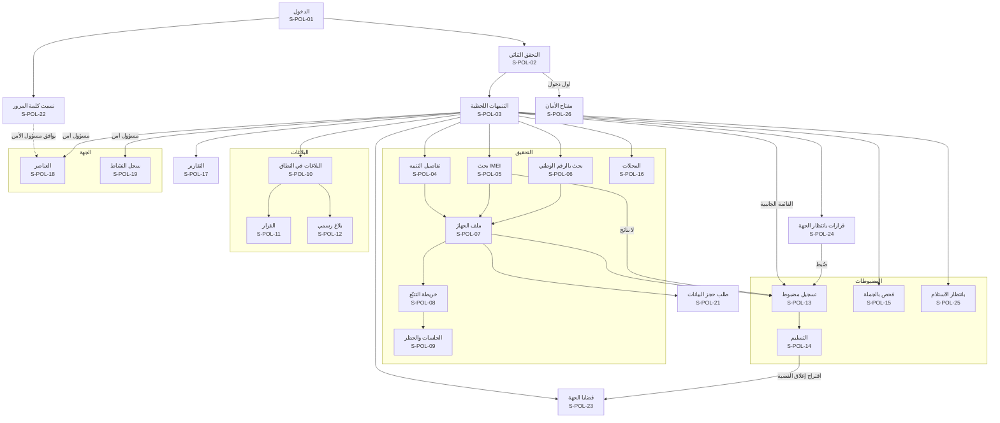

## 17. بوت واتساب (S-BOT)

ثلاثة أرقام بثلاثة أدوار، ومعرّفات الحالات هي نفسها في [كتالوج المحتوى §4](24-content-catalog.md) حيث نصوصها الحرفية: **رقم الفحص** (`S-BOT-01` إلى `S-BOT-21`، للفحص فقط، WABOT-07)، و**رقم الدعم** (`S-BOT-30` إلى `S-BOT-41`، SUPPORT-03)، و**الرقم التجاري** (`S-BOT-50` إلى `S-BOT-56`، يتابعه المشرف التجاري بشرياً، D-86، ومنه تُرسل رسائل المحلات لزبائنها). والأرقام بين المجموعات محجوزة. ولا إعلان في أي رد (ADS-02)، ولا يؤكد أي بوت وجود حساب ولا ينفيه، ولا ينفّذ أي إجراء حساس.

| المعرّف | الحالة | من يراها | المنصات | الغرض | المتطلبات | المحتوى والأزرار | الحالات الخاصة |
|---|---|---|---|---|---|---|---|
| S-BOT-01 | الترحيب والقائمة | أي مرسل لرقم الفحص | واتساب | البدء | WABOT-01، WABOT-07 | الترحيب، وقائمة: فحص موبايل، وفحص حاسوب أو تابلت (عند تفعيل SERIAL)، وكيف أعرف رقم IMEI؟، وبلاغ أو حساب، والدعم الفني | أي رسالة فيها IMEI صالح تبدأ الفحص من أي حالة |
| S-BOT-02 | بانتظار IMEI | المرسل | واتساب | استقبال الرقم أو الرقمين | WABOT-01، FAKE-02 | «أرسل رقم IMEI المكوّن من 15 خانة»، ويُقبل الرقمان معاً للتحقق من تطابقهما | — |
| S-BOT-03 | رقم غير صالح | المرسل | واتساب | تصحيح الإدخال حسب السبب | WABOT-02، CHECK-03 | رسالة حسب السبب (أقصر، أو أطول، أو IMEISV، أو خانة التحقق، أو أحرف، أو أكثر من رقمين)، وزر «كيف أعرف رقم IMEI؟» | — |
| S-BOT-04 | طلب الموقع وتذكير واحد | المرسل برقم صالح | واتساب | الحافز قبل النتيجة | WABOT-03، GEO-02 | طلب موقع تفاعلي مع الإيصال وحدود استخدام الموقع، و«اختيار المحافظة»، وتذكير واحد عند أول رفض | — |
| S-BOT-05 | اختيار المحافظة | من رفض بعد التذكير | واتساب | إكمال الفحص دون موقع | WABOT-03، GEO-01 | قائمة المحافظات على صفحتين، ويُقبل الاسم أو رقمه من 1 إلى 14 | — |
| S-BOT-06 | النتيجة | المرسل | واتساب | النتيجة بصيغتها لكل حالة | WABOT-01، WABOT-04، CHECK-09، CHECK-10، TIP-01، TIP-02، TIP-04، TIP-06، GSMA-01، GSMA-05، CUSTOMS-02، FAKE-01، CHECK-18، TIP-07 | لا بلاغات، أو مبلّغ عنه مسروقاً أو مفقوداً مع «لا تشترِ هذا الجهاز» والمكافأة ورابط «عندك معلومات؟» أو «وجدت هذا الجهاز؟»، والمؤشرات الإضافية، و«فحص رقم آخر». و«قد يكون منسوخاً» بجانب الحالة، و«وجدت هذا الجهاز؟» مع «لا توجد بلاغات» | «جارٍ الفحص…» بعد ⚙️ 3 ثوانٍ؛ «تعذّر التحقق الدولي حالياً» بعد ⚙️ ثانيتين |
| S-BOT-07 | موقع غير صالح | المرسل | واتساب | قبول موقع مختار أو بعيد | WABOT-03 | يُقبل ويُعلَّم مصدره «واتساب» في سجل الفحص دون رد خاص | — |
| S-BOT-08 | الإيصال | من شارك موقعه | واتساب | إيصال الفحص | CHECK-16 | رابط الإيصال وجملة «لا يُعد إثباتاً للملكية» | — |
| S-BOT-09 | كيف أعرف رقم IMEI؟ | المرسل | واتساب | المساعدة | WABOT-02 | `*#06#` والكرتونة والإعدادات، و«اطلب الرقم من الجهاز نفسه» | — |
| S-BOT-10 | بلاغ أو حساب | المرسل | واتساب | التوجيه للموقع والتطبيق | WABOT-07 | «البوت للفحص فقط»، ورابط الموقع، ورابط رقم الدعم لمن سُرق موبايله | — |
| S-BOT-11 | الشركة المصنّعة | من اختار فحص حاسوب أو تابلت | واتساب | بدء فحص الرقم التسلسلي | SERIAL-02، SERIAL-07 | قائمة بأكثر ⚙️ 9 شركات استخداماً و«شركة أخرى» | الوحدة مطفأة: الخيار لا يظهر |
| S-BOT-12 | الرقم التسلسلي | من اختار الشركة | واتساب | استقبال الرقم التسلسلي | SERIAL-02، SERIAL-01 | إرشاد مكان الرقم، ثم S-BOT-04 والنتيجة دون مؤشرات الشبكة | صيغة لا تطابق الشركة |
| S-BOT-13 | تجاوز الحد | المرسل | واتساب | الحماية من الإساءة | WABOT-06 | الحد ⚙️ 20 في الساعة ووقت المحاولة التالية ورابط الموقع | — |
| S-BOT-14 | رسالة غير مفهومة | المرسل | واتساب | إعادة التوجيه | WABOT-01 | «أرسل رقم IMEI أو اكتب «قائمة»»، والقائمة في المرة الثانية | — |
| S-BOT-15 | وسائط غير مدعومة | المرسل | واتساب | رفض الصور والصوت والملفات | WABOT-01 | «اكتب رقم IMEI بالأرقام» | — |
| S-BOT-16 | رمز تحقق مرسَل بالخطأ | المرسل | واتساب | حماية المستخدم | SUPPORT-05 | «لا ترسل رمز التحقق أو كلمة المرور لأحد، حتى لنا» | — |
| S-BOT-17 | لغة أخرى | المرسل | واتساب | العربية فقط | WABOT-01 | «الخدمة بالعربية فقط» (D-22) | — |
| S-BOT-18 | رد على إشعار | من رد على قالب مرسل | واتساب | التعامل مع الأزرار والردود | NOTIF-05، OWN-13، SUPPORT-03، NOTIF-08، OWN-23 | «لم أطلب ذلك» يفتح طلب دعم عاجلاً، و«الجهاز معي» يؤكد رفض التسجيل، وأي رد آخر: «هذا الرقم لا يستقبل ردوداً». و«لا أعرف هذا الشخص — أوقف» في كل رسالة أطلقها شخص لرقم غيره، فيُمنع المرسل عن الرقم ⚙️ 180 يوماً. و«الجهاز معي» لتنبيه محاولة التسجيل يُسجَّل، ولا يتكرر التنبيه قبل ⚙️ 7 أيام | — |
| S-BOT-19 | طلب إيقاف الرسائل | المرسل | واتساب | «إيقاف» أو «STOP» | NOTIF-01، PRIV-03 | «رقم المنصة لا يرسل عروضاً»، وإعدادات القنوات في الحساب | — |
| S-BOT-20 | الخدمة متوقفة | المرسل | واتساب | البوت مطفأ أو في صيانة | SMART-04، SMART-11 | «الفحص عبر واتساب متوقف مؤقتاً» ورابط الموقع | هي الرد الوحيد على رسائل الفحص يوم الإطلاق حتى يُفتح البوت (القسم 22) |
| S-BOT-21 | الدعم الفني | المرسل | واتساب | التوجيه لرقم الدعم | SUPPORT-03، SUPPORT-05 | رابط رقم الدعم الرسمي وتحذير الدعم | — |
| S-BOT-30 | الدعم: الترحيب والموضوع | مرسل لرقم الدعم | واتساب | فتح طلب لمن لا يستطيع الدخول | SUPPORT-03، SUPPORT-05 | التحذير، وقائمة المواضيع (لا أستطيع الدخول، وسُرق موبايلي الآن، وتغيّر رقمي، ومشكلة في بلاغ أو محل، والدفع والخدمات، وأخرى) | — |
| S-BOT-31 | الدعم: سرقة الآن | من اختار «سُرق موبايلي الآن» | واتساب | الإرشاد العاجل | SUPPORT-03، THEFT-05 | الإرشادات الفورية، ووسم الطلب «عاجل» | — |
| S-BOT-32 | الدعم: رقم الحساب | المرسل | واتساب | ربط الطلب بالحساب إن عُرف | SUPPORT-03 | «اكتب رقم حسابك SY- أو اختر «لا أعرفه»» دون تأكيد وجود الحساب أو نفيه | صيغة خاطئة |
| S-BOT-33 | الدعم: الوصف | المرسل | واتساب | وصف المشكلة | SUPPORT-03، SUPPORT-05 | رسالة واحدة دون كلمة مرور ولا رمز ولا رقم وطني ولا صورة هوية | — |
| S-BOT-34 | الدعم: فتح الطلب | المرسل | واتساب | تأكيد الطلب | SUPPORT-01، SUPPORT-03 | رقم `ST-`، ونص خارج الدوام، ولـ«لا أستطيع الدخول»: الاستعادة بالهوية فقط مع رابط S-AUT-09 | — |
| S-BOT-35 | الدعم: رسائل لاحقة | صاحب طلب مفتوح | واتساب | ضم الرسائل للطلب | SUPPORT-02 | «أضفنا رسالتك إلى طلبك» مرة واحدة كل ⚙️ 5 دقائق | — |
| S-BOT-36 | الدعم: طلب مفتوح سابق | صاحب طلب مفتوح | واتساب | متابعة الطلب | SUPPORT-02 | رقم الطلب وحالته، و«طلب جديد» | — |
| S-BOT-37 | الدعم: طلب مغلق | صاحب طلب مغلق | واتساب | طلب جديد مرتبط | SUPPORT-06 | فتح طلب جديد مرتبط بالسابق | — |
| S-BOT-38 | الدعم: التقييم | صاحب طلب أُغلق | واتساب | تقييم الخدمة | SUPPORT-06 | قائمة من 1 إلى 5 | — |
| S-BOT-39 | الدعم: حد الطلبات | المرسل | واتساب | منع الإغراق | SUPPORT-03 | أكثر من ⚙️ 3 طلبات في اليوم: الكتابة في الطلب الحالي | — |
| S-BOT-40 | الدعم: بيانات حساسة مرسلة | المرسل | واتساب | حماية المستخدم | SUPPORT-05 | «أخفيناها من طلبك»، وتُخفى آلياً | — |
| S-BOT-41 | الدعم: رد أثناء عطل | أي مرسل لرقم الدعم أثناء عطل معلن | واتساب | منع تكرار الرسائل أثناء العطل | SUPPORT-03، SMART-11 | «نواجه عطلاً مؤقتاً، وصلت رسالتك وسنرد بالترتيب، فلا داعي لإرسالها مرة أخرى» مع تحذير الدعم، مرة واحدة لكل رقم خلال العطل، وتُضم الرسالة للطلب | — |
| S-BOT-50 | الرقم التجاري: أول رسالة | مرسل للرقم التجاري أول مرة | واتساب | التعريف بالرقم وإشعار Meta الثابت | PAY-01 | إشعار Meta الثابت، ثم الترحيب وتعريف الرقم (المبيعات للخدمات الرقمية والباقات والمتجر)، وخارج الدوام S-BOT-55 | — |
| S-BOT-51 | الرقم التجاري: الرسالة الجاهزة | من ضغط «اطلب التفعيل» أو «اطلب الاشتراك» في الموقع | واتساب | بدء طلب شراء | PAY-01، STORE-04 | الرسالة الجاهزة برقم الحساب والخدمة ورقم الطلب `SV-`، والإقرار الآلي، ثم رد المشرف التجاري البشري بطريقة الدفع | من رقم قاصر: اعتذار (21 §10.2) |
| S-BOT-52 | الرقم التجاري: إيقاف العروض | المرسل | واتساب | سحب موافقة الرسائل التجارية | PRIV-03 | «أوقفنا رسائل العروض» | — |
| S-BOT-53 | إيقاف تذكيرات محل | زبون محل يتلقى تذكيرات دين أو قسط | واتساب | إيقاف تذكيرات محل بعينه | SHOPPRO-08 | زر «إيقاف تذكيرات المحل» في كل رسالة تذكير، ثم تأكيد الإيقاف لذلك المحل وحده | — |
| S-BOT-54 | الرقم التجاري: رد أثناء عطل | مرسل للرقم التجاري أثناء عطل معلن | واتساب | طمأنة من ينتظر تفعيلاً أو طلباً | PAY-01، SMART-11 | «نواجه عطلاً مؤقتاً يؤخر التفعيل والطلبات، وسنكمل طلبك فور الإصلاح. لا ترسل أي دفعة جديدة للطلب نفسه»، مرة واحدة لكل رقم | — |
| S-BOT-55 | الرقم التجاري: خارج الدوام | مرسل خارج ساعات الدوام | واتساب | إقرار الاستلام حسب تقويم الدوام | PAY-01، ADMIN-22 | «وصلت رسالتك خارج ساعات الدوام، وسنرد عليك مع بداية الدوام» وتحذير الدعم، والدوام من تقويم الدوام (D-123) | — |
| S-BOT-56 | رد على رسالة محل | زبون رد على رسالة أرسلها محل (تذكير، أو إيصال، أو فاتورة نقطة بيع) | واتساب | حماية بيانات محاسبة المحل (D-101) | SHOPPRO-14، SHOPPRO-08 | رد ثابت «هذه رسالة من محل «…»، تواصل مع المحل مباشرة»، والرد لا يظهر في أي صندوق للموظفين ويُحذف | — |

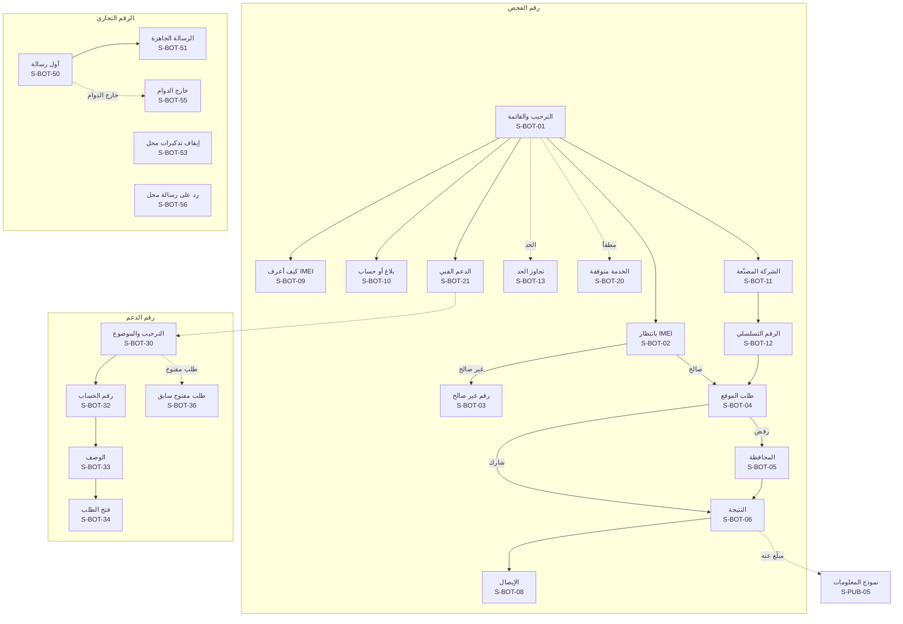

> الرقم 22 في منطقة بوت واتساب محجوز: صار «إيقاف تذكيرات محل» `S-BOT-53` على الرقم التجاري، لأن رسائل المحلات لزبائنها تُرسل منه ([كتالوج المحتوى](24-content-catalog.md) §4.3).

## 18. ردود الرسائل النصية (S-SMS)

ردود الرقم القصير لمن لا يملك إنترنت (D-64): نص قصير بالصيغ القانونية الثابتة، دون أي بيانات عن صاحب الجهاز (SMS-02)، ودون روابط إيصال لأن الموقع لا يُرسل بالرسالة. والنصوص قوالب `T-SMS-NN` في [كتالوج المحتوى](24-content-catalog.md).

| المعرّف | الرد | من يراه | المنصات | الغرض | المتطلبات | المحتوى | الحالات الخاصة |
|---|---|---|---|---|---|---|---|
| S-SMS-01 | لا بلاغات فعّالة | المرسل | SMS | نتيجة «لا توجد بلاغات فعّالة» | SMS-01، SMS-02، CHECK-09 | الصيغة الثابتة المختصرة مع الموديل | «تعذّر التحقق الدولي حالياً» بعد ⚙️ ثانيتين (GSMA-01) |
| S-SMS-02 | مبلّغ عنه: مسروق | المرسل | SMS | التحذير | SMS-01، SMS-02 | «مبلّغ عنه: مسروق، لا تشترِه» مع الموديل | — |
| S-SMS-03 | مبلّغ عنه: مفقود | المرسل | SMS | التحذير | SMS-01، SMS-02 | «مبلّغ عنه: مفقود، لا تشترِه» مع الموديل | — |
| S-SMS-04 | رقم غير صالح ومساعدة | المرسل | SMS | تصحيح الإدخال | SMS-01، CHECK-03 | «الرقم غير صالح. اطلب ‎*#06#‎ وأرسل الرقم المكوّن من 15 خانة» | أي نص غير مفهوم يأخذ الرد نفسه |
| S-SMS-05 | تجاوز الحد | المرسل | SMS | الحماية من الإساءة | SMS-04 | «وصلت للحد المسموح، حاول لاحقاً» | — |
| S-SMS-06 | الخدمة متوقفة مؤقتاً | المرسل | SMS | الرقم القصير مطفأ أو في صيانة | SMART-04، SMART-11 | «الفحص برسالة متوقف مؤقتاً» | — |
| S-SMS-07 | «وجدته» | من فحص جهازاً وأرسل «وجدته» خلال ⚙️ 24 ساعة | SMS | الإبلاغ عن العثور دون إنترنت | SMS-05، TIP-02، TIP-07 | «شكراً، وصلت معلومتك. ستتواصل معك الإدارة إن لزم دون كشف رقمك لصاحب الجهاز». للمفقود: تنسيق الإرجاع، ولغير المبلّغ عنه: معلومة «موجود» دون إخبار المرسل بشيء | بعد المهلة أو دون فحص: الرد كما في S-SMS-04 |

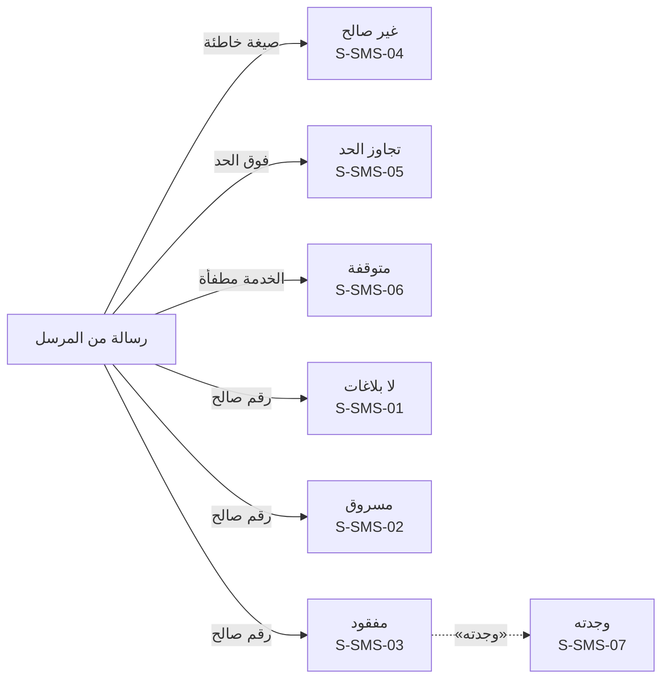

## 19. الوثائق المطبوعة وملفات PDF (S-PRN)

تُطبع وتُصدَّر **بالثيم الفاتح دائماً** (THEME-04)، وتُولَّد على الخادم من HTML، وتعرض العربية بالاتجاه ووصل الحروف الصحيحين (08 §5). ولا إعلان في أي وثيقة (ADS-02). وكل وثيقة قابلة للتحقق تحمل QR لصفحتها العامة.

| المعرّف | الوثيقة | من يراها | المنصات | الغرض | المتطلبات | المحتوى | الحالات الخاصة |
|---|---|---|---|---|---|---|---|
| S-PRN-01 | الفاتورة A4 | المشتري، والمحل | PDF، طباعة | إثبات البيع | SHOP-10، THEME-04، PAY-17 | الشعار، والمحل ورقمه وعنوانه، ورقم `TX-`، والتاريخ، والجهاز ومعرّفاته، واسم المشتري، والسعر إن أُدخل، والموظف، وQR، والتذييل الثابت «فاتورة موثّقة عبر المنصة. تحقّق من صحتها بمسح رمز QR.»، والمقابل بالوحدة القديمة بخط صغير خلال الفترة الانتقالية للعملة | ملغاة: علامة «ملغاة» واضحة |
| S-PRN-02 | الفاتورة الحرارية 58 و80 مم | المشتري، والمحل | طباعة | الطباعة السريعة في المحل | SHOP-10، SHOP-28 | المحتوى نفسه بتخطيط عمودي بعرض الطابعة المقترنة، وQR بحجم يُمسح | — |
| S-PRN-03 | شهادة الفحص | المالك، والمشتري المحتمل | PDF، صورة | المشاركة في الإعلان | OWN-09، OWN-10 | رقم `CR-`، والجهاز، وIMEI مخفياً جزئياً بصيغة [نموذج التهديد](20-threat-model.md) §2.2 في كل نسخة قابلة للمشاركة (ومنها «حفظ كصورة»)، وأصل التسجيل، وتاريخ الإصدار والانتهاء، وQR، وجملة «الحالة الحالية تظهر دائماً عند مسح الرمز» | — |
| S-PRN-04 | إيصال الفحص | الفاحص | PDF، صورة، طباعة | إثبات حسن النية | CHECK-16 | رقم `CR-`، وIMEI، والموديل، والنتيجة، والتاريخ والوقت، والمحافظة، وQR، والصيغة القانونية | — |
| S-PRN-05 | إيصال نقل الملكية أو الانتقال بالإرث | الطرفان | PDF | إثبات النقل | OWN-04، SUCCESSION-08 | رقم `CR-`، والتاريخ، والجهاز، والطرفان مخفيان جزئياً، وQR، ونوع الانتقال (نقل، أو إرث) | — |
| S-PRN-06 | إيصال استلام الصيانة | صاحب الجهاز، والمحل | PDF، طباعة حرارية | إثبات تسليم الجهاز للصيانة | REPAIR-02، SHOP-28 | رقم `CR-`، والمحل، والجهاز، والعطل، والتاريخ، وQR، وجملة «الاستلام لا ينقل الملكية» | — |
| S-PRN-07 | تقرير تاريخ الجهاز | المالك، أو من طلبه | PDF | لقطة ماضي الجهاز | HISTORY-01، HISTORY-02، HISTORY-04 | تاريخ اللقطة، وأصل التسجيل، وعدد انتقالات الملكية، وعدد المعاملات ومحافظاتها، وتواريخ الصيانة واستبدال اللوحة، والجمركة، والحالة الدولية والحالية، والبلاغات المغلقة، وQR. **دون أي بيانات شخصية** | — |
| S-PRN-08 | تقرير قوى الأمن من الإدارة | الجهة المحال إليها | PDF | الإحالة خارج البوابة | ADMIN-10، TRACK-07 | الجهاز والبلاغ والتنبيه، والمواقع، والخريطة وخط السير وجدول النقاط، وسجل الجهاز، والمرسل والتاريخ، وعلامة «سرّي» | — |
| S-PRN-09 | تقرير بوابة الأمن | العنصر | PDF | التقرير من البوابة | PP-12 | الموضوع (جهاز، أو بلاغ، أو تنبيه)، والتفاصيل ضمن النطاق، والخريطة، والعنصر والتاريخ | — |
| S-PRN-10 | تقرير التزام المحلات | وزارة الداخلية | PDF، Excel | التقرير الدوري | COMPLIANCE-02 | المحافظة والفترة، والمحلات الموثّقة، والمتأخرة، وذات التعارضات أو العمليات البعيدة، والتي حاولت شراء أجهزة مبلّغ عنها، والمعلّقة | — |
| S-PRN-11 | فاتورة طلب المتجر وإيصال الدفع | المحل، والمشتري | PDF | فاتورة المنصة للطلب، وإيصال كل دفعة | STORE-08، PAY-02، STORE-15، PAY-17 | المنصة جهةً بائعة، واسم المورّد، والأصناف، والمبلغ، وطريقة الدفع والرقم المرجعي، وسياسة الإرجاع والكفالة، والبيانات الضريبية، ودون أي أجر توصيل منفصل | — |
| S-PRN-12 | تقارير الأسطر المرفوضة ونتائج الفحص بالجملة | الوكيل، والمشرف، والعنصر | Excel، CSV | تصحيح الملفات ومتابعتها | IMPORTER-03، POLICE-01، PP-11 | كل سطر بسببه أو نتيجته | — |
| S-PRN-13 | كشف تسوية المورّد | المورّد، والإدارة | PDF | محاسبة المورّد | STORE-10 | الفترة، والطلبات المسلّمة والمدفوعة، وحصة المنصة، والمرتجعات والعيوب، والصافي، ورقم التحويل المرجعي، واسم المعدّ والموافق | — |
| S-PRN-14 | ملصق الطلب للشحن | المورّد، والمندوب | طباعة | تسليم الطلب للمندوب | STORE-05، STORE-09 | رقم الطلب برمز قابل للمسح، واسم المحل وعنوان التوصيل، والمبلغ المطلوب عند الاستلام. دون هاتف المحل ودون رمز التسليم | — |
| S-PRN-15 | إيصال التعبئة | المحل والزبون | طباعة حرارية، PDF | إثبات تعبئة الرصيد | TOPUP-03، SHOP-28 | الرقم المعبّأ مخفياً جزئياً، والشبكة، والقيمة، والحالة، والوقت، والرقم المرجعي، واسم المحل | فاشلة: «أُعيد المبلغ» |
| S-PRN-16 | كشف حساب المحفظة | صاحب المحل | PDF، Excel | تصدير حركة المحفظة | SHOPWALLET-06 | الفترة، والرصيد الافتتاحي والختامي، وكل عملية برقمها ونوعها ومنفّذها ووقتها | — |
| S-PRN-17 | فاتورة نقطة البيع | المحل والزبون | طباعة حرارية، PDF، واتساب | فاتورة بيع الإكسسوارات والقطع | SHOPPRO-03، SHOP-28 | اسم المحل، والأصناف والكميات والأسعار والخصم، وطريقة الدفع، والتاريخ، ورقم الفاتورة. **منفصلة عن فاتورة الجهاز** `TX-` ولا QR تحقق عليها | دون اتصال: تُطبع محلياً وتُزامَن |
| S-PRN-18 | ملصقات الباركود | المحل | طباعة | تعليم بضاعة المخزون | SHOPPRO-02 | باركود الصنف واسمه وسعره، بمقاسات ملصقات شائعة | — |
| S-PRN-19 | تقارير المحاسبة وكشوفها | صاحب المحل (والموظف كشفه إن سُمح) | PDF، Excel | الأرباح وكشوف الزبائن والموظفين | SHOPPRO-07، SHOPPRO-08، SHOPPRO-11 | تقارير الأرباح والمبيعات والمخزون والفروع، وكشف حساب الزبون وجدول تقسيطه، والكشف الشهري للموظف | — |
| S-PRN-20 | التقرير الشهري للمؤشرات | المدير العام والوزارة | PDF، Excel | مؤشرات التشغيل الشهرية | SMART-15 | الفترة، والفحوص، والبلاغات وزمن مراجعتها، والأجهزة المستردة، والتزام المحلات، وصحة التكاملات. أرقام مجمّعة دون أي بيانات شخصية ودون بيانات محاسبة المحلات | — |
| S-PRN-21 | ملصق إشعار الخصوصية | زبائن المحل | PDF A4، طباعة | إشعار الخصوصية المعلّق في المحل (D-110) | SHOP-29، THEME-04 | اسم المحل ورقمه `SH-` (والفرع)، وما تجمعه المنصة عند الشراء والبيع والصيانة ولماذا، وحقوق صاحب البيانات وطريق ممارستها، وQR لصفحة الخصوصية، والأسطر الخاصة بالوحدات المفعّلة فقط | يُعاد توليده عند تشغيل وحدة تضيف سطراً أو تغيّر اسم المحل |
| S-PRN-22 | مذكرة نقل الأجهزة | المرسل والمستلم | PDF | توثيق النقل بين المنشآت وتسليم مخزون الإغلاق والإرجاع للوكيل | SHOP-22، TENANT-05، IMPORTER-12 | رقم النقل، والمرسل والمستلم بأرقامهما، والنوع، وقائمة الأجهزة بأرقامها مخفية جزئياً، والمقبول والمرفوض، والتاريخ | — |

### 19.1 قوالب الطباعة

القواعد كلها في [الهوية البصرية](15-visual-identity.md) §14 (الرأس والتذييل و«صفحة X من Y»، والخط والثيم، والإخفاء، وQR، والملغاة، والحراري صورة نقطية بعرض الطابعة، والملصق، وExcel وCSV)، والمبالغ ومقابلها القديم في §15. وكل وثيقة هنا تتبع قالبها:

| القالب | الوثائق |
|---|---|
| A4 وPDF | S-PRN-01، S-PRN-03، S-PRN-04، S-PRN-05، S-PRN-07، S-PRN-08، S-PRN-09، S-PRN-10، S-PRN-11، S-PRN-13، S-PRN-16، S-PRN-19، S-PRN-20، S-PRN-21، S-PRN-22 |
| حراري 58 و80 مم | S-PRN-02، S-PRN-06، S-PRN-15، S-PRN-17 |
| Excel وCSV | S-PRN-10، S-PRN-12، S-PRN-16، S-PRN-19، S-PRN-20 |
| ملصقات | S-PRN-14، S-PRN-18 |

## 20. التنقّل في التطبيق الواحد حسب الدور (D-44)

### 20.1 الشريط السفلي لكل سياق

تطبيق واحد يتغيّر شريطه السفلي حسب السياق، والزر الأوسط هو الإجراء الأكثر تكراراً في كل سياق (15 §9.1)، **ويحمل نصاً ظاهراً** تحت أيقونته («مسح وفحص» للمواطن، و«عملية جديدة» للمحل والوكيل، أو اسم الإجراء الوحيد)، فلا يكون زراً بأيقونة وحدها (08 §7). الموقع يستخدم البنية نفسها في القائمة الجانبية للوحات وفي رأس الصفحة للمواطن.

| السياق | التبويب 1 | التبويب 2 | الزر الأوسط | التبويب 4 | التبويب 5 |
|---|---|---|---|---|---|
| زائر (دون دخول) | فحص (S-PUB-01) | احمِ جهازك (S-PUB-14) | — | — | دخول (S-AUT-05) |
| مواطن (ومعه المفوّض والجهة الموثوقة) | الرئيسية (S-USR-01) | أجهزتي (S-USR-02) | مسح وفحص (S-APP-08 ثم النتيجة) | بلاغاتي (S-USR-14) | حسابي (S-USR-31) |
| صاحب محل «بيع وشراء أجهزة» أو «حواسيب» (مع غيرهما أو وحدهما) | المحل (S-SHP-03) | المعاملات (S-SHP-14) | عملية جديدة: فحص، وشراء، وبيع، ومعها استلام صيانة وتعبئة رصيد وبيع إكسسوارات (نقطة البيع) حسب أنواع النشاط والباقة | الموظفون (S-SHP-16) | المزيد |
| موظف المحل | المحل (S-SHP-03) | المعاملات (كلها أو ما سجّله) | عملية جديدة: **المسموح له فقط** | المخزون (S-SHP-13) | المزيد |
| صاحب محل «صيانة» فقط | المحل (S-SHP-03) | الصيانة (S-RPR-04) | استلام صيانة (S-RPR-01) | الموظفون (S-SHP-16) | المزيد |
| صاحب محل «خدمات اتصالات وإكسسوارات» فقط | المحل (S-SHP-03) | التعبئات (S-SHP-40) | تعبئة رصيد (S-SHP-38) | الموظفون (S-SHP-16) | المزيد |
| مسؤول الوكيل | الوكيل (S-IMP-03) | المخزون (S-IMP-06) | رفع دفعة أو نقل لمحل | النقل (S-IMP-08) | المزيد |
| موظف الوكيل | الوكيل (S-IMP-03) | المخزون (S-IMP-06) | **المسموح له فقط** | النقل (S-IMP-08) | المزيد |
| جلسة الخروج المالي (S-AUT-16) | الخروج المالي (S-SHP-64) | — | — | — | طلب دعم (S-USR-38) |
| جلسة «بلاغ السرقة فقط» (S-AUT-15) | الحماية والبلاغ (S-USR-15) | — | — | — | حالة بلاغي (S-USR-20) |

**اختيار شريط المحل بأعلى نوع نشاط:** «بيع وشراء أجهزة» أو «حواسيب»، ثم «صيانة»، ثم «خدمات اتصالات وإكسسوارات». فمحل «صيانة» و«اتصالات» معاً يأخذ شريط الصيانة، والتعبئة في الزر الأوسط ضمن «عملية جديدة». **والتبويب البديل لكل نوع** حين لا يعني التبويب شيئاً للسياق: تبويب «المخزون» للموظف يصير «الصيانة» (S-RPR-04) في محل الصيانة، و«التعبئات» (S-SHP-40) في محل الاتصالات. ومحل «اتصالات» وحده غير مشترك: الزر الأوسط «فحص جهاز» (S-SHP-05) لأن التعبئة تحتاج الاشتراك، والتعبئة في «المزيد» باهتة تفتح S-SHP-47.

**«المزيد» في سياق المحل:** حالة الالتزام (S-SHP-52)، والباقة والاشتراك (S-SHP-24)، وبرنامج المحاسبة لباقة المشتركين (نقطة البيع، والمخزون الكامل، والمشتريات، والصندوق، والمصاريف، والرواتب، والديون، والكفالات، والتقارير، والفروع: S-SHP-25 إلى S-SHP-30، وS-SHP-41 إلى S-SHP-45، والرصيد والخطوط S-SHP-48)، والمحفظة وكشفها وإعداداتها ورمزها لصاحب المحل (S-SHP-33 إلى S-SHP-37، وS-SHP-51)، وسجل التعبئات (S-SHP-40)، وخصوصية بيانات المحاسبة (S-SHP-46)، وبلاغ سرقة المحل ومتابعته (S-SHP-49، S-SHP-50)، و«نقل وارد من مالك» (S-SHP-53)، والاسترجاع والاستبدال (S-SHP-54)، والنقل لمنشأة أو للوكيل (S-SHP-55)، والبيع بالتوصيل عند تفعيله (S-SHP-56)، والطابعة (S-SHP-57)، والملصق (S-SHP-58)، والفروع (S-SHP-65)، وتغيير المالك (S-SHP-59 إلى S-SHP-61)، وإغلاق المحل (S-SHP-62، S-SHP-63)، والمخزون (S-SHP-13)، وطلبات الاستلام من الوكلاء (S-SHP-19)، وبيانات المحل (S-SHP-18)، والمتجر وطلباته والإرجاع (S-SHP-21 إلى S-SHP-23، وS-SHP-32)، وإعلانات المحل بحالتها (S-SHP-31)، والمسودات (S-APP-14)، وطلبات الدعم (S-USR-37)، و«التبديل إلى حسابي». **وفي سياق الوكيل:** سجل المعاملات، والموظفون، وبيانات الوكيل، وبلاغ سرقة المخزون (S-IMP-14)، والاستبدال بالكفالة (S-IMP-15)، والمتجر، وطلبات الدعم، والتبديل.

**سياقات المورّد ومندوب الشحن وعميل الربط البرمجي** على الموقع فقط (S-SUP، وS-CUR، وS-BIZ)، ولا تظهر في مبدّل التطبيق.

### 20.2 قواعد التبديل بين الأدوار

| القاعدة | التفصيل |
|---|---|
| أين | «حسابي» في سياق المواطن، وشارة اسم المحل أو الوكيل أعلى لوحته، وقائمة الحساب في رأس الموقع (S-USR-43) |
| الجلسة | التبديل لا يحتاج دخولاً جديداً. الجلسة واحدة، والسياق يُرسل مع كل طلب، والخادم يفرض نطاقه |
| الذاكرة | يفتح التطبيق على آخر سياق استُخدم (S-APP-01). وأول دخول يفتح «حسابي» |
| بوابة الموقع | دخول سياق محل يمر ببوابة الموقع (S-SHP-04) |
| الإشعارات | كل إشعار يحمل سياقه، والضغط عليه يبدّل السياق تلقائياً مع رسالة قصيرة «انتقلت إلى [محل النور]» |
| عدم الخلط | لا تظهر بيانات سياق في آخر: المحل يرى معاملاته فقط، والمواطن أجهزته فقط، حتى لو كان الشخص نفسه |
| أكثر من محل | من يعمل في محلين أو يملك محلاً ويعمل في آخر يرى كل سياق منفصلاً بدوره فيه |
| السياق المعلّق | يظهر في المبدّل بشارة «معلّق» ويفتح بقائمة ما يبقى متاحاً (القسم 2) |
| السياق قيد الإغلاق | يظهر بشارة «قيد الإغلاق» ويفتح على قائمة الإغلاق (S-SHP-62) |
| الخروج المالي | سياق مستقل بجلسته (S-AUT-16) لا يُبدَّل منه إلى غيره، وينتهي بانتهائها |
| تغيير المالك | بعد التنفيذ يختفي المحل من مبدّل المالك القديم (إلا الخروج المالي إن بقي له ما يُخرجه) ويظهر للمالك الجديد |
| الفرع | منتقي الفرع في رأس لوحة المحل لمن يعمل في أكثر من فرع، وبوابة الموقع والمخزون والصندوق تتبع الفرع المختار |
| الخروج | تسجيل الخروج يُنهي كل السياقات معاً |

```mermaid
flowchart TD
    S_APP_01["الإقلاع<br/>S-APP-01"]
    subgraph VIS ["زائر"]
        S_PUB_01["فحص<br/>S-PUB-01"]
        S_PUB_14["احمِ جهازك<br/>S-PUB-14"]
        S_AUT_05["دخول<br/>S-AUT-05"]
    end
    subgraph CIT ["مواطن"]
        S_USR_01["الرئيسية<br/>S-USR-01"]
        S_USR_02["أجهزتي<br/>S-USR-02"]
        S_APP_08["مسح وفحص<br/>S-APP-08"]
        S_USR_14["بلاغاتي<br/>S-USR-14"]
        S_USR_31["حسابي<br/>S-USR-31"]
    end
    S_USR_43["مبدّل الدور<br/>S-USR-43"]
    S_SHP_04["بوابة الموقع<br/>S-SHP-04"]
    subgraph SHOP ["محل"]
        S_SHP_03["المحل<br/>S-SHP-03"]
        S_SHP_14["المعاملات<br/>S-SHP-14"]
        S_SHP_06["عملية جديدة<br/>S-SHP-06"]
        S_SHP_16["الموظفون (لصاحبه)<br/>S-SHP-16"]
        S_RPR_04["الصيانة<br/>S-RPR-04"]
    end
    subgraph IMP ["وكيل"]
        S_IMP_03["الوكيل<br/>S-IMP-03"]
        S_IMP_06["المخزون<br/>S-IMP-06"]
        S_IMP_08["النقل<br/>S-IMP-08"]
    end
    S_APP_01 -- "دون دخول" --> S_PUB_01
    S_APP_01 -- "آخر سياق" --> S_USR_01 & S_SHP_04 & S_IMP_03
    S_AUT_05 --> S_USR_01
    S_USR_31 --> S_USR_43
    S_SHP_03 & S_IMP_03 --> S_USR_43
    S_USR_43 -- "حسابي" --> S_USR_01
    S_USR_43 -- "محل" --> S_SHP_04 --> S_SHP_03
    S_USR_43 -- "وكيل" --> S_IMP_03
```

### 20.3 ما يظهر في القوائم حسب الدور والمفتاح والباقة

القوائم والأشرطة تُبنى من خريطة القدرات في نقطة الإقلاع ([التصميم التقني](19-technical-design.md) §5.12)، فلا يظهر مدخل لا يملكه السياق، ولا يختفي مدخل لعنصر قائم يحتاجه صاحبه لإكماله.

| المدخل | يظهر حين | يختفي أو يتغير حين |
|---|---|---|
| المتجر وطلباته (S-SHP-21 إلى S-SHP-23) | `commerce.store` مفعّل، أو قيد الإطفاء ولك طلبات قائمة | مطفأ ولا طلبات: يختفي؛ قيد التجهيز للفتح: لا يظهر للمحلات أبداً؛ قيد الإطفاء: «طلباتي» وحدها |
| الإعلانات (S-SHP-31، S-SUP-11) | `commerce.ads` ومكانه مفعّلان | مطفأ: يختفي إنشاء الحملات، والجارية تظهر بحالتها |
| الباقة (S-SHP-24) | لصاحب المحل دائماً | الموظف لا يراها؛ في التطبيق الحالة فقط |
| أقسام المحاسبة (S-SHP-25 إلى S-SHP-30، S-SHP-41 إلى S-SHP-45، S-SHP-48، S-SHP-67) | المحل مستحق، أو له بيانات في نافذة القراءة | غير مستحق: باهتة تفتح S-SHP-47 (في التطبيق جملة `package.locked.app` وحدها)؛ والموظف يرى ما تمنحه صلاحياته فقط |
| المحفظة والتعبئة (S-SHP-33 إلى S-SHP-40، S-SHP-51) | `commerce.shop_wallet` مفعّل | المحل لم يشترك: باهتة تفتح S-SHP-47 كالمحاسبة؛ الوحدة مطفأة أو انتهى الاشتراك: «اسحب رصيدك» وحدها لمن له رصيد؛ الموظف: زر التعبئة وحدّه المتبقي فقط |
| الصيانة (S-RPR) | نوع النشاط «صيانة»، وصلاحية الموظف | محل دون صيانة أو موظف دون صلاحيتها: لا يظهر |
| الشراء والبيع والنقل (S-SHP-06 إلى S-SHP-12، S-SHP-53 إلى S-SHP-56) | نوع النشاط «بيع وشراء أجهزة» أو «حواسيب»، وصلاحية الموظف | محل «خدمات اتصالات وإكسسوارات» فقط: لا يظهر؛ البيع بالتوصيل حين يُفعَّل مفتاحه فقط |
| الفحص والبلاغ بالرقم التسلسلي | `module.serial_devices` مفعّل | مطفأ: الأجهزة التسلسلية القائمة تبقى ظاهرة لأصحابها وقابلة للإنهاء |
| إيقاف الخط وتجميد المحافظ في البلاغ | الوحدة وتكامل المزوّد مفعّلان | مطفأ: إرشاد للتواصل مع المزوّد |
| البريد الأمني وتلغرام (S-USR-47، S-USR-62) | مفتاحاهما مفعّلان | مطفأ: يختفي المدخل |
| الجهات الموثوقة والوصي (S-USR-26، S-USR-27، S-USR-59، S-USR-60) | لمؤكَّد الرقم دائماً | مقيّد أو محظور: المدخل للقراءة مع سبب القيد |
| الخدمات المدفوعة وتقرير التاريخ لغير المالك (S-USR-41، S-USR-42، S-USR-44) | في الموقع والوحدة مفعّلة | التطبيق: الحالة فقط؛ القاصر: لا تظهر |
| بنود لوحة الإدارة | صلاحيات المستخدم (القسم 15) | دون صلاحية: لا يظهر البند أصلاً؛ «نائب المدير العام المؤقت» (S-ADM-80) للمدير العام وحده، والنائب يراه للقراءة ما دامت نيابته نافذة؛ «ملخص المناوبة» (S-ADM-79) للمناوب ومشرفي البلاغات والمدير العام |
| بنود بوابة الأمن | الدور والنطاق | العناصر وسجل النشاط لمسؤول الأمن وحده؛ «تسجيل جهاز مضبوط» (S-POL-13) و«قرارات بانتظار الجهة» (S-POL-24) للدورين |

## 21. التصاميم الموجودة وما ينقصها

### 21.1 تصاميم الموقع الإحدى عشرة

من [معرض التصاميم](../design/README.md)، الملفات `design/src/web/*.html`:

| ملف التصميم | الشاشات | الحالة وما يلزم تعديله |
|---|---|---|
| `01-home.html` | S-PUB-01 | ✅ العنوان محايد «…واعرف إن كان عليه بلاغ سرقة أو فقدان» دون وعد باليقين، ولا «أصل التسجيل» في بطاقة المعاينة |
| `02-location.html` | S-PUB-02 | ✅ العنوان المحايد نفسه، والعبارة مطابقة لـ GEO-02 |
| `03-result-clean.html` | S-PUB-04 | ✅ دون سطر «أصل التسجيل». وسطر «الرقمان لنفس الموديل متطابقان» يذكره CHECK-08 (FAKE-02). وزر «اطلب التقرير» للموقع فقط (PAY-08) |
| `04-result-stolen.html` | S-PUB-05 | ✅ |
| `05-result-lost.html` | S-PUB-06 | ✅ ومعه المؤشرات الإضافية الممكنة |
| `06-receipt.html` | S-PUB-07، S-PRN-04 | ✅ IMEI مخفي ورمز QR يحمل `/v/{token}` العشوائي، والرقم بصيغة `CR-`، وسطر الفحص الدولي |
| `07-register.html` | S-AUT-01، S-AUT-02 | ✅ (خطوة رمز التحقق) |
| `08-login.html` | S-AUT-05 | ✅ عبارة الاستعادة: بالهوية (THEFT-06)، والرقم البديل للإشعارات فقط (D-81)، ويذكر جلسة «بلاغ السرقة فقط» (S-AUT-15، THEFT-08) |
| `09-verify.html` | S-PUB-08، S-PUB-10 | ✅ خانة «آخر 4 خانات من IMEI» لنوع الفاتورة، وIMEI مخفي |
| `10-protect.html` | S-PUB-14 | ✅ |
| `11-shops.html` | S-PUB-15 | ✅ «لا توجد بلاغات فعّالة» |

### 21.2 تصاميم التطبيق واللوحات وبوابة الأمن الموجودة عند كتابة هذه الوثيقة

| ملف التصميم | الشاشات | الحالة وما يلزم تعديله |
|---|---|---|
| `app/01-check.html` | S-PUB-01 (تطبيق)، S-APP-08، S-PUB-02 (تطبيق)، S-PUB-05 (تطبيق) | ✅ |
| `app/02-devices.html` | S-USR-01، S-USR-02، S-USR-03، S-USR-10 | ✅ بطاقة الشهادة القابلة للمشاركة تخفي IMEI، وQR بـ `/v/{token}`، والشارة «مبلّغ: مسروق» (17 §5)، واسم المرسل في نقل الملكية بالصيغة المختصرة «أحمد م.» (20 §2.2)، والزر الأوسط بنص «مسح وفحص» |
| `app/03-report.html` | S-USR-15، S-USR-16 وS-USR-17 (في شاشة واحدة)، S-USR-20 | ✅ دون العبارة الممنوعة، والحمايات التلقائية صفوف «تلقائي» لا مفاتيح، ودون شارة الموثوقية، ولا عبارة «لا يظهر لأي شخص»، ولا أسماء الشركات في «قائمة المراقبة لدى الشبكات» (S-USR-20) |
| `app/04-ownership.html` | S-USR-06، S-USR-08، S-APP-11، S-USR-04 | ✅ |
| `app/05-shop-sale.html` | S-SHP-03، S-SHP-10، S-SHP-11، S-SHP-12، S-SHP-52 | ✅ وبطاقة «الالتزام» تطابق COMPLIANCE-04، والزر الأوسط بنص «عملية جديدة» |
| `app/06-shop-more.html` | S-SHP-09، S-SHP-07 مع S-APP-10، S-SHP-16 مع S-SHP-17، S-SHP-24 | ✅ صلاحيتا «تعبئة الرصيد بحد يومي» و«الدفع من المحفظة»، والإطار يعرض الباقة (المجانية أو المشتركين) بدل أدوات منفردة (D-93)، وبند «حالة الالتزام» يعرض وضع المحل وحده دون ما يُرسل للوزارة (S-SHP-52) |
| `app/07-account.html` | S-USR-36، S-USR-37 مع S-USR-38، S-USR-31، S-APP-09 | ✅ |
| `app/08-first-run.html` | S-APP-04، S-AUT-05، S-AUT-02، S-USR-30 مع S-APP-10 | ✅ الترحيب شاشة واحدة بنص `app.welcome.1.*` وزرّيه وسطر `legal.check.footer`، دون شرائح ولا وعد بحقيقة الجهاز (24 §2.13). والرقم بصيغة العرض `0944 123 456`، والاسم والرقم الوطني في توثيق الهوية معبّآن للقراءة فقط. والرأس يتبع D-32 |
| `app/09-repair-system.html` | S-RPR-01 مع S-RPR-02، S-RPR-04، S-APP-13، S-APP-02 | ✅ |
| `admin/01-dashboard.html` | S-ADM-03 | ✅ البطاقة «بلاغات · موثوقية 🟢». وبطاقات الأرقام (فحوص اليوم، والبلاغات النافذة، والأجهزة المستردة) **مقبولة**: مؤشرات تشغيل داخلية للإدارة، لا صفحة إحصاءات عامة (D-22 للصفحات العامة)، والتقرير الشهري يبقى في S-ADM-63 (SMART-15) |
| `partials/importer-side.html` | الهيكل الجانبي لـ S-IMP | ✅ «وكيل موثّق · IM-0031» بالصيغة المعتمدة |
| `partials/shop-side.html` | الهيكل الجانبي لـ S-SHP | ✅ بند «الالتزام» يطابق COMPLIANCE-04 (S-SHP-52)، و«المخزون» في القسم الأساسي لأنه مجاني، وقسم «باقة المشتركين» للمحاسبة ونقطة البيع والمحفظة والتعبئة وحدها |
| `shop/01-dashboard.html` | S-SHP-03، S-SHP-52، ومعها شريط S-SHP-09 | ✅ أقنعة المعرّفات بصيغة 20 §2.2، ومنتقي الفرع في الرأس، و«كلها بعد فحص دون بلاغات» (17 §5) |
| `shop/02-new-sale.html` | S-SHP-10، S-SHP-11، والإكمال بالتطبيق (القسم 4) | ✅ والقائمة الجانبية المصحّحة |
| `shop/03-transactions.html` | S-SHP-14 | ✅ أقنعة المعرّفات، ورمز QR بـ `/v/{token}` |
| `shop/04-staff.html` | S-SHP-16 | ✅ صلاحيتا «تعبئة رصيد» و«الدفع من المحفظة» (SHOPWALLET-05)، وأقنعة المعرّفات |
| `shop/05-store.html` | S-SHP-21 | ✅ ويوافق D-87 |
| `shop/06-importer-import.html` | S-IMP-04، S-IMP-05 | ✅ «صالحة»، ورقم الدفعة `BT-` بالصيغة المعتمدة |
| `admin/02-report-review.html` | S-ADM-07 | ✅ أقنعة المعرّفات، و«الأدلة الإلزامية مكتملة» |
| `admin/03-identity-review.html` | S-ADM-10 | ✅ أقنعة الرقم الوطني |
| `admin/04-alert.html` | S-ADM-13 | ✅ أقنعة المعرّفات، وعلامات الخريطة بالشكل والأيقونة (15 §16)، و`AL-` صيغة معتمدة في 19 §13.1 |
| `admin/05-device-file.html` | S-ADM-04، S-ADM-16، S-ADM-17 | ✅ |
| `admin/06-settings.html` | S-ADM-44، S-ADM-45 | ✅ |
| `admin/07-roles.html` | S-ADM-43 | ✅ «الضوابط التعويضية» للمدير العام (تحقق إضافي بمفتاح الأمان، وسبب، وإشعار فوري، وتدقيق) دون أي موافقة ثانية (D-102)، والدور المخصّص بنطاق محافظة (SMART-03) |
| `admin/08-commercial.html` | S-ADM-39 | ✅ |
| `admin/09-support.html` | S-ADM-27، S-ADM-29 | ✅ مراحل الاستعادة بالهوية: إشعار ⚙️ 24 ساعة، ثم التنفيذ، ثم فترة التهدئة ⚙️ 72 ساعة (THEFT-06) |
| `admin/10-reversal.html` | S-ADM-53 | ✅ و`RV-` صيغة معتمدة في 19 §13.1 |
| `admin/11-health.html` | S-ADM-49، S-ADM-50 | ✅ |
| `police/01-dashboard.html` | S-POL-03 | ✅ |
| `police/02-alert.html` | S-POL-04، S-POL-09 | ✅ رقم الشريحة بآخر خانتين، وعلامات الخريطة (15 §16) |
| `police/03-search.html` | S-POL-06 | ✅ أقنعة المعرّفات |
| `police/04-report.html` | S-POL-11، S-POL-13، S-POL-14 | ✅ أقنعة المعرّفات، ورقم الشريحة بآخر خانتين، **وغرض الضبط** (إرجاع لصاحبه، أو حفظ كدليل دون إشعار، أو وديعة لم يُطالب بها) في تسجيل المضبوط مع تغييره بسبب، و«إفراج بقرار جهة مختصة» (S-POL-13، S-POL-25، PP-15) |
| `police/05-official-report.html` | S-POL-12 | ✅ أقنعة المعرّفات |
| `police/06-officers-log.html` | S-POL-19 | ✅ أقنعة المعرّفات |
| `admin/12-audit.html` | S-ADM-52 | ✅ و`AL-` و`RV-` صيغتان معتمدتان في 19 §13.1 |
| `app/10-shop-wallet.html` | S-SHP-33، S-SHP-38، S-SHP-39، S-SHP-35 | ✅ ومعها زر «تجميد المحفظة فوراً» في S-SHP-33 |
| `shop/07-accounting.html` | S-SHP-41، S-SHP-26، S-SHP-27، S-SHP-30، S-SHP-48 | ✅ نقطة البيع في الموقع لا تعمل دون اتصال (البيع دون اتصال في التطبيق وحده)، والقائمة الجانبية المصحّحة، وملاحظة الخصوصية تتبع D-101: لا يرى أحد من المنصة بيانات المحاسبة (S-SHP-46) |
| `shop/08-packages.html` | S-SHP-24 | ✅ دون زر تجربة ذاتي، وصناديق الأسعار الشهرية والسنوية من S-ADM-40، والتجربة تُطلب مع «اطلب الاشتراك» مرة واحدة (D-113)، والفروع حسب D-109، والتطبيق بالحالة فقط |
| `app/11-app-lock.html` | S-APP-15 | ✅ شاشة القفل والمحاولات والبديل، وإعداد القفل في S-USR-32 (15 §17) |
| `brand/04-print.html` | S-PRN-01، S-PRN-02، S-PRN-08، S-PRN-21 | ✅ قالب A4، والحراري 58 و80 مم، والملصق، وتقرير الأمن (15 §14) |
| `brand/02-status-registry.html`، `brand/03-components.html`، `brand/05-responsive.html` | — | ✅ سجل الحالات البصري، والمكوّنات بحالاتها والأشرطة الثابتة وأصناف التأكيد، والمقاسات ومنها هيكل لوحة المندوب (15 §3.4، §11 إلى §13) |
| `lifecycle/04-entity-states.html`، `lifecycle/05-life-events.html` | — | ✅ حالات الكيانات وأحداث الحياة ([دورة الحياة التشغيلية](14-operational-lifecycle.md)) |

**اللوحات المذكورة أعلاه تطابق الوثائق**، والشريط السفلي في لوحات التطبيق يحمل نص الزر الأوسط، والقائمة الجانبية لبوابة الأمن تعرض بنود الدورين كلها (ومنها S-POL-12 وS-POL-13 وS-POL-15 وS-POL-16 وS-POL-17 وS-POL-21 وS-POL-23 وS-POL-24). وبطاقات الأرقام في `admin/01` مقبولة كمؤشرات داخلية. وما ينقص هو الشاشات التي لا تصميم لها (21.3).

### 21.3 الشاشات التي تحتاج تصميماً

كل شاشة لم تُذكر في 21.1 و21.2 تحتاج تصميماً بالثيمين قبل بناء واجهتها. والتسمية المقترحة لملفات التصميم الجديدة تبدأ بمعرّف الشاشة (مثل `S-USR-14-reports.html`)، والإطار الذي يجمع عدة شاشات يذكر معرّفاتها في عنوانه.

| المنطقة | عدد الشاشات | لها تصميم | تحتاج تصميماً |
|---|---|---|---|
| الموقع العام (`S-PUB`) | 30 | 10 | S-PUB-03، S-PUB-09، S-PUB-11، S-PUB-12، S-PUB-13، S-PUB-16، S-PUB-17، S-PUB-18، S-PUB-19، S-PUB-20، S-PUB-21، S-PUB-22، S-PUB-23، S-PUB-24، S-PUB-25، S-PUB-26، S-PUB-27، S-PUB-28، S-PUB-29، S-PUB-30 |
| الدخول والتسجيل (`S-AUT`) | 16 | 3 | S-AUT-03، S-AUT-04، S-AUT-06، S-AUT-07، S-AUT-08، S-AUT-09، S-AUT-10، S-AUT-11، S-AUT-12، S-AUT-13، S-AUT-14، S-AUT-15، S-AUT-16 |
| حساب المواطن (`S-USR`) | 62 | 16 | S-USR-05، S-USR-07، S-USR-09، S-USR-11، S-USR-12، S-USR-13، S-USR-14، S-USR-18، S-USR-19، S-USR-21، S-USR-22، S-USR-23، S-USR-24، S-USR-25، S-USR-26، S-USR-27، S-USR-28، S-USR-29، S-USR-32، S-USR-33، S-USR-34، S-USR-35، S-USR-39، S-USR-40، S-USR-41، S-USR-42، S-USR-43، S-USR-44، S-USR-45، S-USR-46، S-USR-47، S-USR-48، S-USR-49، S-USR-50، S-USR-51، S-USR-52، S-USR-53، S-USR-54، S-USR-55، S-USR-56، S-USR-57، S-USR-58، S-USR-59، S-USR-60، S-USR-61، S-USR-62 |
| المحل (`S-SHP`) | 67 | 21 | S-SHP-01، S-SHP-02، S-SHP-04، S-SHP-05، S-SHP-06، S-SHP-08، S-SHP-13، S-SHP-15، S-SHP-18، S-SHP-19، S-SHP-20، S-SHP-22، S-SHP-23، S-SHP-25، S-SHP-28، S-SHP-29، S-SHP-31، S-SHP-32، S-SHP-34، S-SHP-36، S-SHP-37، S-SHP-40، S-SHP-42، S-SHP-43، S-SHP-44، S-SHP-45، S-SHP-46، S-SHP-47، S-SHP-49، S-SHP-50، S-SHP-51، S-SHP-53، S-SHP-54، S-SHP-55، S-SHP-56، S-SHP-57، S-SHP-58، S-SHP-59، S-SHP-60، S-SHP-61، S-SHP-62، S-SHP-63، S-SHP-64، S-SHP-65، S-SHP-66، S-SHP-67 |
| الصيانة (`S-RPR`) | 8 | 3 | S-RPR-03، S-RPR-05، S-RPR-06، S-RPR-07، S-RPR-08 |
| الوكيل (`S-IMP`) | 15 | 2 | S-IMP-01، S-IMP-02، S-IMP-03، S-IMP-06، S-IMP-07، S-IMP-08، S-IMP-09، S-IMP-10، S-IMP-11، S-IMP-12، S-IMP-13، S-IMP-14، S-IMP-15 |
| المورّد (`S-SUP`) | 13 | 0 | S-SUP-01، S-SUP-02، S-SUP-03، S-SUP-04، S-SUP-05، S-SUP-06، S-SUP-07، S-SUP-08، S-SUP-09، S-SUP-10، S-SUP-11، S-SUP-12، S-SUP-13 |
| مندوب الشحن (`S-CUR`) | 4 | 0 | S-CUR-01، S-CUR-02، S-CUR-03، S-CUR-04 |
| عميل الربط البرمجي (`S-BIZ`) | 4 | 0 | S-BIZ-01، S-BIZ-02، S-BIZ-03، S-BIZ-04 |
| التطبيق (`S-APP`) | 15 | 8 | S-APP-01، S-APP-03، S-APP-05، S-APP-06، S-APP-07، S-APP-12، S-APP-14 |
| لوحة الإدارة (`S-ADM`) | 79 | 17 | S-ADM-01، S-ADM-02، S-ADM-05، S-ADM-06، S-ADM-08، S-ADM-09، S-ADM-11، S-ADM-12، S-ADM-14، S-ADM-15، S-ADM-18، S-ADM-19، S-ADM-20، S-ADM-21، S-ADM-22، S-ADM-23، S-ADM-24، S-ADM-25، S-ADM-26، S-ADM-28، S-ADM-30، S-ADM-31، S-ADM-32، S-ADM-33، S-ADM-34، S-ADM-35، S-ADM-36، S-ADM-37، S-ADM-38، S-ADM-40، S-ADM-41، S-ADM-42، S-ADM-46، S-ADM-47، S-ADM-48، S-ADM-51، S-ADM-54، S-ADM-55، S-ADM-56، S-ADM-58، S-ADM-59، S-ADM-60، S-ADM-61، S-ADM-62، S-ADM-63، S-ADM-64، S-ADM-65، S-ADM-66، S-ADM-67، S-ADM-68، S-ADM-69، S-ADM-70، S-ADM-71، S-ADM-72، S-ADM-73، S-ADM-74، S-ADM-75، S-ADM-76، S-ADM-77، S-ADM-78، S-ADM-79، S-ADM-80 |
| بوابة الأمن (`S-POL`) | 26 | 9 | S-POL-01، S-POL-02، S-POL-05، S-POL-07، S-POL-08، S-POL-10، S-POL-15، S-POL-16، S-POL-17، S-POL-18، S-POL-20، S-POL-21، S-POL-22، S-POL-23، S-POL-24، S-POL-25، S-POL-26 |
| بوت واتساب (`S-BOT`) | 40 | — | لا تحتاج تصميماً مرئياً: نصوصها قوالب في الوثيقة 24 |
| الرسائل النصية (`S-SMS`) | 7 | — | لا تحتاج تصميماً مرئياً: نصوصها قوالب في الوثيقة 24 |
| الوثائق المطبوعة (`S-PRN`) | 22 | 5 | S-PRN-03، S-PRN-05، S-PRN-06، S-PRN-07، S-PRN-09، S-PRN-10، S-PRN-11، S-PRN-12، S-PRN-13، S-PRN-14، S-PRN-15، S-PRN-16، S-PRN-17، S-PRN-18، S-PRN-19، S-PRN-20، S-PRN-22 |

## 22. حالة الشاشات يوم الإطلاق (D-95)

كل الشاشات تُبنى وتُختبر كاملة قبل الإطلاق، لكن يوم الإطلاق لا يُفعَّل إلا الأساس، وباقي الوحدات يفتحها المدير العام واحدة واحدة من شاشة مفاتيح الميزات (S-ADM-45) دون أي تحديث (ROLLOUT-06، ROLLOUT-07). والشاشة تتبع وحدتها الأساسية، وهي وحدة أول متطلب في عمودها. والوحدة المطفأة تختفي مداخلها من كل الواجهات ويرفض الخادم طلباتها (القسم 2).

### 22.1 حالة الوحدات

| الحالة يوم الإطلاق | الوحدات |
|---|---|
| ✅ **مفعّلة** | 1. الحسابات والهوية (AUTH)، 2. الفحص العام (CHECK)، 3. البلاغات (REPORT)، 4. المحلات (SHOP)، 5. الملكية و«أجهزتي» (OWN)، 6. الإشعارات (NOTIF)، 7. المعلومات الواردة والاعتراضات (TIP / DISPUTE)، 8. لوحة الإدارة (ADMIN)، 10. الموقع الجغرافي (GEO)، 11. الصفحات العامة (PUB)، 13. خريطة التتبّع المباشر (TRACK)، 14. احمِ جهازك (PROTECT)، 16. محلات الصيانة (REPAIR)، 17. الوكلاء والمستوردون (IMPORTER)، 18. بلاغات قوى الأمن المستوردة (POLICE)، 21. البلاغ بالنيابة (ONBEHALF)، 22. تحديث التطبيق (APPVER)، 23. تقرير التزام المحلات (COMPLIANCE)، 24. بوابة قوى الأمن (POLICE PORTAL — PP)، 25. حماية صاحب الجهاز لحظة السرقة (THEFT)، 27. الجهات الموثوقة (TRUSTED)، 29. الأجهزة المقلّدة وتطابق الرقمين (FAKE)، 30. من اطّلع على بياناتي (DATAACCESS)، 37. نظام التصميم والثيمات (THEME)، 38. لوحة الإدارة الذكية (SMART)، 39. الدعم الفني (SUPPORT)، 40. إكمال الخطوة بالتطبيق (HANDOFF)، 41. التجريب والإطلاق المتدرّج (ROLLOUT)، 42. تصحيح القرارات الإدارية (REVERSAL)، 46. الخصوصية وبيانات المستخدم (PRIV)، 47. انتقال جهاز المتوفى (SUCCESSION)، 48. الأشخاص والوثائق البديلة والمؤسسات وصفات التصرف (PERSON)، 49. دورة حياة المحل (TENANT)، 50. القيود والعقوبات (RESTRICT)، 51. القواعد العامة للمنصة (PLATFORM) |
| ⏳ **عند جاهزية الاتفاقية** | 9. التكامل مع شركات الاتصالات (TELCO)، 12. التكامل مع الأحوال المدنية (CIVIL)، 19. قاعدة GSMA العالمية (GSMA)، 20. نظام تسجيل الأجهزة في الهيئة الناظمة (CUSTOMS) |
| ❌ **مطفأة حتى يفتحها المدير العام** | 15. الفحص عبر بوت واتساب (WABOT)، 26. إيقاف الخط وحماية المحافظ (LINE / WALLET)، 28. الفحص برسالة SMS (SMS)، 31. متجر المحلات (STORE)، 32. الإعلانات (ADS)، 33. برنامج المحاسبة وإدارة المحل (SHOPPRO)، 34. تقرير تاريخ الجهاز (HISTORY)، 35. الربط البرمجي للشركات (BIZAPI)، 36. المدفوعات (PAY)، 43. محفظة المحل (SHOPWALLET)، 44. تعبئة الرصيد (TOPUP)، 45. الحواسيب والأجهزة دون شريحة (SERIAL) |

### 22.2 الشاشات حسب حالتها

| المنطقة | ✅ مفعّلة | ⏳ عند جاهزية الاتفاقية | ❌ مطفأة حتى الفتح |
|---|---|---|---|
| الموقع العام (`S-PUB`) | S-PUB-01، S-PUB-02، S-PUB-03، S-PUB-04، S-PUB-05، S-PUB-06، S-PUB-07، S-PUB-08، S-PUB-09، S-PUB-10، S-PUB-11، S-PUB-13، S-PUB-14، S-PUB-15، S-PUB-16، S-PUB-17، S-PUB-18، S-PUB-19، S-PUB-20، S-PUB-21، S-PUB-23، S-PUB-24، S-PUB-25، S-PUB-26، S-PUB-27، S-PUB-28، S-PUB-29، S-PUB-30 | — | S-PUB-12، S-PUB-22 |
| الدخول والتسجيل (`S-AUT`) | كلها | — | — |
| حساب المواطن (`S-USR`) | S-USR-01، S-USR-02، S-USR-03، S-USR-04، S-USR-05، S-USR-06، S-USR-07، S-USR-08، S-USR-09، S-USR-10، S-USR-11، S-USR-12، S-USR-13، S-USR-14، S-USR-15، S-USR-16، S-USR-17، S-USR-18، S-USR-19، S-USR-20، S-USR-21، S-USR-22، S-USR-23، S-USR-24، S-USR-25، S-USR-26، S-USR-27، S-USR-28، S-USR-29، S-USR-30، S-USR-31، S-USR-32، S-USR-33، S-USR-34، S-USR-35، S-USR-36، S-USR-37، S-USR-38، S-USR-39، S-USR-40، S-USR-43، S-USR-45، S-USR-46، S-USR-48، S-USR-49، S-USR-50، S-USR-51، S-USR-53، S-USR-54، S-USR-55، S-USR-57، S-USR-58، S-USR-59، S-USR-60، S-USR-61 | — | S-USR-41، S-USR-42، S-USR-44، S-USR-47، S-USR-52، S-USR-56، S-USR-62 |
| المحل (`S-SHP`) | S-SHP-01، S-SHP-02، S-SHP-03، S-SHP-04، S-SHP-05، S-SHP-06، S-SHP-07، S-SHP-08، S-SHP-09، S-SHP-10، S-SHP-11، S-SHP-12، S-SHP-13، S-SHP-14، S-SHP-15، S-SHP-16، S-SHP-17، S-SHP-18، S-SHP-19، S-SHP-20، S-SHP-49، S-SHP-50، S-SHP-52، S-SHP-53، S-SHP-54، S-SHP-55، S-SHP-57، S-SHP-58، S-SHP-59، S-SHP-60، S-SHP-61، S-SHP-62، S-SHP-63، S-SHP-64، S-SHP-65 | — | S-SHP-21، S-SHP-22، S-SHP-23، S-SHP-24، S-SHP-25، S-SHP-26، S-SHP-27، S-SHP-28، S-SHP-29، S-SHP-30، S-SHP-31، S-SHP-32، S-SHP-33، S-SHP-34، S-SHP-35، S-SHP-36، S-SHP-37، S-SHP-38، S-SHP-39، S-SHP-40، S-SHP-41، S-SHP-42، S-SHP-43، S-SHP-44، S-SHP-45، S-SHP-46، S-SHP-47، S-SHP-48، S-SHP-51، S-SHP-56، S-SHP-66، S-SHP-67 |
| الصيانة (`S-RPR`) | كلها | — | — |
| الوكيل (`S-IMP`) | كلها | — | — |
| المورّد (`S-SUP`) | — | — | S-SUP-01، S-SUP-02، S-SUP-03، S-SUP-04، S-SUP-05، S-SUP-06، S-SUP-07، S-SUP-08، S-SUP-09، S-SUP-10، S-SUP-11، S-SUP-12، S-SUP-13 |
| مندوب الشحن (`S-CUR`) | — | — | S-CUR-01، S-CUR-02، S-CUR-03، S-CUR-04 |
| عميل الربط البرمجي (`S-BIZ`) | — | — | S-BIZ-01، S-BIZ-02، S-BIZ-03، S-BIZ-04 |
| التطبيق (`S-APP`) | كلها | — | — |
| لوحة الإدارة (`S-ADM`) | S-ADM-01، S-ADM-02، S-ADM-03، S-ADM-04، S-ADM-05، S-ADM-06، S-ADM-07، S-ADM-08، S-ADM-09، S-ADM-10، S-ADM-11، S-ADM-12، S-ADM-13، S-ADM-15، S-ADM-16، S-ADM-17، S-ADM-19، S-ADM-20، S-ADM-21، S-ADM-22، S-ADM-23، S-ADM-24، S-ADM-25، S-ADM-26، S-ADM-27، S-ADM-28، S-ADM-29، S-ADM-30، S-ADM-31، S-ADM-42، S-ADM-43، S-ADM-44، S-ADM-45، S-ADM-46، S-ADM-47، S-ADM-48، S-ADM-49، S-ADM-50، S-ADM-51، S-ADM-52، S-ADM-53، S-ADM-54، S-ADM-58، S-ADM-59، S-ADM-60، S-ADM-61، S-ADM-62، S-ADM-63، S-ADM-64، S-ADM-65، S-ADM-66، S-ADM-67، S-ADM-68، S-ADM-69، S-ADM-70، S-ADM-71، S-ADM-72، S-ADM-73، S-ADM-74، S-ADM-75، S-ADM-76، S-ADM-77، S-ADM-78، S-ADM-79، S-ADM-80 | S-ADM-14، S-ADM-18 | S-ADM-32، S-ADM-33، S-ADM-34، S-ADM-35، S-ADM-36، S-ADM-37، S-ADM-38، S-ADM-39، S-ADM-40، S-ADM-41، S-ADM-55، S-ADM-56 |
| بوابة الأمن (`S-POL`) | كلها | — | — |
| بوت واتساب (`S-BOT`) | S-BOT-08، S-BOT-16، S-BOT-18، S-BOT-19، S-BOT-20، S-BOT-30، S-BOT-31، S-BOT-32، S-BOT-33، S-BOT-34، S-BOT-35، S-BOT-36، S-BOT-37، S-BOT-38، S-BOT-39، S-BOT-40، S-BOT-41 | — | S-BOT-01، S-BOT-02، S-BOT-03، S-BOT-04، S-BOT-05، S-BOT-06، S-BOT-07، S-BOT-09، S-BOT-10، S-BOT-11، S-BOT-12، S-BOT-13، S-BOT-14، S-BOT-15، S-BOT-17، S-BOT-21، S-BOT-50، S-BOT-51، S-BOT-52، S-BOT-53، S-BOT-54، S-BOT-55، S-BOT-56 |
| الرسائل النصية (`S-SMS`) | — | — | S-SMS-01، S-SMS-02، S-SMS-03، S-SMS-04، S-SMS-05، S-SMS-06، S-SMS-07 |
| الوثائق المطبوعة (`S-PRN`) | S-PRN-01، S-PRN-02، S-PRN-03، S-PRN-04، S-PRN-05، S-PRN-06، S-PRN-08، S-PRN-09، S-PRN-10، S-PRN-12، S-PRN-20، S-PRN-21، S-PRN-22 | — | S-PRN-07، S-PRN-11، S-PRN-13، S-PRN-14، S-PRN-15، S-PRN-16، S-PRN-17، S-PRN-18، S-PRN-19 |

### 22.3 شاشات مفعّلة فيها عناصر من وحدات مطفأة أو بانتظار اتفاقية

تعمل هذه الشاشات يوم الإطلاق، وتُخفى منها العناصر التابعة للوحدات المذكورة حتى تُفتح وحداتها.

| الشاشة | الوحدات المخفية حتى الفتح |
|---|---|
| S-PUB-01 الصفحة الرئيسية وخانة الفحص | ADS، SERIAL |
| S-PUB-04 النتيجة: لا توجد بلاغات فعّالة | CUSTOMS، GSMA، HISTORY، PAY |
| S-PUB-08 التحقق من وثيقة | HISTORY |
| S-PUB-10 التحقق من شهادة فحص | CUSTOMS |
| S-AUT-11 تفعيل حساب موظف | BIZAPI، STORE |
| S-AUT-15 جلسة «بلاغ السرقة فقط» | LINE |
| S-AUT-16 الدخول بنطاق الخروج المالي | SHOPWALLET |
| S-USR-01 الرئيسية | ADS |
| S-USR-03 تفاصيل الجهاز | HISTORY |
| S-USR-04 تسجيل جهاز ذاتياً | SERIAL |
| S-USR-15 بلاغ جديد: حماية فورية | LINE، WALLET |
| S-USR-16 بلاغ جديد: الجهاز والنوع | SERIAL |
| S-USR-18 بلاغ جديد: الأدلة | SERIAL |
| S-USR-20 تفاصيل البلاغ | LINE، SERIAL، TELCO، WALLET |
| S-USR-28 بلاغ عاجل عن شخص | LINE، WALLET |
| S-USR-30 توثيق الهوية | CIVIL |
| S-USR-36 الإشعارات | PAY |
| S-USR-43 مبدّل الدور | BIZAPI، STORE |
| S-SHP-03 لوحة المحل | ADS، SHOPWALLET، TOPUP |
| S-SHP-05 فحص جهاز من المحل | GSMA، SERIAL |
| S-SHP-06 شراء: الجهاز والفحص | CUSTOMS، GSMA، SERIAL |
| S-SHP-07 شراء: بيانات البائع | CIVIL |
| S-SHP-08 شراء: الحالة والسعر والتأكيد | PAY، SHOPPRO |
| S-SHP-09 منع المعاملة | GSMA |
| S-SHP-10 بيع: الجهاز والفحص | SERIAL |
| S-SHP-11 بيع: المشتري والسعر | CIVIL، SHOPPRO |
| S-SHP-13 المخزون | STORE |
| S-SHP-16 الموظفون | SHOPPRO |
| S-SHP-17 إضافة موظف أو تعديل صلاحياته | SHOPWALLET |
| S-SHP-49 بلاغ سرقة المحل | SERIAL |
| S-SHP-53 نقل وارد من مالك: القبول كشراء | CIVIL |
| S-SHP-54 استرجاع جهاز أو استبداله | CIVIL، SHOPPRO |
| S-SHP-59 تغيير مالك المحل | SHOPPRO، SHOPWALLET |
| S-SHP-64 سياق الخروج المالي | SHOPWALLET |
| S-RPR-01 استلام للصيانة: الجهاز والفحص | GSMA، SERIAL |
| S-RPR-02 استلام: صاحب الجهاز والعطل | CIVIL |
| S-RPR-04 أوامر الصيانة | SHOPPRO |
| S-RPR-05 تفاصيل أمر الصيانة | SHOPPRO |
| S-IMP-03 لوحة الوكيل | CUSTOMS |
| S-IMP-04 رفع دفعة أجهزة | SERIAL |
| S-IMP-05 تقرير الدفعة | CUSTOMS |
| S-IMP-06 مخزون الوكيل | CUSTOMS، SERIAL |
| S-IMP-15 الاستبدال بالكفالة | CIVIL |
| S-APP-02 التحديث الإجباري | SHOPPRO |
| S-APP-12 تصوير مستند أو دليل | STORE |
| S-APP-13 بلا اتصال | SHOPPRO |
| S-APP-14 المسودات | SHOPPRO |
| S-ADM-08 طلبات الإغلاق | TELCO |
| S-ADM-09 الاعتراضات | TELCO |
| S-ADM-10 توثيق الهويات | CIVIL |
| S-ADM-11 مراجعة التسجيل الذاتي | TELCO |
| S-ADM-12 التنبيهات الأمنية | CIVIL، GSMA، SERIAL، TELCO |
| S-ADM-17 خريطة التتبّع | TELCO |
| S-ADM-24 الوكلاء والمستوردون | CUSTOMS |
| S-ADM-27 معالجة طلب الدعم | SHOPPRO |
| S-ADM-29 طلبات استعادة الحساب | CIVIL |
| S-ADM-49 صحة النظام وحل المشاكل | TELCO، WALLET |
| S-ADM-52 سجل التدقيق | CIVIL |
| S-ADM-74 طلبات انتقال أجهزة المتوفين | CIVIL |
| S-POL-03 الرئيسية والتنبيهات اللحظية | SERIAL |
| S-POL-04 تفاصيل التنبيه | TELCO |
| S-POL-09 جلسات التتبّع والحظر | TELCO |
| S-POL-14 تسليم الجهاز المضبوط | TELCO |
| S-POL-24 قرارات بانتظار الجهة | TELCO |
| S-PRN-01 الفاتورة A4 | PAY |

المجموع: 293 شاشة مفعّلة، و2 عند جاهزية الاتفاقية، و113 مطفأة حتى الفتح.


## 23. مصفوفة التغطية: المتطلب ← الشاشة

تثبت هذه المصفوفة أن كل متطلب في [المتطلبات الوظيفية](04-functional-requirements.md) (581 متطلباً) له مكان: إما شاشة واحدة على الأقل، أو قاعدة تسري على كل الشاشات، أو تنفيذ في الخادم دون شاشة. وقد وُلّدت من عمود «المتطلبات» في جداول الشاشات أعلاه، فلا تختلف عنها. وأي متطلب جديد يُضاف إلى الوثيقة 04 يُضاف إلى شاشة هنا قبل بنائه.

### 23.1 متطلبات تسري على كل الشاشات

| المتطلب | كيف يُطبَّق |
|---|---|
| THEME-01 | نظام تصميم واحد لكل الواجهات (S-ADM-48 لتعديل الهوية)، وتحديداً في S-ADM-48 |
| THEME-02 | زر الثيم في رأس كل واجهة، والاختيار في S-USR-31، وتحديداً في S-USR-31 |
| THEME-03 | ألوان الحالات مع أيقونة ونص في كل نتيجة وشارة، وتحديداً في S-PUB-04، S-PUB-05، S-PUB-06 |
| THEME-04 | كل وثيقة مطبوعة في S-PRN فاتحة دائماً، وتحديداً في S-PUB-07، S-SHP-12، S-RPR-03، S-PRN-01، S-PRN-21 |
| ADS-02 | لا إعلان خارج الأماكن المسموحة (القسم 3) |
| PAY-05 | لا طلب دفع في أي مسار أساسي أو التزام محل |
| PAY-06 | العروض التجارية للمستخدمين والمحلات فقط، ولا شيء منها في S-POL، وتحديداً في S-SHP-21 |
| GEO-07 | لا موقع يظهر لصاحب الجهاز أو للعامة في أي شاشة، وتحديداً في S-ADM-17 |
| ROLLOUT-04 | شريط «بيئة تدريب» الثابت في كل شاشة (القسم 2)، وتحديداً في S-APP-01 |
| SMART-11 | شريط الصيانة والإعلانات العامة في كل الواجهات (S-ADM-50)، وتحديداً في S-PUB-21، S-APP-01، S-ADM-50، S-BOT-20، S-BOT-41، S-BOT-54، S-SMS-06 |

### 23.2 المتطلبات وشاشاتها

| المتطلب | الشاشات |
|---|---|
| **1. الحسابات والهوية (AUTH)** | |
| AUTH-01 | S-AUT-01، S-AUT-02، S-AUT-12، S-APP-04 |
| AUTH-02 | S-AUT-05، S-AUT-12، S-APP-04 |
| AUTH-03 | S-AUT-02، S-AUT-06، S-AUT-07، S-USR-32 |
| AUTH-04 | S-AUT-03، S-USR-31 |
| AUTH-05 | S-USR-30، S-APP-06، S-APP-10، S-ADM-10 |
| AUTH-06 | S-AUT-04 |
| AUTH-07 | S-PUB-30، S-AUT-01، S-AUT-03 |
| AUTH-08 | S-AUT-07، S-AUT-13، S-USR-32، S-APP-15 |
| AUTH-09 | S-PUB-30، S-AUT-02، S-AUT-08، S-AUT-09، S-USR-33، S-ADM-28 |
| AUTH-10 | S-USR-34، S-ADM-31 |
| AUTH-11 | S-ADM-01، S-ADM-02، S-ADM-05، S-ADM-42، S-ADM-66 |
| AUTH-12 | S-USR-31، S-APP-11 |
| AUTH-13 | S-PUB-28، S-PUB-29، S-USR-47 |
| AUTH-14 | S-AUT-07، S-USR-32 |
| AUTH-15 | S-PUB-30، S-AUT-01، S-AUT-03، S-AUT-11، S-USR-33، S-SHP-17 |
| AUTH-16 | S-ADM-01، S-ADM-02، S-ADM-05، S-ADM-42، S-ADM-66، S-ADM-67، S-POL-01، S-POL-02، S-POL-26 |
| AUTH-17 | S-ADM-29 |
| **2. الفحص العام (CHECK)** | |
| CHECK-01 | S-PUB-01، S-APP-04 |
| CHECK-02 | S-PUB-01 |
| CHECK-03 | S-PUB-01، S-BOT-03، S-SMS-04 |
| CHECK-04 | S-PUB-01 |
| CHECK-05 | S-PUB-01، S-APP-06، S-APP-07، S-APP-08 |
| CHECK-06 | S-PUB-01 |
| CHECK-07 | S-PUB-02 |
| CHECK-08 | S-PUB-04، S-PUB-05، S-PUB-06 |
| CHECK-09 | S-PUB-04، S-BOT-06، S-SMS-01 |
| CHECK-10 | S-PUB-05، S-PUB-06، S-BOT-06 |
| CHECK-11 | S-PUB-04، S-PUB-05 |
| CHECK-13 | S-PUB-01، S-PUB-21 |
| CHECK-14 | S-PUB-05، S-USR-36، S-SHP-05، S-ADM-12 |
| CHECK-15 | S-PUB-04، S-ADM-06 |
| CHECK-16 | S-PUB-07، S-USR-13، S-BOT-08، S-PRN-04 |
| CHECK-17 | S-PUB-02 |
| CHECK-18 | S-PUB-04، S-PUB-05، S-PUB-06، S-SHP-05، S-ADM-16، S-POL-07، S-BOT-06 |
| CHECK-19 | S-PUB-01، S-SHP-06 |
| CHECK-20 | S-PUB-01، S-APP-08 |
| CHECK-21 | S-PUB-04، S-USR-04 |
| CHECK-22 | S-PUB-01 |
| **3. البلاغات (REPORT)** | |
| REPORT-01 | S-USR-16 |
| REPORT-02 | S-USR-17 |
| REPORT-03 | S-USR-16 |
| REPORT-04 | S-USR-18، S-APP-06، S-APP-11، S-APP-12 |
| REPORT-05 | S-USR-04، S-USR-18، S-APP-08، S-APP-11، S-ADM-07 |
| REPORT-06 | S-USR-18، S-ADM-07 |
| REPORT-07 | S-ADM-07 |
| REPORT-08 | S-USR-19، S-SHP-49 |
| REPORT-09 | S-USR-14، S-USR-20، S-SHP-50، S-IMP-14 |
| REPORT-10 | S-USR-21، S-APP-12 |
| REPORT-11 | S-USR-22 |
| REPORT-12 | S-USR-16 |
| REPORT-14 | S-USR-14، S-USR-19، S-APP-14 |
| REPORT-15 | S-USR-05، S-ADM-07 |
| REPORT-16 | S-USR-17، S-ADM-07، S-ADM-17 |
| REPORT-17 | S-USR-17، S-USR-20 |
| REPORT-18 | S-SHP-49، S-SHP-50، S-IMP-14، S-ADM-06، S-POL-11 |
| REPORT-19 | S-USR-14، S-USR-19، S-ADM-06، S-ADM-68 |
| REPORT-20 | S-IMP-14 |
| REPORT-21 | S-AUT-15، S-SHP-49، S-ADM-20، S-ADM-69 |
| REPORT-22 | S-USR-20، S-USR-48، S-ADM-15 |
| REPORT-23 | S-USR-20، S-USR-49 |
| REPORT-24 | S-USR-17، S-ADM-07، S-POL-10 |
| REPORT-25 | S-USR-01، S-USR-02، S-USR-50 |
| REPORT-26 | S-PUB-27، S-USR-20، S-USR-25 |
| REPORT-27 | S-USR-16، S-USR-22، S-ADM-06 |
| REPORT-28 | S-USR-15، S-ADM-06، S-ADM-07 |
| REPORT-29 | S-SHP-03، S-SHP-10، S-SHP-13، S-RPR-05، S-IMP-06، S-ADM-12 |
| REPORT-30 | S-PUB-10، S-USR-10، S-USR-19 |
| **4. المحلات (SHOP)** | |
| SHOP-01 | S-PUB-15، S-SHP-01، S-SHP-18، S-APP-12 |
| SHOP-02 | S-SHP-01 |
| SHOP-03 | S-SHP-02، S-ADM-21 |
| SHOP-04 | S-SHP-02، S-SHP-18، S-ADM-21 |
| SHOP-05 | S-AUT-11، S-USR-43، S-SHP-16، S-SHP-17، S-SHP-20، S-SHP-61، S-ADM-22 |
| SHOP-06 | S-SHP-06، S-SHP-07، S-SHP-08، S-SHP-09، S-SHP-53، S-APP-10 |
| SHOP-07 | S-SHP-10، S-SHP-11 |
| SHOP-08 | S-SHP-09، S-SHP-10، S-SHP-15، S-ADM-23 |
| SHOP-09 | S-SHP-06، S-SHP-10، S-RPR-01، S-APP-08 |
| SHOP-10 | S-PUB-09، S-SHP-12، S-SHP-57، S-PRN-01، S-PRN-02 |
| SHOP-11 | S-USR-12، S-SHP-12 |
| SHOP-12 | S-SHP-03، S-SHP-14، S-ADM-22 |
| SHOP-13 | S-SHP-13 |
| SHOP-14 | S-SHP-03، S-SHP-04، S-SHP-65، S-ADM-12، S-ADM-23 |
| SHOP-15 | S-SHP-15، S-ADM-23 |
| SHOP-16 | S-SHP-05، S-SHP-09، S-ADM-15 |
| SHOP-17 | S-SHP-06، S-APP-13، S-APP-14 |
| SHOP-18 | S-SHP-05، S-SHP-06، S-ADM-12 |
| SHOP-19 | S-SHP-07، S-SHP-11 |
| SHOP-20 | S-USR-03، S-USR-51، S-SHP-53 |
| SHOP-21 | S-SHP-13، S-SHP-54 |
| SHOP-22 | S-SHP-19، S-SHP-55، S-SHP-63، S-PRN-22 |
| SHOP-23 | S-SHP-08، S-RPR-01 |
| SHOP-24 | S-USR-52، S-SHP-11، S-SHP-56 |
| SHOP-25 | S-SHP-06، S-SHP-10 |
| SHOP-26 | S-SHP-15، S-ADM-23 |
| SHOP-27 | S-USR-38، S-SHP-03، S-ADM-27 |
| SHOP-28 | S-SHP-12، S-SHP-57، S-PRN-02، S-PRN-06، S-PRN-15، S-PRN-17 |
| SHOP-29 | S-SHP-02، S-SHP-03، S-SHP-58، S-PRN-21 |
| SHOP-30 | S-SHP-07، S-SHP-11، S-RPR-02 |
| SHOP-31 | S-SHP-08 |
| **5. الملكية و«أجهزتي» (OWN)** | |
| OWN-01 | S-USR-02، S-USR-03، S-USR-12 |
| OWN-02 | S-AUT-04، S-USR-01، S-USR-02 |
| OWN-03 | S-USR-04، S-USR-05، S-APP-11، S-ADM-11 |
| OWN-04 | S-PUB-13، S-AUT-02، S-USR-06، S-USR-08، S-USR-09، S-USR-13، S-PRN-05 |
| OWN-05 | S-USR-07، S-USR-51 |
| OWN-06 | S-USR-06 |
| OWN-07 | S-USR-03 |
| OWN-08 | S-USR-02، S-USR-11، S-USR-16، S-USR-19، S-USR-25، S-ADM-07 |
| OWN-09 | S-USR-10، S-PRN-03 |
| OWN-10 | S-PUB-10، S-USR-10، S-PRN-03 |
| OWN-11 | S-PUB-10، S-USR-10 |
| OWN-12 | S-USR-02، S-USR-03، S-USR-05، S-USR-06، S-USR-50، S-SHP-06، S-SHP-09، S-ADM-11 |
| OWN-13 | S-ADM-11، S-ADM-12، S-BOT-18 |
| OWN-14 | S-PUB-10، S-USR-03 |
| OWN-15 | S-USR-04، S-ADM-11 |
| OWN-16 | S-ADM-11 |
| OWN-17 | S-USR-12، S-USR-53، S-SHP-12، S-SHP-15، S-ADM-23 |
| OWN-18 | S-USR-16، S-USR-53 |
| OWN-19 | S-USR-02، S-USR-03، S-USR-54، S-ADM-16 |
| OWN-20 | S-USR-02، S-USR-03 |
| OWN-21 | S-USR-03، S-USR-06، S-USR-51 |
| OWN-22 | S-USR-08، S-ADM-69 |
| OWN-23 | S-ADM-11، S-BOT-18 |
| OWN-24 | S-USR-04، S-ADM-11 |
| OWN-25 | S-SHP-27 |
| **6. الإشعارات (NOTIF)** | |
| NOTIF-01 | S-USR-31، S-USR-36، S-APP-05، S-APP-07، S-BOT-19 |
| NOTIF-02 | S-ADM-47 |
| NOTIF-03 | S-USR-62، S-ADM-44 |
| NOTIF-04 | S-USR-20، S-USR-36 |
| NOTIF-05 | S-USR-01، S-USR-36، S-BOT-18 |
| NOTIF-06 | S-ADM-03، S-ADM-13 |
| NOTIF-07 | S-ADM-49 |
| NOTIF-08 | S-USR-11، S-USR-26، S-BOT-18 |
| NOTIF-09 | S-USR-08، S-USR-27، S-USR-60 |
| NOTIF-10 | S-USR-36 |
| **7. المعلومات الواردة والاعتراضات (TIP / DISPUTE)** | |
| TIP-01 | S-PUB-05، S-ADM-15، S-BOT-06 |
| TIP-02 | S-PUB-06، S-PUB-24، S-USR-55، S-ADM-15، S-BOT-06، S-SMS-07 |
| TIP-03 | S-USR-48، S-ADM-15 |
| TIP-04 | S-PUB-05، S-PUB-06، S-BOT-06 |
| TIP-05 | S-PUB-05، S-PUB-06، S-USR-17 |
| TIP-06 | S-PUB-05، S-USR-17، S-USR-49، S-BOT-06 |
| TIP-07 | S-PUB-04، S-PUB-24، S-USR-55، S-ADM-15، S-BOT-06، S-SMS-07 |
| TIP-08 | S-PUB-05، S-PUB-06، S-PUB-24، S-ADM-15 |
| DISPUTE-01 | S-PUB-05، S-USR-24، S-USR-50، S-APP-12 |
| DISPUTE-02 | S-ADM-09 |
| DISPUTE-03 | S-USR-23، S-ADM-09 |
| DISPUTE-04 | S-USR-24، S-ADM-09 |
| **8. لوحة الإدارة (ADMIN)** | |
| ADMIN-01 | S-ADM-03، S-ADM-06 |
| ADMIN-02 | S-ADM-06، S-ADM-07، S-ADM-68 |
| ADMIN-03 | S-ADM-08 |
| ADMIN-04 | S-ADM-09 |
| ADMIN-05 | S-ADM-10 |
| ADMIN-06 | S-ADM-21، S-ADM-22 |
| ADMIN-07 | S-ADM-23 |
| ADMIN-08 | S-ADM-12، S-ADM-13، S-POL-04 |
| ADMIN-09 | S-ADM-12 |
| ADMIN-10 | S-ADM-13، S-PRN-08 |
| ADMIN-11 | S-ADM-16 |
| ADMIN-12 | S-ADM-16 |
| ADMIN-13 | S-ADM-28، S-ADM-30، S-ADM-31 |
| ADMIN-14 | S-ADM-42، S-ADM-67 |
| ADMIN-15 | S-ADM-52، S-ADM-78 |
| ADMIN-16 | S-ADM-44، S-ADM-75 |
| ADMIN-17 | S-ADM-04، S-ADM-07، S-ADM-16، S-ADM-30، S-ADM-31 |
| ADMIN-18 | S-ADM-64 |
| ADMIN-19 | S-ADM-42، S-ADM-65، S-POL-18، S-POL-22 |
| ADMIN-20 | S-ADM-22، S-ADM-31، S-ADM-70، S-POL-18 |
| ADMIN-21 | S-ADM-03، S-ADM-71، S-ADM-79 |
| ADMIN-22 | S-ADM-72، S-BOT-55 |
| ADMIN-23 | S-PUB-25، S-ADM-73 |
| ADMIN-24 | S-ADM-03، S-ADM-05 |
| ADMIN-25 | S-ADM-22، S-ADM-24، S-ADM-44 |
| ADMIN-26 | S-ADM-80 |
| ADMIN-27 | S-ADM-79 |
| ADMIN-28 | S-ADM-53 |
| **9. التكامل مع شركات الاتصالات (TELCO)** | |
| TELCO-01 | S-USR-20 |
| TELCO-02 | S-ADM-14 |
| TELCO-03 | S-ADM-14 |
| TELCO-04 | S-USR-20 |
| TELCO-05 | S-ADM-14 |
| TELCO-06 | S-ADM-18، S-POL-09 |
| TELCO-07 | S-ADM-08، S-POL-14 |
| TELCO-08 | S-ADM-14 |
| TELCO-09 | S-ADM-14، S-ADM-49 |
| TELCO-10 | S-ADM-49 |
| TELCO-12 | S-ADM-09، S-ADM-11 |
| TELCO-13 | S-ADM-17، S-ADM-18 |
| TELCO-14 | S-ADM-12، S-ADM-14 |
| TELCO-15 | S-ADM-14، S-POL-24 |
| TELCO-16 | S-USR-20، S-ADM-14، S-POL-04 |
| TELCO-17 | S-ADM-49 |
| **10. الموقع الجغرافي (GEO)** | |
| GEO-01 | S-PUB-03، S-AUT-03، S-ADM-44، S-BOT-05 |
| GEO-02 | S-PUB-02، S-PUB-03، S-APP-07، S-BOT-04 |
| GEO-03 | S-SHP-01، S-SHP-18، S-SHP-65، S-IMP-01، S-ADM-21 |
| GEO-04 | S-SHP-04، S-RPR-01، S-APP-07 |
| GEO-05 | S-USR-17 |
| GEO-06 | S-ADM-17 |
| GEO-07 | S-ADM-17 |
| GEO-08 | S-USR-17، S-SHP-01، S-ADM-17 |
| **11. الصفحات العامة (PUB)** | |
| PUB-01 | S-PUB-01 |
| PUB-02 | S-PUB-08، S-PUB-09، S-USR-12 |
| PUB-03 | S-PUB-08، S-PUB-10 |
| PUB-04 | S-PUB-19، S-AUT-01، S-AUT-14، S-SHP-01، S-IMP-01 |
| PUB-05 | S-PUB-17، S-PUB-18 |
| PUB-06 | S-PUB-08، S-PUB-11 |
| PUB-07 | S-PUB-01، S-PUB-20 |
| PUB-08 | S-PUB-01، S-PUB-08 |
| **12. التكامل مع الأحوال المدنية (CIVIL)** | |
| CIVIL-01 | S-USR-30، S-ADM-10، S-ADM-29 |
| CIVIL-02 | S-ADM-10 |
| CIVIL-03 | S-SHP-07، S-SHP-11، S-SHP-53، S-SHP-54، S-RPR-02، S-IMP-15 |
| CIVIL-04 | S-SHP-07، S-SHP-11، S-RPR-02 |
| CIVIL-05 | S-USR-30، S-SHP-07، S-SHP-11، S-ADM-10، S-ADM-12 |
| CIVIL-06 | S-ADM-10 |
| CIVIL-07 | S-ADM-52 |
| CIVIL-08 | S-SHP-07، S-ADM-12 |
| CIVIL-10 | S-USR-30، S-SHP-07، S-ADM-10 |
| CIVIL-11 | S-ADM-74 |
| **13. خريطة التتبّع المباشر (TRACK)** | |
| TRACK-01 | S-ADM-17، S-POL-08 |
| TRACK-02 | S-ADM-17، S-POL-08 |
| TRACK-03 | S-ADM-17 |
| TRACK-04 | S-ADM-17 |
| TRACK-05 | S-ADM-18، S-POL-09 |
| TRACK-06 | S-ADM-17 |
| TRACK-07 | S-ADM-17، S-PRN-08 |
| TRACK-08 | S-ADM-17، S-POL-08 |
| **14. احمِ جهازك (PROTECT)** | |
| PROTECT-01 | S-PUB-14، S-USR-40، S-ADM-47 |
| PROTECT-02 | S-USR-01، S-USR-02، S-USR-03، S-USR-40 |
| PROTECT-03 | S-PUB-05، S-PUB-14، S-USR-19، S-USR-40 |
| **15. الفحص عبر بوت واتساب (WABOT)** | |
| WABOT-01 | S-BOT-01، S-BOT-02، S-BOT-06، S-BOT-14، S-BOT-15، S-BOT-17 |
| WABOT-02 | S-BOT-03، S-BOT-09 |
| WABOT-03 | S-BOT-04، S-BOT-05، S-BOT-07 |
| WABOT-04 | S-BOT-06 |
| WABOT-06 | S-BOT-13 |
| WABOT-07 | S-BOT-01، S-BOT-10 |
| **16. محلات الصيانة (REPAIR)** | |
| REPAIR-01 | S-SHP-09، S-RPR-01، S-RPR-02 |
| REPAIR-02 | S-PUB-13، S-RPR-03، S-PRN-06 |
| REPAIR-03 | S-RPR-04، S-RPR-05، S-RPR-07، S-ADM-12 |
| REPAIR-04 | S-SHP-09، S-RPR-06 |
| REPAIR-05 | S-SHP-08، S-SHP-13، S-ADM-12 |
| REPAIR-06 | S-RPR-02، S-RPR-05، S-ADM-16 |
| REPAIR-07 | S-RPR-02، S-RPR-04، S-RPR-08 |
| REPAIR-08 | S-RPR-02 |
| REPAIR-09 | S-RPR-06 |
| REPAIR-10 | S-RPR-07 |
| REPAIR-11 | S-RPR-05، S-POL-13 |
| **17. الوكلاء والمستوردون (IMPORTER)** | |
| IMPORTER-01 | S-PUB-16، S-IMP-01، S-IMP-02، S-IMP-12، S-ADM-24 |
| IMPORTER-02 | S-AUT-11، S-USR-43، S-IMP-10، S-IMP-11 |
| IMPORTER-03 | S-IMP-04، S-IMP-05، S-IMP-13، S-ADM-24، S-PRN-12 |
| IMPORTER-04 | S-IMP-06 |
| IMPORTER-05 | S-SHP-03، S-SHP-19، S-IMP-07، S-IMP-08، S-APP-08 |
| IMPORTER-06 | S-SHP-10، S-SHP-13 |
| IMPORTER-07 | S-IMP-04، S-IMP-05، S-ADM-23 |
| IMPORTER-08 | S-IMP-03، S-IMP-09 |
| IMPORTER-09 | S-SHP-13، S-SHP-19، S-SHP-55، S-IMP-06، S-IMP-07، S-IMP-08، S-ADM-24 |
| IMPORTER-10 | S-IMP-05 |
| IMPORTER-11 | S-IMP-13 |
| IMPORTER-12 | S-SHP-55، S-IMP-08، S-IMP-15، S-PRN-22 |
| **18. بلاغات قوى الأمن المستوردة (POLICE)** | |
| POLICE-01 | S-ADM-19، S-PRN-12 |
| POLICE-03 | S-USR-14 |
| POLICE-04 | S-ADM-19 |
| POLICE-05 | S-ADM-08، S-POL-11 |
| POLICE-06 | S-ADM-19، S-ADM-23، S-POL-12 |
| POLICE-07 | S-ADM-19 |
| **19. قاعدة GSMA العالمية (GSMA)** | |
| GSMA-01 | S-PUB-04، S-BOT-06 |
| GSMA-02 | S-PUB-04 |
| GSMA-03 | S-SHP-05، S-SHP-06، S-SHP-09، S-ADM-12 |
| GSMA-05 | S-PUB-04، S-BOT-06 |
| GSMA-06 | S-SHP-06، S-RPR-01 |
| **20. نظام تسجيل الأجهزة في الهيئة الناظمة (CUSTOMS)** | |
| CUSTOMS-02 | S-PUB-04، S-SHP-06، S-BOT-06 |
| CUSTOMS-03 | S-PUB-10 |
| CUSTOMS-04 | S-IMP-03، S-IMP-05، S-IMP-06، S-ADM-24 |
| **21. البلاغ بالنيابة (ONBEHALF)** | |
| ONBEHALF-01 | S-ADM-20 |
| ONBEHALF-02 | S-ADM-20 |
| ONBEHALF-03 | S-ADM-06، S-ADM-07، S-ADM-20 |
| ONBEHALF-04 | S-ADM-20 |
| ONBEHALF-05 | S-AUT-01، S-ADM-20 |
| ONBEHALF-06 | S-ADM-69 |
| **22. تحديث التطبيق (APPVER)** | |
| APPVER-01 | S-APP-01، S-ADM-51 |
| APPVER-02 | S-APP-02، S-APP-03 |
| APPVER-03 | S-APP-02 |
| **23. تقرير التزام المحلات (COMPLIANCE)** | |
| COMPLIANCE-01 | S-ADM-25 |
| COMPLIANCE-02 | S-ADM-25، S-PRN-10 |
| COMPLIANCE-03 | S-ADM-25 |
| COMPLIANCE-04 | S-SHP-52 |
| COMPLIANCE-05 | S-ADM-25 |
| **24. بوابة قوى الأمن (POLICE PORTAL — PP)** | |
| PP-01 | S-ADM-54، S-POL-18 |
| PP-02 | S-POL-01، S-POL-02، S-POL-20، S-POL-22، S-POL-26 |
| PP-03 | S-ADM-54، S-POL-03، S-POL-05، S-POL-06، S-POL-10 |
| PP-04 | S-POL-12 |
| PP-05 | S-POL-03، S-POL-04 |
| PP-06 | S-POL-04، S-POL-07، S-POL-08، S-POL-09 |
| PP-07 | S-POL-05، S-POL-06 |
| PP-08 | S-USR-20، S-POL-10، S-POL-11 |
| PP-09 | S-ADM-22، S-POL-07، S-POL-16 |
| PP-10 | S-USR-20، S-SHP-50، S-POL-13، S-POL-14 |
| PP-11 | S-POL-15، S-PRN-12 |
| PP-12 | S-POL-17، S-PRN-09 |
| PP-13 | S-ADM-52، S-POL-19 |
| PP-14 | S-ADM-58، S-POL-21، S-POL-23 |
| PP-15 | S-POL-13، S-POL-25 |
| PP-16 | S-USR-20، S-POL-14، S-POL-23، S-POL-25 |
| PP-17 | S-POL-03، S-POL-04 |
| PP-18 | S-POL-03، S-POL-24 |
| PP-19 | S-ADM-16، S-ADM-68، S-POL-07، S-POL-11 |
| PP-20 | S-POL-24 |
| **25. حماية صاحب الجهاز لحظة السرقة (THEFT)** | |
| THEFT-01 | S-USR-15 |
| THEFT-02 | S-AUT-02، S-USR-15، S-USR-28، S-USR-29 |
| THEFT-03 | S-AUT-15، S-USR-15، S-USR-20، S-USR-28، S-USR-29 |
| THEFT-04 | S-PUB-29، S-AUT-13، S-AUT-15، S-USR-15، S-USR-28، S-APP-15 |
| THEFT-05 | S-USR-15، S-BOT-31 |
| THEFT-06 | S-PUB-29، S-AUT-08، S-AUT-09، S-AUT-10، S-APP-10، S-ADM-28، S-ADM-29 |
| THEFT-07 | S-USR-06، S-USR-22، S-USR-33 |
| THEFT-08 | S-AUT-08، S-AUT-15 |
| **26. إيقاف الخط وحماية المحافظ (LINE / WALLET)** | |
| LINE-01 | S-AUT-15، S-USR-15، S-USR-20، S-USR-28 |
| LINE-03 | S-USR-15 |
| LINE-04 | S-USR-20 |
| WALLET-01 | S-USR-15، S-USR-28 |
| WALLET-02 | S-USR-20، S-ADM-49 |
| WALLET-04 | S-ADM-44 |
| WALLET-05 | S-USR-20 |
| **27. الجهات الموثوقة (TRUSTED)** | |
| TRUSTED-01 | S-USR-26، S-USR-27 |
| TRUSTED-02 | S-USR-27، S-USR-28 |
| TRUSTED-03 | S-PUB-27، S-AUT-15، S-USR-25، S-USR-28، S-ADM-07 |
| TRUSTED-04 | S-USR-26، S-ADM-27 |
| TRUSTED-05 | S-USR-11، S-USR-26 |
| TRUSTED-06 | S-PUB-27، S-USR-25 |
| **28. الفحص برسالة SMS (SMS)** | |
| SMS-01 | S-SMS-01، S-SMS-02، S-SMS-03، S-SMS-04 |
| SMS-02 | S-SMS-01، S-SMS-02، S-SMS-03 |
| SMS-04 | S-SMS-05 |
| SMS-05 | S-SMS-07 |
| **29. الأجهزة المقلّدة وتطابق الرقمين (FAKE)** | |
| FAKE-01 | S-PUB-04، S-BOT-06 |
| FAKE-02 | S-PUB-04، S-USR-04، S-SHP-10، S-RPR-06، S-IMP-04، S-ADM-11، S-BOT-02 |
| FAKE-03 | S-SHP-05، S-SHP-06، S-ADM-12 |
| **30. من اطّلع على بياناتي (DATAACCESS)** | |
| DATAACCESS-01 | S-USR-35، S-USR-45 |
| DATAACCESS-02 | S-USR-35، S-POL-21، S-POL-23 |
| DATAACCESS-03 | S-USR-35، S-ADM-26 |
| **31. متجر المحلات (STORE)** | |
| STORE-01 | S-SHP-21 |
| STORE-02 | S-SHP-21، S-SUP-04، S-SUP-05، S-ADM-32 |
| STORE-03 | S-SHP-22، S-SUP-01، S-SUP-02، S-SUP-10، S-SUP-12، S-ADM-33 |
| STORE-04 | S-SHP-22، S-ADM-34، S-BOT-51 |
| STORE-05 | S-SHP-23، S-SUP-03، S-SUP-06، S-SUP-07، S-CUR-02، S-ADM-34، S-PRN-14 |
| STORE-06 | S-SHP-21، S-SUP-04، S-SUP-05، S-ADM-32 |
| STORE-07 | S-SHP-21 |
| STORE-08 | S-SHP-23، S-ADM-34، S-PRN-11 |
| STORE-09 | S-SHP-23، S-SUP-07، S-CUR-01، S-CUR-02، S-CUR-03، S-CUR-04، S-ADM-34، S-ADM-36، S-PRN-14 |
| STORE-10 | S-SUP-03، S-SUP-09، S-SUP-10، S-ADM-37، S-PRN-13 |
| STORE-11 | S-SHP-32، S-SUP-08، S-CUR-01، S-APP-12، S-ADM-35، S-ADM-37 |
| STORE-12 | S-USR-43، S-SUP-01، S-SUP-03، S-SUP-04، S-SUP-05، S-SUP-06، S-SUP-07، S-SUP-12، S-SUP-13، S-ADM-32، S-ADM-33، S-ADM-34 |
| STORE-13 | S-SHP-13، S-SHP-23، S-SUP-05، S-SUP-07 |
| STORE-14 | S-CUR-01، S-CUR-02، S-CUR-04 |
| STORE-15 | S-SHP-22، S-PRN-11 |
| STORE-16 | S-SHP-23، S-ADM-34 |
| STORE-17 | S-SHP-23، S-ADM-34 |
| STORE-18 | S-SHP-22، S-SUP-07، S-CUR-02 |
| STORE-19 | S-SHP-23، S-SHP-32، S-SUP-05، S-SUP-08، S-ADM-32، S-ADM-35 |
| STORE-20 | S-SHP-22 |
| STORE-21 | S-SHP-23، S-SUP-03، S-ADM-33 |
| STORE-22 | S-AUT-11، S-SUP-01، S-ADM-33 |
| **32. الإعلانات (ADS)** | |
| ADS-01 | S-PUB-01، S-USR-01، S-SHP-03، S-SHP-21 |
| ADS-03 | S-SHP-31، S-SUP-11، S-ADM-38 |
| ADS-04 | S-SHP-31، S-SUP-11، S-ADM-38 |
| ADS-05 | S-SHP-31، S-SUP-11، S-ADM-38 |
| ADS-06 | S-SHP-31، S-ADM-38 |
| ADS-07 | S-SHP-31، S-SUP-11، S-ADM-38 |
| ADS-08 | S-ADM-38، S-ADM-45 |
| ADS-09 | S-USR-56، S-SHP-31، S-ADM-38 |
| ADS-10 | S-SHP-31، S-ADM-38 |
| **33. برنامج المحاسبة وإدارة المحل (SHOPPRO)** | |
| SHOPPRO-01 | S-SHP-24، S-SHP-47، S-ADM-39، S-ADM-40 |
| SHOPPRO-02 | S-SHP-25، S-PRN-18 |
| SHOPPRO-03 | S-SHP-41، S-SHP-67، S-APP-02، S-APP-13، S-APP-14، S-PRN-17 |
| SHOPPRO-04 | S-SHP-42 |
| SHOPPRO-05 | S-SHP-26 |
| SHOPPRO-06 | S-SHP-43 |
| SHOPPRO-07 | S-SHP-44، S-PRN-19 |
| SHOPPRO-08 | S-SHP-27، S-BOT-53، S-BOT-56، S-PRN-19 |
| SHOPPRO-09 | S-SHP-28 |
| SHOPPRO-10 | S-RPR-04، S-RPR-05 |
| SHOPPRO-11 | S-SHP-30، S-PRN-19 |
| SHOPPRO-12 | S-SHP-29 |
| SHOPPRO-13 | S-SHP-25، S-SHP-45 |
| SHOPPRO-14 | S-SHP-46، S-ADM-27، S-BOT-56 |
| SHOPPRO-15 | S-SHP-24، S-SHP-30 |
| SHOPPRO-16 | S-SHP-48 |
| SHOPPRO-17 | S-SHP-16، S-SHP-26 |
| SHOPPRO-18 | S-SHP-26، S-SHP-27 |
| SHOPPRO-19 | S-SHP-08، S-SHP-11، S-SHP-25 |
| SHOPPRO-20 | S-SHP-41 |
| SHOPPRO-21 | S-SHP-41، S-SHP-54 |
| SHOPPRO-22 | S-SHP-59 |
| **34. تقرير تاريخ الجهاز (HISTORY)** | |
| HISTORY-01 | S-PUB-04، S-USR-41، S-ADM-39، S-PRN-07 |
| HISTORY-02 | S-PUB-12، S-USR-41، S-PRN-07 |
| HISTORY-03 | S-USR-03، S-USR-41 |
| HISTORY-04 | S-PUB-08، S-PUB-12، S-USR-41، S-PRN-07 |
| HISTORY-05 | S-USR-41 |
| **35. الربط البرمجي للشركات (BIZAPI)** | |
| BIZAPI-01 | S-AUT-11، S-USR-43، S-BIZ-01، S-BIZ-02، S-BIZ-03، S-ADM-41 |
| BIZAPI-03 | S-BIZ-01، S-ADM-40، S-ADM-41 |
| BIZAPI-04 | S-BIZ-01، S-BIZ-04، S-ADM-41 |
| BIZAPI-06 | S-BIZ-02، S-ADM-41 |
| **36. المدفوعات (PAY)** | |
| PAY-01 | S-USR-41، S-USR-42، S-USR-44، S-SHP-22، S-SHP-24، S-SHP-31، S-SUP-11، S-ADM-39، S-BOT-50، S-BOT-51، S-BOT-54، S-BOT-55 |
| PAY-02 | S-USR-42، S-ADM-39، S-PRN-11 |
| PAY-03 | S-USR-42، S-SHP-24، S-ADM-39، S-ADM-40 |
| PAY-04 | S-USR-42، S-USR-56، S-ADM-39 |
| PAY-06 | S-SHP-21 |
| PAY-07 | S-USR-36، S-USR-42، S-USR-44، S-SHP-24، S-ADM-39 |
| PAY-08 | S-PUB-04، S-USR-41، S-USR-42، S-SHP-22، S-SHP-24، S-SHP-31، S-SHP-47، S-BIZ-04 |
| PAY-09 | S-ADM-40 |
| PAY-10 | S-USR-42، S-USR-56، S-SHP-24، S-ADM-39 |
| PAY-11 | S-USR-42، S-USR-44، S-ADM-39 |
| PAY-12 | S-SHP-24 |
| PAY-13 | S-SHP-24، S-ADM-39 |
| PAY-14 | S-SHP-24، S-SHP-66، S-ADM-39 |
| PAY-15 | S-SHP-24 |
| PAY-16 | S-SHP-66، S-ADM-40 |
| PAY-17 | S-SHP-08، S-SHP-22، S-SHP-38، S-SHP-41، S-PRN-01، S-PRN-11 |
| PAY-18 | S-ADM-39 |
| PAY-19 | S-ADM-39 |
| PAY-20 | S-ADM-39 |
| **37. نظام التصميم والثيمات (THEME)** | |
| THEME-01 | S-ADM-48 |
| THEME-02 | S-USR-31 |
| THEME-03 | S-PUB-04، S-PUB-05، S-PUB-06 |
| THEME-04 | S-PUB-07، S-SHP-12، S-RPR-03، S-PRN-01، S-PRN-21 |
| **38. لوحة الإدارة الذكية (SMART)** | |
| SMART-01 | S-PUB-19، S-ADM-47 |
| SMART-02 | S-ADM-48 |
| SMART-03 | S-ADM-43 |
| SMART-04 | S-ADM-45، S-BOT-20، S-SMS-06 |
| SMART-05 | S-ADM-03، S-ADM-06 |
| SMART-06 | S-ADM-12، S-ADM-55 |
| SMART-07 | S-ADM-04 |
| SMART-08 | S-ADM-06 |
| SMART-09 | S-ADM-49 |
| SMART-10 | S-ADM-28، S-ADM-49، S-ADM-78 |
| SMART-11 | S-PUB-21، S-APP-01، S-ADM-50، S-BOT-20، S-BOT-41، S-BOT-54، S-SMS-06 |
| SMART-12 | S-ADM-51 |
| SMART-13 | S-ADM-03 |
| SMART-14 | S-ADM-44، S-ADM-52 |
| SMART-15 | S-ADM-63، S-PRN-20 |
| **39. الدعم الفني (SUPPORT)** | |
| SUPPORT-01 | S-USR-38، S-APP-12، S-BOT-34 |
| SUPPORT-02 | S-USR-37، S-USR-39، S-BOT-35، S-BOT-36 |
| SUPPORT-03 | S-PUB-18، S-AUT-08، S-ADM-26، S-BOT-18، S-BOT-21، S-BOT-30، S-BOT-31، S-BOT-32، S-BOT-33، S-BOT-34، S-BOT-39، S-BOT-41 |
| SUPPORT-04 | S-ADM-03، S-ADM-26، S-ADM-27 |
| SUPPORT-05 | S-PUB-18، S-PUB-25، S-AUT-08، S-USR-37، S-USR-38، S-USR-39، S-ADM-27، S-BOT-16، S-BOT-21، S-BOT-30، S-BOT-33، S-BOT-40 |
| SUPPORT-06 | S-USR-39، S-ADM-27، S-BOT-37، S-BOT-38 |
| SUPPORT-07 | S-ADM-27 |
| SUPPORT-08 | S-USR-38 |
| SUPPORT-09 | S-USR-38، S-ADM-26، S-ADM-75 |
| **40. إكمال الخطوة بالتطبيق (HANDOFF)** | |
| HANDOFF-01 | S-AUT-09، S-USR-04، S-USR-18، S-USR-30، S-USR-57، S-SHP-06، S-SHP-07، S-SHP-10، S-SHP-53، S-RPR-01 |
| HANDOFF-02 | S-AUT-09، S-APP-09 |
| HANDOFF-03 | S-APP-09 |
| HANDOFF-04 | S-PUB-20 |
| **41. التجريب والإطلاق المتدرّج (ROLLOUT)** | |
| ROLLOUT-01 | S-PUB-01، S-AUT-01، S-AUT-05، S-ADM-45، S-ADM-46 |
| ROLLOUT-02 | S-SHP-01، S-ADM-46 |
| ROLLOUT-03 | S-ADM-46 |
| ROLLOUT-04 | S-APP-01 |
| ROLLOUT-05 | S-ADM-46 |
| ROLLOUT-06 | S-ADM-45 |
| ROLLOUT-07 | S-ADM-45 |
| ROLLOUT-08 | S-ADM-45 |
| ROLLOUT-09 | S-ADM-45 |
| ROLLOUT-10 | S-SHP-01، S-ADM-46 |
| ROLLOUT-11 | S-ADM-44، S-ADM-73، S-ADM-75 |
| ROLLOUT-12 | S-ADM-45 |
| ROLLOUT-13 | S-ADM-45 |
| ROLLOUT-14 | S-ADM-45 |
| **42. تصحيح القرارات الإدارية (REVERSAL)** | |
| REVERSAL-01 | S-ADM-53 |
| REVERSAL-02 | S-ADM-53 |
| REVERSAL-03 | S-ADM-53 |
| REVERSAL-04 | S-ADM-53 |
| REVERSAL-05 | S-ADM-52 |
| REVERSAL-06 | S-ADM-53 |
| REVERSAL-07 | S-ADM-53 |
| REVERSAL-08 | S-ADM-53 |
| **43. محفظة المحل (SHOPWALLET)** | |
| SHOPWALLET-01 | S-SHP-03، S-SHP-33، S-SHP-47 |
| SHOPWALLET-02 | S-SHP-34 |
| SHOPWALLET-03 | S-SHP-35 |
| SHOPWALLET-04 | S-SHP-22، S-SHP-33 |
| SHOPWALLET-05 | S-SHP-17، S-SHP-37، S-SHP-38 |
| SHOPWALLET-06 | S-SHP-36، S-ADM-55، S-PRN-16 |
| SHOPWALLET-07 | S-SHP-33، S-SHP-35، S-SHP-37، S-SHP-51، S-ADM-55 |
| SHOPWALLET-08 | S-SHP-33، S-ADM-55 |
| SHOPWALLET-09 | S-AUT-16، S-SHP-33، S-SHP-35، S-SHP-37، S-SHP-64، S-ADM-55 |
| SHOPWALLET-10 | S-SHP-35 |
| SHOPWALLET-11 | S-SHP-34 |
| SHOPWALLET-12 | S-SHP-22، S-SHP-38 |
| SHOPWALLET-13 | S-SHP-33، S-SHP-59، S-SHP-64 |
| SHOPWALLET-14 | S-ADM-55 |
| SHOPWALLET-15 | S-SHP-35 |
| **44. تعبئة الرصيد (TOPUP)** | |
| TOPUP-01 | S-SHP-03، S-SHP-38، S-ADM-44 |
| TOPUP-02 | S-SHP-39، S-ADM-56 |
| TOPUP-03 | S-SHP-39، S-SHP-40، S-PRN-15 |
| TOPUP-04 | S-SHP-36، S-SHP-40، S-SHP-48، S-ADM-44، S-ADM-56 |
| TOPUP-05 | S-SHP-38، S-ADM-56 |
| TOPUP-06 | S-ADM-45، S-ADM-56 |
| TOPUP-07 | S-SHP-39 |
| **45. الحواسيب والأجهزة دون شريحة (SERIAL)** | |
| SERIAL-01 | S-PUB-22، S-USR-04، S-ADM-44، S-BOT-12 |
| SERIAL-02 | S-PUB-22، S-BOT-11، S-BOT-12 |
| SERIAL-03 | S-USR-16، S-USR-18، S-USR-20، S-SHP-49 |
| SERIAL-04 | S-USR-04، S-SHP-05، S-SHP-06، S-SHP-10، S-RPR-01 |
| SERIAL-05 | S-SHP-05، S-ADM-12، S-POL-03 |
| SERIAL-06 | S-IMP-04، S-IMP-06 |
| SERIAL-07 | S-PUB-01، S-PUB-22، S-ADM-45، S-BOT-11 |
| SERIAL-08 | S-ADM-45 |
| SERIAL-09 | S-PUB-22 |
| **46. الخصوصية وبيانات المستخدم (PRIV)** | |
| PRIV-01 | S-USR-45 |
| PRIV-02 | S-PUB-23، S-USR-34، S-ADM-60 |
| PRIV-03 | S-USR-46، S-BOT-19، S-BOT-52 |
| PRIV-04 | S-ADM-59 |
| PRIV-05 | S-ADM-58، S-POL-21 |
| PRIV-06 | S-ADM-60 |
| PRIV-07 | S-ADM-61 |
| PRIV-08 | S-ADM-62 |
| PRIV-09 | S-USR-11 |
| PRIV-10 | S-AUT-01، S-AUT-14، S-USR-46 |
| PRIV-11 | S-SHP-46 |
| PRIV-12 | S-ADM-07، S-ADM-09، S-ADM-10، S-ADM-11، S-ADM-15، S-ADM-27، S-ADM-59 |
| **47. انتقال جهاز المتوفى (SUCCESSION)** | |
| SUCCESSION-01 | S-USR-57، S-APP-12 |
| SUCCESSION-02 | S-USR-57 |
| SUCCESSION-03 | S-USR-59، S-USR-60 |
| SUCCESSION-04 | S-USR-57، S-ADM-74 |
| SUCCESSION-05 | S-PUB-26، S-USR-58 |
| SUCCESSION-06 | S-PUB-26، S-USR-01 |
| SUCCESSION-07 | S-USR-58، S-ADM-74 |
| SUCCESSION-08 | S-USR-58، S-PRN-05 |
| SUCCESSION-09 | S-SHP-07، S-SHP-08، S-ADM-16، S-ADM-23، S-ADM-74، S-POL-07 |
| SUCCESSION-10 | S-SHP-59، S-ADM-22، S-ADM-76 |
| SUCCESSION-11 | S-USR-58 |
| SUCCESSION-12 | S-PUB-26، S-ADM-74 |
| SUCCESSION-13 | S-USR-57، S-ADM-74 |
| SUCCESSION-14 | S-USR-58 |
| SUCCESSION-15 | S-USR-57، S-ADM-74 |
| SUCCESSION-16 | S-ADM-53 |
| **48. الأشخاص والوثائق البديلة والمؤسسات وصفات التصرف (PERSON)** | |
| PERSON-01 | S-AUT-03، S-USR-30 |
| PERSON-02 | S-USR-30، S-SHP-07، S-ADM-10، S-ADM-23 |
| PERSON-03 | S-AUT-03، S-USR-30، S-ADM-10 |
| PERSON-04 | S-USR-11، S-SHP-11 |
| PERSON-05 | S-USR-35، S-ADM-52 |
| PERSON-06 | S-ADM-69 |
| **49. دورة حياة المحل (TENANT)** | |
| TENANT-01 | S-SHP-02 |
| TENANT-02 | S-SHP-03 |
| TENANT-03 | S-AUT-16، S-SHP-64، S-ADM-22 |
| TENANT-04 | S-SHP-62 |
| TENANT-05 | S-SHP-62، S-SHP-63، S-POL-24، S-PRN-22 |
| TENANT-06 | S-SHP-59، S-SHP-60، S-SHP-61، S-ADM-21، S-ADM-76 |
| TENANT-07 | S-AUT-16، S-USR-34، S-SHP-03، S-ADM-22 |
| TENANT-08 | S-SHP-18، S-ADM-21 |
| TENANT-09 | S-SHP-62، S-ADM-22 |
| TENANT-10 | S-SHP-03، S-SHP-04، S-SHP-16، S-SHP-29، S-SHP-65، S-ADM-21 |
| TENANT-11 | S-SHP-60، S-ADM-76 |
| TENANT-12 | S-USR-58، S-SHP-59، S-ADM-76 |
| TENANT-13 | S-SHP-61، S-ADM-76 |
| TENANT-14 | S-SHP-59، S-SHP-64 |
| TENANT-15 | S-SHP-64، S-POL-24 |
| TENANT-16 | S-SHP-62 |
| **50. القيود والعقوبات (RESTRICT)** | |
| RESTRICT-01 | S-USR-61، S-ADM-77 |
| RESTRICT-02 | S-ADM-70، S-ADM-77 |
| RESTRICT-03 | S-USR-61، S-ADM-77 |
| RESTRICT-04 | S-USR-61، S-ADM-77 |
| RESTRICT-05 | S-AUT-01، S-USR-26، S-USR-61، S-SHP-01، S-ADM-31، S-ADM-77 |
| RESTRICT-06 | S-AUT-11، S-SHP-17، S-ADM-77 |
| RESTRICT-07 | S-USR-61، S-ADM-77 |
| RESTRICT-08 | S-USR-61 |
| **51. القواعد العامة للمنصة (PLATFORM)** | |
| PLATFORM-01 | S-ADM-71 |
| PLATFORM-02 | S-ADM-44، S-ADM-72 |
| PLATFORM-03 | S-ADM-50 |
| PLATFORM-04 | S-ADM-49 |
| PLATFORM-05 | S-ADM-31 |
| PLATFORM-07 | S-ADM-72 |
| PLATFORM-08 | S-ADM-49 |

### 23.3 متطلبات بلا شاشة

تُنفَّذ في الخادم أو في الربط مع الجهات الخارجية، ولا شاشة خاصة بها. ويظهر أثرها حيث يُذكر.

| المتطلب | ما هو | أين يظهر أثره |
|---|---|---|
| CHECK-12 | تسجيل كل فحص في الخادم | S-ADM-16 (سجل الجهاز) |
| REPORT-13 | قاعدة مطابقة كل معرّفات الجهاز عند الفحص | نتائج S-PUB-04 إلى S-PUB-06 |
| TELCO-11 | أمان الربط مع شركات الاتصالات | S-ADM-49 (حالة الربط) |
| GSMA-04 | مشاركة البلاغات مع القائمة الدولية آلياً | — |
| CUSTOMS-01 | الاستعلام الآلي من نظام الهيئة | مؤشر الهيئة في النتيجة (CUSTOMS-02) |
| CIVIL-09 | أمان الربط مع الأحوال المدنية | S-ADM-49 |
| WABOT-05 | تسجيل فحص البوت برقم المرسل وإطلاق الإشعارات | S-USR-36، S-ADM-12 |
| SMS-03 | تسجيل فحص SMS وإطلاق الإشعارات | S-USR-36، S-ADM-12 |
| LINE-02 | إبلاغ شركة الاتصالات آلياً عند إغلاق البلاغ | S-USR-20 |
| WALLET-03 | إبلاغ مزوّد المحفظة آلياً عند إغلاق البلاغ | S-USR-20 |
| POLICE-02 | تحويل كل سطر مستورد صالح إلى بلاغ رسمي نافذ | S-ADM-19 |
| BIZAPI-02 | خدمات الواجهة البرمجية للشركات (واجهة برمجية لا شاشة) | S-ADM-41 |
| BIZAPI-05 | قيود البيانات وإشعارات الفحص عبر الواجهة البرمجية | S-ADM-41 |
| PLATFORM-06 | قواعد الوقت: السنة المتحركة، وقصّ الشهر، والمهام اليومية بتوقيت دمشق، وتشغيل الفائت مرة | مهل الشاشات وعدّاداتها، وS-ADM-72 |

### 23.4 الخلاصة

| البند | العدد |
|---|---|
| المتطلبات في الوثيقة 04 | 581 |
| لها شاشة واحدة على الأقل | 565 |
| تسري على كل الشاشات دون شاشة محددة | 2 |
| بلا شاشة (الخادم والربط) | 14 |
| متطلبات دون مكان | 0 |
| الشاشات والحالات المعرّفة في هذه الوثيقة | 408 |

توزيعها: الموقع العام 30، والدخول والتسجيل 16، وحساب المواطن 62، والمحل 67، والصيانة 8، والوكيل 15، والمورّد 13، ومندوب الشحن 4، وعميل الربط البرمجي 4، والتطبيق 15، ولوحة الإدارة 79، وبوابة الأمن 26، وبوت واتساب 40، والرسائل النصية 7، والوثائق المطبوعة 22.


## 24. التتبّع

سجل المراجعات وتغطية بنودها: [مراجعة الجاهزية](16-readiness-review.md) §2.2.
