# 18 — قائمة الشاشات وخريطة التنقّل

> المرجع الذي يبني منه المصممون ومطوّرو الواجهات: كل شاشة في كل واجهة ولكل دور، بمعرّف ثابت `S-<AREA>-NN`، ومن يراها، وعلى أي منصة، ولماذا، وأي متطلبات تنفّذ، وعناصرها وإجراءاتها، وحالاتها الخاصة. ومعها خريطة تنقّل لكل واجهة، وسلوك الموقع الإلكتروني على الكمبيوتر مقابل التطبيق (D-79)، وشريط التطبيق السفلي لكل دور (D-44)، ومصفوفة تثبت أن كل متطلب له واجهة في [المتطلبات الوظيفية](04-functional-requirements.md) يظهر في شاشة واحدة على الأقل. المصطلحات بمعانيها في [مسرد المصطلحات](17-glossary.md)، والنصوص الحرفية والرسائل والأخطاء في [كتالوج المحتوى](24-content-catalog.md).

---

## 1. طريقة القراءة

### 1.1 المناطق والمعرّفات

| المنطقة | المعرّف | الواجهة | النطاق (الدومين) | المستخدمون |
|---|---|---|---|---|
| الموقع العام | `S-PUB-NN` | صفحات الجمهور وصفحات التحقق، وتُعرض شاشات الفحص منها في التطبيق أيضاً | الموقع العام | الجميع |
| الدخول والتسجيل | `S-AUT-NN` | إنشاء الحساب، والدخول، ورمز التحقق، والاستعادة، وتفعيل الموظف | الموقع العام والتطبيق | الحسابات العامة |
| حساب المواطن | `S-USR-NN` | الأجهزة، والبلاغات، والملكية، والحماية، والدعم، والإعدادات. شاشات مشتركة بين الموقع والتطبيق | الموقع العام والتطبيق | المستخدم، والمفوّض، والجهة الموثوقة |
| المحل | `S-SHP-NN` | لوحة المحل، والشراء والبيع، والفواتير، والموظفون، والمتجر، والمحفظة وتعبئة الرصيد، وبرنامج المحاسبة، والباقة | الموقع العام والتطبيق | صاحب المحل، وموظف المحل |
| الصيانة | `S-RPR-NN` | استلام أجهزة الصيانة وتسليمها واستبدال اللوحة | الموقع العام والتطبيق | محل الصيانة وموظفوه |
| الوكيل | `S-IMP-NN` | التسجيل بالجملة، والمخزون، والنقل للمحلات | الموقع العام والتطبيق | مسؤول الوكيل وموظفوه |
| المورّد | `S-SUP-NN` | لوحة المورّد: المنتجات، والطلبات المسندة، وكشوف التسوية | الموقع العام | المورّد المعتمد |
| مندوب الشحن | `S-CUR-NN` | مهام التوصيل والاستلام والتسليم والقبض | الموقع العام (موبايل) | مندوب المنصة |
| التطبيق | `S-APP-NN` | ما لا يوجد إلا في التطبيق: الإقلاع، والتحديث، والأذونات، والماسحات، والكاميرا، وبلا اتصال | التطبيق | الجميع |
| لوحة الإدارة | `S-ADM-NN` | قوائم العمل والمراجعات والتنبيهات والتجاري والإعدادات | نطاق الإدارة المنفصل | الأدوار الإدارية |
| بوابة الأمن | `S-POL-NN` | التنبيهات اللحظية، والبحث، والتحقيق، والمضبوطات | نطاق البوابة المنفصل | مسؤول أمن، وعنصر أمن |
| بوت واتساب | `S-BOT-NN` | حالات المحادثة مع رقم الفحص ورقم الدعم والرقم التجاري | واتساب | الجميع |
| الرسائل النصية | `S-SMS-NN` | ردود الرقم القصير | SMS | الجميع |
| الوثائق المطبوعة | `S-PRN-NN` | الفواتير والإيصالات والشهادات والتقارير بصيغة PDF أو للطباعة | PDF وطابعة | حسب الوثيقة |

> منطقتا `S-PRN` و`S-CUR` أضافتهما هذه الوثيقة: الأولى لتمييز الوثائق المطبوعة عن الشاشات، والثانية لمندوب الشحن (STORE-09). ونصوص الوثائق المطبوعة قوالب `T-PDF-NN` في [كتالوج المحتوى](24-content-catalog.md).

### 1.2 أعمدة جداول الشاشات

| العمود | المعنى |
|---|---|
| المعرّف | ثابت لا يُعاد استخدامه. الشاشة المحذوفة يبقى رقمها محجوزاً |
| من يراها | الدور أو العلاقة. وفي الإدارة تُختصر الأدوار الافتراضية: **عام** (المدير العام)، و**بلاغات** (مشرف البلاغات)، و**محلات** (مشرف المحلات)، و**دعم** (الدعم الفني)، و**تجاري** (المشرف التجاري)، ومعها أي دور ديناميكي يحمل الصلاحية نفسها (SMART-03) |
| المنصات | **موقع**: الموقع الإلكتروني على الكمبيوتر والموبايل. **موقع◐**: على الكمبيوتر تُكمل خطوة الكاميرا أو الموقع الدقيق بالتطبيق (القسم 4). **تطبيق**: تطبيق أندرويد وآيفون. **لوحة** و**بوابة**: على نطاقيهما. **واتساب** و**SMS** و**PDF** و**طباعة** |
| المتطلبات | أرقام [المتطلبات الوظيفية](04-functional-requirements.md) التي تنفّذها الشاشة. ومنها بُنيت حالة الإطلاق في القسم 22 والمصفوفة في القسم 23 |
| الحالات الخاصة | ما يزيد على الحالات الموحّدة في القسم 2. وإذا لم يُذكر شيء فالحالات الموحّدة تكفي |

## 2. الحالات الموحّدة للشاشات

كل شاشة تدعم الحالات التالية بالسلوك نفسه، ولا تُعاد في الجداول إلا إذا كان للشاشة سلوك مختلف. والنصوص في [كتالوج المحتوى](24-content-catalog.md).

| الحالة | متى | السلوك الموحّد | المرجع |
|---|---|---|---|
| **تحميل** | انتظار رد الخادم | هيكل رمادي بشكل المحتوى (لا مؤشر دوّار وحده)، وبعد ⚙️ 8 ثوانٍ رسالة «الاتصال بطيء، ما زلنا نحاول» مع زر إلغاء. وفي نتيجة الفحص تظهر نتيجة المنصة أولاً و«جارٍ التحقق الدولي» حتى يصل رد GSMA والهيئة | 08 §4، GSMA-01 |
| **فارغة** | لا عناصر بعد | جملة تشرح لماذا هي فارغة، وزر للخطوة الطبيعية التالية (مثل «سجّل جهازاً»). لا رسوم ولا إحصاءات | 16 أ-11 |
| **خطأ** | رد بخطأ من الخادم | رسالة تقول ماذا حدث وماذا تفعل، من حقل `code` في رد الخطأ، دون تفاصيل تقنية. والحقل الخاطئ يُعلَّم في مكانه. ويبقى ما أدخله المستخدم | 08 §7 |
| **بلا اتصال** | لا شبكة | في التطبيق: شريط «لا يوجد اتصال» مع آخر ما حُمّل، وحفظ المدخلات كمسودة، ولا فحص ولا معاملة سجل ولا إرسال دون اتصال (S-APP-13)، إلا بيع الإكسسوارات النقدي في نقطة البيع (S-SHP-41) فيستمر ويُزامَن لاحقاً. وفي الموقع: شريط وإعادة محاولة | SHOP-17، 08 §4 |
| **بلا صلاحية** | الدور أو درجة الحساب لا تكفي | لا تُخفى الشاشة إن كان لها مدخل ظاهر، بل تشرح ما ينقص وتعرض الخطوة («وثّق هويتك لتقديم بلاغ» ← S-USR-30). وفي الإدارة والبوابة: «ليست ضمن صلاحياتك» دون كشف وجود البيانات | 03، D-80 |
| **محدود** | تجاوز حد الطلبات | «حاول لاحقاً» مع الوقت المتبقي، ولغز «لست روبوتاً» حيث تنطبق القاعدة | CHECK-13، 06 §8 |
| **انتهت الجلسة** | انتهاء الجلسة أو إنهاؤها من جهاز آخر | العودة لشاشة الدخول (S-AUT-13) ثم إلى الشاشة نفسها بعد الدخول، مع بقاء المسودة | AUTH-08، THEFT-04 |
| **فترة التهدئة** | ⚙️ 72 ساعة بعد تغيير الرقم أو الاستعادة | الإجراءات الحساسة معطّلة مع سبب واضح ووقت انتهاء الفترة | THEFT-06 |
| **حساب أو محل معلّق** | قرار إداري | شريط ثابت بالسبب العام وطريق «طلب دعم». والسجلات للقراءة فقط | 06 §6، 06 §13 |
| **ميزة خارج الباقة** | محل باقته مجانية أو منتهية يفتح ميزة من باقة المشتركين | S-SHP-47: سبب القفل، و«اطلب الاشتراك» في الموقع فقط، والحالة وحدها في التطبيق. ووظائف الالتزام لا تُقفل أبداً | SHOPPRO-01، PAY-08 |
| **مفتاح مطفأ** | الوحدة مطفأة يوم الإطلاق أو بعده (القسم 22) | تختفي مداخلها من كل الواجهات، ويرفض الخادم طلباتها. ومن يفتح رابطها مباشرة يرى «هذه الخدمة غير متاحة حالياً». وتشغيلها لا يحتاج تحديثاً للتطبيق أو الموقع | SMART-04، ROLLOUT-07، D-95 |
| **وضع الصيانة** | مفعّل من اللوحة | شاشة أو شريط بالرسالة ووقت الانتهاء، حسب الواجهة المختارة | SMART-11 |
| **بيئة التدريب** | كل شاشات بيئة التدريب | شريط ثابت «بيئة تدريب» أعلى كل شاشة، بلون مختلف لا يُخفى | ROLLOUT-04 |
| **تحديث مطلوب** | إصدار التطبيق أقل من الأدنى | S-APP-02 تمنع الاستخدام. وأقل من الموصى به: S-APP-03 | APPVER-02 |

## 3. العناصر المشتركة

| العنصر | أين | القاعدة | المرجع |
|---|---|---|---|
| رأس الموقع | كل صفحات الموقع | الشعار، وروابط: الرئيسية، واحمِ جهازك، وللمحلات، والتحقق من وثيقة، وعن المنصة، وزر الثيم، و«تسجيل الدخول» و«إنشاء حساب». وبعد الدخول: الإشعارات وقائمة الحساب مع مبدّل الدور (S-USR-43) | D-22، THEME-02 |
| تذييل الموقع | كل صفحات الموقع | الخدمات، والمنصة (ومنها «للوكلاء والمستوردين»)، والقانوني، وتواصل معنا (واتساب الدعم، والفحص برسالة SMS، والنموذج)، وعبارة «نتيجة الفحص معلومة وليست ضماناً لمصدر الجهاز» | PUB-04، PUB-05 |
| زر الثيم | كل الواجهات | فاتح، أو غامق، أو تلقائي، ويُحفظ الاختيار | THEME-02 |
| ألوان الحالات | كل نتيجة وحالة | اللون مع أيقونة ونص دائماً | THEME-03 |
| الشريط العلوي للوحات | لوحة المحل والوكيل والإدارة والبوابة | البحث، والإشعارات، والثيم، والحساب. وفي البوابة يظهر **نطاق العنصر** دائماً، والقائمة الجانبية داكنة في الثيمين | 15 §9.1، PP-03 |
| الإعلانات | الأماكن المسموحة فقط | سلايدر الصفحة الرئيسية للموقع والتطبيق (S-PUB-01، S-USR-01)، وسلايدر لوحة المحل (S-SHP-03)، ولافتات المتجر (S-SHP-21). وكلمة «إعلان» ظاهرة. ولا إعلان في أي شاشة أخرى | ADS-01، ADS-02 |
| العروض التجارية | حسب المنصة | في الموقع: الأسعار و«اطلب التفعيل» و«اطلب الاشتراك». وفي التطبيق: حالة الخدمة الرقمية فقط دون زر شراء ولا دعوة للشراء ولا رابط. والمنتجات المادية تُطلب من الاثنين. ولا شيء تجاري في بوابة الأمن | PAY-01، PAY-06، PAY-08، D-86 |
| تحذير الدعم | كل شاشة دعم | «فريق الدعم لا يطلب منك كلمة المرور أو رمز التحقق أبداً» | SUPPORT-05 |
| منع تصوير الشاشة | التطبيق: شاشات بيانات السجل المدني وصور الهويات ورموز التحقق | يُفعَّل منع التقاط الشاشة في هذه الشاشات | 12 R-19 |

## 4. الموقع على الكمبيوتر والتطبيق (D-79 والإكمال بالتطبيق)

### 4.1 ما يعمل أين

| الوظيفة | الموقع على الكمبيوتر | الموقع على الموبايل | التطبيق |
|---|---|---|---|
| الفحص بإدخال الرقم | ✅ | ✅ | ✅ |
| مسح IMEI بالكاميرا | ◐ بكاميرا الكمبيوتر إن وُجدت، وإلا الإدخال اليدوي | ✅ بكاميرا المتصفح | ✅ S-APP-08 |
| إيصال الفحص | ✅ إذا أعطى المتصفح موقعاً بدقة لا تتجاوز ⚙️ 100 متر، وإلا تكتمل النتيجة دون إيصال مع جملة «للحصول على إيصال افحص من التطبيق» | ✅ | ✅ |
| تصوير الهوية (للتوثيق، ولهوية البائع، وللاستعادة) | ◐ رمز إكمال | ◐ زر «أكمل في التطبيق» | ✅ S-APP-10 |
| الصورة الحيّة للكرتونة (البلاغ والتسجيل الذاتي) | ◐ رمز إكمال | ◐ زر «أكمل في التطبيق» | ✅ S-APP-11 |
| الأدلة الاختيارية والمرفقات والصور القديمة | ✅ رفع ملف | ✅ رفع ملف أو كاميرا | ✅ |
| عمليات المحل (شراء، وبيع، واستلام صيانة) | ◐ الخطوة الميدانية بالتطبيق (المسح، والفحص الفوري، والموقع، وصورة الهوية)، ثم يكمل الموظف البيانات والطباعة على الكمبيوتر | ◐ زر «أكمل في التطبيق» | ✅ |
| رفع دفعات الوكيل والملفات الكبيرة | ✅ (الأنسب) | ✅ | ✅ والمسح بالكاميرا |
| طباعة A4 وحرارية | ✅ | ✅ | آيفون: AirPrint أو مشاركة PDF. أندرويد: طابعة حرارية بلوتوث (ESC/POS) من قائمة معتمدة اختيارية |
| الخدمات الرقمية المدفوعة وباقة المشتركين | ✅ «اطلب التفعيل» و«اطلب الاشتراك» | ✅ «اطلب التفعيل» و«اطلب الاشتراك» | حالة فقط |
| محفظة المحل وتعبئة الرصيد وبرنامج المحاسبة (لباقة المشتركين) | ✅ | ✅ | ✅ ونقطة البيع تعمل دون اتصال للبيع النقدي |
| الفحص والبلاغ بالرقم التسلسلي (عند تفعيل الوحدة) | ✅ | ✅ | ✅ |
| لوحة المورّد ومهام المندوب | ✅ | ✅ | — لا وضع لهما في التطبيق |
| لوحة الإدارة وبوابة الأمن | ✅ مصمّمتان للكمبيوتر | للقراءة السريعة فقط | — لا تطبيق لهما |

**على الموقع من الموبايل:** لا يمكن مسح رمز QR بالجهاز نفسه، فيعرض الموقع بدل الرمز زر «أكمل في التطبيق» الذي يفتح التطبيق مباشرة بالرمز نفسه (رابط عميق)، ومعه الرمز القصير. وإن لم يكن التطبيق مثبتاً يفتح صفحة التنزيل (HANDOFF-04).

**داخل متصفحات واتساب وفيسبوك:** صفحات التحقق والنتيجة تعمل فيها كاملة. أما خطوات الإكمال والدخول فتعرض «افتح في المتصفح أو التطبيق» لأن هذه المتصفحات لا تحفظ الجلسة.

### 4.2 مسار الإكمال بالتطبيق

| الخطوة | الموقع | التطبيق |
|---|---|---|
| 1 | يصل المستخدم لخطوة تحتاج كاميرا أو موقعاً دقيقاً، فيعرض الموقع لوحة «أكمل هذه الخطوة بالتطبيق»: رمز QR، والرمز القصير من 6 خانات، والعدّ التنازلي ⚙️ 10 دقائق | — |
| 2 | — | يفتح المستخدم S-APP-09 من «حسابي» أو من زر المسح، ويمسح الرمز أو يكتب الرمز القصير |
| 3 | — | يتحقق التطبيق أن الحساب نفسه، ثم يفتح الخطوة مباشرة (S-APP-10، أو S-APP-11، أو S-APP-12، أو خطوة المحل الميدانية) |
| 4 | تتحدث الصفحة لحظياً: «اكتملت الخطوة في التطبيق»، وتظهر الصور المصغرة أو نتيجة الفحص | «عُد إلى الموقع لإكمال الطلب» |
| 5 | يكمل المستخدم باقي الطلب ويرسله | — |

| الحالة | السلوك |
|---|---|
| انتهت المهلة أو أُغلقت الصفحة | يُلغى الرمز، وزر «رمز جديد» في الموقع |
| التطبيق على حساب آخر | يرفض التطبيق: «سجّل الدخول بالحساب نفسه المفتوح على الموقع» |
| التطبيق غير مسجّل الدخول | الدخول أولاً (S-AUT-05) ثم متابعة الرمز تلقائياً |
| التطبيق غير مثبت | يفتح المسح صفحة التنزيل (S-PUB-20)، والرمز صالح ضمن مهلته |
| الرمز مستخدم | «استُخدم هذا الرمز من قبل» |
| استعادة الحساب بالهوية (لا جلسة على الموقع) | يُربط الرمز بطلب الاستعادة لا بجلسة، ويمسحه التطبيق دون دخول (S-AUT-09، THEFT-06) |

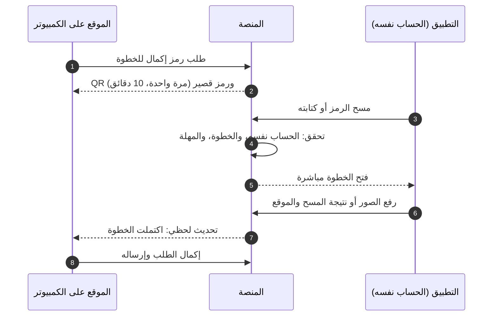

## 5. الروابط العميقة وروابط الرسائل

كل رابط في رسالة واتساب أو SMS أو إشعار يفتح شاشة محددة. في التطبيق إن كان مثبتاً، وإلا في الموقع. وإن احتاجت الشاشة دخولاً تظهر S-AUT-12 ثم تعود للشاشة نفسها.

| الرابط | يصل عبر | يفتح | يحتاج دخولاً |
|---|---|---|---|
| رابط الفاتورة | واتساب أو الإيميل للمشتري | S-PUB-09، وللمالك بعد الدخول S-USR-12 بالتفاصيل الكاملة | لا (للتحقق) |
| طلب نقل ملكية | واتساب للمستلم | S-USR-08 | نعم، أو إنشاء حساب بالرقم نفسه |
| دعوة جهة موثوقة | واتساب | S-USR-27 | نعم |
| تأكيد بلاغ المفوّض | واتساب للمالك | S-USR-25 | نعم |
| تفعيل حساب موظف | واتساب للموظف | S-AUT-11 | لا |
| تغيّر حالة بلاغ، أو طلب معلومات، أو اعتراض، أو جهاز مضبوط | إشعار وواتساب | S-USR-20 (أو S-USR-21، أو S-USR-23) | نعم |
| رد على طلب دعم | إشعار وواتساب | S-USR-39 | نعم |
| طلب استلام نقل بالجملة | إشعار للمحل | S-SHP-19 في سياق المحل | نعم |
| تفعيل خدمة مدفوعة | إشعار | S-USR-42 أو S-SHP-24 | نعم |
| شهادة فحص | يشاركها البائع | S-PUB-10 | لا |
| إيصال فحص | يشاركه الفاحص | S-PUB-11 | لا |
| رمز الإكمال | QR على شاشة الكمبيوتر | S-APP-09 ثم الخطوة، أو S-PUB-20 دون تطبيق | نعم (الحساب نفسه) |
| «عندك معلومات؟» من البوت | رد بوت واتساب | نموذج المعلومات في S-PUB-05 مرتبطاً بالفحص | لا |
| روابط البلاغ والحساب من البوت | رد بوت واتساب | S-USR-15 أو S-AUT-01 | حسب الشاشة |
| رابط إيصال الصيانة | واتساب لصاحب الجهاز | S-PUB-13 | لا |
| تغيّر حالة طلب المتجر | إشعار للمحل | S-SHP-23 | نعم |
| سحب من المحفظة، أو عملية فوق حد التنبيه | إشعار وواتساب لصاحب المحل | S-SHP-36 | نعم |
| حُسمت تعبئة معلّقة | إشعار للمحل | S-SHP-40 | نعم |
| طلب مسند للتجهيز | إشعار وواتساب للمورّد | S-SUP-07 | نعم |
| كشف تسوية جاهز | إشعار للمورّد | S-SUP-09 | نعم |

## 6. الموقع العام (S-PUB)

صفحات بلا دخول على الموقع. وشاشات الفحص (S-PUB-01 إلى S-PUB-07) هي نفسها تبويب «فحص» في التطبيق للزائر، والفحص السريع للمستخدم، بالمكوّنات نفسها.

| المعرّف | الشاشة | من يراها | المنصات | الغرض | المتطلبات | العناصر والإجراءات | الحالات الخاصة |
|---|---|---|---|---|---|---|---|
| S-PUB-01 | الصفحة الرئيسية وخانة الفحص | الجميع | موقع، تطبيق | الفحص بخطوة واحدة، والتعريف بالمنصة | PUB-01، PUB-07، CHECK-01، CHECK-02، CHECK-03، CHECK-04، CHECK-05، CHECK-06، CHECK-13، ADS-01، ROLLOUT-01، SERIAL-07 | خانة IMEI أو الرقم التسلسلي لأجهزة آبل تقبل الأرقام العربية وتتجاهل المسافات، ورابط «حاسوب أو جهاز دون شريحة؟» إلى S-PUB-22 عند تفعيل الوحدة، وزر المسح بالكاميرا، وتلميح `*#06#` الثابت، والموديل المتوقع بعد 8 خانات، و«افحص الآن»، و«بلّغ عن جهاز»، وشرح «كيف تعمل»، وقنوات الفحص الأخرى (واتساب، وSMS)، وروابط المتجرين وشريط اقتراح التطبيق على الموبايل، وسلايدر الإعلانات إن فُعّل | رقم غير صالح بخطأ في مكانه قبل الإرسال؛ لغز «لست روبوتاً» من ⚙️ الفحص الرابع؛ «حاول لاحقاً» بعد الحد؛ الفحص مغلق في وضع الدعوات حسب ⚙️ الإعداد؛ لا فحص دون اتصال |
| S-PUB-02 | الإقناع بتفعيل الموقع | كل فاحص لم يمنح الإذن بعد | موقع، تطبيق | شرح الحافز قبل نافذة إذن النظام | GEO-02، CHECK-07، CHECK-17 | «فعّل موقعك واحصل على إيصال فحص»، والنقاط الثلاث (الإيصال، ومساعدة أصحاب الأجهزة، و«موقعك لا يظهر لصاحب الجهاز ولا لأي شخص، وتستخدمه الإدارة والجهات المختصة فقط»)، و«تفعيل الموقع»، و«ليس الآن» | لا تظهر لمن منح الإذن سابقاً؛ على الكمبيوتر بدقة ضعيفة تكتمل النتيجة دون إيصال |
| S-PUB-03 | التذكير واختيار المحافظة | فاحص رفض الإذن | موقع، تطبيق | تذكير لطيف واحد، ثم إكمال الفحص بالمحافظة | GEO-02، GEO-01 | جملة تذكير واحدة مع «فعّل الآن»، ثم قائمة المحافظات الأربع عشرة، و«متابعة» | الرفض النهائي من النظام: القائمة مباشرة مع رابط «افتح الإعدادات» في التطبيق (S-APP-07) |
| S-PUB-04 | النتيجة: لا توجد بلاغات فعّالة | الفاحص | موقع، تطبيق | عرض النتيجة السليمة بصيغتها القانونية | CHECK-08، CHECK-09، CHECK-11، CHECK-15، GSMA-01، GSMA-02، GSMA-05، CUSTOMS-02، FAKE-01، FAKE-02، HISTORY-01، PAY-08، THEME-03 | الرقم المفحوص، والموديل، ووقت الفحص، وبطاقة الحالة الخضراء بالصيغة الثابتة، والمؤشرات الإضافية (الدولية، والهيئة، والتقليد، وتطابق الرقمين لنفس الموديل)، و«حفظ إيصال الفحص»، و«مشاركة»، و«فحص جهاز آخر»، ونصائح قبل الشراء (طابق `*#06#`، واطلب نقل الملكية أو شهادة فحص). وفي الموقع فقط: «اطلب تقرير تاريخ الجهاز» (S-USR-41) | «جارٍ التحقق الدولي» ثم استكمال تلقائي؛ «تعذّر التحقق الدولي حالياً»؛ دون إيصال لمن رفض الموقع؛ في التطبيق لا يظهر طلب التقرير المدفوع لغير المالك |
| S-PUB-05 | النتيجة: مبلّغ عنه — مسروق | الفاحص | موقع، تطبيق | التحذير، وجمع المعلومات بأمان | CHECK-08، CHECK-10، CHECK-11، CHECK-14، TIP-01، TIP-04، TIP-05، TIP-06، DISPUTE-01، PROTECT-03، THEME-03 | «مبلّغ عنه: مسروق — لا تشترِ هذا الجهاز»، وتاريخ نشر البلاغ، والموديل، وبطاقة المكافأة مع تنويه عدم مسؤولية المنصة، وتحذير السلامة «لا تحاول مواجهة البائع أو احتجازه»، ونموذج «عندك معلومات؟» (المحافظة، والمكان، والوصف، وصورة ووسيلة تواصل اختياريتان)، و«ماذا يعني هذا؟»، و«تعتقد أن البلاغ خاطئ؟ قدّم اعتراضاً» (S-USR-24 بعد الدخول) | تأكيد إرسال المعلومات؛ لغز «لست روبوتاً» عند تكرار الإرسال؛ الإيصال متاح لمن فعّل موقعه |
| S-PUB-06 | النتيجة: مبلّغ عنه — مفقود | الفاحص | موقع، تطبيق | التحذير، والمساعدة في الإرجاع | CHECK-08، CHECK-10، TIP-02، TIP-04، TIP-05، THEME-03 | «مبلّغ عنه: مفقود»، وتاريخ النشر، والموديل، والمكافأة «لمن يعيده عبر المنصة» مع التنويه، ونموذج «وجدت هذا الجهاز؟» (رقم للتواصل، ومكان العثور، وملاحظات)، وجملة «ننسّق الإرجاع دون كشف رقمك لصاحب الجهاز أو رقمه لك» | تأكيد الإرسال؛ المؤشرات الإضافية كما في S-PUB-04 |
| S-PUB-07 | إيصال الفحص | فاحص فعّل موقعه الدقيق | موقع، تطبيق | حفظ إثبات حسن النية ومشاركته | CHECK-16، THEME-04 | رقم الإيصال `CR-`، وIMEI، والموديل، والنتيجة وقت الفحص، والتاريخ والوقت، والمحافظة، وQR، والصيغة القانونية «لا يُعد الإيصال إثباتاً للملكية»، و«تحميل PDF» (S-PRN-04)، و«حفظ كصورة»، و«مشاركة»، و«طباعة». ويُحفظ في «إيصالاتي» للمسجّل | — |
| S-PUB-08 | التحقق من وثيقة | الجميع | موقع، تطبيق | الوصول لصفحة تحقق برقم الوثيقة أو مسح QR | PUB-02، PUB-03، PUB-06، HISTORY-04 | اختيار نوع الوثيقة (شهادة فحص، وفاتورة، وإيصال فحص، وتقرير تاريخ، وإيصال نقل أو صيانة)، وخانة الرقم، و«تحقق»، ومسح QR في التطبيق، وشرح كل نوع | «لم نجد وثيقة بهذا الرقم»؛ حد للمحاولات ضد التخمين |
| S-PUB-09 | التحقق من فاتورة | الجميع، والمالك بتفاصيل كاملة بعد الدخول | موقع، تطبيق | إثبات صحة فاتورة محل | PUB-02، SHOP-10 | اسم المحل ورقمه، والتاريخ، والموديل، وIMEI واسم المشتري مخفيان جزئياً، وحالة الفاتورة (صالحة أو ملغاة)، و«ادخل لعرض التفاصيل الكاملة» | فاتورة ملغاة بشريط واضح؛ غير موجودة |
| S-PUB-10 | التحقق من شهادة فحص | الجميع | موقع، تطبيق | يرى المشتري حالة الجهاز الآن | PUB-03، OWN-10، OWN-11، OWN-14، CUSTOMS-03 | الموديل، وIMEI مخفياً جزئياً، وتاريخ الإصدار والانتهاء، وأصل التسجيل (وكيل، أو جمركة، أو محل، أو تسجيل ذاتي)، و**الحالة الآن لحظياً** تتحدث تلقائياً، ونصيحة مطابقة آخر الخانات مع `*#06#` | منتهية؛ ملغاة (بنقل أو يدوياً)؛ **صار على الجهاز بلاغ** فيظهر تحذير أحمر واضح |
| S-PUB-11 | التحقق من إيصال فحص | الجميع | موقع، تطبيق | إثبات أن رقماً فُحص في وقت معيّن | PUB-06 | رقم الإيصال، وIMEI مخفياً جزئياً، والموديل، والنتيجة وقت الفحص، والتاريخ والوقت، والمحافظة، **دون أي بيانات عن الفاحص** | غير موجود |
| S-PUB-12 | التحقق من تقرير تاريخ الجهاز | الجميع | موقع، تطبيق | إثبات صحة تقرير صادر | HISTORY-04، HISTORY-02 | تاريخ اللقطة، وملخص التقرير دون بيانات شخصية، وصحة التقرير | غير موجود |
| S-PUB-13 | التحقق من إيصال نقل أو إيصال صيانة | الجميع | موقع، تطبيق | إثبات صحة إيصال نقل الملكية أو استلام الصيانة | OWN-04، REPAIR-02 | نوع الإيصال، والتاريخ، والموديل، وIMEI مخفياً جزئياً، والمحل (لإيصال الصيانة)، والصحة | غير موجود |
| S-PUB-14 | احمِ جهازك | الجميع | موقع، تطبيق | الحماية قبل السرقة، وما يُفعل لحظتها | PROTECT-01، PROTECT-03 | الخطوات: Find My، وقفل الشاشة، وحفظ IMEI وصورة الكرتونة، وتسجيل الجهاز، والجهات الموثوقة، والرقم البديل. ثم «سُرق جهازك؟ افعل هذا فوراً» و«بلّغ عن جهازك الآن»، وتحذير «لا تحاول استرداد جهازك بنفسك» | للمسجّل: يتحول إلى S-USR-40 بتقدّمه الشخصي |
| S-PUB-15 | بصمة للمحلات | الجميع | موقع | تعريف المحلات بالخدمة وبدء التسجيل | SHOP-01 | المزايا (الفحص قبل الشراء، والفواتير المجانية، والموظفون، والصيانة، والاستلام من الوكلاء)، وخطوات التسجيل الأربع، و«سجّل محلك الآن» (S-AUT-12 ثم S-SHP-01)، و«حمّل التطبيق» | — |
| S-PUB-16 | للوكلاء والمستوردين | الجميع | موقع | تعريف الوكلاء بالتسجيل بالجملة | IMPORTER-01 | ما يقدّمه التسجيل (أصل «وكيل»، والنقل بالجملة)، والمستندات المطلوبة، و«سجّل كوكيل» (S-AUT-12 ثم S-IMP-01) | — |
| S-PUB-17 | عن المنصة | الجميع | موقع، تطبيق | التعريف بالمنصة والجهات الشريكة | PUB-05 | نص من إدارة المحتوى، وحدود المنصة بصدق | — |
| S-PUB-18 | تواصل معنا | الجميع | موقع، تطبيق | قناة تواصل لمن ليس له حساب | PUB-05، SUPPORT-03، SUPPORT-05 | نموذج بسيط (الاسم، والموبايل، والرسالة) يدخل قائمة الدعم نفسها برقم `ST-`، ورقم واتساب الدعم، والرقم القصير للفحص، وتحذير الدعم، ورابط «طلب دعم» لأصحاب الحسابات. **وليس مركز مساعدة** (D-22) | تأكيد برقم الطلب |
| S-PUB-19 | الصفحات القانونية | الجميع | موقع، تطبيق | الشروط والأحكام، وسياسة الخصوصية، واتفاقية المحلات | PUB-04، SMART-01 | ثلاث صفحات بقالب واحد، برقم الإصدار وتاريخه. والقبول يُسجَّل عند إنشاء الحساب وتسجيل المحل | — |
| S-PUB-20 | تنزيل التطبيق وإكمال الخطوة دون تطبيق | من مسح رمز إكمال دون تطبيق، ومن رابط التنزيل | موقع | التنزيل ثم العودة للخطوة | PUB-07، HANDOFF-04 | زرا المتجرين، وإن جاء من رمز إكمال: «ثبّت التطبيق ثم امسح الرمز مرة أخرى، صالح حتى [الوقت]» | الرمز منتهٍ: «اطلب رمزاً جديداً من الموقع» |
| S-PUB-21 | صفحات الخطأ والصيانة | الجميع | موقع، تطبيق، لوحة، بوابة | حالات الخطأ العامة | SMART-11، CHECK-13 | الصفحة غير موجودة، وخطأ في الخادم، و«حاول لاحقاً» مع الوقت، ووضع الصيانة بوقت الانتهاء، والرابط منتهي الصلاحية (دعوة، أو نقل، أو إكمال)، و«افتح في المتصفح» داخل متصفحات التطبيقات | — |
| S-PUB-22 | الفحص بالرقم التسلسلي | الجميع (عند تفعيل الوحدة) | موقع، تطبيق | فحص حاسوب أو جهاز دون شريحة | SERIAL-02، SERIAL-01، SERIAL-07 | اختيار الشركة المصنّعة من قائمة، ونوع الجهاز، وخانة الرقم التسلسلي بصيغة الشركة ⚙️، وإرشاد مصوّر لمكان الرقم على الجهاز والكرتونة، و«افحص». ثم S-PUB-02 والنتائج S-PUB-04 إلى S-PUB-06 **دون مؤشرات الشبكة** (الدولية والهيئة والتقليد) | صيغة لا تطابق الشركة المختارة؛ الوحدة مطفأة: لا مدخل |
| S-PUB-23 | إغلاق الحساب من رابط عام | صاحب حساب لا يملك التطبيق أو لا يستطيع الدخول إليه | موقع | طلب إغلاق الحساب دون تثبيت التطبيق (سياسات المتجرين) | PRIV-02 | شرح ما يُحذف وما يُحتفظ به قانوناً، ورقم الموبايل، ثم رمز تحقق، ثم كلمة المرور، و«طلب إغلاق الحساب» مع مهلة التراجع ⚙️ 7 أيام | الرسائل موقوفة لرقم مسروق: «استعد حسابك بهويتك أولاً» (S-AUT-08) |

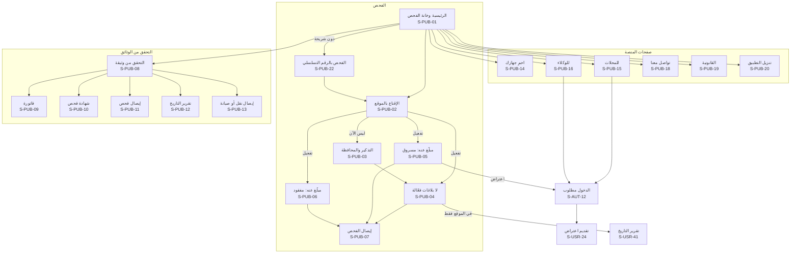

## 7. الدخول والتسجيل والاستعادة (S-AUT)

للحسابات العامة فقط (المواطن، والمحل، والوكيل وموظفوهما). ودخول الإدارة والبوابة في S-ADM-01 وS-POL-01 على نطاقيهما.

| المعرّف | الشاشة | من يراها | المنصات | الغرض | المتطلبات | العناصر والإجراءات | الحالات الخاصة |
|---|---|---|---|---|---|---|---|
| S-AUT-01 | إنشاء حساب | زائر | موقع، تطبيق | فتح حساب برقم وكلمة مرور (الخطوة 1 من 3) | AUTH-01، AUTH-07، ROLLOUT-01، PUB-04، ONBEHALF-05، PRIV-10 | رقم الموبايل السوري (`09XXXXXXXX`)، وإقرار «عمري 18 سنة أو أكثر» (ومن دونها يدخل فقط بدعوة وليّ أمره مستخدماً مفوّضاً، D-97)، وكلمة المرور مع مؤشر القوة وفحص الكلمات المسرّبة، وقبول الشروط والخصوصية بإصداريهما، ومؤشر الخطوات (الحساب، وتأكيد الرقم، والملف الشخصي) | الرقم مسجّل: «ادخل أو استعد كلمة المرور» دون كشف تفاصيل؛ الرقم غير مدعو في وضع الدعوات؛ حساب أُنشئ له بالنيابة: يُكمل التفعيل بالرمز ثم كلمة مرور |
| S-AUT-02 | رمز التحقق | كل من يُرسل إليه رمز | موقع، تطبيق | إدخال رمز من 6 أرقام لأي غرض | AUTH-01، AUTH-03، AUTH-09، OWN-04، THEFT-02 | الرقم مخفياً جزئياً، و6 خانات بلصق تلقائي، والعدّ التنازلي لإعادة الإرسال ⚙️ 60 ثانية، و«أو عبر رسالة SMS»، و«تغيير الرقم»، وتحذير «لا تشارك الرمز مع أحد، حتى فريق الدعم». الشاشة نفسها لتأكيد التسجيل، والاستعادة، وتغيير الرقم، ونقل الملكية، والرقم البديل، والجهاز الجديد للمحل | رمز منتهٍ (⚙️ 5 دقائق)؛ نفدت المحاولات (⚙️ 5)؛ حد الرموز في الساعة؛ الرسائل موقوفة لرقم مسروق (THEFT-03) |
| S-AUT-03 | الملف الشخصي الأولي | حساب جديد مؤكَّد الرقم | موقع، تطبيق | الاسم الكامل كما في الهوية، والرقم الوطني، والمحافظة (الخطوة 3 من 3) | AUTH-04، AUTH-07، GEO-01 | ثلاثة حقول، وشرح سبب طلب الرقم الوطني | صيغة رقم وطني خاطئة (11 خانة)؛ الرقم الوطني مستخدم: إحالة للدعم (06 §7) |
| S-AUT-04 | الترحيب ونتيجة الربط التلقائي | حساب جديد | موقع، تطبيق | إظهار الأجهزة المرتبطة والخطوة التالية | AUTH-06، OWN-02 | «وجدنا [N] أجهزة مسجّلة باسمك» مع بطاقاتها، أو «لا أجهزة بعد». ثم: وثّق هويتك (للبلاغ)، واحمِ جهازك، وحمّل التطبيق | — |
| S-AUT-05 | تسجيل الدخول | زائر | موقع، تطبيق | الدخول برقم الموبايل وكلمة المرور | AUTH-02، ROLLOUT-01 | الرقم، وكلمة المرور، و«تذكّرني»، و«نسيت كلمة المرور؟»، و«إنشاء حساب»، ورابط «سُرق موبايلك ولا يصلك الرمز؟» (S-AUT-08) | بيانات خاطئة دون تحديد أيهما؛ لغز «لست روبوتاً» من المحاولة الفاشلة الثانية؛ قفل لهذا المصدر بعد ⚙️ 5 محاولات (⚙️ 15 دقيقة ثم ساعة)، وقفل الحساب كله بعد ⚙️ 20 محاولة في 24 ساعة حتى إعادة التعيين برمز (20 §6.4)؛ حساب معلّق أو محظور؛ جهاز جديد لحساب محل يتطلب رمزاً (S-AUT-02) |
| S-AUT-06 | نسيت كلمة المرور | صاحب حساب | موقع، تطبيق | طلب رمز الاستعادة | AUTH-03 | رقم الموبايل، و«أرسل الرمز» | الرسائل موقوفة لرقم مسروق: شرح وتحويل إلى S-AUT-08 |
| S-AUT-07 | كلمة مرور جديدة | صاحب حساب أكّد الرمز | موقع، تطبيق | تعيين كلمة المرور | AUTH-03، AUTH-08 | كلمة المرور مرتين، وتنبيه «ستُنهى كل الجلسات الأخرى» | — |
| S-AUT-08 | لا أستطيع استلام الرمز | صاحب حساب فقد رقمه | موقع، تطبيق | شرح الطريق الصحيح دون أي ثغرة | THEFT-06، THEFT-08، SUPPORT-03، AUTH-09، SUPPORT-05 | أربعة خيارات: «أعرف كلمة المرور» (الدخول عادياً)، و«بلّغ عن السرقة الآن» بجلسة البلاغ فقط (S-AUT-15)، و«استعد حسابك بهويتك» (S-AUT-09)، و«راسل واتساب الدعم». وجملة واضحة: «الرقم البديل والجهات الموثوقة لا تُستخدم لاستعادة الحساب» | — |
| S-AUT-09 | استعادة الحساب بالهوية | صاحب حساب لا يستطيع الدخول | موقع◐، تطبيق | يبدأ صاحب الحساب الاستعادة بنفسه | THEFT-06، AUTH-09، HANDOFF-01، HANDOFF-02 | تبدأ من خيار «استعادة الحساب بالهوية» في الدخول أو من واتساب الدعم: رقم الحساب أو الرقم القديم، والرقم الوطني، والرقم الجديد مع رمز له، ثم تصوير الهوية في التطبيق (S-APP-10) برمز مرتبط بطلب الاستعادة لا بجلسة، ثم الإرسال برقم طلب `ST-` | البيانات لا تطابق حساباً: رسالة عامة دون كشف؛ حد المحاولات |
| S-AUT-10 | حالة طلب الاستعادة | صاحب الطلب برابط ورمز على الرقم الجديد | موقع، تطبيق | متابعة الاستعادة حتى التنفيذ | THEFT-06 | خط زمني: مراجعة الدعم، ثم موافقة مشرف ثانٍ، ثم إشعار ⚙️ 24 ساعة إلى كل وسائل الحساب مع رابط «لم أكن أنا»، ثم التنفيذ وتعيين كلمة المرور، ثم فترة التهدئة ⚙️ 72 ساعة بعدّاد | «لم أكن أنا» من أي وسيلة يوقف التنفيذ ويفتح طلباً عاجلاً؛ مرفوض بالسبب وطريق «طلب دعم» |
| S-AUT-11 | تفعيل حساب موظف | موظف محل أو وكيل مدعو | موقع، تطبيق | قبول الدعوة وبدء الحساب | SHOP-05، IMPORTER-02 | اسم المحل أو الوكيل، ومن دعاه، والصلاحيات الممنوحة، ثم تعيين كلمة مرور، أو «لدي حساب» للربط بحسابه السابق، ثم الانتقال لتوثيق الهوية (S-USR-30) | رابط منتهٍ؛ الدعوة أُلغيت؛ الرقم الوطني لا يطابق الحساب الموجود |
| S-AUT-12 | الدخول مطلوب لإكمال الإجراء | زائر يطلب إجراءً يحتاج حساباً | موقع، تطبيق | الدخول أو التسجيل ثم العودة للإجراء نفسه | AUTH-01، AUTH-02 | بطاقة تشرح ما يحتاجه الإجراء (مثل «لتقديم بلاغ تحتاج حساباً موثّق الهوية»)، و«تسجيل الدخول»، و«إنشاء حساب». والعودة تلقائية بعد النجاح | — |
| S-AUT-13 | الجلسة انتهت أو أُنهيت | من انتهت جلسته | موقع، تطبيق | شرح سبب الخروج | AUTH-08، THEFT-04 | «انتهت جلستك» أو «أُنهيت جلستك من جهاز آخر»، و«تسجيل الدخول» | — |
| S-AUT-14 | قبول الشروط المحدّثة | كل مستخدم بعد تغيير جوهري في الشروط أو الخصوصية | موقع، تطبيق | إعادة القبول بالإصدار الجديد | PRIV-10، PUB-04 | ملخص ما تغيّر، ورابط النص الكامل، و«أوافق» قبل متابعة الاستخدام. ويُسجَّل القبول بإصداره | الرفض: تبقى قراءة البيانات وتنزيلها وإغلاق الحساب متاحة |
| S-AUT-15 | جلسة «بلاغ السرقة فقط» | صاحب حساب سُرق موبايله ويدخل من جهاز جديد دون رمز | موقع، تطبيق | التبليغ والحماية فوراً دون فتح الحساب كاملاً | THEFT-08، THEFT-03، THEFT-04، LINE-01 | كلمة المرور، ولغز «لست روبوتاً»، وتحقق سلامة التطبيق في الموبايل (أو تحقق الروبوت في الموقع)، ثم شريط ثابت «جلسة مقيّدة: بلاغ السرقة فقط». المتاح: معالج البلاغ (S-USR-15 إلى S-USR-19) وإيقاف الرسائل للرقم، وإنهاء الجلسات الأخرى، وطلب إيقاف الخط. ولا شيء غيرها | البلاغ يُعلَّم للمراجع؛ الجلسة الكاملة بعد استعادة الرقم (S-USR-29) أو الاستعادة بالهوية (S-AUT-09) |

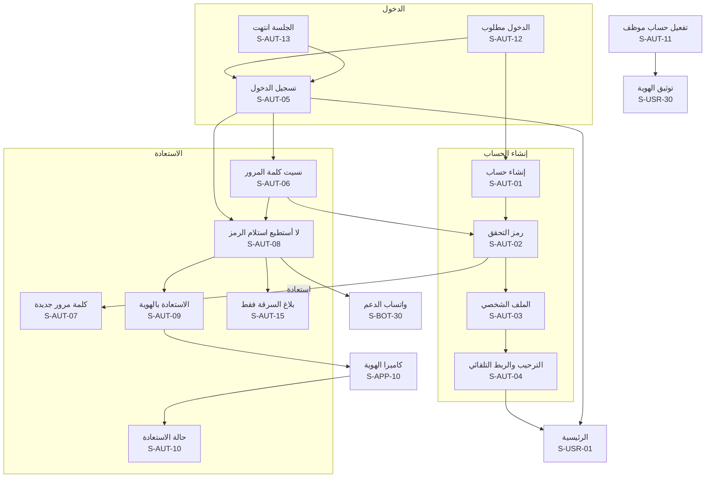

## 8. حساب المواطن (S-USR)

شاشات مشتركة بين الموقع والتطبيق بالمحتوى نفسه، وتختلف في التخطيط فقط. والمستخدم المفوّض والجهة الموثوقة **ليسا دورين** بل علاقتان، فشاشاتهما جزء من حساب المواطن (S-USR-02، وS-USR-16، وS-USR-27، وS-USR-28).

| المعرّف | الشاشة | من يراها | المنصات | الغرض | المتطلبات | العناصر والإجراءات | الحالات الخاصة |
|---|---|---|---|---|---|---|---|
| S-USR-01 | الرئيسية | كل مستخدم | موقع، تطبيق | نقطة البداية بعد الدخول | NOTIF-05، PROTECT-02، OWN-02، ADS-01 | فحص سريع، واختصارات (بلّغ عن سرقة، ونقل ملكية، وسجّل جهازاً، واحمِ جهازك)، و«ينتظر إجراءك» (طلب نقل إليك، وتأكيد بلاغ مفوّض، وطلب معلومات، واعتراض، ودعوة جهة موثوقة)، وملخص «أجهزتي»، وشريط حالة الهوية، وسلايدر الإعلانات إن فُعّل | فارغة لحساب جديد: «وثّق هويتك» و«سجّل جهازك» |
| S-USR-02 | أجهزتي | مرتبط تلقائياً، وموثّق الهوية، والمفوّض | موقع، تطبيق | كل الأجهزة باسمي والمفوّض عليها | OWN-01، OWN-02، OWN-08، OWN-12، PROTECT-02 | تبويبان: «باسمي» و«مفوّض عليها». بطاقة لكل جهاز: الموديل، وIMEI مخفياً جزئياً، وأصل التسجيل، وشارات الحالة (لا بلاغات، أو بلاغ نافذ، أو قيد الانتظار مع الأيام الباقية)، و«+ سجّل جهازاً»، وتنبيه «نقل ملكية بانتظار قبولك» | فارغة؛ مؤكَّد الرقم فقط: «لا أجهزة مرتبطة بك. وثّق هويتك لتسجيل جهاز» |
| S-USR-03 | تفاصيل الجهاز | المالك | موقع، تطبيق | كل ما يخص جهازاً وإجراءاته | OWN-01، OWN-14، OWN-12، OWN-07، HISTORY-03، PROTECT-02 | المعرّفات، والمالك منذ، وأصل التسجيل، والفواتير، وسجل ملكيتي، والإجراءات: شهادة فحص، ونقل الملكية، وتاريخ الجهاز (مجاني للمالك)، والمستخدمون المفوّضون، وخطوات الحماية، و«بلّغ عن سرقة أو فقدان» | قيد الانتظار: النقل والشهادة معطّلان مع العدّاد؛ بلاغ نافذ: الإجراءات محصورة بالبلاغ؛ تسجيل مجمّد بسبب بلاغ |
| S-USR-04 | تسجيل جهاز ذاتياً | موثّق الهوية | موقع◐، تطبيق | تسجيل جهاز قديم بلا فاتورة | OWN-03، OWN-15، FAKE-02، REPORT-05، HANDOFF-01، SERIAL-01، SERIAL-04 | IMEI1 وIMEI2 بالمسح (S-APP-08)، أو الشركة المصنّعة والرقم التسلسلي لجهاز دون شريحة عند تفعيل الوحدة، وتأكيد الموديل، والصورة الحيّة بالكاميرا مع رقم الحساب (S-APP-11)، وأدلة اختيارية، والإقرار القانوني الصريح، و«إرسال للمراجعة» مع شرح فترة الانتظار ⚙️ 30 يوماً | الجهاز مسجّل لغيرك: رفض آلي بصياغة محايدة؛ تجاوز الحد السنوي ⚙️ 3: «سيُراجع طلبك يدوياً»؛ الرقمان لا يطابقان الموديل؛ فترة التهدئة؛ مسودة |
| S-USR-05 | حالة طلب التسجيل الذاتي | صاحب الطلب | موقع، تطبيق | متابعة الطلب حتى الاعتماد | OWN-03، OWN-12، REPORT-15 | خط زمني: قيد المراجعة، ثم مرفوض بالسبب أو قيد الانتظار حتى [تاريخ]، ثم نهائي. ووسم «تسجيل ذاتي» | مجمّد بسبب بلاغ: «يراجع المشرف الملف» دون تفاصيل الطرف الآخر |
| S-USR-06 | نقل الملكية: الطلب | المالك (مرتبط تلقائياً أو موثّق الهوية) | موقع، تطبيق | بدء نقل الجهاز لمشترٍ | OWN-04، OWN-06، OWN-12، THEFT-07 | الجهاز، ورقم موبايل المشتري ورقمه الوطني، وتنبيه «يجب أن يطابقا حساب المشتري»، و«تُلغى الشهادة والتفويضات وتفقد صلاحياتك»، ثم رمز على رقمك (S-AUT-02) | ممنوع لبلاغ نافذ أو قيد المراجعة أو فترة انتظار؛ فترة التهدئة؛ أثناء بلاغ نافذ على جهاز آخر: كلمة المرور ورمز للرقم البديل |
| S-USR-07 | طلب النقل المعلّق | المالك | موقع، تطبيق | متابعة طلب أرسلته | OWN-05 | المستلم مخفياً جزئياً، والعدّاد ⚙️ 72 ساعة، و«إلغاء الطلب» | منتهٍ؛ مقبول (مع رابط الإيصال)؛ ملغى |
| S-USR-08 | قبول نقل الملكية | المستلم (مؤكَّد الرقم على الأقل) | موقع، تطبيق | قبول جهاز من بائع | OWN-04 | الجهاز، والبائع باسم مختصر، والعدّاد، وفحوص المطابقة (رقم الموبايل، والرقم الوطني، ولا بلاغات، وأصل التسجيل)، و«قبول الملكية» و«رفض»، وتنبيه «لتقديم بلاغ عنه لاحقاً تحتاج توثيق هويتك» | عدم المطابقة: «بيانات الطلب لا تطابق حسابك» دون تفاصيل؛ لا رقم وطني في الملف: إكماله أولاً (S-AUT-03)؛ منتهٍ أو ملغى |
| S-USR-09 | إيصال نقل الملكية | الطرفان | موقع، تطبيق | وثيقة النقل | OWN-04 | رقم `CR-`، والتاريخ، والجهاز، وQR، و«تحميل PDF» (S-PRN-05)، و«مشاركة» | — |
| S-USR-10 | شهادة الفحص | المالك | موقع، تطبيق | إصدار شهادة للإعلان وإدارتها | OWN-09، OWN-10، OWN-11 | «إصدار شهادة»، ثم البطاقة: رقم `CR-`، والرابط، وصورة QR، وتاريخ الانتهاء ⚙️ 30 يوماً، و«مشاركة»، و«حفظ كصورة»، و«إلغاء الشهادة» | غير متاحة لبلاغ أو فترة انتظار؛ منتهية؛ أُلغيت تلقائياً بالنقل أو البلاغ |
| S-USR-11 | المستخدمون المفوّضون | المالك | موقع، تطبيق | من يستخدم جهازي دون نقل ملكيته | OWN-08، TRUSTED-05، PRIV-09 | القائمة حتى ⚙️ 3، و«إضافة» (الاسم، وصلة القرابة، ورقم الموبايل، وعلَم «قاصر بإدارة وليّ الأمر» مع إقرار وليّ الأمر، D-97)، و«إلغاء التفويض»، وشرح الفرق عن الجهة الموثوقة | الحد الأقصى؛ أُلغيت التفويضات بالنقل |
| S-USR-12 | فواتيري | المشتري | موقع، تطبيق | فواتير أجهزتي بتفاصيلها الكاملة | OWN-01، SHOP-11، PUB-02 | قائمة، وتفاصيل الفاتورة كاملة (والسعر يظهر للمشتري وحده)، و«تحميل PDF»، ورابط التحقق | فارغة؛ فاتورة ملغاة |
| S-USR-13 | إيصالاتي | مستخدم | موقع، تطبيق | إيصالات الفحص وإيصالات النقل المحفوظة | CHECK-16، OWN-04 | قائمة بالتاريخ والنتيجة والموديل، وفتح الإيصال (S-PUB-07) | فارغة: «افحص وموقعك مفعّل لتحصل على إيصال» |
| S-USR-14 | بلاغاتي | المبلّغ | موقع، تطبيق | كل بلاغاتي ومسوداتي | REPORT-09، REPORT-14، POLICE-03 | قائمة برقم `BL-` والحالة والتاريخ، والمسودات، والبلاغات الرسمية المرتبطة برقمي الوطني، و«بلاغ جديد» | فارغة |
| S-USR-15 | بلاغ جديد: حماية فورية | مستخدم (والمفوّض) | موقع، تطبيق | حماية الرقم والمحافظ قبل أي شيء | THEFT-01، THEFT-02، THEFT-03، THEFT-04، THEFT-05، LINE-01، LINE-03، WALLET-01 | «هل كانت شريحة رقمك داخل الجهاز المسروق؟». إن نعم: إيقاف الرسائل لرقمك، وإنهاء الجلسات الأخرى (تلقائي)، و«أوقف خطي» مع اختيار الشركة ومع جملة «منفصل عن حظر الجهاز»، وتجميد المحافظ من قائمة المزوّدين المنضمّين، ثم الرقم البديل مع رمزه وجملة «للإشعارات فقط»، والإرشادات الفورية | داخل جلسة «بلاغ السرقة فقط» (S-AUT-15): هذا المعالج وحده متاح؛ مزوّد غير منضمّ: إرشاد التواصل معه فقط؛ لا شريحة: تخطٍّ مباشر للخطوة التالية؛ غير موثّق الهوية: إيقاف الرسائل وإنهاء الجلسات فوراً، وطلبا الخط والمحافظ بعد التوثيق لأنهما يُرسلان ببيانات صاحبهما الموثّقة |
| S-USR-16 | بلاغ جديد: الجهاز والنوع | موثّق الهوية، والمفوّض (بتأكيد المالك) | موقع، تطبيق | اختيار الجهاز ونوع البلاغ | REPORT-01، REPORT-03، REPORT-12، OWN-08، SERIAL-03 | الاختيار من «أجهزتي» أو «مفوّض عليها» (فلا تُطلب أدلة)، أو «جهاز غير مسجّل» بإدخال IMEI، أو «حاسوب أو جهاز دون شريحة» بالشركة المصنّعة والرقم التسلسلي عند تفعيل الوحدة مع جملة «لا حظر ولا تتبّع من الشبكة لهذا الجهاز، والحماية بمنع بيعه عبر المحلات وإبلاغ الجهات المختصة»، ثم «سرقة» أو «فقدان» | غير موثّق الهوية: «وثّق هويتك لتقديم البلاغ» (S-USR-30) مع حفظ المسودة؛ يوجد بلاغ نافذ أو قيد المراجعة على الجهاز: رابطه |
| S-USR-17 | بلاغ جديد: الحادثة | المبلّغ | موقع، تطبيق | متى وأين وماذا حدث | REPORT-02، GEO-05، GEO-08، REPORT-16، REPORT-17، TIP-05، TIP-06 | التاريخ والوقت التقريبي، والمحافظة والمنطقة (إلزاميتان)، ونقطة اختيارية على الخريطة مع «لا يظهر لأي شخص»، والوصف، واللون والتسلسلي والرقم الثاني، و«آخر موقع من Find My» مع صورة الشاشة (اختياري)، والمكافأة (اختيارية) مع تنويهها | — |
| S-USR-18 | بلاغ جديد: الأدلة | المبلّغ عن جهاز غير مسجّل | موقع◐، تطبيق | إثبات الملكية لجهاز غير مسجّل | REPORT-04، REPORT-05، REPORT-06، HANDOFF-01، SERIAL-03 | صورة لصاقة الكرتونة مع قراءة الباركود ومقارنته (وللجهاز دون شريحة: صورة ملصق الرقم التسلسلي على الجهاز أو الكرتونة، أو الفاتورة)، والصورة الحيّة بالكاميرا مع رقم الحساب ظاهراً (S-APP-11)، وأدلة اختيارية (فاتورة، وصور قديمة، ومستندات) | عدم تطابق الباركود: تنبيه قبل الإرسال؛ باركود غير مقروء؛ رفع مستأنف؛ مسودة دون اتصال |
| S-USR-19 | بلاغ جديد: المراجعة والإقرار | المبلّغ | موقع، تطبيق | التأكد والإرسال | REPORT-08، REPORT-14، PROTECT-03، OWN-08 | ملخص كل الخطوات مع «تعديل»، ونص الإقرار الثابت، وتحذير «لا تحاول استرداد جهازك بنفسك»، و«إرسال». والنتيجة: «قيد المراجعة» برقم `BL-` | للمفوّض: «بانتظار تأكيد المالك» خلال ⚙️ 48 ساعة |
| S-USR-20 | تفاصيل البلاغ | المبلّغ | موقع، تطبيق | متابعة البلاغ وإجراءاته | REPORT-09، REPORT-17، TELCO-01، TELCO-04، NOTIF-04، LINE-01، WALLET-02، THEFT-03، PP-08، PP-10، SERIAL-03 | خط زمني بالحالة ومن قرر (الإدارة أو قوى الأمن)، و«الجهاز في قائمة المراقبة لدى الشبكات» دون أي تفاصيل (ولا يظهر هذا السطر للجهاز دون شريحة)، وحالة إيقاف الخط وتجميد كل محفظة، وإشعارات الفحص العامة «تم فحص جهازك»، وتعديل المكافأة أو إلغاؤها، و«استعدت رقمي الأصلي»، وأزرار: الرد على طلب المعلومات، والرد على الاعتراض، و«طلب إغلاق». وعند الضبط: «جهازك موجود لدى [القسم]، راجعه ومعك هويتك» | مرفوض بالسبب و«قدّم بلاغاً جديداً»؛ مغلق؛ **لا يظهر أبداً** موقع أو فاحص أو رقم شريحة |
| S-USR-21 | الرد على طلب المعلومات | المبلّغ | موقع◐، تطبيق | الرد على سؤال المشرف | REPORT-10 | رسالة المشرف، ونص الرد، والمرفقات (والكاميرا بالإكمال على الكمبيوتر)، والمهلة ⚙️ 14 يوماً | انتهت المهلة: رُفض البلاغ تلقائياً |
| S-USR-22 | طلب إغلاق البلاغ | المبلّغ | موقع، تطبيق | إنهاء البلاغ بعد الاسترداد أو الخطأ | REPORT-11، THEFT-07 | السبب (تم الاسترداد، أو وجدته، أو بلاغ بالخطأ)، وتنبيه «يبقى الجهاز مبلّغاً عنه حتى المراجعة»، وكلمة المرور، ورمز للرقم البديل إن وُجد | فترة التهدئة؛ طلب قيد المراجعة |
| S-USR-23 | الرد على اعتراض | المبلّغ | موقع◐، تطبيق | تقديم أدلتي مقابل الاعتراض | DISPUTE-03 | «قُدّم اعتراض على بلاغك» دون هوية المعترض، والمهلة ⚙️ 7 أيام، والإفادة، والأدلة | انتهت المهلة: «يُؤخذ عدم الرد بعين الاعتبار» |
| S-USR-24 | تقديم اعتراض | موثّق الهوية يحمل الجهاز | موقع◐، تطبيق | الطعن في بلاغ نافذ | DISPUTE-01 | IMEI (من النتيجة)، والإفادة، والأدلة (فاتورة، ومحادثات البيع، وإيصال تحويل، وشهود)، والإقرار | غير موثّق الهوية: S-USR-30 أولاً؛ اعتراض قائم من الشخص نفسه |
| S-USR-25 | تأكيد بلاغ المفوّض أو البلاغ العاجل | المالك أو صاحب الجهاز | موقع◐، تطبيق | تأكيد بلاغ لم يقدّمه بنفسه | OWN-08، TRUSTED-03 | ملخص البلاغ ومن بدأه. لبلاغ المفوّض: العدّاد ⚙️ 48 ساعة، و«تأكيد وإرسال للإدارة» و«رفض»، وتصوير الهوية ضمن التأكيد إن لم تكن موثّقة. وللبلاغ العاجل من جهة موثوقة: العدّاد ⚙️ 72 ساعة و«أؤكد البلاغ» أو «لم أطلب ذلك» | بلاغ المفوّض منتهٍ: أُلغي وأُبلغ المفوّض؛ البلاغ العاجل منتهٍ: رُفض آلياً؛ الرقم البديل لا يؤكد شيئاً (D-81) |
| S-USR-26 | الجهات الموثوقة | مستخدم | موقع، تطبيق | من يبلّغ عني إن سُرق موبايلي | TRUSTED-01، TRUSTED-04، TRUSTED-05 | القائمة حتى ⚙️ 3 بالحالة (بانتظار القبول، أو نشطة)، و«دعوة» (الاسم والرقم)، و«إزالة»، وسجل ما فعلته كل جهة مع «تراجع عبر الدعم الفني»، وجملة «لا تستطيع الجهة استعادة حسابك» | فترة التهدئة تمنع التغيير؛ فارغة |
| S-USR-27 | أنا جهة موثوقة لـ | مؤكَّد الرقم | موقع، تطبيق | دعواتي ومن أبلّغ عنهم | TRUSTED-01، TRUSTED-02 | الدعوات بانتظار الرد («قبول» و«رفض»)، والأشخاص الذين اختاروني، و«بلاغ عاجل عن [الاسم]» | فارغة |
| S-USR-28 | بلاغ عاجل عن شخص | الجهة الموثوقة | موقع، تطبيق | التبليغ والحماية الفورية عن غيري | TRUSTED-02، TRUSTED-03، THEFT-02، THEFT-03، THEFT-04، LINE-01، WALLET-01 | اختيار جهاز صاحب الحساب (الموديل فقط)، والنوع، والحادثة باختصار، والحمايات (إنهاء الجلسات وإيقاف الرسائل فوراً، وإيقاف الخط، وتجميد المحافظ)، و«رقمي رقماً بديلاً للإشعارات فقط»، والإقرار | بعد الإرسال: «قيد المراجعة» مع الحمايات مطبّقة، ويُطلب تأكيد صاحب الجهاز من حسابه (S-USR-25) أو عبر الدعم بالهوية خلال ⚙️ 72 ساعة، وإلا يُرفض البلاغ آلياً |
| S-USR-29 | الرقم البديل | مستخدم | موقع، تطبيق | رقم تصل عليه الإشعارات | THEFT-02، THEFT-03 | إضافة الرقم وتأكيده برمز، وحالته، و«استعدت رقمي الأصلي»، وجملة «للإشعارات فقط، ولا يُستخدم أبداً لاستعادة حسابك أو تأكيد إجراء حساس» | فترة التهدئة تمنع التغيير |
| S-USR-30 | توثيق الهوية | مؤكَّد الرقم، ومرتبط تلقائياً، وموظف جديد | موقع◐، تطبيق | رفع درجة الحساب إلى «موثّق الهوية» | AUTH-05، CIVIL-01، CIVIL-05، HANDOFF-01 | لماذا (البلاغ، والاعتراض، والتسجيل الذاتي، والمحل، والعمل موظفاً)، والاسم كما في الهوية، والرقم الوطني، والبيان الإضافي عند تفعيل الأحوال المدنية، ثم تصوير الوجهين بالكاميرا دون سيلفي (S-APP-10)، ثم «إرسال». والحالة بعدها | قيد المراجعة؛ مرفوض بالسبب والمحاولات الباقية (⚙️ 3)؛ أُحيل للدعم؛ بطاقة غير سارية |
| S-USR-31 | حسابي | مستخدم | موقع، تطبيق | الملف والإعدادات ومداخل الأمان | AUTH-04، AUTH-12، THEME-02، NOTIF-01 | الاسم، ورقم الحساب `SY-` مع «نسخ»، وشارة «هوية موثّقة» أو «رقم مؤكَّد»، والمظهر (فاتح، وغامق، وتلقائي)، والإشعارات، ومداخل: الجهات الموثوقة، والرقم البديل، والأجهزة والجلسات، ومن اطّلع على بياناتي، وطلباتي، وفواتيري، وإيصالاتي، والخدمات المدفوعة، والتبديل إلى المحل أو الوكيل، والقانونية، وتسجيل الخروج | الاسم والرقم الوطني مقفلان بعد التوثيق: التعديل عبر «طلب دعم» |
| S-USR-32 | الأجهزة والجلسات وكلمة المرور | مستخدم | موقع، تطبيق | إدارة الدخول | AUTH-08، AUTH-03 | الجلسات النشطة (الجهاز، والمنصة، وآخر نشاط) مع «إنهاء»، و«الخروج من كل الأجهزة»، و«تغيير كلمة المرور» | — |
| S-USR-33 | تغيير رقم الموبايل | مستخدم | موقع، تطبيق | نقل الحساب لرقم جديد | AUTH-09، THEFT-07 | رمز للرقم القديم ثم رمز للجديد، وتنبيه فترة التهدئة ⚙️ 72 ساعة وإنهاء الجلسات، و«فقدت رقمي القديم» ← S-AUT-08 | أثناء بلاغ نافذ: كلمة المرور ورمز للرقم البديل؛ الرقم الجديد مسجّل لحساب آخر |
| S-USR-34 | إغلاق الحساب | مستخدم | موقع، تطبيق | طلب إنهاء الحساب من داخله | AUTH-10، PRIV-02 | ما يُحذف وما يُحتفظ به قانوناً، وكلمة المرور ورمز، و«طلب إغلاق الحساب»، ومهلة التراجع ⚙️ 7 أيام مع «تراجع عن الإغلاق». ويظهر في التطبيق إلزاماً حسب سياسات المتجرين | بلاغ أو نقل جارٍ: شرح أثره قبل التأكيد |
| S-USR-35 | من اطّلع على بياناتي | مستخدم | موقع، تطبيق | شفافية الاطلاع على بياناتي | DATAACCESS-01، DATAACCESS-02، DATAACCESS-03 | قائمة (الجهة، والتاريخ، والغرض مثل «معاملة شراء رقم...»)، و«اطلاع مشبوه» يفتح طلب دعم مربوطاً | فارغة. واطلاع قوى الأمن لا يظهر قبل موعده دون أي إشارة لوجوده |
| S-USR-36 | الإشعارات | مستخدم | موقع، تطبيق | مركز الإشعارات | NOTIF-01، NOTIF-04، NOTIF-05، CHECK-14، PAY-07 | قائمة بالأيقونة والوقت والسياق (حسابي أو المحل)، و«تحديد الكل كمقروء»، وكل إشعار يفتح شاشته (القسم 5) | فارغة |
| S-USR-37 | طلباتي | مستخدم، وصاحب المحل والوكيل | موقع، تطبيق | متابعة طلبات الدعم | SUPPORT-02، SUPPORT-05 | قائمة برقم `ST-` والحالة (جديد، وقيد المعالجة، وبانتظار ردّك، ومحلول، ومغلق)، و«+ طلب جديد»، وتحذير الدعم | فارغة |
| S-USR-38 | طلب دعم جديد | مستخدم، وصاحب المحل والوكيل | موقع، تطبيق | فتح طلب برقم مرجعي | SUPPORT-01، SUPPORT-05 | التصنيف، والوصف، والصور، والربط ببلاغ أو جهاز أو معاملة، وتحذير الدعم، و«إرسال» | تأكيد برقم `ST-` |
| S-USR-39 | تفاصيل طلب الدعم | صاحب الطلب | موقع، تطبيق | المحادثة مع الدعم | SUPPORT-02، SUPPORT-05، SUPPORT-06 | الرسائل، و«رد»، والمرفقات، و«حُلّت مشكلتي»، والتقييم من 1 إلى 5 بعد الحل | أُغلق تلقائياً بعد ⚙️ 7 أيام دون رد |
| S-USR-40 | احمِ أجهزتي | مستخدم | موقع، تطبيق | تقدّم خطوات الحماية لكل جهاز | PROTECT-01، PROTECT-02، PROTECT-03 | خطوات «احمِ جهازك» مع «تم» و«لم يتم» لكل جهاز، وتذكير لطيف بالناقص، وتحذير «لا تحاول استرداد جهازك بنفسك» | — |
| S-USR-41 | تقارير تاريخ الأجهزة | مستخدم | موقع، تطبيق | التقرير المجاني للمالك والمطلوب لغيره | HISTORY-01، HISTORY-02، HISTORY-03، HISTORY-04، PAY-01، PAY-08 | للمالك: «أصدر تقرير جهازك» مجاناً. ولغيره **في الموقع فقط**: IMEI والسعر و«اطلب التفعيل» الذي يفتح واتساب الإدارة التجاري برسالة فيها رقم الحساب والخدمة وIMEI. وقائمة التقارير الصادرة مع «عرض» و«PDF» (S-PRN-07) | في التطبيق: قائمة التقارير الصادرة وحالة الطلب فقط، دون سعر ولا زر ولا دعوة للشراء؛ بانتظار التفعيل |
| S-USR-42 | الخدمات المدفوعة ومدفوعاتي | مستخدم، وصاحب المحل | موقع، تطبيق | حالة الخدمات وإيصالات الدفع | PAY-01، PAY-02، PAY-03، PAY-04، PAY-07، PAY-08 | الخدمات بحالتها («مفعّلة حتى [التاريخ]» أو «غير مفعّلة»)، والدفعات وإيصالاتها (S-PRN-11)، وتذكير التجديد. وفي الموقع فقط: الأسعار و«اطلب التفعيل» | في التطبيق: الحالة والإيصالات فقط؛ استرداد قيد المعالجة |
| S-USR-43 | مبدّل الدور | من يحمل أكثر من سياق | موقع، تطبيق | التنقّل بين حسابي والمحل والوكيل | SHOP-05، IMPORTER-02 | قائمة السياقات: «حسابي»، وكل محل بدوره فيه (صاحب أو موظف)، وكل وكيل، ومعها «سجّل محلك» و«سجّل كوكيل» لموثّق الهوية | سياق معلّق: يظهر بشارته ويفتح للقراءة؛ دعوة موظف جديدة بانتظار التفعيل |
| S-USR-44 | طلب تفعيل خدمة مدفوعة | مستخدم، وصاحب المحل (بالغ) | موقع | بدء طلب خدمة رقمية أو باقة | PAY-01، PAY-07 | **في الموقع فقط**: اختيار الخدمة أو الباقة والمدة، وملخص السعر، و«اطلب التفعيل» فيُنشأ طلب برقم `SV-` ويفتح واتساب الإدارة التجاري برسالة جاهزة فيها رقم الحساب والخدمة ورقم الطلب (S-BOT-51)، ثم حالة الطلب (بانتظار الدفع، ومفعّل، وملغى) | الخدمة مطفأة: لا مدخل؛ حساب قاصر: لا يظهر |
| S-USR-45 | بياناتي وتنزيل نسخة | مستخدم | موقع، تطبيق | الاطلاع على كل بياناتي وتنزيلها | PRIV-01، DATAACCESS-01 | البيانات الشخصية مجمّعة بأقسام، و«تنزيل نسخة» PDF وJSON بعد كلمة المرور ورمز تحقق، ورابط صالح ⚙️ 24 ساعة، و«طلب تصحيح» (طلب دعم بتصنيف الخصوصية) | تنزيل سابق خلال ⚙️ 24 ساعة: وقت التنزيل التالي |
| S-USR-46 | الخصوصية والموافقات | مستخدم | موقع، تطبيق | إدارة موافقاتي | PRIV-03، PRIV-10 | الموافقات بإصداراتها وتواريخها، و«سحب» لكل موافقة قابلة للسحب، ومفتاح الرسائل التجارية، والصفحات القانونية بإصداراتها المقبولة | حساب قاصر: لا مفتاح للرسائل التجارية |

**خريطة التنقّل (1): الأجهزة والملكية**

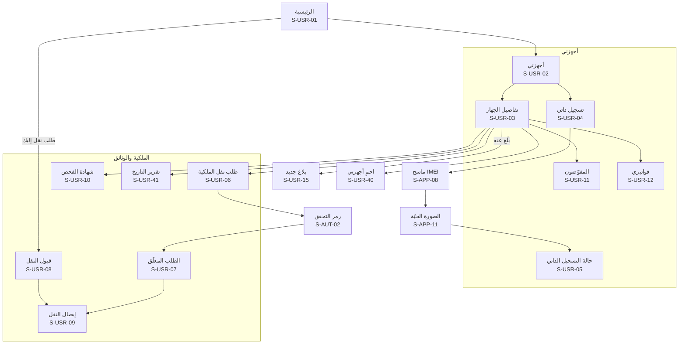

**خريطة التنقّل (2): البلاغ والحماية**

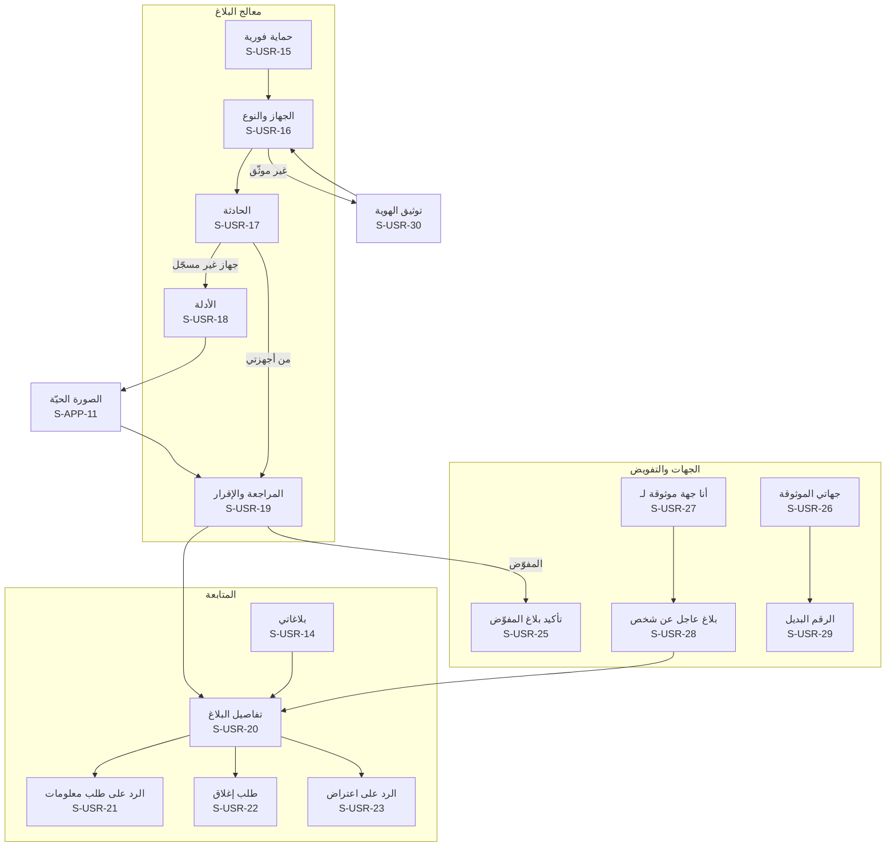

**خريطة التنقّل (3): الحساب والدعم**

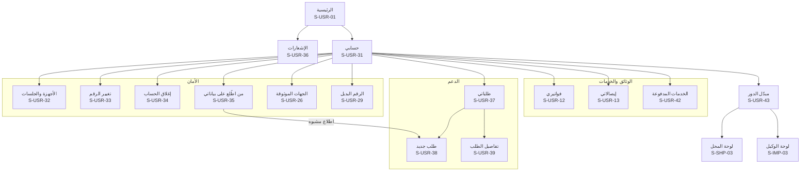

## 9. المحل: صاحبه وموظفوه (S-SHP)

تعمل في سياق المحل بعد اختياره من مبدّل الدور. **الموقع إلزامي لكل وظائف المحل** (D-41)، فتسبقها بوابة الموقع S-SHP-04. والموظف يرى من الشاشات والأزرار ما تسمح به صلاحياته فقط (`can_buy` و`can_sell` و`can_repair` و`can_view_all`)، وما لا يملكه لا يظهر له أصلاً. ونوع النشاط يحدد الوظائف: محل «خدمات اتصالات وإكسسوارات» لا يرى الشراء والبيع، ومحل «حواسيب» يتعامل بالرقم التسلسلي عند تفعيل الوحدة (D-90، SERIAL-04). وفي كل شاشة فيها بيانات من السجل المدني: **الاسم وحالة البطاقة فقط، دون أي صورة** (D-84).

| المعرّف | الشاشة | من يراها | المنصات | الغرض | المتطلبات | العناصر والإجراءات | الحالات الخاصة |
|---|---|---|---|---|---|---|---|
| S-SHP-01 | سجّل محلك | موثّق الهوية | موقع، تطبيق | طلب تسجيل محل | SHOP-01، SHOP-02، GEO-03، GEO-08، ROLLOUT-02، PUB-04 | خطوات: اسم المحل ونوع النشاط (واحد أو أكثر من: بيع وشراء أجهزة، وصيانة، وخدمات اتصالات وإكسسوارات، وحواسيب)، والمحافظة والمنطقة والعنوان التفصيلي (الشارع، والمعلم، والطابق) وهاتف المحل، ثم الخريطة بدبوس من GPS أو بالسحب، ثم رقم السجل التجاري أو الترخيص مع صورته، وصور الواجهة من الخارج والداخل، ثم قبول اتفاقية المحلات و«إرسال» | محافظة غير مفعّلة: «سجّل اهتمامك» في قائمة انتظار المحافظة بدل الإرسال؛ غير موثّق الهوية: S-USR-30 أولاً؛ مسودة |
| S-SHP-02 | حالة طلب المحل | صاحب الطلب | موقع، تطبيق | متابعة التوثيق | SHOP-03، SHOP-04 | الحالة: قيد المراجعة، أو بحاجة لتعديل (مع الحقول المطلوبة و«تعديل وإعادة إرسال»)، أو مرفوض بالسبب، أو موثّق برقم `SH-` و«ابدأ: أضف موظفيك» | — |
| S-SHP-03 | لوحة المحل | صاحب المحل، والموظف | موقع، تطبيق | نقطة البداية في سياق المحل | SHOP-12، SHOP-14، IMPORTER-05، ADS-01، SHOPWALLET-01، TOPUP-01 | رأس فيه اسم المحل والدور مع مبدّل السياق، وأزرار العمليات حسب الصلاحية ونوع النشاط (فحص، وشراء، وبيع، واستلام صيانة، وتعبئة رصيد)، ورصيد المحفظة لصاحب المحل، وأعداد اليوم، وآخر المعاملات، وتنبيهات المحل (طلب استلام من وكيل لصاحب المحل، وجهاز مبلّغ عنه عُرض اليوم)، وسلايدر الإعلانات إن فُعّل | محل معلّق: شريط السبب والسجلات للقراءة فقط؛ موظف بانتظار التوثيق: S-SHP-20 |
| S-SHP-04 | بوابة الموقع لوظائف المحل | صاحب المحل، والموظف | موقع، تطبيق | منع أي عملية دون موقع | GEO-04، SHOP-14 | شرح «وظائف المحل تحتاج موقعك، ويُسجَّل موقع كل عملية»، و«فعّل الموقع»، ومؤشر «ضمن نطاق المحل [المسافة]» | الإذن مرفوض: S-APP-07؛ أبعد من ⚙️ 500 متر: «أنت بعيد عن موقع المحل الموثّق، وستُعلَّم العملية للإدارة»؛ على الكمبيوتر: الموقع من التطبيق عبر الإكمال |
| S-SHP-05 | فحص جهاز من المحل | صاحب المحل، والموظف | موقع◐، تطبيق | فحص سريع قبل أي حديث مع الزبون | CHECK-14، SHOP-16، GSMA-03، FAKE-03، SHOP-18، SERIAL-04، SERIAL-05 | المسح (S-APP-08) أو الرقم التسلسلي لمحل «حواسيب»، والنتيجة بالصيغة نفسها مع ما يخص المحل: وسم «تسجيل ذاتي» وتاريخه، وتحذير التقليد، وحالة الهيئة، ثم أزرار «سجّل شراء» أو «سجّل بيع» أو «استلام صيانة» حسب الصلاحية | مبلّغ عنه: S-SHP-09؛ حد ⚙️ 300 فحص في الساعة |
| S-SHP-06 | شراء: الجهاز والفحص | صاحب المحل، والموظف بصلاحية الشراء | موقع◐، تطبيق | الخطوة 1 من 3 في شراء جهاز مستعمل | SHOP-06، SHOP-09، SHOP-17، SHOP-18، GSMA-03، FAKE-03، OWN-12، CUSTOMS-02، HANDOFF-01، SERIAL-04 | مسح IMEI1 وIMEI2 (أو الشركة المصنّعة والرقم التسلسلي لجهاز دون شريحة)، وتأكيد الماركة والموديل، ونتيجة الفحص الفوري، وأصل التسجيل ووسم «تسجيل ذاتي» إن وُجد، وتحذير التقليد (يُسمح بالشراء ويُعلَّم)، و«غير مسجّل لدى الهيئة» كمعلومة، ثم «التالي: البائع» | مبلّغ عنه، أو في القائمة الدولية، أو في فترة انتظار التسجيل الذاتي: S-SHP-09؛ دون اتصال: مسودة فقط |
| S-SHP-07 | شراء: بيانات البائع | صاحب المحل، والموظف بصلاحية الشراء | موقع◐، تطبيق | توثيق البائع | SHOP-06، SHOP-19، CIVIL-03، CIVIL-04، CIVIL-05، CIVIL-08، HANDOFF-01 | الرقم الوطني، ثم الاسم وحالة البطاقة من السجل المدني **دون صورة** مع «طابق الاسم مع هوية الشخص الحاضر»، والموبايل، وتصوير هوية البائع بوجهيها بالكاميرا (S-APP-10)، و«تحققت من الهوية بنفسي» | بطاقة غير سارية: يُمنع الإكمال ويُنبَّه المشرف؛ تعطل الربط: إدخال الاسم يدوياً وتعليم المعاملة لإعادة التحقق؛ تجاوز ⚙️ 30 استعلاماً في الساعة؛ الربط غير مفعّل: الاسم يدوياً؛ **البائع غير المالك المسجّل**: رسالة محايدة «تحتاج هذه العملية مراجعة» وتُعلَّق للإدارة، أو «اطلب من المالك المسجّل نقل الملكية أولاً» (D-96)؛ بائع دون 18 سنة: المعاملة باسم وليّ أمره الحاضر وهويته (D-97) |
| S-SHP-08 | شراء: الحالة والسعر والتأكيد | صاحب المحل، والموظف بصلاحية الشراء | موقع، تطبيق | إتمام الشراء | SHOP-06، REPAIR-05 | حالة الجهاز (مستعمل، أو «للقطع» إن سُمح للمحل)، والسعر اختياري، والملخص، و«تسجيل الشراء». والنتيجة: الجهاز في مخزون المحل، مع مؤشر الموقع ومهلة الإلغاء ⚙️ 30 دقيقة | — |
| S-SHP-09 | منع المعاملة | صاحب المحل، والموظف | موقع، تطبيق | إيقاف أي عملية على جهاز مبلّغ عنه بأمان | SHOP-06، SHOP-08، SHOP-16، GSMA-03، REPAIR-01، REPAIR-04، OWN-12 | شاشة حمراء كاملة: «لا تشترِ هذا الجهاز» أو «لا تبِعه» أو «لا تستلمه» حسب العملية، و«لا تواجه البائع ولا تحتجزه»، و«اعتذر بهدوء دون ذكر السبب»، و«الباقي على الإدارة وقوى الأمن»، ونموذج «عندك معلومات؟» اختياري (وصف البائع)، و«إنهاء العملية». لا تفاصيل عن البلاغ ولا صاحبه | للقائمة الدولية ولفترة الانتظار: نص «لا يمكن تسجيل هذه العملية الآن» دون عبارة «مبلّغ عنه» |
| S-SHP-10 | بيع: الجهاز والفحص | صاحب المحل، والموظف بصلاحية البيع | موقع◐، تطبيق | الخطوة 1 من 3 في البيع | SHOP-07، SHOP-08، SHOP-09، IMPORTER-06، FAKE-02، HANDOFF-01، SERIAL-04 | «جهاز جديد» بالمسح أو بالرقم التسلسلي، أو «من مخزوني»، والفحص الفوري، والملكية الحالية (ملك المحل، أو وارد من وكيل، أو جديد غير مسجّل)، وتطابق الرقمين | مبلّغ عنه: S-SHP-09؛ مسجّل باسم شخص آخر ولم يمرّ بالمخزون: «عُلّق البيع كتعارض لمراجعة مشرف المحلات» |
| S-SHP-11 | بيع: المشتري والسعر | صاحب المحل، والموظف بصلاحية البيع | موقع، تطبيق | الخطوة 2 من 3 في البيع | SHOP-07، SHOP-19، CIVIL-03، CIVIL-04، CIVIL-05 | الرقم الوطني، ثم الاسم وحالة البطاقة من السجل المدني دون صورة، وموبايل المشتري لإرسال الفاتورة، والإيميل اختياري، والسعر اختياري «يظهر للمشتري فقط»، و«تحققت من الهوية بنفسي»، و«إصدار الفاتورة» | حالات السجل المدني كما في S-SHP-07؛ مشترٍ دون 18 سنة: الفاتورة باسم وليّ أمره الحاضر وهويته، ثم «أضف القاصر مستخدماً مفوّضاً» من حساب وليّ الأمر (D-97) |
| S-SHP-12 | الفاتورة | صاحب المحل، والموظف | موقع، تطبيق | الخطوة 3 من 3: إصدار الفاتورة وتسليمها | SHOP-10، SHOP-11، THEME-04 | «سُجّل البيع وانتقلت الملكية»، ورقم `TX-`، ومؤشر الموقع ضمن النطاق، وحالة الإرسال على واتساب والإيميل، و«طباعة A4» (S-PRN-01) و«طباعة حرارية» (S-PRN-02)، و«عملية جديدة» | فشل الإرسال: «إعادة الإرسال»؛ فاتورة ملغاة بعلامة واضحة |
| S-SHP-13 | المخزون | صاحب المحل، والموظف | موقع، تطبيق | الأجهزة التي يملكها المحل الآن | SHOP-13، IMPORTER-06، REPAIR-05، STORE-13 | قائمة بالأجهزة المستعملة المشتراة، والجديدة الواردة من الوكلاء بالنقل أو بطلب من المتجر (تدخل بأرقامها تلقائياً عند التسليم)، والمعلَّمة «للقطع»، مع البحث بالرقم، و«بيع» | فارغة |
| S-SHP-14 | المعاملات | صاحب المحل (كلها)، والموظف (كلها أو ما سجّله) | موقع، تطبيق | سجل معاملات المحل وحده | SHOP-12 | بحث وتصفية **داخل معاملات المحل فقط**: التاريخ، ورقم الفاتورة، وIMEI، والموظف، والنوع (بيع، وشراء، وصيانة لمحل الصيانة) | فارغة؛ دون صلاحية «عرض كل المعاملات»: ما سجّله الموظف فقط؛ دون اتصال: آخر ما حُمّل للقراءة |
| S-SHP-15 | تفاصيل المعاملة والإلغاء والتصحيح | صاحب المحل، والموظف (لما سجّله) | موقع، تطبيق | مراجعة معاملة وتصحيحها | SHOP-15، SHOP-08 | التفاصيل (الطرف مخفي جزئياً)، والمنفّذ، والموقع، والفاتورة، و«إلغاء» مع سبب خلال ⚙️ 30 دقيقة، وبعدها «طلب تصحيح أو إلغاء» مع السبب، وحالة الطلب | تعارض قيد المراجعة؛ طلب تصحيح مرفوض بالسبب |
| S-SHP-16 | الموظفون | صاحب المحل | موقع، تطبيق | إدارة الموظفين | SHOP-05 | قائمة بالاسم والحالة (بانتظار التفعيل، وبانتظار توثيق الهوية، ونشط، وموقوف) والجهاز المربوط وآخر نشاط، و«+ موظف» | فارغة |
| S-SHP-17 | إضافة موظف أو تعديل صلاحياته | صاحب المحل | موقع، تطبيق | إنشاء حساب موظف وتحديد ما يفعل | SHOP-05، SHOPWALLET-05 | الاسم، والرقم الوطني، والموبايل، والصلاحيات حسب نوع النشاط (البيع، والشراء من أشخاص، والصيانة، وعرض كل المعاملات، وتعبئة رصيد بحد يومي ⚙️، والدفع من المحفظة لطلبات المتجر)، و«إرسال الدعوة على واتساب»، و«إعادة الإرسال»، و«إيقاف الموظف» | الرقم له حساب سابق: يُربط به؛ الصيانة غير متاحة لمحل بلا نشاط صيانة |
| S-SHP-18 | بيانات المحل | صاحب المحل | موقع، تطبيق | عرض بيانات المحل وتعديلها | SHOP-04، SHOP-01، GEO-03 | رقم المحل `SH-`، والبيانات، والموقع، والترخيص، ونوع النشاط، و«تعديل» | تعديل الاسم أو الموقع أو الترخيص: «يُراجع، ويعمل المحل ببياناته السابقة حتى الموافقة» |
| S-SHP-19 | طلبات الاستلام من الوكلاء | صاحب المحل | موقع، تطبيق | تأكيد استلام النقل بالجملة | IMPORTER-05 | الطلبات الواردة (الوكيل، والعدد، وقائمة الأجهزة)، و«تأكيد الاستلام» فتدخل المخزون، و«رفض» مع السبب | فارغة؛ طلب أُلغي من الوكيل |
| S-SHP-20 | بانتظار توثيق هويتك | موظف جديد | موقع، تطبيق | منع العمل قبل التوثيق | SHOP-05 | «لا يمكنك العمل في [المحل] قبل توثيق هويتك»، و«وثّق هويتك» (S-USR-30)، وحالة الطلب | مرفوض: الأسباب والمحاولات الباقية |
| S-SHP-21 | المتجر | صاحب المحل، ومسؤول الوكيل | موقع، تطبيق | منتجات المنصة والمورّدين | STORE-01، STORE-02، STORE-06، STORE-07، ADS-01، PAY-06 | الأقسام (أدوات المنصة، وعدّة الصيانة، والبرامج القانونية، والقطع والإكسسوارات)، والمنتجات مع وسم «متوافق مع المنصة»، ولافتات «إعلان»، والتنويه الثابت «الشراء اختياري، ولا علاقة له بالتزامك بالتسجيل» | المتجر مطفأ: يختفي مدخله؛ فارغة |
| S-SHP-22 | المنتج والسلة والطلب | صاحب المحل، ومسؤول الوكيل | موقع، تطبيق | طلب منتج مادي من المنصة | STORE-03، STORE-04، PAY-01، PAY-08، SHOPWALLET-04 | صور المنتج ووصفه وسعره واسم مورّده، و«أضف للسلة»، وعنوان التوصيل (افتراضياً عنوان المحل)، وطريقة الدفع: من محفظة المحل (لصاحبه، أو لموظف بصلاحية الدفع)، أو عند الاستلام لمندوب الشحن، أو بمحفظة أو تحويل برقم مرجعي يؤكده المشرف التجاري، و«تأكيد الطلب». متاح في التطبيق لأنه منتج مادي. ويمكن الطلب أيضاً عبر رقم واتساب الإدارة التجاري | نفدت الكمية؛ منتج أُوقف بعد الإضافة للسلة |
| S-SHP-23 | طلبات المتجر | صاحب المحل، ومسؤول الوكيل | موقع، تطبيق | متابعة الطلب حتى الاستلام | STORE-05، STORE-08، STORE-09، STORE-13 | الحالة (جديد، ومؤكَّد، وقيد التجهيز عند المورّد، ومع الشحن، ومسلَّم ومدفوع، وملغى، ومرتجع) مع إشعار عند كل تغيير، و**رمز التسليم** الذي يعطيه المحل للمندوب عند الاستلام فقط، والمبلغ المطلوب عند الاستلام، و«لم أستلم» إن عُلّم الطلب مسلَّماً دون استلام، و«إلغاء الطلب» قبل «قيد التجهيز» فقط وبعدها «طلب إلغاء» يقرره المشرف التجاري، وفاتورة المنصة باسم المورّد (S-PRN-11)، وسياسة الإرجاع والكفالة، و«طلب إرجاع» خلال المهلة (S-SHP-32). والأجهزة المطلوبة من وكيل تدخل المخزون بأرقامها عند التسليم | فارغة؛ ملغى بالسبب؛ مهلة الإرجاع انتهت |
| S-SHP-24 | باقة المحل والاشتراك | صاحب المحل | موقع، تطبيق | معرفة الباقة وما تفتحه | SHOPPRO-01، SHOPPRO-15، PAY-01، PAY-03، PAY-07، PAY-08 | الباقة الحالية: **المجانية** (كل وظائف الالتزام وطلب المتجر بالدفع عند الاستلام، ولا تتوقف أبداً) أو **المشتركين** (برنامج المحاسبة، والمحفظة، والتعبئة، والفروع) مع حالتها: تجربة مجانية حتى [التاريخ] ⚙️، أو مفعّلة حتى [التاريخ]، أو منتهية. ومقارنة الباقتين بميزاتهما. **في الموقع فقط**: الأسعار الشهرية والسنوية و«اطلب الاشتراك» الذي يفتح واتساب الإدارة التجاري برسالة فيها رقم الحساب والباقة. وتذكير التجديد ومهلة السماح ⚙️ | في التطبيق: الباقة وحالتها وميزاتها فقط، دون سعر ولا زر ولا دعوة للتواصل؛ منتهية: «بياناتك محفوظة للقراءة والتصدير ⚙️ 12 شهراً، ثم تُحذف بعد إنذار ⚙️ 30 يوماً» |
| S-SHP-25 | المخزون الكامل | صاحب المحل، والموظف بما يسمح له (باقة المشتركين) | موقع، تطبيق | كل بضاعة المحل | SHOPPRO-02، SHOPPRO-13 | الأصناف (أجهزة، وإكسسوارات، وقطع) بالباركود والكمية وسعر الكلفة، والأجهزة المسجّلة تدخل وتخرج تلقائياً مع معاملاتها، و«طباعة ملصقات باركود» (S-PRN-18)، و«جرد»، وتنبيه النفاد، وتقييم المخزون بالكلفة (مخفي عن الموظف افتراضياً) | غير مشترك: S-SHP-47؛ منتهٍ: للقراءة |
| S-SHP-26 | الصندوق اليومي | صاحب المحل، والموظف (صندوقه) | موقع، تطبيق | النقد لكل موظف أو فرع | SHOPPRO-05 | «فتح الصندوق» برصيد افتتاحي، والمقبوضات والمدفوعات (تدخلها تلقائياً مبيعات نقطة البيع والتعبئة ودفعات الديون)، و«إغلاق الصندوق» بجرد النقد وإظهار الفرق، وسجل الصناديق لصاحب المحل | غير مشترك: S-SHP-47؛ صندوق مفتوح من أمس: «أغلقه أولاً» |
| S-SHP-27 | الديون والتقسيط | صاحب المحل، والموظف بما يسمح له | موقع، تطبيق | ديون الزبائن والبيع بالتقسيط | SHOPPRO-08 | الزبائن ورصيد كل منهم، والدفعات، و«بيع بالتقسيط» بجدول دفعات، وتذكير على واتساب بموعد كل دفعة، و«كشف حساب الزبون» (S-PRN-19) | غير مشترك: S-SHP-47؛ دفعة متأخرة بشارة |
| S-SHP-28 | الكفالات | صاحب المحل، والموظف | موقع، تطبيق | كفالات المبيعات والصيانة | SHOPPRO-09 | الكفالات بتاريخ انتهائها، وتنبيه قبل الانتهاء، والبحث بالزبون أو الجهاز | غير مشترك: S-SHP-47 |
| S-SHP-29 | الفروع | صاحب المحل | موقع، تطبيق | أكثر من فرع بحساب واحد | SHOPPRO-12 | الفروع (كل فرع محل موثّق بموقعه ورقمه)، ولكل فرع مخزونه وصندوقه، و«تحويل بضاعة بين الفروع»، والتقارير المجمّعة، وحد الفروع في الباقة | غير مشترك: S-SHP-47؛ بلغ حد الباقة |
| S-SHP-30 | التقارير والتصدير | صاحب المحل (والموظف بما يسمح له) | موقع، تطبيق | أرباح المحل وأداؤه | SHOPPRO-11، SHOPPRO-15 | الأرباح يومياً وشهرياً وسنوياً، والأكثر مبيعاً، وربح الرصيد والخطوط منفصلاً، وأداء الموظفين والفروع، وحركة المخزون، و«طباعة» و«تصدير Excel وPDF» (S-PRN-19)، وجملة «هذه البيانات ملكك ولا يراها غيرك» | غير مشترك: S-SHP-47؛ بعد الانتهاء: التصدير متاح ⚙️ 12 شهراً ثم حذف بعد إنذار ⚙️ 30 يوماً |
| S-SHP-31 | إعلانات المحل | صاحب المحل الموثّق | موقع، تطبيق | الإعلان للجمهور «اشترِ من محل موثّق» | ADS-03، ADS-04، ADS-05، ADS-06، ADS-07، PAY-01، PAY-08 | **في الموقع**: إنشاء حملة (الصورة، والنص، والرابط، والمحافظة، والمدة، والباقة) و«اطلب التفعيل». وفي الاثنين: الحملات بحالتها (قيد المراجعة، ومفعّلة حتى، ومنتهية، ومرفوضة بالسبب)، والمشاهدات والضغطات | في التطبيق: الحالة والإحصاءات فقط؛ الإعلانات مطفأة: يختفي المدخل |
| S-SHP-32 | طلب إرجاع أو عيب | صاحب المحل، ومسؤول الوكيل | موقع، تطبيق | إرجاع منتج معيب أو غير مطابق | STORE-11 | اختيار الطلب والمنتج والكمية، والسبب (عيب، أو غير مطابق، أو تالف عند الاستلام)، والصور **بالكاميرا مباشرة**، و«إرسال»، ثم الحالة وقرار المشرف التجاري وطريقة إعادة الحق | بعد ⚙️ 7 أيام من الاستلام: «انتهت مهلة الإرجاع» مع «طلب دعم»؛ قيد المراجعة |
| S-SHP-33 | محفظة المحل | صاحب المحل (والموظف يرى زر التعبئة وحدّه المتبقي فقط) | موقع، تطبيق | الرصيد والعمليات السريعة | SHOPWALLET-01، SHOPWALLET-04، SHOPWALLET-07، SHOPWALLET-08 | «تفعيل المحفظة» أول مرة لمحل مشترك، ثم الرصيد، وجملة «أموال محفظتك محفوظة لدى شام كاش في حساب باسم محلك»، وأزرار: شحن، وسحب، وتعبئة رصيد، وكشف الحساب، والإعدادات، و«تجميد المحفظة فوراً» | غير مشترك: S-SHP-47؛ اشتراك منتهٍ: التعبئة والدفع متوقفان و«السحب متاح لك دائماً»؛ غير مفعّلة؛ مجمّدة من صاحبها أو من الإدارة: التعبئة والدفع متوقفان والسحب متاح؛ تجميد من شام كاش أو بأمر جهة رسمية: يظهر بأنه خارجي؛ إيقاف السحب المؤقت عند اختراق مؤكد (D-100): السبب ووقت الانتهاء؛ محل معلّق: المحفظة معلّقة معه؛ فرق مطابقة يوقف العمليات المعنية |
| S-SHP-34 | شحن المحفظة | صاحب المحل | موقع، تطبيق | إدخال مال من شام كاش | SHOPWALLET-02 | رقم محفظة المحل ورمز QR لمسحه من تطبيق شام كاش، و«نسخ الرقم»، وآخر عمليات الشحن بحالتها | بانتظار تأكيد شام كاش؛ تعطل الربط |
| S-SHP-35 | السحب إلى شام كاش | صاحب المحل فقط | موقع، تطبيق | إخراج المال لمحفظة صاحب المحل | SHOPWALLET-03، SHOPWALLET-07 | محفظة شام كاش المسجّلة **باسم صاحب المحل نفسه** (لا إدخال لمحفظة أخرى)، والمبلغ، والحدان اليومي والشهري المتبقيان ⚙️، ثم رمز المحفظة ورمز التحقق (S-AUT-02) | متاح في كل الحالات حتى بعد انتهاء الاشتراك أو التجميد، إلا أثناء إيقاف السحب المؤقت (D-100) فيظهر سببه ووقت انتهائه؛ فترة التهدئة؛ تجاوز الحد؛ رمز المحفظة مقفل بعد ⚙️ 5 محاولات؛ لا محفظة باسم المالك: شرح طريقة ربطها |
| S-SHP-36 | كشف حساب المحفظة | صاحب المحل فقط | موقع، تطبيق | كل حركة على المحفظة | SHOPWALLET-06، TOPUP-04 | العمليات برقمها المرجعي ونوعها (شحن، وسحب، وتعبئة، ودفع طلب، ودفع خدمة، واسترداد تعبئة) ومنفّذها ووقتها، والبحث، و«تصدير» (S-PRN-16) | فارغة |
| S-SHP-37 | إعدادات المحفظة | صاحب المحل فقط | موقع، تطبيق | الأمان وحدود الموظفين | SHOPWALLET-05، SHOPWALLET-07 | تعيين رمز المحفظة وتغييره، وحد التعبئة اليومي لكل موظف، وصلاحية الدفع من المحفظة، وحد التنبيه ⚙️، وفك التجميد | تغيير الرمز يتطلب رمز تحقق |
| S-SHP-38 | تعبئة رصيد | صاحب المحل، والموظف بصلاحية التعبئة | موقع، تطبيق | بيع رصيد لرقم زبون | TOPUP-01، TOPUP-05، SHOPWALLET-05 | رقم الزبون، والشبكة المميَّزة تلقائياً من البادئة، والقيم أو الباقات المتاحة، وعمولة المحل، ثم شاشة التأكيد بالرقم **بخط كبير** والشبكة والقيمة، و«تأكيد التعبئة» | غير مشترك أو اشتراك منتهٍ: S-SHP-47؛ بادئة غير معروفة؛ رصيد المحفظة لا يكفي؛ تجاوز حد الموظف اليومي أو حد الرقم في الساعة ⚙️؛ الشركة مطفأة؛ دون اتصال: لا تعبئة |
| S-SHP-39 | نتيجة التعبئة وإيصالها | صاحب المحل، والموظف بصلاحية التعبئة | موقع، تطبيق | معرفة ما حدث فوراً | TOPUP-02، TOPUP-03 | ناجحة مع الإيصال و«طباعة» (S-PRN-15)، أو معلّقة مع «تُحسم خلال ⚙️ مهلة المطابقة»، أو فاشلة مع «أُعيد المبلغ لمحفظتك» | معلّقة طويلاً: تظهر في السجل حتى الحسم |
| S-SHP-40 | سجل التعبئات وأرباحها | صاحب المحل (كله)، والموظف (ما نفّذه) | موقع، تطبيق | متابعة التعبئات وعمولتها | TOPUP-03، TOPUP-04 | البحث برقم الهاتف أو التاريخ أو الموظف، والحالة، والعمولة لكل عملية، والكشف الشهري للأرباح | فارغة |
| S-SHP-41 | نقطة البيع | صاحب المحل، والموظف بصلاحية البيع (باقة المشتركين) | موقع، تطبيق | بيع الإكسسوارات والقطع بسرعة | SHOPPRO-03 | مسح الباركود أو البحث، والسلة، والخصم، والدفع نقداً أو من المحفظة أو بالدين، و«فاتورة» مطبوعة أو على واتساب (S-PRN-17). **والأجهزة لا تُباع هنا** بل تُحوَّل إلى معاملة السجل (S-SHP-10) | **دون اتصال: البيع النقدي للإكسسوارات يستمر** ويُزامَن عند عودة الشبكة مع شارة «بانتظار المزامنة»، والدفع من المحفظة والدين يحتاجان اتصالاً؛ غير مشترك: S-SHP-47 |
| S-SHP-42 | المشتريات وحسابات المورّدين | صاحب المحل (والموظف بما يسمح له) | موقع، تطبيق | ما يشتريه المحل وما عليه | SHOPPRO-04 | فواتير الشراء من المتجر (تلقائياً) أو من خارجه (يدوياً)، وحساب كل مورّد للمحل (له وعليه)، و«تسجيل دفعة» | غير مشترك: S-SHP-47 |
| S-SHP-43 | المصاريف | صاحب المحل | موقع، تطبيق | مصاريف المحل | SHOPPRO-06 | المصاريف بتصنيفات يحددها المحل (إيجار، وكهرباء، وإنترنت، ورواتب، وغيرها)، و«إضافة مصروف» مع صورة الإيصال | غير مشترك: S-SHP-47 |
| S-SHP-44 | الرواتب والعمولات | صاحب المحل | موقع، تطبيق | مستحقات الموظفين | SHOPPRO-07 | لكل موظف: الراتب والسلف ونسبة العمولة على المبيعات أو الصيانة، والكشف الشهري. والموظف يرى كشفه هو فقط إن سمح صاحب المحل | غير مشترك: S-SHP-47 |
| S-SHP-45 | ما يراه الموظفون في البرنامج | صاحب المحل | موقع، تطبيق | ضبط رؤية البرنامج لكل موظف | SHOPPRO-13 | لكل موظف: الشاشات المتاحة من البرنامج، وإظهار الأسعار والتكاليف والأرباح (مخفية افتراضياً)، ورواتب الآخرين (مخفية دائماً) | — |
| S-SHP-46 | خصوصية بيانات المحاسبة | صاحب المحل | موقع، تطبيق | طمأنة صاحب المحل أن بياناته له وحده | SHOPPRO-14، PRIV-11 | «بيانات المحاسبة ملكك وحدك: لا يراها أحد من المنصة أبداً، لا الإدارة ولا الدعم ولا المبرمجون ولا قوى الأمن ولا الوزارة، ولا حتى بإذنك»، و«الدعم يساعدك بالشرح فقط»، ورابط «طلب دعم» و«تصدير بياناتي» (S-SHP-30) | — |
| S-SHP-47 | ميزة ضمن باقة المشتركين | صاحب المحل والموظف في محل باقته مجانية أو منتهية | موقع، تطبيق | توضيح سبب قفل الميزة | SHOPPRO-01، PAY-08، SHOPWALLET-01 | اسم الميزة وما تقدّمه، و«ضمن باقة المشتركين». **في الموقع**: «اطلب الاشتراك» (واتساب الإدارة التجاري). **في التطبيق**: الحالة فقط «غير مفعّلة» دون زر ولا دعوة. وللمحفظة بعد الانتهاء: «السحب متاح لك دائماً» | للموظف: «اطلب من صاحب المحل» دون أي إشارة للشراء |
| S-SHP-48 | الرصيد والخطوط | صاحب المحل (والموظف بما يسمح له) (باقة المشتركين) | موقع، تطبيق | قسم مستقل لتجارة الرصيد والشرائح | SHOPPRO-16، TOPUP-04 | تبويبات: التعبئات وأرباحها (من S-SHP-40 تلقائياً)، ومخزون الخطوط لكل شركة بأرقامها وكلفتها، و«تسجيل بيع خط» بالسعر والعمولة، وربح الرصيد والخطوط منفصلاً. وجملة «تفعيل الخط باسم المشتري لدى شركة الاتصالات بإجراءاتها، ولا يجمع البرنامج بيانات هوية مشتري الخط» | غير مشترك: S-SHP-47؛ خط مسجّل مبيعاً من قبل |
| S-SHP-49 | بلاغ سرقة المحل | صاحب المحل | موقع، تطبيق | التبليغ عن أجهزة المخزون المسروقة دفعة واحدة | REPORT-18، REPORT-08، SERIAL-03 | اختيار الأجهزة من المخزون (بعضها أو «كلها»، موبايلات بـ IMEI وحواسيب بالرقم التسلسلي) مع العدد، وتاريخ الحادثة ومكانها (المحل افتراضياً)، ورقم الضبط إن وُجد، والوصف، والإقرار، و«إرسال». والنتيجة: بلاغ واحد برقم `BL-` يُراجع بأولوية | جهاز عليه بلاغ قائم: يُستثنى مع السبب؛ غير موثّق الهوية: S-USR-30 أولاً |
| S-SHP-50 | متابعة بلاغ سرقة المحل | صاحب المحل | موقع، تطبيق | حالة كل جهاز مسروق على حدة | REPORT-18، REPORT-09، PP-10 | حالة البلاغ، ثم قائمة الأجهزة وحالة كل منها: ما زال مفقوداً، أو ظهر (دون مكان ولا فاحص)، أو ضُبط لدى [القسم]، أو أُعيد. و«طلب إغلاق» لجهاز أُعيد أو للبلاغ كله | — |
| S-SHP-51 | رمز المحفظة: التعيين والاستعادة | صاحب المحل فقط | موقع، تطبيق | رمز المحفظة المستقل عن كلمة المرور | SHOPWALLET-07 | عند التفعيل: تعيين رمز من 6 أرقام مرتين. و«نسيت رمز المحفظة»: كلمة المرور ثم رمز تحقق ثم رمز جديد، ويُوقف السحب ⚙️ 72 ساعة بعد الاستعادة كفترة التهدئة | قُفل الرمز بعد ⚙️ 5 محاولات: الاستعادة وحدها تفتحه؛ رمز ضعيف (تكرار أو تسلسل): رفض |
| S-SHP-52 | حالة التزام المحل | صاحب المحل | موقع، تطبيق | يعرف المحل وضعه هو فقط | COMPLIANCE-04 | هل كل العمليات مسجّلة، وملاحظات الإدارة إن وُجدت، وتاريخ آخر تقرير شمله. **لا يرى التقرير المرسل للوزارة ولا بيانات غيره** | محل جديد: «لم يشمله تقرير بعد» |

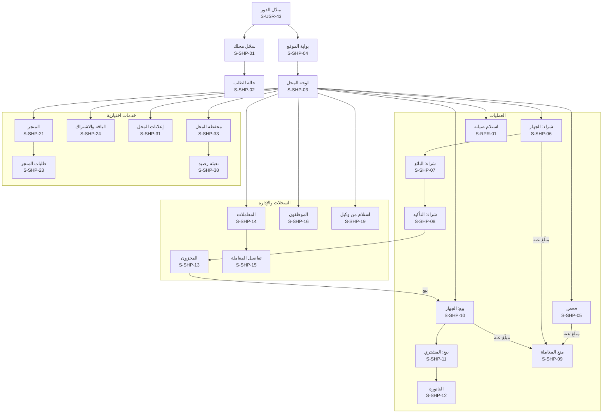

## 10. محل الصيانة (S-RPR)

لمحل نوع نشاطه «صيانة» أو «كلاهما»، ولموظف بصلاحية «تسجيل صيانة». تخضع لبوابة الموقع S-SHP-04، وتشارك شاشة المنع S-SHP-09. وشراء جهاز «للقطع» يتم بمسار الشراء العادي (S-SHP-06 إلى S-SHP-08).

| المعرّف | الشاشة | من يراها | المنصات | الغرض | المتطلبات | العناصر والإجراءات | الحالات الخاصة |
|---|---|---|---|---|---|---|---|
| S-RPR-01 | استلام للصيانة: الجهاز والفحص | صاحب محل الصيانة، والموظف بصلاحية الصيانة | موقع◐، تطبيق | فحص إلزامي قبل الاستلام | REPAIR-01، SHOP-09، GEO-04، HANDOFF-01، SERIAL-04 | مسح IMEI (أو الرقم التسلسلي لحاسوب)، والفحص الفوري، والموديل، و«التالي: صاحب الجهاز» | مبلّغ عنه: S-SHP-09 بنص «لا تستلم هذا الجهاز»؛ دون اتصال: لا استلام |
| S-RPR-02 | استلام: صاحب الجهاز والعطل | صاحب المحل، والموظف بصلاحية الصيانة | موقع، تطبيق | تسجيل صاحب الجهاز وحالته | REPAIR-01، REPAIR-06، CIVIL-03، CIVIL-04 | الرقم الوطني، والاسم وحالة البطاقة من السجل المدني دون صورة، والموبايل، ووصف العطل وحالة الجهاز، و«اللوحة الأم قد تُستبدل»، وتنبيه «الاستلام لا ينقل الملكية»، و«تسجيل الاستلام وإرسال الإيصال» | حالات السجل المدني كما في S-SHP-07 |
| S-RPR-03 | إيصال الاستلام | صاحب المحل، والموظف | موقع، تطبيق | تسليم إيصال لصاحب الجهاز | REPAIR-02، THEME-04 | رقم `CR-` وQR، وحالة الإرسال على واتساب، و«طباعة حرارية» (S-PRN-06) | فشل الإرسال: «إعادة الإرسال» |
| S-RPR-04 | أوامر الصيانة | صاحب المحل، والموظف بصلاحية الصيانة | موقع، تطبيق | الأجهزة في المحل | REPAIR-03، SHOPPRO-10 | تبويبات: في المحل، وجاهزة، وسُلّمت، و«متروك» لما تجاوز ⚙️ 90 يوماً مع الشرح، وبحث بالرقم | فارغة |
| S-RPR-05 | تفاصيل أمر الصيانة | صاحب المحل، والموظف بصلاحية الصيانة | موقع، تطبيق | تحديث حالة الجهاز | REPAIR-03، REPAIR-06، SHOPPRO-10 | الحالة (مستلم، وقيد الصيانة، وجاهز)، والملاحظات، و«استبدال اللوحة الأم»، و«تسليم». وبالصيانة المتقدمة المدفوعة: الفني، والقطع المستخدمة، والتسعير، و«أبلغ الزبون بالجاهزية» | الصيانة المتقدمة غير مفعّلة: الحقول الأساسية فقط |
| S-RPR-06 | استبدال اللوحة الأم | صاحب المحل، والموظف بصلاحية الصيانة | موقع◐، تطبيق | تسجيل تغيّر IMEI | REPAIR-04، FAKE-02 | IMEI القديم (معبّأ)، ومسح IMEI الجديد، والفحص الفوري للجديد، و«تسجيل الاستبدال». وتبقى الملكية كما هي | الرقم الجديد لجهاز مبلّغ عنه: S-SHP-09 وتنبيه أمني؛ الرقم الجديد مرتبط بجهاز آخر: تعارض للمراجعة |
| S-RPR-07 | تسليم الجهاز | صاحب المحل، والموظف بصلاحية الصيانة | موقع، تطبيق | إغلاق أمر الصيانة | REPAIR-03 | المستلِم: صاحب الجهاز أو من يفوّضه (الاسم ورقمه)، و«تسجيل التسليم» | — |

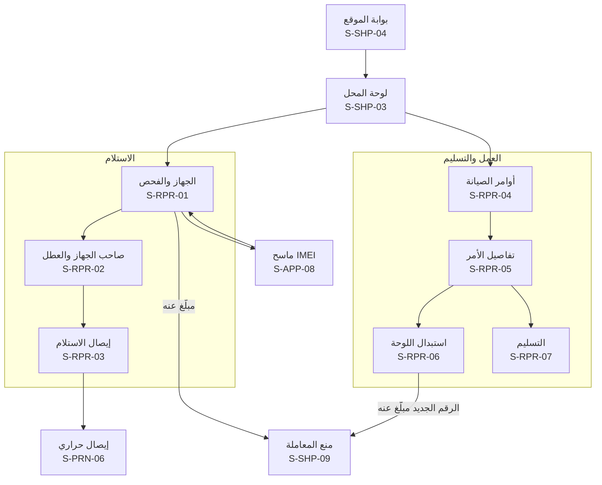

## 11. الوكيل والمستورد (S-IMP)

في سياق الوكيل بعد اختياره من مبدّل الدور. الموقع الإلكتروني هو الأنسب للملفات الكبيرة، والتطبيق للمسح. ومسؤول الوكيل يرى كل الشاشات، والموظف ما تمنحه صلاحياته: **رفع الدفعات**، و**النقل بالجملة**، و**عرض كل المعاملات** (بالقواعد نفسها لموظفي المحلات، IMPORTER-02).

| المعرّف | الشاشة | من يراها | المنصات | الغرض | المتطلبات | العناصر والإجراءات | الحالات الخاصة |
|---|---|---|---|---|---|---|---|
| S-IMP-01 | سجّل كوكيل أو مستورد | موثّق الهوية | موقع، تطبيق | طلب توثيق جهة استيراد | IMPORTER-01، GEO-03، PUB-04 | اسم الشركة، ورقم السجل التجاري وصورته، وإجازة الاستيراد أو الوكالة وصورتها، والمحافظة والعنوان، والخريطة بدبوس، وبيانات المسؤول (صاحب الطلب)، و«إرسال» | غير موثّق الهوية: S-USR-30 أولاً؛ مسودة |
| S-IMP-02 | حالة طلب التوثيق | صاحب الطلب | موقع، تطبيق | متابعة التوثيق | IMPORTER-01 | قيد المراجعة، أو بحاجة لتعديل، أو مرفوض بالسبب، أو موثّق برقم الوكيل | — |
| S-IMP-03 | لوحة الوكيل | المسؤول، والموظف | موقع، تطبيق | نقطة البداية في سياق الوكيل | IMPORTER-08، CUSTOMS-04 | عدد الأجهزة في المخزون، وآخر الدفعات، وطلبات النقل المعلّقة، والأجهزة المعلَّمة «غير مسجّلة لدى الهيئة»، وأزرار «رفع دفعة» و«نقل لمحل» حسب الصلاحية | وكيل معلّق: للقراءة فقط |
| S-IMP-04 | رفع دفعة أجهزة | المسؤول، والموظف بصلاحية الرفع | موقع، تطبيق | تسجيل أجهزة جديدة بالجملة | IMPORTER-03، FAKE-02، IMPORTER-07، SERIAL-06 | «تنزيل نموذج الملف» (وللحواسيب: الشركة المصنّعة والرقم التسلسلي بدل IMEI)، ورفع Excel أو CSV، أو مسح الأجهزة واحداً واحداً بالتطبيق، ومعاينة أول الأسطر، و«إرسال للمعالجة» | الملف بصيغة خاطئة أو أعمدة ناقصة؛ قيد المعالجة بشريط تقدّم ويمكن مغادرة الشاشة |
| S-IMP-05 | تقرير الدفعة | المسؤول، والموظف بصلاحية الرفع | موقع، تطبيق | معرفة المقبول والمرفوض | IMPORTER-03، IMPORTER-07، CUSTOMS-04 | عدد المقبول والمرفوض، والأسطر المرفوضة بأسبابها (Luhn، ومكرر في الملف، وموجود في المنصة فصار تعارضاً، والرقمان لا يطابقان الموديل)، و«تنزيل التقرير» (S-PRN-12) | — |
| S-IMP-06 | مخزون الوكيل | المسؤول، والموظف | موقع، تطبيق | الأجهزة بأصل «وكيل» في المخزون | IMPORTER-04، CUSTOMS-04، SERIAL-06 | قائمة بالبحث والتصفية (الموديل، والدفعة، ونوع الجهاز)، ووسم «غير مسجّل لدى الهيئة»، واختيار أجهزة للنقل | فارغة |
| S-IMP-07 | نقل بالجملة لمحل | المسؤول، والموظف بصلاحية النقل | موقع، تطبيق | إرسال أجهزة لمحل موثّق | IMPORTER-05 | **رقم المحل `SH-`** ثم ظهور اسمه ومحافظته للتأكيد (لا قائمة محلات ولا دليل، D-22)، واختيار الأجهزة (بالمسح، أو بملف، أو من المخزون)، و«إرسال طلب النقل» | محل غير موثّق أو معلّق: رفض؛ رقم محل خاطئ |
| S-IMP-08 | طلبات النقل | المسؤول، والموظف | موقع، تطبيق | متابعة الاستلام | IMPORTER-05 | الطلبات بحالتها (بانتظار تأكيد المحل، ومؤكَّد، ومرفوض بالسبب، وملغى)، و«إلغاء» قبل التأكيد | معلّق أكثر من ⚙️ 7 أيام: شارة «عُلّم للإدارة» |
| S-IMP-09 | سجل معاملات الوكيل | المسؤول، والموظف بصلاحية العرض | موقع، تطبيق | السجل الكامل للوكيل | IMPORTER-08 | الدفعات، والنقل لكل محل، وحركة المخزون، مع البحث والتصفية | فارغة |
| S-IMP-10 | الموظفون | مسؤول الوكيل | موقع، تطبيق | إدارة موظفي الوكيل | IMPORTER-02 | كما في S-SHP-16 | فارغة |
| S-IMP-11 | إضافة موظف أو تعديل صلاحياته | مسؤول الوكيل | موقع، تطبيق | حساب موظف بصلاحياته | IMPORTER-02 | الاسم، والرقم الوطني، والموبايل، والصلاحيات (رفع الدفعات، والنقل بالجملة، وعرض كل المعاملات)، والدعوة، والإيقاف | كما في S-SHP-17 |
| S-IMP-12 | بيانات الوكيل | مسؤول الوكيل | موقع، تطبيق | عرض البيانات وتعديلها | IMPORTER-01 | البيانات والمستندات، و«تعديل» يعيد المسّ بالسجل أو الإجازة أو الموقع للمراجعة | — |
| S-IMP-13 | الربط البرمجي | مسؤول الوكيل | موقع | تسجيل الأجهزة آلياً من نظام الوكيل | IMPORTER-03 | حالة الربط (غير مطلوب، أو بانتظار اعتماد مشرف المحلات، أو مفعّل)، و«طلب الربط»، وإنشاء المفتاح وعرضه مرة واحدة، وتدويره، وإلغاؤه، وسجل الاستخدام | — |

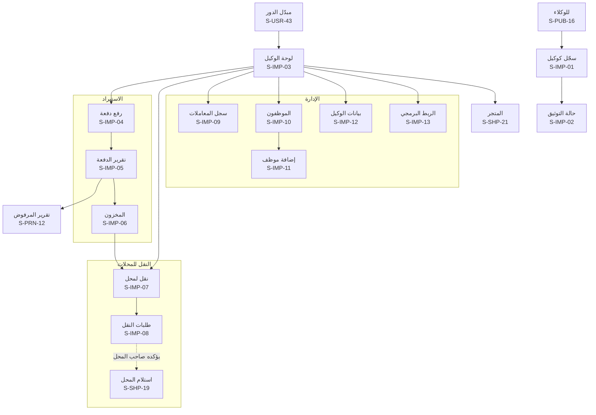

## 12. المورّد المعتمد (S-SUP)

لوحة المورّد في سياق «مورّد» بعد اختياره من مبدّل الدور (D-87). **على الموقع الإلكتروني فقط** (ويصلح لشاشة الموبايل)، ولا وضع لها في التطبيق. والمورّد **لا يرى من المحلات إلا اسم المحل وعنوان التوصيل لطلباته**، ولا علاقة له بالأجهزة أو البلاغات أو الهويات (03 §2.4.3، STORE-12). ولا يُنشر منتج ولا تعديل عليه إلا بعد مراجعة المشرف التجاري. والمتجر لكل ما يخص الموبايلات والحواسيب (D-88). **والوكيل المعتمد الذي يعرض الأجهزة نفسها في المتجر** يستخدم هذه الشاشات من سياق الوكيل بالفروق المذكورة في S-SUP-05 وS-SUP-07 (STORE-13).

| المعرّف | الشاشة | من يراها | المنصات | الغرض | المتطلبات | العناصر والإجراءات | الحالات الخاصة |
|---|---|---|---|---|---|---|---|
| S-SUP-01 | طلب اعتماد مورّد | صاحب حساب يمثّل جهة توريد | موقع | التقدّم للبيع في المتجر | STORE-03، STORE-12 | اسم الجهة، والسجل التجاري وصورته، والرقم الضريبي، وجهة التواصل، والأقسام، ونطاق التوصيل، وقبول اتفاقية المورّد (حصة المنصة، وسياسة الإرجاع والكفالة)، و«إرسال» | المتجر مطفأ: لا مدخل؛ مسودة |
| S-SUP-02 | حالة طلب الاعتماد | صاحب الطلب | موقع | متابعة الاعتماد | STORE-03 | قيد المراجعة، أو مرفوض بالسبب الجاهز، أو معتمد مع حصة المنصة المتفق عليها و«ابدأ: أضف منتجاتك» | — |
| S-SUP-03 | لوحة المورّد | المورّد المعتمد | موقع | نقطة البداية | STORE-05، STORE-10، STORE-12 | الطلبات الجديدة المسندة للتجهيز، والمنتجات قيد المراجعة أو المرفوضة، وآخر كشف تسوية وصافيه، وتنبيه المرتجعات | مورّد محظور: شريط السبب والقراءة فقط |
| S-SUP-04 | منتجاتي | المورّد المعتمد | موقع | كتالوج المورّد | STORE-02، STORE-06، STORE-12 | المنتجات بحالتها (قيد المراجعة، ومنشور، ومرفوض بالسبب، وموقوف)، والسعر والمخزون، و«+ منتج»، وتحديث المخزون | فارغة |
| S-SUP-05 | إضافة منتج أو تعديله | المورّد المعتمد | موقع | عرض منتج للمراجعة | STORE-02، STORE-06، STORE-12، STORE-13 | الاسم، والقسم، والصور، والوصف، والسعر، والمخزون، وتنويه ثابت بالأصناف الممنوعة. وللوكيل: اختيار موديل من مخزونه بعدد الأجهزة المتاحة، والأجهزة نفسها لا يعرضها إلا وكيل، و«إرسال للمراجعة». وأي تعديل على منتج منشور يعيده للمراجعة | القسم ضمن الأصناف الممنوعة: لا يُقبل الإرسال؛ تعديل السعر أو الوصف: «يبقى المنتج بنسخته السابقة حتى الموافقة» |
| S-SUP-06 | الطلبات المسندة | المورّد المعتمد | موقع | ما يجب تجهيزه | STORE-05، STORE-12 | تبويبات: للتجهيز، وبانتظار الشحن، ومع الشحن، ومسلَّمة، وملغاة، ومرتجعة. ولكل طلب: الرقم، واسم المحل، والمحافظة، والأصناف | فارغة |
| S-SUP-07 | تجهيز الطلب وتسليمه للشحن | المورّد المعتمد | موقع | تجهيز الطلب وتسليمه للمندوب | STORE-05، STORE-09، STORE-12، STORE-13 | الأصناف والكميات، واسم المحل وعنوان التوصيل فقط، وللوكيل: مسح أرقام الأجهزة المرسلة فتنتقل لمخزون المحل بأرقامها عند التسليم كنقل بالجملة، و«الطلب جاهز للاستلام»، و**رمز الاستلام** الذي يعطيه المورّد للمندوب، و«طباعة ملصق الطلب» (S-PRN-14) | صنف نفد: «تعذّر التجهيز» مع السبب فيراجعه المشرف التجاري |
| S-SUP-08 | المرتجعات والعيوب | المورّد المعتمد | موقع | معرفة ما خُصم ولماذا | STORE-11 | المرتجعات المرتبطة بمنتجاته، وقرار المشرف التجاري، والقيمة المخصومة من التسوية، و«ملاحظة للمشرف» | فارغة |
| S-SUP-09 | كشوف التسوية | المورّد المعتمد | موقع | معرفة المستحقات | STORE-10 | الكشوف الدورية (⚙️ أسبوعياً): الطلبات المسلّمة والمدفوعة، ناقص حصة المنصة، وناقص المرتجعات والعيوب، والصافي، وحالة التحويل ورقمه المرجعي، و«تحميل PDF» (S-PRN-13) | كشف قيد الإعداد أو بانتظار الموافقة؛ فارغة |
| S-SUP-10 | بيانات المورّد وحساب التسوية | المورّد المعتمد | موقع | البيانات والحساب المستلم | STORE-03، STORE-10 | البيانات والمستندات، والحساب المستلم للتسويات. وتغيير الحساب المستلم يُراجع ويؤكده المشرف التجاري، وتُوقف التسوية حتى التأكيد | تغيير قيد التأكيد |
| S-SUP-11 | إعلانات المورّد | المورّد المعتمد | موقع | الإعلان للمحلات | ADS-03، ADS-04، ADS-05، ADS-07، PAY-01 | كما في S-SHP-31: إنشاء حملة للمحلات، و«اطلب التفعيل»، والحالة، والمشاهدات والضغطات | الإعلانات مطفأة: يختفي المدخل |

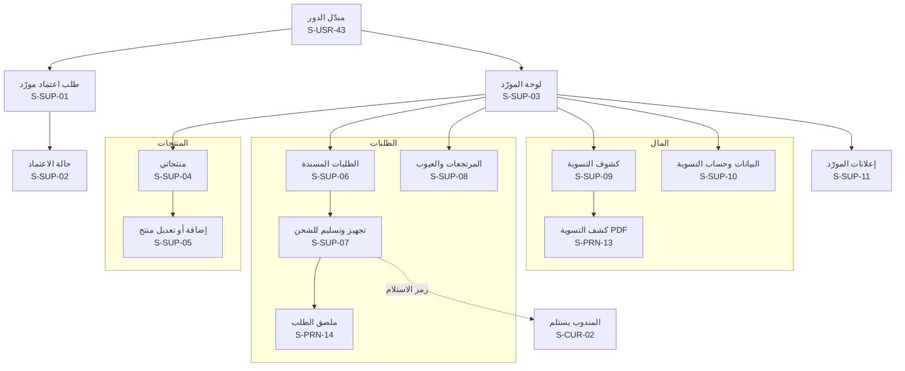

## 13. مندوب الشحن (S-CUR)

حين يشحن مندوب المنصة نفسه بدل شركة الشحن المتعاقدة (STORE-09، STORE-14). **على الموقع الإلكتروني فقط** من متصفح الموبايل، ولا وضع له في التطبيق. وشركة الشحن المتعاقدة تُسجّل الاستلام والتسليم والقبض عبر الربط الآلي دون شاشات. والمندوب يرى لكل طلب **اسم المحل وعنوانه وهاتفه ومبلغ التحصيل فقط**.

| المعرّف | الشاشة | من يراها | المنصات | الغرض | المتطلبات | العناصر والإجراءات | الحالات الخاصة |
|---|---|---|---|---|---|---|---|
| S-CUR-01 | مهام التوصيل | مندوب المنصة | موقع (موبايل) | طلبات اليوم المسندة إليه | STORE-14، STORE-09 | الطلبات بترتيب الاستلام ثم التسليم: المورّد، والمحل وعنوانه وهاتفه، ومبلغ التحصيل، والحالة، والنقد المحصّل اليوم | فارغة؛ بلا اتصال: آخر ما حُمّل للقراءة، ولا تسجيل دون اتصال |
| S-CUR-02 | الاستلام والتسليم والقبض | مندوب المنصة | موقع (موبايل) | إثبات كل خطوة | STORE-14، STORE-09، STORE-05 | عند المورّد: «أدخل رمز الاستلام». وعند المحل: «أدخل رمز التسليم من المحل»، والمبلغ المقبوض، و«تم التسليم والقبض». والطلب لا يصبح «مسلَّماً ومدفوعاً» دون الرمزين | رمز خاطئ؛ المحل رفض الاستلام: السبب ويعود الطلب للمورّد |
| S-CUR-03 | نقد اليوم وتوريده | مندوب المنصة | موقع (موبايل) | تسليم ما قبضه للمنصة | STORE-09 | الطلبات المسلّمة اليوم ومبالغها، والمجموع، و«سُلّم النقد» برقم مرجعي يطابقه المشرف التجاري في S-ADM-36 | فرق مع المطابقة: يظهر للمندوب بلا تفاصيل غيره |

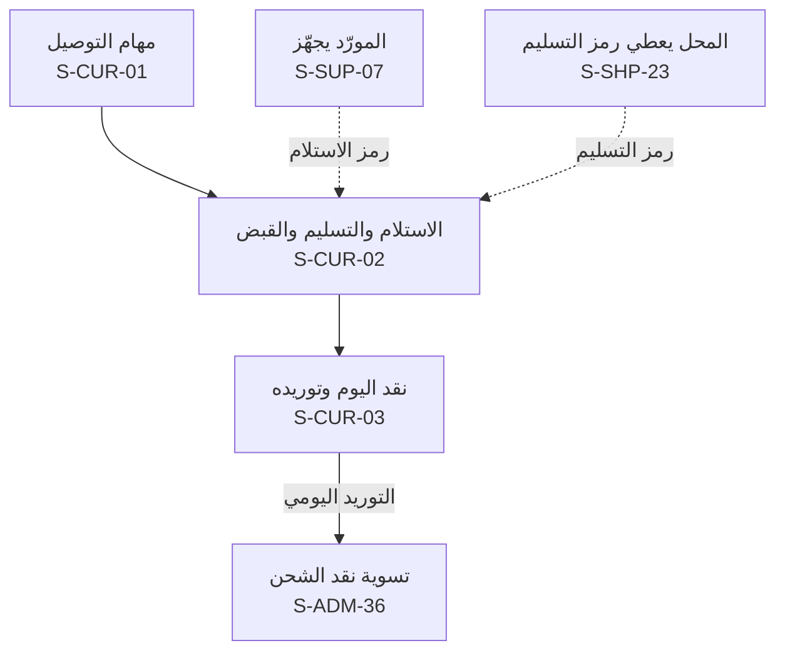

## 14. شاشات التطبيق الخاصة (S-APP)

ما لا يوجد إلا في التطبيق. وطلب أي إذن يكون **لحظة الحاجة** بعد شاشة تمهيد، لا عند أول فتح. وتمهيد إذن الموقع هو S-PUB-02 في الفحص، وS-SHP-04 في المحل.

| المعرّف | الشاشة | من يراها | المنصات | الغرض | المتطلبات | العناصر والإجراءات | الحالات الخاصة |
|---|---|---|---|---|---|---|---|
| S-APP-01 | شاشة الإقلاع | الجميع | تطبيق | فحص الإصدار وفتح السياق الأخير | APPVER-01، SMART-11، ROLLOUT-04 | الشعار، ومقارنة الإصدار بالأدنى والموصى به، ثم فتح آخر سياق (زائر، أو حسابي، أو محل، أو وكيل) | لا اتصال: فتح آخر سياق بشريط «لا يوجد اتصال»؛ وضع الصيانة؛ شريط بيئة التدريب |
| S-APP-02 | التحديث الإجباري | من إصداره أقل من الأدنى | تطبيق | منع الاستخدام حتى التحديث | APPVER-02، APPVER-03 | «يلزم تحديث التطبيق»، وإصدارك والأدنى المدعوم، وجملة «أجهزتك وبلاغاتك محفوظة في حسابك»، و«تحديث الآن» إلى المتجر، و«يمكنك الفحص من الموقع حتى ذلك الحين» | يظهر أيضاً إذا رفض الخادم الطلب لإصدار غير مدعوم |
| S-APP-03 | تحديث موصى به | من إصداره أقل من الموصى به | تطبيق | دعوة للتحديث يمكن تأجيلها | APPVER-02 | نافذة سفلية: ما الجديد باختصار، و«تحديث»، و«لاحقاً» (يعود بعد ⚙️ 3 أيام) | — |
| S-APP-04 | الترحيب | أول فتح للتطبيق | تطبيق | البدء دون عوائق | CHECK-01، AUTH-01، AUTH-02 | الشعار والشعار النصي، و«افحص جهازاً الآن» (دون حساب)، و«تسجيل الدخول أو إنشاء حساب». لا شرائح تعريفية طويلة ولا طلب أذونات | — |
| S-APP-05 | تمهيد إذن الإشعارات | مستخدم بعد أول دخول، أو عند أول بلاغ أو نقل | تطبيق | شرح الفائدة قبل نافذة النظام | NOTIF-01 | ما سيصله (قبول البلاغ، وفحص جهازك، والفواتير، وطلبات النقل)، و«فعّل الإشعارات»، و«لاحقاً». وجملة «نصلك على واتساب أيضاً» | الرفض: لا يُعاد قبل إجراء جديد يحتاجه |
| S-APP-06 | تمهيد إذن الكاميرا | عند أول مسح أو تصوير | تطبيق | شرح الاستخدام قبل نافذة النظام | CHECK-05، AUTH-05، REPORT-04 | للمسح: «نقرأ الرقم على جهازك ولا تُرفع الصورة». وللتصوير: «تُلتقط الصورة مباشرة وتُحفظ مشفّرة ولا يراها إلا المشرف» | — |
| S-APP-07 | الإذن مرفوض: افتح الإعدادات | من رفض إذناً نهائياً | تطبيق | طريق واضح لتغيير القرار | GEO-02، GEO-04، CHECK-05، NOTIF-01 | ما الإذن، ولماذا يلزم هنا، و«افتح الإعدادات»، والبديل المتاح (إدخال IMEI يدوياً، أو اختيار المحافظة) | للمحل: لا بديل للموقع، فتبقى وظائف المحل مغلقة |
| S-APP-08 | ماسح IMEI | كل من يدخل IMEI | تطبيق | قراءة الرقم دون كتابة | CHECK-05، SHOP-09، REPORT-05، IMPORTER-05 | إطار الكاميرا، والمصباح، وقراءة الباركود والنص من شاشة `*#06#` أو لصاقة الكرتونة على الجهاز نفسه، وعرض IMEI1 وIMEI2 والموديل المتوقع، و«افحص» أو «استخدم هذا الرقم»، و«إدخال الرقم يدوياً». وللوكيل: مسح متتابع لعدة أجهزة | لم يُقرأ شيء بعد ثوانٍ: تلميح بالإضاءة والمسافة والإدخال اليدوي؛ إذن مرفوض: S-APP-07 |
| S-APP-09 | ماسح رمز الإكمال | مستخدم يكمل خطوة بدأها على الكمبيوتر | تطبيق | فتح الخطوة نفسها في التطبيق | HANDOFF-02، HANDOFF-03 | مسح QR من شاشة الكمبيوتر، أو «اكتب الرمز القصير»، ثم فتح الخطوة مباشرة | منتهٍ؛ مستخدم؛ حساب آخر؛ غير مسجّل الدخول (القسم 4.2) |
| S-APP-10 | كاميرا تصوير الهوية | التوثيق، وهوية البائع، والاستعادة | تطبيق | صورة حيّة للبطاقة دون معرض | AUTH-05، SHOP-06، THEFT-06 | إطار البطاقة، والوجه الأمامي ثم الخلفي (1 من 2)، وفحص الوضوح والحواف والانعكاس، و«إعادة التصوير»، وجملة «دون سيلفي». ومنع تصوير الشاشة | الصورة غير واضحة: إعادة؛ إذن مرفوض |
| S-APP-11 | كاميرا الصورة الحيّة للكرتونة | البلاغ عن جهاز غير مسجّل، والتسجيل الذاتي | تطبيق | إثبات حيازة الكرتونة برقم الحساب | REPORT-04، REPORT-05، OWN-03، AUTH-12 | رقم الحساب `SY-` ظاهر أعلى الشاشة مع «اكتبه على ورقة بجانب الملصق»، وإطار الكرتونة والورقة، وقراءة الباركود ومقارنته بالرقم المدخل، و«لا يُقبل رفع صورة من المعرض» | الباركود لا يطابق: تنبيه قبل المتابعة |
| S-APP-12 | تصوير مستند أو دليل | الأدلة، والردود، والدعم، وصور المحل | تطبيق | إرفاق صورة أو مستند | REPORT-04، REPORT-10، DISPUTE-01، SUPPORT-01، SHOP-01، STORE-11 | الكاميرا مع خيار المعرض للأدلة الاختيارية وصور المحل (لأنها قد تكون صوراً قديمة)، و**الكاميرا فقط** لصور الإرجاع، والقص، والضغط قبل الرفع (⚙️ 2000 بكسل، و⚙️ 10 ميغابايت) | رفع مستأنف عند ضعف الشبكة |
| S-APP-13 | بلا اتصال | الجميع | تطبيق | حالة واضحة دون فقدان البيانات | SHOP-17، SHOPPRO-03 | شريط أو شاشة «لا يوجد اتصال، يمكنك تصفّح آخر ما حُمّل»، وجملة «تسجيل العمليات يحتاج اتصالاً لأن فحص الجهاز يجب أن يكون لحظياً». والاستثناء الوحيد بيع الإكسسوارات النقدي في نقطة البيع (S-SHP-41) يستمر ويُزامَن لاحقاً، ووقت آخر تحديث، و«إعادة المحاولة» | يعود تلقائياً عند الاتصال |
| S-APP-14 | المسودات | مستخدم، وصاحب المحل، والموظف | تطبيق | استكمال ما بدأ دون اتصال | SHOP-17، REPORT-14، SHOPPRO-03 | مسودات البلاغات والمعاملات ومبيعات نقطة البيع بانتظار المزامنة بتاريخها، و«متابعة» (تُعيد الفحص الفوري قبل أي معاملة)، و«حذف المسودة» | فارغة |

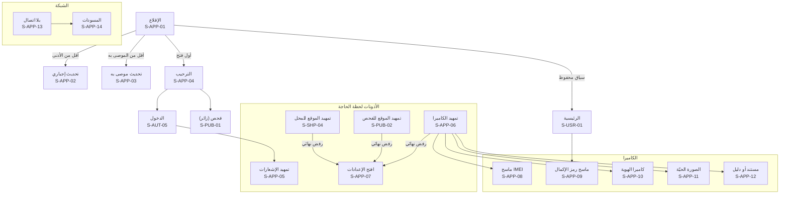

## 15. لوحة الإدارة (S-ADM)

موقع مستقل على نطاق منفصل، للكمبيوتر أساساً. القائمة الجانبية تُبنى من صلاحيات المستخدم، فلا يرى أحد بنداً لا يملك صلاحيته، وأعداد قوائم العمل بجانب البنود. وكل قرار بسبب مكتوب، وكل كشف لبيانات مخفية بسبب مسجّل (ADMIN-17)، ولا يراجع المشرف ما يخصّه (03 §4). والتحديث لحظي دون إعادة تحميل، مع شريط «إعادة الاتصال» عند انقطاعه، وإشعارات المتصفح تظهر **من التبويب المفتوح فقط** عبر الاتصال اللحظي نفسه، دون أي خدمة إشعارات خارجية. و**المدير العام ينفّذ إجراءاته وحده** دون موافقة شخص ثانٍ (D-102)، مع تحقق ثنائي قوي إلزامي (ويُفضَّل مفتاح الأمان)، وتحقق إضافي عند كل إجراء خطر، وإشعار فوري به على وسائله، وسجل تدقيق ثابت. وتبقى موافقة الشخصين حيث قُررت لغيره: تصحيح القرارات، وتسويات المورّدين، والاسترداد، وإيقاف السحب المؤقت (D-100)، وقبول البلاغ المتعارض ⛔. ولا إعلانات ولا عروض تجارية إلا في شاشات إدارتها (ADS-02، PAY-06).

| المعرّف | الشاشة | من يراها | المنصات | الغرض | المتطلبات | العناصر والإجراءات | الحالات الخاصة |
|---|---|---|---|---|---|---|---|
| S-ADM-01 | دخول اللوحة | كل موظفي الإدارة | لوحة | الدخول بكلمة المرور | AUTH-11 | اسم الدخول، وكلمة المرور | عنوان شبكة غير مسموح ⚙️؛ قفل مؤقت؛ حساب موقوف |
| S-ADM-02 | التحقق الثنائي | كل موظفي الإدارة | لوحة | العامل الثاني الإلزامي | AUTH-11 | رمز تطبيق المصادقة أو مفتاح الأمان، وعند أول دخول: تسجيل العامل الثاني إلزامياً | رمز خاطئ؛ فقدان العامل الثاني: عبر المدير العام |
| S-ADM-03 | الرئيسية: قوائم العمل | كل الأدوار (بطاقات حسب الصلاحية) | لوحة | ما ينتظر قراري الآن | ADMIN-01، SMART-05، SMART-13، NOTIF-06، SUPPORT-04 | شريط «تنبيهات عاجلة وصلت خارج الدوام، ووصلت لبوابة الأمن لحظياً» مع مهلة بداية الدوام، وبطاقة لكل قائمة (العدد، وأقدم عنصر، والمهلة المتبقية ⚙️) مرتّبة آلياً بالخطورة والموثوقية والمهلة، و«تخصيص البطاقات»، وآخر التنبيهات العاجلة وحالتها في البوابة | فارغة: «لا أعمال معلّقة»؛ إعادة الاتصال |
| S-ADM-04 | البحث الموحّد | كل الأدوار (النتائج حسب الصلاحية) | لوحة | إيجاد أي شيء بخانة واحدة | SMART-07، ADMIN-17 | خانة تقبل IMEI و`BL-` و`TX-` و`SH-` و`SY-` و`ST-` و`CR-`، والنتائج مجمّعة بالنوع، وكل بحث بالأشخاص يُسجَّل | لا نتائج؛ نتائج خارج الصلاحية لا تظهر ولا يُشار إليها |
| S-ADM-05 | حسابي في الإدارة | كل موظفي الإدارة | لوحة | أمان حسابي | AUTH-11 | تغيير كلمة المرور، وإدارة عوامل التحقق، والجلسات، وتعهد تعارض المصالح | — |
| S-ADM-06 | قائمة البلاغات | عام، بلاغات | لوحة | توزيع البلاغات ومراجعتها بالأولوية | ADMIN-01، ADMIN-02، SMART-05، SMART-08، CHECK-15، ONBEHALF-03، REPORT-18 | تبويبات: بانتظار المراجعة، وبحاجة لمعلومات، وبانتظار تأكيد المالك، ومتعارضة ⛔. والأعمدة: `BL-`، والنوع، والموثوقية (🟢🟡🔴⛔)، والمصدر (مستخدم، أو بالنيابة، أو عاجل، أو **سرقة محل** بعدد أجهزتها وأولوية أعلى)، والعمر والمهلة، وشارة «فُحص أثناء المراجعة». وإسناد جماعي وفلاتر محفوظة | البلاغ بالنيابة لا يظهر لمنشئه |
| S-ADM-07 | مراجعة البلاغ | عام، بلاغات | لوحة | القرار في بلاغ | ADMIN-02، REPORT-05، REPORT-06، REPORT-07، REPORT-15، REPORT-16، ONBEHALF-03، TRUSTED-03، OWN-08، ADMIN-17 | الأدلة مع التكبير، ونتيجة الباركود، والصور المكررة، والموثوقية وأسبابها، والصورة الحيّة ورقم الحساب، وسجل الجهاز وأي تعارض، وتأكيد المالك أو صاحب الجهاز، ومحادثة طلب المعلومات، والقرار: قبول، أو رفض بسبب جاهز، أو طلب معلومات | يفتحه مشرف آخر الآن (قفل تحرير)؛ تعارض مصالح: لا قرار؛ ⛔ يحتاج مبرراً مكتوباً للقبول؛ قبله عنصر أمن ضمن نطاقه: للعرض |
| S-ADM-08 | طلبات الإغلاق | عام، بلاغات | لوحة | قرار إغلاق البلاغات النافذة | ADMIN-03، POLICE-05، TELCO-07 | الطلب وسببه، والبلاغ وسجل الجهاز، والقرار: قبول (مع أثره: فك الحظر وحذف المراقبة) أو رفض بسبب | — |
| S-ADM-09 | الاعتراضات | عام، بلاغات | لوحة | الحسم بين المعترض والمبلّغ | ADMIN-04، DISPUTE-02، DISPUTE-03، TELCO-12 | أدلة الطرفين جنباً إلى جنب، ومهلة رد المبلّغ وحالتها، و«استعلام سجل الشريحة» بسبب، والقرار: إبقاء البلاغ، أو إلغاؤه (وحظر المبلّغ الكاذب عند الإثبات)، أو الإحالة لقوى الأمن | الاستعلام عن الشريحة غير متاح قبل تفعيل الربط |
| S-ADM-10 | توثيق الهويات | عام، بلاغات | لوحة | اعتماد صور الهويات | ADMIN-05، AUTH-05، CIVIL-01، CIVIL-02، CIVIL-05، CIVIL-06 | صورتا الهوية بالتكبير، والاسم والرقم الوطني المدخلان، ونتيجة المطابقة، وصورة السجل المدني تُجلب لحظة العرض ولا تُحفظ، وحالة البطاقة، وعدد المحاولات، والقرار بسبب جاهز | الربط معطّل: مراجعة يدوية مع علامة «يُعاد التحقق لاحقاً»؛ بطاقة غير سارية |
| S-ADM-11 | مراجعة التسجيل الذاتي | عام، بلاغات | لوحة | اعتماد تسجيل جهاز ذاتياً | OWN-03، OWN-12، OWN-13، OWN-15، OWN-16، TELCO-12، FAKE-02 | الصورة الحيّة ووضوح رقم الحساب، والباركود، والأدلة، ونتيجة سجل الشريحة، وعدد تسجيلات الحساب هذا العام، ومحاولات سابقة على الجهاز، والقرار: قبول (يبدأ الانتظار ⚙️ 30 يوماً) أو رفض | تجاوز الحد السنوي: شارة «حالة مشبوهة» |
| S-ADM-12 | التنبيهات الأمنية | عام، بلاغات | لوحة | متابعة كل التنبيهات | ADMIN-08، ADMIN-09، CHECK-14، GSMA-03، FAKE-03، CIVIL-05، CIVIL-08، SHOP-14، SHOP-18، REPAIR-03، REPAIR-05، OWN-13، SMART-06، SERIAL-05 | قائمة لحظية بالنوع (ومنها تنبيهات الأجهزة دون شريحة، دون تنبيهات شبكة لها) (فحص أو محاولة شراء أو بيع أو استلام في محل، ولوحة من جهاز مبلّغ عنه، وفحص فرد، وعملية بعيدة، وظهور جهاز مفكَّك، واستعلامات هوية دون معاملة، وأنماط شاذة) والأولوية (عاجل أو عادي) والحالة (جديد، وقيد المعالجة، وأُحيل، ومغلق)، و«وصل للبوابة لحظياً»، والإسناد | فارغة |
| S-ADM-13 | تفاصيل التنبيه والإحالة | عام، بلاغات | لوحة | معالجة تنبيه حتى إغلاقه | ADMIN-08، ADMIN-10، NOTIF-06 | الجهاز، والبلاغ، والمحل (الاسم، والمحافظة، والعنوان، والخريطة، والهاتف)، والموظف المنفّذ، والوقت، وموقع العملية، وسجل الجهاز، وما فعلته قوى الأمن في البوابة، و«تقرير PDF لقوى الأمن» (S-PRN-08)، و«تسجيل إحالة» (الجهة، والقناة، والتاريخ)، والملاحظات، و«إغلاق» بنتيجة المتابعة | — |
| S-ADM-14 | تنبيهات الشبكة | عام، بلاغات | لوحة | أحداث الشبكة وحالة الحظر | TELCO-02، TELCO-03، TELCO-05، TELCO-08، TELCO-09 | الأحداث (الشركة، ورقم الشريحة مخفياً جزئياً، والوقت، والموقع التقريبي)، وحالة طلب الحظر لكل شركة (مُرسل، ومؤكَّد، وفشل)، وتنبيهات تكرار IMEI، و«تأجيل الحظر» (S-ADM-18) | فشل متكرر لدى شركة: شارة وإحالة لصحة النظام |
| S-ADM-15 | المعلومات الواردة | عام، بلاغات | لوحة | معالجة «عندك معلومات؟» والإرجاع | TIP-01، TIP-02، TIP-03، SHOP-16 | المعلومة مرتبطة بالبلاغ والفحص وموقعه، ومصدرها (فرد أو محل)، وللمفقود: تنسيق الإرجاع والتواصل مع الطرفين دون كشف أرقامهما، والحالة | فارغة |
| S-ADM-16 | سجل الجهاز | عام، بلاغات، محلات | لوحة | الخط الزمني الكامل لجهاز | ADMIN-11، ADMIN-12، REPAIR-06، ADMIN-17 | التسجيلات، والملكيات، ومعاملات المحلات، وأوامر الصيانة واستبدال اللوحة، والبلاغات، والفحوص، وأحداث الشبكة، مع تبويب الخريطة. والبيانات الشخصية مخفية جزئياً و«إظهار» بسبب | — |
| S-ADM-17 | خريطة التتبّع | عام، بلاغات | لوحة | مواقع الجهاز المبلّغ عنه لحظياً | TRACK-01، TRACK-02، TRACK-03، TRACK-04، TRACK-06، TRACK-07، TRACK-08، TELCO-13، GEO-06، GEO-07، GEO-08، REPORT-16 | سبب الفتح أولاً، ثم الخريطة بالنقاط الملونة حسب المصدر، والتفاصيل عند الضغط، وخط السير ودوائر الدقة، والمنزلق الزمني، واللوحة الجانبية (الجهاز، والبلاغ، والسجل، والمحلات الموثّقة القريبة)، و«تقرير PDF» | لا نقاط بعد؛ إعادة الاتصال؛ جلسة نشطة بعدّادها |
| S-ADM-18 | تأجيل الحظر وجلسة التتبّع | عام، بلاغات | لوحة | تأجيل الحظر بطلب قوى الأمن | TELCO-06، TRACK-05، TELCO-13 | مرجع طلب قوى الأمن ورقم القضية، والسبب، والمدة ⚙️ 72 ساعة، و«تمديد» بسبب، و«إيقاف الجلسة وطلب الحظر» | انتهت المدة: طلب الحظر تلقائياً |
| S-ADM-19 | استيراد بلاغات قوى الأمن | عام، بلاغات | لوحة | تحويل سجلات قوى الأمن إلى بلاغات رسمية | POLICE-01، POLICE-04، POLICE-06 | رفع الملف، والتحقق الآلي، وتقرير الأسطر المرفوضة (S-PRN-12)، والتعارضات مع ملكيات مسجّلة وإحالتها، وإدخال بلاغ رسمي فردي محال عبر القناة المتفق عليها | قيد المعالجة؛ ملف بصيغة خاطئة |
| S-ADM-20 | بلاغ بالنيابة | دعم (إنشاء)، عام | لوحة | البلاغ عن شخص بلا موبايل ذكي | ONBEHALF-01، ONBEHALF-02، ONBEHALF-03، ONBEHALF-04، ONBEHALF-05 | صورة هوية الشخص (أي وسيلة)، والتحقق من الأحوال المدنية عند تفعيلها، ورقم التواصل وقناة الإشعار (SMS أو واتساب)، وبيانات الجهاز والحادثة والأدلة، ثم الإرسال بوسم «بالنيابة» واسم المنشئ، وإنشاء حساب للشخص يفعّله لاحقاً | — |
| S-ADM-21 | طلبات المحلات | عام، محلات | لوحة | توثيق المحلات | ADMIN-06، SHOP-03، SHOP-04، GEO-03 | الخريطة بالدبوس مقابل العنوان، وصور الواجهة والترخيص، والبيانات ونوع النشاط (الأربعة، D-90)، والقرار: توثيق (يصدر `SH-`)، أو رفض بسبب، أو طلب تعديل. وتبويب «تعديلات تنتظر المراجعة» | — |
| S-ADM-22 | ملف المحل | عام، محلات | لوحة | كل ما يخص محلاً | ADMIN-06، PP-09، SHOP-05، SHOP-12 | الحالة وتاريخها، والباقة وحالة الاشتراك، و**لا شيء من بيانات المحاسبة** (SHOPPRO-14)، والموظفون وحالاتهم، والمعاملات (قراءة)، والتنبيهات والتعارضات، وطلبات التعليق من قوى الأمن، و«تعليق» و«إلغاء» و«رفع التعليق» بسبب | — |
| S-ADM-23 | تعارضات المحلات والتصحيح | عام، محلات | لوحة | حسم تعارضات المعاملات | ADMIN-07، SHOP-08، SHOP-14، SHOP-15، IMPORTER-07، POLICE-06 | الأنواع (بيع جهاز مسجّل لغيره، وعملية بعيدة، وطلب تصحيح أو إلغاء، ورقم وكيل موجود مسبقاً، وبلاغ رسمي على ملكية مسجّلة)، والأدلة، والقرار بسبب | — |
| S-ADM-24 | الوكلاء والمستوردون | عام، محلات | لوحة | توثيق الوكلاء ومتابعتهم | IMPORTER-01، IMPORTER-03، CUSTOMS-04 | طلبات التوثيق والقرار، وملف كل وكيل، والأجهزة غير المسجّلة لدى الهيئة، وطلبات النقل غير المؤكَّدة بعد ⚙️ 7 أيام، واعتماد الربط البرمجي للوكيل | — |
| S-ADM-25 | تقرير التزام المحلات | عام، محلات | لوحة | التقرير الدوري لوزارة الداخلية | COMPLIANCE-01، COMPLIANCE-02، COMPLIANCE-03 | التقرير المولَّد ⚙️ شهرياً لكل محافظة، والمراجعة، و«إرسال PDF وExcel» (S-PRN-10)، وتسجيل الإحالة. أداة متابعة وليست لوحة إحصائيات | — |
| S-ADM-26 | قائمة طلبات الدعم | عام، دعم | لوحة | استقبال الطلبات وتوزيعها | SUPPORT-03، SUPPORT-04، DATAACCESS-03 | الطلبات بالقناة (الحساب، وواتساب، ونموذج التواصل)، والتصنيف، والأولوية، والمهلة المستهدفة ⚙️ لكل تصنيف، والإسناد، والفلاتر | فارغة |
| S-ADM-27 | معالجة طلب الدعم | عام، دعم | لوحة | الرد والتحويل حتى الإغلاق | SUPPORT-04، SUPPORT-05، SUPPORT-06، SUPPORT-07، TRUSTED-04، SHOPPRO-14 | المحادثة، والردود الجاهزة، والملاحظات الداخلية، والربط بالحساب أو البلاغ أو المعاملة، و«تحويل للمشرف المختص» مع بقاء الرد على الدعم، و«التراجع عن إجراء جهة موثوقة» بطلب صاحب الحساب، ولا أي وصول لبيانات محاسبة المحلات: الدعم يشرح فقط (D-101)، و«محلول» | — |
| S-ADM-28 | المساعدة في الحساب | عام، دعم | لوحة | حل مشاكل الدخول الشائعة | AUTH-09، ADMIN-13، SMART-10 | إعادة إرسال رمز، وفك قفل الحساب، وبدء تغيير الرقم بطلب مشرف ثانٍ | الإجراء ينتظر موافقة المشرف الثاني |
| S-ADM-29 | طلبات استعادة الحساب | عام، دعم (ومشرف ثانٍ للموافقة) | لوحة | الاستعادة بالهوية فقط | THEFT-06، CIVIL-01 | صور الهوية مقابل هوية الحساب، ونتيجة المطابقة، والتحقق، ثم موافقة مشرف ثانٍ، وعدّاد فترة التهدئة ⚙️ 72 ساعة، والتنفيذ | رفض بسبب |
| S-ADM-30 | المستخدمون | عام، بلاغات (للتعليق بسبب بلاغ كيدي) | لوحة | البحث عن حساب | ADMIN-13، ADMIN-17 | البحث (يُسجَّل)، والقائمة بالحالة ودرجة الحساب | — |
| S-ADM-31 | ملف المستخدم | عام، بلاغات، دعم (قراءة محدودة) | لوحة | كل ما يخص حساباً | ADMIN-13، ADMIN-17، AUTH-10 | البيانات مخفية جزئياً و«إظهار» بسبب، والأجهزة، والبلاغات، وحالة الهوية، والجلسات، وطلبات الإغلاق، و«تعليق» و«حظر» بسبب | — |
| S-ADM-32 | المنتجات ومراجعتها | عام، تجاري | لوحة | كتالوج المتجر ومراجعة كل منتج | STORE-02، STORE-06، STORE-12 | منتجات المنصة والمورّدين، وقائمة المراجعة (الجديد والمعدّل)، والقرار بسبب جاهز، ووسم «متوافق مع المنصة»، والأصناف الممنوعة (للإضافة فقط بقرار المدير العام) | منتج من قسم ممنوع: حذف وحظر المورّد |
| S-ADM-33 | المورّدون واتفاقياتهم | عام، تجاري | لوحة | اعتماد المورّدين وإدارتهم | STORE-03، STORE-12 | طلبات الاعتماد والقرار، وملف المورّد، وحصة المنصة ⚙️ لكل مورّد أو صنف، وتأكيد تغيير حساب التسوية، و«حظر» | — |
| S-ADM-34 | طلبات المتجر والشحن | عام، تجاري | لوحة | إدارة الطلب من التأكيد حتى التسليم | STORE-04، STORE-05، STORE-08، STORE-09، STORE-12 | الطلبات بحالاتها، وإدخال طلب وصل عبر واتساب الإدارة التجاري، وتأكيد الطلب ودفعه المرجعي، والإسناد للمورّد، والإسناد لشركة الشحن أو لمندوب المنصة، وفاتورة المنصة (S-PRN-11)، والإلغاء بسبب، وحسابات المندوبين | بلاغ «لم أستلم» من محل: شارة عاجلة |
| S-ADM-35 | المرتجعات والعيوب | عام، تجاري | لوحة | قرار الإرجاع | STORE-11 | طلب المحل وصوره، وتاريخ الاستلام، والمسؤول (المورّد أو الشحن أو لا أحد)، والقرار، وإعادة حق المحل، وقيمة الخصم من تسوية المورّد | خارج المهلة ⚙️ 7 أيام: قرار استثنائي بسبب |
| S-ADM-36 | تسوية نقد الشحن | عام، تجاري | لوحة | مطابقة ما قبضه الشحن بما سلّمه | STORE-09 | ⚙️ يومياً لكل شركة شحن ولكل مندوب: الطلبات المسلّمة والمدفوعة، والمبالغ المقبوضة، والمحوَّل للمنصة، والفروق، و«تسجيل التوريد» برقم مرجعي | فرق غير مفسَّر: تنبيه ويبقى الكشف مفتوحاً |
| S-ADM-37 | كشوف تسوية المورّدين | تجاري (إعداد)، عام (موافقة) | لوحة | محاسبة المورّدين بفصل المهام | STORE-10، STORE-11 | الكشف المولَّد ⚙️ أسبوعياً لكل مورّد: المسلَّم والمدفوع بعد مهلة الإرجاع، ناقص حصة المنصة، وناقص المرتجعات والعيوب، والصافي. ثم «اعتماد» من المشرف التجاري، و«موافقة» من المدير العام، و«تسجيل التحويل» برقم مرجعي، و«PDF» (S-PRN-13) | معدّ الكشف لا يوافق عليه؛ حساب التسوية تغيّر حديثاً: إيقاف حتى التأكيد |
| S-ADM-38 | الإعلانات والحملات | عام، تجاري | لوحة | مراجعة الإعلانات ونشرها | ADS-03، ADS-04، ADS-05، ADS-06، ADS-07، ADS-08 | قائمة المراجعة، والمعاينة في مكانها، والتأكد من كلمة «إعلان»، والاستهداف بالمحافظة ونوع النشاط فقط، والقرار، وحد التكرار ⚙️، والإحصاءات | — |
| S-ADM-39 | طلبات التفعيل والمدفوعات | عام، تجاري | لوحة | تأكيد الدفع وتفعيل الخدمة | PAY-01، PAY-02، PAY-03، PAY-04، PAY-07، HISTORY-01، SHOPPRO-01 | تسجيل طلب وصل عبر واتساب الإدارة التجاري (رقم الحساب، والخدمة أو الباقة)، وبدء فترة التجربة، والرقم المرجعي للدفعة وتأكيده، و«تفعيل» على الحساب أو المحل مع المدة، والإيصال، وطلبات الاسترداد (تحتاج موافقة المدير العام) | دفعة لم تُطابق بعد؛ استرداد بانتظار الموافقة |
| S-ADM-40 | الباقات وميزاتها | تجاري (إعداد)، عام (موافقة) | لوحة | باقات المحلات والخدمات دون برمجة | PAY-09، SHOPPRO-01، BIZAPI-03، PAY-03 | الباقات (المجانية والمشتركين افتراضياً، وما يُنشأ غيرهما)، واختيار ميزات كل باقة من قائمة الميزات، والسعر الشهري والسنوي، وفترة التجربة ⚙️، والحدود (مثل عدد الفروع)، ومهلة السماح ⚙️. ووظائف الالتزام **لا تظهر في قائمة الميزات القابلة للبيع أصلاً**. وكل تغيير بموافقة المدير العام، ولا يمس الاشتراكات القائمة حتى تجديدها | تغيير بانتظار موافقة المدير العام |
| S-ADM-41 | عملاء الربط البرمجي | عام، تجاري | لوحة | الشركات المرتبطة بعقد | BIZAPI-01، BIZAPI-03، BIZAPI-04 | الشركات وعقودها، والمفاتيح (تُعرض مرة واحدة)، والحصص، وسجل الاستخدام، والفواتير الدورية | — |
| S-ADM-42 | حسابات الإدارة | عام | لوحة | موظفو الإدارة | ADMIN-14، AUTH-11، ADMIN-19 | الإنشاء، والأدوار، والإيقاف، وتعهد تعارض المصالح، وطلبات «نسيت كلمة المرور» من الموظفين: التحقق من الهوية حضورياً أو بمكالمة فيديو، ثم الموافقة، ثم إعادة ربط العامل الثاني. والمدير العام ينفّذ وحده مع تحقق إضافي (D-102) | — |
| S-ADM-43 | الأدوار والصلاحيات | عام | لوحة | الأدوار الخمسة والأدوار الجديدة | SMART-03 | الأدوار الافتراضية، و«دور جديد» من قائمة الصلاحيات المتاحة بضوابطها | — |
| S-ADM-44 | الإعدادات | عام | لوحة | كل قيمة ⚙️ دون برمجة | ADMIN-16، GEO-01، WALLET-04، NOTIF-03، SMART-14، SERIAL-01، TOPUP-01، TOPUP-04 | الإعدادات بمجموعاتها (06 §15)، ولكل قيمة حد أدنى وأعلى، والسبب الإلزامي، والسجل، و«رجوع». والقوائم: المحافظات والمناطق، وأسباب الرفض، والمزوّدون المنضمّون، وقناة الإرسال، والشركات المصنّعة وصيغ أرقامها التسلسلية، وبادئات الشبكات، ونسب عمولة التعبئة وحدودها. ولا تظهر الأسرار أبداً | قيمة خارج الحدود: رفض |
| S-ADM-45 | مفاتيح الميزات | عام | لوحة | فتح الوحدات وإغلاقها دون أي تحديث | ROLLOUT-07، ROLLOUT-06، SMART-04، ADS-08، ROLLOUT-01، SERIAL-07، TOPUP-06 | كل وحدة وتكامل وخدمة تجارية ومكان إعلاني بحالتها: **مفعّلة**، أو **مطفأة**، أو **بانتظار اتفاقية**، مع حالتها المعتمدة يوم الإطلاق (القسم 22)، ومن غيّرها ومتى ولماذا. و«تشغيل» أو «إيقاف» بسبب إلزامي وتأكيد، مع تنبيه بما يظهر أو يختفي في الواجهات. والتغيير ينعكس فوراً دون تحديث للتطبيق أو الموقع | وحدة بانتظار اتفاقية: لا تُشغَّل قبل تفعيل ربطها؛ إيقاف وحدة فيها عمليات جارية: تحذير بعددها |
| S-ADM-46 | التجريب والإطلاق المتدرّج | عام | لوحة | وضع الدعوات والمحافظات ومؤشرات التجريب | ROLLOUT-01، ROLLOUT-02، ROLLOUT-03، ROLLOUT-05 | وضع الدعوات وقائمة الأرقام المدعوة بأنواعها، و⚙️ الفحص العام مفتوح أو مغلق، وتفعيل المحافظات واحدة واحدة، وقائمة انتظار كل محافظة، ومؤشرات التجريب مقابل أهدافها | — |
| S-ADM-47 | المحتوى والقوالب | عام | لوحة | النصوص والرسائل والصفحات | SMART-01، NOTIF-02، PROTECT-01 | نصوص الواجهات، وقوالب الرسائل مع حالة اعتمادها من Meta، والصفحات القانونية، ومحتوى «احمِ جهازك»، والمعاينة، والنسخ | — |
| S-ADM-48 | الهوية البصرية | عام | لوحة | الشعار والاسم واللون | SMART-02، THEME-01 | الرفع والتعديل مع فحص وضوح الألوان في الثيمين والمعاينة على كل الواجهات | لون لا ينجح في فحص الوضوح: لا يُحفظ |
| S-ADM-49 | صحة النظام وحل المشاكل | عام | لوحة | حالة الخدمات والتكاملات | SMART-09، SMART-10، NOTIF-07، TELCO-09، TELCO-10، WALLET-02 | حالة كل خدمة باللون وآخر خطأ بلغة مفهومة، وسجل الرسائل، ونتائج المطابقة اليومية مع الشركات، و«إعادة المحاولة»، و«إعادة إرسال رسالة»، و«إعادة مزامنة جهاز مع الشركات»، و«إعادة توليد فاتورة أو تقرير» | — |
| S-ADM-50 | وضع الصيانة والإعلانات العامة | عام | لوحة | رسالة عامة أو صيانة | SMART-11 | النص، والواجهات المشمولة، ووقت البدء والانتهاء | — |
| S-ADM-51 | إدارة الإصدارات | عام | لوحة | الإصدار الأدنى والموصى به | SMART-12، APPVER-01 | لكل منصة (أندرويد، وآيفون) | — |
| S-ADM-52 | سجل التدقيق | عام | لوحة | كل إجراء وكشف | ADMIN-15، SMART-14، CIVIL-07، PP-13، REVERSAL-05 | البحث والتصفية بالفاعل والإجراء والكيان والوقت، وسجل نشاط عناصر الأمن، وسجل استعلامات السجل المدني، وتقرير التصحيحات الدوري | — |
| S-ADM-53 | تصحيح القرارات | من يملك صلاحية القرار الأصلي (طلب)، ومشرف آخر بدور مساوٍ أو أعلى (موافقة)، والمدير العام (تصحيح الملكية) | لوحة | تصحيح الخطأ دون حذف | REVERSAL-01، REVERSAL-02، REVERSAL-03، REVERSAL-04 | «طلب تصحيح» (القرار الأصلي، والسبب، والأدلة)، ومعاينة الآثار (المراقبة والحظر، وحالة الفحص، والإشعارات المحايدة، وتقرير الالتزام)، وقائمة الطلبات بانتظار الموافقة، والقرار | صاحب القرار الأصلي أو الطالب لا يرى زر الموافقة |
| S-ADM-54 | جهات الأمن ومسؤولوها | عام | لوحة | تأسيس بوابة الأمن | PP-01، PP-03 | الجهات (الإدارة المركزية وقيادات المحافظات) ونطاقها، وإنشاء حساب «مسؤول أمن» لكل جهة وإيقافه | — |
| S-ADM-55 | محافظ المحلات ومطابقتها | عام، تجاري (والتعليق مع المحل لمشرف المحلات) | لوحة | متابعة المحافظ دون إمساك أموالها | SHOPWALLET-06، SHOPWALLET-07، SHOPWALLET-08، SMART-06 | المحافظ التي فيها فروق مطابقة أو تجميد فقط (لا كل العمليات)، ونتيجة المطابقة اليومية مع شام كاش، والعمليات الموقوفة بسببها، والأنماط غير الطبيعية، و«تجميد» (يوقف التعبئة والدفع فقط) و«فك التجميد» بسبب، و«إيقاف السحب مؤقتاً» عند اختراق مؤكد بموافقة شخصين لمدة ⚙️ 24 ساعة يجددها المدير العام بقرار مسجّل (D-100) | فرق مفتوح: العمليات المعنية موقوفة حتى حلّه |
| S-ADM-56 | التعبئة ومطابقتها مع الشركات | عام، تجاري | لوحة | سلامة عمليات التعبئة | TOPUP-02، TOPUP-04، TOPUP-05، TOPUP-06 | المطابقة اليومية مع سيريتل وMTN، والتعبئات المعلّقة وحسمها، والفروقات، والعمولات والكشوف الشهرية، والأنماط غير الطبيعية (تكرار رقم، أو موظف يتجاوز المعتاد) | تعطل ربط شركة: إيقافها بمفتاحها |
| S-ADM-58 | الحجز القانوني | عام، ومسؤول حماية البيانات (دور ديناميكي) | لوحة | منع حذف بيانات بعينها | PRIV-05، PP-14 | الحجوزات النافذة (الجهاز أو الشخص، والسبب، والمرجع، ومن طلبه، والمدة)، و«حجز جديد»، و«رفع الحجز» بسبب، وطلبات الحجز الواردة من بوابة الأمن برقم القضية | — |
| S-ADM-59 | الاحتفاظ وتدقيق الحذف | عام، ومسؤول حماية البيانات | لوحة | تطبيق مدد الاحتفاظ | PRIV-04 | سياسات الاحتفاظ لكل نوع بيانات، والمهام المجدولة ونتيجتها، وتدقيق الحذف، والتقرير الشهري | مهمة فشلت: تنبيه |
| S-ADM-60 | طلبات أصحاب البيانات | عام، ومسؤول حماية البيانات، ودعم (الاستقبال) | لوحة | معالجة طلبات الاطلاع والتصحيح والإغلاق | PRIV-06، PRIV-02 | الطلبات بنوعها ومهلتها ⚙️ وتنبيه قبل تجاوزها، والإسناد، والقرار، وطلبات إغلاق الحساب في مهلة التراجع | فارغة |
| S-ADM-61 | حوادث الخصوصية | عام، ومسؤول حماية البيانات | لوحة | تسجيل الحوادث ومهل الإخطار | PRIV-07 | الحادثة، والبيانات والأشخاص المتأثرون، ومهلة الإخطار محسوبة آلياً، والإجراءات والإخطارات المرسلة | — |
| S-ADM-62 | سجل الإفصاح الخارجي | عام، ومسؤول حماية البيانات | لوحة | كل طلب بيانات من خارج البوابة | PRIV-08 | الجهة الطالبة، والسند، والبيانات المفصح عنها، والمرسل، والتاريخ | — |
| S-ADM-63 | التقرير الشهري للمؤشرات | عام | لوحة | المؤشرات للمدير العام والوزارة دون صفحة إحصاءات | SMART-15 | الفترة، والمؤشرات (الفحوص، والبلاغات وزمن مراجعتها، والأجهزة المستردة، والتزام المحلات، وصحة التكاملات)، و«تصدير PDF وExcel» (S-PRN-20)، وسجل الإرسال | — |
| S-ADM-64 | دمج سجلّي جهاز | عام، بلاغات، محلات (طلب)، ومشرف ثانٍ (موافقة) | لوحة | توحيد سجلّين يخصّان الجهاز نفسه | ADMIN-18 | السجلان جنباً إلى جنب (المعرّفات، والملكيات، والبلاغات، والمعاملات)، والسبب والأدلة، و«طلب الدمج»، ثم موافقة مشرف ثانٍ. ويبقى تاريخ كل سجل كاملاً دون حذف | تعارض في الملكية أو بلاغان نافذان: يُحال للتعارضات أولاً |
| S-ADM-65 | نسيت كلمة المرور (الإدارة) | موظف إدارة | لوحة | استعادة الدخول دون رسائل | ADMIN-19 | اسم الدخول، و«اطلب إعادة التعيين»، وجملة «تواصل مع المدير العام للتحقق من هويتك حضورياً أو بمكالمة فيديو». وبعد الموافقة: كلمة مرور جديدة وإعادة ربط العامل الثاني. **لا رسالة ولا واتساب** | الطلب مكرر؛ حساب غير موجود: الرد نفسه دون كشف |

> `S-ADM-57` محجوز: كان «بيانات محاسبة محل بإذن مؤقت» وأُلغي بقرار D-101، فلا مسار لأي شخص من المنصة إلى بيانات محاسبة المحلات (SHOPPRO-14، PRIV-11).

**خريطة التنقّل (1): البلاغات والأمن**

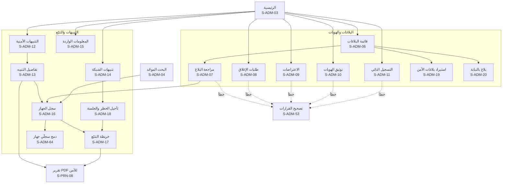

**خريطة التنقّل (2): المحلات والدعم والتجاري**

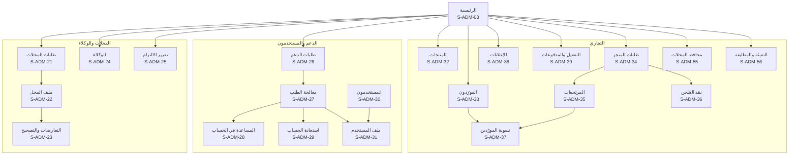

**خريطة التنقّل (3): النظام (المدير العام)**

```mermaid
flowchart TD
    S_ADM_01["الدخول<br/>S-ADM-01"]
    S_ADM_65["نسيت كلمة المرور<br/>S-ADM-65"]
    S_ADM_02["التحقق الثنائي<br/>S-ADM-02"]
    S_ADM_03["الرئيسية<br/>S-ADM-03"]
    S_ADM_05["حسابي<br/>S-ADM-05"]
    subgraph PEOPLE ["الحسابات والصلاحيات"]
        S_ADM_42["حسابات الإدارة<br/>S-ADM-42"]
        S_ADM_43["الأدوار والصلاحيات<br/>S-ADM-43"]
        S_ADM_54["جهات الأمن<br/>S-ADM-54"]
    end
    subgraph CONF ["الإعدادات والتشغيل"]
        S_ADM_44["الإعدادات<br/>S-ADM-44"]
        S_ADM_45["مفاتيح الميزات<br/>S-ADM-45"]
        S_ADM_46["التجريب والإطلاق<br/>S-ADM-46"]
        S_ADM_47["المحتوى والقوالب<br/>S-ADM-47"]
        S_ADM_48["الهوية البصرية<br/>S-ADM-48"]
        S_ADM_50["وضع الصيانة<br/>S-ADM-50"]
        S_ADM_51["الإصدارات<br/>S-ADM-51"]
        S_ADM_40["الباقات وميزاتها<br/>S-ADM-40"]
        S_ADM_41["عملاء الربط<br/>S-ADM-41"]
    end
    subgraph OBS ["المراقبة"]
        S_ADM_49["صحة النظام<br/>S-ADM-49"]
        S_ADM_52["سجل التدقيق<br/>S-ADM-52"]
        S_ADM_53["تصحيح القرارات<br/>S-ADM-53"]
        S_ADM_58["الحجز القانوني<br/>S-ADM-58"]
        S_ADM_63["تقرير المؤشرات<br/>S-ADM-63"]
    end
    S_ADM_01 --> S_ADM_02 --> S_ADM_03 --> S_ADM_05
    S_ADM_01 --> S_ADM_65 -. "يوافق المدير العام" .-> S_ADM_42
    S_ADM_03 --> S_ADM_42 & S_ADM_43 & S_ADM_54
    S_ADM_03 --> S_ADM_44 & S_ADM_45 & S_ADM_46 & S_ADM_47 & S_ADM_48 & S_ADM_50 & S_ADM_51
    S_ADM_03 --> S_ADM_40 & S_ADM_41
    S_ADM_03 --> S_ADM_49 & S_ADM_52 & S_ADM_53 & S_ADM_58 & S_ADM_63
```

**القائمة الجانبية حسب الدور الافتراضي:**

| القسم | البنود | عام | بلاغات | محلات | دعم | تجاري |
|---|---|---|---|---|---|---|
| العمل اليومي | الرئيسية (S-ADM-03) | ✅ | ✅ | ✅ | ✅ | ✅ |
| | التنبيهات العاجلة، والبلاغات، وتوثيق الهوية، والتسجيل الذاتي، والمعلومات الواردة، والتتبّع (S-ADM-06 إلى S-ADM-19) | ✅ | ✅ | ❌ | ❌ | ❌ |
| | بلاغ بالنيابة (S-ADM-20) | ✅ | ❌ | ❌ | 🔒 | ❌ |
| | المحلات والوكلاء والالتزام (S-ADM-21 إلى S-ADM-25) | ✅ | ❌ | ✅ | ❌ | ❌ |
| | طلبات الدعم والمساعدة والاستعادة (S-ADM-26 إلى S-ADM-29) | ✅ | ❌ | ❌ | 🔒 | ❌ |
| | تصحيح القرارات (S-ADM-53) | ✅ | ✅ | ✅ | ❌ | ✅ |
| البحث والسجلات | البحث الموحّد (S-ADM-04) | ✅ | ✅ | ✅ | ◐ الحسابات والطلبات | ◐ التجاري |
| | سجل الجهاز (S-ADM-16) ودمج السجلين (S-ADM-64) | 🔒 | 🔒 | 🔒 | ❌ | ❌ |
| | المستخدمون (S-ADM-30، S-ADM-31) | ✅ | ◐ للتعليق بسبب بلاغ كيدي | ❌ | ◐ للقراءة في طلب | ❌ |
| | سجل التدقيق (S-ADM-52) | ✅ | ❌ | ❌ | ❌ | ❌ |
| الخصوصية | الحجز، والاحتفاظ، وطلبات أصحاب البيانات، والحوادث، والإفصاح (S-ADM-58 إلى S-ADM-62)، ومعها دور «مسؤول حماية البيانات» الديناميكي | ✅ | ❌ | ❌ | ◐ استقبال الطلبات | ❌ |
| | التقرير الشهري للمؤشرات (S-ADM-63) | ✅ | ❌ | ❌ | ❌ | ❌ |
| التجاري والنظام | الخدمات التجارية والمحافظ والتعبئة (S-ADM-32 إلى S-ADM-41، وS-ADM-55، وS-ADM-56) | ✅ | ❌ | ❌ | ❌ | ✅ (والموافقة على التسوية والاسترداد للمدير العام) |
| | الإعدادات والمفاتيح والتجريب والمحتوى والهوية والصيانة والإصدارات (S-ADM-44 إلى S-ADM-51) | ✅ | ❌ | ❌ | ❌ | ❌ |
| | حسابات الإدارة والأدوار وجهات الأمن (S-ADM-42، S-ADM-43، S-ADM-54) | ✅ | ❌ | ❌ | ❌ | ❌ |

## 16. بوابة قوى الأمن (S-POL)

موقع مستقل على نطاق منفصل، بقائمة جانبية داكنة في الثيمين، و**نطاق العنصر ظاهر دائماً** في الشريط العلوي (15 §9.1). البحث برقم IMEI في كل المحافظات، وما عداه ضمن نطاق جهة العنصر، والإدارة المركزية لكل المحافظات (D-80، PP-03). كل عرض وبحث وقرار يُسجَّل (PP-13). **لا إعلانات ولا عروض تجارية إطلاقاً** (D-83). والتنبيهات تصل لحظياً في كل الأوقات (D-85)، مع تنبيه صوتي قابل للكتم وشريط «إعادة الاتصال» عند انقطاع التحديث اللحظي، وإشعارات المتصفح من التبويب المفتوح فقط دون خدمة إشعارات خارجية.

| المعرّف | الشاشة | من يراها | المنصات | الغرض | المتطلبات | العناصر والإجراءات | الحالات الخاصة |
|---|---|---|---|---|---|---|---|
| S-POL-01 | دخول البوابة | مسؤول أمن، وعنصر أمن | بوابة | الدخول بحساب شخصي | PP-02 | اسم الدخول وكلمة المرور | شبكة غير مسموحة ⚙️؛ قفل مؤقت؛ حساب موقوف |
| S-POL-02 | التحقق الثنائي | مسؤول أمن، وعنصر أمن | بوابة | العامل الثاني الإلزامي | PP-02 | رمز تطبيق المصادقة أو مفتاح الأمان، وتسجيله عند أول دخول | — |
| S-POL-03 | الرئيسية والتنبيهات اللحظية | مسؤول أمن، وعنصر أمن | بوابة | ما يحدث الآن في النطاق | PP-03، PP-05، SERIAL-05 | قائمة لحظية بالتنبيهات الأمنية (ومنها الأجهزة دون شريحة) وتنبيهات الشبكة في النطاق (النوع، والجهاز، والمكان، والوقت، والحالة)، والعدد غير المقروء، والتنبيه الصوتي، وجلسات التتبّع النشطة | فارغة؛ إعادة الاتصال |
| S-POL-04 | تفاصيل التنبيه | مسؤول أمن، وعنصر أمن | بوابة | التحقيق في تنبيه | PP-05، PP-06، ADMIN-08 | الجهاز، والبلاغ، والمحل على الخريطة وعنوانه وهاتفه، والموظف المنفّذ، وموقع العملية، ورقم الشريحة وشركتها لتنبيه الشبكة، وسجل الجهاز، وما فعلته الإدارة، و«فتح الخريطة»، و«طلب الحظر أو تأجيله»، و«تقرير PDF» | خارج النطاق: لا يظهر |
| S-POL-05 | البحث برقم IMEI | مسؤول أمن، وعنصر أمن | بوابة | حالة أي جهاز في كل المحافظات | PP-07، PP-03 | خانة البحث في الشريط العلوي، والنتيجة: الحالة، والبلاغات، وأصل التسجيل، ومحافظة الارتباط، ثم ملف الجهاز (S-POL-07) بالتفاصيل التي يسمح بها النطاق | لا نتائج |
| S-POL-06 | البحث بالرقم الوطني | مسؤول أمن، وعنصر أمن | بوابة | أجهزة شخص ومعاملاته ضمن النطاق | PP-07، PP-03 | الرقم الوطني، و**رقم القضية** بالصيغة المعتمدة ⚙️، والسبب (إلزاميان)، والنتائج ضمن النطاق فقط | صيغة رقم القضية خاطئة؛ خارج النطاق: «لا نتائج ضمن نطاقك» |
| S-POL-07 | ملف الجهاز | مسؤول أمن، وعنصر أمن | بوابة | التحقيق في جهاز | PP-06، PP-09 | سجل الجهاز، والبلاغات، ومعاملات المحلات، وأوامر الصيانة، وأحداث الشبكة، و«خريطة التتبّع»، و«تسجيل كجهاز مضبوط» | تفاصيل خارج النطاق مخفية مع جملة توضّح ذلك |
| S-POL-08 | خريطة التتبّع | مسؤول أمن، وعنصر أمن | بوابة | مواقع الجهاز لحظياً | PP-06، TRACK-08، TRACK-01، TRACK-02 | كما في S-ADM-17، وسبب الفتح إلزامي | — |
| S-POL-09 | جلسات التتبّع والحظر | مسؤول أمن، وعنصر أمن | بوابة | التحكم بالحظر والتتبّع | PP-06، TELCO-06، TRACK-05 | الجلسات النشطة بعدّاداتها، و«طلب الحظر»، و«تأجيل الحظر وفتح جلسة» برقم القضية والسبب والمدة ⚙️ 72 ساعة، و«تمديد»، و«إيقاف» | — |
| S-POL-10 | البلاغات في النطاق | مسؤول أمن، وعنصر أمن | بوابة | بلاغات المحافظة | PP-03، PP-08 | تبويبات: بلاغات مواطنين قيد المراجعة، ونافذة، وطلبات إغلاق، وبلاغات رسمية، مع البحث | فارغة |
| S-POL-11 | تفاصيل البلاغ والقرار | مسؤول أمن، وعنصر أمن | بوابة | قبول بلاغ أو إغلاقه ضمن النطاق | PP-08، POLICE-05، REPORT-18 | تفاصيل البلاغ وأدلته وموثوقيته (وبلاغ سرقة المحل بقائمة أجهزته وحالة كل منها)، و«قبول» لبلاغ قيد المراجعة، و«إغلاق» لبلاغ نافذ، مع السبب الإلزامي. والقرار يُسجَّل باسم العنصر ويُبلَّغ صاحب البلاغ | خارج النطاق: للعرض دون قرار |
| S-POL-12 | إضافة بلاغ رسمي | مسؤول أمن، وعنصر أمن | بوابة | بلاغ نافذ فوراً | PP-04 | رقم الضبط، وIMEI (والثاني)، والموديل، وتاريخ الحادثة، والمحافظة، والرقم الوطني لصاحب الجهاز (اختياري)، والإقرار | الجهاز مسجّل باسم شخص آخر: «سيُنشأ تعارض» مع المتابعة |
| S-POL-13 | تسجيل جهاز مضبوط | مسؤول أمن، وعنصر أمن | بوابة | إبلاغ صاحب الجهاز بمكانه | PP-10 | IMEI، والنتيجة (مبلّغ عنه، أو مسجّل لشخص، أو غير معروف)، والقسم الحافظ، و«تسجيل»، فيصل لصاحبه «جهازك موجود لدى [القسم]» | غير معروف: يُحفظ دون إشعار |
| S-POL-14 | تسليم الجهاز المضبوط | مسؤول أمن، وعنصر أمن | بوابة | إرجاع الجهاز وإغلاق البلاغ | PP-10، TELCO-07 | المستلم (صاحب الجهاز بعد التحقق من هويته)، و«تسجيل التسليم» فيُغلق البلاغ ويُطلب فك الحظر | — |
| S-POL-15 | فحص المضبوطات بالجملة | مسؤول أمن، وعنصر أمن | بوابة | فحص عدد كبير من الأجهزة | PP-11 | رفع ملف الأرقام، والنتيجة لكل رقم، و«تنزيل النتائج» (S-PRN-12) | ملف بصيغة خاطئة |
| S-POL-16 | المحلات في النطاق | مسؤول أمن، وعنصر أمن | بوابة | التحقيق في محل | PP-09 | البحث برقم المحل، ومعاملاته في النطاق، و«طلب تعليق» بسبب ينفّذه مشرف المحلات | — |
| S-POL-17 | التقارير | مسؤول أمن، وعنصر أمن | بوابة | تقرير PDF لأي جهاز أو بلاغ أو تنبيه | PP-12 | اختيار الموضوع، و«إنشاء التقرير» مع الخريطة (S-PRN-09)، والتقارير السابقة | — |
| S-POL-18 | عناصر الجهة | مسؤول أمن | بوابة | إدارة حسابات العناصر | PP-01، ADMIN-19 | العناصر (الاسم، والرتبة، والرقم الوظيفي، والحالة)، و«عنصر جديد»، و«إيقاف»، وطلبات «نسيت كلمة المرور» من العناصر: التحقق من الهوية حضورياً أو بمكالمة فيديو، ثم الموافقة وإعادة ربط العامل الثاني | — |
| S-POL-19 | سجل نشاط العناصر | مسؤول أمن | بوابة | الرقابة على عناصر الجهة | PP-13 | كل عرض وبحث وقرار لعناصر الجهة، مع التصفية | — |
| S-POL-20 | حسابي في البوابة | مسؤول أمن، وعنصر أمن | بوابة | أمان الحساب | PP-02 | كلمة المرور، والعامل الثاني، والجلسات | — |
| S-POL-21 | طلب حجز البيانات | مسؤول أمن، وعنصر أمن | بوابة | منع حذف بيانات تحتاجها قضية | PP-14، PRIV-05، DATAACCESS-02 | الجهاز أو الشخص (ضمن النطاق)، ورقم القضية بالصيغة ⚙️، والسبب، والمدة، و«تمديد تأخير الظهور في «من اطّلع على بياناتي»» بسبب، وحالة الطلب | خارج النطاق: لا يُقبل |
| S-POL-22 | نسيت كلمة المرور (البوابة) | عنصر أمن، ومسؤول أمن | بوابة | استعادة الدخول دون رسائل | ADMIN-19، PP-02 | اسم الدخول، و«اطلب إعادة التعيين»، وجملة «تواصل مع مسؤول الأمن في جهتك للتحقق من هويتك حضورياً أو بمكالمة فيديو» (ولمسؤول الأمن: إدارة المنصة). وبعد الموافقة: كلمة مرور جديدة وإعادة ربط العامل الثاني. **لا رسالة ولا واتساب** | حساب غير موجود: الرد نفسه دون كشف |

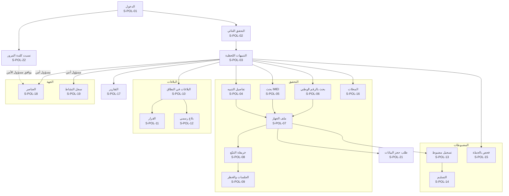

## 17. بوت واتساب (S-BOT)

ثلاثة أرقام بثلاثة أدوار، ومعرّفات الحالات هي نفسها في [كتالوج المحتوى §4](24-content-catalog.md) حيث نصوصها الحرفية: **رقم الفحص** (`S-BOT-01` إلى `S-BOT-22`، للفحص فقط، WABOT-07)، و**رقم الدعم** (`S-BOT-30` إلى `S-BOT-40`، SUPPORT-03)، و**الرقم التجاري** (`S-BOT-50` إلى `S-BOT-52`، يتابعه المشرف التجاري بشرياً، D-86). والأرقام بين المجموعات محجوزة. ولا إعلان في أي رد (ADS-02)، ولا يؤكد أي بوت وجود حساب ولا ينفيه، ولا ينفّذ أي إجراء حساس.

| المعرّف | الحالة | من يراها | المنصات | الغرض | المتطلبات | المحتوى والأزرار | الحالات الخاصة |
|---|---|---|---|---|---|---|---|
| S-BOT-01 | الترحيب والقائمة | أي مرسل لرقم الفحص | واتساب | البدء | WABOT-01، WABOT-07 | الترحيب، وقائمة: فحص موبايل، وفحص حاسوب أو تابلت (عند تفعيل SERIAL)، وكيف أعرف رقم IMEI؟، وبلاغ أو حساب، والدعم الفني | أي رسالة فيها IMEI صالح تبدأ الفحص من أي حالة |
| S-BOT-02 | بانتظار IMEI | المرسل | واتساب | استقبال الرقم أو الرقمين | WABOT-01، FAKE-02 | «أرسل رقم IMEI المكوّن من 15 خانة»، ويُقبل الرقمان معاً للتحقق من تطابقهما | — |
| S-BOT-03 | رقم غير صالح | المرسل | واتساب | تصحيح الإدخال حسب السبب | WABOT-02، CHECK-03 | رسالة حسب السبب (أقصر، أو أطول، أو IMEISV، أو خانة التحقق، أو أحرف، أو أكثر من رقمين)، وزر «كيف أعرف رقم IMEI؟» | — |
| S-BOT-04 | طلب الموقع وتذكير واحد | المرسل برقم صالح | واتساب | الحافز قبل النتيجة | WABOT-03، GEO-02 | طلب موقع تفاعلي مع الإيصال وحدود استخدام الموقع، و«اختيار المحافظة»، وتذكير واحد عند أول رفض | — |
| S-BOT-05 | اختيار المحافظة | من رفض بعد التذكير | واتساب | إكمال الفحص دون موقع | WABOT-03، GEO-01 | قائمة المحافظات على صفحتين، ويُقبل الاسم أو رقمه من 1 إلى 14 | — |
| S-BOT-06 | النتيجة | المرسل | واتساب | النتيجة بصيغتها لكل حالة | WABOT-01، WABOT-04، CHECK-09، CHECK-10، TIP-01، TIP-02، TIP-04، TIP-06، GSMA-01، GSMA-05، CUSTOMS-02، FAKE-01 | لا بلاغات، أو مبلّغ عنه مسروقاً أو مفقوداً مع «لا تشترِ هذا الجهاز» والمكافأة ورابط «عندك معلومات؟» أو «وجدت هذا الجهاز؟»، والمؤشرات الإضافية، و«فحص رقم آخر» | «جارٍ الفحص…» بعد ⚙️ 3 ثوانٍ؛ «تعذّر التحقق الدولي حالياً» بعد ⚙️ ثانيتين |
| S-BOT-07 | موقع غير صالح | المرسل | واتساب | قبول موقع مختار أو بعيد | WABOT-03 | يُقبل ويُعلَّم مصدره «واتساب» في سجل الفحص دون رد خاص | — |
| S-BOT-08 | الإيصال | من شارك موقعه | واتساب | إيصال الفحص | CHECK-16 | رابط الإيصال وجملة «لا يُعد إثباتاً للملكية» | — |
| S-BOT-09 | كيف أعرف رقم IMEI؟ | المرسل | واتساب | المساعدة | WABOT-02 | `*#06#` والكرتونة والإعدادات، و«اطلب الرقم من الجهاز نفسه» | — |
| S-BOT-10 | بلاغ أو حساب | المرسل | واتساب | التوجيه للموقع والتطبيق | WABOT-07 | «البوت للفحص فقط»، ورابط الموقع، ورابط رقم الدعم لمن سُرق موبايله | — |
| S-BOT-11 | الشركة المصنّعة | من اختار فحص حاسوب أو تابلت | واتساب | بدء فحص الرقم التسلسلي | SERIAL-02، SERIAL-07 | قائمة بأكثر ⚙️ 9 شركات استخداماً و«شركة أخرى» | الوحدة مطفأة: الخيار لا يظهر |
| S-BOT-12 | الرقم التسلسلي | من اختار الشركة | واتساب | استقبال الرقم التسلسلي | SERIAL-02، SERIAL-01 | إرشاد مكان الرقم، ثم S-BOT-04 والنتيجة دون مؤشرات الشبكة | صيغة لا تطابق الشركة |
| S-BOT-13 | تجاوز الحد | المرسل | واتساب | الحماية من الإساءة | WABOT-06 | الحد ⚙️ 20 في الساعة ووقت المحاولة التالية ورابط الموقع | — |
| S-BOT-14 | رسالة غير مفهومة | المرسل | واتساب | إعادة التوجيه | WABOT-01 | «أرسل رقم IMEI أو اكتب «قائمة»»، والقائمة في المرة الثانية | — |
| S-BOT-15 | وسائط غير مدعومة | المرسل | واتساب | رفض الصور والصوت والملفات | WABOT-01 | «اكتب رقم IMEI بالأرقام» | — |
| S-BOT-16 | رمز تحقق مرسَل بالخطأ | المرسل | واتساب | حماية المستخدم | SUPPORT-05 | «لا ترسل رمز التحقق أو كلمة المرور لأحد، حتى لنا» | — |
| S-BOT-17 | لغة أخرى | المرسل | واتساب | العربية فقط | WABOT-01 | «الخدمة بالعربية فقط» (D-22) | — |
| S-BOT-18 | رد على إشعار | من رد على قالب مرسل | واتساب | التعامل مع الأزرار والردود | NOTIF-05، OWN-13، SUPPORT-03 | «لم أطلب ذلك» يفتح طلب دعم عاجلاً، و«الجهاز معي» يؤكد رفض التسجيل، وأي رد آخر: «هذا الرقم لا يستقبل ردوداً» | — |
| S-BOT-19 | طلب إيقاف الرسائل | المرسل | واتساب | «إيقاف» أو «STOP» | NOTIF-01، PRIV-03 | «رقم المنصة لا يرسل عروضاً»، وإعدادات القنوات في الحساب | — |
| S-BOT-20 | الخدمة متوقفة | المرسل | واتساب | البوت مطفأ أو في صيانة | SMART-04، SMART-11 | «الفحص عبر واتساب متوقف مؤقتاً» ورابط الموقع | هي الرد الوحيد على رسائل الفحص يوم الإطلاق حتى يُفتح البوت (القسم 22) |
| S-BOT-21 | الدعم الفني | المرسل | واتساب | التوجيه لرقم الدعم | SUPPORT-03، SUPPORT-05 | رابط رقم الدعم الرسمي وتحذير الدعم | — |
| S-BOT-22 | إيقاف تذكيرات محل | زبون محل يتلقى تذكيرات دين أو قسط | واتساب | إيقاف تذكيرات محل بعينه | SHOPPRO-08 | تأكيد الإيقاف لذلك المحل | — |
| S-BOT-30 | الدعم: الترحيب والموضوع | مرسل لرقم الدعم | واتساب | فتح طلب لمن لا يستطيع الدخول | SUPPORT-03، SUPPORT-05 | التحذير، وقائمة المواضيع (لا أستطيع الدخول، وسُرق موبايلي الآن، وتغيّر رقمي، ومشكلة في بلاغ أو محل، والدفع والخدمات، وأخرى) | — |
| S-BOT-31 | الدعم: سرقة الآن | من اختار «سُرق موبايلي الآن» | واتساب | الإرشاد العاجل | SUPPORT-03، THEFT-05 | الإرشادات الفورية، ووسم الطلب «عاجل» | — |
| S-BOT-32 | الدعم: رقم الحساب | المرسل | واتساب | ربط الطلب بالحساب إن عُرف | SUPPORT-03 | «اكتب رقم حسابك SY- أو اختر «لا أعرفه»» دون تأكيد وجود الحساب أو نفيه | صيغة خاطئة |
| S-BOT-33 | الدعم: الوصف | المرسل | واتساب | وصف المشكلة | SUPPORT-03، SUPPORT-05 | رسالة واحدة دون كلمة مرور ولا رمز ولا رقم وطني ولا صورة هوية | — |
| S-BOT-34 | الدعم: فتح الطلب | المرسل | واتساب | تأكيد الطلب | SUPPORT-01، SUPPORT-03 | رقم `ST-`، ونص خارج الدوام، ولـ«لا أستطيع الدخول»: الاستعادة بالهوية فقط مع رابط S-AUT-09 | — |
| S-BOT-35 | الدعم: رسائل لاحقة | صاحب طلب مفتوح | واتساب | ضم الرسائل للطلب | SUPPORT-02 | «أضفنا رسالتك إلى طلبك» مرة واحدة كل ⚙️ 5 دقائق | — |
| S-BOT-36 | الدعم: طلب مفتوح سابق | صاحب طلب مفتوح | واتساب | متابعة الطلب | SUPPORT-02 | رقم الطلب وحالته، و«طلب جديد» | — |
| S-BOT-37 | الدعم: طلب مغلق | صاحب طلب مغلق | واتساب | طلب جديد مرتبط | SUPPORT-06 | فتح طلب جديد مرتبط بالسابق | — |
| S-BOT-38 | الدعم: التقييم | صاحب طلب أُغلق | واتساب | تقييم الخدمة | SUPPORT-06 | قائمة من 1 إلى 5 | — |
| S-BOT-39 | الدعم: حد الطلبات | المرسل | واتساب | منع الإغراق | SUPPORT-03 | أكثر من ⚙️ 3 طلبات في اليوم: الكتابة في الطلب الحالي | — |
| S-BOT-40 | الدعم: بيانات حساسة مرسلة | المرسل | واتساب | حماية المستخدم | SUPPORT-05 | «أخفيناها من طلبك»، وتُخفى آلياً | — |
| S-BOT-50 | الرقم التجاري: خارج الدوام | مرسل للرقم التجاري | واتساب | إقرار الاستلام | PAY-01 | «سيرد عليك فريق المبيعات في بداية الدوام» | — |
| S-BOT-51 | الرقم التجاري: الرسالة الجاهزة | من ضغط «اطلب التفعيل» أو «اطلب الاشتراك» في الموقع | واتساب | بدء طلب شراء | PAY-01، STORE-04 | الرسالة الجاهزة برقم الحساب والخدمة ورقم الطلب `SV-`، والإقرار الآلي، ثم رد المشرف التجاري البشري بطريقة الدفع | من رقم قاصر: اعتذار (21 §10.2) |
| S-BOT-52 | الرقم التجاري: إيقاف العروض | المرسل | واتساب | سحب موافقة الرسائل التجارية | PRIV-03 | «أوقفنا رسائل العروض» | — |

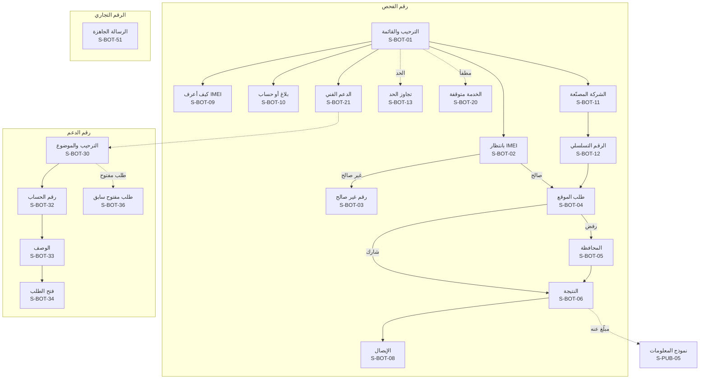

## 18. ردود الرسائل النصية (S-SMS)

ردود الرقم القصير لمن لا يملك إنترنت (D-64): نص قصير بالصيغ القانونية الثابتة، دون أي بيانات عن صاحب الجهاز (SMS-02)، ودون روابط إيصال لأن الموقع لا يُرسل بالرسالة. والنصوص قوالب `T-SMS-NN` في [كتالوج المحتوى](24-content-catalog.md).

| المعرّف | الرد | من يراه | المنصات | الغرض | المتطلبات | المحتوى | الحالات الخاصة |
|---|---|---|---|---|---|---|---|
| S-SMS-01 | لا بلاغات فعّالة | المرسل | SMS | النتيجة السليمة | SMS-01، SMS-02، CHECK-09 | الصيغة الثابتة المختصرة مع الموديل | «تعذّر التحقق الدولي حالياً» بعد ⚙️ ثانيتين (GSMA-01) |
| S-SMS-02 | مبلّغ عنه: مسروق | المرسل | SMS | التحذير | SMS-01، SMS-02 | «مبلّغ عنه: مسروق، لا تشترِه» مع الموديل | — |
| S-SMS-03 | مبلّغ عنه: مفقود | المرسل | SMS | التحذير | SMS-01، SMS-02 | «مبلّغ عنه: مفقود، لا تشترِه» مع الموديل | — |
| S-SMS-04 | رقم غير صالح ومساعدة | المرسل | SMS | تصحيح الإدخال | SMS-01، CHECK-03 | «الرقم غير صالح. اطلب ‎*#06#‎ وأرسل الرقم المكوّن من 15 خانة» | أي نص غير مفهوم يأخذ الرد نفسه |
| S-SMS-05 | تجاوز الحد | المرسل | SMS | الحماية من الإساءة | SMS-04 | «وصلت للحد المسموح، حاول لاحقاً» | — |
| S-SMS-06 | الخدمة متوقفة مؤقتاً | المرسل | SMS | الرقم القصير مطفأ أو في صيانة | SMART-04، SMART-11 | «الفحص برسالة متوقف مؤقتاً» | — |
| S-SMS-07 | «وجدته» | من فحص جهازاً مفقوداً وأرسل «وجدته» خلال ⚙️ 24 ساعة | SMS | الإبلاغ عن العثور دون إنترنت | SMS-05، TIP-02 | «شكراً، وصلت معلومتك. ستتواصل معك الإدارة لتنسيق الإرجاع دون كشف رقمك لصاحب الجهاز» | بعد المهلة أو دون فحص مفقود: الرد كما في S-SMS-04 |

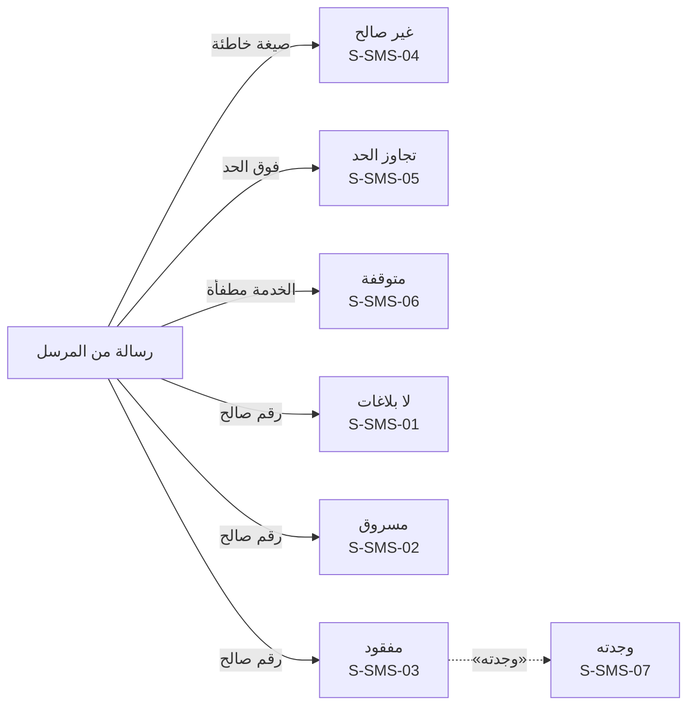

## 19. الوثائق المطبوعة وملفات PDF (S-PRN)

تُطبع وتُصدَّر **بالثيم الفاتح دائماً** (THEME-04)، وتُولَّد على الخادم من HTML، وتعرض العربية بالاتجاه ووصل الحروف الصحيحين (08 §5). ولا إعلان في أي وثيقة (ADS-02). وكل وثيقة قابلة للتحقق تحمل QR لصفحتها العامة.

| المعرّف | الوثيقة | من يراها | المنصات | الغرض | المتطلبات | المحتوى | الحالات الخاصة |
|---|---|---|---|---|---|---|---|
| S-PRN-01 | الفاتورة A4 | المشتري، والمحل | PDF، طباعة | إثبات البيع | SHOP-10، THEME-04 | الشعار، والمحل ورقمه وعنوانه، ورقم `TX-`، والتاريخ، والجهاز ومعرّفاته، واسم المشتري، والسعر إن أُدخل، والموظف، وQR، والتذييل الثابت «فاتورة موثّقة عبر المنصة. تحقّق من صحتها بمسح رمز QR.» | ملغاة: علامة «ملغاة» واضحة |
| S-PRN-02 | الفاتورة الحرارية 80 مم | المشتري، والمحل | طباعة | الطباعة السريعة في المحل | SHOP-10 | المحتوى نفسه بتخطيط عمودي ضيق، وQR بحجم يُمسح | — |
| S-PRN-03 | شهادة الفحص | المالك، والمشتري المحتمل | PDF، صورة | المشاركة في الإعلان | OWN-09، OWN-10 | رقم `CR-`، والجهاز، وIMEI مخفياً جزئياً، وأصل التسجيل، وتاريخ الإصدار والانتهاء، وQR، وجملة «الحالة الحالية تظهر دائماً عند مسح الرمز» | — |
| S-PRN-04 | إيصال الفحص | الفاحص | PDF، صورة، طباعة | إثبات حسن النية | CHECK-16 | رقم `CR-`، وIMEI، والموديل، والنتيجة، والتاريخ والوقت، والمحافظة، وQR، والصيغة القانونية | — |
| S-PRN-05 | إيصال نقل الملكية | الطرفان | PDF | إثبات النقل | OWN-04 | رقم `CR-`، والتاريخ، والجهاز، والطرفان مخفيان جزئياً، وQR | — |
| S-PRN-06 | إيصال استلام الصيانة | صاحب الجهاز، والمحل | PDF، طباعة حرارية | إثبات تسليم الجهاز للصيانة | REPAIR-02 | رقم `CR-`، والمحل، والجهاز، والعطل، والتاريخ، وQR، وجملة «الاستلام لا ينقل الملكية» | — |
| S-PRN-07 | تقرير تاريخ الجهاز | المالك، أو من طلبه | PDF | لقطة ماضي الجهاز | HISTORY-01، HISTORY-02، HISTORY-04 | تاريخ اللقطة، وأصل التسجيل، وعدد انتقالات الملكية، وعدد المعاملات ومحافظاتها، وتواريخ الصيانة واستبدال اللوحة، والجمركة، والحالة الدولية والحالية، والبلاغات المغلقة، وQR. **دون أي بيانات شخصية** | — |
| S-PRN-08 | تقرير قوى الأمن من الإدارة | الجهة المحال إليها | PDF | الإحالة خارج البوابة | ADMIN-10، TRACK-07 | الجهاز والبلاغ والتنبيه، والمواقع، والخريطة وخط السير وجدول النقاط، وسجل الجهاز، والمرسل والتاريخ، وعلامة «سرّي» | — |
| S-PRN-09 | تقرير بوابة الأمن | العنصر | PDF | التقرير من البوابة | PP-12 | الموضوع (جهاز، أو بلاغ، أو تنبيه)، والتفاصيل ضمن النطاق، والخريطة، والعنصر والتاريخ | — |
| S-PRN-10 | تقرير التزام المحلات | وزارة الداخلية | PDF، Excel | التقرير الدوري | COMPLIANCE-02 | المحافظة والفترة، والمحلات الموثّقة، والمتأخرة، وذات التعارضات أو العمليات البعيدة، والتي حاولت شراء أجهزة مبلّغ عنها، والمعلّقة | — |
| S-PRN-11 | فاتورة طلب المتجر وإيصال الدفع | المحل، والمشتري | PDF | فاتورة المنصة للطلب، وإيصال كل دفعة | STORE-08، PAY-02 | المنصة جهةً بائعة، واسم المورّد، والأصناف، والمبلغ، وطريقة الدفع والرقم المرجعي، وسياسة الإرجاع والكفالة، والبيانات الضريبية | — |
| S-PRN-12 | تقارير الأسطر المرفوضة ونتائج الفحص بالجملة | الوكيل، والمشرف، والعنصر | Excel، CSV | تصحيح الملفات ومتابعتها | IMPORTER-03، POLICE-01، PP-11 | كل سطر بسببه أو نتيجته | — |
| S-PRN-13 | كشف تسوية المورّد | المورّد، والإدارة | PDF | محاسبة المورّد | STORE-10 | الفترة، والطلبات المسلّمة والمدفوعة، وحصة المنصة، والمرتجعات والعيوب، والصافي، ورقم التحويل المرجعي، واسم المعدّ والموافق | — |
| S-PRN-14 | ملصق الطلب للشحن | المورّد، والمندوب | طباعة | تسليم الطلب للمندوب | STORE-05، STORE-09 | رقم الطلب برمز قابل للمسح، واسم المحل وعنوان التوصيل، والمبلغ المطلوب عند الاستلام. دون هاتف المحل ودون رمز التسليم | — |
| S-PRN-15 | إيصال التعبئة | المحل والزبون | طباعة حرارية، PDF | إثبات تعبئة الرصيد | TOPUP-03 | الرقم المعبّأ مخفياً جزئياً، والشبكة، والقيمة، والحالة، والوقت، والرقم المرجعي، واسم المحل | فاشلة: «أُعيد المبلغ» |
| S-PRN-16 | كشف حساب المحفظة | صاحب المحل | PDF، Excel | تصدير حركة المحفظة | SHOPWALLET-06 | الفترة، والرصيد الافتتاحي والختامي، وكل عملية برقمها ونوعها ومنفّذها ووقتها | — |
| S-PRN-17 | فاتورة نقطة البيع | المحل والزبون | طباعة حرارية، PDF، واتساب | فاتورة بيع الإكسسوارات والقطع | SHOPPRO-03 | اسم المحل، والأصناف والكميات والأسعار والخصم، وطريقة الدفع، والتاريخ، ورقم الفاتورة. **منفصلة عن فاتورة الجهاز** `TX-` ولا QR تحقق عليها | دون اتصال: تُطبع محلياً وتُزامَن |
| S-PRN-18 | ملصقات الباركود | المحل | طباعة | تعليم بضاعة المخزون | SHOPPRO-02 | باركود الصنف واسمه وسعره، بمقاسات ملصقات شائعة | — |
| S-PRN-19 | تقارير المحاسبة وكشوفها | صاحب المحل (والموظف كشفه إن سُمح) | PDF، Excel | الأرباح وكشوف الزبائن والموظفين | SHOPPRO-07، SHOPPRO-08، SHOPPRO-11 | تقارير الأرباح والمبيعات والمخزون والفروع، وكشف حساب الزبون وجدول تقسيطه، والكشف الشهري للموظف | — |
| S-PRN-20 | التقرير الشهري للمؤشرات | المدير العام والوزارة | PDF، Excel | مؤشرات التشغيل الشهرية | SMART-15 | الفترة، والفحوص، والبلاغات وزمن مراجعتها، والأجهزة المستردة، والتزام المحلات، وصحة التكاملات. أرقام مجمّعة دون أي بيانات شخصية ودون بيانات محاسبة المحلات | — |

## 20. التنقّل في التطبيق الواحد حسب الدور (D-44)

### 20.1 الشريط السفلي لكل سياق

تطبيق واحد يتغيّر شريطه السفلي حسب السياق، والزر الأوسط هو الإجراء الأكثر تكراراً في كل سياق (15 §9.1). الموقع يستخدم البنية نفسها في القائمة الجانبية للوحات وفي رأس الصفحة للمواطن.

| السياق | التبويب 1 | التبويب 2 | الزر الأوسط | التبويب 4 | التبويب 5 |
|---|---|---|---|---|---|
| زائر (دون دخول) | فحص (S-PUB-01) | احمِ جهازك (S-PUB-14) | — | — | دخول (S-AUT-05) |
| مواطن (ومعه المفوّض والجهة الموثوقة) | الرئيسية (S-USR-01) | أجهزتي (S-USR-02) | مسح وفحص (S-APP-08 ثم النتيجة) | بلاغاتي (S-USR-14) | حسابي (S-USR-31) |
| صاحب محل «بيع وشراء أجهزة» أو «حواسيب» (مع غيرهما أو وحدهما) | المحل (S-SHP-03) | المعاملات (S-SHP-14) | عملية جديدة: فحص، وشراء، وبيع، ومعها استلام صيانة وتعبئة رصيد وبيع إكسسوارات (نقطة البيع) حسب أنواع النشاط والباقة | الموظفون (S-SHP-16) | المزيد |
| موظف المحل | المحل (S-SHP-03) | المعاملات (كلها أو ما سجّله) | عملية جديدة: **المسموح له فقط** | المخزون (S-SHP-13) | المزيد |
| صاحب محل «صيانة» فقط | المحل (S-SHP-03) | الصيانة (S-RPR-04) | استلام صيانة (S-RPR-01) | الموظفون (S-SHP-16) | المزيد |
| صاحب محل «خدمات اتصالات وإكسسوارات» فقط | المحل (S-SHP-03) | التعبئات (S-SHP-40) | تعبئة رصيد (S-SHP-38) | الموظفون (S-SHP-16) | المزيد |
| مسؤول الوكيل | الوكيل (S-IMP-03) | المخزون (S-IMP-06) | رفع دفعة أو نقل لمحل | النقل (S-IMP-08) | المزيد |
| موظف الوكيل | الوكيل (S-IMP-03) | المخزون (S-IMP-06) | **المسموح له فقط** | النقل (S-IMP-08) | المزيد |

**«المزيد» في سياق المحل:** حالة الالتزام (S-SHP-52)، والباقة والاشتراك (S-SHP-24)، وبرنامج المحاسبة لباقة المشتركين (نقطة البيع، والمخزون الكامل، والمشتريات، والصندوق، والمصاريف، والرواتب، والديون، والكفالات، والتقارير، والفروع: S-SHP-25 إلى S-SHP-30، وS-SHP-41 إلى S-SHP-45، والرصيد والخطوط S-SHP-48)، والمحفظة وكشفها وإعداداتها ورمزها لصاحب المحل (S-SHP-33 إلى S-SHP-37، وS-SHP-51)، وسجل التعبئات (S-SHP-40)، وخصوصية بيانات المحاسبة (S-SHP-46)، وبلاغ سرقة المحل ومتابعته (S-SHP-49، S-SHP-50)، والمخزون (S-SHP-13)، وطلبات الاستلام من الوكلاء (S-SHP-19)، وبيانات المحل (S-SHP-18)، والمتجر وطلباته والإرجاع (S-SHP-21 إلى S-SHP-23، وS-SHP-32)، وإعلانات المحل بحالتها (S-SHP-31)، والمسودات (S-APP-14)، وطلبات الدعم (S-USR-37)، و«التبديل إلى حسابي». **وفي سياق الوكيل:** سجل المعاملات، والموظفون، وبيانات الوكيل، والمتجر، وطلبات الدعم، والتبديل.

**سياق المورّد ومندوب الشحن** على الموقع فقط (S-SUP، وS-CUR)، ولا يظهران في مبدّل التطبيق.

### 20.2 قواعد التبديل بين الأدوار

| القاعدة | التفصيل |
|---|---|
| أين | «حسابي» في سياق المواطن، وشارة اسم المحل أو الوكيل أعلى لوحته، وقائمة الحساب في رأس الموقع (S-USR-43) |
| الجلسة | التبديل لا يحتاج دخولاً جديداً. الجلسة واحدة، والسياق يُرسل مع كل طلب، والخادم يفرض نطاقه |
| الذاكرة | يفتح التطبيق على آخر سياق استُخدم (S-APP-01). وأول دخول يفتح «حسابي» |
| بوابة الموقع | دخول سياق محل يمر ببوابة الموقع (S-SHP-04) |
| الإشعارات | كل إشعار يحمل سياقه، والضغط عليه يبدّل السياق تلقائياً مع رسالة قصيرة «انتقلت إلى [محل النور]» |
| عدم الخلط | لا تظهر بيانات سياق في آخر: المحل يرى معاملاته فقط، والمواطن أجهزته فقط، حتى لو كان الشخص نفسه |
| أكثر من محل | من يعمل في محلين أو يملك محلاً ويعمل في آخر يرى كل سياق منفصلاً بدوره فيه |
| السياق المعلّق | يظهر في المبدّل بشارة «معلّق» ويفتح للقراءة |
| الخروج | تسجيل الخروج يُنهي كل السياقات معاً |

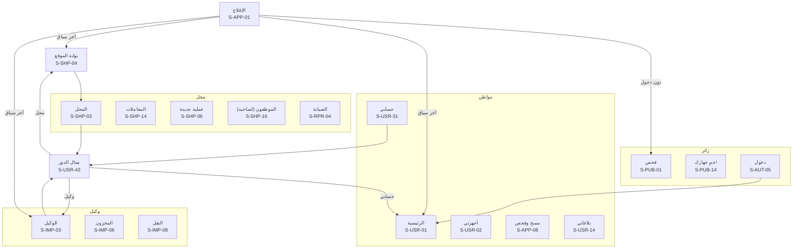

## 21. التصاميم الموجودة وما ينقصها

### 21.1 تصاميم الموقع الإحدى عشرة

من [معرض التصاميم](../design/README.md)، الملفات `design/src/web/*.html`:

| ملف التصميم | الشاشات | الحالة وما يلزم تعديله |
|---|---|---|
| `01-home.html` | S-PUB-01 | ✅ ⚠️ **معلّق:** بطاقة المعاينة تعرض «أصل التسجيل» وهو ليس من مؤشرات CHECK-08 |
| `02-location.html` | S-PUB-02 | ✅ والعبارة مطابقة لـ GEO-02 |
| `03-result-clean.html` | S-PUB-04 | ✅ سطر «الرقمان لنفس الموديل متطابقان» صحيح لأن CHECK-08 يذكره الآن (FAKE-02). ⚠️ **معلّق:** سطر «أصل التسجيل» ليس من مؤشرات CHECK-08، وزر «اطلب التقرير» للموقع فقط (PAY-08) |
| `04-result-stolen.html` | S-PUB-05 | ✅ |
| `05-result-lost.html` | S-PUB-06 | ✅ ومعه المؤشرات الإضافية الممكنة |
| `06-receipt.html` | S-PUB-07، S-PRN-04 | ✅ عُدّل الرقم إلى صيغة `CR-` |
| `07-register.html` | S-AUT-01، S-AUT-02 | ✅ (خطوة رمز التحقق) |
| `08-login.html` | S-AUT-05 | ✅ عُدّلت عبارة الاستعادة: بالهوية عبر الدعم، والرقم البديل للإشعارات فقط (D-81) |
| `09-verify.html` | S-PUB-08، S-PUB-10 | ✅ عُدّل الرقم إلى صيغة `CR-` |
| `10-protect.html` | S-PUB-14 | ✅ |
| `11-shops.html` | S-PUB-15 | ✅ عُدّلت إلى «لا توجد بلاغات فعّالة» |

### 21.2 تصاميم التطبيق واللوحات وبوابة الأمن الموجودة عند كتابة هذه الوثيقة

| ملف التصميم | الشاشات | الحالة وما يلزم تعديله |
|---|---|---|
| `app/01-check.html` | S-PUB-01 (تطبيق)، S-APP-08، S-PUB-02 (تطبيق)، S-PUB-05 (تطبيق) | ✅ |
| `app/02-devices.html` | S-USR-01، S-USR-02، S-USR-03، S-USR-10 | ✅ ⚠️ **معلّق:** شارة «مسروق» وحدها تصبح «مبلّغ عنه: مسروق» (17 §5) |
| `app/03-report.html` | S-USR-15، S-USR-16 وS-USR-17 (في شاشة واحدة)، S-USR-20 | ✅ أُزيلت شارة الموثوقية. ⚠️ **معلّق:** عبارة «لا يظهر لأي شخص» بجانب مكان الحادثة تصبح «لا يظهر لصاحب الجهاز ولا لأي شخص، وتستخدمه الإدارة والجهات المختصة فقط» (C-16)، وأسماء الشركات في «قائمة المراقبة لدى الشبكات» تُحذف (S-USR-20) |
| `app/04-ownership.html` | S-USR-06، S-USR-08، S-APP-11، S-USR-04 | ✅ |
| `app/05-shop-sale.html` | S-SHP-03، S-SHP-10، S-SHP-11، S-SHP-12، S-SHP-52 | ✅ وبطاقة «الالتزام» تطابق الآن COMPLIANCE-04 |
| `app/06-shop-more.html` | S-SHP-09، S-SHP-07 مع S-APP-10، S-SHP-16 مع S-SHP-17، S-SHP-24 | ✅ ⚠️ **معلّق:** إطار «الأدوات» يعرض الباقة (المجانية أو المشتركين) بدل أدوات منفردة (D-93) |
| `app/07-account.html` | S-USR-36، S-USR-37 مع S-USR-38، S-USR-31، S-APP-09 | ✅ |
| `app/08-first-run.html` | S-APP-04، S-AUT-05، S-AUT-02، S-USR-30 مع S-APP-10 | ⚠️ **معلّق:** جملة «البلاغ والملكية فيحتاجان حساباً مؤكَّد الرقم» تخالف D-32، والبديل «البلاغ يحتاج توثيق الهوية، والملكية تظهر بالربط التلقائي». وشاشة الدخول تُضاف إليها «سُرق موبايلك ولا يصلك الرمز؟» (S-AUT-08، S-AUT-15) |
| `app/09-repair-system.html` | S-RPR-01 مع S-RPR-02، S-RPR-04، S-APP-13، S-APP-02 | ✅ |
| `admin/01-dashboard.html` | S-ADM-03 | ✅ صارت البطاقة «بلاغات · موثوقية 🟢». ⚠️ **معلّق:** بطاقات الأرقام العامة (فحوص اليوم، والبلاغات النافذة، والأجهزة المستردة) مكانها التقرير الشهري (S-ADM-63، SMART-15) لا الرئيسية (D-22) |
| `partials/importer-side.html` | الهيكل الجانبي لـ S-IMP | ✅ صارت «وكيل موثّق · IM-0031» بالصيغة المعتمدة |
| `partials/shop-side.html` | الهيكل الجانبي لـ S-SHP | ✅ بند «الالتزام» يطابق COMPLIANCE-04 (S-SHP-52). وتُضاف بنود المحفظة والتعبئة والمحاسبة |
| `shop/01-dashboard.html` | S-SHP-03، S-SHP-52، ومعها شريط S-SHP-09 | ✅ ⚠️ **معلّق:** «كلها بعد فحص سليم» تصبح «كلها بعد فحص دون بلاغات» (17 §5) |
| `shop/02-new-sale.html` | S-SHP-10، S-SHP-11، والإكمال بالتطبيق (القسم 4) | ✅ |
| `shop/03-transactions.html` | S-SHP-14 | ✅ |
| `shop/04-staff.html` | S-SHP-16 | ✅ وتُضاف صلاحيتا «تعبئة رصيد» و«الدفع من المحفظة» (SHOPWALLET-05) |
| `shop/05-store.html` | S-SHP-21 | ✅ ويوافق D-87 |
| `shop/06-importer-import.html` | S-IMP-04، S-IMP-05 | ✅ صارت «صالحة»، ورقم الدفعة `BT-` بالصيغة المعتمدة |
| `admin/02-report-review.html` | S-ADM-07 | ✅ ⚠️ **معلّق:** «الأدلة الإلزامية سليمة» تُكتب «مكتملة» |
| `admin/03-identity-review.html` | S-ADM-10 | ✅ |
| `admin/04-alert.html` | S-ADM-13 | ✅ |
| `admin/05-device-file.html` | S-ADM-04، S-ADM-16، S-ADM-17 | ✅ |
| `admin/06-settings.html` | S-ADM-44، S-ADM-45 | ✅ |
| `admin/07-roles.html` | S-ADM-43 | ✅ الدور المخصّص بنطاق محافظة صحيح، فالأدوار الديناميكية تحمل نطاقاً (SMART-03) |
| `admin/08-commercial.html` | S-ADM-39 | ✅ |
| `admin/09-support.html` | S-ADM-27، S-ADM-29 | ✅ |
| `admin/10-reversal.html` | S-ADM-53 | ✅ |
| `admin/11-health.html` | S-ADM-49، S-ADM-50 | ✅ |
| `police/01-dashboard.html` | S-POL-03 | ✅ |
| `police/02-alert.html` | S-POL-04، S-POL-09 | ✅ |
| `police/03-search.html` | S-POL-06 | ✅ |
| `police/04-report.html` | S-POL-11، S-POL-13، S-POL-14 | ✅ |
| `police/05-official-report.html` | S-POL-12 | ✅ |
| `police/06-officers-log.html` | S-POL-19 | ✅ |
| `admin/12-audit.html` | S-ADM-52 | ✅ |
| `app/10-shop-wallet.html` | S-SHP-33، S-SHP-38، S-SHP-39، S-SHP-35 | ✅ |
| `shop/07-accounting.html` | S-SHP-41، S-SHP-26، S-SHP-27، S-SHP-30، S-SHP-48 | ✅ |
| `shop/08-packages.html` | S-SHP-24 | ✅ |

**ما زال معلّقاً في التصاميم الموجودة:** `01-home` و`03-result-clean` (سطر أصل التسجيل)، و`app/02` (شارة «مسروق»)، و`app/03` (عبارة الموقع وأسماء الشركات)، و`app/06` (إطار الباقة)، و`app/08` (جملة التوثيق ورابط السرقة)، و`admin/01` (بطاقات الأرقام)، و`admin/02` («سليمة»)، و`shop/01` («فحص سليم»). وكل ما عداها ✅.

### 21.3 الشاشات التي تحتاج تصميماً

كل شاشة لم تُذكر في 21.1 و21.2 تحتاج تصميماً بالثيمين قبل بناء واجهتها. والتسمية المقترحة لملفات التصميم الجديدة تبدأ بمعرّف الشاشة (مثل `S-USR-14-reports.html`)، والإطار الذي يجمع عدة شاشات يذكر معرّفاتها في عنوانه.

| المنطقة | عدد الشاشات | لها تصميم | تحتاج تصميماً |
|---|---|---|---|
| الموقع العام (`S-PUB`) | 23 | 10 | S-PUB-03، S-PUB-09، S-PUB-11، S-PUB-12، S-PUB-13، S-PUB-16، S-PUB-17، S-PUB-18، S-PUB-19، S-PUB-20، S-PUB-21، S-PUB-22، S-PUB-23 |
| الدخول والتسجيل (`S-AUT`) | 15 | 3 | S-AUT-03، S-AUT-04، S-AUT-06، S-AUT-07، S-AUT-08، S-AUT-09، S-AUT-10، S-AUT-11، S-AUT-12، S-AUT-13، S-AUT-14، S-AUT-15 |
| حساب المواطن (`S-USR`) | 46 | 16 | S-USR-05، S-USR-07، S-USR-09، S-USR-11، S-USR-12، S-USR-13، S-USR-14، S-USR-18، S-USR-19، S-USR-21، S-USR-22، S-USR-23، S-USR-24، S-USR-25، S-USR-26، S-USR-27، S-USR-28، S-USR-29، S-USR-32، S-USR-33، S-USR-34، S-USR-35، S-USR-39، S-USR-40، S-USR-41، S-USR-42، S-USR-43، S-USR-44، S-USR-45، S-USR-46 |
| المحل (`S-SHP`) | 52 | 21 | S-SHP-01، S-SHP-02، S-SHP-04، S-SHP-05، S-SHP-06، S-SHP-08، S-SHP-13، S-SHP-15، S-SHP-18، S-SHP-19، S-SHP-20، S-SHP-22، S-SHP-23، S-SHP-25، S-SHP-28، S-SHP-29، S-SHP-31، S-SHP-32، S-SHP-34، S-SHP-36، S-SHP-37، S-SHP-40، S-SHP-42، S-SHP-43، S-SHP-44، S-SHP-45، S-SHP-46، S-SHP-47، S-SHP-49، S-SHP-50، S-SHP-51 |
| الصيانة (`S-RPR`) | 7 | 3 | S-RPR-03، S-RPR-05، S-RPR-06، S-RPR-07 |
| الوكيل (`S-IMP`) | 13 | 2 | S-IMP-01، S-IMP-02، S-IMP-03، S-IMP-06، S-IMP-07، S-IMP-08، S-IMP-09، S-IMP-10، S-IMP-11، S-IMP-12، S-IMP-13 |
| المورّد (`S-SUP`) | 11 | 0 | S-SUP-01، S-SUP-02، S-SUP-03، S-SUP-04، S-SUP-05، S-SUP-06، S-SUP-07، S-SUP-08، S-SUP-09، S-SUP-10، S-SUP-11 |
| مندوب الشحن (`S-CUR`) | 3 | 0 | S-CUR-01، S-CUR-02، S-CUR-03 |
| التطبيق (`S-APP`) | 14 | 7 | S-APP-01، S-APP-03، S-APP-05، S-APP-06، S-APP-07، S-APP-12، S-APP-14 |
| لوحة الإدارة (`S-ADM`) | 64 | 17 | S-ADM-01، S-ADM-02، S-ADM-05، S-ADM-06، S-ADM-08، S-ADM-09، S-ADM-11، S-ADM-12، S-ADM-14، S-ADM-15، S-ADM-18، S-ADM-19، S-ADM-20، S-ADM-21، S-ADM-22، S-ADM-23، S-ADM-24، S-ADM-25، S-ADM-26، S-ADM-28، S-ADM-30، S-ADM-31، S-ADM-32، S-ADM-33، S-ADM-34، S-ADM-35، S-ADM-36، S-ADM-37، S-ADM-38، S-ADM-40، S-ADM-41، S-ADM-42، S-ADM-46، S-ADM-47، S-ADM-48، S-ADM-51، S-ADM-54، S-ADM-55، S-ADM-56، S-ADM-58، S-ADM-59، S-ADM-60، S-ADM-61، S-ADM-62، S-ADM-63، S-ADM-64، S-ADM-65 |
| بوابة الأمن (`S-POL`) | 22 | 9 | S-POL-01، S-POL-02، S-POL-05، S-POL-07، S-POL-08، S-POL-10، S-POL-15، S-POL-16، S-POL-17، S-POL-18، S-POL-20، S-POL-21، S-POL-22 |
| بوت واتساب (`S-BOT`) | 36 | — | لا تحتاج تصميماً مرئياً: نصوصها قوالب في الوثيقة 24 |
| الرسائل النصية (`S-SMS`) | 7 | — | لا تحتاج تصميماً مرئياً: نصوصها قوالب في الوثيقة 24 |
| الوثائق المطبوعة (`S-PRN`) | 20 | 1 | S-PRN-01، S-PRN-02، S-PRN-03، S-PRN-05، S-PRN-06، S-PRN-07، S-PRN-08، S-PRN-09، S-PRN-10، S-PRN-11، S-PRN-12، S-PRN-13، S-PRN-14، S-PRN-15، S-PRN-16، S-PRN-17، S-PRN-18، S-PRN-19، S-PRN-20 |

## 22. حالة الشاشات يوم الإطلاق (D-95)

كل الشاشات تُبنى وتُختبر كاملة قبل الإطلاق، لكن يوم الإطلاق لا يُفعَّل إلا الأساس، وباقي الوحدات يفتحها المدير العام واحدة واحدة من شاشة مفاتيح الميزات (S-ADM-45) دون أي تحديث (ROLLOUT-06، ROLLOUT-07). والشاشة تتبع وحدتها الأساسية، وهي وحدة أول متطلب في عمودها. والوحدة المطفأة تختفي مداخلها من كل الواجهات ويرفض الخادم طلباتها (القسم 2).

### 22.1 حالة الوحدات

| الحالة يوم الإطلاق | الوحدات |
|---|---|
| ✅ **مفعّلة** | 1. الحسابات والهوية (AUTH)، 2. الفحص العام (CHECK)، 3. البلاغات (REPORT)، 4. المحلات (SHOP)، 5. الملكية و«أجهزتي» (OWN)، 6. الإشعارات (NOTIF)، 7. المعلومات الواردة والاعتراضات (TIP / DISPUTE)، 8. لوحة الإدارة (ADMIN)، 10. الموقع الجغرافي (GEO)، 11. الصفحات العامة (PUB)، 13. خريطة التتبّع المباشر (TRACK)، 14. احمِ جهازك (PROTECT)، 16. محلات الصيانة (REPAIR)، 17. الوكلاء والمستوردون (IMPORTER)، 18. بلاغات قوى الأمن المستوردة (POLICE)، 21. البلاغ بالنيابة (ONBEHALF)، 22. تحديث التطبيق (APPVER)، 23. تقرير التزام المحلات (COMPLIANCE)، 24. بوابة قوى الأمن (POLICE PORTAL — PP)، 25. حماية صاحب الجهاز لحظة السرقة (THEFT)، 27. الجهات الموثوقة (TRUSTED)، 29. الأجهزة المقلّدة وتطابق الرقمين (FAKE)، 30. من اطّلع على بياناتي (DATAACCESS)، 37. نظام التصميم والثيمات (THEME)، 38. لوحة الإدارة الذكية (SMART)، 39. الدعم الفني (SUPPORT)، 40. إكمال الخطوة بالتطبيق (HANDOFF)، 41. التجريب والإطلاق المتدرّج (ROLLOUT)، 42. تصحيح القرارات الإدارية (REVERSAL)، 46. الخصوصية وبيانات المستخدم (PRIV) |
| ⏳ **عند جاهزية الاتفاقية** | 9. التكامل مع شركات الاتصالات (TELCO)، 12. التكامل مع الأحوال المدنية (CIVIL)، 19. قاعدة GSMA العالمية (GSMA)، 20. نظام تسجيل الأجهزة في الهيئة الناظمة (CUSTOMS) |
| ❌ **مطفأة حتى يفتحها المدير العام** | 15. الفحص عبر بوت واتساب (WABOT)، 26. إيقاف الخط وحماية المحافظ (LINE / WALLET)، 28. الفحص برسالة SMS (SMS)، 31. متجر المحلات (STORE)، 32. الإعلانات (ADS)، 33. برنامج المحاسبة وإدارة المحل (SHOPPRO)، 34. تقرير تاريخ الجهاز (HISTORY)، 35. الربط البرمجي للشركات (BIZAPI)، 36. المدفوعات (PAY)، 43. محفظة المحل (SHOPWALLET)، 44. تعبئة الرصيد (TOPUP)، 45. الحواسيب والأجهزة دون شريحة (SERIAL) |

### 22.2 الشاشات حسب حالتها

| المنطقة | ✅ مفعّلة | ⏳ عند جاهزية الاتفاقية | ❌ مطفأة حتى الفتح |
|---|---|---|---|
| الموقع العام (`S-PUB`) | S-PUB-01، S-PUB-02، S-PUB-03، S-PUB-04، S-PUB-05، S-PUB-06، S-PUB-07، S-PUB-08، S-PUB-09، S-PUB-10، S-PUB-11، S-PUB-13، S-PUB-14، S-PUB-15، S-PUB-16، S-PUB-17، S-PUB-18، S-PUB-19، S-PUB-20، S-PUB-21، S-PUB-23 | — | S-PUB-12، S-PUB-22 |
| الدخول والتسجيل (`S-AUT`) | كلها | — | — |
| حساب المواطن (`S-USR`) | S-USR-01، S-USR-02، S-USR-03، S-USR-04، S-USR-05، S-USR-06، S-USR-07، S-USR-08، S-USR-09، S-USR-10، S-USR-11، S-USR-12، S-USR-13، S-USR-14، S-USR-15، S-USR-16، S-USR-17، S-USR-18، S-USR-19، S-USR-20، S-USR-21، S-USR-22، S-USR-23، S-USR-24، S-USR-25، S-USR-26، S-USR-27، S-USR-28، S-USR-29، S-USR-30، S-USR-31، S-USR-32، S-USR-33، S-USR-34، S-USR-35، S-USR-36، S-USR-37، S-USR-38، S-USR-39، S-USR-40، S-USR-43، S-USR-45، S-USR-46 | — | S-USR-41، S-USR-42، S-USR-44 |
| المحل (`S-SHP`) | S-SHP-01، S-SHP-02، S-SHP-03، S-SHP-04، S-SHP-05، S-SHP-06، S-SHP-07، S-SHP-08، S-SHP-09، S-SHP-10، S-SHP-11، S-SHP-12، S-SHP-13، S-SHP-14، S-SHP-15، S-SHP-16، S-SHP-17، S-SHP-18، S-SHP-19، S-SHP-20، S-SHP-49، S-SHP-50، S-SHP-52 | — | S-SHP-21، S-SHP-22، S-SHP-23، S-SHP-24، S-SHP-25، S-SHP-26، S-SHP-27، S-SHP-28، S-SHP-29، S-SHP-30، S-SHP-31، S-SHP-32، S-SHP-33، S-SHP-34، S-SHP-35، S-SHP-36، S-SHP-37، S-SHP-38، S-SHP-39، S-SHP-40، S-SHP-41، S-SHP-42، S-SHP-43، S-SHP-44، S-SHP-45، S-SHP-46، S-SHP-47، S-SHP-48، S-SHP-51 |
| الصيانة (`S-RPR`) | كلها | — | — |
| الوكيل (`S-IMP`) | كلها | — | — |
| المورّد (`S-SUP`) | — | — | S-SUP-01، S-SUP-02، S-SUP-03، S-SUP-04، S-SUP-05، S-SUP-06، S-SUP-07، S-SUP-08، S-SUP-09، S-SUP-10، S-SUP-11 |
| مندوب الشحن (`S-CUR`) | — | — | S-CUR-01، S-CUR-02، S-CUR-03 |
| التطبيق (`S-APP`) | كلها | — | — |
| لوحة الإدارة (`S-ADM`) | S-ADM-01، S-ADM-02، S-ADM-03، S-ADM-04، S-ADM-05، S-ADM-06، S-ADM-07، S-ADM-08، S-ADM-09، S-ADM-10، S-ADM-11، S-ADM-12، S-ADM-13، S-ADM-15، S-ADM-16، S-ADM-17، S-ADM-19، S-ADM-20، S-ADM-21، S-ADM-22، S-ADM-23، S-ADM-24، S-ADM-25، S-ADM-26، S-ADM-27، S-ADM-28، S-ADM-29، S-ADM-30، S-ADM-31، S-ADM-42، S-ADM-43، S-ADM-44، S-ADM-45، S-ADM-46، S-ADM-47، S-ADM-48، S-ADM-49، S-ADM-50، S-ADM-51، S-ADM-52، S-ADM-53، S-ADM-54، S-ADM-58، S-ADM-59، S-ADM-60، S-ADM-61، S-ADM-62، S-ADM-63، S-ADM-64، S-ADM-65 | S-ADM-14، S-ADM-18 | S-ADM-32، S-ADM-33، S-ADM-34، S-ADM-35، S-ADM-36، S-ADM-37، S-ADM-38، S-ADM-39، S-ADM-40، S-ADM-41، S-ADM-55، S-ADM-56 |
| بوابة الأمن (`S-POL`) | كلها | — | — |
| بوت واتساب (`S-BOT`) | S-BOT-08، S-BOT-16، S-BOT-18، S-BOT-19، S-BOT-20، S-BOT-30، S-BOT-31، S-BOT-32، S-BOT-33، S-BOT-34، S-BOT-35، S-BOT-36، S-BOT-37، S-BOT-38، S-BOT-39، S-BOT-40 | — | S-BOT-01، S-BOT-02، S-BOT-03، S-BOT-04، S-BOT-05، S-BOT-06، S-BOT-07، S-BOT-09، S-BOT-10، S-BOT-11، S-BOT-12، S-BOT-13، S-BOT-14، S-BOT-15، S-BOT-17، S-BOT-21، S-BOT-22، S-BOT-50، S-BOT-51، S-BOT-52 |
| الرسائل النصية (`S-SMS`) | — | — | S-SMS-01، S-SMS-02، S-SMS-03، S-SMS-04، S-SMS-05، S-SMS-06، S-SMS-07 |
| الوثائق المطبوعة (`S-PRN`) | S-PRN-01، S-PRN-02، S-PRN-03، S-PRN-04، S-PRN-05، S-PRN-06، S-PRN-08، S-PRN-09، S-PRN-10، S-PRN-12، S-PRN-20 | — | S-PRN-07، S-PRN-11، S-PRN-13، S-PRN-14، S-PRN-15، S-PRN-16، S-PRN-17، S-PRN-18، S-PRN-19 |

### 22.3 شاشات مفعّلة فيها عناصر من وحدات مطفأة أو بانتظار اتفاقية

تعمل هذه الشاشات يوم الإطلاق، وتُخفى منها العناصر التابعة للوحدات المذكورة حتى تُفتح وحداتها.

| الشاشة | الوحدات المخفية حتى الفتح |
|---|---|
| S-PUB-01 الصفحة الرئيسية وخانة الفحص | ADS، SERIAL |
| S-PUB-04 النتيجة: لا توجد بلاغات فعّالة | CUSTOMS، GSMA، HISTORY، PAY |
| S-PUB-08 التحقق من وثيقة | HISTORY |
| S-PUB-10 التحقق من شهادة فحص | CUSTOMS |
| S-AUT-15 جلسة «بلاغ السرقة فقط» | LINE |
| S-USR-01 الرئيسية | ADS |
| S-USR-03 تفاصيل الجهاز | HISTORY |
| S-USR-04 تسجيل جهاز ذاتياً | SERIAL |
| S-USR-15 بلاغ جديد: حماية فورية | LINE، WALLET |
| S-USR-16 بلاغ جديد: الجهاز والنوع | SERIAL |
| S-USR-18 بلاغ جديد: الأدلة | SERIAL |
| S-USR-20 تفاصيل البلاغ | LINE، SERIAL، TELCO، WALLET |
| S-USR-28 بلاغ عاجل عن شخص | LINE، WALLET |
| S-USR-30 توثيق الهوية | CIVIL |
| S-USR-36 الإشعارات | PAY |
| S-SHP-03 لوحة المحل | ADS، SHOPWALLET، TOPUP |
| S-SHP-05 فحص جهاز من المحل | GSMA، SERIAL |
| S-SHP-06 شراء: الجهاز والفحص | CUSTOMS، GSMA، SERIAL |
| S-SHP-07 شراء: بيانات البائع | CIVIL |
| S-SHP-09 منع المعاملة | GSMA |
| S-SHP-10 بيع: الجهاز والفحص | SERIAL |
| S-SHP-11 بيع: المشتري والسعر | CIVIL |
| S-SHP-13 المخزون | STORE |
| S-SHP-17 إضافة موظف أو تعديل صلاحياته | SHOPWALLET |
| S-SHP-49 بلاغ سرقة المحل | SERIAL |
| S-RPR-01 استلام للصيانة: الجهاز والفحص | SERIAL |
| S-RPR-02 استلام: صاحب الجهاز والعطل | CIVIL |
| S-RPR-04 أوامر الصيانة | SHOPPRO |
| S-RPR-05 تفاصيل أمر الصيانة | SHOPPRO |
| S-IMP-03 لوحة الوكيل | CUSTOMS |
| S-IMP-04 رفع دفعة أجهزة | SERIAL |
| S-IMP-05 تقرير الدفعة | CUSTOMS |
| S-IMP-06 مخزون الوكيل | CUSTOMS، SERIAL |
| S-APP-12 تصوير مستند أو دليل | STORE |
| S-APP-13 بلا اتصال | SHOPPRO |
| S-APP-14 المسودات | SHOPPRO |
| S-ADM-08 طلبات الإغلاق | TELCO |
| S-ADM-09 الاعتراضات | TELCO |
| S-ADM-10 توثيق الهويات | CIVIL |
| S-ADM-11 مراجعة التسجيل الذاتي | TELCO |
| S-ADM-12 التنبيهات الأمنية | CIVIL، GSMA، SERIAL |
| S-ADM-17 خريطة التتبّع | TELCO |
| S-ADM-24 الوكلاء والمستوردون | CUSTOMS |
| S-ADM-27 معالجة طلب الدعم | SHOPPRO |
| S-ADM-29 طلبات استعادة الحساب | CIVIL |
| S-ADM-49 صحة النظام وحل المشاكل | TELCO، WALLET |
| S-ADM-52 سجل التدقيق | CIVIL |
| S-POL-03 الرئيسية والتنبيهات اللحظية | SERIAL |
| S-POL-09 جلسات التتبّع والحظر | TELCO |
| S-POL-14 تسليم الجهاز المضبوط | TELCO |

المجموع: 235 شاشة مفعّلة، و2 عند جاهزية الاتفاقية، و96 مطفأة حتى الفتح.

## 23. مصفوفة التغطية: المتطلب ← الشاشة

تثبت هذه المصفوفة أن كل متطلب في [المتطلبات الوظيفية](04-functional-requirements.md) (388 متطلباً) له مكان: إما شاشة واحدة على الأقل، أو قاعدة تسري على كل الشاشات، أو تنفيذ في الخادم دون شاشة. وقد وُلّدت من عمود «المتطلبات» في جداول الشاشات أعلاه، فلا تختلف عنها. وأي متطلب جديد يُضاف إلى الوثيقة 04 يُضاف إلى شاشة هنا قبل بنائه.

### 23.1 متطلبات تسري على كل الشاشات

| المتطلب | كيف يُطبَّق |
|---|---|
| THEME-01 | نظام تصميم واحد لكل الواجهات (S-ADM-48 لتعديل الهوية)، وتحديداً في S-ADM-48 |
| THEME-02 | زر الثيم في رأس كل واجهة، والاختيار في S-USR-31، وتحديداً في S-USR-31 |
| THEME-03 | ألوان الحالات مع أيقونة ونص في كل نتيجة وشارة، وتحديداً في S-PUB-04، S-PUB-05، S-PUB-06 |
| THEME-04 | كل وثيقة مطبوعة في S-PRN فاتحة دائماً، وتحديداً في S-PUB-07، S-SHP-12، S-RPR-03، S-PRN-01 |
| ADS-02 | لا إعلان خارج الأماكن المسموحة (القسم 3) |
| PAY-05 | لا طلب دفع في أي مسار أساسي أو التزام محل |
| PAY-06 | العروض التجارية للمستخدمين والمحلات فقط، ولا شيء منها في S-POL، وتحديداً في S-SHP-21 |
| GEO-07 | لا موقع يظهر لصاحب الجهاز أو للعامة في أي شاشة، وتحديداً في S-ADM-17 |
| ROLLOUT-04 | شريط «بيئة تدريب» الثابت في كل شاشة (القسم 2)، وتحديداً في S-APP-01 |
| SMART-11 | شريط الصيانة والإعلانات العامة في كل الواجهات (S-ADM-50)، وتحديداً في S-PUB-21، S-APP-01، S-ADM-50، S-BOT-20، S-SMS-06 |

### 23.2 المتطلبات وشاشاتها

| المتطلب | الشاشات |
|---|---|
| **1. الحسابات والهوية (AUTH)** | |
| AUTH-01 | S-AUT-01، S-AUT-02، S-AUT-12، S-APP-04 |
| AUTH-02 | S-AUT-05، S-AUT-12، S-APP-04 |
| AUTH-03 | S-AUT-02، S-AUT-06، S-AUT-07، S-USR-32 |
| AUTH-04 | S-AUT-03، S-USR-31 |
| AUTH-05 | S-USR-30، S-APP-06، S-APP-10، S-ADM-10 |
| AUTH-06 | S-AUT-04 |
| AUTH-07 | S-AUT-01، S-AUT-03 |
| AUTH-08 | S-AUT-07، S-AUT-13، S-USR-32 |
| AUTH-09 | S-AUT-02، S-AUT-08، S-AUT-09، S-USR-33، S-ADM-28 |
| AUTH-10 | S-USR-34، S-ADM-31 |
| AUTH-11 | S-ADM-01، S-ADM-02، S-ADM-05، S-ADM-42 |
| AUTH-12 | S-USR-31، S-APP-11 |
| **2. الفحص العام (CHECK)** | |
| CHECK-01 | S-PUB-01، S-APP-04 |
| CHECK-02 | S-PUB-01 |
| CHECK-03 | S-PUB-01، S-BOT-03، S-SMS-04 |
| CHECK-04 | S-PUB-01 |
| CHECK-05 | S-PUB-01، S-APP-06، S-APP-07، S-APP-08 |
| CHECK-06 | S-PUB-01 |
| CHECK-07 | S-PUB-02 |
| CHECK-08 | S-PUB-04، S-PUB-05، S-PUB-06 |
| CHECK-09 | S-PUB-04، S-BOT-06، S-SMS-01 |
| CHECK-10 | S-PUB-05، S-PUB-06، S-BOT-06 |
| CHECK-11 | S-PUB-04، S-PUB-05 |
| CHECK-13 | S-PUB-01، S-PUB-21 |
| CHECK-14 | S-PUB-05، S-USR-36، S-SHP-05، S-ADM-12 |
| CHECK-15 | S-PUB-04، S-ADM-06 |
| CHECK-16 | S-PUB-07، S-USR-13، S-BOT-08، S-PRN-04 |
| CHECK-17 | S-PUB-02 |
| **3. البلاغات (REPORT)** | |
| REPORT-01 | S-USR-16 |
| REPORT-02 | S-USR-17 |
| REPORT-03 | S-USR-16 |
| REPORT-04 | S-USR-18، S-APP-06، S-APP-11، S-APP-12 |
| REPORT-05 | S-USR-04، S-USR-18، S-APP-08، S-APP-11، S-ADM-07 |
| REPORT-06 | S-USR-18، S-ADM-07 |
| REPORT-07 | S-ADM-07 |
| REPORT-08 | S-USR-19، S-SHP-49 |
| REPORT-09 | S-USR-14، S-USR-20، S-SHP-50 |
| REPORT-10 | S-USR-21، S-APP-12 |
| REPORT-11 | S-USR-22 |
| REPORT-12 | S-USR-16 |
| REPORT-14 | S-USR-14، S-USR-19، S-APP-14 |
| REPORT-15 | S-USR-05، S-ADM-07 |
| REPORT-16 | S-USR-17، S-ADM-07، S-ADM-17 |
| REPORT-17 | S-USR-17، S-USR-20 |
| REPORT-18 | S-SHP-49، S-SHP-50، S-ADM-06، S-POL-11 |
| **4. المحلات (SHOP)** | |
| SHOP-01 | S-PUB-15، S-SHP-01، S-SHP-18، S-APP-12 |
| SHOP-02 | S-SHP-01 |
| SHOP-03 | S-SHP-02، S-ADM-21 |
| SHOP-04 | S-SHP-02، S-SHP-18، S-ADM-21 |
| SHOP-05 | S-AUT-11، S-USR-43، S-SHP-16، S-SHP-17، S-SHP-20، S-ADM-22 |
| SHOP-06 | S-SHP-06، S-SHP-07، S-SHP-08، S-SHP-09، S-APP-10 |
| SHOP-07 | S-SHP-10، S-SHP-11 |
| SHOP-19 | S-SHP-07، S-SHP-11 |
| SHOP-08 | S-SHP-09، S-SHP-10، S-SHP-15، S-ADM-23 |
| SHOP-09 | S-SHP-06، S-SHP-10، S-RPR-01، S-APP-08 |
| SHOP-10 | S-PUB-09، S-SHP-12، S-PRN-01، S-PRN-02 |
| SHOP-11 | S-USR-12، S-SHP-12 |
| SHOP-12 | S-SHP-03، S-SHP-14، S-ADM-22 |
| SHOP-13 | S-SHP-13 |
| SHOP-14 | S-SHP-03، S-SHP-04، S-ADM-12، S-ADM-23 |
| SHOP-15 | S-SHP-15، S-ADM-23 |
| SHOP-16 | S-SHP-05، S-SHP-09، S-ADM-15 |
| SHOP-17 | S-SHP-06، S-APP-13، S-APP-14 |
| SHOP-18 | S-SHP-05، S-SHP-06، S-ADM-12 |
| **5. الملكية و«أجهزتي» (OWN)** | |
| OWN-01 | S-USR-02، S-USR-03، S-USR-12 |
| OWN-02 | S-AUT-04، S-USR-01، S-USR-02 |
| OWN-03 | S-USR-04، S-USR-05، S-APP-11، S-ADM-11 |
| OWN-12 | S-USR-02، S-USR-03، S-USR-05، S-USR-06، S-SHP-06، S-SHP-09، S-ADM-11 |
| OWN-13 | S-ADM-11، S-ADM-12، S-BOT-18 |
| OWN-14 | S-PUB-10، S-USR-03 |
| OWN-15 | S-USR-04، S-ADM-11 |
| OWN-16 | S-ADM-11 |
| OWN-04 | S-PUB-13، S-AUT-02، S-USR-06، S-USR-08، S-USR-09، S-USR-13، S-PRN-05 |
| OWN-05 | S-USR-07 |
| OWN-06 | S-USR-06 |
| OWN-07 | S-USR-03 |
| OWN-08 | S-USR-02، S-USR-11، S-USR-16، S-USR-19، S-USR-25، S-ADM-07 |
| OWN-09 | S-USR-10، S-PRN-03 |
| OWN-10 | S-PUB-10، S-USR-10، S-PRN-03 |
| OWN-11 | S-PUB-10، S-USR-10 |
| **6. الإشعارات (NOTIF)** | |
| NOTIF-01 | S-USR-31، S-USR-36، S-APP-05، S-APP-07، S-BOT-19 |
| NOTIF-02 | S-ADM-47 |
| NOTIF-03 | S-ADM-44 |
| NOTIF-04 | S-USR-20، S-USR-36 |
| NOTIF-05 | S-USR-01، S-USR-36، S-BOT-18 |
| NOTIF-06 | S-ADM-03، S-ADM-13 |
| NOTIF-07 | S-ADM-49 |
| **7. المعلومات الواردة والاعتراضات (TIP / DISPUTE)** | |
| TIP-01 | S-PUB-05، S-ADM-15، S-BOT-06 |
| TIP-02 | S-PUB-06، S-ADM-15، S-BOT-06، S-SMS-07 |
| TIP-03 | S-ADM-15 |
| TIP-04 | S-PUB-05، S-PUB-06، S-BOT-06 |
| TIP-05 | S-PUB-05، S-PUB-06، S-USR-17 |
| TIP-06 | S-PUB-05، S-USR-17، S-BOT-06 |
| DISPUTE-01 | S-PUB-05، S-USR-24، S-APP-12 |
| DISPUTE-02 | S-ADM-09 |
| DISPUTE-03 | S-USR-23، S-ADM-09 |
| **8. لوحة الإدارة (ADMIN)** | |
| ADMIN-01 | S-ADM-03، S-ADM-06 |
| ADMIN-02 | S-ADM-06، S-ADM-07 |
| ADMIN-03 | S-ADM-08 |
| ADMIN-04 | S-ADM-09 |
| ADMIN-05 | S-ADM-10 |
| ADMIN-06 | S-ADM-21، S-ADM-22 |
| ADMIN-07 | S-ADM-23 |
| ADMIN-08 | S-ADM-12، S-ADM-13، S-POL-04 |
| ADMIN-09 | S-ADM-12 |
| ADMIN-10 | S-ADM-13، S-PRN-08 |
| ADMIN-11 | S-ADM-16 |
| ADMIN-12 | S-ADM-16 |
| ADMIN-13 | S-ADM-28، S-ADM-30، S-ADM-31 |
| ADMIN-14 | S-ADM-42 |
| ADMIN-15 | S-ADM-52 |
| ADMIN-16 | S-ADM-44 |
| ADMIN-17 | S-ADM-04، S-ADM-07، S-ADM-16، S-ADM-30، S-ADM-31 |
| ADMIN-18 | S-ADM-64 |
| ADMIN-19 | S-ADM-42، S-ADM-65، S-POL-18، S-POL-22 |
| **9. التكامل مع شركات الاتصالات (TELCO)** | |
| TELCO-01 | S-USR-20 |
| TELCO-02 | S-ADM-14 |
| TELCO-03 | S-ADM-14 |
| TELCO-04 | S-USR-20 |
| TELCO-05 | S-ADM-14 |
| TELCO-06 | S-ADM-18، S-POL-09 |
| TELCO-07 | S-ADM-08، S-POL-14 |
| TELCO-08 | S-ADM-14 |
| TELCO-09 | S-ADM-14، S-ADM-49 |
| TELCO-10 | S-ADM-49 |
| TELCO-13 | S-ADM-17، S-ADM-18 |
| TELCO-12 | S-ADM-09، S-ADM-11 |
| **10. الموقع الجغرافي (GEO)** | |
| GEO-01 | S-PUB-03، S-AUT-03، S-ADM-44، S-BOT-05 |
| GEO-02 | S-PUB-02، S-PUB-03، S-APP-07، S-BOT-04 |
| GEO-03 | S-SHP-01، S-SHP-18، S-IMP-01، S-ADM-21 |
| GEO-04 | S-SHP-04، S-RPR-01، S-APP-07 |
| GEO-05 | S-USR-17 |
| GEO-06 | S-ADM-17 |
| GEO-07 | S-ADM-17 |
| GEO-08 | S-USR-17، S-SHP-01، S-ADM-17 |
| **11. الصفحات العامة (PUB)** | |
| PUB-01 | S-PUB-01 |
| PUB-02 | S-PUB-08، S-PUB-09، S-USR-12 |
| PUB-03 | S-PUB-08، S-PUB-10 |
| PUB-07 | S-PUB-01، S-PUB-20 |
| PUB-06 | S-PUB-08، S-PUB-11 |
| PUB-04 | S-PUB-19، S-AUT-01، S-AUT-14، S-SHP-01، S-IMP-01 |
| PUB-05 | S-PUB-17، S-PUB-18 |
| **12. التكامل مع الأحوال المدنية (CIVIL)** | |
| CIVIL-01 | S-USR-30، S-ADM-10، S-ADM-29 |
| CIVIL-02 | S-ADM-10 |
| CIVIL-03 | S-SHP-07، S-SHP-11، S-RPR-02 |
| CIVIL-04 | S-SHP-07، S-SHP-11، S-RPR-02 |
| CIVIL-05 | S-USR-30، S-SHP-07، S-SHP-11، S-ADM-10، S-ADM-12 |
| CIVIL-06 | S-ADM-10 |
| CIVIL-07 | S-ADM-52 |
| CIVIL-08 | S-SHP-07، S-ADM-12 |
| **13. خريطة التتبّع المباشر (TRACK)** | |
| TRACK-01 | S-ADM-17، S-POL-08 |
| TRACK-02 | S-ADM-17، S-POL-08 |
| TRACK-03 | S-ADM-17 |
| TRACK-04 | S-ADM-17 |
| TRACK-05 | S-ADM-18، S-POL-09 |
| TRACK-06 | S-ADM-17 |
| TRACK-07 | S-ADM-17، S-PRN-08 |
| TRACK-08 | S-ADM-17، S-POL-08 |
| **14. احمِ جهازك (PROTECT)** | |
| PROTECT-01 | S-PUB-14، S-USR-40، S-ADM-47 |
| PROTECT-02 | S-USR-01، S-USR-02، S-USR-03، S-USR-40 |
| PROTECT-03 | S-PUB-05، S-PUB-14، S-USR-19، S-USR-40 |
| **15. الفحص عبر بوت واتساب (WABOT)** | |
| WABOT-01 | S-BOT-01، S-BOT-02، S-BOT-06، S-BOT-14، S-BOT-15، S-BOT-17 |
| WABOT-02 | S-BOT-03، S-BOT-09 |
| WABOT-03 | S-BOT-04، S-BOT-05، S-BOT-07 |
| WABOT-04 | S-BOT-06 |
| WABOT-06 | S-BOT-13 |
| WABOT-07 | S-BOT-01، S-BOT-10 |
| **16. محلات الصيانة (REPAIR)** | |
| REPAIR-01 | S-SHP-09، S-RPR-01، S-RPR-02 |
| REPAIR-02 | S-PUB-13، S-RPR-03، S-PRN-06 |
| REPAIR-03 | S-RPR-04، S-RPR-05، S-RPR-07، S-ADM-12 |
| REPAIR-04 | S-SHP-09، S-RPR-06 |
| REPAIR-05 | S-SHP-08، S-SHP-13، S-ADM-12 |
| REPAIR-06 | S-RPR-02، S-RPR-05، S-ADM-16 |
| **17. الوكلاء والمستوردون (IMPORTER)** | |
| IMPORTER-01 | S-PUB-16، S-IMP-01، S-IMP-02، S-IMP-12، S-ADM-24 |
| IMPORTER-02 | S-AUT-11، S-USR-43، S-IMP-10، S-IMP-11 |
| IMPORTER-03 | S-IMP-04، S-IMP-05، S-IMP-13، S-ADM-24، S-PRN-12 |
| IMPORTER-04 | S-IMP-06 |
| IMPORTER-05 | S-SHP-03، S-SHP-19، S-IMP-07، S-IMP-08، S-APP-08 |
| IMPORTER-06 | S-SHP-10، S-SHP-13 |
| IMPORTER-07 | S-IMP-04، S-IMP-05، S-ADM-23 |
| IMPORTER-08 | S-IMP-03، S-IMP-09 |
| **18. بلاغات قوى الأمن المستوردة (POLICE)** | |
| POLICE-01 | S-ADM-19، S-PRN-12 |
| POLICE-03 | S-USR-14 |
| POLICE-04 | S-ADM-19 |
| POLICE-05 | S-ADM-08، S-POL-11 |
| POLICE-06 | S-ADM-19، S-ADM-23 |
| **19. قاعدة GSMA العالمية (GSMA)** | |
| GSMA-01 | S-PUB-04، S-BOT-06 |
| GSMA-02 | S-PUB-04 |
| GSMA-03 | S-SHP-05، S-SHP-06، S-SHP-09، S-ADM-12 |
| GSMA-05 | S-PUB-04، S-BOT-06 |
| **20. نظام تسجيل الأجهزة في الهيئة الناظمة (CUSTOMS)** | |
| CUSTOMS-02 | S-PUB-04، S-SHP-06، S-BOT-06 |
| CUSTOMS-03 | S-PUB-10 |
| CUSTOMS-04 | S-IMP-03، S-IMP-05، S-IMP-06، S-ADM-24 |
| **21. البلاغ بالنيابة (ONBEHALF)** | |
| ONBEHALF-01 | S-ADM-20 |
| ONBEHALF-02 | S-ADM-20 |
| ONBEHALF-03 | S-ADM-06، S-ADM-07، S-ADM-20 |
| ONBEHALF-04 | S-ADM-20 |
| ONBEHALF-05 | S-AUT-01، S-ADM-20 |
| **22. تحديث التطبيق (APPVER)** | |
| APPVER-01 | S-APP-01، S-ADM-51 |
| APPVER-02 | S-APP-02، S-APP-03 |
| APPVER-03 | S-APP-02 |
| **23. تقرير التزام المحلات (COMPLIANCE)** | |
| COMPLIANCE-01 | S-ADM-25 |
| COMPLIANCE-02 | S-ADM-25، S-PRN-10 |
| COMPLIANCE-03 | S-ADM-25 |
| COMPLIANCE-04 | S-SHP-52 |
| **24. بوابة قوى الأمن (POLICE PORTAL — PP)** | |
| PP-01 | S-ADM-54، S-POL-18 |
| PP-02 | S-POL-01، S-POL-02، S-POL-20، S-POL-22 |
| PP-03 | S-ADM-54، S-POL-03، S-POL-05، S-POL-06، S-POL-10 |
| PP-04 | S-POL-12 |
| PP-05 | S-POL-03، S-POL-04 |
| PP-06 | S-POL-04، S-POL-07، S-POL-08، S-POL-09 |
| PP-07 | S-POL-05، S-POL-06 |
| PP-08 | S-USR-20، S-POL-10، S-POL-11 |
| PP-09 | S-ADM-22، S-POL-07، S-POL-16 |
| PP-10 | S-USR-20، S-SHP-50، S-POL-13، S-POL-14 |
| PP-11 | S-POL-15، S-PRN-12 |
| PP-12 | S-POL-17، S-PRN-09 |
| PP-13 | S-ADM-52، S-POL-19 |
| PP-14 | S-ADM-58، S-POL-21 |
| **25. حماية صاحب الجهاز لحظة السرقة (THEFT)** | |
| THEFT-01 | S-USR-15 |
| THEFT-02 | S-AUT-02، S-USR-15، S-USR-28، S-USR-29 |
| THEFT-03 | S-AUT-15، S-USR-15، S-USR-20، S-USR-28، S-USR-29 |
| THEFT-04 | S-AUT-13، S-AUT-15، S-USR-15، S-USR-28 |
| THEFT-05 | S-USR-15، S-BOT-31 |
| THEFT-06 | S-AUT-08، S-AUT-09، S-AUT-10، S-APP-10، S-ADM-29 |
| THEFT-07 | S-USR-06، S-USR-22، S-USR-33 |
| THEFT-08 | S-AUT-08، S-AUT-15 |
| **26. إيقاف الخط وحماية المحافظ (LINE / WALLET)** | |
| LINE-01 | S-AUT-15، S-USR-15، S-USR-20، S-USR-28 |
| LINE-03 | S-USR-15 |
| WALLET-01 | S-USR-15، S-USR-28 |
| WALLET-02 | S-USR-20، S-ADM-49 |
| WALLET-04 | S-ADM-44 |
| **27. الجهات الموثوقة (TRUSTED)** | |
| TRUSTED-01 | S-USR-26، S-USR-27 |
| TRUSTED-02 | S-USR-27، S-USR-28 |
| TRUSTED-03 | S-USR-25، S-USR-28، S-ADM-07 |
| TRUSTED-04 | S-USR-26، S-ADM-27 |
| TRUSTED-05 | S-USR-11، S-USR-26 |
| **28. الفحص برسالة SMS (SMS)** | |
| SMS-01 | S-SMS-01، S-SMS-02، S-SMS-03، S-SMS-04 |
| SMS-02 | S-SMS-01، S-SMS-02، S-SMS-03 |
| SMS-04 | S-SMS-05 |
| SMS-05 | S-SMS-07 |
| **29. الأجهزة المقلّدة وتطابق الرقمين (FAKE)** | |
| FAKE-01 | S-PUB-04، S-BOT-06 |
| FAKE-02 | S-PUB-04، S-USR-04، S-SHP-10، S-RPR-06، S-IMP-04، S-ADM-11، S-BOT-02 |
| FAKE-03 | S-SHP-05، S-SHP-06، S-ADM-12 |
| **30. من اطّلع على بياناتي (DATAACCESS)** | |
| DATAACCESS-01 | S-USR-35، S-USR-45 |
| DATAACCESS-02 | S-USR-35، S-POL-21 |
| DATAACCESS-03 | S-USR-35، S-ADM-26 |
| **31. متجر المحلات (STORE)** | |
| STORE-01 | S-SHP-21 |
| STORE-02 | S-SHP-21، S-SUP-04، S-SUP-05، S-ADM-32 |
| STORE-03 | S-SHP-22، S-SUP-01، S-SUP-02، S-SUP-10، S-ADM-33 |
| STORE-04 | S-SHP-22، S-ADM-34، S-BOT-51 |
| STORE-05 | S-SHP-23، S-SUP-03، S-SUP-06، S-SUP-07، S-CUR-02، S-ADM-34، S-PRN-14 |
| STORE-06 | S-SHP-21، S-SUP-04، S-SUP-05، S-ADM-32 |
| STORE-07 | S-SHP-21 |
| STORE-08 | S-SHP-23، S-ADM-34، S-PRN-11 |
| STORE-09 | S-SHP-23، S-SUP-07، S-CUR-01، S-CUR-02، S-CUR-03، S-ADM-34، S-ADM-36، S-PRN-14 |
| STORE-10 | S-SUP-03، S-SUP-09، S-SUP-10، S-ADM-37، S-PRN-13 |
| STORE-11 | S-SHP-32، S-SUP-08، S-APP-12، S-ADM-35، S-ADM-37 |
| STORE-12 | S-SUP-01، S-SUP-03، S-SUP-04، S-SUP-05، S-SUP-06، S-SUP-07، S-ADM-32، S-ADM-33، S-ADM-34 |
| STORE-13 | S-SHP-13، S-SHP-23، S-SUP-05، S-SUP-07 |
| STORE-14 | S-CUR-01، S-CUR-02 |
| **32. الإعلانات (ADS)** | |
| ADS-01 | S-PUB-01، S-USR-01، S-SHP-03، S-SHP-21 |
| ADS-03 | S-SHP-31، S-SUP-11، S-ADM-38 |
| ADS-04 | S-SHP-31، S-SUP-11، S-ADM-38 |
| ADS-05 | S-SHP-31، S-SUP-11، S-ADM-38 |
| ADS-06 | S-SHP-31، S-ADM-38 |
| ADS-07 | S-SHP-31، S-SUP-11، S-ADM-38 |
| ADS-08 | S-ADM-38، S-ADM-45 |
| **33. برنامج المحاسبة وإدارة المحل (SHOPPRO)** | |
| SHOPPRO-01 | S-SHP-24، S-SHP-47، S-ADM-39، S-ADM-40 |
| SHOPPRO-02 | S-SHP-25، S-PRN-18 |
| SHOPPRO-03 | S-SHP-41، S-APP-13، S-APP-14، S-PRN-17 |
| SHOPPRO-04 | S-SHP-42 |
| SHOPPRO-05 | S-SHP-26 |
| SHOPPRO-06 | S-SHP-43 |
| SHOPPRO-07 | S-SHP-44، S-PRN-19 |
| SHOPPRO-08 | S-SHP-27، S-BOT-22، S-PRN-19 |
| SHOPPRO-09 | S-SHP-28 |
| SHOPPRO-10 | S-RPR-04، S-RPR-05 |
| SHOPPRO-11 | S-SHP-30، S-PRN-19 |
| SHOPPRO-12 | S-SHP-29 |
| SHOPPRO-13 | S-SHP-25، S-SHP-45 |
| SHOPPRO-14 | S-SHP-46، S-ADM-27 |
| SHOPPRO-15 | S-SHP-24، S-SHP-30 |
| SHOPPRO-16 | S-SHP-48 |
| **34. تقرير تاريخ الجهاز (HISTORY)** | |
| HISTORY-01 | S-PUB-04، S-USR-41، S-ADM-39، S-PRN-07 |
| HISTORY-02 | S-PUB-12، S-USR-41، S-PRN-07 |
| HISTORY-03 | S-USR-03، S-USR-41 |
| HISTORY-04 | S-PUB-08، S-PUB-12، S-USR-41، S-PRN-07 |
| **35. الربط البرمجي للشركات (BIZAPI)** | |
| BIZAPI-01 | S-ADM-41 |
| BIZAPI-03 | S-ADM-40، S-ADM-41 |
| BIZAPI-04 | S-ADM-41 |
| **36. المدفوعات (PAY)** | |
| PAY-01 | S-USR-41، S-USR-42، S-USR-44، S-SHP-22، S-SHP-24، S-SHP-31، S-SUP-11، S-ADM-39، S-BOT-50، S-BOT-51 |
| PAY-02 | S-USR-42، S-ADM-39، S-PRN-11 |
| PAY-03 | S-USR-42، S-SHP-24، S-ADM-39، S-ADM-40 |
| PAY-04 | S-USR-42، S-ADM-39 |
| PAY-06 | S-SHP-21 |
| PAY-07 | S-USR-36، S-USR-42، S-USR-44، S-SHP-24، S-ADM-39 |
| PAY-08 | S-PUB-04، S-USR-41، S-USR-42، S-SHP-22، S-SHP-24، S-SHP-31، S-SHP-47 |
| PAY-09 | S-ADM-40 |
| **37. نظام التصميم والثيمات (THEME)** | |
| THEME-01 | S-ADM-48 |
| THEME-02 | S-USR-31 |
| THEME-03 | S-PUB-04، S-PUB-05، S-PUB-06 |
| THEME-04 | S-PUB-07، S-SHP-12، S-RPR-03، S-PRN-01 |
| **38. لوحة الإدارة الذكية (SMART)** | |
| SMART-01 | S-PUB-19، S-ADM-47 |
| SMART-02 | S-ADM-48 |
| SMART-03 | S-ADM-43 |
| SMART-04 | S-ADM-45، S-BOT-20، S-SMS-06 |
| SMART-05 | S-ADM-03، S-ADM-06 |
| SMART-06 | S-ADM-12، S-ADM-55 |
| SMART-07 | S-ADM-04 |
| SMART-08 | S-ADM-06 |
| SMART-09 | S-ADM-49 |
| SMART-10 | S-ADM-28، S-ADM-49 |
| SMART-11 | S-PUB-21، S-APP-01، S-ADM-50، S-BOT-20، S-SMS-06 |
| SMART-12 | S-ADM-51 |
| SMART-13 | S-ADM-03 |
| SMART-14 | S-ADM-44، S-ADM-52 |
| SMART-15 | S-ADM-63، S-PRN-20 |
| **39. الدعم الفني (SUPPORT)** | |
| SUPPORT-01 | S-USR-38، S-APP-12، S-BOT-34 |
| SUPPORT-02 | S-USR-37، S-USR-39، S-BOT-35، S-BOT-36 |
| SUPPORT-03 | S-PUB-18، S-AUT-08، S-ADM-26، S-BOT-18، S-BOT-21، S-BOT-30، S-BOT-31، S-BOT-32، S-BOT-33، S-BOT-34، S-BOT-39 |
| SUPPORT-04 | S-ADM-03، S-ADM-26، S-ADM-27 |
| SUPPORT-05 | S-PUB-18، S-AUT-08، S-USR-37، S-USR-38، S-USR-39، S-ADM-27، S-BOT-16، S-BOT-21، S-BOT-30، S-BOT-33، S-BOT-40 |
| SUPPORT-06 | S-USR-39، S-ADM-27، S-BOT-37، S-BOT-38 |
| SUPPORT-07 | S-ADM-27 |
| **40. إكمال الخطوة بالتطبيق (HANDOFF)** | |
| HANDOFF-01 | S-AUT-09، S-USR-04، S-USR-18، S-USR-30، S-SHP-06، S-SHP-07، S-SHP-10، S-RPR-01 |
| HANDOFF-02 | S-AUT-09، S-APP-09 |
| HANDOFF-03 | S-APP-09 |
| HANDOFF-04 | S-PUB-20 |
| **41. التجريب والإطلاق المتدرّج (ROLLOUT)** | |
| ROLLOUT-01 | S-PUB-01، S-AUT-01، S-AUT-05، S-ADM-45، S-ADM-46 |
| ROLLOUT-02 | S-SHP-01، S-ADM-46 |
| ROLLOUT-03 | S-ADM-46 |
| ROLLOUT-04 | S-APP-01 |
| ROLLOUT-05 | S-ADM-46 |
| ROLLOUT-06 | S-ADM-45 |
| ROLLOUT-07 | S-ADM-45 |
| **42. تصحيح القرارات الإدارية (REVERSAL)** | |
| REVERSAL-01 | S-ADM-53 |
| REVERSAL-02 | S-ADM-53 |
| REVERSAL-03 | S-ADM-53 |
| REVERSAL-04 | S-ADM-53 |
| REVERSAL-05 | S-ADM-52 |
| **43. محفظة المحل (SHOPWALLET)** | |
| SHOPWALLET-01 | S-SHP-03، S-SHP-33، S-SHP-47 |
| SHOPWALLET-02 | S-SHP-34 |
| SHOPWALLET-03 | S-SHP-35 |
| SHOPWALLET-04 | S-SHP-22، S-SHP-33 |
| SHOPWALLET-05 | S-SHP-17، S-SHP-37، S-SHP-38 |
| SHOPWALLET-06 | S-SHP-36، S-ADM-55، S-PRN-16 |
| SHOPWALLET-07 | S-SHP-33، S-SHP-35، S-SHP-37، S-SHP-51، S-ADM-55 |
| SHOPWALLET-08 | S-SHP-33، S-ADM-55 |
| **44. تعبئة الرصيد (TOPUP)** | |
| TOPUP-01 | S-SHP-03، S-SHP-38، S-ADM-44 |
| TOPUP-02 | S-SHP-39، S-ADM-56 |
| TOPUP-03 | S-SHP-39، S-SHP-40، S-PRN-15 |
| TOPUP-04 | S-SHP-36، S-SHP-40، S-SHP-48، S-ADM-44، S-ADM-56 |
| TOPUP-05 | S-SHP-38، S-ADM-56 |
| TOPUP-06 | S-ADM-45، S-ADM-56 |
| **45. الحواسيب والأجهزة دون شريحة (SERIAL)** | |
| SERIAL-01 | S-PUB-22، S-USR-04، S-ADM-44، S-BOT-12 |
| SERIAL-02 | S-PUB-22، S-BOT-11، S-BOT-12 |
| SERIAL-03 | S-USR-16، S-USR-18، S-USR-20، S-SHP-49 |
| SERIAL-04 | S-USR-04، S-SHP-05، S-SHP-06، S-SHP-10، S-RPR-01 |
| SERIAL-05 | S-SHP-05، S-ADM-12، S-POL-03 |
| SERIAL-06 | S-IMP-04، S-IMP-06 |
| SERIAL-07 | S-PUB-01، S-PUB-22، S-ADM-45، S-BOT-11 |
| **46. الخصوصية وبيانات المستخدم (PRIV)** | |
| PRIV-01 | S-USR-45 |
| PRIV-02 | S-PUB-23، S-USR-34، S-ADM-60 |
| PRIV-03 | S-USR-46، S-BOT-19، S-BOT-52 |
| PRIV-04 | S-ADM-59 |
| PRIV-05 | S-ADM-58، S-POL-21 |
| PRIV-06 | S-ADM-60 |
| PRIV-07 | S-ADM-61 |
| PRIV-08 | S-ADM-62 |
| PRIV-09 | S-USR-11 |
| PRIV-10 | S-AUT-01، S-AUT-14، S-USR-46 |
| PRIV-11 | S-SHP-46 |

### 23.3 متطلبات بلا شاشة

تُنفَّذ في الخادم أو في الربط مع الجهات الخارجية، ولا شاشة خاصة بها. ويظهر أثرها حيث يُذكر.

| المتطلب | ما هو | أين يظهر أثره |
|---|---|---|
| CHECK-12 | تسجيل كل فحص في الخادم | S-ADM-16 (سجل الجهاز) |
| REPORT-13 | قاعدة مطابقة كل معرّفات الجهاز عند الفحص | نتائج S-PUB-04 إلى S-PUB-06 |
| TELCO-11 | أمان الربط مع شركات الاتصالات | S-ADM-49 (حالة الربط) |
| GSMA-04 | مشاركة البلاغات مع القائمة الدولية آلياً | — |
| CUSTOMS-01 | الاستعلام الآلي من نظام الهيئة | مؤشر الهيئة في النتيجة (CUSTOMS-02) |
| CIVIL-09 | أمان الربط مع الأحوال المدنية | S-ADM-49 |
| WABOT-05 | تسجيل فحص البوت برقم المرسل وإطلاق الإشعارات | S-USR-36، S-ADM-12 |
| SMS-03 | تسجيل فحص SMS وإطلاق الإشعارات | S-USR-36، S-ADM-12 |
| LINE-02 | إبلاغ شركة الاتصالات آلياً عند إغلاق البلاغ | S-USR-20 |
| WALLET-03 | إبلاغ مزوّد المحفظة آلياً عند إغلاق البلاغ | S-USR-20 |
| POLICE-02 | تحويل كل سطر مستورد صالح إلى بلاغ رسمي نافذ | S-ADM-19 |
| BIZAPI-02 | خدمات الواجهة البرمجية للشركات (واجهة برمجية لا شاشة) | S-ADM-41 |
| BIZAPI-05 | قيود البيانات وإشعارات الفحص عبر الواجهة البرمجية | S-ADM-41 |

### 23.4 الخلاصة

| البند | العدد |
|---|---|
| المتطلبات في الوثيقة 04 | 388 |
| لها شاشة واحدة على الأقل | 373 |
| تسري على كل الشاشات دون شاشة محددة | 2 |
| بلا شاشة (الخادم والربط) | 13 |
| متطلبات دون مكان | 0 |
| الشاشات والحالات المعرّفة في هذه الوثيقة | 333 |

توزيعها: الموقع العام 23، والدخول والتسجيل 15، وحساب المواطن 46، والمحل 52، والصيانة 7، والوكيل 13، والمورّد 11، ومندوب الشحن 3، والتطبيق 14، ولوحة الإدارة 64، وبوابة الأمن 22، وبوت واتساب 36، والرسائل النصية 7، والوثائق المطبوعة 20.

## 24. تغطية بنود مراجعة الجاهزية

| البند في [مراجعة الجاهزية](16-readiness-review.md) | ما أغلقته هذه الوثيقة | الحالة |
|---|---|---|
| **B-01** قائمة الشاشات وخريطة التنقّل لكل واجهة ودور (ومنها واجهة الوكيل) | كل الواجهات والأدوار في الأقسام 6 إلى 19 بمعرّفات ثابتة وخرائط تنقّل، ومنها الوكيل (القسم 11)، والمورّد (12)، ومندوب الشحن (13)، والمشرف التجاري (15)، والتطبيق حسب الدور (20) | ✅ |
| ملحق أ، البند 5: قائمة الشاشات وخريطة التنقّل (وواجهة الوكيل) | كما في B-01 | ✅ |
| ملحق أ، البند 6، وملحق ج، البند 1: تغطية التصاميم | ربط كل تصميم موجود بشاشاته مع التعديلات اللازمة، وقائمة الشاشات التي تحتاج تصميماً (القسم 21). والتصاميم نفسها في B-02 | ◐ تكمّله B-02 |
| ملحق أ، البند 7: نطاق الموقع وعمله على الكمبيوتر | ما يعمل أين، ومسار الإكمال بالتطبيق وحالاته، وسلوك الموقع على الموبايل (القسم 4) | ✅ |
| ملحق أ، البند 11: حالات الشاشة (فارغة، وتحميل، وخطأ، وبلا اتصال) | الحالات الموحّدة (القسم 2) وعمود «الحالات الخاصة» لكل شاشة | ✅ |
| ملحق أ، البند 14: نصوص طلب الأذونات | شاشات التمهيد لحظة الحاجة (S-APP-05، وS-APP-06، وS-APP-07، وS-PUB-02، وS-SHP-04). والنصوص الحرفية في الوثيقة 24 | ◐ تكمّله 24 |
| ملحق أ، البند 16: الأدوار (المشرف التجاري، والوكيل وموظفوه) | شاشات الوكيل وصلاحيات موظفيه (القسم 11)، وشاشات المشرف التجاري وقائمته الجانبية (القسم 15) | ✅ |
| ملحق أ، البند 18: الاستخدام الأول للتطبيق | الإقلاع، والترحيب دون عوائق، والأذونات لحظة الحاجة (القسم 14) | ✅ |
| ملحق أ، البند 19: تخطيط الوثائق المطبوعة | محتوى كل وثيقة مطبوعة (القسم 19). والتخطيط البصري في التصاميم والوثيقة 24 | ◐ |
| ملحق أ، البند 24: ترتيب المعرّفات وتغطيتها | مصفوفة التغطية الكاملة (القسم 23) | ◐ تكمّله 19 |
| ملحق ج، البند 2: خريطة الشاشات والتنقّل حسب الدور | الشريط السفلي لكل سياق، وقواعد التبديل، والقائمة الجانبية للإدارة حسب الدور (الأقسام 15 و16 و20) | ✅ |
| ملحق ج، البند 6: الروابط الثابتة وQR والروابط العميقة | جدول الروابط ووجهاتها (القسم 5). وصيغ الروابط في الوثيقة 19 | ◐ تكمّله 19 |
| ملحق ج، البند 7: المسودات دون اتصال | S-APP-13 وS-APP-14 واستثناء نقطة البيع. والمزامنة في الوثيقة 19 | ◐ تكمّله 19 |
| ملحق ج، البند 8: المسح والقراءة النصية والتصوير الحي | S-APP-08، وS-APP-10، وS-APP-11، وS-APP-12 | ◐ تكمّله 19 |
| ملحق ج، البند 9: أذونات الموقع والموقع التقريبي | S-PUB-02، وS-PUB-03، وS-SHP-04، ودقة الموقع على الكمبيوتر (القسم 4.1) | ◐ تكمّله 19 |
| ملحق ج، البند 10: الطباعة الحرارية وA4 | S-PRN-01، وS-PRN-02، وS-PRN-06، وS-PRN-15، وS-PRN-17 | ◐ تكمّله 19 |
| ملحق ج، البند 13: الجلسات وأجهزة المحل المشتركة | S-USR-32، وتأكيد الجهاز الجديد للمحل في S-AUT-05، وتبديل السياق (القسم 20.2) | ◐ تكمّله 19 و20 |
| ملحق ج، البند 17: حذف الحساب من التطبيق | S-USR-34 ظاهرة في التطبيق | ✅ |
| ملحق ج، البند 27: صفحات الأخطاء والحالات | S-PUB-21 والقسم 2 | ✅ |
| ملحق ج، البند 28: متصفحات واتساب وفيسبوك الداخلية | سلوكها في القسم 4.1 | ✅ |
| ملحق ج، البند 29: تفاصيل لوحة الإدارة وبوابة الأمن | إعادة الاتصال، والتنبيه الصوتي، والقوائم والفلاتر (القسمان 15 و16) | ◐ |
| ملحق و، البند 1: قناة الدعم واستقبال طلباته | شاشات الطلب للمستخدم (S-USR-37 إلى S-USR-39)، وواتساب الدعم (S-BOT-30 إلى S-BOT-40)، وقائمة الدعم (S-ADM-26، S-ADM-27). والإجراء في الوثيقة 23 | ◐ تكمّله 23 |
| ملحق و، البند 14: التجريب بدعوة والتفعيل حسب المحافظة | S-ADM-46، وحالة الرقم غير المدعو في S-AUT-01، وقائمة انتظار المحافظة في S-SHP-01 | ◐ تكمّله 23 |
| ملحق و، البند 17: بيئة التدريب | الشريط الثابت في كل الشاشات (القسم 2) | ◐ تكمّله 22 و23 |
| قرار الزبون D-95 (الإطلاق بالأساسيات ثم الفتح التدريجي) | حالة كل شاشة يوم الإطلاق (القسم 22)، وشاشة مفاتيح الميزات S-ADM-45، وسلوك الوحدة المطفأة (القسم 2) | ✅ |
| الخصوصية (PRIV) وD-96 وD-97 | «بياناتي» وتنزيلها، والموافقات، وإغلاق الحساب من الداخل ومن رابط عام، وإعادة قبول الشروط، وعلَم القاصر وإقرار وليّ الأمر، والحجز القانوني وطلبه من البوابة، وقوائم الخصوصية في الإدارة، وحالتا الشراء من غير المالك المسجّل ومن قاصر في المحل | ✅ |
| قرارات الزبون D-79 وD-83 وD-86 إلى D-94 | الإكمال بالتطبيق (القسم 4)، وعرض الخدمات المدفوعة بالحالة فقط في التطبيق و«اطلب التفعيل» و«اطلب الاشتراك» في الموقع، والمتجر والمورّد والشحن والتسوية والإرجاع، ومحفظة المحل وتعبئة الرصيد، وأنواع النشاط الأربعة، والرقم التسلسلي، وبرنامج المحاسبة، وباقات المحلات، وبلاغ سرقة المحل | ✅ |
