# 19 — التصميم التقني التفصيلي

> هذه الوثيقة هي المرجع الذي يبني منه مهندسو الخادم والواجهات. تحسم القرارات المعمارية، وحدود وحدات الخادم، وقواعد الواجهة البرمجية، والمصادقة والصلاحيات، وعزل المحلات، والتزامن وهوية الجهاز، وآلات الحالة، والأحداث، والمهام الخلفية، والتكاملات ومحاكياتها، والملفات، والترقيم، والإعدادات والأسرار، والجغرافيا والوقت، والتدقيق. وتُقرأ مع [نموذج البيانات](09-data-model.md) الذي يحمل الجداول والحقول بأسمائها الفعلية. القيم المعلَّمة بـ ⚙️ تُعدَّل من لوحة الإدارة، وافتراضاتها من [فهرس الإعدادات](06-business-rules.md#15-فهرس-الإعدادات). وما يخص التهديدات والضوابط الأمنية التفصيلية في [نموذج التهديد](20-threat-model.md)، والخصوصية ومدد الاحتفاظ في [الخصوصية وتقييم الأثر](21-privacy-dpia.md)، والعملية الهندسية في [العملية الهندسية والجودة](22-engineering-process.md).

---

## 1. القرارات المعمارية (ADR)

كل قرار هنا **معتمد**، ولا يُغيَّر إلا بقرار معماري جديد يشير إلى القرار الذي يلغيه، كما في [سجل القرارات](02-decisions-log.md).

### ADR-01 — خادم واحد مقسّم إلى وحدات (Modular Monolith)

| البند | المحتوى |
|---|---|
| السياق | خادم واحد لكل الواجهات (D-76). وقرارات العمل متشابكة: قبول بلاغ يمس الجهاز والملكية والشهادات وطلبات النقل في لحظة واحدة. وواجهات الإدارة والأمن والشركاء تحتاج عزلاً عن الإنترنت العام |
| القرار | كود خادم واحد بـ NestJS مقسّم إلى وحدات بحدود صارمة (§2)، يُبنى صورة حاوية واحدة، ويُشغَّل كمجموعات عمليات مستقلة تسمّى **وحدات النشر**: `api-public`، و`api-admin`، و`api-police`، و`api-partner`، و`api-biz`، و`ws-gateway`، و`worker-core`، و`worker-integrations`، و`worker-media`، و`scheduler`. لكل وحدة نشر مسارات مفعّلة خاصة بها، ودور مستقل في قاعدة البيانات (§6.2)، وقواعد شبكة خاصة |
| البدائل المرفوضة | **خدمات مصغّرة:** معاملات موزّعة بين البلاغ والجهاز والملكية، وتعقيد تشغيل ومراقبة دون حاجة حقيقية. **عملية واحدة لكل شيء:** لا تعزل واجهات الإدارة والأمن، وأي ضغط على الفحص العام يصيب الإدارة |
| النتائج | معاملة قاعدة بيانات واحدة تكفي لأغلب القرارات. حدود الوحدات تُفرض بفحص آلي لاتجاه الاستيراد في CI. ويمكن فصل أي وحدة كخدمة مستقلة دون إعادة تصميم، لأن تواصلها يتم عبر واجهات وأحداث فقط |

### ADR-02 — PostgreSQL 16 مع PostGIS

| البند | المحتوى |
|---|---|
| السياق | تفرّد IMEI والرقم الوطني يحتاج قيوداً صارمة. والمسافة عن المحل ونطاق المحافظات استعلامات جغرافية. وعزل المحلات مطلوب على مستوى قاعدة البيانات (07 §3) |
| القرار | PostgreSQL 16 مع الإضافات: PostGIS، وpg_trgm (البحث بالأسماء العربية)، وbtree_gist. خادم رئيسي ونسخة متزامنة داخل الموقع نفسه، ونسخة قراءة للتقارير والبحث الإداري. المخططات: `app`، و`commerce`، و`shoppro` (D-92)، و`geo_private`، و`audit`، و`ops` |
| البدائل المرفوضة | MySQL (عزل الصفوف والجغرافيا أضعف). MongoDB (لا قيود تفرّد وعلاقات قوية). محرك بحث منفصل مثل Elasticsearch (مكوّن إضافي يحمل بيانات شخصية، والحجم يكفيه pg_trgm) |
| النتائج | مصدر حقيقة واحد. الجداول الكبيرة مقسّمة زمنياً ([نموذج البيانات §17](09-data-model.md)). والإضافات يجب أن تتوفر لدى أي استضافة، وهي متوفرة في الاستضافة الذاتية |

### ADR-03 — Drizzle ORM والترحيلات

| البند | المحتوى |
|---|---|
| السياق | وصول مكتوب الأنواع بـ TypeScript، مع حاجة دائمة لـ SQL صريح: سياسات RLS، ودوال PostGIS، والأقفال، والتقسيم |
| القرار | Drizzle للمخطط والاستعلامات. الترحيلات ملفات SQL يولّدها drizzle-kit ثم تُراجع وتُستكمل يدوياً بالسياسات والصلاحيات والمحفّزات والتقسيم. **الترحيل للأمام فقط**، والتراجع ترحيل جديد. ونمط «توسيع ثم تقليص» (expand/contract) لكل تغيير يكسر التوافق، فيعمل الكود مع المخطط الحالي والتالي معاً، وهذا شرط النشر دون توقف. يشغّل الترحيلاتِ دورُ `migrator` قبل نشر الكود الجديد |
| البيانات الأولية | ترحيلات بذور مرقّمة وقابلة للتكرار دون أثر: المحافظات ومضلّعاتها ومناطقها، وكتالوج الصلاحيات والأدوار الخمسة الافتراضية، والإعدادات الافتراضية من 06 §15، ومفاتيح التشغيل، وقوالب الرسائل والمحتوى، والأصناف الممنوعة الأساسية في المتجر، وقاعدة TAC الأولية |
| البدائل المرفوضة | Prisma (تحكم أضعف بـ SQL، وصعوبة ضبط متغيرات الجلسة لكل معاملة). TypeORM (سلوك ضمني كثير، وترحيلات ضعيفة). SQL خام فقط (لا أنواع) |
| النتائج | الاستعلامات صريحة، ولكل وحدة مستودع بياناتها. وكل ترحيل يُختبر على بيانات اصطناعية بحجم قريب من الإنتاج (سياسة البيانات في [العملية الهندسية](22-engineering-process.md)) |

### ADR-04 — Redis وBullMQ للمهام والذاكرة المؤقتة

| البند | المحتوى |
|---|---|
| السياق | إرسال الرسائل، وتوليد PDF، ومعالجة الصور، والتواصل مع الاتصالات، والمؤقّتات، وحدود الطلبات، والتحديث اللحظي |
| القرار | Redis 7 بتوافر عالٍ (Sentinel) وحفظ AOF كل ثانية، وطوابير BullMQ لكل مستهلك. **Redis ليس مصدر حقيقة:** كل مؤقّت له صف في قاعدة البيانات (§10)، وكل حدث له صف في صندوق الصادر (ADR-05). فقدان Redis يعني إعادة بناء الطوابير من قاعدة البيانات |
| البدائل المرفوضة | RabbitMQ أو Kafka (مكوّن إضافي دون حاجة). pg-boss (يضيف حملاً على قاعدة البيانات في المسار الساخن) |
| النتائج | كل مهمة قابلة للتكرار دون أثر. ولا تُكتب أي بيانات شخصية في حمولة المهام، بل المعرّفات فقط |

### ADR-05 — صندوق الصادر المعاملاتي (Transactional Outbox)

| البند | المحتوى |
|---|---|
| السياق | تغيير الحالة وآثاره (قوائم الاتصالات، والإشعارات، والتحديث اللحظي) يجب ألا يختلفا أبداً. والكتابة المزدوجة (قاعدة البيانات ثم الطابور) تفقد أحداثاً عند أي عطل بينهما |
| القرار | كل حدث يُكتب في `ops.outbox_events` داخل معاملة التغيير نفسها. ناقل واحد نشط ينشر الأحداث إلى طوابير BullMQ. والمستهلكون يتجاهلون التكرار عبر جدول الوارد `ops.consumed_events` (§9) |
| البدائل المرفوضة | النشر بعد الالتزام (يفقد أحداثاً). التقاط التغييرات من سجل قاعدة البيانات عبر Debezium (بنية إضافية كبيرة) |
| النتائج | تسليم مرة واحدة على الأقل، مع ترتيب مضمون لكل كيان. والآثار الجانبية تتأخر ثوانيَ معدودة، أما القرار نفسه وحالة الجهاز في الفحص فتتغير داخل المعاملة فوراً |

### ADR-06 — عزل المحلات والوكلاء بـ Row-Level Security

| البند | المحتوى |
|---|---|
| السياق | 07 §3 يشترط تقييد كل استعلام للمحل على مستوى قاعدة البيانات. وخطأ برمجي واحد في استعلام يكفي لكشف معاملات محل لمحل آخر |
| القرار | كل جدول يخص محلاً أو وكيلاً يحمل `tenant_id`، ويُفعَّل عليه RLS بوضعي ENABLE وFORCE، والسياسات تعتمد على `app.tenant_id` الذي يُضبط بـ `SET LOCAL` في بداية كل معاملة. ولكل وحدة نشر دور قاعدة بيانات مختلف بسياسات مختلفة. ويبقى فحص الصلاحية في التطبيق قائماً، فالعزل طبقتان (§6) |
| البدائل المرفوضة | مخطط لكل محل (آلاف المخططات، وترحيلات ثقيلة). قاعدة لكل محل (غير عملية). الفلترة في التطبيق وحدها (خطأ واحد يكشف البيانات) |
| النتائج | كل استعلام على جدول معزول يجب أن يجري داخل معاملة. ومدير الاتصالات يعمل بوضع المعاملة. واختبار آلي في CI يرفض أي جدول فيه `tenant_id` دون سياسات (§6.7) |

### ADR-07 — تشفير الحقول الحساسة جداً مع بصمة بحث

| البند | المحتوى |
|---|---|
| السياق | الرقم الوطني وأرقام الشرائح وصور الهويات حساسة جداً (07 §1 و§2)، ونحتاج البحث عنها بالمطابقة التامة |
| القرار | تشفير ظرفي في طبقة التطبيق بـ AES-256-GCM: مفاتيح التشفير الرئيسية (KEK) في الخزنة، ومفتاح بيانات لكل فئة حقول ولكل إصدار مفتاح. ويُربط النص المشفّر بالجدول والعمود والصف (AAD) فلا يمكن نقله لصف آخر. وللبحث «بصمة» HMAC-SHA256 بمفتاح منفصل لكل فئة. وصور الهويات تُشفَّر على مستوى الكائن بمفتاح بيانات خاص بكل ملف. وصيغة النص المشفّر وتدوير المفاتيح في §17.5 |
| البدائل المرفوضة | pgcrypto داخل قاعدة البيانات (المفاتيح تصل لخادم القاعدة وسجلاته). تشفير التخزين وحده (لا يحمي من تسريب عبر استعلام أو نسخة). خدمة رموز مستقلة (مكوّن إضافي) |
| النتائج | لا بحث جزئي ولا مدى على الحقول المشفّرة. وفك التشفير يتم في الخدمة فقط عند الحاجة (الكشف بسبب، أو الإرسال لجهة رسمية). ويُخزَّن بجانب كل حقل مشفّر نص مخفي جزئياً للعرض. ويتيح مفتاح الملف «المحو التشفيري» للملفات الحساسة (§17.5) |

### ADR-08 — نطاقات منفصلة للوحة الإدارة وبوابة الأمن

| البند | المحتوى |
|---|---|
| السياق | 03 §1 وPP-01: الإدارة والأمن على نطاقات مستقلة. ونريد عزل الكوكيز وسياسة أمن المحتوى وجدار الحماية وقوائم العناوين المسموحة، وألا يكشف اسم نطاق الموقع العام وجود اللوحتين |
| القرار | **نطاقان مسجّلان منفصلان** عن نطاق الموقع العام، لا نطاقان فرعيان منه: `<admin-domain>` للوحة الإدارة و`<police-domain>` لبوابة الأمن (تُحسم أسماؤهما مع Q-01، وتسجيلهما وشهاداتهما وسجلات DNS مستقلة). كل نطاق يخدم تطبيق Next.js الخاص به، ومسار `/api/v1` و`/ws` على **النطاق نفسه**، يوجّههما الوكيل العكسي إلى وحدتي النشر `api-admin` و`api-police` حصراً. هاتان الوحدتان غير مكشوفتين على أي نطاق آخر. سياسة أمن محتوى صارمة، و`frame-ancestors 'none'`، وHSTS، وكوكيز مستقلة، وقوائم عناوين اختيارية ⚙️ |
| البدائل المرفوضة | مسارات تحت الموقع العام (ثغرة في الموقع العام تصل للإدارة). نطاقات فرعية من نطاق الموقع (`admin.` و`police.`) لأنها تتشارك النطاق المسجّل وما يُضبط عليه من كوكيز وسجلات DNS، ويكشفها البحث في سجلات الشهادات. واجهة برمجية على نطاق آخر عبر CORS (تعقيد في الكوكيز وثغرات إعداد) |
| النتائج | لا حاجة لـ CORS، ولا كوكي مشترك ممكن بين الموقع العام واللوحتين. وواجهات الإدارة والأمن لا تظهر أبداً على `api.<domain>`. ولكل نطاق مراقبة وتنبيهات وتجديد شهادات خاص، ولا يُذكر أي منهما في الموقع العام أو التطبيق |

### ADR-09 — تطبيق واحد بـ React Native وExpo

| البند | المحتوى |
|---|---|
| السياق | D-44: تطبيق واحد يفتح حسب الدور، ومنطق مشترك بـ TypeScript، وأجهزة متواضعة |
| القرار | React Native مع Expo (سير العمل المُدار مع إضافات الإعداد للوحدات الأصلية)، وملف تثبيت واحد لكل منصة، وتنقّل حسب الدور. البناء عبر EAS Build. التحديثات الفورية عبر EAS Update مقصورة على تغييرات JavaScript والموارد المتوافقة مع النسخة الأصلية المثبّتة (سياسة `runtimeVersion`) وموقّعة، ولا تغيّر الغرض الأساسي للتطبيق. التحديث الإجباري عبر APPVER (§3.2). والتوزيع عبر Google Play وApp Store، وملف APK موقّع من الموقع كقناة بديلة لأندرويد إذا تعذّر المتجر |
| البدائل المرفوضة | تطبيقان أصليان (عمل مضاعف). تطبيق لكل دور (يخالف D-44). Flutter (لا مشاركة لكود TypeScript) |
| النتائج | **لا شراء داخل التطبيق إطلاقاً (D-86، PAY-08):** الخدمات الرقمية تظهر بحالتها فقط دون زر شراء أو دعوة للتواصل أو رابط شراء، والمنتجات المادية تُطلب عادياً. والخادم يفرض ذلك أيضاً (§3.3). وقراءة الباركود والنص بوحدات أصلية على الجهاز |

### ADR-10 — واتساب الرسمي فقط

| البند | المحتوى |
|---|---|
| السياق | D-05: التحقق واستعادة كلمة المرور عبر واتساب، وبوت الفحص (D-47)، ورقم الدعم (D-82)، ورقم الإدارة التجاري (D-86). والحلول غير الرسمية تؤدي لحظر الرقم (10 §4.1) |
| القرار | WhatsApp Business Platform عبر Cloud API مباشرة أو عبر مزوّد حلول معتمد من Meta إذا اشترط التسجيل ذلك. قوالب معتمدة مسبقاً لفئتي المصادقة والخدمة. البوت عبر نقطة استقبال موقّعة. ولا أي عميل غير رسمي. وطبقة إرسال موحّدة قابلة للتبديل إلى SMS (NOTIF-03) |
| البدائل المرفوضة | أتمتة واتساب ويب (حظر مؤكد ومخالفة للشروط). SMS وحده (لا يلبي D-05) |
| النتائج | الرسائل تمر عبر Meta، لذا لا تحمل أي بيانات حساسة جداً (07 §8). ولكل قالب حالة اعتماد تُتابع في اللوحة ([كتالوج المحتوى](24-content-catalog.md)). وردود البوت الحرّة ضمن نافذة 24 ساعة من آخر رسالة للمستخدم |

### ADR-11 — العقد أولاً بـ OpenAPI 3.1

| البند | المحتوى |
|---|---|
| السياق | خمس واجهات، وإصدارات قديمة من التطبيق تعمل لدى الناس، وشركات تربط أنظمتها |
| القرار | ملفات OpenAPI 3.1 هي المصدر، ملف لكل نطاق: العام، والإدارة، والأمن، والشركاء، والشركات. ومنها تُولَّد عملاء مكتوبو الأنواع ومدقّقات الطلبات. وامتدادات إلزامية لكل عملية: `x-permission`، و`x-idempotency`، و`x-error-codes`، و`x-rate-limit`، و`x-data-class` |
| فحوص CI | تنسيق العقد، ورصد التغيير الكاسر مقارنة بآخر إصدار، ورفض أي عملية بلا صلاحية أو بلا رموز أخطاء، ورفض أي حقل مصنّف «موقع» في عقد الواجهة العامة (D-46) |
| البدائل المرفوضة | العقد من الكود (ينحرف العقد عن الحقيقة). GraphQL (التخزين المؤقت والصلاحية لكل حقل أعقد، وأصعب على الشركاء) |
| النتائج | يُراجع العقد قبل التنفيذ. والتوثيق يُولَّد آلياً (08 §9) |

### ADR-12 — جلسات على الخادم لموظفي الإدارة وعناصر الأمن

| البند | المحتوى |
|---|---|
| السياق | الإدارة والأمن يحتاجون إنهاء فورياً للجلسة، وجلسة واحدة لكل حساب (منع الحساب المشترك، PP-01)، ومهلة خمول قصيرة |
| القرار | معرّف جلسة عشوائي بطول 256 بت في كوكي `__Host-` بخصائص HttpOnly وSecure وSameSite=Strict. حالة الجلسة في Redis، ونسخة في قاعدة البيانات للتدقيق. خمول 30 دقيقة ⚙️ وحد مطلق 8 ساعات ⚙️. تحقق ثنائي إلزامي بـ TOTP، ويُسمح بـ WebAuthn بديلاً. وإعادة تحقق للإجراءات الحساسة (§4.3) |
| البدائل المرفوضة | رموز JWT للموظفين (الإلغاء يتأخر حتى انتهاء الرمز). مزوّد هوية خارجي (اعتماد على خدمة قد لا تكون متاحة، وبيانات الموظفين خارج المنصة) |
| النتائج | تعطّل Redis يمنع دخول الموظفين مؤقتاً، لذا يعمل Redis بتوافر عالٍ. ولا رموز في JavaScript المتصفح |

### ADR-13 — ALTCHA للتحقق من «لست روبوتاً»

| البند | المحتوى |
|---|---|
| السياق | CHECK-13 يطلب تحققاً بعد عدد من الفحوص. والحلول الأجنبية قد تُحجب وتتتبّع المستخدم (10 §3) |
| القرار | ALTCHA مستضاف ذاتياً بإثبات العمل (Proof-of-Work). التحدي يصدره الخادم موقّعاً بـ HMAC، صالح لمرة واحدة ولمدة قصيرة، وصعوبته متدرّجة ⚙️ حسب الاشتباه. يُطلب للزائر من الفحص الرابع في الساعة ⚙️ (06 §8)، وفي إنشاء الحساب، واستعادة كلمة المرور، وبعد محاولات دخول فاشلة، ونموذج «عندك معلومات؟»، ونموذج التواصل |
| البدائل المرفوضة | reCAPTCHA وhCaptcha (طرف ثالث، وقد تُحجب، وتتبّع). ألغاز الصور (ضعيفة لإمكانية الوصول) |
| النتائج | إثبات العمل يستهلك معالج الجهاز، فتُضبط الصعوبة لتبقى في حدود ثانية أو ثانيتين على الأجهزة المتواضعة. ويكمّله حد الطلبات وكشف الفحص المتسلسل (§3.8) |

### ADR-14 — توطين البيانات داخل سوريا حسب الاتفاقيات

| البند | المحتوى |
|---|---|
| السياق | قد تشترط وزارة الداخلية بقاء البيانات داخل سوريا (Q-02، Q-05، P-7)، والبيانات ملك الدولة (13 §2) |
| القرار | البنية قابلة للتشغيل بالكامل على بنية داخل سوريا، بموقعين داخليين للتعافي من الكوارث. كل مخازن البيانات مستضافة ذاتياً في الولاية القضائية نفسها: قاعدة البيانات، والملفات (MinIO)، وRedis، والنسخ الاحتياطية، والسجلات، والمؤشرات، والتتبّع، وتتبّع الأعطال، والخزنة. والخدمات الخارجية فقط حيث لا بديل محلي، وبأقل بيانات: واتساب (الرقم ومتغيرات القالب)، وخدمتا الإشعارات الفورية لآبل وجوجل (رمز الجهاز ونص عام)، وGSMA (رقم IMEI فقط). أما شام كاش وشركتا الاتصالات وشركة الشحن (D-87، D-89) فجهات محلية تعالج ما يلزم خدمتها فقط. ومكان الاستضافة النهائي إعداد بنية تحتية لا يتطلب إعادة تصميم |
| البدائل المرفوضة | سحابة خارجية مُدارة كشرط للتصميم (قد تخالف الاتفاقية). الحل الهجين يبقى ممكناً إن سمحت الاتفاقية |
| النتائج | لا اعتماد على خدمات سحابية مُدارة. وتشغيل ذاتي لتوافر PostgreSQL وMinIO والخزنة. وتُسجَّل كل جهة خارجية تعالج بيانات في [الخصوصية وتقييم الأثر](21-privacy-dpia.md) |

### ADR-15 — المعرّفات: UUIDv7 داخلياً ومراجع مقروءة للناس

| البند | المحتوى |
|---|---|
| السياق | معرّفات لا تكشف حجم البيانات ولا تُخمَّن، وأرقام يقرؤها الناس على الهاتف ويكتبونها على ورقة |
| القرار | المفتاح الأساسي UUIDv7 يُولَّد في التطبيق (مرتّب زمنياً فيحسّن الفهارس). والمراجع المقروءة منفصلة بصيغ ثابتة (§13). والصفحات العامة (التحقق من فاتورة أو إيصال أو شهادة) لا تُفتح بالمعرّف الداخلي ولا بالرقم المتسلسل وحده، بل برمز عشوائي (§13.3) |
| النتائج | لا تسرّب لعدد السجلات عبر المعرّفات. والبحث الإداري يقبل المرجع المقروء ويحوّله داخلياً (§16.2) |

### ADR-16 — محاكٍ لكل تكامل خارجي كمحوّل كامل

| البند | المحتوى |
|---|---|
| السياق | أغلب الاتفاقيات (الاتصالات، والأحوال المدنية، والهيئة، والمحافظ) تُوقَّع بعد بناء جهة المنصة، وبيئة التدريب تحتاج تكاملات دون بيانات حقيقية (ROLLOUT-04) |
| القرار | لكل تكامل واجهة (Port) ثابتة، ومحوّل حقيقي، ومحاكٍ يطبّق الواجهة نفسها بسيناريوهات قابلة للتشغيل وحقن أعطال (§11.3). اختيار الوضع إعداد لكل تكامل: `live` أو `simulator` أو `disabled`. **ولا محاكي في الإنتاج أبداً:** صورة الإنتاج تُبنى دون كود المحاكيات، والإقلاع في الإنتاج يرفض أي قيمة غير `live` و`disabled`. والتكامل غير الموقّع في الإنتاج `disabled` وما يعتمد عليه يظهر بحالته، ومعايير التجريب التي تتطلبه لا تنطبق على التجريب المغلق |
| النتائج | المسار الكامل يُختبر قبل توقيع أي اتفاقية (R-04، R-20). وبيئة التدريب تعمل دون أي اتصال خارجي |

## 2. حدود وحدات الخادم

### 2.1 وحدات النشر

| وحدة النشر | ما تشغّله | تُكشف على | دور قاعدة البيانات |
|---|---|---|---|
| `api-public` | الواجهة العامة للموقع والتطبيق، ولوحات المحل (ومحفظته وتعبئة الرصيد) والوكيل، ولوحتا المورّد ومندوب الشحن (**في الموقع فقط**)، ونقاط التحقق العامة | `www.<domain>/api/v1` و`api.<domain>/v1` | `api_public` |
| `api-admin` | واجهة لوحة الإدارة | `<admin-domain>/api/v1` فقط | `api_admin` |
| `api-police` | واجهة بوابة الأمن | `<police-domain>/api/v1` فقط | `api_police` (مقيّد بنطاق المحافظات، §6.2) |
| `api-partner` | نقاط الشركاء الرسميين (mTLS)، ونقاط استقبال المزوّدين الموقّعة | `partners.<domain>/v1` و`hooks.<domain>/v1` | `api_partner` |
| `api-biz` | الربط البرمجي للشركات | `bizapi.<domain>/v1` | `api_biz` |
| `ws-gateway` | اتصالات WebSocket وتوزيع الأحداث اللحظية | `/ws` على النطاقات الثلاثة | `ws_gateway` (قراءة محدودة) |
| `worker-core` | مستهلكو الأحداث، والإشعارات، والمؤقّتات، والإسقاطات | داخلي | `worker` |
| `worker-integrations` | محوّلات الاتصالات والأحوال المدنية وGSMA والهيئة وشام كاش والمحافظ وتعبئة الرصيد والشحن والرسائل | داخلي، مع خروج للشركاء فقط | `worker` |
| `worker-media` | معالجة الصور، وفحص البرمجيات الخبيثة، وقراءة الباركود، وتوليد PDF بـ Chromium | داخلي، **دون أي خروج للإنترنت** | `worker_media` |
| `scheduler` | الجدولة الدورية والناقل الوحيد لصندوق الصادر | داخلي | `worker` |

### 2.2 الوحدات وما تملكه

كل وحدة **تملك جداولها**، ولا تكتب وحدة في جداول وحدة أخرى أبداً، ولا تقرأ منها إلا عبر واجهة الاستعلام المعلنة لتلك الوحدة. الجداول بأسمائها في [نموذج البيانات](09-data-model.md).

| الوحدة | المتطلبات | ما تملكه (الجداول) |
|---|---|---|
| `platform` | البنية المشتركة | `ops.outbox_events`، `ops.consumed_events`، `ops.dead_letters`، `ops.idempotency_keys`، `ops.scheduled_tasks`، `ops.job_runs`، `ops.number_sequences`، `ops.inbound_messages`، `ops.integration_calls`، `ops.health_status`، `ops.rate_limit_overrides`، `ops.probe_identifiers`، `ops.encryption_keys`، `ops.reconciliation_runs`، `ops.reconciliation_diffs`، `state_transitions` |
| `audit` | ADMIN-15، PP-13، SMART-14 | `audit.audit_logs`، `audit.seals`، `audit.anchors` |
| `privacy` | DATAACCESS، AUTH-10، PRIV-01..10، PP-14 في [الخصوصية وتقييم الأثر](21-privacy-dpia.md) | `consent_purposes`، `consent_texts`، `consents`، `terms_acceptances`، `data_access_events`، `retention_policies`، `retention_holds`، `purge_runs`، `data_subject_requests`، `privacy_incidents`، `external_disclosures` |
| `config` | ADMIN-16، SMART-01/02/04/11/12، APPVER، THEME | `settings`، `settings_history`، `feature_toggles`، `feature_toggle_versions`، `content_entries`، `content_versions`، `maintenance_windows` |
| `geo` | GEO | `governorates`، `areas`، وكل جداول `geo_private` (بوابة الكتابة والقراءة الوحيدة للمواقع الدقيقة) |
| `files` | 06 §11، REPORT-05/06 | `files`، `capture_nonces`، `file_duplicates` |
| `documents` | SHOP-10، CHECK-16، OWN-09، PUB-02/03/06، HISTORY-04 | `verification_codes`، وخدمة توليد PDF |
| `access` | AUTH-11، ADMIN-14، SMART-03/08/13 | `admin_users`، `roles`، `permissions`، `role_permissions`، `admin_user_roles`، `permission_sod_rules`، `staff_mfa_factors`، `staff_sessions`، `staff_invitations`، `staff_coi_declarations`، `saved_filters`، `dashboard_layouts`، ومحرّك القرار (PDP) |
| `accounts` | AUTH، THEFT، TRUSTED، PROTECT | `persons`، `users`، `user_devices`، `sessions`، `refresh_tokens`، `otp_challenges`، `identity_verifications`، `alternate_contacts`، `trusted_contacts`، `account_recoveries`، `phone_changes` |
| `devices` | معرّفات الجهاز، FAKE، SERIAL (D-91) | `devices`، `device_identifiers`، `manufacturers`، `device_merges`، `device_conflicts`، `device_timeline_entries`، `tac_entries` |
| `ownership` | OWN، PROTECT-02 | `ownerships`، `ownership_transfers`، `authorized_users`، `self_registrations`، `self_registration_evidence`، `registration_attempts`، `certificates`، `protect_checklist_progress` |
| `checks` | CHECK، WABOT، SMS | `imei_checks`، `check_receipts`، `bot_sessions` |
| `intl` | GSMA، CUSTOMS | `gsma_cache`، `gsma_shares`، `customs_cache`، `customs_feed_runs` |
| `reports` | REPORT، ONBEHALF، TIP، DISPUTE، POLICE (الاستيراد) | `reports`، `report_batches`، `report_evidence`، `report_messages`، `report_owner_confirmations`، `closure_requests`، `disputes`، `dispute_evidence`، `tips`، `police_imports`، `police_import_rows` |
| `tenancy` | SHOP، IMPORTER-01/02، D-90 | `tenants` (لكل أنواع المستأجرين)، `shops`، `shop_activity_types`، `shop_activities`، `importers`، `tenant_documents`، `tenant_change_requests`، `shop_branches`، `shop_members`، `importer_members`، `shop_transactions`، `shop_tx_corrections`، `invoices` |
| `repair` | REPAIR | `repair_jobs`، `board_replacements` |
| `importers` | IMPORTER-03..08، CUSTOMS-04 | `import_batches`، `import_batch_rows`، `wholesale_transfers`، `wholesale_transfer_items` |
| `civil` | CIVIL | `civil_registry_queries` |
| `telecom` | TELCO، LINE | `telecom_operators`، `telecom_list_states`، `telecom_list_entries`، `block_holds`، `telecom_events`، `telecom_sim_history_queries`، `line_suspension_requests` |
| `tracking` | TRACK | `tracking_sessions`، `tracking_session_extensions` |
| `wallets` | WALLET | `wallet_providers`، `wallet_freeze_requests` |
| `alerts` | ADMIN-08/09/10، SMART-06 | `security_alerts`، `alert_notes`، `police_referrals`، `police_referral_alerts`، `anomaly_detections` |
| `police` | PP | `police_units` (الجهات)، `police_stations` (الأقسام)، `police_users`، `police_scope_links`، `police_case_refs`، `police_case_lookups`، `seized_devices`، `seizure_bulk_checks`، `police_shop_suspension_requests` |
| `notifications` | NOTIF | `message_templates`، `message_template_versions`، `notifications`، `notification_deliveries`، `check_notification_windows` |
| `support` | SUPPORT | `support_tickets`، `support_messages`، `canned_replies` |
| `handoff` | HANDOFF | `handoff_tokens` |
| `rollout` | ROLLOUT | `rollout_invites`، `governorate_activations`، `governorate_activation_changes`، `pilot_metric_snapshots` |
| `reversals` | REVERSAL | `reversal_requests` |
| `compliance` | COMPLIANCE، SMART-15 | `compliance_reports`، `shop_compliance_status` (COMPLIANCE-04)، `kpi_reports` (SMART-15) |
| `backoffice` | ADMIN-01، SMART-05/07/08/09/10 | `admin_work_items` (إسقاط قوائم العمل)، وخدمة البحث الموحّد |
| `store` | STORE (D-87) | `commerce.suppliers`، `commerce.supplier_users`، `commerce.supplier_payout_accounts`، `commerce.supplier_commission_rules`، `commerce.product_categories`، `commerce.products`، `commerce.store_orders`، `commerce.order_items`، `commerce.order_item_devices`، `commerce.returns`، `commerce.return_items` |
| `logistics` | STORE-09 (D-87) | `commerce.couriers`، `commerce.courier_users`، `commerce.shipments`، `commerce.shipment_codes`، `commerce.courier_collections` |
| `wallet` | SHOPWALLET (D-89) | `commerce.shop_wallets`، `commerce.wallet_operations`، `commerce.wallet_operation_refs`، `commerce.wallet_member_limits` |
| `topup` | TOPUP (D-89) | `commerce.topup_orders`، `commerce.topup_products`، `commerce.operator_prefixes` |
| `ads` | ADS | `commerce.ad_placements`، `commerce.ad_campaigns`، `commerce.ad_stats_daily` |
| `billing` | PAY (D-86، D-93)، SHOPPRO-01، STORE-08/10 | `commerce.service_orders`، `commerce.payments`، `commerce.refunds`، `commerce.commercial_invoices`، `commerce.features`، `commerce.packages`، `commerce.package_features`، `commerce.shop_subscriptions`، `commerce.api_subscriptions`، `commerce.service_activations`، `commerce.supplier_settlements`، `commerce.settlement_lines` |
| `shoppro` | SHOPPRO-02..15، PRIV-11 (D-92، D-101) | مخطط `shoppro` كاملاً بقاعدة عزل أشد (§6.8) |
| `history` | HISTORY | `commerce.history_reports` |
| `bizapi` | BIZAPI، IMPORTER-03 (الربط البرمجي) | `commerce.api_clients`، `commerce.api_keys`، `commerce.api_usage_events`، `commerce.api_usage_daily` |

**طبقة الحافة** (`http-public`، و`http-admin`، و`http-police`، و`http-partner`، و`http-biz`، و`ws`): متحكّمات ومحوّلات طلبات فقط، دون أي قاعدة عمل. كل متحكّم يستدعي واجهة أوامر أو استعلامات لوحدة واحدة أو لوحدة تنسيق.

### 2.3 اتجاه الاعتماد المسموح

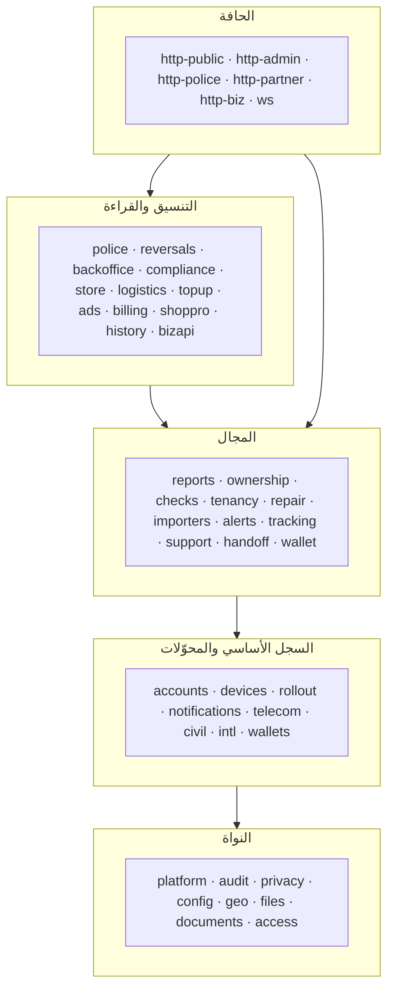

| القاعدة | التفصيل |
|---|---|
| الاتجاه | الطبقة العليا تستدعي الدنيا فقط. والدنيا تعلم بما يحدث فوقها عبر الأحداث (§9) لا عبر الاستدعاء |
| داخل الطبقة نفسها | مسموح فقط بما في الجدول التالي، ودون دوائر |
| كسر الدوائر | بعكس الاعتماد: الوحدة الدنيا تعلن واجهة (Port) وتطبّقها العليا. مثال: `notifications` تعلن `RecipientResolver` لمعرفة الرقم الذي تُرسل إليه (الأساسي، أو البديل، أو لا شيء إذا كان الرقم مسروقاً)، و`accounts` تطبّقها، فلا تعتمد `notifications` على `accounts` |
| المعاملة الواحدة | الأوامر التي يجب أن تتغير معاً تُنفَّذ في معاملة واحدة تفتحها الوحدة المنسِّقة، وتمرّر سياق المعاملة لأوامر الوحدات الدنيا. مثال: قبول البلاغ (§8.1) |
| الفحص الآلي | قواعد اتجاه الاستيراد في CI ترفض أي استيراد لملف داخلي من وحدة أخرى، أو أي اعتماد غير مدرج هنا |

| الوحدة | تعتمد على (إضافة إلى النواة) |
|---|---|
| `accounts` | `rollout` (هل الرقم مدعو)، `notifications` |
| `devices` | — |
| `ownership` | `accounts`، `devices`، `notifications` |
| `checks` | `devices`، `intl`، `ownership` (قراءة)، `reports` (ملخص البلاغ النافذ) |
| `reports` | `accounts`، `devices`، `ownership`، `notifications`، `telecom` (أوامر الحماية فقط: إيقاف الخط)، `wallets` |
| `tenancy` | `accounts`، `devices`، `ownership`، `checks`، `civil`، `intl`، `rollout`، `notifications` |
| `repair` | `tenancy`، `devices`، `checks`، `ownership` (قراءة)، `civil` |
| `importers` | `tenancy`، `devices`، `ownership`، `intl` |
| `alerts` | `devices`، `reports` (قراءة)، `tenancy` (قراءة)، `notifications` |
| `tracking` | `telecom`، `devices`، `reports` (قراءة) |
| `support` | `accounts`، `notifications` |
| `handoff` | `accounts` |
| `police` | `reports`، `devices`، `checks`، `tenancy` (قراءة)، `alerts`، `tracking`، `telecom`، `ownership` (قراءة) |
| `reversals` | `reports`، `accounts`، `tenancy`، `ownership`، `devices` |
| `backoffice` | قراءة من كل وحدات المجال عبر واجهات الاستعلام |
| `compliance` | `tenancy` (قراءة)، `alerts` (قراءة) |
| `wallet` | `tenancy`، `accounts`، `notifications` |
| `topup` | `wallet`، `tenancy`، `notifications` |
| `billing` | `accounts`، `tenancy`، `wallet`، `notifications` |
| `store` | `billing`، `tenancy`، `importers` (أجهزة المتجر، STORE-13)، `notifications` |
| `logistics` | `store`، `billing`، `notifications` |
| `ads`، `shoppro` | `billing`، `tenancy` |
| `history`، `bizapi` | `billing`، `checks`، `devices` |

## 3. دليل الواجهة البرمجية

### 3.1 النطاقات والعناوين

`<domain>` هو نطاق المنصة، و`<admin-domain>` و`<police-domain>` نطاقان مسجّلان منفصلان (ADR-08)، وكلها تُحسم في Q-01.

| النطاق | العنوان | العملاء | المصادقة |
|---|---|---|---|
| الجمهور (الموقع) | `https://www.<domain>/api/v1` على نفس أصل الموقع، يخدمه خادم Next.js (BFF) الذي يحفظ الرموز ويستدعي `api-public` داخلياً | متصفح الموقع | كوكي `__Host-` واحد على `/` مع حماية CSRF (§4.2.6) |
| الجمهور (التطبيق) | `https://api.<domain>/v1` | تطبيق آيفون وأندرويد | `Authorization: Bearer` |
| الإدارة | `https://<admin-domain>/api/v1` | لوحة الإدارة | جلسة على الخادم (§4.3) |
| الأمن | `https://<police-domain>/api/v1` | بوابة الأمن | جلسة على الخادم (§4.3) |
| الشركات | `https://bizapi.<domain>/v1` | أنظمة الشركات والوكلاء | مفتاح وتوقيع HMAC (§3.13) |
| الشركاء الرسميون | `https://partners.<domain>/v1` | الاتصالات، والأحوال المدنية، والهيئة، والمحافظ | mTLS مع توقيع الرسالة عند الاتفاق (§3.14) |
| استقبال المزوّدين | `https://hooks.<domain>/v1` | واتساب، وبوابات SMS، ومزوّدو الدفع الآلي | توقيع المزوّد (§3.14) |

### 3.2 الإصدارات والتوافق

| القاعدة | التفصيل |
|---|---|
| رقم الإصدار | رئيسي فقط في المسار: `/v1`. لا إصدار فرعي في المسار ولا في الترويسات |
| تغيير غير كاسر (مسموح داخل `/v1`) | إضافة مورد أو عملية، أو حقل اختياري في الطلب، أو حقل في الرد، أو قيمة جديدة في قائمة قيم (enum)، أو رمز خطأ جديد |
| تغيير كاسر (ممنوع داخل `/v1`) | حذف حقل أو إعادة تسميته، أو تغيير نوعه أو معناه، أو جعل حقل اختياري إلزامياً، أو تغيير رمز خطأ قائم، أو تشديد التحقق على قيم كانت مقبولة |
| القارئ المتسامح | كل عميل يتجاهل الحقول غير المعروفة، ويعرض القيمة غير المعروفة في قائمة القيم كحالة عامة («غير معروف»)، ويعرض لرمز الخطأ غير المعروف نصاً عاماً حسب حالة HTTP، ولا يتعطل. وهذا مختبر في كل عميل بحقن قيم ورموز مجهولة ([العملية الهندسية](22-engineering-process.md) §11) |
| ترويسات التطبيق | كل طلب من التطبيق يحمل `X-App-Platform` (`ios` أو `android` أو `web`)، و`X-App-Version` (مثل `3.4.1`)، و`X-App-Build` |
| التحديث الإجباري (APPVER-01..03) | إذا كان الإصدار أقل من «أدنى إصدار مدعوم» ⚙️ لمنصته، يرد الخادم على كل عملية بـ **HTTP 426** ورمز `APPVER_UNSUPPORTED`، حتى لو تجاوز المستخدم الشاشة (APPVER-03)، عدا `GET /v1/bootstrap` الذي يعرض شاشة التحديث وروابط المتجرين والقناة البديلة. وهذه الحالة هي المعتمدة التي تحيل إليها [العملية الهندسية](22-engineering-process.md) §10.4. والإصدار الأقل من «الموصى به» ⚙️ يتلقى ترويسة `X-App-Update: recommended` |
| ضمان الإصدارات القديمة | كل سلوك يعتمد عليه إصدار تطبيق أعلى من أو يساوي «أدنى إصدار مدعوم» يبقى يعمل. ولا يُحذف حقل أو عملية إلا بعد رفع أدنى إصدار مدعوم فوق آخر إصدار يستخدمه |
| الإيقاف التدريجي | العملية المزمع حذفها تُعلَّم `deprecated: true` في العقد، وتعيد ترويسة `Deprecation` (RFC 9745) و`Sunset` (RFC 8594) و`Link` (`rel="successor-version"` للبديل)، ويُسجَّل ADR. ويُقاس استخدامها لكل إصدار تطبيق ولكل عميل ربط برمجي. ولا تُحذف إلا بعد أن يتجاوز «أدنى إصدار مدعوم» آخر إصدار يستخدمها، ويصبح استخدامها من العملاء المدعومين صفراً، ويُبلَّغ عملاء الربط البرمجي للشركات بالمدة المنصوص عليها في عقودهم (⚙️ 180 يوماً حداً أدنى). والحذف خطوة تقليص بموافقتين ([العملية الهندسية](22-engineering-process.md) §11) |
| إصدار رئيسي جديد | أي إصدار رئيسي تالٍ يعمل بمسار جديد بجانب `/v1` ما دام هناك عميل مدعوم يستخدم `/v1` |

### 3.3 تسمية الموارد والعمليات

| القاعدة | التفصيل |
|---|---|
| أسماء الموارد | أسماء جمع بحروف صغيرة وشرطات: `/v1/reports`، `/v1/ownership-transfers`، `/v1/support-tickets` |
| الموارد التابعة | حتى مستويين: `/v1/reports/{reportId}/evidence`. وما بعد ذلك مورد مستقل |
| موارد المستخدم | `/v1/me` و`/v1/me/devices` («أجهزتي») و`/v1/me/sessions` (جلسات الدخول) |
| موارد المحل والوكيل | المعرّف في المسار: `/v1/shops/{shopId}/transactions`، `/v1/importers/{importerId}/batches`. والخادم يتحقق من العضوية ويضبط العزل منه (§6.3) |
| انتقالات الحالة | `POST /v1/{مورد}/{id}/{فعل}` بفعل من قائمة ثابتة بشرطات: `submit`، `accept`، `reject`، `request-info`، `close`، `cancel`، `confirm`، `approve`، `suspend`، `reinstate`، `extend`، `stop`. ولا يُغيَّر حقل `status` عبر `PATCH` أبداً |
| الطرق | `GET` قراءة، و`POST` إنشاء أو انتقال، و`PATCH` تعديل جزئي (JSON Merge Patch)، و`DELETE` لإلغاء ما يملكه المستخدم فقط (مسودة، جلسة، جهة موثوقة). ولا `PUT` |
| أسماء الحقول | camelCase في JSON، وsnake_case في قاعدة البيانات |
| المعرّفات في المسار | UUIDv7 للموارد المحمية بالصلاحية. والصفحات العامة برموز عشوائية (§13.3) |
| تحذيرات النجاح | رد النجاح قد يحمل `warnings: [{ code }]` لحالة لا تمنع العملية، مثل `SHOP_OUT_OF_RANGE` و`FAKE_TAC_UNALLOCATED` |
| القرارات الإدارية | كل عملية قرار (قبول، رفض، تعليق، كشف) تتطلب `reasonCode` من قائمة الأسباب الجاهزة (06 §15.2) و`reasonText` اختيارياً، وإلا ترد بـ `ADMIN_REASON_REQUIRED` أو `PP_REASON_REQUIRED` (03 §4) |
| الشراء في التطبيق (D-86) | عمليات طلب الخدمات الرقمية (`POST /v1/activation-requests`) متاحة لطلبات `X-App-Platform: web` فقط، وترد على التطبيق بـ `PAY_NOT_AVAILABLE_IN_APP`. وطلب المنتجات المادية (`POST /v1/store/orders`) متاح من كل الواجهات |

**خريطة الموارد الرئيسية:**

| النطاق | الموارد |
|---|---|
| الجمهور | `auth/*`، `me`، `me/sessions`، `me/devices`، `me/privacy`، `manufacturers`، `checks`، `check-receipts`، `reports`، `disputes`، `tips`، `ownership-transfers`، `self-registrations`، `certificates`، `trusted-contacts`، `alternate-contacts`، `data-access-events`، `support-tickets`، `handoffs`، `uploads`، `capture-nonces`، `shops`، `shops/{id}/transactions`، `shops/{id}/members`، `shops/{id}/repair-jobs`، `shops/{id}/inventory`، `shops/{id}/wholesale-transfers`، `importers`، `importers/{id}/batches`، `importers/{id}/wholesale-transfers`، `shops/{id}/wallet`، `shops/{id}/wallet/operations`، `shops/{id}/topups`، `shops/{id}/pro/*` (المحاسبة، D-92)، `suppliers/{id}/products`، `suppliers/{id}/orders`، `suppliers/{id}/settlements`، `couriers/{id}/shipments`، `verify/{code}`، `bootstrap`، `content/{key}`، `altcha/challenge`، `ws-tickets`، `store/products`، `store/orders`، `activation-requests`، `entitlements`، `history-reports`، `ads/slots/{placement}` |
| الإدارة | `queues`، `work-items`، `reports`، `identity-verifications`، `self-registrations`، `disputes`، `closure-requests`، `tips`، `alerts`، `police-referrals`، `devices/{id}/timeline`، `devices/{id}/map-views`، `device-merges`، `device-conflicts`، `tracking-sessions`، `block-holds`، `shops`، `importers`، `shop-transactions`، `tx-corrections`، `users`، `account-recoveries`، `reveals`، `search`، `support-tickets`، `police-imports`، `compliance-reports`، `reversal-requests`، `admin-users`، `roles`، `settings`، `toggles`، `content`، `templates`، `rollout/invites`، `rollout/governorates`، `health`، `dead-letters`، `audit-events`، `reconciliations`، `privacy/*`، `commerce/*` (المورّدون، والطلبات، والشحن، والتسويات، والمحافظ، والتعبئة، والتفعيل) |
| الأمن | `search/imei`، `search/person`، `official-reports`، `reports`، `alerts`، `devices/{id}/timeline`، `tracking-sessions`، `block-requests`، `shop-transactions`، `shop-suspension-requests`، `seizures`، `seizure-checks`، `cases`، `officers`، `activity` |

### 3.4 الأخطاء (RFC 9457)

كل خطأ يُعاد بـ `Content-Type: application/problem+json`:

```json
{
  "type": "https://<domain>/problems/report-duplicate-active",
  "title": "يوجد بلاغ قائم على هذا الجهاز",
  "status": 409,
  "detail": "لا يمكن تقديم بلاغ جديد قبل إغلاق البلاغ الحالي.",
  "instance": "/v1/reports/0192f3c4-.../submit",
  "code": "REPORT_DUPLICATE_ACTIVE",
  "requestId": "0192f3c4-7b1e-7c2a-9d55-1f0a2b3c4d5e",
  "errors": [{ "pointer": "/imei1", "code": "CHECK_IMEI_INVALID" }]
}
```

| القاعدة | التفصيل |
|---|---|
| صيغة `code` | `^[A-Z][A-Z0-9]*(_[A-Z0-9]+)+$`. البادئة اسم وحدة المتطلبات (`AUTH_`، `CHECK_`، `REPORT_`، `SHOP_`، `OWN_`، `PP_`...)، أو بادئة عامة للأخطاء المشتركة |
| الثبات | الرمز عقد دائم: لا يُحذف ولا يتغير معناه. والنصوص العربية لـ `title` و`detail` في [كتالوج المحتوى](24-content-catalog.md)، وتُعدَّل من اللوحة دون تغيير الرمز |
| `type` | رابط ثابت مشتق من الرمز بحروف صغيرة وشرطات |
| حالة غير مسموحة | الرمز `<الوحدة>_INVALID_STATE` (مثل `REPORT_INVALID_STATE` و`STORE_INVALID_STATE`) بـ 409، و`INVALID_STATE` حيث لا وحدة واضحة |
| `errors[]` | لأخطاء التحقق: مؤشر JSON Pointer للحقل ورمز الخطأ |
| امتدادات | `retryAfter` (ثوانٍ)، و`cooldownUntil`، و`stepUp: { methods }`، و`altcha: { challengeUrl }` حسب الحالة |
| عدم كشف الوجود | المورد خارج صلاحية الطالب أو عزله أو نطاقه يرد بـ 404 `NOT_FOUND` لا بـ 403، حتى لا يُعرف وجوده |
| لا تفاصيل داخلية | لا نص استثناء ولا استعلام ولا مسار ملف في الرد. التفاصيل في السجل بمعرّف الطلب |

**الرموز العامة:**

| الرمز | HTTP | المعنى |
|---|---|---|
| `REQUEST_MALFORMED` | 400 | JSON غير صالح أو ترويسة بصيغة خاطئة |
| `VALIDATION_FAILED` | 400 | قيم غير صالحة، والتفاصيل في `errors[]`. وحين يكون للحقل رمز وحدة خاص (مثل `CHECK_IMEI_INVALID`) يُعاد هو مباشرة |
| `UNAUTHENTICATED` | 401 | لا هوية أو هوية غير صالحة |
| `AUTH_TOKEN_EXPIRED` | 401 | رمز الدخول انتهى، ويُجدَّد بالرمز التجديدي |
| `PERMISSION_DENIED` | 403 | الهوية معروفة والصلاحية غير كافية لمورد معروف الوجود للطالب |
| `AUTH_STEP_UP_REQUIRED` | 403 | الإجراء حساس ويتطلب إعادة تحقق (§4.2.7) |
| `AUTH_COOLDOWN_ACTIVE` | 403 | فترة التهدئة بعد تغيير الرقم أو الاستعادة تمنع الإجراء (§4.2.8) |
| `CAPTCHA_REQUIRED` | 403 | يلزم تحدي ALTCHA |
| `FEATURE_DISABLED` | 403 | الوحدة أو الخدمة موقوفة بمفتاح تشغيل |
| `ADMIN_REASON_REQUIRED` | 400 | قرار إداري دون سبب. والمقابل في بوابة الأمن `PP_REASON_REQUIRED` |
| `NOT_FOUND` | 404 | غير موجود أو خارج الصلاحية |
| `INVALID_STATE` | 409 | الانتقال غير مسموح من الحالة الحالية |
| `IDEMPOTENCY_KEY_REQUIRED` | 400 | `Idempotency-Key` مفقود في عملية إنشاء أو انتقال |
| `IDEMPOTENCY_IN_PROGRESS` | 409 | طلب بالمفتاح نفسه قيد التنفيذ |
| `VERSION_CONFLICT` | 412 | `If-Match` لا يطابق الإصدار الحالي |
| `PAYLOAD_TOO_LARGE` | 413 | حجم الطلب أو الملف أكبر من المسموح |
| `UNSUPPORTED_MEDIA_TYPE` | 415 | نوع محتوى غير مقبول |
| `IDEMPOTENCY_KEY_REUSED` | 422 | المفتاح نفسه مع طلب مختلف |
| `AUTH_ACCOUNT_LOCKED` | 423 | قفل مؤقت بعد محاولات فاشلة |
| `APPVER_UNSUPPORTED` | 426 | إصدار التطبيق أقل من الأدنى المدعوم |
| `PRECONDITION_REQUIRED` | 428 | `If-Match` مفقود في عملية تعديل |
| `RATE_LIMITED` | 429 | تجاوز الحد، مع `Retry-After` |
| `INTERNAL_ERROR` | 500 | خطأ غير متوقع |
| `UPSTREAM_UNAVAILABLE` | 503 | تكامل خارجي لازم للعملية متعطل |
| `MAINTENANCE_MODE` | 503 | وضع الصيانة (SMART-11)، مع `Retry-After` |

**سجل الرموز:** أسماء الرموز وحالاتها ونصوصها العربية مرجعها الوحيد [كتالوج المحتوى](24-content-catalog.md) §5، وهذا السجل مزامن معه حرفياً، والعقد يحمل لكل عملية رموزها في `x-error-codes`، وفحص في CI يقارن رموز العقد بالكتالوج فيفشل البناء عند أي رمز بلا نص أو نص بلا رمز. وأي رمز جديد يُضاف إلى الكتالوج أولاً. والجدول العام أعلاه شرح لمعاني الرموز المشتركة فقط.

| المجموعة | الرموز وحالة HTTP |
|---|---|
| أخطاء عامة (24 §5.2) | `REQUEST_MALFORMED` 400، `VALIDATION_FAILED` 400، `FIELD_REQUIRED` 400، `FIELD_TOO_LONG` 400، `FIELD_EMAIL_INVALID` 400، `FIELD_DATE_IN_FUTURE` 400، `UNAUTHENTICATED` 401، `AUTH_TOKEN_EXPIRED` 401، `PERMISSION_DENIED` 403، `NOT_FOUND` 404، `FEATURE_DISABLED` 403، `INVALID_STATE` 409، `RATE_LIMITED` 429، `CAPTCHA_REQUIRED` 403، `CAPTCHA_FAILED` 403، `IDEMPOTENCY_KEY_REQUIRED` 400، `IDEMPOTENCY_IN_PROGRESS` 409، `IDEMPOTENCY_KEY_REUSED` 422، `VERSION_CONFLICT` 412، `PRECONDITION_REQUIRED` 428، `PAYLOAD_TOO_LARGE` 413، `UNSUPPORTED_MEDIA_TYPE` 415، `FILE_TYPE_NOT_ALLOWED` 415، `FILE_INFECTED` 422، `FILE_IMAGE_UNCLEAR` 400، `ROLLOUT_INVITE_REQUIRED` 403، `APPVER_UNSUPPORTED` 426، `MAINTENANCE_MODE` 503، `UPSTREAM_UNAVAILABLE` 503، `INTERNAL_ERROR` 500 |
| الحسابات والدخول (AUTH) (24 §5.3) | `AUTH_PHONE_INVALID` 400، `AUTH_NATIONAL_ID_INVALID` 400، `AUTH_PHONE_TAKEN` 409، `AUTH_PHONE_COMPROMISED` 403، `AUTH_PHONE_RESTORE_PROOF_REQUIRED` 403، `AUTH_THEFT_SESSION_RESTRICTED` 403، `AUTH_ATTESTATION_FAILED` 403، `AUTH_NATIONAL_ID_TAKEN` 409، `AUTH_PASSWORD_WEAK` 400، `AUTH_PASSWORD_BREACHED` 400، `AUTH_PASSWORD_MISMATCH` 400، `AUTH_INVALID_CREDENTIALS` 401، `AUTH_ACCOUNT_LOCKED` 423، `AUTH_OTP_INVALID` 400، `AUTH_OTP_EXPIRED` 400، `AUTH_OTP_ATTEMPTS_EXCEEDED` 400، `AUTH_OTP_RESEND_TOO_SOON` 429، `AUTH_OTP_RATE_LIMITED` 429، `AUTH_OTP_DELIVERY_FAILED` 503، `AUTH_PHONE_NOT_VERIFIED` 403، `AUTH_IDENTITY_REQUIRED` 403، `AUTH_IDENTITY_PENDING` 409، `AUTH_IDENTITY_ATTEMPTS_EXCEEDED` 403، `AUTH_CAMERA_CAPTURE_REQUIRED` 400، `AUTH_REFRESH_REUSED` 401، `AUTH_SESSION_REVOKED` 401، `AUTH_STEP_UP_REQUIRED` 403، `AUTH_COOLDOWN_ACTIVE` 403، `AUTH_ACCOUNT_SUSPENDED` 403، `AUTH_ACCOUNT_BANNED` 403، `AUTH_ACCOUNT_CLOSED` 410، `AUTH_ALTERNATE_NOT_FOR_RECOVERY` 403، `AUTH_RECOVERY_IN_PROGRESS` 409، `AUTH_UNDERAGE` 403، `AUTH_ACCOUNT_NUMBER_INVALID` 400، `AUTH_DEVICE_CONFIRMATION_REQUIRED` 403، `AUTH_2FA_REQUIRED` 401، `AUTH_2FA_INVALID` 400، `ADMIN_IP_NOT_ALLOWED` 403، `PP_IP_NOT_ALLOWED` 403 |
| الفحص (CHECK) والتقليد (FAKE) (24 §5.4) | `CHECK_IMEI_INVALID` 400، `CHECK_APPLE_SERIAL_INVALID` 400، `CHECK_RATE_LIMITED` 429، `CHECK_SCAN_BLOCKED` 429، `CHECK_GOVERNORATE_REQUIRED` 400، `CHECK_RECEIPT_UNAVAILABLE` 409 |
| البلاغات (REPORT) والمعلومات والاعتراضات (24 §5.5) | `REPORT_IDENTITY_REQUIRED` 403، `REPORT_DUPLICATE_ACTIVE` 409، `REPORT_INVALID_STATE` 409، `REPORT_OWNERSHIP_TRANSFERRED` 403، `REPORT_LIVE_PHOTO_REQUIRED` 400، `REPORT_DECLARATION_REQUIRED` 400، `REPORT_INCIDENT_DATE_INVALID` 400، `REPORT_INCIDENT_LOCATION_REQUIRED` 400، `REPORT_REWARD_INVALID` 400، `REPORT_REWARD_ACK_REQUIRED` 400، `REPORT_OWNER_CONFIRMATION_EXPIRED` 409، `REPORT_OWNER_IDENTITY_REQUIRED` 403، `REPORT_URGENT_NOT_TRUSTED` 403، `REPORT_SHOP_THEFT_NO_DEVICES` 400، `REPORT_SHOP_THEFT_NOT_IN_STOCK` 409، `REPORT_SHOP_THEFT_OWNER_ONLY` 403، `TIP_TEXT_REQUIRED` 400، `TIP_RATE_LIMITED` 429، `TIP_LINK_EXPIRED` 410، `DISPUTE_NOT_ALLOWED` 409، `DISPUTE_EVIDENCE_REQUIRED` 400، `DISPUTE_ALREADY_OPEN` 409، `DISPUTE_OWN_REPORT` 400 |
| الملكية (OWN) (24 §5.6) | `OWN_NOT_OWNER` 403، `OWN_TRANSFER_MISMATCH` 403، `OWN_TRANSFER_EXPIRED` 409، `OWN_TRANSFER_CANCELLED` 409، `OWN_TRANSFER_PENDING_EXISTS` 409، `OWN_TRANSFER_TO_SELF` 400، `OWN_DEVICE_REPORTED` 409، `OWN_DEVICE_IN_WAITING` 409، `OWN_SELF_REG_ALREADY_REGISTERED` 409، `OWN_SELF_REG_DECLARATION_REQUIRED` 400، `OWN_DELEGATES_LIMIT` 409، `OWN_GUARDIAN_DECLARATION_REQUIRED` 400، `OWN_CERT_NOT_ALLOWED` 409، `OWN_CERT_ACTIVE_EXISTS` 409 |
| حماية لحظة السرقة والجهات الموثوقة (THEFT، LINE، WALLET، TRUSTED) (24 §5.7) | `THEFT_ALTERNATE_SAME_AS_PRIMARY` 400، `THEFT_ALTERNATE_NOT_VERIFIED` 403، `LINE_PROVIDER_UNAVAILABLE` 409، `FREEZE_PROVIDER_UNAVAILABLE` 409، `TRUSTED_LIMIT_REACHED` 409، `TRUSTED_SELF` 400، `TRUSTED_ALREADY_ADDED` 409 |
| المحلات (SHOP) والأحوال المدنية (CIVIL) والصيانة (REPAIR) (24 §5.8) | `SHOP_NOT_VERIFIED` 403، `SHOP_SUSPENDED` 403، `SHOP_EMPLOYEE_NOT_VERIFIED` 403، `SHOP_EMPLOYEE_NOT_ACTIVE` 403، `SHOP_PERMISSION_DENIED` 403، `SHOP_LOCATION_REQUIRED` 400، `SHOP_CHECK_REQUIRED` 409، `SHOP_DEVICE_REPORTED` 409، `SHOP_GSMA_LISTED` 409، `SHOP_DEVICE_IN_WAITING` 409، `SHOP_DEVICE_ALREADY_SOLD` 409، `SHOP_TRANSACTION_HELD` 202، `SHOP_SELLER_ID_REQUIRED` 400، `SHOP_PARTY_MINOR` 400، `SHOP_ID_CARD_INVALID` 403، `SHOP_CIVIL_NAME_CONFIRM_REQUIRED` 400، `SHOP_CANCEL_WINDOW_PASSED` 409، `SHOP_GOVERNORATE_NOT_ACTIVE` 409، `SHOP_ALREADY_EXISTS` 409، `SHOP_INVENTORY_DEVICE_NOT_FOUND` 404، `CIVIL_NO_ACTIVE_TRANSACTION` 403، `CIVIL_QUERY_LIMIT` 429، `CIVIL_NO_MATCH` 400، `REPAIR_DEVICE_REPORTED` 409، `REPAIR_BOARD_IMEI_REPORTED` 409، `REPAIR_NEW_IMEI_SAME` 400، `REPAIR_INVALID_STATE` 409 |
| الوكلاء والاستيراد (IMPORTER، POLICE-01) (24 §5.9) | `IMPORT_FILE_UNREADABLE` 400، `IMPORT_COLUMNS_MISSING` 400، `IMPORT_FILE_TOO_LARGE` 413، `IMPORTER_SHOP_NOT_VERIFIED` 409، `IMPORTER_DEVICE_NOT_IN_STOCK` 409 |
| الدعم الفني وإكمال الخطوة بالتطبيق (SUPPORT، HANDOFF، DATAACCESS) (24 §5.10) | `SUPPORT_TICKET_CLOSED` 409، `SUPPORT_RATE_LIMITED` 429، `DATAACCESS_ALREADY_REPORTED` 409، `HANDOFF_CODE_EXPIRED` 410، `HANDOFF_CODE_USED` 410، `HANDOFF_ACCOUNT_MISMATCH` 403، `HANDOFF_CODE_INVALID` 404 |
| بوابة قوى الأمن ولوحة الإدارة (PP، TRACK، ADMIN، SMART، REVERSAL) (24 §5.11) | `PP_CASE_NUMBER_INVALID` 400، `PP_REASON_REQUIRED` 400، `PP_OUT_OF_SCOPE` 404، `PP_SEARCH_LIMIT` 429، `PP_SEIZED_ALREADY_REGISTERED` 409، `TRACK_BLOCK_NOT_DEFERRED` 409، `ADMIN_REASON_REQUIRED` 400، `ADMIN_REVEAL_REASON_REQUIRED` 400، `ADMIN_CONFLICT_OF_INTEREST` 403، `ADMIN_SAME_REVIEWER` 403، `REVERSAL_SAME_PERSON` 403، `REVERSAL_ROLE_INSUFFICIENT` 403، `ADMIN_DECISION_NOT_REVERSIBLE` 409، `ROLE_ESCALATION_FORBIDDEN` 403، `ADMIN_SETTING_OUT_OF_RANGE` 400، `CONTENT_RULES_VIOLATION` 400، `CONTENT_LOCKED` 403، `CONTENT_TEMPLATE_PENDING_META` 409، `NETWORK_ACTION_NOT_APPLICABLE` 409 |
| المدفوعات والباقات والربط البرمجي (PAY، PACKAGE، BIZAPI، ADS) (24 §5.12) | `PACKAGE_FEATURE_REQUIRED` 403، `PACKAGE_COMPLIANCE_FEATURE_FORBIDDEN` 400، `PACKAGE_LIMIT_REACHED` 409، `PACKAGE_CHANGE_APPROVAL_REQUIRED` 403، `PACKAGE_TRIAL_USED` 409، `PAY_NOT_AVAILABLE_IN_APP` 403، `PAY_REFERENCE_REQUIRED` 400، `PAY_REFERENCE_INVALID` 400، `PAY_REFERENCE_DUPLICATE` 409، `PAYMENT_FAILED` 402، `PAY_REFUND_SECOND_APPROVAL` 403، `ADS_CREATIVE_INVALID` 400، `BIZAPI_KEY_INVALID` 401، `BIZAPI_SIGNATURE_INVALID` 401، `BIZAPI_QUOTA_EXCEEDED` 429، `BIZAPI_SUBSCRIPTION_INACTIVE` 403 |
| المتجر وسوق المورّدين (STORE، D-87، D-88، D-99) (24 §5.13) | `STORE_VERIFIED_SHOPS_ONLY` 403، `STORE_OUT_OF_STOCK` 409، `STORE_ITEM_UNAVAILABLE` 409، `STORE_CART_CHANGED` 409، `STORE_ADDRESS_REQUIRED` 400، `STORE_DELIVERY_AREA_UNSUPPORTED` 400، `STORE_INVALID_STATE` 409، `STORE_RETURN_WINDOW_EXPIRED` 409، `STORE_RETURN_NOT_DELIVERED` 409، `STORE_RETURN_PHOTOS_REQUIRED` 400، `STORE_RETURN_ALREADY_REQUESTED` 409، `STORE_PROHIBITED_ITEM` 400، `STORE_DEVICE_IMPORTER_ONLY` 403، `STORE_PRODUCT_UNDER_REVIEW` 409، `STORE_SUPPLIER_SUSPENDED` 403، `STORE_COD_AMOUNT_MISMATCH` 409، `STORE_SETTLEMENT_SAME_PERSON` 403 |
| محفظة المحل وتعبئة الرصيد (SHOPWALLET، TOPUP، D-89) (24 §5.14) | `SHOPWALLET_SHOP_NOT_ELIGIBLE` 403، `SHOPWALLET_NOT_ACTIVATED` 409، `SHOPWALLET_PACKAGE_INACTIVE` 403، `SHOPWALLET_PIN_INVALID` 400، `SHOPWALLET_LOCKED` 423، `SHOPWALLET_PIN_WEAK` 400، `SHOPWALLET_INSUFFICIENT_BALANCE` 409، `SHOPWALLET_LIMIT_EXCEEDED` 409، `SHOPWALLET_FROZEN` 423، `SHOPWALLET_EXTERNAL_FREEZE` 423، `SHOPWALLET_WITHDRAWAL_STOPPED` 423، `SHOPWALLET_WITHDRAW_OWNER_ONLY` 403، `SHOPWALLET_DESTINATION_NOT_OWNER` 403، `SHOPWALLET_TRANSFER_NOT_ALLOWED` 403، `SHOPWALLET_PROVIDER_UNAVAILABLE` 503، `SHOPWALLET_RECONCILIATION_HOLD` 423، `TOPUP_NUMBER_INVALID` 400، `TOPUP_EMPLOYEE_LIMIT` 409، `TOPUP_PENDING` 409، `TOPUP_OPERATOR_UNAVAILABLE` 503، `TOPUP_AMOUNT_INVALID` 400، `TOPUP_NUMBER_RATE_LIMITED` 429، `TOPUP_FAILED_REFUNDED` 502 |
| الأجهزة دون شريحة (SERIAL، D-91) (24 §5.15) | `SERIAL_MANUFACTURER_REQUIRED` 400، `SERIAL_MANUFACTURER_UNKNOWN` 400، `SERIAL_FORMAT_INVALID` 400، `SERIAL_DEVICE_TYPE_REQUIRED` 400، `SERIAL_ALREADY_REGISTERED` 409 |
| برنامج المحاسبة ونقطة البيع (SHOPPRO، D-92) (24 §5.16) | `SHOPPRO_READ_ONLY` 403، `SHOPPRO_SUBSCRIPTION_INACTIVE` 403، `POS_DEVICE_REQUIRES_REGISTRY` 409، `POS_BARCODE_UNKNOWN` 404، `POS_SYNC_CONFLICT` 409، `POS_SYNC_REJECTED` 400، `CASH_REGISTER_CLOSED` 409، `CASH_REGISTER_ALREADY_OPEN` 409، `CASH_REGISTER_COUNT_REQUIRED` 400، `INSTALLMENT_PLAN_INVALID` 400، `CUSTOMER_REMINDER_CONSENT_REQUIRED` 400، `CUSTOMER_REMINDERS_STOPPED` 409 |

**ملاحظة على إنشاء الحساب:** الرمز `AUTH_PHONE_TAKEN` يُستخدم فقط في تغيير الرقم من داخل حساب مسجّل الدخول. أما إنشاء الحساب فيرد الرد الموحّد نفسه دائماً، حتى لا يكشف وجود الحسابات (§4.2.1).

### 3.5 الترقيم بالمؤشر والتصفية والترتيب

| القاعدة | التفصيل |
|---|---|
| الطلب | `?limit=` (افتراضي 20، أقصى 100) و`?cursor=` |
| الرد | `{ "data": [...], "page": { "nextCursor": "...", "hasMore": true } }`. والمورد المفرد يُعاد كائناً مباشرة دون غلاف |
| المؤشر | قيمة مبهمة (base64url) تحمل مفتاح الترتيب الأخير والمعرّف، موقّعة بـ HMAC فلا يمكن العبث بها، وصالحة 24 ساعة |
| ثبات الترتيب | كل ترتيب يُختم بالمعرّف (UUIDv7) فلا تتكرر عناصر ولا تضيع بين الصفحات |
| العدد الكلي | لا يُحسب افتراضياً. وقوائم الإدارة تطلب `?count=estimate` فتأخذ تقديراً سريعاً |
| التصفية | معاملات صريحة لكل عملية من قائمة معلنة في العقد: `?status=pending_review,needs_info&governorateId=3&createdFrom=2026-10-01&createdTo=2026-10-12`. والمعامل غير المعلن يُرفض بـ `VALIDATION_FAILED` |
| الترتيب | `?sort=-createdAt` من حقول معلنة لكل عملية. والافتراضي الأحدث أولاً |
| البحث النصي | `?q=` في البحث الإداري الموحّد وبحث معاملات المحل فقط (§16.2) |

### 3.6 مفتاح عدم التكرار (`Idempotency-Key`)

| البند | التفصيل |
|---|---|
| متى يُطلب | إلزامي في كل `POST` ينشئ مورداً أو ينفّذ انتقالاً، في كل النطاقات، وبخاصة عمليات المحفظة والتعبئة والدفع. واختياري في `PATCH`. والغياب يرد بـ 400 `IDEMPOTENCY_KEY_REQUIRED` |
| الصيغة | UUID من 36 حرفاً يولّده العميل لكل نية عمل. والتطبيق يحفظه مع المسودة دون اتصال، فيعيد الإرسال بالمفتاح نفسه بعد عودة الاتصال (SHOP-17) |
| النطاق | المفتاح فريد ضمن: نطاق الهوية + الفاعل (المستخدم، أو الموظف، أو عنصر الأمن، أو عميل الشركة، أو جهاز الزائر) + الطريقة + قالب المسار. والمفتاح نفسه من فاعلين مختلفين لا يتعارض |
| بصمة الطلب | SHA-256 للجسم بصيغة قانونية (مفاتيح مرتبة) مع معاملات المسار |
| التخزين | جدول `ops.idempotency_keys` في PostgreSQL (لا في Redis)، **داخل معاملة العملية نفسها**: يُدرج صف «قيد التنفيذ» أولاً بقيد تفرّد، ثم تُنفَّذ العملية، ثم يُحدَّث الصف بالرد، ثم الالتزام. فإن فشلت المعاملة اختفى المفتاح وأمكنت إعادة المحاولة |
| المدة | ⚙️ 24 ساعة من أول استخدام، ثم يُحذف بمهمة دورية (§10) |
| الإعادة بالطلب نفسه | يُعاد الرد المحفوظ نفسه (الحالة والجسم والترويسات المهمة) مع ترويسة `Idempotent-Replayed: true`، دون تنفيذ ثانٍ |
| المفتاح نفسه بطلب مختلف | 422 `IDEMPOTENCY_KEY_REUSED` |
| طلب متزامن بالمفتاح نفسه | الطلب الثاني ينتظر قيد التفرّد. إن التزم الأول أُعيد رده، وإن طال التنفيذ يرد بـ 409 `IDEMPOTENCY_IN_PROGRESS` مع `Retry-After: 1` |
| ما يُحفظ | ردود 2xx و4xx الحتمية. أما 5xx و429 و503 فلا تُحفظ، فتُعاد المحاولة بالمفتاح نفسه |
| الآثار الخارجية | الاتصالات والرسائل والدفع لا تُنفَّذ داخل الطلب، بل عبر صندوق الصادر بعد الالتزام، فلا تتكرر مع إعادة الطلب |
| القنوات غير HTTP | رسائل واتساب وSMS الواردة: معرّف الرسالة لدى المزوّد هو المفتاح. وأحداث الشركاء: معرّف الحدث الخارجي (§3.14) |

### 3.7 التزامن المتفائل (`ETag` و`If-Match`)

| البند | التفصيل |
|---|---|
| الإصدار | كل جدول قابل للتعديل فيه عمود `version` يبدأ بـ 1 ويزيد مع كل تعديل |
| `ETag` | كل رد لمورد مفرد يحمل `ETag: "v{version}"` |
| `If-Match` | إلزامي في كل `PATCH` وكل انتقال حالة على مورد قائم. والغياب يرد بـ 428 `PRECONDITION_REQUIRED` |
| التنفيذ | `UPDATE ... SET ..., version = version + 1 WHERE id = $1 AND version = $2`. صفر صفوف = 412 `VERSION_CONFLICT` مع الإصدار الحالي في الرد |
| حارس الحالة | الانتقال يضيف شرط الحالة المصدر: `AND status = 'pending_review'`. فقرار مشرفين في اللحظة نفسها لا ينجح إلا لأحدهما (§7.5) |
| المهام الآلية | تستخدم الحارس نفسه، وتتجاهل الكيان إن تغيرت حالته قبلها |

### 3.8 حدود الطلبات

| البند | التفصيل |
|---|---|
| الخوارزمية | **نافذة منزلقة تقريبية** (عدّادان متجاوران مع الاستيفاء) للحدود بالساعة الواردة في قواعد العمل، و**دلو رموز** (GCRA) لحماية كل عملية من الدفقات. التنفيذ ذري في Redis بسكربت Lua واحد لكل فحص |
| مفاتيح الحد | عنوان الشبكة، ومفتاح جهاز الزائر، والحساب، والمحل، والموظف، ومفتاح عميل الشركة، ورقم واتساب، ورقم المرسل في SMS |
| الترويسات | `RateLimit-Policy` و`RateLimit` (مسودة IETF: `limit` و`remaining` و`reset`) في كل رد خاضع لحد، و`Retry-After` مع 429 |
| تجاوز الحد | 429 `RATE_LIMITED` ويُسجَّل (06 §8). وللزائر يُطلب ALTCHA قبل المنع الكامل |
| العناوين المشتركة | **القاعدة المعتمدة الوحيدة:** حد خشن للعنوان ⚙️ 600 طلب في الدقيقة (وأعلى للنطاقات المشتركة) مع حدود لكل هوية (جهاز الزائر، والحساب، والمحل، ورقم واتساب أو المرسل)، **ولا حد لعدد الفحوص لكل عنوان**. لأن شبكات الموبايل في سوريا تخرج من عدد قليل من العناوين (CGNAT)، فحد العنوان وحده يحظر آلاف الأبرياء. لذلك: حد الزائر (20 فحصاً في الساعة ⚙️) يُطبَّق على **مفتاح جهاز الزائر** (كوكي موقّع في الموقع، ومعرّف الجهاز في التطبيق)، وحد العنوان حد خشن مرتفع ⚙️ للحماية من الإغراق فقط. ونطاقات الشبكات المشتركة المعروفة مسجّلة في `ops.rate_limit_overrides` بحدود أعلى. وعند غياب مفتاح الجهاز يُستخدم مفتاح مركّب من العنوان ونوع المتصفح، ويُصعَّد بـ ALTCHA لا بالمنع |
| كشف المسح | أرقام IMEI متتالية أو متقاربة من المصدر نفسه (جهاز أو عنوان أو حساب) تُعلَّم كمحاولة مسح، ويُحظر المصدر مؤقتاً (06 §8، R-09) |
| أرقام الطُعم (CT-39) | أرقام IMEI صالحة بخوارزمية Luhn، وأرقام تسلسلية صالحة الصيغة لشركات مختارة، **لا تُنشر في أي مكان** ولا يعرفها إلا الأمن. تُحفظ ببصمتها فقط في `ops.probe_identifiers` (يولّدها مسؤول الأمن ويُتحقق قبل اعتمادها أنها غير موجودة في السجل ولا في GSMA)، وتُحمَّل في مجموعة Redis. وكل فحص (موقع، أو تطبيق، أو بوت، أو SMS، أو ربط برمجي) يقارن بصمة الرقم بها قبل الرد: الرد نفسه عادي لا يميّزها، ثم يُحظر المصدر ⚙️ 24 ساعة بمفاتيحه كلها (جهاز الزائر، والحساب، ورقم واتساب أو المرسل، ومفتاح العميل، والعنوان إن لم يكن نطاقاً مشتركاً)، ويُفتح تنبيه DET-05 بأولوية عالية. ومحاولة تسجيل جهاز برقم طُعم تُرفض برسالة محايدة وتُنبّه. وإن ظهر جهاز حقيقي بالرقم يُسحب الطُعم |

| السياسة | الحد | المفتاح |
|---|---|---|
| فحص الزائر | 20 في الساعة ⚙️، وALTCHA من الرابع ⚙️ | جهاز الزائر |
| فحص المستخدم | 60 في الساعة ⚙️ | الحساب |
| فحص المحل | 300 في الساعة ⚙️ | المحل |
| بوت واتساب | 20 في الساعة ⚙️ | رقم واتساب |
| SMS | 10 في الساعة ⚙️ | رقم المرسل |
| استعلام الأحوال المدنية | 30 لكل موظف و100 لكل محل في الساعة ⚙️ | الموظف والمحل |
| رموز التحقق | 5 رموز في الساعة ⚙️ لكل رقم، وإعادة الإرسال بعد 60 ثانية ⚙️ | الرقم |
| محاولات الدخول | قفل الحساب بعد 5 إخفاقات ⚙️ (§4.2.3)، وحد للعنوان | الحساب والعنوان |
| الربط البرمجي | حسب باقة العميل (§3.13) | مفتاح العميل |
| حد خشن للعنوان | ⚙️ 600 طلب في الدقيقة، وأعلى للنطاقات المشتركة | العنوان |

### 3.9 معرّف الطلب والتتبّع

- الخادم يقبل `X-Request-Id` من العميل إن كان UUID صالحاً، وإلا يولّد معرّفاً، ويعيده في الرد دائماً.
- يُمرَّر المعرّف وسياق التتبّع `traceparent` (W3C) إلى السجلات، وصفوف صندوق الصادر، والمهام الخلفية، والطلبات للشركاء، فيُتتبّع الطلب من الواجهة حتى رسالة واتساب أو طلب الحظر (§18).
- كل خطأ يعرض للمستخدم «رقم المرجع» المختصر من معرّف الطلب، ليذكره للدعم الفني.

### 3.10 صيغ الوقت والأرقام

| النوع | الصيغة في الواجهة البرمجية |
|---|---|
| الوقت | RFC 3339 بتوقيت UTC وأجزاء الألف: `2026-10-12T09:30:00.000Z`. والعرض بتوقيت دمشق في الواجهات (§15.5) |
| التاريخ وحده | `YYYY-MM-DD` بتقويم دمشق (مثل تاريخ الحادثة) |
| المدد | ISO 8601: `PT72H` |
| الأرقام | أرقام JSON بأرقام إنكليزية. والخادم يقبل الأرقام العربية (٠-٩) والفارسية في كل حقل نصي رقمي ويحوّلها |
| المبالغ | `{ "amountMinor": 250000000, "currency": "SYP" }`: عدد صحيح بأصغر وحدة حسب ISO 4217، ولا كسور عشرية أبداً |
| معرّف الجهاز | `{ "type": "imei", "value": "356938035643809" }`، أو `{ "type": "serial", "manufacturerId": 12, "value": "C02XK0AAJGH5" }` عند تفعيل SERIAL (D-91). IMEI نص من 15 رقماً بعد التطبيع ويُتحقق منه بـ Luhn، والتسلسلي بحروف كبيرة دون مسافات ويُتحقق منه بصيغة الشركة المصنّعة ⚙️ |
| الرقم الوطني | نص من 11 رقماً |
| الموبايل | E.164: `+9639XXXXXXXX`، ويُقبل الإدخال بصيغة `09XXXXXXXX` |
| الإحداثيات | `{ "lat": 33.51234, "lng": 36.29123, "accuracyM": 12 }` بخمس خانات عشرية كحد أقصى (§15.3) |

### 3.11 رفع الملفات

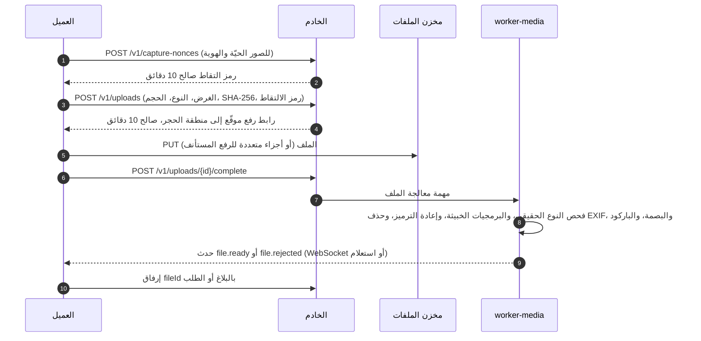

| القاعدة | التفصيل |
|---|---|
| الرفع المباشر | العميل يرفع مباشرة إلى مخزن الملفات بالرابط الموقّع، والرابط يقيّد النوع والحجم الأقصى (10 ميغابايت ⚙️) |
| الرفع المستأنف | الملفات فوق 5 ميغابايت ترفع بأجزاء متعددة موقّعة، فيُستأنف الرفع من آخر جزء ناجح عند الانقطاع (08 §4) |
| الإرفاق | لا يُرفق إلا ملف حالته `ready`، رفعه الفاعل نفسه، وغرضه يطابق الحقل، ولم يُرفق بكيان آخر من قبل |
| الالتقاط من التطبيق | صور الهوية والصورة الحيّة وصور التسجيل الذاتي وصور الإرجاع (STORE-11) تتطلب رمز التقاط صادراً للحساب نفسه قبل فتح الكاميرا، لمرة واحدة. وفي الاستعادة بالهوية يصدر رمز الالتقاط لطلب الاستعادة لا لحساب (`capture_nonces.recovery_id`)، بتقديم رمز الاستعادة. فلا تُقبل صورة من المعرض لهذه الأغراض (D-32، D-39). وتحليل الالتفاف على ذلك في [نموذج التهديد](20-threat-model.md) |
| التفاصيل | المعالجة الكاملة في §12 |

### 3.12 WebSocket

| البند | التفصيل |
|---|---|
| العناوين | `wss://<admin-domain>/ws`، و`wss://<police-domain>/ws`، و`wss://api.<domain>/ws` (التطبيق)، و`wss://www.<domain>/ws` (الموقع) |
| مصادقة الموظفين | كوكي الجلسة عند فتح الاتصال، مع التحقق من ترويسة `Origin`. وتُعاد مطابقة الجلسة كل 60 ثانية، وتُغلق القناة فور إنهاء الجلسة |
| مصادقة الجمهور | تذكرة قصيرة من `POST /v1/ws-tickets` صالحة 60 ثانية ولمرة واحدة، تُمرَّر في أول رسالة بعد فتح الاتصال لا في الرابط |
| الاتجاه | من الخادم للعميل فقط. والعميل يرسل `subscribe` و`unsubscribe` و`ack` فقط |
| صلاحية الاشتراك | كل اشتراك يمر بمحرّك الصلاحيات نفسه (§5) مع النطاق والسبب |
| الضمان | أفضل جهد. الحقيقة في الواجهة البرمجية: عند إعادة الاتصال يطلب العميل التغييرات منذ آخر مؤشر عبر REST |
| نبض الاتصال | كل 25 ثانية، وإعادة اتصال بتأخير متزايد مع عشوائية |
| الغلاف | `{ "channel", "event", "id", "occurredAt", "data" }`، والبيانات ملخصة دون حقول حساسة جداً. والتفاصيل تُجلب بـ REST بالصلاحية |

| القناة | النطاق | من يشترك | ما يصل |
|---|---|---|---|
| `admin.queues` | الإدارة | من له صلاحية أي قائمة عمل | تغيّر أعداد قوائم العمل ومهلها |
| `admin.alerts` | الإدارة | `alert.view` | التنبيهات الأمنية وتنبيهات الشبكة |
| `police.alerts.gov.{governorateId}` | الأمن | العناصر الذين يشمل نطاقهم المحافظة | تنبيهات المحافظة لحظياً (PP-05) |
| `police.alerts.all` | الأمن | الإدارة المركزية | كل التنبيهات |
| `tracking.device.{deviceId}` | الإدارة والأمن | من فتح الخريطة بسبب مسجّل (TRACK-08) ضمن نطاقه | نقاط جديدة وحالة الجلسة (TRACK-01) |
| `ticket.{ticketId}` | الإدارة | الموظف المكلّف | رسائل جديدة |
| `user.{userId}` | الجمهور | المستخدم نفسه | إشعار جديد، وتغيّر حالة بلاغ أو طلب |
| `handoff.{handoffId}` | الجمهور | صفحة الموقع التي أصدرت الرمز | استلام الرمز وإكمال الخطوة (HANDOFF-02) |
| `check.{checkId}` | الجمهور | من يحمل رمز الفحص | اكتمال المؤشرات المتأخرة (GSMA-01) |
| `upload.{fileId}` | الجمهور | رافع الملف | `file.ready` أو `file.rejected` |

### 3.13 الربط البرمجي للشركات (BIZAPI)

| البند | التفصيل |
|---|---|
| المفاتيح | لكل عميل معتمد بعقد (BIZAPI-01) مفتاحان نشطان كحد أقصى لتدوير دون توقف. المعرّف العلني بصيغة `bk_live_` يليه 24 حرفاً، والسر 256 بت يُعرض مرة واحدة عند الإنشاء ويُخزَّن مشفّراً (🔐) لأن التحقق من التوقيع يحتاجه. وفي بيئات غير الإنتاج البادئة `bk_test_` |
| الترويسات | `X-Api-Key`، و`X-Timestamp` (ثوانٍ Unix)، و`X-Nonce` (عشوائي 128 بت)، و`X-Signature` |
| التوقيع | `HMAC-SHA256(secret, METHOD + "\n" + PATH + "\n" + QUERY مرتّبة + "\n" + TIMESTAMP + "\n" + NONCE + "\n" + hex(SHA-256(body)))` بترميز base64url |
| الإعادة | فرق الوقت المسموح ±5 دقائق، و`X-Nonce` يُحفظ 10 دقائق ويُرفض تكراره. الخطأ: 401 `BIZAPI_SIGNATURE_INVALID` |
| قيود إضافية | قائمة عناوين اختيارية لكل عميل، وTLS 1.2 فما فوق، ومفاتيح بنطاقات (`bizapi.check`، `bizapi.history`، `importer.devices.register`) |
| الحصص | حسب الباقة المفعّلة (BIZAPI-03): حصة شهرية ومعدل في الثانية. الحصة المستنفدة: 429 `BIZAPI_QUOTA_EXCEEDED`، والترويسات تعرض المتبقي |
| السجل | كل طلب في `commerce.api_usage_events`، ويُجمَّع يومياً للفوترة (BIZAPI-04) |
| المحتوى | نتيجة الفحص بالصيغة العامة نفسها دون أي بيانات شخصية (BIZAPI-05). وفحص جهاز مبلّغ عنه يُطلق إشعار صاحبه وتنبيه الإدارة كأي فحص، مع تسجيل الشركة الفاحصة |
| الوكلاء | الوكيل الموثّق يستطيع تسجيل الأجهزة بالجملة عبر `POST /v1/importer/batches` بمفتاح من النوع نفسه ونطاق `importer.devices.register` (IMPORTER-03) |

### 3.14 نقاط ربط الشركاء والمزوّدين

| النقطة | المرسل | المصادقة | الغرض |
|---|---|---|---|
| `POST partners/v1/telecom/{operator}/events` | شركة الاتصالات | mTLS + توقيع الرسالة | أحداث الاستخدام وتكرار IMEI (TELCO-02، TELCO-08) |
| `POST partners/v1/telecom/{operator}/location-updates` | شركة الاتصالات | mTLS + توقيع | تحديثات الموقع لجلسة التتبّع (TELCO-13) |
| `POST partners/v1/telecom/{operator}/acks` | شركة الاتصالات | mTLS + توقيع | تأكيد تنفيذ طلبات القوائم وإيقاف الخط (TELCO-09، LINE-01) |
| `POST partners/v1/telecom/{operator}/sim-history-answers` | شركة الاتصالات | mTLS + توقيع | جواب استعلام سجل الشريحة إن كان غير متزامن (TELCO-12) |
| `POST partners/v1/customs/feed` | الهيئة الناظمة | mTLS | دفعات الأجهزة المسجّلة إن كان الاتفاق دفعاً لا سحباً (CUSTOMS-03) |
| `POST partners/v1/wallets/{provider}/callbacks` | مزوّد المحفظة | mTLS أو توقيع المزوّد | حالة التجميد (WALLET-02)، وحالة الدفع الآلي إن وُجد |
| `POST partners/v1/shamcash/callbacks` | شام كاش | mTLS + توقيع | شحن محافظ المحلات، ونتيجة السحب والخصم والاسترداد (SHOPWALLET-02، SHOPWALLET-03) |
| `POST partners/v1/topup/{operator}/callbacks` | سيريتل أو MTN | mTLS + توقيع | نتيجة التعبئة المعلّقة (TOPUP-02) |
| `POST partners/v1/couriers/{courier}/events` | شركة الشحن المرتبطة برمجياً | mTLS أو توقيع | الاستلام والتسليم والقبض برموزها (STORE-09) |
| `POST hooks/v1/whatsapp` | Meta | `X-Hub-Signature-256` | رسائل البوت ورقم الدعم وحالات التسليم |
| `POST hooks/v1/sms/{gateway}` | بوابة SMS | توقيع البوابة وقائمة عناوين | رسائل الرقم القصير وتقارير التسليم |

| القاعدة | التفصيل |
|---|---|
| خزّن ثم عالج | كل رسالة واردة تُخزَّن كما هي مشفّرة (🔐) في `ops.inbound_messages`، ثم يُرد بـ 202، ثم تُعالج في مهمة خلفية (TELCO-11) |
| عدم التكرار | قيد تفرّد على (المصدر، المعرّف الخارجي)، والتكرار يرد بـ 202 دون معالجة ثانية |
| الشهادات | الشريك يقدّم شهادة عميل صادرة من سلطة المنصة الخاصة (Vault PKI) أو من سلطته المعتمدة بالاتفاق، وبصمتها مربوطة بسجل الشريك. والمنصة تقدّم شهادتها في الطلبات الصادرة |
| الصيغة | كل شريك له ملف عقد خاص بإصدار مستقل. وإن فرض الشريك صيغة مختلفة (SOAP أو ملفات SFTP)، يترجمها محوّله إلى الصيغة الداخلية نفسها (§11) |

## 4. المصادقة لكل نطاق هوية

قواعد التهديد وحالات الإساءة لكل مسار هنا في [نموذج التهديد](20-threat-model.md)، والإجراء البشري لاستعادة الحساب عبر الدعم في [إجراءات التشغيل](23-operations-sops.md).

### 4.1 نظرة عامة

| النطاق | من | العوامل | الجلسة | التخزين لدى العميل |
|---|---|---|---|---|
| الجمهور | المواطنون، وأصحاب المحلات وموظفوهم، ومحلات الصيانة، والوكلاء وموظفوهم، والمورّدون المعتمدون ومستخدموهم (D-87)، ومندوبو الشحن. والمورّد ومندوب الشحن يعملان من الموقع فقط، ولا وضع لهما في التطبيق | كلمة مرور + رمز تحقق على الرقم الأساسي للجهاز الجديد والإجراءات الحساسة | رمز دخول 15 دقيقة ⚙️ + رمز تجديد دوّار 30 يوماً ⚙️ مرتبط بسجل الجهاز | التطبيق: الرمز التجديدي في Keychain أو Keystore، ورمز الدخول في الذاكرة فقط. الموقع: كوكي `__Host-` واحد، والرموز عند خادم Next.js (§4.2.6) |
| الإدارة | موظفو لوحة الإدارة | كلمة مرور + TOTP إلزامي (أو WebAuthn) | جلسة على الخادم، خمول 30 دقيقة ⚙️ وحد مطلق 8 ساعات ⚙️، جلسة واحدة لكل حساب ⚙️ | كوكي `__Host-` فقط |
| الأمن | مسؤولو الأمن والعناصر | كلمة مرور + TOTP إلزامي (أو WebAuthn) + حصر شبكات اختياري لكل جهة ⚙️ | مثل الإدارة | كوكي `__Host-` فقط |
| الآلات | عملاء الربط البرمجي، والشركاء الرسميون، ومزوّدو الخدمات | مفتاح + توقيع HMAC، أو mTLS، أو توقيع المزوّد | دون جلسة: كل طلب يُصادَق وحده | أسرار في خزنة الطرف الآخر |

### 4.2 الجمهور

#### 4.2.1 إنشاء الحساب (AUTH-01، ROLLOUT-01)

1. `POST /v1/auth/sign-up` برقم الموبايل وكلمة المرور، مع ALTCHA.
2. إن كان وضع الدعوات مفعّلاً ⚙️ والرقم غير مدعو: 403 `ROLLOUT_INVITE_REQUIRED`.
3. كلمة المرور: Argon2id، وطول أدنى 8 أحرف ⚙️، وفحص قائمة كلمات المرور المسرّبة الشائعة (07 §5).
4. **بوابة العمر:** إقرار واحد «عمري 18 سنة أو أكثر» يُحفظ في `users.age_confirmed_at`، ولا يُطلب تاريخ الميلاد ولا يُخزَّن. ومن عمره دون 18 سنة لا ينشئ حساباً مستقلاً، ويدخل فقط بدعوة من وليّ أمره مستخدماً مفوّضاً على جهازه، فيحمل حسابه `users.minor_managed = true` بقيوده: الجهاز المفوّض عليه فقط، وبلاغه فقط، ولا رسائل تجارية ولا متجر ولا باقات ولا إعلانات (PRIV-09، D-97، [الخصوصية](21-privacy-dpia.md) §10.2). ويُرفع العلم عند توثيق هويته بعد بلوغ 18 سنة.
5. **منع كشف الحسابات:** الرد واحد دائماً (202 «أرسلنا رمزاً»). إن كان الرقم مسجّلاً يصل لصاحبه على واتساب «يوجد حساب بهذا الرقم، سجّل الدخول أو استعد كلمة المرور» بدل الرمز.
6. يُنشأ حساب بحالة `pending_phone` ورمز تحقق بغرض `sign_up`. وتأكيد الرمز يجعل الحساب `active` بمستوى `phone_verified`، ويُصدر أول جلسة ويُوثَّق الجهاز.
7. الحساب الذي لم يُؤكَّد خلال 24 ساعة يُحذف نهائياً (لا بيانات فيه سوى الرقم).

#### 4.2.2 رموز التحقق (OTP)

| القاعدة | القيمة |
|---|---|
| الطول | 6 أرقام عشوائية من مولّد آمن |
| الصلاحية | 5 دقائق ⚙️ |
| محاولات الإدخال | 5 ⚙️ لكل رمز، ثم يُبطل |
| عدد الرموز | 5 ⚙️ في الساعة لكل رقم |
| إعادة الإرسال | بعد 60 ثانية ⚙️ |
| التخزين | بصمة HMAC-SHA256 للرمز، لا الرمز نفسه، مرتبطة بالغرض والرقم والسياق (مثل معرّف طلب النقل) |
| القناة | واتساب بقالب مصادقة. وإن فشل الإرسال أو أفاد واتساب بأن الرقم غير مسجّل لديه، يُرسل عبر SMS فوراً. وإن لم تصل حالة التسليم خلال ⚙️ 60 ثانية يُرسل **الرمز نفسه** عبر SMS تلقائياً (لا رمز جديد). ويستطيع المستخدم طلب SMS بعد مهلة إعادة الإرسال |
| الأغراض | `sign_up`، `login_new_device`، `password_reset`، `phone_change_old`، `phone_change_new`، `transfer_confirm`، `step_up`، `phone_restore`، `alternate_verify`، `trusted_invite`، `wallet_withdraw`، `recovery_new_phone` (تأكيد حيازة الرقم الجديد عند بدء الاستعادة بالهوية فقط، §4.2.10) |
| الوجهة | **الرقم الأساسي للحساب فقط** لكل الأغراض، عدا `alternate_verify` (تأكيد الرقم البديل نفسه، THEFT-02) و`phone_change_new` و`recovery_new_phone`. ولا يُرسل أي رمز للرقم البديل لاستعادة الحساب أو لأي إجراء حساس أبداً (D-81) |
| الرقم المسروق | إذا كان الرقم الأساسي معلَّماً «مسروقاً» (THEFT-03)، لا يُرسل إليه أي رمز، وتُرد الطلبات بـ `AUTH_PHONE_COMPROMISED` مع إرشاد شريحة بدل ضائع أو الاستعادة بالهوية |

#### 4.2.3 تسجيل الدخول والقفل (AUTH-02)

- `POST /v1/auth/login` بالرقم وكلمة المرور ومعرّف الجهاز.
- **القفل أولاً لكل مصدر** ([نموذج التهديد](20-threat-model.md) §6.4)، حتى لا يستطيع مهاجم قفل حساب الضحية عن بُعد: بعد 5 إخفاقات ⚙️ متتالية لحساب **من المصدر نفسه** (معرّف الجهاز، أو العنوان مع بصمة المتصفح) يُقفل الدخول لهذا الحساب من هذا المصدر 15 دقيقة ⚙️، وبعد 5 أخرى ساعة ⚙️. والحالة في Redis بمفتاح (الحساب، المصدر)، وتعود للصفر عند النجاح.
- **قفل الحساب كله** فقط بعد ⚙️ 20 إخفاقاً خلال 24 ساعة من أي مصادر (`users.login_locked_at`)، ويفكّه صاحبه بنفسه بإعادة تعيين كلمة المرور برمز، مع إشعار أمني على كل القنوات (CT-12).
- ALTCHA إلزامي من الإخفاق ⚙️ الثاني للحساب أو المصدر. وللعنوان: ⚙️ 20 إخفاقاً خلال 15 دقيقة تفرض ALTCHA لكل محاولاته ثم الصعوبة المرتفعة ثم الرفض ⚙️ 15 دقيقة، مع مراعاة العناوين المشتركة (§3.8).
- الرد على كلمة مرور خاطئة أو رقم غير موجود واحد: `AUTH_INVALID_CREDENTIALS`.

#### 4.2.4 ربط الجهاز

| البند | التفصيل |
|---|---|
| سجل الجهاز | لكل جهاز يدخل منه المستخدم صف في `user_devices`: معرّف يولّده التطبيق عند أول تشغيل ويحفظه في التخزين الآمن، والمنصة، والطراز، وإصدار التطبيق، ورمز الإشعارات. وفي الموقع: معرّف عشوائي يحفظه خادم Next.js في سجل جلسة الموقع المرتبط بكوكي `__Host-sid` الوحيد (§4.2.6) |
| مفتاح الجهاز | التطبيق يولّد زوج مفاتيح P-256 داخل العتاد الآمن (Secure Enclave أو Keystore)، ويسجّل المفتاح العام عند الدخول. وكل طلب تجديد يحمل إثباتاً موقّعاً بالمفتاح الخاص في ترويسة `X-Device-Proof`، فلا يعمل رمز تجديد مسروق من جهاز آخر |
| الجهاز الجديد | الدخول من جهاز غير موثّق يتطلب رمز تحقق على الرقم الأساسي بغرض `login_new_device`. ⚙️ يُطبَّق على كل الحسابات افتراضياً، ويبقى إلزامياً دائماً لأعضاء المحلات والوكلاء (07 §5) |
| إشعار | كل جهاز جديد يُوثَّق يُبلَّغ به صاحب الحساب على واتساب وداخل المنصة، ولصاحب المحل عند دخول موظف من جهاز جديد. ومعه زر «لم أكن أنا» (CT-12) |
| «لم أكن أنا» | متاح من الأجهزة المربوطة **قبل** الحدث، ومن رابط لمرة واحدة صالح ⚙️ 7 أيام في الرسالة إلى الرقم القديم. يجمّد الحساب فوراً (`users.frozen_by_owner_at`): تُمنع كل الإجراءات الحساسة، وتُنهى كل الجلسات، وتُلغى طلبات النقل المعلّقة، وتُجمَّد محفظة المحل إن كان صاحب محل (CT-105)، ويُفتح طلب دعم بأولوية عاجلة |
| فك التجميد | بطريقين فقط: (1) إعادة تعيين كلمة المرور برمز على الرقم الأساسي **من جهاز كان مربوطاً بالحساب قبل التجميد** (`user_devices.trusted_at < frozen_by_owner_at` مع إثبات مفتاح الجهاز)، أو (2) التحقق من الهوية عبر الدعم (§4.2.10، §8.14). ثم تبدأ فترة التهدئة (§4.2.8). فلا يستطيع من بدّل الشريحة أن يفك التجميد من جهازه الجديد ([نموذج التهديد](20-threat-model.md) §6.7) |
| سلامة التطبيق | النقاط الحساسة (الدخول من جهاز جديد، والتجديد، ومعاملات المحل، ورفع صور الهوية) تتطلب إثبات سلامة التطبيق والجهاز (Play Integrity أو App Attest) حسب سياسة الدور في [نموذج التهديد](20-threat-model.md) |

#### 4.2.5 الرموز والتجديد الدوّار مع كشف إعادة الاستخدام

| البند | التفصيل |
|---|---|
| رمز الدخول | JWT موقّع بـ ES256، والمفتاح في الخزنة مع معرّف `kid` للتدوير. الحقول: `sub` (المستخدم)، و`sid` (الجلسة)، و`did` (الجهاز)، و`aud`، و`iat`، و`exp` (15 دقيقة ⚙️)، و`jti`، و`av` (إصدار الصلاحيات). لا أدوار ولا بيانات شخصية في الرمز |
| التحقق | التوقيع والمدة والجمهور، ثم فحص سريع في Redis لقائمة الجلسات الملغاة (`revoked_sid`) لمدة صلاحية رمز الدخول. فالإنهاء نافذ فوراً دون انتظار انتهاء الرمز |
| رمز التجديد | قيمة عشوائية 256 بت مبهمة، يُخزَّن منها SHA-256 فقط في `refresh_tokens`، صالح 30 يوماً ⚙️ من إصداره، ويُستخدم مرة واحدة |
| التدوير | كل تجديد يصدر رمز دخول ورمز تجديد جديدين، ويعلّم القديم «مستخدماً» ويربطه بخلَفه |
| كشف إعادة الاستخدام | تقديم رمز تجديد مستخدم سابقاً = سرقة محتملة: تُلغى الجلسة كلها (كل رموز العائلة)، ويُبلَّغ المستخدم، ويُسجَّل حدث أمني، ويُغذّى كشف الشذوذ |
| مهلة السباق | إذا قُدّم الرمز نفسه مرتين خلال 30 ثانية من الجهاز نفسه وبإثبات جهاز صحيح (انقطاع شبكة أثناء التجديد)، يُصدر زوج جديد ويُبطل الخلَف السابق، دون إلغاء الجلسة |
| انتهاء الجلسة | جلسة لم تُجدَّد خلال 30 يوماً ⚙️ تنتهي |

#### 4.2.6 الموقع على المتصفح

- **نمط BFF** ([نموذج التهديد](20-threat-model.md) §6.9): خادم Next.js يحفظ رمزي الدخول والتجديد في مخزن جلسات الموقع (Redis، مشفّراً)، ويستدعي `api-public` داخلياً بـ `Authorization: Bearer`، ويدير التجديد الدوّار نيابة عن المتصفح. والمتصفح لا يرى أي رمز: **كوكي واحد** `__Host-sid` بخصائص `HttpOnly; Secure; SameSite=Lax; Path=/` يحمل معرّف جلسة الموقع العشوائي (256 بت). ولا رموز في `localStorage` ولا في JavaScript.
- الخمول ⚙️ 30 يوماً، و⚙️ 12 ساعة لوظائف المحل والوكيل والمورّد ومندوب الشحن في الموقع. والخروج يُبطل رمز التجديد في الخادم ويرسل `Clear-Site-Data`.
- معرّف جهاز الموقع (§4.2.4) محفوظ في سجل جلسة الموقع لدى الخادم، لا في كوكي ثانٍ. فالخروج ومسح الكوكيز يجعلان الدخول التالي من المتصفح نفسه «جهازاً جديداً» برمز تحقق، وهذا مقصود.
- حماية CSRF: SameSite=Lax، وفحص `Origin`، وترويسة `X-CSRF-Token` مزدوجة الإرسال لكل طلب غير `GET`.
- الموقع لا يتعامل مع الكاميرا والموقع الدقيق للخطوات الحساسة، بل يسلّمها للتطبيق (§4.2.12).

#### 4.2.7 إعادة التحقق للإجراءات الحساسة (Step-up)

الإجراء الحساس يتطلب تحققاً حديثاً (خلال 5 دقائق ⚙️)، وإلا يرد بـ `AUTH_STEP_UP_REQUIRED` مع الطرق المطلوبة. فينفّذ العميل `POST /v1/auth/step-up` ثم يعيد الطلب.

| الإجراء | الطريقة | أثناء التهدئة |
|---|---|---|
| إنشاء طلب نقل ملكية (OWN-04) | كلمة المرور + رمز على الرقم الأساسي بغرض `transfer_confirm` مرتبط بطلب النقل | ❌ |
| طلب إغلاق بلاغ (REPORT-11) | كلمة المرور + رمز على الرقم الأساسي | ❌ |
| إصدار شهادة فحص (OWN-09) | كلمة المرور | ❌ |
| إضافة مستخدم مفوّض أو إزالته (OWN-08) | كلمة المرور | ❌ |
| إضافة جهة موثوقة أو إزالتها (TRUSTED-01) | كلمة المرور + رمز على الرقم الأساسي | ❌ |
| إضافة الرقم البديل أو تغييره (THEFT-02) | كلمة المرور + رمز تأكيد يُرسل إلى الرقم البديل نفسه | ❌ |
| تقديم تسجيل ذاتي (OWN-03) | كلمة المرور | ❌ |
| تقديم بلاغ، أو تأكيد بلاغ مفوّض | كلمة المرور | ✅ مع علامة للمراجع |
| تغيير الرقم (AUTH-09) | كلمة المرور + رمز للرقم القديم + رمز للرقم الجديد | يبدأ التهدئة |
| تغيير كلمة المرور | كلمة المرور الحالية، ثم إنهاء كل الجلسات الأخرى | ✅ |
| طلب إغلاق الحساب (PRIV-02)، أو تنزيل نسخة من البيانات (PRIV-01) | كلمة المرور + رمز | ❌ |
| صاحب المحل: إضافة موظف أو تغيير صلاحياته أو حدوده أو إيقافه، وتعديل موقع المحل أو ترخيصه | كلمة المرور | ❌ |
| صاحب المحل: بلاغ سرقة المحل دفعة واحدة (REPORT-18) | كلمة المرور + رمز | ❌ |
| الوكيل: النقل بالجملة (IMPORTER-05) | كلمة المرور + رمز | ❌ |
| صاحب المحل: إنشاء مفاتيح الربط أو تدويرها | كلمة المرور + رمز | ❌ |
| المورّد: تغيير الحساب المستلم للتسوية | كلمة المرور + رمز | ❌ |
| طلب استرداد مبلغ (PAY-04) | كلمة المرور + رمز | ❌ |
| صاحب المحل: السحب من محفظة المحل (SHOPWALLET-03) | **رمز المحفظة** (6 أرقام مختلفة عن كلمة المرور، مخزّنة بـ Argon2id، وقفل بعد 5 محاولات ⚙️) + رمز تحقق على الرقم الأساسي | ❌، ولا خلال ⚙️ 24 ساعة من إعادة تعيين رمز المحفظة |
| صاحب المحل: تغيير محفظة السحب | إعادة مصادقة كاملة (كلمة المرور + رمز المحفظة + رمز)، ولا تُستخدم الوجهة الجديدة قبل ⚙️ 72 ساعة، مع إشعار على كل القنوات | ❌ |
| تعبئة رصيد أو دفع من المحفظة فوق حد التنبيه ⚙️ | رمز المحفظة | ✅ من الأجهزة المربوطة قبل التهدئة |

**أثناء البلاغ النافذ والرقم مسروق (THEFT-07):** الإجراءات التي تتطلب رمزاً لا تُنفَّذ ذاتياً حتى يستعيد المستخدم رقمه بالمسار أدناه، أو تُنفَّذ عبر الدعم بالهوية. **ولا يُستخدم الرقم البديل عاملاً للتحقق أبداً** (D-81، THEFT-02).

**استعادة الرقم الأصلي بعد بلاغ السرقة** (`POST /v1/me/phone/restore`، [نموذج التهديد](20-threat-model.md) §6.8.4): لا يُرفع إيقاف الرسائل عن الرقم (THEFT-03) إلا بكلمة المرور + رمز بغرض `phone_restore` على الرقم نفسه، **ومعهما إثبات واحد** على أن الشريحة المسروقة لم تعد تعمل، لأن السارق قد يحمل الشريحة نفسها:

| الإثبات | كيف يتحقق الخادم |
|---|---|
| تأكيد شركة الاتصالات أن شريحة الرقم أُعيد إصدارها بعد وقت البلاغ (حيث تتيحه الاتفاقية) | استعلام `telecom_sim_history_queries` عبر المحوّل، والنتيجة «أُعيد الإصدار بعد `reports.incident_at`» |
| طلب إيقاف الخط (LINE-01) نُفّذ ثم أعاد المزوّد تشغيله بشريحة بدل ضائع (LINE-02) | `line_suspension_requests` لرقم الحساب بحالة `reinstated` بعد `executed`، من حدث الشركة أو ردّها على الاستعلام |
| التحقق من الهوية عبر الدعم بالمستوى L3 | عند غياب الإثباتين: طلب `account_recoveries` بغرض `phone_restore` يمر بمراجعة الدعم وموافقة مشرف ثانٍ (§8.14) |

ثم تبدأ فترة التهدئة (§4.2.8)، ويُرسل إشعار على كل القنوات وعلى الرقم البديل (إشعاراً فقط). ودون إثبات يرد الخادم `AUTH_PHONE_RESTORE_PROOF_REQUIRED` مع الطرق المتاحة.

#### 4.2.8 فترة التهدئة بعد تبديل الشريحة أو الاستعادة

| البند | التفصيل |
|---|---|
| ما يطلقها | تغيير رقم الحساب (AUTH-09) بأي طريق، واستعادة الحساب بالهوية (THEFT-06)، وإعادة تعيين كلمة المرور برمز من جهاز غير مربوط بالحساب، وفك تجميد «لم أكن أنا» (§4.2.4)، واستعادة الرقم الأصلي بعد بلاغ السرقة بإثباتها (§4.2.7)، وإشارة «تبديل شريحة» لرقم الحساب من شركة الاتصالات خلال ⚙️ 72 ساعة قبل إجراء حساس إن أتاحها الاتفاق (حدث `account.sim_swap.signaled`، فيُعامل الإجراء كأنه في تهدئة) ([نموذج التهديد](20-threat-model.md) §6.7) |
| الأثر الفوري | إنهاء كل الجلسات عدا الجلسة التي أتمّت الإجراء، وضبط `users.cooldown_until` = الآن + 72 ساعة ⚙️ |
| ما تمنعه | كل ما عليه ❌ في جدول §4.2.7: نقل ملكية جهاز للغير، وطلب إغلاق بلاغ، وإصدار الشهادات، وإضافة المفوّضين وإزالتهم، وتغيير الجهات الموثوقة أو الرقم البديل، وتسجيل جهاز ذاتياً، وإدارة موظفي المحل وصلاحياتهم وموقع المحل وترخيصه، وبلاغ سرقة المحل دفعة واحدة، والنقل بالجملة للوكيل، ومفاتيح الربط، والمدفوعات الخارجة (الاسترداد، وتغيير حساب استلام التسويات لمورّد يملكه الحساب D-87)، **والسحب من محفظة المحل وتغيير محفظة السحب ورفع حدود الموظفين فيها** (SHOPWALLET-07)، وإغلاق الحساب، وتنزيل نسخة البيانات (PRIV-01)، وتغيير الرقم مرة أخرى. والرد `AUTH_COOLDOWN_ACTIVE` مع `cooldownUntil` |
| ما لا تمنعه | الفحص، والعرض («أجهزتي» وغيرها)، وتقديم بلاغ (بعلامة للمراجع)، وقبول نقل وارد، وطلب الدعم، ومعاملات المحل من الأجهزة المربوطة قبل التهدئة. ومعاملات المحل من جهاز جديد أثناء التهدئة تُعلَّم لمشرف المحلات |
| الإشعار | داخل المنصة، وإشعار فوري لكل الأجهزة المربوطة سابقاً، وواتساب أو SMS للرقم القديم (إن لم تكن رسائله موقوفة) والجديد عند تغيير الرقم، والإيميل إن وُجد، ومعه «لم أكن أنا» (CT-12). ويظهر في الحساب شريط «حسابك في فترة حماية حتى [التاريخ]» مع قائمة ما يُمنع |
| الفرض | خاصية `cooldown` في محرّك الصلاحيات (§5.7)، لا فحص متفرّق في الكود |

#### 4.2.9 الجلسات والإنهاء (AUTH-08)

- `GET /v1/me/sessions`: كل جلسة بجهازها ومنصتها وآخر نشاط وموقع تقريبي على مستوى المحافظة.
- `DELETE /v1/me/sessions/{id}` لإنهاء جلسة، و`POST /v1/me/sessions/revoke-others` للخروج من كل الأجهزة الأخرى، و`POST /v1/auth/logout` للجلسة الحالية.
- الإنهاء يعلّم الجلسة ورموزها ملغاة في قاعدة البيانات، ويضيف `sid` لقائمة الإلغاء في Redis، ويغلق قنوات WebSocket المرتبطة.
- الإنهاء الآلي: تغيير كلمة المرور أو الرقم، والاستعادة، وكشف إعادة استخدام رمز التجديد، والبلاغ مع شريحة الحساب داخل الجهاز (THEFT-04)، والبلاغ العاجل من جهة موثوقة (TRUSTED-02)، وتعليق الحساب أو حظره، وإيقاف الموظف من صاحب المحل (لجلسات سياق ذلك المحل فقط).

#### 4.2.10 الاستعادة وتغيير الرقم

| المسار | التفصيل |
|---|---|
| نسيان كلمة المرور (AUTH-03) | رمز على الرقم الأساسي بغرض `password_reset` مع ALTCHA، ثم كلمة مرور جديدة، ثم إنهاء كل الجلسات. وإن تمّ من جهاز غير مربوط بالحساب تبدأ فترة التهدئة ويصل «لم أكن أنا» لكل الأجهزة المربوطة سابقاً (§4.2.8). ممنوع إن كان الرقم معلَّماً مسروقاً |
| تغيير الرقم والقديم متاح (AUTH-09) | رمز للقديم ثم رمز للجديد، ثم التبديل، ثم فترة التهدئة (§4.2.8) |
| فقدان الرقم أو سرقته مع نسيان كلمة المرور (THEFT-06) | **استعادة بالهوية فقط، يبدأها المستخدم بنفسه دون جلسة** ([نموذج التهديد](20-threat-model.md) §6.8.2): (1) خيار «استعادة الحساب بالهوية» في شاشة الدخول بالتطبيق أو الموقع: `POST /v1/auth/recovery` برقم الحساب القديم أو رقم الحساب `SY-`، والرقم الجديد مؤكَّداً برمز بغرض `recovery_new_phone` (يثبت حيازة الرقم الجديد فقط)، وALTCHA. والرد واحد دائماً سواء وُجد حساب أم لا (CT-13). ومن يراسل رقم واتساب الدعم يُفتح له طلب ويصله رابط البدء في التطبيق (`/n/{token}`)، ولا يتم أي إجراء داخل المحادثة (SUPPORT-03). (2) يُنشأ `account_recoveries` بـ `initiated_by_type = 'self'` وطلب دعم مرتبط، ويُصدر **رمز استعادة** معتم 256 بت يحفظه التطبيق، صالح ⚙️ 72 ساعة، لا يمنح أي جلسة ولا أي قراءة من الحساب: يسمح فقط بطلب رموز الالتقاط للهوية وبرفع صورتيها وبمتابعة حالة الطلب. ومن الموقع يكمل بمسح رمز الإكمال المرتبط بطلب الاستعادة (§4.2.12). (3) تصوير الوجهين بالكاميرا داخل التطبيق فقط برموز التقاط مرتبطة بطلب الاستعادة (§3.11)، ومطابقة الأحوال المدنية عند تفعيلها. (4) مراجعة الدعم الفني وموافقة مشرف ثانٍ. (5) **إشعار قبل التنفيذ** ⚙️ 24 ساعة إلى كل وسائل الحساب (الرقم الحالي ما لم تكن رسائله موقوفة، والأجهزة المربوطة، والإيميل) مع «لم أكن أنا» الذي يلغي الطلب ويجمّد الحساب. (6) التنفيذ: الرقم الجديد، وإنهاء كل الجلسات، ثم فترة التهدئة ⚙️ 72 ساعة (§4.2.8). الحالات في §8.14 والإجراء البشري في [إجراءات التشغيل](23-operations-sops.md) |
| استعادة الرقم الأصلي بعد بلاغ السرقة (THEFT-03، THEFT-07) | كلمة المرور + رمز للرقم الأصلي + إثبات واحد على إعادة إصدار الشريحة أو الهوية بالمستوى L3 (§4.2.7)، ثم التهدئة |
| فك تجميد «لم أكن أنا» | من جهاز مربوط قبل التجميد برمز للرقم الأساسي، أو بالهوية عبر الدعم (§4.2.4) |
| الرقم البديل | للإشعارات فقط (THEFT-02). يؤكده المستخدم برمز يُرسل إليه هو، ولا يظهر في أي مسار دخول أو استعادة. والجهة الموثوقة تبدأ البلاغ العاجل وتطلب الحمايات، ولا تملك أي قدرة على الحساب (D-81، TRUSTED-02) |
| تأكيد البلاغ العاجل (TRUSTED-03) | صاحب الجهاز يؤكد **من حسابه** (جلسة عادية، أو جلسة «بلاغ السرقة فقط» في §4.2.13)، أو **عبر الدعم الفني بالهوية**، خلال ⚙️ 72 ساعة، وإلا يُرفض البلاغ آلياً (§8.1). والرقم البديل يتلقى الإشعارات فقط ولا يؤكد شيئاً، ولا يصله أي رابط تأكيد (D-81) |

#### 4.2.11 أعضاء المحلات والأجهزة المشتركة وتخزين الرموز

- كل موظف يدخل بحسابه الشخصي (D-40). وتطبيق المحل يدعم التبديل السريع بين حسابات الموظفين على جهاز المحل المشترك، مع إدخال كلمة المرور عند كل تبديل، ولا يحتفظ إلا برمز التجديد للحساب النشط.
- قفل محلي للتطبيق ببصمة الجهاز أو رمزه، واختياري للمواطن. وفي سياق المحل يُقفل التطبيق تلقائياً بعد خمول 10 دقائق ⚙️.
- رمز التجديد في Keychain بخاصية «هذا الجهاز فقط» وفي Keystore عبر `expo-secure-store`. ورمز الدخول في الذاكرة فقط. ولا رموز في السجلات أو التقاط الأعطال.
- منع لقطات الشاشة في شاشات بيانات الهوية في التطبيق (`FLAG_SECURE` في أندرويد، وإخفاء المحتوى عند الانتقال للخلفية في iOS).

#### 4.2.12 مصادقة إكمال الخطوة بالتطبيق (HANDOFF)

- الموقع يطلب `POST /v1/handoffs` (الخطوة والسياق)، فيحصل على رمز QR يحمل سراً عشوائياً 128 بت، ورمزاً قصيراً من 6 خانات من الأبجدية الآمنة (§13.1)، صالحين 10 دقائق ⚙️ ولمرة واحدة. وتُخزَّن بصمتاهما فقط.
- التطبيق يمسح الرمز وهو داخل حسابه: `POST /v1/handoffs/claim`. الخادم يتأكد أن حساب التطبيق هو حساب الموقع نفسه، وإلا يرد بـ `HANDOFF_ACCOUNT_MISMATCH` ويعدّ المحاولة. وبعد 5 محاولات خاطئة يُلغى الرمز.
- الرمز لا يمنح أي صلاحية جديدة: التطبيق يعمل بجلسته الخاصة، والرمز يربط نتيجة الخطوة (ملفات أو معاملة) بسياق الموقع فقط. والموقع يتلقى الإكمال عبر قناة `handoff.{id}` (§3.12).
- **في الاستعادة بالهوية لا توجد جلسة** (HANDOFF-02): الرمز يرتبط بطلب الاستعادة نفسه (`handoff_tokens.recovery_id`، و`user_id` و`web_session_id` فارغان). ومسحه في التطبيق دون دخول يعطي التطبيق رمز الاستعادة (§4.2.10) لخطوة تصوير الهوية فقط.

#### 4.2.13 جلسة «بلاغ السرقة فقط» للضحية من جهاز جديد

الضحية التي سُرق موبايلها مع شريحة حسابها لا تستطيع الدخول من جهاز جديد، لأن رمز الجهاز الجديد يذهب إلى الشريحة المسروقة. لذلك:

| البند | التفصيل |
|---|---|
| الفتح | `POST /v1/auth/theft-session` بالرقم وكلمة المرور، مع ALTCHA بالصعوبة المرتفعة، وإثبات سلامة التطبيق (Play Integrity أو App Attest) في التطبيق، أو تحدي «لست روبوتاً» المعزّز في الموقع. ودون رمز تحقق. وتخضع لقفل الدخول نفسه (§4.2.3). وإخفاق إثبات السلامة يرد `AUTH_ATTESTATION_FAILED` ويُرشد للموقع أو للتطبيق من المتجر الرسمي |
| الجلسة | `sessions.scope = 'theft_report'`: رمز دخول بالمدة نفسها، ورمز تجديد لا يتجاوز ⚙️ 24 ساعة من الفتح ولا يُمدَّد، ولا يُوثَّق الجهاز ولا يُربط |
| المسموح فقط | تقديم بلاغ سرقة عن جهاز مسجّل باسمه، وتأكيد بلاغ عاجل بدأته جهته الموثوقة عن جهازه (TRUSTED-03)، وتطبيق حمايات لحظة السرقة: إيقاف الرسائل للرقم المسروق (THEFT-03)، وإنهاء الجلسات الأخرى (THEFT-04)، وطلب إيقاف الخط (LINE-01) حيث تعمل الوحدة. وعرض حالة بلاغه |
| الممنوع | كل ما عداه، ومنه عرض بيانات الحساب والأجهزة الأخرى، والنقل، والشهادات، وتغيير أي بيان، والمحفظة، ولوحة المحل. والرد `AUTH_THEFT_SESSION_RESTRICTED` |
| العلامة | كل بلاغ أو تأكيد من هذه الجلسة يحمل `reports.via_theft_session = true` فيراه المراجع بعلامة واضحة، ويُشعَر كل جهاز مربوط والإيميل إن وُجد مع «لم أكن أنا» (CT-12) |
| الخروج منها | الجلسة العادية تعود فقط بعد استعادة الرقم الأصلي (§4.2.7) أو الاستعادة بالهوية (§4.2.10) |

### 4.3 الإدارة والأمن

| البند | التفصيل |
|---|---|
| إنشاء الحسابات | حسابات الإدارة ينشئها المدير العام (ADMIN-14). وحساب «مسؤول أمن» لكل جهة تنشئه الإدارة، وهو ينشئ حسابات عناصره (PP-01). والدعوة رابط لمرة واحدة صالح 24 ساعة ⚙️ لضبط كلمة المرور وتسجيل TOTP. ولا حساب مشترك أبداً |
| كلمة المرور | Argon2id، وطول أدنى 12 حرفاً ⚙️ للموظفين، وفحص المسرّبة. دون إجبار على تغيير دوري |
| العامل الثاني | TOTP إلزامي (RFC 6238، 30 ثانية، 6 أرقام، سر مشفّر 🔐)، أو WebAuthn بديلاً. ولا رموز احتياطية يستخدمها الموظف بنفسه. وللمدير العام **WebAuthn بمفتاح أمان عتادي هو المفضّل**، وTOTP بديله الوحيد (D-102) |
| الدخول | اسم الدخول وكلمة المرور، ثم العامل الثاني، ثم الجلسة. وحصر عناوين الشبكة ⚙️ للإدارة كلها، ولكل جهة أمنية على حدة |
| القفل ([نموذج التهديد](20-threat-model.md) §6.4) | بعد ⚙️ 5 إخفاقات (كلمة المرور أو العامل الثاني) قفل 15 دقيقة ⚙️ ثم ساعة ⚙️، مع تنبيه لصاحب الحساب ولمن يديره. وبعد ⚙️ 10 إخفاقات خلال 24 ساعة يُعطَّل الحساب (`status = disabled`) حتى يفكّه المدير العام (للإدارة) أو مسؤول الأمن في الجهة (للعناصر) بعد التحقق من صاحبه |
| نسيت كلمة المرور | **لا إعادة تعيين ذاتية، ولا عبر SMS أو واتساب أبداً.** زر «نسيت كلمة المرور» في شاشتي الدخول يفتح طلباً (`staff_credential_resets`) يصل للمدير العام (لموظفي الإدارة) أو لمسؤول الأمن في الجهة (للعناصر). فيتحقق من الشخص **حضورياً أو باتصال مرئي**، ويوافق، فيُصدر رابط إعادة تعيين لمرة واحدة صالح ⚙️ 24 ساعة يُسلَّم للموظف في الجلسة نفسها، ويضبط به كلمة مرور جديدة **ويعيد ربط عامله الثاني**. ثم تُنهى جلساته، ويُشعَر هو ومسؤوله، ومراقبة مشددة ⚙️ 24 ساعة (DET-18). ومسؤول الأمن ينفّذ ذلك له المدير العام بكتاب رسمي من الجهة. والمدير العام نفسه عبر حساب الطوارئ فقط |
| الجلسة | `__Host-admin_sid` أو `__Host-police_sid`، خمول 30 دقيقة ⚙️، وحد مطلق 8 ساعات ⚙️، وجلسة واحدة لكل حساب ⚙️ (الدخول الجديد ينهي السابقة). وتغيّر بصمة المتصفح أثناء الجلسة ينهيها |
| CSRF | SameSite=Strict، وفحص `Origin`، وترويسة `X-CSRF-Token` مرتبطة بالجلسة |
| إعادة التحقق | الإجراءات المعلَّمة `requires_step_up` في كتالوج الصلاحيات (§5.9) تتطلب عاملاً ثانياً خلال آخر 15 دقيقة ⚙️ (وللمدير العام لكل إجراء خطر على حدة، D-102): كشف بيانات مخفية، وتغيير الأدوار والإعدادات ومفاتيح التشغيل، وإنشاء الحسابات، والتصدير، وفتح جلسة تتبّع، والبحث بالرقم الوطني (الأمن)، والموافقة على الاستعادة والتصحيح ودمج الأجهزة والاسترداد |
| الإنهاء | المدير العام ينهي جلسة أي موظف، ومسؤول الأمن ينهي جلسات عناصر جهته. والإيقاف ينهي الجلسة فوراً |
| فقدان العامل الثاني | لا استعادة ذاتية: يعيد ضبطه المدير العام للإدارة، ومسؤول الأمن لعناصره، بعد التحقق الحضوري أو المرئي، بالمسار نفسه (`staff_credential_resets` بنوع `mfa`). والمدير العام لا يعيد عامله بنفسه: يدخل **حساب الطوارئ المختوم** (`admin_users.is_break_glass`) فيعيد ضبطه. والإجراء في [إجراءات التشغيل](23-operations-sops.md) |
| المدير العام وحده (D-102) | ينفّذ إجراءاته الحساسة **دون موافقة شخص ثانٍ**: إنشاء حسابات الإدارة وإيقافها، والأدوار والصلاحيات، والإعدادات ذات الأثر الأمني، ومفاتيح التشغيل، والجهات الأمنية وحسابات مسؤوليها، وقوالب الرسائل. والضوابط البديلة: (1) عامل ثانٍ قوي إلزامي (§أعلاه). (2) **إعادة تحقق لكل إجراء خطر على حدة**، لا نافذة 15 دقيقة. (3) **إشعار فوري** بكل إجراء خطر على وسائل المدير العام نفسه (واتساب رقمه المسجّل، والإيميل الخارجي المسجّل) بنص ثابت فيه الإجراء والوقت والجهاز. (4) سجل تدقيق غير قابل للتعديل (§17). (5) حساب طوارئ مختوم لا يُستخدم يومياً. ولا يوجد أي مسار «طلب موافقة» لإجراءات المدير العام. ودور «مسؤول أمن المنصة» اختياري، يمكن إنشاؤه دوراً ديناميكياً للرقابة، ولا يتوقف عليه أي إجراء |
| حساب الطوارئ | حساب مدير عام احتياطي (`is_break_glass = true`) كلمة مروره مقسومة على حارسَين في مظاريف مختومة، وعامله الثاني مفتاح عتادي إلزامي. أي دخول به ينبّه فوراً كل المديرين العامين ومناوبة التشغيل ويُسجَّل بالكامل، ثم تُغيَّر كلمة مروره ([نموذج التهديد](20-threat-model.md) §10.2) |
| تعارض المصالح | كل موظف إداري يعلن أقاربه عند إنشاء الحساب (03 §4) في `staff_coi_declarations`، ومحرّك الصلاحيات يمنعه من مراجعة طلب يخصّه أو يخصّهم (§5.7) |

### 4.4 الآلات

| النوع | التفصيل |
|---|---|
| عملاء الربط البرمجي | مفتاح وتوقيع HMAC (§3.13). والمفتاح يُلغى فوراً من اللوحة |
| الشركاء الرسميون | mTLS بشهادات متبادلة، وقائمة عناوين، وتوقيع الرسالة (JWS منفصل بـ ES256) حيث يتفق الطرفان، ومعرّف رسالة فريد ضد الإعادة. وتدوير الشهادات دون توقف بقبول شهادتين متداخلتين |
| مزوّدو الخدمات | التحقق من توقيع كل مزوّد بطريقته (Meta، وبوابات SMS، ومزوّدو الدفع الآلي إن وُجدوا) |
| العمليات الداخلية | وحدات النشر تأخذ بيانات الوصول لقاعدة البيانات وRedis والمخزن من الخزنة بهوية الحاوية، وبيانات قاعدة البيانات مؤقتة ومتجددة (محرّك أسرار قواعد البيانات في Vault) |

### 4.5 مخططات التسلسل

**أ. إنشاء الحساب وتأكيد الرقم**

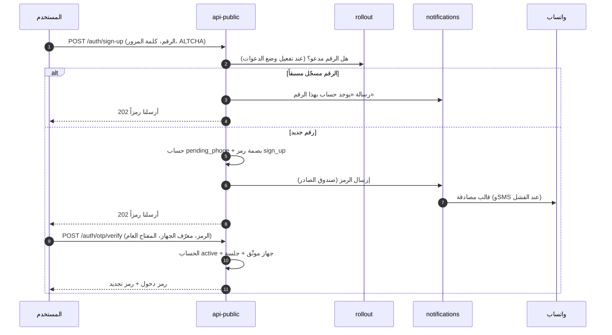

**ب. الدخول من جهاز جديد**

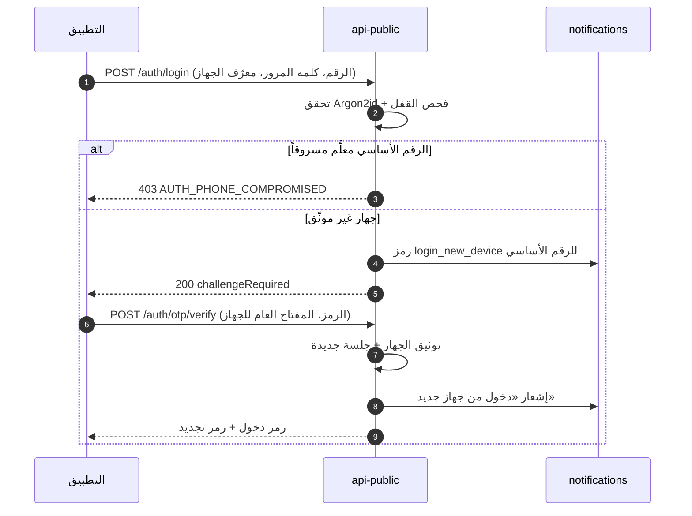

**ج. التجديد الدوّار وكشف إعادة الاستخدام**

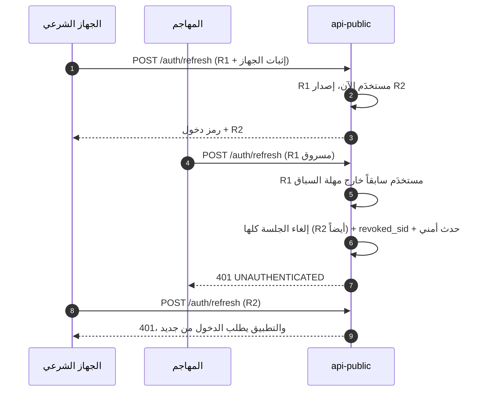

**د. دخول موظف الإدارة وإعادة التحقق**

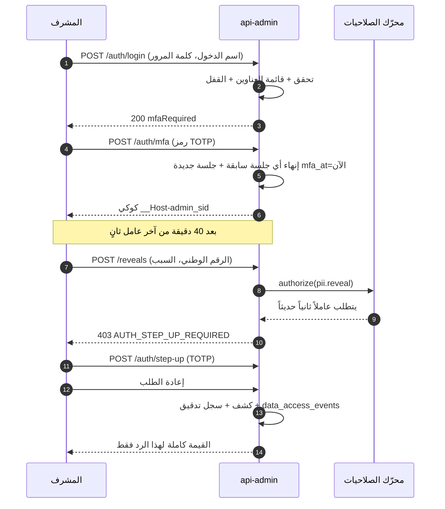

**هـ. الاستعادة بالهوية يبدأها المستخدم (THEFT-06، HANDOFF-02)**

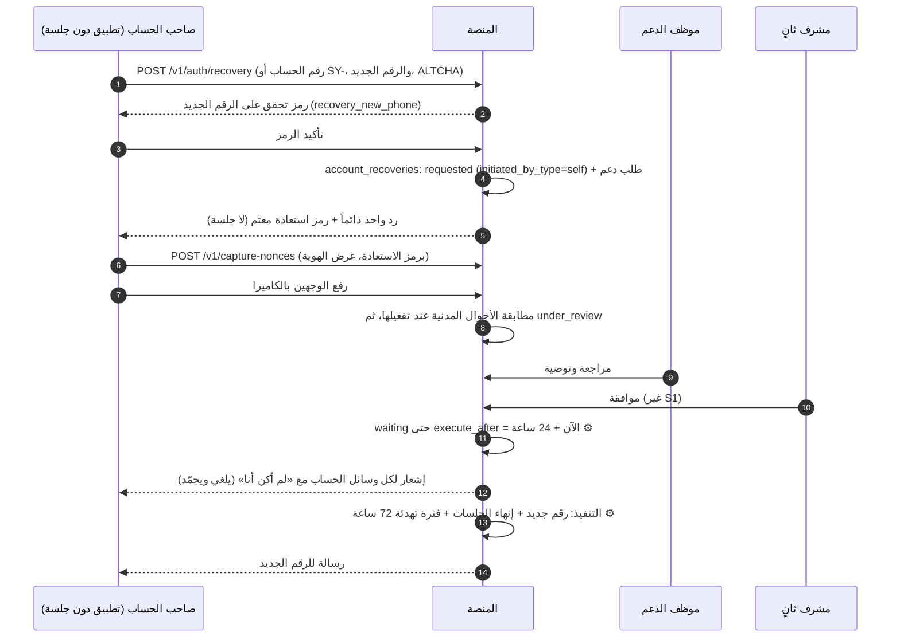

## 5. التفويض: نموذج الصلاحيات الموحّد

هذا القسم يحسم B-06: نموذج واحد يجمع الأدوار (RBAC) والخصائص (ABAC)، ويطبّق قرار D-58 مباشرة: قرار البلاغ إجراء متاح لفئتين من الفاعلين بصلاحيتين منفصلتين، الإدارة (`report.decide`) وعنصر الأمن ضمن نطاقه (`pp.report.decide`)، عبر آلة الحالة نفسها (§8.1)، مع تسجيل نوع الفاعل وهويته. فلا وساطة إدارية بين الأمن والبلاغ، ولا أثر لنموذج D-15 الملغى.

### 5.1 عناصر النموذج

| العنصر | التفصيل |
|---|---|
| الفاعل | نوعه (`user`، `admin`، `police`، `api_client`، `partner`، `system`)، ونطاق هويته، ومعرّفه |
| الصلاحية | مفتاح ثابت بصيغة `<وحدة>.<مورد>.<إجراء>` من الكتالوج (§5.9). والكتالوج في جدول `permissions` يُبذر بالترحيلات ولا يُعدَّل من اللوحة |
| الدور | مجموعة صلاحيات. أدوار الإدارة: خمسة افتراضية ثابتة المفاتيح (`general_manager`، `reports_supervisor`، `shops_supervisor`، `support`، `commercial_supervisor`) وأدوار ديناميكية (D-78). أدوار الأمن ثابتة: `unit_admin` و`officer`. وأدوار المستأجر: صاحب ومستخدم بصلاحيات يحددها الصاحب. وصلاحيات المواطن **مشتقة** من حالته وعلاقاته لا من دور مُسند |
| الخصائص | خصائص الفاعل والمورد والسياق التي تقيّد الصلاحية (§5.7) |
| القرار | `allow` أو `deny` مع سبب داخلي يُسجَّل، ومتطلبات إضافية محتملة: `step_up`، `reason`، `second_approver` |

### 5.2 أين تُفحص الصلاحية

| الطبقة | ما تفحصه | عند الفشل |
|---|---|---|
| 1. حارس المسار (PEP الخشن) | الصلاحية المعلنة في `x-permission` للعملية، ونطاق الهوية، وحالة الحساب، والتحديث الإجباري، ومفاتيح التشغيل | 401 أو 403 أو 426 |
| 2. خدمة المجال (PEP الدقيق) | `access.authorize(فاعل، صلاحية، مورد، سياق)` بعد تحميل المورد وقبل أي تغيير: الملكية، والنطاق، والحالة، والتهدئة، وتعارض المصالح، والأربع عيون، واستحقاق الباقة للميزات المدفوعة (§5.10) | 404 لما خارج الصلاحية، و403 لما يعرفه الفاعل |
| 3. تحديد نطاق القوائم | `access.scope(فاعل، صلاحية)` يعيد شرط استعلام (محافظات، أو مستأجر، أو مالك) يُضاف لكل قائمة. ولا توجد قائمة دون هذا الشرط | قائمة فارغة |
| 4. قاعدة البيانات (RLS) | عزل المستأجرين، ونطاق محافظات الأمن، ومنع قراءة المواقع الدقيقة من الواجهة العامة (§6) | صفر صفوف أو خطأ كتابة |
| 5. المُخرِج (Serializer) | تصنيف كل حقل وإخفاؤه افتراضياً (§5.8) | الحقل مخفي أو محذوف |

**محرّك القرار (PDP)** واحد في وحدة `access`، وكل سياسة فيه قاعدة مكتوبة قابلة للاختبار بجدول حالات (مسموح وممنوع) يغطي كل صلاحية. ولا يكتب أي متحكّم أو خدمة شرط صلاحية خاصاً به خارج المحرّك.

### 5.3 المنع الافتراضي

- أي عملية في العقد دون `x-permission` يرفضها فحص CI، وأي عملية لا تطابق قاعدة سماح صريحة تُمنع.
- قواعد المنع تعلو قواعد السماح: الحساب المعلّق، والتهدئة، وتعارض المصالح، والنطاق، ومفتاح التشغيل الموقوف.
- الصلاحيات تُحسب من قاعدة البيانات وتُخزَّن مؤقتاً في Redis بمفتاح (الفاعل، `authz_version`). وأي تغيير في دور أو عضوية أو نطاق يرفع `authz_version` فيُعاد الحساب في الطلب التالي، فيسري التغيير فوراً.
- لا توجد صلاحية في رمز الدخول، فلا ينتظر سحب الصلاحية انتهاء الرمز.

### 5.4 أدوار الإدارة والأدوار الديناميكية (D-78، SMART-03)

| القاعدة | التفصيل |
|---|---|
| الأدوار الافتراضية | الخمسة بصلاحياتها في عمود «الأدوار الافتراضية» في الكتالوج (§5.9)، مطابقةً لـ 03 §3.3 و§3.3.1. ولا تُحذف ولا تُعدَّل صلاحياتها |
| الدور الديناميكي | ينشئه المدير العام من قائمة الصلاحيات **القابلة للإسناد** فقط، مع اسم ووصف وسبب، ويُسجَّل |
| ما لا يُسند لدور ديناميكي | الصلاحيات المعلَّمة «مدير عام فقط»: إدارة حسابات الإدارة والأدوار، والإعدادات ومفاتيح التشغيل والتكاملات، وسجل التدقيق، ووضع الدعوات وتفعيل المحافظات، وتصحيح الملكية، واعتماد تسويات المورّدين والاسترداد والتفعيل دون دفعة |
| المدير العام (D-102) | ينفّذ إجراءاته «مدير عام فقط» **وحده، دون أي طلب موافقة**: حسابات الإدارة، والأدوار والصلاحيات، والإعدادات ذات الأثر الأمني، ومفاتيح التشغيل، والجهات الأمنية، والقوالب، ومدد الاحتفاظ. ومحرّك القرار لا يعيد `second_approver` لأي إجراء فاعله المدير العام، إلا حيث قررت الأربع عيون لغيره (التصحيحات REVERSAL، وتسويات المورّدين، والاسترداد، وإيقاف السحب D-100، وقرارات البلاغات ⛔). والبديل: عامل ثانٍ قوي، وإعادة تحقق لكل إجراء، وإشعار فوري `admin.gm.sensitive_action` على وسائله، وسجل تدقيق غير قابل للتعديل، وحساب طوارئ مختوم (§4.3) |
| فصل المهام | أزواج صلاحيات لا تجتمع في دور واحد ولا لموظف واحد (`permission_sod_rules`): إعداد التسوية واعتمادها، وطلب الاسترداد واعتماده، وإنشاء البلاغ بالنيابة ومراجعته، وتفعيل الخدمات ومطابقة المدفوعات اليومية |
| الرتبة | لكل دور رتبة رقمية تُستخدم في قاعدة «دور مساوٍ أو أعلى» للتصحيح (REVERSAL-02). الأدوار الديناميكية تأخذ رتبة يحددها المدير العام لا تتجاوز رتبة أي دور افتراضي تشمل صلاحياته |
| المراجعة الدورية | تقرير دوري بأعضاء كل دور وآخر استخدام لكل صلاحية، يراجعه المدير العام ([نموذج التهديد](20-threat-model.md)) |

### 5.5 صلاحيات أعضاء المحل والوكيل والمورّد ومندوب الشحن

| المستأجر | صلاحيات الصاحب وحده | صلاحيات يمنحها الصاحب | صلاحيات ضمنية لكل عضو نشط |
|---|---|---|---|
| المحل | `shop.profile.edit`، `shop.member.manage`، `shop.wholesale.accept`، `shop.theft_report.create` (REPORT-18)، `shop.compliance.view` (COMPLIANCE-04: حالة التزام المحل نفسه فقط)، `shop.billing.view`، `shop.wallet.manage` (التفعيل، والسحب، والكشف الكامل، ورمز المحفظة، والتجميد، وحدود الموظفين)، `shoppro.settings`، `shoppro.branches`، `shoppro.export` | `shop.tx.purchase`، `shop.tx.sale`، `shop.tx.view_all`، `shop.repair`، `shop.store.order`، `shop.wallet.topup` (بحد يومي للموظف ⚙️)، `shop.wallet.pay`، `shoppro.pos`، `shoppro.cash`، `shoppro.inventory`، `shoppro.purchases`، `shoppro.expenses`، `shoppro.debts`، `shoppro.warranty`، `shoppro.repair_advanced`، `shoppro.reports`، `shoppro.view_costs`، `shoppro.view_profits`، `shoppro.view_payroll` | `shop.inventory.view`، `shop.tx.view_own`، `shop.tx.cancel_own` (ضمن المهلة)، `shop.tip.submit`، و`shop.civil.lookup` لمن يملك شراء أو بيعاً أو صيانة وضمن معاملة جارية فقط |
| الوكيل | `importer.profile.edit`، `importer.member.manage`، `importer.api.manage` | `importer.batch.upload`، `importer.transfer.create`، `importer.tx.view_all` | `importer.inventory.view` |
| المورّد (D-87) | `supplier.member.manage`، `supplier.payout_account.request` | `supplier.product.manage`، `supplier.order.fulfil`، `supplier.settlement.view` | `supplier.profile.view` |
| مندوب الشحن | — | — | `courier.shipment.handle` للشحنات المسندة إليه فقط |

- الصلاحيات تُخزَّن في `permissions text[]` لكل عضو، ولا تُقبل إلا من القائمة المسموحة لنوع المستأجر.
- صلاحيات الأرباح والتكاليف ورواتب الآخرين (`shoppro.view_costs`، و`shoppro.view_profits`، و`shoppro.view_payroll`) غير ممنوحة افتراضياً (SHOPPRO-13). والموظف لا يملك السحب ولا كشف المحفظة الكامل أبداً، ويرى عملياته هو فقط (SHOPWALLET-05).
- الموظف غير موثّق الهوية (`pending_identity`) لا يملك أي صلاحية عمل (D-40).
- عضوية واحدة نشطة كحد أقصى لكل مستخدم في كل مستأجر، ويمكن أن يكون للمستخدم عضويات في أكثر من مستأجر، يتنقّل بينها من القائمة (D-44).

### 5.6 نطاق الأمن (D-80، PP-03)

| الإجراء | قاعدة النطاق |
|---|---|
| البحث برقم IMEI | كل المحافظات لكل العناصر. يُعاد للجهاز خارج النطاق **ملخص فقط**: الحالة العامة، والماركة والموديل، ومحافظة البلاغ النافذ إن وُجد، وعلَم «خارج نطاقك». **ولا أشخاص** (لا مالك ولا مبلّغ ولا رقم وطني ولا هاتف)، ولا سجل ولا مواقع. والتفاصيل الكاملة والسجل والأشخاص لما في النطاق فقط. ⚠️ **تُؤكَّد مع الوزارة** (Q-27): إتاحة هذا الملخص خارج النطاق، وحقوله (D-80). وهو دالة واحدة (`app.police_imei_summary`، §6.2) وإعداد ⚙️ لحقوله، فإن قررت الوزارة غير ذلك يُضيَّق أو يُلغى دون تغيير في بقية النطاق |
| البحث بالرقم الوطني | ضمن النطاق فقط، برقم قضية يطابق الصيغة ⚙️ وسبب، ويُسجَّل في `police_case_lookups` (PP-07) |
| قبول بلاغ مواطن قيد المراجعة، أو إغلاق بلاغ نافذ | إذا كانت إحدى «محافظات الصلة» بالبلاغ ضمن النطاق |
| التنبيهات | محافظة التنبيه ضمن النطاق |
| التتبّع والحظر وتأجيله | محافظة الجلسة (محافظة التنبيه الذي فتحها، أو محافظة الحادثة) ضمن النطاق |
| معاملات المحلات وأوامر الصيانة | محافظة المحل ضمن النطاق |
| البلاغ الرسمي | محافظة الحادثة ضمن النطاق |
| الإدارة المركزية | نطاقها كل المحافظات (`scope_all`) |

**محافظات الصلة** بالبلاغ أو الجهاز تُحفظ في `police_scope_links`: محافظة الحادثة عند الإنشاء، ومحافظة كل تنبيه على الجهاز، ومحافظة كل محل تعامل مع الجهاز، ومحافظة الضبط. فعنصر حمص يرى بلاغ دمشق إذا ظهر الجهاز في محل في حمص (06 §12). والنطاق يُفرض في المحرّك وفي RLS معاً (§6.2)، والقاعدة تُؤكد مع الوزارة (D-80).

### 5.7 الخصائص (ABAC)

| الخاصية | من أين | أين تُستخدم |
|---|---|---|
| المستأجر | `app.tenant_id` بعد التحقق من العضوية النشطة وحالة المستأجر | كل عمليات المحل والوكيل والمورّد ومندوب الشحن، وRLS |
| نطاق المحافظات | `police_units` (جهة العنصر) | §5.6، وRLS لدور `api_police` |
| علاقة الملكية | `ownerships` الحالية، و`authorized_users` النشطة | «أجهزتي»، والنقل، والشهادة، والبلاغ، والمفوّضون |
| أطراف البلاغ | المبلّغ، والمالك المسؤول، والمفوّض المبادر، والجهة الموثوقة المبادرة، والمعترض | عرض البلاغ والرد والإغلاق والاعتراض، وما يراه كل طرف (لا يرى المبلّغ هوية المعترض، DISPUTE-03) |
| مستوى الهوية | `users.identity_status` و`users.auto_linked_at` | البلاغ والاعتراض والتسجيل الذاتي وتسجيل المحل (06 §7) |
| نافذة المعاملة الجارية (D-84) | `shop_transactions` بحالة `checked` غير منتهية، أنشأها العضو نفسه | `shop.civil.lookup`: الاستعلام مسموح فقط للرقم الوطني للطرف في هذه المعاملة، ويعيد الاسم وحالة البطاقة فقط. ولا يوجد مسار برمجي لصورة السجل المدني في سياق المحل أصلاً: واجهة المحوّل الممنوحة لسياق المحل لا تحتوي عملية الصورة |
| نافذة مراجعة التوثيق | طلب توثيق بحالة `pending` مسند للمشرف نفسه | `civil.photo.view`، وكشف صورة الهوية |
| التهدئة | `users.cooldown_until` | الإجراءات الحساسة (§4.2.8) |
| الرقم المسروق | `users.phone_compromised_at` | رموز التحقق والإجراءات الحساسة (§4.2.7) |
| حداثة العامل الثاني | `staff_sessions.mfa_at` | الصلاحيات المعلَّمة `requires_step_up` |
| تعارض المصالح | `staff_coi_declarations`، وبصمة الرقم الوطني للموظف | منع مراجعة طلب يخص الموظف أو أقاربه المعلنين (03 §4) |
| الأربع عيون | الفاعل الأصلي والطالب | الموافق مختلف عن الطالب وعن صاحب القرار الأصلي: البلاغ بالنيابة (ONBEHALF-03)، والاستعادة، والتصحيح (REVERSAL-02)، والدمج، والاسترداد، والتسويات، وتغيير حساب استلام المورّد |
| القناة | `X-App-Platform` | طلب الخدمات الرقمية من الموقع فقط (D-86، PAY-08) |
| ساعات الدوام | إعداد ساعات العمل ⚙️ | تجميع رسائل واتساب الإدارية خارج الدوام (D-85، §15.5) |
| استحقاق الباقة | الاشتراك الفعّال للمستأجر وميزات باقته (§5.10) | كل صلاحية معلَّمة `requires_feature` |
| حدود المحفظة | حدود السحب اليومية والشهرية ⚙️، وحد الموظف اليومي، وحد التنبيه | عمليات المحفظة والتعبئة (SHOPWALLET-03، SHOPWALLET-05، TOPUP-05) |

### 5.8 الإخفاء الافتراضي والكشف المسجّل

| الحقل | العرض الافتراضي | من يكشف | الشرط |
|---|---|---|---|
| الرقم الوطني | آخر 3 خانات فقط: `••••••••123` ([نموذج التهديد](20-threat-model.md) §2.2) | `pii.reveal` | سبب، وعنصر عمل مفتوح مرتبط (بلاغ، أو توثيق، أو تنبيه، أو تعارض)، وعامل ثانٍ حديث |
| رقم الموبايل لغير صاحبه | `0933••••12`، والرقم البديل `09••••••12` | `pii.reveal` | كما سبق |
| صورة الهوية | مصغّرة مموّهة | `pii.reveal`، أو المراجع المسند | تُعرض عبر وكيل مصادَق بعلامة مائية فيها اسم المشاهد والوقت، دون رابط مباشر للمخزن |
| رقم الشريحة (MSISDN) والـ IMSI | آخر رقمين فقط | `pii.reveal` للإدارة، والعنصر ضمن نطاقه | سبب، ويُسجَّل |
| عنوان الشبكة ورقم واتساب الفاحص | مخفي | `pii.reveal` | تحقيق في إساءة أو تنبيه |
| IMEI في الصفحات العامة (الشهادة، والفاتورة، والإيصال) | أول 8 خانات (TAC) ثم `•••` ثم آخر 4، والرقم الكامل لمالكه بعد الدخول | — | CHECK-08، PUB-02 |
| الموقع الدقيق | لا يُعرض خارج الخريطة | `tracking.map.view` و`pp.tracking.view` | سبب مسجّل عند فتح الخريطة (TRACK-08) |
| صورة هوية البائع لدى المحل | لا تُعرض بعد الإرسال إطلاقاً («للكتابة فقط») | لا أحد في المحل | ضابط في [نموذج التهديد](20-threat-model.md) |
| الرقم الوطني للطرف في سجل معاملات المحل | مخفي دائماً | لا أحد في المحل | — |
| بيانات المحل لدى المورّد | اسم المحل وعنوان التوصيل فقط | — | STORE-12 |
| بيانات المحاسبة (SHOPPRO) | **لا تُعرض إطلاقاً** لأحد من المنصة: الإدارة والدعم الفني والمبرمجون والأمن والوزارة | لا أحد، ولا حتى بإذن صاحب المحل. والدعم يساعد بالشرح فقط | §6.8، SHOPPRO-14، PRIV-11، D-101 |
| رقم زبون التعبئة | مخفي جزئياً في سجل التعبئة لغير المنفّذ وصاحب المحل | — | TOPUP-03 |

- الكشف عبر `POST /api/v1/reveals` (المورد، والحقل، والسبب، وعنصر العمل)، فتعود القيمة في هذا الرد فقط مع `Cache-Control: no-store`، ولا تُحفظ في حالة الواجهة.
- لكل موظف حصة كشف ⚙️ 30 في الساعة و⚙️ 150 في اليوم ([نموذج التهديد](20-threat-model.md) §10.3)، وتجاوزها يوقف الكشف حتى يراجعه المدير العام، وبلوغ 80% منها ينبّه (DET-16). والكشف خارج عنصر عمل مسند يتطلب سبباً موسّعاً وينبّه فوراً.
- صيغ الإخفاء أعلاه هي الصيغ المعتمدة في كل الواجهات والوثائق والرسائل، ومرجعها [نموذج التهديد](20-threat-model.md) §2.2.
- كل كشف يُكتب في سجل التدقيق، وفي `data_access_events` لصاحب البيانات (DATAACCESS-01).

### 5.9 كتالوج الصلاحيات

الرموز: «عام» المدير العام، و«بلاغات» مشرف البلاغات، و«محلات» مشرف المحلات، و«دعم» الدعم الفني، و«تجاري» المشرف التجاري. 🔒 = يتطلب سبباً ويُسجَّل بتفصيل، و«خطوة» = عامل ثانٍ حديث. «مدير عام فقط» = لا يُسند لدور ديناميكي.

#### 5.9.1 الإدارة

| المفتاح | الإجراء | الأدوار الافتراضية | الضوابط | المتطلبات |
|---|---|---|---|---|
| `report.view` | عرض البلاغات وأدلتها | عام، بلاغات | — | ADMIN-02 |
| `report.decide` | قبول بلاغ أو رفضه أو طلب معلومات | عام، بلاغات | 🔒، تعارض المصالح، ولا يراجع بلاغاً أنشأه بالنيابة | ADMIN-02، ONBEHALF-03 |
| `report.closure.decide` | قبول طلب الإغلاق أو رفضه | عام، بلاغات | 🔒 | ADMIN-03 |
| `report.dispute.decide` | حسم الاعتراض | عام، بلاغات | 🔒 | ADMIN-04، DISPUTE-02 |
| `report.onbehalf.create` | إنشاء بلاغ بالنيابة | عام، دعم | 🔒، خطوة | ONBEHALF-01 |
| `report.police_import.run` | استيراد بلاغات قوى الأمن | عام، بلاغات | 🔒 | POLICE-01 |
| `identity.review.decide` | قبول توثيق الهوية أو رفضه | عام، بلاغات | 🔒، تعارض المصالح | ADMIN-05 |
| `civil.photo.view` | عرض صورة السجل المدني لطلب توثيق مسند | عام، بلاغات | 🔒 | CIVIL-02، D-84 |
| `selfreg.review.decide` | قرار التسجيل الذاتي | عام، بلاغات | 🔒 | OWN-03 |
| `tip.handle` | معالجة المعلومات الواردة | عام، بلاغات | — | TIP-03 |
| `alert.view` | عرض التنبيهات | عام، بلاغات | — | ADMIN-08، ADMIN-09 |
| `alert.handle` | إسناد التنبيه وملاحظاته وإغلاقه | عام، بلاغات | — | ADMIN-08 |
| `alert.refer` | تقرير PDF وتسجيل الإحالة | عام، بلاغات | 🔒 | ADMIN-10 |
| `tracking.map.view` | فتح خريطة التتبّع | عام، بلاغات | 🔒 | TRACK-08 |
| `tracking.session.open` | فتح جلسة تتبّع أو تمديدها أو إيقافها | عام، بلاغات | 🔒، خطوة، مرجع طلب الأمن | TRACK-05 |
| `telecom.block.defer` | تأجيل الحظر أو إيقافه مؤقتاً | عام، بلاغات | 🔒، مرجع طلب الأمن | TELCO-06 |
| `telecom.sim_history.query` | استعلام سجل الشريحة | عام، بلاغات، محلات | 🔒 | TELCO-12 |
| `telecom.resync` | إعادة مزامنة جهاز مع الشركات | عام، بلاغات | 🔒 | SMART-10 |
| `device.history.view` | السجل الكامل للجهاز ومواقع فحصه | عام، بلاغات، محلات | 🔒 | ADMIN-11، ADMIN-12 |
| `device.conflict.resolve` | حسم تعارض معرّف أو جهاز | عام، بلاغات، محلات | 🔒 | 06 §1 |
| `device.merge.propose` | اقتراح دمج سجلين | عام، بلاغات، محلات | 🔒 | ADMIN-18، §7.4 |
| `device.merge.approve` | الموافقة على الدمج | عام، بلاغات، محلات | 🔒، خطوة، أربع عيون | ADMIN-18، §7.4 |
| `pii.reveal` | كشف بيانات مخفية | عام، بلاغات، محلات | 🔒، خطوة، حصة يومية | ADMIN-17 |
| `shop.view` | عرض المحلات والوكلاء ومعاملاتهم | عام، محلات | — | ADMIN-06، ADMIN-07 |
| `shop.application.decide` | قرار طلب المحل أو الوكيل وتعديلاته | عام، محلات | 🔒 | SHOP-03، SHOP-04، IMPORTER-01 |
| `shop.suspend` | تعليق محل أو وكيل أو رفع التعليق | عام، محلات | 🔒 | ADMIN-06 |
| `shop.revoke` | إلغاء محل أو وكيل | عام، محلات | 🔒 | ADMIN-06 |
| `shop.conflict.decide` | حسم تعارض معاملة | عام، محلات | 🔒 | SHOP-08، ADMIN-07 |
| `shop.tx.correction.decide` | قرار طلب تصحيح أو إلغاء معاملة | عام، محلات | 🔒 | SHOP-15 |
| `importer.conflict.decide` | حسم تعارض الأرقام المكررة للوكيل | عام، محلات | 🔒 | IMPORTER-07 |
| `police.shop_suspension.handle` | تنفيذ طلب تعليق من الأمن | عام، محلات | 🔒 | PP-09 |
| `compliance.report.review` | مراجعة تقرير الالتزام وإرساله | عام، محلات | 🔒 | COMPLIANCE-02 |
| `compliance.shop_note.write` | ملاحظة الإدارة على حالة التزام محل، تظهر له في لوحته | عام، محلات | 🔒 | COMPLIANCE-04 |
| `kpi.report.view` | عرض التقرير الشهري للمؤشرات وتنزيله (PDF وExcel) | عام | 🔒 | SMART-15 |
| `kpi.report.send` | إرسال التقرير الشهري للوزارة | عام | مدير عام فقط، 🔒 | SMART-15 |
| `user.search` | البحث عن المستخدمين | عام، بلاغات، محلات، دعم | 🔒 | ADMIN-13 |
| `user.view` | عرض ملف المستخدم (مخفي جزئياً) | عام، بلاغات، محلات، دعم | — | ADMIN-13 |
| `user.suspend` | تعليق حساب أو رفعه | عام | 🔒 | ADMIN-13 |
| `user.suspend.malicious_report` | تعليق حساب بسبب بلاغ كيدي | بلاغات | 🔒 | 03 §3.3 |
| `user.ban` | حظر حساب نهائياً | عام | 🔒، خطوة | 06 §13 |
| `account.otp.resend` | إعادة إرسال رمز للمستخدم | عام، دعم | — | 03 §2.5 |
| `account.unlock` | فك القفل المؤقت | عام، دعم | 🔒 | SMART-10 |
| `account.recovery.initiate` | بدء استعادة بالهوية أو تغيير رقم | عام، دعم | 🔒 | THEFT-06، AUTH-09 |
| `account.recovery.approve` | الموافقة الثانية على الاستعادة | عام، دعم | 🔒، خطوة، أربع عيون | THEFT-06 |
| `support.ticket.handle` | معالجة طلبات الدعم والرد | عام، دعم | — | SUPPORT-04 |
| `support.ticket.view_routed` | عرض الطلبات المحوّلة إليه والرد الداخلي | بلاغات، محلات، تجاري | — | SUPPORT-07 |
| `notification.resend` | إعادة إرسال رسالة فشلت | عام، دعم | — | SMART-10 |
| `document.regenerate` | إعادة توليد فاتورة أو تقرير | عام، محلات | 🔒 | SMART-10 |
| `queue.bulk_assign` | إجراءات جماعية على قوائم العمل | عام، بلاغات، محلات | — | SMART-08 |
| `search.unified` | البحث الموحّد (النتائج حسب صلاحيات الباحث) | كل الأدوار | — | SMART-07 |
| `reversal.request` | طلب تصحيح قرار | عام، بلاغات، محلات | 🔒 | REVERSAL-02 |
| `reversal.approve` | الموافقة على التصحيح | عام، بلاغات، محلات | 🔒، خطوة، أربع عيون، رتبة مساوية أو أعلى | REVERSAL-02 |
| `reversal.ownership.approve` | الموافقة على تصحيح الملكية | عام | مدير عام فقط، 🔒، خطوة | REVERSAL-03 |
| `admin.user.manage` | حسابات الإدارة وإيقافها، والموافقة على إعادة تعيين كلمة المرور والعامل الثاني بعد التحقق الحضوري أو المرئي (§4.3)، وفك التعطيل بعد القفل | عام | مدير عام فقط، 🔒، خطوة لكل إجراء، إشعار فوري (D-102) | ADMIN-14 |
| `admin.role.manage` | الأدوار الديناميكية وإسنادها | عام | مدير عام فقط، 🔒، خطوة | SMART-03 |
| `police.unit.manage` | الجهات الأمنية وحسابات مسؤوليها ونطاقاتها | عام | مدير عام فقط، 🔒، خطوة | PP-01 |
| `police.activity.view_all` | سجل نشاط كل عناصر الأمن | عام | مدير عام فقط | PP-13 |
| `config.settings.edit` | الإعدادات ⚙️ | عام | مدير عام فقط، 🔒، خطوة | ADMIN-16 |
| `config.toggles.edit` | مفاتيح التشغيل | عام | مدير عام فقط، 🔒، خطوة | SMART-04 |
| `config.integrations.edit` | تفعيل التكاملات وإعداداتها غير السرية | عام | مدير عام فقط، 🔒، خطوة | 06 §15.3 |
| `config.content.edit` | تحرير المحتوى والنصوص والقوالب كمسودات | عام | — | SMART-01، NOTIF-02 |
| `config.content.publish` | نشر المحتوى والقوالب | عام | 🔒 | SMART-01 |
| `config.brand.edit` | الهوية (الشعار والاسم واللون) | عام | 🔒 | SMART-02 |
| `config.app_versions.edit` | الإصدارات المدعومة للتطبيق | عام | 🔒 | SMART-12 |
| `config.maintenance.edit` | وضع الصيانة والشريط العام | عام | 🔒 | SMART-11 |
| `rollout.manage` | وضع الدعوات وتفعيل المحافظات والدعوات | عام | مدير عام فقط، 🔒 | ROLLOUT-01، ROLLOUT-02، ROLLOUT-05 |
| `rollout.metrics.view` | مؤشرات التجريب | عام | — | ROLLOUT-03 |
| `audit.view` | سجل التدقيق | عام | مدير عام فقط | ADMIN-15 |
| `audit.export` | تصدير سجل التدقيق | عام | مدير عام فقط، 🔒، خطوة | ADMIN-15 |
| `system.health.view` | صحة النظام والتكاملات | عام | — | SMART-09 |
| `system.dead_letters.retry` | إعادة المهام والرسائل الفاشلة | عام | 🔒 | SMART-09 |
| `retention.hold.manage` | الحجز القانوني يدوياً (LH-4، LH-5) | عام، ومسؤول حماية البيانات | 🔒 | PRIV-05 |
| `data.export` | تصدير بيانات بالجملة | عام | مدير عام فقط، 🔒، خطوة | — |
| `commerce.catalog.manage` | المنتجات والأقسام | عام، تجاري | — | STORE-02 |
| `commerce.product.review` | مراجعة منتج قبل النشر | عام، تجاري | 🔒 | STORE-06، STORE-12 |
| `commerce.supplier.manage` | المورّدون واتفاقياتهم وحصص المنصة | عام، تجاري | 🔒 | STORE-03 |
| `commerce.supplier.payout_account.approve` | اعتماد حساب استلام تسويات المورّد أو تغييره | عام | مدير عام فقط، 🔒، خطوة، أربع عيون | STORE-10 |
| `commerce.order.manage` | تأكيد طلبات المتجر وإلغاؤها وإنشاؤها عن المحل | عام، تجاري | — | STORE-04، STORE-05 |
| `commerce.shipment.manage` | الشحنات ومندوبو الشحن | عام، تجاري | — | STORE-09 |
| `commerce.courier.reconcile` | تسوية نقد الشحن اليومية | عام، تجاري | 🔒 | STORE-09 |
| `commerce.return.decide` | قرار الإرجاع ونسبة العيب للمورّد | عام، تجاري | 🔒 | STORE-11 |
| `commerce.settlement.prepare` | إعداد كشف تسوية المورّد | عام، تجاري | 🔒 | STORE-10 |
| `commerce.settlement.approve` | اعتماد تحويل التسوية | عام | مدير عام فقط، 🔒، خطوة | STORE-10 |
| `commerce.settlement.mark_paid` | تسجيل رقم التحويل | عام، تجاري | 🔒 | STORE-10 |
| `ads.campaign.review` | مراجعة الإعلانات | عام، تجاري | 🔒 | ADS-05 |
| `billing.payment.confirm` | تأكيد دفعة برقمها المرجعي | عام، تجاري | 🔒 | PAY-01 |
| `billing.activation.execute` | تفعيل خدمة بعد دفعة مؤكدة | عام، تجاري | 🔒 | PAY-07 |
| `billing.activation.without_payment` | تفعيل دون دفعة (منحة أو تعويض) | عام | مدير عام فقط، 🔒، خطوة | PAY-07 |
| `billing.refund.request` | طلب استرداد أو إلغاء | تجاري | 🔒 | PAY-04 |
| `billing.refund.approve` | اعتماد الاسترداد | عام | مدير عام فقط، 🔒، خطوة | 03 §3.3.1 |
| `billing.reconcile` | المطابقة اليومية للمدفوعات | عام، تجاري | 🔒، لا يطابق دفعات فعّلها بنفسه | PAY-01 |
| `billing.pricing.edit` | الأسعار والباقات | عام | مدير عام فقط، 🔒 | 06 §15.3 |
| `bizapi.client.manage` | عملاء الربط ومفاتيحهم | عام، تجاري | 🔒، خطوة | BIZAPI-01 |
| `commerce.package.manage` | الباقات وميزاتها وأسعارها وحدودها | عام | مدير عام فقط، 🔒، خطوة | PAY-09 |
| `wallet.view` | حالة محافظ المحلات، والعمليات المرتبطة **بفرق مطابقة أو بتجميد فقط**، دون كشف الحساب الكامل ودون سجل الدخول والأجهزة ([الخصوصية](21-privacy-dpia.md) PA-33)، ودون بيانات المحاسبة | عام، تجاري | 🔒 | SHOPWALLET-06 |
| `wallet.freeze` | تجميد محفظة محل للاشتباه أو رفعه: **يوقف التعبئة والدفع فقط**، ولا يمس السحب | عام، تجاري | 🔒، خطوة | SHOPWALLET-07، SHOPWALLET-08 |
| `wallet.withdrawal_stop.request` | طلب إيقاف السحب مؤقتاً عند اختراق مؤكد | عام، تجاري | 🔒، خطوة، سبب | D-100 |
| `wallet.withdrawal_stop.approve` | الموافقة على إيقاف السحب، أو رفعه قبل موعده | عام، تجاري | 🔒، خطوة، أربع عيون: غير الطالب | D-100 |
| `wallet.withdrawal_stop.renew` | تجديد الإيقاف ⚙️ 24 ساعة أخرى بقرار مسجّل | عام | مدير عام فقط، 🔒، خطوة | D-100 |
| `reconciliation.resolve` | حسم فروقات المطابقة (شام كاش، والتعبئة، ونقد الشحن، والمدفوعات) | عام، تجاري | 🔒، ولا يحسم فرقاً على عملية نفّذها أو فعّلها بنفسه | SHOPWALLET-06، TOPUP-06، STORE-09 |
| `topup.catalog.manage` | منتجات التعبئة وبادئات الأرقام ونسب العمولة حسب الاتفاقية | عام | مدير عام فقط، 🔒 | TOPUP-01، TOPUP-04 |
| `privacy.requests.handle` | طلبات أصحاب البيانات | يُسند لدور مسؤول حماية البيانات | 🔒 | PRIV-06 |
| `privacy.retention.manage` | سياسات الاحتفاظ ومددها | عام، ومسؤول حماية البيانات | 🔒، خطوة. المدير العام ينفّذ وحده (D-102) مع تسجيل رأي مسؤول حماية البيانات، وتغيير مسؤول حماية البيانات يعتمده المدير العام | PRIV-04 |
| `privacy.incidents.manage` | سجل حوادث الخصوصية | عام، ومسؤول حماية البيانات | 🔒 | PRIV-07 |
| `privacy.disclosures.record` | سجل الإفصاح الخارجي | عام، ومسؤول حماية البيانات | 🔒، خطوة، وأربع عيون إن سجّله غير المدير العام (D-102) | PRIV-08 |
| `privacy.hold.manage` | الحجز القانوني من لوحة الإدارة (LH-4، LH-5)، ومتابعة مراجعة الحجوزات، ورفع حجز قوى الأمن (LH-2) بعد التواصل مع الجهة فقط ([الخصوصية](21-privacy-dpia.md) §5.3) | عام، ومسؤول حماية البيانات | 🔒، خطوة، سبب | PRIV-05، PP-14 |
| `privacy.consents.manage` | أغراض الموافقة ونصوصها بإصداراتها، ونصوص الشروط والسياسات وطلب إعادة القبول | عام، ومسؤول حماية البيانات | 🔒، واعتماد المدير العام للتغيير الجوهري إن اقترحه غيره (D-102) | PRIV-03، PRIV-10 |

#### 5.9.2 بوابة الأمن

الأدوار: `unit_admin` (مسؤول أمن) و`officer` (عنصر). كل الصلاحيات خاضعة للنطاق (§5.6)، وكل عرض وبحث وقرار يُسجَّل (PP-13). **ولا توجد أي صلاحية تجارية في نطاق الأمن** (D-83).

| المفتاح | الإجراء | الأدوار | الضوابط | المتطلبات |
|---|---|---|---|---|
| `pp.imei.search` | البحث برقم IMEI | الاثنان | كل المحافظات بملخص خارج النطاق | PP-07 |
| `pp.person.search` | البحث بالرقم الوطني | الاثنان | 🔒، خطوة، رقم قضية بالصيغة ⚙️، النطاق، حصة ⚙️ | PP-07 |
| `pp.report.create_official` | بلاغ رسمي نافذ فوراً | الاثنان | 🔒، رقم الضبط | PP-04 |
| `pp.report.decide` | قبول بلاغ مواطن أو إغلاق بلاغ نافذ | الاثنان | 🔒، النطاق | PP-08 |
| `pp.alert.view` | التنبيهات اللحظية | الاثنان | النطاق | PP-05 |
| `pp.alert.ack` | استلام التنبيه وملاحظاته | الاثنان | النطاق | PP-05 |
| `pp.device.history.view` | سجل الجهاز وخريطته | الاثنان | 🔒، النطاق | PP-06 |
| `pp.tracking.view` | خريطة التتبّع | الاثنان | 🔒، النطاق | PP-06، TRACK-08 |
| `pp.tracking.open` | فتح جلسة تتبّع أو تمديدها | الاثنان | 🔒، خطوة، رقم قضية | PP-06، TRACK-05 |
| `pp.block.request` | طلب الحظر الآن | الاثنان | 🔒 | PP-06 |
| `pp.block.defer` | تأجيل الحظر | الاثنان | 🔒، المدة والسبب | PP-06، TELCO-06 |
| `pp.shop_tx.view` | معاملات المحلات وأوامر الصيانة | الاثنان | 🔒، النطاق | PP-06، PP-09 |
| `pp.shop_suspension.request` | طلب تعليق محل | الاثنان | 🔒 | PP-09 |
| `pp.seizure.record` | تسجيل جهاز مضبوط | الاثنان | 🔒 | PP-10 |
| `pp.seizure.return` | تسجيل إرجاعه لصاحبه | الاثنان | 🔒، التحقق من هوية المستلم | PP-10 |
| `pp.seizure.bulk_check` | فحص مضبوطات بالجملة | الاثنان | 🔒 | PP-11 |
| `pp.report.pdf` | تقرير PDF | الاثنان | 🔒، علامة مائية | PP-12 |
| `pp.case.manage` | فتح القضية وإغلاقها، وتمديد تأخير ظهور الاطلاع في «من اطّلع على بياناتي» ⚙️ 180 يوماً حتى مرتين بسبب مسجّل، وطلب حجز بيانات جهاز أو شخص ضمن النطاق برقم القضية من الحذف، فيُنشأ مباشرةً `retention_holds` من نوع LH-2 (`placed_by_type = 'police'`) ويراجعه واضعه كل ⚙️ 180 يوماً، ولا يُرفع آلياً | الاثنان | 🔒 | PP-14، DATAACCESS-02، PRIV-05 |
| `pp.user.manage` | حسابات عناصر الجهة وإيقافها، وفك تعطيلها بعد القفل، والموافقة على إعادة تعيين كلمة مرور العنصر أو عامله الثاني بعد التحقق الحضوري أو المرئي (§4.3) | `unit_admin` | 🔒، خطوة | PP-01 |
| `pp.activity.view` | سجل نشاط عناصر الجهة | `unit_admin` | — | PP-13 |

#### 5.9.3 الجمهور (صلاحيات مشتقة)

| المفتاح | الإجراء | الشرط | المتطلبات |
|---|---|---|---|
| `check.perform` | فحص IMEI | أي أحد، بحدود الفئة | CHECK-01 |
| `tip.submit` | «عندك معلومات؟» أو إرجاع مفقود | أي أحد، مع ALTCHA للزائر | TIP-01، TIP-02 |
| `document.verify` | التحقق من فاتورة أو شهادة أو إيصال | أي أحد | PUB-02، PUB-03، PUB-06 |
| `me.manage` | الملف والجلسات و«من اطّلع على بياناتي» وطلبات الدعم | حساب نشط | AUTH-04، AUTH-08، DATAACCESS-01، SUPPORT-01 |
| `identity.submit` | طلب توثيق الهوية | مؤكَّد الرقم، وحالة التوثيق `none` أو `rejected`، وأقل من 3 رفضات ⚙️ | AUTH-05 |
| `device.list_own` | «أجهزتي» والفواتير | مرتبط تلقائياً أو موثّق الهوية | OWN-01 |
| `ownership.transfer.create` | نقل ملكية | المالك الحالي، مرتبط أو موثّق، لا بلاغ نافذ أو قيد المراجعة، لا انتظار تسجيل ذاتي، لا تهدئة، وخطوة | OWN-04، OWN-06 |
| `ownership.transfer.accept` | قبول النقل | مؤكَّد الرقم، وتطابق رقمه وبصمة رقمه الوطني مع الطلب | OWN-04 |
| `certificate.issue` | شهادة فحص | المالك، ونفس شروط النقل عدا الخطوة | OWN-09 |
| `authorized_user.manage` | المستخدمون المفوّضون | المالك، حتى 3 ⚙️ | OWN-08 |
| `report.create` | تقديم بلاغ | موثّق الهوية، والجهاز ملكه أو مفوّض عليه أو غير مسجّل، أو بلاغ تعارض على تسجيل ذاتي لغيره | REPORT-01، REPORT-15 |
| `report.initiate_as_delegate` | بدء بلاغ كمفوّض | مستخدم مفوّض نشط على الجهاز، مؤكَّد الرقم | OWN-08 |
| `report.confirm_delegate` | تأكيد بلاغ المفوّض | المالك الحالي، مع توثيق الهوية أثناء التأكيد إن لزم (D-32) | 06 §5 |
| `report.urgent_create` | بلاغ عاجل عن صاحب حساب | جهة موثوقة نشطة له | TRUSTED-02 |
| `report.manage_own` | الرد على طلب المعلومات، وتعديل المكافأة، وطلب الإغلاق، وسحب البلاغ قبل القرار | المبلّغ، والإغلاق دون تهدئة ومع خطوة | REPORT-10، REPORT-11، REPORT-17 |
| `dispute.create` | اعتراض | موثّق الهوية، والبلاغ نافذ | DISPUTE-01 |
| `dispute.respond` | الرد على الاعتراض بأدلة | المبلّغ | DISPUTE-03 |
| `selfreg.create` | تسجيل ذاتي | موثّق الهوية، دون تهدئة، والحد السنوي ⚙️ | OWN-03، OWN-15 |
| `trusted_contact.manage` | الجهات الموثوقة | دون تهدئة، وخطوة، وحتى 3 ⚙️ | TRUSTED-01 |
| `alternate_contact.manage` | الرقم البديل | دون تهدئة، وخطوة، أو ضمن بلاغ مع شريحة مسروقة | THEFT-02 |
| `tenant.apply` | طلب تسجيل محل أو وكيل | موثّق الهوية | SHOP-01، IMPORTER-01 |
| `handoff.use` | إصدار رمز الإكمال واستلامه | الحساب نفسه في الموقع والتطبيق | HANDOFF-02 |
| `service.request` | «اطلب التفعيل» لخدمة رقمية أو باقة | من الموقع فقط | PAY-01، PAY-08 |
| `me.data_export` | تنزيل نسخة من بياناتي | كلمة المرور ورمز، ومرة كل 24 ساعة ⚙️، ودون تهدئة | PRIV-01 |
| `history.own_free` | تقرير تاريخ مجاني لجهازه | المالك الحالي | HISTORY-03 |

### 5.10 الباقات والاستحقاق (D-93، PAY-09)

| القاعدة | التفصيل |
|---|---|
| الميزات | كتالوج ميزات ثابت المفاتيح في `features`، ولكل ميزة نوع: `compliance` (وظيفة التزام) أو `paid_eligible` (قابلة للإدراج في باقة). ولكل صلاحية مدفوعة في الكتالوج حقل `requires_feature` |
| وظائف الالتزام | الفحص، وتسجيل الشراء والبيع والصيانة، والفواتير، والموظفون، والنقل بالجملة، والتسجيل الذاتي والبلاغ: **لا تحمل `requires_feature` أبداً**، فلا تتوقف لأي سبب تجاري. ويمنع محفّز في قاعدة البيانات إدراج ميزة `compliance` في `package_features`، ويتحقق فحص في CI من أن أي صلاحية التزام لا تحمل `requires_feature` |
| الباقات | `packages` يديرها المدير العام: الباقة المجانية الافتراضية (كل محل موثّق دون اشتراك، وفيها مع وظائف الالتزام طلب المتجر بالدفع عند الاستلام)، وباقة المشتركين (المحاسبة SHOPPRO-02..15، والمحفظة والتعبئة، والفروع)، وأي باقة جديدة دون برمجة: الميزات، والسعر الشهري والسنوي، والتجربة ⚙️، والحدود (مثل عدد الفروع) |
| الاشتراك | `shop_subscriptions` يحفظ **لقطة** من ميزات الباقة وحدودها عند التفعيل، فتعديل الباقة لا يمس الاشتراكات القائمة حتى تجديدها (PAY-09). والتفعيل إداري بعد الدفع (PAY-07) |
| حساب الاستحقاق | ميزات المستأجر = ميزات الباقة المجانية ∪ لقطة الاشتراك الفعّال (`trial` أو `active` أو `grace`). تُحسب وتُخزَّن مؤقتاً مع إصدار الصلاحيات، وأي تغيير في الاشتراك يرفع الإصدار فيسري فوراً |
| الرفض | الصلاحية المدفوعة دون استحقاق ترد بـ 403 `PACKAGE_FEATURE_REQUIRED`. وفي التطبيقين تظهر الميزة بحالتها فقط دون أي دعوة للشراء (PAY-08) |
| انتهاء الاشتراك | تتوقف التعبئة والدفع من المحفظة، **ويبقى السحب لصاحب المحل متاحاً دائماً** فلا يُحتجز ماله (SHOPWALLET-01): صلاحية السحب لا تحمل `requires_feature`، ولا تتبع مفتاح وحدة المحفظة أيضاً (ROLLOUT-07، §14.3). وبيانات المحاسبة تبقى للقراءة والتصدير ⚙️ 12 شهراً ثم تتبع سياسة الاحتفاظ (SHOPPRO-15). والفروع الزائدة على حد الباقة المجانية تبقى سجلاتها وتُعرض للقراءة |

## 6. عزل المستأجرين: المحلات والوكلاء والمورّدون ومندوبو الشحن

هذا القسم يحسم B-07.

### 6.1 المستأجرون والجداول المعزولة

| البند | التفصيل |
|---|---|
| المستأجر | صف في `tenants` بنوع: `shop` (ويشمل محل الصيانة كنوع نشاط)، أو `importer`، أو `supplier` (D-87)، أو `courier`. ومعرّف المستأجر هو نفسه معرّف المحل أو الوكيل أو المورّد أو جهة الشحن |
| الجداول المعزولة | كل جدول يخص مستأجراً يحمل `tenant_id NOT NULL` ويُعلَّم «RLS» في [نموذج البيانات](09-data-model.md): الأعضاء والوثائق وطلبات التعديل والفروع وأنواع النشاط، ومعاملات المحل وتصحيحاتها وفواتيرها، وأوامر الصيانة واستبدال اللوحات، ودفعات الوكيل وأسطرها والنقل بالجملة، واستعلامات الأحوال المدنية من المحلات، وطلبات المتجر وأسطرها والإرجاع، والشحنات وقبض الشحن، وكشوف التسوية وأسطرها، ومحفظة المحل وعملياتها وحدود موظفيها، وطلبات التعبئة، واشتراكات الباقات، وكل مخطط المحاسبة `shoppro` (§6.8) |
| الجداول المشتركة | سجل الأجهزة والملكية والبلاغات والفحوص ليست جداول مستأجر: الوصول إليها عبر خدمات وحداتها فقط، بالصلاحيات في §5. فالمحل يعرف من الملكية «مسجّل باسم شخص آخر» فقط، ولا يقرأ جدول الملكية |

### 6.2 أدوار قاعدة البيانات

| الدور | وحدة النشر | جداول المستأجرين | قيود أخرى |
|---|---|---|---|
| `api_public` | `api-public` | الصفوف التي `tenant_id` فيها يساوي `app.tenant_id` فقط، وسياسات الطرفين في §6.5، ومخطط `shoppro` لمستأجره فقط | `INSERT` فقط على جداول `geo_private` (يكتب المواقع ولا يقرؤها أبداً)، و`INSERT` فقط على `audit.audit_logs` |
| `api_admin` | `api-admin` | كل المستأجرين، وكل قراءة لحقل حساس تُسجَّل | قراءة `geo_private`، والإدراج فقط في `audit.audit_logs`، و**لا أي صلاحية على مخطط `shoppro`** (D-92) |
| `api_police` | `api-police` | كل المستأجرين قراءةً، مقيّدة بسياسات النطاق على الجداول ذات المحافظة: `reports`، و`security_alerts`، و`shop_transactions`، و`repair_jobs`، و`seized_devices`، و`tracking_sessions`، و`device_timeline_entries`، و`tips`، و`geo_private.*` | **لا أي صلاحية على مخططي `commerce` و`shoppro`** (D-83، D-92). والبحث الوطني برقم IMEI عبر دالة `SECURITY DEFINER` واحدة (`app.police_imei_summary`) تعيد الملخص المحدد في §5.6 فقط |
| `api_partner` | `api-partner` | لا شيء | إدراج في `ops.inbound_messages` وقراءة سجلات الشركاء فقط |
| `api_biz` | `api-biz` | مستأجر الوكيل حين يكون العميل وكيلاً، بالآلية نفسها | `commerce.api_usage_events` |
| `worker` | `worker-core`، `worker-integrations`، `scheduler` | كل المستأجرين بفاعل نظامي `app.actor_type = system` | لا صلاحية على `shoppro` |
| `shoppro_system` | مستهلكو القيود الآلية للمحاسبة ومهام احتفاظها في `worker-core` | مخطط `shoppro` بمستأجر مضبوط لكل مهمة | لا قراءة لغير `shoppro` إلا ما تحمله الأحداث |
| `worker_media` | `worker-media` | لا شيء | `files` و`file_duplicates` فقط |
| `ws_gateway` | `ws-gateway` | لا شيء | قراءة الجلسات والاشتراكات |
| `reporting_ro` | نسخة القراءة | قراءة فقط، **دون `shoppro`** | لتقارير الالتزام والتصدير الإداري، فلا تدخل بيانات المحاسبة تقرير الالتزام أبداً (SHOPPRO-14) |
| `migrator` | الترحيلات | مالك الجداول | لا يُستخدم وقت التشغيل أبداً، ولا يدخل به إنسان: بياناته يصدرها محرّك أسرار قواعد البيانات لخط النشر وحده، لمدة الترحيل فقط |
| `ops_readonly` | الوصول التقني المؤقت عند حادث ([نموذج التهديد](20-threat-model.md) §13.7) | قراءة مقيّدة للجداول التشغيلية | **لا `USAGE` على مخطط `shoppro`** ولا على `geo_private`، ولا قراءة للحقول المشفّرة إلا كبايتات (D-101) |

كل الجداول المعزولة عليها `ENABLE ROW LEVEL SECURITY` و`FORCE ROW LEVEL SECURITY`، فلا يتجاوزها حتى مالك الجدول. ولا يملك أي دور تشغيل خاصية `BYPASSRLS`.

### 6.3 ضبط المستأجر لكل طلب

1. الطلب يصل بمعرّف المستأجر في المسار: `/v1/shops/{shopId}/...`.
2. محرّك الصلاحيات يتأكد من عضوية نشطة للمستخدم في هذا المستأجر، ومن أن المستأجر نفسه فعّال (`verified`)، ومن الصلاحية المطلوبة.
3. طبقة الوصول للبيانات تفتح معاملة وتنفّذ قبل أي استعلام: `SET LOCAL app.tenant_id`، و`app.user_id`، و`app.actor_type`، و`app.actor_id`، و`app.request_id`، و`app.gov_scope` (للأمن فقط).
4. `SET LOCAL` يزول بانتهاء المعاملة، فلا يتسرّب الإعداد بين طلبات تتشارك اتصالاً واحداً في مدير الاتصالات (PgBouncer بوضع المعاملة).
5. أي استعلام خارج هذا الغلاف يعمل دون `app.tenant_id`، فتعيد السياسات صفر صفوف: **الفشل مغلق**.

### 6.4 السياسات

مثال توضيحي لسياسة جدول معزول، وسياسة نطاق الأمن على الجدول نفسه:

```sql
ALTER TABLE app.shop_transactions ENABLE ROW LEVEL SECURITY;
ALTER TABLE app.shop_transactions FORCE ROW LEVEL SECURITY;
CREATE POLICY tenant_isolation ON app.shop_transactions FOR ALL TO api_public
  USING (tenant_id = current_setting('app.tenant_id', true)::uuid)
  WITH CHECK (tenant_id = current_setting('app.tenant_id', true)::uuid);
CREATE POLICY police_scope ON app.shop_transactions FOR SELECT TO api_police
  USING (app.in_gov_scope(governorate_id));
```

`app.in_gov_scope` دالة ثابتة تقرأ `app.gov_scope` (قائمة معرّفات المحافظات، أو `all` للإدارة المركزية). والجداول التي تُرى عبر «محافظات الصلة» (§5.6) تضيف شرطاً على `police_scope_links`.

### 6.5 الحالات العابرة للمستأجرين

| الحالة | الآلية |
|---|---|
| النقل بالجملة من وكيل لمحل | الصف يحمل `tenant_id` (الوكيل) و`recipient_tenant_id` (المحل)، والسياسة تسمح لأيهما، والكتابة لكل طرف على حقوله فقط عبر الخدمة |
| فاتورة الجهاز للمشتري | سياسة قراءة إضافية `buyer_user_id = app.user_id` على `invoices` فقط |
| معرفة المحل أن الجهاز مسجّل لغيره | لا قراءة لجداول الملكية، بل جواب الخدمة بعلَم واحد (06 §6) |
| طلب المتجر بين المحل والمورّد | الصف يحمل `buyer_tenant_id` و`supplier_tenant_id`. المحل يقرأ طلباته كاملة، والمورّد يقرأ عبر العرض المقيّد `commerce.v_supplier_orders` الذي يكشف اسم المحل وعنوان التوصيل والأسطر والحالة فقط (STORE-12) |
| الشحنة ومندوب الشحن | `courier_tenant_id` على `shipments` و`courier_collections`، ومندوب الشحن يرى الشحنات المسندة إليه فقط |
| معرفة المستخدم عضوياته | سياسة `user_id = app.user_id` على جداول الأعضاء، فيعرض التطبيق قائمة «محلي» قبل اختيار المستأجر |
| الإدارة | دور `api_admin` يرى كل المستأجرين، والصلاحية والسبب والتدقيق في التطبيق |
| المهام الخلفية | دور `worker` بفاعل نظامي مسجّل، ولكل مهمة تحدد المستأجر الذي تعمل عليه في السجل |

### 6.6 الفروع (SHOPPRO-06)

الفرع ليس مستأجراً، بل تقسيم داخل المحل الواحد: `shop_branches`، و`branch_id` على المعاملات وجداول أدوات المحل، و`branch_ids` على العضو. الصاحب يرى كل الفروع، والموظف يرى فروعه فقط بشرط في طبقة التطبيق (§5.2 الطبقة 3)، بينما يبقى RLS حاجز المستأجر.

### 6.7 اختبارات إثبات العزل

| الاختبار | ما يثبته | متى |
|---|---|---|
| فحص الكتالوج | استعلام على `information_schema` يرفض البناء إن وُجد جدول فيه `tenant_id` دون RLS مفعّل ومفروض، أو دون سياسة لكل دور تشغيل، أو وُجد دور فيه `BYPASSRLS` | كل بناء |
| مصفوفة RLS | لكل جدول معزول: مستأجران ببيانات، ثم بدور `api_public` ومستأجر أ: صفر صفوف من ب في القراءة والتعديل والحذف، وفشل إدراج صف بمستأجر ب | كل بناء |
| الفشل المغلق | استعلام دون `app.tenant_id` يعيد صفر صفوف لكل جدول معزول | كل بناء |
| تسرّب الاتصال | طلبان متتاليان لمستأجرين مختلفين على اتصال واحد مع مدير الاتصالات، والثاني لا يرى بيانات الأول | كل بناء |
| IDOR على الواجهة | كل عملية بمعرّف مستأجر في المسار تُستدعى بمعرّف مستأجر آخر أو بمعرّف مورد لمستأجر آخر، والنتيجة 404 دائماً | كل بناء، مولَّدة من العقد |
| نطاق الأمن | عنصر محافظة أ لا يرى تفاصيل بلاغ أو تنبيه أو معاملة في محافظة ب، ويرى ملخص IMEI فقط، والإدارة المركزية ترى الكل | كل بناء |
| فحص اصطناعي في بيئة التجريب | مستأجران اصطناعيان دائمان، ومحاولات وصول متقاطعة دورية تنبّه عند أي نجاح | باستمرار |

### 6.8 عزل بيانات المحاسبة وإدارة المحل (D-92، SHOPPRO-14)

بيانات المحاسبة ملك المحل وحده. لذلك لها وحدة مستقلة (`shoppro`) ومخطط مستقل في قاعدة البيانات بقاعدة أشد من باقي جداول المستأجرين:

| الضابط | التفصيل |
|---|---|
| مخطط مستقل | كل جداول المحاسبة في مخطط `shoppro`، معزولة بـ RLS بـ `tenant_id` مثل باقي جداول المستأجر |
| لا صلاحية للجهات | أدوار `api_admin` و`api_police` و`reporting_ro` و`worker` لا تملك أي `USAGE` على المخطط. فلا لوحة الإدارة، ولا بوابة الأمن، ولا تقرير الالتزام، ولا الإعلانات، ولا التصدير الإداري يستطيع قراءتها حتى لو أخطأ الكود |
| لا مسار وصول بشري (D-101، PRIV-11) | **لا يطّلع أحد من المنصة على بيانات المحاسبة أبداً، ولا حتى بإذن صاحب المحل**: لا دور لقاعدة البيانات يقرأ المخطط إلا `api_public` (لمستأجره، بطلب صاحب المحل أو موظفه بصلاحيته) و`shoppro_system` (القيود الآلية والاحتفاظ). فلا نقطة في لوحة الإدارة أو بوابة الأمن تقرؤه، ولا دور للدعم، ولا إذن مؤقت، ولا وصول تقني: دور `ops_readonly` للحوادث لا يملك `USAGE` عليه، و`migrator` لا يدخل به إنسان، والنسخ الاحتياطية تُستعاد للتحقق في بيئة معزولة تفحصها أدوات آلية فقط. والسجلات والمؤشرات وتتبّع الأعطال لا تحمل أي قيمة محاسبية (§18). والدعم يساعد صاحب المحل **بالشرح فقط** على شاشاته هو |
| الوصول من الوحدات الأخرى | لا تستورد أي وحدة مستودع `shoppro`. والروابط الآلية من السجل والمتجر والمحفظة تصل إليه **كأحداث** يستهلكها `shoppro_system` (§9)، والعكس ممنوع: لا شيء يخرج من المحاسبة إلى أي وحدة |
| انتهاء الاشتراك | البيانات للقراءة والتصدير ⚙️ 12 شهراً، ثم إنذار لصاحب المحل قبل ⚙️ 30 يوماً، ثم يحذفها محرك الاحتفاظ ما لم يُجدَّد الاشتراك (SHOPPRO-15) |
| الاختبار | اختبار في CI يتحقق من غياب أي صلاحية على `shoppro` لكل دور غير `api_public` و`shoppro_system`، ومن أن `api_public` لا يرى إلا مستأجره، ومن أن لا نقطة في عقدي `api-admin` و`api-police` تلمس `shoppro`. ومهمة `security.grants.verify` (§10) تراقب الصلاحيات الفعلية في الإنتاج كل ساعة |

## 7. التفرّد والتزامن وهوية الجهاز

هذا القسم يحسم B-09.

### 7.1 القيود الطبيعية

| ما يجب أن يكون فريداً | القيد |
|---|---|
| المعرّف لجهاز واحد (06 §1) | على `device_identifiers` لكل الحالات، بما فيها المعرّف المتقاعد بعد استبدال اللوحة: `UNIQUE (value) WHERE type = 'imei'`، و`UNIQUE (manufacturer_id, value) WHERE type = 'serial'` (الرقم التسلسلي فريد ضمن الشركة المصنّعة، D-91) |
| مالك حالي واحد لكل جهاز (06 §5) | فهرس فريد جزئي `ownerships (device_id) WHERE ended_at IS NULL` |
| بلاغ واحد مفتوح لكل جهاز (REPORT-12) | فهرس فريد جزئي `reports (device_id) WHERE status IN ('awaiting_owner','pending_review','needs_info','active','closure_requested')` |
| طلب نقل معلّق واحد لكل جهاز | فهرس فريد جزئي `ownership_transfers (device_id) WHERE status = 'pending'` |
| تسجيل ذاتي مفتوح واحد لكل جهاز | فهرس فريد جزئي على `self_registrations (imei1)` للحالات غير النهائية |
| حساب واحد لكل رقم موبايل ولكل رقم وطني (AUTH-07) | `UNIQUE (phone_e164)` على `users`، و`UNIQUE (person_id)` على `users`، و`UNIQUE (national_id_bidx)` على `persons` |
| عضوية نشطة واحدة لكل مستخدم في كل مستأجر | فهرس فريد جزئي على جداول الأعضاء |
| جلسة تتبّع نشطة واحدة لكل جهاز | فهرس فريد جزئي `tracking_sessions (device_id) WHERE status IN ('pending_start','active')` |
| طلب قائمة معلّق واحد لكل (جهاز، شركة، قائمة) | فهرس فريد جزئي على `telecom_list_entries` |
| المراجع المقروءة | `UNIQUE` على كل عمود مرجع (§13) |
| الأحداث الخارجية | `UNIQUE (source, external_id)` على `ops.inbound_messages` |
| الرقم المرجعي للدفعة | `UNIQUE (method, reference_normalized)` على `payments` (منع إعادة استخدامه) |
| محفظة واحدة لكل محل | `UNIQUE (tenant_id)` على `shop_wallets` |
| مرجع المزوّد لعملية المحفظة أو التعبئة | `UNIQUE (provider, provider_ref)` على `wallet_operations` و`topup_orders` |
| اشتراك فعّال واحد لكل محل | فهرس فريد جزئي `shop_subscriptions (tenant_id) WHERE status IN ('trial','active','grace')` |
| عملية نقطة البيع | `UNIQUE (tenant_id, client_sale_id)` على `shoppro.pos_sales` (§7.9) |

### 7.2 نموذج هوية الجهاز

| القاعدة | التفصيل |
|---|---|
| السجل يُنشأ عند التسجيل لا عند الفحص | فحص رقم مجهول لا يُنشئ جهازاً. ويُنشأ الجهاز عند: دفعة وكيل، أو بيانات الهيئة، أو معاملة محل، أو تسجيل ذاتي مقبول، أو بلاغ على جهاز غير مسجّل، أو بلاغ رسمي، أو استلام صيانة، أو ضبط |
| المعرّف المعمَّم | كل معرّف ثلاثية: (النوع `imei` أو `serial`، والشركة المصنّعة للتسلسلي فقط، والقيمة) |
| فئة الجهاز | `devices.device_class`: `mobile` (له IMEI) أو `sim_less` (حاسوب أو جهاز لوحي أو ساعة دون شريحة، D-91)، و`devices.device_kind` (هاتف، أو حاسوب محمول، أو مكتبي، أو لوحي، أو ساعة، أو أخرى) |
| المفتاح | للموبايل: IMEI الأول هو المعرّف الرئيسي (`devices.primary_imei` و`device_identifiers` بالخانة 1)، وIMEI الثاني اسم بديل بالخانة 2، والتسلسلي (لآبل خاصة) معرّف إضافي. وللجهاز دون شريحة: (الشركة المصنّعة، والرقم التسلسلي) هو المعرّف الرئيسي. والبحث بأي معرّف يعطي الجهاز نفسه (REPORT-13) |
| الأجهزة دون شريحة خارج مسارات الشبكة | لا مراقبة ولا حظر ولا تتبّع ولا GSMA ولا جمركة ولا تنبيهات شبكة لجهاز `sim_less`: محرّك الانتقالات يرفض `none → watch` لجهاز بلا IMEI نشط، و`network_status` يبقى `none`. والفحص والبلاغ والملكية والمحلات والتنبيهات الأمنية من المحلات تعمل كالموبايل (SERIAL-03..06). وكل الوحدة خلف مفتاح تشغيل SERIAL (SERIAL-07) |
| صيغة التسلسلي | لكل شركة مصنّعة في `manufacturers` تعبير صيغة ⚙️ يُتحقق منه، والمخالف يرد بـ `SERIAL_FORMAT_INVALID` |
| أصل التسجيل | يُضبط مرة واحدة عند أول حدث تسجيل (`importer` أو `customs` أو `shop` أو `self`)، ولا يتغير بعدها، ويمنع محفّز في قاعدة البيانات تعديله. والجهاز الذي ظهر أولاً ببلاغ أو ضبط يبقى أصله فارغاً حتى أول تسجيل |
| تطابق الرقمين (D-66، FAKE-02) | يجب أن يعود TAC الرقمين للموديل نفسه في `tac_entries`. وعدم التطابق يُنشئ `device_conflicts` بنوع `dual_imei_model_mismatch` ويحيل التسجيل للمراجعة. وإن كان أحد TAC مجهولاً يُقبل التسجيل ويُعلَّم |
| موديل المحل مقابل TAC | اختلاف الموديل الذي يؤكده المحل عن TAC يُعلَّم `tac_model_mismatch` (06 §1) دون منع |
| الرقم غير المخصص (FAKE-01) | TAC غير مخصص في قاعدة GSMA يُعطي تحذير التقليد في الفحص، ويُعلَّم الشراء رغمه (FAKE-03) |
| استبدال اللوحة (REPAIR-04) | المعرّف القديم يصبح `retired` بسبب `board_replaced` ويبقى مرتبطاً بالجهاز، والجديد يُضاف `active` بالخانة نفسها، والملكية لا تتغير |

### 7.3 حالات الشريحتين وعدم التطابق

| الحالة | التصرف |
|---|---|
| جهاز سُجّل دون شريحة ثم ظهر له IMEI (طراز فيه شريحة) | يُضاف IMEI معرّفاً وتصبح الفئة `mobile` بعد مراجعة، ولا تتغير الملكية |
| الإدخال الجديد يذكر IMEI2 لجهاز معروف بـ IMEI1 فقط | يُضاف IMEI2 اسماً بديلاً إن لم يكن مرتبطاً بجهاز آخر، بعد فحص تطابق TAC |
| المستخدم أدخل IMEI2 مكان IMEI1 | لا مشكلة: البحث بأي منهما يجد الجهاز، والترتيب يُصحَّح بقراءة الكاميرا أو بالمراجعة |
| الرقمان المدخلان يعودان لجهازين مختلفين في المنصة | تعارض `identifier_bound_elsewhere`، ويُوقف التسجيل، ويُقترح الدمج إن ثبت أنهما الجهاز نفسه (§7.4)، وإلا فهو مؤشر تلاعب |
| رقم موجود يُسجَّل ثانيةً من وكيل (IMPORTER-07) | يُرفض السطر ويُنشأ تعارض لمشرف المحلات |
| تكرار IMEI على الشبكة (TELCO-08) | حدث `duplicate_imei` يُنشئ تنبيهاً، ولا يغيّر سجل الجهاز |
| ظهور رقم جهاز «مفكَّك» (REPAIR-05) | تنبيه للمشرف عند ظهوره في فحص محل أو معاملة أو حدث شبكة |

### 7.4 دمج سجلين لجهاز واحد (ADMIN-18)

يحدث عندما يُنشأ سجلان للجهاز نفسه قبل ربط معرّفيه، مثل بلاغ على جهاز غير مسجّل برقمه الثاني، ثم معاملة محل بالرقمين.

| الخطوة | التفصيل |
|---|---|
| الاقتراح | آلياً عند تعارض `identifier_bound_elsewhere` مع تطابق TAC والموديل، أو يدوياً من مشرف (`device.merge.propose`)، في `device_merges` بحالة `proposed` مع الأدلة |
| الموافقة | مشرف آخر (`device.merge.approve`)، أربع عيون. ويُرفض الدمج آلياً إذا كان لكل سجل مالك حالي مختلف، فيصبح تصحيح ملكية (REVERSAL-03) قبل الدمج |
| التنفيذ | معاملة واحدة بقفلي السجلين بترتيب المعرّف: السجل الباقي هو الأقدم أو صاحب أصل التسجيل. تُنقل إليه المعرّفات والملكيات والمعاملات والفحوص والتنبيهات وأحداث الشبكة وأوامر الصيانة وخط الزمن. وإن كان على السجلين بلاغان مفتوحان يبقى الأقدم، ويُغلق الآخر بسبب `merged_duplicate` مع ربطه بالأول. وتُلغى الشهادات الفعّالة، ويُعاد حساب الحالة العامة وحالة الشبكة وقوائم الاتصالات |
| السجل المدموج | لا يُحذف: `record_status = merged` و`merged_into_id`. وطلب السجل القديم يعيد السجل الباقي مع `mergedInto` |
| الأثر | حدث `device.merged`، وتدقيق كامل بملخص ما نُقل وسبب الدمج. ولا يُحذف شيء: تاريخ كل سجل يبقى كاملاً في خط زمن السجل الباقي بعلامة مصدره (ADMIN-18) |

### 7.5 حالات السباق

| السباق | الحماية | النتيجة |
|---|---|---|
| محلان يبيعان أو يشتريان الجهاز نفسه في اللحظة نفسها | إكمال المعاملة يقفل صف الجهاز `SELECT ... FOR UPDATE` ثم يعيد فحص البلاغ والملكية والمخزون، والفهرس الفريد للمالك الحالي حارس أخير | الأولى تكتمل، والثانية تعيد التقييم: إن صار الجهاز في مخزون غيرها ترد `SHOP_DEVICE_ALREADY_SOLD`، وإن صار مسجّلاً لشخص آخر تصبح تعارضاً `under_review` |
| إنشاء الجهاز نفسه من مصدرين (جهاز جديد في محلين) | قفل استشاري للمعاملة على كل رقم `pg_advisory_xact_lock` بمفتاح مشتق من الرقم، بترتيب تصاعدي للرقمين، ثم «ابحث أو أنشئ»، والقيد الفريد على المعرّف حارس أخير مع إعادة محاولة واحدة | سجل واحد فقط |
| نقل ملكية بينما يُقدَّم بلاغ | الأمران يقفلان صف الجهاز. إن التزم القبول أولاً، يُرفض إرسال بلاغ المالك السابق بـ `OWN_NOT_OWNER` (OWN-07). وإن التزم الإرسال أولاً، يُرفض القبول بـ `OWN_DEVICE_REPORTED` ويُلغى الطلب | لا يجتمع الاثنان |
| قبول مزدوج للبلاغ (مشرفان، أو مشرف وعنصر أمن) | `If-Match` وحارس الحالة في `UPDATE` (§3.7) | الأول ينجح، والثاني 412 `VERSION_CONFLICT` أو 409 `REPORT_INVALID_STATE` |
| ضغط مزدوج على «قبول» النقل أو أي انتقال | `Idempotency-Key` وحارس الحالة | تنفيذ واحد، والثاني يعيد الرد نفسه |
| تسجيل ذاتي وبلاغ من شخص آخر معاً | الاثنان يقفلان صف الجهاز أو القفل الاستشاري للرقم | التسجيل يُجمَّد أو يُرفض حسب الترتيب (REPORT-15) |
| انتهاء مهلة وقرار بشري في اللحظة نفسها (مثل انتهاء 14 يوماً مع رد المبلّغ) | المهمة والأمر يستخدمان حارس الحالة نفسه | من يلتزم أولاً يفوز، والآخر يتجاهل بهدوء |
| حدثا شبكة متكرران | قيد التفرّد على المعرّف الخارجي | معالجة واحدة |
| عدّادات الحدود | سكربت Lua ذري في Redis | لا تجاوز بالسباق |
| تفعيل خدمة مرتين بالدفعة نفسها | فهرس فريد على `service_activations (payment_id)` | تفعيل واحد |
| تسوية المورّد والإرجاع | سطر الطلب يدخل كشفاً واحداً فقط (قيد فريد على `settlement_lines (order_item_id)`)، والإرجاع بعد إدراج السطر يصبح خصماً في الكشف التالي | لا دفع مزدوج |
| خصمان متزامنان من محفظة المحل (تعبئتان، أو تعبئة ودفع) | قفل استشاري على المحفظة لكل عملية خصم، وفحص الرصيد المعكوس قبل الطلب، و**شام كاش هي الحَكَم**: رفضها لعدم كفاية الرصيد يجعل العملية `failed` | لا رصيد سالب، ولا تعبئة دون خصم |
| ضغط مزدوج على «عبّئ» | `Idempotency-Key` وقيد فريد على معرّف الطلب في `topup_orders`، ومعرّف الطلب نفسه يُرسل للشركة كمرجع عدم تكرار | تعبئة واحدة |
| تعبئة معلّقة ثم وصول نتيجتين (رد متأخر ومطابقة) | حارس الحالة: لا انتقال من `succeeded` أو `refunded` | نتيجة واحدة |
| تسليم طلب متجر فيه أجهزة (STORE-13) | تسليم الطلب ونقل الأجهزة لمخزون المحل في معاملة واحدة بقفل الأجهزة، كنقل بالجملة مقبول آلياً | سلسلة ملكية كاملة |

### 7.6 استراتيجية الأقفال

| الأداة | متى |
|---|---|
| قيد تفرّد | الحارس الأخير دائماً، ولا يُعتمد على الفحص في التطبيق وحده |
| قفل صف `FOR UPDATE` | على الجذر قبل أي قرار يغيّر الملكية أو البلاغ أو حالة الشبكة: الجهاز أولاً، ثم البلاغ، ثم الطلب |
| قفل استشاري للمعاملة | «ابحث أو أنشئ» على مفتاح طبيعي لا صف له بعد: رقم IMEI، والرقم الوطني عند إنشاء شخص، ورقم الموبايل عند التسجيل |
| التزامن المتفائل | تعديلات المستخدمين والمشرفين عبر الواجهة (§3.7) |
| `FOR UPDATE SKIP LOCKED` | التقاط المهام المستحقة والمؤقّتات في الجداول (§10) |
| ترتيب الأقفال | شخص ← أجهزة بترتيب المعرّف ← بلاغ ← طلب ← مستأجر، لمنع الجمود. ومهلة انتظار القفل 5 ثوانٍ ثم خطأ يُعاد معه المحاولة مرة واحدة |
| مستوى العزل | READ COMMITTED مع الأقفال الصريحة أعلاه. ولا SERIALIZABLE إلا في تنفيذ الدمج |

### 7.7 عدم التكرار في الأوامر والمسودات

- كل أمر إنشاء أو انتقال يحمل `Idempotency-Key` (§3.6).
- مسودات التطبيق دون اتصال (SHOP-17، REPORT-14) لها معرّف يولّده التطبيق (`client_draft_id`) بقيد تفرّد مع الفاعل، فإرسال المسودة مرتين يعيد الكيان نفسه.
- معاملة المحل لا تكتمل إلا بعد فحص فوري على الخادم داخل معاملة الإكمال نفسها، ولو جاء الطلب من مسودة.

### 7.8 الحذف المنطقي والإصدارات

| القاعدة | التفصيل |
|---|---|
| لا حذف للسجلات الأساسية | الملكية، والمعاملات، والبلاغات، والفحوص، والقرارات، والتنبيهات لا تُحذف، بل تتغير حالتها (09 §17) |
| `deleted_at` | فقط حيث يسمح الاحتفاظ بالإخفاء ثم الحذف: المسودات، والجهات الموثوقة المحذوفة، والفلاتر المحفوظة، والمنتجات المسحوبة |
| الحذف الفعلي | فقط بمهمة الاحتفاظ (§10) وفق مدد [الخصوصية وتقييم الأثر](21-privacy-dpia.md)، مع احترام الحجز القانوني `retention_holds` |
| سجل الانتقالات | كل انتقال حالة في أي آلة (§8) يُكتب في `state_transitions` (من، وإلى، والمحفّز، والفاعل، والسبب، والوقت) داخل المعاملة نفسها |
| الإصدارات | `version` للتزامن المتفائل، وجداول إصدارات مستقلة للإعدادات والمحتوى والقوالب ومفاتيح التشغيل للرجوع بضغطة (SMART-14) |

### 7.9 نقطة البيع دون اتصال والمزامنة (SHOPPRO-03)

| القاعدة | التفصيل |
|---|---|
| ما يعمل دون اتصال | بيع الإكسسوارات والقطع **نقداً** فقط، من الأصناف المخزّنة على الجهاز. أما بيع الأجهزة فيمر دائماً بمعاملة السجل المتصلة (SHOP-17)، والدفع من المحفظة والبيع بالدين يحتاجان اتصالاً |
| التخزين المحلي | قاعدة SQLite مشفّرة على الجهاز (مفتاحها في Keychain أو Keystore) تحمل كتالوج الأصناف والأسعار والكميات وآخر صندوق مفتوح، وطابور المبيعات غير المزامنة. وتُمسح عند الخروج من حساب المحل |
| هوية العملية | لكل بيع معرّف UUIDv7 يولّده الجهاز (`client_sale_id`)، ورقم تسلسلي محلي لكل جهاز، ووقت الجهاز، ومعرّف جلسة الصندوق المحلية |
| المزامنة | `POST /v1/shops/{id}/pro/pos-sync` بدفعة مرتبة من المبيعات. كل بيع يُطبَّق في معاملة مستقلة، والتكرار يُتجاهل بقيد التفرّد على `client_sale_id`، والرد يعيد حالة كل بيع (`applied` أو `duplicate` أو `conflict`) |
| قواعد التعارض | **البيع واقعة لا تُرفض:** إن نزلت الكمية تحت الصفر تُقبل ويُعلَّم الصنف «جرد مطلوب». والسعر هو سعر لحظة البيع المسجّل في العملية لا السعر الحالي. والصنف المؤرشف بعد البيع يُقبل. والصندوق المغلق على الخادم يستقبل البيع في جلسة تصحيح للصندوق نفسه مع فرق ظاهر. ووقت الجهاز المختلف عن وقت الاستلام بأكثر من ⚙️ 72 ساعة يُعلَّم للمراجعة |
| حد العمل دون اتصال | بعد ⚙️ 72 ساعة دون مزامنة يتوقف البيع دون اتصال حتى تتم المزامنة، لحصر المخاطر |
| الإيصال | إيصال مؤقت مطبوع برقم محلي، ويُصدر رقمه النهائي بعد المزامنة، وقابل للإرسال على واتساب عند عودة الاتصال |

## 8. آلات الحالة الموحّدة

هذا القسم يحسم B-10. رموز الحالات هنا هي **القيم الوحيدة** المعتمدة في قاعدة البيانات والعقد والكود، وتطابق [قواعد العمل](06-business-rules.md) و[الدورة التشغيلية](14-operational-lifecycle.md)، مع إضافات مذكورة صراحة في كل آلة. وقواعد مشتركة لكل الآلات:

- كل انتقال يمر بدالة انتقال واحدة في الوحدة المالكة: تتحقق من الحالة المصدر والشرط والصلاحية، وتحدّث الحالة والإصدار، وتكتب `state_transitions` وحدث صندوق الصادر في المعاملة نفسها.
- لا انتقال غير مدرج في الجدول. ومحاولة غيره ترد `<الوحدة>_INVALID_STATE` (§3.4).
- «النظام» يعني مهمة خلفية أو مستهلك حدث بفاعل نظامي مسجّل.
- الحالات النهائية لا تخرج منها إلا بالتصحيح (§8.12) حيث يذكر الجدول ذلك.

### 8.1 البلاغ (`reports.status`)

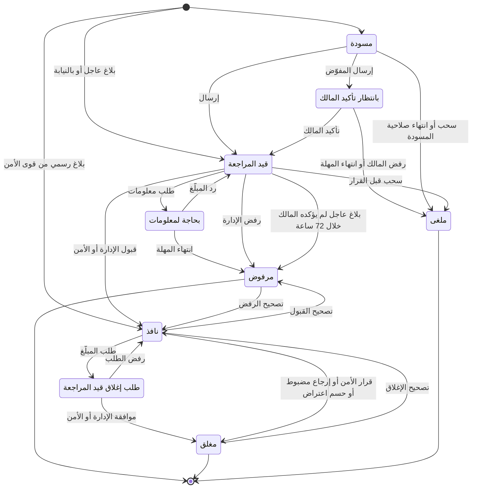

| من | إلى | المحفّز | الفاعل | الشرط | الآثار والأحداث |
|---|---|---|---|---|---|
| — | `draft` | `POST /v1/reports` | المبلّغ أو المفوّض أو الدعم | `report.create` أو `report.initiate_as_delegate` | المسودة صالحة 30 يوماً ⚙️ |
| `draft` | `pending_review` | `submit` | المبلّغ | موثّق الهوية، والإقرار (REPORT-08)، والأدلة للجهاز غير المسجّل (REPORT-04)، ولا بلاغ مفتوح (§7.1) | رقم `BL-`، ومستوى الموثوقية (06 §4)، وإنشاء الجهاز إن لم يكن موجوداً، وتجميد التسجيل الذاتي لشخص آخر (REPORT-15)، وحماية لحظة السرقة إن كانت شريحة الحساب داخله (THEFT-01..05)، وعنصر عمل إداري · `report.submitted`، `report.theft_protection.activated` |
| `draft` | `awaiting_owner` | `submit` | المفوّض | تفويض نشط (OWN-08) | طلب تأكيد للمالك عبر واتساب، ومهلة 48 ساعة ⚙️ · `report.owner_confirmation.requested` |
| `awaiting_owner` | `pending_review` | `confirm` | المالك | المالك الحالي، ويوثّق هويته أثناء التأكيد إن لم تكن موثّقة (D-32)، والمسؤولية القانونية عليه | كآثار الإرسال · `report.owner_confirmed`، `report.submitted` |
| `awaiting_owner` | `cancelled` | `decline` أو انتهاء المهلة | المالك أو النظام | — | إشعار المفوّض · `report.cancelled` |
| — | `pending_review` | بلاغ عاجل | الجهة الموثوقة | جهة نشطة، والجهاز مسجّل باسم صاحب الحساب (TRUSTED-02) | الحماية فوراً: إنهاء الجلسات، ووقف الرسائل للرقم المسروق، وطلبات إيقاف الخط وتجميد المحافظ المختارة، ورقم الجهة بديلاً للإشعارات فقط، وطلب تأكيد المالك (TRUSTED-03) في `report_owner_confirmations` بنوع `trusted_contact`: من حسابه (ولو بجلسة «بلاغ السرقة فقط» §4.2.13) أو عبر الدعم بالهوية، خلال ⚙️ 72 ساعة · `report.submitted`، `report.theft_protection.activated` |
| — | `pending_review` | بلاغ بالنيابة | الدعم | التحقق من الهوية (ONBEHALF-02) | وسم «بالنيابة» واسم المنشئ، وحساب مرتبط يفعّله صاحبه متى شاء (ONBEHALF-05) · `report.submitted` |
| — | `pending_review` | بلاغ سرقة المحل (REPORT-18، D-94) | صاحب المحل | أجهزة من مخزون المحل المسجّل، ومحل `verified` | دفعة في `report_batches`، وبلاغ مستقل لكل جهاز (`source = shop`، و`batch_id`) بمستوى 🟢 وأولوية عاجلة في قوائم الإدارة والأمن، ومراجعة الدفعة بقرار واحد يطبّق `accept` على كل بلاغ فيها في معاملة مستقلة لكل جهاز · `report.batch.submitted`، `report.submitted` |
| — | `active` | بلاغ رسمي من البوابة أو الاستيراد | عنصر أمن ضمن النطاق، أو مشرف بالاستيراد | رقم الضبط (PP-04، POLICE-02) | كآثار القبول. والتعارض مع ملكية مسجّلة يُنشئ تعارضاً يُحال للأمن ولا يلغي البلاغ (POLICE-06) · `report.accepted` |
| `pending_review` | `needs_info` | `request-info` | مشرف | سبب | مهلة 14 يوماً ⚙️، وتذكير قبل انتهائها بـ 3 أيام ⚙️ · `report.info_requested` |
| `needs_info` | `pending_review` | رد المبلّغ (REPORT-10) | المبلّغ | — | · `report.info_provided` |
| `needs_info` | `rejected` | انتهاء المهلة | النظام | لم يرد | سبب «عدم الرد»، ويمكن تقديم بلاغ جديد · `report.rejected` |
| `pending_review` | `rejected` | `reject` | مشرف | سبب، وليس منشئه بالنيابة، ولا تعارض مصالح | فك تجميد التسجيل الذاتي المجمّد بسببه · `report.rejected` |
| `pending_review` | `rejected` | انتهاء ⚙️ 72 ساعة دون تأكيد المالك (TRUSTED-03) | النظام (مهمة `report.trusted_confirmation.expire`) | `source = trusted_contact`، وتأكيد المالك ما زال `pending` | سبب «لم يؤكد صاحب الجهاز» (RSN-REP-12)، ورفع ما يُرفع من الحمايات: إعادة الرسائل للرقم إن لم يكن عليه بلاغ آخر، وإبلاغ الخط والمحافظ (LINE-02، WALLET-03)، وفك تجميد التسجيل الذاتي. وإشعار المالك والجهة الموثوقة · `report.rejected` |
| `pending_review` | `active` | `accept` | مشرف، أو عنصر أمن ضمن النطاق (PP-08) | سبب، ومبرر مكتوب لمستوى ⛔، وتأكيد المالك في البلاغ العاجل، وليس منشئه بالنيابة | داخل المعاملة: الحالة العامة للجهاز، وإبطال ذاكرة الفحص، وإلغاء طلبات النقل المعلّقة والشهادات الفعّالة (06 §3). وبعدها: المراقبة لدى كل الشركات (TELCO-01)، والمشاركة مع GSMA (GSMA-04)، والإشعار · `report.accepted` |
| `draft`، `pending_review`، `needs_info` | `cancelled` | `cancel` | المبلّغ | قبل القرار | فك أي تجميد ترتّب عليه · `report.cancelled` |
| `active` | `closure_requested` | `request-closure` (REPORT-11) | المبلّغ | سبب، ولا تهدئة، وإعادة تحقق | يبقى نافذاً في الفحص · `report.closure.requested` |
| `closure_requested` | `active` | رفض الطلب | مشرف أو عنصر أمن ضمن النطاق | سبب | · `report.closure.rejected` |
| `closure_requested` | `closed` | قبول الطلب (ADMIN-03، PP-08) | مشرف أو عنصر أمن ضمن النطاق | سبب | الحالة العامة، وفك الحظر وحذف المراقبة (TELCO-07)، وحذف المشاركة مع GSMA، وإبلاغ الخط والمحافظ (LINE-02، WALLET-03)، وإنهاء جلسة التتبّع · `report.closed` |
| `active` | `closed` | إغلاق مباشر | عنصر أمن ضمن النطاق (PP-08)، أو إرجاع مضبوط (PP-10)، أو مشرف بعد حسم اعتراض (DISPUTE-02)، أو النظام عند دمج جهاز مكرر | سبب | كالسابق · `report.closed` |
| `active` | `rejected` | تنفيذ تصحيح القبول | النظام بعد موافقة ثانية (REVERSAL-04) | §8.12 | كآثار الإغلاق، والإشعار بصياغة محايدة · `report.decision_reversed` |
| `rejected` | `active` | تنفيذ تصحيح الرفض | النظام بعد موافقة ثانية | §8.12 | كآثار القبول · `report.decision_reversed`، `report.accepted` |
| `closed` | `active` | تنفيذ تصحيح الإغلاق | النظام بعد موافقة ثانية | §8.12 | إعادة المراقبة والمشاركة · `report.decision_reversed` |

متابعة بلاغ سرقة المحل لكل جهاز (REPORT-18) قيمة محسوبة لا حالة مخزّنة: «ما زال مفقوداً» (البلاغ نافذ دون تنبيهات)، و«ظهر» (تنبيه على الجهاز)، و«ضُبط» (صف في `seized_devices`)، و«أُعيد» (أُغلق البلاغ بالإرجاع).

### 8.2 الجهاز

**أ. حالة الجهاز على الشبكة** (`devices.network_status`)، وهي الصيغة المخزّنة لمخطط 14 §5.3: «تنبيه استخدام» ليس حالة مستقرة بل حدث، ووجود مؤقّت حظر (`block_due_at`) يغطي الفاصل القابل للضبط.

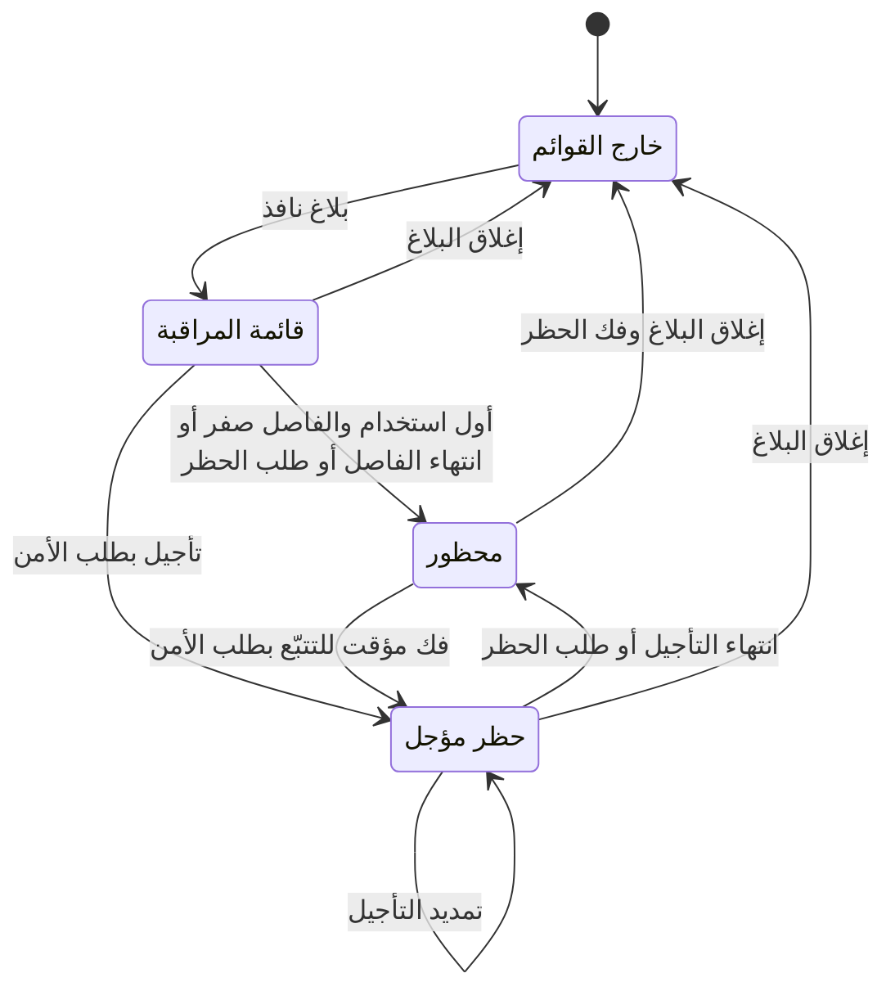

| من | إلى | المحفّز | الفاعل | الشرط | الآثار والأحداث |
|---|---|---|---|---|---|
| `none` | `watch` | `report.accepted` | النظام | بلاغ نافذ، وللجهاز IMEI نشط (لا ينطبق على `sim_less`) | طلب إضافة للمراقبة لكل شركة مفعّلة · `device.network_status.changed` |
| `watch` | `watch` | أول حدث استخدام والفاصل ⚙️ أكبر من صفر | النظام | — | `block_due_at` = وقت الحدث + الفاصل، ومؤقّت · `device.sim_inserted` |
| `watch` | `blocked` | أول حدث استخدام والفاصل صفر (الافتراضي)، أو حلول `block_due_at`، أو طلب الحظر | النظام، أو عنصر أمن، أو مشرف | بلاغ نافذ | طلب حظر لكل الشركات (TELCO-05) · `device.block.requested` |
| `watch` | `block_delayed` | تأجيل الحظر (TELCO-06) | مشرف بطلب موثّق من الأمن، أو عنصر أمن ضمن النطاق | سبب ومدة ومرجع | صف في `block_holds`، وإمكانية فتح جلسة تتبّع · `device.block.deferred` |
| `block_delayed` | `block_delayed` | تمديد | مثل التأجيل | سبب | تحديث `hold_until` |
| `block_delayed` | `blocked` | انتهاء التأجيل، أو طلب الحظر، أو انتهاء جلسة التتبّع | النظام أو الأمن أو المشرف | — | طلب حظر، وإنهاء الجلسة · `device.block.requested` |
| `blocked` | `block_delayed` | فك مؤقت للتتبّع (TELCO-06 «إيقافه مؤقتاً») | عنصر أمن أو مشرف بطلب الأمن | سبب ومدة | طلب فك الحظر مع بقاء المراقبة · `device.block.deferred` |
| أي حالة | `none` | `report.closed`، أو `report.cancelled`، أو تصحيح، أو دمج | النظام | لا بلاغ نافذ على الجهاز | طلبات حذف من المراقبة والحظر لكل الشركات · `device.network_status.changed` |

حالة كل شركة على حدة في `telecom_list_states` (المطلوب والمؤكَّد)، والطلبات الفردية في `telecom_list_entries` (§8.15). **والجهاز دون شريحة (`device_class = sim_less`) يبقى `none` دائماً** (D-91).

**ب. حيازة الجهاز** (`devices.custody_state`): إسقاط يُحدَّث في معاملة كل تغيير ملكية، ويطابق مخطط 14 §2 مع فصل البلاغ وحالة الشبكة كبُعدين مستقلين:

| حالة 14 §2 | التمثيل المخزّن |
|---|---|
| غير معروف للمنصة | لا صف في `devices`، أو `custody_state = unknown` لجهاز ظهر ببلاغ أو ضبط أو صيانة دون ملكية |
| في مخزون وكيل | `importer_stock` |
| في مخزون محل | `shop_stock` |
| مملوك لشخص | `owned` |
| تسجيل ذاتي قيد الانتظار | `self_reg_waiting` |
| مفكّك للقطع | `dismantled` |
| بلاغ قيد المراجعة | `devices.has_pending_report = true` مع حالة الحيازة كما هي |
| مبلّغ عنه ونافذ (مراقب) | `devices.public_status` = `reported_stolen` أو `reported_lost`، و`network_status = watch` |
| محظور على الشبكة | `network_status = blocked` |

و`devices.record_status` = `active` أو `merged` (§7.4).

### 8.3 طلب نقل الملكية (`ownership_transfers.status`)

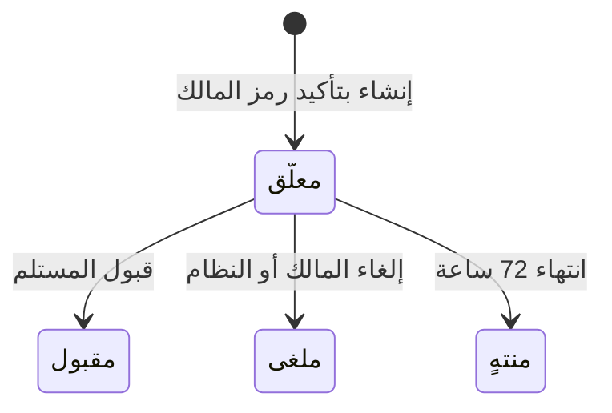

| من | إلى | المحفّز | الفاعل | الشرط | الآثار والأحداث |
|---|---|---|---|---|---|
| — | `pending` | `POST /v1/ownership-transfers` | المالك | `ownership.transfer.create` ورمز `transfer_confirm` | `expires_at` = +72 ساعة ⚙️، ورسالة واتساب للمستلم · `ownership.transfer.requested` |
| `pending` | `accepted` | `accept` | المستلم | مطابقة رقمه وبصمة رقمه الوطني، وإعادة فحص الشروط داخل المعاملة بقفل الجهاز | إنهاء الملكية القديمة وبدء الجديدة (`source = transfer`)، وإلغاء التفويضات والشهادات (OWN-07)، وإيصال `CR-` للطرفين · `ownership.transfer.accepted`، `ownership.owner.changed` |
| `pending` | `cancelled` | `cancel` | المالك | — | `cancel_reason = owner` · `ownership.transfer.cancelled` |
| `pending` | `cancelled` | بلاغ مُرسل أو مقبول، أو تغيّر المالك، أو بدء تهدئة المالك | النظام | — | `cancel_reason` = `report` أو `owner_changed` أو `cooldown` |
| `pending` | `expired` | انتهاء المهلة | النظام | — | إشعار الطرفين · `ownership.transfer.expired` |

### 8.4 حساب المستأجر: المحل والوكيل والمورّد (`shops.status`، `importers.status`، `suppliers.status`)

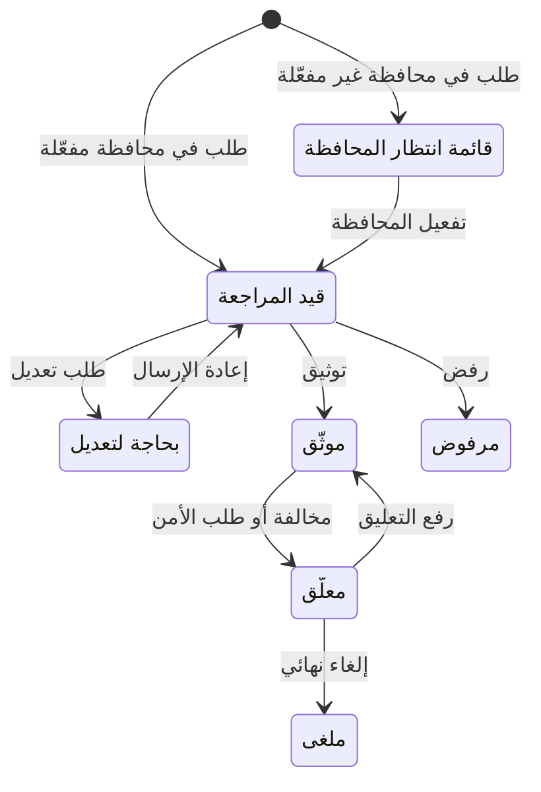

| من | إلى | المحفّز | الفاعل | الشرط | الآثار والأحداث |
|---|---|---|---|---|---|
| — | `pending_review` | طلب تسجيل محل في محافظة مفعّلة (SHOP-01، ROLLOUT-02)، أو طلب وكيل (IMPORTER-01) في أي وقت | موثّق الهوية | — | عنصر عمل لمشرف المحلات · `tenant.application.submitted` |
| — | `waitlisted` | طلب تسجيل **محل** | موثّق الهوية | المحافظة غير مفعّلة. وللمحلات فقط: الوكيل والمورّد لا قائمة انتظار لهما | إشعار بقائمة الانتظار · `tenant.application.waitlisted` |
| `waitlisted` | `pending_review` | `rollout.governorate.activated` | النظام | — | · `tenant.application.submitted` |
| `pending_review` | `needs_changes` | طلب تعديل | مشرف المحلات | سبب | · `tenant.application.changes_requested` |
| `needs_changes` | `pending_review` | إعادة الإرسال | صاحب الطلب | — | — |
| `pending_review` | `verified` | `approve` | مشرف المحلات | مقارنة الموقع بالعنوان والصور (ADMIN-06) | رقم `SH-` أو `IM-`، وعضوية الصاحب، وتفعيل المستأجر · `tenant.verified` |
| `pending_review` | `rejected` | `reject` | مشرف المحلات | سبب | · `tenant.rejected` |
| `verified` | `suspended` | `suspend` | مشرف المحلات أو المدير العام، أو تنفيذ طلب الأمن (PP-09) | سبب | منع كل معاملة جديدة، وإبقاء السجلات، وإبلاغ الصاحب بالسبب (06 §6) · `tenant.suspended` |
| `suspended` | `verified` | `reinstate` | مشرف المحلات | سبب | · `tenant.reinstated` |
| `suspended` | `revoked` | `revoke` | مشرف المحلات أو المدير العام | سبب | إنهاء العضويات · `tenant.revoked` |
| `verified` ↔ `suspended`، `pending_review` | الحالة المقابلة | تنفيذ تصحيح الاعتماد أو التعليق | النظام بعد موافقة ثانية | §8.12 | · `tenant.decision_reversed` |

- تعديل الاسم أو الموقع أو الترخيص (SHOP-04) طلب مستقل في `tenant_change_requests` (`pending` ← `approved` أو `rejected`)، والمحل يبقى `verified` ببياناته السابقة حتى الموافقة.
- المورّد (D-87) ينشئه المشرف التجاري بعد التعاقد، فيبدأ من `pending_review` دون قائمة انتظار، ويمر بالانتقالات نفسها: `needs_changes` و`rejected` و`verified` و`suspended` و`revoked`، والمراجع المشرف التجاري.
- مندوب الشحن (`couriers.status`) جهة ينشئها المشرف التجاري مباشرة `verified`، ثم `suspended` ← `verified`، أو `revoked`.

### 8.5 حساب المستخدم وتوثيق الهوية

**أ. حالة الحساب** (`users.status`)، ومستواه (`users.identity_status` و`users.auto_linked_at`). المخطط يطابق 14 §5.1 مع حالتي إغلاق الحساب (AUTH-10):

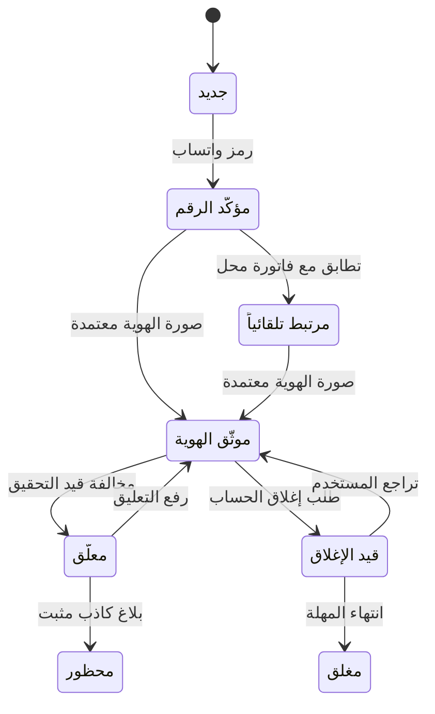

| من | إلى | المحفّز | الفاعل | الشرط | الآثار والأحداث |
|---|---|---|---|---|---|
| — | `status = pending_phone` | إنشاء الحساب | الزائر | §4.2.1 | رمز تحقق |
| `pending_phone` | `status = active` | تأكيد الرمز | المستخدم | رمز صحيح | `identity_status = none` · `account.user.registered`، `account.phone.verified` |
| `active` | `auto_linked_at` مضبوط | تطابق الرقم الوطني والموبايل مع مشترٍ (AUTH-06) | النظام | تأكيد الرقم وإدخال الرقم الوطني في الملف | ربط الشخص والأجهزة والفواتير · `ownership.auto_link.completed` |
| `identity_status = none` أو `rejected` | `pending` | طلب توثيق (AUTH-05) | المستخدم | `identity.submit` | عنصر عمل · `account.identity.submitted` |
| `pending` | `verified` | `approve` | مشرف بلاغات | §5.7 نافذة المراجعة، وحالة البطاقة سارية عند تفعيل الربط | ربط `person_id` · `account.identity.verified` |
| `pending` | `rejected` | `reject` | مشرف بلاغات | سبب | زيادة عدد الرفضات، وعند 3 ⚙️ يُفتح طلب دعم آلياً · `account.identity.rejected` |
| `verified` أو `rejected` | المقابلة | تصحيح | النظام بعد موافقة ثانية | §8.12 | · `account.identity.decision_reversed` |
| `active` | `suspended` | تعليق | المدير العام، أو مشرف البلاغات لبلاغ كيدي | سبب | إنهاء كل الجلسات · `account.user.suspended` |
| `suspended` | `active` | رفع التعليق أو تصحيح | المدير العام | سبب | · `account.user.reinstated` |
| `suspended` | `banned` | حظر | المدير العام | بلاغ كاذب مثبت (06 §13) | · `account.user.banned` |
| `active` | `closing` | طلب الإغلاق (PRIV-02) | المستخدم | إعادة تحقق، ولا بلاغ قدّمه نافذ أو قيد المراجعة، ولا اعتراض أو نقل معلّق، ولا محل أو وكيل نشط يملكه، ولا حجز قانوني | مهلة تراجع 7 أيام ⚙️ · `account.user.closure_requested` |
| `closing` | `active` | تراجع | المستخدم | — | — |
| `closing` | `closed` | انتهاء المهلة | النظام | لا التزامات مفتوحة (بلاغ نافذ يبقى بلاغاً قائماً على الجهاز) | تقليل البيانات الشخصية وفق [الخصوصية وتقييم الأثر](21-privacy-dpia.md)، والإبقاء على ما يُلزم القانون به · `account.user.closed` |

**ب. طلب توثيق الهوية** (`identity_verifications.status`): `pending` ← `approved` أو `rejected` أو `cancelled`، و`approved` أو `rejected` ← `reversed` بالتصحيح. و`users.identity_status` يعكس آخر طلب.

### 8.6 التسجيل الذاتي (`self_registrations.status`)

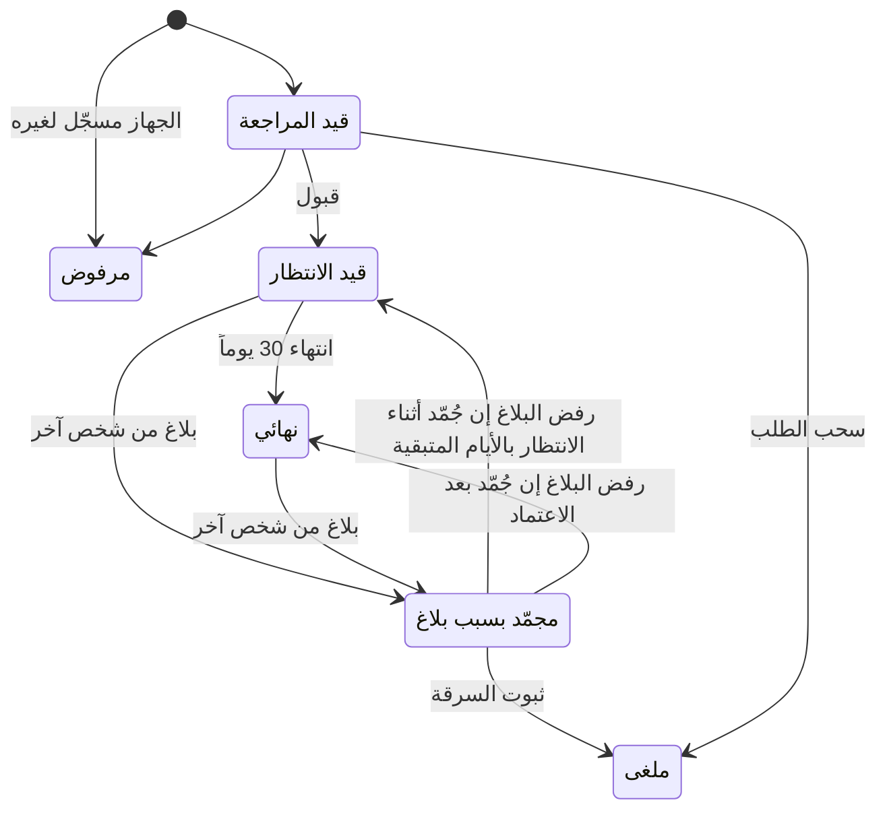

| من | إلى | المحفّز | الفاعل | الشرط | الآثار والأحداث |
|---|---|---|---|---|---|
| — | `pending_review` | إرسال (OWN-03) | موثّق الهوية | الإقرار، والصورة الحيّة، ولا تهدئة. وتجاوز الحد السنوي ⚙️ يُعلَّم «مشبوه» ولا يمنع (OWN-15) | استعلام سجل الشريحة إن توفر (OWN-16) · `ownership.self_registration.submitted` |
| — | `rejected` | إرسال لجهاز مسجّل لشخص آخر | النظام | (OWN-13) | `registration_attempts`، وإشعار المالك دون كشف هوية المحاول، وتنبيه للإدارة · `ownership.registration_attempt.blocked` |
| `pending_review` | `rejected` | `reject` | مشرف بلاغات | سبب | · `ownership.self_registration.rejected` |
| `pending_review` | `waiting` | `approve` | مشرف بلاغات | سبب | إنشاء الجهاز أو ربطه (`registration_origin = self`)، وملكية بمصدر `self_registration`، و`custody_state = self_reg_waiting`، و`waiting_until` = +30 يوماً ⚙️ · `ownership.self_registration.approved` |
| `waiting` | `final` | انتهاء المدة | النظام | لا تجميد | `custody_state = owned` · `ownership.self_registration.finalized` |
| `waiting` أو `final` | `frozen` | إرسال بلاغ من شخص آخر (REPORT-15) | النظام | — | مستوى ⛔ للبلاغ، ومنع النقل والشهادة والبيع · `ownership.self_registration.frozen` |
| `frozen` | `cancelled` | قبول البلاغ المتعارض مع حسم التعارض لصالح المبلّغ | النظام عند قرار المشرف | — | إنهاء الملكية الذاتية، وإحالة بيانات المسجِّل لقوى الأمن (06 §5.1) · `ownership.self_registration.cancelled` |
| `frozen` | `waiting` أو `final` | رفض البلاغ المتعارض أو سحبه | النظام | يعود إلى `waiting` إن جُمّد أثناء الانتظار، و`waiting_until` = الآن + الأيام المتبقية لحظة التجميد. ويعود إلى `final` إن جُمّد بعد أن صار نهائياً (14 §5.4) | · `ownership.self_registration.unfrozen` |
| `pending_review` | `cancelled` | سحب | صاحب الطلب | — | — |
| `waiting` أو `final` | `pending_review` أو `rejected` | تصحيح الاعتماد | النظام بعد موافقة ثانية | §8.12 | — |

### 8.7 معاملة المحل (`shop_transactions.status`)

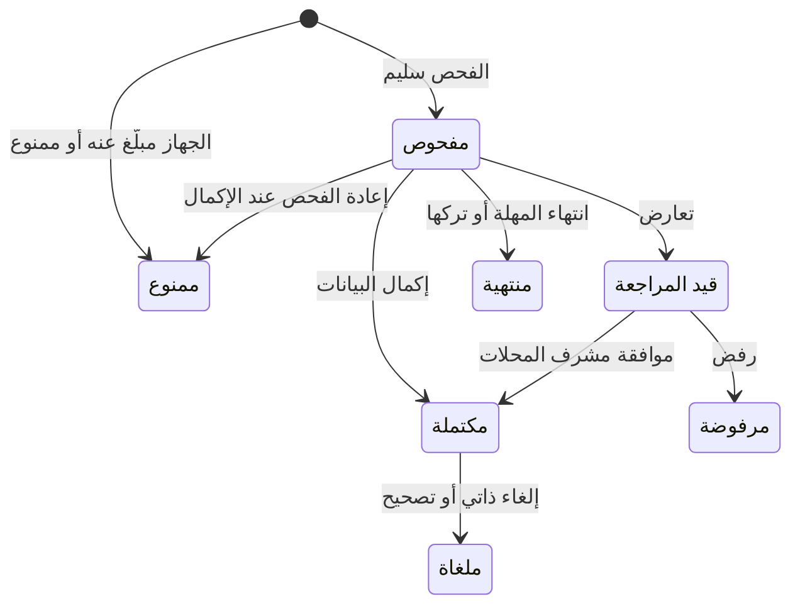

| من | إلى | المحفّز | الفاعل | الشرط | الآثار والأحداث |
|---|---|---|---|---|---|
| — | `checked` | مسح IMEI وفحص آلي (SHOP-06 الخطوات 1-2، SHOP-07، SHOP-08) | عضو بصلاحية الشراء أو البيع | المحل `verified`، والموقع مُرسل (D-41)، ولا بلاغ نافذ، وفي الشراء: غير مدرج في GSMA (GSMA-03) ولا في انتظار تسجيل ذاتي (SHOP-18) | تسجيل الفحص وموقع العملية، وفتح نافذة الأحوال المدنية، و`expires_at` = +30 دقيقة ⚙️ |
| — | `blocked` | الفحص يجد بلاغاً نافذاً، أو إدراجاً في GSMA للشراء، أو انتظار تسجيل ذاتي | النظام | — | رسالة «لا تشترِ هذا الجهاز» دون تفاصيل، وتنبيه أمني عاجل للبلاغ النافذ (ADMIN-08) وعادي لـ GSMA، وإشعار صاحب البلاغ (NOTIF-04) · `shop.transaction.blocked` |
| `checked` | `completed` | `complete` | العضو نفسه | البيانات الإلزامية (اسم الطرف ورقمه الوطني وموبايله، وصورة هوية البائع في الشراء D-31)، وبطاقة سارية عند تفعيل الربط (CIVIL-05)، وإعادة الفحص داخل المعاملة بقفل الجهاز | رقم `TX-`، والملكية (شراء: إلى المحل `shop_purchase`. بيع: إلى المشتري `shop_sale`)، والفاتورة للبيع (SHOP-10)، وعلَم البعد (SHOP-14) وتحذير التقليد (FAKE-03) · `shop.transaction.completed` |
| `checked` | `under_review` | `complete` مع تعارض | النظام | `hold_reason`: بيع جهاز مسجّل لشخص آخر لم يمرّ بمخزون المحل (`sold_to_other_registered`، SHOP-08)، أو شراء من غير المالك المسجّل (`purchase_from_non_owner`، D-96)، أو جهاز عليه بلاغ قيد المراجعة (`pending_report`، 06 §6)، أو عدم تطابق الرقمين (`dual_imei_mismatch`، FAKE-02). وفي كل الحالات تظهر للمحل رسالة محايدة لا تكشف السبب ولا هوية المالك | عنصر عمل لمشرف المحلات بساعات الدوام (D-98) · `shop.transaction.held` |
| `checked` | `blocked` | إعادة الفحص عند الإكمال تجد بلاغاً صار نافذاً | النظام | — | كالمنع |
| `checked` | `expired` | انتهاء المهلة أو تركها | النظام أو العضو | — | استعلام أحوال مدنية دون معاملة مكتملة يُعلَّم (CIVIL-08) · `shop.transaction.expired` |
| `under_review` | `completed` | `approve` | مشرف المحلات | سبب | كآثار الإكمال |
| `under_review` | `rejected` | `reject` | مشرف المحلات | سبب | · `shop.transaction.rejected` |
| `completed` | `cancelled` | إلغاء ذاتي خلال 30 دقيقة ⚙️ (SHOP-15) | المنفّذ أو الصاحب | سبب، والجهاز ما زال في الوضع الذي تركته المعاملة | إعادة الملكية السابقة بمصدر `correction`، وإلغاء الفاتورة · `shop.transaction.cancelled` |
| `completed` | `cancelled` | موافقة على طلب إلغاء بعد المهلة | مشرف المحلات | طلب في `shop_tx_corrections` | كالسابق |

**الشراء من غير المالك المسجّل (D-96):** للمحل طريقان: يُكمل فتُعلَّق المعاملة كما سبق، أو يطلب من المالك المسجّل أن ينقل الملكية للمحل أولاً من حسابه (OWN-04 إلى حساب المحل)، ثم يكمل المحل معاملة شراء عادية من المالك نفسه. والرسالة المحايدة تذكر الطريق الثاني دون اسم المالك.

**الطرف القاصر (D-97):** إذا تبيّن للموظف من بطاقة الحاضر أن عمره دون 18 سنة، تُسجَّل المعاملة (شراءً أو بيعاً، وكذلك أمر الصيانة) باسم **وليّ الأمر الحاضر** وهويته بالقواعد نفسها لأي طرف (D-31، CIVIL-03، CIVIL-04)، فتذهب الملكية في البيع لوليّ الأمر. ويضيف الموظف القاصر **مستخدماً مفوّضاً** على الجهاز داخل المعاملة نفسها (`authorized_users` بـ `is_minor = true` و`source = 'shop_transaction'`) بعد إقرار وليّ الأمر (CN-GUARDIAN)، ولا يُجمع عن القاصر إلا اسمه وصلة القرابة ورقم موبايله ([الخصوصية](21-privacy-dpia.md) §10.2). ولا يُخزَّن تاريخ الميلاد. والحساب المستقل من عمر 18 سنة.

طلب التصحيح (`shop_tx_corrections.status`): `pending` ← `approved` أو `rejected`. والتصحيح غير الإلغائي (بيانات الطرف أو السعر) يُطبَّق بنسخة مصحّحة من الفاتورة ويبقى الأصل محفوظاً.

### 8.8 طلب الدعم (`support_tickets.status`)

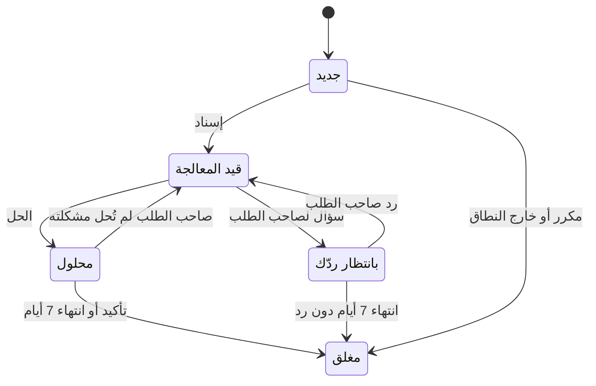

| من | إلى | المحفّز | الفاعل | الشرط | الآثار والأحداث |
|---|---|---|---|---|---|
| — | `new` | إنشاء من الحساب أو بوت واتساب الدعم (SUPPORT-01، SUPPORT-03) | صاحب الطلب | — | رقم `ST-`، ومهلة مستهدفة حسب التصنيف ⚙️ · `support.ticket.created` |
| `new` | `in_progress` | إسناد أو أول رد | الدعم | — | — |
| `in_progress` | `awaiting_user` | رد يطلب معلومة | الدعم | — | `autoclose_at` = +7 أيام ⚙️ · `support.ticket.replied` |
| `awaiting_user` | `in_progress` | رد صاحب الطلب | صاحب الطلب | — | — |
| `in_progress` | `resolved` | الحل | الدعم | — | طلب تأكيد وتقييم 1-5، و`autoclose_at` = +7 أيام ⚙️ |
| `resolved` | `in_progress` | «لم تُحل» | صاحب الطلب | قبل الإغلاق | — |
| `resolved` | `closed` | تأكيد أو انتهاء المهلة | صاحب الطلب أو النظام | — | · `support.ticket.closed` |
| `awaiting_user` | `closed` | انتهاء المهلة | النظام | — | سبب `auto_no_reply` (SUPPORT-06) |
| `new` أو `in_progress` | `closed` | إغلاق إداري | الدعم | سبب (مكرر، أو إساءة) | — |

التحويل لمشرف مختص (SUPPORT-07) يغيّر `routed_queue` دون تغيير الحالة، ويبقى الدعم مسؤولاً عن الرد.

### 8.9 جلسة التتبّع (`tracking_sessions.status`)

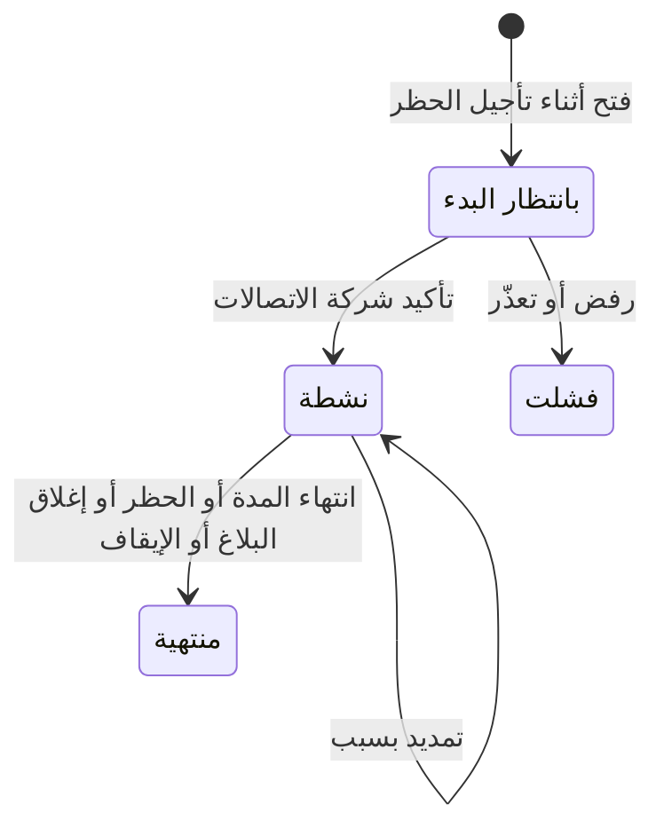

| من | إلى | المحفّز | الفاعل | الشرط | الآثار والأحداث |
|---|---|---|---|---|---|
| — | `pending_start` | فتح (TRACK-05) | مشرف بطلب الأمن، أو عنصر أمن ضمن النطاق | `network_status = block_delayed`، وبلاغ نافذ، ومرجع الطلب أو رقم القضية، وسبب | `ends_at` = +72 ساعة ⚙️، وطلب بدء التحديثات من الشركات (TELCO-13) · `tracking.session.requested` |
| `pending_start` | `active` | تأكيد البدء | النظام | — | · `tracking.session.started` |
| `pending_start` | `failed` | رفض الشركة أو تعذّر بعد المحاولات | النظام | — | تنبيه للفاتح |
| `active` | `active` | تمديد | من يملك الفتح | سبب | `tracking_session_extensions` · `tracking.session.extended` |
| `active` | `ended` | انتهاء المدة، أو حظر الجهاز، أو إغلاق البلاغ، أو إيقاف يدوي | النظام أو الفاتح | — | طلب إيقاف التحديثات، و`end_reason`، وعند انتهاء المدة يُطلب الحظر تلقائياً (الرحلة 15) · `tracking.session.ended` |

### 8.10 الاعتراض (`disputes.status`)

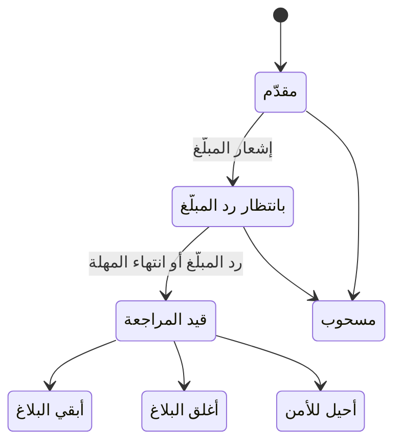

| من | إلى | المحفّز | الفاعل | الشرط | الآثار والأحداث |
|---|---|---|---|---|---|
| — | `submitted` | `POST /v1/disputes` | موثّق الهوية | بلاغ نافذ، ولا اعتراض مفتوح منه على البلاغ نفسه | لا يوقف البلاغ (DISPUTE-02) · `report.dispute.submitted` |
| `submitted` | `awaiting_response` | النظام فوراً | النظام | — | إشعار المبلّغ دون هوية المعترض، ومهلة 7 أيام ⚙️ (DISPUTE-03). والبلاغ الرسمي يُحال للأمن مباشرة (`referred`) |
| `awaiting_response` | `under_review` | رد المبلّغ بأدلته أو انتهاء المهلة | المبلّغ أو النظام | — | عدم الرد يُعلَّم ويُؤخذ بالاعتبار · `report.dispute.responded` |
| `under_review` | `upheld` | قرار | مشرف بلاغات | سبب | · `report.dispute.decided` |
| `under_review` | `report_closed` | قرار | مشرف بلاغات | سبب | البلاغ إلى `closed` بسبب `dispute_decision`، وإمكانية تعليق المبلّغ الكاذب (06 §13) |
| `under_review` | `referred` | قرار | مشرف بلاغات | سبب | إحالة في `police_referrals` |
| `submitted` أو `awaiting_response` | `withdrawn` | سحب | المعترض | — | — |
| `upheld` ↔ `report_closed` | المقابلة | تصحيح الحسم | النظام بعد موافقة ثانية | §8.12 | — |

### 8.11 المدفوعات والطلبات والاشتراكات والمتجر

**الدفع اليدوي هو الأصل (D-86):** لا دفع عبر آبل وجوجل إطلاقاً. والربط الآلي مع محفظة اختياري لكل مزوّد يتيحه (§11). والتفعيل إجراء إداري بعد تأكيد الدفعة (PAY-07).

**أ. طلب الخدمة الرقمية** (`service_orders.status`): باقة المشتركين وأي باقة يضيفها المدير العام (D-93)، وتقرير تاريخ الجهاز لغير المالك، والإعلانات، والربط البرمجي.

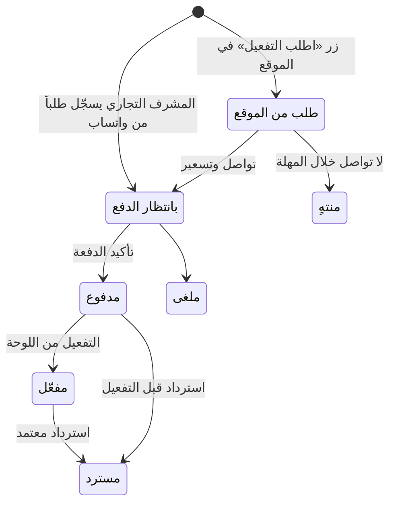

| من | إلى | المحفّز | الفاعل | الشرط | الآثار والأحداث |
|---|---|---|---|---|---|
| — | `requested` | `POST /v1/activation-requests` | المستخدم من الموقع فقط | `service.request` (PAY-08) | رقم `SV-`، ورابط واتساب الإدارة التجاري برسالة جاهزة فيها رقم الحساب والخدمة ورقم الطلب (PAY-01) · `billing.service_order.requested` |
| — | `awaiting_payment` | إنشاء من اللوحة | المشرف التجاري | الحساب أو المحل موجود | — |
| `requested` | `awaiting_payment` | تحديد الخدمة والمدة والمبلغ | المشرف التجاري | — | — |
| `requested` | `expired` | انتهاء 7 أيام ⚙️ دون تواصل | النظام | — | — |
| `awaiting_payment` | `paid` | تأكيد دفعة مرتبطة | المشرف التجاري | دفعة `confirmed` | · `billing.service_order.paid` |
| `paid` | `activated` | `activate` (PAY-07) | المشرف التجاري | — | صف في `service_activations` بالرقم المرجعي للدفعة، وتحديث `shop_subscriptions` أو `api_subscriptions` أو الحملة أو التقرير، وإشعار التفعيل لصاحبه، والفاتورة التجارية (PAY-02) · `billing.service.activated` |
| `awaiting_payment` | `activated` | تفعيل دون دفعة | المدير العام فقط | سبب | يُعلَّم في المطابقة اليومية |
| `paid` أو `activated` | `refunded` | تنفيذ استرداد معتمد | النظام بعد موافقة المدير العام | §8.11 هـ | إلغاء التفعيل أو تقصيره · `billing.refund.completed` |
| `awaiting_payment` | `cancelled` | إلغاء | المشرف التجاري | سبب | — |

**ب. الدفعة** (`payments.status`)

| من | إلى | المحفّز | الفاعل | الشرط |
|---|---|---|---|---|
| — | `pending_confirmation` | تسجيل رقم مرجعي لتحويل محفظة أو بنك | المشرف التجاري، أو صاحب الطلب من الموقع | الرقم المرجعي غير مستخدم سابقاً (§7.1) |
| `pending_confirmation` | `confirmed` | `confirm` | المشرف التجاري | المطابقة مع سجل الحساب المستلم لا مع صورة يرسلها الزبون |
| `pending_confirmation` | `rejected` | `reject` | المشرف التجاري | سبب |
| — | `initiated` ← `confirmed` أو `failed` أو `expired` | طلب دفع آلي ونتيجته | النظام عبر محوّل المحفظة إن وُجد | توقيع ردّ المزوّد |
| — | `pending_collection` ← `collected` ← `confirmed` | الدفع عند الاستلام لطلب متجر | مندوب الشحن ثم المشرف التجاري بتسوية نقد الشحن | رمز التسليم (§8.11 د) |
| `collected` | `disputed` | فرق في تسوية نقد الشحن | النظام | يُعلَّم ويُحقق فيه |
| — | `initiated` ← `confirmed` أو `failed` | الدفع من محفظة المحل (SHOPWALLET-04) | عضو بـ `shop.wallet.pay` | نجاح عملية المحفظة `store_payment` أو `service_payment` يؤكد الدفعة آلياً دون تأكيد يدوي، ويبقى التفعيل إدارياً (PAY-07) |
| `confirmed` | `refunded` أو `partially_refunded` | استرداد مكتمل | النظام | — |

**ج. اشتراك الباقة** (`shop_subscriptions.status` للمحلات، و`api_subscriptions.status` للربط البرمجي): لا تجديد آلي، فالتجديد تفعيل جديد يمدّد المدة. والاستحقاق المترتب عليه في §5.10.

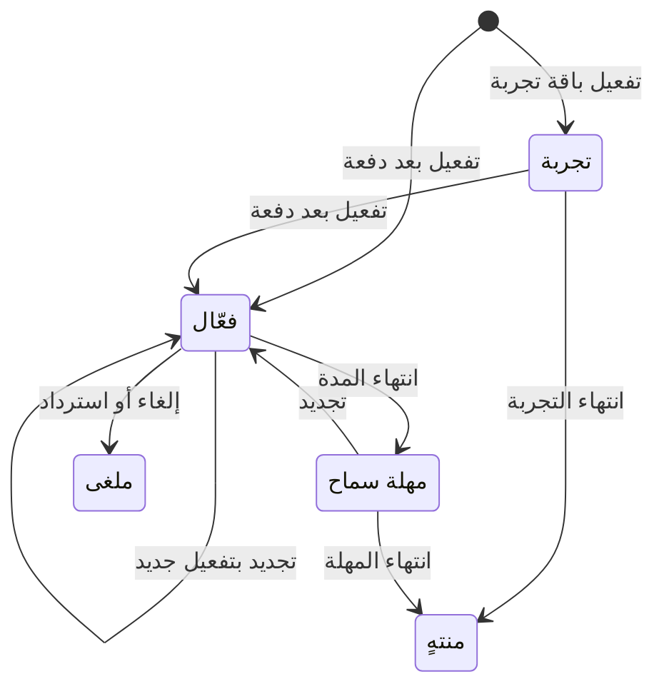

| من | إلى | المحفّز | الفاعل | الآثار |
|---|---|---|---|---|
| — | `trial` أو `active` | `billing.service.activated` | النظام | الميزات تظهر فوراً في كل الواجهات، وفي التطبيقين بحالتها فقط (PAY-08) |
| `active` | `active` | تفعيل جديد للمستأجر نفسه | النظام | `ends_at` يُمدَّد من نهاية المدة الحالية |
| `active` | `grace` | `ends_at` | النظام | مهلة سماح ⚙️ (06 §15) وتذكير، والتذكير قبل الانتهاء بـ 7 أيام ⚙️ (PAY-03) |
| `grace` | `expired` | انتهاء المهلة | النظام | إيقاف الميزات المدفوعة (التعبئة والدفع من المحفظة والمحاسبة للكتابة) دون حذف بيانات المحل، والمحاسبة للقراءة والتصدير ⚙️ 12 شهراً (SHOPPRO-15)، **والسحب من المحفظة متاح دائماً** (SHOPWALLET-01) |
| `active` | `cancelled` | استرداد أو إلغاء (PAY-04) | النظام بعد القرار | — |

**د. طلب المتجر والشحنة (D-87، STORE-05، STORE-09)**

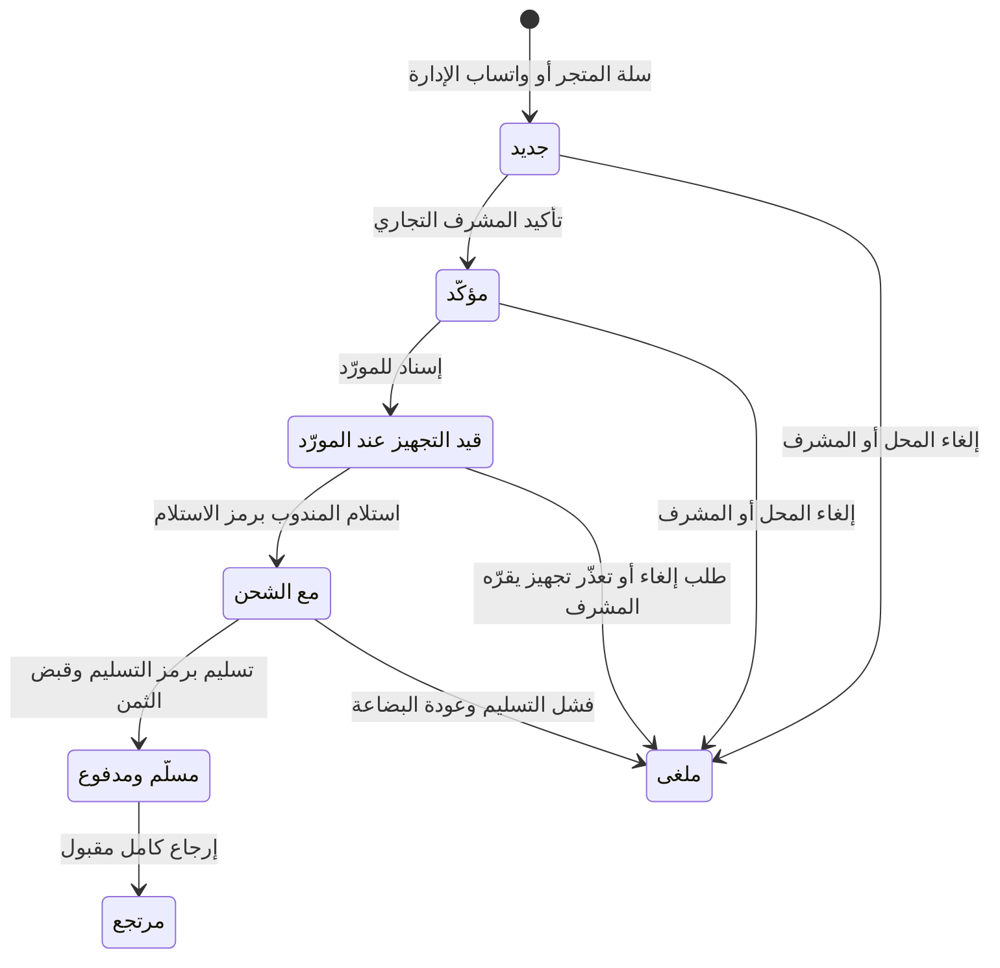

| من | إلى | المحفّز | الفاعل | الشرط | الآثار والأحداث |
|---|---|---|---|---|---|
| — | `new` | سلة المتجر (الموقع أو التطبيق) أو تسجيل من واتساب الإدارة (STORE-04) | عضو بـ `shop.store.order`، أو المشرف التجاري | المستأجر موثّق، والمنتجات منشورة. والسلة تُقسم آلياً إلى طلب لكل مورّد | رقم `OR-` · `store.order.placed` |
| `new` | `confirmed` | `confirm` | المشرف التجاري | التوفر. وللدفع المسبق: دفعة `confirmed` | الفاتورة التجارية باسم المنصة وفيها اسم المورّد (STORE-08)، وإنشاء الشحنة · `store.order.confirmed` |
| `confirmed` | `preparing` | إسناد | النظام | — | يظهر للمورّد في لوحته (STORE-12) · `store.order.assigned` |
| `preparing` | `shipped` | استلام المندوب | مندوب الشحن | رمز الاستلام لمرة واحدة من المورّد (`shipment_codes` بنوع `pickup` تحت RLS المورّد) | · `store.shipment.picked_up` |
| `shipped` | `delivered` | تسليم | مندوب الشحن | **رمز التسليم لمرة واحدة** (STORE-09): يُولَّد عند `shipped`، ويظهر في لوحة المحل فقط (لصاحبه ولمن يملك `shop.store.order`)، ويُخزَّن في `shipment_codes` تحت RLS المحل المشتري وحده (مشفّراً للعرض، وببصمته للتحقق، ولا يقرؤه المندوب)، ويُستهلك بأول استخدام صحيح، ويُقفل بعد 5 محاولات خاطئة ⚙️ فيتصل المندوب بالدعم. وقبض المبلغ للدفع عند الاستلام | `courier_collections` للدفع عند الاستلام، وبدء مهلة الإرجاع 7 أيام ⚙️. وأسطر الأجهزة (STORE-13) تنقل أجهزتها بأرقامها من مخزون الوكيل إلى مخزون المحل في المعاملة نفسها كنقل بالجملة مقبول (`ownerships.source = wholesale_transfer`) · `store.order.delivered` |
| `new` أو `confirmed` | `cancelled` | إلغاء | المحل نفسه **قبل «قيد التجهيز»**، أو المشرف التجاري | سبب | استرداد الدفع المسبق إن وُجد · `store.order.cancelled` |
| `preparing` | `cancelled` | طلب إلغاء من المحل يقرّه المشرف التجاري، أو تعذّر التجهيز من المورّد يقرّه المشرف التجاري | المشرف التجاري | سبب، و`store_orders.cancel_requested_at` للطلب من المحل | كالسابق، وإشعار المورّد بوقف التجهيز · `store.order.cancelled` |
| `shipped` | `cancelled` | فشل التسليم | مندوب الشحن ثم المشرف التجاري | سبب | الشحنة إلى `returned_to_supplier` |
| `delivered` | `returned` | إرجاع كامل مقبول | النظام عند قرار الإرجاع | §هـ | — |

حالات الشحنة (`shipments.status`): `created` ← `ready_for_pickup` (المورّد جهّز) ← `picked_up` ← `delivered` أو `delivery_failed` ← `returned_to_supplier`.

**هـ. الإرجاع والاسترداد وتسوية المورّد (STORE-10، STORE-11)**

| الكيان | الحالات والانتقالات |
|---|---|
| الإرجاع (`returns.status`) | `requested` (المحل خلال 7 أيام ⚙️ من التسليم مع الصور) ← `approved` أو `rejected` (المشرف التجاري، مع تحديد إن كان العيب من البضاعة) ← `received` (عادت البضاعة عبر الشحن) ← `refunded` (استرداد للمحل). والعيب المنسوب للمورّد يصبح خصماً في كشفه التالي |
| الاسترداد (`refunds.status`) | `requested` (المشرف التجاري) ← `approved` (المدير العام فقط) أو `rejected` ← `paid` (برقم التحويل المرجعي) |
| كشف التسوية (`supplier_settlements.status`) | `draft` (تولّده مهمة دورية ⚙️ أسبوعياً من أسطر الطلبات المسلّمة المدفوعة **التي انتهت مهلة إرجاعها فقط** (`order_items.settlement_eligible_at <= now()`)، ناقص حصة المنصة ⚙️، ناقص المرتجعات والعيوب. وإن كان الصافي سالباً لا يُحوَّل شيء، ويُرحَّل الرصيد السالب سطراً افتتاحياً `carried_forward` في الكشف التالي (`opening_balance_minor`)) ← `prepared` (المشرف التجاري يراجع، وأي تعديل يدوي مرتبط بسجل إرجاع أو عيب) ← `approved` (المدير العام، فصل المهام) أو العودة إلى `draft` بسبب ← `paid` (تحويل إلى حساب الاستلام المعتمد للمورّد برقم مرجعي، والصافي موجب)، أو `carried_forward` بعد الاعتماد إن كان الصافي صفراً أو سالباً (لا تحويل، والرصيد في الكشف التالي). و`cancelled` لكشف بلا أسطر. ويرى المورّد الكشف من `approved` |

**و. عملية المحفظة** (`wallet_operations.status`، D-89): المال محفوظ لدى شام كاش، و`wallet_operations` **سجل مرآة** للعرض والمطابقة فقط، والرصيد المعروض هو الرصيد الذي تؤكده شام كاش.

```mermaid
stateDiagram-v2
    state "معلّقة" as Pending
    state "ناجحة" as Succeeded
    state "فاشلة" as Failed
    state "مستردّة" as Refunded
    [*] --> Pending: طلب لدى شام كاش
    Pending --> Succeeded: تأكيد شام كاش
    Pending --> Failed: رفض أو انتهاء المهلة دون تنفيذ
    Succeeded --> Refunded: عملية عكسية ناجحة
```

| من | إلى | المحفّز | الفاعل | الشرط | الآثار والأحداث |
|---|---|---|---|---|---|
| — | `pending` | شحن وارد (`fund_in`)، أو سحب (`withdraw`)، أو خصم لتعبئة (`topup_debit`)، أو دفع طلب أو خدمة (`store_payment`، `service_payment`) | شام كاش (للوارد)، أو صاحب المحل، أو عضو بصلاحيته | للخصم: محفظة `active` غير مجمّدة، واستحقاق الباقة عدا السحب (§5.10)، ورمز المحفظة حيث يلزم، والحدود ⚙️. وللسحب: صاحب المحل فقط، ووجهة باسمه، ورمز المحفظة ورمز تحقق، وألا يكون الحساب في تهدئة، وحالة المحفظة تسمح بالسحب (جدول ح أدناه)، ولا إيقاف سحب نافذ عليها (D-100) | قفل المحفظة، وطلب للمحوّل بمرجع عدم تكرار |
| `pending` | `succeeded` | تأكيد شام كاش (رد أو نقطة استقبال) | النظام | — | تحديث الرصيد المعكوس، وإشعار صاحب المحل بكل سحب وبكل عملية فوق حد التنبيه ⚙️ · `wallet.operation.succeeded` |
| `pending` | `failed` | رفض شام كاش، أو انتهاء مهلة الحسم دون أثر لدى المزوّد | النظام أو المطابقة | — | · `wallet.operation.failed` |
| `succeeded` | `refunded` | نجاح عملية عكسية مرتبطة (`topup_refund`، `payment_refund`) | النظام | — | · `wallet.operation.refunded` |

**ز. طلب التعبئة** (`topup_orders.status`، D-89، TOPUP-02)

```mermaid
stateDiagram-v2
    state "معلّقة" as Pending
    state "ناجحة" as Succeeded
    state "فاشلة" as Failed
    state "مستردّة" as Refunded
    [*] --> Pending: خصم المحفظة وإرسال الطلب للشركة
    [*] --> Failed: فشل الخصم
    Pending --> Succeeded: تأكيد الشركة أو المطابقة
    Pending --> Failed: رفض الشركة أو المطابقة
    Failed --> Refunded: استرداد المبلغ للمحفظة
```

| من | إلى | المحفّز | الفاعل | الشرط | الآثار والأحداث |
|---|---|---|---|---|---|
| — | `pending` | `POST /v1/shops/{id}/topups` | عضو بـ `shop.wallet.topup` | تمييز الشبكة من البادئة (`operator_prefixes`)، وعرض الرقم بخط كبير وتأكيده (TOPUP-01)، وحد الرقم في الساعة ⚙️ وحد الموظف اليومي ⚙️ (TOPUP-05)، واستحقاق الباقة، ونجاح خصم المحفظة بالمبلغ ناقص عمولة المحل ⚙️ | طلب التعبئة للشركة بمعرّف الطلب مرجعاً · `topup.order.submitted` |
| — | `failed` | فشل خصم المحفظة | النظام | — | لا شيء يُسترد |
| `pending` | `succeeded` | تأكيد الشركة لحظياً، أو برد متأخر، أو بالمطابقة | النظام | — | إيصال التعبئة (TOPUP-03)، وقيد آلي في المحاسبة إن كان المحل مشتركاً · `topup.order.succeeded` |
| `pending` | `failed` | رفض الشركة، أو المطابقة تثبت عدم التنفيذ | النظام | — | عملية استرداد للمحفظة فوراً · `topup.order.failed` |
| `failed` | `refunded` | نجاح عملية الاسترداد | النظام | خصم سابق ناجح | إشعار المنفّذ وصاحب المحل · `topup.order.refunded` |
| `pending` | — | مضي ⚙️ 24 ساعة دون حسم | النظام | — | تُحسم بالمطابقة إلزامياً (TOPUP-02)، وإن تعذّر تُحال للمشرف التجاري كفرق مطابقة |

**ح. محفظة المحل** (`shop_wallets.status`): `pending_activation` (طلب فتح الحساب لدى شام كاش) ← `active`، ومن `active`: `frozen` (تجميد من صاحب المحل أو الإدارة، SHOPWALLET-07) ← `active`، و`held` (فرق مطابقة، SHOPWALLET-06) ← `active`، و`suspended` (مع تعليق المحل، SHOPWALLET-08) ← `active` أو `closed`، و`external_frozen` (تجميد من شام كاش أو بأمر جهة مختصة، يُعرض للمحل كذلك) ← `active` عند رفعه من الجهة. و`closed` بعد سحب الرصيد كله فقط.

| الحالة | السحب لصاحب المحل (SHOPWALLET-03) | الشحن الوارد | التعبئة والدفع |
|---|---|---|---|
| `active` | ✅ | ✅ | ✅ (مع الاستحقاق، §5.10) |
| `frozen` بيد الإدارة | ✅ | ✅ | ❌: تجميد الإدارة يوقف التعبئة والدفع فقط |
| `frozen` بيد صاحب المحل أو «لم أكن أنا» | ❌ حتى يرفعه صاحبه بإعادة مصادقة كاملة (أو بفك تجميد الحساب، §4.2.4) | ✅ | ❌ |
| `held` | ✅ حتى الرصيد الذي أكدته شام كاش | ✅ | ❌ للعمليات المعنية بالفرق |
| `suspended` | ✅ | ✅ | ❌ |
| `external_frozen` | ❌ من جهة شام كاش، و`SHOPWALLET_EXTERNAL_FREEZE` | حسب الجهة | ❌ |
| أي حالة أثناء **إيقاف السحب (D-100)** | ❌ `SHOPWALLET_WITHDRAWAL_STOPPED` حتى `until` | ✅ | حسب الحالة |

**إيقاف السحب (D-100) هو الاستثناء الوحيد الذي تفرضه المنصة** على «صاحب المحل يسحب رصيده دائماً»، فالسحب باقٍ بعد انتهاء الاشتراك وعند إطفاء وحدة المحفظة وعند تجميد الإدارة: عند اختراق مؤكد لحساب محل أو للربط مع شام كاش، يطلبه موظف إداري ويوافق عليه **موظف ثانٍ** (`wallet.withdrawal_stop.request` و`.approve`)، لمحل بعينه أو لكل المحافظ. مدته ⚙️ 24 ساعة تنتهي آلياً (`wallet.withdrawal_stop.expire`)، ويجدّدها المدير العام فقط بقرار مسجّل مع سببه، ويُبلَّغ صاحب المحل بالسبب فوراً (الحدث `shop_wallet.withdrawal.stopped`). ويُحفظ في مفتاح التشغيل `emergency.wallet_withdrawal_stop` بقواعد النطاق (§14.3) مع `expires_at` والطالب والموافق.

### 8.12 طلب تصحيح القرار (`reversal_requests.status`)

```mermaid
stateDiagram-v2
    state "مطلوب" as Requested
    state "موافَق عليه" as Approved
    state "مرفوض" as Rejected
    state "مسحوب" as Withdrawn
    state "منفّذ" as Executed
    state "فشل التنفيذ" as Failed
    [*] --> Requested
    Requested --> Approved: موافقة مشرف ثانٍ
    Requested --> Rejected
    Requested --> Withdrawn
    Approved --> Executed: تنفيذ الآثار
    Approved --> Failed: خطأ في التنفيذ
    Failed --> Executed: إعادة المحاولة
```

| من | إلى | المحفّز | الفاعل | الشرط | الآثار والأحداث |
|---|---|---|---|---|---|
| — | `requested` | طلب (REVERSAL-01، REVERSAL-02) | مشرف بـ `reversal.request` | قرار من القائمة القابلة للتصحيح، والسبب والأدلة، والنتيجة المطلوبة من النتائج المسموحة لذلك القرار | · `reversal.request.created` |
| `requested` | `approved` | `approve` | مشرف آخر بـ `reversal.approve` | ليس الطالب ولا صاحب القرار الأصلي، ورتبته مساوية أو أعلى. وتصحيح الملكية: المدير العام فقط (REVERSAL-03) | تنفيذ فوري في مهمة · `reversal.request.approved` |
| `requested` | `rejected` أو `withdrawn` | رفض أو سحب | الموافق أو الطالب | سبب | — |
| `approved` | `executed` | التنفيذ | النظام | انتقال الكيان الهدف عبر آلته (الجداول أعلاه) | إعادة حساب المراقبة والحظر وحالة الفحص وتقرير الالتزام، وإشعارات محايدة (REVERSAL-04) · `reversal.request.executed` |
| `approved` | `failed` | خطأ | النظام | — | تنبيه في صحة النظام، وإعادة المحاولة |

النتائج المسموحة: قبول البلاغ ← رفض أو إعادة مراجعة، ورفضه ← قبول أو إعادة مراجعة، وإغلاقه ← إعادة نفاذ، وتوثيق الهوية ↔ رفضه، واعتماد المحل ← تعليق، وتعليقه ← رفع، واعتماد التسجيل الذاتي ← رفض، وحسم الاعتراض ↔ الحسم المقابل، وتعليق الحساب ← رفع، والملكية ← المالك الصحيح (`ownerships.source = correction`). **ولا حذف أبداً** (REVERSAL-05).

### 8.13 رمز الإكمال بالتطبيق (`handoff_tokens.status`)

```mermaid
stateDiagram-v2
    state "صادر" as Issued
    state "مستلَم في التطبيق" as Claimed
    state "مكتمل" as Completed
    state "منتهٍ" as Expired
    state "ملغى" as Cancelled
    [*] --> Issued
    Issued --> Claimed: مسح بالحساب نفسه
    Claimed --> Completed: إكمال الخطوة
    Issued --> Expired: انتهاء 10 دقائق
    Claimed --> Expired: انتهاء 10 دقائق
    Issued --> Cancelled: إغلاق الصفحة أو 5 محاولات خاطئة
    Claimed --> Cancelled: إغلاق الصفحة
```

| من | إلى | المحفّز | الفاعل | الشرط | الآثار والأحداث |
|---|---|---|---|---|---|
| — | `issued` | `POST /v1/handoffs` | الموقع | خطوة من HANDOFF-01 | QR ورمز قصير، و`expires_at` = +10 دقائق ⚙️ |
| `issued` | `claimed` | `claim` | التطبيق | الحساب نفسه (HANDOFF-02)، والمسح من حساب آخر يُرفض ولا يغيّر الحالة | فتح الخطوة في التطبيق · `handoff.token.claimed` |
| `claimed` | `completed` | `complete` | التطبيق | الخطوة اكتملت (ملفات جاهزة أو معاملة) | تحديث صفحة الموقع لحظياً · `handoff.token.completed` |
| `issued` أو `claimed` | `expired` | انتهاء المهلة | النظام | — | — |
| `issued` أو `claimed` | `cancelled` | إغلاق الصفحة (إشارة الإلغاء)، أو 5 محاولات من حساب آخر | الموقع أو النظام | — | — |

### 8.14 استعادة الحساب بالهوية (`account_recoveries.status`)

| من | إلى | المحفّز | الفاعل | الشرط | الآثار والأحداث |
|---|---|---|---|---|---|
| — | `requested` | `POST /v1/auth/recovery` دون جلسة (THEFT-06)، أو من رابط البدء الذي يرسله الدعم (SUPPORT-03) | صاحب الحساب (`initiated_by_type = 'self'`)، أو موظف الدعم لطلب `assisted_phone_change` أو `phone_restore` أو `unfreeze` (`initiated_by_admin_id`) | الرقم الجديد مؤكَّد برمز للبدء الذاتي، ولا طلب استعادة مفتوح للحساب (`AUTH_RECOVERY_IN_PROGRESS`)، والرد محايد إن لم يوجد حساب | طلب دعم مرتبط تلقائياً، ورمز الاستعادة (`recovery_token_hash`، ⚙️ 72 ساعة) · `account.recovery.requested` |
| `requested` | `under_review` | رفع الوجهين برموز التقاط مرتبطة بالطلب، ومطابقة الأحوال المدنية عند تفعيلها | صاحب الحساب والنظام | الالتقاط الحي من التطبيق | عنصر عمل للدعم الفني |
| `requested` | `expired` | انتهاء رمز الاستعادة دون رفع الهوية | النظام | — | — |
| `under_review` | `approved` | موافقة ثانية | مشرف ثانٍ | ليس الموظف الذي راجع أو بدأ | — |
| `approved` | `waiting` | النظام فوراً | النظام | — | `execute_after` = +24 ساعة ⚙️، وإشعار لكل وسائل الحساب (الرقم الحالي ما لم تكن رسائله موقوفة، والأجهزة المربوطة، والإيميل) مع «لم أكن أنا» · `account.recovery.approved` |
| `waiting` | `executed` | حلول الموعد | النظام | لم يُلغَ | حسب `kind`: الرقم الجديد (`identity_recovery`، `assisted_phone_change`)، أو رفع إيقاف الرسائل عن الرقم الأصلي (`phone_restore`، §4.2.7)، أو فك تجميد «لم أكن أنا» (`unfreeze`، §4.2.4). ثم إنهاء الجلسات وفترة التهدئة (§4.2.8) · `account.recovery.executed` |
| `requested` أو `under_review` | `rejected` | رفض | الدعم أو المشرف الثاني | سبب | — |
| `waiting` | `cancelled` | «لم أكن أنا» من أي وسيلة للحساب، أو إلغاء الدعم | صاحب الحساب أو الدعم | — | تجميد الحساب (§4.2.4)، وحدث أمني يُحقق فيه |

### 8.15 كيانات أخرى

| الكيان | الحالات | ملاحظات |
|---|---|---|
| التنبيه (`security_alerts.status`) | `new` ← `in_progress` ← `referred` ← `closed` | الأولوية `urgent` أو `normal`. ويستلمه الأمن لحظياً ويسجّل `police_acknowledged_at` دون تغيير حالة الإدارة |
| طلب الإغلاق (`closure_requests.status`) | `pending` ← `approved` أو `rejected` أو `withdrawn` | يتزامن مع `reports.status` (§8.1) |
| تأكيد المالك (`report_owner_confirmations.status`) | `pending` ← `confirmed` أو `declined` أو `expired` | بنوعين: `delegate` لبلاغ المفوّض (`awaiting_owner`، ⚙️ 48 ساعة ثم إلغاء البلاغ)، و`trusted_contact` للبلاغ العاجل (البلاغ في `pending_review`، ⚙️ 72 ساعة ثم رفضه). وحالة `awaiting_owner` لبلاغ المفوّض وحده |
| طلب قائمة لدى شركة (`telecom_list_entries.status`) | `pending` ← `sent` ← `confirmed`، أو `failed` بعد المحاولات، أو `superseded` إن تغيّر المطلوب قبل الإرسال | إعادة محاولة بتأخير متزايد، وتنبيه عند الفشل المتكرر (TELCO-09) |
| إيقاف الخط وتجميد المحفظة | `requested` ← `sent` ← `executed` أو `rejected` أو `failed`. وللخط فقط `executed` ← `reinstated` عند إعادة تشغيله بشريحة بدل ضائع | LINE-01، LINE-02، WALLET-02. و`reinstated` أحد إثباتات استعادة الرقم الأصلي (§4.2.7) |
| بلاغ سرقة المحل (`report_batches.status`) | `submitted` ← `partially_decided` ← `decided` | REPORT-18: كل جهاز بلاغ مستقل في `reports` بآلته (§8.1)، والدفعة تتبع قرارات بلاغاتها |
| أمر الصيانة (`repair_jobs.status`) | `received` ← `in_repair` ← `ready` ← `delivered`، و`overdue` بعد 90 يوماً ⚙️ دون تسليم ثم `delivered` | REPAIR-01..03 |
| النقل بالجملة (`wholesale_transfers.status`) | `sent` ← `accepted` أو `rejected` أو `cancelled` | يُعلَّم بعد 7 أيام ⚙️ دون تأكيد |
| دفعة الوكيل (`import_batches.status`) | `uploaded` ← `validating` ← `processed` أو `failed` | IMPORTER-03 |
| الشهادة (`certificates.status`) | `active` ← `cancelled` أو `expired` | 30 يوماً ⚙️، والإلغاء التلقائي (06 §10) |
| الجهة الموثوقة (`trusted_contacts.status`) | `invited` ← `active` أو `declined` أو `expired`، و`active` ← `removed` | الدعوة صالحة 7 أيام ⚙️ |
| عضو المستأجر | `invited` ← `pending_identity` ← `active` ← `suspended` ← `active`، و`removed` | رابط التفعيل 72 ساعة ⚙️ (SHOP-05) |
| الجهاز المضبوط (`seized_devices.status`) | `held` ← `owner_notified` ← `returned`، أو `released` | PP-10 |
| القضية (`police_case_refs.status`) | `open` ← `closed` | الإغلاق يضبط ظهور الاطلاع لصاحب البيانات (DATAACCESS-02) |
| تسليم الإشعار (`notification_deliveries.status`) | `queued` ← `sent` ← `delivered` ← `read`، أو `failed` | NOTIF-07 |
| الحملة الإعلانية (`ad_campaigns.status`) | `draft` ← `submitted` ← `approved` أو `rejected` ← `scheduled` ← `running` ← `paused` أو `ended` | ADS-05، والتفعيل بعد الدفع (PAY-07) |
| المنتج (`products.status`) | `draft` ← `pending_review` ← `published` أو `rejected` ← `removed` | كل تعديل يعيده للمراجعة (STORE-06، STORE-12) |
| حساب استلام المورّد (`supplier_payout_accounts.status`) | `pending_verification` ← `approved` (أربع عيون) ← `active` بعد التهدئة ⚙️ 72 ساعة ← `retired` | ضابط CT-103 في [نموذج التهديد](20-threat-model.md) |
| دمج الأجهزة (`device_merges.status`) | `proposed` ← `approved` ← `executed`، أو `rejected` أو `failed` | §7.4 |
| المعلومة الواردة (`tips.status`) | `new` ← `in_review` (إسناد لمشرف البلاغات) ← `actioned` (ربط ببلاغ أو تنبيه أو إحالة للأمن) أو `closed` (دون أثر بسبب)، و`actioned` ← `closed` | TIP-01..03، والمرسل لا يُبلَّغ إلا بما يحدده TIP |
| تعارض الجهاز (`device_conflicts.status`) | `open` ← `resolved` (دمج §7.4، أو تصحيح، أو رفض السطر، بسبب في `resolution_text`) أو `referred` (إحالة للأمن عند الاشتباه بتلاعب، POLICE-06) ← `resolved` | 06 §1، IMPORTER-07، FAKE-02 |
| تقرير الالتزام (`compliance_reports.status`) | `generated` (المهمة الشهرية) ← `under_review` (مشرف المحلات) ← `approved` ← `sent` (المدير العام أو المشرف المخوّل بقناته ومستلمه)، وإعادة التوليد تنشئ تقريراً جديداً بـ `regenerated_from_id` | COMPLIANCE-01..03 |
| الملف (`files.status`) | `pending_upload` ← `uploaded` ← `processing` ← `ready` أو `rejected` ← `purged` | §12 |

## 9. الأحداث وصندوق الصادر

### 9.1 التسمية

- الصيغة `<المجال>.<الكيان>.<فعل ماضٍ>` بحروف صغيرة وشرطة سفلية: `ownership.transfer.accepted`، `shop.transaction.completed`.
- إذا كان الكيان هو جذر المجال نفسه يُحذف الجزء الأوسط: `report.accepted` تعني `report.report.accepted`، و`device.sim_inserted` تعني حدثاً على الجهاز نفسه.
- الحدث يصف ما **حدث**، لا أمراً بما يجب أن يحدث. والأوامر للشركاء (طلبات القوائم والتعبئة والتجميد) صفوف في جداول وحداتها تنفّذها مهام، لا أحداثاً.

### 9.2 غلاف الحدث

| الحقل | المحتوى |
|---|---|
| `eventId` | UUIDv7 |
| `type` و`schemaVersion` | اسم الحدث وإصدار مخطط حمولته (مخطط JSON في العقود، ويتطور بإضافات متوافقة فقط) |
| `occurredAt` | وقت الالتزام بتوقيت UTC |
| `aggregate` | `{ type, id, seq }`: نوع الجذر ومعرّفه وتسلسله (من `version` الجذر) |
| `actor` | `{ type, id }` من سياق الطلب أو المهمة |
| `tenantId`، `governorateId` | عند وجودهما، لتوجيه القنوات اللحظية ونطاق الأمن |
| `requestId`، `traceparent` | للتتبّع (§18) |
| `data` | معرّفات وملخص غير حساس فقط. **لا حقول حساسة جداً ولا بيانات شخصية في الحمولة**: المستهلك يجلب ما يحتاجه بصلاحيته |

### 9.3 المسار

```mermaid
flowchart LR
    TX["معاملة الأمر: تغيير الحالة + state_transitions + صف في ops.outbox_events"] --> R["الناقل الوحيد في scheduler: يقرأ بالترتيب، تنبيه LISTEN/NOTIFY واستطلاع كل ثانية"]
    R --> Q1["طابور لكل مستهلك (BullMQ)، jobId = eventId:consumer"]
    R --> Q2["طوابير مقسّمة حسب الكيان للمستهلكين المرتّبين"]
    Q1 --> C["المستهلك: معاملة + ops.consumed_events"]
    Q2 --> C
    C -- "فشل بعد المحاولات" --> DLQ["ops.dead_letters + صحة النظام"]
```

### 9.4 الضمانات

| الضمان | كيف |
|---|---|
| لا حدث دون تغيير ولا تغيير دون حدث | الكتابة في المعاملة نفسها (ADR-05) |
| مرة واحدة على الأقل | الناقل يعلّم `published_at` بعد إضافة المهام، والإعادة بعد العطل قد تكرر النشر |
| أثر مرة واحدة | كل مستهلك يُدرج (`consumer`، `eventId`) في `ops.consumed_events` داخل معاملته، والتكرار يتوقف عند قيد التفرّد. وكل أمر خارجي يحمل مرجع عدم تكرار للشريك |
| الترتيب لكل كيان | ناقل واحد نشط (قفل استشاري) ينشر بترتيب المعرّف. والمستهلكون الحساسون للترتيب (حالة الشبكة وقوائم الاتصالات، وإسقاط حالة الجهاز، والتوزيع اللحظي، وقيود المحاسبة) يعملون على 16 طابوراً مقسّماً بتجزئة معرّف الكيان، بتزامن 1 لكل قسم، مع فحص `aggregate.seq`: الحدث الأقدم من آخر ما طُبّق يُتجاهل |
| إعادة المحاولة | 8 محاولات بتأخير متزايد مع عشوائية (من ثانية حتى نحو 10 دقائق)، ثم `ops.dead_letters` ويظهر في صحة النظام مع زر «إعادة المحاولة» (SMART-09) |
| الاحتفاظ | صفوف صندوق الصادر 7 أيام في أقسام يومية، و`consumed_events` 14 يوماً |
| زمن الوصول | الهدف للتنبيه العاجل أقل من 30 ثانية من وقوع الحدث (08 §1)، ويُقاس من `occurredAt` حتى التسليم للقناة |

### 9.5 كتالوج الأحداث

| الحدث | المنتج | المستهلكون | ملخص الحمولة |
|---|---|---|---|
| `account.user.registered`، `account.phone.verified` | accounts | rollout (استهلاك الدعوة)، ownership (الربط التلقائي)، notifications | معرّف المستخدم، والقناة |
| `account.profile.completed` | accounts | ownership (الربط التلقائي AUTH-06) | معرّف المستخدم والشخص |
| `account.identity.submitted`، `.verified`، `.rejected`، `.decision_reversed` | accounts | backoffice (قائمة العمل)، notifications، ownership (الربط)، tenancy (تفعيل عضوية `pending_identity`)، support (فتح طلب بعد 3 رفضات) | معرّف الطلب والنتيجة والسبب |
| `account.session.revoked`، `account.sessions.revoked_all` | accounts | ws (قطع القنوات) | معرّف الجلسة أو المستخدم، والسبب |
| `account.refresh_token.reuse_detected` | accounts | alerts (شذوذ)، notifications | المستخدم والجهاز |
| `account.phone.changed`، `account.cooldown.started`، `account.sim_swap.signaled` | accounts | notifications، ownership (إلغاء طلبات النقل)، wallet (منع السحب) | المستخدم وموعد انتهاء التهدئة |
| `account.recovery.requested`، `.approved`، `.executed`، `.cancelled`، `.expired` | accounts | backoffice، notifications، support | معرّف الاستعادة ونوعها ومن بدأها |
| `account.theft_session.opened`، `account.frozen_by_owner`، `account.unfrozen` | accounts | notifications (كل الأجهزة المربوطة والإيميل مع «لم أكن أنا»)، backoffice (علامة المراجع)، wallet (تجميد محفظة المحل) | المستخدم والجهاز والمحافظة التقريبية |
| `admin.gm.sensitive_action` | access، config، police | notifications (إشعار فوري للمدير العام على وسائله، D-102)، audit | الإجراء والوقت والجهاز، دون قيم حساسة |
| `staff.credentials.reset` | access | notifications (صاحب الحساب، والمدير العام أو مسؤول أمن الجهة)، alerts (مراقبة DET-18) | الموظف ونوع الإعادة ومن وافق |
| `account.user.suspended`، `.reinstated`، `.banned`، `.closure_requested`، `.closed` | accounts | ws، notifications، privacy (تنفيذ الإغلاق)، tenancy (أثر العضويات) | المستخدم والسبب |
| `account.trusted_contact.invited`، `.accepted`، `.removed` | accounts | notifications | العلاقة |
| `device.registered` | devices | backoffice (البحث)، intl (استعلام الجمركة للأجهزة الجديدة) | الجهاز، والفئة، وأصل التسجيل |
| `device.identifier.added`، `.retired` | devices | telecom (إعادة حساب القوائم إن كان مراقباً)، devices (خط الزمن) | الجهاز والمعرّف المخفي |
| `device.status.changed` | devices | checks (إبطال الذاكرة)، ws، documents (صفحات الشهادة) | الجهاز والحالة العامة الجديدة |
| `device.network_status.changed` | devices | telecom (طلبات القوائم لكل شركة)، tracking، ws | الجهاز والحالة السابقة والجديدة |
| `device.sim_inserted` | telecom | alerts (تنبيه شبكة عاجل)، devices (حالة الشبكة والحظر)، notifications (إشعار عام لصاحب البلاغ)، tracking، police (روابط النطاق) | الجهاز، والحدث، والمحافظة التقريبية |
| `device.imei_duplicated` | telecom | alerts | الجهاز والشركة |
| `device.block.requested`، `device.block.deferred` | devices | telecom، tracking، ws | الجهاز، والفاعل، والمدة |
| `device.merged` | devices | كل الوحدات المالكة لبيانات مرتبطة بالجهاز، وtelecom | السجل الباقي والمدموج |
| `device.dismantled_reappeared` | checks، telecom، tenancy | alerts | الجهاز والمصدر |
| `ownership.owner.changed` | ownership | ownership (إلغاء التفويضات والشهادات والطلبات)، devices (الحيازة)، notifications، shoppro (المخزون) | الجهاز، ونوع المالك الجديد، والمصدر |
| `ownership.transfer.requested`، `.accepted`، `.cancelled`، `.expired` | ownership | notifications، documents (إيصال النقل) | الطلب والسبب |
| `ownership.self_registration.submitted`، `.approved`، `.rejected`، `.frozen`، `.unfrozen`، `.finalized`، `.cancelled` | ownership | backoffice، notifications، telecom (استعلام سجل الشريحة عند الإرسال)، alerts (الإحالة عند الإلغاء) | الطلب والجهاز |
| `ownership.registration_attempt.blocked` | ownership | notifications (المالك دون كشف المحاول)، alerts (الإدارة) | الجهاز |
| `ownership.authorized_user.added`، `.removed` | ownership | notifications | التفويض |
| `ownership.certificate.issued`، `.cancelled`، `.expired` | ownership | documents، notifications | الشهادة ورمزها |
| `ownership.auto_link.completed` | ownership | notifications | المستخدم وعدد الأجهزة |
| `check.performed` | checks | alerts (كشف الشذوذ والمسح)، devices (خط الزمن للأجهزة المعروفة) | الفحص، والنتيجة، والقناة، ونوع الفاحص، والمحافظة |
| `check.reported_device_hit` | checks | notifications (إشعار فوري داخل المنصة ونافذة واتساب D-42)، alerts (عاجل للمحل، عادي للفرد)، ws، police (روابط النطاق) | الفحص، والبلاغ، والجهاز، ونوع الفاحص |
| `check.pending_report_hit` | checks | backoffice (رفع أولوية المراجعة CHECK-15) | البلاغ والفحص |
| `check.indicators.completed` | checks | ws (`check.{id}`) | الفحص ومؤشرات GSMA والجمركة |
| `check.receipt.issued` | checks | documents | الإيصال |
| `report.batch.submitted`، `report.batch.decided` | reports | backoffice (أولوية عاجلة)، police (روابط النطاق)، notifications | دفعة بلاغ سرقة المحل وعدد أجهزتها (D-94) |
| `report.submitted`، `report.owner_confirmation.requested`، `report.owner_confirmed` | reports | backoffice، notifications، ownership (تجميد التسجيل الذاتي) | البلاغ والمصدر ومستوى الموثوقية |
| `report.theft_protection.activated` | reports | accounts (إنهاء الجلسات ووسم الرقم مسروقاً)، telecom (إيقاف الخط)، wallets (التجميد)، notifications | البلاغ والخيارات |
| `report.info_requested`، `report.info_provided` | reports | notifications، backoffice | البلاغ |
| `report.accepted` | reports | devices (الحالة والشبكة)، telecom، intl (المشاركة مع GSMA)، ownership (الشهادات والطلبات والتسجيل الذاتي)، notifications، police (روابط النطاق)، ws | البلاغ، والجهاز، والنوع، والمصدر، ونوع الفاعل |
| `report.rejected`، `report.cancelled` | reports | ownership (فك التجميد)، notifications، backoffice | البلاغ والسبب |
| `report.closure.requested`، `report.closure.rejected` | reports | backoffice، notifications | البلاغ |
| `report.closed` | reports | devices، telecom (فك الحظر وحذف المراقبة)، intl (حذف المشاركة)، telecom وwallets (إبلاغ المزوّدين)، tracking (إنهاء الجلسة)، notifications، ws | البلاغ وسبب الإغلاق |
| `report.decision_reversed` | reports | كمستهلكي القرار المعكوس، وcompliance | البلاغ والتصحيح |
| `report.reward.updated` | reports | checks (إبطال الذاكرة) | البلاغ |
| `report.dispute.submitted`، `.responded`، `.decided` | reports | notifications، backoffice | الاعتراض |
| `report.police_import.completed` | reports | backoffice، notifications (للمستورد) | الدفعة وأعدادها |
| `tip.received` | reports | backoffice، police (روابط النطاق)، ws | المعلومة والبلاغ والمحافظة |
| `tenant.application.submitted`، `.waitlisted`، `.changes_requested`، `tenant.verified`، `tenant.rejected`، `tenant.suspended`، `tenant.reinstated`، `tenant.revoked`، `tenant.decision_reversed` | tenancy | backoffice، notifications، compliance، wallet (تعليق المحفظة مع المحل) | المستأجر ونوعه والسبب |
| `tenant.member.invited`، `.activated`، `.permissions_changed`، `.suspended` | tenancy | notifications، accounts (إنهاء جلسات سياق المحل) | العضوية |
| `shop.transaction.blocked` | tenancy | alerts (عاجل)، notifications (صاحب البلاغ)، police، ws | المعاملة، والجهاز، والمحل، والمحافظة |
| `shop.transaction.held` | tenancy | backoffice | المعاملة والسبب |
| `shop.transaction.completed` | tenancy | documents (الفاتورة)، notifications (فاتورة واتساب)، ownership (الربط التلقائي)، alerts (البعد عن المحل وتحذير التقليد)، devices (خط الزمن)، police (روابط النطاق)، shoppro (قيد آلي ومخزون) | المعاملة، والنوع، والجهاز، والمحل |
| `shop.transaction.cancelled`، `.expired`، `.rejected` | tenancy | documents، ownership، alerts (استعلام أحوال مدنية دون معاملة)، shoppro | المعاملة |
| `shop.invoice.issued`، `.cancelled` | tenancy | notifications | الفاتورة |
| `repair.job.received`، `.delivered`، `.overdue`، `repair.intake.blocked`، `repair.board.replaced` | repair | notifications (الإيصال)، alerts، devices، shoppro | أمر الصيانة والجهاز |
| `importer.batch.processed` | importers | notifications، backoffice (التعارضات)، intl (مقارنة الجمركة CUSTOMS-04) | الدفعة وأعدادها |
| `importer.transfer.sent`، `.accepted`، `.rejected`، `.overdue` | importers | notifications، ownership، shoppro | النقل وعدد الأجهزة |
| `alert.created`، `alert.assigned`، `alert.referred`، `alert.closed` | alerts | ws (`admin.alerts` و`police.alerts.*`)، notifications (رقم الجهة الأمنية فوراً، ورقم الإدارة في الدوام D-85)، backoffice | التنبيه، والنوع، والأولوية، والمحافظة |
| `alert.anomaly.detected` | alerts | backoffice | القاعدة والكيان |
| `telecom.list_entry.confirmed`، `.failed` | telecom | backoffice (صحة النظام)، devices | الطلب والشركة |
| `telecom.line_suspension.executed`، `.failed` | telecom | notifications | الطلب |
| `telecom.sim_history.answered` | telecom | ownership، reports | الاستعلام والجواب |
| `tracking.session.requested`، `.started`، `.extended`، `.ended` | tracking | telecom (بدء التحديثات وإيقافها)، ws، devices (الحظر عند الانتهاء) | الجلسة |
| `tracking.point.recorded` | tracking | ws (`tracking.device.{id}`) | الجلسة ووقت النقطة (دون إحداثيات في الحمولة) |
| `civil.query.performed` | civil | privacy (`data_access_events`)، alerts (حدود CIVIL-08) | نوع الاستعلام والغرض والطالب |
| `wallet.freeze.executed`، `.failed` | wallets | notifications | الطلب والمزوّد |
| `police.seizure.recorded`، `.returned` | police | notifications (صاحب الجهاز)، reports (الإغلاق عند الإرجاع)، police (روابط النطاق) | الضبط والجهاز والقسم |
| `police.case_lookup.performed`، `police.case.closed` | police | privacy (`visible_from`) | البحث أو القضية |
| `police.shop_suspension.requested` | police | backoffice | الطلب |
| `notification.delivery.failed` | notifications | backoffice (صحة النظام) | التسليم والقناة |
| `support.ticket.created`، `.replied`، `.closed` | support | notifications، backoffice، ws | الطلب |
| `handoff.token.claimed`، `.completed` | handoff | ws (`handoff.{id}`) | الرمز والخطوة |
| `rollout.governorate.activated`، `.deactivated`، `rollout.invite.consumed` | rollout | tenancy (نقل قائمة الانتظار)، config | المحافظة أو الدعوة |
| `reversal.request.created`، `.approved`، `.executed` | reversals | backoffice، notifications، compliance | الطلب والقرار الهدف |
| `compliance.report.generated`، `.sent` | compliance | backoffice، notifications | التقرير |
| `config.setting.changed`، `config.toggle.changed`، `config.content.published`، `access.role.changed`، `access.authz.changed` | config، access | كل العمليات (إبطال الذاكرة المحلية عبر Redis)، ws | المفتاح والإصدار |
| `billing.service_order.requested`، `.paid`، `billing.service.activated`، `billing.refund.completed` | billing | notifications، access (إصدار الاستحقاق §5.10)، ads، history، bizapi | الطلب والخدمة |
| `billing.subscription.expiring`، `.grace_started`، `.expired` | billing | notifications، access (الاستحقاق)، shoppro (وضع القراءة فقط)، topup | الاشتراك |
| `store.order.placed`، `.confirmed`، `.assigned`، `.delivered`، `.cancelled` | store | notifications (المحل والمورّد)، logistics (الشحنة)، billing (الفاتورة)، importers (نقل أجهزة STORE-13)، shoppro (فاتورة شراء آلية عند التسليم) | الطلب والمورّد والمحل |
| `store.shipment.picked_up`، `.delivery_failed`، `store.cod.collected` | logistics | store، billing، notifications | الشحنة والمبلغ |
| `store.return.requested`، `.decided`، `.refunded` | store | billing (الخصم من التسوية والاسترداد)، notifications، shoppro | الإرجاع |
| `store.settlement.prepared`، `.approved`، `.paid` | billing | notifications (المورّد)، backoffice | الكشف والصافي |
| `wallet.operation.succeeded`، `.failed`، `.refunded` | wallet | notifications (صاحب المحل)، topup، billing (دفع من المحفظة)، shoppro (حساب المحفظة)، alerts (الأنماط) | العملية ونوعها ومبلغها |
| `wallet.frozen`، `wallet.unfrozen`، `wallet.held`، `wallet.external_frozen` | wallet | notifications، backoffice | المحفظة والسبب ومن جمّد |
| `shop_wallet.withdrawal.stopped`، `shop_wallet.withdrawal.resumed` | wallet | notifications (صاحب المحل)، backoffice، audit | المحفظة أو النطاق، والسبب، و`until`، والطالب والموافق (D-100) |
| `topup.order.submitted`، `.succeeded`، `.failed`، `.refunded` | topup | wallet (الاسترداد)، notifications، shoppro (الصندوق والعمولة)، alerts (الأنماط TOPUP-05) | الطلب، والشبكة، والمبلغ، والعمولة. ورقم الزبون مخفي |
| `reconciliation.run.completed`، `reconciliation.diff.found` | platform | backoffice (فروقات للمشرف التجاري أو صحة النظام)، wallet (`held`) | التشغيل والمصدر والأعداد |
| `privacy.data_subject_request.created`، `privacy.purge.completed` | privacy | backoffice، notifications | الطلب أو التشغيل |
| `file.ready`، `file.rejected`، `file.duplicate.detected` | files | ws (`upload.{id}`)، reports (علَم التكرار REPORT-06)، ownership | الملف والسبب |

## 10. المهام الخلفية والمؤقّتات

### 10.1 المبادئ

| المبدأ | التفصيل |
|---|---|
| المؤقّت صف في قاعدة البيانات | كل مهلة لها عمود موعد على كيانها (`expires_at`، `due_at`، `waiting_until`، `ends_at`، `autoclose_at`...) وصف في `ops.scheduled_tasks` بمفتاح عدم تكرار. ومهمة BullMQ المؤجلة تسريع فقط |
| الكاسحة | `timers.sweep` كل دقيقة تلتقط الصفوف المستحقة بـ `FOR UPDATE SKIP LOCKED` وتنفّذها، فلا يضيع مؤقّت إن فُقدت مهمة مؤجلة أو توقف Redis |
| حارس الحالة | كل مهمة تنفّذ انتقالاً عبر آلة الحالة (§8) بحارسها، فإن تغيرت الحالة قبلها تنتهي دون أثر |
| الجدولة الدورية | مهام cron في `scheduler` بتوقيت دمشق، ومجدول واحد نشط. وكل تشغيل يُسجَّل في `ops.job_runs` |
| الفشل | محاولات بتأخير متزايد، ثم `ops.dead_letters` وتنبيه تشغيلي وظهور في صحة النظام. والمهمة الدورية الفاشلة تُستكمل في التشغيل التالي من حيث توقفت لأنها تعمل على دفعات مؤشّرة |
| القيم | كل مدة ⚙️ تُقرأ من الإعدادات عند إنشاء الموعد. وتغيير الإعداد يسري على المواعيد الجديدة فقط، إلا ما يذكر الجدول خلافه |

### 10.2 جدول المهام

| المهمة | المحفّز أو الجدولة | ما تفعله | عند الفشل |
|---|---|---|---|
| `auth.otp.purge` | كل ساعة | حذف رموز التحقق المنتهية والمستخدمة (الصلاحية 5 دقائق ⚙️ تُفحص عند الإدخال) | التشغيل التالي |
| `auth.pending_signups.purge` | كل ساعة | حذف الحسابات غير المؤكدة بعد 24 ساعة | التشغيل التالي |
| `auth.refresh_tokens.purge` | يومياً 02:00 | حذف رموز التجديد المنتهية (30 يوماً ⚙️) والجلسات المنتهية | التشغيل التالي |
| `auth.staff_sessions.sweep` | كل 5 دقائق | إنهاء جلسات الموظفين المتجاوزة للخمول 30 دقيقة ⚙️ أو الحد المطلق 8 ساعات ⚙️ (Redis يفرضها لحظياً) | التشغيل التالي |
| `account.recovery.execute` | مؤقّت `execute_after` (24 ساعة ⚙️) | تنفيذ الاستعادة الموافَق عليها | إعادة المحاولة، وتنبيه الدعم |
| `account.closure.execute` | مؤقّت نهاية مهلة التراجع (7 أيام ⚙️) | إغلاق الحساب وتقليل بياناته (PRIV-02) | إعادة، وتنبيه |
| `account.trusted_invite.expire` | مؤقّت (7 أيام ⚙️) | إنهاء دعوة الجهة الموثوقة | التشغيل التالي |
| `tenancy.member_invite.expire` | مؤقّت (72 ساعة ⚙️) | إنهاء رابط تفعيل الموظف | التشغيل التالي |
| `ownership.transfer.expire` | مؤقّت `expires_at` (72 ساعة ⚙️) | `pending` إلى `expired`، وإشعار الطرفين | الكاسحة |
| `ownership.self_registration.finalize` | مؤقّت `waiting_until` (30 يوماً ⚙️) | `waiting` إلى `final` | الكاسحة |
| `ownership.certificate.expire` | مؤقّت `expires_at` (30 يوماً ⚙️) | `active` إلى `expired` | الكاسحة |
| `report.owner_confirmation.expire` | مؤقّت (48 ساعة ⚙️) | بلاغ المفوّض: `awaiting_owner` إلى `cancelled`، وإشعار المفوّض | الكاسحة |
| `report.trusted_confirmation.expire` | مؤقّت (72 ساعة ⚙️ من البلاغ العاجل) | البلاغ العاجل الذي لم يؤكده المالك: `pending_review` إلى `rejected` ورفع ما يُرفع من الحمايات (§8.1، TRUSTED-03) | الكاسحة |
| `account.recovery.token_expire` | مؤقّت (72 ساعة ⚙️) | طلب استعادة ذاتي لم تُرفع له الهوية: `requested` إلى `expired` (§8.14) | الكاسحة |
| `auth.staff_reset.expire` | مؤقّت (24 ساعة ⚙️) | إبطال رابط إعادة تعيين كلمة مرور الموظف غير المستخدم (§4.3) | الكاسحة |
| `report.needs_info.remind` | مؤقّت قبل نهاية المهلة بـ 3 أيام ⚙️ | تذكير المبلّغ | التشغيل التالي |
| `report.needs_info.auto_reject` | مؤقّت `info_due_at` (14 يوماً ⚙️) | `needs_info` إلى `rejected` بسبب «عدم الرد» | الكاسحة |
| `report.draft.expire` | يومياً | إلغاء المسودات الأقدم من 30 يوماً ⚙️ | التشغيل التالي |
| `report.dispute.response_deadline` | مؤقّت (7 أيام ⚙️) | `awaiting_response` إلى `under_review` مع علَم عدم الرد | الكاسحة |
| `shop.transaction.expire_checked` | مؤقّت `expires_at` (30 دقيقة ⚙️) | `checked` إلى `expired`، وتعليم استعلام الأحوال المدنية غير المكتمل | الكاسحة |
| `civil.unused_lookups.scan` | كل ساعة | تجميع الاستعلامات دون معاملة مكتملة لكل موظف ومحل، وتنبيه عند التكرار (CIVIL-08) | التشغيل التالي |
| `civil.reverify` | عند عودة الربط وكل ساعة | إعادة التحقق للمعاملات والتوثيقات التي تمت أثناء تعطل الربط (06 §7.1) | إعادة المحاولة |
| `repair.job.flag_overdue` | يومياً 06:00 | تعليم الأجهزة غير المسلّمة بعد 90 يوماً ⚙️ | التشغيل التالي |
| `importer.transfer.flag_overdue` | يومياً 06:00 | تعليم النقل غير المؤكد بعد 7 أيام ⚙️ | التشغيل التالي |
| `importer.batch.process` | عند الرفع | التحقق من الأسطر وتسجيل الأجهزة على دفعات، وتقرير المرفوض (IMPORTER-03) | استئناف الدفعة من آخر سطر، والفشل الكامل يجعلها `failed` |
| `report.police_import.process` | عند الرفع | مثل دفعات الوكلاء للبلاغات الرسمية (POLICE-01) | كالسابق |
| `notifications.check_digest.flush` | مؤقّت نهاية نافذة الجهاز (6 ساعات ⚙️) | إرسال رسالة واتساب واحدة بعدد الفحوص في النافذة (D-42) | إعادة المحاولة |
| `notifications.admin_whatsapp.release` | بداية ساعات الدوام ⚙️ | إرسال ملخص التنبيهات العاجلة المتراكمة لرقم الإدارة (D-85) | إعادة المحاولة |
| `notifications.delivery.retry` | تأخير متزايد | إعادة إرسال الفاشل، والتحويل إلى SMS حسب القاعدة (NOTIF-03، NOTIF-07) | `failed` وظهور في صحة النظام |
| `telecom.list.dispatch` | فوري لكل طلب جديد | إرسال طلبات المراقبة والحظر وفكّه لكل شركة | إعادة المحاولة بتأخير متزايد **حتى 24 ساعة**، و**تنبيه** لصحة النظام ولمشرف البلاغات بعد ⚙️ 5 محاولات أو ⚙️ 60 دقيقة دون تأكيد (أيهما أسبق)، ثم `failed` بعد 24 ساعة وتنبيه عاجل (TELCO-09) |
| `telecom.block.due` | مؤقّت `block_due_at` (فاصل الحظر ⚙️، الافتراضي فوراً) | الانتقال إلى `blocked` وطلب الحظر | الكاسحة |
| `telecom.block_hold.expire` | مؤقّت `hold_until` | انتهاء التأجيل وطلب الحظر | الكاسحة |
| `telecom.reconcile.{operator}` | يومياً ⚙️ 02:15 | مطابقة القوائم مع كل شركة، وإعادة إرسال الناقص، وتسجيل الفروقات (TELCO-10) | تنبيه، وإعادة في اليوم التالي |
| `tracking.session.expire` | مؤقّت `ends_at` (72 ساعة ⚙️) | إنهاء الجلسة وطلب الحظر | الكاسحة |
| `tracking.location.poll` | كل 10 دقائق ⚙️ لكل جلسة نشطة إن كانت الشركة تتطلب السحب | طلب تحديث الموقع (TELCO-13) | قاطع الدائرة، وتنبيه الفاتح |
| `intl.gsma.complete` | فوري بعد مهلة 800 ملّي ثانية ⚙️ | إكمال استعلام GSMA المتأخر ونشر `check.indicators.completed` | يبقى «تعذّر التحقق الدولي» |
| `intl.cache.purge` | كل ساعة | حذف نتائج GSMA والجمركة المنتهية (24 ساعة ⚙️) | التشغيل التالي |
| `intl.tac.sync` | أسبوعياً | تحديث قاعدة TAC من مصدرها | تنبيه، والقاعدة الحالية باقية |
| `intl.customs.feed` | يومياً إن أتاح الاتفاق | استقبال بيانات الهيئة، وإنشاء أجهزة بأصل «جمركة»، ومقارنة أجهزة الوكلاء (CUSTOMS-03، CUSTOMS-04) | استئناف |
| `wallets.freeze.dispatch` | فوري | إرسال طلبات تجميد المحافظ ومتابعتها (WALLET-01، WALLET-02) | محاولات ثم `failed` وإشعار |
| `alerts.anomaly.scan` | كل 15 دقيقة | قواعد الشذوذ (SMART-06): فحوص محل لأجهزة مبلّغ عنها، وبلاغات متكررة، واستعلامات هوية دون معاملات، وارتفاع مفاجئ، وأنماط المحفظة والتعبئة | التشغيل التالي |
| `backoffice.sla.scan` | كل 5 دقائق | حساب الأولوية والمهلة المتبقية بساعات الدوام، وتنبيه المشرف قبل التجاوز (SMART-05) | التشغيل التالي |
| `support.ticket.autoclose` | كل ساعة | إغلاق `awaiting_user` و`resolved` بعد 7 أيام ⚙️ (SUPPORT-06) | التشغيل التالي |
| `handoff.token.expire` | كل دقيقة (الكاسحة) | انتهاء رموز الإكمال بعد 10 دقائق ⚙️ | — |
| `compliance.report.generate` | ⚙️ شهرياً، اليوم الأول 03:00 | توليد تقرير الالتزام لكل محافظة (PDF وExcel) من نسخة القراءة، دون أي بيانات محاسبة (COMPLIANCE-01)، ثم تحديث `shop_compliance_status` لكل محل شمله التقرير (COMPLIANCE-04) | إعادة، وتنبيه مشرف المحلات |
| `compliance.shop_status.refresh` | يومياً ⚙️ 04:00 | حالة التزام كل محل لنفسه: هل كل عملياته مسجّلة (معاملات معلّقة أو منتهية دون إكمال، وأجهزة في مخزونه دون معاملة خروج، وطلبات تصحيح معلّقة)، دون أي مقارنة بغيره. يراها المحل في لوحته فقط (COMPLIANCE-04) | التشغيل التالي |
| `kpi.report.generate` | ⚙️ شهرياً، اليوم الثاني 03:00 | التقرير الدوري للمؤشرات (PDF وExcel) للمدير العام: الفحوص، والبلاغات وزمن مراجعتها بساعات الدوام، والأجهزة المستردة، والتزام المحلات، وصحة التكاملات. أرقام مجمّعة فقط من دور `reporting_ro` (دون مخطط `shoppro` ولا أي بيانات شخصية)، ويُحفظ في `kpi_reports`، ويُرسل للوزارة بقرار المدير العام (`kpi.report.send`). ولا صفحة إحصاءات عامة (SMART-15، D-22) | إعادة، وتنبيه المدير العام |
| `billing.service_order.expire` | مؤقّت (7 أيام ⚙️) | طلب «اطلب التفعيل» دون تواصل إلى `expired` | الكاسحة |
| `billing.subscription.remind` | يومياً 09:00 | تذكير قبل الانتهاء بـ 7 أيام ⚙️ (PAY-03) | التشغيل التالي |
| `billing.subscription.lifecycle` | مؤقّت `ends_at` و`grace_until` | `active` إلى `grace` إلى `expired`، ونشر أحداث الاستحقاق | الكاسحة |
| `billing.payments.reconcile` | يومياً ⚙️ 08:00 | مطابقة الدفعات المؤكدة يدوياً مع كشوف الحسابات المستلمة، ويجريها غير من فعّل (CT-53 في [نموذج التهديد](20-threat-model.md)) | تنبيه المشرف التجاري |
| `store.order.auto_cancel` | مؤقّت (48 ساعة ⚙️ في `new` دون تأكيد) | إلغاء الطلب غير المؤكد | الكاسحة |
| `store.return_window.close` | مؤقّت نهاية مهلة الإرجاع (7 أيام ⚙️) | جعل أسطر الطلب مؤهلة للتسوية | الكاسحة |
| `logistics.courier_cash.reconcile` | ⚙️ يومياً 22:00 | مطابقة ما قبضه كل مندوب مع ما سلّمه للمنصة، وتعليم كل فرق (STORE-09) | تنبيه المشرف التجاري |
| `billing.settlement.generate` | ⚙️ أسبوعياً، الأحد 04:00 | توليد كشف `draft` لكل مورّد من الأسطر المؤهلة ناقص الحصة والمرتجعات (STORE-10) | إعادة، وتنبيه |
| `wallet.balance.sync` | عند كل رد من شام كاش، وكل 15 دقيقة للمحافظ النشطة | تحديث الرصيد المعكوس | قاطع الدائرة، وعرض «آخر تحديث» |
| `wallet.pending.resolve` | كل 5 دقائق | استعلام حالة العمليات المعلّقة لدى شام كاش وحسمها | المطابقة اليومية |
| `integrity.money.check` | كل ساعة ⚙️ | فحص سلامة آلي (QA N3): خصمان ناجحان لنفس `related_id` (تعبئة أو طلب أو خدمة) أو لنفس `client_request_id`، وخصم دون تعبئة أو طلب مقابل، وتعبئة ناجحة دون خصم، ومرجع مزوّد مكرر. كل حالة فرق في `ops.reconciliation_diffs` بمجال `integrity` وتنبيه للمشرف التجاري، والمحفظة المعنية إلى `held` | تنبيه، والتشغيل التالي |
| `shoppro.pos.integrity` | بعد كل مزامنة، ويومياً ⚙️ 04:30 | بدور `shoppro_system` دون أي اطلاع بشري: فجوات في `local_seq` لكل جهاز بيع (مبيعات مفقودة)، وتكرار `client_sale_id` أو محتوى بيع مطابق بأرقام مختلفة، وجهاز لم يزامن منذ ⚙️ 24 ساعة وفيه طابور. والنتيجة **لصاحب المحل وحده** في لوحته، ومؤشر تقني بالعدد فقط دون أي معرّف محل أو قيمة (D-101) | التشغيل التالي |
| `security.grants.verify` | كل ساعة | التحقق من صلاحيات قاعدة البيانات الفعلية مقابل المعتمدة (§6.2، §6.8): أي `USAGE` أو صلاحية على مخطط `shoppro` لدور غير `api_public` و`shoppro_system`، أو أي دور بـ `BYPASSRLS`، أو دخول تفاعلي بدور يملك الجداول، تنبيه أمني فوري | تنبيه فوري |
| `wallet.withdrawal_stop.expire` | مؤقّت `expires_at` (24 ساعة ⚙️) | انتهاء إيقاف السحب (D-100) ما لم يجدّده المدير العام بقرار مسجّل، وإشعار صاحب المحل | الكاسحة |
| `wallet.reconcile.shamcash` | ⚙️ يومياً 01:30 | مطابقة كل عمليات اليوم مع كشف شام كاش، وتحويل المحفظة ذات الفرق إلى `held` (SHOPWALLET-06) | تنبيه المشرف التجاري |
| `topup.pending.resolve` | كل دقيقتين | استعلام حالة التعبئات المعلّقة لدى الشركة وحسمها، وإحالة ما تجاوز 24 ساعة ⚙️ | المطابقة |
| `topup.reconcile.{operator}` | ⚙️ يومياً 01:45 | مطابقة التعبئات مع كشف سيريتل وMTN، والاسترداد الآلي للفاشلة (TOPUP-06) | تنبيه المشرف التجاري |
| `topup.profit.monthly` | شهرياً، اليوم الأول | كشف أرباح التعبئة لكل محل (TOPUP-04) | إعادة |
| `shoppro.post.links` | فوري (مستهلك أحداث) | قيود المحاسبة الآلية من معاملات السجل والمتجر والتعبئة والمحفظة للمحلات المشتركة | إعادة، ثم `dead_letters` دون أثر على العملية الأصلية |
| `shoppro.installment.remind` | يومياً 10:00 | تذكير الزبائن بموعد دفعة التقسيط على واتساب (SHOPPRO-08) | إعادة |
| `shoppro.warranty.remind` | يومياً | تنبيه قبل انتهاء الكفالة (SHOPPRO-09) | التشغيل التالي |
| `ads.campaign.schedule` | كل 5 دقائق | بدء الحملات المجدولة وإنهاؤها | التشغيل التالي |
| `ads.stats.aggregate` | كل ساعة | تجميع المشاهدات والضغطات دون أي تتبّع فردي (ADS-07) | التشغيل التالي |
| `bizapi.usage.aggregate` | يومياً 00:30 | تجميع الاستخدام وفوترته الشهرية (BIZAPI-04) | إعادة |
| `geo.precision.reduce` | يومياً 03:30 | تخفيض دقة مواقع الفحوص غير المرتبطة ببلاغ بعد 90 يوماً ⚙️ وتسجيل `precision_reduced_at` (07 §2) | التشغيل التالي |
| `privacy.retention.run` | يومياً ⚙️ 03:00 لكل سياسة | محرك الاحتفاظ: الحذف أو إخفاء الهوية أو الأرشفة حسب `retention_policies` مع استثناء المحجوز، وتسجيل `purge_runs` (PRIV-04) | توقف آلي عند تجاوز 5 أضعاف المتوسط ⚙️، وتنبيه |
| `privacy.dsr.deadline` | كل ساعة | تنبيه قبل تجاوز مهل طلبات أصحاب البيانات (PRIV-06) | التشغيل التالي |
| `privacy.data_export.build` | عند الطلب | تجهيز «نسخة من بياناتي» PDF وJSON برابط صالح 24 ساعة ⚙️ (PRIV-01) | إعادة |
| `platform.idempotency.purge` | كل ساعة | حذف مفاتيح عدم التكرار الأقدم من 24 ساعة ⚙️ | التشغيل التالي |
| `platform.outbox.purge` | يومياً | حذف أقسام صندوق الصادر الأقدم من 7 أيام | التشغيل التالي |
| `platform.partitions.maintain` | يومياً | إنشاء الأقسام القادمة وفصل القديمة للأرشفة ([نموذج البيانات §17](09-data-model.md)) | تنبيه فوري (عدم وجود قسم قادم يوقف الكتابة) |
| `files.quarantine.purge` | كل ساعة | حذف ما في الحجر بعد 24 ساعة، والرفع غير المكتمل | التشغيل التالي |
| `files.process` | عند اكتمال الرفع | مسار الملفات (§12) | 3 محاولات ثم `rejected` |
| `pdf.render` | عند الطلب أو بالحدث | توليد الوثائق (§16.3) | 3 محاولات، وزر «إعادة توليد» (SMART-10) |
| `audit.seal` | كل 5 ثوانٍ | ختم أحداث التدقيق بسلسلة البصمات (§17.2) | تنبيه فوري |
| `audit.anchor` | كل ساعة | تثبيت رأس السلسلة في مخزن خارجي غير قابل للتعديل | تنبيه فوري |
| `audit.chain.verify` | يومياً | إعادة حساب السلسلة والتحقق منها | تنبيه أمني فوري |
| `crypto.rekey` | عند تدوير مفتاح | إعادة تشفير الحقول على دفعات بالإصدار الجديد (§17.5) | استئناف |
| `devices.status.verify` | يومياً 04:00 | التحقق من اتساق الحالة العامة وحالة الشبكة مع البلاغات، وإصلاح أي انحراف مع تنبيه | تنبيه |
| `rollout.metrics.snapshot` | كل ساعة | لقطة مؤشرات التجريب (ROLLOUT-03) | التشغيل التالي |
| `access.review.report` | شهرياً | تقرير مراجعة الصلاحيات (§5.4) | إعادة |

## 11. محوّلات التكامل والمحاكيات

### 11.1 العقد المشترك

| البند | التفصيل |
|---|---|
| الواجهة | لكل تكامل واجهة (Port) في الوحدة المالكة بعمليات مجالية (مثل `requestBlock`)، لا بصيغة الشريك. والمحوّل الحقيقي يترجم الصيغة والنقل (REST أو SOAP أو ملفات SFTP) |
| الوضع | إعداد لكل تكامل: `live` أو `simulator` أو `disabled`، والإعدادات غير السرية (العناوين والمهل) في اللوحة، والأسرار في الخزنة فقط (06 §15.3). و**لا محاكي في الإنتاج أبداً** (ADR-16): الإقلاع في الإنتاج يرفض أي قيمة غير `live` و`disabled`، وصورة الإنتاج لا تحوي كود المحاكيات أصلاً |
| المهلة | لكل عملية مهلة ⚙️ (الجدول التالي)، ولا انتظار مفتوح أبداً |
| إعادة المحاولة | للعمليات القابلة للتكرار فقط، بتأخير متزايد مع عشوائية، وبمرجع عدم تكرار يُرسل للشريك |
| قاطع الدائرة | لكل شريك: يفتح بعد 50% فشل في آخر 20 طلباً أو 5 مهل متتالية، ويجرّب بعد 30 ثانية. وحالته تظهر في صحة النظام (SMART-09) |
| العزل | حد أقصى للطلبات المتزامنة لكل شريك، فلا يستهلك شريك بطيء موارد الباقي |
| السجل | كل طلب صادر ووارد في `ops.integration_calls` (البيانات الوصفية والنتيجة والزمن)، والحمولة الكاملة مشفّرة 🔐 لمراسلات الاتصالات (TELCO-11) والمزوّدين الماليين. ولا تُخزَّن صور السجل المدني أبداً (CIVIL-06) |
| التحقق من الرد | التحقق من صيغة كل رد ومعقوليته قبل استخدامه، ورفض ما يخالفها كخطأ شريك |
| الوجهات | قائمة وجهات مسموحة لكل محوّل في الشبكة، ولا عناوين يحددها المستخدم (حماية من SSRF) |
| الصحة | `ops.health_status` لكل تكامل: آخر نجاح، وآخر خطأ بلغة مفهومة، وحالة القاطع |

### 11.2 المحوّلات

| التكامل | العمليات | المهلة ⚙️ | إعادة المحاولة والبديل | المطابقة |
|---|---|---|---|---|
| **الاتصالات** (محوّل لكل شركة: سيريتل، وMTN، أو نظام مركزي لدى الهيئة) | صادر: `addToWatchlist`، `removeFromWatchlist`، `requestBlock`، `requestUnblock`، `startLocationStream`، `stopLocationStream`، `querySimHistory`، `suspendLine`، `notifyLineReinstated`، `listSnapshot`. وارد: أحداث الاستخدام، وتكرار IMEI، وتحديثات الموقع، والتأكيدات | 5 ثوانٍ | للقوائم: إعادة بتأخير متزايد حتى 24 ساعة، وتنبيه بعد ⚙️ 5 محاولات أو ⚙️ 60 دقيقة، والطلب يبقى في الطابور عند التعطل ولا يُفقد. ولا ينطبق على الأجهزة دون شريحة | يومية (TELCO-10) |
| **الأحوال المدنية** | `verifyMatch`، `fetchName`، `fetchPhoto` (للمشرف فقط، تيار دون تخزين)، `cardStatus`. وواجهة سياق المحل لا تحتوي `fetchPhoto` أصلاً (D-84) | 3 ثوانٍ | محاولة واحدة للقراءات. والتعطل يحوّل للتوثيق اليدوي ويعلّم المعاملة لإعادة التحقق (06 §7.1) | — |
| **GSMA** | `lookup(imei)`، `tacInfo(tac)`، والمشاركة والحذف عبر الشركات أو الهيئة | 800 ملّي ثانية في الفحص، وثانيتان في واتساب وSMS (GSMA-01) | النتيجة المؤقتة 24 ساعة ⚙️، والتعطل يعطي «تعذّر التحقق الدولي حالياً» (GSMA-05) | — |
| **الجمركة لدى الهيئة** | `status(imei)`، واستقبال البيانات بالجملة | 800 ملّي ثانية في الفحص | النتيجة المؤقتة 24 ساعة ⚙️، والتعطل يخفي المؤشر | مقارنة أجهزة الوكلاء (CUSTOMS-04) |
| **واتساب** (Cloud API) | `sendTemplate`، `sendText` ضمن نافذة 24 ساعة، واستقبال الرسائل والموقع وحالات التسليم | 10 ثوانٍ | 5 محاولات للأخطاء المؤقتة و429. ورمز التحقق ينتقل إلى SMS فوراً عند الفشل أو عدم وجود الرقم على واتساب، أو بالرمز نفسه بعد ⚙️ 60 ثانية دون تسليم (§4.2.2). والإشعار الحرج يُعاد بعد ⚙️ 1 ثم 5 ثم 15 دقيقة ثم ينتقل إلى SMS (NOTIF-03) | حالات التسليم (NOTIF-07) |
| **بوابة SMS** (لكل شركة، مع بوابة احتياطية) | `send`، واستقبال الرقم القصير، وتقارير التسليم | 5 ثوانٍ | التحويل للبوابة الاحتياطية | — |
| **المحافظ والبنوك** (سيريتل كاش، وMTN كاش، وشام كاش، ومن ينضم) | `requestFreeze`، `freezeStatus`، `notifyReportClosed` (WALLET). و`createPaymentRequest` و`paymentStatus` **اختيارياً** لمن يتيح الدفع الآلي (PAY-01) | 10 ثوانٍ | محاولات متتابعة، وإلا يبقى الطلب `failed` مع إشعار. والدفع يعود للرقم المرجعي اليدوي | يومية للمدفوعات الآلية |
| **محفظة المحل لدى شام كاش** (D-89) | `openAccount` (بيانات المحل والمالك الموثّقة)، `getBalance`، `debit` (إلى حساب التحصيل المناسب: التعبئة أو المتجر أو الخدمات)، `credit` (استرداد)، `withdrawToOwner` (مع تحقق شام كاش من تطابق اسم صاحب المحفظة الوجهة)، `freeze`، `unfreeze`، `operationStatus`، `statement(date)`، واستقبال الشحن الوارد | 10 ثوانٍ | عمليات الخصم لا تُكرر إلا بالمرجع نفسه بعد الاستعلام عن حالتها. والتعطل يوقف الخصم ويعرض «المحفظة غير متاحة مؤقتاً»، والسحب يُعاد بعد عودة الخدمة | يومية، وكل فرق يضع المحفظة في `held` |
| **تعبئة الرصيد** (محوّل لكل من سيريتل وMTN، D-89) | `topup(msisdn, product, requestId)`، `status(requestId)`، `products()`، `statement(date)` | 15 ثانية | لا إعادة دون استعلام الحالة أولاً. والمهلة دون جواب تجعل الطلب `pending` يُحسم بالاستعلام أو المطابقة خلال 24 ساعة ⚙️ | يومية (TOPUP-06) |
| **الشحن** (اختياري لشركة تتيح ربطاً، D-87) | `createShipment`، `cancelShipment`، واستقبال الاستلام والتسليم والقبض برموزها | 10 ثوانٍ | دون ربط: مندوب الشحن يسجّل برموزه من لوحة مندوب الشحن في **الموقع فقط** (من متصفح موبايله)، ولا وضع له في التطبيق | تسوية نقد الشحن اليومية |
| **الإشعارات الفورية** (APNs وFCM) | `send` | 5 ثوانٍ | إشعار داخل المنصة دائماً، وواتساب للمهم. ويُحسب احتمال تعذّر الخدمتين في سوريا، فلا يعتمد أي إجراء حرج على الإشعار الفوري وحده | — |
| **البريد** (SMTP) | إرسال الفاتورة إن أُدخل الإيميل (NOTIF-01) | 10 ثوانٍ | محاولات ثم `failed` | — |
| **الخرائط** | بلاطات OpenStreetMap مستضافة ذاتياً لسوريا، وقاعدة محلية لموقع عناوين الشبكة (GeoLite2) | — | لا اعتماد على خدمة خارجية (GEO-08) | تحديث شهري للقاعدة |
| **فحص البرمجيات الخبيثة** | ClamAV داخلي | 30 ثانية | الملف يبقى في الحجر حتى نجاح الفحص | تحديث التواقيع يومياً |

**لا محوّل لنظام الدفع في متجري آبل وجوجل** (D-86): لا شراء داخل التطبيقين، والمدفوعات يدوية برقم مرجعي يؤكده المشرف التجاري، أو آلية عبر محوّل محفظة يتيحه مزوّده، أو من محفظة المحل.

### 11.3 المحاكيات

كل محاكٍ يطبّق واجهة المحوّل نفسها، ويُشغَّل داخل المنصة، ويقرأ **سيناريو** يُختار من لوحة الإدارة في بيئات التطوير والتجريب والتدريب (أو من الاختبار مباشرة). وكل محاكٍ يقبل **حقن الأعطال**: مهلة، وخطأ مؤقت، ورد مشوّه، وتكرار، وترتيب معكوس، وبطء بنسبة.

| المحاكي | السيناريوهات |
|---|---|
| الاتصالات | تأكيد فوري أو متأخر، ورفض رقم غير صالح، وحدث استخدام مجدول بشريحة وموقع، وتكرار IMEI، ومسار حركة لجلسة تتبّع مع تغيّر البرج، وجواب سجل الشريحة (نعم بتاريخ أول استخدام، أو لا)، وإيقاف خط منفّذ أو فاشل، ومطابقة بجهاز ناقص أو زائد، وتأكيدات خارج الترتيب، وتسليم مكرر، وشهادة منتهية |
| الأحوال المدنية | مجموعة أشخاص اصطناعيين ثابتة، ومطابق وغير مطابق، وكل حالات البطاقة، وبطء، وتعطل جزئي، وصورة غير متاحة، وتجاوز حد الشريك |
| GSMA | مدرج وغير مدرج بأسباب، وTAC غير مخصص، ورد بعد 800 ملّي ثانية (اكتمال متأخر)، وتعطل |
| الجمركة | مسجّل بتاريخ، وغير مسجّل، وتعطل، ودفعة بيانات بآلاف الأجهزة وبعضها مكرر |
| واتساب | تسليم، وقراءة، وفشل لرقم غير مسجّل، وتأخير، و429، وقالب مرفوض، ورسائل بوت واردة (IMEI بأرقام عربية، ومشاركة موقع، ونص عشوائي)، وتوقيع غير صالح |
| SMS | تسليم وفشل، ورسائل واردة للرقم القصير، وتقسيم الرسائل العربية الطويلة، وخنق البوابة |
| المحافظ والبنوك | تجميد منفّذ أو مرفوض أو معلّق طويلاً، ودفع آلي ناجح أو فاشل أو منتهٍ، ورد مكرر، ومبلغ لا يطابق |
| شام كاش (محفظة المحل) | فتح حساب ناجح أو مرفوض، وشحن وارد، وخصم ناجح، ورصيد غير كافٍ، ومهلة دون جواب ثم نجاح أو فشل عند الاستعلام، وسحب لوجهة بغير اسم المالك، وتجميد، وكشف يومي بفرق مقصود |
| التعبئة | نجاح فوري، وفشل برقم غير صالح، ومعلّقة تُحسم بعد دقائق أو ساعات، ونتيجتان متعارضتان، وكشف يومي بفرق، وتعطل الشركة |
| الشحن | استلام وتسليم وقبض، وفشل تسليم، ونقد ناقص في التسوية |
| الإشعارات الفورية والبريد | تسليم، ورمز جهاز منتهٍ، وفشل الخدمة |

### 11.4 البيئات

| البيئة | التكاملات | البيانات |
|---|---|---|
| المحلية والتطوير | محاكيات فقط | اصطناعية ([العملية الهندسية](22-engineering-process.md)) |
| التجريب | محاكيات، وبيئات اختبار الشركاء عند توفرها | اصطناعية |
| التدريب (ROLLOUT-04) | محاكيات فقط بسيناريوهات تدريبية جاهزة (سرقة وتتبّع وضبط، ومحل يحاول شراء جهاز مسروق، وتعبئة معلّقة)، وشريط «بيئة تدريب» ثابت في كل الواجهات، ولا اتصال خارجي إطلاقاً | اصطناعية تُعاد لحالتها بضغطة |
| الإنتاج | `live` لكل تكامل اتفاقيته موقّعة، و`disabled` لغيرها، **ولا محاكي إطلاقاً**. ومعايير التجريب المغلق التي تحتاج تكاملاً غير موقّع لا تنطبق عليه | حقيقية |

## 12. مسار الملفات

### 12.1 أغراض الرفع

| الغرض (`files.purpose`) | الأنواع المقبولة | الالتقاط من الكاميرا | فئة التخزين | التشفير على مستوى الكائن |
|---|---|---|---|---|
| `id_card_front`، `id_card_back` | JPEG، PNG، HEIC | إلزامي (D-32) | `evidence` | 🔐 مفتاح لكل ملف |
| `seller_id_photo` | JPEG، PNG، HEIC | إلزامي في التطبيق | `evidence` | 🔐 مفتاح لكل ملف |
| `carton_photo`، `live_photo`، `serial_label_photo` | JPEG، PNG، HEIC | إلزامي للصورة الحيّة (D-39) | `evidence` | 🔐 |
| `invoice_doc`، `old_photo`، `findmy_screenshot`، `evidence_other` | الصور وPDF | لا | `evidence` | 🔐 |
| `return_photo` (STORE-11) | JPEG، HEIC | **إلزامي**: التقاط حي برمز التقاط من التطبيق، ومن الموقع عبر الإكمال بالتطبيق (§4.2.12). ولا يُقبل من المعرض | `evidence` | 🔐 |
| `dispute_evidence`، `tip_photo`، `support_attachment` | الصور وPDF | لا | `evidence` | 🔐 |
| `shop_license`، `shop_facade` | الصور وPDF | لا (والواجهة يُفضَّل التقاطها) | `documents` | تشفير المخزن |
| `import_file`، `police_import_file`، `seizure_bulk_file` | XLSX، CSV | لا | `imports` | 🔐 |
| `product_image`، `ad_creative` | JPEG، PNG، WebP | لا | `public-assets` بعد الاعتماد فقط | لا (عامة بعد المراجعة) |
| `generated_pdf` (فواتير، وإيصالات، وشهادات، وتقارير) | PDF | — | `documents` | تشفير المخزن |
| `export_file` (التصدير، و«نسخة من بياناتي»، وكشوف المحاسبة) | XLSX، PDF، JSON | — | `exports` | 🔐 |

### 12.2 خطوات المعالجة

| الخطوة | التفصيل |
|---|---|
| 1. الطلب | الغرض، والنوع المعلن، والحجم (حتى 10 ميغابايت ⚙️)، وبصمة SHA-256، ورمز الالتقاط لأغراض الكاميرا (§3.11) |
| 2. الرفع للحجر | رابط موقّع إلى منطقة `quarantine` صالح 10 دقائق، مقيّد بالنوع والحجم. والكبير بأجزاء متعددة قابلة للاستئناف |
| 3. فحص النوع الحقيقي | من البايتات الأولى لا من الامتداد، ومطابقة قائمة الغرض، ورفض الملفات متعددة الصيغ |
| 4. البرمجيات الخبيثة | فحص كل ملف بـ ClamAV قبل أي معالجة أخرى |
| 5. الصور | فك الترميز بمكتبة آمنة (libvips) في عملية معزولة بحدود ذاكرة ووقت وأبعاد قصوى، ثم إعادة الترميز إلى JPEG، وتصغير أطول بُعد إلى 2000 بكسل ⚙️ (حتى لو ضغطها الجهاز)، وتطبيق الاتجاه ثم **حذف كل بيانات EXIF وXMP** بما فيها الموقع |
| 6. PDF | التحقق من البنية، وحذف JavaScript والملفات المضمّنة، وصورة مصغّرة للصفحة الأولى |
| 7. الجداول | تحليل آمن لـ XLSX وCSV دون تقييم صيغ، وتحييد الخلايا التي تبدأ بـ `=` و`+` و`-` و`@` عند أي تصدير لاحق |
| 8. البصمات | SHA-256 للتطابق التام، وبصمة إدراكية (pHash وdHash بـ 64 بت) للصور. والتشابه بمسافة هامنغ ≤ 6 مع صورة في طلب آخر يُنشئ `file_duplicates` وحدث `file.duplicate.detected` (REPORT-06، 06 §11) |
| 9. الباركود | قراءة باركود لصاقة الكرتونة على الخادم (Code 128 وغيرها) واستخراج أرقام IMEI أو التسلسلي، ومقارنتها بالمُدخل (REPORT-05). والتطبيق يقرأ على الجهاز أيضاً، لكن نتيجة الخادم هي المعتمدة |
| 10. النقل | إلى فئة التخزين النهائية مع التشفير المناسب، والحالة `ready`، وحدث `file.ready` |

### 12.3 فئات التخزين

| الفئة | المحتوى | الوصول | دورة الحياة |
|---|---|---|---|
| `quarantine` | كل رفع قبل المعالجة | لا قراءة لأي واجهة | حذف بعد 24 ساعة |
| `evidence` | الهويات والأدلة والمرفقات | وكيل مصادَق للحساس جداً، ورابط موقّع قصير لغيره | حسب سياسة الاحتفاظ |
| `documents` | الوثائق المولّدة ووثائق المحلات | روابط موقّعة | حسب السياسة |
| `imports` | ملفات الاستيراد | المهام فقط | ⚙️ 30 يوماً |
| `exports` | ملفات التصدير | رابط لصاحبه | ⚙️ 7 أيام، و«نسخة من بياناتي» 24 ساعة ⚙️ |
| `public-assets` | صور المنتجات والإعلانات المعتمدة | عامة عبر شبكة توصيل دون بيانات شخصية | حتى السحب |

### 12.4 العرض

- الروابط الموقّعة صالحة 5 دقائق ⚙️، وتُخدم من نطاق ملفات منفصل `files.<domain>` لا يحمل أي كوكيز، مع `Content-Disposition` و`X-Content-Type-Options: nosniff`.
- صور الهوية وصورة هوية البائع لا تُعطى برابط مباشر أبداً: تُعرض عبر وكيل مصادَق في `api-admin` أو `api-police` يفك التشفير ويضيف علامة مائية بالمشاهد والوقت، مع `Cache-Control: no-store` (§5.8).
- صورة السجل المدني تمر من المحوّل إلى المتصفح مباشرة عبر الوكيل نفسه، ولا تُكتب في أي مخزن أو ذاكرة مؤقتة (CIVIL-06).
- المحل لا يستطيع إعادة عرض صورة هوية البائع بعد إرسال المعاملة (§5.8).

### 12.5 الاحتفاظ والمحو

- لكل ملف `retention_class` و`retain_until` تحسبهما سياسة الاحتفاظ المرتبطة بالكيان، ومحرك الاحتفاظ يحذف الكائن وكل نسخه ويعلّم الصف `purged` (يبقى الصف للتدقيق دون المحتوى).
- **المحو التشفيري:** مفتاح كل ملف حساس يُغلَّف بمفتاح «مجموعة» في الخزنة لكل (فئة احتفاظ، شهر). فإتلاف مفتاح المجموعة بعد انتهاء مدتها يجعل كل نسخ ملفاتها في النسخ الاحتياطية غير قابلة للقراءة، دون انتظار انتهاء النسخ (يجيب 21 §5.4).

## 13. أنظمة الترقيم

### 13.1 الصيغ

الأبجدية الآمنة (29 رمزاً، دون 0 و1 وI وL وO وS وZ): `23456789ABCDEFGHJKMNPQRTUVWXY`.

| المرجع | الصيغة | التعبير | متى يُولَّد | الطريقة |
|---|---|---|---|---|
| رقم الحساب (AUTH-12) | `SY-XXXXXX` | `^SY-[2-9A-HJKMNPQRTUVWXY]{6}$` | تأكيد الرقم | عشوائي من مولّد آمن (نحو 595 مليون قيمة) |
| البلاغ | `BL-YYYY-NNNNNN` | `^BL-\d{4}-\d{6,7}$` | الإرسال (لا للمسودة) | عدّاد سنوي |
| المحل | `SH-NNNNN` | `^SH-\d{5,6}$` | التوثيق (SHOP-03) | عدّاد عام |
| الوكيل | `IM-NNNN` | `^IM-\d{4,5}$` | التوثيق | عدّاد عام |
| المورّد | `SP-NNNN` | `^SP-\d{4,5}$` | التوثيق | عدّاد عام |
| المعاملة والفاتورة | `TX-YYYY-NNNNNNN` | `^TX-\d{4}-\d{7,8}$` | الإكمال | عدّاد سنوي بلا فجوات |
| الشهادة والإيصال | `CR-XXXXXXXX` | `^CR-[2-9A-HJKMNPQRTUVWXY]{8}$` | الإصدار: شهادة الفحص، وإيصال الفحص، وإيصال النقل، وإيصال استلام الصيانة، وتقرير تاريخ الجهاز | عشوائي (نحو 5×10¹¹ قيمة) |
| طلب الدعم | `ST-YYYY-NNNNNN` | `^ST-\d{4}-\d{6,7}$` | الإنشاء | عدّاد سنوي |
| دفعة الوكيل | `BT-YYYY-NNNN` | `^BT-\d{4}-\d{4,5}$` | الرفع | عدّاد سنوي |
| النقل بالجملة | `TR-YYYY-NNNNN` | `^TR-\d{4}-\d{5,6}$` | الإرسال | عدّاد سنوي |
| طلب المتجر | `OR-YYYY-NNNNNN` | `^OR-\d{4}-\d{6,7}$` | الإنشاء | عدّاد سنوي |
| مرتجع المتجر | `RN-YYYY-NNNNNN` | `^RN-\d{4}-\d{6,7}$` | طلب الإرجاع (STORE-11) | عدّاد سنوي |
| كشف تسوية المورّد | `SE-YYYY-NNNNN` | `^SE-\d{4}-\d{5,6}$` | التوليد | عدّاد سنوي |
| طلب الخدمة الرقمية | `SV-YYYY-NNNNNN` | `^SV-\d{4}-\d{6,7}$` | الطلب | عدّاد سنوي |
| الفاتورة التجارية | `IN-YYYY-NNNNNN` | `^IN-\d{4}-\d{6,7}$` | الإصدار (PAY-02، STORE-08) | عدّاد سنوي بلا فجوات |
| عملية المحفظة | `WL-YYYY-NNNNNNNN` | `^WL-\d{4}-\d{8,9}$` | الإنشاء (SHOPWALLET-06) | عدّاد سنوي |
| إيصال التعبئة | `TP-YYYY-NNNNNNN` | `^TP-\d{4}-\d{7,8}$` | الإنشاء (TOPUP-03) | عدّاد سنوي |
| رقم القضية | صيغة الوزارة | تعبير ⚙️ (`police.case_number_regex`) | يُدخله عنصر الأمن | لا توليد |
| الرمز القصير للإكمال | `XXXXXX` | `^[2-9A-HJKMNPQRTUVWXY]{6}$` | الإصدار | عشوائي، صالح 10 دقائق |

### 13.2 التوليد والتصادم

| الطريقة | التفصيل |
|---|---|
| العدّاد | صف في `ops.number_sequences` لكل (نطاق، سنة)، يُحدَّث بـ `UPDATE ... RETURNING` **داخل معاملة الكيان نفسها**: القفل على الصف يسلسل الإصدار، والتراجع عن المعاملة يعيد العدّاد، فلا فجوات. والسنة بتقويم دمشق لحظة الإصدار. وصف السنة الجديدة يُنشأ عند أول استخدام بـ `INSERT ... ON CONFLICT DO NOTHING` |
| تجاوز السعة | عند تجاوز الخانات المحددة تُضاف خانة تلقائياً (التعبيرات تقبلها)، ويُنبَّه عند 90% من السعة |
| العشوائي | مولّد أرقام آمن مع أخذ عيّنات بالرفض لتجنب الانحياز، ثم الإدراج بقيد التفرّد، وإعادة التوليد عند التصادم حتى 5 مرات ثم خطأ مع تنبيه. وتنبيه عندما يتجاوز الإشغال 1% من الفضاء |
| التطبيع عند الإدخال | تحويل الأرقام العربية، وحروف كبيرة، وحذف المسافات والشرطات الزائدة، وقبول المرجع دون بادئته في البحث الإداري |

### 13.3 الرموز العامة والتحقق

- كل وثيقة قابلة للتحقق تُسجَّل في `verification_codes`: الرمز المقروء، ونوع الوثيقة، والكيان، و**رمز عشوائي بطول 128 بت** (22 حرفاً base64url).
- رمز QR يحمل الرمز العشوائي فقط: `https://<domain>/v/{token}` (CT-18). ولا تُفتح صفحة عامة بمعرّف داخلي أو برقم متسلسل وحده.
- التحقق اليدوي: بإدخال `CR-` (فضاؤه عشوائي)، أو بإدخال `TX-` **مع آخر 4 خانات من IMEI**، وبحد طلبات ⚙️ ALTCHA. والصفحة تعرض ما تحدده PUB-02 وPUB-03 وPUB-06 فقط.
- إلغاء الوثيقة لا يحذف رمزها: الصفحة تعرض «ملغاة» والحالة الحالية (OWN-10).

**جدول المسارات العامة (المرجع الوحيد للروابط في الرسائل وQR والروابط العميقة):** كل رمز في رابط عشوائي **128 بت** (22 حرفاً base64url)، يُخزَّن ببصمته فقط، ويُحل عبر الخادم. والرابط **لا يسجّل الدخول أبداً** ولا ينفّذ إجراءً تلقائياً: يفتح التطبيق إن كان مثبتاً (App Links وUniversal Links على `www.<domain>` فقط) وإلا الموقع، ثم يطلب الدخول إن لزم. وأي مسار خارج الجدول يفتح الرئيسية.

| المسار | الغرض | جدول الرمز | الصلاحية والمدة |
|---|---|---|---|
| `/v/{token}` | التحقق من وثيقة (فاتورة، وشهادة، وإيصال فحص، وإيصال نقل، وإيصال صيانة) | `verification_codes` | عام، دائم ما دامت الوثيقة |
| `/n/{token}` | رابط الإشعار في واتساب وSMS والإيميل: يفتح الشاشة المعنية (بلاغ، أو نقل، أو طلب دعم، أو بدء الاستعادة بالهوية، أو معلومة واردة، أو إيصال) | `link_tokens` بالبادئة `n` | يتطلب دخول المستلم إن كانت الشاشة في حساب، و⚙️ 30 يوماً. ولا يحمل الرابط أي معرّف مقروء |
| `/n/{token}` لـ «لم أكن أنا» | الاستثناء الوحيد الذي يعمل دون دخول: يفتح صفحة تأكيد واحدة «جمّد حسابي»، والرمز يخوّل التجميد فقط (§4.2.4) | `link_tokens` (`action = not_me_freeze`) | لمرة واحدة، ⚙️ 7 أيام |
| `/t/{token}` | قبول نقل ملكية وارد (OWN-04) | `link_tokens` بالبادئة `t` | يتطلب دخول المستلم نفسه، وينتهي بانتهاء طلب النقل |
| `/h/{code}` | الإكمال بالتطبيق (QR الموقع، §4.2.12) | `handoff_tokens` | 10 دقائق ⚙️، لمرة واحدة |
| `/invite/{token}` على `<admin-domain>` و`<police-domain>` | دعوة موظف أو رابط إعادة تعيين كلمة مروره (§4.3) | `staff_invitations`، و`staff_credential_resets` | 24 ساعة ⚙️، لمرة واحدة |

وتنبيهات الإدارة وبوابة الأمن **بلا روابط إطلاقاً**: يفتح المشرف أو العنصر اللوحة من الرابط المحفوظ لديه ([كتالوج المحتوى](24-content-catalog.md) §3.1.5).

## 14. الإعدادات والأسرار ومفاتيح التشغيل

### 14.1 التمييز

| النوع | أمثلة | المكان | من يغيّر | السجل |
|---|---|---|---|---|
| **إعداد عمل** ⚙️ | المهل، والحدود، والنسب، وساعات الدوام، وصيغة رقم القضية، ومهل التكاملات | `settings` و`settings_history` في قاعدة البيانات | المدير العام من اللوحة (ADMIN-16)، ومدد الاحتفاظ بشخصين (21 §5.5) | كل تغيير بسببه وقيمته السابقة، ورجوع بضغطة |
| **محتوى** | النصوص، والقوالب، والصفحات القانونية، والأسباب الجاهزة | `content_entries` و`content_versions`، و`message_template_versions` | المدير العام (مسودة ثم نشر) | إصدارات ومعاينة (SMART-01) |
| **مفتاح تشغيل** | تشغيل وحدة أو تكامل أو خدمة تجارية أو مكان إعلاني، ووضع الدعوات، والطوارئ | `feature_toggles` و`feature_toggle_versions` | المدير العام (ROLLOUT-07، SMART-04) | كل تغيير بسببه |
| **سر** | مفاتيح الشركاء وشهاداتهم، ومفاتيح التوقيع والتشفير، وأسرار واتساب وشام كاش والتعبئة | الخزنة فقط (Vault أو KMS) | فريق التشغيل بإجراء موثّق ([إجراءات التشغيل](23-operations-sops.md)) | سجل الخزنة |
| **إعداد بنية** | عناوين قاعدة البيانات وRedis والمخزن، واسم البيئة، وحجوم الموارد | متغيرات بيئة من البنية كرمز | خط النشر فقط | مراجعة الكود |

اللوحة تعرض للأسرار **حالتها فقط** (مضبوط، وينتهي في تاريخ كذا)، ولا تعرض قيمها ولا تقبل إدخالها (C-12).

### 14.2 الإعدادات

| البند | التفصيل |
|---|---|
| التعريف | لكل مفتاح: المجموعة، والنوع (عدد، أو مدة، أو نسبة، أو نص، أو قائمة، أو تعبير)، والحد الأدنى والأعلى، والوحدة، والوصف، وهل هو عام (يصل للواجهات عبر `bootstrap`)، وهل يحتاج موافقة ثانية |
| التحقق | الحدود، وقيود بين المفاتيح (مثل أن مهلة التذكير أقل من مهلة الرد)، وتعابير الأنماط تُختبر بمحرّك خطّي آمن قبل الحفظ |
| الإصدارات | كل حفظ صف جديد في `settings_history` بالقيمة والسبب والفاعل وموعد السريان الاختياري. والرجوع حفظ جديد بقيمة سابقة |
| القراءة | دالة مكتوبة الأنواع لكل مفتاح، وذاكرة داخل كل عملية |
| الانتشار | حدث `config.setting.changed` عبر Redis، فتُبطل كل العمليات ذاكرتها خلال ثوانٍ، مع مدة قصوى 60 ثانية للذاكرة احتياطاً |
| البذور | الافتراضات من 06 §15 ومن هذه الوثيقة، كترحيلات بذور (ADR-03) |

### 14.3 مفاتيح التشغيل (SMART-04، ROLLOUT-06، ROLLOUT-07، D-95)

| البند | التفصيل |
|---|---|
| الحالات | `on`، و`off`، و`awaiting_agreement` (للتكاملات قبل توقيع اتفاقيتها). وللمفتاح قواعد اختيارية: محافظات، وجمهور (محلات أو عامة)، ومنصات، وأدنى إصدار للتطبيق |
| الفرض في الخادم | كل عملية في العقد تحمل `x-feature` للوحدة، وحارس المسار يرد على الوحدة المطفأة بـ 403 `FEATURE_DISABLED`. وكذلك قنوات WebSocket، ومستهلكو الأحداث (لا ينفّذون آثار وحدة مطفأة)، والمهام الدورية، ونقاط استقبال المزوّدين (رسالة بوت واتساب لوحدة مطفأة ترد برسالة ثابتة «الخدمة غير متاحة حالياً») |
| الإخفاء في الواجهات | `GET /v1/bootstrap` يعيد المفاتيح الفعّالة لهذا العميل، والتطبيق والموقع ولوحة الإدارة وبوابة الأمن تبني القوائم والشاشات منها، فلا تظهر الوحدة المطفأة في أي واجهة |
| دون تحديث للتطبيق | كل الوحدات مبنية في التطبيق المثبّت، والتشغيل مجرد قيمة من الخادم. والتطبيق يعيد طلب `bootstrap` عند كل فتح وعودة من الخلفية وكل 5 دقائق بـ `If-None-Match`، ويتلقى `config.toggle.changed` عبر WebSocket إن كان متصلاً |
| الاعتماديات | مفتاح لا يُشغَّل قبل ما يعتمد عليه: التعبئة تتطلب المحفظة، والمحفظة وباقة المشتركين تتطلبان الخدمات التجارية، وتقرير التاريخ والربط البرمجي يتطلبان المدفوعات. واللوحة تمنع التشغيل وتشرح السبب |
| استثناء السحب من المحفظة (ROLLOUT-07، SHOPWALLET-01) | إطفاء `commerce.shop_wallet` يخفي المحفظة ويوقف الشحن الوارد والتعبئة والدفع منها، **ويبقي السحب لصاحب المحل متاحاً**: عمليات السحب وعرض الرصيد وكشف الحساب لصاحب المحل تحمل `x-feature: commerce.shop_wallet.withdraw`، وهو مفتاح لا يتبع إطفاء الوحدة ولا انتهاء الاشتراك (§5.10)، والواجهات تُظهر لمحل له رصيد شاشة «اسحب رصيدك» وحدها. ولا يوقفه إلا **إيقاف السحب (D-100)**: مفتاح `emergency.wallet_withdrawal_stop` بشخصين ومدة ⚙️ 24 ساعة يجدّدها المدير العام (§8.11 ح) |
| مفاتيح بمدة وموافق ثانٍ | `feature_toggles.expires_at` يعيد المفتاح لحالته السابقة آلياً عند انتهائه، و`requested_by_admin_id` و`second_approver_admin_id` لما يتطلب شخصين (إيقاف السحب D-100 فقط). وتشغيل الوحدات وإطفاؤها قرار المدير العام وحده (D-95، D-102) |
| الأمان | الخطوط الحمراء لا يتجاوزها أي مفتاح: الإعلانات في الأماكن الممنوعة (ADS-02)، والعروض في بوابة الأمن (D-83)، والشراء داخل التطبيقين (D-86) ممنوعة في الكود لا بإعداد |
| مفاتيح الطوارئ | قائمتها الوحيدة في [نموذج التهديد](20-threat-model.md) §15.2 (مفاتيح `emergency.*`)، مثل: طلبات الحظر الجماعية، والبحث بالرقم الوطني، وعرض صورة السجل المدني، وتعبئة شركة بعينها، والاستيراد بالجملة. **تفعيلها لمناوبة التشغيل التقنية أو للمدير العام**، ويُشعَر المدير العام فوراً بكل تفعيل، ويُسجَّل. وتشديد الضابط لا يحتاج موافقة، أما رفعه فللمدير العام. وإيقاف السحب من المحافظ ليس منها: له قاعدة D-100 أعلاه |

**حالة المفاتيح يوم الإطلاق (ROLLOUT-06):**

| المفتاح | الوحدة | يوم الإطلاق |
|---|---|---|
| `module.accounts`، `module.check`، `module.reports`، `module.theft_protection`، `module.trusted_contacts` | الحسابات والفحص والبلاغات والحماية | `on` |
| `module.ownership`، `module.certificates`، `module.check_receipts` | الملكية والنقل والشهادة والإيصال | `on` |
| `module.shops`، `module.repair`، `module.shop_theft_report`، `module.importers` | المحلات والصيانة وبلاغ سرقة المحل والوكلاء | `on` |
| `module.notifications`، `module.support`، `module.handoff`، `module.data_access`، `module.protect` | الإشعارات والدعم والإكمال بالتطبيق والشفافية و«احمِ جهازك» | `on` |
| `portal.admin`، `portal.police` | لوحة الإدارة وبوابة الأمن | `on` |
| `integration.telecom.{operator}`، `integration.civil`، `integration.gsma`، `integration.customs` | التكاملات الرسمية | `awaiting_agreement`، ثم `on` عند توقيع كل اتفاقية |
| `module.whatsapp_check`، `module.sms_check` | بوت واتساب للفحص والفحص بالـ SMS | `off` |
| `module.line_suspension`، `module.wallet_freeze` | إيقاف الخط وتجميد المحافظ | `off` |
| `commerce.store`، `commerce.ads` (ولكل مكان `ads.placement.*`)، `commerce.subscribers_package`، `commerce.shop_wallet`، `commerce.topup`، `commerce.history_report`، `commerce.bizapi` | الخدمات التجارية | `off` |
| `module.serial_devices` | الحواسيب والأجهزة دون شريحة (SERIAL-07) | `off` |
| `rollout.invite_only`، `rollout.public_check_open` | وضع الدعوات والفحص العام أثناء التجريب (ROLLOUT-01) | حسب قرار المدير العام أثناء التجريب المغلق |
| `system.maintenance` | وضع الصيانة (SMART-11) | `off` |

### 14.4 الأسرار والمفاتيح

| البند | التفصيل |
|---|---|
| المكان | Vault (أو KMS مستضاف ذاتياً) خارج قاعدة البيانات، بمحرّك Transit للتغليف، ومحرّك PKI لشهادات الشركاء، ومحرّك أسرار قواعد البيانات لبيانات دخول مؤقتة |
| الوصول | كل وحدة نشر بهوية حاويتها، وسياسة تسمح لها بأسرارها فقط: `worker-integrations` وحده يقرأ أسرار الشركاء، و`api-public` لا يقرأها |
| الأنواع | مفاتيح توقيع الرموز (ES256 بـ `kid`)، ومفاتيح تغليف التشفير لكل فئة، ومفاتيح البصمات للبحث، و**مفتاح بصمة السجلات** (`log.pseudonym`، منفصل عنها، §18)، وأسرار HMAC للمؤشرات وتحديات ALTCHA، وشهادات mTLS، وأسرار واتساب وبوابات SMS وشام كاش والتعبئة والمحافظ |
| التدوير | دوري ومُوثّق لكل نوع، ودون توقف بقبول الإصدارين أثناء الانتقال. وفوري عند الاشتباه بتسريب |
| أسرار عملاء الربط | تُولَّد في المنصة وتُخزَّن مشفّرة 🔐 بمفتاح من الخزنة، لأن التحقق من التوقيع يحتاجها |

### 14.5 نقطة الإقلاع للواجهات (`GET /v1/bootstrap`)

تعيد، بـ `ETag` ودون أي بيانات شخصية: أدنى إصدار مدعوم والموصى به لكل منصة (APPVER)، ومفاتيح التشغيل الفعّالة لهذا العميل، والإعدادات العامة (مثل حدود الفحص المعروضة، ومهلة إعادة إرسال الرمز، وأقصى حجم للصورة)، وإصدارات المحتوى ليجلب العميل ما تغيّر فقط، وأشرطة الصيانة والإعلانات العامة الفعّالة (SMART-11)، ورقم واتساب الدعم ورقم الإدارة التجاري (للموقع فقط، D-86).

## 15. الجغرافيا والوقت

### 15.1 PostGIS

| الاستخدام | النوع | الفهرس |
|---|---|---|
| النقاط (الفحص، والعمليات، والحادثة، والشبكة، والمحلات) | `geography(Point, 4326)` للمسافات بالأمتار | GiST |
| مضلّعات المحافظات والمناطق | `geometry(MultiPolygon, 4326)` | GiST |
| نصف قطر الدقة | `accuracy_m` عدد صحيح بجانب كل نقطة | — |

### 15.2 المحافظات والمناطق

- المحافظات الأربع عشرة ومناطقها بمضلّعات من حدود OpenStreetMap الإدارية، تُراجع وتُعتمد وتُبذر بإصدار (`polygon_version`). والقائمة والأسماء تُدار من اللوحة (GEO-01)، أما تعديل المضلّعات فبترحيل.
- محافظة النقطة: `ST_Covers(polygon, point)`، والنقطة على حدّين تأخذ المحافظة الأقرب لمركزها. والنقطة خارج سوريا تُعلَّم ولا تُرفض.
- الموقع التقريبي من عنوان الشبكة بقاعدة محلية (§11.2)، ودقته محدودة في سوريا، فيُستخدم مؤشراً فقط.
- محافظة الصلة لنطاق الأمن تُحسب من هذه القواعد (§5.6).

### 15.3 المواقع الدقيقة ودقتها

| القاعدة | التفصيل |
|---|---|
| المكان | جداول مخطط `geo_private` فقط، والواجهة العامة تكتب ولا تقرأ (§6.2، 07 §2) |
| الدقة عند الحفظ | خمس خانات عشرية كحد أقصى (نحو متر)، فلا قيمة لدقة أعلى |
| التخفيض | مواقع الفحوص غير المرتبطة ببلاغ تُخفَّض بعد 90 يوماً ⚙️: تُحذف النقطة ويبقى معرّف المنطقة والمحافظة، و`precision_level = area`، و`precision_reduced_at` (07 §2، 21 §5.4) |
| المرتبطة ببلاغ | تبقى دقيقة ما دام البلاغ قائماً أو محجوزاً، ثم تتبع مدتها |
| لا عرض لصاحب الجهاز | لا عملية في الواجهة العامة تعيد أي موقع لجهاز (D-46)، ويفرضها فحص العقد (ADR-11) |

### 15.4 فحص المسافة عن المحل (SHOP-14، 06 §6)

- `distance_m = ST_Distance(operation_point, shop.location)` بالأمتار.
- **بعيدة عن المحل** إذا كانت `distance_m - accuracy_m > 500` ⚙️ متر: تحذير `SHOP_OUT_OF_RANGE` للموظف، وتنبيه `far_operation` للإدارة.
- **دقة ضعيفة** إذا كانت `accuracy_m > 500` ⚙️: لا يُحكم بالبعد، ويُعلَّم، وتكراره من الجهاز نفسه نمط شذوذ (SMART-06).
- مقارنة موقع GPS بموقع الشبكة التقريبي مؤشر إضافي على تزييف الموقع (R-15).
- تُحفظ المسافة في `shop_transactions.distance_from_shop_m`.

### 15.5 الوقت

| القاعدة | التفصيل |
|---|---|
| التخزين | `timestamptz` بتوقيت UTC دائماً |
| العرض والحساب التجاري | `Asia/Damascus` من قاعدة المناطق الزمنية IANA لا بفرق ثابت، لأن قواعد التوقيت قد تتغير، وتُحدَّث القاعدة مع النظام |
| الأيام والسنوات | «اليوم» و«السنة» في المراجع والتقارير والحدود اليومية بتقويم دمشق |
| ساعات الدوام (D-85، D-98) | إعداد ⚙️ «الأحد إلى الخميس 08:00 إلى 16:00» وقائمة عطل ⚙️. تُحسب بها مهل قوائم الإدارة (06 §15.1) وموعد إرسال تنبيهات واتساب الإدارية المتراكمة. أما بوابة الأمن فلحظية دائماً |
| المهل | مطلقة بالساعات من لحظة الحدث (72 ساعة للنقل مثلاً)، إلا مهل قوائم الإدارة فبساعات الدوام |
| ساعة العميل | الخادم هو المرجع، ويعيد ترويسة `Date`، والتطبيق يحسب الفرق ويعرض العدّ التنازلي منه |

## 16. التخزين المؤقت والبحث وPDF والتحديث اللحظي

### 16.1 التخزين المؤقت

| ما يُخزَّن | المكان | المدة | الإبطال |
|---|---|---|---|
| نتيجة البحث عن المعرّف (الجهاز، والحالة العامة، والموديل، وملخص البلاغ والمكافأة) للفحص العام | Redis بمفتاح بصمة المعرّف | 5 دقائق | حذف فوري بعد التزام أي تغيير في البلاغ أو الجهاز (داخل الطلب نفسه)، ثم الحدث احتياطاً. **ومعاملات المحلات وقرارات البلاغ تقرأ من قاعدة البيانات دائماً** |
| قاعدة TAC والشركات المصنّعة | ذاكرة داخل العملية + Redis | 24 ساعة | عند التحديث |
| GSMA والجمركة | جدول في قاعدة البيانات + Redis | 24 ساعة ⚙️ | انتهاء المدة |
| الإعدادات والمحتوى ومفاتيح التشغيل | ذاكرة داخل العملية | حتى الحدث، و60 ثانية حداً أقصى | `config.*.changed` |
| الصلاحيات والاستحقاق | Redis بمفتاح (الفاعل، `authz_version`) | 15 دقيقة | رفع الإصدار |
| الجلسات والإلغاء | Redis | مدة الجلسة | فوري |
| الصفحات العامة الثابتة | شبكة توصيل بـ `ETag` | ساعة | النشر |
| ردود البيانات الشخصية | **لا تُخزَّن**: `Cache-Control: no-store` | — | — |
| البيانات الحساسة جداً | **لا تُخزَّن في Redis أبداً** | — | — |

### 16.2 البحث الإداري الموحّد (SMART-07)

| البند | التفصيل |
|---|---|
| التصنيف | خانة واحدة يصنّف الخادم مدخلها بالنمط: IMEI (15 رقماً بـ Luhn)، أو تسلسلي، أو `BL-`، أو `TX-`، أو `SH-`، أو `IM-`، أو `SP-`، أو `SY-`، أو `ST-`، أو `CR-`، أو `OR-`، أو موبايل، أو رقم وطني، أو اسم |
| التنفيذ | استعلامات موجّهة متوازية بالفهارس الفريدة للمراجع، وبالبصمة للرقم الوطني والأرقام المشفّرة، وبـ pg_trgm على الأعمدة المطبَّعة للأسماء (الأشخاص والمحلات والمورّدين). ولا محرك بحث منفصل (ADR-02) |
| تطبيع العربية | حذف التشكيل والتطويل، وتوحيد الألف (أ إ آ ٱ ← ا)، والتاء المربوطة ← ه، والألف المقصورة ← ي، والهمزة على الواو والياء ← و ي، وتوحيد المسافات، وتحويل الأرقام. والنتيجة في عمود `*_norm` يُحدَّث بمحفّز |
| الصلاحيات | كل نوع نتيجة يمر بصلاحيته ونطاقه، والبحث بالرقم الوطني أو الاسم يتطلب `user.search` ويُسجَّل مع النص المبحوث مخفياً |
| معاملات المحل | بحث داخل معاملات المحل فقط (SHOP-12) بالفهارس نفسها تحت RLS |
| بحث الأمن | منفصل في البوابة (§5.6) |

### 16.3 توليد PDF

| البند | التفصيل |
|---|---|
| المحرّك | Chromium بلا واجهة في `worker-media`، بمجموعة صفحات مُعاد استخدامها، **دون أي وصول للشبكة** ودون JavaScript في القوالب، ومهلة 30 ثانية |
| القوالب | HTML مولّد على الخادم بنظام التصميم الموحّد، والخط العربي مضمّن، والثيم الفاتح دائماً (THEME-04)، وQR بصيغة SVG من الخادم |
| المقاسات | A4 لكل الوثائق، و80 مم للطابعة الحرارية (فاتورة المعاملة، وإيصال الفحص، وإيصال الصيانة، وإيصال التعبئة، وفاتورة نقطة البيع) |
| الوثائق | الفاتورة، وإيصال الفحص، والشهادة، وإيصال النقل، وإيصال الصيانة، وتقرير الأمن مع الخريطة (ADMIN-10، TRACK-07، PP-12)، وتقرير الالتزام (COMPLIANCE-02)، وتقرير تاريخ الجهاز، والفاتورة التجارية، وكشف التسوية، وكشوف المحاسبة |
| الخرائط في التقارير | صورة ثابتة تُرسم من البلاطات المحلية، دون خدمة خارجية |
| الطباعة الحرارية (SHOP-10، 08 §6) | (1) **أندرويد:** طباعة مباشرة لطابعة حرارية 80 مم مقترنة بالبلوتوث بأوامر ESC/POS، ويُرسل الإيصال **صورة نقطية** بعرض 576 نقطة (80 مم بدقة 203 نقطة في البوصة) تُرسم على الجهاز من قالب الإيصال نفسه، لأن صفحات الترميز في الطابعات لا تصل الحروف العربية. وقائمة اختيارية ⚙️ بالطابعات المعتمدة المختبرة. وإذن البلوتوث يُطلب فقط عند إقران طابعة لأول مرة (القائمة المسموحة للأذونات في [العملية الهندسية](22-engineering-process.md) §10.6). (2) **iOS:** لا بلوتوث مباشر (طابعات البلوتوث التقليدية تتطلب برنامج MFi): **AirPrint** للطابعات المتوافقة، أو مشاركة ملف PDF بعرض 80 مم مع تطبيق الطابعة. (3) **الموقع:** ملف PDF بعرض 80 مم يُفتح في نافذة الطباعة في المتصفح، فتطبعه أي طابعة حرارية معرّفة في نظام التشغيل. (4) **دون اتصال:** فاتورة نقطة البيع (S-PRN-17) تُرسم وتُطبع محلياً من القالب المضمّن في التطبيق وتُزامَن عند عودة الاتصال (§7.9). وإعادة الطباعة لا تكرر الفاتورة ولا تغيّر رقمها. والتحقق على طابعتين مرجعيتين على الأقل لكل منصة في مختبر الأجهزة (AC-SHOP-10-02). وحفظ الإيصالات وملفات PDF في الموبايل يستخدم إذن **الإضافة فقط** إلى معرض الصور (`NSPhotoLibraryAddUsageDescription`) دون قراءة المعرض |
| السلامة | كل وثيقة رسمية موقّعة رقمياً بشهادة المنصة، وتحمل رمز التحقق (§13.3)، وتقارير الأمن بعلامة مائية بالمستلم |
| التخزين وإعادة التوليد | في فئة `documents` ببصمتها. وإعادة التوليد (SMART-10) تُنشئ نسخة جديدة وتُبقي السابقة |

### 16.4 التحديث اللحظي

- `ws-gateway` وحدة نشر مستقلة بـ Socket.IO ومحوّل Redis للتوزيع بين نسخها، فتتوسع أفقياً.
- مستهلك `ws.fanout` يقرأ الأحداث من صندوق الصادر (§9) ويحوّلها لرسائل قنوات (§3.12) بالترتيب لكل كيان.
- **إشعارات المتصفح للإدارة والأمن من الصفحة المفتوحة فقط:** تنبيه صوتي وإشعار من تبويب اللوحة أو البوابة المفتوح عبر اتصال WebSocket القائم (Notification API من الصفحة نفسها)، **دون Web Push** ودون أي خدمة إشعارات لدى Google أو Mozilla أو Apple، فلا يمر شيء خارج بنية المنصة. والتبويب المغلق لا يتلقى شيئاً، والمرجع قوائم العمل.
- القنوات اللحظية للإدارة تعمل في كل الأوقات لمن هو متصل، أما **رسائل واتساب لرقم الإدارة** فتنتظر بداية الدوام (D-85، §10). وبوابة الأمن ورقم الجهة الأمنية لحظيان دائماً.
- الإنذار الصوتي وإعادة الاتصال وعرض «انقطع الاتصال» مسؤولية الواجهة، وعند إعادة الاتصال تطلب الواجهة التغييرات منذ آخر مؤشر.

## 17. سجل التدقيق

### 17.1 المخطط

جدول `audit.audit_logs` في مخطط مستقل، مقسّم شهرياً، **للإدراج فقط**: كل أدوار التشغيل تملك `INSERT` فقط، ولا يملك أي دور `UPDATE` أو `DELETE`، ومحفّز يرفض التعديل والحذف احتياطاً. والحقول في [نموذج البيانات](09-data-model.md): الوقت، ونوع الفاعل ومعرّفه واسمه لحظتها، ونطاق الهوية، والجلسة، و«نيابة عن»، والإجراء (مفتاح الصلاحية أو اسم الحدث)، ونوع الكيان ومعرّفه ومرجعه المقروء، والمستأجر، والمحافظة، والجهة الأمنية، والسبب، والنتيجة (نجح، أو مُنع، أو فشل)، ومعرّف الطلب، وعنوان الشبكة، وبصمة المتصفح، والتغييرات (قبل وبعد) **مع إخفاء الحقول الحساسة** واستبدالها ببصماتها.

### 17.2 سلسلة البصمات

| البند | التفصيل |
|---|---|
| الكتابة | سطر التدقيق يُكتب داخل معاملة الإجراء نفسه، فلا إجراء دون سطره |
| الختم | مهمة `audit.seal` (§10) تقرأ الأسطر غير المختومة الأقدم من 30 ثانية بترتيب المعرّف، وتكتب لكل سطر صفاً في `audit.seals`: التسلسل، والبصمة السابقة، و`hash = SHA-256(prev_hash ‖ JSON قانوني للسطر)`. الختم في مهمة واحدة يتجنب قفلاً ساخناً على رأس السلسلة في كل معاملة |
| السطر المتأخر | سطر من معاملة التزمت متأخرة يُختم في دورة لاحقة بتسلسل أعلى، فكل سطر يُختم مرة واحدة (قيد فريد على `event_id`) |
| التثبيت الخارجي | كل ساعة يُكتب رأس السلسلة (التسلسل والبصمة) موقّعاً في مخزن خارجي غير قابل للتعديل (Object Lock بوضع الامتثال) وفي `audit.anchors`، فلا يستطيع حتى مدير قاعدة البيانات إعادة كتابة السجل دون كشف (CT-89) |
| التحقق | `audit.chain.verify` يومياً، وأي كسر تنبيه أمني فوري |

### 17.3 ما يُسجَّل

| الفئة | أمثلة |
|---|---|
| قرارات الإدارة | كل قبول ورفض وتعليق وكشف وإغلاق وتصحيح، بسببه (03 §4، ADMIN-15) |
| الاطلاع الحساس | كل كشف بيانات مخفية، وفتح خريطة التتبّع بسبب، وعرض سجل جهاز، وعرض صورة هوية أو صورة سجل مدني |
| بوابة الأمن | كل عرض وبحث وقرار وفتح جلسة وطلب حظر (PP-13) |
| الصلاحيات والإعدادات | تغيير الأدوار والعضويات والإعدادات والمفاتيح والقوالب والباقات (SMART-14) |
| المصادقة | الدخول الناجح والفاشل للموظفين، والعامل الثاني، والقفل، وكشف إعادة استخدام رمز التجديد، والاستعادة وتغيير الرقم |
| المحلات | كل معاملة وإلغاء وتصحيح، وكل استعلام أحوال مدنية (07 §4، CIVIL-07) |
| الشركاء | كل رسالة صادرة وواردة مع الاتصالات بمرجعها في `ops.integration_calls` (TELCO-11) |
| المال | تأكيد الدفعات، والتفعيل، والاسترداد، وكشوف التسوية، وتجميد المحافظ، وحسم فروقات المطابقة |
| الرفض | كل رفض صلاحية على نقطة حساسة |
| التصدير والحذف | كل تصدير، وكل تشغيل لمحرك الاحتفاظ بالأعداد فقط |

### 17.4 الاحتفاظ والاستعلام

- لا يُحذف أي قيد أبداً (07 §4). والأقسام الأقدم من سنتين تُؤرشف في تخزين بارد موقّع ومثبَّت ببصماته، وتبقى قابلة للاستعادة عند الطلب ([الخصوصية وتقييم الأثر](21-privacy-dpia.md) §5).
- شاشة التدقيق (ADMIN-15) بتصفية حسب الفاعل والإجراء والكيان والفترة والمحافظة والسبب، بفهارس (الفاعل، الوقت) و(الكيان، الوقت)، وللمدير العام فقط.
- سجل نشاط عناصر الجهة لمسؤول الأمن (PP-13) استعلام مقيّد بجهته.
- كل استعلام على سجل التدقيق يُسجَّل بدوره، والتصدير يتطلب إعادة تحقق.
- «من اطّلع على بياناتي» (`data_access_events`) جدول منفصل موجّه لصاحب البيانات، لا نافذة على سجل التدقيق.

### 17.5 التشفير وإصدارات المفاتيح

| البند | التفصيل |
|---|---|
| صيغة النص المشفّر | `بايت الإصدار ‖ إصدار المفتاح (16 بت) ‖ nonce (96 بت) ‖ النص المشفّر ‖ وسم GCM (128 بت)`، والبيانات الإضافية المصادَق عليها (AAD) = `الجدول.العمود:معرّف الصف` |
| عناوين الشبكة | **حساسة بتشفير التخزين الكامل** (07 §1)، لا تشفير حقل: تُخزَّن `inet` في جداولها وتُحذف أو تُقتطع بمحرك الاحتفاظ (RT-07)، ولا تُكتب في سجلات التطبيق إلا `ip_h` (§18) |
| فئات المفاتيح | `pii.national_id`، و`pii.msisdn` (الشرائح وIMSI والأرقام البديلة وأرقام واتساب وSMS للفاحصين وأرقام زبائن التعبئة)، و`pii.contact`، و`secret.totp`، و`secret.api`، و`partner.payload`، و`file.dek`، و`wallet.destination`. ولكل فئة مفتاح بصمة مستقل للبحث (`*_bidx`). و`secret.code` لرموز الاستلام والتسليم في الشحن. **ومفتاح بصمة السجلات `log.pseudonym` منفصل عن كل مفاتيح البحث** (CT-27): لا يُستخدم في قاعدة البيانات، ولا تطابق بصمةُ سجلٍّ أيَّ بصمة بحث، فتسريب السجلات لا يفتح البحث في القاعدة ولا العكس |
| السجل | `ops.encryption_keys` يحمل البيانات الوصفية فقط (الإصدار، والفئة، ومرجع المفتاح في الخزنة، والحالة `active` أو `decrypt_only` أو `retired`) |
| التدوير | إصدار جديد للكتابة فوراً، والقديم `decrypt_only`، ومهمة `crypto.rekey` تعيد تشفير الصفوف على دفعات، ثم يُتقاعد القديم |
| تدوير مفتاح البصمة | نادر (عند الاشتباه فقط): عمود بصمة ثانٍ مؤقت، وكتابة الاثنين، وإعادة الحساب بفك التشفير، ثم التبديل |
| المحو التشفيري | للملفات بمفاتيح المجموعات (§12.5). وللحقول يعتمد الحذف على محرك الاحتفاظ وانتهاء النسخ الاحتياطية خلال 35 يوماً ⚙️ (RT-50) |

## 18. المراقبة

العملية الكاملة (الأهداف، والتنبيهات، والمناوبة، والحوادث) في [العملية الهندسية والجودة](22-engineering-process.md). وهنا ما يبنيه الكود:

| الجانب | التفصيل |
|---|---|
| السجلات | JSON منظّم بمعرّف الطلب والتتبّع. ومُخرِجات بقائمة حقول مسموحة فقط ([العملية الهندسية](22-engineering-process.md) §3.6): لا أجسام طلبات، ولا رموز ولا كلمات مرور ولا رموز تحقق ولا رمز محفظة، ولا رقم وطني ولا رقم هاتف ولا عنوان شبكة كامل ولا نصوص حرة. وIMEI والرقم التسلسلي يُكتبان `device_id` أو `imei_h`، ومعه TAC (أول 8 خانات) عند الحاجة لتشخيص الموديل. والعنوان `ip_h`، والأشخاص بمعرّفاتهم الداخلية. وفحص آلي في CI يبحث عن أنماط البيانات الشخصية في مخرجات الاختبارات |
| بصمات السجلات (`*_h`) | HMAC-SHA256 بمفتاح `log.pseudonym` في الخزنة، **منفصل عن مفاتيح البصمة للبحث** (§17.5، CT-27)، يُدوَّر ⚙️ سنوياً، وتُقتطع النتيجة لـ 16 خانة ست عشرية. فتُربط سجلات الجهاز أو العنوان نفسه ببعضها للتشخيص دون أن تكشفه. والبصمة دون مفتاح (SHA-256 وحدها) ممنوعة لأن أرقام الموبايل والأرقام الوطنية وIMEI محدودة المجال ويمكن استرجاعها بالتجريب |
| المؤشرات | Prometheus: الطلبات والأخطاء والزمن لكل عملية، وزمن الفحص (الهدف 300 ملّي ثانية لـ 95%)، وعمق الطوابير وعمر أقدم مهمة، وتأخر صندوق الصادر، وحالة قواطع الدوائر، ونجاح رموز التحقق ونسبة التحويل إلى SMS، وزمن وصول التنبيه العاجل (الهدف 30 ثانية)، ورفض RLS والصلاحيات، واتصالات WebSocket، والتعبئات المعلّقة، وفروقات المطابقة |
| التتبّع الموزّع | OpenTelemetry من الواجهة البرمجية إلى صندوق الصادر (السياق في الحدث) إلى المهام والمحوّلات، بأخذ عيّنات، ودون بيانات شخصية في الخصائص |
| الأعطال | تتبّع أعطال مستضاف ذاتياً للخادم والواجهات والتطبيق، مع تنقية البيانات الشخصية في العميل قبل الإرسال |
| الصحة | `/health/live` و`/health/ready` لكل وحدة نشر، و`ops.health_status` للتكاملات في صحة النظام (SMART-09) |
| التدقيق التشغيلي | `ops.job_runs` لكل مهمة دورية، و`ops.dead_letters` لما فشل |

## 19. تغطية بنود مراجعة الجاهزية

### 19.1 البنود التي تمنع البدء

| البند | ما يغلقه هنا | القسم | الحالة |
|---|---|---|---|
| B-04 دليل الواجهة البرمجية | الأسلوب، والإصدارات والتوافق، والأخطاء ورموزها، والترقيم بالمؤشر، ومفاتيح عدم التكرار، والتزامن المتفائل، والحدود، والرفع، وWebSocket، والربط للشركات والشركاء | §3 | ✅ |
| B-05 المصادقة والجلسات والرموز | لكل نطاق هوية: الإنشاء، والدخول، ورموز التحقق، والتجديد الدوّار مع كشف إعادة الاستخدام، وربط الجهاز، والإنهاء، وإعادة التحقق، والتهدئة، والاستعادة، مع مخططات التسلسل | §4 | ✅ |
| B-06 نموذج الصلاحيات الموحّد وتعارضه مع D-58 | الأدوار والخصائص، ومحرّك القرار، والمنع الافتراضي، والأدوار الديناميكية، ونطاق الأمن، والإخفاء والكشف، وكتالوج الصلاحيات، والباقات والاستحقاق. وحسم D-58: قرار البلاغ متاح للإدارة وللأمن ضمن نطاقه عبر الآلة نفسها | §5، §8.1 | ✅ |
| B-07 عزل المحلات والوكلاء | RLS بأدوار مستقلة لكل وحدة نشر، والضبط لكل طلب، والحالات العابرة، والفروع، وعزل المحاسبة الأشد، واختبارات الإثبات | §6 | ✅ |
| B-09 التفرّد والتزامن ودمج الأجهزة | القيود الطبيعية، وهوية الجهاز المعمَّمة (IMEI والتسلسلي)، والشريحتان، والدمج، والسباقات، والأقفال، ونقطة البيع دون اتصال | §7 | ✅ |
| B-10 آلات الحالة الموحّدة | البلاغ، والجهاز، والنقل، وحساب المستأجر، والمستخدم والتوثيق، والتسجيل الذاتي، ومعاملة المحل، والدعم، والتتبّع، والاعتراض، والمدفوعات والطلبات والاشتراكات والمتجر والشحن والتسوية والمحفظة والتعبئة، والتصحيح، والإكمال بالتطبيق، والاستعادة، وغيرها | §8 | ✅ |
| B-08 نموذج البيانات الفيزيائي | يُغلق في [نموذج البيانات](09-data-model.md) بالأسماء والأنواع نفسها المستخدمة هنا | — | في 09 |

### 19.2 ملحق «ب»: البنية والخادم والبيانات

| # | البند | القسم |
|---|---|---|
| 1 | سجلات القرارات المعمارية | §1 (ADR-01 إلى ADR-16) |
| 2 | حزمة التقنيات | §1 يثبّتها بقرارات |
| 3 | دليل الواجهة البرمجية ومفاتيح عدم التكرار | §3 |
| 4 | خوارزمية حدود الطلبات ومشكلة العناوين المشتركة | §3.8 |
| 5 | المصادقة والجلسات والرموز | §4 |
| 6 | الصلاحيات الديناميكية ونطاق الأمن | §5.4، §5.6 |
| 7 | عزل المحلات والوكلاء والفروع | §6، §6.6 |
| 8 | نموذج البيانات الفيزيائي | [نموذج البيانات](09-data-model.md) |
| 9 | أنظمة الترقيم | §13 |
| 10 | التفرّد والتزامن ودمج الأجهزة | §7 |
| 11 | آلات الحالة الموحّدة | §8 |
| 12 | الأحداث وOutbox والتحديث اللحظي | §9، §16.4 |
| 13 | المهام الخلفية والمؤقّتات | §10 |
| 14 | محوّلات التكامل ومحاكياتها | §11 |
| 15 | الملفات ومعالجة الصور | §12 |
| 16 | البحث وتوحيد الأسماء العربية | §16.2 |
| 17 | الجغرافيا والتوقيت | §15 |
| 18 | الحذف المنطقي والإصدارات | §7.8 |
| 19 | الاحتفاظ والأرشفة والتقسيم | §10 (محرك الاحتفاظ)، §12.5، و09 §17. والمدد في [الخصوصية وتقييم الأثر](21-privacy-dpia.md) |
| 20 | ترحيلات قاعدة البيانات والبيانات الأولية | ADR-03 |
| 21 | التخزين المؤقت وإبطاله | §16.1 |
| 22 | سجل التدقيق وإصدارات المفاتيح | §17 |
| 23 | الإعدادات ومفاتيح التشغيل والأسرار | §14 |
| 24 | البيئات المتعددة | §11.4، §14.1 |
| 25 | المراقبة | §18 (والعملية في 22) |

### 19.3 بنود الأقسام الأخرى التي يغطي هذا التصميم جانبها التقني

| القسم والبند | القسم هنا |
|---|---|
| ج.4 توصيل النصوص والإعدادات للواجهات | §14.5 |
| ج.5 الإشعارات الفورية وإتاحتها في سوريا | §11.2 |
| ج.6 الروابط الثابتة وQR | §13.3، §4.2.12 |
| ج.7 المسودات دون اتصال والمزامنة | §7.7، §7.9 |
| ج.12 ضغط الصور والرفع المستأنف | §3.11، §12.2 |
| ج.13 الجلسات وأجهزة المحل المشتركة | §4.2.11 |
| ج.14 التخزين الآمن للرموز | §4.2.11 |
| ج.16 المدفوعات وسياسات المتجرين | ADR-09، §8.11، §11.2 (D-86) |
| ج.10 الطباعة الحرارية وA4 | §16.3 |
| ج.20 توليد PDF | §16.3 |
| د.6 محاكيات التكاملات وحقن الأعطال | §11.3 |
| د.11 الأسرار والمفاتيح والشهادات | §14.4، §17.5 |
| د.12 فصل إعدادات البنية عن إعدادات العمل | §14.1 |
| د.13 ترحيلات قاعدة البيانات والتراجع | ADR-03 |
| د.16 سجلات بلا بيانات شخصية وتتبّع موزّع | §18 |
| د.22 توافق الواجهة البرمجية مع الإصدارات القديمة | §3.2 |
| هـ.5 قوة المصادقة لكل دور وإعادة التحقق | §4 (والتهديدات في 20) |
| هـ.6 نموذج التفويض وتعارضه مع D-58 | §5 |
| هـ.9 الأسرار وإدارة المفاتيح | §14.4 |
| هـ.10 التشفير وتصنيف البيانات | ADR-07، §17.5، وعلامات 09 |
| هـ.11 منع تعديل سجل التدقيق تقنياً | §17.2 |
| هـ.15 آلية الاحتفاظ والحذف | §10، §12.5 (والمدد في 21) |
| و.14 التحكم بالدفعات حسب المحافظة والتجريب بدعوة | §8.4، §14.3 (والإجراء في 23) |
| و.17 بيئة التدريب | §11.4 |

### 19.4 المتطلبات والقرارات المضافة إلى المراجعة

| المتطلب أو القرار | القسم هنا |
|---|---|
| REPORT-18 بلاغ سرقة المحل دفعة واحدة | §4.2.7، §5.5، §8.1، §8.15 (`report_batches`) |
| ROLLOUT-06، ROLLOUT-07 حالة المفاتيح يوم الإطلاق واستثناء السحب من المحفظة | §14.3، §5.10 |
| PRIV-01..10 بياناتي، والإغلاق، والموافقات، والاحتفاظ، والحجز، وطلبات أصحاب البيانات، والحوادث، والإفصاح، والقاصرون، والشروط | §2.2 (`privacy`)، §4.2.1 (PRIV-09)، §4.2.7، §5.9.1، §10 |
| PRIV-11 لا وصول لبيانات المحاسبة (D-101) | §6.2، §6.8، §5.8، §10 (`security.grants.verify`) |
| PP-14 الحجز وتمديد السرية من البوابة | §5.9.2 (`pp.case.manage`)، §5.9.1 (`privacy.hold.manage`) |
| COMPLIANCE-04 حالة التزام المحل لنفسه | §5.5، §5.9.1، §10 |
| SMART-15 التقرير الشهري للمؤشرات | §5.9.1، §10 |
| ADMIN-18 دمج سجلّي جهاز | §7.4، §5.9.1 |
| STORE-09 رمز التسليم لمرة واحدة | §8.11 د |
| STORE-10 التسوية بعد انتهاء مهلة الإرجاع وترحيل الرصيد السالب | §8.11 هـ |
| D-96 الشراء من غير المالك المسجّل | §8.7 |
| D-97 معاملة القاصر باسم وليّ أمره | §8.7 |
| D-98 مهل الإدارة بساعات الدوام | §15.5 |
| D-99 الممنوعات الموسّعة في المتجر | 09 §17 (البيانات الأولية لـ `product_categories`) |
| [نموذج التهديد](20-threat-model.md) §6.6 إلى §6.8.4: إعادة المصادقة، والتهدئة، و«لم أكن أنا»، واستعادة الرقم الأصلي | §4.2.4، §4.2.7، §4.2.8، §4.2.10، §8.14 |
| [العملية الهندسية](22-engineering-process.md): حالة `APPVER_UNSUPPORTED`، والقارئ المتسامح، وترويسات الإيقاف، ومفتاح بصمة السجلات، والعناوين المشتركة، وأرقام الطُعم، والطباعة الحرارية | §3.2، §3.8، §16.3، §17.5، §18 |

### 19.5 ما أغلقته المراجعة الثانية للجاهزية

| البند | القسم هنا |
|---|---|
| البلاغ العاجل من الجهة الموثوقة إلى `pending_review` مع الحمايات، وتأكيد المالك من حسابه أو بالهوية خلال 72 ساعة وإلا الرفض الآلي، و`awaiting_owner` لبلاغ المفوّض وحده | §8.1، §8.15، §10.2، §4.2.10 |
| الاستعادة بالهوية يبدأها المستخدم دون جلسة، برمز استعادة ورموز التقاط وإكمال بالتطبيق مرتبطة بالطلب | §4.2.10، §4.2.12، §3.11، §4.5 هـ، §8.14 |
| جلسة «بلاغ السرقة فقط» للضحية من جهاز جديد | §4.2.13 |
| «نسيت كلمة المرور» للإدارة والأمن، والقفل لكل مصدر أولاً | §4.3، §4.2.3 |
| جلسة الموقع بنمط BFF وكوكي `__Host-` واحد، ونطاقان مسجّلان منفصلان للوحة والبوابة | §4.2.6، §3.1، ADR-08 |
| D-101: لا مسار وصول بشري لبيانات المحاسبة | §6.2، §6.8، §5.8، §10.2 |
| D-102: المدير العام ينفّذ وحده بضوابط بديلة | §4.3، §5.4، §5.9.1 |
| D-100 وحالات المحفظة والسحب، ومفاتيح بمدة وموافق ثانٍ | §8.11 ح، §5.9.1، §14.3، §10.2 |
| لا محاكي في الإنتاج | ADR-16، §11.1، §11.4 |
| جدول المسارات العامة ورمز `/n/{token}` | §13.3 |
| سجل رموز الأخطاء المزامن مع كتالوج المحتوى | §3.4 |
| حالات المورّد ومندوب الشحن، وقائمة الانتظار للمحلات فقط، وانتقالات المعلومات الواردة والتعارضات وتقارير الالتزام، وإلغاء طلب المتجر | §8.4، §8.15، §8.11 د |
| فحص سلامة المال ونقطة البيع (خصم مكرر، ومبيعات مفقودة) | §10.2 |
| المورّد ومندوب الشحن في الموقع فقط، وصور الإرجاع بالكاميرا فقط، والطباعة في iOS، وإشعارات المتصفح عبر WebSocket فقط | §2.1، §11.2، §12.1، §16.3، §16.4 |
| الإخفاء وحصص الكشف وملخص IMEI خارج النطاق والعناوين المشتركة وعناوين الشبكة بتشفير التخزين | §5.8، §5.6، §3.8، §17.5 |
