# 19 — التصميم التقني التفصيلي

> هذه الوثيقة هي المرجع الذي يبني منه مهندسو الخادم والواجهات. تحسم القرارات المعمارية، وحدود وحدات الخادم، وقواعد الواجهة البرمجية، والمصادقة والصلاحيات، وعزل المحلات، والتزامن وهوية الجهاز، وآلات الحالة، والأحداث، والمهام الخلفية، والتكاملات ومحاكياتها، والملفات، والترقيم، والإعدادات والأسرار، والجغرافيا والوقت، والتدقيق. وتُقرأ مع [نموذج البيانات](09-data-model.md) الذي يحمل الجداول والحقول بأسمائها الفعلية. القيم المعلَّمة بـ ⚙️ تُعدَّل من لوحة الإدارة، ومفاتيحها وافتراضاتها وحدودها في [فهرس الإعدادات](06-business-rules.md#15-فهرس-الإعدادات) وحده، والرقم الظاهر هنا استشهاد بقيمته الافتراضية. وما يخص التهديدات والضوابط الأمنية التفصيلية في [نموذج التهديد](20-threat-model.md)، والخصوصية ومدد الاحتفاظ في [الخصوصية وتقييم الأثر](21-privacy-dpia.md)، والعملية الهندسية في [العملية الهندسية والجودة](22-engineering-process.md).

> **العمود الفقري:** كل ما في هذه الوثيقة يقوم على **آليات المنصة الموحّدة** (§20): سجلات معلنة في المستودع تتولّد منها قاعدة البيانات والعقد والواجهات والاختبارات وجداول الوثائق، ومحرّك واحد لكل من الانتقالات (§8.0)، والتتابعات (§8.16)، والحيازة (§7.10)، والقيود (§5.11)، والقدرات (§5.12)، والإطفاء التدريجي (§14.3)، والمؤقّتات (§10.1)، والإشعارات (§9.6)، والمال (§11.5)، والأوضاع المتدهورة (§11.6). فلا تُكتب قاعدة في مكانين، ولا تُبنى ميزة جديدة دون أن تملأ خانات هذه السجلات. أما **مصفوفات السلوك على مستوى العمل** (مصفوفة التتابعات، والقدرات حسب الحالة، والاستحقاق، وخطوات الحيازة، وأحداث الحياة، والسلاسل من طرف لطرف، والأوضاع المتدهورة، والإطفاء، والوقت والتقويم، وسجل الحالات غير المتوقعة) فمرجعها [الترابط والسيناريوهات](26-scenarios-and-linkage.md)، والمبادئ الافتراضية P-1..P-14 في §1 منها، وهذه الوثيقة تحمل الآلية التقنية وأسماءها فقط.

---

## 1. القرارات المعمارية (ADR)

كل قرار هنا **معتمد**، ولا يُغيَّر إلا بقرار معماري جديد يشير إلى القرار الذي يلغيه، كما في [سجل القرارات](02-decisions-log.md).

### ADR-01 — خادم واحد مقسّم إلى وحدات (Modular Monolith)

| البند | المحتوى |
|---|---|
| السياق | خادم واحد لكل الواجهات (D-76). وقرارات العمل متشابكة: قبول بلاغ يمس الجهاز والملكية والشهادات وطلبات النقل في لحظة واحدة. وواجهات الإدارة والأمن والشركاء تحتاج عزلاً عن الإنترنت العام |
| القرار | كود خادم واحد بـ NestJS مقسّم إلى وحدات بحدود صارمة (§2)، يُبنى صورة حاوية واحدة، ويُشغَّل كمجموعات عمليات مستقلة تسمّى **وحدات النشر**: `api-public`، و`api-admin`، و`api-police`، و`api-partner`، و`api-biz`، و`ws-gateway`، و`worker-core`، و`worker-integrations`، و`worker-media`، و`scheduler`. لكل وحدة نشر مسارات مفعّلة خاصة بها، ودور مستقل في قاعدة البيانات (§6.2)، وقواعد شبكة خاصة |
| البدائل المرفوضة | **خدمات مصغّرة:** معاملات موزّعة بين البلاغ والجهاز والملكية، وتعقيد تشغيل ومراقبة دون حاجة حقيقية. **عملية واحدة لكل شيء:** لا تعزل واجهات الإدارة والأمن، وأي ضغط على الفحص العام يصيب الإدارة |
| النتائج | معاملة قاعدة بيانات واحدة تكفي لأغلب القرارات. حدود الوحدات تُفرض بفحص آلي لاتجاه الاستيراد في CI. ويمكن فصل أي وحدة كخدمة مستقلة دون إعادة تصميم، لأن تواصلها يتم عبر واجهات وأحداث فقط |

### ADR-02 — PostgreSQL 16 مع PostGIS

| البند | المحتوى |
|---|---|
| السياق | تفرّد IMEI والرقم الوطني يحتاج قيوداً صارمة. والمسافة عن المحل ونطاق المحافظات استعلامات جغرافية. وعزل المحلات مطلوب على مستوى قاعدة البيانات (07 §3) |
| القرار | PostgreSQL 16 (أو أحدث إصدار رئيسي مستقر عند بدء البناء، ولا يعمل أي مكوّن بعد نهاية دعم مورّده، [العملية الهندسية](22-engineering-process.md) §4.6) مع الإضافات: PostGIS، وpg_trgm (البحث بالأسماء العربية)، وbtree_gist. خادم رئيسي ونسخة متزامنة داخل الموقع نفسه، ونسخة قراءة للتقارير والبحث الإداري. المخططات: `app`، و`commerce`، و`shoppro` (D-92)، و`geo_private`، و`audit`، و`ops` |
| البدائل المرفوضة | MySQL (عزل الصفوف والجغرافيا أضعف). MongoDB (لا قيود تفرّد وعلاقات قوية). محرك بحث منفصل مثل Elasticsearch (مكوّن إضافي يحمل بيانات شخصية، والحجم يكفيه pg_trgm) |
| النتائج | مصدر حقيقة واحد. الجداول الكبيرة مقسّمة زمنياً ([نموذج البيانات §17](09-data-model.md)). والإضافات يجب أن تتوفر لدى أي استضافة، وهي متوفرة في الاستضافة الذاتية. وتُنشأ قاعدة البيانات بترميز `UTF8` وموقع لغوي UTF-8 أو ICU في `LC_CTYPE`، **ولا `C` أبداً**، وإلا تتجاهل pg_trgm الحروف العربية فلا يعمل البحث بالأسماء، والترتيب العربي بترتيب ICU على أعمدة `*_norm` (§16.2). ودليل التشغيل يسجّل إصدار الترتيب الفعلي ويعيد بناء الفهارس المتأثرة بعد تحديث نظام التشغيل أو ICU |

### ADR-03 — Drizzle ORM والترحيلات

| البند | المحتوى |
|---|---|
| السياق | وصول مكتوب الأنواع بـ TypeScript، مع حاجة دائمة لـ SQL صريح: سياسات RLS، ودوال PostGIS، والأقفال، والتقسيم |
| القرار | Drizzle للمخطط والاستعلامات. الترحيلات ملفات SQL يولّدها drizzle-kit ثم تُراجع وتُستكمل يدوياً بالسياسات والصلاحيات والمحفّزات والتقسيم. **الترحيل للأمام فقط**، والتراجع ترحيل جديد. ونمط «توسيع ثم تقليص» (expand/contract) لكل تغيير يكسر التوافق، فيعمل الكود مع المخطط الحالي والتالي معاً، وهذا شرط النشر دون توقف. يشغّل الترحيلاتِ دورُ `migrator` قبل نشر الكود الجديد |
| البيانات الأولية | ترحيلات بذور مرقّمة وقابلة للتكرار دون أثر: المحافظات ومضلّعاتها ومناطقها، وكتالوج الصلاحيات والأدوار الخمسة الافتراضية، والإعدادات الافتراضية من 06 §15، ومفاتيح التشغيل، وقوالب الرسائل والمحتوى، والأصناف الممنوعة الأساسية في المتجر، وقاعدة TAC الأولية |
| ما يملكه الكود وما يملكه التشغيل | **ما يملكه الكود** (كتالوج الصلاحيات، ومفاتيح الميزات، ورموز الأخطاء، ومفاتيح التشغيل نفسها، وأنواع الأحداث، ومفاتيح القوالب ومتغيراتها، وأنواع الأجهزة، ورموز أنواع النشاط، وأنواع القيود) تُدرجه الترحيلات وتحدّثه من السجلات (§20.1). و**ما يملكه التشغيل** (قيم الإعدادات، وحالات المفاتيح، ونصوص المحتوى والقوالب، والقوائم المعدّلة من اللوحة، والباقات والأسعار، وتقويم الدوام، والأدوار الديناميكية) بذوره **تُدرج إن غابت فقط** بمفتاح ثابت (`ON CONFLICT DO NOTHING`)، ولا يحدّثها إصدار ولا يحذفها أبداً، ويرفض فحص الترحيلات أي `UPDATE` أو `DELETE` عليها. والمفتاح الجديد يُدرج `off` (D-95). والتغيير المطلوب على قيمة تشغيلية قائمة يُشحن **مقترحاً** (مسودة محتوى، أو «افتراضي مقترح» للإعداد) يظهر في اللوحة مع ملاحظة الإصدار، ولا يسري حتى ينشره المدير العام. وبعد الإطلاق قاعدة بيانات الإنتاج هي الحقيقة الحية لما يملكه التشغيل، واللوحة تعلّم كل قيمة «تختلف عن الافتراضي» |
| البدائل المرفوضة | Prisma (تحكم أضعف بـ SQL، وصعوبة ضبط متغيرات الجلسة لكل معاملة). TypeORM (سلوك ضمني كثير، وترحيلات ضعيفة). SQL خام فقط (لا أنواع) |
| النتائج | الاستعلامات صريحة، ولكل وحدة مستودع بياناتها. وكل ترحيل يُختبر على بيانات اصطناعية بحجم قريب من الإنتاج (سياسة البيانات في [العملية الهندسية](22-engineering-process.md)) |

### ADR-04 — Redis وBullMQ للمهام والذاكرة المؤقتة

| البند | المحتوى |
|---|---|
| السياق | إرسال الرسائل، وتوليد PDF، ومعالجة الصور، والتواصل مع الاتصالات، والمؤقّتات، وحدود الطلبات، والتحديث اللحظي |
| القرار | Redis 7 (أو أحدث إصدار متوافق مستقر عند البناء) بتوافر عالٍ (Sentinel) وحفظ AOF كل ثانية، وطوابير BullMQ لكل مستهلك. **Redis ليس مصدر حقيقة:** كل مؤقّت له صف في قاعدة البيانات (§10)، وكل حدث له صف في صندوق الصادر (ADR-05). فقدان Redis يعني إعادة بناء الطوابير من قاعدة البيانات، وسلوك كل مساحة مفاتيح عند فقدانه (الحدود، والقفل، وقائمة الإلغاء، وأرقام الطُعم، والجلسات، والطوابير) محدد في §11.6 |
| البدائل المرفوضة | RabbitMQ أو Kafka (مكوّن إضافي دون حاجة). pg-boss (يضيف حملاً على قاعدة البيانات في المسار الساخن) |
| النتائج | كل مهمة قابلة للتكرار دون أثر. ولا تُكتب أي بيانات شخصية في حمولة المهام، بل المعرّفات فقط |

### ADR-05 — صندوق الصادر المعاملاتي (Transactional Outbox)

| البند | المحتوى |
|---|---|
| السياق | تغيير الحالة وآثاره (قوائم الاتصالات، والإشعارات، والتحديث اللحظي) يجب ألا يختلفا أبداً. والكتابة المزدوجة (قاعدة البيانات ثم الطابور) تفقد أحداثاً عند أي عطل بينهما |
| القرار | كل حدث يُكتب في `ops.outbox_events` داخل معاملة التغيير نفسها. ناقل واحد نشط ينشر الأحداث إلى طوابير BullMQ. والمستهلكون يتجاهلون التكرار عبر جدول الوارد `ops.consumed_events` (§9) |
| البدائل المرفوضة | النشر بعد الالتزام (يفقد أحداثاً). التقاط التغييرات من سجل قاعدة البيانات عبر Debezium (بنية إضافية كبيرة) |
| النتائج | تسليم مرة واحدة على الأقل، مع ترتيب مضمون لكل كيان. والآثار الجانبية تتأخر ثوانيَ معدودة، أما القرار نفسه وحالة الجهاز في الفحص فتتغير داخل المعاملة فوراً |

### ADR-06 — عزل المحلات والوكلاء بـ Row-Level Security

| البند | المحتوى |
|---|---|
| السياق | 07 §3 يشترط تقييد كل استعلام للمحل على مستوى قاعدة البيانات. وخطأ برمجي واحد في استعلام يكفي لكشف معاملات محل لمحل آخر |
| القرار | كل جدول يخص محلاً أو وكيلاً يحمل `tenant_id`، ويُفعَّل عليه RLS بوضعي ENABLE وFORCE، والسياسات تعتمد على `app.tenant_id` الذي يُضبط بـ `SET LOCAL` في بداية كل معاملة. ولكل وحدة نشر دور قاعدة بيانات مختلف بسياسات مختلفة. ويبقى فحص الصلاحية في التطبيق قائماً، فالعزل طبقتان (§6) |
| البدائل المرفوضة | مخطط لكل محل (آلاف المخططات، وترحيلات ثقيلة). قاعدة لكل محل (غير عملية). الفلترة في التطبيق وحدها (خطأ واحد يكشف البيانات) |
| النتائج | كل استعلام على جدول معزول يجب أن يجري داخل معاملة. ومدير الاتصالات يعمل بوضع المعاملة. واختبار آلي في CI يرفض أي جدول فيه `tenant_id` دون سياسات (§6.7) |

### ADR-07 — تشفير الحقول الحساسة جداً مع بصمة بحث

| البند | المحتوى |
|---|---|
| السياق | الرقم الوطني وأرقام الشرائح وصور الهويات حساسة جداً (07 §1 و§2)، ونحتاج البحث عنها بالمطابقة التامة |
| القرار | تشفير ظرفي في طبقة التطبيق بـ AES-256-GCM: مفاتيح التشفير الرئيسية (KEK) في الخزنة، ومفتاح بيانات لكل فئة حقول ولكل إصدار مفتاح. ويُربط النص المشفّر بالجدول والعمود والصف (AAD) فلا يمكن نقله لصف آخر. وللبحث «بصمة» HMAC-SHA256 بمفتاح منفصل لكل فئة. وصور الهويات تُشفَّر على مستوى الكائن بمفتاح بيانات خاص بكل ملف. وصيغة النص المشفّر وتدوير المفاتيح في §17.5 |
| البدائل المرفوضة | pgcrypto داخل قاعدة البيانات (المفاتيح تصل لخادم القاعدة وسجلاته). تشفير التخزين وحده (لا يحمي من تسريب عبر استعلام أو نسخة). خدمة رموز مستقلة (مكوّن إضافي) |
| النتائج | لا بحث جزئي ولا مدى على الحقول المشفّرة. وفك التشفير يتم في الخدمة فقط عند الحاجة (الكشف بسبب، أو الإرسال لجهة رسمية). ويُخزَّن بجانب كل حقل مشفّر نص مخفي جزئياً للعرض. ويتيح مفتاح الملف «المحو التشفيري» للملفات الحساسة (§17.5) |

### ADR-08 — نطاقات منفصلة للوحة الإدارة وبوابة الأمن

| البند | المحتوى |
|---|---|
| السياق | 03 §1 وPP-01: الإدارة والأمن على نطاقات مستقلة. ونريد عزل الكوكيز وسياسة أمن المحتوى وجدار الحماية وقوائم العناوين المسموحة، وألا يكشف اسم نطاق الموقع العام وجود اللوحتين |
| القرار | **نطاقان مسجّلان منفصلان** عن نطاق الموقع العام، لا نطاقان فرعيان منه: `<admin-domain>` للوحة الإدارة و`<police-domain>` لبوابة الأمن (تُحسم أسماؤهما مع Q-01، وتسجيلهما وشهاداتهما وسجلات DNS مستقلة). كل نطاق يخدم تطبيق Next.js الخاص به، ومسار `/api/v1` و`/ws` على **النطاق نفسه**، يوجّههما الوكيل العكسي إلى وحدتي النشر `api-admin` و`api-police` حصراً. هاتان الوحدتان غير مكشوفتين على أي نطاق آخر. سياسة أمن محتوى صارمة، و`frame-ancestors 'none'`، وHSTS، وكوكيز مستقلة، وقوائم عناوين اختيارية ⚙️ |
| البدائل المرفوضة | مسارات تحت الموقع العام (ثغرة في الموقع العام تصل للإدارة). نطاقات فرعية من نطاق الموقع (`admin.` و`police.`) لأنها تتشارك النطاق المسجّل وما يُضبط عليه من كوكيز وسجلات DNS، ويكشفها البحث في سجلات الشهادات. واجهة برمجية على نطاق آخر عبر CORS (تعقيد في الكوكيز وثغرات إعداد) |
| النتائج | لا حاجة لـ CORS، ولا كوكي مشترك ممكن بين الموقع العام واللوحتين. وواجهات الإدارة والأمن لا تظهر أبداً على `api.<domain>`. ولكل نطاق مراقبة وتنبيهات وتجديد شهادات خاص، ولا يُذكر أي منهما في الموقع العام أو التطبيق |

### ADR-09 — تطبيق واحد بـ React Native وExpo

| البند | المحتوى |
|---|---|
| السياق | D-44: تطبيق واحد يفتح حسب الدور، ومنطق مشترك بـ TypeScript، وأجهزة متواضعة |
| القرار | React Native مع Expo (سير العمل المُدار مع إضافات الإعداد للوحدات الأصلية)، وملف تثبيت واحد لكل منصة، وتنقّل حسب الدور. **البناء على خوادم البناء المحمية لدينا** (`eas build --local` أو Gradle وXcode مباشرة) بمفاتيح توقيع من الخزنة المدعومة بالعتاد، ولا تُرفع مفاتيح التوقيع ولا الكود لأي خدمة بناء سحابية. **والتحديثات الفورية من بنيتنا وحدها:** خادم تحديثات بروتوكول Expo Updates مستضاف ذاتياً على نطاقنا، وكل حزمة تحديث موقّعة بمفتاح توقيع الكود المحفوظ دون اتصال ([نموذج التهديد](20-threat-model.md) §13.3)، ومضيف التحديث مثبّت في التطبيق كبقية مضيفيه، ولا تُستخدم خدمة EAS Update في الإنتاج. والتحديث الفوري مقصور على تغييرات JavaScript والموارد المتوافقة مع النسخة الأصلية المثبّتة (سياسة `runtimeVersion`)، ولا يغيّر الغرض الأساسي للتطبيق. **والإشعارات الفورية برموز FCM وAPNs الأصلية** تُرسل مباشرة من `worker-integrations`، ولا تُستخدم خدمة إشعارات Expo إطلاقاً. التحديث الإجباري عبر APPVER (§3.2). والتوزيع عبر Google Play وApp Store، وملف APK موقّع من الموقع كقناة بديلة لأندرويد إذا تعذّر المتجر. ويسجّل التطبيق مصدر تثبيته: نسخة قناة APK تعرض في شاشة التحديث صفحة التنزيل الرسمية مع بصمة SHA-256، وتقرأ آخر إصدار من `bootstrap` (§14.5) |
| البدائل المرفوضة | تطبيقان أصليان (عمل مضاعف). تطبيق لكل دور (يخالف D-44). Flutter (لا مشاركة لكود TypeScript). خدمات Expo السحابية للبناء أو التحديث أو الإشعار في الإنتاج: مفاتيح التوقيع والكود والتحديثات عند طرف ثالث خارج البلد، ووسيط أجنبي خفي في مسار الإشعار |
| النتائج | **لا شراء داخل التطبيق إطلاقاً (D-86، PAY-08):** الخدمات الرقمية تظهر بحالتها فقط دون زر شراء أو دعوة للتواصل أو رابط شراء، والمنتجات المادية تُطلب عادياً. والخادم يفرض ذلك أيضاً (§3.3). وقراءة الباركود والنص بوحدات أصلية على الجهاز |

### ADR-10 — واتساب الرسمي فقط

| البند | المحتوى |
|---|---|
| السياق | D-05: التحقق واستعادة كلمة المرور عبر واتساب، وبوت الفحص (D-47)، ورقم الدعم (D-82)، ورقم الإدارة التجاري (D-86). والحلول غير الرسمية تؤدي لحظر الرقم (10 §4.1) |
| القرار | WhatsApp Business Platform عبر Cloud API مباشرة أو عبر مزوّد حلول معتمد من Meta إذا اشترط التسجيل ذلك. قوالب معتمدة مسبقاً لفئتي المصادقة والخدمة. البوت عبر نقطة استقبال موقّعة. ولا أي عميل غير رسمي. وطبقة إرسال موحّدة قابلة للتبديل إلى SMS (NOTIF-03) |
| البدائل المرفوضة | أتمتة واتساب ويب (حظر مؤكد ومخالفة للشروط). SMS وحده (لا يلبي D-05) |
| النتائج | الرسائل تمر عبر Meta، لذا لا تحمل أي بيانات حساسة جداً (07 §8). ولكل قالب حالة اعتماد تُتابع في اللوحة ([كتالوج المحتوى](24-content-catalog.md)). وردود البوت الحرّة ضمن نافذة 24 ساعة من آخر رسالة للمستخدم |

### ADR-11 — العقد أولاً بـ OpenAPI 3.1

| البند | المحتوى |
|---|---|
| السياق | خمس واجهات، وإصدارات قديمة من التطبيق تعمل لدى الناس، وشركات تربط أنظمتها |
| القرار | ملفات OpenAPI 3.1 هي المصدر، ملف لكل نطاق: العام، والإدارة، والأمن، والشركاء، والشركات. ومنها تُولَّد عملاء مكتوبو الأنواع ومدقّقات الطلبات. وامتدادات إلزامية لكل عملية: `x-permission`، و`x-idempotency`، و`x-error-codes`، و`x-rate-limit` (فئة الإساءة، §3.8)، و`x-data-class`، و`x-feature`، و`x-feature-path` (`intake` أو `drain` أو `protected`، §14.3)، و`x-capability` (§5.12)، و`x-session-scopes`، و`x-step-up`، و`x-audit`، و`x-custody` لكل عملية تحرّك جهازاً (§7.10). والملفات **تُولَّد من مخطط الكود وتُودع في المستودع** (ADR-17)، ومنها وحدها تُولَّد العملاء |
| فحوص CI | تنسيق العقد، ورصد التغيير الكاسر مقارنة بآخر إصدار، ورفض أي عملية ينقصها أحد الامتدادات الإلزامية أعلاه (FF-01)، ورفض أي حقل مصنّف «موقع» في عقد الواجهة العامة (D-46)، ورفض أي فعل انتقال خارج سجل الأفعال (§3.3). و**كتالوج العمليات** (لكل عملية: الطريقة والمسار و`operationId` والصلاحية والميزة والمسار في الإطفاء وعدم التكرار و`If-Match` ورموز الأخطاء والشاشات S-xx ومعايير القبول) جدول **مولَّد** من هذه الملفات لا يُكتب يدوياً، ويتحقق CI أن كل إجراء في شاشة من [قائمة الشاشات](18-screen-inventory.md) يقابله `operationId` واحد على الأقل |
| البدائل المرفوضة | كتابة ملف العقد يدوياً بمعزل عن مخطط الكود (ينحرف أحدهما عن الآخر، وألغاه ADR-17). GraphQL (التخزين المؤقت والصلاحية لكل حقل أعقد، وأصعب على الشركاء) |
| النتائج | يُراجع العقد قبل التنفيذ. والتوثيق يُولَّد آلياً (08 §9) |

### ADR-12 — جلسات على الخادم لموظفي الإدارة وعناصر الأمن

| البند | المحتوى |
|---|---|
| السياق | الإدارة والأمن يحتاجون إنهاء فورياً للجلسة، وجلسة واحدة لكل حساب (منع الحساب المشترك، PP-01)، ومهلة خمول قصيرة |
| القرار | معرّف جلسة عشوائي بطول 256 بت في كوكي `__Host-` بخصائص HttpOnly وSecure وSameSite=Strict. حالة الجلسة في Redis، ونسخة في قاعدة البيانات للتدقيق. خمول 30 دقيقة ⚙️ وحد مطلق 8 ساعات ⚙️. وعامل ثانٍ إلزامي حسب الدور (D-125): **WebAuthn** (مفتاح مرور على الجهاز المعتمد أو مفتاح أمان) إلزامي للمدير العام ومسؤولي الأمن والإدارة المركزية ولكل دور يملك الكشف أو التصدير أو التتبّع أو البحث بالرقم الوطني، وTOTP لباقي الأدوار **مع قائمة عناوين مسموحة إلزامية**. ويُدوَّر معرّف الجلسة عند الدخول وإعادة التحقق وتغيّر الصلاحيات. وإعادة تحقق للإجراءات الحساسة (§4.3) |
| البدائل المرفوضة | رموز JWT للموظفين (الإلغاء يتأخر حتى انتهاء الرمز). مزوّد هوية خارجي (اعتماد على خدمة قد لا تكون متاحة، وبيانات الموظفين خارج المنصة) |
| النتائج | تعطّل Redis يمنع دخول الموظفين مؤقتاً، لذا يعمل Redis بتوافر عالٍ. ولا رموز في JavaScript المتصفح |

### ADR-13 — ALTCHA للتحقق من «لست روبوتاً»

| البند | المحتوى |
|---|---|
| السياق | CHECK-13 يطلب تحققاً بعد عدد من الفحوص. والحلول الأجنبية قد تُحجب وتتتبّع المستخدم (10 §3) |
| القرار | ALTCHA مستضاف ذاتياً بإثبات العمل (Proof-of-Work). التحدي يصدره الخادم موقّعاً بـ HMAC، صالح لمرة واحدة ولمدة قصيرة، وصعوبته متدرّجة ⚙️ حسب الاشتباه. يُطلب للزائر من الفحص الرابع في الساعة ⚙️ (06 §8)، وفي إنشاء الحساب، واستعادة كلمة المرور، وبعد محاولات دخول فاشلة، ونموذج «عندك معلومات؟»، ونموذج التواصل |
| البدائل المرفوضة | reCAPTCHA وhCaptcha (طرف ثالث، وقد تُحجب، وتتبّع). ألغاز الصور (ضعيفة لإمكانية الوصول) |
| النتائج | إثبات العمل يستهلك معالج الجهاز، فتُضبط الصعوبة لتبقى في حدود ثانية أو ثانيتين على الأجهزة المتواضعة. ويكمّله حد الطلبات وكشف الفحص المتسلسل (§3.8) |

### ADR-14 — المسار الحساس داخل سوريا والنسخ الاحتياطية خارجها (D-124)

| البند | المحتوى |
|---|---|
| السياق | قد تشترط وزارة الداخلية بقاء البيانات داخل سوريا (Q-02، P-7)، والبيانات ملك الدولة (13 §2). وحسم الزبون مكان الاستضافة في D-124 (يغلق Q-05) |
| القرار | **الموقع الرئيسي داخل سوريا للمسار الحساس كله وقت التشغيل** (D-124): الفحص، والبلاغات، والمحلات، وبوابة الأمن، والرسائل القصيرة، والربط مع الاتصالات، وكل مخازن البيانات الحية مستضافة ذاتياً فيه: قاعدة البيانات، والملفات (MinIO)، وRedis، والسجلات، والمؤشرات، والتتبّع، وتتبّع الأعطال، والخزنة. **والنسخ الاحتياطية المشفّرة وموقع الطوارئ خارج سوريا** بموافقة الوزارة، **وإلا ففي مدينة سورية ثانية** في محافظة أخرى وعلى شبكة كهرباء واتصالات مختلفة، بالتشفير والتمارين نفسها ولا يتغير شيء في هذا التصميم ([الإطلاق والتشغيل](11-launch-and-operations.md) §4.4، [الأسئلة المفتوحة](12-risks-and-open-questions.md) Q-28): النسخ مشفّرة قبل خروجها بمفاتيح لا تغادر الخزنة، ومحاسبة المحلات فيها نص مشفّر فقط (§6.8)، وموقع الطوارئ يُشغَّل بقرار مسجّل عند فقدان الموقع الرئيسي ([العملية الهندسية](22-engineering-process.md) §14). والخدمات الخارجية فقط حيث لا بديل محلي، وبأقل بيانات: واتساب (الرقم ومتغيرات القالب)، وخدمتا الإشعارات الفورية لآبل وجوجل (رمز الجهاز ونص عام)، وGSMA (رقم IMEI فقط). أما شام كاش وشركتا الاتصالات وشركة الشحن (D-87، D-89) فجهات محلية تعالج ما يلزم خدمتها فقط. ومكان الاستضافة النهائي إعداد بنية تحتية لا يتطلب إعادة تصميم |
| البدائل المرفوضة | سحابة خارجية مُدارة كشرط للتصميم (قد تخالف الاتفاقية). الحل الهجين يبقى ممكناً إن سمحت الاتفاقية |
| النتائج | لا اعتماد على خدمات سحابية مُدارة. وتشغيل ذاتي لتوافر PostgreSQL وMinIO والخزنة. وتُسجَّل كل جهة خارجية تعالج بيانات في [الخصوصية وتقييم الأثر](21-privacy-dpia.md). و**لا يعتمد المسار الحساس وقت التشغيل على أي مضيف خارج سوريا**: جرد كل وجهة صادرة في البنية كرمز مع وضع تدهورها (§11.6)، ومزامنة الوقت من مصدرين داخليين على الأقل مع تنبيه عند انحراف أكثر من ثانية، وتجديد الشهادات قبل 30 يوماً من انتهائها من جهة يصلها الموقع مع تنبيه عند 21 يوماً، ومستودع حاويات وحزم داخلي يتيح النشر والتراجع والتوسّع أثناء انقطاع الإنترنت الدولي، وتغذيات ClamAV وGeoLite وTAC عبر مرايا داخلية بتنبيه عند تقادمها أكثر من 72 ساعة |

### ADR-15 — المعرّفات: UUIDv7 داخلياً ومراجع مقروءة للناس

| البند | المحتوى |
|---|---|
| السياق | معرّفات لا تكشف حجم البيانات ولا تُخمَّن، وأرقام يقرؤها الناس على الهاتف ويكتبونها على ورقة |
| القرار | المفتاح الأساسي UUIDv7 يُولَّد في التطبيق (مرتّب زمنياً فيحسّن الفهارس). والمراجع المقروءة منفصلة بصيغ ثابتة (§13). والصفحات العامة (التحقق من فاتورة أو إيصال أو شهادة) لا تُفتح بالمعرّف الداخلي ولا بالرقم المتسلسل وحده، بل برمز عشوائي (§13.3) |
| النتائج | لا تسرّب لعدد السجلات عبر المعرّفات. والبحث الإداري يقبل المرجع المقروء ويحوّله داخلياً (§16.2) |

### ADR-16 — محاكٍ لكل تكامل خارجي كمحوّل كامل

| البند | المحتوى |
|---|---|
| السياق | أغلب الاتفاقيات (الاتصالات، والأحوال المدنية، والهيئة، والمحافظ) تُوقَّع بعد بناء جهة المنصة، وبيئة التدريب تحتاج تكاملات دون بيانات حقيقية (ROLLOUT-04) |
| القرار | لكل تكامل واجهة (Port) ثابتة، ومحوّل حقيقي، ومحاكٍ يطبّق الواجهة نفسها بسيناريوهات قابلة للتشغيل وحقن أعطال (§11.3). **الوضع إعداد بيئة** لكل تكامل في البنية كرمز لا في اللوحة: `live` أو `simulator` أو `disabled`، واللوحة تعرضه للقراءة فقط. **ومفتاح التشغيل `integration.*` (§14.3) هو المفتاح التجاري الوحيد**: التكامل فعّال إذا كان مفتاحه `on` ووضعه `live`، وإلا يظهر «غير متاح» مع السبب. ومهل التكامل في الإعدادات وحدها (`integration.<partner>.<op>_timeout`). **ولا محاكي في الإنتاج أبداً:** صورة الإنتاج تُبنى دون كود المحاكيات، والإقلاع في الإنتاج يرفض أي قيمة غير `live` و`disabled`، وقيد CHECK في مخطط الإنتاج يفرض ذلك أيضاً. والتكامل غير الموقّع في الإنتاج `disabled` وما يعتمد عليه يظهر بحالته، ومعايير التجريب التي تتطلبه لا تنطبق على التجريب المغلق |
| النتائج | المسار الكامل يُختبر قبل توقيع أي اتفاقية (R-04، R-20). وبيئة التدريب تعمل دون أي اتصال خارجي |

### ADR-17 — مخطط الكود يولّد ملف العقد المعتمد (يعدّل ADR-11)

| البند | المحتوى |
|---|---|
| السياق | ADR-11 جعل ملفات OpenAPI المصدر ورفض «العقد من الكود»، بينما تجعل [العملية الهندسية](22-engineering-process.md) §3.1 مخططات zod في `packages/shared` مصدر الأنواع ووصف العقد. ومصدران للحقيقة يعنيان بنائين مختلفين |
| القرار | **اتجاه واحد:** مخططات zod وبيانات المسار الوصفية (`x-permission`، و`x-feature`، و`x-feature-path`، و`x-capability`، و`x-error-codes`، و`x-idempotency`، و`x-data-class`، و`x-rate-limit`، و`x-session-scopes`، و`x-step-up`، و`x-audit`، و`x-custody`) تُكتب في الكود، ومنها **يُولَّد ملف OpenAPI لكل نطاق ويُودع في المستودع**، وبوابة البناء تفشل عند أي فرق بين المولَّد والمودَع. والفرق في الملف المودَع يُراجع في طلب الدمج **قبل** دمج التنفيذ، فيبقى العمل «العقد أولاً». والعملاء يُولَّدون من الملفات المودَعة وحدها |
| البدائل المرفوضة | كتابة الملف يدوياً بجانب الكود (انحراف دائم). توليد العقد دون إيداعه (لا مراجعة للتغيير قبل التنفيذ) |
| النتائج | يلغي هذا القرار عبارة «العقد من الكود» في البدائل المرفوضة لـ ADR-11، ويبقي بقية ADR-11 |

### ADR-18 — السجلات المعلنة مصدراً وحيداً (Registries-as-code)

| البند | المحتوى |
|---|---|
| السياق | آثار القرارات (آثار الانتقال، ومستهلكو الأحداث، وقوالب الرسائل، ونطاق المفاتيح، والتتابعات، وأساس المؤقّتات) كانت نصاً حراً لا يفحصه أحد، فكل مراجع يعيد اكتشاف الثغرة نفسها في مكان جديد |
| القرار | حزمة `packages/registry/` في المستودع تحمل سجلاً معلناً لكل نوع حقيقة (الآلات، والتتابعات، وأنواع الحيازة، وأنواع القيود، والقدرات، والمفاتيح، والإعدادات، والمؤقّتات، والأحداث، وقواعد الإشعار، والأخطاء، والأسباب، وفئات البيانات، وفئات الإساءة، والاعتماديات، وصفات التصرّف نيابة عن الغير)، ومحرّك واحد يقرأ كل سجل وقت التشغيل، ومولّدات تنتج منه قيود قاعدة البيانات وقوائم العقد والأنواع والتسميات والاختبارات وجداول الوثائق، وفحص في CI يفشل عند أي خانة فارغة. التفصيل في §20 |
| البدائل المرفوضة | الإبقاء على النص الحر وتصحيح كل ثغرة وحدها (تتكرر في كل ميزة جديدة). قاعدة قواعد تُعدَّل من اللوحة (تنقل منطق العمل إلى بيانات لا تُراجع كالكود) |
| النتائج | الميزة الجديدة تُبنى بملء عقد الميزة ([العملية الهندسية](22-engineering-process.md) §2.5)، والتغيير يبدأ من صف واحد ويصل لكل أثر في طلب الدمج نفسه. وقرارات الزبون في [سجل القرارات](02-decisions-log.md) نهائية، والسجل يرمّزها بـ `decision_refs` |

## 2. حدود وحدات الخادم

### 2.1 وحدات النشر

| وحدة النشر | ما تشغّله | تُكشف على | دور قاعدة البيانات |
|---|---|---|---|
| `api-public` | الواجهة العامة للموقع والتطبيق، ولوحات المحل (ومحفظته وتعبئة الرصيد) والوكيل، ولوحتا المورّد ومندوب الشحن (**في الموقع فقط**)، ونقاط التحقق العامة | `www.<domain>/api/v1` و`api.<domain>/v1` | `api_public` |
| `api-admin` | واجهة لوحة الإدارة | `<admin-domain>/api/v1` فقط | `api_admin` |
| `api-police` | واجهة بوابة الأمن | `<police-domain>/api/v1` فقط | `api_police` (مقيّد بنطاق المحافظات، §6.2) |
| `api-partner` | نقاط الشركاء الرسميين (mTLS)، ونقاط استقبال المزوّدين الموقّعة | `partners.<domain>/v1` و`hooks.<domain>/v1` | `api_partner` |
| `api-biz` | الربط البرمجي للشركات | `bizapi.<domain>/v1` | `api_biz` |
| `ws-gateway` | اتصالات WebSocket وتوزيع الأحداث اللحظية | `/ws` على النطاقات الثلاثة | `ws_gateway` (قراءة محدودة) |
| `worker-core` | مستهلكو الأحداث، والإشعارات، والمؤقّتات، والإسقاطات | داخلي | `worker` |
| `worker-integrations` | محوّلات الاتصالات والأحوال المدنية وGSMA والهيئة وشام كاش والمحافظ وتعبئة الرصيد والشحن والرسائل | داخلي، مع خروج للشركاء فقط | `worker` |
| `worker-media` | معالجة الصور، وفحص البرمجيات الخبيثة، وقراءة الباركود، وتوليد PDF بـ Chromium | داخلي، **دون أي خروج للإنترنت** | `worker_media` |
| `scheduler` | الجدولة الدورية والناقل الوحيد لصندوق الصادر | داخلي | `worker` |

### 2.2 الوحدات وما تملكه

كل وحدة **تملك جداولها**، ولا تكتب وحدة في جداول وحدة أخرى أبداً، ولا تقرأ منها إلا عبر واجهة الاستعلام المعلنة لتلك الوحدة. الجداول بأسمائها في [نموذج البيانات](09-data-model.md).

| الوحدة | المتطلبات | ما تملكه (الجداول) |
|---|---|---|
| `platform` | البنية المشتركة | `ops.outbox_events`، `ops.consumed_events`، `ops.dead_letters`، `ops.idempotency_keys`، `ops.scheduled_tasks`، `ops.job_runs`، `ops.number_sequences`، `ops.inbound_messages`، `ops.integration_calls`، `ops.health_status`، `ops.rate_limit_overrides`، `ops.probe_identifiers`، `ops.encryption_keys`، `ops.reconciliation_runs`، `ops.reconciliation_diffs`، `ops.parked_events` (§9.4)، `ops.reference_keys` (§7.1)، `ops.restore_events` (§11.6)، `ops.error_refs` (§3.9)، `ops.oncall_handover_summaries` (ملخص المناوبة، S-ADM-79)، `state_transitions`، `unforeseen_cases` (قائمة الحالات غير المتوقعة، §20.17) |
| `audit` | ADMIN-15، PP-13، SMART-14 | `audit.audit_logs`، `audit.seals`، `audit.anchors` |
| `privacy` | DATAACCESS، AUTH-10، PRIV-01..10، PP-14 في [الخصوصية وتقييم الأثر](21-privacy-dpia.md) | `consent_purposes`، `consent_texts`، `consents`، `terms_acceptances`، `data_access_events`، `retention_policies`، `retention_holds`، `purge_runs`، `data_subject_requests`، `privacy_incidents`، `external_disclosures` |
| `config` | ADMIN-16، SMART-01/02/04/11/12، APPVER، THEME، D-118، D-123 | `settings`، `settings_history`، `scheduled_setting_changes` (§14.2)، `feature_toggles`، `feature_toggle_versions`، `content_entries`، `content_versions`، `maintenance_windows`، `business_calendar` (§15.5)، `currency_units` (§3.10)، `catalog_changes` (§14.2) |
| `geo` | GEO | `governorates`، `areas`، وكل جداول `geo_private` (بوابة الكتابة والقراءة الوحيدة للمواقع الدقيقة) |
| `files` | 06 §11، REPORT-05/06 | `files`، `capture_nonces`، `file_duplicates` |
| `documents` | SHOP-10، CHECK-16، OWN-09، PUB-02/03/06، HISTORY-04 | `verification_codes`، وخدمة توليد PDF |
| `access` | AUTH-11، ADMIN-14، SMART-03/08/13 | `admin_users`، `roles`، `permissions`، `role_permissions`، `admin_user_roles`، `permission_sod_rules`، `staff_mfa_factors`، `staff_sessions`، `staff_invitations`، `staff_credential_resets`، `staff_coi_declarations`، `staff_managed_devices` (الأجهزة المعتمدة للموظفين، D-125، §4.3)، `gm_delegations` (نائب المدير العام المؤقت، D-128، §5.4)، `saved_filters`، `dashboard_layouts`، `restrictions` (§5.11)، ومحرّك القرار ومحلّل القدرات (§5.12) |
| `accounts` | AUTH، THEFT، TRUSTED، PROTECT | `persons`، `users`، `user_devices`، `sessions`، `refresh_tokens`، `otp_challenges`، `identity_verifications`، `alternate_contacts`، `trusted_contacts`، `account_executors` («الوصي» المختار مسبقاً، D-103)، `security_emails` (D-126)، `user_channel_links` (§11.2)، `account_recoveries`، `phone_changes` |
| `devices` | معرّفات الجهاز، FAKE، SERIAL (D-91) | `devices`، `device_identifiers`، `manufacturers`، `device_merges`، `device_conflicts`، `device_timeline_entries`، `device_identifier_flags` (D-120)، `tac_entries` |
| `ownership` | OWN، PROTECT-02 | `ownerships`، `ownership_transfers`، `authorized_users`، `self_registrations`، `self_registration_evidence`، `registration_attempts`، `certificates`، `protect_checklist_progress`، `device_reservations` (§7.10)، `succession_requests` و`succession_request_devices` (§8.17)، وحارس الحيازة (`custody.move` و`custody.locate`) |
| `checks` | CHECK، WABOT، SMS | `imei_checks`، `check_receipts`، `bot_sessions` |
| `intl` | GSMA، CUSTOMS | `gsma_cache`، `gsma_shares`، `customs_cache`، `customs_feed_runs` |
| `reports` | REPORT، ONBEHALF، TIP، DISPUTE، POLICE (الاستيراد) | `reports`، `report_batches`، `report_evidence`، `report_messages`، `report_owner_confirmations`، `closure_requests`، `disputes`، `dispute_evidence`، `tips`، `police_imports`، `police_import_rows` |
| `tenancy` | SHOP، IMPORTER-01/02، D-90 | `tenants` (لكل أنواع المستأجرين)، `shops`، `shop_activity_types`، `shop_activities`، `importers`، `tenant_documents`، `tenant_change_requests` (ومنها تغيير المالك وإزالة نشاط ونقل المحافظة)، `tenant_member_invites`، `tenant_owner_periods` (فترات الملكية، D-107)، `printer_profiles` (D-122)، `shop_branches`، `shop_members`، `importer_members`، `shop_transactions`، `shop_tx_corrections`، `invoices` |
| `repair` | REPAIR | `repair_jobs`، `board_replacements` |
| `importers` | IMPORTER-03..08، CUSTOMS-04 | `import_batches`، `import_batch_rows`، `wholesale_transfers`، `wholesale_transfer_items` |
| `civil` | CIVIL | `civil_registry_queries` |
| `telecom` | TELCO، LINE | `telecom_operators`، `telecom_list_states`، `telecom_list_entries`، `block_holds`، `telecom_events`، `telecom_sim_history_queries`، `line_suspension_requests` |
| `tracking` | TRACK | `tracking_sessions`، `tracking_session_extensions` |
| `wallets` | WALLET | `wallet_providers`، `wallet_freeze_requests` |
| `alerts` | ADMIN-08/09/10، SMART-06 | `security_alerts`، `alert_notes`، `police_referrals`، `police_referral_alerts`، `anomaly_detections` |
| `police` | PP | `police_units` (الجهات)، `police_stations` (الأقسام)، `police_users`، `police_scope_links`، `police_case_refs`، `police_case_lookups`، `seized_devices`، `seizure_bulk_checks`، `police_shop_suspension_requests`، `stock_freeze_cases` و`stock_freeze_items` (تجميد مخزون محل أُلغي لاحتيال، D-108، §8.4 ج) |
| `notifications` | NOTIF | `message_templates`، `message_template_versions`، `notifications`، `notification_deliveries`، `check_notification_windows`، `notification_recipient_blocks` (§3.8)، `link_tokens` (§13.3)، وموجّه الإشعارات (§9.6) |
| `support` | SUPPORT | `support_tickets`، `support_messages`، `canned_replies`، `support_categories` (قائمة يديرها التشغيل) |
| `handoff` | HANDOFF | `handoff_tokens` |
| `rollout` | ROLLOUT | `rollout_invites`، `governorate_activations`، `governorate_activation_changes`، `pilot_metric_snapshots` |
| `reversals` | REVERSAL | `reversal_requests` |
| `compliance` | COMPLIANCE، SMART-15 | `compliance_reports`، `shop_compliance_status` (COMPLIANCE-04)، `kpi_reports` (SMART-15) |
| `backoffice` | ADMIN-01، SMART-05/07/08/09/10 | `admin_work_items` (إسقاط قوائم العمل المولَّدة من الآلات، §20.11)، ومحرّك التتابعات (§8.16)، وخدمة البحث الموحّد |
| `store` | STORE (D-87) | `commerce.suppliers`، `commerce.supplier_users`، `commerce.supplier_payout_accounts`، `commerce.supplier_commission_rules`، `commerce.product_categories`، `commerce.products`، `commerce.product_revisions`، `commerce.supplier_categories`، `commerce.supplier_delivery_areas`، `commerce.store_orders`، `commerce.order_items`، `commerce.order_item_devices`، `commerce.returns`، `commerce.return_items` |
| `logistics` | STORE-09 (D-87) | `commerce.couriers`، `commerce.courier_users`، `commerce.shipments` (بالاتجاهين: التسليم وإرجاع البضاعة)، `commerce.shipment_codes`، `commerce.courier_collections`، `commerce.courier_remittances` (توريد نقد المندوب بمرجع) |
| `wallet` | SHOPWALLET (D-89) | `commerce.shop_wallets`، `commerce.wallet_operations`، `commerce.wallet_operation_refs`، `commerce.wallet_operation_client_refs` (مفاتيح عدم التكرار لعمليات المحل)، `commerce.wallet_member_limits` |
| `topup` | TOPUP (D-89) | `commerce.topup_orders`، `commerce.topup_order_refs`، `commerce.topup_provider_refs`، `commerce.topup_products`، `commerce.operator_prefixes` |
| `ads` | ADS | `commerce.ad_placements`، `commerce.ad_campaigns`، `commerce.ad_stats_daily` |
| `billing` | PAY (D-86، D-93)، SHOPPRO-01، STORE-08/10 | `commerce.service_orders`، `commerce.payments`، `commerce.refunds`، `commerce.commercial_invoices`، `commerce.features`، `commerce.packages`، `commerce.package_features`، `commerce.shop_subscriptions`، `commerce.api_subscriptions`، `commerce.trial_grants` (D-113)، `commerce.subscription_adjustments` (تغيير المدة بلا مال، D-112، D-114)، `commerce.payment_voids` (الإعادة الآلية، D-116)، `commerce.service_activations`، `commerce.supplier_settlements`، `commerce.settlement_lines`، `commerce.settlement_remarks`، `commerce.supplier_receivables` |
| `shoppro` | SHOPPRO-02..22، PRIV-11 (D-92، D-101) | مخطط `shoppro` كاملاً بقاعدة عزل أشد (§6.8)، ومنه `shoppro.tenant_data_keys` (مفتاح بيانات كل محل، K-17)، و`shoppro.pending_postings` (القيود المعلّقة أثناء التوقف، SHOPPRO-19)، و`shoppro.registry_tx_amounts` (مبالغ معاملات السجل للمحاسبة)، و`shoppro.sales_returns` و`shoppro.sales_return_lines` (SHOPPRO-21) |
| `history` | HISTORY | `commerce.history_reports` |
| `bizapi` | BIZAPI، IMPORTER-03 (الربط البرمجي) | `commerce.api_clients`، `commerce.api_client_users`، `commerce.api_keys`، `commerce.api_usage_events`، `commerce.api_usage_daily` |

**طبقة الحافة** (`http-public`، و`http-admin`، و`http-police`، و`http-partner`، و`http-biz`، و`ws`): متحكّمات ومحوّلات طلبات فقط، دون أي قاعدة عمل. كل متحكّم يستدعي واجهة أوامر أو استعلامات لوحدة واحدة أو لوحدة تنسيق.

### 2.3 اتجاه الاعتماد المسموح

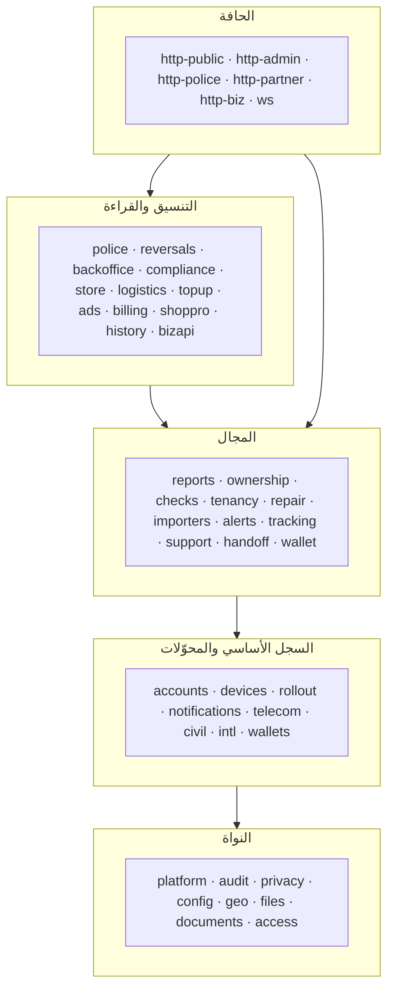

| القاعدة | التفصيل |
|---|---|
| الاتجاه | الطبقة العليا تستدعي الدنيا فقط. والدنيا تعلم بما يحدث فوقها عبر الأحداث (§9) لا عبر الاستدعاء |
| داخل الطبقة نفسها | مسموح فقط بما في الجدول التالي، ودون دوائر |
| كسر الدوائر | بعكس الاعتماد: الوحدة الدنيا تعلن واجهة (Port) وتطبّقها العليا. مثال: `notifications` تعلن `RecipientResolver` لمعرفة الرقم الذي تُرسل إليه (الأساسي، أو البديل، أو لا شيء إذا كان الرقم مسروقاً)، و`accounts` تطبّقها، فلا تعتمد `notifications` على `accounts`. ومثله حارس الحيازة (§7.10): `ownership` تعلن `CustodyCheckProvider`، وتطبّقها `reports` (البلاغات والادعاءات) و`police` (الضبط) و`devices` (التعارضات وعلامات المعرّف) و`access` (القيود)، فيجمع الحارس فحوصه دون أن تعتمد `ownership` على وحدات أعلى منها |
| المعاملة الواحدة | الأوامر التي يجب أن تتغير معاً تُنفَّذ في معاملة واحدة تفتحها الوحدة المنسِّقة، وتمرّر سياق المعاملة لأوامر الوحدات الدنيا. مثال: قبول البلاغ (§8.1) |
| الفحص الآلي | قواعد اتجاه الاستيراد في CI ترفض أي استيراد لملف داخلي من وحدة أخرى، أو أي اعتماد غير مدرج هنا |

| الوحدة | تعتمد على (إضافة إلى النواة) |
|---|---|
| `accounts` | `rollout` (هل الرقم مدعو)، `notifications` |
| `devices` | — |
| `ownership` | `accounts`، `devices`، `notifications` |
| `checks` | `devices`، `intl`، `ownership` (قراءة)، `reports` (ملخص البلاغ النافذ) |
| `reports` | `accounts`، `devices`، `ownership`، `notifications`، `telecom` (أوامر الحماية فقط: إيقاف الخط)، `wallets` |
| `tenancy` | `accounts`، `devices`، `ownership`، `checks`، `civil`، `intl`، `rollout`، `notifications` |
| `repair` | `tenancy`، `devices`، `checks`، `ownership` (قراءة)، `civil` |
| `importers` | `tenancy`، `devices`، `ownership`، `intl` |
| `alerts` | `devices`، `reports` (قراءة)، `tenancy` (قراءة)، `notifications` |
| `tracking` | `telecom`، `devices`، `reports` (قراءة) |
| `support` | `accounts`، `notifications` |
| `handoff` | `accounts` |
| `police` | `reports`، `devices`، `checks`، `tenancy` (قراءة)، `alerts`، `tracking`، `telecom`، `ownership` (قراءة) |
| `reversals` | `reports`، `accounts`، `tenancy`، `ownership`، `devices` |
| `backoffice` | قراءة من كل وحدات المجال عبر واجهات الاستعلام |
| `compliance` | `tenancy` (قراءة)، `alerts` (قراءة) |
| `wallet` | `tenancy`، `accounts`، `notifications` |
| `topup` | `wallet`، `tenancy`، `notifications` |
| `billing` | `accounts`، `tenancy`، `wallet`، `notifications` |
| `store` | `billing`، `tenancy`، `importers` (أجهزة المتجر، STORE-13)، `notifications` |
| `logistics` | `store`، `billing`، `notifications` |
| `ads`، `shoppro` | `billing`، `tenancy` |
| `history`، `bizapi` | `billing`، `checks`، `devices` |

## 3. دليل الواجهة البرمجية

### 3.1 النطاقات والعناوين

`<domain>` هو نطاق المنصة، و`<admin-domain>` و`<police-domain>` نطاقان مسجّلان منفصلان (ADR-08)، وكلها تُحسم في Q-01.

| النطاق | العنوان | العملاء | المصادقة |
|---|---|---|---|
| الجمهور (الموقع) | `https://www.<domain>/api/v1` على نفس أصل الموقع، يخدمه خادم Next.js (BFF) الذي يحفظ الرموز ويستدعي `api-public` داخلياً | متصفح الموقع | كوكي `__Host-` واحد على `/` مع حماية CSRF (§4.2.6) |
| الجمهور (التطبيق) | `https://api.<domain>/v1` | تطبيق آيفون وأندرويد | `Authorization: Bearer` |
| الإدارة | `https://<admin-domain>/api/v1` | لوحة الإدارة | جلسة على الخادم (§4.3) |
| الأمن | `https://<police-domain>/api/v1` | بوابة الأمن | جلسة على الخادم (§4.3) |
| الشركات | `https://bizapi.<domain>/v1` | أنظمة الشركات والوكلاء | مفتاح وتوقيع HMAC (§3.13) |
| الشركاء الرسميون | `https://partners.<domain>/v1` | الاتصالات، والأحوال المدنية، والهيئة، والمحافظ | mTLS مع توقيع الرسالة عند الاتفاق (§3.14) |
| استقبال المزوّدين | `https://hooks.<domain>/v1` | واتساب، وبوابات SMS، ومزوّدو الدفع الآلي | توقيع المزوّد (§3.14) |

**قواعد الحافة والخوادم الأمامية:**

| القاعدة | التفصيل |
|---|---|
| مضيف ثابت بلا كوكيز | الأصول الثابتة والمحتوى العام القابل للتخزين على مضيف منفصل `static.<domain>` لا تصله أي كوكي، ويجوز أن يكون خلف شبكة توصيل. أما `www` (الصفحات، وBFF، و`/v/`، و`/n/`) فيُخدم من حافتنا وحدها مع تنقية هجمات الإغراق فقط، فلا تمر كوكي جلسة بأي شبكة توصيل خارجية |
| لا تفويض في الخوادم الأمامية | خوادم Next.js (الموقع ولوحة الإدارة وبوابة الأمن) لا تحمل أي اعتماد خدمة مميّز: كل استدعاء منها يمرّر جلسة المستخدم نفسه، والواجهة البرمجية هي المرجع الوحيد للصلاحية. والوسيط (middleware) ليس طبقة تفويض أبداً. وServer Actions معطّلة، أو معدودة واحداً واحداً في اختبار سياسة المسارات ومربوطة باستدعاء API. والصفحات المصادَقة ديناميكية كلياً بـ `no-store`، ولا ذاكرة بيانات مشتركة لبيانات أي مستخدم |
| إعادة التوجيه والروابط المطلقة | `returnTo` بعد الدخول يقبل مساراً نسبياً من جدول المسارات العامة (§13.3) أو جدول مسارات التطبيق فقط، لا `//` ولا مخطط، وإلا الرئيسية. وكل رابط مطلق في رسالة أو دعوة أو وسوم المعاينة يُبنى من عنوان أساس مضبوط في الإعداد، لا من ترويسة `Host` أو `X-Forwarded-Host`، والحافة تحذف `X-Forwarded-Host` ولا تخزّن أي رد يحمل `Set-Cookie` |

### 3.2 الإصدارات والتوافق

| القاعدة | التفصيل |
|---|---|
| رقم الإصدار | رئيسي فقط في المسار: `/v1`. لا إصدار فرعي في المسار ولا في الترويسات |
| تغيير غير كاسر (مسموح داخل `/v1`) | إضافة مورد أو عملية، أو حقل اختياري في الطلب، أو حقل في الرد، أو قيمة جديدة في قائمة قيم (enum)، أو رمز خطأ جديد |
| تغيير كاسر (ممنوع داخل `/v1`) | حذف حقل أو إعادة تسميته، أو تغيير نوعه أو معناه، أو جعل حقل اختياري إلزامياً، أو تغيير رمز خطأ قائم، أو تشديد التحقق على قيم كانت مقبولة |
| القارئ المتسامح | كل عميل يتجاهل الحقول غير المعروفة، ويعرض القيمة غير المعروفة في قائمة القيم كحالة عامة («غير معروف»)، ويعرض لرمز الخطأ غير المعروف نصاً عاماً حسب حالة HTTP، ولرمز `deny(code)` غير المعروف في خريطة القدرات (§14.5) النص العام «غير متاح الآن» دون زر إجراء، ويفتح لمسار إشعار غير معروف شاشة الإشعارات (S-USR-36)، ولا يتعطل. وهذا مختبر في كل عميل بحقن قيم ورموز مجهولة ([العملية الهندسية](22-engineering-process.md) §11) |
| ترويسات التطبيق | كل طلب من التطبيق يحمل `X-App-Platform` (`ios` أو `android` أو `web`)، و`X-App-Version` (مثل `3.4.1`)، و`X-App-Build` |
| التحديث الإجباري (APPVER-01..03) | إذا كان الإصدار أقل من «أدنى إصدار مدعوم» ⚙️ لمنصته، يرد الخادم على كل عملية بـ **HTTP 426** ورمز `APPVER_UNSUPPORTED`، حتى لو تجاوز المستخدم الشاشة (APPVER-03)، عدا `GET /v1/bootstrap` الذي يعرض شاشة التحديث وروابط المتجرين والقناة البديلة. وهذه الحالة هي المعتمدة التي تحيل إليها [العملية الهندسية](22-engineering-process.md) §10.4. والإصدار الأقل من «الموصى به» ⚙️ يتلقى ترويسة `X-App-Update: recommended` |
| ضمان الإصدارات القديمة | كل سلوك يعتمد عليه إصدار تطبيق أعلى من أو يساوي «أدنى إصدار مدعوم» يبقى يعمل. ولا يُحذف حقل أو عملية إلا بعد رفع أدنى إصدار مدعوم فوق آخر إصدار يستخدمه |
| الإيقاف التدريجي | العملية المزمع حذفها تُعلَّم `deprecated: true` في العقد، وتعيد ترويسة `Deprecation` (RFC 9745) و`Sunset` (RFC 8594) و`Link` (`rel="successor-version"` للبديل)، ويُسجَّل ADR. ويُقاس استخدامها لكل إصدار تطبيق ولكل عميل ربط برمجي. ولا تُحذف إلا بعد أن يتجاوز «أدنى إصدار مدعوم» آخر إصدار يستخدمها، ويصبح استخدامها من العملاء المدعومين صفراً، ويُبلَّغ عملاء الربط البرمجي للشركات بالمدة المنصوص عليها في عقودهم (⚙️ 180 يوماً حداً أدنى، `bizapi.breaking_change.notice`). والحذف خطوة تقليص بموافقتين ([العملية الهندسية](22-engineering-process.md) §11) |
| إصدار رئيسي جديد | أي إصدار رئيسي تالٍ يعمل بمسار جديد بجانب `/v1` ما دام هناك عميل مدعوم يستخدم `/v1` |

### 3.3 تسمية الموارد والعمليات

| القاعدة | التفصيل |
|---|---|
| أسماء الموارد | أسماء جمع بحروف صغيرة وشرطات: `/v1/reports`، `/v1/ownership-transfers`، `/v1/support-tickets` |
| الموارد التابعة | حتى مستويين: `/v1/reports/{reportId}/evidence`. وما بعد ذلك مورد مستقل |
| موارد المستخدم | `/v1/me` و`/v1/me/devices` («أجهزتي») و`/v1/me/sessions` (جلسات الدخول) |
| موارد المحل والوكيل | المعرّف في المسار: `/v1/shops/{shopId}/transactions`، `/v1/importers/{importerId}/batches`. والخادم يتحقق من العضوية ويضبط العزل منه (§6.3) |
| انتقالات الحالة | `POST /v1/{مورد}/{id}/{فعل}` بفعل من **سجل الأفعال** في `packages/registry` يفرضه فاحص العقد: `submit`، `accept`، `reject`، `request-info`، `close`، `cancel`، `confirm`، `approve`، `suspend`، `reinstate`، `extend`، `stop`، `activate`، `revoke`، `revoke-others`، `withdraw`، `object`، `release`، `assign`، `refer`، `ack`، `freeze`، `unfreeze`، `lift`، `mark-paid`، `remit`، `publish`، `retry`، `regenerate`، `complete`، `decline`، `request-closure`، `claim`، `dismiss-objection`، `appoint`، `acknowledge`. والفعل الجديد يُضاف إلى السجل أولاً. ولا يُغيَّر حقل `status` عبر `PATCH` أبداً |
| الطرق | `GET` قراءة، و`POST` إنشاء أو انتقال، و`PATCH` تعديل جزئي (JSON Merge Patch)، و`DELETE` لإلغاء ما يملكه المستخدم فقط (مسودة، جلسة، جهة موثوقة). ولا `PUT` |
| أسماء الحقول | camelCase في JSON، وsnake_case في قاعدة البيانات |
| المعرّفات في المسار | UUIDv7 للموارد المحمية بالصلاحية. والصفحات العامة برموز عشوائية (§13.3) |
| التحذيرات (صنفان في سجل الرموز، §3.4) | **صنف `ack`** (تحذير يحتاج إقراراً): الطلب الأول **لا يُنفَّذ** ويرد 409 بنوع `https://<domain>/problems/warning-ack-required` ومعه `warnings: [{ code }]` و`requiresAcknowledgement: true`، فيعيد العميل الجسم نفسه مع `acknowledgedWarnings: [code]` (ومعه `warningReason` لـ `SHOP_OUT_OF_RANGE`، و`secondIdentifier` لـ `CHECK_IDENTIFIER_SHARED` في مسارات المحل والتسجيل) بمفتاح عدم تكرار جديد، فيرد 201 ويعيد `warnings[]` كما هي، ويُحفظ الإقرار وسببه في الكيان. **وصنف `info`**: العملية تمت، ورد 2xx يحمل `warnings[]` للعرض فقط |
| القرارات الإدارية | كل عملية قرار (قبول، رفض، تعليق، كشف) تتطلب `reasonCode` من قائمة الأسباب الجاهزة (06 §15.2) و`reasonText` اختيارياً، وإلا ترد بـ `ADMIN_REASON_REQUIRED` أو `PP_REASON_REQUIRED` (03 §4) |
| الشراء في التطبيق (D-86) | عمليات طلب الخدمات الرقمية (`POST /v1/activation-requests`) متاحة لطلبات `X-App-Platform: web` فقط، وترد على التطبيق بـ `PAY_NOT_AVAILABLE_IN_APP`. وطلب المنتجات المادية (`POST /v1/store/orders`) متاح من كل الواجهات |

**خريطة الموارد الرئيسية:**

| النطاق | الموارد |
|---|---|
| الجمهور | `auth/*`، `me`، `me/sessions`، `me/devices`، `me/privacy`، `manufacturers`، `checks`، `check-receipts`، `reports`، `disputes`، `tips`، `ownership-transfers`، `self-registrations`، `certificates`، `trusted-contacts`، `alternate-contacts`، `data-access-events`، `support-tickets`، `handoffs`، `uploads`، `capture-nonces`، `shops`، `shops/{id}/transactions`، `shops/{id}/members`، `shops/{id}/repair-jobs`، `shops/{id}/inventory`، `shops/{id}/wholesale-transfers`، `importers`، `importers/{id}/batches`، `importers/{id}/wholesale-transfers`، `shops/{id}/wallet`، `shops/{id}/wallet/operations`، `shops/{id}/topups`، `shops/{id}/pro/*` (المحاسبة، D-92)، `suppliers/{id}/products`، `suppliers/{id}/orders`، `suppliers/{id}/settlements`، `couriers/{id}/shipments`، `verify/{code}`، `bootstrap`، `content/{key}`، `altcha/challenge`، `ws-tickets`، `store/products`، `store/orders`، `activation-requests`، `entitlements`، `history-reports`، `ads/slots/{placement}`، `authorized-users`، `notifications`، `line-suspension-requests`، `wallet-freeze-requests`، `closure-requests`، `report-messages`، `ad-campaigns`، `suppliers` (طلب مورّد من الموقع)، `couriers/{id}/remittances`، `api-clients/{id}/keys`، `api-clients/{id}/members`، `api-clients/{id}/usage` (الموقع فقط، §3.13)، `successions` (§8.17)، `me/executors` (D-103)، `me/security-email` (D-126)، `me/channel-links`، `me/restrictions` (ما المقيّد ولماذا وحتى متى، §5.11)، `shops/{id}/closure`، `shops/{id}/owner-change` (§8.4)، `shops/{id}/branches` |
| الإدارة | `queues`، `work-items`، `reports`، `identity-verifications`، `self-registrations`، `disputes`، `closure-requests`، `tips`، `alerts`، `police-referrals`، `devices/{id}/timeline`، `devices/{id}/map-views`، `device-merges`، `device-conflicts`، `tracking-sessions`، `block-holds`، `shops`، `importers`، `shop-transactions`، `tx-corrections`، `users`، `account-recoveries`، `reveals`، `search`، `support-tickets`، `police-imports`، `compliance-reports`، `reversal-requests`، `admin-users`، `roles`، `settings`، `toggles`، `content`، `templates`، `rollout/invites`، `rollout/governorates`، `health`، `dead-letters`، `audit-events`، `reconciliations`، `privacy/*`، `commerce/*` (المورّدون، والطلبات، والشحن، والتسويات، والمحافظ، والتعبئة، والتفعيل، والمبالغ غير المخصّصة)، `police-units`، `maintenance`، `app-versions`، `retention-holds`، `kpi-reports`، `staff-credential-resets`، `restrictions`، `successions`، `tenant-change-requests`، `calendar`، `unforeseen`، `catalog-changes`، `error-refs` (§3.9)، `dependencies` (§11.6) |
| الأمن | `search/imei`، `search/person`، `official-reports`، `reports`، `alerts`، `devices/{id}/timeline`، `tracking-sessions`، `block-requests`، `shop-transactions`، `shop-suspension-requests`، `seizures` (ومنها `release`)، `seizure-checks`، `cases`، `officers`، `activity`، `data-holds`، `work` (إعادة إسناد عمل الجهة)، `stock-freezes` (D-108) |

### 3.4 الأخطاء (RFC 9457)

كل خطأ يُعاد بـ `Content-Type: application/problem+json`:

```json
{
  "type": "https://<domain>/problems/report-duplicate-active",
  "title": "لديك بلاغ مفتوح على هذا الجهاز",
  "status": 409,
  "detail": "تابع بلاغك الحالي من «بلاغاتي».",
  "instance": "/v1/reports/0192f3c4-.../submit",
  "code": "REPORT_DUPLICATE_ACTIVE",
  "requestId": "0192f3c4-7b1e-7c2a-9d55-1f0a2b3c4d5e",
  "errors": [{ "pointer": "/imei1", "code": "CHECK_IMEI_INVALID" }]
}
```

| القاعدة | التفصيل |
|---|---|
| صيغة `code` | `^[A-Z][A-Z0-9]*(_[A-Z0-9]+)+$`. البادئة اسم وحدة المتطلبات (`AUTH_`، `CHECK_`، `REPORT_`، `SHOP_`، `OWN_`، `PP_`...)، أو بادئة عامة للأخطاء المشتركة |
| الثبات | الرمز عقد دائم: لا يُحذف ولا يتغير معناه. والنصوص العربية لـ `title` و`detail` في [كتالوج المحتوى](24-content-catalog.md)، وتُعدَّل من اللوحة دون تغيير الرمز |
| `type` | رابط ثابت مشتق من الرمز بحروف صغيرة وشرطات |
| حالة غير مسموحة | الرمز `<الوحدة>_INVALID_STATE` (مثل `REPORT_INVALID_STATE` و`STORE_INVALID_STATE`) بـ 409، و`INVALID_STATE` حيث لا وحدة واضحة |
| `errors[]` | لأخطاء التحقق: مؤشر JSON Pointer للحقل ورمز الخطأ |
| امتدادات | `retryAfter` (ثوانٍ)، و`cooldownUntil`، و`stepUp: { methods }`، و`altcha: { challengeUrl }` حسب الحالة |
| عدم كشف الوجود | المورد خارج صلاحية الطالب أو عزله أو نطاقه يرد بـ 404 `NOT_FOUND` لا بـ 403، حتى لا يُعرف وجوده |
| لا تفاصيل داخلية | لا نص استثناء ولا استعلام ولا مسار ملف في الرد. التفاصيل في السجل بمعرّف الطلب |

**الرموز العامة:**

| الرمز | HTTP | المعنى |
|---|---|---|
| `REQUEST_MALFORMED` | 400 | JSON غير صالح أو ترويسة بصيغة خاطئة |
| `VALIDATION_FAILED` | 400 | قيم غير صالحة، والتفاصيل في `errors[]`. وحين يكون للحقل رمز وحدة خاص (مثل `CHECK_IMEI_INVALID`) يُعاد هو مباشرة |
| `UNAUTHENTICATED` | 401 | لا هوية أو هوية غير صالحة |
| `AUTH_TOKEN_EXPIRED` | 401 | رمز الدخول انتهى، ويُجدَّد بالرمز التجديدي |
| `PERMISSION_DENIED` | 403 | الهوية معروفة والصلاحية غير كافية لمورد معروف الوجود للطالب |
| `AUTH_STEP_UP_REQUIRED` | 403 | الإجراء حساس ويتطلب إعادة تحقق (§4.2.7) |
| `AUTH_COOLDOWN_ACTIVE` | 403 | فترة التهدئة بعد تغيير الرقم أو الاستعادة تمنع الإجراء (§4.2.8) |
| `CAPTCHA_REQUIRED` | 403 | يلزم تحدي ALTCHA |
| `FEATURE_DISABLED` | 403 | الوحدة أو الخدمة موقوفة بمفتاح تشغيل |
| `ADMIN_REASON_REQUIRED` | 400 | قرار إداري دون سبب. والمقابل في بوابة الأمن `PP_REASON_REQUIRED` |
| `NOT_FOUND` | 404 | غير موجود أو خارج الصلاحية |
| `INVALID_STATE` | 409 | الانتقال غير مسموح من الحالة الحالية |
| `IDEMPOTENCY_KEY_REQUIRED` | 400 | `Idempotency-Key` مفقود في عملية إنشاء أو انتقال |
| `IDEMPOTENCY_IN_PROGRESS` | 409 | طلب بالمفتاح نفسه قيد التنفيذ |
| `VERSION_CONFLICT` | 412 | `If-Match` لا يطابق الإصدار الحالي |
| `PAYLOAD_TOO_LARGE` | 413 | حجم الطلب أو الملف أكبر من المسموح |
| `UNSUPPORTED_MEDIA_TYPE` | 415 | نوع محتوى غير مقبول |
| `IDEMPOTENCY_KEY_REUSED` | 422 | المفتاح نفسه مع طلب مختلف |
| `AUTH_ACCOUNT_LOCKED` | 423 | قفل مؤقت بعد محاولات فاشلة |
| `APPVER_UNSUPPORTED` | 426 | إصدار التطبيق أقل من الأدنى المدعوم |
| `PRECONDITION_REQUIRED` | 428 | `If-Match` مفقود في عملية تعديل |
| `RATE_LIMITED` | 429 | تجاوز الحد، مع `Retry-After` |
| `INTERNAL_ERROR` | 500 | خطأ غير متوقع |
| `UPSTREAM_UNAVAILABLE` | 503 | تكامل خارجي لازم للعملية متعطل |
| `MAINTENANCE_MODE` | 503 | وضع الصيانة (SMART-11)، مع `Retry-After` |

**سجل الرموز:** أسماء الرموز وحالاتها ونصوصها العربية مرجعها الوحيد [كتالوج المحتوى](24-content-catalog.md) §5، وهذا السجل مزامن معه حرفياً، والعقد يحمل لكل عملية رموزها في `x-error-codes`، وفحص في CI يقارن رموز العقد بالكتالوج فيفشل البناء عند أي رمز بلا نص أو نص بلا رمز. وأي رمز جديد يُضاف إلى الكتالوج أولاً. والجدول العام أعلاه شرح لمعاني الرموز المشتركة فقط. ولكل رمز في السجل **نوع**: `error` (رد HTTP)، أو `warning` بصنفيه `ack` (يرد 409 `warning-ack-required` ولا يُنفَّذ حتى يُقَرّ) و`info` (في `warnings[]` مع النجاح) (§3.3)، أو `row` (في تقرير الاستيراد)، أو `client` (لا يصدر من الخادم أبداً، مثل `CAMERA_*` و`NETWORK_*` و`STORAGE_FULL` و`UPLOAD_INTERRUPTED` و`CLOCK_SKEW`)، والفحص يقارن حسب النوع. ولكل رمز `error` **رتبة أسبقية** تطابق ترتيب الفحوص في محلّل القدرات (§5.12)، فالرفض الواحد يعيد رمزاً واحداً وخطوة تالية واحدة.

| المجموعة | الرموز وحالة HTTP |
|---|---|
| أخطاء عامة (24 §5.2) | `MEDIA_UNAVAILABLE` 503، `OPERATION_HELD_FOR_REVIEW` 202، `AUTH_SESSION_SCOPE_RESTRICTED` 403، `ACCOUNT_RESTRICTED` 403 (مع `restriction: { type, until }`)، `NAME_NOT_ALLOWED` 400، `REQUEST_MALFORMED` 400، `VALIDATION_FAILED` 400، `FIELD_REQUIRED` 400، `FIELD_TOO_LONG` 400، `FIELD_TOO_SHORT` 400، `FIELD_FORMAT_INVALID` 400، `FIELD_OUT_OF_RANGE` 400، `FIELD_RESERVED_VALUE` 400، `FIELD_EMAIL_INVALID` 400، `FIELD_DATE_IN_FUTURE` 400، `FIELD_DATE_TOO_OLD` 400، `UNAUTHENTICATED` 401، `AUTH_TOKEN_EXPIRED` 401، `PERMISSION_DENIED` 403، `NOT_FOUND` 404، `FEATURE_DISABLED` 403، `INVALID_STATE` 409، `RATE_LIMITED` 429، `CAPTCHA_REQUIRED` 403، `CAPTCHA_FAILED` 403، `IDEMPOTENCY_KEY_REQUIRED` 400، `IDEMPOTENCY_IN_PROGRESS` 409، `IDEMPOTENCY_KEY_REUSED` 422، `VERSION_CONFLICT` 412، `PRECONDITION_REQUIRED` 428، `PAYLOAD_TOO_LARGE` 413، `UNSUPPORTED_MEDIA_TYPE` 415، `FILE_TYPE_NOT_ALLOWED` 415، `FILE_INFECTED` 422، `FILE_IMAGE_UNCLEAR` 400، `ROLLOUT_INVITE_REQUIRED` 403، `APPVER_UNSUPPORTED` 426، `MAINTENANCE_MODE` 503، `UPSTREAM_UNAVAILABLE` 503، `INTERNAL_ERROR` 500 |
| الحسابات والدخول (AUTH) (24 §5.3) | `AUTH_PHONE_INVALID` 400، `AUTH_NATIONAL_ID_INVALID` 400، `AUTH_PHONE_TAKEN` 409، `AUTH_PHONE_COMPROMISED` 403، `AUTH_PHONE_RESTORE_PROOF_REQUIRED` 403، `AUTH_THEFT_SESSION_RESTRICTED` 403، `AUTH_ATTESTATION_FAILED` 403، `AUTH_NATIONAL_ID_TAKEN` 409، `AUTH_PASSWORD_WEAK` 400، `AUTH_PASSWORD_BREACHED` 400، `AUTH_PASSWORD_MISMATCH` 400، `AUTH_INVALID_CREDENTIALS` 401، `AUTH_ACCOUNT_LOCKED` 423، `AUTH_OTP_INVALID` 400، `AUTH_OTP_EXPIRED` 400، `AUTH_OTP_ATTEMPTS_EXCEEDED` 400، `AUTH_OTP_RESEND_TOO_SOON` 429، `AUTH_OTP_RATE_LIMITED` 429، `AUTH_OTP_DELIVERY_FAILED` 503، `AUTH_PHONE_NOT_VERIFIED` 403، `AUTH_IDENTITY_REQUIRED` 403، `AUTH_IDENTITY_PENDING` 409، `AUTH_IDENTITY_ATTEMPTS_EXCEEDED` 403، `AUTH_CAMERA_CAPTURE_REQUIRED` 400، `AUTH_REFRESH_REUSED` 401، `AUTH_SESSION_REVOKED` 401، `AUTH_STEP_UP_REQUIRED` 403، `AUTH_COOLDOWN_ACTIVE` 403، `AUTH_ACCOUNT_SUSPENDED` 403، `AUTH_ACCOUNT_BANNED` 403، `AUTH_ACCOUNT_CLOSED` 410، `AUTH_ALTERNATE_NOT_FOR_RECOVERY` 403، `AUTH_RECOVERY_IN_PROGRESS` 409، `AUTH_UNDERAGE` 403، `AUTH_ACCOUNT_NUMBER_INVALID` 400، `AUTH_DEVICE_CONFIRMATION_REQUIRED` 403، `AUTH_2FA_REQUIRED` 401، `AUTH_2FA_INVALID` 400، `ADMIN_IP_NOT_ALLOWED` 403، `PP_IP_NOT_ALLOWED` 403، `AUTH_CLOSURE_BLOCKED` 409 (مع قائمة الأسباب)، `AUTH_EMAIL_CHANGE_PENDING` 409، `AUTH_PERSON_BANNED` 403 (D-106) |
| الفحص (CHECK) والتقليد (FAKE) (24 §5.4) | `CHECK_IMEI_PAIR_IDENTICAL` 400، `CHECK_IMEI_INVALID` 400 (ومنه `reason: reserved`، §3.10)، `CHECK_APPLE_SERIAL_INVALID` 400، `CHECK_RATE_LIMITED` 429، `CHECK_SCAN_BLOCKED` 429، `CHECK_GOVERNORATE_REQUIRED` 400، `CHECK_RECEIPT_UNAVAILABLE` 409 |
| البلاغات (REPORT) والمعلومات والاعتراضات (24 §5.5) | `REPORT_IDENTITY_REQUIRED` 403، `REPORT_DUPLICATE_ACTIVE` 409، `REPORT_INVALID_STATE` 409، `REPORT_OWNERSHIP_TRANSFERRED` 403، `REPORT_LIVE_PHOTO_REQUIRED` 400، `REPORT_DECLARATION_REQUIRED` 400، `REPORT_INCIDENT_DATE_INVALID` 400، `REPORT_INCIDENT_LOCATION_REQUIRED` 400، `REPORT_REWARD_INVALID` 400، `REPORT_REWARD_ACK_REQUIRED` 400، `REPORT_OWNER_CONFIRMATION_EXPIRED` 409، `REPORT_OWNER_IDENTITY_REQUIRED` 403، `REPORT_URGENT_NOT_TRUSTED` 403، `REPORT_SHOP_THEFT_NO_DEVICES` 400، `REPORT_SHOP_THEFT_NOT_IN_STOCK` 409، `REPORT_SHOP_THEFT_OWNER_ONLY` 403، `TIP_TEXT_REQUIRED` 400، `TIP_RATE_LIMITED` 429، `TIP_LINK_EXPIRED` 410، `DISPUTE_NOT_ALLOWED` 409، `DISPUTE_EVIDENCE_REQUIRED` 400، `DISPUTE_ALREADY_OPEN` 409، `DISPUTE_OWN_REPORT` 400 |
| الملكية (OWN) (24 §5.6) | `OWN_NOT_OWNER` 403، `OWN_TRANSFER_MISMATCH` 403، `OWN_TRANSFER_EXPIRED` 409، `OWN_TRANSFER_CANCELLED` 409، `OWN_TRANSFER_PENDING_EXISTS` 409، `OWN_TRANSFER_TO_SELF` 400، `OWN_DEVICE_REPORTED` 409، `OWN_DEVICE_IN_WAITING` 409، `OWN_SELF_REG_ALREADY_REGISTERED` 409، `OWN_SELF_REG_DECLARATION_REQUIRED` 400، `OWN_DELEGATES_LIMIT` 409، `OWN_GUARDIAN_DECLARATION_REQUIRED` 400، `OWN_CERT_NOT_ALLOWED` 409، `OWN_CERT_ACTIVE_EXISTS` 409، `OWN_SELF_REG_LIMIT` 409 (إعادة التقديم فوق حد الجهاز الواحد، OWN-24، `self_registration.resubmissions`: لا يُنشأ طلب)، `OWN_TRANSFER_RECIPIENT_INVALID` 400 (D-121)، `OWN_OWNER_DECEASED` 409، `DEVICE_HELD_BY_AUTHORITY` 409، `DEVICE_RESERVED` 409، `SUCCESSION_NOT_ELIGIBLE` 403 و`SUCCESSION_ALREADY_OPEN` 409 (بنص محايد واحد، فلا يكشف وجود طلب على رقم أو شخص)، `SUCCESSION_OBJECTED` 409 (ما دام طلب على الجهاز مفتوحاً فقط)، `SUCCESSION_ORG_DEVICE` 409 (جهاز مؤسسة يُستبعد ويُحال إلى SOP-79)، `SUCCESSION_WITHDRAW_NOT_ALLOWED` 409 (بعد التنفيذ) |
| حماية لحظة السرقة والجهات الموثوقة (THEFT، LINE، WALLET، TRUSTED) (24 §5.7) | `THEFT_ALTERNATE_SAME_AS_PRIMARY` 400، `THEFT_ALTERNATE_NOT_VERIFIED` 403، `LINE_PROVIDER_UNAVAILABLE` 409، `FREEZE_PROVIDER_UNAVAILABLE` 409، `TRUSTED_LIMIT_REACHED` 409، `TRUSTED_SELF` 400، `TRUSTED_ALREADY_ADDED` 409 |
| المحلات (SHOP) والأحوال المدنية (CIVIL) والصيانة (REPAIR) (24 §5.8) | `SHOP_NOT_VERIFIED` 403، `SHOP_SUSPENDED` 403، `SHOP_EMPLOYEE_NOT_VERIFIED` 403، `SHOP_EMPLOYEE_NOT_ACTIVE` 403، `SHOP_PERMISSION_DENIED` 403، `SHOP_LOCATION_REQUIRED` 400، `SHOP_CHECK_REQUIRED` 409، `SHOP_DEVICE_REPORTED` 409، `SHOP_GSMA_LISTED` 409، `SHOP_DEVICE_IN_WAITING` 409، `SHOP_DEVICE_ALREADY_SOLD` 409، `SHOP_TRANSACTION_HELD` 202، `SHOP_SELLER_ID_REQUIRED` 400، `SHOP_PARTY_MINOR` 400، `SHOP_ID_CARD_INVALID` 403، `SHOP_CIVIL_NAME_CONFIRM_REQUIRED` 400، `SHOP_CANCEL_WINDOW_PASSED` 409، `SHOP_GOVERNORATE_NOT_ACTIVE` 409، `SHOP_ALREADY_EXISTS` 409، `SHOP_INVENTORY_DEVICE_NOT_FOUND` 404، `SHOP_INVITE_IDENTITY_MISMATCH` 409، `SHOP_BRANCH_LOCATION_UNVERIFIED` 409، `TENANT_CLOSING` 403، `TENANT_CLOSED` 410، `TENANT_CLOSURE_BLOCKED` 409 (بنص محايد واحد حين يمنع بدءَ الإغلاق تعليقٌ بسبب تحقيق، RSN-CLO-08. والبنود الناقصة تعرضها قائمة الإغلاق ولا تُرد خطأً، لأن `closing → closed` آلي)، `TENANT_OWNER_CHANGE_PENDING` 409، `TENANT_OWNER_CHANGE_BLOCKED` 409 (نص محايد: تعليق بسبب تحقيق، أو `closing`، أو `revoked`، أو `closed`)، `TENANT_NEW_OWNER_NOT_ELIGIBLE` 403 (نص محايد واحد لغير الموثّق والمحظور والممنوع من العمل، فلا يُكشف قيد أحد للمالك البائع)، `TENANT_HANDOVER_BLOCKED` 409 (تسليم مخزون الإغلاق أثناء التعليق، §7.10)، `CIVIL_UNAVAILABLE` 503، `CIVIL_NO_ACTIVE_TRANSACTION` 403، `CIVIL_QUERY_LIMIT` 429، `CIVIL_NO_MATCH` 400، `REPAIR_DEVICE_REPORTED` 409، `REPAIR_BOARD_IMEI_REPORTED` 409، `REPAIR_NEW_IMEI_SAME` 400، `REPAIR_INVALID_STATE` 409 |
| الوكلاء والاستيراد (IMPORTER، POLICE-01) (24 §5.9) | `IMPORT_ENCODING_UNSUPPORTED` 400، `IMPORT_FILE_UNREADABLE` 400، `IMPORT_COLUMNS_MISSING` 400، `IMPORT_FILE_TOO_LARGE` 413، `IMPORTER_SHOP_NOT_VERIFIED` 409، `IMPORTER_DEVICE_NOT_IN_STOCK` 409 |
| الدعم الفني وإكمال الخطوة بالتطبيق (SUPPORT، HANDOFF، DATAACCESS) (24 §5.10) | `SUPPORT_TICKET_CLOSED` 409، `SUPPORT_RATE_LIMITED` 429، `DATAACCESS_ALREADY_REPORTED` 409، `HANDOFF_CODE_EXPIRED` 410، `HANDOFF_CODE_USED` 410، `HANDOFF_ACCOUNT_MISMATCH` 403، `HANDOFF_CODE_INVALID` 404 |
| بوابة قوى الأمن ولوحة الإدارة (PP، TRACK، ADMIN، SMART، REVERSAL) (24 §5.11) | `PP_CASE_NUMBER_INVALID` 400، `PP_REASON_REQUIRED` 400، `PP_OUT_OF_SCOPE` 404، `PP_SEARCH_LIMIT` 429، `PP_SEIZED_ALREADY_REGISTERED` 409، `TRACK_BLOCK_NOT_DEFERRED` 409، `ADMIN_REASON_REQUIRED` 400، `ADMIN_REVEAL_REASON_REQUIRED` 400، `ADMIN_CONFLICT_OF_INTEREST` 403، `ADMIN_SAME_REVIEWER` 403، `REVERSAL_SAME_PERSON` 403، `REVERSAL_ROLE_INSUFFICIENT` 403، `ADMIN_DECISION_NOT_REVERSIBLE` 409، `ROLE_ESCALATION_FORBIDDEN` 403، `ADMIN_SETTING_OUT_OF_RANGE` 400، `CONTENT_RULES_VIOLATION` 400، `CONTENT_LOCKED` 403، `CONTENT_TEMPLATE_PENDING_META` 409، `NETWORK_ACTION_NOT_APPLICABLE` 409 |
| المدفوعات والباقات والربط البرمجي (PAY، PACKAGE، BIZAPI، ADS) (24 §5.12) | `PACKAGE_FEATURE_REQUIRED` 403، `PACKAGE_COMPLIANCE_FEATURE_FORBIDDEN` 400، `PACKAGE_LIMIT_REACHED` 409، `PACKAGE_CHANGE_APPROVAL_REQUIRED` 403، `PACKAGE_TRIAL_USED` 409، `PACKAGE_FREE_CANNOT_SHRINK` 409، `PAY_NOT_AVAILABLE_IN_APP` 403، `PAY_REFERENCE_REQUIRED` 400، `PAY_REFERENCE_INVALID` 400، `PAY_REFERENCE_DUPLICATE` 409، `PAYMENT_FAILED` 402، `PAY_REFUND_SECOND_APPROVAL` 403، `ADS_CREATIVE_INVALID` 400، `BIZAPI_KEY_INVALID` 401، `BIZAPI_SIGNATURE_INVALID` 401، `BIZAPI_QUOTA_EXCEEDED` 429، `BIZAPI_SUBSCRIPTION_INACTIVE` 403 |
| المتجر وسوق المورّدين (STORE، D-87، D-88، D-99) (24 §5.13) | `STORE_VERIFIED_SHOPS_ONLY` 403، `STORE_OUT_OF_STOCK` 409، `STORE_ITEM_UNAVAILABLE` 409، `STORE_CART_CHANGED` 409، `STORE_ADDRESS_REQUIRED` 400، `STORE_DELIVERY_AREA_UNSUPPORTED` 400، `STORE_INVALID_STATE` 409، `STORE_RETURN_WINDOW_EXPIRED` 409، `STORE_RETURN_NOT_DELIVERED` 409، `STORE_RETURN_PHOTOS_REQUIRED` 400، `STORE_RETURN_ALREADY_REQUESTED` 409، `STORE_PROHIBITED_ITEM` 400، `STORE_DEVICE_IMPORTER_ONLY` 403، `STORE_PRODUCT_UNDER_REVIEW` 409، `STORE_SUPPLIER_SUSPENDED` 403، `STORE_COD_AMOUNT_MISMATCH` 409، `STORE_SETTLEMENT_SAME_PERSON` 403، `STORE_DELIVERY_CODE_INVALID` 400، `STORE_DELIVERY_CODE_LOCKED` 423، `STORE_RETURN_DEVICE_SOLD` 409، `STORE_PAYOUT_CHANGE_PENDING` 409، `STORE_COD_NOT_AVAILABLE` 403 (قيد `cod_blocked` على المحل) |
| محفظة المحل وتعبئة الرصيد (SHOPWALLET، TOPUP، D-89) (24 §5.14) | `SHOPWALLET_SHOP_NOT_ELIGIBLE` 403، `SHOPWALLET_NOT_ACTIVATED` 409، `SHOPWALLET_PACKAGE_INACTIVE` 403، `SHOPWALLET_PIN_INVALID` 400، `SHOPWALLET_LOCKED` 423، `SHOPWALLET_PIN_WEAK` 400، `SHOPWALLET_INSUFFICIENT_BALANCE` 409، `SHOPWALLET_LIMIT_EXCEEDED` 409، `SHOPWALLET_FROZEN` 423، `SHOPWALLET_DEVICE_RISK` 403 (إشارة خطر الجهاز، §4.2.7)، `SHOPWALLET_EXTERNAL_FREEZE` 423، `SHOPWALLET_WITHDRAWAL_STOPPED` 423، `SHOPWALLET_WITHDRAW_OWNER_ONLY` 403، `SHOPWALLET_DESTINATION_NOT_OWNER` 403، `SHOPWALLET_TRANSFER_NOT_ALLOWED` 403، `SHOPWALLET_PROVIDER_UNAVAILABLE` 503، `SHOPWALLET_RECONCILIATION_HOLD` 423، `SHOPWALLET_SECURITY_DELAY` 423 (D-115، مع `until`)، `TOPUP_NUMBER_INVALID` 400، `TOPUP_EMPLOYEE_LIMIT` 409، `TOPUP_PENDING` 409، `TOPUP_OPERATOR_UNAVAILABLE` 503، `TOPUP_AMOUNT_INVALID` 400، `TOPUP_NUMBER_RATE_LIMITED` 429، `TOPUP_FAILED_REFUNDED` 502 |
| الأجهزة دون شريحة (SERIAL، D-91) (24 §5.15) | `SERIAL_MANUFACTURER_REQUIRED` 400، `SERIAL_MANUFACTURER_UNKNOWN` 400، `SERIAL_FORMAT_INVALID` 400، `SERIAL_DEVICE_TYPE_REQUIRED` 400، `SERIAL_ALREADY_REGISTERED` 409 |
| برنامج المحاسبة ونقطة البيع (SHOPPRO، D-92) (24 §5.16) | `SHOPPRO_READ_ONLY` 403، `SHOPPRO_SUBSCRIPTION_INACTIVE` 403 (للمشترك أثناء الإطفاء الطارئ فقط، §14.3)، `POS_OFFLINE_DEVICE_SALE` 400، `POS_OFFLINE_PAYMENT_METHOD` 400، `POS_DEVICE_REQUIRES_REGISTRY` 409، `POS_BARCODE_UNKNOWN` 404، `POS_SYNC_CONFLICT` 409، `POS_SYNC_REJECTED` 400، `CASH_REGISTER_CLOSED` 409، `CASH_REGISTER_ALREADY_OPEN` 409، `CASH_REGISTER_COUNT_REQUIRED` 400، `INSTALLMENT_PLAN_INVALID` 400، `CUSTOMER_REMINDER_CONSENT_REQUIRED` 400، `CUSTOMER_REMINDERS_STOPPED` 409 |
| تحذيرات تحتاج إقراراً (`warning`، صنف `ack`: 409 `warning-ack-required` حتى يُقَرّ، §3.3) | `FAKE_TAC_UNALLOCATED`، `FAKE_IMEI_PAIR_MISMATCH`، `REPORT_BOX_MISMATCH`، `REPORT_BARCODE_UNREADABLE` (409 لا 400)، `SHOP_OUT_OF_RANGE` (مع `warningReason`)، `POS_STOCK_INSUFFICIENT`، `CHECK_IDENTIFIER_SHARED` في مسارات المحل والتسجيل (مع `secondIdentifier`، D-120) |
| تحذيرات النجاح (`warning`، صنف `info`: في `warnings[]` مع 2xx) | `SHOP_GSMA_UNVERIFIED` (§11.6)، `SERIAL_AMBIGUOUS_CHARS`، `CHECK_IDENTIFIER_SHARED` في سطر الفحص العام (D-120)، `OWN_SELF_REG_ANNUAL_REVIEW` (الطلب يُنشأ ويُعلَّم لمراجعة إضافية لأن الشخص تجاوز ⚙️ `self_registration.max_per_person` تسجيلاً مقبولاً خلال 365 يوماً، OWN-15) |
| رموز أسطر الاستيراد (`row`) | `ROW_*` في تقرير الدفعة (24 §5.9): `ROW_FIELD_MISSING`، `ROW_IMEI_INVALID`، `ROW_SERIAL_INVALID`، `ROW_PAIR_MISMATCH`، `ROW_MODEL_MISMATCH`، `ROW_DUPLICATE_IN_FILE`، `ROW_ALREADY_REGISTERED`، `ROW_REFERENCE_MISSING`، `ROW_REPORTED`، `ROW_IDENTIFIER_EXCEL_FORMAT` (§12.2) |
| رموز الواجهة (`client`) | `CAMERA_PERMISSION_DENIED`، `CAMERA_UNAVAILABLE`، `LOCATION_PERMISSION_DENIED`، `LOCATION_UNAVAILABLE`، `NETWORK_OFFLINE`، `NETWORK_TIMEOUT`، `SCAN_NO_IMEI`، `SCAN_MULTIPLE_FOUND` (نصوصها في 24 §5، ولا يصدرها الخادم) |

**ملاحظة على إنشاء الحساب:** الرمز `AUTH_PHONE_TAKEN` يُستخدم فقط في تغيير الرقم من داخل حساب مسجّل الدخول. أما إنشاء الحساب فيرد الرد الموحّد نفسه دائماً، حتى لا يكشف وجود الحسابات (§4.2.1). وكذلك `AUTH_PHONE_COMPROMISED` يُعاد **داخل جلسة مصادَقة فقط**، والطلب دون جلسة (استعادة كلمة المرور، والدخول من جهاز جديد) يتلقى الرد الموحّد دائماً ([نموذج التهديد](20-threat-model.md) CT-13، §4.2.2).

### 3.5 الترقيم بالمؤشر والتصفية والترتيب

| القاعدة | التفصيل |
|---|---|
| الطلب | `?limit=` (افتراضي 20، أقصى 100) و`?cursor=` |
| الرد | `{ "data": [...], "page": { "nextCursor": "...", "hasMore": true } }`. والمورد المفرد يُعاد كائناً مباشرة دون غلاف |
| المؤشر | قيمة مبهمة (base64url) تحمل مفتاح الترتيب الأخير والمعرّف، موقّعة بـ HMAC فلا يمكن العبث بها، وصالحة 24 ساعة |
| ثبات الترتيب | كل ترتيب يُختم بالمعرّف (UUIDv7) فلا تتكرر عناصر ولا تضيع بين الصفحات |
| العدد الكلي | لا يُحسب افتراضياً. وقوائم الإدارة وقوائم لوحات المستأجرين (المحل والوكيل والمورّد) تطلب `?count=estimate` فتأخذ تقديراً سريعاً يُعرض تقريبياً («≈312») |
| التصفية | معاملات صريحة لكل عملية من قائمة معلنة في العقد: `?status=pending_review,needs_info&governorateId=3&createdFrom=2026-10-01&createdTo=2026-10-12`. والمعامل غير المعلن يُرفض بـ `VALIDATION_FAILED` |
| الترتيب | `?sort=-createdAt` من حقول معلنة لكل عملية. والافتراضي الأحدث أولاً |
| البحث النصي | `?q=` في البحث الإداري الموحّد وبحث معاملات المحل فقط (§16.2) |

### 3.6 مفتاح عدم التكرار (`Idempotency-Key`)

| البند | التفصيل |
|---|---|
| متى يُطلب | إلزامي في كل `POST` ينشئ مورداً أو ينفّذ انتقالاً، في كل النطاقات، وبخاصة عمليات المحفظة والتعبئة والدفع. واختياري في `PATCH`. والغياب يرد بـ 400 `IDEMPOTENCY_KEY_REQUIRED` |
| الصيغة | UUID من 36 حرفاً يولّده العميل لكل نية عمل. والتطبيق يحفظه مع المسودة دون اتصال، فيعيد الإرسال بالمفتاح نفسه بعد عودة الاتصال (SHOP-17) |
| النطاق | المفتاح فريد ضمن: نطاق الهوية + الفاعل (المستخدم، أو الموظف، أو عنصر الأمن، أو عميل الشركة، أو جهاز الزائر) + الطريقة + قالب المسار. والمفتاح نفسه من فاعلين مختلفين لا يتعارض |
| بصمة الطلب | SHA-256 للجسم بصيغة قانونية (مفاتيح مرتبة) مع معاملات المسار |
| التخزين | جدول `ops.idempotency_keys` في PostgreSQL (لا في Redis)، **داخل معاملة العملية نفسها**: يُدرج صف «قيد التنفيذ» أولاً بقيد تفرّد، ثم تُنفَّذ العملية، ثم يُحدَّث الصف بالرد، ثم الالتزام. فإن فشلت المعاملة اختفى المفتاح وأمكنت إعادة المحاولة |
| المدة | ⚙️ 24 ساعة من أول استخدام، ثم يُحذف بمهمة دورية (§10) |
| الإعادة بالطلب نفسه | يُعاد الرد المحفوظ نفسه (الحالة والجسم والترويسات المهمة) مع ترويسة `Idempotent-Replayed: true`، دون تنفيذ ثانٍ |
| المفتاح نفسه بطلب مختلف | 422 `IDEMPOTENCY_KEY_REUSED` |
| طلب متزامن بالمفتاح نفسه | الطلب الثاني ينتظر قيد التفرّد. إن التزم الأول أُعيد رده، وإن طال التنفيذ يرد بـ 409 `IDEMPOTENCY_IN_PROGRESS` مع `Retry-After: 1` |
| ما يُحفظ | ردود 2xx و4xx الحتمية. أما 5xx و429 و503 فلا تُحفظ، فتُعاد المحاولة بالمفتاح نفسه |
| الآثار الخارجية | الاتصالات والرسائل والدفع لا تُنفَّذ داخل الطلب، بل عبر صندوق الصادر بعد الالتزام، فلا تتكرر مع إعادة الطلب |
| القنوات غير HTTP | رسائل واتساب وSMS الواردة: معرّف الرسالة لدى المزوّد هو المفتاح. وأحداث الشركاء: معرّف الحدث الخارجي (§3.14) |

### 3.7 التزامن المتفائل (`ETag` و`If-Match`)

| البند | التفصيل |
|---|---|
| الإصدار | كل جدول قابل للتعديل فيه عمود `version` يبدأ بـ 1 ويزيد مع كل تعديل |
| `ETag` | كل رد لمورد مفرد يحمل `ETag: "v{version}"` |
| `If-Match` | إلزامي في كل `PATCH` وكل انتقال حالة على مورد قائم. والغياب يرد بـ 428 `PRECONDITION_REQUIRED` |
| التنفيذ | `UPDATE ... SET ..., version = version + 1 WHERE id = $1 AND version = $2`. صفر صفوف = 412 `VERSION_CONFLICT` مع الإصدار الحالي في الرد |
| حارس الحالة | الانتقال يضيف شرط الحالة المصدر: `AND status = 'pending_review'`. فقرار مشرفين في اللحظة نفسها لا ينجح إلا لأحدهما (§7.5) |
| المهام الآلية | تستخدم الحارس نفسه، وتتجاهل الكيان إن تغيرت حالته قبلها |
| «قفل التحرير» في شاشات الإدارة (S-ADM-07) | ليس قفلاً صلباً: الإسناد (`assigned_admin_id`، §20.11) ومؤشر حضور لحظي من قناة `admin.queues` لمن يفتح العنصر، و`ETag` يحسم الكتابة المتزامنة (412)، فلا مهلة قفل ولا انتزاع |

### 3.8 حدود الطلبات

| البند | التفصيل |
|---|---|
| الخوارزمية | **نافذة منزلقة تقريبية** (عدّادان متجاوران مع الاستيفاء) للحدود بالساعة الواردة في قواعد العمل، و**دلو رموز** (GCRA) لحماية كل عملية من الدفقات. التنفيذ ذري في Redis بسكربت Lua واحد لكل فحص |
| مفاتيح الحد | عنوان الشبكة (للتصعيد فقط)، ومفتاح جهاز الزائر، ومفتاح الجهاز المثبَت سلامته، والحساب، والشخص (الرقم الوطني)، والمحل، والموظف، ومفتاح عميل الشركة، ورقم واتساب، ورقم المرسل في SMS، والرقم المستلم، وزوج المرسل والمستلم |
| عنوان العميل الموثوق | لكل قفزة قائمة `trusted_proxies` ثابتة (الحافة، ونطاقات شبكة التوصيل إن وُجدت، وأحمال BFF). والحافة تحذف كل ترويسات التمرير الواردة من الإنترنت (`X-Forwarded-For` و`Forwarded` و`X-Real-IP`) وتضع ترويسة عنوان عميل قانونية واحدة. وعنوان العميل = أقصى عنوان يميناً في `X-Forwarded-For` ليس في القائمة الموثوقة. وBFF يمرّر عنوان المتصفح ومفتاح الزائر ومعرّف الطلب إلى `api-public` في ترويسة داخلية مصادَقة بهوية حمل BFF (mTLS أو HMAC بمفتاح من الخزنة)، و`api-public` لا يقبلها إلا منه، ولا يحدّ أبداً على عنوان BFF نفسه. وحدود الطلبات وALTCHA وعنوان التدقيق و`ip_h` والموقع التقريبي تستخدم هذا العنوان المشتق وحده |
| الترويسات | `RateLimit-Policy` و`RateLimit` (مسودة IETF: `limit` و`remaining` و`reset`) في كل رد خاضع لحد، و`Retry-After` مع 429 |
| تجاوز الحد | 429 `RATE_LIMITED` ويُسجَّل (06 §8). وللزائر يُطلب ALTCHA قبل المنع الكامل |
| العناوين المشتركة | **القاعدة المعتمدة الوحيدة:** حد خشن للعنوان ⚙️ 600 طلب في الدقيقة (وأعلى للنطاقات المشتركة) مع حدود لكل هوية (جهاز الزائر، والحساب، والمحل، ورقم واتساب أو المرسل)، **ولا حد لعدد الفحوص لكل عنوان**. لأن شبكات الموبايل في سوريا تخرج من عدد قليل من العناوين (CGNAT)، فحد العنوان وحده يحظر آلاف الأبرياء. لذلك: **العنوان في النقاط غير المصادَقة يرفع صعوبة ALTCHA فقط**، والرفض الصلب (429) على مفتاح جهاز الزائر أو الرقم أو الحساب، ولا يكون أبداً على عنوان من النطاقات المشتركة المسجّلة. وحد الزائر (20 فحصاً في الساعة ⚙️) يُطبَّق على **مفتاح جهاز الزائر** (يُحفظ داخل جلسة الموقع المجهولة `__Host-sid` نفسها فلا كوكي ثانٍ، ويُدوَّر عند الدخول، ومعرّف الجهاز في التطبيق)، وحد العنوان حد خشن مرتفع ⚙️ للحماية من الإغراق فقط. **وإصدار مفتاح زائر جديد يكلّف حل ALTCHA**، وإصداره لكل عنوان محدود ⚙️ 30 في الساعة (`ratelimit.visitor_key.per_ip`): **وببلوغ الحد على عنوان من النطاقات المشتركة (`ratelimit.shared_ranges`) ترتفع صعوبة ALTCHA ولا يُرفض الإصدار أبداً**، وسقف تلك النطاقات = الأساس × ⚙️ `ratelimit.visitor_key.shared_multiplier`، والرفض الصلب للعناوين غير المشتركة وحدها. ومعرّف جهاز التطبيق يُحسب دلواً مستقلاً **فقط إذا ارتبط بمفتاح نجح في إثبات السلامة**، وإلا فهو **دلو مفتاح زائر مع ALTCHA من أول فحص**، لا دلو عنوان. ونطاقات الشبكات المشتركة المعروفة مسجّلة في `ops.rate_limit_overrides` بحدود أعلى. وعند غياب مفتاح الجهاز يُستخدم مفتاح مركّب من العنوان ونوع المتصفح، ويُصعَّد بـ ALTCHA لا بالمنع |
| كشف المسح | أرقام IMEI متتالية أو متقاربة من المصدر نفسه (جهاز أو عنوان أو حساب) تُعلَّم كمحاولة مسح، ويُحظر المصدر مؤقتاً (06 §8، R-09) |
| أرقام الطُعم (CT-39) | أرقام IMEI صالحة بخوارزمية Luhn، وأرقام تسلسلية صالحة الصيغة لشركات مختارة، **لا تُنشر في أي مكان** ولا يعرفها إلا الأمن. تُحفظ ببصمتها فقط في `ops.probe_identifiers` (يولّدها مسؤول الأمن ويُتحقق قبل اعتمادها أنها غير موجودة في السجل ولا في GSMA)، وتُحمَّل في مجموعة Redis. وكل فحص (موقع، أو تطبيق، أو بوت، أو SMS، أو ربط برمجي) يقارن بصمة الرقم بها قبل الرد: الرد نفسه عادي لا يميّزها، ثم يُحظر المصدر ⚙️ 24 ساعة بمفاتيحه كلها (جهاز الزائر، والحساب، ورقم واتساب أو المرسل، ومفتاح العميل، والعنوان إن لم يكن نطاقاً مشتركاً)، ويُفتح تنبيه DET-05 بأولوية عالية. ومحاولة تسجيل جهاز برقم طُعم تُرفض برسالة محايدة وتُنبّه. وإن ظهر جهاز حقيقي بالرقم يُسحب الطُعم |

| السياسة | الحد | المفتاح |
|---|---|---|
| فحص الزائر | 20 في الساعة ⚙️، وALTCHA من الرابع ⚙️ | جهاز الزائر |
| فحص المستخدم | 60 في الساعة ⚙️ | الحساب |
| فحص المحل | 300 في الساعة ⚙️ | المحل |
| بوت واتساب | 20 في الساعة ⚙️ | رقم واتساب |
| SMS | 10 في الساعة ⚙️ | رقم المرسل |
| استعلام الأحوال المدنية | 30 لكل موظف و100 لكل محل في الساعة ⚙️ | الموظف والمحل |
| رموز التحقق | 5 رموز في الساعة ⚙️ لكل رقم، وإعادة الإرسال بعد 60 ثانية ⚙️ | الرقم |
| محاولات الدخول | قفل لكل مصدر بعد 5 إخفاقات ⚙️ (§4.2.3)، والقفل الكامل للحساب بعد 20 إخفاقاً في 24 ساعة ⚙️، والعنوان يصعّد ALTCHA فقط | الحساب والمصدر |
| الربط البرمجي | حسب باقة العميل (§3.13) | مفتاح العميل |
| حد خشن للعنوان | ⚙️ 600 طلب في الدقيقة، وأعلى للنطاقات المشتركة | العنوان |
| الرسائل التي يطلقها شخص لغيره | ⚙️ 3 في اليوم و⚙️ 10 في 30 يوماً لكل رقم مستلم من كل المرسلين، وما زاد يُسقط بصمت دون أثر على مسار المرسل | الرقم المستلم |
| إدخال الرقم الوطني أو تغييره في الملف | ⚙️ 3 في 30 يوماً مع ALTCHA، ويُحسب ضمن محاولات التوثيق | الحساب |
| نقاط قد تكشف الوجود (تغيير الرقم، والدعوات) | ⚙️ 10 في اليوم | الحساب |
| سقف الرسائل القصيرة والرموز العام | ⚙️ حصة بالساعة لكل المنصة: عند تجاوزها تُرسل الرموز الجديدة عبر واتساب وحده مع ALTCHA مرتفع، وتُنبَّه المناوبة | المنصة |
| مهام PDF والتصدير | ⚙️ حد تزامن وحصة طابور لكل مستأجر ولكل جهة أمنية | المستأجر أو الجهة |
| البحث النصي `?q=` | ⚙️ 3 أحرف حداً أدنى، مع تهريب `%` و`_` | — |

**فئات الإساءة (M-12):** كل عملية وكل مستهلك ونقطة استقبال تعلن **فئة** في `x-rate-limit` بدل اختيار المفاتيح والعتبات لكل نقطة، والقيم أعلاه قيم الفئات الافتراضية ⚙️:

| الفئة | المفاتيح الموثوقة | التصعيد | أمثلة |
|---|---|---|---|
| `public_read` | جهاز الزائر، والجهاز المثبَت سلامته | ALTCHA بالعنوان، ثم الرفض على مفتاح الجهاز | الفحص، والتحقق من وثيقة |
| `auth_code` | الرقم، والحساب، والجهاز | ردود وتوقيت **متطابقة** للرقم الموجود وغير الموجود: العدادات وعتبات 429 و`Retry-After` نفسها، وإشعار «حاول أحدهم» يُحسب من حصة الرقم نفسها (⚙️ مرة في اليوم)، ولا تكشف أي نقطة غير مصادَقة نتيجة الإرسال لأنه غير متزامن | إنشاء الحساب، والدخول، واستعادة كلمة المرور، والرموز |
| `third_party_message` | الرقم المستلم، وزوج المرسل والمستلم | حصة المستلم أعلاه، وكل قالب يحمل ردّاً سريعاً «لا أعرف هذا الشخص — أوقف» يحجب الزوج ⚙️ 180 يوماً (`notification_recipient_blocks`) ويُحسب على المرسل، و⚙️ 3 حجوب في 30 يوماً تنشئ قيد `invites` (§5.11)، وإعادة دعوة الرقم نفسه بعد رفض أو انتهاء ممنوعة ⚙️ 30 يوماً. والاسم الذي يراه الغير الاسم الأول الموثّق وأول حرف من الكنية، أو «أحد مستخدمي بصمة» لغير الموثّق | دعوة الجهة الموثوقة، والمفوّض، والموظف، وطلب النقل، والفاتورة لرقم أُدخل خطأ |
| `submission` | الشخص، والموضوع | طلب مفتوح واحد لكل موضوع، وإعادة التقديم بأدلة جديدة بعد مهلة ⚙️ ([قواعد العمل](06-business-rules.md) §13) | الاعتراض، والتسجيل الذاتي، وطلب الإغلاق، والتظلّم، والمعلومة الواردة |
| `existence_oracle` | الحساب، والشخص | الجواب بعد إثبات الحيازة فقط: «الرقم مستخدم» لا يُفحص في تغيير الرقم إلا **بعد** تأكيد رمز الرقم الجديد، وواجهة دعوة الموظف لا تقول إن كان للرقم حساب | تغيير الرقم، وإدخال الرقم الوطني، ودعوة الموظف |
| `staff_reveal` | الموظف | حصة الكشف (§5.8) | الكشف |
| `partner_write` | مفتاح العميل والعنوان | قائمة عناوين **إلزامية**، وإشعار لصاحب الوكيل بكل دفعة مع «لم أكن أنا»، وسقف أسطر يومي ⚙️ 5,000 لكل مفتاح، والارتفاع المفاجئ يُنبّه | مفتاح تسجيل الوكيل (§3.13) |
| `resource_ceiling` | المنصة، والمستأجر | السقف العام للرسائل القصيرة، وحصص المهام لكل مستأجر | الرموز، وPDF، والتصدير |

وللنص الذي يكتبه مستخدم ويراه غيره **سياسة إدخال**: الأسماء (كلمات محجوزة ⚙️ مثل بصمة والدعم والإدارة والشرطة والأمن والوزارة ورمز وتحقق، وقائمة ألفاظ ⚙️، ورفض الخطوط المختلطة والمتشابهة بفحص الهيكل UTS #39 مقابل قائمة محمية، ورفض الروابط وسلاسل الأرقام من ⚙️ 6 خانات في أسماء المحلات والمورّدين والمنتجات، والرد `NAME_NOT_ALLOWED`)، والأرقام النصية (حقل المكافأة لا يحمل غير الرقم)، والنص الحر (حذف محارف الاتجاه، وعرضه معزولاً بـ `<bdi>`). وتكرار الإساءة يغذّي **سلّم العقوبات** المتدرّج ([قواعد العمل](06-business-rules.md) §13): إنذار بسبب، ثم قيد من نوع محدد لمدة ⚙️ (§5.11)، ثم تعليق، ثم حظر بقرار المدير العام. والسلّم والعدّادات **مربوطة بالشخص** (الرقم الوطني) لا بالحساب، فإغلاق الحساب وفتح غيره لا يصفّرها، ومن يعيد الفتح خلال ⚙️ 12 شهراً يرث عدّاداته وقيوده.

**رفع الحدود للمستخدمين الكبار:** يطلبه صاحب المحل أو الوكيل عبر الدعم، ويوافق مشرف المحلات حتى ⚙️ 3 أضعاف الافتراضي لمدة لا تتجاوز ⚙️ 90 يوماً بسبب، وما فوق ذلك وكل رفع لحد الأحوال المدنية للمدير العام وحده، ويُحفظ في `ops.rate_limit_overrides` مع `expires_at` وتذكير قبل انتهائه بـ 7 أيام، ويُسجَّل.

### 3.9 معرّف الطلب والتتبّع

- الخادم يقبل `X-Request-Id` من العميل إن كان UUID صالحاً، وإلا يولّد معرّفاً، ويعيده في الرد دائماً.
- يُمرَّر المعرّف وسياق التتبّع `traceparent` (W3C) إلى السجلات، وصفوف صندوق الصادر، والمهام الخلفية، والطلبات للشركاء، فيُتتبّع الطلب من الواجهة حتى رسالة واتساب أو طلب الحظر (§18).
- كل خطأ يعرض للمستخدم «رقم المرجع» بصيغة `ER-XXXXXXXX` من الأبجدية الآمنة (§13.1)، مشتقاً من معرّف الطلب، ليذكره للدعم الفني.
- لكل خطأ يعرض مرجعاً صفٌّ مختصر غير شخصي في `ops.error_refs`: المرجع، ومعرّف الطلب، والوقت، ونوع الفاعل ومعرّفه، وقالب المسار، ورمز الخطأ، وحالة HTTP، ووحدة النشر، وإصدار الخادم، ومنصة التطبيق وإصداره. لا جسم طلب ولا نص حر ولا شيء من `shoppro` (D-101)، ويُحذف بعد ⚙️ 30 يوماً. وشاشة الدعم تبحث بالمرجع **فقط لمراجع فاعلها صاحب الطلب المفتوح** أو عضو في محله، فتعرض الوقت واسم الإجراء ورمز الخطأ ونصه والخطوة المقترحة وأي لافتة عطل نشطة، وآخر العمليات الفاشلة للحساب خلال 7 أيام برموزها فقط. و«تحويل للدعم التقني» ينشئ رابطاً داخلياً بمعرّف الطلب يكمل منه المهندسون بالتتبّع والسجلات.

### 3.10 صيغ الوقت والأرقام

| النوع | الصيغة في الواجهة البرمجية |
|---|---|
| الوقت | RFC 3339 بتوقيت UTC وأجزاء الألف: `2026-10-12T09:30:00.000Z`. والعرض بتوقيت دمشق في الواجهات (§15.5) |
| التاريخ وحده | `YYYY-MM-DD` بتقويم دمشق (مثل تاريخ الحادثة) |
| المدد | ISO 8601: `PT72H` |
| الأرقام | أرقام JSON بأرقام إنكليزية. والخادم يقبل الأرقام العربية (٠-٩) والفارسية في كل حقل نصي رقمي ويحوّلها |
| المبالغ | `{ "amountMinor": 250000000, "currency": "SYP" }`: عدد صحيح بأصغر وحدة حسب ISO 4217، ولا كسور عشرية أبداً. ويُتحقق عند الحد أن `amountMinor` عدد صحيح آمن (`Number.isSafeInteger`)، وأعمدة المال `bigint` تُقرأ بنوع المال المشترك لا كنص أو رقم عائم |
| الوحدة النقدية وتبديل العملة (D-118) | الحساب والتخزين **بالوحدة الرسمية الحالية فقط**، وكل صف مالي يحمل رمز عملته، و**لا يُحوَّل أي صف قديم في مكانه**. وجدول `currency_units` (الرمز، والاسم العربي، وأس الوحدة الصغرى، و`valid_from`، ونسبة التحويل عن الوحدة السابقة، ونافذة الفترة الانتقالية الرسمية) هو الطريق الوحيد للعرض بوحدة أخرى: خلال الفترة الانتقالية يظهر المقابل بالوحدة القديمة بخط صغير في شاشات إدخال المبالغ والإيصالات والفواتير. ولكل حقل مبلغ حدود معقولية ⚙️: المبلغ الذي يبدو أكبر بمئة مرة من المعتاد يطلب تأكيداً ويُعرض بالحروف. وكل محوّل شريك يعلن الوحدة التي يتكلم بها ويحوّل عند الحد، والمبلغ المخالف لكتالوج المنتجات بعامل 100 خطأ شريك لا نجاح |
| التقريب | النسب بالنقاط الأساسية (basis points)، وكل سطر محسوب يُقرَّب نصف للأعلى إلى الوحدة الكاملة لحظة حسابه، والمجاميع والتسويات مجموع أسطر مقرّبة ولا يُعاد تقريبها، وصافي المورّد هو الباقي فتتوازن المجاميع دائماً. وعمولة المشغّل كما في ملفه |
| معرّف الجهاز | `{ "type": "imei", "value": "356938035643809" }`، أو `{ "type": "serial", "manufacturerId": 12, "value": "C02XK0AAJGH5" }` عند تفعيل SERIAL (D-91). IMEI نص من 15 رقماً بعد التطبيع ويُتحقق منه بـ Luhn، والتسلسلي بحروف كبيرة دون مسافات ويُتحقق منه بصيغة الشركة المصنّعة ⚙️ |
| قواعد IMEI الحدّية | بالترتيب بعد التطبيع: (1) IMEI2 يساوي IMEI1 ← `CHECK_IMEI_PAIR_IDENTICAL` على `imei2`. (2) قائمة الأنماط المحجوزة ⚙️ `identifiers.invalid_patterns` (15 خانة متطابقة، و`012345678901237`، و`123456789012347`): الفحص يعيد نتيجة `invalid` بسبب `reserved`، والتسجيل يُرفض بـ `CHECK_IMEI_INVALID` وسببه `reserved`. (3) TAC يبدأ بـ `00` في الإنتاج: الفحص يعيد نتيجته العادية (أرقام الطُعم تعتمد عليه)، والتسجيل والبلاغ والمعاملة ترفضه بالسبب نفسه. (4) **استخراج الرقم** بدالة مشتركة واحدة `extractImeiCandidates()` في `packages/shared` للتطبيق والموقع وخطوة الباركود في الخادم: تطبيع الأرقام، وحذف الفواصل والتسميات (IMEI وIMEI1/2 وMEID وS/N)، وقطع لاحقة `/NN`، والمرشّح سلسلة من 15 رقماً بالضبط تنجح في Luhn، وتُتجاهل باركودات UPC وEAN والتسلسلي وIMEISV. مرشّح واحد يُعبّأ، واثنان من الموديل نفسه يُرتّبان بالتسمية المطبوعة ثم من الأعلى للأسفل مع زر تبديل، وأكثر من ذلك يختار المستخدم |
| تطبيع التسلسلي | قص الأطراف، وNFKC، وحروف كبيرة، وحذف المسافات والشرطات، و**لا طيّ لـ O/0 أو I/1** عند التخزين أو المطابقة التامة. لكن إذا لم يجد الفحص جهازاً جرّب الخادم المتغيرات الملتبسة (حتى 16) فإن أصاب واحدٌ منها جهازاً مبلّغاً عنه أعاد نتيجته مع تحذير `SERIAL_AMBIGUOUS_CHARS` (السلامة أولاً). وصيغ الشركات بذور ⚙️ يراجعها مشرف المحلات ([قواعد العمل](06-business-rules.md) §16) |
| الرقم الوطني ووثيقة الهوية | نص من 11 رقماً. ولمن لا يحمل هوية سورية (D-104) وثيقة بديلة `{ "documentType": "palestinian_syrian_card" أو "foreign_passport_residence", "number": "…", "country": "…", "residenceUntil": "…" }` (قيم `persons.document_type` في [قواعد العمل](06-business-rules.md) §16.6، والافتراضي `sy_national_id`) يتحقق منها المشرف يدوياً، ورقم الحساب يبقى سورياً. والمدخل القانوني لكل بصمة بحث مجمّد بإصدار (§17.5) |
| الموبايل | E.164: `+9639XXXXXXXX`، ويُقبل الإدخال بصيغة `09XXXXXXXX` |
| الإحداثيات | `{ "lat": 33.51234, "lng": 36.29123, "accuracyM": 12 }` بخمس خانات عشرية كحد أقصى (§15.3) |

### 3.11 رفع الملفات

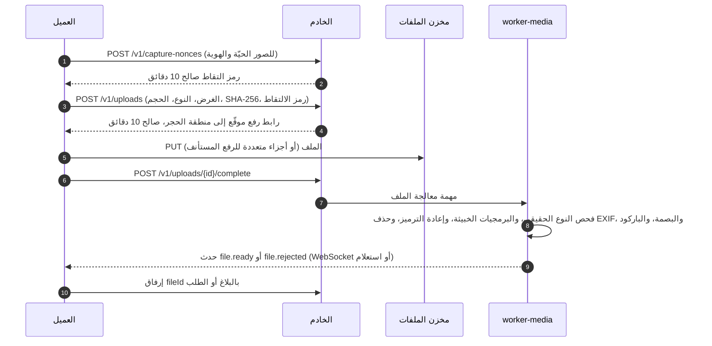

| القاعدة | التفصيل |
|---|---|
| الرفع المباشر | العميل يرفع مباشرة إلى مخزن الملفات بالرابط الموقّع، والرابط يقيّد النوع والحجم الأقصى (10 ميغابايت ⚙️) |
| الرفع المستأنف | الملفات فوق 5 ميغابايت ترفع بأجزاء متعددة موقّعة، فيُستأنف الرفع من آخر جزء ناجح عند الانقطاع (08 §4) |
| الإرفاق | لا يُرفق إلا ملف حالته `ready`، رفعه الفاعل نفسه، وغرضه يطابق الحقل، ولم يُرفق بكيان آخر من قبل |
| الالتقاط من التطبيق | صور الهوية والصورة الحيّة وصور التسجيل الذاتي وصور الإرجاع (STORE-11) تتطلب رمز التقاط صادراً للحساب نفسه قبل فتح الكاميرا، لمرة واحدة. وفي الاستعادة بالهوية يصدر رمز الالتقاط لطلب الاستعادة لا لحساب (`capture_nonces.recovery_id`)، بتقديم رمز الاستعادة. فلا تُقبل صورة من المعرض لهذه الأغراض (D-32، D-39). وتحليل الالتفاف على ذلك في [نموذج التهديد](20-threat-model.md) |
| تعطّل الملفات (§11.6) | إذا تعطّل المخزن أو الفحص أو عامل الوسائط: **بلاغ السرقة يُقبل** وأدلته في حالة `uploaded` أو `processing` مرتبطة به، وتُطبَّق الحمايات فوراً، وتبدأ مهلة مراجعته حين تصبح أدلته `ready`، والملف المرفوض يحوّله إلى `needs_info`. أما توثيق الهوية وشراء المحل فيُرفضان بـ `MEDIA_UNAVAILABLE` (503) مع حفظ المسودة. والوثائق المولّدة تبقى بإعادة المحاولة وإعادة التوليد |
| كشف المخزن | المخزن لا يُكشف إلا عبر وكيل عكسي يسمح بـ PUT الموقّع إلى `quarantine/`، وGET الموقّع من `documents/` و`exports/` وأصناف `evidence` غير الحساسة جداً، وGET المجهول من `public-assets/` فقط. ويحجب واجهة الإدارة ولوحة التحكم والسرد والوصول المجهول، والرابط الموقّع يربط الطريقة والمفتاح الكامل ونوع المحتوى ومدى الحجم. وفحص يومي للإعداد ومسبار خارجي في المراقبة الاصطناعية. وكل مضيف يتصل به التطبيق (الواجهة، وWebSocket، والملفات، والتحديثات، و`www`) مثبّت الشهادة ([نموذج التهديد](20-threat-model.md) §11.3) |
| التفاصيل | المعالجة الكاملة في §12 |

### 3.12 WebSocket

| البند | التفصيل |
|---|---|
| العناوين | `wss://<admin-domain>/ws`، و`wss://<police-domain>/ws`، و`wss://api.<domain>/ws` (التطبيق)، و`wss://www.<domain>/ws` (الموقع) |
| مصادقة الموظفين | كوكي الجلسة عند فتح الاتصال، مع التحقق من ترويسة `Origin`. وتُعاد مطابقة الجلسة كل 60 ثانية، وتُغلق القناة فور إنهاء الجلسة |
| مصادقة الجمهور | تذكرة قصيرة من `POST /v1/ws-tickets` صالحة 60 ثانية ولمرة واحدة، تُمرَّر في أول رسالة بعد فتح الاتصال لا في الرابط |
| الاتجاه | من الخادم للعميل فقط. والعميل يرسل `subscribe` و`unsubscribe` و`ack` فقط |
| صلاحية الاشتراك | كل اشتراك يمر بمحرّك الصلاحيات نفسه (§5) مع النطاق والسبب |
| الضمان | أفضل جهد. الحقيقة في الواجهة البرمجية: عند إعادة الاتصال يطلب العميل التغييرات منذ آخر مؤشر عبر REST |
| نبض الاتصال | كل 25 ثانية، وإعادة اتصال بتأخير متزايد مع عشوائية |
| الغلاف | `{ "channel", "event", "id", "occurredAt", "data" }`، والبيانات ملخصة دون حقول حساسة جداً. والتفاصيل تُجلب بـ REST بالصلاحية |

| القناة | النطاق | من يشترك | ما يصل |
|---|---|---|---|
| `admin.queues` | الإدارة | من له صلاحية أي قائمة عمل | تغيّر أعداد قوائم العمل ومهلها |
| `admin.alerts` | الإدارة | `alert.view` | التنبيهات الأمنية وتنبيهات الشبكة |
| `police.alerts.gov.{governorateId}` | الأمن | العناصر الذين يشمل نطاقهم المحافظة | تنبيهات المحافظة لحظياً (PP-05) |
| `police.alerts.all` | الأمن | الإدارة المركزية | كل التنبيهات |
| `tracking.device.{deviceId}` | الإدارة والأمن | من فتح الخريطة بسبب مسجّل (TRACK-08) ضمن نطاقه | نقاط جديدة وحالة الجلسة (TRACK-01) |
| `ticket.{ticketId}` | الإدارة | الموظف المكلّف | رسائل جديدة |
| `user.{userId}` | الجمهور | المستخدم نفسه | إشعار جديد، وتغيّر حالة بلاغ أو طلب |
| `handoff.{handoffId}` | الجمهور | صفحة الموقع التي أصدرت الرمز | استلام الرمز وإكمال الخطوة (HANDOFF-02) |
| `check.{checkId}` | الجمهور | من يحمل رمز الفحص | اكتمال المؤشرات المتأخرة (GSMA-01) |
| `upload.{fileId}` | الجمهور | رافع الملف | `file.ready` أو `file.rejected` |

### 3.13 الربط البرمجي للشركات (BIZAPI)

| البند | التفصيل |
|---|---|
| المفاتيح | لكل عميل معتمد بعقد (BIZAPI-01) مفتاحان نشطان كحد أقصى لتدوير دون توقف. المعرّف العلني بصيغة `bk_live_` يليه 24 حرفاً، والسر 256 بت يُعرض مرة واحدة عند الإنشاء ويُخزَّن مشفّراً (🔐) لأن التحقق من التوقيع يحتاجه. ومفاتيح الاختبار (`bk_test_`) تُنشأ من موقع بيئة التجريب وحده، ولا مفتاح اختبار في الإنتاج. وعند الإنشاء يختار مسؤول العميل **نطاقات المفتاح** من نطاقات عقده، و**قائمة عناوينه**، وموعد انتهائه (الافتراضي ⚙️ `bizapi.key.default_ttl`) |
| استلام السر | لا يُنشأ مفتاح إنتاج إلا بعد اعتماد العميل والعقد والدفعة (SOP-70: المشرف التجاري والمدير العام). ثم **يُنشئه مسؤول العميل بنفسه من لوحة الربط البرمجي في الموقع** (S-BIZ-01 لوحة الاشتراك والحصة والاستخدام، وS-BIZ-02 المفاتيح، وS-BIZ-03 الأعضاء حيث يدعو المسؤول مطوّراً، وS-BIZ-04 الاستخدام والفواتير بحالتها فقط، عبر `api-clients/{id}/keys` و`/members` و`/usage` من الموقع وحده بـ `X-App-Platform: web`؛ حساب شخصي مؤكَّد الرقم مرتبط بالعميل في `api_client_users`، بإعادة تحقق: كلمة المرور + رمز)، فيُعرض السر **مرة واحدة فقط** في تلك الصفحة مع زر نسخ وتنزيل ملف، ثم لا يمكن عرضه مرة أخرى لأحد، ولا حتى للإدارة. **ولا يُرسل السر أبداً عبر واتساب أو SMS أو الإيميل**، ولا يراه موظف المنصة. ومسؤول العميل الأول يدعوه المشرف التجاري من S-ADM-41 («دعوة مسؤول العميل»)، ويقبل المدعو (ومن يدعوهم المسؤول لاحقاً) الدعوة برابط عميق إلى S-AUT-11. والعميل `pending` أو بلا عقد أو دفعة معتمدة تعرض له S-BIZ-02 حالة «بانتظار الاعتماد» ولا تسمح بإنشاء مفتاح. ومفتاح الوكيل (`importer.devices.register`) ينشئه صاحب الوكيل من لوحته بالطريقة نفسها |
| التدوير والإلغاء | ذاتيان من اللوحة نفسها بإعادة التحقق: «مفتاح جديد» ينشئ الثاني بجانب الأول (حد مفتاحين نشطين)، ثم «إلغاء» القديم بعد انتقال الأنظمة إليه. والإلغاء فوري في كل النسخ (ذاكرة التحقق تُبطل بحدث `bizapi.key.revoked`). والإدارة تلغي أي مفتاح فوراً عند الاشتباه (`bizapi.client.manage`)، ويُشعَر مسؤول العميل. **وشاشة الإدارة لعملاء الربط تعرض معرّفات المفاتيح وبادئاتها فقط**، مع العميل والعقد والحصة والاستخدام وزر الإلغاء، ولا تنشئ سرّاً ولا تعرضه أبداً. وكل إنشاء أو إلغاء يُسجَّل بمعرّف المفتاح لا بسرّه |
| الترويسات | `X-Api-Key`، و`X-Timestamp` (ثوانٍ Unix)، و`X-Nonce` (عشوائي 128 بت)، و`X-Signature` |
| التوقيع | `HMAC-SHA256(secret, METHOD + "\n" + PATH + "\n" + QUERY مرتّبة + "\n" + TIMESTAMP + "\n" + NONCE + "\n" + hex(SHA-256(body)))` بترميز base64url |
| الإعادة | فرق الوقت المسموح ±5 دقائق، و`X-Nonce` يُحفظ 10 دقائق ويُرفض تكراره. الخطأ: 401 `BIZAPI_SIGNATURE_INVALID` |
| النطاقات | لكل مفتاح نطاقاته (`bizapi.check`، `bizapi.history`، `importer.devices.register`) وقائمة عناوينه **على المفتاح نفسه** (`api_keys.allowed_ips`) يحرّرها مسؤول العميل في S-BIZ-02: اختيارية لمفاتيح القراءة، و**إلزامية لكل مفتاح بنطاق كتابة**، وTLS 1.2 فما فوق |
| مفتاح الكتابة | بفئة الإساءة `partner_write` (§3.8): سقف أسطر يومي ⚙️، وإشعار لصاحب الوكيل بكل دفعة مع «لم أكن أنا» الذي يوقف المفتاح ويجمّد الدفعة للمراجعة |
| الحصص | حسب الباقة المفعّلة (BIZAPI-03): حصة شهرية ومعدل في الثانية. الحصة المستنفدة: 429 `BIZAPI_QUOTA_EXCEEDED`، والترويسات تعرض المتبقي |
| السجل | كل طلب في `commerce.api_usage_events`، ويُجمَّع يومياً للفوترة (BIZAPI-04) |
| المحتوى | نتيجة الفحص بالصيغة العامة نفسها دون أي بيانات شخصية (BIZAPI-05). وفحص جهاز مبلّغ عنه يُطلق إشعار صاحبه وتنبيه الإدارة كأي فحص، مع تسجيل الشركة الفاحصة |
| تغيير مالك المستأجر (D-107) | عند `tenant.owner_changed` تُلغى كل مفاتيح عملاء الربط المربوطين بالمستأجر (ومنها مفتاح الكتابة `importer.devices.register`)، ويُزال من `api_client_users` من دعاهم المالك القديم، وتُعطَّل نقاط الإشعار البرمجي للعميل حتى يعيد المالك الجديد تأكيدها، وينشئ المالك الجديد مفاتيحه من جديد (§8.4 د) |
| الوكلاء | الوكيل الموثّق يستطيع تسجيل الأجهزة بالجملة عبر `POST /v1/importers/{importerId}/batches` بمفتاح مربوط بالوكيل نفسه ونطاق `importer.devices.register` (IMPORTER-03). وهذا المفتاح **وظيفة التزام**: يحمل `x-feature: module.importers` (مفعّل يوم الإطلاق) ومسار `protected`، ولا يحتاج اشتراك ربط ولا فوترة، ولا يتأثر بمفتاح `commerce.bizapi` ولا بحصص الربط التجاري، وحدوده حدود فئة `partner_write` وحدها. وإدارته من لوحة الوكيل (P-5) |

### 3.14 نقاط ربط الشركاء والمزوّدين

| النقطة | المرسل | المصادقة | الغرض |
|---|---|---|---|
| `POST partners/v1/telecom/{operator}/events` | شركة الاتصالات | mTLS + توقيع الرسالة | أحداث الاستخدام وتكرار IMEI (TELCO-02، TELCO-08) |
| `POST partners/v1/telecom/{operator}/location-updates` | شركة الاتصالات | mTLS + توقيع | تحديثات الموقع لجلسة التتبّع (TELCO-13) |
| `POST partners/v1/telecom/{operator}/acks` | شركة الاتصالات | mTLS + توقيع | تأكيد تنفيذ طلبات القوائم وإيقاف الخط (TELCO-09، LINE-01) |
| `POST partners/v1/telecom/{operator}/sim-history-answers` | شركة الاتصالات | mTLS + توقيع | جواب استعلام سجل الشريحة إن كان غير متزامن (TELCO-12) |
| `POST partners/v1/customs/feed` | الهيئة الناظمة | mTLS | دفعات الأجهزة المسجّلة إن كان الاتفاق دفعاً لا سحباً (CUSTOMS-03) |
| `POST partners/v1/wallets/{provider}/callbacks` | مزوّد المحفظة | mTLS أو توقيع المزوّد | حالة التجميد (WALLET-02)، وحالة الدفع الآلي إن وُجد |
| `POST partners/v1/shamcash/callbacks` | شام كاش | mTLS + توقيع | شحن محافظ المحلات، ونتيجة السحب والخصم والاسترداد (SHOPWALLET-02، SHOPWALLET-03) |
| `POST partners/v1/topup/{operator}/callbacks` | سيريتل أو MTN | mTLS + توقيع | نتيجة التعبئة المعلّقة (TOPUP-02) |
| `POST partners/v1/couriers/{courier}/events` | شركة الشحن المرتبطة برمجياً | mTLS أو توقيع | الاستلام والتسليم والقبض برموزها (STORE-09) |
| `POST hooks/v1/whatsapp` | Meta | `X-Hub-Signature-256` | رسائل البوت ورقم الدعم وحالات التسليم |
| `POST hooks/v1/sms/{gateway}` | بوابة SMS | توقيع البوابة وقائمة عناوين | رسائل الرقم القصير وتقارير التسليم |

| القاعدة | التفصيل |
|---|---|
| خزّن ثم عالج | كل رسالة واردة تُخزَّن كما هي مشفّرة (🔐) في `ops.inbound_messages`، ثم يُرد بـ 202، ثم تُعالج في مهمة خلفية (TELCO-11). ونقاط الاستقبال **مسار `protected`** (§14.3): تُخزَّن وتُعالج في كل حالات مفاتيح التشغيل، ولا يرد بـ 503 إلا إيقاف طارئ لاختراق الشريك نفسه فيعيد الشريك الإرسال لاحقاً |
| الإشعار الوارد تلميح لا حقيقة | أي انتقال يحرّك مالاً (شحن وارد، ونتيجة سحب، وخصم، ونتيجة تعبئة، وقبض عند الاستلام) **لا يلتزم بالإشعار الوارد وحده**: يلتزم فقط حين يؤكد استعلام الحالة الصادر منا عبر القناة المصادَقة (أو رد طلبنا الأصلي) المرجعَ نفسه والمبلغ نفسه. والاختلاف يضع العملية في `held` ويفتح تنبيه كشف (§11.5) |
| وسائط واتساب الواردة | يجلب العامل الوسائط من نقطة وسائط Meta وحدها (مضيف مسموح، ومعرّف إشعار موقّع)، فتدخل `quarantine` ثم مسار الملفات كاملاً (§12.2) ثم `evidence` قبل أن يفتحها أي موظف. والأنواع غير المدعومة تُسقط برد ثابت |
| عدم التكرار | قيد تفرّد على (المصدر، المعرّف الخارجي)، والتكرار يرد بـ 202 دون معالجة ثانية |
| الشهادات | الشريك يقدّم شهادة عميل صادرة من سلطة المنصة الخاصة (Vault PKI) أو من سلطته المعتمدة بالاتفاق، وبصمتها مربوطة بسجل الشريك. والمنصة تقدّم شهادتها في الطلبات الصادرة |
| الصيغة | كل شريك له ملف عقد خاص بإصدار مستقل. وإن فرض الشريك صيغة مختلفة (SOAP أو ملفات SFTP)، يترجمها محوّله إلى الصيغة الداخلية نفسها (§11) |

## 4. المصادقة لكل نطاق هوية

قواعد التهديد وحالات الإساءة لكل مسار هنا في [نموذج التهديد](20-threat-model.md)، والإجراء البشري لاستعادة الحساب عبر الدعم في [إجراءات التشغيل](23-operations-sops.md).

### 4.1 نظرة عامة

| النطاق | من | العوامل | الجلسة | التخزين لدى العميل |
|---|---|---|---|---|
| الجمهور | المواطنون، وأصحاب المحلات وموظفوهم، ومحلات الصيانة، والوكلاء وموظفوهم، والمورّدون المعتمدون ومستخدموهم (D-87)، ومندوبو الشحن. والمورّد ومندوب الشحن يعملان من الموقع فقط، ولا وضع لهما في التطبيق | كلمة مرور + رمز تحقق على الرقم الأساسي للجهاز الجديد والإجراءات الحساسة | رمز دخول 15 دقيقة ⚙️ + رمز تجديد دوّار 30 يوماً ⚙️ مرتبط بسجل الجهاز | التطبيق: الرمز التجديدي في Keychain أو Keystore، ورمز الدخول في الذاكرة فقط. الموقع: كوكي `__Host-` واحد، والرموز عند خادم Next.js (§4.2.6) |
| الإدارة | موظفو لوحة الإدارة | كلمة مرور + WebAuthn إلزامي للمدير العام والإدارة المركزية وكل دور يكشف أو يصدّر أو يتتبّع أو يبحث بالرقم الوطني، وTOTP لغيرهم مع قائمة عناوين مسموحة إلزامية (D-125) | جلسة على الخادم، خمول 30 دقيقة ⚙️ وحد مطلق 8 ساعات ⚙️، جلسة واحدة لكل حساب ⚙️ | كوكي `__Host-` فقط |
| الأمن | مسؤولو الأمن والعناصر | كلمة مرور + WebAuthn إلزامي لمسؤولي الأمن والإدارة المركزية ولكل عنصر يبحث بالرقم الوطني أو يتتبّع، وTOTP لغيرهم مع قائمة عناوين مسموحة إلزامية (D-125) | مثل الإدارة | كوكي `__Host-` فقط |
| الآلات | عملاء الربط البرمجي، والشركاء الرسميون، ومزوّدو الخدمات | مفتاح + توقيع HMAC، أو mTLS، أو توقيع المزوّد | دون جلسة: كل طلب يُصادَق وحده | أسرار في خزنة الطرف الآخر |

### 4.2 الجمهور

#### 4.2.1 إنشاء الحساب (AUTH-01، ROLLOUT-01)

1. `POST /v1/auth/sign-up` برقم الموبايل وكلمة المرور، مع ALTCHA.
2. إن كان وضع الدعوات مفعّلاً ⚙️ والرقم غير مدعو: 403 `ROLLOUT_INVITE_REQUIRED`.
3. كلمة المرور: Argon2id، وطول أدنى 8 أحرف ⚙️، وفحص قائمة كلمات المرور المسرّبة الشائعة (07 §5).
4. **بوابة العمر:** إقرار واحد «عمري 18 سنة أو أكثر» يُحفظ في `users.age_confirmed_at`، ولا يُطلب تاريخ الميلاد ولا يُخزَّن. ومن عمره دون 18 سنة لا ينشئ حساباً مستقلاً، ويدخل فقط بدعوة من وليّ أمره مستخدماً مفوّضاً على جهازه، فيحمل حسابه `users.minor_managed = true` بقيوده: الجهاز المفوّض عليه فقط، وبلاغه فقط، ولا رسائل تجارية ولا متجر ولا باقات ولا إعلانات (PRIV-09، D-97، [الخصوصية](21-privacy-dpia.md) §10.2). ويُرفع العلم عند توثيق هويته بعد بلوغ 18 سنة.
5. **منع كشف الحسابات:** الرد واحد دائماً (202 «أرسلنا رمزاً»). إن كان الرقم مسجّلاً يصل لصاحبه على واتساب «يوجد حساب بهذا الرقم، سجّل الدخول أو استعد كلمة المرور» بدل الرمز.
6. يُنشأ حساب بحالة `pending_phone` ورمز تحقق بغرض `sign_up`. وتأكيد الرمز يجعل الحساب `active` بمستوى `phone_verified`، ويُصدر أول جلسة ويُوثَّق الجهاز.
7. الحساب الذي لم يُؤكَّد خلال 24 ساعة يُحذف نهائياً (لا بيانات فيه سوى الرقم).
8. **الهوية المعلنة قبل التوثيق:** الاسم الكامل والرقم الوطني (أو الوثيقة البديلة، D-104) والمحافظة التي يدخلها المستخدم تُحفظ في `users.declared_full_name` و`declared_national_id_enc` و`declared_national_id_bidx` و`declared_national_id_mask` و`declared_at`، بقيد تفرّد على البصمة لكل حساب غير مغلق (AUTH-07 لغير الموثّقين)، والتصادم يرد بـ `AUTH_NATIONAL_ID_TAKEN` ويتبع جدول الحالات في [إجراءات التشغيل](23-operations-sops.md) SOP-12. و`users.person_id` لا يُضبط **إلا** بالربط التلقائي (بصمة الرقم المعلن تطابق بصمة الشخص، **و**الرقم المؤكَّد هو رقم الطرف في معاملة محل مكتملة لذلك الشخص) أو بالتوثيق. وقبل ذلك تبقى «أجهزتي» فارغة، ومطابقة طلب النقل الوارد تستخدم بصمة الرقم المعلن. والشخص يُبحث عنه أو يُنشأ ببصمة رقمه تحت قفل استشاري (§7.6). وأسبقية `persons.full_name`: اسم السجل المدني، ثم الاسم الذي وثّقه المشرف، ثم اسم الطرف في آخر معاملة محل مكتملة، ثم استيراد الأمن. والاسم المعلن لا يكتب فوق اسم شخص أبداً، وكل تغيير يُكتب في `state_transitions`.
9. **إعادة التسجيل بعد الإغلاق:** تنفيذ إغلاق الحساب (§8.5) يضبط `users.phone_released_at` ويفرّغ `phone_e164` و`person_id` (ويبقيان في `state_transitions` والتدقيق). وقيد التفرّد على الرقم يشمل الحسابات التي لم يُحرَّر رقمها فقط، وعلى الشخص الحسابات غير المغلقة فقط. فيفتح الشخص نفسه حساباً جديداً برقمه ويستعيد أجهزته وفواتيره بالربط التلقائي أو بالتوثيق، لأن الأشخاص والملكيات والفواتير باقية. والحساب المحظور يحتفظ بربط شخصه.
10. **الحظر على الشخص (D-106):** قيد `person_ban` (§5.11) على الشخص برقمه الوطني يمنع طوال مدته فتح حساب آخر بالرقم نفسه وملكية محل أو العمل فيه وأن يكون جهة موثوقة، ويُفحص عند إعلان الرقم الوطني وعند التوثيق وعند تفعيل العضوية وعند قبول دعوة الجهة الموثوقة. والرد `AUTH_PERSON_BANNED` **بعد** إثبات حيازة الرقم فقط حتى لا يصبح كاشفاً للوجود. ويبقى للمحظور فحص أجهزته، وبيع جهازه في محل طرفاً في معاملة، والتواصل مع الدعم.

#### 4.2.2 رموز التحقق (OTP)

| القاعدة | القيمة |
|---|---|
| الطول | 6 أرقام عشوائية من مولّد آمن |
| الصلاحية | 5 دقائق ⚙️ |
| محاولات الإدخال | 5 ⚙️ لكل رمز، ثم يُبطل |
| عدد الرموز | 5 ⚙️ في الساعة لكل رقم |
| إعادة الإرسال | بعد 60 ثانية ⚙️ |
| التخزين | بصمة HMAC-SHA256 للرمز، لا الرمز نفسه، مرتبطة بالغرض والرقم والسياق (مثل معرّف طلب النقل) |
| القناة | واتساب بقالب مصادقة. وإن فشل الإرسال أو أفاد واتساب بأن الرقم غير مسجّل لديه، يُرسل عبر SMS فوراً. وإن لم تصل حالة التسليم خلال ⚙️ 60 ثانية يُرسل **الرمز نفسه** عبر SMS تلقائياً (لا رمز جديد). ويستطيع المستخدم طلب SMS بعد مهلة إعادة الإرسال |
| الأغراض | `sign_up`، `login_new_device`، `password_reset`، `phone_change_old`، `phone_change_new`، `transfer_confirm`، `step_up`، `phone_restore`، `alternate_verify`، `trusted_invite`، `wallet_withdraw`، `recovery_new_phone` (تأكيد حيازة الرقم الجديد عند بدء الاستعادة بالهوية فقط، §4.2.10) |
| رمز السحب (`wallet_withdraw`) | يُرسل أولاً **إشعار المعاملة** (قالب UTILITY 297: المبلغ وآخر 4 خانات من وجهة السحب)، ثم رسالة الرمز بقالب AUTHENTICATION، فلا يُعطى رمز دون أن يرى صاحبه ما سيوقّع عليه. ونص SMS البديل يحمل الرمز مع المبلغ وآخر 4 خانات من الوجهة ([نموذج التهديد](20-threat-model.md) CT-128، [كتالوج المحتوى](24-content-catalog.md) §3.1) |
| الوجهة | **الرقم الأساسي للحساب فقط** لكل الأغراض، عدا `alternate_verify` (تأكيد الرقم البديل نفسه، THEFT-02) و`phone_change_new` و`recovery_new_phone`. ولا يُرسل أي رمز للرقم البديل لاستعادة الحساب أو لأي إجراء حساس أبداً (D-81) |
| الرقم المسروق | إذا كان الرقم الأساسي معلَّماً «مسروقاً» (THEFT-03)، لا يُرسل إليه أي رمز. و`AUTH_PHONE_COMPROMISED` (مع إرشاد شريحة بدل ضائع أو الاستعادة بالهوية) يُعاد **داخل جلسة مصادَقة فقط**. أما الطلب دون جلسة (استعادة كلمة المرور، والدخول من جهاز جديد) فيتلقى الرد الموحّد نفسه دائماً (CT-13): «إن كان الرقم صالحاً سيصلك رمز»، دون إرسال رمز، والإرشاد إلى الاستعادة بالهوية في النص العام |
| لا يُحفظ الرمز أبداً | قيمة الرمز من فئة `secret_ephemeral` (§20.12): لا تُكتب في `notifications` ولا صندوق الصادر ولا المهام المجدولة ولا الرسائل الميتة ولا حمولات `ops.integration_calls`. صف الإشعار يحمل `otp_challenge_id` فقط، والعامل المرسل يأخذ الرمز من خانة عابرة مشفّرة مدتها مدة صلاحية الرمز وتُحذف حين يقبل المزوّد الرسالة. والتسليم الفاشل لفئة `otp` لا يعيده موظف ولا يدخل الرسائل الميتة بمحتواه: المستخدم يطلب رمزاً جديداً، و«إعادة الإرسال» من لوحة الدعم تُصدر تحدياً **جديداً** لرقم المستخدم نفسه. وسجل الرسائل في اللوحة يعرض لفئتي `otp` و`security` مفتاح القالب والقناة والحالة فقط. واختبار «رمز كناري» يثبت غياب الرمز من كل جدول وسجل وتتبّع وإطار WebSocket ورد للإدارة |
| انقطاع إيصال الرموز | إذا فُتح قاطعا واتساب وSMS معاً أكثر من ⚙️ 5 دقائق أو أعلنته المناوبة (`system.otp_outage.declare`)، يدخل وضع «انقطاع إيصال الرموز» (§11.6)، **ويسجّل دخوله آلياً نافذة عطل** (`maintenance_windows.kind = incident`) فتُنقل مهل `WALL_USER` المتأثرة (§10.1)، وتُعاد الإشعارات الحرجة الفاشلة عند التعافي: يبقى الفحص، والجلسات القائمة، ومعاملات المحل من الأجهزة المربوطة، وتقديم البلاغ من جلسة قائمة بإعادة تحقق بكلمة المرور، وجلسة «بلاغ السرقة فقط»، ودخول الموظفين. ويُرفض بـ `AUTH_OTP_DELIVERY_FAILED` إنشاء الحساب، والدخول من جهاز جديد، واستعادة كلمة المرور، وكل إعادة تحقق برمز. ولا قناة بديلة للرمز (لا للرقم البديل D-81، ولا للإيميل D-126). والإرسال الفاشل لا يُحسب من حصة الرموز في الساعة |
| حد سعة واتساب | خطأ «بلوغ حد الرسائل» أو الخنق من Meta **خطأ سعة** لا خطأ مؤقت: الرمز والرسالة الحرجة تذهبان إلى SMS فوراً دون محاولات، وغير الحرجة تنتظر النافذة التالية أو تبقى داخل المنصة، وعدّاد المحاولات لا يتغير. ودرجة الرقم والهامش المتبقي في صحة النظام مع تنبيه عند 80% |

#### 4.2.3 تسجيل الدخول والقفل (AUTH-02)

- `POST /v1/auth/login` بالرقم وكلمة المرور ومعرّف الجهاز.
- **القفل أولاً لكل مصدر** ([نموذج التهديد](20-threat-model.md) §6.4)، حتى لا يستطيع مهاجم قفل حساب الضحية عن بُعد: بعد 5 إخفاقات ⚙️ متتالية لحساب **من المصدر نفسه** (معرّف الجهاز، أو العنوان مع بصمة المتصفح) يُقفل الدخول لهذا الحساب من هذا المصدر 15 دقيقة ⚙️، وبعد 5 أخرى ساعة ⚙️. والحالة في Redis بمفتاح (الحساب، المصدر)، وتعود للصفر عند النجاح.
- **قفل الحساب كله** فقط بعد ⚙️ 20 إخفاقاً خلال 24 ساعة من أي مصادر (`users.login_locked_at`)، ويفكّه صاحبه بنفسه بإعادة تعيين كلمة المرور برمز، مع إشعار أمني على كل القنوات (CT-12).
- ALTCHA إلزامي من الإخفاق ⚙️ الثاني للحساب أو المصدر. وللعنوان: ⚙️ 20 إخفاقاً خلال 15 دقيقة تفرض ALTCHA لكل محاولاته ثم الصعوبة المرتفعة (`login.ip.altcha`)، **ولا رفض بالعنوان وحده** ([قواعد العمل](06-business-rules.md) §8، [نموذج التهديد](20-threat-model.md) §6.4): الرفض على المصدر والحساب كما أعلاه، والعنوان يخضع لحد الفيضان الخشن وحده، مع مراعاة العناوين المشتركة (§3.8).
- الرد على كلمة مرور خاطئة أو رقم غير موجود واحد: `AUTH_INVALID_CREDENTIALS`. والعدّادات والعتبات وتوقيت الرد متطابقة للحساب الموجود وغير الموجود (فئة `auth_code`، §3.8)، واستعادة كلمة المرور ترد الرد الموحّد دائماً، ومن رقمه معلَّم مسروقاً يعرف الإرشاد من نص عام («إن لم يصلك رمز فاستعد حسابك بالهوية»).
- كلمة المرور تُطبَّع بـ NFKC قبل Argon2id، بالطريقة نفسها عند الضبط والتحقق.

#### 4.2.4 ربط الجهاز

| البند | التفصيل |
|---|---|
| سجل الجهاز | لكل جهاز يدخل منه المستخدم صف في `user_devices`: معرّف يولّده التطبيق عند أول تشغيل ويحفظه في التخزين الآمن، والمنصة، والطراز، وإصدار التطبيق، ورمز الإشعارات. وفي الموقع: معرّف عشوائي يحفظه خادم Next.js في سجل جلسة الموقع المرتبط بكوكي `__Host-sid` الوحيد (§4.2.6) |
| مفتاح الجهاز | التطبيق يولّد زوج مفاتيح P-256 داخل العتاد الآمن (Secure Enclave أو Keystore)، ويسجّل المفتاح العام عند الدخول. وكل طلب تجديد يحمل إثباتاً موقّعاً بالمفتاح الخاص في ترويسة `X-Device-Proof`، فلا يعمل رمز تجديد مسروق من جهاز آخر |
| الجهاز الجديد | الدخول من جهاز غير موثّق يتطلب رمز تحقق على الرقم الأساسي بغرض `login_new_device`. ⚙️ يُطبَّق على كل الحسابات افتراضياً، ويبقى إلزامياً دائماً لأعضاء المحلات والوكلاء (07 §5) |
| إشعار | كل جهاز جديد يُوثَّق يُبلَّغ به صاحب الحساب على واتساب وداخل المنصة، ولصاحب المحل عند دخول موظف من جهاز جديد. ومعه زر «لم أكن أنا» (CT-12) |
| «لم أكن أنا» | متاح من الأجهزة المربوطة **قبل** الحدث، ومن رابط لمرة واحدة صالح ⚙️ 7 أيام في الرسالة إلى الرقم القديم (`/n/{token}` بإجراء `not_me_freeze` وحده، §13.3). يجمّد الحساب فوراً (`users.frozen_by_owner_at`): تُمنع كل الإجراءات الحساسة، وتُنهى كل الجلسات، وتُلغى طلبات النقل المعلّقة، وتُجمَّد محفظة المحل إن كان صاحب محل (CT-105)، ويُفتح طلب دعم بأولوية عاجلة |
| فك التجميد | بطريقين فقط: (1) إعادة تعيين كلمة المرور برمز على الرقم الأساسي **من جهاز كان مربوطاً بالحساب قبل التجميد** (`user_devices.trusted_at < frozen_by_owner_at` مع إثبات مفتاح الجهاز)، أو (2) التحقق من الهوية عبر الدعم (§4.2.10، §8.14). ثم تبدأ فترة التهدئة (§4.2.8). فلا يستطيع من بدّل الشريحة أن يفك التجميد من جهازه الجديد ([نموذج التهديد](20-threat-model.md) §6.7) |
| سلامة التطبيق | النقاط الحساسة (الدخول من جهاز جديد، والتجديد، ومعاملات المحل، ورفع صور الهوية) تتطلب إثبات سلامة التطبيق والجهاز حسب سياسة الدور في [نموذج التهديد](20-threat-model.md) §11.2. **Play Integrity** بطلب كلاسيكي بنونس من الخادم مربوط ببصمة الإجراء ويُفك محلياً، وحكم مخزّن ⚙️ 24 ساعة للنقاط التي لا تحتاج إثباتاً جديداً، وتنبيه عند 70% من الحصة اليومية. وعند أي خطأ أو تعذّر أو نفاد حصة **يتحول آلياً إلى Android Key Attestation**، ولأجهزة هواوي دون خدمات Google يُقبل إثبات HMS بالتحقق في الخادم، وفي iOS App Attest. والرفض بـ `AUTH_ATTESTATION_FAILED` على **حكم سلبي** من الآلية المتاحة فقط، لا لأن خدمة Google لا تُصل. والجهاز الذي لا تتوفر له أي آلية «غير مُثبَت»: وظائف المواطن تعمل مع علامة، ووظائف المحل والمحفظة ونقطة البيع تُرفض برسالة تنصح بجهاز قابل للإثبات (P-6) |

#### 4.2.5 الرموز والتجديد الدوّار مع كشف إعادة الاستخدام

| البند | التفصيل |
|---|---|
| رمز الدخول | JWT موقّع بـ ES256، والمفتاح في الخزنة مع معرّف `kid` للتدوير. الحقول: `sub` (المستخدم)، و`sid` (الجلسة)، و`did` (الجهاز)، و`aud`، و`iat`، و`exp` (15 دقيقة ⚙️)، و`jti`، و`av` (إصدار الصلاحيات). لا أدوار ولا بيانات شخصية في الرمز |
| التحقق | التوقيع والمدة والجمهور، ثم فحص سريع في Redis لقائمة الجلسات الملغاة (`revoked_sid`) لمدة صلاحية رمز الدخول. فالإنهاء نافذ فوراً دون انتظار انتهاء الرمز |
| رمز التجديد | قيمة عشوائية 256 بت مبهمة، يُخزَّن منها SHA-256 فقط في `refresh_tokens`، صالح 30 يوماً ⚙️ من إصداره، ويُستخدم مرة واحدة |
| التدوير | كل تجديد يصدر رمز دخول ورمز تجديد جديدين، ويعلّم القديم «مستخدماً» ويربطه بخلَفه |
| كشف إعادة الاستخدام | تقديم رمز تجديد مستخدم سابقاً = سرقة محتملة: تُلغى الجلسة كلها (كل رموز العائلة)، ويُبلَّغ المستخدم، ويُسجَّل حدث أمني، ويُغذّى كشف الشذوذ |
| مهلة السباق | إذا قُدّم الرمز نفسه مرتين خلال 30 ثانية من الجهاز نفسه وبإثبات جهاز صحيح (انقطاع شبكة أثناء التجديد)، يُصدر زوج جديد ويُبطل الخلَف السابق، دون إلغاء الجلسة |
| انتهاء الجلسة | جلسة لم تُجدَّد خلال 30 يوماً ⚙️ تنتهي |

#### 4.2.6 الموقع على المتصفح

- **نمط BFF** ([نموذج التهديد](20-threat-model.md) §6.9): خادم Next.js يحفظ رمزي الدخول والتجديد في مخزن جلسات الموقع (Redis، مشفّراً)، ويستدعي `api-public` داخلياً بـ `Authorization: Bearer`، ويدير التجديد الدوّار نيابة عن المتصفح. والمتصفح لا يرى أي رمز: **كوكي واحد** `__Host-sid` بخصائص `HttpOnly; Secure; SameSite=Lax; Path=/` يحمل معرّف جلسة الموقع العشوائي (256 بت). ولا رموز في `localStorage` ولا في JavaScript.
- الخمول ⚙️ 30 يوماً، و⚙️ 12 ساعة لوظائف المحل والوكيل والمورّد ومندوب الشحن في الموقع. والخروج يُبطل رمز التجديد في الخادم ويرسل `Clear-Site-Data`.
- معرّف جهاز الموقع (§4.2.4) محفوظ في سجل جلسة الموقع لدى الخادم، لا في كوكي ثانٍ. فالخروج ومسح الكوكيز يجعلان الدخول التالي من المتصفح نفسه «جهازاً جديداً» برمز تحقق، وهذا مقصود.
- حماية CSRF: SameSite=Lax، وفحص `Origin`، وترويسة `X-CSRF-Token` برمز **متزامن مربوط بجلسة الخادم** يُسلَّم داخل الصفحة لكل طلب غير `GET`، لا بالإرسال المزدوج (فلا كوكي ثانٍ مقروء من JavaScript).
- **كوكي واحد في كل الحالات:** الزائر المجهول له جلسة موقع مجهولة في `__Host-sid` نفسه تحمل مفتاح جهاز الزائر (§3.8)، ويُدوَّر معرّفها عند الدخول. وBFF يمرّر عنوان المتصفح ومفتاح الزائر ومعرّف الطلب إلى `api-public` في الترويسة الداخلية المصادَقة (§3.8).
- مخزن جلسات الموقع في Redis مشفّر ومحفوظ بـ AOF. وعند فقدانه كلياً يعيد المستخدمون الدخول ويضيع معرّف جهاز الموقع فيُطلب رمز جهاز جديد، ويُعلَن ذلك بلافتة (§11.6).
- الموقع لا يتعامل مع الكاميرا والموقع الدقيق للخطوات الحساسة، بل يسلّمها للتطبيق (§4.2.12).

#### 4.2.7 إعادة التحقق للإجراءات الحساسة (Step-up)

الإجراء الحساس يتطلب تحققاً حديثاً (خلال 5 دقائق ⚙️)، وإلا يرد بـ `AUTH_STEP_UP_REQUIRED` مع الطرق المطلوبة. فينفّذ العميل `POST /v1/auth/step-up` ثم يعيد الطلب.

| الإجراء | الطريقة | أثناء التهدئة |
|---|---|---|
| إنشاء طلب نقل ملكية (OWN-04) | كلمة المرور + رمز على الرقم الأساسي بغرض `transfer_confirm` مرتبط بطلب النقل | ❌ |
| طلب إغلاق بلاغ (REPORT-11) | كلمة المرور + رمز على الرقم الأساسي | ❌ |
| إصدار شهادة فحص (OWN-09) | كلمة المرور | ❌ |
| إضافة مستخدم مفوّض أو إزالته (OWN-08) | كلمة المرور | ❌ |
| إضافة جهة موثوقة أو إزالتها (TRUSTED-01) | كلمة المرور + رمز على الرقم الأساسي | ❌ |
| إضافة الرقم البديل أو تغييره (THEFT-02) | كلمة المرور + رمز تأكيد يُرسل إلى الرقم البديل نفسه | ❌ |
| تقديم تسجيل ذاتي (OWN-03) | كلمة المرور | ❌ |
| تقديم بلاغ، أو تأكيد بلاغ مفوّض | كلمة المرور | ✅ مع علامة للمراجع |
| تغيير الرقم (AUTH-09) | كلمة المرور + رمز للرقم القديم + رمز للرقم الجديد | يبدأ التهدئة |
| تغيير كلمة المرور | كلمة المرور الحالية، ثم إنهاء كل الجلسات الأخرى | ✅ |
| طلب إغلاق الحساب (PRIV-02)، أو تنزيل نسخة من البيانات (PRIV-01) | كلمة المرور + رمز | ❌ |
| صاحب المحل: إضافة موظف أو تغيير صلاحياته أو حدوده أو إيقافه، وتعديل موقع المحل أو ترخيصه | كلمة المرور | ❌ |
| صاحب المحل: بلاغ سرقة المحل دفعة واحدة (REPORT-18) | كلمة المرور + رمز | ❌ |
| الوكيل: النقل بالجملة (IMPORTER-05) | كلمة المرور + رمز | ❌ |
| صاحب المحل: إنشاء مفاتيح الربط أو تدويرها | كلمة المرور + رمز | ❌ |
| المورّد: تغيير الحساب المستلم للتسوية | كلمة المرور + رمز | ❌ |
| طلب استرداد مبلغ (PAY-04) | كلمة المرور + رمز | ❌ |
| صاحب المحل: السحب من محفظة المحل (SHOPWALLET-03) | **رمز المحفظة** (6 أرقام مختلفة عن كلمة المرور، مخزّنة بـ Argon2id، وقفل بعد 5 محاولات ⚙️) + رمز تحقق على الرقم الأساسي يذكر نصه المبلغ وآخر 4 خانات من الوجهة. ويُرفض السحب وتغيير الوجهة ما دامت إشارة خدمة وصول غير نظامية أو تراكب شاشة قائمة مع إثبات السلامة ([نموذج التهديد](20-threat-model.md) §11.13) | ❌. **وتأخير أمني مؤقت (D-115):** لا سحب خلال ⚙️ 72 ساعة من تغيير الرقم أو استعادة الحساب (قيد `cooldown`)، ولا خلال ⚙️ 24 ساعة من تغيير رمز المحفظة أو إعادة تعيينه (قيد `pin_reset_delay`)، والرد `SHOPWALLET_SECURITY_DELAY` مع `until` (§5.11) |
| صاحب المحل: تغيير محفظة السحب | إعادة مصادقة كاملة (كلمة المرور + رمز المحفظة + رمز)، ولا تُستخدم الوجهة الجديدة قبل ⚙️ 72 ساعة، مع إشعار على كل القنوات | ❌ |
| الموظف: تعبئة رصيد أو دفع من المحفظة فوق حد التنبيه ⚙️ | رمز المحفظة | ✅ من الأجهزة المربوطة قبل التهدئة |
| صاحب المحل: تعبئة أو دفع من المحفظة **بأي مبلغ** | رمز المحفظة، أو فتح ببصمة الجهاز خلال آخر ⚙️ دقيقتين، فلا يستعمل موظفٌ جوّال صاحب المحل المفتوح باسمه | ✅ من الأجهزة المربوطة قبل التهدئة |
| اختيار «الوصي» أو تغييره (D-103) | كلمة المرور + رمز على الرقم الأساسي | ❌ |
| إضافة الإيميل الأمني أو تغييره (D-126، §4.2.15) | كلمة المرور + رمز على الرقم الأساسي | ❌ |
| نقل جهاز إلى محل (D-121) | كنقل الملكية | ❌ |
| صاحب المحل: طلب إغلاق المحل أو نقل ملكيته (§8.4) | كلمة المرور + رمز | ❌ |
| الخلف الموثّق: طلب تغيير مالك محل المتوفى أو إغلاقه (§4.2.16) | كلمة المرور + رمز | ❌ |

**إشارات خطر الجهاز في شاشات المال:** في شاشات المحل والمحفظة ونقطة البيع يكشف التطبيق خدمات الإتاحة المفعّلة من غير النظام وتطبيقات تسجيل الشاشة أو الطبقات العائمة، ويرسل الإشارة مع إثبات السلامة (§4.2.4). وحقول رمز المحفظة ورمز التحقق والمبلغ معلَّمة `setAccessibilityDataSensitive` (أندرويد 14 فما فوق). وسياسة الخادم: **السحب وتغيير وجهته يُرفضان من هذا الجهاز ما دامت الإشارة قائمة** (`SHOPWALLET_DEVICE_RISK`): رفض **لكل جهاز** لا للمحفظة، فالسحب نفسه من جهاز آخر مربوط بالحساب يعمل، وهو ليس بوابة سحب (§5.11). وباقي الوظائف تُعلَّم فقط. ونص رمز السحب يذكر المبلغ وآخر 4 أرقام من الوجهة، فيرى المالك ما يوقّع عليه ([نموذج التهديد](20-threat-model.md) §11.13، [كتالوج المحتوى](24-content-catalog.md)).

**أثناء البلاغ النافذ والرقم مسروق (THEFT-07):** الإجراءات التي تتطلب رمزاً لا تُنفَّذ ذاتياً حتى يستعيد المستخدم رقمه بالمسار أدناه، أو تُنفَّذ عبر الدعم بالهوية. **ولا يُستخدم الرقم البديل عاملاً للتحقق أبداً** (D-81، THEFT-02).

**استعادة الرقم الأصلي بعد بلاغ السرقة** (`POST /v1/me/phone/restore`، [نموذج التهديد](20-threat-model.md) §6.8.4): لا يُرفع إيقاف الرسائل عن الرقم (THEFT-03) إلا بكلمة المرور + رمز بغرض `phone_restore` على الرقم نفسه، **ومعهما إثبات واحد** على أن الشريحة المسروقة لم تعد تعمل، لأن السارق قد يحمل الشريحة نفسها:

| الإثبات | كيف يتحقق الخادم |
|---|---|
| تأكيد شركة الاتصالات أن شريحة الرقم أُعيد إصدارها بعد وقت البلاغ (حيث تتيحه الاتفاقية) | استعلام `telecom_sim_history_queries` عبر المحوّل، والنتيجة «أُعيد الإصدار بعد `reports.incident_at`» |
| طلب إيقاف الخط (LINE-01) نُفّذ ثم أعاد المزوّد تشغيله بشريحة بدل ضائع (LINE-02) | `line_suspension_requests` لرقم الحساب بحالة `reinstated` بعد `executed`، من حدث الشركة أو ردّها على الاستعلام |
| التحقق من الهوية عبر الدعم بالمستوى L3 | عند غياب الإثباتين: طلب `account_recoveries` بغرض `phone_restore` يمر بمراجعة الدعم وموافقة مشرف ثانٍ (§8.14) |

ثم تبدأ فترة التهدئة (§4.2.8)، ويُرسل إشعار على كل القنوات وعلى الرقم البديل (إشعاراً فقط). ودون إثبات يرد الخادم `AUTH_PHONE_RESTORE_PROOF_REQUIRED` مع الطرق المتاحة.

#### 4.2.8 فترة التهدئة بعد تبديل الشريحة أو الاستعادة

| البند | التفصيل |
|---|---|
| ما يطلقها | تغيير رقم الحساب (AUTH-09) بأي طريق، واستعادة الحساب بالهوية (THEFT-06)، وإعادة تعيين كلمة المرور برمز من جهاز غير مربوط بالحساب، وفك تجميد «لم أكن أنا» (§4.2.4)، واستعادة الرقم الأصلي بعد بلاغ السرقة بإثباتها (§4.2.7)، وإشارة «تبديل شريحة» لرقم الحساب من شركة الاتصالات خلال ⚙️ 72 ساعة قبل إجراء حساس إن أتاحها الاتفاق (حدث `account.sim_swap.signaled`، فيُعامل الإجراء كأنه في تهدئة) ([نموذج التهديد](20-threat-model.md) §6.7) |
| الأثر الفوري | إنهاء كل الجلسات عدا الجلسة التي أتمّت الإجراء، وإنشاء قيد `cooldown` (§5.11) حتى الآن + 72 ساعة ⚙️، و`users.cooldown_until` إسقاط له للقراءة فقط |
| قيد إعادة تعيين كلمة المرور | كل إعادة تعيين لكلمة المرور برمز، **حتى من جهاز مربوط** (الجوّال قد يُخطف مفتوحاً)، تنشئ قيد `password_reset_hold` ⚙️ 24 ساعة (`security.password_reset_hold`) يمنع: نقل الملكية للغير، وطلب إغلاق البلاغ، وإصدار الشهادة، وتغيير الجهات الموثوقة أو الرقم البديل أو الإيميل الأمني أو «الوصي»، وتغيير الرقم، وإغلاق الحساب، وطلب تغيير مالك المحل أو إغلاقه، وإدارة موظفي المحل وصلاحياتهم، ومفاتيح الربط، وبلاغ سرقة المحل دفعة واحدة. **ولا يمنع سحب المحفظة**: تأخيرات السحب هي D-115 وحدها ([قواعد العمل](06-business-rules.md) §14.3، UC-14). ويبقى البلاغ والفحص وقبول النقل الوارد. وخلال ⚙️ 7 أيام (`ownership.reset_transfer.contest_window`) بعد نقلٍ أجراه مرسلٌ أعاد تعيين كلمة مروره قبله بأقل من ⚙️ 72 ساعة (`ownership.reset_transfer.lookback`)، لا يرفض OWN-07 بلاغ المالك السابق، بل يُقبل للمراجعة بمستوى ⛔ ([نموذج التهديد](20-threat-model.md) DET-02) |
| ما تمنعه | كل ما عليه ❌ في جدول §4.2.7: نقل ملكية جهاز للغير، وطلب إغلاق بلاغ، وإصدار الشهادات، وإضافة المفوّضين وإزالتهم، وتغيير الجهات الموثوقة أو الرقم البديل، وتسجيل جهاز ذاتياً، وإدارة موظفي المحل وصلاحياتهم وموقع المحل وترخيصه، وبلاغ سرقة المحل دفعة واحدة، والنقل بالجملة للوكيل، ومفاتيح الربط، والمدفوعات الخارجة (الاسترداد، وتغيير حساب استلام التسويات لمورّد يملكه الحساب D-87)، **وتغيير محفظة السحب ورفع حدود الموظفين فيها** (SHOPWALLET-07)، **والسحب من محفظة المحل فقط حين يكون مصدر التهدئة تغيير الرقم أو الاستعادة بالهوية أو استعادة الرقم الأصلي** (`source_type` في `phone_change`، `identity_recovery`، `number_restore`، D-115). أما التهدئة من إعادة التعيين من جهاز غير مربوط أو من فك تجميد «لم أكن أنا» أو من إشارة تبديل الشريحة فلا تؤخر السحب، لأنه لا يذهب إلا لمحفظة المالك الموثّقة ولا تتغير وجهته في التهدئة، وإغلاق الحساب، وتنزيل نسخة البيانات (PRIV-01)، وتغيير الرقم مرة أخرى. والرد `AUTH_COOLDOWN_ACTIVE` مع `cooldownUntil` |
| ما لا تمنعه | الفحص، والعرض («أجهزتي» وغيرها)، وتقديم بلاغ (بعلامة للمراجع)، وقبول نقل وارد، وطلب الدعم، ومعاملات المحل من الأجهزة المربوطة قبل التهدئة. ومعاملات المحل من جهاز جديد أثناء التهدئة تُعلَّم لمشرف المحلات |
| الإشعار | داخل المنصة، وإشعار فوري لكل الأجهزة المربوطة سابقاً، وواتساب أو SMS للرقم القديم (إن لم تكن رسائله موقوفة) والجديد عند تغيير الرقم، والإيميل الأمني إن وُجد (§4.2.15)، ومعه «لم أكن أنا» (CT-12). ويظهر في الحساب شريط «حسابك في فترة حماية حتى [التاريخ]» مع قائمة ما يُمنع |
| الفرض | قيدا `cooldown` و`password_reset_hold` في محلّل القدرات (§5.11، §5.12)، لا فحص متفرّق في الكود |

#### 4.2.9 الجلسات والإنهاء (AUTH-08)

- `GET /v1/me/sessions`: كل جلسة بجهازها ومنصتها وآخر نشاط وموقع تقريبي على مستوى المحافظة.
- `DELETE /v1/me/sessions/{id}` لإنهاء جلسة، و`POST /v1/me/sessions/revoke-others` للخروج من كل الأجهزة الأخرى، و`POST /v1/auth/logout` للجلسة الحالية.
- الإنهاء يعلّم الجلسة ورموزها ملغاة في قاعدة البيانات، ويضيف `sid` لقائمة الإلغاء في Redis، ويغلق قنوات WebSocket المرتبطة.
- الإنهاء الآلي: تغيير كلمة المرور أو الرقم، والاستعادة، وكشف إعادة استخدام رمز التجديد، والبلاغ مع شريحة الحساب داخل الجهاز (THEFT-04)، والبلاغ العاجل من جهة موثوقة (TRUSTED-02)، وتعليق الحساب أو حظره، وإيقاف الموظف من صاحب المحل (لجلسات سياق ذلك المحل فقط).

#### 4.2.10 الاستعادة وتغيير الرقم

| المسار | التفصيل |
|---|---|
| نسيان كلمة المرور (AUTH-03) | رمز على الرقم الأساسي بغرض `password_reset` مع ALTCHA، ثم كلمة مرور جديدة، ثم إنهاء كل الجلسات. وإن تمّ من جهاز غير مربوط بالحساب تبدأ فترة التهدئة ويصل «لم أكن أنا» لكل الأجهزة المربوطة سابقاً (§4.2.8). ممنوع إن كان الرقم معلَّماً مسروقاً |
| تغيير الرقم والقديم متاح (AUTH-09) | رمز للقديم ثم رمز للجديد، ثم التبديل، ثم فترة التهدئة (§4.2.8). ولا يُفحص «الرقم مستخدم» (`AUTH_PHONE_TAKEN`) إلا **بعد** تأكيد رمز الرقم الجديد (فئة `existence_oracle`، §3.8) |
| فقدان الرقم أو سرقته مع نسيان كلمة المرور (THEFT-06) | **استعادة بالهوية فقط، يبدأها المستخدم بنفسه دون جلسة** ([نموذج التهديد](20-threat-model.md) §6.8.2): (1) خيار «استعادة الحساب بالهوية» في شاشة الدخول بالتطبيق أو الموقع: `POST /v1/auth/recovery` برقم الحساب القديم أو رقم الحساب `SY-`، والرقم الجديد مؤكَّداً برمز بغرض `recovery_new_phone` (يثبت حيازة الرقم الجديد فقط)، وALTCHA. والرد واحد دائماً سواء وُجد حساب أم لا (CT-13). ومن يراسل رقم واتساب الدعم يُفتح له طلب ويصله رابط البدء في التطبيق (`/n/{token}`)، ولا يتم أي إجراء داخل المحادثة (SUPPORT-03). (2) يُنشأ `account_recoveries` بـ `initiated_by_type = 'self'` وطلب دعم مرتبط، ويُصدر **رمز استعادة** معتم 256 بت يحفظه التطبيق، صالح ⚙️ 72 ساعة، لا يمنح أي جلسة ولا أي قراءة من الحساب: يسمح فقط بطلب رموز الالتقاط للهوية وبرفع صورتيها وبمتابعة حالة الطلب. ومن الموقع يكمل بمسح رمز الإكمال المرتبط بطلب الاستعادة (§4.2.12). (3) تصوير الوجهين بالكاميرا داخل التطبيق فقط برموز التقاط مرتبطة بطلب الاستعادة (§3.11)، ومطابقة الأحوال المدنية عند تفعيلها. (4) مراجعة الدعم الفني وموافقة مشرف ثانٍ. (5) **إشعار قبل التنفيذ** ⚙️ 24 ساعة إلى كل وسائل الحساب (الرقم الحالي ما لم تكن رسائله موقوفة، والأجهزة المربوطة، والإيميل) مع «لم أكن أنا» الذي يلغي الطلب ويجمّد الحساب. (6) التنفيذ: الرقم الجديد، وإنهاء كل الجلسات، ثم فترة التهدئة ⚙️ 72 ساعة (§4.2.8). الحالات في §8.14 والإجراء البشري في [إجراءات التشغيل](23-operations-sops.md) |
| فصل رقم أُعيد تدويره | حين يثبت حامل رقم جديد أن الرقم صار له وعليه حساب قديم: طلب `account_recoveries` بنوع `number_detach` (§8.14) بمهلة اعتراض ⚙️ 72 ساعة يُشعَر فيها الحساب القديم على كل وسائله الأخرى (الأجهزة المربوطة والإيميل الأمني)، ويعترض صاحبه من حسابه أو بزر «هذا رقمي، أوقف» دون دخول (S-PUB-30، §13.3) فيتوقف الطلب ويعود للدعم، ويُعدّه الدعم ويوافق عليه مشرف ثانٍ غير المُعِدّ (سجل الأربع عيون §5.4، الصف 8). والتنفيذ يضبط `phone_released_at` بسبب `recycled_detach`، ويلغي طلبات النقل والدعوات الموجّهة لذلك الرقم، وينهي الجلسات. ويفتح حامل الرقم حساباً جديداً، ودخول الحساب القديم بعدها بالاستعادة بالهوية فقط |
| استعادة الرقم الأصلي بعد بلاغ السرقة (THEFT-03، THEFT-07) | كلمة المرور + رمز للرقم الأصلي + إثبات واحد على إعادة إصدار الشريحة أو الهوية بالمستوى L3 (§4.2.7)، ثم التهدئة |
| فك تجميد «لم أكن أنا» | من جهاز مربوط قبل التجميد برمز للرقم الأساسي، أو بالهوية عبر الدعم (§4.2.4) |
| الرقم البديل | للإشعارات فقط (THEFT-02). يؤكده المستخدم برمز يُرسل إليه هو، ولا يظهر في أي مسار دخول أو استعادة. والجهة الموثوقة تبدأ البلاغ العاجل وتطلب الحمايات، ولا تملك أي قدرة على الحساب (D-81، TRUSTED-02) |
| تأكيد البلاغ العاجل (TRUSTED-03) | صاحب الجهاز يؤكد **من حسابه** (جلسة عادية، أو جلسة «بلاغ السرقة فقط» في §4.2.13)، أو **من صفحة التأكيد العامة** (S-PUB-27، §13.3) بكلمة مرور حسابه دون جلسة ودون رمز، أو **عبر الدعم الفني بالهوية**، خلال ⚙️ 72 ساعة، وإلا يُرفض البلاغ آلياً (§8.1). والرقم البديل يتلقى الإشعار ومعه رابط الصفحة العامة فقط، ولا يصله رمز أبداً ولا يؤكد شيئاً بنفسه (D-81): الصفحة لا تعمل إلا بكلمة مرور الحساب، ولا تفتح جلسة، وبحد محاولات. فيؤكد المالك البلاغ أو **يرفضه** («لم أطلب هذا البلاغ»، §8.1). والمهلة من صنف `BUSINESS_FLOOR` وتتوقف ما دام طلب تأكيد بالهوية لدى الدعم مفتوحاً (`PAUSABLE`، §10.1) |

#### 4.2.11 أعضاء المحلات والأجهزة المشتركة وتخزين الرموز

- كل موظف يدخل بحسابه الشخصي (D-40). وتطبيق المحل يدعم التبديل السريع بين حسابات الموظفين على جهاز المحل المشترك، مع إدخال كلمة المرور عند كل تبديل، ولا يحتفظ إلا برمز التجديد للحساب النشط.
- قفل محلي للتطبيق ببصمة الجهاز أو رمزه، واختياري للمواطن. وفي سياق المحل يُقفل التطبيق تلقائياً بعد خمول 10 دقائق ⚙️.
- رمز التجديد في Keychain بخاصية «هذا الجهاز فقط» وفي Keystore عبر `expo-secure-store`. ورمز الدخول في الذاكرة فقط. ولا رموز في السجلات أو التقاط الأعطال.
- منع لقطات الشاشة في شاشات بيانات الهوية في التطبيق (`FLAG_SECURE` في أندرويد، وإخفاء المحتوى عند الانتقال للخلفية في iOS).

#### 4.2.12 مصادقة إكمال الخطوة بالتطبيق (HANDOFF)

- الموقع يطلب `POST /v1/handoffs` (الخطوة والسياق)، فيحصل على رمز QR يحمل سراً عشوائياً 128 بت، ورمزاً قصيراً من 6 خانات من الأبجدية الآمنة (§13.1)، صالحين 10 دقائق ⚙️ ولمرة واحدة. وتُخزَّن بصمتاهما فقط.
- التطبيق يمسح الرمز وهو داخل حسابه: `POST /v1/handoffs/claim`. الخادم يتأكد أن حساب التطبيق هو حساب الموقع نفسه، وإلا يرد بـ `HANDOFF_ACCOUNT_MISMATCH` ويعدّ المحاولة. وبعد 5 محاولات خاطئة يُلغى الرمز.
- الرمز لا يمنح أي صلاحية جديدة: التطبيق يعمل بجلسته الخاصة، والرمز يربط نتيجة الخطوة (ملفات أو معاملة) بسياق الموقع فقط. والموقع يتلقى الإكمال عبر قناة `handoff.{id}` (§3.12).
- **في الاستعادة بالهوية لا توجد جلسة** (HANDOFF-02): الرمز يرتبط بطلب الاستعادة نفسه (`handoff_tokens.recovery_id`، و`user_id` و`web_session_id` فارغان). ومسحه في التطبيق دون دخول يعطي التطبيق رمز الاستعادة (§4.2.10) لخطوة تصوير الهوية فقط.

#### 4.2.13 جلسة «بلاغ السرقة فقط» للضحية من جهاز جديد

الضحية التي سُرق موبايلها مع شريحة حسابها لا تستطيع الدخول من جهاز جديد، لأن رمز الجهاز الجديد يذهب إلى الشريحة المسروقة. لذلك:

| البند | التفصيل |
|---|---|
| الفتح | `POST /v1/auth/theft-session` بالرقم وكلمة المرور، مع ALTCHA بالصعوبة المرتفعة، وإثبات سلامة التطبيق (Play Integrity أو App Attest) في التطبيق، أو تحدي «لست روبوتاً» المعزّز في الموقع. ودون رمز تحقق. وتخضع لقفل الدخول نفسه (§4.2.3). وإخفاق إثبات السلامة يرد `AUTH_ATTESTATION_FAILED` ويُرشد للموقع أو للتطبيق من المتجر الرسمي |
| الجلسة | `sessions.scope = 'theft_only'`: رمز دخول بالمدة نفسها، ورمز تجديد لا يتجاوز ⚙️ 24 ساعة من الفتح ولا يُمدَّد، ولا يُوثَّق الجهاز ولا يُربط |
| المسموح فقط (القائمة المعتمدة) | تقديم بلاغ سرقة عن جهاز مسجّل باسمه لحساب موثّق، وتأكيد بلاغ عاجل بدأته جهته الموثوقة عن جهازه أو رفضه (TRUSTED-03)، وتطبيق حمايات لحظة السرقة: إيقاف الرسائل للرقم المسروق (THEFT-03)، وإنهاء الجلسات الأخرى (THEFT-04)، وطلب إيقاف الخط (LINE-01) حيث تعمل الوحدة. ولصاحب محل موثّق: **بلاغ سرقة المحل دفعة واحدة** (REPORT-18، D-94) بعلامة للمراجع، ويبدأ من هذه الجلسة `pending_review` **دون تجميد المخزون** (لا حجز ولا استبعاد ولا رفض للمعاملات المعلّقة) حتى يؤكده المراجع ذو الأولوية أو الجهة الأمنية، ثم تُطبَّق آثار القبول. وعرض حالة بلاغه. وتجميد المحافظ يظهر **إرشاداً** بالتواصل مع المزوّد لا إجراءً |
| الحساب غير الموثّق أو الجهاز غير المسجّل | تُطبَّق الحمايات أعلاه، ثم يُفتح آلياً طلب دعم عاجل يقود لبلاغ بالنيابة (ONBEHALF، SOP-14)، وتعرض الجلسة هذا المسار |
| الممنوع | كل ما عداه، ومنه عرض بيانات الحساب والأجهزة الأخرى، والنقل، والشهادات، وتغيير أي بيان، والمحفظة، ولوحة المحل. والرد `AUTH_THEFT_SESSION_RESTRICTED` |
| العلامة | كل بلاغ أو تأكيد من هذه الجلسة يحمل `reports.via_theft_session = true` فيراه المراجع بعلامة واضحة، ويُشعَر كل جهاز مربوط والإيميل إن وُجد مع «لم أكن أنا» (CT-12) |
| حدود الفتح | لكل حساب ولكل جهاز مثبَت السلامة ⚙️، **ولا حد بالعنوان** (فئة `auth_code`، §3.8) |
| الخروج منها | الجلسة العادية تعود فقط بعد استعادة الرقم الأصلي (§4.2.7) أو الاستعادة بالهوية (§4.2.10) |

#### 4.2.14 جلسة «الخروج المالي» (`exit_only`)

لا يُحتجز مال أحد ولا بياناته (P-3): صاحب المحل الذي عُلّق حسابه أو حُظر، أو عُلّق محله أو أُلغي أو أُغلق، يبقى قادراً على إخراج ماله وبياناته.

| البند | التفصيل |
|---|---|
| لمن | صاحب المحل الحالي، أو المالك السابق بعضوية `exit_only` (§8.4)، ما دام في محفظة المحل رصيد أو ما دامت مدة الاطلاع على المحاسبة المحتفظ بها قائمة (⚙️ 12 شهراً)، وكان حسابه أو محله في حالة لا تتيح الجلسة العادية. ومنه صاحب المحل المحظور (D-106) ليطلب تغيير المالك أو الإغلاق |
| الفتح | `POST /v1/auth/exit-session` بكلمة المرور + رمز على الرقم الأساسي. و**رمز المحفظة يُطلب للسحب وحده** من محفظة فعّالة فيها رصيد، لا لفتح الجلسة، فيفتحها صاحب محل بلا محفظة أو بمحفظة مغلقة للتصدير وتسليم الصيانة وتسليم المخزون والإغلاق. وإن تعذّر الرقم أو ضاعت كلمة المرور فالهوية بالمستوى L3 عبر الدعم تفتحها |
| الجلسة | `sessions.scope = 'exit_only'`، ⚙️ 30 دقيقة دون تجديد، ولا تُوثِّق الجهاز |
| المسموح فقط | عرض الرصيد والكشف، والسحب إلى الوجهة الموثّقة باسم صاحب المحل، وتصدير المحاسبة (ومنها المحتفظ بها بعد تغيير المالك، §6.8) وحذفها الآن، وتنزيل الفواتير التجارية وفواتير معاملات المحل، وتسليم أجهزة الصيانة المفتوحة لأصحابها، وتسليم المخزون عند الإغلاق (§7.10)، والتواصل مع الدعم. وللمالك المحظور أيضاً: طلب تغيير المالك (`shop.owner_change.request`) وطلب الإغلاق (`shop.closure.request`) (D-106، §8.4 د) |
| الممنوع | كل ما عداه، والرد `AUTH_SESSION_SCOPE_RESTRICTED` |
| ما يوقف السحب فيها | بوابات السحب وحدها (§5.11): إيقاف السحب (D-100)، والتأخيران الأمنيان (D-115)، والتجميد الخارجي، وفرق المطابقة فوق الرصيد المؤكد. و**الجلسة تُفتح رغم ذلك** ويبقى الباقي متاحاً (التصدير والفواتير وتسليم الصيانة والمخزون) |

#### 4.2.15 الإيميل الأمني الاختياري (D-126)

| البند | التفصيل |
|---|---|
| الغرض | تنبيهات أمنية فقط: دخول من جهاز جديد، وبدء التهدئة، وطلب استعادة الحساب وتنفيذه، وفتح جلسة «بلاغ السرقة فقط»، وطلب نقل أجهزته بعد إبلاغ بوفاته (§8.17)، وطلب فصل رقمه بعد ادعاء إعادة تخصيصه (§8.14)، وتغيير الرقم أو الإيميل نفسه. **لا يحمل رمزاً ولا رابط دخول أبداً**، ولا يصلح لاستعادة الحساب، ولا يتلقى عروضاً. وروابطه الوحيدة روابط الحماية لمرة واحدة دون دخول التي توقف ولا تنقل حقاً لأحد (§13.3): «لم أكن أنا» بإجراء التجميد وحده، و«أنا حي، أوقف هذا» (S-PUB-26)، و«هذا رقمي، أوقف» (S-PUB-30). وإيميل الفواتير (NOTIF-01) شيء منفصل |
| الإضافة | إعادة تحقق (كلمة المرور + رمز على الرقم الأساسي)، ثم رابط تأكيد يُرسل للعنوان يؤكد ملكيته فقط بطلب POST عند الضغط (§13.3). والعنوان الأول يسري عند التأكيد، **إلا إن أُضيف خلال ⚙️ 72 ساعة بعد انتهاء أي تهدئة** فيسري بعد ⚙️ `email.change.effective_after` |
| التغيير والحذف | إعادة تحقق، وممنوع أثناء التهدئة وقيد إعادة التعيين، ويُشعَر العنوان القديم وكل الأجهزة المربوطة، والعنوان الجديد **يسري بعد ⚙️ 72 ساعة** (مهمة `account.security_email.activate`)، و«لم أكن أنا» من أي وسيلة يلغيه ويجمّد الحساب، **إلا** إن جرى التغيير أو الحذف بكلمة المرور والرمز **من جهاز رُبط قبل إضافة العنوان الخارج**: فضغطة «لم أكن أنا» من العنوان الخارج لا تلغي ولا تجمّد، بل تفتح طلب أمان عاجلاً وتُشعر كل الوسائل، ويمضي التغيير ما لم يلغه صاحب الحساب من جهاز مربوط قبل ذلك |
| الاعتراض على الاستعادة | إيميل أُضيف أو غُيّر بعد آخر حدث خطر على الحساب، أو خلال ⚙️ `email.recovery_veto.recent_window` قبل طلب الاستعادة، **لا يلغي تلك الاستعادة**: «لم أكن أنا» منه يجمّد الحساب ويُنشئ عنصراً للمدير العام يقرر بالأدلة (§8.14، CT-145) |
| التخزين والحالات | `security_emails`: العنوان مشفّر 🔐 مع بصمة وقناع، والحالة `pending_verification` ← `pending_activation` ← `active` ← `replaced` أو `removed` |
| القناة | محوّل البريد (§11.2) تحت مفتاح `module.security_email` (§14.3) |

#### 4.2.16 نطاق الخلف (`successor`) لمحل المالك المتوفى

بعد تأكيد الوفاة يُعلَّق محل المتوفى (RSN-SUS-09) ولا يدخل أحد حسابه. فيتصرف في المحل **الخلف الموثّق** من حسابه هو، بنطاق جلسة ضيق:

| البند | التفصيل |
|---|---|
| لمن | طالب انتقال **منفّذ** (`executed`) عن الشخص المتوفى صاحب المحل، بأي نطاق ومنه `none` (§8.17). ولكل طالب منفّذ الصفة نفسها، والخلاف بين الورثة بالقانون (P-2) |
| الفتح | من حسابه الموثّق بكلمة المرور + رمز على رقمه الأساسي، والمدخل S-USR-58 «محلات صاحب الأجهزة» ← S-SHP-59، أو عبر الدعم الذي يقدّم عنه في S-ADM-76. `sessions.scope = 'successor'` بمدة جلسة الخروج المالي ودون تجديد، ولا يُوثَّق الجهاز |
| المسموح فقط | طلب تغيير المالك بسبب `inheritance` (`shop.owner_change.request_as_successor`، §8.4 د) واختيار مصير المحاسبة فيه، وطلب الإغلاق أو سحبه (`shop.closure.request_as_successor`، §8.4)، واستلام المخزون «لصاحب المحل شخصياً» بفاتورة عند الإغلاق (§8.4 ج)، وتسليم أجهزة الصيانة المفتوحة، وتصدير المحاسبة المربوطة بنطاقه وحذفها (§6.8)، والتواصل مع الدعم |
| الممنوع | السحب من محفظة المحل (المال لدى شام كاش للورثة، D-89)، والدخول إلى حساب المتوفى، وكل ما عداه: `AUTH_SESSION_SCOPE_RESTRICTED` |
| طلب واحد | تغيير مالك أو إغلاق مفتوح واحد للمحل (`TENANT_OWNER_CHANGE_PENDING`)، ويراه كل خلف منفّذ |

### 4.3 الإدارة والأمن

| البند | التفصيل |
|---|---|
| إنشاء الحسابات | حسابات الإدارة ينشئها المدير العام (ADMIN-14). وحساب «مسؤول أمن» لكل جهة تنشئه الإدارة، وهو ينشئ حسابات عناصره (PP-01). والدعوة رابط لمرة واحدة صالح ⚙️ 24 ساعة (`staff.invite.ttl`) لضبط كلمة المرور وتسجيل **العامل الذي يتطلبه الدور**: WebAuthn لأدوار AUTH-16 ولمن يملك صلاحية من فئتها (أدناه)، وإلا TOTP مع قائمة العناوين. ولا حساب مشترك أبداً |
| كلمة المرور | Argon2id، وطول أدنى 12 حرفاً ⚙️ للموظفين، وفحص المسرّبة. دون إجبار على تغيير دوري |
| العامل الثاني (D-125) | **WebAuthn إلزامي** (مفتاح مرور على الجهاز المعتمد أو مفتاح أمان عتادي) للمدير العام، ومسؤولي الأمن، والإدارة المركزية، ولكل دور يملك `pii.reveal` أو أي تصدير أو فتح تتبّع أو بحث بالرقم الوطني. وTOTP (RFC 6238، 30 ثانية، 6 أرقام، سر مشفّر 🔐) لباقي الأدوار **مع قائمة عناوين مسموحة إلزامية**. وإسناد صلاحية من الفئة الأولى لموظف يدخل بـ TOTP يفرض عليه تسجيل WebAuthn قبل استعمالها. ولا رموز احتياطية يستخدمها الموظف بنفسه. وللمدير العام مفتاح أمان عتادي، ومفتاح مرور احتياطي مسجّل على جهاز معتمد ثانٍ |
| الدخول | اسم الدخول وكلمة المرور، ثم العامل الثاني، ثم الجلسة. وقائمة عناوين مسموحة **إلزامية** لكل حساب يدخل بـ TOTP، واختيارية ⚙️ لحسابات WebAuthn، ولكل جهة أمنية قائمتها. والجهاز المعتمد مربوط تقنياً: مفتاح WebAuthn مرتبط بالجهاز يُسجَّل عند التهيئة، أو شهادة عميل من إدارة الأجهزة تُفحص على الحافة لنطاقي اللوحة والبوابة |
| القفل ([نموذج التهديد](20-threat-model.md) §6.4) | بعد ⚙️ 5 إخفاقات (كلمة المرور أو العامل الثاني) قفل 15 دقيقة ⚙️ ثم ساعة ⚙️، مع تنبيه لصاحب الحساب ولمن يديره. وبعد ⚙️ 10 إخفاقات خلال 24 ساعة يُعطَّل الحساب (`status = disabled`) حتى يفكّه المدير العام (للإدارة) أو مسؤول الأمن في الجهة (للعناصر) بعد التحقق من صاحبه |
| نسيت كلمة المرور | **لا إعادة تعيين ذاتية، ولا عبر SMS أو واتساب أبداً.** زر «نسيت كلمة المرور» في شاشتي الدخول يفتح طلباً (`staff_credential_resets`) يصل للمدير العام (لموظفي الإدارة) أو لمسؤول الأمن في الجهة (للعناصر). فيتحقق من الشخص **حضورياً أو باتصال مرئي يبدؤه الموافق نفسه** إلى رقم أو وسيلة مسجّلة مسبقاً، مع سؤال عن معلومة معروفة وتأكيد المسؤول المباشر (للإدارة) أو اتصال الجهة الراجع (للأمن)، ويوافق، فيُصدر رابط إعادة تعيين لمرة واحدة صالح ⚙️ 24 ساعة. والرابط **لا يُنقل أبداً عبر الاتصال**: يُسلَّم يداً بيد حضورياً، أو يصل إلى بريد العمل المسجّل أو الجهاز المعتمد وحدهما، ويضبط به كلمة مرور جديدة **ويعيد ربط عامله الثاني**، وأول دخول بعده من الجهاز المعتمد أو عنوان مسموح فقط. ثم تُنهى جلساته، ويُشعَر هو ومسؤوله، ومراقبة مشددة ⚙️ 24 ساعة (DET-18). ومسؤول الأمن ينفّذ ذلك له المدير العام بكتاب رسمي من الجهة. والمدير العام نفسه عبر حساب الطوارئ فقط |
| الجلسة | `__Host-admin_sid` أو `__Host-police_sid`، خمول 30 دقيقة ⚙️، وحد مطلق 8 ساعات ⚙️، وجلسة واحدة لكل حساب ⚙️ (الدخول الجديد ينهي السابقة). وتغيّر البلد أو مزوّد الإنترنت أو بصمة المتصفح أثناء الجلسة يطلب عاملاً ثانياً جديداً ويُسجَّل، دون إنهاء صامت يضيّع العمل. ويُدوَّر معرّف الجلسة عند الدخول وإعادة التحقق وتغيّر الصلاحيات |
| CSRF | SameSite=Strict، وفحص `Origin`، وترويسة `X-CSRF-Token` مرتبطة بالجلسة |
| إعادة التحقق | الإجراءات المعلَّمة `requires_step_up` في كتالوج الصلاحيات (§5.9) تتطلب عاملاً ثانياً خلال آخر 15 دقيقة ⚙️ (وللمدير العام لكل إجراء خطر على حدة، D-102): كشف بيانات مخفية، وتغيير الأدوار والإعدادات ومفاتيح التشغيل، وإنشاء الحسابات، والتصدير، وفتح جلسة تتبّع، والبحث بالرقم الوطني (الأمن)، والموافقة على الاستعادة والتصحيح ودمج الأجهزة والاسترداد |
| الإنهاء | المدير العام ينهي جلسة أي موظف، ومسؤول الأمن ينهي جلسات عناصر جهته. والإيقاف ينهي الجلسة فوراً |
| فقدان العامل الثاني | لا استعادة ذاتية: يعيد ضبطه المدير العام للإدارة، ومسؤول الأمن لعناصره، بعد التحقق الحضوري أو المرئي، بالمسار نفسه (`staff_credential_resets` بنوع `mfa`). والمدير العام لا يعيد عامله بنفسه: يدخل **حساب الطوارئ المختوم** (`admin_users.is_break_glass`) فيعيد ضبطه. والإجراء في [إجراءات التشغيل](23-operations-sops.md) |
| المدير العام وحده (D-102) | ينفّذ إجراءاته الحساسة **دون موافقة شخص ثانٍ**: إنشاء حسابات الإدارة وإيقافها، والأدوار والصلاحيات، والإعدادات ذات الأثر الأمني، ومفاتيح التشغيل، والجهات الأمنية وحسابات مسؤوليها، وقوالب الرسائل. والضوابط البديلة: (1) عامل ثانٍ قوي إلزامي (§أعلاه). (2) **إعادة تحقق لكل إجراء خطر على حدة**، لا نافذة 15 دقيقة. (3) **إشعار فوري** بكل إجراء خطر على وسائل المدير العام نفسه (واتساب رقمه المسجّل، والإيميل الخارجي المسجّل) بنص ثابت فيه الإجراء والوقت والجهاز. (4) سجل تدقيق غير قابل للتعديل (§17). (5) حساب طوارئ مختوم لا يُستخدم يومياً. ولا يوجد أي مسار «طلب موافقة» لإجراءات المدير العام. وفي غيابه يوافق نائبه المؤقت على ما حدده D-128 وحده (§5.4). ودور «مسؤول أمن المنصة» اختياري، يمكن إنشاؤه دوراً ديناميكياً للرقابة، ولا يتوقف عليه أي إجراء |
| حساب الطوارئ | حساب مدير عام احتياطي (`is_break_glass = true`) كلمة مروره مقسومة على حارسَين في مظاريف مختومة، وعامله الثاني مفتاح عتادي إلزامي. أي دخول به ينبّه فوراً كل المديرين العامين ومناوبة التشغيل ويُسجَّل بالكامل، ثم تُغيَّر كلمة مروره ([نموذج التهديد](20-threat-model.md) §10.2) |
| تعارض المصالح | كل موظف إداري يعلن أقاربه عند إنشاء الحساب (03 §4) في `staff_coi_declarations`، ومحرّك الصلاحيات يمنعه من مراجعة طلب يخصّه أو يخصّهم (§5.7). والإعلان اللاحق يعيد فحص العناصر المسندة إليه |
| الخمول والغياب والمغادرة | حساب إدارة أو أمن لم يدخل ⚙️ 60 يوماً يصبح `disabled` آلياً (مهمة `access.staff.inactivity_disable`)، ويفكّه المدير العام لموظفي الإدارة ومسؤول الأمن في الجهة لعناصرها، ويُشعَر المسؤول. والموظف يعلّم نفسه «غائباً» بتواريخ (أو يعلّمه المدير العام). وعند تعليق موظف أو تعطيله أو غيابه أو فقده صلاحية قائمة، تعود عناصره المسندة إلى القائمة بمهلتها وأولوية أعلى، ويُعاد اختيار الموافق في الموافقات المعلّقة التي اختير لها، وتبقى طلباته التي بدأها صالحة إلا إن كان السبب إساءة (RSN-ADM-04) فتُسحب آلياً ويراجع المدير العام عيّنة من قراراته في آخر ⚙️ 30 يوماً (§20.11). وجلسات التتبّع والتأجيل التي فتحها تستمر حتى مدتها ويمددها أي مخوّل |
| جهة أمنية أو مسؤول أمن جديد | الإنشاء يرسل **إشعاراً معلوماتياً** تلقائياً لجهة الإدارة المركزية في الوزارة (لا موافقة، D-102)، وحساب مسؤول الأمن الجديد لا يبحث بالرقم الوطني قبل ⚙️ 24 ساعة من إنشائه (`police.new_officer.nid_delay`، `WALL_SECURITY`). وبعد اختراق حساب المدير العام تحصر خطة الاستجابة كل حساب ودور وجهة ومفتاح ربط وإعادة تعيين ومفتاح تشغيل ورقم رسمي ووجهة وقالب أنشأه أو غيّره منذ آخر دخول موثوق، فتجمّده وتراجعه ([نموذج التهديد](20-threat-model.md) PB-02) |

### 4.4 الآلات

| النوع | التفصيل |
|---|---|
| عملاء الربط البرمجي | مفتاح وتوقيع HMAC (§3.13). والمفتاح يُلغى فوراً من اللوحة |
| الشركاء الرسميون | mTLS بشهادات متبادلة، وقائمة عناوين، وتوقيع الرسالة (JWS منفصل بـ ES256) حيث يتفق الطرفان، ومعرّف رسالة فريد ضد الإعادة. وتدوير الشهادات دون توقف بقبول شهادتين متداخلتين |
| مزوّدو الخدمات | التحقق من توقيع كل مزوّد بطريقته (Meta، وبوابات SMS، ومزوّدو الدفع الآلي إن وُجدوا) |
| العمليات الداخلية | وحدات النشر تأخذ بيانات الوصول لقاعدة البيانات وRedis والمخزن من الخزنة بهوية الحاوية، وبيانات قاعدة البيانات مؤقتة ومتجددة (محرّك أسرار قواعد البيانات في Vault) |

### 4.5 مخططات التسلسل

**أ. إنشاء الحساب وتأكيد الرقم**

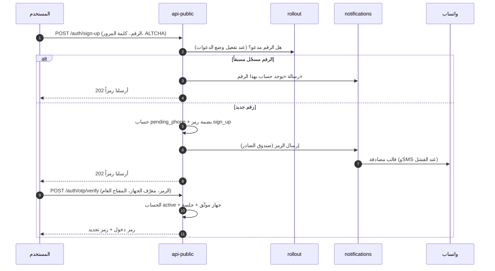

**ب. الدخول من جهاز جديد**

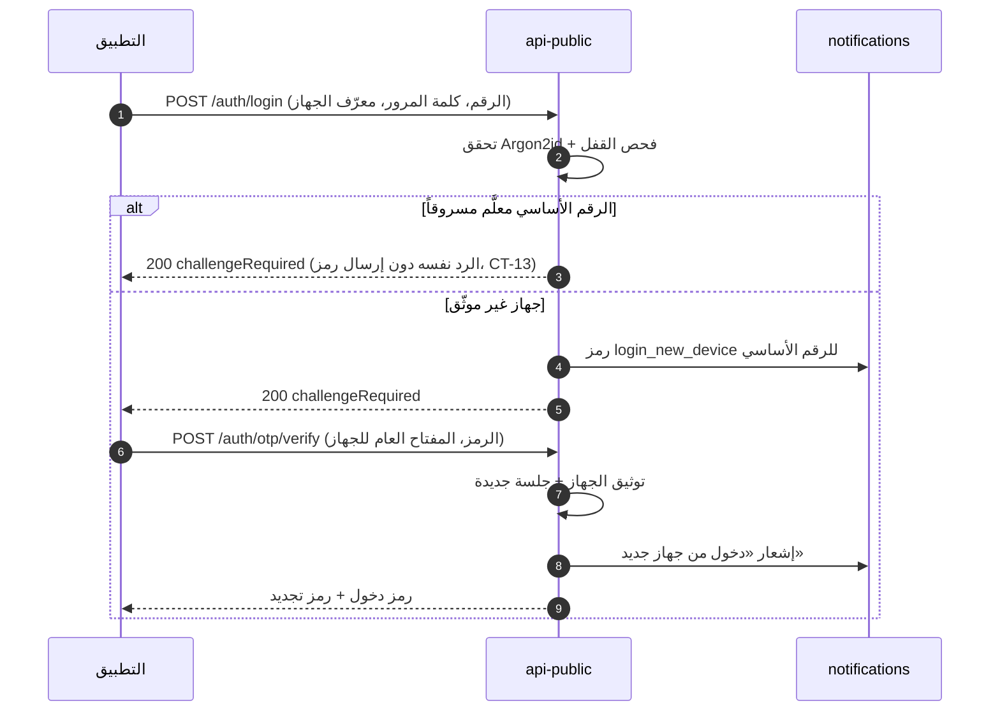

**ج. التجديد الدوّار وكشف إعادة الاستخدام**

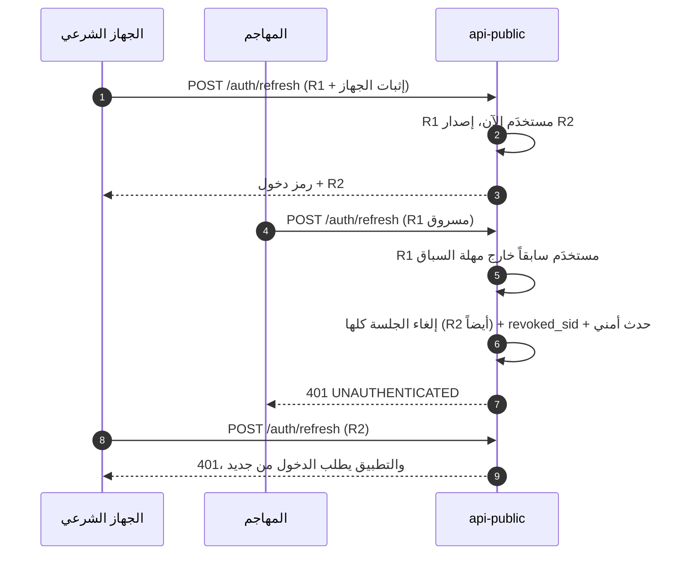

**د. دخول موظف الإدارة وإعادة التحقق**

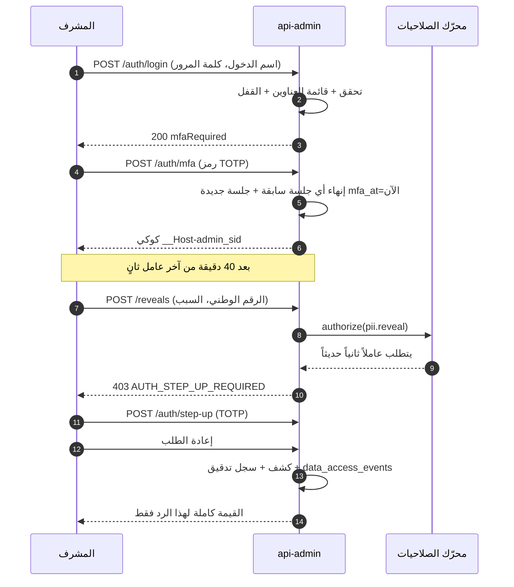

**هـ. الاستعادة بالهوية يبدأها المستخدم (THEFT-06، HANDOFF-02)**

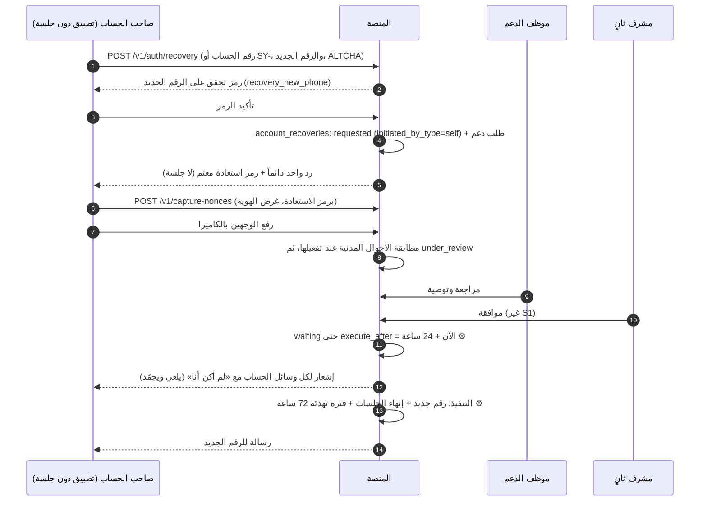

## 5. التفويض: نموذج الصلاحيات الموحّد

نموذج واحد يجمع الأدوار (RBAC) والخصائص (ABAC)، ويطبّق قرار D-58 مباشرة: قرار البلاغ إجراء متاح لفئتين من الفاعلين بصلاحيتين منفصلتين، الإدارة (`report.decide`) وعنصر الأمن ضمن نطاقه (`pp.report.decide`)، عبر آلة الحالة نفسها (§8.1)، مع تسجيل نوع الفاعل وهويته. فلا وساطة إدارية بين الأمن والبلاغ، ولا أثر لنموذج D-15 الملغى.

### 5.1 عناصر النموذج

| العنصر | التفصيل |
|---|---|
| الفاعل | نوعه (`user`، `admin`، `police`، `api_client`، `partner`، `system`)، ونطاق هويته، ومعرّفه |
| الصلاحية | مفتاح ثابت بصيغة `<وحدة>.<مورد>.<إجراء>` من الكتالوج (§5.9). والكتالوج في جدول `permissions` يُبذر بالترحيلات ولا يُعدَّل من اللوحة |
| الدور | مجموعة صلاحيات. أدوار الإدارة: خمسة افتراضية ثابتة المفاتيح (`general_manager`، `reports_supervisor`، `shops_supervisor`، `support`، `commercial_supervisor`) وأدوار ديناميكية (D-78). أدوار الأمن ثابتة: `unit_admin` و`officer`. وأدوار المستأجر: صاحب ومستخدم بصلاحيات يحددها الصاحب. وصلاحيات المواطن **مشتقة** من حالته وعلاقاته لا من دور مُسند |
| الخصائص | خصائص الفاعل والمورد والسياق التي تقيّد الصلاحية (§5.7) |
| الصفة (`acting_as`) | كل أمر يحمل صفة فاعله تجاه صاحب الشأن: `self`، أو `guardian` (D-97)، أو `delegate` (OWN-08)، أو `trusted_contact`، أو `support_on_behalf` (ONBEHALF)، أو `representative` (D-105)، أو `heir` أو `executor` (D-103)، أو `legal_agent` (بوكالة موثّقة)، أو `authority`، أو `gm_deputy` (نائب المدير العام المؤقت، D-128، §5.4). وسجل الصفات (§20.14) يحدد لكل صفة أدلتها وما تملك وما لا تملك، وتُكتب في التدقيق و`state_transitions` |
| القيود | صفوف `restrictions` النافذة على الشخص والحساب والمستأجر والعضو والمحفظة والجهاز (§5.11) |
| القرار | `allow` أو `deny` مع سبب داخلي يُسجَّل، ومتطلبات إضافية محتملة: `step_up`، `reason`، `second_approver` |

### 5.2 أين تُفحص الصلاحية

| الطبقة | ما تفحصه | عند الفشل |
|---|---|---|
| 1. حارس المسار (PEP الخشن) | الصلاحية المعلنة في `x-permission` للعملية، ونطاق الهوية، وحالة الحساب، والتحديث الإجباري، ومفاتيح التشغيل | 401 أو 403 أو 426 |
| 2. خدمة المجال (PEP الدقيق) | `access.authorize(فاعل، صلاحية، مورد، سياق)` بعد تحميل المورد وقبل أي تغيير: الملكية، والنطاق، والحالة، والتهدئة، وتعارض المصالح، والأربع عيون، واستحقاق الباقة للميزات المدفوعة (§5.10) | 404 لما خارج الصلاحية، و403 لما يعرفه الفاعل |
| 3. تحديد نطاق القوائم | `access.scope(فاعل، صلاحية)` يعيد شرط استعلام (محافظات، أو مستأجر، أو مالك) يُضاف لكل قائمة. ولا توجد قائمة دون هذا الشرط | قائمة فارغة |
| 4. قاعدة البيانات (RLS) | عزل المستأجرين، ونطاق محافظات الأمن، ومنع قراءة المواقع الدقيقة من الواجهة العامة (§6) | صفر صفوف أو خطأ كتابة |
| 5. المُخرِج (Serializer) | تصنيف كل حقل وإخفاؤه افتراضياً (§5.8) | الحقل مخفي أو محذوف |

**محرّك القرار (PDP)** واحد في وحدة `access`، وكل سياسة فيه قاعدة مكتوبة قابلة للاختبار بجدول حالات (مسموح وممنوع) يغطي كل صلاحية. ولا يكتب أي متحكّم أو خدمة شرط صلاحية خاصاً به خارج المحرّك. ويقيّم المحرّك القدرات عبر **محلّل القدرات** (§5.12) بترتيب أسبقية ثابت، وحارس المسار وخدمة المجال ونقطة الإقلاع والمهام الخلفية تستدعي الدالة نفسها.

### 5.3 المنع الافتراضي

- أي عملية في العقد دون `x-permission` يرفضها فحص CI، وأي عملية لا تطابق قاعدة سماح صريحة تُمنع.
- قواعد المنع تعلو قواعد السماح: الحساب المعلّق، وكل قيد نافذ (§5.11) ومنه التهدئة، وتعارض المصالح، والنطاق، ومسار الإطفاء (§14.3). والاستثناء الوحيد: القدرات المعلَّمة `protective` لا تمنعها حالة الحساب ولا قيوده ولا حالة المستأجر (P-1، §5.12).
- **الحالة غير المتوقعة:** المنع الافتراضي يبقى، والقدرات `protective` معلنة لكل حالة فلا يصيبها المنع الافتراضي أبداً. وحين يجد محرّك التتابعات أو حارس أو مؤقّت حالة لم تُعلن، لا يخمّن: يوقف العنصر في قائمة `unforeseen` بكامل سياقه، ويبقي الحمايات قائمة والمال في مكانه قابلاً للوصول، بسبب RSN-*-99، ويقرر المدير العام (§20.17).
- الصلاحيات تُحسب من قاعدة البيانات وتُخزَّن مؤقتاً في Redis بمفتاح (الفاعل، `authz_version`). وأي تغيير في دور أو عضوية أو نطاق يرفع `authz_version` فيُعاد الحساب في الطلب التالي، فيسري التغيير فوراً.
- لا توجد صلاحية في رمز الدخول، فلا ينتظر سحب الصلاحية انتهاء الرمز.

### 5.4 أدوار الإدارة والأدوار الديناميكية (D-78، SMART-03)

| القاعدة | التفصيل |
|---|---|
| الأدوار الافتراضية | الخمسة بصلاحياتها في عمود «الأدوار الافتراضية» في الكتالوج (§5.9)، مطابقةً لـ 03 §3.3 و§3.3.1. ولا تُحذف ولا تُعدَّل صلاحياتها |
| الدور الديناميكي | ينشئه المدير العام من قائمة الصلاحيات **القابلة للإسناد** فقط، مع اسم ووصف وسبب، ويُسجَّل |
| ما لا يُسند لدور ديناميكي | الصلاحيات المعلَّمة «مدير عام فقط»: إدارة حسابات الإدارة والأدوار، والإعدادات ومفاتيح التشغيل والتكاملات، وتقويم الدوام، وسجل التدقيق، ووضع الدعوات وتفعيل المحافظات، وتصحيح الملكية، و**إلغاء توثيق المحل نهائياً** (يقترحه مشرف المحلات ويقرره المدير العام وحده، P-11)، واعتماد تسويات المورّدين والاسترداد والتفعيل دون دفعة، وقرار الحالات غير المتوقعة، وإسقاط الرسائل الميتة، وتعيين نائب المدير العام (`governance.gm_deputy.manage`)، وقائمة الأنماط المنسوخة المعروفة (`identifiers.known_clones.manage`) |
| المدير العام (D-102) | ينفّذ إجراءاته «مدير عام فقط» **وحده، دون أي طلب موافقة**: حسابات الإدارة، والأدوار والصلاحيات، والإعدادات ذات الأثر الأمني، ومفاتيح التشغيل، والجهات الأمنية، والقوالب، ومدد الاحتفاظ. ومحرّك القرار لا يعيد `second_approver` لأي إجراء فاعله المدير العام، إلا الصفوف التي يذكر سجل الأربع عيون أدناه أن المدير العام فيها يحتاج شخصاً ثانياً (إيقاف السحب D-100، وقبول ⛔ المتعارض وحسم الادعاء المنافس). والبديل: عامل ثانٍ قوي، وإعادة تحقق لكل إجراء، وإشعار فوري `admin.gm.sensitive_action` على وسائله، وسجل تدقيق غير قابل للتعديل، وحساب طوارئ مختوم (§4.3) |
| فصل المهام | أزواج صلاحيات لا تجتمع في دور واحد ولا لموظف واحد (`permission_sod_rules`): إعداد التسوية واعتمادها، وطلب الاسترداد واعتماده، وإنشاء البلاغ بالنيابة ومراجعته، وتفعيل الخدمات ومطابقة المدفوعات اليومية |
| الرتبة | لكل دور رتبة رقمية تُستخدم في قاعدة «دور مساوٍ أو أعلى» للتصحيح (REVERSAL-02). الأدوار الديناميكية تأخذ رتبة يحددها المدير العام لا تتجاوز رتبة أي دور افتراضي تشمل صلاحياته |
| المراجعة الدورية | تقرير دوري بأعضاء كل دور وآخر استخدام لكل صلاحية، يراجعه المدير العام ([نموذج التهديد](20-threat-model.md)) |

**نائب المدير العام المؤقت (D-128).** يوافق النائب على المال والاسترداد والتجديدات والتصحيحات والتسويات بدل المدير العام في غيابه، ولا يغيّر الصلاحيات ولا إعدادات الحماية ولا يعيّن موظفين:

| البند | التفصيل |
|---|---|
| التعيين | المدير العام وحده (`governance.gm_deputy.manage`، بإعادة تحقق) في S-ADM-80: النائب حساب إدارة نشط قائم يدخل بـ WebAuthn (D-125)، لمدة محددة لا تتجاوز ⚙️ `governance.gm_deputy.term_max` (30 يوماً)، وتفويض نافذ واحد فقط، والتجديد تعيين جديد من المدير العام، ويلغيه المدير العام متى شاء. وتنهيه المهمة `admin.gm_deputy.expire` (`WALL_SECURITY`) عند `ends_at`. والبيانات في `gm_delegations` ([نموذج البيانات](09-data-model.md) §5.11) |
| ما يُمنح ما دام نافذاً | `billing.refund.approve`، و`commerce.settlement.approve`، و`billing.correction.approve`، و`commerce.supplier.payout_account.approve`، و`billing.activation.without_payment`، و`wallet.withdrawal_stop.approve` و`.renew`، و`reversal.approve` (بدل قرارات المدير العام)، و`reversal.ownership.approve` (REVERSAL-03، وإلغاء تأكيد الوفاة، §8.12)، واعتماد تغيير المالك على وثيقة رسمية (§8.4 د)، واعتماد انتقال أجهزة المتوفى فاعلاً واحداً (§8.17). وعمود «نائب المدير العام» في الكتالوج (§5.9.1) يولَّد من هذا الصف |
| ما لا يُمنح أبداً | `admin.user.manage`، و`admin.role.manage`، و`config.settings.edit`، و`config.toggles.edit` (ومنه رفع مفاتيح الطوارئ)، و`config.integrations.edit`، و`police.unit.manage`، و`audit.export`، و`data.export`، و`shop.revoke`، والحظر على الشخص (`user.ban`)، و`calendar.manage`، و`unforeseen.decide`، ومدد الاحتفاظ، وتغيير وجهات المال (`governance.*.time_lock`)، والقوالب، و`governance.gm_deputy.manage`، وتعيين الموظفين |
| الأربع عيون | يكون النائب **الموافق** في أزواج المال والتصحيح (الصفوف 1 إلى 7 في السجل أدناه) بدل المدير العام، ولا يوافق أبداً على ما طلبه أو أعدّه (فصل المهام)، ولا يكون الشخصين معاً في زوج D-100. وفي الأزواج غير المالية يعمل بدوره الأصلي وحده |
| قاعدة التوظيف | تعيين النائب وتغيير الأدوار يحذّران حين يبقى لأي زوج مالي أقل من شخصين مؤهلين مختلفين، و«غياب المدير العام» حالة في [إجراءات التشغيل](23-operations-sops.md) SOP-90 |
| التدقيق والإشعار | كل إجراء بصفة `acting_as = gm_deputy` ومعه `delegation_id`، وإشعار فوري للمدير العام بكل إجراء (القالب 315)، وللمدير العام والنائب عند التعيين والانتهاء (القالب 314)، والأحداث `admin.gm_deputy.appointed` و`.ended` و`.action` |
| ما لم يُفوَّض | ينتظر المدير العام، وله وصول كامل عن بُعد، وحساب الطوارئ المختوم يغطي العجز (§4.3) |

**سجل الأربع عيون (القائمة المغلقة الوحيدة).** هذا الجدول وحده يحدد أين يلزم شخص ثانٍ، ومنه يُبذر `permissions.four_eyes`، وكل وثيقة أخرى ([الأدوار والصلاحيات](03-roles-and-permissions.md) §3.3، و[الهوية البصرية](15-visual-identity.md) §13، و[قائمة الشاشات](18-screen-inventory.md) §2.1 و§15) تحيل إليه ولا تكرره:

| # | الإجراء | الطالب أو المُعِدّ | الموافق | المدير العام فاعلاً | النائب موافقاً |
|---|---|---|---|---|---|
| 1 | الاسترداد غير الآلي | المشرف التجاري (طلب معبّأ) | المدير العام | هو الموافق | نعم |
| 2 | تحويل تسوية المورّد | المشرف التجاري | المدير العام | هو الموافق | نعم |
| 3 | التصحيح المالي (المحفظة، والتعبئة، ونقد الشحن، والمطابقة) | المشرف التجاري أو «مدقق مالي» | المدير العام | هو الموافق | نعم |
| 4 | تغيير حساب استلام المورّد | المشرف التجاري | المدير العام (غير المُعِدّ) | هو الموافق | نعم |
| 5 | إيقاف السحب D-100 أو رفعه المبكر | واحد من: المدير العام، والنائب، والمشرف التجاري | آخر منهم | **يحتاج شخصاً ثانياً دائماً** | نعم (ولا يكون الشخصين معاً) |
| 6 | تصحيح القرار REVERSAL-01 وREVERSAL-02 | مشرف | مشرف آخر برتبة مساوية أو أعلى غير صاحب القرار الأصلي، وقرارات المدير العام يعتمدها المدير العام | هو الموافق | نعم (بدل المدير العام) |
| 7 | تصحيح الملكية REVERSAL-03، وإلغاء تأكيد الوفاة | مشرف | المدير العام | هو الموافق | نعم |
| 8 | استعادة الحساب بالهوية، وتغيير الرقم عبر الدعم، وفصل الرقم المُعاد تخصيصه (`number_detach`، §8.14) | الدعم | مشرف ثانٍ | — | لا |
| 9 | دمج الأجهزة، ودمج الأشخاص وفصل الرقم الوطني (SOP-12) | مشرف | مشرف آخر (والمدير العام إن اختلفت الملكية) | — | لا |
| 10 | مراجعة البلاغ بالنيابة (ONBEHALF-03) | الدعم (المنشئ) | مشرف بلاغات غير المنشئ | — | لا |
| 11 | قبول بلاغ ⛔ متعارض، وحسم الادعاء المنافس | مشرف البلاغات | مشرف ثانٍ | المدير العام يحتاج ثانياً أيضاً | لا |
| 12 | فعل الوكيل القانوني (PERSON-06) | الدعم | مشرف البلاغات، والنقل ينفّذه المدير العام | — | لا |
| 13 | سجل الإفصاح الخارجي | مسؤول حماية البيانات أو غيره | المدير العام | المدير العام وحده لا يحتاج ثانياً | لا |

وكل ما عدا ذلك فاعل واحد (D-102)، ومنه: انتقال أجهزة المتوفى (UC-17، §8.17)، وتجديد D-100، وتجميد الإدارة للمحفظة ورفعه، وإعادة اعتماد بيانات دخول الموظف (يوافق المدير العام وحده).

### 5.5 صلاحيات أعضاء المحل والوكيل والمورّد ومندوب الشحن

| المستأجر | صلاحيات الصاحب وحده | صلاحيات يمنحها الصاحب | صلاحيات ضمنية لكل عضو نشط |
|---|---|---|---|
| المحل | `shop.profile.edit`، `shop.member.manage`، `shop.closure.request`، `shop.owner_change.request` (§8.4)، `shop.wholesale.accept`، `shop.theft_report.create` (REPORT-18)، `shop.compliance.view` (COMPLIANCE-04: حالة التزام المحل نفسه فقط)، `shop.billing.view`، `shop.wallet.manage` (التفعيل، والسحب، والكشف الكامل، ورمز المحفظة، والتجميد، وحدود الموظفين)، `shoppro.settings`، `shoppro.branches`، `shoppro.export` | `shop.tx.purchase`، `shop.tx.sale`، `shop.tx.view_all`، `shop.repair`، `shop.store.order`، `shop.wallet.topup` (بحد يومي للموظف ⚙️)، `shop.wallet.pay`، `shoppro.pos`، `shoppro.cash`، `shoppro.inventory`، `shoppro.purchases`، `shoppro.expenses`، `shoppro.debts`، `shoppro.warranty`، `shoppro.repair_advanced`، `shoppro.reports`، `shoppro.view_costs`، `shoppro.view_profits`، `shoppro.view_payroll` | `shop.inventory.view`، `shop.tx.view_own`، `shop.tx.cancel_own` (ضمن المهلة)، `shop.tip.submit`، و`shop.civil.lookup` لمن يملك شراء أو بيعاً أو صيانة وضمن معاملة جارية فقط |
| الوكيل | `importer.profile.edit`، `importer.member.manage`، `importer.api.manage` | `importer.batch.upload`، `importer.transfer.create`، `importer.tx.view_all` | `importer.inventory.view` |
| المورّد (D-87) | `supplier.member.manage`، `supplier.payout_account.request` | `supplier.product.manage`، `supplier.order.fulfil`، `supplier.settlement.view` | `supplier.profile.view` |
| مندوب الشحن | — | — | `courier.shipment.handle` للشحنات المسندة إليه فقط |
| مدير شركة الشحن (`courier_users.role = manager`) | — | — | `courier.members.request` (طلب حسابات مندوبي شركته وإيقافها، ويفعّلها المشرف التجاري)، و`courier.company.view` (طلبات الشركة المسندة ونقدها غير المورَّد وكشف توريدها). والكتاب الموقّع بديل لشركة بلا حساب مدير ([الأدوار والصلاحيات](03-roles-and-permissions.md) §2.4.4) |

- الصلاحيات تُخزَّن في `permissions text[]` لكل عضو، ولا تُقبل إلا من القائمة المسموحة لنوع المستأجر.
- صلاحيات الأرباح والتكاليف ورواتب الآخرين (`shoppro.view_costs`، و`shoppro.view_profits`، و`shoppro.view_payroll`) غير ممنوحة افتراضياً (SHOPPRO-13). والموظف لا يملك السحب ولا كشف المحفظة الكامل أبداً، ويرى عملياته هو فقط (SHOPWALLET-05).
- الموظف غير موثّق الهوية (`pending_identity`) لا يملك أي صلاحية عمل (D-40).
- عضوية واحدة نشطة كحد أقصى لكل مستخدم في كل مستأجر، ويمكن أن يكون للمستخدم عضويات في أكثر من مستأجر، يتنقّل بينها من القائمة (D-44).
- **عضوية الخروج:** عند إلغاء المحل أو إغلاقه تنتهي عضويات الموظفين، وتصبح عضوية صاحب المحل `exit_only` لا `removed` (§4.2.14) حتى يصبح الرصيد صفراً وتنتهي مدة الاطلاع على المحاسبة، ثم `removed` آلياً.
- **تغيير المالك (D-107):** تُعاد كل الصلاحيات الممنوحة للموظفين إلى الصلاحيات الضمنية وحدها حتى يمنحها المالك الجديد، وتُنهى جلسات سياق المحل، وتُلغى دعوات الموظفين المعلّقة التي أنشأها المالك القديم.
- **صاحب المحل المحظور والخلف (D-106، D-103):** نطاق `exit_only` لصاحب المحل المحظور يحمل `shop.owner_change.request` و`shop.closure.request` (§4.2.14)، ونطاق `successor` للخلف الموثّق يحمل المشتقتين `shop.owner_change.request_as_successor` و`shop.closure.request_as_successor` (§4.2.16، §5.9.3).
- **الموظف المحظور شخصاً:** قيد `staff_bar` أو `person_ban` (§5.11) يُفحص عند تفعيل العضوية وعند كل دخول بسياق محل، وصاحب المحل يرى «تعذّر تفعيل هذا الموظف» دون السبب.

### 5.6 نطاق الأمن (D-80، PP-03)

| الإجراء | قاعدة النطاق |
|---|---|
| البحث برقم IMEI | كل المحافظات لكل العناصر. يُعاد للجهاز خارج النطاق **ملخص فقط**: الحالة العامة، والماركة والموديل، ومحافظة البلاغ النافذ إن وُجد، وعلَم «خارج نطاقك». **ولا أشخاص** (لا مالك ولا مبلّغ ولا رقم وطني ولا هاتف)، ولا سجل ولا مواقع. والتفاصيل الكاملة والسجل والأشخاص لما في النطاق فقط. ⚠️ **تُؤكَّد مع الوزارة** (Q-27): إتاحة هذا الملخص خارج النطاق، وحقوله (D-80). وهو دالة واحدة (`app.police_imei_summary`، §6.2) وإعداد ⚙️ لحقوله (`police.out_of_scope.fields`)، فإن قررت الوزارة غير ذلك يُضيَّق أو يُلغى دون تغيير في بقية النطاق |
| البحث بالرقم الوطني | ضمن النطاق فقط، برقم قضية يطابق الصيغة ⚙️ وسبب، ويُسجَّل في `police_case_lookups` (PP-07) |
| قبول بلاغ مواطن قيد المراجعة، أو إغلاق بلاغ نافذ | إذا كانت إحدى «محافظات الصلة» بالبلاغ ضمن النطاق |
| التنبيهات | محافظة التنبيه ضمن النطاق |
| التتبّع والحظر وتأجيله | محافظة الجلسة (محافظة التنبيه الذي فتحها، أو محافظة الحادثة) ضمن النطاق |
| معاملات المحلات وأوامر الصيانة | محافظة المحل ضمن النطاق |
| البلاغ الرسمي | محافظة الحادثة ضمن النطاق |
| الإدارة المركزية | نطاقها كل المحافظات (`scope_all`) |
| حادثة خارج سوريا | محافظة الحادثة «خارج سوريا»، فنطاقها الإدارة المركزية وحدها حتى يظهر الجهاز في محافظة |
| عمل الجهة | المضبوطات وجلسات التتبّع ومراجع القضايا والبلاغات الرسمية **ملك الجهة لا العنصر**: يتصرف فيها أي عنصر في نطاقها، ويعيد مسؤول الأمن إسنادها (`pp.work.reassign`). وتعليق الجهة يحوّل رسائل هاتف تنبيهاتها لمحافظاتها إلى هاتف الإدارة المركزية. والقسم غير النشط وفيه مضبوطات ينقلها إلى قسم نشط، فيُعاد إشعار المالك بالعنوان الجديد |

**محافظات الصلة** بالبلاغ أو الجهاز تُحفظ في `police_scope_links`: محافظة الحادثة عند الإنشاء، ومحافظة كل تنبيه على الجهاز، ومحافظة كل محل تعامل مع الجهاز، ومحافظة الضبط. فعنصر حمص يرى بلاغ دمشق إذا ظهر الجهاز في محل في حمص (06 §12). والنطاق يُفرض في المحرّك وفي RLS معاً (§6.2)، والقاعدة تُؤكد مع الوزارة (D-80).

### 5.7 الخصائص (ABAC)

| الخاصية | من أين | أين تُستخدم |
|---|---|---|
| المستأجر | `app.tenant_id` بعد التحقق من العضوية النشطة وحالة المستأجر | كل عمليات المحل والوكيل والمورّد ومندوب الشحن، وRLS |
| نطاق المحافظات | `police_units` (جهة العنصر) | §5.6، وRLS لدور `api_police` |
| علاقة الملكية | `ownerships` الحالية، و`authorized_users` النشطة | «أجهزتي»، والنقل، والشهادة، والبلاغ، والمفوّضون |
| أطراف البلاغ | المبلّغ، والمالك المسؤول، والمفوّض المبادر، والجهة الموثوقة المبادرة، والمعترض | عرض البلاغ والرد والإغلاق والاعتراض، وما يراه كل طرف (لا يرى المبلّغ هوية المعترض، DISPUTE-03) |
| مستوى الهوية | `users.identity_status` و`users.auto_linked_at` | البلاغ والاعتراض والتسجيل الذاتي وتسجيل المحل (06 §7) |
| نافذة المعاملة الجارية (D-84) | `shop_transactions` بحالة `checked` غير منتهية، أنشأها العضو نفسه | `shop.civil.lookup`: الاستعلام مسموح فقط للرقم الوطني للطرف في هذه المعاملة، ويعيد الاسم وحالة البطاقة فقط. ولا يوجد مسار برمجي لصورة السجل المدني في سياق المحل أصلاً: واجهة المحوّل الممنوحة لسياق المحل لا تحتوي عملية الصورة |
| نافذة مراجعة التوثيق | طلب توثيق بحالة `pending` مسند للمشرف نفسه | `civil.photo.view`، وكشف صورة الهوية |
| القيود | صفوف `restrictions` النافذة (§5.11): التهدئة، وقيد إعادة التعيين، والرقم المسروق، وتجميد «لم أكن أنا»، والحظر على الشخص، وقيود الإساءة، وقيود المحفظة والجهاز. والأعمدة `users.cooldown_until` و`users.phone_compromised_at` إسقاطات للقراءة | كل قدرة يحمل سجل نوع القيد منعها (§5.12) |
| الصفة ونطاق الجلسة | `acting_as` للأمر، و`sessions.scope` | القدرات المسموحة لكل صفة ولكل نطاق (§5.12، §20.14) |
| حداثة العامل الثاني | `staff_sessions.mfa_at` | الصلاحيات المعلَّمة `requires_step_up` |
| تعارض المصالح | `staff_coi_declarations`، وبصمة الرقم الوطني للموظف | منع مراجعة طلب يخص الموظف أو أقاربه المعلنين (03 §4) |
| الأربع عيون | الفاعل الأصلي والطالب | الموافق مختلف عن الطالب وعن صاحب القرار الأصلي، **في صفوف سجل الأربع عيون وحدها** (§5.4) |
| القناة | `X-App-Platform` | طلب الخدمات الرقمية من الموقع فقط (D-86، PAY-08) |
| ساعات الدوام | تقويم الدوام `business_calendar` وساعاته ⚙️ (D-123) | تجميع رسائل واتساب الإدارية خارج الدوام (D-85، §15.5) |
| استحقاق الباقة | الاشتراك الفعّال للمستأجر وميزات باقته (§5.10) | كل صلاحية معلَّمة `requires_feature` |
| حدود المحفظة | حدود السحب اليومية والشهرية ⚙️، وحد الموظف اليومي، وحد التنبيه | عمليات المحفظة والتعبئة (SHOPWALLET-03، SHOPWALLET-05، TOPUP-05) |

### 5.8 الإخفاء الافتراضي والكشف المسجّل

| الحقل | العرض الافتراضي | من يكشف | الشرط |
|---|---|---|---|
| الرقم الوطني | آخر 3 خانات فقط: `••••••••123` ([نموذج التهديد](20-threat-model.md) §2.2) | `pii.reveal` | سبب، وعنصر عمل مفتوح مرتبط (بلاغ، أو توثيق، أو تنبيه، أو تعارض)، وعامل ثانٍ حديث |
| رقم الموبايل لغير صاحبه | `0933••••12`، والرقم البديل `09••••••12` | `pii.reveal` | كما سبق |
| صورة الهوية | مصغّرة مموّهة | `pii.reveal`، أو المراجع المسند | تُعرض عبر وكيل مصادَق بعلامة مائية فيها اسم المشاهد والوقت، دون رابط مباشر للمخزن |
| رقم الشريحة (MSISDN) والـ IMSI | آخر رقمين فقط | `pii.reveal` للإدارة، والعنصر ضمن نطاقه | سبب، ويُسجَّل |
| عنوان الشبكة ورقم واتساب الفاحص | مخفي | `pii.reveal` | تحقيق في إساءة أو تنبيه |
| IMEI في الصفحات العامة (الشهادة، والفاتورة، والإيصال) | أول 8 خانات (TAC) ثم `•••` ثم آخر 4، والرقم الكامل لمالكه بعد الدخول | — | CHECK-08، PUB-02 |
| الموقع الدقيق | لا يُعرض خارج الخريطة | `tracking.map.view` و`pp.tracking.view` | سبب مسجّل عند فتح الخريطة (TRACK-08) |
| صورة هوية البائع لدى المحل | لا تُعرض بعد الإرسال إطلاقاً («للكتابة فقط») | لا أحد في المحل | ضابط في [نموذج التهديد](20-threat-model.md) |
| الرقم الوطني للطرف في سجل معاملات المحل | مخفي دائماً | لا أحد في المحل | — |
| بيانات المحل لدى المورّد | اسم المحل وعنوان التوصيل فقط | — | STORE-12 |
| بيانات المحاسبة (SHOPPRO) | **لا تُعرض إطلاقاً** لأحد من المنصة: الإدارة والدعم الفني والمبرمجون والأمن والوزارة | لا أحد، ولا حتى بإذن صاحب المحل. والدعم يساعد بالشرح فقط | §6.8، SHOPPRO-14، PRIV-11، D-101 |
| رقم زبون التعبئة | مخفي جزئياً في سجل التعبئة لغير المنفّذ وصاحب المحل | — | TOPUP-03 |

- الكشف عبر `POST /api/v1/reveals` (المورد، والحقل، والسبب، وعنصر العمل)، فتعود القيمة في هذا الرد فقط مع `Cache-Control: no-store`، ولا تُحفظ في حالة الواجهة.
- لكل موظف حصة كشف ⚙️ 30 في الساعة و⚙️ 150 في اليوم ([نموذج التهديد](20-threat-model.md) §10.3)، وتجاوزها يوقف الكشف حتى يراجعه المدير العام، وبلوغ 80% منها ينبّه (DET-16). والكشف خارج عنصر عمل مسند يتطلب سبباً موسّعاً وينبّه فوراً.
- صيغ الإخفاء أعلاه هي الصيغ المعتمدة في كل الواجهات والوثائق والرسائل، ومرجعها [نموذج التهديد](20-threat-model.md) §2.2.
- كل كشف يُكتب في سجل التدقيق، وفي `data_access_events` لصاحب البيانات (DATAACCESS-01).

### 5.9 كتالوج الصلاحيات

الرموز: «عام» المدير العام، و«بلاغات» مشرف البلاغات، و«محلات» مشرف المحلات، و«دعم» الدعم الفني، و«تجاري» المشرف التجاري. 🔒 = يتطلب سبباً ويُسجَّل بتفصيل، و«خطوة» = عامل ثانٍ حديث. «مدير عام فقط» = لا يُسند لدور ديناميكي. وعمود «نائب المدير العام» (D-128، §5.4): ✅ يملكها النائب ما دام تفويضه نافذاً، و⛔ لا يملكها أبداً، و«—» بدوره الأصلي فقط.

#### 5.9.1 الإدارة

| المفتاح | الإجراء | الأدوار الافتراضية | الضوابط | المتطلبات | نائب المدير العام |
|---|---|---|---|---|---|
| `report.view` | عرض البلاغات وأدلتها | عام، بلاغات | — | ADMIN-02 | — |
| `report.decide` | قبول بلاغ أو رفضه أو طلب معلومات | عام، بلاغات | 🔒، تعارض المصالح، ولا يراجع بلاغاً أنشأه بالنيابة | ADMIN-02، ONBEHALF-03 | — |
| `report.closure.decide` | قبول طلب الإغلاق أو رفضه | عام، بلاغات | 🔒 | ADMIN-03 | — |
| `report.dispute.decide` | حسم الاعتراض | عام، بلاغات | 🔒 | ADMIN-04، DISPUTE-02 | — |
| `report.onbehalf.create` | إنشاء بلاغ بالنيابة | عام، دعم | 🔒، خطوة | ONBEHALF-01 | — |
| `report.police_import.run` | استيراد بلاغات قوى الأمن | عام، بلاغات | 🔒 | POLICE-01 | — |
| `identity.review.decide` | قبول توثيق الهوية أو رفضه | عام، بلاغات | 🔒، تعارض المصالح | ADMIN-05 | — |
| `civil.photo.view` | عرض صورة السجل المدني لطلب توثيق مسند | عام، بلاغات | 🔒 | CIVIL-02، D-84 | — |
| `selfreg.review.decide` | قرار التسجيل الذاتي | عام، بلاغات | 🔒 | OWN-03 | — |
| `tip.handle` | معالجة المعلومات الواردة | عام، بلاغات | — | TIP-03 | — |
| `alert.view` | عرض التنبيهات | عام، بلاغات | — | ADMIN-08، ADMIN-09 | — |
| `alert.handle` | إسناد التنبيه وملاحظاته وإغلاقه | عام، بلاغات | — | ADMIN-08 | — |
| `alert.refer` | تقرير PDF وتسجيل الإحالة | عام، بلاغات | 🔒 | ADMIN-10 | — |
| `tracking.map.view` | فتح خريطة التتبّع | عام، بلاغات | 🔒 | TRACK-08 | — |
| `tracking.session.open` | فتح جلسة تتبّع أو تمديدها أو إيقافها | عام، بلاغات | 🔒، خطوة، مرجع طلب الأمن | TRACK-05 | — |
| `telecom.block.defer` | تأجيل الحظر أو إيقافه مؤقتاً | عام، بلاغات | 🔒، مرجع طلب الأمن | TELCO-06 | — |
| `telecom.sim_history.query` | استعلام سجل الشريحة | عام، بلاغات، محلات | 🔒 | TELCO-12 | — |
| `telecom.resync` | إعادة مزامنة جهاز مع الشركات | عام، بلاغات | 🔒 | SMART-10 | — |
| `device.history.view` | السجل الكامل للجهاز ومواقع فحصه | عام، بلاغات، محلات | 🔒 | ADMIN-11، ADMIN-12 | — |
| `device.conflict.resolve` | حسم تعارض معرّف أو جهاز | عام، بلاغات، محلات | 🔒 | 06 §1 | — |
| `device.merge.propose` | اقتراح دمج سجلين | عام، بلاغات، محلات | 🔒 | ADMIN-18، §7.4 | — |
| `device.merge.approve` | الموافقة على الدمج | عام، بلاغات، محلات | 🔒، خطوة، أربع عيون | ADMIN-18، §7.4 | — |
| `pii.reveal` | كشف بيانات مخفية | عام، بلاغات، محلات | 🔒، خطوة، حصة يومية | ADMIN-17 | — |
| `shop.view` | عرض المحلات والوكلاء ومعاملاتهم | عام، محلات | — | ADMIN-06، ADMIN-07 | — |
| `shop.application.decide` | قرار طلب المحل أو الوكيل وتعديلاته | عام، محلات | 🔒 | SHOP-03، SHOP-04، IMPORTER-01 | — |
| `shop.suspend` | تعليق محل أو وكيل أو رفع التعليق | عام، محلات | 🔒 | ADMIN-06 | — |
| `shop.revoke.propose` | اقتراح إلغاء محل أو وكيل أو مورّد، مع معاينة الآثار (§8.16) | عام، محلات | 🔒 | ADMIN-06 | — |
| `shop.revoke` | إلغاء محل أو وكيل أو مورّد نهائياً، وتحديد سببه: احتيال أو غيره (D-108) | عام | مدير عام فقط، 🔒، خطوة | ADMIN-06، P-11 | ⛔ |
| `tenant.owner_change.decide` | مراجعة تغيير مالك المحل على السجل نفسه واعتماده أو رفضه (D-107، §8.4 د) | عام، محلات | 🔒، ومسار الوثيقة الرسمية يعتمده المدير العام أو نائبه | D-107 | ✅ (مسار الوثيقة الرسمية) |
| `tenant.owner_change.file_official` | تقديم تغيير مالك المحل على وثيقة رسمية (حكم، أو رخصة صادرة لشخص آخر) حين لا يتعاون المالك (§8.4 د) | عام، محلات | 🔒 | D-107 | — |
| `tenant.branch.verify` | توثيق موقع فرع (D-109) | عام، محلات | 🔒 | SHOPPRO-12 | — |
| `shop.conflict.decide` | حسم تعارض معاملة | عام، محلات | 🔒 | SHOP-08، ADMIN-07 | — |
| `shop.tx.correction.decide` | قرار طلب تصحيح أو إلغاء معاملة | عام، محلات | 🔒 | SHOP-15 | — |
| `importer.conflict.decide` | حسم تعارض الأرقام المكررة للوكيل | عام، محلات | 🔒 | IMPORTER-07 | — |
| `police.shop_suspension.handle` | تنفيذ طلب تعليق من الأمن | عام، محلات | 🔒 | PP-09 | — |
| `compliance.report.review` | مراجعة تقرير الالتزام وإرساله | عام، محلات | 🔒 | COMPLIANCE-02 | — |
| `compliance.shop_note.write` | ملاحظة الإدارة على حالة التزام محل، تظهر له في لوحته | عام، محلات | 🔒 | COMPLIANCE-04 | — |
| `kpi.report.view` | عرض التقرير الشهري للمؤشرات وتنزيله (PDF وExcel) | عام | 🔒 | SMART-15 | — |
| `kpi.report.send` | إرسال التقرير الشهري للوزارة | عام | مدير عام فقط، 🔒 | SMART-15 | — |
| `user.search` | البحث عن المستخدمين | عام، بلاغات، محلات، دعم | 🔒 | ADMIN-13 | — |
| `user.view` | عرض ملف المستخدم (مخفي جزئياً) | عام، بلاغات، محلات، دعم | — | ADMIN-13 | — |
| `user.suspend` | تعليق حساب أو رفعه | عام | 🔒 | ADMIN-13 | — |
| `user.suspend.malicious_report` | تعليق حساب بسبب بلاغ كيدي | بلاغات | 🔒 | 03 §3.3 | — |
| `user.ban` | حظر حساب نهائياً | عام | 🔒، خطوة | 06 §13 | ⛔ |
| `account.otp.resend` | إعادة إرسال رمز للمستخدم | عام، دعم | — | 03 §2.5 | — |
| `account.unlock` | فك القفل المؤقت | عام، دعم | 🔒 | SMART-10 | — |
| `account.recovery.initiate` | بدء استعادة بالهوية أو تغيير رقم | عام، دعم | 🔒 | THEFT-06، AUTH-09 | — |
| `account.recovery.approve` | الموافقة الثانية على الاستعادة | عام، دعم | 🔒، خطوة، أربع عيون | THEFT-06 | — |
| `support.ticket.handle` | معالجة طلبات الدعم والرد | عام، دعم | — | SUPPORT-04 | — |
| `support.ticket.view_routed` | عرض الطلبات المحوّلة إليه والرد الداخلي | بلاغات، محلات، تجاري | — | SUPPORT-07 | — |
| `notification.resend` | إعادة إرسال رسالة فشلت | عام، دعم | — | SMART-10 | — |
| `document.regenerate` | إعادة توليد فاتورة أو تقرير | عام، محلات | 🔒 | SMART-10 | — |
| `queue.bulk_assign` | إجراءات جماعية على قوائم العمل | عام، بلاغات، محلات | — | SMART-08 | — |
| `search.unified` | البحث الموحّد (النتائج حسب صلاحيات الباحث) | كل الأدوار | — | SMART-07 | — |
| `reversal.request` | طلب تصحيح قرار | عام، بلاغات، محلات | 🔒 | REVERSAL-02 | — |
| `reversal.approve` | الموافقة على التصحيح | عام، بلاغات، محلات | 🔒، خطوة، أربع عيون، رتبة مساوية أو أعلى | REVERSAL-02 | ✅ |
| `reversal.ownership.approve` | الموافقة على تصحيح الملكية (REVERSAL-03) وإلغاء تأكيد الوفاة (§8.12) | عام | مدير عام فقط، 🔒، خطوة | REVERSAL-03 | ✅ |
| `admin.user.manage` | حسابات الإدارة وإيقافها، والموافقة على إعادة تعيين كلمة المرور والعامل الثاني بعد التحقق الحضوري أو المرئي (§4.3)، وفك التعطيل بعد القفل | عام | مدير عام فقط، 🔒، خطوة لكل إجراء، إشعار فوري (D-102) | ADMIN-14 | ⛔ |
| `admin.role.manage` | الأدوار الديناميكية وإسنادها | عام | مدير عام فقط، 🔒، خطوة | SMART-03 | ⛔ |
| `police.unit.manage` | الجهات الأمنية وحسابات مسؤوليها ونطاقاتها | عام | مدير عام فقط، 🔒، خطوة | PP-01 | ⛔ |
| `police.activity.view_all` | سجل نشاط كل عناصر الأمن | عام | مدير عام فقط | PP-13 | — |
| `config.settings.edit` | الإعدادات ⚙️ | عام | مدير عام فقط، 🔒، خطوة | ADMIN-16 | ⛔ |
| `config.toggles.edit` | مفاتيح التشغيل، ورفع مفاتيح الطوارئ | عام | مدير عام فقط، 🔒، خطوة | SMART-04 | ⛔ |
| `config.kill_switch.activate` | **تفعيل** مفتاح طوارئ (`kind = kill_switch`، §14.3) في أي ساعة، عدا `emergency.wallet_withdrawal_stop`، ولا يرفعه | عام، والدور الديناميكي «مناوب تقني» | 🔒، خطوة، وإشعار فوري للمدير العام (القالب 310) | SMART-04 | — |
| `system.otp_outage.declare` | إعلان «انقطاع إيصال الرموز» وتسجيل نافذة العطل (§4.2.2) | عام، و«مناوب تقني» | 🔒 | SMART-11 | — |
| `config.integrations.edit` | تفعيل التكاملات وإعداداتها غير السرية | عام | مدير عام فقط، 🔒، خطوة | 06 §15.3 | ⛔ |
| `config.content.edit` | تحرير المحتوى والنصوص والقوالب كمسودات | عام | — | SMART-01، NOTIF-02 | — |
| `config.content.publish` | نشر المحتوى والقوالب | عام | 🔒 | SMART-01 | ⛔ |
| `config.brand.edit` | الهوية (الشعار والاسم واللون) | عام | 🔒 | SMART-02 | — |
| `config.app_versions.edit` | الإصدارات المدعومة للتطبيق | عام | 🔒 | SMART-12 | — |
| `config.maintenance.edit` | وضع الصيانة والشريط العام | عام، و«مناوب تقني» بقوالب اللافتات المعتمدة وحدها | 🔒 | SMART-11 | — |
| `rollout.manage` | وضع الدعوات وتفعيل المحافظات والدعوات | عام | مدير عام فقط، 🔒 | ROLLOUT-01، ROLLOUT-02، ROLLOUT-05 | — |
| `rollout.metrics.view` | مؤشرات التجريب | عام | — | ROLLOUT-03 | — |
| `audit.view` | سجل التدقيق | عام | مدير عام فقط | ADMIN-15 | — |
| `audit.export` | تصدير سجل التدقيق | عام | مدير عام فقط، 🔒، خطوة | ADMIN-15 | ⛔ |
| `system.health.view` | صحة النظام والتكاملات | عام | — | SMART-09 | — |
| `system.dead_letters.retry` | إعادة المهام والرسائل الفاشلة | عام | 🔒 | SMART-09 | — |
| `retention.hold.manage` | **مهمَل**: يحل محله `privacy.hold.manage`، ولا يُسند لأي دور | — | — | PRIV-05 | — |
| `data.export` | تصدير بيانات بالجملة | عام | مدير عام فقط، 🔒، خطوة | — | ⛔ |
| `commerce.catalog.manage` | المنتجات والأقسام | عام، تجاري | — | STORE-02 | — |
| `commerce.product.review` | مراجعة منتج قبل النشر | عام، تجاري | 🔒 | STORE-06، STORE-12 | — |
| `commerce.supplier.manage` | المورّدون واتفاقياتهم وحصص المنصة | عام، تجاري | 🔒 | STORE-03 | — |
| `commerce.supplier.payout_account.prepare` | التحقق من حساب استلام المورّد الجديد بتحويل اختباري وإعداده للاعتماد | عام، تجاري | 🔒 | STORE-10 | — |
| `commerce.supplier.payout_account.approve` | اعتماد حساب استلام تسويات المورّد أو تغييره، فيسري بعد ⚙️ 72 ساعة | عام | مدير عام فقط، 🔒، خطوة، أربع عيون: غير من أعدّه | STORE-10 | ✅ |
| `billing.unallocated.allocate` | تخصيص مبلغ وارد بلا مطابقة لطلب أو إعادته لمصدره (§11.5) | عام، تجاري | 🔒، ولا يخصّص مبلغاً سجّله بنفسه | PAY-01 | — |
| `billing.correction.request` | طلب عملية تصحيح مالية مرتبطة (خصم أو إضافة تصحيحية، أو حسم تعبئة قيد المتابعة) | عام، تجاري | 🔒 | SHOPWALLET-06، TOPUP-06 | — |
| `billing.correction.approve` | اعتماد عملية التصحيح المالية | عام | مدير عام فقط، 🔒، خطوة، أربع عيون: غير الطالب | SHOPWALLET-06، TOPUP-06 | ✅ |
| `commerce.order.manage` | تأكيد طلبات المتجر وإلغاؤها وإنشاؤها عن المحل | عام، تجاري | — | STORE-04، STORE-05 | — |
| `commerce.shipment.manage` | الشحنات ومندوبو الشحن | عام، تجاري | — | STORE-09 | — |
| `commerce.courier.reconcile` | تسوية نقد الشحن اليومية | عام، تجاري | 🔒 | STORE-09 | — |
| `commerce.return.decide` | قرار الإرجاع ونسبة العيب للمورّد | عام، تجاري | 🔒 | STORE-11 | — |
| `commerce.settlement.prepare` | إعداد كشف تسوية المورّد | عام، تجاري | 🔒 | STORE-10 | — |
| `commerce.settlement.approve` | اعتماد تحويل التسوية | عام | مدير عام فقط، 🔒، خطوة | STORE-10 | ✅ |
| `commerce.settlement.mark_paid` | تسجيل رقم التحويل | عام، تجاري | 🔒 | STORE-10 | — |
| `ads.campaign.review` | مراجعة الإعلانات | عام، تجاري | 🔒 | ADS-05 | — |
| `billing.payment.confirm` | تأكيد دفعة برقمها المرجعي، والتقاط حساب الدافع من سطر الكشف (`payer_account_enc`) للمصادر اليدوية | عام، تجاري | 🔒، ولا ينفّذ إبطال دفعة أو استردادها أكّدها بنفسه | PAY-01 | — |
| `billing.activation.execute` | تفعيل خدمة بعد دفعة مؤكدة، أو تجربة باقة مؤهلة للتجربة دون دفعة بصف `trial_grants` (D-113، §8.11 أ) | عام، تجاري | 🔒 | PAY-07 | — |
| `billing.activation.without_payment` | تفعيل باقة مدفوعة دون دفعة (منحة أو تعويض) | عام | مدير عام فقط، 🔒، خطوة | PAY-07 | ✅ |
| `billing.subscription.upgrade` | ترقية اشتراك فعّال إلى باقة أعلى بتحويل الأيام (D-114، §8.11 ج) | عام، تجاري | 🔒 | PAY-09 | — |
| `billing.refund.request` | طلب استرداد أو إلغاء | تجاري | 🔒 | PAY-04 | — |
| `billing.refund.approve` | اعتماد الاسترداد | عام | مدير عام فقط، 🔒، خطوة | 03 §3.3.1 | ✅ |
| `billing.reconcile` | المطابقة اليومية للمدفوعات | عام، تجاري | 🔒، لا يطابق دفعات فعّلها بنفسه | PAY-01 | — |
| `billing.pricing.edit` | **مهمَل**: يحل محله `commerce.package.manage` | — | — | 06 §15.3 | — |
| `bizapi.client.manage` | عملاء الربط واعتمادهم، وإلغاء أي مفتاح فوراً عند الاشتباه. ولا يُنشئ مفتاحاً ولا يرى سرّاً: الإنشاء لمسؤول العميل من لوحته (§3.13) | عام، تجاري | 🔒، خطوة | BIZAPI-01 | — |
| `commerce.package.manage` | الباقات وميزاتها وأسعارها وحدودها | عام | مدير عام فقط، 🔒، خطوة | PAY-09 | — |
| `wallet.view` | حالة محافظ المحلات، والعمليات المرتبطة **بفرق مطابقة أو بتجميد فقط**، دون كشف الحساب الكامل ودون سجل الدخول والأجهزة ([الخصوصية](21-privacy-dpia.md) PA-33)، ودون بيانات المحاسبة | عام، تجاري | 🔒 | SHOPWALLET-06 | — |
| `wallet.freeze` | تجميد محفظة محل للاشتباه أو رفعه، **فاعلاً واحداً** للوضع والرفع (D-102): **يوقف التعبئة والدفع فقط**، ولا يمس السحب | عام، تجاري | 🔒، خطوة | SHOPWALLET-07، SHOPWALLET-08 | — |
| `wallet.withdrawal_stop.request` | طلب إيقاف السحب مؤقتاً عند اختراق مؤكد | عام، تجاري | 🔒، خطوة، سبب | D-100 | — |
| `wallet.withdrawal_stop.approve` | الموافقة على إيقاف السحب، أو رفعه قبل موعده بالزوج نفسه (سجل الأربع عيون §5.4) | عام، تجاري | 🔒، خطوة، أربع عيون: غير الطالب | D-100 | ✅ |
| `wallet.withdrawal_stop.renew` | تجديد الإيقاف ⚙️ 24 ساعة أخرى بقرار مسجّل | عام | مدير عام فقط (ونائبه المؤقت)، 🔒، خطوة | D-100 | ✅ |
| `reconciliation.resolve` | حسم فروقات المطابقة (شام كاش، والتعبئة، ونقد الشحن، والمدفوعات) | عام، تجاري | 🔒، ولا يحسم فرقاً على عملية نفّذها أو فعّلها بنفسه | SHOPWALLET-06، TOPUP-06، STORE-09 | — |
| `topup.catalog.manage` | منتجات التعبئة وبادئات الأرقام ونسب العمولة حسب الاتفاقية | عام | مدير عام فقط، 🔒 | TOPUP-01، TOPUP-04 | — |
| `privacy.requests.handle` | طلبات أصحاب البيانات | يُسند لدور مسؤول حماية البيانات | 🔒 | PRIV-06 | — |
| `privacy.retention.manage` | سياسات الاحتفاظ ومددها | عام (المدد)، ومسؤول حماية البيانات (الاقتراح والمتابعة) | 🔒، خطوة. **مدد الاحتفاظ للمدير العام وحده** (D-102) بعد تشغيل تجريبي ورأي مسؤول حماية البيانات المسجّل، ويُشعَر مسؤول حماية البيانات عند التطبيق (`config.setting.applied`)، وما يقترحه مسؤول حماية البيانات يعتمده المدير العام | PRIV-04 | ⛔ |
| `privacy.incidents.manage` | سجل حوادث الخصوصية | عام، ومسؤول حماية البيانات | 🔒 | PRIV-07 | — |
| `privacy.disclosures.record` | سجل الإفصاح الخارجي | عام، ومسؤول حماية البيانات | 🔒، خطوة، وأربع عيون إن سجّله غير المدير العام (D-102) | PRIV-08 | — |
| `privacy.hold.manage` | الحجز القانوني من لوحة الإدارة (LH-4، LH-5)، ومتابعة مراجعة الحجوزات، ورفع حجز قوى الأمن (LH-2) بعد التواصل مع الجهة فقط ([الخصوصية](21-privacy-dpia.md) §5.3) | عام، ومسؤول حماية البيانات | 🔒، خطوة، سبب | PRIV-05، PP-14 | — |
| `restriction.manage` | وضع القيود ورفعها، كل نوع بمن يحدده سجله (§5.11) | حسب نوع القيد | 🔒، سبب | 06 §13 | — |
| `succession.review` | التحقق من شهادة الوفاة وتطابق الكنية أو وثيقة الوصاية أو القرابة في طلب الانتقال، وطلب المعلومات، والاعتماد، والرفض، وردّ الاعتراض (`dismiss-objection`) (§8.17) | عام، بلاغات | 🔒، **فاعل واحد ومهلة اعتراض** لا أربع عيون (UC-17) | D-103، D-129 | ✅ (§8.17) |
| `calendar.manage` | تقويم الدوام: العطل الرسمية ودوام رمضان والإغلاق الطارئ (§15.5) | عام | مدير عام فقط، 🔒، خطوة | D-123 | ⛔ |
| `identifiers.known_clones.manage` | قائمة الأنماط المنسوخة المعروفة (D-120، §7.3): **أنماط فقط**، ولا تُضاف قيمة واحدة عليها بلاغ مفتوح أو مالك مسجّل، وكل إضافة تنبيه كشف | عام | مدير عام فقط، 🔒، خطوة | CHECK-18 | — |
| `governance.gm_deputy.manage` | تعيين نائب المدير العام المؤقت وإنهاؤه (D-128، §5.4) | عام | مدير عام فقط، 🔒، خطوة | D-128 | ⛔ |
| `unforeseen.decide` | قرار العناصر الموقوفة في قائمة الحالات غير المتوقعة (§20.17) | عام | مدير عام فقط، 🔒 | — | ⛔ |
| `system.dead_letters.discard` | إسقاط رسالة ميتة بسبب من قائمة RSN-DLQ، **وممنوع** لعائلات «كل حدث» (المال، والمحاسبة، وأوامر الاتصالات، وتنبيهات الأمن، والرموز) | عام | مدير عام فقط، 🔒، خطوة | SMART-09 | — |
| `system.projection.rebuild` | إعادة بناء إسقاط من جداوله المصدر (§10.2) | عام | 🔒 | SMART-09 | — |
| `error_ref.lookup` | البحث بمرجع الخطأ `ER-` لطلب دعم مفتوح (§3.9) | عام، دعم | — | SUPPORT-04 | — |
| `system.corrections.view` | قائمة مهام تصحيح البيانات (S-ADM-78): المهمة وتذكرتها ومراجعوها، ونتيجة التشغيل التجريبي بالأعداد وعيّنة مراجع دون بيانات شخصية، وحالة التشغيل الفعلي والتحقق. **ولا محرّر استعلامات ولا كتابة** ([العملية الهندسية](22-engineering-process.md) §5.7) | عام، والمشرف المختص بوحدة المهمة | — | SMART-09 | — |
| `system.corrections.approve_run` | تسجيل الموافقة على التشغيل الفعلي لمهمة تصحيح بعد تجريبيها (SOP-93). ومراجعة الكود نفسها في المستودع لا في اللوحة (22 §5.7) | عام | مدير عام فقط، 🔒، خطوة، ومهلة ⚙️ `sla.approvals` | SMART-09 | — |
| `admin.availability.set` | تعليم الموظف «غائباً» بتواريخ (لنفسه، والمدير العام لغيره) | كل الأدوار | — | SMART-08 | — |
| `geo.areas.manage`، `devices.catalog.manage`، `content.reasons.manage`، `tenancy.activity_types.manage`، `ops.rate_limits.manage`، `support.categories.manage` | قوائم اللوحة: المحافظات والمناطق، والشركات المصنّعة وصيغ التسلسلي وتأكيد TAC وموديلات الطابعات المجرّبة (`devices.catalog.manage`)، والأسباب الجاهزة، وأنواع النشاط، ورفع حدود الطلبات، وتصنيفات طلبات الدعم ومهلها (`support.categories.manage`، SUPPORT-09). وكل تغيير مجموعة تغييرات قابلة للرجوع (§14.2) | عام (و`devices.catalog.manage` لمشرف المحلات أيضاً) | 🔒 | SMART-14 | — |
| `privacy.consents.manage` | أغراض الموافقة ونصوصها بإصداراتها، ونصوص الشروط والسياسات وطلب إعادة القبول | عام، ومسؤول حماية البيانات | 🔒، واعتماد المدير العام للتغيير الجوهري إن اقترحه غيره (D-102) | PRIV-03، PRIV-10 | — |

#### 5.9.2 بوابة الأمن

الأدوار: `unit_admin` (مسؤول أمن) و`officer` (عنصر). كل الصلاحيات خاضعة للنطاق (§5.6)، وكل عرض وبحث وقرار يُسجَّل (PP-13). **ولا توجد أي صلاحية تجارية في نطاق الأمن** (D-83).

| المفتاح | الإجراء | الأدوار | الضوابط | المتطلبات |
|---|---|---|---|---|
| `pp.imei.search` | البحث برقم IMEI | الاثنان | كل المحافظات بملخص خارج النطاق | PP-07 |
| `pp.person.search` | البحث بالرقم الوطني | الاثنان | 🔒، خطوة، رقم قضية بالصيغة ⚙️، النطاق، حصة ⚙️ | PP-07 |
| `pp.report.create_official` | بلاغ رسمي نافذ فوراً | الاثنان | 🔒، رقم الضبط | PP-04 |
| `pp.report.decide` | قبول بلاغ مواطن أو إغلاق بلاغ نافذ | الاثنان | 🔒، النطاق | PP-08 |
| `pp.alert.view` | التنبيهات اللحظية | الاثنان | النطاق | PP-05 |
| `pp.alert.ack` | استلام التنبيه وملاحظاته | الاثنان | النطاق | PP-05 |
| `pp.device.history.view` | سجل الجهاز وخريطته | الاثنان | 🔒، النطاق | PP-06 |
| `pp.tracking.view` | خريطة التتبّع | الاثنان | 🔒، النطاق | PP-06، TRACK-08 |
| `pp.tracking.open` | فتح جلسة تتبّع أو تمديدها | الاثنان | 🔒، خطوة، رقم قضية | PP-06، TRACK-05 |
| `pp.block.request` | طلب الحظر الآن | الاثنان | 🔒 | PP-06 |
| `pp.block.defer` | تأجيل الحظر | الاثنان | 🔒، المدة والسبب | PP-06، TELCO-06 |
| `pp.shop_tx.view` | معاملات المحلات وأوامر الصيانة | الاثنان | 🔒، النطاق | PP-06، PP-09 |
| `pp.shop_suspension.request` | طلب تعليق محل | الاثنان | 🔒 | PP-09 |
| `pp.seizure.record` | تسجيل جهاز مضبوط | الاثنان | 🔒 | PP-10 |
| `pp.seizure.return` | تسجيل إرجاعه لصاحبه | الاثنان | 🔒، التحقق من هوية المستلم | PP-10 |
| `pp.seizure.release` | تسجيل الإفراج عنه لغير المالك المسجّل بقرار جهة مختصة، بسبب ورقم قضية (§8.18) | الاثنان | 🔒، خطوة | PP-10 |
| `pp.stock_freeze.decide` | قرار مخزون محل أُلغي بسبب احتيال: ضبط أو إفراج، لكل جهاز أو دفعة، ولو بعد `closed` (D-108، §8.4 ج) | الاثنان | 🔒، النطاق | D-108 |
| `pp.network_request.decide` | قرار إرسال طلب المراقبة والحظر لجهاز رقمه منسوخ على أجهزة كثيرة (D-120) | الاثنان | 🔒، النطاق | D-120 |
| `pp.work.reassign` | إعادة إسناد عمل الجهة بين عناصرها | `unit_admin` | 🔒 | PP-01 |
| `pp.seizure.bulk_check` | فحص مضبوطات بالجملة | الاثنان | 🔒 | PP-11 |
| `pp.report.pdf` | تقرير PDF | الاثنان | 🔒، علامة مائية | PP-12 |
| `pp.case.manage` | فتح القضية وإغلاقها، وتمديد تأخير ظهور الاطلاع في «من اطّلع على بياناتي» ⚙️ 180 يوماً حتى مرتين بسبب مسجّل، وطلب حجز بيانات جهاز أو شخص ضمن النطاق برقم القضية من الحذف، فيُنشأ مباشرةً `retention_holds` من نوع LH-2 (`placed_by_type = 'police'`) ويراجعه واضعه كل ⚙️ 180 يوماً، ولا يُرفع آلياً | الاثنان | 🔒 | PP-14، DATAACCESS-02، PRIV-05 |
| `pp.user.manage` | حسابات عناصر الجهة وإيقافها، وفك تعطيلها بعد القفل، والموافقة على إعادة تعيين كلمة مرور العنصر أو عامله الثاني بعد التحقق الحضوري أو المرئي (§4.3) | `unit_admin` | 🔒، خطوة | PP-01 |
| `pp.activity.view` | سجل نشاط عناصر الجهة | `unit_admin` | — | PP-13 |

#### 5.9.3 الجمهور (صلاحيات مشتقة)

| المفتاح | الإجراء | الشرط | المتطلبات |
|---|---|---|---|
| `check.perform` | فحص IMEI | أي أحد، بحدود الفئة | CHECK-01 |
| `tip.submit` | «عندك معلومات؟» أو إرجاع مفقود | أي أحد، مع ALTCHA للزائر | TIP-01، TIP-02 |
| `document.verify` | التحقق من فاتورة أو شهادة أو إيصال | أي أحد | PUB-02، PUB-03، PUB-06 |
| `me.manage` | الملف والجلسات و«من اطّلع على بياناتي» وطلبات الدعم | حساب نشط | AUTH-04، AUTH-08، DATAACCESS-01، SUPPORT-01 |
| `identity.submit` | طلب توثيق الهوية | مؤكَّد الرقم، وحالة التوثيق `none` أو `rejected`، وأقل من 3 رفضات ⚙️ | AUTH-05 |
| `device.list_own` | «أجهزتي» والفواتير | مرتبط تلقائياً أو موثّق الهوية | OWN-01 |
| `ownership.transfer.create` | نقل ملكية لشخص، أو **لمحل برقم `SH-`** (D-121) | المالك الحالي، مرتبط أو موثّق، لا بلاغ نافذ أو قيد المراجعة أو بانتظار التأكيد، لا انتظار تسجيل ذاتي، لا قيد على الجهاز (§5.11)، لا تهدئة، وخطوة | OWN-04، OWN-06 |
| `ownership.transfer.accept_as_shop` | قبول نقل وارد للمحل، **والقبول نفسه معاملة الشراء** (D-121) | عضو بـ `shop.tx.purchase` في سياق المحل وموقعه، ويصوّر هوية الحاضر | OWN-04، D-121 |
| `succession.request` | طلب انتقال أجهزة مالك متوفى (§8.17)، وسحبه قبل التنفيذ | موثّق الهوية (L2) يحمل كنية المتوفى نفسها، أو «وصي» اختاره صاحب الحساب مسبقاً نافذاً قبل تاريخ الوفاة، أو وصي بوثيقة وصاية رسمية (لا وكالة)، ولا `person_ban`، وليس معلّقاً | D-103، D-129 |
| `succession.object` | إيقاف طلب الانتقال مؤقتاً للمراجعة بنقرة («أنا حي»): لا يمنح أي قدرة على الحساب | من يحمل رابط S-PUB-26 من مستلمي `deceased_account_channels`، أو الزر داخل التطبيق في حساب المتوفى (§8.17) | D-103 |
| `executor.manage` | اختيار «الوصي» أو تغييره | حساب موثّق، وخطوة، دون تهدئة | D-103 |
| `tenant.ownership.accept` | قبول ملكية محل أو رفضها في S-SHP-60 (§8.4 د) | المالك الجديد المسمّى في الطلب، برقمه ورقمه الوطني المطابقين، وهوية L2 | D-107 |
| `shop.owner_change.request_as_successor`، `shop.closure.request_as_successor` | طلب تغيير مالك محل المتوفى أو إغلاقه أو سحب الإغلاق (§4.2.16) | الخلف الموثّق: طالب انتقال منفّذ عن صاحب المحل المتوفى، بنطاق `successor` | D-103، D-107 |
| `security_email.manage` | الإيميل الأمني (§4.2.15) | خطوة، دون تهدئة | D-126 |
| `device.relinquish` | «لم يعد الجهاز معي» (أُتلف، أو بيع أو أُهدي خارج سوريا، أو سُلّم لإعادة التدوير، أو أُرسل للكفالة خارج سوريا) | المالك، وخطوة، ولا بلاغ مفتوح ولا نقل معلّق | OWN |
| `ownership.transfer.accept` | قبول النقل | مؤكَّد الرقم، وتطابق رقمه وبصمة رقمه الوطني مع الطلب | OWN-04 |
| `certificate.issue` | شهادة فحص | المالك، ونفس شروط النقل عدا الخطوة | OWN-09 |
| `authorized_user.manage` | المستخدمون المفوّضون | المالك، حتى 3 ⚙️ | OWN-08 |
| `report.create` | تقديم بلاغ | موثّق الهوية، والجهاز ملكه أو مفوّض عليه أو غير مسجّل، أو بلاغ تعارض على تسجيل ذاتي لغيره، أو **ادعاء منافس** على جهاز عليه بلاغ لشخص آخر (§8.1). قدرة `protective`: لا يمنعها تعليق الحساب (P-1) | REPORT-01، REPORT-15 |
| `report.initiate_as_delegate` | بدء بلاغ كمفوّض | مستخدم مفوّض نشط على الجهاز، مؤكَّد الرقم | OWN-08 |
| `report.confirm_delegate` | تأكيد بلاغ المفوّض | المالك الحالي، مع توثيق الهوية أثناء التأكيد إن لزم (D-32) | 06 §5 |
| `report.urgent_create` | بلاغ عاجل عن صاحب حساب | جهة موثوقة نشطة له | TRUSTED-02 |
| `report.manage_own` | الرد على طلب المعلومات، وتعديل المكافأة، وطلب الإغلاق، وسحب البلاغ قبل القرار | المبلّغ، والإغلاق دون تهدئة ومع خطوة | REPORT-10، REPORT-11، REPORT-17 |
| `dispute.create` | اعتراض | موثّق الهوية، والبلاغ نافذ | DISPUTE-01 |
| `dispute.respond` | الرد على الاعتراض بأدلة | المبلّغ | DISPUTE-03 |
| `selfreg.create` | تسجيل ذاتي | موثّق الهوية، دون تهدئة، والحد السنوي ⚙️ | OWN-03، OWN-15 |
| `trusted_contact.manage` | الجهات الموثوقة | دون تهدئة، وخطوة، وحتى 3 ⚙️ | TRUSTED-01 |
| `alternate_contact.manage` | الرقم البديل | دون تهدئة، وخطوة، أو ضمن بلاغ مع شريحة مسروقة | THEFT-02 |
| `tenant.apply` | طلب تسجيل محل أو وكيل، أو مورّد من الموقع | موثّق الهوية، ولا قيد `person_ban` | SHOP-01، IMPORTER-01 |
| `handoff.use` | إصدار رمز الإكمال واستلامه | الحساب نفسه في الموقع والتطبيق | HANDOFF-02 |
| `service.request` | «اطلب التفعيل» لخدمة رقمية أو باقة | من الموقع فقط | PAY-01، PAY-08 |
| `me.data_export` | تنزيل نسخة من بياناتي | كلمة المرور ورمز، ومرة كل 24 ساعة ⚙️، ودون تهدئة | PRIV-01 |
| `history.own_free` | تقرير تاريخ مجاني لجهازه | المالك الحالي | HISTORY-03 |

#### 5.9.4 المستأجرون: المحل والوكيل والمورّد والشحن (`members.permissions`)

القائمة المسموحة لكل نوع مستأجر (§5.5)، وعمود الميزة هو `requires_feature` في الكتالوج (§5.10): «—» وظيفة التزام لا تحمل ميزة أبداً ولا تتوقف لسبب تجاري. **من يملكها:** «صاحب» لصاحب المنشأة وحده ولا تُمنح، و«يُمنح» يمنحها الصاحب لموظف، و«ضمني» لكل عضو نشط موثّق.

| المفتاح | الإجراء | من يملكها | الميزة المطلوبة | المتطلبات |
|---|---|---|---|---|
| `shop.profile.edit` | تعديل بيانات المحل (يعود للمراجعة) | صاحب | — | SHOP-04 |
| `shop.member.manage` | الموظفون ودعواتهم وصلاحياتهم وفروعهم | صاحب | — | SHOP-05 |
| `shop.closure.request`، `shop.owner_change.request` | الإغلاق الطوعي وتغيير المالك (§8.4) | صاحب | — | TENANT-04، TENANT-06 |
| `shop.wholesale.accept` | قبول نقل وارد من وكيل أو منشأة | صاحب | — | IMPORTER-05، SHOP-22 |
| `shop.theft_report.create` | بلاغ سرقة المخزون | صاحب | — | REPORT-18 |
| `shop.compliance.view` | حالة التزام المحل نفسه | صاحب | — | COMPLIANCE-04 |
| `shop.billing.view` | الاشتراكات والفواتير التجارية للمحل | صاحب | — | PAY-09 |
| `shop.wallet.manage` | تفعيل المحفظة والسحب والكشف الكامل ورمزها وتجميدها وحدود الموظفين. **والسحب لا يحمل ميزة** (§5.10) | صاحب | `shop.wallet` للتفعيل وحدود الموظفين، ولا شيء للسحب والكشف | SHOPWALLET-01، SHOPWALLET-03 |
| `shoppro.settings`، `shoppro.branches`، `shoppro.export` | إعدادات المحاسبة، وأدوات الفروع المحاسبية، وتصدير بيانات المحاسبة | صاحب | `shoppro.pos` أو أي ميزة `shoppro.*` في الاشتراك، و`shop.branches_accounting` للفروع. **والتصدير يبقى في نافذة القراءة** | SHOPPRO-12، SHOPPRO-15 |
| `shop.tx.purchase`، `shop.tx.sale` | تسجيل الشراء والبيع (ومنه قبول «نقل لمحل»، D-121) | يُمنح | — | SHOP-06، SHOP-07 |
| `shop.tx.view_all` | كل معاملات المحل | يُمنح | — | SHOP-12 |
| `shop.repair` | استلام الصيانة وتسليمها | يُمنح | — | REPAIR-01، REPAIR-03 |
| `shop.store.order` | طلب من المتجر ورؤية رمز التسليم | يُمنح | — (طلب المتجر ليس ميزة) | STORE-04 |
| `shop.wallet.topup`، `shop.wallet.pay` | تعبئة الرصيد بحد يومي للموظف ⚙️، والدفع من المحفظة | يُمنح | `shop.topup`، و`store.wallet_payment` | SHOPWALLET-04، SHOPWALLET-05 |
| `shoppro.pos`، `shoppro.cash`، `shoppro.inventory`، `shoppro.purchases`، `shoppro.expenses`، `shoppro.debts`، `shoppro.warranty`، `shoppro.repair_advanced`، `shoppro.reports` | نقطة البيع، والصندوق، والمخزون، والمشتريات، والمصاريف، والديون والتقسيط، والكفالات، والصيانة المتقدمة، والتقارير | يُمنح | الميزة بالاسم نفسه، و`shoppro.cash` على `shoppro.pos` | SHOPPRO-02 إلى SHOPPRO-11 |
| `shoppro.view_costs`، `shoppro.view_profits`، `shoppro.view_payroll` | التكاليف والأرباح ورواتب الآخرين، **غير ممنوحة افتراضياً** | يُمنح | `shoppro.reports`، و`shoppro.payroll` للرواتب | SHOPPRO-13 |
| `shop.inventory.view`، `shop.tx.view_own`، `shop.tx.cancel_own`، `shop.tip.submit` | المخزون، ومعاملات العضو نفسه، وإلغاؤها ضمن المهلة، و«عندك معلومات؟» | ضمني | — | SHOP-13، SHOP-15، SHOP-16 |
| `shop.civil.lookup` | استعلام الأحوال المدنية ضمن معاملة جارية | ضمني لمن يملك شراء أو بيعاً أو صيانة | — | SHOP-19 |
| `importer.profile.edit`، `importer.member.manage`، `importer.api.manage` | بيانات الوكيل وموظفوه ومفاتيح ربطه | صاحب | — | IMPORTER-01، IMPORTER-02، IMPORTER-11 |
| `importer.batch.upload`، `importer.transfer.create`، `importer.tx.view_all` | رفع دفعات الأجهزة، والنقل بالجملة، وكل معاملات الوكيل | يُمنح | — | IMPORTER-03، IMPORTER-05، IMPORTER-08 |
| `importer.inventory.view` | مخزون الوكيل | ضمني | — | IMPORTER-08 |
| `supplier.member.manage`، `supplier.payout_account.request` | موظفو المورّد، وطلب تغيير حساب الاستلام (§8.15) | صاحب | — | STORE-12، STORE-10 |
| `supplier.product.manage`، `supplier.order.fulfil`، `supplier.settlement.view` | المنتجات، وتجهيز الطلبات، وكشوف التسوية | يُمنح | — | STORE-12، STORE-10 |
| `supplier.profile.view` | ملف المورّد | ضمني | — | STORE-12 |
| `courier.shipment.handle` | الشحنات المسندة للمندوب نفسه | ضمني لمندوب الشحن | — | STORE-14 |
| `courier.members.request`، `courier.company.view` | طلب حسابات مندوبي الشركة وإيقافها، وطلبات الشركة ونقدها غير المورَّد وكشف توريدها (S-CUR-04) | ضمني لمدير شركة الشحن (`courier_users.role = manager`) | — | STORE-14 |

ولا تقبل `members.permissions` إلا مفاتيح هذا الجدول لنوع المستأجر، وفحص CI يتحقق من أن كل مفتاح في §5.5 وفي العقد موجود هنا، وأن كل صلاحية بلا ميزة هنا لا تحمل `requires_feature` في الكتالوج.

### 5.10 الباقات والاستحقاق (D-93، PAY-09)

| القاعدة | التفصيل |
|---|---|
| الميزات | كتالوج ميزات ثابت المفاتيح في `features`، ولكل ميزة نوع: `compliance` (وظيفة التزام) أو `paid_eligible` (قابلة للإدراج في باقة). ولكل صلاحية مدفوعة في الكتالوج حقل `requires_feature`. **البذور:** `shoppro.pos`، و`shoppro.inventory`، و`shoppro.purchases`، و`shoppro.expenses`، و`shoppro.debts`، و`shoppro.warranty`، و`shoppro.payroll`، و`shoppro.reports`، و`shoppro.repair_advanced`، و`shop.branches_accounting` (بعدد)، و`shop.wallet`، و`shop.topup` (يعتمد على `shop.wallet`)، و`store.wallet_payment` (يعتمد على `shop.wallet`)، ولوحة الإدارة تفرض الاعتماديات. **وليست ميزات أبداً:** السحب، والكشف، والوصول للبيانات، وطلب المتجر، وطلب الخدمات والإعلانات، وكل وظائف الالتزام ومنها تسجيل الفروع |
| وظائف الالتزام | الفحص، وتسجيل الشراء والبيع والصيانة، والفواتير، والموظفون، والنقل بالجملة، والتسجيل الذاتي والبلاغ: **لا تحمل `requires_feature` أبداً**، فلا تتوقف لأي سبب تجاري. ويمنع محفّز في قاعدة البيانات إدراج ميزة `compliance` في `package_features`، ويتحقق فحص في CI من أن أي صلاحية التزام لا تحمل `requires_feature` |
| الباقات | `packages` يديرها المدير العام: الباقة المجانية الافتراضية (كل محل موثّق دون اشتراك، وفيها مع وظائف الالتزام طلب المتجر بالدفع عند الاستلام)، وباقة المشتركين (المحاسبة SHOPPRO-02..15، والمحفظة والتعبئة، والفروع)، وأي باقة جديدة دون برمجة: الميزات، والسعر الشهري والسنوي، والتجربة ⚙️، والحدود (مثل عدد الفروع) |
| الاشتراك | `shop_subscriptions` يحفظ **لقطة** من ميزات الباقة وحدودها عند التفعيل، فتعديل الباقة لا يمس الاشتراكات القائمة حتى تجديدها (PAY-09). والتفعيل إداري بعد الدفع (PAY-07) |
| حساب الاستحقاق | ميزات المستأجر = ميزات الباقة المجانية ∪ لقطة الاشتراك الفعّال (`trial` أو `active` أو `grace`). تُحسب وتُخزَّن مؤقتاً مع إصدار الصلاحيات، وأي تغيير في الاشتراك يرفع الإصدار فيسري فوراً |
| الرفض | الصلاحية المدفوعة دون استحقاق ترد بـ 403 `PACKAGE_FEATURE_REQUIRED` (أو `SHOPPRO_READ_ONLY` في نافذة القراءة فقط، §5.12). وفي التطبيقين تظهر الميزة بحالتها فقط دون أي دعوة للشراء (PAY-08) |
| الباقة المجانية لا تنكمش | الخادم يرفض حذف أي ميزة من الباقة المعلَّمة `is_free` أو خفض حدودها (`PACKAGE_FREE_CANNOT_SHRINK`)، والإضافة مسموحة |
| التجربة مرة واحدة (D-113) | لكل محل، **ولكل صاحب محل برقمه الوطني**، ولكل رخصة، عبر كل الباقات: صف في `trial_grants` بفهرس فريد لكل مفتاح، والرفض `PACKAGE_TRIAL_USED`. والتجربة لباقة مؤهلة يفعّلها المشرف التجاري دون دفعة مع صف `trial_grants`، والباقة المدفوعة دون دفعة للمدير العام أو نائبه بسبب (§8.11 أ) |
| الترقية والنزول (D-114) | **الترقية فورية** من `active` وحدها (`billing.subscription.upgrade`، المشرف التجاري): الأيام المدفوعة الباقية تتحول إلى أيام في الباقة الجديدة بنسبة سعري اليوم للفترة نفسها (`أيام جديدة = floor(أيام باقية × سعر يوم القديمة ÷ سعر يوم الجديدة)`)، و**سعر اليوم = سعر الفترة الحالية ÷ عدد أيام تلك الفترة**، دون دفع ولا استرجاع. **والنزول عند التجديد فقط:** إن تجاوز الاستخدام حدود الباقة الجديدة اختار صاحب المحل ما يبقى قابلاً للكتابة قبل التجديد (الافتراضي الأقدم أولاً، والفرع الرئيسي دائماً)، والباقي للقراءة فقط. والميزة التي تُحذف من باقة عند التجديد تصبح بياناتها للقراءة ⚙️ 12 شهراً كالانتهاء. والباقة المؤرشفة تسمّي باقة خلفاً (`successor_package_id`) يُجدَّد إليها، وإلا ينتهي الاشتراك في موعده |
| التجديد من المحفظة | دفع تجديد باقة المحل نفسه من محفظته (`service_payment`) **معفى من فحص الاستحقاق** كالسحب: لصاحب المحل فقط، ومن الموقع فقط، برمز المحفظة، في أي حالة اشتراك وفي تعليق المحل، ولا تمنعه إلا قيود المحفظة التي تمنع كل خصم |
| الاسترجاع حسب المسؤول (D-111) | انتهاء الخدمة قبل وقتها بسبب المنصة (إطفاء، أو عطل طويل، أو خطأ): تمديد أو استرجاع نسبي يختاره الزبون. وبسبب مخالفة: لا استرجاع. وبإلغاء الزبون أو إغلاق محله: لا استرجاع للشهري، ويُسترجع للسنوي ما بقي من أشهر كاملة. والتنفيذ بنمط المال (§11.5)، والسياسة في [قواعد العمل](06-business-rules.md) |
| الساعة أثناء تعليق المحل (D-112) | مدة الاشتراك **تستمر** أثناء التعليق. وإن أُلغي التعليق بالتصحيح لأنه خطأ (§8.12)، أو رُفع بسبب RSN-RIN-05 «لم تثبت مخالفة» (§8.4)، تُعاد الأيام آلياً (حدث `billing.subscription.days_restored`)، وإن انتهى الاشتراك أثناء ذلك تبدأ الأيام المعادة فترة جديدة عند الرفع. ومدد الاحتفاظ بالمحاسبة **تتوقف** ما دام الوصول إليها مستحيلاً بسبب المنصة (إطفاء طارئ، §14.3) |
| الفروع | حدود الفروع في الباقة **محاسبية فقط** (§6.6): الموظف المسند إلى فرع للقراءة فقط يبقى بكل صلاحيات الالتزام، ومعاملاته تحمل ذلك الفرع |
| انتهاء الاشتراك | تتوقف التعبئة والدفع من المحفظة، **ويبقى السحب لصاحب المحل متاحاً دائماً** فلا يُحتجز ماله (SHOPWALLET-01): صلاحية السحب لا تحمل `requires_feature`، ولا تتبع مفتاح وحدة المحفظة أيضاً (ROLLOUT-07، §14.3). وبيانات المحاسبة تبقى للقراءة والتصدير ⚙️ 12 شهراً، ثم إنذار قبل ⚙️ 30 يوماً، ثم الحذف (SHOPPRO-15). والفروع الزائدة على حد الباقة المجانية تبقى سجلاتها المحاسبية وتُعرض للقراءة. و`cancelled` كالانتهاء تماماً. ومصفوفة الاستحقاق الكاملة (نوع الحساب × الباقة × الحالة) في [الترابط والسيناريوهات](26-scenarios-and-linkage.md) §5 |

### 5.11 القيود (M-4)

الحالة (`status`) تحمل **دورة الحياة وحدها**. وكل قيد يمكن أن يجتمع مع غيره، وله مصدره، ويُرفع وحده، هو **صف** في جدول `restrictions` لا قيمة في عمود حالة. فرفع تعليق المحل لا يرفع تجميد صاحبه لمحفظته، ورفع قيد لا يمس غيره.

| البند | التفصيل |
|---|---|
| الجدول | `restrictions(subject_type, subject_id, type, source_type, source_id, scope, reason_code, set_by_type, set_by_id, starts_at, until, lifted_at, lifted_by, lift_reason)`: إدراج ورفع فقط، وكل تغيير في `state_transitions` والتدقيق |
| أنواع الموضوع | `person` (بالرقم الوطني)، و`user`، و`tenant`، و`member`، و`wallet`، و`device`، و`recipient_pair` (زوج مرسل ومستلم)، و`staff` |
| سجل الأنواع | لكل نوع في `packages/registry`: القدرات التي يمنعها (`denies`)، ومن يضعه ومن يرفعه (بالأربع عيون حيث قُررت فقط، D-102)، وأقصى مدة، والانتهاء الآلي، وقاعدة الإشعار (§9.6)، وتسمية للمستخدم، وأسبقية العرض، وهل يبقى بعد إغلاق الحساب (المربوط بالشخص)، ومراجع القرارات |
| العرض | الحالة المعروضة = القيد النافذ الأعلى أسبقية (للمحفظة: الخارجي، ثم إيقاف السحب، ثم تأخيرا D-115، ثم تجميد صاحبها و«لم أكن أنا»، ثم فرق المطابقة، ثم تجميد الإدارة، ثم تعليق المحل). والمستخدم يرى في `me/restrictions` وفي شريط الشاشة: ما المقيّد، ولماذا، وحتى متى |
| الرفع والانتهاء | رفع قيد يحذف صفه وحده. والمنتهي يرفعه الكاسح (`restrictions.expire`). وإعادة الحال بعد تتابع ترفع القيود التي وضعها **ذلك السبب** وحده (`source_type`، `source_id`، §8.16) |
| الفحص في CI | رفض أي قيمة حالة جديدة تطابق نوع قيد، وأي نوع قيد بلا وضع ورفع وانتهاء وتسمية (FF-15) |

**بذور السجل:**

| النوع | الموضوع | يمنع | يضعه ويرفعه | المدة |
|---|---|---|---|---|
| `cooldown` | user | ما عليه ❌ في §4.2.7، **والسحب فقط** إن كان `source_type` واحداً من `phone_change` أو `identity_recovery` أو `number_restore` (D-115) | النظام عند تغيير الرقم، والاستعادة بالهوية، واستعادة الرقم الأصلي، وإعادة التعيين من جهاز غير مربوط (`unbound_reset`)، وفك تجميد «لم أكن أنا» (`not_me_unfreeze`)، وإشارة تبديل الشريحة (`sim_swap_signal`) (§4.2.8) | ⚙️ `security.cooldown` (72 ساعة)، تنتهي آلياً. وهو تأخير السحب في D-115 نفسه، ولا إعداد سحب منفصل |
| `password_reset_hold` | user | ما في §4.2.8 | النظام عند إعادة تعيين كلمة المرور برمز | ⚙️ 24 ساعة |
| `phone_compromised` | user | الرموز للرقم والإجراءات برمز | حماية لحظة السرقة، ويرفعه استعادة الرقم الأصلي (§4.2.7) | حتى الرفع |
| `account_not_me_freeze` | user | كل الإجراءات الحساسة والجلسات | «لم أكن أنا»، ويرفعه أحد الطريقين في §4.2.4 | حتى الرفع |
| `person_ban` | person | فتح حساب آخر، وملكية محل أو العمل فيه، ودور الجهة الموثوقة (D-106) | المدير العام بقرار الحظر، ويبقى بعد إغلاق الحساب، ويُرفع بتأكيد الوفاة (`lift_reason = deceased`، §8.17) | مدة الحظر |
| `pin_reset_delay` | wallet | السحب (D-115) | النظام عند تغيير رمز المحفظة أو إعادة تعيينه | ⚙️ 24 ساعة |
| `wallet_owner_freeze` | wallet | التعبئة والدفع وكل خصم لغير المالك، **لا السحب** (لا يذهب إلا لمحفظة المالك الموثّقة) | صاحب المحل، ويرفعه بإعادة مصادقة كاملة | حتى الرفع |
| `wallet_not_me` | wallet | التعبئة والدفع وكل خصم لغير المالك، **لا السحب**. **والتهدئة بعد فك «لم أكن أنا» لا تؤخر السحب** (مصدرها `not_me_unfreeze`)، إلا إن جرى الفك بالاستعادة بالهوية فمصدرها `identity_recovery` (D-115) | «لم أكن أنا» (CT-105)، ويُرفع بفك تجميد الحساب | حتى الرفع |
| `wallet_admin_freeze` | wallet | التعبئة والدفع فقط، **لا السحب** | `wallet.freeze` فاعلاً واحداً للوضع والرفع (D-102) | حتى الرفع |
| `wallet_recon_hold` | wallet | العمليات المعنية بالفرق، والسحب فوق الرصيد الذي أكدته شام كاش | المطابقة (SHOPWALLET-06)، ويرفعه حسم الفرق | حتى الحسم |
| `wallet_external_freeze` | wallet | ما تحدده الجهة | شام كاش أو جهة مختصة، ويُعرض كذلك | حتى رفعها |
| `withdrawal_stop` | wallet أو كل المحافظ (`scope = all_wallets`) | السحب | D-100: طلب وموافقة شخصين (سجل الأربع عيون §5.4)، والرفع المبكر بالزوج نفسه، والتجديد للمدير العام أو نائبه. **هذا الصف هو السجل الوحيد**، و`emergency.wallet_withdrawal_stop` مدخل ينشئه (§8.11 ح) | ⚙️ 24 ساعة قابلة للتجديد، يرفعها `restrictions.expire` وحده |
| `tenant_suspended` | tenant | ما تمنعه مصفوفة حالة المستأجر (§5.12) | تعليق المحل | حتى الرفع |
| `held_by_authority` | device | كل حركة حيازة، والنقل وقبوله، والشهادة، وتغيير المفوّضين، وإنهاء التسجيل الذاتي (`DEVICE_HELD_BY_AUTHORITY`) | النظام ما دام الجهاز مضبوطاً `held` أو `owner_notified` (§8.18) | حتى الإرجاع أو الإفراج |
| `fraud_freeze` | device | كل حركة حيازة وبيع | إلغاء المحل بسبب احتيال (D-108)، ويرفعه قرار الجهة الأمنية ضمن النطاق (`pp.stock_freeze.decide`) | حتى القرار |
| `owner_deceased` | device | النقل من حساب المتوفى، والشهادة، والتفويض الجديد | تأكيد الوفاة (§8.17) | حتى انتقال الجهاز |
| `succession_pending` | device | كل حركة حيازة غير الانتقال نفسه، وهو قفل الجهاز في الانتقال بدل الحجز (§7.10) | اعتماد طلب انتقال يشمل الجهاز (§8.17) | حتى التنفيذ أو السحب أو الرفض |
| `invites`، `uploads_gallery`، `self_registration`، `tips`، `support_new_tickets`، `staff_bar`، `se_flag_l3` | person | ما يسمّيه النوع | سلّم العقوبات (§3.8، [قواعد العمل](06-business-rules.md) §13) | ⚙️ حسب الدرجة |
| `cod_blocked` | tenant | طلب المتجر بالدفع عند الاستلام | تكرار رفض الاستلام ([قواعد العمل](06-business-rules.md) §14.1) | ⚙️ |
| `recipient_block` | recipient_pair | رسائل المرسل لهذا الرقم | ردّ المستلم «لا أعرف هذا الشخص — أوقف» (§3.8) | ⚙️ 180 يوماً |

**بوابات السحب (القائمة المغلقة الوحيدة):** السحب ممنوع فقط بالأنواع التي يحمل سجلها `denies: wallet.withdraw`: (أ) الإيقاف التقديري الوحيد بقرار بشري `withdrawal_stop` (D-100)، (ب) التأخيران الأمنيان الآليان المؤقتان `cooldown` بمصادره الثلاثة (`phone_change` و`identity_recovery` و`number_restore`) و`pin_reset_delay` (D-115)، (ج) الخارجي `wallet_external_freeze` (شام كاش أو أمر رسمي)، (د) `wallet_recon_hold` فوق الرصيد الذي أكدته شام كاش فقط، كما في جدول [قواعد العمل](06-business-rules.md) §14.3. **وليست بوابات بل شروطاً مسبقة:** رمز المحفظة ورمز التحقق في كل سحب، وقفل الرمز ثم إعادة تعيينه ثم `pin_reset_delay`، والوجهة المطابقة بالرقم الوطني (والوجهة **الجديدة** دون مطابقة تنتظر ⚙️ `wallet.withdraw.new_destination`، وهو ضبط وجهة لا يوقف السحب إلى الوجهة الموثّقة)، وحدود الاتفاقية، و`SHOPWALLET_DEVICE_RISK` رفض لكل جهاز (§4.2.7). **ولا تمنع السحب أبداً** (P-3): `wallet_owner_freeze`، و`wallet_not_me`، و`wallet_admin_freeze`، و`password_reset_hold`، و`cooldown` من `unbound_reset` أو `not_me_unfreeze` أو `sim_swap_signal`، وتعليق المحل وإلغاؤه و«قيد الإغلاق» والإغلاق، وتغيير المالك المعلّق، وانتهاء الاشتراك، وإطفاء الوحدة (`draining` و`off` و`hard_off`)، و`emergency.wallet_ops_stop`، وتعليق الحساب، والحظر على الشخص (عبر `exit_only`).

### 5.12 محلّل القدرات وسجلها ونطاقات الجلسة (M-5)

دالة واحدة `access.can(actor, capability, subject, context)` تجيب «هل يستطيع هذا الفاعل هذا الإجراء، هنا، الآن؟» لحارس المسار، ولخدمة المجال، ولنقطة الإقلاع، وللمهام الخلفية، من مصفوفة معلنة واحدة بأسبقية ثابتة، فلكل رفض رمز واحد وخطوة تالية واحدة. القدرة = **الحالة × القيود × الاستحقاق × مفتاح التشغيل × الصلاحية**، وتحل محل البوابة الواحدة «المستأجر `verified`» في §6.3.

| البند | التفصيل |
|---|---|
| صف القدرة | `key`، والصلاحية أو الصلاحيات، و`owner_only`، و`implicit_for_active_member`، والميزة (`compliance` أو مفتاح ميزة مدفوعة، §5.10)، ومفتاح التشغيل ومسار الإطفاء (§14.3)، و**مصفوفة المتغيرات**: أنواع الفاعل × أنواع المستأجر × أنواع النشاط (D-90) × القنوات × أنواع الأجهزة × الصفات (`acting_as`)، والحالات المسموحة للموضوع (المستخدم، والمستأجر، والعضو، والاشتراك، والمحفظة، والفرع)، والقيود التي تمنعها، ونطاقات الجلسة، وخصائص ABAC، وإعادة التحقق، والأربع عيون، وفئة الإساءة، والرمز لكل فحص فاشل، ومفتاح محتوى «الخطوة التالية»، وعلَم `protective` |
| الأسبقية (أول فحص يفشل يعيد رمزه) | 1. نطاق الجلسة. 2. مسار مفتاح التشغيل. 3. حالة حساب الفاعل وقيوده. 4. مصفوفة حالة المستأجر. 5. العضوية والهوية (D-40). 6. الصلاحية. 7. نوع النشاط. 8. الاستحقاق ونافذة القراءة فقط. 9. خصائص المورد (الملكية، ونطاق الأمن، وتعارض المصالح، والأربع عيون). 10. الحدود |
| استثناء السلامة (P-1) | القدرات المعلَّمة `protective` (بلاغ السرقة، وتأكيد البلاغ العاجل أو رفضه، وحمايات لحظة السرقة، وبلاغ سرقة المحل، وطلب الدعم) **تتجاوز الخطوتين 3 و4**: يقدّمها المستخدم المعلّق، ويقدّم صاحب المحل المعلّق بلاغ سرقة محله، وتُعلَّم للمراجع ويراجعها مشرف غير من علّق، وتخضع لحدودها. وفحص في CI يرفض أي قدرة `protective` ممنوعة في أي حالة (FF-16) |
| مصفوفة حالة المستأجر | لكل قدرة الحالات التي تسمح بها: `pending_review`، و`waitlisted`، و`needs_changes`، و`verified`، و`suspended`، و`closing`، و`closed`، و`revoked`. ومعناها على مستوى العمل في [الترابط والسيناريوهات](26-scenarios-and-linkage.md) §4، وتُولَّد منها قيم السجل |
| نطاقات الجلسة | `full`، و`theft_only` (§4.2.13)، و`recovery` (رمز الاستعادة لا جلسة، §4.2.10)، و`exit_only` (§4.2.14)، و`successor` (الخلف الموثّق لمحل المتوفى، §4.2.16)، و`handoff` (§4.2.12)، و`read_only` (المستخدم المعلّق: يقرأ ويقدّم القدرات `protective` ويتواصل مع الدعم. **والمحظور (D-106) طوال مدة الحظر** بالنطاق نفسه وبما تجيزه [قواعد العمل](06-business-rules.md) §13.2 وحده: يقرأ أجهزته وفواتيرها ويفحص، ويكون بائعاً لجهازه في معاملة محل، ويتواصل مع الدعم، ويبلّغ عن سرقة جهازه (P-1) عبر الدعم أو قوى الأمن أو جلسة `theft_only`، وصاحب المحل أو المال منه يفتح `exit_only`). ولكل عملية `x-session-scopes` |
| خريطة القدرات في الإقلاع | `GET /v1/bootstrap` يعيد للسياق الحالي لكل قدرة `allow` أو `deny(code, nextStep)` (§14.5)، فالحالات القياسية للشاشات (مقفل، ومعلّق، وخارج الباقة، ونافذة القراءة فقط، وخروج مالي فقط، وجلسة مقيّدة (`theft_only` أو `read_only`)، ومقيّد، وقيد الإطفاء، ومحجوز لدى الجهات، وتكامل متدهور، وموقوف بانتظار قرار (`OPERATION_HELD_FOR_REVIEW` أو عنصر في قائمة الحالات غير المتوقعة، §20.17)، وحسابك قيد الإغلاق (`users.status = closing` في مهلة التراجع، §8.5)) **تُشتق** ولا تُبرمج لكل شاشة ([قائمة الشاشات](18-screen-inventory.md) §2)، واختبار عقد يثبت أن الخريطة تطابق قرار الخادم (FF-18) |
| المهام الخلفية | تستدعي المحلّل نفسه بالفاعل النظامي، فلا تفعل مهمة ما يمنعه المسار المعلن، ولا تعجز عن فعل ما هو `protected` |
| معاني رموز الباقات | `PACKAGE_FEATURE_REQUIRED`: لم تكن الميزة للمستأجر قط أو حُذفت بياناتها. `SHOPPRO_READ_ONLY`: كتابة محاسبية وبياناتها في نافذة القراءة فقط (منتهٍ، أو ملغى، أو معلّق). `SHOPWALLET_PACKAGE_INACTIVE`: خصم من المحفظة دون استحقاق. `SHOPPRO_SUBSCRIPTION_INACTIVE`: مشترك أثناء الإطفاء الطارئ للوحدة فقط |

## 6. عزل المستأجرين: المحلات والوكلاء والمورّدون ومندوبو الشحن

### 6.1 المستأجرون والجداول المعزولة

| البند | التفصيل |
|---|---|
| المستأجر | صف في `tenants` بنوع: `shop` (ويشمل محل الصيانة كنوع نشاط)، أو `importer`، أو `supplier` (D-87)، أو `courier`. ومعرّف المستأجر هو نفسه معرّف المحل أو الوكيل أو المورّد أو جهة الشحن |
| الجداول المعزولة | كل جدول يخص مستأجراً يحمل `tenant_id NOT NULL` ويُعلَّم «RLS» في [نموذج البيانات](09-data-model.md): الأعضاء والوثائق وطلبات التعديل والفروع وأنواع النشاط، ومعاملات المحل وتصحيحاتها وفواتيرها، وأوامر الصيانة واستبدال اللوحات، ودفعات الوكيل وأسطرها والنقل بالجملة، واستعلامات الأحوال المدنية من المحلات، وطلبات المتجر وأسطرها والإرجاع، والشحنات وقبض الشحن، وكشوف التسوية وأسطرها، ومحفظة المحل وعملياتها وحدود موظفيها، وطلبات التعبئة، واشتراكات الباقات، وحملات الإعلان وقواعد عمولة المورّد (بسياسة المعلِن والمورّد)، ودعوات الأعضاء، وكل مخطط المحاسبة `shoppro` (§6.8). **واسم العمود `tenant_id` محجوز للجداول المعزولة وحدها**: الجدول غير المعزول يسمّي العمود بدوره: `actor_tenant_id` (`imei_checks`، و`files`، و`terms_acceptances`، و`audit_logs`، و`outbox_events`)، و`subject_tenant_id` (`security_alerts`، و`device_timeline_entries`، و`police_shop_suspension_requests`، و`operation_locations`)، و`client_tenant_id` (`api_clients`)، و`accessor_tenant_id` (`data_access_events`)، و`holder_tenant_id` (`device_reservations`)، و`to_tenant_id` (`ownership_transfers` إلى محل، D-121)، و`current_owner_tenant_id` (`devices`)، و`recipient_tenant_id` (`wholesale_transfers`)، و`importer_tenant_id` (منتجات الأجهزة في المتجر)، و`billed_tenant_id` (`commercial_invoices`)، و`advertiser_tenant_id` (`ad_campaigns`)، و`courier_tenant_id` (`shipments`، و`courier_collections`، و`courier_remittances`)، و`buyer_tenant_id` و`supplier_tenant_id` (جداول المتجر والتسوية). وهذه القائمة **مغلقة**: فحص CI يرفض أي عمود `*_tenant_id` جديد خارجها حتى يُضاف هنا بدوره وسياسته ([العملية الهندسية](22-engineering-process.md) §16.7) |
| الجداول المشتركة | سجل الأجهزة والملكية والبلاغات والفحوص ليست جداول مستأجر: الوصول إليها عبر خدمات وحداتها فقط، بالصلاحيات في §5. فالمحل يعرف من الملكية «مسجّل باسم شخص آخر» فقط، ولا يقرأ جدول الملكية |

### 6.2 أدوار قاعدة البيانات

| الدور | وحدة النشر | جداول المستأجرين | قيود أخرى |
|---|---|---|---|
| `api_public` | `api-public` | الصفوف التي `tenant_id` فيها يساوي `app.tenant_id` فقط، وسياسات الطرفين في §6.5، ومخطط `shoppro` لمستأجره فقط | `INSERT` فقط على جداول `geo_private` (يكتب المواقع ولا يقرؤها أبداً)، و`INSERT` فقط على `audit.audit_logs` |
| `api_admin` | `api-admin` | كل المستأجرين، وكل قراءة لحقل حساس تُسجَّل | قراءة `geo_private`، والإدراج فقط في `audit.audit_logs`، و**لا أي صلاحية على مخطط `shoppro`** (D-92) |
| `api_police` | `api-police` | كل المستأجرين قراءةً، مقيّدة بسياسات النطاق على الجداول ذات المحافظة: `reports`، و`security_alerts`، و`shop_transactions`، و`repair_jobs`، و`seized_devices`، و`tracking_sessions`، و`device_timeline_entries`، و`tips`، و`geo_private.*` | **لا أي صلاحية على مخططي `commerce` و`shoppro`** (D-83، D-92). والبحث الوطني برقم IMEI عبر دالة `SECURITY DEFINER` واحدة (`app.police_imei_summary`) تعيد الملخص المحدد في §5.6 فقط |
| `api_partner` | `api-partner` | لا شيء | إدراج في `ops.inbound_messages` وقراءة سجلات الشركاء فقط |
| `api_biz` | `api-biz` | مستأجر الوكيل حين يكون العميل وكيلاً، بالآلية نفسها | `commerce.api_usage_events` |
| `worker` | `worker-core`، `worker-integrations`، `scheduler` | كل المستأجرين بفاعل نظامي `app.actor_type = system` | لا صلاحية على `shoppro` |
| `shoppro_system` | مستهلكو القيود الآلية للمحاسبة ومهام احتفاظها في `worker-core` | مخطط `shoppro` بمستأجر مضبوط لكل مهمة | لا قراءة لغير `shoppro` إلا ما تحمله الأحداث |
| `worker_media` | `worker-media` | لا شيء | `files` و`file_duplicates` فقط |
| `ws_gateway` | `ws-gateway` | لا شيء | قراءة الجلسات والاشتراكات |
| `reporting_ro` | نسخة القراءة | قراءة فقط، **دون `shoppro`** | لتقارير الالتزام والتصدير الإداري، فلا تدخل بيانات المحاسبة تقرير الالتزام أبداً (SHOPPRO-14) |
| `migrator` | الترحيلات | مالك الجداول | لا يُستخدم وقت التشغيل أبداً، ولا يدخل به إنسان: بياناته يصدرها محرّك أسرار قواعد البيانات لخط النشر وحده، لمدة الترحيل فقط |
| `ops_readonly` | الوصول التقني المؤقت عند حادث ([نموذج التهديد](20-threat-model.md) §13.7) | قراءة مقيّدة للجداول التشغيلية | **لا `USAGE` على مخطط `shoppro`** ولا على `geo_private`، ولا قراءة للحقول المشفّرة إلا كبايتات (D-101) |

كل الجداول المعزولة عليها `ENABLE ROW LEVEL SECURITY` و`FORCE ROW LEVEL SECURITY`، فلا يتجاوزها حتى مالك الجدول. ولا يملك أي دور تشغيل خاصية `BYPASSRLS`.

### 6.3 ضبط المستأجر لكل طلب

1. الطلب يصل بمعرّف المستأجر في المسار: `/v1/shops/{shopId}/...`.
2. محلّل القدرات (§5.12) يتأكد من عضوية نشطة للمستخدم في هذا المستأجر (أو عضوية `exit_only` لقدرات الخروج)، ومن أن **حالة المستأجر تسمح بهذه القدرة** في مصفوفة حالة المستأجر (لا بوابة `verified` واحدة: المعلّق يسلّم أجهزة الصيانة ويسحب ويصدّر محاسبته، والملغى يخرج ماله وبياناته)، ومن الصلاحية المطلوبة.
3. طبقة الوصول للبيانات تفتح معاملة وتنفّذ قبل أي استعلام: `SET LOCAL app.tenant_id`، و`app.branch_ids` (§6.6)، و`app.user_id`، و`app.actor_type`، و`app.actor_id`، و`app.request_id`، و`app.gov_scope` (للأمن فقط).
4. `SET LOCAL` يزول بانتهاء المعاملة، فلا يتسرّب الإعداد بين طلبات تتشارك اتصالاً واحداً في مدير الاتصالات (PgBouncer بوضع المعاملة).
5. أي استعلام خارج هذا الغلاف يعمل دون `app.tenant_id`، فتعيد السياسات صفر صفوف: **الفشل مغلق**.

### 6.4 السياسات

مثال توضيحي لسياسة جدول معزول، وسياسة نطاق الأمن على الجدول نفسه:

```sql
ALTER TABLE app.shop_transactions ENABLE ROW LEVEL SECURITY;
ALTER TABLE app.shop_transactions FORCE ROW LEVEL SECURITY;
CREATE POLICY tenant_isolation ON app.shop_transactions FOR ALL TO api_public
  USING (tenant_id = current_setting('app.tenant_id', true)::uuid)
  WITH CHECK (tenant_id = current_setting('app.tenant_id', true)::uuid);
CREATE POLICY police_scope ON app.shop_transactions FOR SELECT TO api_police
  USING (app.in_gov_scope(governorate_id));
```

`app.in_gov_scope` دالة ثابتة تقرأ `app.gov_scope` (قائمة معرّفات المحافظات، أو `all` للإدارة المركزية). والجداول التي تُرى عبر «محافظات الصلة» (§5.6) تضيف شرطاً على `police_scope_links`.

### 6.5 الحالات العابرة للمستأجرين

| الحالة | الآلية |
|---|---|
| النقل بالجملة من وكيل لمحل | الصف يحمل `tenant_id` (الوكيل) و`recipient_tenant_id` (المحل)، والسياسة تسمح لأيهما، والكتابة لكل طرف على حقوله فقط عبر الخدمة |
| فاتورة الجهاز للمشتري | سياسة قراءة إضافية `buyer_user_id = app.user_id` على `invoices` فقط |
| معرفة المحل أن الجهاز مسجّل لغيره | لا قراءة لجداول الملكية، بل جواب الخدمة بعلَم واحد (06 §6) |
| طلب المتجر بين المحل والمورّد | الصف يحمل `buyer_tenant_id` و`supplier_tenant_id`. المحل يقرأ طلباته كاملة، والمورّد يقرأ عبر العرض المقيّد `commerce.v_supplier_orders` الذي يكشف اسم المحل وعنوان التوصيل والأسطر والحالة فقط (STORE-12) |
| الشحنة ومندوب الشحن | `courier_tenant_id` على `shipments` و`courier_collections`، ومندوب الشحن يرى الشحنات المسندة إليه فقط |
| معرفة المستخدم عضوياته | سياسة `user_id = app.user_id` على جداول الأعضاء، فيعرض التطبيق قائمة «محلي» قبل اختيار المستأجر |
| الإدارة | دور `api_admin` يرى كل المستأجرين، والصلاحية والسبب والتدقيق في التطبيق |
| المهام الخلفية | دور `worker` بفاعل نظامي مسجّل، ولكل مهمة تحدد المستأجر الذي تعمل عليه في السجل |

### 6.6 الفروع (SHOPPRO-06)

الفرع ليس مستأجراً، بل تقسيم داخل المحل الواحد: `shop_branches`، و`branch_id` على المعاملات وجداول أدوات المحل، و`branch_ids` على العضو.

| القاعدة | التفصيل |
|---|---|
| تسجيل الفرع التزام مجاني (D-109) | تسجيل الفرع وموقعه ومعاملاته وظيفة التزام **مجانية بلا حد**. يوثّق مشرف المحلات موقع كل فرع كتعديل بيانات المحل (SHOP-04، `tenant.branch.verify`)، والمحل يعمل أثناء ذلك. والفرع الذي لم يُوثَّق موقعه لا تُسجَّل فيه معاملات أجهزة (`SHOP_BRANCH_LOCATION_UNVERIFIED`)، ونقطة البيع فيه للأصناف غير الأجهزة فقط. وفحص البعد ونطاق الأمن وتقرير الالتزام تستخدم موقع الفرع ومحافظته (§15.4) |
| المدفوع | ميزة `shop.branches_accounting` في باقة المشتركين هي أدوات المحاسبة للفروع فقط: مخزون وصندوق لكل فرع، والنقل بين الفروع، والتقارير الموحّدة. وانتهاء الاشتراك أو النزول يجعل **محاسبة** الفروع الزائدة للقراءة فقط، ولا يمس وظائف الالتزام في أي فرع (P-5) |
| العزل | الفرع **شرط ثانٍ في RLS** على جداول المحل و`shoppro` المقسّمة بالفروع عبر `app.branch_ids` الذي يُضبط لكل طلب (صاحب المحل = كل الفروع)، بجانب حاجز `app.tenant_id` |
| إغلاق الفرع | يخرج موقعه من فحص البعد، وتُحدَّث `branch_ids` للأعضاء، ومخزونه المحاسبي للقراءة بعد نقله |
| فرع بترخيص مستقل | يُسجَّل محلاً مستقلاً ([إجراءات التشغيل](23-operations-sops.md) SOP-20) |

### 6.7 اختبارات إثبات العزل

| الاختبار | ما يثبته | متى |
|---|---|---|
| فحص الكتالوج | استعلام على `information_schema` يرفض البناء إن وُجد جدول فيه `tenant_id` دون RLS مفعّل ومفروض، أو دون سياسة لكل دور تشغيل، أو وُجد دور فيه `BYPASSRLS` | كل بناء |
| مصفوفة RLS | لكل جدول معزول: مستأجران ببيانات، ثم بدور `api_public` ومستأجر أ: صفر صفوف من ب في القراءة والتعديل والحذف، وفشل إدراج صف بمستأجر ب | كل بناء |
| الفشل المغلق | استعلام دون `app.tenant_id` يعيد صفر صفوف لكل جدول معزول | كل بناء |
| تسرّب الاتصال | طلبان متتاليان لمستأجرين مختلفين على اتصال واحد مع مدير الاتصالات، والثاني لا يرى بيانات الأول | كل بناء |
| IDOR على الواجهة | كل عملية بمعرّف مستأجر في المسار تُستدعى بمعرّف مستأجر آخر أو بمعرّف مورد لمستأجر آخر، والنتيجة 404 دائماً | كل بناء، مولَّدة من العقد |
| نطاق الأمن | عنصر محافظة أ لا يرى تفاصيل بلاغ أو تنبيه أو معاملة في محافظة ب، ويرى ملخص IMEI فقط، والإدارة المركزية ترى الكل | كل بناء |
| عزل الفروع | عضو فرع أ يقرأ بيانات فرع ب أو صندوقه أو مخزونه = صفر صفوف | كل بناء |
| أسماء أعمدة المستأجر | كل عمود `*_tenant_id` خارج قائمة مسموحة يراجعها الأمن يرفض البناء، وكل جدول فيه `tenant_id` دون RLS مفعّل ومفروض يرفضه | كل بناء |
| فحص اصطناعي في بيئة التجريب | مستأجران اصطناعيان دائمان، ومحاولات وصول متقاطعة دورية تنبّه عند أي نجاح | باستمرار |

### 6.8 عزل بيانات المحاسبة وإدارة المحل (D-92، SHOPPRO-14)

بيانات المحاسبة ملك المحل وحده. لذلك لها وحدة مستقلة (`shoppro`) ومخطط مستقل في قاعدة البيانات بقاعدة أشد من باقي جداول المستأجرين:

| الضابط | التفصيل |
|---|---|
| مخطط مستقل | كل جداول المحاسبة في مخطط `shoppro`، معزولة بـ RLS بـ `tenant_id` مثل باقي جداول المستأجر |
| لا صلاحية للجهات | أدوار `api_admin` و`api_police` و`reporting_ro` و`worker` لا تملك أي `USAGE` على المخطط. فلا لوحة الإدارة، ولا بوابة الأمن، ولا تقرير الالتزام، ولا الإعلانات، ولا التصدير الإداري يستطيع قراءتها حتى لو أخطأ الكود |
| لا مسار وصول بشري (D-101، PRIV-11) | **لا يطّلع أحد من المنصة على بيانات المحاسبة أبداً، ولا حتى بإذن صاحب المحل**: لا دور لقاعدة البيانات يقرأ المخطط إلا `api_public` (لمستأجره، بطلب صاحب المحل أو موظفه بصلاحيته) و`shoppro_system` (القيود الآلية والاحتفاظ). فلا نقطة في لوحة الإدارة أو بوابة الأمن تقرؤه، ولا دور للدعم، ولا إذن مؤقت، ولا وصول تقني: دور `ops_readonly` للحوادث لا يملك `USAGE` عليه، و`migrator` لا يدخل به إنسان، والنسخ الاحتياطية تُستعاد للتحقق في بيئة معزولة تفحصها أدوات آلية فقط. والسجلات والمؤشرات وتتبّع الأعطال لا تحمل أي قيمة محاسبية (§18). والدعم يساعد صاحب المحل **بالشرح فقط** على شاشاته هو |
| الوصول من الوحدات الأخرى | لا تستورد أي وحدة مستودع `shoppro`. والروابط الآلية من السجل والمتجر والمحفظة تصل إليه **كأحداث** يستهلكها `shoppro_system` (§9)، والعكس ممنوع: لا شيء يخرج من المحاسبة إلى أي وحدة |
| انتهاء الاشتراك | البيانات للقراءة والتصدير ⚙️ 12 شهراً، ثم إنذار لصاحب المحل قبل ⚙️ 30 يوماً، ثم يحذفها محرك الاحتفاظ ما لم يُجدَّد الاشتراك (SHOPPRO-15) |
| التشفير في طبقة التطبيق (D-101) | لا تكفي الصلاحيات: **كل أعمدة المحتوى** في `shoppro` (المبالغ، والأصناف، والزبائن، والملاحظات، وعدّ الصندوق، والمصاريف، والتصدير) مشفّرة في طبقة التطبيق بمفتاح بيانات خاص بكل محل، ولا يبقى صريحاً إلا ما يلزم للعزل والفهرسة (`tenant_id`، و`branch_id`، والمعرّفات، والأوقات)، والتجميع في ذاكرة التطبيق. وسياسة الخزنة لمفتاح تغليف `shoppro` تسمح بفك التشفير لهويتي الحمل `api-public` و`shoppro_system` وحدهما، **وتمنعه صراحة عن كل إنسان** ومنهم حساب الطوارئ ومدير الخزنة ومديرو الخوادم، وتغييرها مراسم مفاتيح بحارسين من ثلاثة ([نموذج التهديد](20-threat-model.md) §13.3). ودور مدير قاعدة البيانات الأعلى وأنصبة فتح الخزنة مادة طوارئ مختومة بحفظ مقسوم، وأي استعمال لها تنبيه SEV1. فالنسخ الاحتياطية وموقع الطوارئ والاستعادة لنقطة زمنية (ADR-14) لا تحمل إلا نصاً مشفّراً |
| تصدير المحاسبة | يُولَّد لجلسة صاحب المحل، مشفّراً بمفتاح المحل، ويُحذف آلياً بعد ⚙️ 24 ساعة |
| رسائل المحل لزبائنه | تذكيرات الديون والأقساط وإيصالات الدفع وفواتير نقطة البيع تمر بمسار إرسال يشغّله `shoppro_system`: متغيرات القالب مشفّرة بمفتاح المحل وتُمحى حين يبلغ التسليم حالة نهائية، وصف `notifications` يحمل مفتاح القالب والحالة وبصمة المستلم فقط. وسجل الرسائل في اللوحة يعرضها «رسالة محل» بالعدد والحالة دون محتوى ولا مستلم ولا إعادة إرسال. والرد على هذه القوالب يتلقى جواباً آلياً ثابتاً («هذه رسالة من محل «…»، تواصل مع المحل مباشرة»)، ولا يظهر في أي صندوق وارد لموظف، ويُحذف. واختبار الكناري المحاسبي يشمل سجلات الرسائل وصندوق الرقم التجاري |
| القيود أثناء القراءة فقط | يواصل `shoppro_system` استهلاك أحداث السجل والمتجر والتعبئة والمحفظة لكل محل له بيانات محاسبة ضمن مدتها، ويخزّنها **قيوداً معلّقة** تُرحَّل آلياً عند التجديد بعلامة «سُجّلت أثناء توقف الاشتراك» لمراجعة صاحب المحل. وكميات أجهزة السجل في المخزون مشتقة من السجل دائماً فلا تنحرف. وعند أول تفعيل تُبذر وحدات الأجهزة من مخزون السجل الحالي بكلفة «غير محددة»، وشاشة شراء السجل وبيعه للمشترك تلتقط الكلفة والسعر في حقل محاسبي خاص لا في `shop_transactions` |
| جهاز في المخزون صار مبلّغاً عنه أو مضبوطاً | مستهلك `shoppro_system` لأحداث البلاغ والضبط يجعل الوحدة `blocked` (خارج المخزون القابل للبيع، بقيمة كلفتها). وعند الضبط أو التسليم للجهات تخرج بسبب `seized` وتُرحَّل كلفتها إلى «خسارة أجهزة مضبوطة»، وإن رُفض البلاغ أو أُغلق عادت `in_stock` |
| تغيير مالك المحل (D-107) | المالك السابق يختار: **«تسليم»** (`handover`) فيبقى مفتاح البيانات للمحل ويراها المالك الجديد، أو **«الاحتفاظ لنفسي»** (`keep`، الافتراضي، UC-03) فتُفصل مجموعة البيانات عن المحل وتُربط بفترة ملكيته (`tenant_owner_periods`) بمفتاحها نفسه بحالة `retired_readonly`، فلا تصل إليها إلا جلسة `exit_only` للمالك السابق للقراءة والتصدير حتى ⚙️ `accounting.readonly.retention` (12 شهراً) ثم الإنذار ⚙️ `accounting.delete.reminder`، ثم يُتلف المفتاح (محو تشفيري). وله «احذفها الآن» في أي وقت فيُتلف المفتاح فوراً. ويبدأ المالك الجديد دفاتر جديدة بمفتاح جديد، ووحدات الأجهزة تُعاد من مخزون السجل بكلفة «غير محددة». و`accounting.export.file_ttl` (24 ساعة) لكل ملف مولَّد فقط. **وعند الوفاة** يختار الخلف المقدِّم، والافتراضي `handover` حين يكون المالك الجديد هو الخلف المقدِّم نفسه، وإلا `keep` مربوطاً بنطاق `successor` للخلف المقدِّم (§4.2.16). ولا أحد في المنصة يرى البيانات في كل الحالات (D-101) |
| الاختبار | اختبار في CI يتحقق من غياب أي صلاحية على `shoppro` لكل دور غير `api_public` و`shoppro_system`، ومن أن `api_public` لا يرى إلا مستأجره، ومن أن لا نقطة في عقدي `api-admin` و`api-police` تلمس `shoppro`. ومهمة `security.grants.verify` (§10) تراقب الصلاحيات الفعلية في الإنتاج كل ساعة |

## 7. التفرّد والتزامن وهوية الجهاز

### 7.1 القيود الطبيعية

| ما يجب أن يكون فريداً | القيد |
|---|---|
| المعرّف لجهاز واحد (06 §1) | على `device_identifiers` لكل الحالات، بما فيها المعرّف المتقاعد بعد استبدال اللوحة: `UNIQUE (value) WHERE type = 'imei' AND NOT shared_alias`، و`UNIQUE (manufacturer_id, value) WHERE type = 'serial'` (الرقم التسلسلي فريد ضمن الشركة المصنّعة، D-91). والرقم الذي عليه علامة `shared_identifier` نافذة اسم بديل غير فريد على عدة أجهزة، لكل منها معرّفه الثاني الفريد (§7.3) |
| مالك حالي واحد لكل جهاز (06 §5) | فهرس فريد جزئي `ownerships (device_id) WHERE ended_at IS NULL` |
| بلاغ **نافذ** واحد لكل جهاز (REPORT-12)، وقد تُراجع عدة ادعاءات | فهرس فريد جزئي `reports (device_id) WHERE status IN ('active','closure_requested')`، وفهرس فريد جزئي لبلاغ مفتوح واحد لكل (جهاز، شخص مبلّغ) في `awaiting_owner` و`pending_review` و`needs_info`. وبلاغ شخص آخر على جهاز عليه بلاغ مفتوح **ادعاء منافس** مرتبط بـ `competing_claim_of`، لا خطأ (§8.1) |
| طلب نقل معلّق واحد لكل جهاز | فهرس فريد جزئي `ownership_transfers (device_id) WHERE status = 'pending'` |
| تسجيل ذاتي مفتوح واحد لكل جهاز | فهرس فريد جزئي على `self_registrations (imei1)` للحالات غير النهائية |
| حساب واحد لكل رقم موبايل ولكل رقم وطني (AUTH-07) | `UNIQUE (phone_e164) WHERE phone_released_at IS NULL` على `users` (§4.2.1)، و`UNIQUE (person_id) WHERE status <> 'closed'`، و`UNIQUE (declared_national_id_bidx) WHERE status <> 'closed'`، و`UNIQUE (document_type, document_bidx)` على `persons` لوثيقة الهوية: الرقم الوطني أو الوثيقة البديلة (D-104)، و`UNIQUE (residence_number_bidx) WHERE lifecycle = 'active'`: رقم الإقامة يبقى بعد تجديد الجواز فلا يصير صاحبه شخصاً جديداً (§7.4) |
| عضوية نشطة واحدة لكل مستخدم في كل مستأجر | فهرس فريد جزئي على جداول الأعضاء |
| حجز مفتوح واحد لكل جهاز (§7.10) | فهرس فريد جزئي `device_reservations (device_id) WHERE released_at IS NULL` |
| بند انتقال مفتوح واحد لكل جهاز (§8.17) | `px_succession_open_device` على `succession_request_devices (device_id) WHERE item_status IN ('requested','included','awaiting_clearance')` (`SUCCESSION_ALREADY_OPEN`) |
| طلب انتقال مفتوح واحد لكل طالب ومتوفى | فهرس فريد جزئي على `succession_requests (requester_person_id, deceased_person_id)` للحالات غير النهائية |
| تفويض نافذ واحد لنائب المدير العام (§5.4) | فهرس فريد جزئي على `gm_delegations` للصف غير المنتهي |
| تجربة واحدة لكل محل ولكل صاحب محل ولكل رخصة (D-113) | ثلاثة فهارس فريدة على `trial_grants`: `tenant_id`، و`owner_person_id`، و`license_no_norm` |
| جلسة تتبّع نشطة واحدة لكل جهاز | فهرس فريد جزئي `tracking_sessions (device_id) WHERE status IN ('pending_start','active')` |
| طلب قائمة معلّق واحد لكل (جهاز، شركة، قائمة) | فهرس فريد جزئي على `telecom_list_entries` |
| المراجع المقروءة | `UNIQUE` على كل عمود مرجع (§13) |
| الأحداث الخارجية | `UNIQUE (source, external_id)` على `ops.inbound_messages` |
| الرقم المرجعي للدفعة | `UNIQUE (method, reference_normalized)` على `payments` (منع إعادة استخدامه) |
| محفظة حية واحدة لكل محل | `px_shop_wallet_live (tenant_id) WHERE status <> 'closed'` على `shop_wallets`، فالمحفظة المغلقة برصيد (`owner_deceased` أو `released_to_provider`، §8.11 ح) لا تمنع محفظة المالك الجديد |
| مرجع المزوّد لعملية المحفظة أو التعبئة | جداول مفاتيح غير مقسّمة تُدرج في معاملة العملية نفسها: `wallet_operation_refs`، و`topup_provider_refs (operator_code, provider_ref)`، و`topup_order_refs (tenant_id, client_request_id)` |
| الأرقام المرجعية على الجداول المقسّمة (`WL-`، `TP-`) | `ops.reference_keys (kind, value)` مفتاحاً أساسياً، يُدرج في المعاملة نفسها |
| اشتراك فعّال واحد لكل محل | فهرس فريد جزئي `shop_subscriptions (tenant_id) WHERE status IN ('trial','active','grace')` |
| عملية نقطة البيع | `UNIQUE (tenant_id, client_sale_id)` على `shoppro.pos_sales` (§7.9) |

**التفرّد على الجداول المقسّمة:** PostgreSQL لا يفرض تفرّداً لا يتضمن مفتاح التقسيم. فكل قيد في هذا الجدول على جدول مقسّم يُفرض بجدول مفاتيح غير مقسّم يُدرج في المعاملة نفسها، وفحص في CI يتحقق أن كل قيد مذكور هنا موجود فهرساً فريداً حقيقياً على الأعمدة المعلنة بالضبط. والمفتاح الأجنبي إلى أب مقسّم مركّب `(x_id, x_created_at)` حين يعيش الصفان المدة نفسها، وإلا فهو مفتاح منطقي تتحقق منه الخدمة ومهمة `integrity.fk.check` الليلية. وكل المفاتيح الأجنبية `ON DELETE RESTRICT`، والحذف بمحرك الاحتفاظ وحده يحذف الأبناء أولاً أو يخفي الهوية في مكانها ([نموذج البيانات](09-data-model.md) §1.3)

### 7.2 نموذج هوية الجهاز

| القاعدة | التفصيل |
|---|---|
| السجل يُنشأ عند التسجيل لا عند الفحص | فحص رقم مجهول لا يُنشئ جهازاً. ويُنشأ الجهاز عند: دفعة وكيل، أو بيانات الهيئة، أو معاملة محل، أو تسجيل ذاتي مقبول، أو بلاغ على جهاز غير مسجّل، أو بلاغ رسمي، أو استلام صيانة، أو ضبط |
| المعرّف المعمَّم | كل معرّف ثلاثية: (النوع `imei` أو `serial`، والشركة المصنّعة للتسلسلي فقط، والقيمة) |
| فئة الجهاز | `devices.device_class`: `mobile` (له IMEI) أو `sim_less` (حاسوب أو جهاز لوحي أو ساعة دون شريحة، D-91)، و`devices.device_kind` (هاتف، أو حاسوب محمول، أو مكتبي، أو لوحي، أو ساعة، أو راوتر، أو جهاز نقطة بيع، أو متتبّع، أو أخرى). وكل أجهزة IMEI غير الهواتف (الراوترات، والساعات بشريحة، وأجهزة نقاط البيع، والمتتبّعات) تُفحص ويُبلَّغ عنها وتُسجَّل، والتزام المحل بتسجيل بيعها وشرائها يُفعَّل لكل نوع بمفتاح `registry.device_kind.{kind}` حين تدرجه الوزارة، أما الهواتف والأجهزة اللوحية بشريحة فملزمة دائماً (قرار الشركة على نمط D-91) |
| المفتاح | للموبايل: IMEI الأول هو المعرّف الرئيسي (`devices.primary_imei` و`device_identifiers` بالخانة 1)، وIMEI الثاني اسم بديل بالخانة 2، والتسلسلي (لآبل خاصة) معرّف إضافي. وللجهاز دون شريحة: (الشركة المصنّعة، والرقم التسلسلي) هو المعرّف الرئيسي. والبحث بأي معرّف يعطي الجهاز نفسه (REPORT-13) |
| الأجهزة دون شريحة خارج مسارات الشبكة | لا مراقبة ولا حظر ولا تتبّع ولا GSMA ولا جمركة ولا تنبيهات شبكة لجهاز `sim_less`: محرّك الانتقالات يرفض `none → watch` لجهاز بلا IMEI نشط، و`network_status` يبقى `none`. والفحص والبلاغ والملكية والمحلات والتنبيهات الأمنية من المحلات تعمل كالموبايل (SERIAL-03..06). وكل الوحدة خلف مفتاح تشغيل SERIAL (SERIAL-07) |
| صيغة التسلسلي | لكل شركة مصنّعة في `manufacturers` تعبير صيغة ⚙️ يُتحقق منه، والمخالف يرد بـ `SERIAL_FORMAT_INVALID` |
| أصل التسجيل | يُضبط مرة واحدة عند أول حدث تسجيل (`importer` أو `customs` أو `shop` أو `self`)، ولا يتغير بعدها، ويمنع محفّز في قاعدة البيانات تعديله. والجهاز الذي ظهر أولاً ببلاغ أو ضبط يبقى أصله فارغاً حتى أول تسجيل |
| الموثوقية تتبع طريقة الاقتناء | مستوى موثوقية البلاغ يتبع **نوع الحيازة** الذي أوصل المالك الحالي إلى الجهاز (§7.10) لا أصل التسجيل وحده: ملكية بالتسجيل الذاتي 🟡 مهما كان الأصل (ولو «جمركة»)، و🟢 فقط إن سمّى سجل الجمركة الرقم الوطني نفسه حيث تتيحه التغذية ([قواعد العمل](06-business-rules.md) §4) |
| تطابق الرقمين (D-66، FAKE-02) | يجب أن يعود TAC الرقمين للموديل نفسه في `tac_entries`. وعدم التطابق يُنشئ `device_conflicts` بنوع `dual_imei_model_mismatch` ويحيل التسجيل للمراجعة. وإن كان أحد TAC مجهولاً يُقبل التسجيل ويُعلَّم |
| موديل المحل مقابل TAC | اختلاف الموديل الذي يؤكده المحل عن TAC يُعلَّم `tac_model_mismatch` (06 §1) دون منع |
| الرقم غير المخصص (FAKE-01) | `tac_entries.allocated` ثلاثي القيمة (`true` أو `false` أو `NULL` غير معروف) مع `allocated_source`، **ولا يضبط `false` إلا مصدر GSMA**. وتحذير التقليد عند `false` وحدها، ويُعلَّم الشراء رغمه (FAKE-03)، والـ TAC المجهول «موديل غير معروف» لا تحذير تقليد. والبذور بالأولوية: تصدير TAC من GSMA (عند تفعيل `integration.gsma_tac`)، ثم تغذية الهيئة أو الجمركة، ثم تأكيدات المحلات المراجَعة شهرياً، و`intl.tac.sync` يدمج كل مصدر بقاعدة «GSMA أولاً» |
| استبدال اللوحة (REPAIR-04) | المعرّف القديم يصبح `retired` بسبب `board_replaced` ويبقى مرتبطاً بالجهاز، والجديد يُضاف `active` بالخانة نفسها، والملكية لا تتغير. **واللوحة المستعملة** التي يحمل معرّفها جهاز آخر في السجل تُقبل فقط من جهاز `dismantled` في حيازة المحل نفسه دون بلاغ مفتوح، وينتقل المعرّف ذرياً (`board_replacements.donor_device_id`، نوع الحيازة `board_swap`، §7.10). وكل حالة غيرها تُمنع وتُنشئ تعارضاً بعلامة «احتمال غسل» |

### 7.3 حالات الشريحتين وعدم التطابق

| الحالة | التصرف |
|---|---|
| جهاز سُجّل دون شريحة ثم ظهر له IMEI (طراز فيه شريحة) | يُضاف IMEI معرّفاً وتصبح الفئة `mobile` بعد مراجعة، ولا تتغير الملكية |
| الإدخال الجديد يذكر IMEI2 لجهاز معروف بـ IMEI1 فقط | يُضاف IMEI2 اسماً بديلاً إن لم يكن مرتبطاً بجهاز آخر، بعد فحص تطابق TAC |
| المستخدم أدخل IMEI2 مكان IMEI1 | لا مشكلة: البحث بأي منهما يجد الجهاز، والترتيب يُصحَّح بقراءة الكاميرا أو بالمراجعة |
| الرقمان المدخلان يعودان لجهازين مختلفين في المنصة | تعارض `identifier_bound_elsewhere`، ويُوقف التسجيل، ويُقترح الدمج إن ثبت أنهما الجهاز نفسه (§7.4)، وإلا فهو مؤشر تلاعب |
| رقم موجود يُسجَّل ثانيةً من وكيل (IMPORTER-07) | يُرفض السطر ويُنشأ تعارض لمشرف المحلات |
| تكرار IMEI على الشبكة (TELCO-08) | حدث `duplicate_imei` يُنشئ تنبيهاً، ولا يغيّر سجل الجهاز |
| رقم منسوخ على أجهزة كثيرة (D-120) | **الوسم:** إذا أظهرت أحداث الشبكة **حضوراً متزامناً** للرقم (أحداث تكرار IMEI من TELCO-08: الرقم نفسه على شرائح IMSI أو خلايا مختلفة في أوقات متداخلة) على ⚙️ `identifiers.shared.devices` أجهزة أو أكثر خلال ⚙️ `identifiers.shared.window`، **ولا يُحسب أبداً تبديل الشرائح المتعاقب في جهاز واحد**، أو طابق نمطاً في **قائمة الأنماط المنسوخة المعروفة** (`identifiers.known_clones.manage`: أنماط فقط، للمدير العام وحده، ولا تُضاف قيمة واحدة عليها بلاغ مفتوح أو مالك مسجّل، وكل إضافة تنبيه كشف)، يُعلَّم `shared_identifier` في `device_identifier_flags` (حدث `device.identifier.flagged_shared`). **الفحص العام:** سطر محايد «هذا الرقم يظهر على أكثر من جهاز، فقد يكون منسوخاً» (`CHECK_IDENTIFIER_SHARED` بصنف `info`). **شراء المحل أو بيعه لرقم معلَّم بلا بلاغ (قاعدة واحدة):** يلتقط المحل **معرّفاً ثانياً**: IMEI الثاني، أو الرقم التسلسلي للشركة المصنّعة (ومنه تسلسلي آبل)، أو لصاقة الكرتونة التي تحمل الاثنين. فإن كان صالحاً غير متعارض **تكتمل** المعاملة بعلامة `shared_identifier` وتدخل عيّنة SOP-22 الأسبوعية، وإلا (أو عند التعارض) **تُعلَّق** بـ `hold_reason = shared_identifier` في قائمة SOP-22 (S-ADM-23) بمهلة ⚙️ `sla.queues` كباقي المعلّقات (§8.7). والملكية والتسجيل الذاتي بهذا الرقم يحتاجان المعرّف الثاني نفسه ويُحالان للمراجعة. **معلَّم ومبلّغ عنه:** يُمنع كأي جهاز مبلّغ عنه، وإن اختلف المعرّف الثاني الذي التقطه المحل عن المعرّف الثاني المعروف للجهاز المبلّغ عنه تُعلَّق المعاملة للمراجعة ولا تكتمل. **البلاغ:** يُقبل ويأخذ صاحبه حمايته كاملة في المنصة، لكن **طلب المراقبة والحظر لدى الشبكات لا يُرسل آلياً**: ينتظر قرار وحدة الأمن المختصة (`pp.network_request.decide`)، وأي قرار يُسجَّل، **إلا إن وُضعت العلامة أول مرة بعد تاريخ حادثة البلاغ** فتُهمل لذلك البلاغ وتمضي المراقبة الآلية. **البيانات:** تفرّد `imei` لا يُفرض حيث توجد علامة نافذة (§7.1)، فالرقم المعلَّم اسم بديل على عدة أجهزة، لكل منها معرّفه الثاني الفريد. والبلاغ على رقم مشترك دون معرّف ثانٍ يحمي **كل** الأجهزة البديلة (P-1)، ويربطه الدعم بالجهاز بعينه على دليل (SOP-75). والمتابعة بعد ⚙️ `identifiers.shared.followup` بالمهمة `identifiers.shared.followup` |
| ظهور رقم جهاز «مفكَّك» (REPAIR-05) | تنبيه للمشرف عند ظهوره في فحص محل أو معاملة أو حدث شبكة |

### 7.4 دمج سجلين لجهاز واحد (ADMIN-18)

يحدث عندما يُنشأ سجلان للجهاز نفسه قبل ربط معرّفيه، مثل بلاغ على جهاز غير مسجّل برقمه الثاني، ثم معاملة محل بالرقمين.

| الخطوة | التفصيل |
|---|---|
| الاقتراح | آلياً عند تعارض `identifier_bound_elsewhere` مع تطابق TAC والموديل، أو يدوياً من مشرف (`device.merge.propose`)، في `device_merges` بحالة `proposed` مع الأدلة |
| الموافقة | مشرف آخر (`device.merge.approve`)، أربع عيون. ويُرفض الدمج آلياً إذا كان لكل سجل مالك حالي مختلف، فيصبح تصحيح ملكية (REVERSAL-03) قبل الدمج |
| التنفيذ | معاملة واحدة بقفلي السجلين بترتيب المعرّف: السجل الباقي هو الأقدم أو صاحب أصل التسجيل. تُنقل إليه المعرّفات والملكيات والمعاملات والفحوص والتنبيهات وأحداث الشبكة وأوامر الصيانة وخط الزمن. وإن كان على السجلين بلاغان مفتوحان يبقى **الأنفذ**: النافذ أو طلب الإغلاق، ثم قيد المراجعة، ثم بحاجة لمعلومات، ثم بانتظار المالك، والبلاغ الرسمي يسبق بلاغ المواطن، وعند التساوي الأقدم. والآخر يُلغى (`cancelled`) إن لم يكن نافذاً أو يُغلق (`closed`) إن كان نافذاً، بسبب `merged_duplicate`، ويُحفظ مبلّغه في `linked_reporter_ids` على الباقي للإشعار فقط ويتلقى إشعاراً بالدمج. ومن أبناء المكرر: يبقى طلب النقل المعلّق الأقدم ويُلغى الآخر، ويتوحّد المفوّضون حتى الحد ويختار المالك إن زادوا، والاعتراضات وطلبات الإغلاق والتأكيدات تنتهي `merged` بإشعار محايد وحق إعادة التقديم على الباقي، وتبقى جلسة التتبّع وتأجيل الحظر الأطول. وتُلغى الشهادات الفعّالة، ويُعاد حساب الحالة العامة وحالة الشبكة وقوائم الاتصالات لكل شركة. ويُسجَّل **بيان الصفوف المنقولة** في `device_merges.manifest`، ومنه يعمل **فك الدمج** بالتصحيح (§8.12) |
| السجل المدموج | لا يُحذف: `record_status = merged` و`merged_into_id`. وطلب السجل القديم يعيد السجل الباقي مع `mergedInto` |
| الأثر | حدث `device.merged`، وتدقيق كامل بملخص ما نُقل وسبب الدمج. ولا يُحذف شيء: تاريخ كل سجل يبقى كاملاً في خط زمن السجل الباقي بعلامة مصدره (ADMIN-18) |
| دمج الأشخاص | تصحيح رقم وطني ينتج صفّي `persons` لشخص واحد: دمج بأربع عيون (والمدير العام إن مسّ ملكية) بالآلية نفسها، فالصف القديم `merged_into` ولا يُحذف شيء، وحدث `person.merged` |
| الوثيقة البديلة الثانية لشخص واحد (D-104) | تجديد الوثيقة يحدّث صف الشخص نفسه مع تاريخ وثائقه، ولا ينشئ شخصاً جديداً أبداً، ورقم الإقامة فريد بين الأشخاص النشطين (§7.1). ومراجعة الوثيقة (SOP-78) تعرض مرشحي «قد يكون الشخص نفسه» (الاسم المطبَّع واسم الأب وتاريخ الميلاد ورقم الإقامة) ليقارن المشرف الصور، والمؤكَّد يُدمج بأربع عيون (`merged_into`) ويبقى عليه كل قيد وعدّاد (D-106، P-12) |

### 7.5 حالات السباق

| السباق | الحماية | النتيجة |
|---|---|---|
| محلان يبيعان أو يشتريان الجهاز نفسه في اللحظة نفسها | إكمال المعاملة يقفل صف الجهاز `SELECT ... FOR UPDATE` ثم يعيد فحص البلاغ والملكية والمخزون، والفهرس الفريد للمالك الحالي حارس أخير | الأولى تكتمل، والثانية تعيد التقييم: إن صار الجهاز في مخزون غيرها ترد `SHOP_DEVICE_ALREADY_SOLD`، وإن صار مسجّلاً لشخص آخر تصبح تعارضاً `under_review` |
| إنشاء الجهاز نفسه من مصدرين (جهاز جديد في محلين) | قفل استشاري للمعاملة على كل رقم `pg_advisory_xact_lock` بمفتاح مشتق من الرقم، بترتيب تصاعدي للرقمين، ثم «ابحث أو أنشئ»، والقيد الفريد على المعرّف حارس أخير مع إعادة محاولة واحدة | سجل واحد فقط |
| نقل ملكية بينما يُقدَّم بلاغ | الأمران يقفلان صف الجهاز. إن التزم القبول أولاً، يُرفض إرسال بلاغ المالك السابق بـ `OWN_NOT_OWNER` (OWN-07). وإن التزم الإرسال أولاً، يُرفض القبول بـ `OWN_DEVICE_REPORTED` ويُلغى الطلب | لا يجتمع الاثنان |
| قبول مزدوج للبلاغ (مشرفان، أو مشرف وعنصر أمن) | `If-Match` وحارس الحالة في `UPDATE` (§3.7) | الأول ينجح، والثاني 412 `VERSION_CONFLICT` أو 409 `REPORT_INVALID_STATE` |
| ضغط مزدوج على «قبول» النقل أو أي انتقال | `Idempotency-Key` وحارس الحالة | تنفيذ واحد، والثاني يعيد الرد نفسه |
| تسجيل ذاتي وبلاغ من شخص آخر معاً | الاثنان يقفلان صف الجهاز أو القفل الاستشاري للرقم | التسجيل يُجمَّد أو يُرفض حسب الترتيب (REPORT-15) |
| انتهاء مهلة وقرار بشري في اللحظة نفسها (مثل انتهاء 14 يوماً مع رد المبلّغ) | المهمة والأمر يستخدمان حارس الحالة نفسه | من يلتزم أولاً يفوز، والآخر يتجاهل بهدوء |
| حدثا شبكة متكرران | قيد التفرّد على المعرّف الخارجي | معالجة واحدة |
| عدّادات الحدود | سكربت Lua ذري في Redis | لا تجاوز بالسباق |
| تفعيل خدمة مرتين بالدفعة نفسها | فهرس فريد على `service_activations (payment_id)` | تفعيل واحد |
| تسوية المورّد والإرجاع | سطر الطلب يدخل كشفاً واحداً فقط (قيد فريد على `settlement_lines (order_item_id)`)، والإرجاع بعد إدراج السطر يصبح خصماً في الكشف التالي | لا دفع مزدوج |
| خصمان متزامنان من محفظة المحل (تعبئتان، أو تعبئة ودفع) | قفل استشاري على المحفظة في معاملة إدراج العملية وحدها، وخصم معلّق واحد لكل محفظة بفهرس فريد جزئي، وفحص الرصيد المعكوس قبل الطلب، و**شام كاش هي الحَكَم**: رفضها لعدم كفاية الرصيد يجعل العملية `failed` | لا رصيد سالب، ولا تعبئة دون خصم |
| ضغط مزدوج على «عبّئ» | `Idempotency-Key` وقيد فريد على معرّف الطلب في `topup_orders`، ومعرّف الطلب نفسه يُرسل للشركة كمرجع عدم تكرار | تعبئة واحدة |
| تعبئة معلّقة ثم وصول نتيجتين (رد متأخر ومطابقة) | حارس الحالة: لا انتقال من `succeeded` أو `refunded` | نتيجة واحدة |
| تسليم طلب متجر فيه أجهزة (STORE-13) | تسليم الطلب ونقل الأجهزة لمخزون المحل في معاملة واحدة بقفل الأجهزة، بنوع الحيازة `store_delivery` | سلسلة ملكية كاملة |
| **كل خطوة تحرّك جهازاً**: الموافقة على معاملة معلّقة، وقبول النقل بالجملة أو بين المحلات، وتسليم طلب المتجر، وتسليم جهاز الصيانة، وقبول نقل الملكية أو النقل إلى محل، وتسليم مخزون الإغلاق، وإرجاع المضبوط، وتنفيذ انتقال جهاز المتوفى | كلها عبر حارس الحيازة `custody.move` (§7.10): قفل الجهاز، ثم إعادة فحص البلاغات (ومنها قيد المراجعة وبانتظار المالك والادعاءات المنافسة) والضبط والتعارض والقيود والحجز **داخل المعاملة نفسها** | لا تتحرك حيازة جهاز صار مبلّغاً عنه أو محجوزاً بين بدء الخطوة وإتمامها |
| بلاغ يُقبل والجهاز داخل تدفق | تتابع «صار الجهاز مبلّغاً عنه» يستدعي `custody.locate` ويطبّق سياسة كل سياق (§8.16) | لا يبقى جهاز مبلّغ عنه في مخزن أو صيانة أو نقل دون تنبيه |
| ادعاءان على جهاز واحد | قفل الجهاز أو القفل الاستشاري للرقم، والفهرس الفريد على البلاغ النافذ وحده | الثاني ادعاء منافس قيد المراجعة لا رفض (§8.1) |
| خصم أو تعبئة أثناء بطء الشريك | **لا اتصال شبكي داخل معاملة قاعدة بيانات مفتوحة:** معاملة أولى تُدرج العملية `pending` وتلتزم، ثم يُستدعى المحوّل، ثم تطبّق معاملة ثانية النتيجة بحارس الحالة | لا ينفد مدير الاتصالات حين يبطئ شريك، وتبقى أهداف تنبيهات الأمن قائمة |
| نتيجة متأخرة أو متعارضة من شريك بعد حسم العملية | حارس الحالة، والنتيجة المتأخرة **لا تحرّك مالاً آلياً**: تصبح فرق مطابقة وعنصر عمل (§11.5) | لا تصحيح صامت |

### 7.6 استراتيجية الأقفال

| الأداة | متى |
|---|---|
| قيد تفرّد | الحارس الأخير دائماً، ولا يُعتمد على الفحص في التطبيق وحده |
| قفل صف `FOR UPDATE` | على الجذر قبل أي قرار يغيّر الملكية أو البلاغ أو حالة الشبكة: الجهاز أولاً، ثم البلاغ، ثم الطلب |
| قفل استشاري للمعاملة | «ابحث أو أنشئ» على مفتاح طبيعي لا صف له بعد: رقم IMEI، والرقم الوطني عند إنشاء شخص، ورقم الموبايل عند التسجيل. وفي مسار الطلبات `pg_advisory_xact_lock` وحدها، ولا قفل استشاري بمستوى الجلسة عبر PgBouncer |
| انتخاب القائد و`LISTEN` | الناقل الوحيد لصندوق الصادر، والمجدول الوحيد، ومستمعو `LISTEN/NOTIFY` يعملون على **اتصال مباشر مخصص يتجاوز PgBouncer**، بعقد إيجار وفحص صحة، فلا يعمل ناقلان معاً، وتنتقل القيادة خلال أقل من 30 ثانية من توقف القائد |
| لا اتصال خارجي داخل معاملة | لا يُستدعى أي شريك ولا خدمة شبكية والمعاملة مفتوحة أو القفل محجوز (§7.5، §11.5) |
| التزامن المتفائل | تعديلات المستخدمين والمشرفين عبر الواجهة (§3.7) |
| `FOR UPDATE SKIP LOCKED` | التقاط المهام المستحقة والمؤقّتات في الجداول (§10) |
| ترتيب الأقفال | شخص ← أجهزة بترتيب المعرّف ← بلاغ ← طلب ← مستأجر، لمنع الجمود، وعدّاد الترقيم بلا فجوات آخر عبارة قبل الالتزام (§13.2). ومهلة انتظار القفل 5 ثوانٍ ثم خطأ يُعاد معه المحاولة مرة واحدة |
| مستوى العزل | READ COMMITTED مع الأقفال الصريحة أعلاه. ولا SERIALIZABLE إلا في تنفيذ الدمج |

### 7.7 عدم التكرار في الأوامر والمسودات

- كل أمر إنشاء أو انتقال يحمل `Idempotency-Key` (§3.6).
- مسودات التطبيق دون اتصال (SHOP-17، REPORT-14) لها معرّف يولّده التطبيق (`client_draft_id`) بقيد تفرّد مع الفاعل، فإرسال المسودة مرتين يعيد الكيان نفسه.
- معاملة المحل لا تكتمل إلا بعد فحص فوري على الخادم داخل معاملة الإكمال نفسها، ولو جاء الطلب من مسودة.

### 7.8 الحذف المنطقي والإصدارات

| القاعدة | التفصيل |
|---|---|
| لا حذف للسجلات الأساسية | الملكية، والمعاملات، والبلاغات، والفحوص، والقرارات، والتنبيهات لا تُحذف، بل تتغير حالتها (09 §17) |
| `deleted_at` | فقط حيث يسمح الاحتفاظ بالإخفاء ثم الحذف: المسودات، والجهات الموثوقة المحذوفة، والفلاتر المحفوظة، والمنتجات المسحوبة |
| الحذف الفعلي | فقط بمهمة الاحتفاظ (§10) وفق مدد [الخصوصية وتقييم الأثر](21-privacy-dpia.md)، مع احترام الحجز القانوني `retention_holds` |
| سجل الانتقالات | كل انتقال حالة في أي آلة (§8) يُكتب في `state_transitions` (من، وإلى، والمحفّز، والفاعل، والسبب، والوقت) داخل المعاملة نفسها |
| الإصدارات | `version` للتزامن المتفائل، وجداول إصدارات مستقلة للإعدادات والمحتوى والقوالب ومفاتيح التشغيل للرجوع بضغطة (SMART-14) |

### 7.9 نقطة البيع دون اتصال والمزامنة (SHOPPRO-03)

| القاعدة | التفصيل |
|---|---|
| ما يعمل دون اتصال | بيع الإكسسوارات والقطع **نقداً** فقط، من الأصناف المخزّنة على الجهاز. أما بيع الأجهزة فيمر دائماً بمعاملة السجل المتصلة (SHOP-17)، والدفع من المحفظة والبيع بالدين يحتاجان اتصالاً |
| التخزين المحلي | قاعدة SQLite مشفّرة على الجهاز (مفتاحها في Keychain أو Keystore) تحمل كتالوج الأصناف والأسعار والكميات وآخر صندوق مفتوح، وطابور المبيعات غير المزامنة. وتُمسح عند الخروج من حساب المحل |
| هوية العملية | لكل بيع معرّف UUIDv7 يولّده الجهاز (`client_sale_id`)، ورقم تسلسلي محلي لكل جهاز، ووقت الجهاز، ومعرّف جلسة الصندوق المحلية |
| المزامنة | `POST /v1/shops/{id}/pro/pos-sync` بدفعة مرتبة من المبيعات. كل بيع يُطبَّق في معاملة مستقلة، والتكرار يُتجاهل بقيد التفرّد على `client_sale_id`، والرد يعيد حالة كل بيع (`applied` أو `duplicate` أو `conflict`) |
| قواعد التعارض | **البيع واقعة لا تُرفض**، إلا ما يخالف **ثوابت عقد المزامنة**: الكمية أكبر من صفر، وسعر الوحدة صفر أو أكثر، والخصم لا يتجاوز إجمالي السطر. وتُفحص في طبقة الخدمة قبل التشفير لا بقيود `CHECK` في المخطط، لأن المبالغ والكميات مشفّرة بمفتاح المحل (D-101، K-17)، ويعيد مسح `shoppro.pos.integrity` التحقق منها دورياً بهوية `shoppro_system` ([نموذج البيانات](09-data-model.md) §15). فيُرفض السطر وحده بـ `POS_SYNC_REJECTED` ويُعلَّم لصاحب المحل، والإرجاع والإلغاء قيود عكسية مستقلة بموافقة صاحب المحل. وفيما عدا ذلك: إن نزلت الكمية تحت الصفر تُقبل ويُعلَّم الصنف «جرد مطلوب». والسعر هو سعر لحظة البيع المسجّل في العملية لا السعر الحالي. والصنف المؤرشف بعد البيع يُقبل. والصندوق المغلق على الخادم يستقبل البيع في جلسة تصحيح للصندوق نفسه مع فرق ظاهر. ووقت الجهاز المختلف عن وقت الاستلام بأكثر من ⚙️ 72 ساعة يُعلَّم للمراجعة |
| حد العمل دون اتصال | بعد ⚙️ 72 ساعة دون مزامنة يتوقف البيع دون اتصال حتى تتم المزامنة، لحصر المخاطر. وتُقاس المدة بزمن منقضٍ رتيب منذ آخر مزامنة ناجحة لا بساعة الجهاز، وبعد إعادة التشغيل بساعة الجهاز، فإن كانت أقدم من آخر مزامنة توقف البيع دون اتصال حتى المزامنة. ورمز العمل دون اتصال صالح حتى `min(الآن + ⚙️ 72 ساعة، نهاية مهلة السماح أو التجربة)`، والتطبيق ينبّه قبله بـ ⚙️ 24 ساعة ويرفض البيع الجديد دون اتصال بعده، فلا يُرفض بيع حقيقي عند المزامنة، وما يصل رغم ذلك (عبث بالساعة) يبقى في سجل المزامنة معلَّماً لصاحب المحل ولا يُحذف |
| إزالة الموظف وطابوره | بعد إزالة الموظف تُقبل مزامنة مبيعاته بجلسة صاحب المحل إن كان وقتها قبل `removed_at` (البيع واقعة)، ويغلق النظام صندوقه المفتوح «بانتظار العدّ» ويُظهر الفرق لصاحب المحل وحده (D-101) |
| التحديث الإجباري والطابور غير المزامن | `POST /v1/shops/{id}/pro/pos-sync` معفاة من 426 مدة ⚙️ 30 يوماً بعد أن يصبح الإصدار غير مدعوم، والخادم يبقي محلّل كل إصدار قد يحمل طابوراً. وشاشة التحديث الإجباري تعرض عدد المبيعات غير المزامنة وتزامنها أولاً وتنبّه ألا يُحذف التطبيق، ورفع الحد الأدنى يرفق عدد الأجهزة ذات الطوابير غير المزامنة على الإصدارات المتأثرة ([العملية الهندسية](22-engineering-process.md) §10.4) |
| الدفع من المحفظة في نقطة البيع | تعرض نقطة البيع رمز QR أو رقم المحفظة مع المبلغ ومرجع البيع، والبيع ينتظر `awaiting_wallet` حتى تؤكد شام كاش شحناً وارداً بالمرجع والمبلغ نفسيهما (§11.5)، وبعد ⚙️ 15 دقيقة يمكن تحويله نقداً أو إلغاؤه، ويستطيع عضو بـ `shop.wallet.pay` ربط شحن وارد حديث مطابق يدوياً. ويتطلب محفظة فعّالة واستحقاقاً |
| مرتجعات المبيعات | إرجاع صنف في نقطة البيع مستند `shoppro.sales_returns` مقابل البيع الأصلي بطريقة الاسترداد (نقداً من الصندوق أو خصماً من الدين)، مع إدخال للمخزون وعكس الإيراد والكلفة، والاستبدال إرجاع وبيع جديد في شاشة واحدة. وإرجاع **جهاز** بعد مهلة الإلغاء معاملة شراء في السجل من المالك المسجّل (§8.7) |
| الإيصال | إيصال مؤقت مطبوع برقم محلي «مؤقت-{الجهاز}-{التسلسل المحلي}»، ورقمه النهائي `PS-YYYY-NNNNNN` بلا فجوات لكل محل وسنة عند تطبيقه في الخادم (§13.1)، والسنة سنة دمشق لوقت الجهاز إن كان ضمن نافذة الانحراف وإلا لوقت الاستلام، والإلغاء يبقي رقمه، والمرتجع برقم `PR-`. وقابل للإرسال على واتساب عند عودة الاتصال |

### 7.10 حارس الحيازة: باب واحد لكل حركة جهاز (M-3)

كل عملية تغيّر **ملكية** جهاز أو **حيازته المادية** تمر بالدالة نفسها، وتُجري إعادة الفحص نفسها داخل المعاملة نفسها، وتنتج النتائج نفسها. وفي الاتجاه المعاكس، الجهاز الذي صار مقيّداً يُعثر عليه أينما كان.

| البند | التفصيل |
|---|---|
| `custody.move(devices, from, to, kind, ctx)` | في وحدة `ownership`، **الكاتب الوحيد** لجدول `ownerships` وأعمدة الحيازة، ويفرضه فحص الاعتمادية وخريطة ملكية الجداول كما يُفرض «المال من باب واحد» ([العملية الهندسية](22-engineering-process.md) §3.3). وفي معاملة واحدة: (1) الأقفال بترتيب §7.6. (2) إعادة الفحص بمجموعة الفحوص المعلنة للنوع عبر `CustodyCheckProvider` (§2.3): أي بلاغ مفتوح ومنه قيد المراجعة وبانتظار المالك والادعاءات المنافسة، والضبط، والحجز القانوني، والتسجيل الذاتي المنتظر، والتعارض المفتوح، وحجز الجهاز لتدفق آخر، وGSMA (مدرج أو معلّق أو غير متاح حسب §11.6)، وقيود الأطراف والجهاز (§5.11)، وهوية الطرف. (3) النتيجة حسب النوع: `block(code)` مع فئة تنبيه، أو `hold(reason)` إلى طلب أو عنصر عمل، أو `proceed` مع علامة. (4) كتابة الملكية بـ `source` من السجل. (5) فك الحجز. (6) حدث `device.custody.changed`. (7) إشعار المالك أو الحائز السابق (§9.6) مع «لم أبِع هذا الجهاز» حيث تنص قاعدته، وخلال ⚙️ 14 يوماً يُقبل بلاغ المنكِر بمستوى ⛔ ولا يرفضه OWN-07. (8) التدقيق، والعملية تحمل `x-custody` في العقد |
| الحجوزات | `device_reservations`: حجز مفتوح واحد لكل جهاز، يُنشأ حين يلتزم تدفق بجهاز (النقل بالجملة أو بين المحلات `sent`، وسطر جهاز في طلب متجر عند `preparing`، والمعاملة المعلّقة، وطلب النقل المعلّق، وتسليم مخزون الإغلاق)، ويُفك بالحالات النهائية لذلك التدفق. ومحاولة تدفق آخر ترد `DEVICE_RESERVED`. **والانتقال لا يحجز**: قيد `succession_pending` هو قفل الجهاز فيه (§5.11، §8.17) |
| تسليم الحجز (D-96، D-121) | «نقل لمحل» (`transfer_to_tenant`) ينشئه المالك المسجّل إلى **المحل نفسه** الذي يحجز الجهاز بمعاملة معلّقة (`held_shop_transaction`) **يأخذ الحجز ذرياً** (`release_reason = superseded_by_flow` للحجز القديم)، وإلى محل آخر `DEVICE_RESERVED`. وعند قبوله (وهو الشراء) تُلغى المعاملة المعلّقة `superseded` (§8.7)، وعند انتهائه أو إلغائه أو رفضه تستعيد المعاملة المعلّقة الحجز وتبقى قيد المراجعة |
| المحل المعلّق | كل نوع حيازة يُخرج جهازاً من مخزون محل معلّق ممنوع (`shop_sale`، و`b2b_transfer`، و`wholesale_return`، و`closure_handover`، وبيع جهاز في نقطة البيع) عدا `seizure` و`repair_delivery`، ومحاولة تسليم مخزون الإغلاق أثناء التعليق ترد `TENANT_HANDOVER_BLOCKED` (§8.4 ب) |
| `custody.locate(device)` | يعيد كل سياق حيازة مفتوح للجهاز: المخزون، وأمر الصيانة، والمعاملة المعلّقة، وبند النقل، وسطر طلب المتجر، وطلب النقل المعلّق، والشهادة، والضبط، وبند الانتقال. وتستخدمه تتابعات «صار الجهاز مبلّغاً عنه» و«ضُبط» و«انتهى البلاغ» (§8.16) لتطبيق سياسة `on_device_restricted` لكل سياق، وفحص في CI يرفض جدول سياق حيازة غير مسجّل فيه (FF-14) |
| الخطوات على مستوى العمل | خطوات الحيازة كما يراها الناس والمحلات في [الترابط والسيناريوهات](26-scenarios-and-linkage.md) §6 |

**سجل أنواع الحيازة.** لكل نوع صف بالاتجاهين، وحقوله: نوع الحائز السابق واللاحق، وهل تتغير الملكية، وقيمة `ownerships.source`، والدليل المطلوب (صورة الهوية D-31، أو رمز، أو وثائق)، ومجموعة الفحص، والنتيجة عند المنع أو التعليق، وقاعدة إشعار المالك السابق، وأثر الموثوقية على البلاغ أو التسجيل الذاتي اللاحق (§7.2)، ونتيجة التصحيح (§8.12)، وحالات الأب المسموحة عبر محلّل القدرات (§5.12). وفحص في CI يرفض نوعاً ينقصه أحدها (FF-13):

| النوع | من ← إلى | ملكية؟ | `source` | عند وجود بلاغ أو قيد | ملاحظات |
|---|---|---|---|---|---|
| `import_registration` | — ← مخزون وكيل | نعم | `importer_intake` | رفض السطر `ROW_REPORTED` وتنبيه أمني عاجل | IMPORTER-03 |
| `wholesale_transfer` | مخزون وكيل ← مخزون محل | نعم | `wholesale_transfer` | يُستبعد البند عند القبول، وتنبيه | IMPORTER-05 |
| `wholesale_return` | مخزون محل ← مخزون وكيل | نعم | `wholesale_return` | لا حركة مع بلاغ نافذ | إرجاع لعيب أو كفالة |
| `b2b_transfer` | مخزون محل ← مخزون محل آخر | نعم | `b2b_transfer` | يُستبعد البند، وتنبيه | بين محلين موثّقين بآلية النقل بالجملة |
| `store_delivery` | مخزون وكيل ← مخزون المحل المشتري | نعم | `store_delivery` | السطر لا يُسلَّم ويُلغى ويُبطَل مسبقه آلياً إلى مصدره (D-116، §8.11 هـ)، وتنبيه لنطاق محافظة الوكيل | STORE-13 |
| `store_return` | مخزون المحل ← مخزون الوكيل | نعم | `store_return` | لا حركة مع بلاغ نافذ، والجهاز المبيع لا يُرجَع (`STORE_RETURN_DEVICE_SOLD`) | STORE-11 |
| `shop_purchase` | شخص ← مخزون محل | نعم | `shop_purchase` | `blocked` أو `under_review` (§8.7) | ويشمل شراء الإرجاع من المالك المسجّل (`return_of_tx_id`) |
| `transfer_to_tenant` | شخص ← مخزون محل بنقل من التطبيق (D-121) | نعم | `shop_purchase` | كالشراء | **القبول نفسه معاملة الشراء** (§8.3) |
| `shop_sale` | مخزون محل ← شخص | نعم | `shop_sale` | `blocked` | SHOP-07 |
| `transfer_accept` | شخص ← شخص | نعم | `transfer` | `OWN_DEVICE_REPORTED` ويُلغى الطلب | OWN-04 |
| `repair_intake` | مالك أو حاضر ← حيازة محل صيانة | لا | — | منع الاستلام `REPAIR_DEVICE_REPORTED` وتنبيه عاجل ببيانات الحاضر | REPAIR-01 |
| `repair_delivery` | عهدة المحل ← من أحضره (`presenter_*` في الأمر) أو مفوّض المالك، من أي حالة مفتوحة للأمر | لا | — | **لا تسليم**: «لا تسلّم الجهاز، احتفظ به، الجهات المختصة أُبلغت»، وتنبيه عاجل للنطاق | مسموح والمحل معلّق (§8.4) |
| `seizure` | أي حائز ← جهة أمنية | لا | — | — | PP-10، قيد `held_by_authority` |
| `seizure_return` | جهة أمنية ← المالك المسجّل (ومنه الخلف بعد تنفيذ الانتقال) | لا | — | ينتظر قرار الادعاءات المنافسة | §8.18 |
| `seizure_release` | جهة أمنية ← غير المالك بقرار جهة مختصة | **لا** | — | — | الملكية بالتصحيح وحده (REVERSAL-03، P-2) |
| `closure_handover` | مخزون محل يُغلق ← محل أو وكيل موثّق يقبل، أو ← صاحب المحل شخصياً (D-108)، أو الخلف المقدِّم لمحل المتوفى | نعم | `closure_handover` | يُستبعد الجهاز ويُحال للجهات | §8.4، وممنوع أثناء التعليق (`TENANT_HANDOVER_BLOCKED`) |
| `succession` | المتوفى ← قريب بالكنية نفسها أو وصي (D-103) | نعم | `succession` | مجموعة فحص `succession` أدناه: `proceed` أو `hold` إلى `awaiting_clearance` | §8.17، وجهاز المؤسسة مستبعد عند الاعتماد (`SUCCESSION_ORG_DEVICE`) |
| `correction` | ← المالك الصحيح | نعم | `correction` | — | REVERSAL-03، المدير العام أو نائبه |
| `board_swap` | معرّف من لوحة جهاز مفكّك ← جهاز آخر | معرّف فقط | — | منع وتعارض «احتمال غسل» | §7.2 |
| `relinquish` | مالك ← لا أحد (`custody_state = retired`) | تنتهي (`end_reason = relinquished`) | — | ممنوع مع بلاغ مفتوح أو نقل معلّق | ظهوره لاحقاً ينبّه (§8.2) |
| `self_registration_final` | — ← صاحب التسجيل | نعم | `self_registration` | التجميد (§8.6) | OWN-03 |
| `remote_sale_accept` | مخزون محل ← مشترٍ بعيد يقبل بالرابط | نعم | `shop_sale` | كالبيع | مبني خلف المفتاح `module.remote_sale` **المطفأ** حتى يؤكده الزبون ([قواعد العمل](06-business-rules.md) §6، SHOP-24، UC-05) |
| `warranty_exchange` | الجهاز القديم: شخص ← مخزون وكيل، والبديل: مخزون وكيل ← الشخص نفسه، في عملية واحدة | نعم للجهازين | `warranty_exchange` | بلاغ نافذ أو قيد المراجعة على القديم يحجب العملية كلها | حضور المالك المسجّل وصورة هويته، والفاتورة الأصلية مرجعاً (IMPORTER-12، 26 §6.3، §7.14) |

والمخزون المجمّد عند إلغاء محل لاحتيال (`fraud_freeze`) لا يتحرك بأي نوع حتى قرار الجهة الأمنية: ضبط (`seizure`)، أو إفراج إلى صاحب المحل شخصياً (`closure_handover`).

**مجموعة فحص النوع `succession`** (§8.17): الانتقال لا يتوقف لكل قيد، بل:

| ما يجده الحارس على الجهاز | النتيجة |
|---|---|
| بلاغ مفتوح مبلّغه أو مسؤوله المتوفى نفسه | `proceed`: يستمر البلاغ، ويصير الخلف `responsible_person_id` (UC-06) |
| `held_by_authority` (مضبوط) | `proceed`: تنتقل الملكية وتبقى الحيازة لدى الجهة، ويصير الخلف صاحب الضبط (قواعد الغرض كما هي، و`evidence_hold` يبقى صامتاً، §8.18) |
| معاملة محل معلّقة D-96 (حجز لمحل) | `proceed`: تبقى المعاملة `under_review`، وإعادة فحص اعتمادها ترى «تغيّر المالك منذ التعليق» (§8.7) |
| `owner_deceased` | `proceed` (يُرفع بالانتقال) |
| مدرج في GSMA أو غير متحقَّق منه | `proceed` بعلامة |
| بلاغ مفتوح من شخص آخر (أي حالة غير نهائية)، أو ادعاء منافس، أو اعتراض مفتوح، أو حجز قانوني، أو تسجيل ذاتي منتظر لشخص آخر، أو `fraud_freeze` | `hold`: البند `awaiting_clearance` |
| جهاز مؤسسة (`ownerships.represented_org_name`) | مستبعد عند الاعتماد (`SUCCESSION_ORG_DEVICE`، SOP-79، UC-08) |

## 8. آلات الحالة الموحّدة

رموز الحالات هنا هي **القيم الوحيدة** المعتمدة في قاعدة البيانات والعقد والكود، وتطابق [قواعد العمل](06-business-rules.md) و[الدورة التشغيلية](14-operational-lifecycle.md)، مع إضافات مذكورة صراحة في كل آلة. وقواعد مشتركة لكل الآلات:

- كل انتقال يمر بدالة انتقال واحدة في الوحدة المالكة: تتحقق من الحالة المصدر والشرط والصلاحية، وتحدّث الحالة والإصدار، وتكتب `state_transitions` وحدث صندوق الصادر في المعاملة نفسها.
- لا انتقال غير مدرج في الجدول. ومحاولة غيره ترد `<الوحدة>_INVALID_STATE` (§3.4).
- «النظام» يعني مهمة خلفية أو مستهلك حدث بفاعل نظامي مسجّل.
- الحالات النهائية لا تخرج منها إلا بالتصحيح (§8.12) حيث يذكر الجدول ذلك.
- كل آلة **صف في سجل الآلات** (§8.0)، والجداول والمخططات أدناه **عروض** مولّدة منه: تغيير حالة أو انتقال يبدأ من صف السجل، لا من هذا النص.
- كل انتقال يكتب في `state_transitions` حدث السبب (`cause_event_id`) حين يكون أثراً لتتابع (§8.16)، والصفة (`acting_as`، §5.1)، والمحفّز `correction` حين ينفّذه تصحيح بيانات (§17.3).

### 8.0 سجل الآلات والنماذج الأصلية (M-1)

كل دورة حياة مقروءة آلياً ومكتملة بالبناء: الآلة الجديدة تبدأ من **نموذج أصلي** يحمل المخارج والتتابعات والمؤقّتات الصحيحة، فلا يُكتب انتظار بلا مخرج ولا مخرج منسي.

| البند | التفصيل |
|---|---|
| صف الآلة | `key`، و`table.column`، والوحدة المالكة، والنموذج الأصلي، والجماهير التي ترى الحالة |
| الحالة | الرمز، والنوع (`initial` أو `active` أو `waiting_actor` أو `waiting_timer` أو `waiting_external` أو `terminal`)، والتسمية لكل جمهور (مفاتيح محتوى في [كتالوج المحتوى](24-content-catalog.md) §7)، ورمز اللون (`colour_token`: اسم فئة من [الهوية البصرية](15-visual-identity.md) §3.4، وافتراضه حسب نوع الحالة، وFF-08 يفحصه)، والمخارج (لا تفرغ إلا للنهائية)، وحزم الدخول والخروج، والقائمة وصنف المهلة إن كانت تنتظر موظفاً (§20.11)، والقيود التي تنشئها (§5.11) |
| الانتقال | المعرّف، ومن، وإلى، والمحفّز (أمر بـ `operationId`، أو حدث، أو مؤقّت، أو رد شريك)، والفاعل وصلاحيته، والحراس من مكتبة حراس مسمّاة (`custody.guard`، و`no_restriction(type)`، و`capability(x)`، و`four_eyes(policy)`)، والآثار مسمّاة لا نصاً حراً، والحدث، وفئة التدقيق، وقاعدة الإشعار أو `none:<سبب>` (§9.6)، والأسباب (RSN إلزامية للفاعل البشري)، والمؤقّتات التي يبدؤها أو يلغيها (§10.1)، وعدم التكرار، والتصحيح (§8.12)، ورمز الانتقال غير المسموح، ومراجع القرارات |
| الثوابت | مثل «بلاغ نافذ واحد لكل جهاز» و«حجز مفتوح واحد لكل جهاز» |
| المولّدات | قيود CHECK وقوائم القيم في قاعدة البيانات والعقد، والأنواع، والتسميات والألوان لكل جمهور، والقوائم (§20.11)، وتسجيل المؤقّتات، واختبار لكل انتقال مدرج ورفض كل زوج غير مدرج بـ `INVALID_STATE`، والجداول والمخططات في هذا القسم |
| الفحوص في CI | عمود حالة بلا آلة (FF-04)، وحالة بلا مخرج (FF-05)، وانتقال ينقصه فاعل أو حدث أو تدقيق أو إشعار أو أسباب أو تصحيح (FF-06)، وانتقال بلا اختبار (FF-07)، وحالة بلا تسمية لجمهورها (FF-08)، وحزمة حماية بلا رفع (FF-09)، وحالة تنتظر موظفاً بلا قائمة (FF-10) |

**النماذج الأصلية.** لا يتنازل صف عن مخرج افتراضي إلا بسبب مكتوب فيه:

| النموذج | الحالات والمخارج الافتراضية | يستخدمه |
|---|---|---|
| PARENT_LIFECYCLE | `pending → active ⇄ suspended → closing → closed`، و`revoked → closed`، وعمليتا `owner_change` (المستأجر) و`deceased` (الشخص). ويطلق فئات التتابع (§8.16). ونطاق الخروج المالي `exit_only` في `closing` و`closed` و`revoked` | المستأجرون (المحل، والوكيل، والمورّد، وجهة الشحن، والمعلِن)، وحسابات المستخدمين، والأشخاص، وجهات الأمن وأقسامها، وحسابات الموظفين، وعملاء الربط |
| REQUEST | `requested → (needs_info) → approved / rejected / withdrawn / expired / moot → executed / failed`. و`moot` آلي حين يخرج الموضوع عن شرطه، والطلب يُعاد فحصه عند القرار ثم عند التنفيذ | طلبات النقل، والإغلاق، والاعتراضات، والتصحيحات، والاستعادات، والتعديلات، والإرجاع، وطلبات الخدمة، وتغيير حساب الاستلام، وطلبات القوائم والتجميد، وطلبات الانتقال |
| RELATION | `invited → active ⇄ suspended → removed / expired / declined`، ويتفاعل مع دورة حياة **الطرفين** (§8.16) | العضويات، والجهات الموثوقة، والمستخدمون المفوّضون، و«الوصي»، وإسناد الأدوار والفروع وعناصر العمل |
| CUSTODY_CASE | `opened → in_custody → released_to{owner, recipient, authority} / returned / handed_to_authority`، وكل خروج يمر بحارس الحيازة (§7.10)، ويعلن `on_device_restricted` | أوامر الصيانة، والمضبوطات، والمعاملات المعلّقة، والنقل بالجملة وبين المحلات، وأسطر أجهزة المتجر |
| WORK | `new → in_progress → closed / referred`. و`referred` يحمل مؤقّت متابعة ومالكاً، ويُغلق آلياً حين ينتهي موضوعه | التنبيهات، والمعلومات الواردة، وطلبات الدعم، والتعارضات، وعناصر العمل |
| MONEY_OP | نمط المال (§11.5) | كل حركة مال |
| TIMED_GRANT | `scheduled / queued → active → grace → ended` (`expired` أو `cancelled`)، ومرساة التجديد والتذكيرات عبر المؤقّتات (§10.1)، وقواعد الإيقاف معلنة | الاشتراكات، والتجارب، وجلسات التتبّع، وتأجيلات الحظر، وإيقاف السحب، والقيود المؤقتة، والمفاتيح بمدة |

**اكتمال المخارج.** كل حالة ليست نهائية تعلن كيف تُغادَر: `waiting_actor` تسمّي قائمة وصنف مهلة وأدواراً مؤهلة، و`waiting_timer` تسمّي مؤقّتها، و`waiting_external` تسمّي مؤقّت متابعة وقائمة تصعيد (الاعتراض المحال، والتعارض المحال، والمضبوط بانتظار مالكه، وطلب القائمة المرسَل). ولا انتظار صامت إلى الأبد.

**حزم الحماية والرفع.** الآثار التي **تحمي** أحداً تُعلن زوجاً في سجل الحزم، وتربط الآلة `apply` بالدخول إلى الحالة و`release` بـ**كل** خروج منها، إلا حالة هدف تعلن `keep` (مثل `active`). حزمة `theft_protection`: التطبيق = إيقاف الرسائل للرقم المسروق، وإنهاء الجلسات، وطلبات إيقاف الخط وتجميد المحافظ، وتجميد التسجيل الذاتي لشخص آخر، والرقم البديل قناة إشعار. والرفع = إعادة الرسائل إن لم تبقَ حماية أخرى (عدا ما يبقيه §8.1)، وإبلاغ المزوّدين (LINE-02، WALLET-03) ومنه طلب إعادة التشغيل، وفك التجميد، وإعادة ضبط الرقم البديل، وإشعار المالك والجهة الموثوقة. حزمة واحدة = اختبار واحد.

**التصحيح لكل انتقال قرار.** يعلن هل يُصحَّح، وإلى أي نتيجة، وبموافقة من (السياسة المقررة، D-102)، وبأي تعويضات، مع إعادة التحقق من الهدف عند التنفيذ (§8.12). والتصحيح لا يحيي آلياً أبناء أُلغوا يمسّون الملكية، بل ينشئ عناصر عمل (P-7، P-2).

### 8.1 البلاغ (`reports.status`)

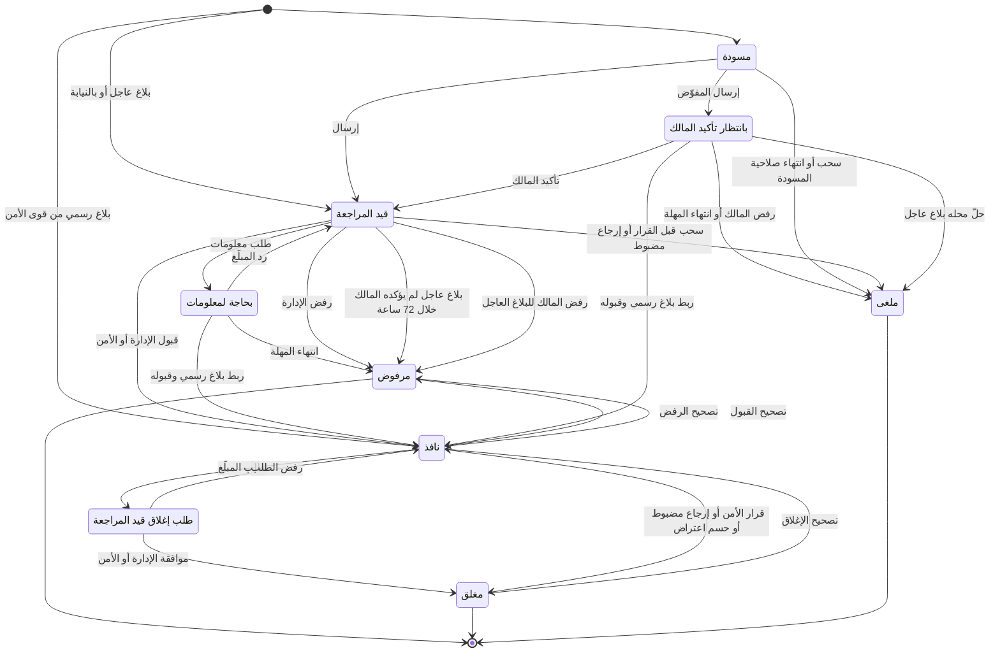

| من | إلى | المحفّز | الفاعل | الشرط | الآثار والأحداث |
|---|---|---|---|---|---|
| — | `draft` | `POST /v1/reports` | المبلّغ أو المفوّض أو الدعم | `report.create` أو `report.initiate_as_delegate` | المسودة صالحة 30 يوماً ⚙️ |
| `draft` | `pending_review` | `submit` | المبلّغ | موثّق الهوية، والإقرار (REPORT-08)، والأدلة للجهاز غير المسجّل (REPORT-04، وتكفي في `processing` إن تعطّلت الملفات، §3.11)، ولا بلاغ مفتوح منه هو على الجهاز (§7.1). قدرة `protective`: لا يمنعها تعليق الحساب (P-1)، ويُعلَّم للمراجع | رقم `BL-`، ومستوى الموثوقية (06 §4، §7.2)، وإنشاء الجهاز إن لم يكن موجوداً، وتجميد التسجيل الذاتي لشخص آخر ولو كان قيد المراجعة (REPORT-15، §8.6)، و**إلغاء الشهادات الفعّالة** على الجهاز (فصفحتها تعرض «الشهادة لم تعد صالحة» دون كشف البلاغ)، وحزمة `theft_protection` إن كانت شريحة الحساب داخله (THEFT-01..05)، وعنصر عمل إداري. **وإن كان على الجهاز بلاغ مفتوح لشخص آخر** يُسجَّل ادعاءً منافساً بمستوى ⛔ (`competing_claim_of`)، ويرى صاحبه «تلقّينا بلاغك، وسيُراجع مع المعلومات المتوفرة عن الجهاز»، ويُراجَع الادعاءان معاً بموافق ثانٍ (SOP-03)، وإرجاع المضبوط وطلب الإغلاق ينتظران قراره، والبوابة تعرض «ادعاءات متعددة» · `report.submitted`، `report.theft_protection.activated` |
| `draft` | `awaiting_owner` | `submit` | المفوّض | تفويض نشط (OWN-08) | طلب تأكيد للمالك عبر واتساب، ومهلة 48 ساعة ⚙️ · `report.owner_confirmation.requested` |
| `awaiting_owner` | `pending_review` | `confirm` | المالك | المالك الحالي، ويوثّق هويته أثناء التأكيد إن لم تكن موثّقة (D-32)، والمسؤولية القانونية عليه | كآثار الإرسال · `report.owner_confirmed`، `report.submitted` |
| `awaiting_owner` | `cancelled` | `decline` أو انتهاء المهلة، أو بلاغ عاجل من جهة موثوقة على الجهاز نفسه يحل محله (`cancel_reason = superseded`) | المالك أو النظام | — | إشعار المفوّض · `report.cancelled` |
| — | `pending_review` | بلاغ عاجل | الجهة الموثوقة | جهة نشطة، والجهاز مسجّل باسم صاحب الحساب (TRUSTED-02) | الحماية فوراً: إنهاء الجلسات، ووقف الرسائل للرقم المسروق، وطلبات إيقاف الخط وتجميد المحافظ المختارة، ورقم الجهة بديلاً للإشعارات فقط، وطلب تأكيد المالك (TRUSTED-03) في `report_owner_confirmations` بنوع `trusted_contact`: من حسابه (ولو بجلسة «بلاغ السرقة فقط» §4.2.13) أو عبر الدعم بالهوية، خلال ⚙️ 72 ساعة بصنف `BUSINESS_FLOOR` (لا تنقضي قبل نهاية يوم الدوام الثاني بعد التقديم) وتتوقف (`PAUSABLE`) ما دام طلب تأكيد بالهوية لدى الدعم مفتوحاً قبل الموعد (§10.1) · `report.submitted`، `report.theft_protection.activated` |
| — | `pending_review` | بلاغ بالنيابة | الدعم | التحقق من الهوية (ONBEHALF-02) | وسم «بالنيابة» واسم المنشئ، وحساب مرتبط يفعّله صاحبه متى شاء (ONBEHALF-05) · `report.submitted` |
| — | `pending_review` | بلاغ سرقة المحل أو الوكيل (REPORT-18، D-94) | صاحب المحل أو الوكيل، ولو من جلسة «بلاغ السرقة فقط» (§4.2.13) أو عبر الدعم بالهوية (`via_support`، ويراجعه مشرف آخر). قدرة `protective` | أجهزة من مخزون المستأجر المسجّل، أو بنود نقل بالجملة مرسلة لم تُقبل (تُسحب من النقل)، والمستأجر `verified` أو `suspended` | دفعة في `report_batches`، وبلاغ مستقل لكل جهاز (`source = shop`، و`batch_id`) بمستوى 🟢 وأولوية عاجلة في قوائم الإدارة والأمن، ومراجعة الدفعة بقرار واحد يطبّق `accept` على كل بلاغ فيها في معاملة مستقلة لكل جهاز · `report.batch.submitted`، `report.submitted` |
| — | `active` | بلاغ رسمي من البوابة أو الاستيراد | عنصر أمن ضمن النطاق، أو مشرف بالاستيراد | رقم الضبط (PP-04، POLICE-02) | كآثار القبول. والتعارض مع ملكية مسجّلة يُنشئ تعارضاً يُحال للأمن ولا يلغي البلاغ (POLICE-06) · `report.accepted` |
| بلاغ مواطن مفتوح | `active`، أو يبقى | بلاغ رسمي على الجهاز نفسه | عنصر أمن ضمن النطاق، أو النظام للاستيراد | البلاغ الرسمي **لا يضيع أبداً** | يُربط بالبلاغ القائم (`police_reference` والجهة). فإن كان `pending_review` أو `needs_info` أو `awaiting_owner` يُقبل بقرار أمني ضمن النطاق (وإلا يُرفق ويُنبَّه)، وإن كان نافذاً يُرفق فقط. ويُشعَر المبلّغ، وسطر الاستيراد `linked` لا مرفوض · `report.police_reference.linked` |
| `needs_info` أو `awaiting_owner` | `active` | ربط بلاغ رسمي (رقم ضبط) بالبلاغ المفتوح وقبوله | عنصر أمن ضمن النطاق | رقم الضبط، والنطاق | كآثار القبول، ويُغلق طلب المعلومات، وصف تأكيد المالك المعلّق (`report_owner_confirmations`) يصير `superseded`، ويُشعَر المبلّغ والمالك · `report.police_reference.linked`، `report.accepted` |
| `pending_review` | `needs_info` | `request-info` | مشرف | سبب | مهلة 14 يوماً ⚙️، وتذكير قبل انتهائها بـ 3 أيام ⚙️ · `report.info_requested` |
| `needs_info` | `pending_review` | رد المبلّغ (REPORT-10) | المبلّغ | — | · `report.info_provided` |
| `needs_info` | `rejected` | انتهاء المهلة | النظام | لم يرد | سبب «عدم الرد»، ويمكن تقديم بلاغ جديد · `report.rejected` |
| `pending_review` | `rejected` | `reject` | مشرف | سبب، وليس منشئه بالنيابة، ولا تعارض مصالح | حزمة رفع الحماية (§8.0): للبلاغ العاجل ولكل بلاغ لم يقدّمه صاحب الجهاز تُعاد الرسائل للرقم فوراً ويُبلَّغ المزوّدون، أما بلاغ المالك نفسه فتبقى رسائل رقمه موقوفة (الجوّال ما زال معه غيره) ويُرشد إلى استعادة الرقم. وفك تجميد التسجيل الذاتي المجمّد بسببه، وإشعار المالك والجهة الموثوقة · `report.rejected` |
| `pending_review` | `rejected` | رفض المالك للبلاغ العاجل («لم أطلب هذا البلاغ») | المالك من حسابه أو من جلسة «بلاغ السرقة فقط»، أو الدعم بالهوية L3 | `source = trusted_contact`، وتأكيد المالك `pending` | سبب RSN-REP جديد «رفض صاحب الجهاز البلاغ»، وحزمة رفع الحماية كاملة مع إعادة الرسائل فوراً وإشعار كل القنوات، وإزالة الجهة الموثوقة إن طلب المالك، وتعليمها لمراجعة SOP-18 · `report.rejected` |
| `pending_review` | `rejected` | حلول موعد التأكيد دون تأكيد المالك (TRUSTED-03) | النظام (مهمة `report.trusted_confirmation.expire`) | `source = trusted_contact`، وتأكيد المالك ما زال `pending`، ولا طلب تأكيد بالهوية مفتوح | سبب «لم يؤكد صاحب الجهاز» (RSN-REP-12)، وحزمة رفع الحماية: إعادة الرسائل للرقم إن لم يكن عليه بلاغ آخر، وإبلاغ الخط والمحافظ (LINE-02، WALLET-03)، وفك تجميد التسجيل الذاتي. وإشعار المالك والجهة الموثوقة · `report.rejected` |
| `pending_review` | `active` | `accept` | مشرف، أو عنصر أمن ضمن النطاق (PP-08) | سبب، ومبرر مكتوب لمستوى ⛔، وتأكيد المالك في البلاغ العاجل، وليس منشئه بالنيابة، وحسم أي ادعاء منافس | داخل المعاملة: الحالة العامة للجهاز، ورفع إصدار حالة الجهاز وإبطال ذاكرة الفحص (§16.1)، وإلغاء طلبات النقل المعلّقة والشهادات الفعّالة (06 §3). وبعدها: المراقبة لدى كل الشركات (TELCO-01)، **إلا لمعرّف معلَّم `shared_identifier` فينتظر قرار الجهة الأمنية (D-120، §7.3)**، والمشاركة مع GSMA (GSMA-04)، وتتابع «صار الجهاز مبلّغاً عنه» (§8.16) عبر `custody.locate`: أمر صيانة مفتوح ← علامة `reported_hold` ومنع التسليم وتنبيه عاجل للنطاق ببيانات الحاضر؛ مخزون محل أو وكيل ← تنبيه عاجل بموقعه وإشعار محايد للمستأجر «جهاز في مخزونك صار مبلّغاً عنه، لا تبعه وأبقه متاحاً»؛ معاملة معلّقة ← رفض آلي (RSN-CNF-07) وتنبيه؛ بند نقل أو سطر متجر ← استبعاد وتنبيه. و**إشعار الحائز المسجّل** إن لم يكن المبلّغ برسالة محايدة ورابط اعتراض دون هوية المبلّغ (D-119). وتنبيهات بأثر رجعي لفحوص المحلات للجهاز أثناء مراجعة البلاغ خلال ⚙️ 30 يوماً. والإشعار · `report.accepted` |
| `draft`، `pending_review`، `needs_info` | `cancelled` | `cancel` | المبلّغ (والبلاغ العاجل بعد تأكيده: المالك وحده) | قبل القرار | حزمة رفع الحماية، وفك أي تجميد ترتّب عليه · `report.cancelled` |
| `pending_review`، `needs_info`، `awaiting_owner` | `cancelled` | إرجاع جهاز مضبوط لصاحبه (§8.18) | النظام | — | سبب `recovered`، وحزمة رفع الحماية · `report.cancelled` |
| `active` | `closure_requested` | `request-closure` (REPORT-11) | المبلّغ | سبب، ولا تهدئة، وإعادة تحقق | يبقى نافذاً في الفحص · `report.closure.requested` |
| `closure_requested` | `active` | رفض الطلب | مشرف أو عنصر أمن ضمن النطاق | سبب | · `report.closure.rejected` |
| `closure_requested` | `closed` | قبول الطلب (ADMIN-03، PP-08) | مشرف أو عنصر أمن ضمن النطاق | سبب، ولا ادعاء منافس مفتوح | الحالة العامة، وفك الحظر وحذف المراقبة (TELCO-07)، وحذف المشاركة مع GSMA، وحزمة رفع الحماية، وإنهاء جلسة التتبّع، وتتابع «انتهى البلاغ» (§8.16): **إشعار وقوف للجهات الأمنية** على مدار الساعة («البلاغ لم يعد نافذاً») لكل جهة لها رابط نطاق بالجهاز بمسار التنبيه العاجل نفسه، وإغلاق التنبيهات المفتوحة إدارياً (RSN-ALR-07) وتعليمها «انتهى» في البوابة، والاعتراضات المفتوحة `moot`، وطلبات الإغلاق الأخرى `withdrawn`، والمعلومات الواردة `closed`، وعلامة `reported_hold` تُرفع. والمضبوط `held` يبقى لدى الجهة وتقرر هي · `report.closed` |
| `active` | `closed` | إغلاق مباشر | عنصر أمن ضمن النطاق (PP-08)، أو إرجاع مضبوط (PP-10، سبب `seizure_returned`)، أو إفراج الجهات (`released_by_authority`، §8.18)، أو مشرف بعد حسم اعتراض (DISPUTE-02)، أو تلف الجهاز نهائياً بقرار مشرف، أو النظام عند دمج جهاز مكرر | سبب | كالسابق · `report.closed` |
| `active` | `rejected` | تنفيذ تصحيح القبول | النظام بعد موافقة ثانية (REVERSAL-04) | §8.12 | كآثار الإغلاق ومنها إشعار الوقوف للأمن، والإشعار بصياغة محايدة. ولا يُحيا ابن أُلغي يمس الملكية: التسجيل الذاتي الملغى يصبح عنصر عمل لتصحيح الملكية (REVERSAL-03)، والإحالة للأمن تتبعها رسالة تصحيح محايدة، وطلبات النقل والشهادات يعيدها المالك. وما رُفض آلياً بسبب القبول من معاملات معلّقة يُفتح لإعادة المراجعة · `report.decision_reversed` |
| `rejected` | `active` | تنفيذ تصحيح الرفض | النظام بعد موافقة ثانية | §8.12 | كآثار القبول · `report.decision_reversed`، `report.accepted` |
| `closed` | `active` | تنفيذ تصحيح الإغلاق | النظام بعد موافقة ثانية | §8.12 | إعادة المراقبة والمشاركة · `report.decision_reversed` |

**المبلّغ بالنيابة:** للبلاغ بمصدر `on_behalf`، أو لحساب ONBEHALF-05 لم يُفعَّل، ينفّذ الدعم إجراءات المبلّغ (الرد على طلب المعلومات، وطلب الإغلاق، والرد على الاعتراض، واستلام المضبوط، وطلبات صاحب البيانات) بعد تحقق ONBEHALF-02 في كل مرة، بصفة `support_on_behalf` وعلامة `via_support` باسم الموظف، ويوافق على طلب الإغلاق غير ذلك الموظف، والإشعارات بالرسائل القصيرة (ONBEHALF-04).

**مهل البلاغ والمالك متوفى:** ما دام طلب انتقال يشمل الجهاز مفتوحاً (§8.17)، تتوقف مهل البلاغ التي تنتظر المتوفى (`needs_info`، و`awaiting_owner`) بصنف `PAUSABLE(succession_open)`، وبعد التنفيذ يجيب الخلف بصفته المسؤول الجديد (`responsible_person_id`).

متابعة بلاغ سرقة المحل لكل جهاز (REPORT-18) قيمة محسوبة لا حالة مخزّنة: «ما زال مفقوداً» (البلاغ نافذ دون تنبيهات)، و«ظهر» (تنبيه على الجهاز)، و«ضُبط» (صف في `seized_devices`)، و«أُعيد» (أُغلق البلاغ بالإرجاع).

### 8.2 الجهاز

**أ. حالة الجهاز على الشبكة** (`devices.network_status`)، وهي الصيغة المخزّنة لمخطط 14 §5.3: «تنبيه استخدام» ليس حالة مستقرة بل حدث، ووجود مؤقّت حظر (`block_due_at`) يغطي الفاصل القابل للضبط.

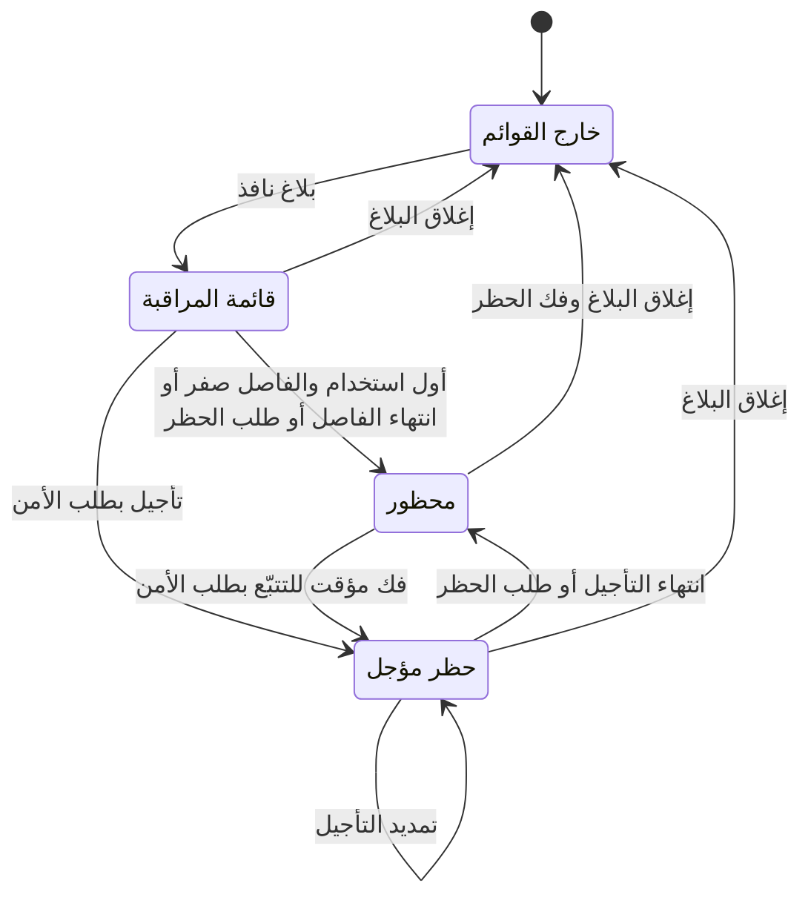

| من | إلى | المحفّز | الفاعل | الشرط | الآثار والأحداث |
|---|---|---|---|---|---|
| `none` | `watch` | `report.accepted`، أو قرار الجهة الأمنية لمعرّف منسوخ (D-120) | النظام | بلاغ نافذ، وللجهاز IMEI نشط (لا ينطبق على `sim_less`)، ولا علامة `shared_identifier` دون قرار الجهة (§7.3) | طلب إضافة للمراقبة لكل شركة مفعّلة · `device.network_status.changed` |
| `watch` | `watch` | أول حدث استخدام والفاصل ⚙️ أكبر من صفر | النظام | — | `block_due_at` = وقت الحدث + الفاصل، ومؤقّت · `device.sim_inserted` |
| `watch` | `watch` | أول استخدام **بشريحة رقم المبلّغ** (بصمة MSISDN تطابق رقمه الأساسي أو البديل) | النظام | — | علامة `owner_sim`: يُؤجَّل الحظر الآلي ⚙️ 24 ساعة، والتنبيه للأمن موسوم «غالباً المالك»، ويُشعَر المالك «إن استعدت جهازك فاطلب إغلاق البلاغ»، ويُحال لقائمة الإغلاق · `device.sim_inserted` |
| أي حالة | بلا تغيير | حدث شبكة لجهاز **لا بلاغ نافذاً عليه**، أو وقته (`observed_at`) قبل قبول البلاغ أو بعد نهايته | النظام | — | لا تنبيه ولا حظر ولا دفع للأمن: يُخزَّن في خط زمن الإدارة بعلامة `no_active_report`، وإن كانت الشركة ما زالت تُدرج الجهاز يُعاد طلب الحذف فوراً ويُفتح فرق مطابقة. والحدث الأقدم من ⚙️ 24 ساعة لبلاغ نافذ عنصر عمل `stale_event` لا تنبيه حي. ويُعاد فحص حالة البلاغ لحظة التوزيع للأمن |
| `watch` | `blocked` | أول حدث استخدام والفاصل صفر (الافتراضي)، أو حلول `block_due_at`، أو طلب الحظر | النظام، أو عنصر أمن، أو مشرف | بلاغ نافذ | طلب حظر لكل الشركات (TELCO-05) · `device.block.requested` |
| `watch` | `block_delayed` | تأجيل الحظر (TELCO-06) | مشرف بطلب موثّق من الأمن، أو عنصر أمن ضمن النطاق | سبب ومدة ومرجع | صف في `block_holds`، وإمكانية فتح جلسة تتبّع · `device.block.deferred` |
| `block_delayed` | `block_delayed` | تمديد | مثل التأجيل | سبب | تحديث `hold_until` |
| `block_delayed` | `blocked` | انتهاء التأجيل، أو طلب الحظر، أو انتهاء جلسة التتبّع | النظام أو الأمن أو المشرف | — | طلب حظر، وإنهاء الجلسة · `device.block.requested` |
| `blocked` | `block_delayed` | فك مؤقت للتتبّع (TELCO-06 «إيقافه مؤقتاً») | عنصر أمن أو مشرف بطلب الأمن | سبب ومدة | طلب فك الحظر مع بقاء المراقبة · `device.block.deferred` |
| أي حالة | `none` | `report.closed`، أو `report.cancelled`، أو تصحيح، أو دمج | النظام | لا بلاغ نافذ على الجهاز | طلبات حذف من المراقبة والحظر لكل الشركات · `device.network_status.changed` |

حالة كل شركة على حدة في `telecom_list_states` (المطلوب والمؤكَّد و`ever_sent`)، والطلبات الفردية في `telecom_list_entries` (§8.15). وكل تغيير في الحالة المطلوبة (إضافة أو حذف من المراقبة، وحظر أو فكّه، وإدراج GSMA أو حذفه، وإشعار إغلاق التجميد، وإشعار إعادة تشغيل الخط، وإيقاف بث الموقع) يُكتب **لكل شركة استلمت يوماً** بيانات هذا الجهاز أو الحساب، ويبقى `held` ما دامت الشركة غير `live` (§14.3)، ولا يُلغى أبداً. **والجهاز دون شريحة (`device_class = sim_less`) يبقى `none` دائماً** (D-91).

**ب. حيازة الجهاز** (`devices.custody_state`): إسقاط يُحدَّث في معاملة كل تغيير ملكية، ويطابق مخطط 14 §2 مع فصل البلاغ وحالة الشبكة كبُعدين مستقلين:

| حالة 14 §2 | التمثيل المخزّن |
|---|---|
| غير معروف للمنصة | لا صف في `devices`، أو `custody_state = unknown` لجهاز ظهر ببلاغ أو ضبط أو صيانة دون ملكية |
| في مخزون وكيل | `importer_stock` |
| في مخزون محل | `shop_stock` |
| مملوك لشخص | `owned` |
| تسجيل ذاتي قيد الانتظار | `self_reg_waiting` |
| مفكّك للقطع | `dismantled` |
| تخلّى عنه مالكه (أُتلف، أو خرج من سوريا، أو سُلّم لإعادة التدوير) | `retired` بنوع الحيازة `relinquish` (§7.10)، وظهوره لاحقاً في فحص محل أو حدث شبكة أو تسجيل ينبّه كظهور جهاز مفكّك، والتسجيل الذاتي له يُراجع بمستوى ⛔ |
| محجوز لدى الجهات أو مجمّد | قيود الجهاز (§5.11): `held_by_authority`، و`fraud_freeze`، و`owner_deceased`، و`succession_pending`، مع حالة الحيازة كما هي |
| بلاغ قيد المراجعة | `devices.has_pending_report = true` مع حالة الحيازة كما هي |
| مبلّغ عنه ونافذ (مراقب) | `devices.public_status` = `reported_stolen` أو `reported_lost`، و`network_status = watch` |
| محظور على الشبكة | `network_status = blocked` |

و`devices.record_status` = `active` أو `merged` (§7.4).

### 8.3 طلب نقل الملكية (`ownership_transfers.status`)

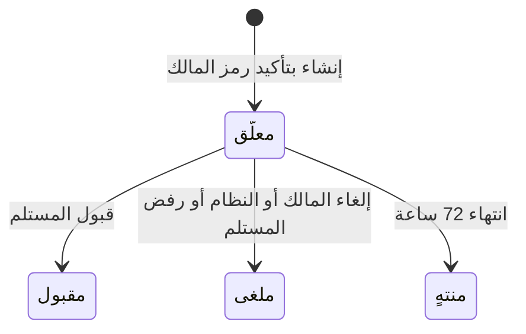

| من | إلى | المحفّز | الفاعل | الشرط | الآثار والأحداث |
|---|---|---|---|---|---|
| — | `pending` | `POST /v1/ownership-transfers` | المالك | `ownership.transfer.create` ورمز `transfer_confirm` | `expires_at` = +72 ساعة ⚙️ بصنف `WALL_USER` (§10.1)، وحجز الجهاز (§7.10)، ورسالة واتساب للمستلم · `ownership.transfer.requested` |
| — | `pending` | نقل إلى محل برقم `SH-` (D-121) | المالك | كإنشاء النقل، والمحل موثّق وإلا `OWN_TRANSFER_RECIPIENT_INVALID` | `to_tenant_id`، والطلب يظهر في لوحة المحل بالمهلة نفسها. وإن كان المحل نفسه يحجز الجهاز بمعاملة معلّقة (D-96) أخذ الطلب الحجز ذرياً، وإلى محل آخر `DEVICE_RESERVED` (§7.10) · `ownership.transfer.requested` |
| `pending` (إلى محل) | `accepted` | قبول المحل | عضو بـ `shop.tx.purchase` في سياق المحل وموقعه (D-41) | حارس الحيازة بنوع `transfer_to_tenant`، وصورة هوية **الشخص الحاضر** (D-31)، والحاضر لا يحتاج حساباً | **القبول نفسه معاملة الشراء**: صف واحد في `shop_transactions` بنوع شراء من المالك المسجّل، والملكية إلى المحل بمصدر `shop_purchase`، والإيصال وإشعار المالك، ولا خطوة ثانية. والمعاملة المعلّقة للمحل نفسه على الجهاز تُلغى `superseded` (§8.7) · `ownership.transfer.accepted`، `shop.transaction.completed` |
| `pending` | `accepted` | `accept` | المستلم | مطابقة بصمة رقمه الوطني (أو المعلن، §4.2.1) **ورقم حسابه الحالي المؤكَّد** (لا الرقم وقت الإنشاء)، وإعادة الفحص بحارس الحيازة (§7.10) | إنهاء الملكية القديمة وبدء الجديدة (`source = transfer`)، وإلغاء التفويضات والشهادات (OWN-07)، وإيصال `CR-` للطرفين · `ownership.transfer.accepted`، `ownership.owner.changed` |
| `pending` | `cancelled` | `cancel` | المالك | — | `cancel_reason = owner` · `ownership.transfer.cancelled` |
| `pending` | `cancelled` | `decline` | المستلم الشخص، أو عضو بـ `shop.tx.purchase` للمحل المستلم | — | `cancel_reason = recipient_declined`، والقالب 316 للمالك، وتأكيد المحل لنفسه، وفك الحجز (وتستعيده المعاملة المعلّقة إن وُجدت، §7.10) · `ownership.transfer.declined` |
| `pending` | `cancelled` | بلاغ مُرسل أو مقبول، أو تغيّر المالك، أو بدء تهدئة المالك أو قيد إعادة تعيينه، أو قيد على الجهاز (ضبط)، أو اعتماد طلب انتقال يشمل الجهاز (للطلبات **الصادرة** من المتوفى، ولا تُعاد بعد اعتراض، P-7)، أو تأكيد وفاة المرسل أو المستلم، أو تعليق حساب المرسل أو المستلم أو حظره | النظام | — | `cancel_reason` = `report` أو `owner_changed` أو `cooldown` أو `device_restricted` أو `owner_reported_deceased` أو `owner_deceased` أو `account_restricted`، وإشعار محايد للطرف الآخر، وفك الحجز |
| `pending` | `expired` | انتهاء المهلة | النظام | — | إشعار الطرفين · `ownership.transfer.expired` |

### 8.4 حساب المستأجر: المحل والوكيل والمورّد (`shops.status`، `importers.status`، `suppliers.status`)

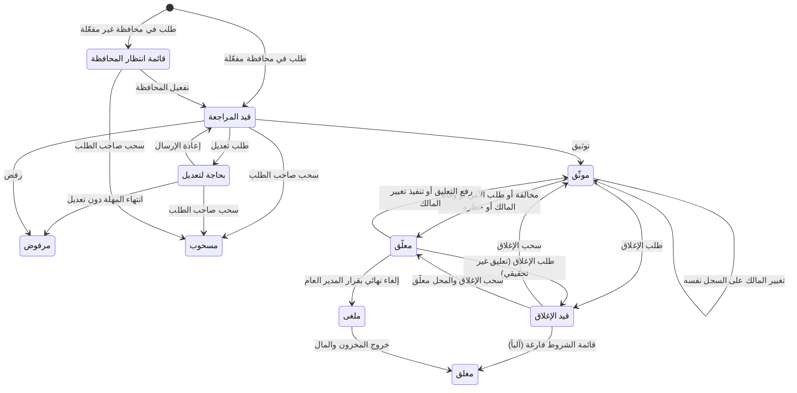

| من | إلى | المحفّز | الفاعل | الشرط | الآثار والأحداث |
|---|---|---|---|---|---|
| — | `pending_review` | طلب تسجيل محل في محافظة مفعّلة (SHOP-01، ROLLOUT-02)، أو طلب وكيل (IMPORTER-01) في أي وقت | موثّق الهوية | — | عنصر عمل لمشرف المحلات · `tenant.application.submitted` |
| — | `waitlisted` | طلب تسجيل **محل** | موثّق الهوية | المحافظة غير مفعّلة. وللمحلات فقط: الوكيل والمورّد لا قائمة انتظار لهما | إشعار بقائمة الانتظار · `tenant.application.waitlisted` |
| `waitlisted` | `pending_review` | `rollout.governorate.activated` | النظام | — | · `tenant.application.submitted` |
| `pending_review` | `needs_changes` | طلب تعديل | مشرف المحلات | سبب | تذكير قبل نهاية المهلة بـ ⚙️ 7 أيام · `tenant.application.changes_requested` |
| `needs_changes` | `pending_review` | إعادة الإرسال | صاحب الطلب | — | — |
| `needs_changes` | `rejected` | انتهاء ⚙️ 30 يوماً دون تعديل | النظام | — | سبب «لم يُستكمل الطلب»، وإعادة التقديم بطلب جديد · `tenant.rejected` |
| `pending_review` أو `needs_changes` أو `waitlisted` | `withdrawn` | سحب الطلب | صاحب الطلب | — | · `tenant.application.withdrawn` |
| `pending_review` | `verified` | `approve` | مشرف المحلات | مقارنة الموقع بالعنوان والصور (ADMIN-06) | رقم `SH-` أو `IM-`، وعضوية الصاحب، وتفعيل المستأجر · `tenant.verified` |
| `pending_review` | `rejected` | `reject` | مشرف المحلات | سبب | · `tenant.rejected` |
| `verified` | `suspended` | `suspend` | مشرف المحلات أو المدير العام، أو تنفيذ طلب الأمن (PP-09)، أو النظام عند تأكيد وفاة المالك (RSN-SUS-09، §8.17) أو حظره (RSN-SUS-08، **دائماً**: المحظور لا يملك محلاً، D-106) | سبب | قيد `tenant_suspended` وتتابع `restricted` (§8.16): يُمنع **الجديد** فقط وتبقى المسارات المحمية (§8.4 ب)، وإبلاغ الصاحب بالسبب وبما يبقى متاحاً (06 §6). ولتعليق الحظر مراجعة خلال ⚙️ 48 ساعة دوام (`tenant.owner_banned.review`، قائمة `tenant_ban_reviews`، SOP-23): تغيير المالك أو الإغلاق · `tenant.suspended` |
| `suspended` | `verified` | `reinstate` | مشرف المحلات | سبب | رفع ما وضعه هذا التعليق وحده، واستئناف الحملات بأيامها الباقية والتذكيرات للمواعيد القادمة، وإن كان السبب RSN-RIN-05 «لم تثبت مخالفة» تُعاد أيام الاشتراك آلياً (D-112، §8.11 ج) · `tenant.reinstated` |
| `suspended` | `verified` | تنفيذ تغيير المالك (§8.4 د) | النظام | أسباب التعليق النافذة كلها RSN-SUS-08 أو RSN-SUS-09 | يُرفع تعليقا الحظر والوفاة وحدهما (`restore_if_cause`)، وأي سبب آخر يُبقي المحل معلّقاً · `tenant.owner_changed`، `tenant.reinstated` |
| `verified` أو `suspended` | `closing` | طلب الإغلاق | صاحب المحل (`shop.closure.request`)، أو صاحبه المحظور من `exit_only`، أو الخلف الموثّق من `successor` (`shop.closure.request_as_successor`) | إعادة تحقق. ومن `suspended` فقط إن كانت كل أسباب التعليق النافذة من RSN-SUS-06 إلى RSN-SUS-09، وإلا (تعليق بسبب تحقيق RSN-SUS-01 إلى RSN-SUS-05) `TENANT_CLOSURE_BLOCKED` بالنص المحايد (RSN-CLO-08) | لا جديد، وتبقى المسارات المحمية وتسليم مخزون الإغلاق، ومعاينة الآثار وقائمة الشروط (§8.4 ج)، وتذكير صاحب المحل بما بقي كل ⚙️ 7 أيام (`tenant.closing.reminder`) وعنصر عمل لمشرف المحلات بعد ⚙️ 90 يوماً دون تقدّم (`tenant.closing.escalate`، المهمة `tenant.closing.watch`، UC-12) · `tenant.closing_started` |
| `closing` | `verified` أو `suspended` | تراجع | مقدّم الإغلاق (صاحب المحل أو الخلف) | قبل `closed` | يعود لحالته قبل الطلب، وتراجع الخلف يعيده إلى `suspended` (RSN-SUS-09) · `tenant.closure_withdrawn` |
| `closing` | `closed` | قائمة الشروط المولّدة فارغة، **آلياً دون تأكيد من صاحب المحل** | النظام | كل أبناء المحل الذين سياستهم `must_be_terminal` نهائيون (§8.4 ج)، وإلا تبقى القائمة معروضة بالناقص | `closure_reason = owner_request`، وعضويات الموظفين `removed`، وعضوية الصاحب `exit_only`، وبدء مدة الاطلاع على المحاسبة (RT-43)، وإلغاء مفاتيح الربط ورموز نقطة البيع دون اتصال آلياً · `tenant.closed` |
| `suspended` | `revoked` | `revoke` | **المدير العام وحده** بعد اقتراح مشرف المحلات مع معاينة الآثار (P-11) | سبب، وتحديد: احتيال أو غيره (D-108) | عضويات الموظفين تنتهي، وعضوية الصاحب `exit_only` (§4.2.14)، ومصير المخزون حسب السبب (§8.4 ج)، والنقل الوارد المُرسل يُلغى ويعود للمرسل، وتتابع `ended` (§8.16) · `tenant.revoked` |
| `revoked` | `closed` | خروج المخزون (أو تجميده بقرار) وتصفير المحفظة وتسليم أوامر الصيانة | النظام | — | `closure_reason = revoked`، وتبقى التسمية «ملغى» للجمهور · `tenant.closed` |
| `verified` | `verified` | تنفيذ تغيير المالك (§8.4 د) | النظام بعد الاعتماد واكتمال الشروط | شروط التغيير | آثار التنفيذ في §8.4 د (والمحفظة الجديدة يفعّلها المالك الجديد بعد التنفيذ) · `tenant.owner_changed` |
| `verified` ↔ `suspended`، `pending_review`، و`revoked` ← `suspended` | الحالة المقابلة | تنفيذ تصحيح الاعتماد أو التعليق أو الإلغاء | النظام بعد موافقة ثانية | §8.12 | وتصحيح التعليق لأنه خطأ يعيد أيام الاشتراك آلياً (D-112) · `tenant.decision_reversed` |

- تعديل الاسم أو الموقع أو الترخيص (SHOP-04) طلب مستقل في `tenant_change_requests` (`pending` ← `approved` أو `rejected`)، والمحل يبقى `verified` ببياناته السابقة حتى الموافقة.
- المورّد (D-87) يتقدّم من الموقع (S-SUP-01، `tenant.apply`) أو ينشئه المشرف التجاري بعد التعاقد، فيبدأ من `pending_review` دون قائمة انتظار، ويمر بالانتقالات نفسها والمراجع المشرف التجاري. **تعليقه:** تُخفى منتجاته وتُحفظ، ولا تُسند له طلبات جديدة، وطلبات `new` و`confirmed` يُعاد توريدها أو تُلغى بإعادة الدفع الآلية (D-116)، و`preparing` يكملها بصلاحية تجهيز فقط إلا إن كان السبب صنفاً ممنوعاً أو احتيالاً فتُلغى، والمشحون والمسلّم والإرجاع والخصم تستمر، والأسطر المؤهلة تُسوّى ما لم يضع المدير العام تجميد احتيال بموعد مراجعة ⚙️ 30 يوماً قابل للتجديد. **وإلغاؤه:** كشف نهائي بعد انتهاء آخر مهلة إرجاع أو كفالة، والرصيد السالب الباقي ذمة مسجّلة على المورّد (`supplier_receivables`) تطالب بها المنصة حسب العقد، وحساب الاستلام `retired`.
- مندوب الشحن (`couriers.status`) جهة ينشئها المشرف التجاري مباشرة `verified`، ثم `suspended` ← `verified`، أو `revoked`. وتعليقه: لا استلامات جديدة، والطرود والنقد التي معه تُسوّى عبر SOP-42.
- المعلِن (محل أو مورّد): تعليقه يجعل حملاته `paused` وتُستأنف بأيامها الباقية عند رفعه، وإلغاؤه ينهيها `ended` (§8.15).
- **حساب صاحب المحل:** معلّق ← يستمر المحل بموظفيه (الالتزام لا يتوقف)، وإجراءات المالك وحده موقوفة عدا السحب والتصدير عبر جلسة الخروج المالي (§4.2.14). محظور ← **يُعلَّق المحل دائماً** (RSN-SUS-08، D-106: المحظور لا يملك محلاً)، ويفتح مشرف المحلات مراجعة خلال ⚙️ 48 ساعة دوام (SOP-23)، ويطلب المحظور من `exit_only` تغيير المالك أو الإغلاق. متوفى ← يُعلَّق (RSN-SUS-09) ويتصرف الخلف الموثّق (§4.2.16). قيد الإغلاق ← يُوجَّه لإغلاق المحل أولاً. هوية معكوسة بالتصحيح ← يُعلَّق المحل حتى يعيد التوثيق.
- **إزالة نوع نشاط (D-90):** طلب تعديل يوقف الجديد من ذلك النشاط فوراً، ولا يُنفَّذ حتى تنتهي أبناؤه المفتوحة (تسليم أوامر الصيانة، وتصريف المخزون).
- **نقل المحافظة:** العناصر الجديدة تحمل المحافظة الجديدة، وروابط النطاق القائمة تبقى، والمحل يعمل ولو لم تُفعَّل المحافظة الجديدة (قائمة الانتظار للطلبات الجديدة فقط)، وتقرير الالتزام يعرض النقل. وتعطيل محافظة (`rollout.governorate.deactivated`) يحوّل الطلبات الجديدة فيها لقائمة الانتظار، والمحلات الموثّقة تعمل والتزاماتها باقية.
- إعادة التقديم بعد الرفض أو السحب صف جديد.

**ب. معنى التعليق: يُمنع الجديد ولا يُحبس أحد (P-3، P-9)**

| ممنوع أثناء التعليق | مسموح دائماً (مسار محمي) |
|---|---|
| معاملات السجل الجديدة: الشراء، والبيع، واستلام الصيانة، واستبدال اللوحة، وقبول النقل الوارد، واستعلام الأحوال المدنية | **تسليم أجهزة الصيانة** المستلمة لأصحابها أو مفوّضيهم مع إعادة الفحص (`repair_delivery`، §7.10) |
| طلبات المتجر الجديدة، والتعبئة، والدفع من المحفظة، و**كل بيع في نقطة البيع** (ومنه الإكسسوارات)، والحملات الجديدة، والتجربة الجديدة | **بلاغ سرقة المحل** (D-94، قدرة `protective`) |
| كل حركة تُخرج جهازاً من المخزون (البيع، والنقل بين المحلات، والإرجاع للوكيل، وتسليم مخزون الإغلاق: `TENANT_HANDOVER_BLOCKED`) عدا الضبط وتسليم الصيانة (§7.10) | |
| | **السحب** من المحفظة وكشفها، وقراءة المحاسبة وتصديرها، ودفع تجديد الباقة (§5.10) |
| | السجلات والفواتير للقراءة وإعادة إرسالها، وطلبات التصحيح والإلغاء، والمعلومات الواردة، وإيقاف الموظفين وإزالتهم، ومزامنة مبيعات نقطة البيع دون اتصال التي وقتها على الجهاز قبل التعليق |

| ما كان جارياً | مصيره عند التعليق |
|---|---|
| المعاملات المعلّقة | تبقى في المراجعة |
| النقل بالجملة أو بين المحلات الوارد `sent` | **يبقى `sent`** ولا يُقبل، وللمرسل إلغاؤه، ويُلغى آلياً بعد ⚙️ 30 يوماً (`importer.transfer.auto_cancel`). وعند الإلغاء النهائي للمحل يُلغى ويعود للمرسل، وفي `closing` يُرفض فقط |
| طلبات المتجر | `new` و`confirmed` تُلغى بسبب RSN-ORD-05 بإبطال آلي للمسبق (D-116). و`preparing` و`shipped` **تمضيان إلى التسليم**: الأسطر غير الأجهزة تُسلَّم ويُقبض الدفع عند الاستلام، وللمحل رفضها عند الباب فيُلغى الطلب ويُبطَل مسبقه آلياً ولا يُسلَّم شيء. **وأسطر الأجهزة لا تدخل أبداً مخزون محل معلّق**: تُستبعد عند التسليم ويُبطَل مسبقها (D-116) وتبقى للوكيل. والرفض بسبب التعليق أو استبعاد المنصة **لا يُحسب** في `cod_blocked` |
| الإرجاع والاسترداد المفتوحان | يستمران |
| حملات المحل الإعلانية | `paused` بأيامها الباقية |
| تذكيرات زبائن المحاسبة | تتوقف، وعند رفع التعليق تُستأنف للمواعيد القادمة فقط |
| الاشتراك | تستمر مدته (D-112)، وتُعاد الأيام آلياً إن أُلغي التعليق بالتصحيح، أو رُفع بسبب RSN-RIN-05 «لم تثبت مخالفة» |
| نقطة البيع | لا بيع أبداً، ومزامنة المبيعات دون اتصال السابقة للتعليق فقط، والمحاسبة للقراءة والتصدير |
| التعبئات المعلّقة | تُحسم عادياً |
| المحفظة | قيد `tenant_suspended`: التعبئة والدفع ممنوعان، والسحب متاح |

والمصفوفة الكاملة لكل قدرة في كل حالة في [الترابط والسيناريوهات](26-scenarios-and-linkage.md) §4.

**ج. الإغلاق والإلغاء ومصير المخزون (D-108)**

| السبب | المخزون | المال والباقي |
|---|---|---|
| إغلاق طوعي | **يُباع أو يُسلَّم قبل الإغلاق**: بيع عادي، أو «تسليم مخزون الإغلاق» إلى محل أو وكيل موثّق يقبله كنقل بالجملة، أو إلى صاحب المحل شخصياً بفاتورة (`closure_handover`، §7.10)، فتبقى سلسلة الحيازة كاملة | السحب حتى الصفر ثم إغلاق حساب المحفظة لدى شام كاش، والاشتراك ينتهي والاسترجاع حسب D-111 |
| إلغاء دون احتيال | **ينتقل لصاحب المحل شخصياً**: تسليم مخزون الإغلاق آلياً إليه بفاتورة لكل جهاز (والمالك المتوفى: إلى الخلف الموثّق إن وُجد، وإلا يبقى باسم المتوفى بقيد `owner_deceased`) | السحب في جلسة الخروج المالي (§4.2.14)، ولا استرجاع إن كان لمخالفة (D-111) |
| إلغاء بسبب احتيال | **يُجمَّد** بقيد `fraud_freeze` على كل جهاز، في سجل تجميد (أدناه) يُحال للجهة الأمنية ضمن النطاق، فتقرر الضبط أو الإفراج لصاحب المحل (`pp.stock_freeze.decide`) | السحب في جلسة الخروج المالي ما لم يوقفه D-100 أو تجميد خارجي بأمر جهة مختصة |

**شروط `closing → closed`** هي أبناء المحل الذين سياستهم `must_be_terminal` في سجل التتابعات (§8.16)، وقائمة الإغلاق تُولَّد منها لا من نص: لا معاملة `checked` أو `under_review`، ولا أمر صيانة مفتوح (سُلّم، أو «سُلّم للجهات المختصة»)، والمخزون صفر **أو مجمّد بقرار الجهات**، ولا نقل بالجملة أو بين المحلات صادر `sent` (والوارد يُرفض فقط)، ولا طلب متجر قبل `delivered` ولا إرجاع مفتوح، والمحفظة مغلقة (بأي `close_reason`) بلا عملية معلّقة، والاشتراك منتهٍ أو ملغى مع طلب الاسترجاع السنوي (D-111) **قبل إغلاق المحفظة**، والحملات منتهية. ومفاتيح الربط ورموز نقطة البيع دون اتصال تُلغى آلياً عند `closed` وليست شرطاً. **والإغلاق آلي** حين تفرغ القائمة، دون تأكيد من صاحب المحل. وبعد `closed`: الفواتير قابلة للتحقق، وتقرير الالتزام يعرض «أُغلق بطلب صاحبه»، والمحل لا يُعدّ «نشطاً» عند إغلاق حساب صاحبه، وبلاغات D-94 النافذة يبقى صاحب المحل مسؤولها (`responsible_person_id`).

**جهاز في المخزون صار مبلّغاً عنه أثناء الإغلاق:** لا يُباع ولا يُسلَّم، ويُرشد المحل إلى تسليمه لقسم الشرطة المختص، فيسجّله العنصر بـ `pp.seizure.record` (نوع الحيازة `seizure`) فيستوفي بند المخزون، ويظهر عنصره في S-POL-24 لجهة النطاق، مع تذكير أسبوعي ⚙️ `tenant.stock_freeze.followup`.

**وفاة المالك أثناء الإغلاق:** يبقى المحل `closing` ويُضاف تعليق الوفاة (RSN-SUS-09)، ويواصل الموظفون بيع المخزون، ويصير الخلف الموثّق هو الفاعل (§4.2.16)، والمخزون «لصاحب المحل شخصياً» يذهب إلى **الخلف المقدِّم** بفاتورة (اجتاز تحقق D-103)، وبند المحفظة يستوفيه `closed(owner_deceased)`: **يغلقها النظام** بهذا السبب عند وفاة المالك والمحل `closing`، أو عند بدء الخلف الإغلاق من نطاق `successor`، متى لم تبقَ عليها عملية معلّقة أو قيد المتابعة (وإلا فعند حسمها)، والرصيد يبقى لدى شام كاش للورثة (D-89). وسحب الإغلاق يعيد المحل إلى `suspended(RSN-SUS-09)`.

**سجل تجميد المخزون للاحتيال (D-108):**

| البند | التفصيل |
|---|---|
| البيانات | `stock_freeze_cases` (المستأجر، ووقت الإلغاء، وجهة الأمن، والحالة `open` أو `closed`، وموعد المتابعة التالي) و`stock_freeze_items` (الجهاز، والقرار `pending` أو `seized` أو `released`، والعنصر الذي قرر، ووقته، ورقم القضية، والسبب) ([نموذج البيانات](09-data-model.md) §11.7) |
| الإنشاء | عند `tenant.revoked` بسبب احتيال: سجل واحد وبند لكل جهاز في المخزون، وقيد `fraud_freeze` لكل جهاز، والحدث `police.stock_freeze.listed` فيظهر قرار في S-POL-24 لجهة النطاق، ويُبلَّغ المالك (RSN-CLO-05) |
| القرار | `pp.stock_freeze.decide` (عنصر ضمن النطاق، لكل جهاز أو دفعة): `seized` (حيازة `seizure`، و`held` بغرض يختاره) أو `released` (حيازة `closure_handover` لصاحب المحل شخصياً، ولو بعد `closed`، والمالك المتوفى كصف «إلغاء دون احتيال» أعلاه)، والحدث `police.stock_freeze.decided`، والقالب 313 للمالك (من `exit_only`) ولمشرف المحلات |
| المتابعة | المهمة `tenant.stock_freeze.followup`: كل ⚙️ `tenant.stock_freeze.followup` عنصر تذكير لمسؤول أمن الجهة، وبعد ⚙️ `tenant.stock_freeze.escalate` عنصر لمشرف المحلات (مصفوفة الاتصال). ويُغلق السجل حين تُحسم كل بنوده |

**د. تغيير المالك على السجل نفسه (D-107)**

عند بيع المحل أو انتقاله لوريث أو خروج شريك **يبقى رقم المحل وتاريخه ومخزونه**، ويتغير المالك. **والترتيب واحد في كل مكان:** التقديم ← **قبول المالك الجديد** ← مراجعة مشرف المحلات و**اعتماده** ← الشروط (المحفظة القديمة نهائية) ← **التنفيذ الآلي**. فالاعتماد يسبق تفريغ المحفظة، فلا يغلق المالك القديم محفظته لتغيير يُرفض لاحقاً، ويواصل العمل حتى التنفيذ.

**من يقدّم، ومن أي حالة:**

| الحالة | المقدِّم والجلسة | حالات المحل المسموحة |
|---|---|---|
| بيع أو خروج شريك (المالك حي) | المالك بـ `shop.owner_change.request`، بإعادة تحقق، ونطاق `full` | `verified`، و`suspended` بالسببين RSN-SUS-06 أو RSN-SUS-07 وحدهما |
| المالك محظور (D-106) | المالك المحظور من نطاق `exit_only` (§4.2.14) | `suspended(RSN-SUS-08)` (الحظر يعلّقه آلياً) |
| المالك متوفى | **الخلف الموثّق**: طالب انتقال منفّذ عن ذلك الشخص (بأي نطاق ومنه `none`) من نطاق `successor` (§4.2.16، المدخل S-USR-58 «محلات صاحب الأجهزة» ← S-SHP-59)، أو عبر الدعم ← S-ADM-76 | `suspended(RSN-SUS-09)`، أو `closing` بعد سحب الإغلاق |
| وثيقة رسمية (حكم، أو رخصة صادرة لشخص آخر) ولا يتعاون المالك | مشرف المحلات يقدّم على الوثيقة (`tenant.owner_change.file_official`)، ويعتمد **المدير العام أو نائبه** (صنف تصحيح الملكية) | كالصف الأول، و`suspended` بالسبب RSN-SUS-08 أو RSN-SUS-09 |
| أي حالة | — | **ممنوع** (`TENANT_OWNER_CHANGE_BLOCKED` بنص محايد) ما دام تعليق بسبب تحقيق (RSN-SUS-01 إلى RSN-SUS-05) نافذاً، وفي `closing` (يُسحب الإغلاق أولاً)، و`revoked`، و`closed` |

وضمان «أنا حي» لتغيير يقدّمه وارث هو إشعار D-103 نفسه: لا يقدّم الخلف إلا بعد تأكيد الوفاة بانتقال منفّذ (§8.17). وفي تقديم الشريك أو الوثيقة الرسمية والمالك حي يصل المالك القالب 220 (ج) مع «لم أطلب هذا» (رابط الدعم)، واعتراضه المسنَد عبر الدعم يجعل الطلب `rejected` (RSN-OWC-05).

**الآلة** (`tenant_change_requests.status` بنوع `owner_change`):

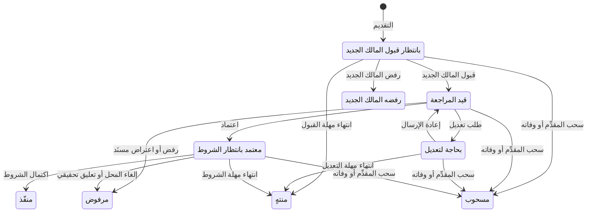

| من | إلى | المحفّز | الفاعل | الشرط | الآثار والأحداث |
|---|---|---|---|---|---|
| — | `pending_acceptance` | `POST /v1/shops/{id}/owner-change` (`reason`: `sale` أو `partner_exit` أو `inheritance` أو `official_document`، ورقم المالك الجديد ورقمه الوطني، و`license_file_id`) | المقدِّم (الجدول أعلاه) | لا تغيير مالك ولا إغلاق مفتوح (`TENANT_OWNER_CHANGE_PENDING`)، والمحل في حالة مسموحة (`TENANT_OWNER_CHANGE_BLOCKED`) | القالب 223 للمالك الجديد برابط S-SHP-60 · `tenant.change.requested` |
| `pending_acceptance` | `under_review` | `accept` | المالك الجديد (`tenant.ownership.accept`، مشتقة) | هوية L2 (ووثائق D-104 مقبولة)، وتطابق الرقم الوطني والموبايل، ولا `person_ban` ولا `staff_bar`، وإلا `TENANT_NEW_OWNER_NOT_ELIGIBLE` (نص محايد واحد لغير الموثّق والمحظور والممنوع) | القالب 308 للمقدِّم، وعنصر في قائمة `tenant_changes` بمهلة ⚙️ `sla.new_queues` (48 ساعة دوام) · `tenant.change.accepted` |
| `pending_acceptance` | `declined` أو `expired` | `decline`، أو انقضاء ⚙️ `tenant.owner_change.accept_window` | المالك الجديد، أو النظام (`tenant.owner_change.accept_expire`) | — | القالب 308 للمقدِّم، RSN-OWC-07 · `tenant.change.declined` أو `tenant.change.expired` |
| `under_review` | `needs_changes`، ثم `under_review` | `request-info` (RSN-OWC-02)، ثم إعادة الإرسال | مشرف المحلات، ثم المقدِّم | — | وانقضاء ⚙️ 30 يوماً دون تعديل ← `expired` · `tenant.change.decided` |
| `under_review` | `approved` | `approve` | مشرف المحلات (`tenant.owner_change.decide`)، ولمسار الوثيقة الرسمية المدير العام أو نائبه | الرخصة باسم المالك الجديد، والهوية | يبدأ مؤقّت الشروط ⚙️ `tenant.owner_change.complete_within` من الاعتماد بصنف `PAUSABLE` (ما دام إيقاف سحب، أو تجميد خارجي، أو عملية على المحفظة القديمة معلّقة أو قيد المتابعة)، والقالب 224 «اعتُمد، ويُنفَّذ حين تكتمل شروطه»، وإشعار المالك القديم بالسحب (ومسار الوثيقة الرسمية بموعد الإغلاق) · `tenant.change.decided` |
| `under_review` | `rejected` | `reject` | مشرف المحلات | سبب | القالب 224 · `tenant.change.decided` |
| `approved` | `executed` | اكتمال الشروط (أدناه) | النظام | الشروط | آثار التنفيذ (أدناه) · `tenant.owner_changed` |
| `approved` | `expired` | انقضاء مؤقّت الشروط | النظام (`tenant.owner_change.expire`) | — | RSN-OWC-04، والقالب 224، ويبقى المالك الحالي. **ومسار الوثيقة الرسمية** لا ينتهي: تُغلق المحفظة القديمة `released_to_provider` ويُنفَّذ · `tenant.change.expired` |
| أي حالة غير نهائية | `withdrawn` | `withdraw` | المقدِّم | — | RSN-OWC-06 · `tenant.change.withdrawn` |
| أي حالة غير نهائية (ومنها `approved` بانتظار الشروط) | `withdrawn` | **وفاة المقدِّم**: تنفيذ تأكيد وفاة المالك الذي قدّم الطلب بنفسه (`person.deceased_confirmed`، §8.17، ومنه `scope = none`) | النظام، في معاملة التنفيذ نفسها | الطلب قدّمه المالك نفسه (بيع أو خروج شريك، ومنه من `exit_only` وهو محظور) | **يُلغى آلياً** بالسبب RSN-OWC-09 (`owner_deceased`) أياً كانت حالته قبل التنفيذ، والقالب 224 بصياغة محايدة للمالك الجديد المقترح ولقنوات المقدِّم، ولا يُذكر سبب الوفاة. ويتحرر فهرس الطلب المفتوح فوراً، فللخلف الموثّق تقديم تغيير مالك (`inheritance`) أو إغلاق من نطاق `successor` **دون أي مهلة انتظار** · `tenant.change.withdrawn` |
| أي حالة غير نهائية | `rejected` | دخول المحل `revoked`، أو تعليق بسبب تحقيق، أو اعتراض مسنَد عبر الدعم | النظام أو مشرف المحلات | — | RSN-OWC-08 أو RSN-OWC-05 · `tenant.change.decided` |

**شروط التنفيذ:**

1. **المحفظة القديمة نهائية** (أو لم توجد): `closed` بـ `close_reason` = `withdrawn_zero` (سحب المالك القديم رصيده كاملاً، بأي نطاق ومنه `exit_only`)، أو `owner_deceased` (الوفاة: يبقى الرصيد لدى شام كاش في الحساب باسم المحل ويُصرف للورثة بإجراءاتها، D-89، ويغلقها **النظام** عند اعتماد طلب `inheritance` متى تحقق الشرط 2، وفي مسار الإغلاق كما في §8.4 ج «وفاة المالك أثناء الإغلاق»)، أو `released_to_provider` (مسار الوثيقة الرسمية: يغلقها النظام إن لم يسحب المالك القديم، المُشعَر عند الاعتماد، خلال ⚙️ `tenant.owner_change.complete_within`).
2. لا عملية محفظة ولا تعبئة على المحفظة القديمة `pending` أو `under_investigation` (شرط كل إغلاق محفظة، §8.11 ح).
3. المالك الجديد ما زال مؤهلاً، والمحل في حالة مسموحة.
4. خيار المحاسبة **ليس شرطاً مانعاً**: يُطبَّق الافتراضي عند التنفيذ (UC-03).

**آثار التنفيذ** (معاملة واحدة):

| الكيان المرتبط | الأثر |
|---|---|
| فترات الملكية | تُغلق فترة المالك القديم في `tenant_owner_periods` وتُفتح الجديدة، و`shops.owner_person_id` الجديد |
| العضويات | المالك الجديد `owner` `active`، والقديم `exit_only` ما دام له محاسبة محتفظ بها ضمن مدتها (أو رصيد في محفظة `released_to_provider` يطالب به)، وإلا `removed` |
| الموظفون | عضوياتهم باقية، وصلاحياتهم الممنوحة تعود للضمنية حتى يمنحها المالك الجديد، وجلسات سياق المحل تُنهى، ودعوات الموظفين المعلّقة التي أنشأها المالك القديم تُلغى |
| **وصول الربط** | تُلغى كل مفاتيح عملاء الربط المربوطين بالمستأجر (ومنها مفتاح الكتابة `importer.devices.register`)، ويُزال من `api_client_users` من دعاهم المالك القديم، وتُعطَّل نقاط الإشعار البرمجي حتى يعيد المالك الجديد تأكيدها، وتُلغى رموز نقطة البيع دون اتصال (والمبيعات دون اتصال السابقة للتنفيذ تُزامَن، P-13) (§3.13) |
| المحفظة الجديدة | **لا تُفتح آلياً**: يفعّلها المالك الجديد بعد التنفيذ إن كان مشتركاً (SOP-45) |
| المحاسبة (D-101) | `handover` ← يبقى مفتاح البيانات للمحل، و`keep` (الافتراضي، UC-03) ← تُفصل مجموعة البيانات وتُربط بفترة المالك القديم (§6.8)، ويبدأ المالك الجديد دفاتر جديدة، ووحدات الأجهزة تُعاد من السجل بكلفة «غير محددة» |
| المحاسبة عند الوفاة | يختار الخلف المقدِّم، والافتراضي `handover` حين يكون المالك الجديد هو الخلف المقدِّم نفسه، وإلا `keep` مربوطاً بنطاق `successor` للخلف المقدِّم |
| الاشتراك | الأيام الباقية للمحل (UC-02)، ولا تجربة جديدة (D-113) |
| التعليق | إن كانت أسباب التعليق النافذة كلها RSN-SUS-08 أو RSN-SUS-09 ← يُرفع (`suspended → verified`، `restore_if_cause`)، وأي سبب آخر يبقى |
| ما يجري في المحل | المعاملات المعلّقة، والصيانة، وطلبات المتجر، والنقل بين المحلات، وبلاغات D-94، والحملات تستمر على مستوى المحل |
| ملصق الخصوصية | يُعاد توليده إن تغيّر الاسم (D-110) |
| الإشعارات | القالب 220 للمالك القديم (أو الخلف المقدِّم)، والقالب 221 للمالك الجديد ← S-SHP-61 (إعادة منح الصلاحيات)، والقالب 222 للموظفين، وسطر في تقرير الالتزام |

**المال بعد إغلاق المحفظة القديمة:**

| الحالة | القاعدة |
|---|---|
| إبطال أو استرداد لطلب أو خدمة دُفعا من المحفظة القديمة | يُدفع إلى **وجهة شام كاش الموثّقة للمالك القديم المطابقة برقمه الوطني**، لا إلى محفظة المالك الجديد أبداً. وإن كان متوفى أو كانت المحفظة `released_to_provider` ← مال `unallocated` وعنصر عمل (لا يُصادر أبداً، وإجراء شام كاش للورثة) |
| شحن متأخر أو نتيجة عملية على المحفظة المغلقة | فرق مطابقة ← ذمة للمالك السابق **شخصاً** أو عليه، تُسوّى بـ SOP-47 بأربع عيون (المشرف التجاري، والمدير العام أو نائبه)، ولا تُخصم من المحفظة الجديدة أبداً |
| الاسترجاع السنوي عند الإغلاق (D-111) | يُطلب قبل إغلاق المحفظة، وإن دُفع بعده فبقاعدة الصف الأول |

### 8.5 حساب المستخدم وتوثيق الهوية

**أ. حالة الحساب** (`users.status`)، ومستواه (`users.identity_status` و`users.auto_linked_at`). المخطط يطابق 14 §5.1 مع حالتي إغلاق الحساب (AUTH-10):

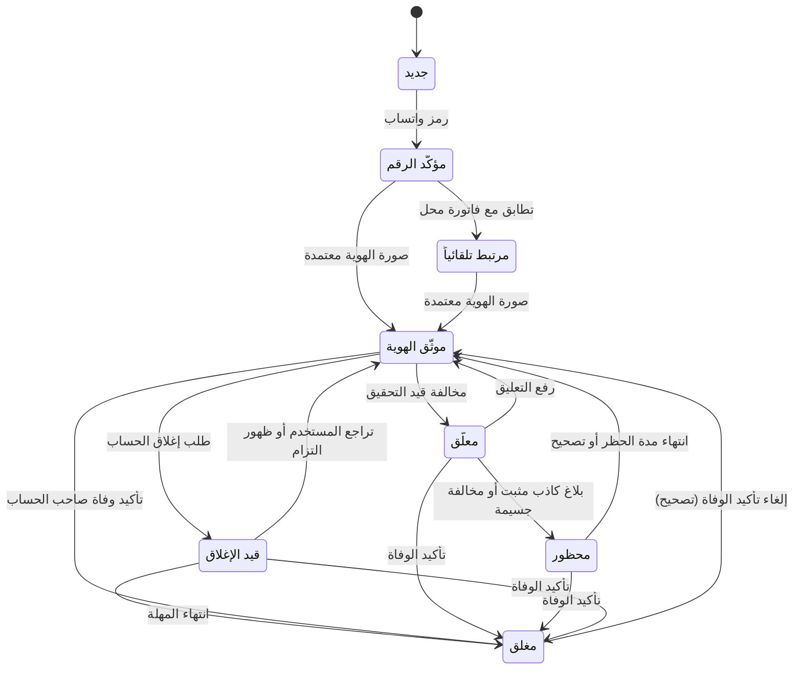

| من | إلى | المحفّز | الفاعل | الشرط | الآثار والأحداث |
|---|---|---|---|---|---|
| — | `status = pending_phone` | إنشاء الحساب | الزائر | §4.2.1 | رمز تحقق |
| `pending_phone` | `status = active` | تأكيد الرمز | المستخدم | رمز صحيح | `identity_status = none` · `account.user.registered`، `account.phone.verified` |
| `active` | `auto_linked_at` مضبوط | تطابق الرقم الوطني والموبايل مع مشترٍ (AUTH-06) | النظام | تأكيد الرقم وإدخال الرقم الوطني في الملف | ربط الشخص والأجهزة والفواتير · `ownership.auto_link.completed` |
| `identity_status = none` أو `rejected` | `pending` | طلب توثيق (AUTH-05) | المستخدم | `identity.submit` | عنصر عمل · `account.identity.submitted` |
| `pending` | `verified` | `approve` | مشرف بلاغات | §5.7 نافذة المراجعة، وحالة البطاقة سارية عند تفعيل الربط | ربط `person_id` · `account.identity.verified` |
| `pending` | `rejected` | `reject` | مشرف بلاغات | سبب | زيادة عدد الرفضات، وعند 3 ⚙️ يُفتح طلب دعم آلياً · `account.identity.rejected` |
| `verified` أو `rejected` | المقابلة | تصحيح | النظام بعد موافقة ثانية | §8.12 | عند عكس التوثيق، تتابع `identity_lost`: العضويات `pending_identity`، والمحل الذي يملكه يُعلَّق حتى يعيد التوثيق، والبلاغات والاعتراضات قيد المراجعة تُعلَّم للمراجع، والتسجيلات الذاتية غير النهائية تُجمَّد للمراجعة، والنافذة تبقى · `account.identity.decision_reversed` |
| رقم وطني على حساب أ | يُفصل وينتقل لحساب ب (SOP-12) | قرار المراجع | مشرف البلاغات بموافقة ثانية | دليل الهوية | البنود المفتوحة المربوطة بالشخص (البلاغات، والاعتراضات، والتسجيلات الذاتية، وطلبات النقل) تنتقل إلى ب في عملية مدقّقة واحدة، وما نفّذه أ على أجهزة الشخص في آخر ⚙️ 90 يوماً من نقل وشهادات وتفويض يُحال للمدير العام (REVERSAL-03 حيث يثبت الاحتيال)، وأ يعود إلى `identity_status = none` · `account.identity.detached` |
| `active` | `suspended` | تعليق | المدير العام، أو مشرف البلاغات لبلاغ كيدي | سبب | إنهاء كل الجلسات، والدخول بعدها بنطاق `read_only` (§5.12)، وتتابع `restricted` (§8.16): طلبات النقل الصادرة والواردة تُلغى (`account_restricted`، إشعار محايد للطرف الآخر)، والشهادات الفعّالة تُلغى، والتسجيلات الذاتية غير النهائية تُجمَّد بسبب `account_suspended` بأيامها الباقية، وأدواره للآخرين (الجهة الموثوقة، والمفوّض، و«الوصي» المختار في `account_executors`) `suspended` بـ `restore_if_cause` ويُبلَّغ أصحابها، والعضويات `suspended`، والبلاغات قيد المراجعة تستمر بعلامة والنافذة تبقى، والمحل الذي يملكه يستمر (§8.4). و**بلاغ السرقة وحماياته متاحة دائماً** (P-1)، ويراجعها مشرف غير من علّق · `account.user.suspended` |
| `suspended` | `active` | رفع التعليق أو تصحيح | المدير العام | سبب | رفع ما وضعه هذا التعليق وحده، واستئناف التسجيلات الذاتية بأيامها الباقية · `account.user.reinstated` |
| `suspended` | `banned` | حظر | المدير العام | بلاغ كاذب مثبت أو مخالفة في درجة الحظر (06 §13) | قيد `person_ban` على الشخص لمدة الحظر (D-106)، وتتابع `ended`: العلاقات بالاتجاهين `removed` ويُبلَّغ أصحابها، والاعتراضات `withdrawn`، والتسجيلات الذاتية غير النهائية تعود لمراجعة جديدة، والعضويات `removed`، والمحل الذي يملكه يُعلَّق ويُراجع (§8.4)، والسحب عبر جلسة الخروج المالي. وإنهاء الجلسات القائمة، والدخول طوال الحظر بنطاق `read_only` وحده (§5.12، 06 §13.2). والتظلّم عبر رقم واتساب الدعم · `account.user.banned` |
| `banned` | `active` | انتهاء مدة الحظر، أو تصحيح | النظام (`restrictions.expire`)، أو المدير العام | — | **آلياً دون طلب**: يعود الحساب إلى حالته المعتادة قبل الحظر، ويُرفع `person_ban` والقيود الشخصية التي وُضعت معه، وتبقى العدادات والسجل على الشخص (P-12)، ولا يعود ما ألغاه تتابع `ended` (P-7). والمحل المعلّق بسبب الحظر (RSN-SUS-08) لا يعود آلياً: يراجعه مشرف المحلات (SOP-23) ويرفعه بـ `reinstate` إن بقي صاحبه مالكه، والسبب RSN-ACC-09 · `account.user.reinstated` |
| `active` | `closing` | طلب الإغلاق (PRIV-02) | المستخدم | إعادة تحقق، ولا بلاغ قدّمه نافذ أو قيد المراجعة، ولا اعتراض أو نقل معلّق، ولا محل أو وكيل غير مغلق يملكه، ولا رصيد في محفظة محل يملكه، ولا حجز قانوني، ولا قضية مراجعة إساءة مفتوحة، ولا تسجيل ذاتي معلّق، ولا طلب انتقال جهاز متوفى هو طالبه أو وصيّه، ولا تهدئة (§4.2.8) ولا حجز إعادة تعيين نافذ. والنقص يرد `AUTH_CLOSURE_BLOCKED` بقائمة الأسباب (مطابق لـ [الخصوصية](21-privacy-dpia.md) §8.1) | مهلة تراجع 7 أيام ⚙️، ولا يُقبل خلالها التزام جديد للشخص (طلب نقل وارد يُرفض)، والمتاح فيها الدخول للتراجع وبلاغ السرقة فقط · `account.user.closure_requested` |
| `closing` | `active` | تراجع المستخدم، أو ظهور التزام أثناء المهلة (بلاغ عاجل على جهازه، أو اعتراض على بلاغه، أو حجز قانوني) | المستخدم أو النظام | — | رسالة «توقّف إغلاق حسابك بسبب …» · `account.user.closure_halted` |
| `closing` | `closed` | انتهاء المهلة | النظام | لا التزامات مفتوحة | تتابع `ended`: العلاقات بالاتجاهين `removed` ويُبلَّغ الطرف الآخر، والتفويضات التي يحملها على أجهزة غيره تُلغى ويُبلَّغ أصحابها، والتفويضات على أجهزته تُلغى، والعضويات تنتهي، والشهادات تُلغى، وطلبات الدعم تُغلق بسبب `account_closed`، والإشعارات المنتظرة تُسقط، وطلبات الخدمة المفتوحة تُلغى والمبالغ المستحقة تُعاد لمصدرها. ثم `phone_released_at` وتفريغ `person_id` (`users.person_id = NULL`، §4.2.1، RT-03)، **وتبقى القيود والعدّادات على الشخص** (`restrictions.subject_type = person`، §5.11) فلا يمحوها إغلاق الحساب ولا حساب جديد، وتقليل البيانات الشخصية وفق [الخصوصية وتقييم الأثر](21-privacy-dpia.md)، والإبقاء على ما يُلزم القانون به · `account.user.closed` |
| `active` أو `suspended` أو `banned` أو `closing` | `closed` | تنفيذ تأكيد الوفاة (§8.17) | النظام | تأكيد الوفاة نافذ بعد مهلة الاعتراض | `closure_reason = deceased` **من أي حالة ودون مهلة التراجع**، وتتابع `ended(deceased)`: إنهاء الجلسات، ورفع `person_ban` بـ `lift_reason = deceased`، وإلغاء طلبات النقل من الحساب وإليه (`owner_deceased`) والمسودات، وإلغاء أدواره للآخرين (الجهة الموثوقة، والوصي، والمفوّض) وإبلاغ أصحابها، والأوصياء المختارون على حسابه `removed(account_closed)`، والأجهزة غير المنتقلة بقيد `owner_deceased`، والمحل إلى التعليق (RSN-SUS-09) ثم تغيير المالك أو الإغلاق (§8.4). والبلاغات المفتوحة تستمر، والخلف مسؤول الأجهزة المنقولة · `account.user.closed` |
| `closed` (`closure_reason = deceased`) | `active` | إلغاء تأكيد الوفاة (§8.12) | النظام بعد اعتماد المدير العام أو نائبه | هوية L3 للشخص الحي | الحساب نفسه، وإعادة ربط رقمه إن لم يُخصَّص لغيره وإلا مسار الاستعادة بالهوية، وقيد `cooldown` بمصدر `identity_recovery` · `person.death_reversed`، `account.user.reinstated` |

**ب. طلب توثيق الهوية** (`identity_verifications.status`): `pending` ← `approved` أو `rejected` أو `cancelled`، و`approved` أو `rejected` ← `reversed` بالتصحيح. و`users.identity_status` يعكس آخر طلب. ونوع الوثيقة (`document_type`): الهوية السورية، أو بطاقة اللاجئ الفلسطيني السوري، أو جواز السفر مع إقامة سورية سارية (D-104)، والوثيقة البديلة يتحقق منها المشرف يدوياً ولا تُطابق مع الأحوال المدنية، ورقم الحساب يبقى سورياً.

**ج. الشخص وأحداث حياته (M-13)** (`persons.lifecycle`): `active` ← `deceased` (تأكيد الوفاة بعد مهلة الاعتراض، §8.17)، و`deceased` ← `active` (إلغاء تأكيد الوفاة وحده، §8.12)، و`active` ← `merged_into` (دمج الأشخاص، §7.4). وإشارة «متوفى» من الأحوال المدنية وحدها تمنع المعاملات وتعلّم الحالة ولا تنقل ملكية (06 §7.1)، لكنها دليل إضافي في التحقق من الوفاة. وتأكيد الوفاة يطلق تتابع `ended(deceased)` (§8.16). والأجهزة المملوكة لمؤسسة تُسجَّل باسم ممثلها المسؤول شخصاً طبيعياً برقمه الوطني، ويستخدمها الموظفون مستخدمين مفوّضين (OWN-08)، وتغيير الممثل نقل ملكية عادي (D-105).

### 8.6 التسجيل الذاتي (`self_registrations.status`)

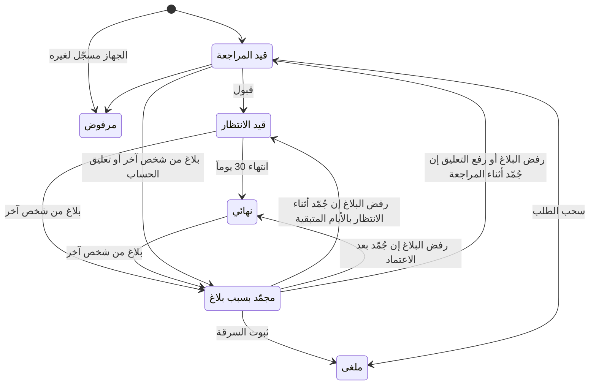

| من | إلى | المحفّز | الفاعل | الشرط | الآثار والأحداث |
|---|---|---|---|---|---|
| — | `pending_review` | إرسال (OWN-03) | موثّق الهوية | الإقرار، والصورة الحيّة، ولا تهدئة. وتجاوز الحد السنوي ⚙️ يُعلَّم «مشبوه» ولا يمنع (OWN-15) | استعلام سجل الشريحة إن توفر (OWN-16) · `ownership.self_registration.submitted` |
| — | `rejected` | إرسال لجهاز مسجّل لشخص آخر | النظام | (OWN-13) | `registration_attempts`، وإشعار المالك دون كشف هوية المحاول **مرة كل ⚙️ 7 أيام للجهاز نفسه** والمحاولات التالية للإدارة وحدها، وتنبيه للإدارة. والحساب الذي رُفض له آلياً ⚙️ 2 أو أكثر لأجهزة غيره خلال ⚙️ 90 يوماً يأخذ قيد `self_registration` ومراجعة SOP-18، وجواب المالك «الجهاز معي» يُسجَّل ويرفع علامة المحاول · `ownership.registration_attempt.blocked` |
| `pending_review` | `rejected` | `reject` | مشرف بلاغات | سبب | · `ownership.self_registration.rejected` |
| `pending_review` | `waiting` | `approve` | مشرف بلاغات | سبب | إنشاء الجهاز أو ربطه (`registration_origin = self`)، وملكية بمصدر `self_registration`، و`custody_state = self_reg_waiting`، و`waiting_until` = +30 يوماً ⚙️ · `ownership.self_registration.approved` |
| `waiting` | `final` | انتهاء المدة | النظام | لا تجميد | `custody_state = owned` · `ownership.self_registration.finalized` |
| `pending_review` أو `waiting` أو `final` | `frozen` | إرسال بلاغ من شخص آخر (REPORT-15)، أو تعليق حساب صاحب الطلب، أو عكس توثيقه | النظام | — | `freeze_reason` = `report` أو `account_suspended` أو `identity_review`. وللبلاغ: مستوى ⛔، ومنع النقل والشهادة والبيع · `ownership.self_registration.frozen` |
| `frozen` | `cancelled` | قبول البلاغ المتعارض مع حسم التعارض لصالح المبلّغ | النظام عند قرار المشرف | — | إنهاء الملكية الذاتية، وإحالة بيانات المسجِّل لقوى الأمن (06 §5.1) · `ownership.self_registration.cancelled` |
| `frozen` | `pending_review` أو `waiting` أو `final` | رفض البلاغ المتعارض أو سحبه، أو رفع التعليق، أو انتهاء المراجعة | النظام | يعود لحالته قبل التجميد: `pending_review`، أو `waiting` و`waiting_until` = الآن + الأيام المتبقية لحظة التجميد، أو `final` (14 §5.4) | إشعار صاحب الطلب «استُؤنف الانتظار، والأيام الباقية N» · `ownership.self_registration.unfrozen` |
| `waiting` | `pending_review` | حظر صاحب الطلب (§8.5) | النظام | — | يعود لمراجعة جديدة (SOP-06)، والنهائي لا يُمس إلا بدليل عبر التصحيح · `ownership.self_registration.rereview` |
| `pending_review` | `cancelled` | سحب | صاحب الطلب | — | — |
| `waiting` أو `final` | `pending_review` أو `rejected` | تصحيح الاعتماد | النظام بعد موافقة ثانية | §8.12 | — |

### 8.7 معاملة المحل (`shop_transactions.status`)

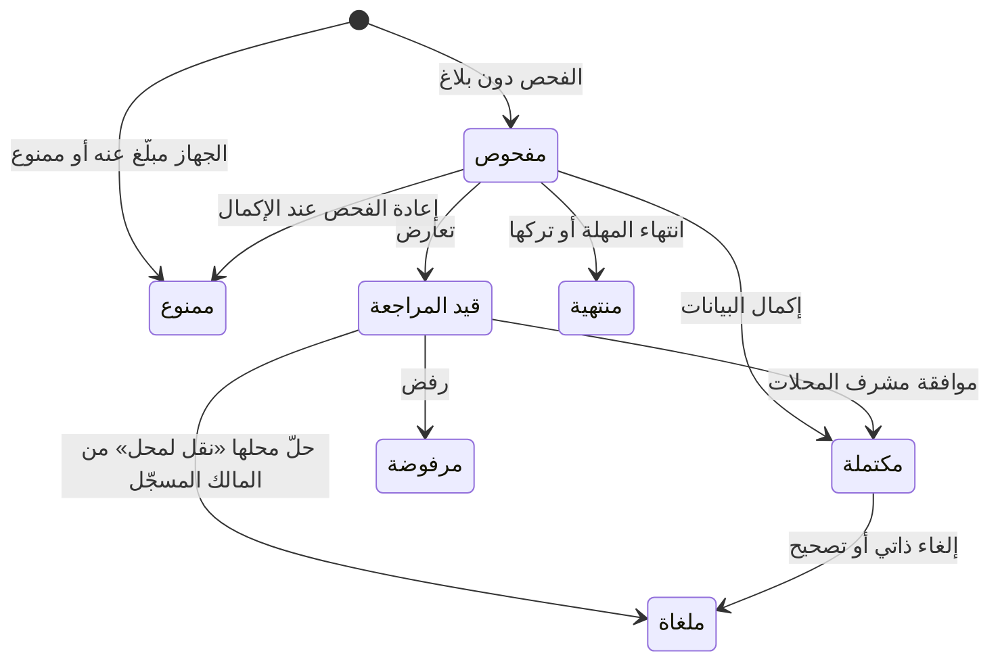

| من | إلى | المحفّز | الفاعل | الشرط | الآثار والأحداث |
|---|---|---|---|---|---|
| — | `checked` | مسح IMEI وفحص آلي (SHOP-06 الخطوات 1-2، SHOP-07، SHOP-08) | عضو بصلاحية الشراء أو البيع | المحل `verified`، والموقع مُرسل (D-41)، ولا بلاغ نافذ، وفي الشراء: غير مدرج في GSMA (GSMA-03) ولا في انتظار تسجيل ذاتي (SHOP-18) | تسجيل الفحص وموقع العملية، وفتح نافذة الأحوال المدنية، و`expires_at` = +30 دقيقة ⚙️ |
| — | `blocked` | الفحص يجد بلاغاً نافذاً، أو إدراجاً في GSMA للشراء، أو انتظار تسجيل ذاتي | النظام | — | رسالة «لا تشترِ هذا الجهاز» دون تفاصيل، وتنبيه أمني عاجل للبلاغ النافذ (ADMIN-08) وعادي لـ GSMA، وإشعار صاحب البلاغ (NOTIF-04) · `shop.transaction.blocked` |
| `checked` | `completed` | `complete` | العضو نفسه | البيانات الإلزامية (اسم الطرف ورقمه الوطني أو وثيقته البديلة D-104 وموبايله، وصورة هوية البائع في الشراء D-31)، وبطاقة سارية عند تفعيل الربط (CIVIL-05)، وإعادة الفحص بحارس الحيازة داخل المعاملة (§7.10). وGSMA: مدرج ← `blocked`، ومعلّق ← انتظار حتى ⚙️ 5 ثوانٍ أخرى، وغير متاح ← يكتمل بعلامة `gsma_unverified` (تحذير `SHOP_GSMA_UNVERIFIED`) ويُعاد الاستعلام عند عودة الخدمة، وإدراج لاحق ينشئ تنبيه `gsma_listed_purchase` وإشعاراً محايداً للمحل وعنصر مراجعة SOP-22 دون عكس آلي (والقاعدة نفسها لاستلام الصيانة). والرقم المعلَّم `shared_identifier` بلا بلاغ (D-120، §7.3): معرّف ثانٍ صالح غير متعارض ← تكتمل بعلامة `shared_identifier` وتدخل عيّنة SOP-22، وإلا ← `under_review`. و`SHOP_OUT_OF_RANGE` تحذير بصنف `ack`: لا تكتمل حتى يُقَرّ ويُكتب `out_of_range_reason` (§3.3) | رقم `TX-`، والملكية (شراء: إلى المحل `shop_purchase`. بيع: إلى المشتري `shop_sale`)، والفاتورة للبيع (SHOP-10)، وعلَم البعد (SHOP-14) وتحذير التقليد (FAKE-03). و**إشعار المالك السابق بكل خروج للملكية من اسمه** (الشراء منه، وموافقة D-96، والنقل، والتصحيح) على كل قنواته: «سُجّل شراء جهازك … من محل … في …» مع «لم أبِع هذا الجهاز»، والفاتورة للمشتري مع «لم أشترِ هذا الجهاز». وكل منهما يفتح طلب دعم عاجلاً مرتبطاً بالمعاملة ويعلّمها `disputed_by_party` وعنصر عمل SOP-22، وخلال ⚙️ 14 يوماً يُقبل بلاغ المنكِر بمستوى ⛔ ولا يرفضه OWN-07 · `shop.transaction.completed` |
| `checked` | `under_review` | `complete` مع تعارض | النظام | `hold_reason`: بيع جهاز مسجّل لشخص آخر لم يمرّ بمخزون المحل (`sold_to_other_registered`، SHOP-08)، أو شراء من غير المالك المسجّل (`purchase_from_non_owner`، D-96)، أو جهاز عليه بلاغ قيد المراجعة (`pending_report`، 06 §6: تنتظر قرار البلاغ، فإن قُبل رُفضت المعاملة بسبب RSN-CNF-07 مع تنبيه عاجل ببيانات البائع المسجّلة، وإن رُفض أو أُلغي أُعيد تقييمها)، أو عدم تطابق الرقمين (`dual_imei_mismatch`، FAKE-02)، أو جهاز ذكي لم يستطع البائع إزالة قفل حسابه (iCloud أو FRP) أمام الموظف (`account_locked`، سؤال إلزامي في الشراء، فلا يكتمل آلياً أبداً)، أو المالك المسجّل متوفى (`owner_deceased`)، أو رقم معلَّم منسوخاً دون معرّف ثانٍ صالح أو بمعرّف متعارض (`shared_identifier`، §7.3). وفي كل الحالات نتيجة «تسجيل الشراء» (S-SHP-08) `SHOP_TRANSACTION_HELD` (202) **بالنص المحايد وحده** ([كتالوج المحتوى](24-content-catalog.md) §2.9) مع سطر «نقل لمحل» العام، فلا تكشف السبب ولا هوية المالك **ولا وفاته أبداً**، وتُحجز الأجهزة (§7.10) | عنصر عمل لمشرف المحلات بساعات الدوام (D-98) · `shop.transaction.held` |
| `checked` | `blocked` | إعادة الفحص عند الإكمال تجد بلاغاً صار نافذاً | النظام | — | كالمنع |
| `checked` | `expired` | انتهاء المهلة أو تركها | النظام أو العضو | — | استعلام أحوال مدنية دون معاملة مكتملة يُعلَّم (CIVIL-08) · `shop.transaction.expired` |
| `under_review` | `completed` | `approve` | مشرف المحلات | سبب، و**إعادة الفحص نفسها** بحارس الحيازة (بلاغ نافذ، وGSMA، وانتظار تسجيل ذاتي، وتغيّر المالك منذ التعليق)، فإن وُجد شيء منها انتقلت إلى `blocked` أو `rejected` | كآثار الإكمال: الموافقة **تكمل** المعاملة (نص RSN-CNF-08 «اكتملت المراجعة واكتملت العملية») · `shop.transaction.completed` |
| `under_review` | `rejected` | `reject` | مشرف المحلات | سبب | · `shop.transaction.rejected` |
| `under_review` | `cancelled` | قبول «نقل لمحل» من المالك المسجّل للجهاز نفسه إلى المحل نفسه (D-121، §8.3) | النظام | — | `cancel_reason = superseded`، والحجز للنقل المقبول، وسطر محايد للمحل · `shop.transaction.cancelled` |
| `completed` | `cancelled` | إلغاء ذاتي خلال 30 دقيقة ⚙️ (SHOP-15) | المنفّذ أو الصاحب | سبب، والجهاز ما زال في الوضع الذي تركته المعاملة | إعادة الملكية السابقة بمصدر `correction`، وإلغاء الفاتورة · `shop.transaction.cancelled` |
| `completed` | `cancelled` | موافقة على طلب إلغاء بعد المهلة | مشرف المحلات | طلب في `shop_tx_corrections` | كالسابق |

**الشراء من غير المالك المسجّل (D-96، D-121):** للمحل طريقان: يُكمل فتُعلَّق المعاملة كما سبق، أو ينقل المالك المسجّل الجهاز **إلى المحل مباشرة** من تطبيقه («نقل لمحل» برقم `SH-`)، فيقبله المحل ويصوّر هوية الشخص الحاضر، **والقبول نفسه معاملة الشراء** (§8.3) ويأخذ حجز المعاملة المعلّقة ثم يلغيها `superseded`، ولا يحتاج الحاضر حساباً. والنتيجة النص المحايد وحده مع سطر «نقل لمحل» العام دون اسم المالك، **ولا تلميح للوفاة عند المحل**: الجهاز بقيد `owner_deceased` يُعلَّق بالنص نفسه (`hold_reason = owner_deceased`)، وطريق الانتقال يُعطى للطالب الموثّق عبر الدعم وحده.

**الإرجاع والاستبدال بعد مهلة الإلغاء:** إرجاع الزبون جهازاً اشتراه يُسجَّل **شراءً من المالك المسجّل** (المشتري الأصلي) بالمسار العادي (صورة هوية البائع D-31، ولا تعليق D-96 لأنه المالك)، مرتبطاً بالبيع الأصلي (`return_of_tx_id`)، والفاتورة الأصلية تبقى في السلسلة، فيظهر تاريخ الملكية بيعاً ثم شراءً ثم بيعاً جديداً. والاستبدال إرجاع وبيع جديد في شاشة واحدة. وإرجاع جهاز جديد معيب للوكيل بنوع `wholesale_return`، واستبدال الوكيل وحدةً بالكفالة معاملة الوكيل نفسها بنقل عكسي ثم نقل جديد. والإلغاء والتصحيح للأخطاء وحدها.

**الطرف القاصر (D-97):** إذا تبيّن للموظف من بطاقة الحاضر أن عمره دون 18 سنة، تُسجَّل المعاملة (شراءً أو بيعاً، وكذلك أمر الصيانة) باسم **وليّ الأمر الحاضر** وهويته بالقواعد نفسها لأي طرف (D-31، CIVIL-03، CIVIL-04)، فتذهب الملكية في البيع لوليّ الأمر. ويضيف الموظف القاصر **مستخدماً مفوّضاً** على الجهاز داخل المعاملة نفسها (`authorized_users` بـ `is_minor = true` و`source = 'shop_transaction'`) بعد إقرار وليّ الأمر (CN-GUARDIAN)، ولا يُجمع عن القاصر إلا اسمه وصلة القرابة ورقم موبايله ([الخصوصية](21-privacy-dpia.md) §10.2). ولا يُخزَّن تاريخ الميلاد. والحساب المستقل من عمر 18 سنة.

طلب التصحيح (`shop_tx_corrections.status`): `pending` ← `approved` أو `rejected`. والتصحيح غير الإلغائي (بيانات الطرف أو السعر) يُطبَّق بنسخة مصحّحة من الفاتورة ويبقى الأصل محفوظاً.

### 8.8 طلب الدعم (`support_tickets.status`)

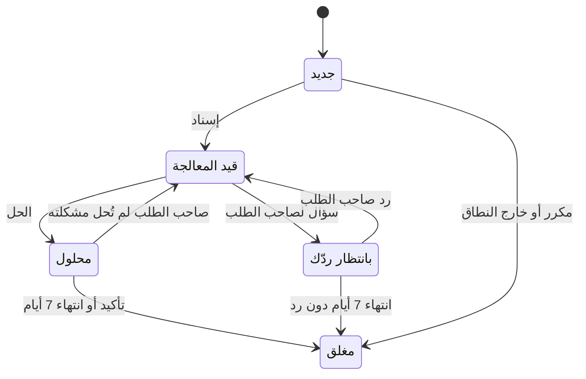

| من | إلى | المحفّز | الفاعل | الشرط | الآثار والأحداث |
|---|---|---|---|---|---|
| — | `new` | إنشاء من الحساب أو بوت واتساب الدعم (SUPPORT-01، SUPPORT-03) | صاحب الطلب | — | رقم `ST-`، ومهلة مستهدفة حسب التصنيف ⚙️ · `support.ticket.created` |
| `new` | `in_progress` | إسناد أو أول رد | الدعم | — | — |
| `in_progress` | `awaiting_user` | رد يطلب معلومة | الدعم | — | `autoclose_at` = +7 أيام ⚙️ · `support.ticket.replied` |
| `awaiting_user` | `in_progress` | رد صاحب الطلب | صاحب الطلب | — | — |
| `in_progress` | `resolved` | الحل | الدعم | — | طلب تأكيد وتقييم 1-5، و`autoclose_at` = +7 أيام ⚙️ |
| `resolved` | `in_progress` | «لم تُحل» | صاحب الطلب | قبل الإغلاق | — |
| `resolved` | `closed` | تأكيد أو انتهاء المهلة | صاحب الطلب أو النظام | — | · `support.ticket.closed` |
| `awaiting_user` | `closed` | انتهاء المهلة | النظام | — | سبب `auto_no_reply` (SUPPORT-06) |
| `new` أو `in_progress` | `closed` | إغلاق إداري | الدعم | سبب (مكرر، أو إساءة) | — |

التحويل لمشرف مختص (SUPPORT-07) يغيّر `routed_queue` دون تغيير الحالة، ويبقى الدعم مسؤولاً عن الرد.

### 8.9 جلسة التتبّع (`tracking_sessions.status`)

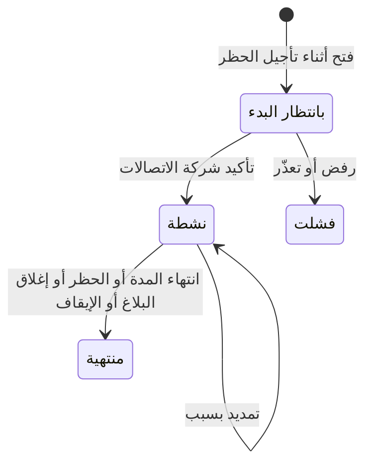

| من | إلى | المحفّز | الفاعل | الشرط | الآثار والأحداث |
|---|---|---|---|---|---|
| — | `pending_start` | فتح (TRACK-05) | مشرف بطلب الأمن، أو عنصر أمن ضمن النطاق | `network_status = block_delayed`، وبلاغ نافذ، ومرجع الطلب أو رقم القضية، وسبب | `ends_at` = +72 ساعة ⚙️، وطلب بدء التحديثات من الشركات (TELCO-13) · `tracking.session.requested` |
| `pending_start` | `active` | تأكيد البدء | النظام | — | · `tracking.session.started` |
| `pending_start` | `failed` | رفض الشركة أو تعذّر بعد المحاولات | النظام | — | تنبيه للفاتح |
| `active` | `active` | تمديد | من يملك الفتح | سبب | `tracking_session_extensions` · `tracking.session.extended` |
| `active` | `ended` | انتهاء المدة، أو حظر الجهاز، أو إغلاق البلاغ، أو إيقاف يدوي، أو إطفاء تكامل الشركة | النظام أو الفاتح | — | طلب إيقاف التحديثات، و`end_reason` (ومنه `integration_off` مع إشعار الأمن وبقاء تأجيل الحظر)، وعند انتهاء المدة يُطلب الحظر تلقائياً (الرحلة 15). وتذكير للفاتح قبل الانتهاء بـ ⚙️ ساعة (`tracking.session.expiring`) · `tracking.session.ended` |

### 8.10 الاعتراض (`disputes.status`)

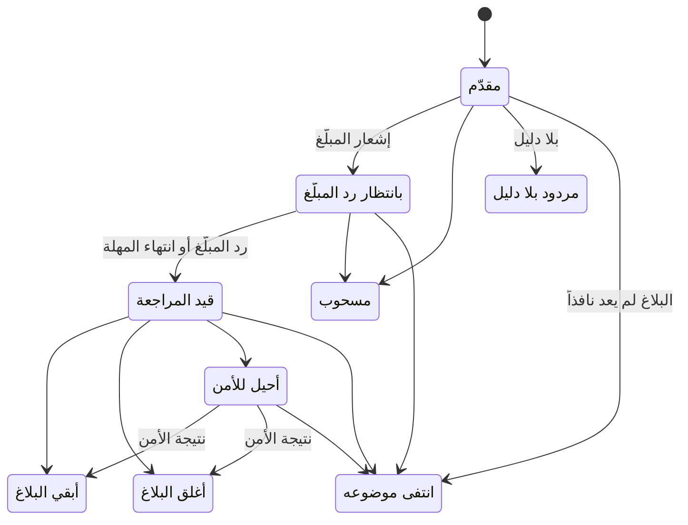

| من | إلى | المحفّز | الفاعل | الشرط | الآثار والأحداث |
|---|---|---|---|---|---|
| — | `submitted` | `POST /v1/disputes` | موثّق الهوية | بلاغ نافذ، ولا اعتراض مفتوح منه على البلاغ نفسه | لا يوقف البلاغ (DISPUTE-02) · `report.dispute.submitted` |
| `submitted` | `awaiting_response` | النظام فوراً | النظام | — | إشعار المبلّغ دون هوية المعترض، ومهلة 7 أيام ⚙️ (DISPUTE-03). والبلاغ الرسمي يُحال للأمن مباشرة (`referred`) |
| `awaiting_response` | `under_review` | رد المبلّغ بأدلته أو انتهاء المهلة | المبلّغ أو النظام | — | عدم الرد يُعلَّم ويُؤخذ بالاعتبار · `report.dispute.responded` |
| `under_review` | `upheld` | قرار | مشرف بلاغات | سبب | · `report.dispute.decided` |
| `under_review` | `report_closed` | قرار | مشرف بلاغات | سبب | البلاغ إلى `closed` بسبب `dispute_decision`، وإمكانية تعليق المبلّغ الكاذب (06 §13) |
| `under_review` | `referred` | قرار | مشرف بلاغات | سبب | إحالة في `police_referrals`، ومؤقّت متابعة ⚙️ 30 يوماً وقائمة متابعة أسبوعية (`waiting_external`) |
| `referred` | `upheld` أو `report_closed` أو `moot` | تسجيل نتيجة الأمن من البوابة أو كتاب رسمي | مشرف بلاغات | المرجع | كقرار الحسم · `report.dispute.decided` |
| `submitted` | `dismissed` | ردّ بلا دليل (RSN-DSP-05) | مشرف بلاغات | سبب | يُشعَر المعترض · `report.dispute.dismissed` |
| أي حالة مفتوحة | `moot` | خرج البلاغ عن `active` بطريق آخر، أو دُمج الجهاز | النظام | — | إشعار الطرفين بصياغة محايدة · `report.dispute.mooted` |
| `submitted` أو `awaiting_response` | `withdrawn` | سحب | المعترض | — | — |

اعتراض واحد مفتوح لكل معترض على البلاغ، وإعادة التقديم بعد الحسم بأدلة جديدة بعد مهلة ⚙️ (فئة `submission`، §3.8)، ولا يُطلب من المبلّغ الرد ثانية إلا إن علّم المراجع الأدلة الجديدة جوهرية. وللمبلّغ بالنيابة يرد الدعم عنه (§8.1).
| `upheld` ↔ `report_closed` | المقابلة | تصحيح الحسم | النظام بعد موافقة ثانية | §8.12 | — |

### 8.11 المدفوعات والطلبات والاشتراكات والمتجر

**الدفع اليدوي هو الأصل (D-86):** لا دفع عبر آبل وجوجل إطلاقاً. والربط الآلي مع محفظة اختياري لكل مزوّد يتيحه (§11). والتفعيل إجراء إداري بعد تأكيد الدفعة (PAY-07). **وكل حركة مال هنا نسخة من نمط المال الموحّد (MONEY_OP، §11.5):** المعلّق ومهلة حسمه، والمرجع، والتأكيد بالاستعلام لا بالإشعار الوارد، والمطابقة، والتصحيح بعمليات مرتبطة لا بتعديل صف نهائي، والمبالغ غير المخصّصة، و**الإبطال الآلي** (void: المبلغ نفسه إلى المصدر نفسه، بحالة `voided` لا `refunded`) لكل إلغاء قبل بدء الخدمة، ولطلب المتجر قبل «قيد التجهيز» ولو بعد «مؤكد»، **ولكل سطر يُلغى أو يُستبعد قبل التسليم** ومنه الرفض عند الباب (D-116، 04 STORE-16، 06 §14)، مقابل **الاسترداد** بأربع عيون بعد التسليم أو حين يكون تقديرياً. **والعملة:** الإبطال والاسترداد بعملة الدفعة، ويُحوَّلان عند التنفيذ عبر `currency_units` بتقريب نصف للأعلى إلى الليرة الكاملة، وقيد «Σ المسترد ≤ المدفوع» يُفحص بعملة الدفعة (§3.10). ولا أجور توصيل منفصلة لطلبات المتجر: كلفة الشحن من حصة المنصة (D-117).

**أ. طلب الخدمة الرقمية** (`service_orders.status`): باقة المشتركين وأي باقة يضيفها المدير العام (D-93)، وتقرير تاريخ الجهاز لغير المالك، والإعلانات، والربط البرمجي.

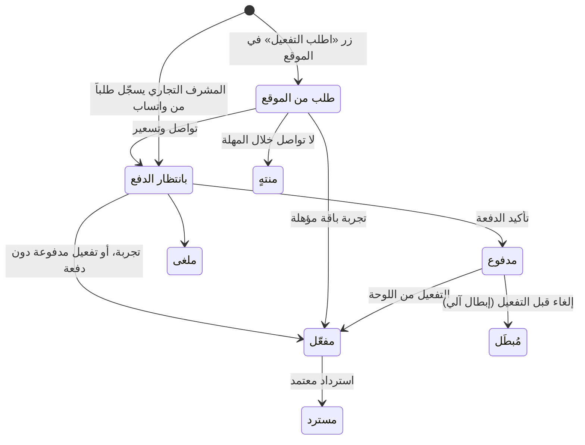

| من | إلى | المحفّز | الفاعل | الشرط | الآثار والأحداث |
|---|---|---|---|---|---|
| — | `requested` | `POST /v1/activation-requests` | المستخدم من الموقع فقط | `service.request` (PAY-08) | رقم `SV-`، ورابط واتساب الإدارة التجاري برسالة جاهزة فيها رقم الحساب والخدمة ورقم الطلب (PAY-01) · `billing.service_order.requested` |
| — | `awaiting_payment` | إنشاء من اللوحة | المشرف التجاري | الحساب أو المحل موجود | — |
| `requested` | `awaiting_payment` | تحديد الخدمة والمدة والمبلغ | المشرف التجاري | — | — |
| `requested` | `expired` | انتهاء 7 أيام ⚙️ دون تواصل بصنف `BUSINESS_FLOOR` (لا ينقضي قبل نهاية يوم الدوام الخامس) | النظام | — | — |
| `requested` أو `awaiting_payment` | `cancelled` | إلغاء قبل بدء الخدمة | الطالب أو المشرف التجاري | سبب | أي مبلغ مدفوع **يعود للمصدر نفسه بالمبلغ نفسه آلياً** (void، D-116)، مدقّقاً ودون موافقات · `billing.service_order.cancelled`، `billing.void.completed` |
| `awaiting_payment` | `paid` | تأكيد دفعة مرتبطة | المشرف التجاري | مجموع الدفعات المؤكدة المرتبطة ≥ المبلغ. والطلب الناقص يبقى ويعرض «مدفوع X من Y»، وإن لم يكتمل خلال ⚙️ 7 أيام يُعاد الجزء المدفوع لمصدره آلياً (void)، والزيادة تنشئ طلب استرداد للفرق (RSN-RFD-05). والدفعة لطلب ملغى أو منتهٍ أو لحساب مغلق أو محل ملغى لا تفعّل شيئاً وتُعاد لمصدرها | · `billing.service_order.paid` |
| `paid` | `activated` | `activate` (PAY-07) | المشرف التجاري | — | صف في `service_activations` بالرقم المرجعي للدفعة، وتحديث `shop_subscriptions` أو `api_subscriptions` أو الحملة أو التقرير، وإشعار التفعيل لصاحبه، والفاتورة التجارية (PAY-02) · `billing.service.activated` |
| `requested` أو `awaiting_payment` | `activated` | تجربة باقة مؤهلة للتجربة | المشرف التجاري (`billing.activation.execute`) | الباقة بـ `trial_days`، ولا صف سابق للمحل أو صاحبه أو رخصته في `trial_grants` (D-113) | صف `trial_grants`، والاشتراك `trial` · `billing.service.activated` |
| `awaiting_payment` | `activated` | تفعيل باقة مدفوعة دون دفعة (منحة أو تعويض) | المدير العام أو نائبه (`billing.activation.without_payment`) | سبب | يُعلَّم في المطابقة اليومية · `billing.service.activated` |
| `paid` | `voided` | إلغاء قبل التفعيل | النظام | — | **إبطال آلي** (void، D-116) دون موافقات · `billing.void.completed` |
| `activated` | `refunded` | تنفيذ استرداد معتمد (D-111) | النظام بعد موافقة المدير العام | §8.11 هـ | إلغاء التفعيل أو تقصيره · `billing.refund.completed` |
| `awaiting_payment` | `cancelled` | إلغاء | المشرف التجاري | سبب | — |

**تقرير تاريخ الجهاز لغير المالك:** زر الطلب في الموقع لا يظهر إلا لمعرّف موجود في السجل، واللقطة تُؤخذ عند التفعيل، ويعيد المشتري فتح ملفه من حسابه ⚙️ 30 يوماً، والتحقق برمز QR كالشهادة، والمدفوع قبل إطفاء الوحدة يصدر (مسار `drain`، §14.3). **والحملة الإعلانية** المعتمدة غير المدفوعة تنتهي مع طلب خدمتها.

**الفاتورة التجارية** تصدر عند `confirmed` لطلب المتجر وعند `activated` للخدمة. والإلغاء قبل التسليم يجعلها `voided` برقمها وسببه ووقته، والاسترداد الكلي أو الجزئي بعد التسليم **مستند منفصل** (`kind = credit_note`) مرتبط، وحدثا `billing.invoice.voided` و`billing.credit_note.issued` يرحّلان القيود العكسية في محاسبة المحل آلياً دون أن يراها أحد (D-101). وتفاصيل الضريبة للمحاسب.

**ب. الدفعة** (`payments.status`)

| من | إلى | المحفّز | الفاعل | الشرط |
|---|---|---|---|---|
| — | `pending_confirmation` | تسجيل رقم مرجعي لتحويل محفظة أو بنك | المشرف التجاري، أو صاحب الطلب من الموقع | الرقم المرجعي غير مستخدم سابقاً (§7.1) |
| `pending_confirmation` | `confirmed` | `confirm` | المشرف التجاري | المطابقة مع سجل الحساب المستلم لا مع صورة يرسلها الزبون |
| `pending_confirmation` | `rejected` | `reject` | المشرف التجاري | سبب |
| — | `initiated` ← `confirmed` أو `failed` أو `expired` | طلب دفع آلي ونتيجته | النظام عبر محوّل المحفظة إن وُجد | توقيع ردّ المزوّد، **واستعلام الحالة يؤكد المرجع والمبلغ** (الإشعار الوارد تلميح، §3.14) |
| — | `pending_collection` ← `collected` ← `confirmed` | الدفع عند الاستلام لطلب متجر | مندوب الشحن ثم المشرف التجاري بتسوية نقد الشحن | رمز التسليم (§8.11 د) |
| `collected` | `disputed` | فرق في تسوية نقد الشحن | النظام | يُعلَّم ويُحقق فيه |
| `disputed` | `confirmed` أو `written_off` | حسم الفرق | المشرف التجاري، والشطب بموافقة المدير العام | عجز المندوب مطالبة بين المنصة والمندوب (SOP-42) لا تؤخر المورّد |
| `pending_collection` | `cancelled` | فشل التسليم نهائياً أو إلغاء الطلب | النظام | — |
| — | `unallocated` ← `allocated` أو `refunded` | سطر كشف بلا مطابقة نظيفة (بلا مرجع، أو مبلغ خاطئ، أو لطلب ملغى، أو لحساب مغلق أو محل ملغى) | المشرف التجاري (`billing.unallocated.allocate`) | **لا يُصادر أبداً**: يُخصَّص لطلب أو يُعاد لمصدره، وبعد ⚙️ 90 يوماً يُصعَّد للمدير العام والمحاسب (§11.5) |
| — | `initiated` ← `confirmed` أو `failed` | الدفع من محفظة المحل (SHOPWALLET-04) | عضو بـ `shop.wallet.pay` | نجاح عملية المحفظة `store_payment` أو `service_payment` يؤكد الدفعة آلياً دون تأكيد يدوي، ويبقى التفعيل إدارياً (PAY-07) |
| `confirmed` | `refunded` أو `partially_refunded` | استرداد مكتمل | النظام | — |
| `confirmed` | `voided` | إبطال آلي مكتمل (D-116) | النظام | الوجهة نسخة للقراءة من حساب الدافع، والمنفّذ في المصادر اليدوية غير من أكّد الدفعة |

**المصادر اليدوية (تحويل محفظة أو بنك):** عند التأكيد يُلتقط حساب الدافع (`payer_account_enc` وقناعه: رقم المحفظة أو IBAN) من سطر كشف الحساب المستلم، ووجهة الإبطال أو الاسترداد تُنسخ منه للقراءة فقط ولا تُكتب يدوياً، ومنفّذ التحويل غير من أكّد الدفعة، ويُسجَّل مرجع التحويل الصادر. والمطابقة اليومية تطابق الأسطر الصادرة مع `payment_voids` و`refunds`، والفرق تنبيه كشف وعنصر عمل ([إجراءات التشغيل](23-operations-sops.md) SOP-40).

**ج. اشتراك الباقة** (`shop_subscriptions.status` للمحلات، و`api_subscriptions.status` للربط البرمجي): لا تجديد آلي، فالتجديد تفعيل جديد يمدّد المدة. والاستحقاق المترتب عليه في §5.10.

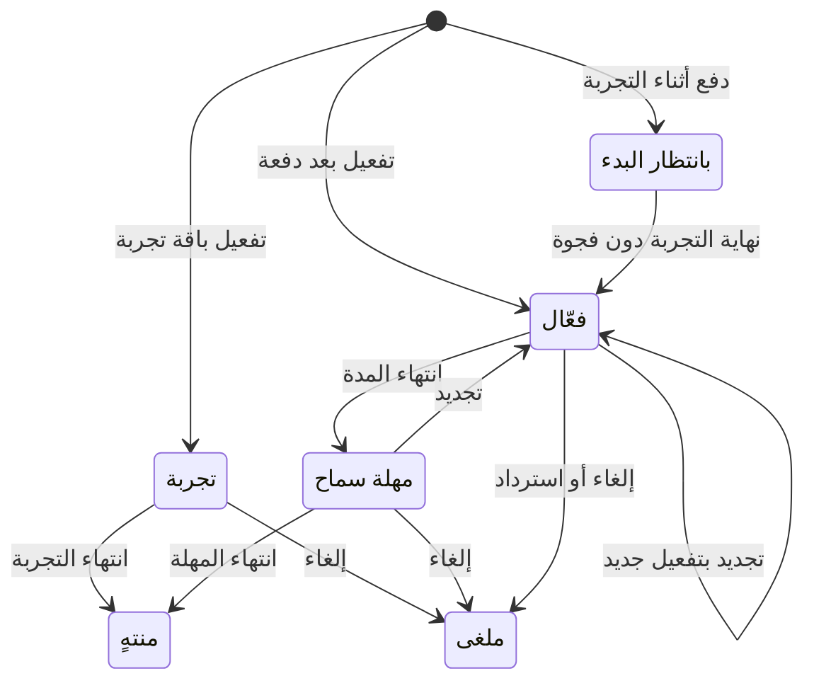

| من | إلى | المحفّز | الفاعل | الآثار |
|---|---|---|---|---|
| — | `trial` أو `active` | `billing.service.activated` | النظام | الميزات تظهر فوراً في كل الواجهات، وفي التطبيقين بحالتها فقط (PAY-08) |
| `trial` | `trial`، وصف جديد `queued` | تفعيل مدفوع أثناء التجربة | النظام | الصف المدفوع `queued` يبدأ عند `trial_ends_at`، والتجربة تبقى حتى نهايتها، ولا تذكير بنهاية التجربة |
| `queued` | `active` | نهاية التجربة | النظام | دون فجوة ولا سماح |
| `active` أو `grace` | `active` | تفعيل جديد للمستأجر نفسه | النظام | `ends_at` يُمدَّد من نهاية المدة الحالية، والتجديد أثناء السماح من `ends_at` الأصلي (السماح مجاملة). والشهري = اليوم نفسه من الشهر التالي محصوراً بآخر الشهر، والسنوي = التاريخ نفسه من السنة التالية (29 شباط ← 28 شباط)، بالوقت المحلي نفسه بتوقيت دمشق. وبعد `expired` صف جديد من التفعيل ويُمسح `read_only_until` |
| `active` وحدها | `active` | ترقية إلى باقة أعلى (D-114، `billing.subscription.upgrade`) | المشرف التجاري | الأيام الباقية تتحول بنسبة سعري اليوم، و**سعر اليوم = سعر الفترة الحالية ÷ عدد أيام تلك الفترة** (§5.10)، بصف `subscription_adjustments` (`upgrade_conversion`)، والنزول عند التجديد فقط، ولا ترقية من `trial` أو `grace` أو `queued` · `billing.subscription.upgraded` |
| `active` | `grace` | `ends_at` | النظام | مهلة سماح ⚙️ (06 §15) وتذكير. والتذكير قبل الانتهاء بـ 7 أيام ⚙️ وبيوم واحد ⚙️ (PAY-03)، وقبل نهاية التجربة بـ ⚙️ 3 أيام، وتحذير في لافتة السماح قبل التوقف بـ ⚙️ 3 أيام بأن تذكيرات الزبائن ستتوقف |
| `grace` | `expired` | انتهاء المهلة (`PAUSABLE`: لا تنقضي ما دام طلب تجديد `awaiting_payment` قُدّم رقم دفعته قبل `grace_until`، فيمتد السماح حتى يُحسم الطلب ويوم دوام بعده) | النظام | إيقاف الميزات المدفوعة (التعبئة والدفع من المحفظة والمحاسبة للكتابة) دون حذف بيانات المحل، والمحاسبة للقراءة والتصدير ⚙️ 12 شهراً (SHOPPRO-15)، **والسحب من المحفظة متاح دائماً** (SHOPWALLET-01). وتتابع `entitlement_ended` (§8.16): تتوقف كل تذكيرات الزبائن (الأقساط، والديون، وإيصالات الدفع، وجاهزية الصيانة، والكفالة) دون إشعار الزبائن، ويُذكر ذلك لصاحب المحل في رسالة التوقف، والصناديق المفتوحة يغلقها النظام `closed_by_system` دون عدّ، وتسليم أجهزة الصيانة نفسه مستمر. وعند التجديد تُستأنف التذكيرات للمواعيد القادمة فقط دون تراكم |
| `trial` أو `active` أو `grace` | `cancelled` | استرداد أو إلغاء (PAY-04) | النظام بعد القرار | إنهاء فوري بلا سماح، وأثره كالانتهاء تماماً (القراءة ⚙️ 12 شهراً من الإلغاء)، والاسترجاع حسب D-111 |
| أي حالة | كما هي، و`ends_at` + الأيام | تصحيح تعليق المحل، أو رفعه بسبب RSN-RIN-05 «لم تثبت مخالفة» (D-112) | النظام | إعادة أيام التعليق آلياً (`subscription_adjustments`، `days_restored`)، وإن انتهى الاشتراك أثناءها تبدأ الأيام المعادة فترة جديدة عند الرفع · `billing.subscription.days_restored` |

**د. طلب المتجر والشحنة (`store_orders.status`، `shipments.status`، D-87، STORE-05، STORE-09)**

```mermaid
stateDiagram-v2
    state "جديد" as New
    state "مؤكَّد" as Confirmed
    state "قيد التجهيز عند المورّد" as Preparing
    state "مع الشحن" as Shipped
    state "مسلَّم ومدفوع" as Delivered
    state "ملغى" as Cancelled
    state "مرتجع" as Returned
    [*] --> New: سلة المتجر أو واتساب الإدارة
    New --> Confirmed: تأكيد المشرف التجاري
    New --> Cancelled: إلغاء المحل أو المشرف
    Confirmed --> Preparing: إسناد للمورّد
    Confirmed --> Cancelled: إلغاء المحل أو المشرف
    Preparing --> Shipped: استلام المندوب برمز الاستلام
    Preparing --> Cancelled: طلب إلغاء أو تعذّر تجهيز يقرّه المشرف
    Shipped --> Delivered: تسليم برمز التسليم وقبض الثمن
    Shipped --> Cancelled: فشل التسليم وعودة البضاعة
    Delivered --> Returned: إرجاع كامل مقبول
```

| من | إلى | المحفّز | الفاعل | الشرط | الآثار والأحداث |
|---|---|---|---|---|---|
| — | `new` | سلة المتجر (الموقع أو التطبيق) أو تسجيل من واتساب الإدارة (STORE-04) | عضو بـ `shop.store.order`، أو المشرف التجاري | المستأجر موثّق، والمنتجات منشورة. والسلة تُقسم آلياً إلى طلب لكل مورّد | رقم `OR-` · `store.order.placed` |
| `new` | `confirmed` | `confirm` | المشرف التجاري | التوفر. وللدفع المسبق: دفعة `confirmed` | الفاتورة التجارية باسم المنصة وفيها اسم المورّد (STORE-08)، وإنشاء الشحنة · `store.order.confirmed` |
| `confirmed` | `preparing` | إسناد | النظام | — | يظهر للمورّد في لوحته (STORE-12). ولأسطر الأجهزة يعيّن الوكيل الأجهزة بأرقامها من مخزونه المسجّل فتُحجز (§7.10) ولا تُباع ولا تُنقل حتى التسليم أو الإلغاء. والكمية تُخصم من المخزون عند `new` وتُعاد عند الإلغاء أو فشل التسليم، ولا يخفض المورّد المخزون تحت المحجوز · `store.order.assigned` |
| `confirmed` أو `preparing` | كما هي | إلغاء سطر بموافقة المحل المسجّلة (نقص عند المورّد) | المشرف التجاري | سبب | إعادة إصدار الفاتورة (`voided` ثم جديدة)، وخفض مبلغ الدفع عند الاستلام، و**إبطال آلي** لحصة السطر من المسبق (D-116) · `store.order.line_cancelled` |
| `preparing` | `shipped` | استلام المندوب | مندوب الشحن | رمز الاستلام لمرة واحدة من المورّد (`shipment_codes` بنوع `pickup` تحت RLS المورّد) | · `store.shipment.picked_up` |
| `shipped` | `delivered` | تسليم | مندوب الشحن | **رمز التسليم لمرة واحدة** (STORE-09): يُولَّد عند `shipped`، ويظهر في لوحة المحل فقط (لصاحبه ولمن يملك `shop.store.order`)، ويُخزَّن في `shipment_codes` تحت RLS المحل المشتري وحده (مشفّراً للعرض، وببصمته للتحقق، ولا يقرؤه المندوب)، ويُستهلك بأول استخدام صحيح، والخطأ يرد `STORE_DELIVERY_CODE_INVALID`، ويُقفل بعد 5 محاولات خاطئة ⚙️ (`STORE_DELIVERY_CODE_LOCKED`) فتعرض شاشة المندوب «اتصل بالدعم»، ويستطيع المحل توليد رمز جديد من لوحته بإعادة تحقق فيبطل القديم. وقبض المبلغ للدفع عند الاستلام. **وقبل إدخال الرمز تعيد شاشة التسليم فحص كل جهاز** بحارس الحيازة (`store_delivery`): السطر الذي صار على جهازه بلاغ نافذ أو قيد المراجعة أو لم يعد في مخزون الوكيل **لا يُسلَّم** (تعرض شاشة المندوب «احجب الوحدة X»)، فتُخفض الفاتورة ومبلغ الدفع عند الاستلام آلياً، ويُبطَل مسبقه آلياً، ويُفتح تنبيه أمني لنطاق محافظة الوكيل، ويعيد المندوب الوحدة للوكيل بتعليمات الأمن، ولا يدفع المحل ثمنها | `courier_collections` للدفع عند الاستلام، وبدء مهلة الإرجاع 7 أيام ⚙️. وأسطر الأجهزة (STORE-13) تنقل أجهزتها بأرقامها من مخزون الوكيل إلى مخزون المحل في المعاملة نفسها (`ownerships.source = store_delivery`) · `store.order.delivered` |
| `new` | `cancelled` | انقضاء مهلة التأكيد | النظام (`store.order.auto_cancel`) | صنف `BUSINESS_FLOOR`: الأبعد من ⚙️ 48 ساعة ونهاية يوم الدوام الثاني | **إعادة آلية** للدفع المسبق بالمبلغ نفسه إلى المصدر نفسه (void، D-116) · `store.order.cancelled` |
| `new` أو `confirmed` | `cancelled` | إلغاء | المحل نفسه **قبل «قيد التجهيز»**، أو المشرف التجاري، أو النظام عند تعليق المحل أو سحب اعتماد المورّد (§8.16) | سبب | **إعادة آلية** للمسبق بالمبلغ نفسه إلى مصدره نفسه دون موافقات، في `new` و`confirmed` كليهما، لأن التجهيز لم يبدأ (void، D-116، 04 STORE-16، 06 §14.2). والفاتورة `voided`، ويرى المحل «أُعيد المبلغ إلى مصدره» مع مرجع العملية · `store.order.cancelled` |
| `preparing` | `cancelled` | طلب إلغاء من المحل يقرّه المشرف التجاري، أو تعذّر التجهيز من المورّد يقرّه المشرف التجاري (ولا يُلغى بسبب تعليق المحل: يمضي إلى التسليم، §8.4 ب) | المشرف التجاري | سبب، و`store_orders.cancel_requested_at` للطلب من المحل | **استرداد** بأربع عيون: طلب استرداد مُعبّأ مسبقاً عنصر عمل يقدّمه المشرف التجاري خلال ⚙️ يوم دوام (`money.refund.prefill_within`) ويعتمده المدير العام، ويرى المحل «سيُعاد المبلغ بالطريقة التي دفعت بها» مع الوقت المتوقع، والفاتورة `voided`، وفك حجز الأجهزة، وإشعار المورّد بوقف التجهيز · `store.order.cancelled` |
| `shipped` | `shipped` | فشل محاولة التسليم الأولى | مندوب الشحن | سبب | الشحنة `delivery_failed` ثم `out_for_delivery` لمحاولة ثانية (SOP-41) · `store.shipment.delivery_failed` |
| `shipped` | `cancelled` | فشل التسليم نهائياً، أو رفض المحل الطلب عند الباب | مندوب الشحن ثم المشرف التجاري | سبب | الشحنة إلى `returned_to_supplier`، والدفعة `pending_collection` ← `cancelled`، والمسبق **يُبطَل آلياً** (D-116) ولا يُسلَّم شيء، وأسطر الأجهزة يُفك حجزها وتبقى في مخزون الوكيل. والرفض بسبب تعليق المحل أو استبعاد المنصة لا يُحسب في `cod_blocked` |
| `delivered` | `returned` | إرجاع كامل مقبول | النظام عند قرار الإرجاع | §هـ | — |

حالات الشحنة (`shipments.status`): `created` ← `ready_for_pickup` (المورّد جهّز) ← `picked_up` ← `out_for_delivery` ← `delivered` أو `delivery_failed` ← `out_for_delivery` (محاولة ثانية) أو `returned_to_supplier`. وللشحنة اتجاه `direction`: `delivery` أو `return` (إعادة البضاعة من المحل إلى المورّد برمز استلام يظهر للمحل ورمز تسليم يظهر للمورّد، وتظهر في لوحة المندوب).

**هـ. الإرجاع والاسترداد وتسوية المورّد (STORE-10، STORE-11)**

| الكيان | الحالات والانتقالات |
|---|---|
| الإرجاع (`returns.status`) | `requested` (المحل خلال 7 أيام ⚙️ من التسليم بصور حية، أو حتى نهاية كفالة المنتج `products.warranty_days` لنوع `warranty`، أو في أي وقت لمنتج مسحوب، أو «صنف ناقص» بلا صورة يحسمه بيان المندوب) ← `approved_in_principle` (المشرف التجاري، مع تحديد إن كان العيب من البضاعة) أو `rejected` ← `awaiting_pickup` (شحنة إرجاع `direction = return`) ← `received` (عادت البضاعة) ← `inspected` ← `refunded` أو `replaced` (طلب مرتبط بسعر صفر `replacement_of_return_id`) أو `rejected_after_inspection`. و`approved_in_principle` أو `awaiting_pickup` ← `expired` إن لم تُسلَّم البضاعة خلال ⚙️ 7 أيام (مع تذكير، ويُشعَر المحل، وتعود الأسطر مؤهلة للتسوية). **والاسترداد يُنشأ عند `received` ونجاح الفحص فقط**، إلا نوع `missing_item` («صنف ناقص»): `approved_in_principle` ← `refunded` على بيان المندوب دون استلام ولا فحص، والاسترداد بأربع عيون. والطلب يبقى `delivered` ولا يصبح `returned` إلا حين تُسترد كل أسطره، والإرجاع الجزئي يعدّل `returned_qty` (Σ المرتجع ≤ المسلّم، قيد في المخطط). **وأسطر الأجهزة:** عند `received` نقل عكسي بنوع `store_return` من مخزون المحل إلى مخزون الوكيل في المعاملة نفسها بعد إعادة الفحص، ولا حركة مع بلاغ نافذ، والجهاز الذي بيع لا يُرجَع (`STORE_RETURN_DEVICE_SOLD`). والعيب المنسوب للمورّد يصبح خصماً في كشفه التالي، ولو بعد تسويات سابقة للكفالة أو سحب المنتج |
| الاسترداد (`refunds.status`) | `requested` (المشرف التجاري، ومنه الطلب المعبّأ آلياً عند كل إلغاء لطلب متجر مدفوع مسبقاً بعد بدء «قيد التجهيز» أو لخدمة بعد تفعيلها) ← `approved` (المدير العام أو نائبه المؤقت، D-128، §5.4 الصف 1) أو `rejected` ← `paid` (برقم التحويل المرجعي). والمعتمد غير المدفوع ينبّه المدير العام بعد ⚙️ يومي دوام. وΣ المسترد لكل دفعة ≤ المدفوع (قيد في المخطط). أما **الإبطال الآلي** قبل بدء الخدمة، ولطلب المتجر قبل «قيد التجهيز»، ولسطر أُلغي أو استُبعد قبل التسليم (D-116)، فليس استرداداً: عملية `void` آلية مدقّقة بلا موافقات وحالتها `voided` (§11.5). والإبطال والاسترداد بعملة الدفعة (أعلاه) |
| كشف التسوية (`supplier_settlements.status`) | `draft` (تولّده مهمة دورية ⚙️ أسبوعياً من أسطر الطلبات المسلّمة المدفوعة **التي انتهت مهلة إرجاعها فقط** (`order_items.settlement_eligible_at <= now()`)، ناقص حصة المنصة ⚙️، ناقص المرتجعات والعيوب. وإن كان الصافي سالباً لا يُحوَّل شيء، ويُرحَّل الرصيد السالب سطراً افتتاحياً `carried_forward` في الكشف التالي (`opening_balance_minor`)) ← `prepared` (المشرف التجاري يراجع، وأي تعديل يدوي مرتبط بسجل إرجاع أو عيب) ← `approved` (المدير العام، فصل المهام) أو العودة إلى `draft` بسبب ← `paid` (تحويل إلى حساب الاستلام المعتمد للمورّد برقم مرجعي، والصافي موجب)، أو `carried_forward` بعد الاعتماد إن كان الصافي صفراً أو سالباً (لا تحويل، والرصيد في الكشف التالي). و`cancelled` لكشف بلا أسطر. ويرى المورّد الكشف من `prepared` للقراءة، مع إجراء «ملاحظة» يُسجَّل في `settlement_remarks`، ويحسم المشرف الملاحظات أو يؤجلها قبل الإرسال للمدير العام، وبعد `paid` يفتح الاعتراض طلب دعم بتصنيف «تسوية»، وأي تصحيح متفق عليه سطر `adjustment` (RSN-STL) في الكشف التالي لا يتجاوز إرجاعه أو عيبه المرتبط. والسطر «مدفوع» حين يثبت دفع المحل (رمز التسليم مع القبض، أو المسبق المؤكد)، وعجز المندوب لا يؤخر السطر أكثر من دورة تسوية واحدة. **والكشف الذي يبلغ `approved` وتغيير حساب الاستلام معلّق أو في مهلته يُعلَّق `held`** فلا يُدفع لأي من الحسابين حتى التفعيل (`STORE_PAYOUT_CHANGE_PENDING`). وعند إلغاء المورّد: كشف نهائي بعد آخر مهلة إرجاع أو كفالة، والسالب الباقي ذمة `supplier_receivables` |

**و. عملية المحفظة** (`wallet_operations.status`، D-89): المال محفوظ لدى شام كاش، و`wallet_operations` **سجل مرآة** للعرض والمطابقة فقط، والرصيد المعروض هو الرصيد الذي تؤكده شام كاش.

```mermaid
stateDiagram-v2
    state "معلّقة" as Pending
    state "ناجحة" as Succeeded
    state "فاشلة" as Failed
    state "مستردّة" as Refunded
    state "قيد المتابعة" as UnderInvestigation
    [*] --> Pending: طلب لدى شام كاش
    Pending --> Succeeded: تأكيد شام كاش
    Pending --> Failed: رفض أو انتهاء المهلة دون تنفيذ
    Pending --> UnderInvestigation: انقضاء مهلة الحسم
    UnderInvestigation --> Succeeded: المطابقة أو قرار مسجّل
    UnderInvestigation --> Failed: المطابقة أو قرار مسجّل
    Succeeded --> Refunded: عملية عكسية ناجحة
```

| من | إلى | المحفّز | الفاعل | الشرط | الآثار والأحداث |
|---|---|---|---|---|---|
| — | `pending` | شحن وارد (`fund_in`)، أو سحب (`withdraw`)، أو خصم لتعبئة (`topup_debit`)، أو دفع طلب أو خدمة (`store_payment`، `service_payment`) | شام كاش (للوارد)، أو صاحب المحل، أو عضو بصلاحيته | للخصم: محفظة `active` غير مجمّدة، واستحقاق الباقة عدا السحب (§5.10)، ورمز المحفظة حيث يلزم، والحدود ⚙️. وللسحب: صاحب المحل فقط، ورمز المحفظة ورمز تحقق، ولا قيد يمنع السحب (بوابات السحب، §5.11)، والوجهة **مطابقة بالرقم الوطني** لصاحب المحل (أو بهوية KYC لدى شام كاش المربوطة برقمه الوطني) والاسم ثانوي، فإن لم يطابق الشريك بالرقم الوطني احتاجت كل وجهة أول مرة مهلة ⚙️ 72 ساعة واتصالاً راجعاً لرقم صاحب المحل. **والشحن الوارد لا يُرفض أبداً**: يُسجَّل ويُطابق ويُسحب في كل حالة عدا `closed`، ولا يمنعه مفتاح ولا قيد (مسار `protected`) | معاملة أولى تُدرج العملية وتلتزم، ثم طلب المحوّل بمرجع عدم تكرار **خارج أي معاملة** (§7.5)، ثم معاملة ثانية تطبّق النتيجة |
| `pending` | `succeeded` | تأكيد شام كاش: رد طلبنا، أو **استعلام حالتنا** يؤكد المرجع والمبلغ (الإشعار الوارد تلميح، §3.14) | النظام | — | تحديث الرصيد المعكوس، وإشعار صاحب المحل بكل سحب وبكل عملية فوق حد التنبيه ⚙️ · `shop_wallet.operation.succeeded` |
| `pending` | `failed` | رفض شام كاش، أو انتهاء مهلة الحسم دون أثر لدى المزوّد | النظام أو المطابقة | — | · `shop_wallet.operation.failed` |
| `succeeded` | `refunded` | نجاح عملية عكسية مرتبطة (`topup_refund`، `payment_refund`) | النظام | — | · `shop_wallet.operation.refunded` |
| `pending` | `under_investigation` | انقضاء مهلة الحسم ⚙️ 24 ساعة (`wallet.pending.resolve`) دون نتيجة | النظام (`wallet.pending.resolve`) | — | يرى صاحب المحل «قيد المتابعة»، والمطابقة اليومية تحسم، وإلا فرق مطابقة وعنصر عمل · `shop_wallet.operation.under_investigation` |
| `under_investigation` | `succeeded` أو `failed` | المطابقة، أو قرار مسجّل بأدلة المزوّد | النظام، أو المشرف التجاري | — | كالسابق |
| — | عملية تصحيح مرتبطة | `correction_debit` أو `correction_credit` أو `fund_in_reversal` (`corrects_id`) | النظام بعد `billing.correction.approve`، وتنفّذها شام كاش حسب الاتفاقية | لا يتغير صف نهائي أبداً | إن لم يكفِ الرصيد يُخصم الموجود ويظهر لصاحب المحل «مبلغ قيد التسوية»، والتعبئة والدفع مجمّدان إدارياً (السحب متاح) حتى يسوّيه صاحب المحل (SOP-47)، ولا يُقتطع آلياً من شحن وارد لاحق. **وبعد إغلاق المحفظة** لا يُخصم شيء من محفظة المالك الجديد أبداً: النتيجة المتأخرة أو التصحيح ذمة للمالك السابق شخصاً أو عليه (§8.4 د) · `shop_wallet.correction.created` |

**ز. طلب التعبئة** (`topup_orders.status`، D-89، TOPUP-02)

```mermaid
stateDiagram-v2
    state "معلّقة" as Pending
    state "ناجحة" as Succeeded
    state "فاشلة" as Failed
    state "مستردّة" as Refunded
    state "قيد المتابعة" as UnderInvestigation
    state "بانتظار الخصم" as Initiated
    [*] --> Initiated: طلب الخصم من المحفظة
    Initiated --> Pending: نجاح الخصم وإرسال الطلب للشركة
    Initiated --> Failed: فشل الخصم أو تعلّقه
    Pending --> Succeeded: تأكيد الشركة أو المطابقة
    Pending --> Failed: رفض الشركة أو المطابقة
    Pending --> UnderInvestigation: 24 ساعة دون حسم
    UnderInvestigation --> Succeeded: مرجع الشركة يثبت التنفيذ
    UnderInvestigation --> Failed: الشركة تثبت عدم التنفيذ
    Failed --> Refunded: استرداد المبلغ للمحفظة
```

| من | إلى | المحفّز | الفاعل | الشرط | الآثار والأحداث |
|---|---|---|---|---|---|
| — | `initiated` | `POST /v1/shops/{id}/topups` | عضو بـ `shop.wallet.topup` | تمييز الشبكة من البادئة (`operator_prefixes`)، وعرض الرقم بخط كبير وتأكيده (TOPUP-01)، وحد الرقم في الساعة ⚙️ وحد الموظف اليومي ⚙️ (TOPUP-05)، واستحقاق الباقة | عملية خصم `topup_debit` بالمبلغ ناقص عمولة المحل ⚙️ (§8.11 و)، **ولا يُرسل طلب الشركة قبل نجاح الخصم** · `topup.order.submitted` |
| `initiated` | `pending` | نجاح الخصم | النظام | — | طلب التعبئة للشركة بمعرّف الطلب مرجعاً |
| `initiated` | `failed` | فشل الخصم، أو بقاؤه معلّقاً حتى مهلة حسمه | النظام | — | لا يُرسل شيء للشركة، ومال الخصم المعلّق يحسمه حسم المحفظة ومطابقتها، والنص «يُعاد المبلغ إلى المحفظة» · `topup.order.failed` |
| `pending` | `succeeded` | تأكيد الشركة لحظياً، أو برد متأخر يؤكده استعلام الحالة، أو بالمطابقة | النظام | — | إيصال التعبئة (TOPUP-03)، وقيد آلي في المحاسبة إن كان المحل مشتركاً، وحصة المنصة من العمولة (`platform_commission_minor`) تُطابق مع كشف عمولة الشركة · `topup.order.succeeded` |
| `pending` | `failed` | رفض الشركة، أو المطابقة تثبت عدم التنفيذ، أو رد الشركة أن الرقم ليس من مشتركيها، أو مبلغ يخالف الكتالوج بعامل 100 | النظام | — | عملية استرداد للمحفظة فوراً، و«ليس من مشتركينا» يعلّم البادئة للمراجعة دون إعادة على الشركة الأخرى · `topup.order.failed` |
| `failed` | `refunded` | نجاح عملية الاسترداد | النظام | خصم سابق ناجح | إشعار المنفّذ وصاحب المحل · `topup.order.refunded` |
| `pending` | `under_investigation` | مضي ⚙️ 24 ساعة دون حسم | النظام (`topup.pending.resolve`) | — | يرى المحل «قيد المتابعة مع الشركة»، وفرق مطابقة وعنصر عمل (TOPUP-02) · `topup.order.under_investigation` |
| `under_investigation` | `succeeded` أو `failed` | مرجع الشركة يثبت التنفيذ أو عدمه | المشرف التجاري يطلب، والمدير العام أو نائبه المؤقت يعتمد (`billing.correction.*`، D-128، §5.4 الصف 3) | دليل الشركة | كآثار النجاح أو الفشل |
| `succeeded` أو `refunded` | كما هي | نتيجة متأخرة متعارضة | النظام | — | لا تُسقط بصمت ولا تحرّك مالاً: فرق مطابقة (`late_result`) وتنبيه، ثم تصحيح مرتبط بعد الاعتماد (`topup_clawback` أو `topup_refund`) · `topup.order.late_result` |

**ح. محفظة المحل** (`shop_wallets.status`): **دورة الحياة وحدها**: `pending_activation` (طلب فتح الحساب لدى شام كاش) ← `active` ← `closed`. و`closed` بفاعل النظام عند إغلاق المحل أو إلغائه أو تغيير مالكه (§8.4 د)، **وشرطها المسبق دائماً** ألا تبقى عملية محفظة أو تعبئة `pending` أو `under_investigation`، ومعها `close_reason`: `withdrawn_zero` (سحب صاحبها رصيده كاملاً، ومنه من `exit_only`)، أو `owner_deceased` (يبقى المال لدى شام كاش في الحساب باسم المحل ويُصرف للورثة بإجراءاتها، D-89، ويُعرض تجميداً خارجياً «يتبع إجراءات شام كاش للورثة»، ولا سحب عبر المنصة)، أو `released_to_provider` (مسار الوثيقة الرسمية في تغيير المالك)، أو `provider_exit` (انتهاء اتفاقية شام كاش)، ويُحفظ `balance_at_close_minor`. **والإغلاق برصيد مسموح لهذه الثلاثة الأخيرة وحدها**، والمحفظة المغلقة لا تمنع محفظة المالك الجديد (`px_shop_wallet_live`)، **ولا تُفتح محفظة المالك الجديد آلياً**: يفعّلها بعد التنفيذ إن كان مشتركاً (SOP-45). أما التجميدات وتعليق المحل وفرق المطابقة والتجميد الخارجي وإيقاف السحب والتأخير الأمني فهي **قيود** (§5.11) تجتمع ويُرفع كل منها وحده، والحالة المعروضة القيد الأعلى أسبقية، وقيم `frozen` و`held` و`suspended` و`external_frozen` القديمة إسقاطات للعرض فقط.

| القيد النافذ | السحب لصاحب المحل (SHOPWALLET-03) | الشحن الوارد | التعبئة والدفع |
|---|---|---|---|
| لا قيد | ✅ | ✅ | ✅ (مع الاستحقاق، §5.10) |
| `wallet_admin_freeze` | ✅ | ✅ | ❌: تجميد الإدارة يوقف التعبئة والدفع فقط |
| `wallet_owner_freeze` أو `wallet_not_me` | ✅ إلى المحفظة الموثّقة لصاحب المحل وحدها ([قواعد العمل](06-business-rules.md) §14.3)، **والتهدئة بعد فك «لم أكن أنا» لا تؤخر السحب** | ✅ | ❌ حتى يرفعه صاحبه بإعادة مصادقة كاملة (أو بفك تجميد الحساب، §4.2.4) |
| `wallet_recon_hold` | ✅ حتى الرصيد الذي أكدته شام كاش | ✅ | ❌ للعمليات المعنية بالفرق |
| `tenant_suspended` | ✅ | ✅ | ❌ |
| `wallet_external_freeze` | ❌ من جهة شام كاش، و`SHOPWALLET_EXTERNAL_FREEZE` | حسب الجهة | ❌ |
| `cooldown` من `phone_change` أو `identity_recovery` أو `number_restore`، أو `pin_reset_delay` (D-115) | ❌ حتى `until`، و`SHOPWALLET_SECURITY_DELAY` | ✅ | ✅ من الأجهزة المربوطة قبلها |
| `cooldown` من `unbound_reset` أو `not_me_unfreeze` أو `sim_swap_signal` | ✅ | ✅ | ✅ من الأجهزة المربوطة قبلها |
| `withdrawal_stop` (D-100) | ❌ `SHOPWALLET_WITHDRAWAL_STOPPED` حتى `until` | ✅ | حسب القيود الأخرى |

وعدة قيود معاً: يُطبَّق أشدها في كل عمود، ورفع أحدها لا يمس غيره.

**إيقاف السحب (D-100) هو الإيقاف التقديري الوحيد بقرار بشري** على «صاحب المحل يسحب رصيده دائماً» (والتأخيران الأمنيان الآليان في D-115 مؤقتان بمدة ثابتة لا يقررهما موظف)، فالسحب باقٍ بعد انتهاء الاشتراك وعند إطفاء وحدة المحفظة وعند تجميد الإدارة. عند اختراق مؤكد لحساب محل أو للربط مع شام كاش يطلبه أحد الثلاثة (المدير العام، ونائبه المؤقت، والمشرف التجاري) ويوافق آخر منهم (`wallet.withdrawal_stop.request` و`.approve`، سجل الأربع عيون §5.4)، لمحل بعينه أو لكل المحافظ. **وسجله الوحيد صف `restrictions`** (`type = withdrawal_stop`، و`scope = all_wallets` أو المحفظة) بـ `until` بعد ⚙️ 24 ساعة (`wallet.withdrawal_stop.duration`)، ويرفعه عند انتهائه الكاسح `restrictions.expire` وحده. وقبل انتهائه بـ ⚙️ `wallet.withdrawal_stop.expiry_notice` ترسل المهمة `wallet.withdrawal_stop.expiring` القالب 311 إلى `gm_channels` والنائب والطالب والموافق في أي ساعة. ويجدّده المدير العام أو نائبه بقرار مسجّل مع سببه، و**الرفع المبكر بالزوج نفسه** الذي يضعه. ويُبلَّغ صاحب المحل بالسبب فوراً (`shop_wallet.withdrawal.stopped`)، وعند الانتهاء الآلي بالقالب 188 (ب) «انتهت مدة الإيقاف المؤقت». و`emergency.wallet_withdrawal_stop` (§14.3) **مدخل** في شاشة المفاتيح ينشئ ذلك الصف، بلا حالة ولا انتهاء خاصين به. أما رفع `wallet_admin_freeze` ففاعل واحد بـ `wallet.freeze` (D-102).

### 8.12 طلب تصحيح القرار (`reversal_requests.status`)

```mermaid
stateDiagram-v2
    state "مطلوب" as Requested
    state "موافَق عليه" as Approved
    state "مرفوض" as Rejected
    state "مسحوب" as Withdrawn
    state "منفّذ" as Executed
    state "فشل التنفيذ" as Failed
    [*] --> Requested
    Requested --> Approved: موافقة مشرف ثانٍ
    Requested --> Rejected
    Requested --> Withdrawn
    Requested --> Rejected: تغيّر الهدف
    Approved --> Rejected: تغيّر الهدف عند التنفيذ
    Approved --> Executed: تنفيذ الآثار
    Approved --> Failed: خطأ في التنفيذ
    Failed --> Executed: إعادة المحاولة
```

| من | إلى | المحفّز | الفاعل | الشرط | الآثار والأحداث |
|---|---|---|---|---|---|
| — | `requested` | طلب (REVERSAL-01، REVERSAL-02) | مشرف بـ `reversal.request` | قرار من القائمة القابلة للتصحيح، والسبب والأدلة، والنتيجة المطلوبة من النتائج المسموحة لذلك القرار | · `reversal.request.created` |
| `requested` | `approved` | `approve` | مشرف آخر بـ `reversal.approve` | ليس الطالب ولا صاحب القرار الأصلي، ورتبته مساوية أو أعلى. وتصحيح الملكية وإلغاء تأكيد الوفاة: المدير العام أو نائبه المؤقت (REVERSAL-03، D-128). **ولقرار اتخذه المدير العام وحده** (الحظر، والإلغاء النهائي للمحل): يطلبه مشرف ويعتمده المدير العام، ويُعفى هنا وحده من شرط «غير صاحب القرار الأصلي» (D-102) مع ضوابط المدير العام وإشعار مسار التصعيد لدى الزبون. ويُعاد التحقق أن الهدف ما زال في الحالة التي يصححها الطلب | تنفيذ فوري في مهمة · `reversal.request.approved` |
| `requested` أو `approved` | `rejected` | تغيّر الهدف منذ الطلب (عند الاعتماد أو عند التنفيذ) | النظام | — | سبب `target_changed`، ويعيد الطالب التقديم · `reversal.request.rejected` |
| `requested` | `rejected` أو `withdrawn` | رفض أو سحب | الموافق أو الطالب | سبب | — |
| `approved` | `executed` | التنفيذ | النظام | إعادة التحقق من الهدف، ثم انتقاله عبر آلته (الجداول أعلاه) | إعادة حساب المراقبة والحظر وحالة الفحص وتقرير الالتزام، وإشعارات محايدة (REVERSAL-04) · `reversal.request.executed` |
| `approved` | `failed` | خطأ | النظام | — | تنبيه في صحة النظام، وإعادة المحاولة |

النتائج المسموحة: قبول البلاغ ← رفض أو إعادة مراجعة، ورفضه ← قبول أو إعادة مراجعة، وإغلاقه ← إعادة نفاذ، وتوثيق الهوية ↔ رفضه، واعتماد المحل ← تعليق، وتعليقه ← رفع، واعتماد التسجيل الذاتي ← رفض، وحسم الاعتراض ↔ الحسم المقابل، وتعليق الحساب ← رفع، والحظر ← تعليق أو رفع، والإلغاء النهائي للمحل ← تعليق، ودمج الأجهزة ← فك الدمج ببيان الصفوف (§7.4)، ورفض المعاملة المعلّقة ← إعادة مراجعة، ورفض التسجيل الذاتي ← إعادة مراجعة، والملكية ← المالك الصحيح (`ownerships.source = correction`، ومنها الحكم القضائي `ref_type = court_order` ينفّذه المدير العام بعد تحقق المحامي، مع حجز LH-5 على الملف)، وتأكيد الوفاة ← **إلغاء تأكيد الوفاة** (أدناه). وإفراج الجهات عن مضبوط ليس قراراً للمنصة فلا يُصحَّح بها. **ولا حذف أبداً** (REVERSAL-05). **ولا يحيي التصحيح آلياً أبناء أُلغوا يمسّون الملكية** (P-7، P-2): ينشئ عناصر عمل، والحمايات والتجميدات التي وضعها النظام وحدها تُرفع بحزمتها (§8.0)، وتعويضات كل انتقال معلنة في صفه.

**إلغاء تأكيد الوفاة (شهادة مزوّرة نُفّذ بها انتقال):** يطلبه مشرف بـ `reversal.request`، ويعتمده **المدير العام أو نائبه** (صف التصحيح، D-128)، والطالب غير الموافق، والدليل هوية L3 للشخص الحي. والآثار في معاملة واحدة: الشخص `deceased` ← `active`، والحساب `closed(deceased)` ← `active` (الحساب نفسه، ويُعاد ربط رقمه إن لم يُخصَّص لغيره وإلا مسار الاستعادة بالهوية، وقيد `cooldown` بمصدر `identity_recovery`)، ورفع `owner_deceased` عن كل أجهزته، وعكس الانتقالات المنفّذة بالشهادة المزوّرة بتصحيح الملكية REVERSAL-03 في الطلب نفسه (`source = correction`)، ورفع تعليق الوفاة عن محلاته (`restore_if_cause`)، وتفريغ `owner_deceased_at` لمحفظة لم تُغلق بعد. وتغيير مالك منفّذ على محله **لا يُعكس آلياً**: عنصر عمل للمدير العام بالوثائق. والعلاقات الملغاة لا تُعاد (P-7). وعلى الطالب: علامة احتيال، وSOP-18، والحظر وفق [قواعد العمل](06-business-rules.md) §13.4، وإحالة للشرطة. والحدث `person.death_reversed`، والقالب 307 للشخص على كل قنواته وللمدير العام.

### 8.13 رمز الإكمال بالتطبيق (`handoff_tokens.status`)

```mermaid
stateDiagram-v2
    state "صادر" as Issued
    state "مستلَم في التطبيق" as Claimed
    state "مكتمل" as Completed
    state "منتهٍ" as Expired
    state "ملغى" as Cancelled
    [*] --> Issued
    Issued --> Claimed: مسح بالحساب نفسه
    Claimed --> Completed: إكمال الخطوة
    Issued --> Expired: انتهاء 10 دقائق
    Claimed --> Expired: انتهاء 10 دقائق
    Issued --> Cancelled: إغلاق الصفحة أو 5 محاولات خاطئة
    Claimed --> Cancelled: إغلاق الصفحة
```

| من | إلى | المحفّز | الفاعل | الشرط | الآثار والأحداث |
|---|---|---|---|---|---|
| — | `issued` | `POST /v1/handoffs` | الموقع | خطوة من HANDOFF-01 | QR ورمز قصير، و`expires_at` = +10 دقائق ⚙️ |
| `issued` | `claimed` | `claim` | التطبيق | الحساب نفسه (HANDOFF-02)، والمسح من حساب آخر يُرفض ولا يغيّر الحالة | فتح الخطوة في التطبيق · `handoff.token.claimed` |
| `claimed` | `completed` | `complete` | التطبيق | الخطوة اكتملت (ملفات جاهزة أو معاملة) | تحديث صفحة الموقع لحظياً · `handoff.token.completed` |
| `issued` أو `claimed` | `expired` | انتهاء المهلة | النظام | — | — |
| `issued` أو `claimed` | `cancelled` | إغلاق الصفحة (إشارة الإلغاء)، أو 5 محاولات من حساب آخر | الموقع أو النظام | — | — |

### 8.14 استعادة الحساب بالهوية (`account_recoveries.status`)

| من | إلى | المحفّز | الفاعل | الشرط | الآثار والأحداث |
|---|---|---|---|---|---|
| — | `requested` | `POST /v1/auth/recovery` دون جلسة (THEFT-06)، أو من رابط البدء الذي يرسله الدعم (SUPPORT-03) | صاحب الحساب (`initiated_by_type = 'self'`)، أو موظف الدعم لطلب `assisted_phone_change` أو `phone_restore` أو `unfreeze` (`initiated_by_admin_id`) | الرقم الجديد مؤكَّد برمز للبدء الذاتي، ولا طلب استعادة مفتوح للحساب (`AUTH_RECOVERY_IN_PROGRESS`)، والرد محايد إن لم يوجد حساب | طلب دعم مرتبط تلقائياً، ورمز الاستعادة (`recovery_token_hash`، ⚙️ 72 ساعة) · `account.recovery.requested` |
| `requested` | `under_review` | رفع الوجهين برموز التقاط مرتبطة بالطلب، ومطابقة الأحوال المدنية عند تفعيلها | صاحب الحساب والنظام | الالتقاط الحي من التطبيق | عنصر عمل للدعم الفني |
| `requested` | `expired` | انتهاء رمز الاستعادة دون رفع الهوية | النظام | — | — |
| `under_review` | `approved` | موافقة ثانية | مشرف ثانٍ | ليس الموظف الذي راجع أو بدأ | — |
| `approved` | `waiting` | النظام فوراً | النظام | — | `execute_after` = +24 ساعة ⚙️ (`recovery.notice_before_execute`) بصنف `WALL_USER` (يمتد إن منع عطل الرد)، وإشعار لكل وسائل الحساب (الرقم الحالي ما لم تكن رسائله موقوفة، والأجهزة المربوطة، والإيميل الأمني) مع «لم أكن أنا» · `account.recovery.approved` |
| `waiting` | `executed` | حلول الموعد | النظام | لم يُلغَ | حسب `kind`: الرقم الجديد (`identity_recovery`، `assisted_phone_change`)، أو رفع إيقاف الرسائل عن الرقم الأصلي (`phone_restore`، §4.2.7)، أو فك تجميد «لم أكن أنا» (`unfreeze`، §4.2.4). ثم إنهاء الجلسات وفترة التهدئة (§4.2.8) · `account.recovery.executed` |
| `requested` أو `under_review` | `rejected` | رفض | الدعم أو المشرف الثاني | سبب | — |
| `waiting` | `cancelled` | «لم أكن أنا» من وسيلة **قائمة قبل آخر حدث خطر**، أو إلغاء الدعم | صاحب الحساب أو الدعم | الوسيلة ليست جهازاً رُبط بعد إعادة تعيين من جهاز غير مربوط، ولا رقماً عليه إشارة تبديل شريحة أو علامة سرقة أو قيد إعادة تعيين، **ولا إيميلاً أمنياً أُضيف أو غُيّر بعد آخر حدث خطر أو خلال ⚙️ `email.recovery_veto.recent_window` قبل طلب الاستعادة** (§4.2.15) | تجميد الحساب (§4.2.4)، وحدث أمني يُحقق فيه، والطلب المُلغى ⚙️ مرتين (`recovery.veto.escalate_after`) يُصعَّد للمدير العام آلياً (CT-145) |
| `waiting` | `waiting` (موقوف) | «لم أكن أنا» من وسيلة أُنشئت **بعد** آخر حدث خطر (ومنها الإيميل الأمني الحديث كما في الصف السابق) | صاحب الوسيلة | — | لا يُلغي: يجمّد الحساب ويوقف التنفيذ (`execute_after` لا يحل ما دام العنصر مفتوحاً)، ويُنشئ عنصر عمل للمدير العام يقرر بالأدلة خلال ⚙️ يوم دوام (`recovery.veto.decision`، `BUSINESS`): المتابعة فيُستأنف الموعد، أو الإلغاء (CT-145، [نموذج التهديد](20-threat-model.md) §6.8.2). وحين يذكر الطالب أن الشريحة سُرقت يطبّق المراجع THEFT-03 (إيقاف الرسائل للرقم) **قبل** إرسال الإشعار |
| — | `requested` | فصل رقم أُعيد تدويره (§4.2.10) | حامل الرقم الجديد عبر الدعم | إثبات حيازة الرقم | `kind = number_detach`، وطلب دعم مرتبط · `account.phone.detach_requested` |
| `approved` (`number_detach`) | `waiting` | النظام | النظام | — | `objection_until` = +72 ساعة ⚙️، وإشعار الحساب القديم على كل وسائله الأخرى مع «هذا رقمي، أوقف» (القالب 193، ورابط `phone_detach_object` دون دخول إلى S-PUB-30، §13.3) |
| `waiting` (`number_detach`) | `executed` أو `cancelled` | حلول `objection_until` دون اعتراض، أو اعتراض صاحب الحساب من حسابه أو عبر الدعم أو بزر «هذا رقمي، أوقف» دون دخول (S-PUB-30، §13.3) | النظام (`account.phone_detach.execute`) أو صاحب الحساب | موافقة المشرف الثاني قائمة (§5.4، الصف 8) | التنفيذ: `phone_released_at` بسبب `recycled_detach`، وإلغاء طلبات النقل والدعوات الموجّهة للرقم، وإنهاء الجلسات · `account.phone.detached` أو `account.phone.detach_objected` |

### 8.15 كيانات أخرى

| الكيان | الحالات | ملاحظات |
|---|---|---|
| التنبيه (`security_alerts.status`) | نموذج WORK: `new` ← `in_progress` ← `closed`، و`in_progress` ← `referred` ← `closed`، و`new` ← `closed` للمكرر. ويُغلق آلياً بسبب RSN-ALR-07 حين ينتهي البلاغ (§8.16)، و`referred` بمؤقّت متابعة ⚙️ 30 يوماً وقائمة متابعة أسبوعية | الأولوية `urgent` أو `normal`. ويستلمه الأمن لحظياً ويسجّل `police_acknowledged_at` دون تغيير حالة الإدارة. ومدة RT-29 تبدأ عند الإغلاق |
| طلب الإغلاق (`closure_requests.status`) | `pending` ← `approved` أو `rejected` أو `withdrawn` (ومنه الآلي حين يُغلق البلاغ بطريق آخر) | يتزامن مع `reports.status` (§8.1)، وبعد الرفض لا طلب جديد قبل ⚙️ 7 أيام إلا بتدخل الأمن |
| تأكيد المالك (`report_owner_confirmations.status`) | `pending` ← `confirmed` أو `declined` أو `expired`، أو `superseded` حين يقبل عنصر الأمن البلاغ بربط بلاغ رسمي (§8.1)، و`pending` ⇄ `paused` ما دام طلب تأكيد بالهوية لدى الدعم مفتوحاً (للنوع `trusted_contact`) | بنوعين: `delegate` لبلاغ المفوّض (`awaiting_owner`، ⚙️ 48 ساعة ثم إلغاء البلاغ)، و`trusted_contact` للبلاغ العاجل (البلاغ في `pending_review`، ⚙️ 72 ساعة ثم رفضه). وحالة `awaiting_owner` لبلاغ المفوّض وحده |
| طلب قائمة لدى شركة (`telecom_list_entries.status`) | `pending` ← `sent` ← `confirmed`، أو `failed` بعد المحاولات، أو `superseded` إن تغيّر المطلوب قبل الإرسال، و`held` ما دامت الشركة غير `live` (لا يُحسب وقته من المحاولات ولا من مهلة التنبيه) | إعادة محاولة بتأخير متزايد، وتنبيه عند الفشل المتكرر (TELCO-09). والأولوية `priority`: `critical` (الحظر بعد أول استخدام، ونهاية تأجيل الحظر، وكل حذف أو فك حظر لبلاغ انتهى)، و`normal` (إضافة مراقبة لبلاغ مقبول)، و`bulk` (التحميل الأول عند التفعيل، والاستيراد، وإعادة الإرسال بالمطابقة، والتصحيح الجماعي). والمرسل يخدم الحرج أولاً ويحجز ⚙️ 50% على الأقل من تزامن الشريك للحرج والعادي، والجماعي عبر قناة الشريك الجماعية حيث تتوفر، وتنبيه TELCO-09 لكل طلب في الحرج والعادي ولكل دفعة في الجماعي (⚙️ 24 ساعة). وعند عودة الشريك `live`: مطابقة `listSnapshot` كاملة أولاً، ثم المحجوز، والحذف قبل الإضافة |
| إيقاف الخط وتجميد المحفظة (`line_suspension_requests.status`، `wallet_freeze_requests.status`) | `requested` ← `sent` ← `executed` أو `rejected` أو `failed`، و`held` ما دام المزوّد غير `live`. وللخط فقط `executed` ← `reinstated` عند إعادة تشغيله بشريحة بدل ضائع. وإشعار الإغلاق للمزوّد (LINE-02، WALLET-03) التزام إطلاق لا يُلغى (§14.3) | LINE-01، LINE-02، WALLET-02. و`reinstated` أحد إثباتات استعادة الرقم الأصلي (§4.2.7) |
| بلاغ سرقة المحل أو الوكيل (`report_batches.status`) | `submitted` ← `partially_decided` ← `decided` | REPORT-18: كل جهاز بلاغ مستقل في `reports` بآلته (§8.1)، والدفعة تتبع قرارات بلاغاتها، ولها الرقم العام `BL-` ولكل جهاز `BL-…/k` (§13.1) |
| أمر الصيانة (`repair_jobs.status`) | نموذج CUSTODY_CASE: `received` ← `in_repair` ← `ready`، و**التسليم من أي حالة مفتوحة** (`received` أو `in_repair` أو `ready` ← `delivered`) إلى من أحضره (`presenter_*`) أو مفوّض المالك، أو ← `handed_to_authority` («سُلّم للجهات المختصة»: يسجّل المحل تسليمه لقسم شرطة فيسجّله العنصر مضبوطاً بغرض `unclaimed_deposit`، §8.18). وضبط الجهاز من أمر مفتوح (`police.seizure.recorded`) يجعل الأمر `handed_to_authority` مربوطاً بصف الضبط، وتُلغى تذكيراته، ولا رسالة للحاضر تحت `evidence_hold` (وإلا رسالة محايدة). و`overdue` **علامة** بعد ⚙️ 90 يوماً دون تسليم، وثانية بعد ⚙️ 180 يوماً، لا تغيّر الملكية ولا تنهي الأمر | REPAIR-01..03. وتذكيرات للحاضر بعد ⚙️ 90 و120 و150 يوماً (بموافقة REPAIR-02). **والمنصة لا تنقل الملكية للمحل بالترك أبداً** (القانون وحده، P-2)، والمحل يقتني الجهاز بشراء عادي من مالكه فقط. وعلامة `reported_hold` تمنع التسليم (§8.1)، والتسليم مسموح والمحل معلّق. وإن كان الجهاز مسجّلاً لشخص غير الحاضر يُستلم (الاستخدام العائلي طبيعي) ويُشعَر المالك المسجّل إشعاراً محايداً مع «بلّغ عنه» |
| النقل بالجملة (`wholesale_transfers.status`) | `sent` ← `accepted` (كل البنود) أو `partially_accepted` أو `rejected` (لا بند)، أو `cancelled` (المرسل ما دام `sent`، أو آلياً بعد ⚙️ 30 يوماً فتبقى الأجهزة في مخزونه ويُشعَر الطرفان، أو آلياً عند **إلغاء** المحل المستلم نهائياً. أما تعليقه فيُبقي النقل `sent` لا يُقبل حتى رفعه أو الإلغاء الآلي، وفي `closing` يُرفض فقط، §8.4 ب) | نوعه `kind`: `wholesale`، أو `b2b` (بين محلين موثّقين)، أو `closure_handover`، أو `return` (إرجاع للوكيل). و`sent` يحجز الأجهزة (§7.10)، وكل بند يُعاد فحصه عند القبول. وعلامة وتذكير بعد ⚙️ 7 أيام دون تأكيد |
| دفعة الوكيل واستيراد الأمن (`import_batches.status`، `police_imports.status`) | `uploaded` ← `validating` ← `processed` أو `failed` | IMPORTER-03، POLICE-01 |
| الشهادة (`certificates.status`) | `active` ← `cancelled` أو `expired` | 30 يوماً ⚙️، والإلغاء التلقائي (06 §10) عند **إرسال** بلاغ على الجهاز لا قبوله، وعند ضبطه أو تأكيد وفاة مالكه أو تعليق حسابه |
| الجهة الموثوقة (`trusted_contacts.status`) | نموذج RELATION: `invited` ← `active` أو `declined` أو `expired`، و`active` ⇄ `suspended` بتعليق حساب أي طرف، و`active` ← `removed` بإزالة صاحب الحساب أو بإغلاق أو حظر أي طرف | الدعوة صالحة 7 أيام ⚙️ (`trusted.invite.expire`)، والقبول يُفعّل العلاقة بعد ⚙️ 72 ساعة (`trusted.activation_after_accept`، `WALL_SECURITY`) فلا يبدأ المقبول حديثاً بلاغاً عاجلاً قبلها، ويُبلَّغ الطرف الآخر بكل تغيير، والمحظور شخصاً لا يكون جهة موثوقة (D-106) |
| «الوصي» المختار مسبقاً (`account_executors.status`) | نموذج RELATION: `invited` ← `active` أو `declined` أو `expired`، و`active` ⇄ `suspended` بتعليق حساب أي طرف (`restore_if_cause`)، و`active` أو `suspended` ← `removed` (ومنه `account_closed` عند وفاة صاحب الحساب) | D-103، §8.17. لا يملك أي قدرة على الحساب في حياة صاحبه |
| عضو المستأجر (`shop_members.status`، `importer_members.status`) | `invited` ← `pending_identity` ← `active` ⇄ `suspended`، و`removed`، و`exit_only` لصاحب محل ملغى أو مغلق (§5.5). و`active` ← `pending_identity` عند عكس توثيقه | رابط التفعيل 72 ساعة ⚙️ (SHOP-05). وتعليق حساب الموظف يعلّق عضويته وتعود برفعه، وحظره أو إغلاقه يزيلها |
| دعوة العضو (`tenant_member_invites.status`) | `sent` ← `accepted` أو `expired` (⚙️ 72 ساعة) أو `revoked` | تحمل الرقم والاسم والرقم الوطني المشفّر للمدعو والصلاحيات والفروع. والقبول من حساب بذلك الرقم أو حساب يُنشأ عند التفعيل، وإن كان للحساب رقم وطني معلن أو موثّق مختلف: `SHOP_INVITE_IDENTITY_MISMATCH` وإشعار محايد للداعي. والنجاح ينشئ العضوية `pending_identity` حتى التوثيق |
| طلب تعديل المستأجر (`tenant_change_requests.status`) | لغير `owner_change`: `pending` ← `approved` أو `rejected` أو `withdrawn`، و`approved` ← `executed`. ولـ `owner_change` آلته في §8.4 د: `pending_acceptance`، و`under_review`، و`needs_changes`، و`approved`، و`executed`، و`rejected`، و`declined`، و`expired`، و`withdrawn` | بأنواع: بيانات المحل (SHOP-04)، و`owner_change` (§8.4 د)، و`activity_removal`، و`governorate_move`، و`branch_location` |
| الجهاز المضبوط (`seized_devices.status`) | `held` ← `owner_notified` ← `returned`، أو `released` | PP-10، وجدول الانتقالات في §8.18 |
| القضية (`police_case_refs.status`) | `open` ← `closed` | الإغلاق يضبط ظهور الاطلاع لصاحب البيانات (DATAACCESS-02) |
| تسليم الإشعار (`notification_deliveries.status`) | `queued` ← `sent` ← `delivered` ← `read`، أو `failed` | NOTIF-07 |
| الحملة الإعلانية (`ad_campaigns.status`) | `draft` ← `submitted` ← `approved` أو `rejected` ← `scheduled` ← `running` ⇄ `paused` ← `ended`، و`approved` ← `expired` إن لم تُدفع خلال ⚙️ 7 أيام مع طلب خدمتها | ADS-05، والتفعيل بعد الدفع (PAY-07). و`paused` بقرار المعلِن أو المشرف التجاري بسبب، أو آلياً بتعليق المعلِن أو إطفاء مكانها، والاستئناف إلى `running` يمد النهاية بأيام الإيقاف إن كان سببه المنصة. وإلغاء المعلِن ← `ended`. والإيقاف لمخالفة بلا استرجاع، ولسبب المنصة تمديد أو استرجاع (D-111) |
| المنتج (`products.status`) | `draft` ← `pending_review` ← `published` أو `rejected` ← `removed` | STORE-06، STORE-12. والتعديل بعد النشر **مراجعة جديدة** في `product_revisions` (`pending_review` ← `approved` أو `rejected`) والنسخة المنشورة باقية حتى الاعتماد ثم تُنسخ ذرياً (`current_revision_no`)، وتحديث الكمية لا يحتاج مراجعة، والأسعار لا تمس أسطر الطلبات القائمة. وتعليم «سحب منتج» يُشعر المشترين ويقبل إرجاعه دون مهلة على حساب المورّد |
| حساب استلام المورّد (`supplier_payout_accounts.status`) | يطلبه المورّد بإعادة تحقق ← `pending_verification` (تحويل اختباري) ← `prepared` (المشرف التجاري) ← `approved` (المدير العام، أربع عيون) ← `active` بعد ⚙️ 72 ساعة (`store.payout_account.activate`)، والقديم ← `retired`. و`objected` بـ «لم أكن أنا» في أي خطوة | ضابط CT-103 في [نموذج التهديد](20-threat-model.md). ويُشعَر صاحب المورّد على كل قنواته عند كل خطوة (حرجة: واتساب ثم SMS) مع «لم أكن أنا» الذي يجمّد التغيير والتسويات، والتسويات تُعلَّق أثناء التغيير (§8.11 هـ) |
| دمج الأجهزة (`device_merges.status`) | `proposed` ← `approved` ← `executed`، أو `rejected` أو `failed`، و`executed` ← `unmerged` بالتصحيح | §7.4 |
| المعلومة الواردة (`tips.status`) | `new` ← `in_review` (إسناد لمشرف البلاغات) ← `actioned` (ربط ببلاغ أو تنبيه أو إحالة للأمن) أو `closed` (دون أثر بسبب)، و`actioned` ← `closed`، وأي معلومة مفتوحة ← `closed` آلياً بسبب حين ينتهي البلاغ المرتبط | TIP-01..03، والمرسل لا يُبلَّغ إلا بما يحدده TIP. ونوع `found` («وجدت هذا الجهاز؟» بعد نتيجة «لا توجد بلاغات»): إن كان للجهاز مالك مسجّل يصله إشعار محايد «يقول شخص إنه وجد جهازاً مسجّلاً باسمك» مع «بلّغ عنه كمفقود» أو «الجهاز معي»، وإلا يُنصح المرسل بتسليمه لأقرب قسم شرطة |
| تعارض الجهاز (`device_conflicts.status`) | `open` ← `resolved` (دمج §7.4، أو تصحيح، أو رفض السطر، بسبب في `resolution_text`) أو `referred` (إحالة للأمن عند الاشتباه بتلاعب، POLICE-06) ← `resolved` بقرار مشرف على نتيجة الأمن | 06 §1، IMPORTER-07، FAKE-02. و`referred` بمؤقّت متابعة ⚙️ 30 يوماً وقائمة متابعة أسبوعية |
| تقرير الالتزام (`compliance_reports.status`) | `generated` (المهمة الشهرية) ← `under_review` (مشرف المحلات) ← `approved` ← `sent` (المدير العام أو المشرف المخوّل بقناته ومستلمه)، وإعادة التوليد تنشئ تقريراً جديداً بـ `regenerated_from_id` | COMPLIANCE-01..03 |
| الملف (`files.status`) | `pending_upload` ← `uploaded` ← `processing` ← `ready` أو `rejected` ← `purged` | §12 |
| القيد (`restrictions`) | نافذ ← مرفوع أو منتهٍ | نموذج TIMED_GRANT، §5.11 |
| الحجز (`device_reservations`) | مفتوح ← مفكوك | §7.10 |
| الإيميل الأمني (`security_emails.status`) | `pending_verification` ← `pending_activation` ← `active` ← `replaced` أو `removed` | §4.2.15 |
| تغيير إعداد بمهلة (`scheduled_setting_changes.status`) | `scheduled` ← `applied` أو `cancelled` | §14.2 |
| مفتاح التشغيل (`feature_toggles.state`) | `on`، و`preparing` (قيد التجهيز للفتح، لوحدات التجارة)، و`draining`، و`off`، و`hard_off`، و`awaiting_agreement`، و`terminated` | §14.3 |
| سجل تجميد المخزون (`stock_freeze_cases.status`، وقرار البند `stock_freeze_items.decision`) | السجل `open` ← `closed` حين تُحسم كل بنوده، والبند `pending` ← `seized` أو `released` | §8.4 ج، D-108 |
| ملخص المناوبة (`ops.oncall_handover_summaries`) | يكتبه المناوب ← يُقرّ به أول مشرف (`acknowledged_at`) | S-ADM-79، `ops.oncall_summary.submitted` و`.acknowledged` |
| تفويض نائب المدير العام (`gm_delegations`) | **ليس عمود حالة**: نافذ ما دام `ended_at` فارغاً، وينتهي بـ `admin.gm_deputy.expire` أو بإلغاء المدير العام | §5.4، D-128 |
| الإعادة الآلية (`payment_voids.status`) | نموذج MONEY_OP: `initiated` ← `pending` ← `succeeded` أو `failed`، و`pending` ← `under_investigation` عند مهلة الحسم ثم حسم بشري | D-116، §11.5. والفاشلة لا تتحول استرداداً: تُعاد بالقناة نفسها أو تصير عملاً للمشرف التجاري |
| توريد نقد المندوب (`courier_remittances.status`) | نموذج MONEY_OP كالسابق، و`succeeded` بتأكيد المشرف التجاري للمرجع في كشف الحساب المستلم | SOP-42. وفرق التوريد عن المقبوض مطالبة بين المنصة والمندوب لا تؤخر المورّد |
| ذمة المورّد (`supplier_receivables.status`) | `open` (سُجّلت من الكشف النهائي) ← `claimed` (طالبت بها المنصة حسب العقد) ← `settled` (دُفعت بمرجع) أو `written_off` (المدير العام بسبب) | ليست حركة مال لدى مزوّد بل ذمة، فلا تتبع MONEY_OP، وسدادها حين يصل يُسجَّل دفعة مرتبطة (§8.11 ب) |
| القيد المحاسبي المعلّق (`shoppro.pending_postings.status`) | `pending` ← `posted` (رُحّل عند التجديد بعلامة `posted_while_lapsed`) أو `discarded` (انتهت مدة بيانات المحل، RT-43) | SHOPPRO-19. يكتبه `shoppro_system` وحده (D-101) |
| مفتاح بيانات المحل (`shoppro.tenant_data_keys.status`) | `active` ← `retired` (بعد التدوير، يبقى لفك القديم) ← `destroyed` (محو تشفيري: احتفاظ المالك القديم ببياناته عند تغيير المالك D-107، أو انتهاء المدة، أو محو المستأجر) | K-17. والصف المُتلف يبقى بلا مفتاح دليلاً على المحو |
| الرسالة الميتة (`ops.dead_letters.status`) | `open` ← `retried` (أُعيدت إلى الطابور) ← `resolved` بنجاح الإعادة أو بالمطابقة، أو `open` ← `discarded` بسبب RSN-DLQ (`system.dead_letters.discard`) | **الإسقاط ممنوع** لعائلات «كل حدث» الحرجة (المال، والمحاسبة، وأوامر الاتصالات، وتنبيهات الأمن، والرموز) |
| حساب الموظف (`admin_users.status`، `police_users.status`) | `invited` ← `active` (ضبط كلمة المرور وربط العامل الثاني من الدعوة، §4.3) ⇄ `suspended` (المدير العام، ولعناصر الجهة مسؤول أمنها)، و`invited` أو `active` أو `suspended` ← `disabled`: آلياً بعد ⚙️ 10 إخفاقات خلال 24 ساعة أو ⚙️ 60 يوماً دون دخول (`access.staff.inactivity_disable`)، أو بقرار عند انتهاء العمل أو النقل (`disabled_reason`: `failed_logins`، `inactivity`، `manager`، `left`)، و`disabled` ← `active` بالمدير العام للإدارة وبمسؤول أمن الجهة لعناصرها بعد التحقق من صاحبه | نموذج PARENT_LIFECYCLE المختصر. والإيقاف والتعطيل ينهيان الجلسة فوراً ويعيدان عناصر العمل المسندة إلى قوائمها (§20.11)، والأسباب `RSN-ADM` و`RSN-POL`. ونقل العنصر لجهة أخرى تعطيل وحساب جديد لا تعديل نطاق ([نموذج التهديد](20-threat-model.md) §9.10) |
| الجهة الأمنية (`police_units.status`) | `active` ⇄ `suspended` (المدير العام) | تنبيهات الجهة المعلّقة تذهب إلى هاتف الإدارة المركزية (PP-05). والإنشاء إشعار معلوماتي للوزارة لا موافقة (§4.3) |
| إعادة اعتماد الموظف (`staff_credential_resets.status`) | `requested` ← `approved` (التحقق الحضوري أو المرئي من الموافق) أو `rejected`، و`approved` ← `completed` (كلمة مرور جديدة وإعادة ربط العامل الثاني إلزامياً) أو `expired` (الرابط ⚙️ 24 ساعة، `auth.staff_reset.expire`) | §4.3. الموافق المدير العام للإدارة ومسؤول أمن الجهة لعناصرها، ولا قناة SMS أو واتساب |
| طلب تعليق محل من الأمن (`police_shop_suspension_requests.status`) | `pending` ← `executed` (ينفّذ مشرف المحلات تعليق المحل بانتقال §8.4) أو `rejected` (بسبب `decision_reason`) | PP-09، `police.shop_suspension.handle`، وقائمة `police_shop_suspensions` |
| عنصر العمل (`admin_work_items.status`) | `open` ← `done` حين يغادر الكيان المصدر حالته المنتظرة | إسقاط مولَّد من الآلات لا يغيّره موظف مباشرة (§20.11). والإسناد وإعادته علاقة لا تغيّر الحالة |
| رمز السبب (`reason_codes.status`) | `active` ← `retired` (نهائي، مع `replaced_by_code` إن وُجد بديل) | قوائم [إجراءات التشغيل](23-operations-sops.md) §12. والرمز المتقاعد لا يُعاد استخدامه ولا يُقبل لقرار جديد (FF-35) |
| إصدار المحتوى والقالب (`content_versions.status`، `message_template_versions.status`) | `draft` ← `published` ← `archived` حين يُنشر إصدار أحدث للمفتاح نفسه، فلكل مفتاح إصدار منشور واحد | §14.1 (المحتوى). والرجوع إلى نص سابق ينشئ إصداراً جديداً منه، فلا يُعدَّل إصدار منشور |
| الباقة (`packages.status`) | `draft` ← `active` (المدير العام) ← `archived` (لا اشتراك جديد فيها) | §5.10. أرشفة باقة لها مشتركون تتطلب `successor_package_id` فيُجدَّد إليها (PAY-16)، والباقة المجانية لا تنكمش (`PACKAGE_FREE_CANNOT_SHRINK`) |
| دعوة التجريب (`rollout_invites.status`) | `active` ← `consumed` (أُنشئ حساب بالرقم، `consumed_by_user_id`) أو `revoked` (الإدارة) أو `expired` (`expires_at`) | ROLLOUT-01. دعوة فعّالة واحدة لكل رقم، والاحتفاظ RT-73 |
| معرّف الجهاز (`device_identifiers.status`) | `active` ← `retired` (`retired_reason`: `board_replaced`، `merged`، `corrected`) | §7.2، §7.4. والمعرّف المتقاعد يبقى مرتبطاً بالجهاز للبحث والتاريخ |
| استبدال اللوحة (`board_replacements.status`) | يُدرج نهائياً `completed` أو `blocked` (`blocked_reason`: `stolen_board`، `possible_laundering`)، دون انتقال بعده | REPAIR-04، §7.2، ونوع الحيازة `board_swap` (§7.10) |
| فاتورة الجهاز (`invoices.status`) | `valid` ← `cancelled` مع إلغاء معاملتها (§8.7) | والتصحيح غير الإلغائي يصدر فاتورة `valid` بـ `corrected_from_invoice_id` ويبقى الأصل محفوظاً، وصفحة التحقق تعرض الملغاة «ملغاة» (§13.3) |
| الفاتورة التجارية (`commercial_invoices.status`) | `issued` ← `voided` (الإلغاء قبل التسليم برقمها نفسه، وإلغاء سطر يعيد إصدارها) | §8.11. والاسترداد بعد التسليم مستند منفصل بنوع `credit_note`، لا إبطال |
| سطر الاستيراد (`import_batch_rows.status`، `police_import_rows.status`) | يُدرج نهائياً عند المعالجة: `accepted`، أو `rejected` (بـ `reason_code`)، أو `conflict` (يُفتح له تعارض جهاز `device_conflicts`)، ولسطر الأمن وحده `linked` (رُبط ببلاغ مواطن قائم بدل الرفض) | IMPORTER-03، POLICE-01. ولا يتغيّر السطر بعدها: حسم التعارض في `device_conflicts.status` |
| بند النقل بالجملة (`wholesale_transfer_items.status`) | `pending` ← `accepted` أو `rejected` (`rejected_reason`: `recipient`، `device_reported`، `rechecked_block`) أو `withdrawn` (سُحب لبلاغ سرقة المرسِل، REPORT-20) | البند `pending` يحجز جهازه (§7.10)، ويُعاد فحصه بحارس الحيازة عند القبول، وحالة النقل كله من بنوده |
| مشاركة GSMA (`gsma_shares.status`) | `pending` ← `sent` ← `confirmed`، أو `failed` بعد المحاولات | GSMA-04. إعادة محاولة بتأخير متزايد كطلبات القوائم |
| عضو المورّد وجهة الشحن وعميل الربط (`supplier_users.status`، `courier_users.status`، `api_client_users.status`) | نموذج RELATION: للمورّد `invited` ← `active` ⇄ `suspended`، و`removed`، و`exit_only` (كعضو المستأجر دون `pending_identity`)، ولجهة الشحن `invited` ← `active` ⇄ `suspended`، و`removed`، ولعميل الربط `invited` ← `active` ← `removed` | §5.5، §6.1. وتعليق حساب العضو أو حظره يتتابع كما في عضو المستأجر (§8.16) |
| عميل الربط ومفتاحه (`api_clients.status`، `api_keys.status`) | العميل نموذج PARENT_LIFECYCLE: `pending` ← `active` (اعتماد العقد) ⇄ `suspended` ← `revoked`، و`active` ← `revoked`. والمفتاح `active` ← `revoked` (العميل أو الإدارة، `revoked_by_type`) أو `expired` (`expires_at`) | §3.13. إبطال ذاكرة التحقق فوراً (`bizapi.key.revoked`)، وحد مفتاحين نشطين لكل عميل، وتعليق العميل أو إلغاؤه يوقف كل مفاتيحه |
| تحصيل المندوب (`courier_collections.status`) | `collected` (بالتسليم برمز) ← `remitted` (ضُم إلى توريد `courier_remittances`) ← `reconciled` (طوبق في مطابقة `courier_cash`)، و`collected` أو `remitted` ← `disputed` عند فرق، ثم `reconciled` بعد الحسم | SOP-42، §11.5. والفرق مطالبة بين المنصة والمندوب لا تؤخر المورّد |
| حالة التزام المحل (`shop_compliance_status.status`) | حالة **محسوبة** لا انتقالات بشرية: تعيد المهمة `compliance.shop_status.refresh` حسابها: `all_recorded` حين لا نواقص، و`gaps` حين في `open_items` نواقص، و`under_review` ما دامت ملاحظة الإدارة مفتوحة وتغلب على الحالتين | COMPLIANCE-04. يراها المحل لنفسه فقط، دون مقارنة بغيره |
| تقرير المؤشرات (`kpi_reports.status`) | `generated` (المهمة `kpi.report.generate`) ← `sent` (المدير العام، `kpi.report.send`)، وإعادة التوليد تنشئ تقريراً جديداً بـ `regenerated_from_id` | SMART-15. أرقام مجمّعة فقط |
| طلب صاحب البيانات (`data_subject_requests.status`) | `received` ← `in_progress` ← `completed`، و`received` أو `in_progress` ← `rejected` بسبب، بمهلة `due_at` ⚙️ | PRIV-06، وإجراءات [الخصوصية](21-privacy-dpia.md) |
| حادث البيانات (`privacy_incidents.status`) | `open` ← `contained` ← `notified` (أُبلغ المتأثرون والجهات حسب `notification_decision`، `privacy.incident.notified`) ← `closed`، و`contained` ← `closed` حين يُقرَّر بسبب مسجّل أن لا إبلاغ | PRIV-07 |
| التشغيل الدوري (`purge_runs.status`، `ops.reconciliation_runs.status`، `customs_feed_runs.status`) | `running` ← `completed` أو `failed`، ولمحرك الاحتفاظ وحده `running` ← `halted` (توقف آلي عند تجاوز حد الحذف، ولا يُستأنف إلا بعد مراجعة بشرية) | §10.2 (`privacy.retention.run`)، §11.5. وكل تشغيل جديد صف جديد |
| فرق المطابقة (`ops.reconciliation_diffs.status`) | `open` ← `auto_fixed` (تصحيح آلي مسموح لنوع الفرق) أو `resolved` (حسم بشري بسبب في `resolution_text`) | §11.5 |
| صحة التكامل (`ops.health_status.status`) | مؤشر **محسوب** لا آلة: `green` ⇄ `amber` ⇄ `red` من نتائج الاستدعاءات وحالة القاطع | §11.6، §18، SMART-09 |

**ليس عمود حالة:** `bot_sessions.state` يحمل معرّف شاشة البوت الحالية (`S-BOT-NN` في [قائمة الشاشات](18-screen-inventory.md)) لا حالة دورة حياة، فلا صف له في سجل الآلات، وFF-04 يستثنيه بهذا السبب المكتوب.

### 8.16 التتابعات بين الآباء والأبناء (M-2)

حين يتغير أب، يتفاعل كل ابن مرتبط به **بسياسة معلنة** تُنفَّذ عبر آلة الابن نفسها. ولا يُشحن نوع ابن جديد قبل أن يعلن سياسته لكل فئة حالة لكل أب.

| البند | التفصيل |
|---|---|
| فئات حالة الأب | لكل نموذج أصلي: `restricted` (معلّق أو مجمّد)، و`ending` (قيد الإغلاق)، و`ended` (مغلق، أو ملغى، أو محظور، أو متوفى)، و`reinstated`، و`identity_lost` (توثيق معكوس أو رقم وطني مفصول)، و`owner_changed`، و`phone_compromised`. وللجهاز: `device_reported` (بلاغ نافذ)، و`device_report_pending`، و`device_report_ended` (مغلق أو مرفوض أو ملغى أو مدموج أو مصحَّح)، و`device_seized` و`seizure_ended`، و`device_merged`، و`owner_deceased`. وتجارياً وتنظيمياً: `entitlement_ended` (منتهٍ أو ملغى)، و`module_draining` و`module_off`، و`integration_off` و`terminated`، و`governorate_deactivated`، و`branch_closed`، و`activity_removed`، و`staff_ended` |
| صف التتابع | (آلة الأب، فئة الحالة) × نوع الابن (مسار المفتاح الأجنبي في [نموذج البيانات](09-data-model.md)) ← السياسة ومعاملاتها، و`blocks_parent_close`، والترتيب، و`on_reinstate` |
| مفردات السياسة (قائمة مغلقة) | `continue`، و`block_new`، و`drain` (البنود القائمة تبلغ نهايتها بطرقها)، و`cancel(reason)`، و`expire`، و`suspend` مع `restore_if_cause`، و`transfer(target)` (عنصر ← جهته، وموظف ← قائمته)، و`reassign_to_pool`، و`freeze` (ينشئ قيداً بمصدر الحدث السبب، §5.11)، و`escalate(queue)` (يقرر إنسان)، و`notify(rule)`، و`must_be_terminal` (شرط `closing → closed`)، و`not_applicable(reason)` |
| المحرّك | مستهلك واحد لكل حدث أب في وحدة `backoffice`، وكل انتقال ابن يمر بآلته وحارسه مختوماً بـ `cause_event_id`، وبعدم تكرار. والفشل ← رسالة ميتة وعنصر عمل، لا صمت أبداً. والحالة غير المعلنة ← قائمة `unforeseen` (§20.17) |
| إعادة الحال | ترفع **ما وضعه هذا السبب وحده** بقراءة صفوف القيود والتتابعات بمصدرها، فرفع تعليق المحل لا يرفع تجميد صاحبه لمحفظته |
| معاينة الآثار | قبل قرار بشري على أب (إلغاء محل، أو حظر مستخدم، أو تعطيل عنصر، أو إطفاء وحدة) تعرض اللوحة قائمة الآثار المحسوبة («ستُلغى 3 طلبات وتُعاد مبالغها، ويُعاد نقلان، و14 جهازاً في المخزون تحتاج قراراً»)، وتُحفظ مع القرار، وخطوات [إجراءات التشغيل](23-operations-sops.md) تشير إليها بدل إعادة سرد الآثار |
| شروط الإغلاق | الأبناء الذين سياستهم `must_be_terminal`، فقائمتا إغلاق الحساب والمحل **مولّدتان** (§8.4 ج، §8.5) لا نص في وثيقتين |
| الفحص في CI | مفتاح أجنبي من ابن إلى أب ذي حالة ينقصه صف تتابع لأي فئة حالة يرفض البناء (FF-11) |

**المصفوفة على مستوى العمل** (كل أب × كل ابن ← السياسة) في [الترابط والسيناريوهات](26-scenarios-and-linkage.md) §3، وهي مصدر بذور السجل. وصفوفها التقنية الأبرز مكتوبة في آلاتها: تعليق المحل وإلغاؤه وإغلاقه وتغيير مالكه (§8.4)، وتعليق الحساب وحظره وإغلاقه وعكس توثيقه ووفاة صاحبه (§8.5)، وقبول البلاغ وانتهاؤه (§8.1)، والدمج (§7.4)، وانتهاء الاستحقاق (§8.11 ج)، والإطفاء (§14.3)، ومغادرة الموظف (§4.3، §20.11)، وتعطيل المحافظة (§8.4).

### 8.17 انتقال أجهزة المالك المتوفى (`succession_requests.status`، D-103، D-129)

يكفي تقديم شهادة وفاة المالك المسجّل، ثم يُنقل الجهاز إلى شخص يحمل **الكنية نفسها**، أو إلى **وصي**: وصي اختاره صاحب الحساب مسبقاً من حسابه (`account_executors`) نافذاً قبل تاريخ الوفاة المذكور (`designated`)، أو وصي قانوني بوثيقة وصاية رسمية تسمّي المتوفى أو قاصريه (`legal_guardianship`)، **ولا وكالة** لأنها تسقط بالوفاة. ولا حصر إرث ولا قرار محكمة، وأي خلاف بين الورثة يُحسم بالقانون (P-2). **والطلب رأس وبنود:** صف في `succession_requests` لكل طلب برقم `SU-` فريد، وصف لكل جهاز في `succession_request_devices`. **ومشرف واحد ومهلة اعتراض، لا أربع عيون** (UC-17، P-11).

| القاعدة | التفصيل |
|---|---|
| الأجهزة | يذكر الطالب ما يعرفه من أرقام، و/أو يختار «وأي جهاز آخر مسجّل باسمه» (`scope = all_registered`)، ويجوز `scope = none` (تأكيد الوفاة وحده) دون أي جهاز. **وتُضاف الأجهزة حتى الاعتماد وتُثبَّت عنده**: يؤكد المشرف المجموعة النهائية، ولا يُضاف شيء بعدها (يلزم طلب لاحق). **ولا تُعرض قائمة أجهزة المتوفى على الطالب قبل التنفيذ أبداً** (P-4) |
| السحب | للطالب في كل حالة قبل `executed`، ومنها مهلة الاعتراض و`objected` (P-7) |
| المستلمون | المحلّل `deceased_account_channels` ([كتالوج المحتوى](24-content-catalog.md) §3.31.2): الرقم الأساسي (ما لم يوقفه THEFT-03)، والرقم البديل المؤكَّد، والأجهزة المربوطة، والإيميل الأمني، والجهات الموثوقة النشطة، والوصي المختار إن لم يكن هو الطالب، وداخل المنصة |
| «أنا حي» والرقم البديل (D-81) | يتلقى الرقم البديل الإشعار **ورابط S-PUB-26 نفسه لمرة واحدة دون دخول** (توأم `_alt`). والضغطة من أي مستلم **توقف** الطلب وتُنشئ عنصر مراجعة فقط، ولا تمنح أي قدرة على الحساب، ولا تعاقب أحداً بذاتها، كرابط البلاغ العاجل S-PUB-27 (§13.3). ولأي شخص الاعتراض عبر الدعم أيضاً |
| ضغطة من يحمل جوّال المتوفى (UC-11) | أي ضغطة ← `objected` (إيقاف ومراجعة بشرية)، و**علامة الاحتيال لإثبات الحياة وحده** (أدناه) |
| المفوّضون والقاصرون | المستخدمون المفوّضون **يبقون**، ويراهم الخلف بخيار «إبقاء / إزالة»، والشهادات تُلغى، والقاصر الوارث المعلن يُضاف مستخدماً مفوّضاً (D-97) |
| الحجز | **لا صف في `device_reservations`**: قيد `succession_pending` لكل جهاز مشمول هو القفل، يمنع كل حركة حيازة غير الانتقال نفسه (§5.11، §7.10) |
| الجهاز المضبوط | **يُنفَّذ** الانتقال: تنتقل الملكية وتبقى الحيازة لدى الجهة وقيد `held_by_authority`، ثم يذهب `seizure_return` للمالك المسجّل الجديد (§8.18) |
| بلاغ قدّمه المتوفى | `proceed`: يبقى البلاغ، ويصير الخلف `responsible_person_id` (UC-06)، ومهله التي تنتظر المتوفى متوقفة حتى التنفيذ (§8.1) |
| العطل أثناء المهلة | **قاعدة واحدة:** نقل مهل `WALL_USER` العام (§10.1): الموعد داخل نافذة عطل أو خلال ⚙️ 24 ساعة بعدها ينتقل إلى نهاية النافذة + ⚙️ 24 ساعة، والإشعار الحرج الفاشل يُعاد عند التعافي، ووضع «انقطاع إيصال الرموز» الآلي يسجّل نافذة عطل (§4.2.2). ولا تمديد غيره |
| صاحب الحساب لم يُبلَغ (D-129) | إن لم يتأكد تسليم إلى قناة **للحساب نفسه** (الأساسي، أو البديل، أو جهاز مربوط، أو الإيميل) حتى `notice_until`، **ولا تُحسب قناة تساوي رقم الطالب أو إيميله أو جهازاً مربوطاً بحسابه** (فلا يضبط تسليمها `notice_reached_at`)، أو لم يكن للمتوفى حساب أو أُغلق قبل ذلك: يُطلب بيان عائلي أو إخراج قيد يثبت القرابة، أو تأكيد الوفاة من الأحوال المدنية عند الربط، وتبقى المهلة ⚙️ 72 ساعة |
| طلب لاحق بعد تأكيد الوفاة | الآلة نفسها والمهلة نفسها، والإشعار لخلفاء الطلبات المنفّذة السابقة للمتوفى نفسه وللوصي المختار (القالب 209 (ب)، والاعتراض عبر الدعم)، **دون رابط «أنا حي»** لأن الحساب مغلق |
| صاحب محل بلا جهاز | مسموح بـ `scope = none`: الإشعار و«أنا حي» نفساهما، والتنفيذ يؤكد الوفاة ويعلّق المحل (RSN-SUS-09) ويفتح للخلف مسار تغيير المالك أو الإغلاق (§8.4 د، §4.2.16) |

```mermaid
stateDiagram-v2
    state "مقدّم" as Submitted
    state "قيد التحقق" as Review
    state "بحاجة لمعلومات" as NeedsInfo
    state "مهلة الاعتراض" as Notice
    state "موقوف للمراجعة" as Objected
    state "منفّذ" as Executed
    state "مرفوض" as Rejected
    state "مسحوب" as Withdrawn
    [*] --> Submitted
    Submitted --> Review: إرفاق الشهادة بالتقاط حي
    Review --> NeedsInfo: طلب معلومات
    NeedsInfo --> Review: إعادة الإرسال
    NeedsInfo --> Rejected: انتهاء المهلة
    Review --> Notice: اعتماد المشرف
    Review --> Rejected: رفض
    Notice --> Objected: «أنا حي» أو اعتراض أو إثبات حياة
    Objected --> Notice: ردّ الاعتراض
    Objected --> Rejected: صاحب الحساب حي أو خلاف بين الورثة
    Notice --> NeedsInfo: صاحب الحساب لم يُبلَغ (D-129)
    Notice --> Executed: انقضاء المهلة
    Submitted --> Withdrawn: سحب
    Review --> Withdrawn: سحب
    NeedsInfo --> Withdrawn: سحب
    Notice --> Withdrawn: سحب
    Objected --> Withdrawn: سحب
```

| من | إلى | المحفّز | الفاعل | الشرط | الآثار والأحداث |
|---|---|---|---|---|---|
| — | `submitted` | `POST /v1/successions` (الرقم الوطني للمتوفى أو وثيقته البديلة، والصفة، و`scope`، والأرقام) | موثّق الهوية (L2) بـ `succession.request`، أو الدعم نيابة عنه (`via_support`) | لا `person_ban`، ولا تعليق (نطاق `read_only`)، ولا طلب مفتوح لهذا الطالب على هذا المتوفى، ولا بند مفتوح على رقم مذكور (`SUCCESSION_ALREADY_OPEN` و`SUCCESSION_NOT_ELIGIBLE` بنص محايد واحد) | رقم `SU-`، والبنود `requested`، والقالب 208 · `succession.requested` |
| `submitted` | `under_review` | إرفاق شهادة الوفاة بالتقاط حي (ووثيقة الوصاية لـ `legal_guardianship`، ووثيقة القرابة اختيارياً) | الطالب | — | عنصر في قائمة `successions` بمهلة ⚙️ `sla.new_queues` (`BUSINESS`، 24 ساعة دوام) |
| `under_review` | `needs_info` | `request-info` | المشرف | سبب: RSN-SUC-03 (شهادة غير مقروءة)، أو RSN-SUC-10 (وثيقة القرابة، D-129)، أو RSN-SUC-09 (وثيقة الوصاية غير واضحة) | مؤقّت ⚙️ `succession.needs_info.window` (`WALL_USER`)، والقالب 303 · `succession.needs_info` |
| `needs_info` | `under_review` | إعادة الإرسال | الطالب | — | — |
| `needs_info` | `rejected` | انتهاء المهلة | النظام (`succession.needs_info.expire`) | — | سبب `no_response`، والقالب 214 · `succession.rejected` |
| `under_review` | `notice_period` | `approve` | مشرف بـ `succession.review`، أو المدير العام أو نائبه، **فاعلاً واحداً** | الشهادة صحيحة، و`death_date` مضبوط منها، و**تطابق الكنية** بعد التطبيع ([قواعد العمل](06-business-rules.md) §16.7) **أو** صفة الوصي صحيحة، وحالة الأحوال المدنية ليست `alive`، وD-129 مستوفى حين لا قناة للحساب أصلاً. والمجموعة النهائية: المؤهل `included`، وغيره `excluded` (جهاز المؤسسة `SUCCESSION_ORG_DEVICE` يُحال إلى SOP-79) | قيد `succession_pending` لكل بند مشمول، وإلغاء طلبات النقل **الصادرة** و«نقل لمحل» للأجهزة المشمولة (`cancel_reason = owner_reported_deceased`، وإشعار محايد للطرف الآخر، ولا تُعاد بعد اعتراض، P-7)، والمعاملات المعلّقة D-96 تبقى معلّقة، و`notice_until` = الآن + ⚙️ `succession.objection_window` (`WALL_USER`)، والقالب 209 إلى `deceased_account_channels` (حرج، بروابط S-PUB-26 لمرة واحدة)، والقالب 210 للطالب (دون «أضف أجهزة») · `succession.verified` |
| `under_review` | `rejected` | `reject` | المشرف | RSN-SUC-02 أو RSN-SUC-05 أو RSN-SUC-08 أو RSN-SUC-09 | RSN-SUC-05 (الأحوال المدنية «حي» أو نشاط بعد الوفاة) يضبط `fraud_flagged` ويفتح SOP-18، والقالب 214 · `succession.rejected` |
| `notice_period` | `objected` | (أ) ضغطة S-PUB-26 من أي مستلم، (ب) ضغطة داخل التطبيق في حساب المتوفى، (ج) اعتراض عبر الدعم، (د) **النظام**: دخول بكلمة المرور ورمز التحقق من جهاز رُبط قبل `death_date` (إثبات حياة آلي ما لم تكن الوفاة مسنَدة، أدناه) | أيّ منهم | — | يتوقف التنفيذ، ويبقى `succession_pending` (P-1) إلا في (د) حين يكون إثبات حياة آلياً، وعنصر مراجعة بأولوية، والقالب 212 لقنوات الحساب «أوقفنا الطلب ويراجعه فريق المنصة»، والقالب 211 للطالب بصياغة محايدة «أُوقف مؤقتاً للمراجعة»، ومؤقّت ⚙️ `succession.proof_of_life.window` (`WALL_USER`) يُنشئ عنصر «قرّر» (`succession.proof_of_life.expire`) · `succession.objected` |
| `objected` | `rejected` | `reject(holder_alive)`: آلياً عند إثبات الحياة الآلي، وإلا المشرف | النظام أو المشرف | إثبات حياة (أدناه) | `fraud_flagged`، وSOP-18 للطالب وإحالة، ورفع `succession_pending`، والقالب 212 (ب) لصاحب الحساب (حسابك باقٍ كما هو، وغيّر كلمة المرور)، والقالب 211 للطالب، RSN-SUC-05 · `succession.rejected` |
| `objected` | `rejected` | `reject(dispute)` | المشرف | اعتراض مسنَد من وارث آخر | الجهاز يبقى باسم المتوفى (`owner_deceased`)، والقانون يحسم، والتنفيذ بعدها بتصحيح الملكية REVERSAL-03 على وثيقة قضائية وحده، RSN-SUC-06 · `succession.rejected` |
| `objected` | `notice_period` | `dismiss-objection` | المشرف (`succession.review`) | لا إثبات حياة خلال المهلة، **و**الوفاة مسنَدة (الأحوال المدنية `deceased`، أو وثيقة قرابة فُحصت)، **و**لا خلاف مسنَد بين الورثة | `notice_until` = الأبعد من الأصلي ومن الآن + ⚙️ `succession.objection_resume`، وإبطال روابط القنوات التي رُدّ اعتراضها، والضغطة اللاحقة لا تُحسب إلا بإثبات حياة، RSN-SUC-11، والقالب 305 · `succession.objection_dismissed` |
| `notice_period` | `needs_info` | حارس التنفيذ يجد صاحب الحساب لم يُبلَغ (D-129) | النظام | لا وثيقة D-129 ولا تأكيد مدني | RSN-SUC-10، وعند وصول الوثائق ← `notice_period` بموعد الأبعد من الأصلي ومن الآن + `succession.objection_resume` · `succession.needs_info` |
| `notice_period` | `executed` | حلول `notice_until` | النظام (`succession.execute`) | لا اعتراض مفتوح، والطالب ما زال موثّقاً غير محظور، وصاحب الحساب أُبلغ **أو** D-129 مستوفى | لكل بند: حارس الحيازة بنوع `succession` (§7.10) ← `executed` أو `awaiting_clearance`، وآثار الطلب مرة واحدة (أدناه)، والقالب 213 (عدد المنفّذ والمنتظر) · `succession.executed`، `person.deceased_confirmed`، `device.custody.changed` |
| أي حالة غير نهائية | `withdrawn` | `withdraw` | الطالب | قبل التنفيذ، وبعده `SUCCESSION_WITHDRAW_NOT_ALLOWED` | رفع `succession_pending`، والقالب 304 للطالب، و(ب) لقنوات الحساب إن أُرسل إشعار · `succession.withdrawn` |
| أي حالة غير نهائية | `withdrawn` | صار الطالب محظوراً (`person_ban`) | النظام | — | سبب `requester_ineligible` (RSN-SUC-13)، والقالب 304 بصياغة محايدة · `succession.withdrawn` |
| `notice_period` (عند `notice_until`) | كما هي | الطالب معلّق | النظام | — | يُعاد تسليح التنفيذ عند `account.user.reinstated`، وبعد ⚙️ `succession.clearance.max_wait` ← `withdrawn` (RSN-SUC-13) |

**البنود** (`succession_request_devices.item_status`): `requested` ← `included` أو `excluded` (عند الاعتماد)، و`included` ← `executed` أو `awaiting_clearance` (عند التنفيذ) أو `withdrawn` (مع الطلب)، و`awaiting_clearance` ← `executed` (يُعاد تقييمه عند `report.closed` و`report.rejected` و`report.cancelled`، و`report.dispute.decided`، ورفع الحجز القانوني، وانتهاء التسجيل الذاتي لغيره، و`account.user.reinstated`) أو `lapsed` (قُبل بلاغ مانع من شخص آخر، أو بلغ ⚙️ `succession.clearance.max_wait`). والمهمة الأسبوعية `succession.clearance.watch` ترسل للطالب تذكيراً محايداً (القالب 306) وعنصراً شهرياً في قائمة `successions`. والجهاز `lapsed` يبقى باسم المتوفى بقيد `owner_deceased`، وللطالب التقديم لاحقاً. وأحداث البنود `succession.item.awaiting_clearance` و`succession.item.executed` و`succession.item.lapsed`.

**آثار التنفيذ** (على مستوى الطلب، معاملة واحدة):

| الكيان المرتبط | الأثر |
|---|---|
| الملكية (كل بند `executed`) | إلى الطالب (أو الوصي الطالب حين يُعلَن قاصرون)، `source = succession`، وإيصال `CR-` |
| المستخدمون المفوّضون | **يبقون**، ويراهم الخلف بـ «إبقاء / إزالة»، وكل قاصر معلن يُضاف `is_minor = true` و`source = succession` (D-97، CN-GUARDIAN) |
| الشهادات | تُلغى |
| الشخص | `deceased` إن لم يكن (`person.deceased_confirmed`) |
| الحساب | `closed(deceased)` من **أي** حالة (`active`، و`suspended`، و`banned`، و`closing`) دون مهلة التراجع، وإنهاء الجلسات، ورفع `person_ban` بـ `lift_reason = deceased` (§8.5) |
| طلبات النقل من المتوفى أو إليه (كل الأجهزة) | تُلغى `owner_deceased` بإشعار محايد |
| أدواره للآخرين (جهة موثوقة، ووصي، ومفوّض) | تُلغى ويُبلَّغ أصحابها |
| الأوصياء المختارون على حسابه | `removed(account_closed)` |
| الأجهزة غير المنفّذة | `owner_deceased` (بلا مؤقّت، P-2) |
| محلاته | `verified` ← `suspended` (RSN-SUS-09)؛ والمعلّق لسبب آخر يبقى `suspended` ويُضاف إليه السبب RSN-SUS-09، ويُرفع RSN-SUS-08 مع رفع الحظر بالوفاة (`restore_if_cause`)؛ و`closing` يبقى `closing` ويُضاف تعليق الوفاة (§8.4 ج) |
| طلب تغيير مالك مفتوح قدّمه هو | يُلغى آلياً `withdrawn` بالسبب RSN-OWC-09 (`owner_deceased`) أياً كانت حالته قبل التنفيذ، ومنها `approved`، بإشعار محايد للمالك الجديد المقترح وللمقدِّم (القالب 224)، وللخلف الموثّق تقديم تغيير مالك أو إغلاق فوراً دون مهلة انتظار (§8.4 د) |
| محفظة المحل | `owner_deceased_at` مضبوط، وتُعرض تجميداً خارجياً «يتبع إجراءات شام كاش للورثة»، ولا سحب عبر المنصة (§8.4 د) |
| بلاغاته المفتوحة | تستمر، والخلف مسؤول الأجهزة المنقولة |

**إثبات الحياة والاحتيال:** إثبات الحياة = (1) دخول بكلمة المرور ورمز التحقق من جهاز رُبط قبل `death_date`، **ولا يكون إثباتاً آلياً إن كانت الوفاة مسنَدة** (حالة الأحوال المدنية `deceased`، أو وثيقة قرابة فُحصت): عندها يضيف `risk_flags = bound_device_login` ويوقف الطلب، ويقرر المشرف، لأن قريباً قد يحمل هاتف المتوفى وشريحته وكلمة مروره ([نموذج التهديد](20-threat-model.md) AB-49)، أو (2) هوية L3 لدى الدعم أو حضورياً بضوابط SOP-89 ([نموذج التهديد](20-threat-model.md) §6.11)، أو (3) حالة الأحوال المدنية `alive`. **وإثبات الحياة وحده** يضبط `fraud_flagged` ويفتح SOP-18 للطالب ويجيز الحظر وفق [قواعد العمل](06-business-rules.md) §13.4. وأي نشاط مصادَق آخر للحساب بعد `death_date` يضيف `risk_flags = activity_after_death` للمشرف، ولا عقوبة آلية غير ذلك (UC-11). وشهادة مزوّرة نُفّذ بها انتقال تُعكس بإلغاء تأكيد الوفاة (§8.12).

| البند | التفصيل |
|---|---|
| الأجهزة غير المطلوبة | تبقى باسم المتوفى بقيد `owner_deceased` بعد تأكيد الوفاة، وتنتقل بطلب لاحق، وبيعها لمحل يُعلَّق بالنص المحايد نفسه دون أي تلميح للوفاة (§8.7) |
| المحل | وفاة صاحب المحل تعلّقه (§8.4)، والخلف الموثّق يطلب تغيير المالك على السجل نفسه (D-107) أو الإغلاق من نطاق `successor` (§4.2.16) |
| المحفظة | المال لدى شام كاش في حساب باسم المحل، ويُصرف للورثة بإجراءاتها، ويُعرض كذلك |
| «الوصي» المختار مسبقاً | علاقة `account_executors` (§8.15): يدعوه صاحب الحساب بإعادة تحقق، ويقبل الدعوة من حسابه الموثّق، ويُزال متى شاء صاحب الحساب، ولا يملك أي قدرة على الحساب في حياة صاحبه (D-81) |
| الصفات | `heir` و`executor` في سجل الصفات (§20.14)، والتفاصيل على مستوى العمل في [الترابط والسيناريوهات](26-scenarios-and-linkage.md) §7 |

### 8.18 الجهاز المضبوط (`seized_devices.status`)

```mermaid
stateDiagram-v2
    state "محتجز" as Held
    state "أُبلغ مالكه" as Notified
    state "أُعيد لمالكه" as Returned
    state "أُفرج عنه بقرار" as Released
    [*] --> Held: تسجيل الضبط
    Held --> Notified: إشعار المالك
    Held --> Returned: إرجاع للمالك
    Notified --> Returned: استلام المالك
    Held --> Released: قرار جهة مختصة
    Notified --> Released: قرار جهة مختصة
```

| من | إلى | المحفّز | الفاعل | الشرط | الآثار والأحداث |
|---|---|---|---|---|---|
| — | `held` | `pp.seizure.record` | عنصر ضمن النطاق | رقم القضية، والغرض: `return_to_owner` (الافتراضي)، أو `evidence_hold` (دليل، صامت للمالك)، أو `unclaimed_deposit` (مسلَّم متروكاً أو مفقوداً)، والاختيار إلزامي حين يكون للجهاز مالك مسجّل | قيد `held_by_authority` على الجهاز (§5.11)، وروابط النطاق · `police.seizure.recorded` |
| `held` | `owner_notified` | العنصر يعلّم «أبلغ المالك» (افتراضي للغرض `return_to_owner`، ومعطّل لـ `evidence_hold`) | العنصر | المستلم: المالك المسجّل الحالي (ومنه الخلف بعد تنفيذ الانتقال)، وإلا المبلّغ، وإلا الرقم الوطني المربوط بـ POLICE-03، ولمخزون محل صاحب المحل | إشعار بالقسم والعنوان دون رقم بلاغ إن لم يوجد، وتذكيران بعد ⚙️ 7 و⚙️ 30 يوماً، وبعد ⚙️ 90 يوماً عنصر عمل للجهة «جهاز مضبوط لم يُستلم» وقائمة «بانتظار الاستلام» في البوابة · `police.seizure.owner_notified` |
| `held` أو `owner_notified` | `returned` | `pp.seizure.return` | عنصر ضمن النطاق | التحقق من هوية المستلم **وهو المالك المسجّل** (ومنه الخلف بعد تنفيذ الانتقال)، ولا ادعاء منافس مفتوح (§8.1) | رفع `held_by_authority`، وأي بلاغ مفتوح يُغلق (`pending_review` أو `needs_info` أو `awaiting_owner` ← `cancelled` بسبب `recovered`، و`active` أو `closure_requested` ← `closed` بسبب `seizure_returned`)، واقتراح إغلاق القضية · `police.seizure.returned` |
| `held` أو `owner_notified` | `released` | `pp.seizure.release` | عنصر ضمن النطاق | **قرار جهة مختصة** بسبب (`court_order`، أو `handed_to_other_party`، أو `destroyed_by_authority`، أو `unclaimed_per_law`) ورقم قضية | رفع `held_by_authority`، والبلاغ يُغلق بسبب `released_by_authority`، و**لا تتغير الملكية**: عنصر عمل إداري يطلب الوثيقة الرسمية، والملكية تُصحَّح بالتصحيح وحده (REVERSAL-03، المدير العام) على تلك الوثيقة (P-2)، وإشعار محايد للمالك المسجّل · `police.seizure.released` |
| أي حالة غير نهائية | كما هي | قسم غير نشط | مسؤول الأمن | — | ينقله لقسم نشط ويُعاد إشعار المالك بالعنوان الجديد · `police.seizure.station_changed` |

والبلاغ الذي يُغلق بطريق آخر لا يمس صف الضبط (الحيازة لدى الجهة)، وتصل الجهة رسالة الوقوف (§8.1). والجهاز مجهول المالك يبقى `held` حتى قرار الجهة. والتطابق بالتسجيل وحده (لا بلاغ) يُشعر المالك بالقالب المحايد نفسه.

**الجهاز المضبوط لمالك متوفى:** يُنفَّذ الانتقال عليه (§8.17): تنتقل الملكية إلى الخلف، وتبقى الحيازة لدى الجهة وقيد `held_by_authority` قائماً، ويصير الخلف مستلم الإشعار والإرجاع (`seizure_return`)، وقواعد الغرض كما هي (`evidence_hold` يبقى صامتاً).

**الضبط من سياق مفتوح:** أمر الصيانة المفتوح على الجهاز يصير `handed_to_authority` مربوطاً بالضبط وتُلغى تذكيراته، ولا رسالة للحاضر تحت `evidence_hold` (وإلا رسالة محايدة)، والسياقات الأخرى (المعاملة المعلّقة، وبند النقل، وسطر المتجر) تُستبعد عند إعادة فحصها بحارس الحيازة (§7.10)، وبند الانتقال يمضي فتنتقل الملكية وتبقى الحيازة لدى الجهة (§7.10).

### 8.19 دورات حياة المحاسبة (`shoppro`)

الفاعلون: صاحب المحل، أو عضو بصلاحيته، أو `shoppro_system` للآثار الآلية. ولا أحد من المنصة (D-101).

| الكيان | الحالات | الفاعل والمؤقّت |
|---|---|---|
| نقل البضاعة بين الفروع (`branch_transfers.status`) | `sent` ← `received` أو `rejected` أو `cancelled` | المرسِل يرسل ويلغي ما دام `sent`، والفرع المستلم يقبل أو يرفض |
| خطة التقسيط (`installment_plans.status`) | `active` ← `completed` أو `defaulted` أو `cancelled` | صاحب المحل. والتعثر علامة لا تحصيل، والتحصيل شأن مدني |
| دفعة التقسيط (`installments.status`) | `due` ← `paid`، أو `overdue` ← `paid` | `shoppro.installment.overdue` عند الموعد + ⚙️ يوم |
| الذمة (`receivables.status`) | `open` ← `settled` أو `written_off` | صاحب المحل وحده |
| جلسة الصندوق (`cash_sessions.status`) | `open` ← `closed` أو `closed_by_system`، ثم `correction` | العضو يفتح ويغلق بالعدّ، والنظام يغلق دون عدّ عند انتهاء الاستحقاق أو إزالة الموظف، والتصحيح يضيفه صاحب المحل |
| كشف الراتب (`payslips.status`) | `draft` ← `approved` ← `paid` | صاحب المحل، أو عضو بـ `shoppro.view_payroll` |
| بيع نقطة البيع (`pos_sales.status`) | `awaiting_wallet` ← `completed` أو `cancelled`، و`completed` ← `voided` | §7.9 |
| فاتورة الشراء (`shoppro.purchase_invoices.status`) | `open` ← `paid` حين يساوي المدفوع الإجمالي (`paid_minor = total_minor`) | صاحب المحل أو عضو بصلاحيته، والقيد الآلي من المتجر أو شراء السجل بـ `shoppro_system` |
| مهمة الصيانة (`shoppro.repair_tasks.status`) | `assigned` ← `in_progress` ← `done` | الفني المسند (`technician_member_id`) أو صاحب المحل. ولا تغيّر حالة أمر الصيانة في السجل (`repair_jobs`، §8.15) |

## 9. الأحداث وصندوق الصادر

### 9.1 التسمية

- الصيغة `<المجال>.<الكيان>.<فعل ماضٍ>` بحروف صغيرة وشرطة سفلية: `ownership.transfer.accepted`، `shop.transaction.completed`.
- إذا كان الكيان هو جذر المجال نفسه يُحذف الجزء الأوسط: `report.accepted` تعني `report.report.accepted`، و`device.sim_inserted` تعني حدثاً على الجهاز نفسه.
- الحدث يصف ما **حدث**، لا أمراً بما يجب أن يحدث. والأوامر للشركاء (طلبات القوائم والتعبئة والتجميد) صفوف في جداول وحداتها تنفّذها مهام، لا أحداثاً.
- **كتالوج §9.5 هو القائمة الوحيدة المعتمدة لأسماء الأحداث.** ومحفّزات قوالب [كتالوج المحتوى](24-content-catalog.md) §3 تُكتب بهذه الأسماء أو بأسماء المهام والمؤقّتات في §10.2 حرفياً، فالقالب اشتراك في قاعدة إشعار (§9.6) لا اسم حدث مستقل، ويفشل البناء عند أي محفّز لا يُحل (FF-26). والحدث الجديد يُضاف إلى سجل الأحداث أولاً بمنتجه ومستهلكيه وأثر كل مستهلك وفئة تسليمه وقاعدة إشعاره أو `none`.

### 9.2 غلاف الحدث

| الحقل | المحتوى |
|---|---|
| `eventId` | UUIDv7 |
| `type` و`schemaVersion` | اسم الحدث وإصدار مخطط حمولته (مخطط JSON في العقود، ويتطور بإضافات متوافقة فقط) |
| `occurredAt` | وقت الالتزام بتوقيت UTC |
| `aggregate` | `{ type, id, seq }`: نوع الجذر ومعرّفه وتسلسله (من `version` الجذر) |
| `actor` | `{ type, id }` من سياق الطلب أو المهمة، و`actingAs` (الصفة، §5.1) |
| `causeEventId` | الحدث الذي سبّبه حين يكون أثراً لتتابع (§8.16) |
| `tenantId`، `governorateId` | عند وجودهما، لتوجيه القنوات اللحظية ونطاق الأمن |
| `requestId`، `traceparent` | للتتبّع (§18) |
| `data` | معرّفات وملخص غير حساس فقط. **لا حقول حساسة جداً ولا بيانات شخصية في الحمولة**: المستهلك يجلب ما يحتاجه بصلاحيته. والفئة `secret_ephemeral` (رموز التحقق والرموز لمرة واحدة) ممنوعة في كل حمولة وفي الرسائل الميتة (§20.12). ولكل حدث رسالة في `contracts/events.asyncapi.yaml` (AsyncAPI 3.0) بمخطط JSON لـ `data` ومنتجه ومستهلكيه، ويتحقق CI من الحمولات المرسلة في اختبارات التكامل ويرفض التغيير الكاسر بقواعد §3.2 |

### 9.3 المسار

```mermaid
flowchart LR
    TX["معاملة الأمر: تغيير الحالة + state_transitions + صف في ops.outbox_events"] --> R["الناقل الوحيد في scheduler: يقرأ بالترتيب، تنبيه LISTEN/NOTIFY واستطلاع كل ثانية"]
    R --> Q1["طابور لكل مستهلك (BullMQ)، jobId = eventId:consumer"]
    R --> Q2["طوابير مقسّمة حسب الكيان للمستهلكين المرتّبين"]
    Q1 --> C["المستهلك: معاملة + ops.consumed_events"]
    Q2 --> C
    C -- "فشل بعد المحاولات" --> DLQ["ops.dead_letters + صحة النظام"]
```

والناقل الوحيد يعمل على اتصال مباشر مخصص يتجاوز PgBouncer بعقد إيجار وفحص صحة (§7.6)، فلا يعمل ناقلان معاً.

### 9.4 الضمانات

| الضمان | كيف |
|---|---|
| لا حدث دون تغيير ولا تغيير دون حدث | الكتابة في المعاملة نفسها (ADR-05) |
| مرة واحدة على الأقل | الناقل يعلّم `published_at` بعد إضافة المهام، والإعادة بعد العطل قد تكرر النشر |
| أثر مرة واحدة | كل مستهلك يُدرج (`consumer`، `eventId`) في `ops.consumed_events` داخل معاملته، والتكرار يتوقف عند قيد التفرّد. وكل أمر خارجي يحمل مرجع عدم تكرار للشريك |
| الترتيب لكل كيان | ناقل واحد نشط ينشر بترتيب المعرّف. والمستهلكون الحساسون للترتيب يعملون على 16 طابوراً مقسّماً بتجزئة معرّف الكيان، بتزامن 1 لكل قسم، وسلوكهم حسب **فئة التسليم** أدناه |
| فئة التسليم: `latest_state` | للتوزيع اللحظي، والإسقاطات التي تعيد قراءة الحالة الحالية (حالة الجهاز، وقوائم العمل)، ومزامنة الاتصالات التي تقرأ الحالة المطلوبة من `telecom_list_states` لا من الحمولة: حارس التسلسل مسموح (الأقدم من آخر ما طُبّق يُتجاهل)، وإعادة المحاولة تعيد قراءة الحالة الحالية |
| فئة التسليم: `every_event` | لقيود المحاسبة، وإرسال الإشعارات، وأوامر الشركاء، وآثار الفوترة والاستحقاق، ومحرّك التتابعات، والتنبيهات، والعدّادات، وأسطر التسوية: **لا إسقاط لحدث أبداً**. حين يفشل الحدث k لكيان، تُوقف أحداث ذلك الكيان التالية في ذلك المستهلك في `ops.parked_events` حتى ينجح k أو يُحسم، ثم تُعالج السلسلة بترتيبها، ومفتاح عدم التكرار لكل أثر = `eventId` المصدر. وفئة كل مستهلك عمود في سجل الأحداث، والافتراضي `every_event` |
| فحص الاكتمال | التسوية اليومية للسلامة تتحقق أن لكل حدث مالي لمحل مشترك قيداً محاسبياً واحداً بالضبط (بالعدد فقط ودون اطلاع، D-101)، ولكل بلاغ نافذ حالة مطلوبة واحدة لدى كل شركة. واختبار فوضى يحقن فشلاً عابراً على الحدث k ويثبت أن k+1 ينتظر ثم يُطبَّقان بالترتيب |
| إعادة المحاولة | 8 محاولات بتأخير متزايد مع عشوائية (من ثانية حتى نحو 10 دقائق)، ثم `ops.dead_letters` ويظهر في صحة النظام مع زر «إعادة المحاولة» (SMART-09) |
| الرسائل الميتة | الرسالة الميتة في عائلات «كل حدث» الحرجة (المال، والمحاسبة، وأوامر الاتصالات، وتنبيهات الأمن، والرموز) تستدعي المناوبة فوراً، وغيرها تذكرة. و**الإسقاط ممنوع** لتلك العائلات: تُحسم بالنجاح أو المطابقة أو التصحيح فقط، والإسقاط لغيرها للمدير العام بسبب من قائمة RSN-DLQ (`system.dead_letters.discard`). وإعادة التشغيل بالجملة بمرشّح (المستهلك، ورمز الخطأ، والفترة) بعد الإصلاح بالمعالج نفسه وعدم التكرار نفسه، ومعالجات المال تستعلم الحالة أولاً. والحمولة معرّفات فقط، والمعالَج يُحفظ ⚙️ 90 يوماً، وصحة النظام تجمّعها بالعائلة مع العدد وعمر الأقدم وآخر خطأ بلغة مفهومة |
| فقدان Redis | الناقل يعيد نشر صفوف صندوق الصادر التي `published_at` لها بعد وقت الفقد ناقص ⚙️ 5 دقائق، وكل صف غائب عن `ops.consumed_events` لمستهلكه، والمؤقّتات يغطيها الكاسح (§11.6) |
| الاحتفاظ | صفوف صندوق الصادر 7 أيام في أقسام يومية، و`consumed_events` 14 يوماً |
| زمن الوصول | الهدف للتنبيه العاجل أقل من 30 ثانية من وقوع الحدث (08 §1)، ويُقاس من `occurredAt` حتى التسليم للقناة |

### 9.5 كتالوج الأحداث

عمود «المستهلكون» يذكر كل مستهلك مع أثره، والأثر صف في سجل التتابعات (§8.16) أو قاعدة إشعار (§9.6). و`notifications` تعني «موجّه الإشعارات حسب قواعده»، و`backoffice` في الأحداث الأبوية تعني محرّك التتابعات.

| الحدث | المنتج | المستهلكون | ملخص الحمولة |
|---|---|---|---|
| `account.user.registered`، `account.phone.verified` | accounts | rollout (استهلاك الدعوة)، ownership (الربط التلقائي)، notifications | معرّف المستخدم، والقناة |
| `account.profile.completed` | accounts | ownership (الربط التلقائي AUTH-06) | معرّف المستخدم والشخص |
| `account.identity.submitted`، `.verified`، `.rejected`، `.decision_reversed` | accounts | backoffice (قائمة العمل)، notifications، ownership (الربط)، tenancy (تفعيل عضوية `pending_identity`)، support (فتح طلب بعد 3 رفضات) | معرّف الطلب والنتيجة والسبب |
| `account.session.revoked`، `account.sessions.revoked_all` | accounts | ws (قطع القنوات) | معرّف الجلسة أو المستخدم، والسبب |
| `account.refresh_token.reuse_detected` | accounts | alerts (شذوذ)، notifications | المستخدم والجهاز |
| `account.phone.changed`، `account.cooldown.started`، `account.sim_swap.signaled` | accounts | notifications، ownership (إلغاء طلبات النقل)، wallet (منع السحب) | المستخدم وموعد انتهاء التهدئة |
| `account.recovery.requested`، `.approved`، `.executed`، `.cancelled`، `.expired` | accounts | backoffice، notifications، support | معرّف الاستعادة ونوعها ومن بدأها |
| `account.theft_session.opened`، `account.frozen_by_owner`، `account.unfrozen` | accounts | notifications (كل الأجهزة المربوطة والإيميل مع «لم أكن أنا»)، backoffice (علامة المراجع)، wallet (تجميد محفظة المحل) | المستخدم والجهاز والمحافظة التقريبية |
| `bizapi.key.created`، `bizapi.key.revoked` | billing (عملاء الربط) | api-biz (إبطال ذاكرة التحقق فوراً)، notifications (مسؤول العميل)، audit | معرّف المفتاح ومن أنشأه أو ألغاه، دون السر |
| `admin.gm.sensitive_action` | access، config، police | notifications (إشعار فوري للمدير العام على وسائله، D-102)، audit | الإجراء والوقت والجهاز، دون قيم حساسة |
| `staff.credentials.reset` | access | notifications (صاحب الحساب، والمدير العام أو مسؤول أمن الجهة)، alerts (مراقبة DET-18) | الموظف ونوع الإعادة ومن وافق |
| `account.user.suspended`، `.reinstated`، `.banned`، `.closure_requested`، `.closure_halted`، `.closed` | accounts | ws، notifications، privacy (تنفيذ الإغلاق)، backoffice (تتابعات §8.5: طلبات النقل، والشهادات، والتسجيلات الذاتية، والعلاقات بالاتجاهين، والعضويات، والمحل الذي يملكه)، access (قيد `person_ban` عند الحظر، ونطاق `read_only`) | المستخدم والسبب |
| `account.trusted_contact.invited`، `.accepted`، `.declined`، `.removed` | accounts | notifications (صاحب الحساب عند الرفض) | العلاقة |
| `device.registered` | devices | backoffice (البحث)، intl (استعلام الجمركة للأجهزة الجديدة) | الجهاز، والفئة، وأصل التسجيل |
| `device.identifier.added`، `.retired` | devices | telecom (إعادة حساب القوائم إن كان مراقباً)، devices (خط الزمن) | الجهاز والمعرّف المخفي |
| `device.status.changed` | devices | checks (إبطال الذاكرة)، ws، documents (صفحات الشهادة) | الجهاز والحالة العامة الجديدة |
| `device.network_status.changed` | devices | telecom (طلبات القوائم لكل شركة)، tracking، ws | الجهاز والحالة السابقة والجديدة |
| `device.sim_inserted` | telecom | alerts (تنبيه شبكة عاجل)، devices (حالة الشبكة والحظر)، notifications (إشعار عام لصاحب البلاغ)، tracking، police (روابط النطاق) | الجهاز، والحدث، والمحافظة التقريبية |
| `device.imei_duplicated` | telecom | alerts | الجهاز والشركة |
| `device.block.requested`، `device.block.deferred` | devices | telecom، tracking، ws | الجهاز، والفاعل، والمدة |
| `device.merged` | devices | كل الوحدات المالكة لبيانات مرتبطة بالجهاز، وtelecom | السجل الباقي والمدموج |
| `device.dismantled_reappeared` | checks، telecom، tenancy | alerts | الجهاز والمصدر |
| `ownership.owner.changed` | ownership | ownership (إلغاء التفويضات والشهادات والطلبات)، devices (الحيازة)، notifications (المالك الجديد، وإشعار خروج الملكية للسابق)، shoppro (المخزون) | الجهاز، ونوع المالك الجديد، والمصدر |
| `ownership.transfer.requested`، `.accepted`، `.cancelled`، `.expired`، `.declined` | ownership | notifications (ومنه القالب 316 للمالك عند الرفض)، documents (إيصال النقل)، tenancy (استعادة المعاملة المعلّقة حجزها عند الرفض أو الانتهاء أو الإلغاء، وإلغاؤها `superseded` عند القبول) | الطلب والسبب |
| `ownership.self_registration.submitted`، `.approved`، `.rejected`، `.frozen`، `.unfrozen`، `.rereview`، `.finalized`، `.cancelled` | ownership | backoffice، notifications، telecom (استعلام سجل الشريحة عند الإرسال)، alerts (الإحالة عند الإلغاء) | الطلب والجهاز |
| `ownership.registration_attempt.blocked` | ownership | notifications (المالك دون كشف المحاول)، alerts (الإدارة) | الجهاز |
| `ownership.authorized_user.added`، `.removed` | ownership | notifications | التفويض |
| `ownership.certificate.issued`، `.cancelled`، `.expired` | ownership | documents، notifications | الشهادة ورمزها |
| `ownership.auto_link.completed` | ownership | notifications | المستخدم وعدد الأجهزة |
| `check.performed` | checks | alerts (كشف الشذوذ والمسح)، devices (خط الزمن للأجهزة المعروفة) | الفحص، والنتيجة، والقناة، ونوع الفاحص، والمحافظة |
| `check.reported_device_hit` | checks | notifications (إشعار فوري داخل المنصة ونافذة واتساب D-42)، alerts (عاجل للمحل، عادي للفرد)، ws، police (روابط النطاق) | الفحص، والبلاغ، والجهاز، ونوع الفاحص |
| `check.pending_report_hit` | checks | backoffice (رفع أولوية المراجعة CHECK-15) | البلاغ والفحص |
| `check.indicators.completed` | checks | ws (`check.{id}`) | الفحص ومؤشرات GSMA والجمركة |
| `check.receipt.issued` | checks | documents | الإيصال |
| `report.batch.submitted`، `report.batch.decided` | reports | backoffice (أولوية عاجلة)، police (روابط النطاق)، notifications | دفعة بلاغ سرقة المحل وعدد أجهزتها (D-94) |
| `report.submitted`، `report.owner_confirmation.requested`، `report.owner_confirmed` | reports | backoffice (قائمة العمل، وربط الادعاء المنافس)، notifications، ownership (تجميد التسجيل الذاتي، و**إلغاء الشهادات الفعّالة**)، checks (رفع أولوية المراجعة عند فحص المحل) | البلاغ والمصدر ومستوى الموثوقية |
| `report.theft_protection.activated` | reports | accounts (إنهاء الجلسات ووسم الرقم مسروقاً)، telecom (إيقاف الخط)، wallets (التجميد)، notifications | البلاغ والخيارات |
| `report.info_requested`، `report.info_provided` | reports | notifications، backoffice | البلاغ |
| `report.accepted` | reports | devices (الحالة والشبكة)، telecom (المراقبة، إلا لمعرّف منسوخ ينتظر قرار الجهة، D-120)، intl (المشاركة مع GSMA)، ownership (الطلبات والتسجيل الذاتي)، backoffice (تتابع `device_reported` عبر `custody.locate`: repair بعلامة `reported_hold` ومنع التسليم، وtenancy برفض المعاملة المعلّقة وتنبيه المخزون، وimporters وstore باستبعاد البنود والأسطر)، alerts (تنبيهات عاجلة لكل سياق، وتنبيهات بأثر رجعي لفحوص المحلات خلال المراجعة)، shoppro (الوحدة `blocked`)، notifications (المبلّغ، والحائز المسجّل D-119)، police (روابط النطاق)، ws | البلاغ، والجهاز، والنوع، والمصدر، ونوع الفاعل |
| `report.rejected`، `report.cancelled` | reports | ownership (فك التجميد)، accounts وtelecom وwallets (حزمة رفع الحماية)، tenancy (إعادة تقييم المعاملات المعلّقة بسبب `pending_report`)، shoppro (الوحدة تعود `in_stock`)، notifications، backoffice | البلاغ والسبب |
| `report.closure.requested`، `report.closure.rejected` | reports | backoffice، notifications | البلاغ |
| `report.closed` | reports | devices، telecom (فك الحظر وحذف المراقبة)، intl (حذف المشاركة)، telecom وwallets (إبلاغ المزوّدين)، tracking (إنهاء الجلسة)، backoffice (تتابع `device_report_ended`: التنبيهات تُغلق، والاعتراضات `moot`، وطلبات الإغلاق الأخرى `withdrawn`، والمعلومات `closed`، ورفع `reported_hold`)، police (رسالة الوقوف 24/7 لكل جهة لها رابط نطاق)، shoppro، notifications، ws | البلاغ وسبب الإغلاق |
| `report.decision_reversed` | reports | كمستهلكي القرار المعكوس، وcompliance، وbackoffice (عناصر عمل للأبناء الذين يمسّون الملكية، §8.12) | البلاغ والتصحيح |
| `report.reward.updated` | reports | checks (إبطال الذاكرة) | البلاغ |
| `report.dispute.submitted`، `.responded`، `.decided` | reports | notifications، backoffice | الاعتراض |
| `report.police_import.completed` | reports | backoffice، notifications (للمستورد) | الدفعة وأعدادها |
| `tip.received` | reports | backoffice، police (روابط النطاق)، ws | المعلومة والبلاغ والمحافظة |
| `tenant.application.submitted`، `.waitlisted`، `.changes_requested`، `.withdrawn`، `tenant.verified`، `tenant.rejected`، `tenant.suspended`، `tenant.reinstated`، `tenant.closing_started`، `tenant.closure_withdrawn`، `tenant.closed`، `tenant.revoked`، `tenant.owner_changed`، `tenant.decision_reversed` | tenancy | backoffice (تتابعات §8.4)، notifications، compliance، access (قيد `tenant_suspended`، وعضويات `exit_only`)، wallet (قيد المحفظة، وإغلاقها وفتح محفظة المالك الجديد)، store (إلغاء `new` و`confirmed` بإبطال آلي، واستبعاد أسطر الأجهزة عند التسليم لمحل معلّق)، importers (إلغاء النقل الوارد عند الإلغاء النهائي لا عند التعليق)، billing (الاشتراك والإبطالات واستعادة الأيام)، ads (إيقاف الحملات واستئنافها)، shoppro (التذكيرات، والقراءة فقط، وتسليم المحاسبة أو فصلها عند تغيير المالك، ورموز نقطة البيع دون اتصال)، bizapi (إلغاء مفاتيح العملاء المربوطين وإزالة من دعاهم المالك القديم عند `tenant.owner_changed`)، ownership (مخزون الإغلاق، وتجميد الاحتيال وسجله) | المستأجر ونوعه والسبب |
| `tenant.member.invited`، `.activated`، `.permissions_changed`، `.suspended`، `.removed`، `.reactivated` | tenancy | notifications، accounts (إنهاء جلسات سياق المحل)، shoppro (إغلاق صندوق الموظف بانتظار العدّ وإلغاء إسناداته)، wallet (حذف حدوده)، tenancy (معاملاته `checked` إلى `expired`) | العضوية |
| `shop.transaction.blocked` | tenancy | alerts (عاجل)، notifications (صاحب البلاغ)، police، ws | المعاملة، والجهاز، والمحل، والمحافظة |
| `shop.transaction.held` | tenancy | backoffice | المعاملة والسبب |
| `shop.transaction.completed` | tenancy | documents (الفاتورة)، notifications (فاتورة واتساب)، ownership (الربط التلقائي)، alerts (البعد عن المحل وتحذير التقليد)، devices (خط الزمن)، police (روابط النطاق)، shoppro (قيد آلي ومخزون) | المعاملة، والنوع، والجهاز، والمحل |
| `shop.transaction.cancelled`، `.expired`، `.rejected` | tenancy | documents، ownership، alerts (استعلام أحوال مدنية دون معاملة)، shoppro | المعاملة |
| `shop.invoice.issued`، `.cancelled` | tenancy | notifications | الفاتورة |
| `shop.remote_sale.offered` | tenancy (تسجيل بيع بالتوصيل في S-SHP-56، خلف `module.remote_sale`، SHOP-24) | notifications (القالب 301 للمشتري `invitee` برقمه المطابق لرقمه الوطني، **رسالة للغير**: حصة وردّ «لا أعرف هذا الشخص — أوقف»، ورابط `/n/{token}` يفتح S-USR-52 بعد الدخول)، shoppro (الجهاز «قيد التسليم» في المخزون)، ws. والجهاز محجوز في `device_reservations` بالأمر نفسه (§7.10) لا بالمستهلك | المعاملة، والجهاز، والمحل، والعضو المنفّذ، وبصمة الرقم الوطني وبصمة موبايل المشتري (دون اسمه أو رقمه)، وموعد انتهاء القبول (`shop.remote_sale.accept_window`) |
| `shop.remote_sale.decided` | tenancy (قبول المشتري في S-USR-52 بحارس الحيازة بنوع `remote_sale_accept`، أو «لم أستلمه»، أو حلول موعد القبول بمؤقّت `WALL_USER` تلتقطه الكاسحة) | notifications (القالب 302 لـ `members_with(shop.tx.sale)`)، documents (الفاتورة عند القبول)، shoppro (قيد البيع عند القبول، أو عودة الجهاز متاحاً في المخزون)، compliance (وسم `remote_sale` في تقرير الالتزام، COMPLIANCE-05)، ws. والحجز يُفك بالأمر نفسه، والملكية تنتقل بحارس الحيازة (`ownership.owner.changed`) لا بهذا الحدث | المعاملة، والجهاز، والمحل، والنتيجة (`accepted`، أو `not_received`، أو `expired`) |
| `repair.job.received`، `.delivered`، `.overdue`، `.handed_to_authority`، `.reported_hold`، `repair.intake.blocked`، `repair.board.replaced` | repair | notifications (الإيصال، وإشعار المالك المسجّل حين يختلف عن الحاضر)، alerts، devices، police (قيد المضبوط عند التسليم للجهات)، shoppro | أمر الصيانة والجهاز |
| `importer.batch.processed` | importers | notifications، backoffice (التعارضات)، intl (مقارنة الجمركة CUSTOMS-04) | الدفعة وأعدادها |
| `importer.transfer.sent`، `.accepted`، `.partially_accepted`، `.rejected`، `.cancelled`، `.overdue` | importers | notifications، ownership (الحيازة وفك الحجز)، shoppro | النقل ونوعه وعدد الأجهزة |
| `alert.created`، `alert.assigned`، `alert.referred`، `alert.closed` | alerts | ws (`admin.alerts` و`police.alerts.*`)، notifications (رقم الجهة الأمنية فوراً، ورقم الإدارة في الدوام D-85)، backoffice | التنبيه، والنوع، والأولوية، والمحافظة |
| `alert.anomaly.detected` | alerts | backoffice | القاعدة والكيان |
| `telecom.list_entry.confirmed`، `.failed` | telecom | backoffice (صحة النظام)، devices | الطلب والشركة |
| `telecom.line_suspension.executed`، `.failed` | telecom | notifications | الطلب |
| `telecom.sim_history.answered` | telecom | ownership، reports | الاستعلام والجواب |
| `tracking.session.requested`، `.started`، `.extended`، `.ended` | tracking | telecom (بدء التحديثات وإيقافها)، ws، devices (الحظر عند الانتهاء) | الجلسة |
| `tracking.point.recorded` | tracking | ws (`tracking.device.{id}`) | الجلسة ووقت النقطة (دون إحداثيات في الحمولة) |
| `civil.query.performed` | civil | privacy (`data_access_events`)، alerts (حدود CIVIL-08) | نوع الاستعلام والغرض والطالب |
| `ewallet_freeze.executed`، `.failed` | wallets | notifications | طلب تجميد المحفظة الإلكترونية للمواطن (WALLET-01) والمزوّد |
| `police.seizure.recorded`، `.owner_notified`، `.returned`، `.released`، `.station_changed` | police | access (قيد `held_by_authority` وضعاً ورفعاً)، repair (أمر الصيانة المفتوح على الجهاز ← `handed_to_authority` مربوطاً بالضبط، وإلغاء تذكيراته، ولا رسالة للحاضر تحت `evidence_hold`)، backoffice (السياقات الأخرى تُستبعد عند إعادة الفحص)، notifications (صاحب الجهاز إلا لغرض `evidence_hold`)، reports (الإلغاء أو الإغلاق عند الإرجاع والإفراج)، backoffice (عنصر الوثيقة الرسمية عند الإفراج)، shoppro (خروج الوحدة `seized`)، police (روابط النطاق) | الضبط والجهاز والقسم والغرض |
| `police.case_lookup.performed`، `police.case.closed` | police | privacy (`visible_from`) | البحث أو القضية |
| `police.shop_suspension.requested` | police | backoffice | الطلب |
| `notification.delivery.failed` | notifications | backoffice (صحة النظام) | التسليم والقناة |
| `support.ticket.created`، `.replied`، `.closed` | support | notifications، backoffice، ws | الطلب |
| `handoff.token.claimed`، `.completed` | handoff | ws (`handoff.{id}`) | الرمز والخطوة |
| `rollout.governorate.activated`، `.deactivated`، `rollout.invite.consumed` | rollout | tenancy (نقل قائمة الانتظار، وعند التعطيل تحويل الطلبات الجديدة للانتظار دون مس الموثّقين)، config | المحافظة أو الدعوة |
| `reversal.request.created`، `.approved`، `.rejected`، `.executed` | reversals | backoffice، notifications، compliance | الطلب والقرار الهدف |
| `compliance.report.generated`، `.sent` | compliance | backoffice، notifications | التقرير |
| `config.setting.changed`، `config.toggle.changed`، `config.content.published`، `access.role.changed`، `access.authz.changed` | config، access | كل العمليات (إبطال الذاكرة المحلية عبر Redis)، ws، notifications (`config.toggle.changed` بنوع `kill_switch` وفاعله غير المدير العام: `gm_channels` و`ops_oncall` بالقالب 310، واتساب ثم SMS في أي ساعة، دون تفاصيل ولا رابط) | المفتاح والإصدار والنوع والفاعل |
| `billing.service_order.requested`، `.paid`، `billing.service.activated`، `billing.refund.completed` | billing | notifications، access (إصدار الاستحقاق §5.10)، ads، history، bizapi | الطلب والخدمة |
| `billing.subscription.expiring`، `.grace_started`، `.expired` | billing | notifications، access (الاستحقاق)، shoppro (وضع القراءة فقط، والقيود المعلّقة، وإيقاف تذكيرات الزبائن، وإغلاق الصناديق `closed_by_system`)، topup | الاشتراك |
| `store.order.placed`، `.confirmed`، `.assigned`، `.delivered`، `.cancelled` | store | notifications (المحل والمورّد)، logistics (الشحنة)، billing (الفاتورة)، importers (نقل أجهزة STORE-13)، shoppro (فاتورة شراء آلية عند التسليم) | الطلب والمورّد والمحل |
| `store.shipment.picked_up`، `.delivery_failed`، `store.cod.collected` | logistics | store، billing، notifications | الشحنة والمبلغ |
| `store.return.requested`، `.decided`، `.refunded` | store | billing (الخصم من التسوية والاسترداد)، notifications، shoppro | الإرجاع |
| `store.settlement.prepared`، `.approved`، `.paid` | billing | notifications (المورّد)، backoffice | الكشف والصافي |
| `shop_wallet.operation.succeeded`، `.failed`، `.refunded` | wallet | notifications (صاحب المحل)، topup، billing (دفع من المحفظة)، shoppro (حساب المحفظة)، alerts (الأنماط) | العملية ونوعها ومبلغها |
| `shop_wallet.frozen`، `shop_wallet.unfrozen`، `shop_wallet.held`، `shop_wallet.external_frozen` | wallet | notifications، backoffice | المحفظة والسبب ومن جمّد |
| `shop_wallet.pin.locked` | wallet | notifications (صاحب المحل، حرج)، alerts (تكرار القفل) | المحفظة، ووقت القفل، وطريق إعادة التعيين (SHOPWALLET-07) |
| `shop_wallet.withdrawal.stopped`، `shop_wallet.withdrawal.resumed` | wallet | notifications (صاحب المحل، و`.resumed` بالقالب 188 (ب) عند الانتهاء الآلي)، backoffice، audit | المحفظة أو النطاق، والسبب، و`until`، والطالب والموافق (D-100) |
| `topup.order.submitted`، `.succeeded`، `.failed`، `.refunded` | topup | wallet (الاسترداد)، notifications، shoppro (الصندوق والعمولة)، alerts (الأنماط TOPUP-05) | الطلب، والشبكة، والمبلغ، والعمولة. ورقم الزبون مخفي |
| `reconciliation.run.completed`، `reconciliation.diff.found` | platform | backoffice (فروقات للمشرف التجاري أو صحة النظام)، wallet (`held`) | التشغيل والمصدر والأعداد |
| `privacy.data_subject_request.created`، `privacy.purge.completed` | privacy | backoffice، notifications | الطلب أو التشغيل |
| `privacy.incident.notified` | privacy | notifications (أصحاب البيانات المتأثرون بالنص الذي اعتمده مسؤول حماية البيانات، [الخصوصية](21-privacy-dpia.md) §12.3)، audit | الحادث وفئة المتأثرين، دون أي بيانات شخصية في الحمولة |
| `file.ready`، `file.rejected`، `file.duplicate.detected` | files | ws (`upload.{id}`)، reports (علَم التكرار REPORT-06، وبدء مهلة المراجعة لبلاغ قُدّم بأدلة قيد المعالجة)، ownership | الملف والسبب |
| `restriction.applied`، `restriction.lifted`، `restriction.expired` | access | access (إبطال الصلاحيات)، notifications (قاعدة نوع القيد، ولا شيء لأنواع المحفظة التي تبلّغ عنها أحداث `shop_wallet.*`)، ws | الموضوع والنوع والمصدر و`until` |
| `device.custody.changed` | ownership | devices (الحيازة وخط الزمن)، notifications (إشعار الحائز السابق)، shoppro، police (روابط النطاق) | الجهاز ونوع الحيازة والمصدر |
| `device.identifier.flagged_shared` | devices | checks (سطر «قد يكون منسوخاً»)، telecom (تعليق الطلبات الآلية حتى قرار الجهة)، backoffice، police | الجهاز والمعرّف المخفي |
| `device.relinquished` | ownership | devices، notifications | الجهاز والسبب |
| `device.conflict.opened`، `.referred`، `.resolved`، `device.merge.proposed`، `.unmerged` | devices | backoffice، police، notifications | التعارض أو الدمج |
| `report.police_reference.linked`، `report.dispute.dismissed`، `.mooted`، `report.closure.withdrawn` | reports | notifications، police، backoffice | البلاغ أو الاعتراض أو الطلب |
| `account.identity.detached`، `account.phone.detach_requested`، `.detached`، `.detach_objected` | accounts | reports وownership (نقل البنود المربوطة بالشخص، وإلغاء النقل الموجّه للرقم)، tenancy (إلغاء الدعوات)، backoffice، notifications | الحساب والطلب |
| `account.security_email.change_requested`، `.activated`، `.change_cancelled`، `account.executor.invited`، `.accepted`، `.declined`، `.expired`، `.removed` | accounts | notifications (العنوان القديم وكل الأجهزة، والطرف الآخر) | العلاقة أو الطلب |
| `person.deceased_confirmed`، `person.merged` | accounts | backoffice (تتابع `ended(deceased)`)، tenancy (تعليق المحل، وإلغاء طلب تغيير المالك الذي قدّمه المتوفى RSN-OWC-09، §8.4 د)، ownership (قيد `owner_deceased`) | الشخص |
| `person.death_reversed` | reversals، accounts | accounts (إعادة الحساب)، ownership (رفع `owner_deceased` وعكس الانتقالات المزوّرة)، tenancy (رفع تعليق الوفاة)، wallet (`owner_deceased_at`)، backoffice (عنصر للمدير العام عند تغيير مالك منفّذ)، notifications (القالب 307 للشخص على كل قنواته وللمدير العام) | الشخص والطلب |
| `succession.requested`، `.verified`، `.needs_info`، `.objected`، `.objection_dismissed`، `.executed`، `.rejected`، `.withdrawn` | ownership | backoffice (قائمة `successions` وعنصر «قرّر»)، notifications (`deceased_account_channels` عند `verified`، والطالب)، accounts (تأكيد الوفاة وإغلاق الحساب عند التنفيذ)، reports (الخلف مسؤولاً)، tenancy (تعليق المحل) | الطلب وعدد البنود |
| `succession.item.awaiting_clearance`، `succession.item.executed`، `succession.item.lapsed` | ownership | notifications (الطالب، القالبان 213 و306)، backoffice | البند والجهاز |
| `tenant.change.requested`، `.decided`، `.accepted`، `.declined`، `.expired`، `.withdrawn`، `tenant.branch.verified`، `.closed`، `tenant.member_invite.sent`، `.accepted`، `.expired` | tenancy | backoffice، notifications، police (روابط نطاق الفرع) | الطلب أو الفرع أو الدعوة |
| `shop.transaction.disputed_by_party`، `shop.tx_correction.requested`، `.decided` | tenancy | backoffice، support | المعاملة |
| `store.product.submitted`، `.published`، `.rejected`، `.recalled`، `store.order.line_cancelled` | store | backoffice، notifications، billing، logistics | المنتج أو السطر |
| `store.return.approved`، `.received`، `.rejected`، `.expired`، `.replaced` | store | logistics (شحنة الإرجاع)، billing، ownership (`store_return`)، notifications، shoppro | الإرجاع |
| `store.shipment.out_for_delivery`، `store.delivery_code.locked`، `.regenerated` | logistics | notifications، store | الشحنة |
| `store.payout_account.requested`، `.prepared`، `.approved`، `.activated`، `.objected`، `store.settlement.held`، `.remark_added` | billing | notifications (حرجة لصاحب المورّد)، billing (تعليق التسويات)، backoffice | الحساب أو الكشف |
| `ads.campaign.submitted`، `.approved`، `.rejected`، `.started`، `.paused`، `.resumed`، `.ended`، `.expired` | ads | backoffice، notifications | الحملة |
| `billing.payment.recorded`، `.confirmed`، `.rejected`، `.unallocated`، `.allocated`، `billing.void.completed`، `billing.refund.requested`، `.approved`، `.rejected`، `.paid` | billing | backoffice، notifications، shoppro | العملية |
| `billing.invoice.issued`، `.voided`، `billing.credit_note.issued`، `billing.service_order.cancelled` | billing | documents، notifications، shoppro (القيود العكسية) | المستند أو الطلب |
| `billing.subscription.trial_started`، `.trial_ending`، `.queued`، `.activated`، `.upgraded`، `.cancelled`، `.days_restored` | billing | notifications، access (الاستحقاق)، shoppro | الاشتراك |
| `shop_wallet.operation.under_investigation`، `shop_wallet.correction.created`، `shop_wallet.opened`، `shop_wallet.closed`، `topup.order.under_investigation`، `.late_result` | wallet، topup | notifications، backoffice، shoppro | العملية أو المحفظة |
| `police.unit.created`، `police.officer.created` | police | notifications (إشعار معلوماتي للإدارة المركزية في الوزارة)، audit | الجهة |
| `access.staff.status_changed` | access | backoffice (إعادة عناصره للقائمة وإعادة اختيار الموافقين، §20.11)، notifications | الموظف والحالة |
| `backoffice.unforeseen.parked` | backoffice | notifications (المدير العام)، ws | العنصر والسياق |
| `config.calendar.changed` | config | backoffice (إعادة حساب المهل)، platform (مؤقّتات `BUSINESS*`) | التاريخ ونوعه |
| `config.toggle.draining`، `config.toggle.drained`، `config.integration.terminated` | config | كل العمليات، notifications (المتأثرون)، backoffice (عدّادات الإطفاء والتزامات الإطلاق) | المفتاح |
| `config.setting.scheduled`، `config.setting.applied`، `catalog.changed` | config | notifications (وسائل المدير العام وجهة الرقابة، ومسؤول حماية البيانات `dpo` عند تطبيق مدة احتفاظ)، كل العمليات (إبطال الذاكرة)، ws | المفتاح وموعد السريان |
| `platform.dependency.mode_changed`، `platform.restore.reopened` | platform | ws (اللافتات)، notifications (المناوبة، والرسالة المحايدة للمتأثرين)، backoffice | الاعتمادية والوضع، أو نقطة الاستعادة |
| `account.password.changed`، `account.session.created` (دخول من جهاز جديد)، `account.signup.existing_attempted` (برد موحّد لطالب الإنشاء، §4.2.1) | accounts | notifications (صاحب الحساب على كل وسائله) | المستخدم والجهاز التقريبي والوقت |
| `account.identity.escalated` (استنفاد محاولات التوثيق)، `account.recovery.rejected`، `account.phone.restored` (§4.2.7) | accounts | notifications، support (طلب الدعم الآلي عند التصعيد) | المستخدم والسبب |
| `rollout.invite.created` | rollout | notifications (رسالة الدعوة) | الدعوة والرقم المشفّر |
| `report.owner_confirmation.declined`، `.expired` | reports | backoffice، notifications (المفوّض والمالك)، theft_protection (حزمة الرفع) | البلاغ والتأكيد |
| `report.theft_protection.released` | theft_protection | telecom وwallets (إشعارات LINE-02 وWALLET-03، `protected`)، notifications | البلاغ والمزوّدون المبلَّغون |
| `privacy.suspicious_access.reported` | privacy | backoffice (عنصر عمل للدعم)، notifications | سطر الاطلاع |
| `support.ticket.resolved` | support | notifications (صاحب الطلب، مع مهلة الإغلاق الآلي) | الطلب |
| `store.order.preparing` | store | notifications (المحل)، ownership (الحجز عند أسطر الأجهزة، §7.10) | الطلب |
| `repair.job.ready` | repair | notifications (الحاضر المسجّل في الأمر، بموافقته REPAIR-02) | الأمر |
| `shoppro.stock.low`، `shoppro.debt.payment_received`، `shoppro.cash_session.discrepancy` | shoppro | مسار الإرسال الخاص بالمحل (§6.8، `tenant_private`) لصاحب المحل أو زبونه | معرّفات فقط |
| `billing.history_report.issued` | billing | notifications (المشتري)، documents | التقرير |
| `bizapi.quota.warning`، `bizapi.key.rotated` | bizapi | notifications (صاحب العميل، والمفتاح بتنبيه أمني مع «لم أكن أنا») | العميل والنسبة أو المفتاح |
| `police.shop_suspension.decided` | backoffice | notifications (الجهة الطالبة)، ws | الطلب والقرار |
| `backoffice.approval.requested` | backoffice | notifications (الموافق المختار)، ws | العنصر والإجراء |
| `platform.job.completed` (المهام الطويلة: استيراد الأمن، وتقرير الالتزام، والتصدير) | platform | notifications (طالب المهمة)، ws | المهمة والنتيجة |
| `marketing.campaign.sent` | backoffice | notifications (المشتركون الموافقون على العروض فقط، والرابط للموقع وحده، D-86) | الحملة |
| `police.stock_freeze.listed`، `.decided` | police، tenancy | ownership (`seizure`، أو `closure_handover` لصاحب المحل شخصياً)، notifications (القالب 313 للمالك من `exit_only` ولمشرف المحلات)، ws (S-POL-24)، backoffice (المتابعة والتصعيد) | السجل والبند والقرار |
| `admin.gm_deputy.appointed`، `.ended`، `.action` | access | notifications (القالب 314 للمدير العام والنائب، والقالب 315 للمدير العام فوراً بكل إجراء)، audit | التفويض والإجراء |
| `ops.oncall_summary.submitted`، `.acknowledged` | backoffice | notifications (أول مشرف للإقرار، ونسخة للمدير العام)، ws | الملخص ومن كتبه ومن أقرّ |

### 9.6 توجيه الإشعارات (M-8)

كل حدث إما يُوجَّه لمستلمين معلنين عبر قوالب معلنة، أو يُعلن **صامتاً بسبب**. فلا يُنسى طرف، ولا يصل طرف ممنوع أو بيان ممنوع.

| البند | التفصيل |
|---|---|
| قاعدة الإشعار | المحفّز (حدث من §9.5 أو مؤقّت من §10.2)، والشرط (مثل الوحدة مفعّلة، أو غرض الضبط `return_to_owner`)، والمستلمون بمحلّلات مسمّاة (`reporter`، و`registered_owner`، و`registered_holder`، و`previous_owner`، و`tenant_owner`، و`members_with(perm)`، و`counterpart`، و`trusted_contacts`، و`executor`، و`police_scope_units`، و`queue_role`، و`gm_channels`، و`deceased_account_channels`، و`affected_numbers`، و`oversight`، و`security_email`، و`ops_oncall`، و`job_requester`، و`police_unit_number`، و`central_police_admin`، و`dpo`، و`customer` لمسار `shoppro_system`، وقائمتها بتعريف كل منها في [كتالوج المحتوى](24-content-catalog.md) §3.31.2)، وصلاحية المستلم (صاحب الشأن بلا حساب: آخر رقم ظهر له في معاملة خلال ⚙️ 12 شهراً، وإلا داخل المنصة فقط حين يفتح حساباً، ولا يُذكر موديل الجهاز لرقم غير موثّق)، وسياسة القناة (حرج: واتساب ثم SMS، وداخل المنصة، والإشعار الفوري، وتوائم `_alt` للرقم البديل D-81، والإيميل الأمني لفئة `security` D-126، وتلغرام لمن ربطه §11.2)، والقالب لكل قناة (مفتاح T- في [كتالوج المحتوى](24-content-catalog.md) §3)، وغرض الموافقة، والمرسل (`platform` أو `support` أو `commercial` أو `shoppro_system`، §6.8)، وصنف ساعات الهدوء، والتجميع، وصنف الحصة (`third_party_message`، §3.8)، وفئة الحمولة (§20.12)، وتجاوز السرية، أو `none:<سبب>` |
| القائمة الممنوعة | «ما لا يُرسل أبداً» ([كتالوج المحتوى](24-content-catalog.md) §3.29) قواعد منع ينفّذها الموجّه |
| الإطفاء | قالب مسار `intake` يُكتم حين تكون الوحدة `draining` أو `off`، وقالب مسار `protected` لا يُكتم أبداً (إشعار السحب، والإعادات، والإفراج، والوقوف) (§14.3) |
| السرية | الضبط بغرض `evidence_hold` صامت، وتنبيهات الأمن والإدارة بلا روابط، والرسالة لا تسمّي طرفاً آخر |
| التخزين | صف `notifications` يحمل `rule_id` بصيغة `<رقم القالب>/<المحلّل>` (مثل `231/previous_owner`) وإصدار القالب، ولا رمز تحقق ولا محتوى محاسبة (§4.2.2، §6.8) |
| الاكتمال في CI | كل حدث في §9.5 له قاعدة أو `none` (FF-25)، وكل محفّز قالب يُحل لحدث أو مؤقّت (FF-26)، وكل انتقال يراه جمهور خارجي له قاعدة أو `none`، وكل `notify` في تتابع يسمّي قاعدة، وكل جمهور في صف الآلة مغطّى، وكل قاعدة لرقم أدخله غيره لها صنف حصة وردّ «أوقف» (FF-44) |

**قواعد مقررة تسدّ ثغرات أطراف** (نصوصها في الكتالوج):

| المحفّز | المستلم | المضمون |
|---|---|---|
| `report.accepted` على جهاز مسجّل لغير المبلّغ | الحائز المسجّل | رسالة محايدة مع رابط اعتراض، دون هوية المبلّغ (D-119) |
| `device.custody.changed` بخروج ملكية من اسم شخص | المالك السابق | «سُجّل … من اسمك» مع «لم أبِع هذا الجهاز» (§7.10) |
| `report.closed` و`report.decision_reversed` | الجهات الأمنية ذات رابط النطاق | رسالة وقوف على مدار الساعة (§8.1) |
| `succession.verified` | المحلّل `deceased_account_channels` | القالب 209 (أ) لقنوات الحساب نفسه مع رابط S-PUB-26 لمرة واحدة، و(ب) للجهات الموثوقة والوصي المختار، ومهلة الاعتراض (D-103، §8.17) |
| `config.toggle.changed` لمفتاح طوارئ فعّله غير المدير العام | `gm_channels` و`ops_oncall` | تنبيه بلا تفاصيل ولا رابط في أي ساعة (القالب 310، §14.3) |
| `admin.gm_deputy.action` | `gm_channels` | الإجراء والوقت فوراً (القالب 315، D-128) |
| `config.setting.applied` لمدة احتفاظ | `gm_channels` و`dpo` | المفتاح والقيمة وموعد السريان (§14.1) |
| `store.payout_account.*` | صاحب المورّد | حرجة، مع «لم أكن أنا» |
| `tenant.suspended` و`tenant.reinstated` و`tenant.revoked` و`tenant.closed` للمحل والوكيل والمورّد ومندوب الشحن | صاحب المستأجر | ما بقي متاحاً وما توقف |
| `ownership.self_registration.unfrozen` | صاحب الطلب | استُؤنف الانتظار والأيام الباقية |
| رفض البلاغ العاجل أو انتهاء مهلته | المالك والجهة الموثوقة | السبب بصياغة محايدة |
| إغلاق بلاغ بسبب `merged_duplicate` | المبلّغ الثاني | دُمج في بلاغ قائم وستُبلَّغ بنتيجته |
| الأحداث الأمنية للحساب | الإيميل الأمني | تنبيه بلا رمز ولا رابط دخول |
| `police.unit.created` | الإدارة المركزية في الوزارة | إشعار معلوماتي |
| `config.setting.scheduled` لتوجيه المال وهوية المنصة | وسائل المدير العام، وجهة الرقابة، وممثل مالك المنصة | التغيير وموعد سريانه (§14.2) |
| `restriction.applied` | صاحب الموضوع | ما المقيّد ولماذا وحتى متى، إلا ما يمنعه السرية |

وجدول الحدث ← القالب ونصوصه في [كتالوج المحتوى](24-content-catalog.md) §3 بعمود «المحفّز» بأسماء §9.5، وهذه الوثيقة تحمل أسماء الأحداث وحدها، والقواعد على مستوى العمل لكل طرف في [الترابط والسيناريوهات](26-scenarios-and-linkage.md) §8.

## 10. المهام الخلفية والمؤقّتات

### 10.1 المبادئ

| المبدأ | التفصيل |
|---|---|
| المؤقّت صف في قاعدة البيانات | كل مهلة لها عمود موعد على كيانها (`expires_at`، `due_at`، `waiting_until`، `ends_at`، `autoclose_at`...) وصف في `ops.scheduled_tasks` بمفتاح عدم تكرار. ومهمة BullMQ المؤجلة تسريع فقط |
| الكاسحة | `timers.sweep` كل دقيقة تلتقط الصفوف المستحقة بـ `FOR UPDATE SKIP LOCKED` وتنفّذها، فلا يضيع مؤقّت إن فُقدت مهمة مؤجلة أو توقف Redis |
| حارس الحالة | كل مهمة تنفّذ انتقالاً عبر آلة الحالة (§8) بحارسها، فإن تغيرت الحالة قبلها تنتهي دون أثر |
| الجدولة الدورية | مهام cron في `scheduler` بتوقيت دمشق، ومجدول واحد نشط. وكل تشغيل يُسجَّل في `ops.job_runs` |
| الفشل | محاولات بتأخير متزايد، ثم `ops.dead_letters` وتنبيه تشغيلي وظهور في صحة النظام. والمهمة الدورية الفاشلة تُستكمل في التشغيل التالي من حيث توقفت لأنها تعمل على دفعات مؤشّرة |
| القيم | كل مدة ⚙️ تُقرأ من الإعدادات عند إنشاء الموعد. وتغيير الإعداد يسري حسب **سياسة السريان** في صف الإعداد (§14.2): `new_only` (الافتراضي)، أو `recompute_open`، أو `immediate`. وحدود العدد تنطبق على الإضافات الجديدة وتبقى القائمة |
| صف المؤقّت في السجل | الصنف (أدناه)، ومفتاح الإعداد، والتذكيرات (فارق زمني ← قاعدة إشعار، فلكل قالب بفارق زمني مهمة)، و`retroactive` (موعد مخزّن أم محسوب وقت التشغيل)، و`catch_up` (`run_missed_once` بمفتاح الفترة، أو `skip`)، والمالك (الوحدة من البادئة)، والتنبيه، ومسار الإطفاء. وفحص في CI يرفض مؤقّتاً أو مهمة ينقصها شيء منها، أو قالباً بفارق زمني بلا مهمة (FF-22، FF-23) |
| عدم التكرار ونمط التشغيل | المؤقّت بحارس الحالة، والدوري بمفتاح `(job, period_key)` فريد في `ops.job_runs` (المهمة + التاريخ المحلي أو الفترة، فتعمل مرة لكل تاريخ محلي ولو تغيّر التوقيت). والنمط `singleton` بقفل استشاري، أو `per-tenant` مقسّم بحصة لكل مستأجر، أو `timer`. ولكل مهمة مدة قصوى وتنبيه في سجل المهام ([العملية الهندسية](22-engineering-process.md) §4.7، من الكود لا من الإعدادات) (استدعاء المناوبة، أو تذكرة، أو قائمة عمل) |
| التعويض | المجدول عند إقلاعه وكل ساعة يقارن `ops.job_runs` بالجدولة المتوقعة، ويشغّل كل فترة فائتة مرة واحدة للمهام `run_missed_once` بالأقدم أولاً، والتقرير المتأخر يحمل «وُلّد متأخراً في …». وأمثلة `skip`: الحذف الدوري، والمسح، وحساب المهل، وجدولة الإعلانات |
| مسار الإطفاء | كل مهمة ومستهلك يعلن `intake` أو `drain` أو `protected` (§14.3)، والمهمة `protected` تعمل في كل حالات المفاتيح ومنها الإطفاء الطارئ |
| نقل المهل عند العطل | `maintenance_windows` تسجّل أيضاً نوافذ الأعطال حين تنشر المناوبة لافتة أزمة (`kind = incident`، والواجهات والرحلات المتأثرة). ومهلة `WALL_USER` يقع موعدها داخل نافذة تمس رحلتها أو خلال ⚙️ 24 ساعة بعدها تنتقل إلى نهاية النافذة + ⚙️ 24 ساعة، والكاسح يفحص ذلك قبل التنفيذ ويكتب النقل في `state_transitions`. ولا يُنقل `WALL_SECURITY` أبداً. **ونافذة العطل تُسجَّل آلياً** أيضاً عند دخول «انقطاع إيصال الرموز» (§4.2.2) وعند إعادة الفتح بعد استعادة البيانات (§11.6)، والإشعار الحرج الذي فشل تسليمه داخلها يُعاد إرساله عند التعافي. **وهذه القاعدة وحدها** تمدّ مهلة الاعتراض في الانتقال (§8.17) ومهلة إشعار الاستعادة (§8.14)، ولا تمديد غيرها. ولا يُوضع في الصيانة بمفتاح (لافتة فقط): بوابة الأمن ومسار التنبيهات، ونقاط استقبال الشركاء، وصفحات `/v`، وجلسة «بلاغ السرقة فقط» وتقديم بلاغ السرقة |
| تعديل التقويم | كل تعديل في تقويم الدوام (§15.5) يعيد حساب `sla_due_at` و`admin_due_at` ومهل الدعم ومؤقّتات `BUSINESS*` وتحذيرات 80% للعناصر المفتوحة، والمتجاوز يبقى متجاوزاً. **ولا تضع إعادة الحساب أي موعد عمل أبكر من الآن + ⚙️ `calendar.recompute.min_lead`** (ساعة دوام)، واليوم الذي يصير يوم دوام بأثر رجعي لا يضيف وقتاً منقضياً |
| ساعة بيئات الاختبار | في غير الإنتاج وحده ساعة افتراضية مشتركة (`/__clock`) يقرؤها `Clock` في الكود و`app_now()` في SQL بإزاحة لكل بيئة أو تشغيل، مع دفع الكاسحة، ومستبعدة من بناء الإنتاج ([العملية الهندسية](22-engineering-process.md) §8) |
| قواعد دلالية | «في السنة» في حدود منع الإساءة = آخر 365 يوماً متحركة، والسنة التقويمية للترقيم والتقارير وحدها. وحساب الأشهر يحصر اليوم بآخر الشهر. والمهمة الدورية بتوقيت دمشق المحلي، ولا تُشغَّل مرتين لتاريخ محلي واحد |

**أصناف المؤقّتات (M-7):**

| الصنف | القاعدة | أمثلة |
|---|---|---|
| `WALL_SECURITY` | مطلق، لا يُنقل ولا يتوقف أبداً | رموز التحقق، وحداثة إعادة التحقق، والتهدئة والقيود الأمنية، وإيقاف السحب، والتتبّع، وتأجيل الحظر، وعدم التكرار، وصلاحية الشهادة، وتفعيل حساب الاستلام والإعدادات المجدولة، ومدة نائب المدير العام |
| `WALL_USER` | مطلق لمهل المستخدم، **ويُنقل** حين يمنع عطل معلن أو نافذة صيانة رحلته | النقل 72 ساعة، وتأكيد المفوّض 48 ساعة، و«بحاجة لمعلومات» 14 يوماً، والرد على الاعتراض 7 أيام، ومهلة الإرجاع، ومهلة الاعتراض في الانتقال 72 ساعة، ومهلة إشعار الاستعادة، وقبول المالك الجديد للمحل |
| `BUSINESS` | بتقويم الدوام وحده (D-98، D-123) | مهل قوائم الإدارة، وتحذير 80% |
| `BUSINESS_FLOOR` | `max(المدة المطلقة، نهاية يوم الدوام رقم N)` حين **يكون الفاعل التالي موظفاً** والمهلة يراها المستخدم، فلا تقصر المهلة المعلنة له أبداً | الإلغاء الآلي لطلب المتجر (48 ساعة ويوما دوام)، وانتهاء طلب الخدمة (7 أيام وخمسة أيام دوام)، وتأكيد البلاغ العاجل (72 ساعة ويوما دوام) |
| `PAUSABLE(condition)` | يتوقف ما دام شرط معلن قائماً | تأكيد البلاغ العاجل ما دام طلب تأكيد بالهوية مفتوحاً، والسماح ما دامت دفعة تجديد قُدّمت بانتظار التأكيد، ومهل البلاغ التي تنتظر مالكاً متوفى ما دام طلب انتقال مفتوحاً (`succession_open`)، ومهلة شروط تغيير المالك ما دام إيقاف سحب أو تجميد خارجي أو عملية معلّقة على المحفظة القديمة |

والمهل والتقويم على مستوى العمل في [الترابط والسيناريوهات](26-scenarios-and-linkage.md) §12.

### 10.2 جدول المهام

المالك هو الوحدة التي تبدأ بها البادئة. والصنف صنف المؤقّت (§10.1) أو «دوري» أو «حدث». والمسار مسار الإطفاء (§14.3). والتعويض للمهام الدورية وحدها، والمؤقّتات يلتقطها الكاسح كلها مهما تأخر.

| المهمة | المحفّز أو الجدولة | الصنف | ما تفعله | المسار | التعويض | عند الفشل |
|---|---|---|---|---|---|---|
| `auth.otp.purge` | كل ساعة | دوري | حذف رموز التحقق المنتهية والمستخدمة (الصلاحية 5 دقائق ⚙️ تُفحص عند الإدخال) | `protected` | `skip` | التشغيل التالي |
| `auth.pending_signups.purge` | كل ساعة | دوري | حذف الحسابات غير المؤكدة بعد 24 ساعة | `protected` | `skip` | التشغيل التالي |
| `auth.refresh_tokens.purge` | يومياً 02:00 | دوري | حذف رموز التجديد المنتهية (30 يوماً ⚙️) والجلسات المنتهية | `protected` | `skip` | التشغيل التالي |
| `auth.staff_sessions.sweep` | كل 5 دقائق | دوري | إنهاء جلسات الموظفين المتجاوزة للخمول 30 دقيقة ⚙️ أو الحد المطلق 8 ساعات ⚙️ (Redis يفرضها لحظياً) | `protected` | `skip` | التشغيل التالي |
| `account.recovery.execute` | مؤقّت `execute_after` (24 ساعة ⚙️) | `WALL_USER` | تنفيذ الاستعادة الموافَق عليها | `protected` | — | إعادة المحاولة، وتنبيه الدعم |
| `account.closure.execute` | مؤقّت نهاية مهلة التراجع (7 أيام ⚙️) | `WALL_USER` | إغلاق الحساب وتقليل بياناته (PRIV-02) | `protected` | — | إعادة، وتنبيه |
| `account.trusted_invite.expire` | مؤقّت (7 أيام ⚙️) | `WALL_USER` | إنهاء دعوة الجهة الموثوقة (`trusted.invite.expire`)، وحدث `account.trusted_contact.declined` عند الرفض لا هنا | `drain` | — | التشغيل التالي |
| `account.executor_invite.expire` | مؤقّت (7 أيام ⚙️، `succession.designation.accept_window`) | `WALL_USER` | دعوة «الوصي» المختار مسبقاً غير المقبولة: `invited` إلى `expired` ويُبلَّغ صاحب الحساب · `account.executor.expired` (§8.15) | `drain` | — | التشغيل التالي |
| `tenancy.member_invite.expire` | مؤقّت (72 ساعة ⚙️) | `WALL_USER` | إنهاء رابط تفعيل الموظف | `drain` | — | التشغيل التالي |
| `ownership.transfer.expire` | مؤقّت `expires_at` (72 ساعة ⚙️) | `WALL_USER` | `pending` إلى `expired`، وإشعار الطرفين | `drain` | — | الكاسحة |
| `ownership.self_registration.finalize` | مؤقّت `waiting_until` (30 يوماً ⚙️) | `WALL_USER` | `waiting` إلى `final` | `drain` | — | الكاسحة |
| `ownership.certificate.expire` | مؤقّت `expires_at` (30 يوماً ⚙️) | `WALL_SECURITY` | `active` إلى `expired` | `protected` | — | الكاسحة |
| `report.owner_confirmation.expire` | مؤقّت (48 ساعة ⚙️) | `WALL_USER` + `PAUSABLE(succession_open)` | بلاغ المفوّض: `awaiting_owner` إلى `cancelled`، وإشعار المفوّض | `protected` | — | الكاسحة |
| `report.trusted_confirmation.expire` | مؤقّت: الأبعد من 72 ساعة ⚙️ ونهاية يوم الدوام الثاني بعد البلاغ العاجل، ويتوقف أثناء طلب تأكيد بالهوية مفتوح | `BUSINESS_FLOOR` + `PAUSABLE` | البلاغ العاجل الذي لم يؤكده المالك: `pending_review` إلى `rejected` ورفع ما يُرفع من الحمايات (§8.1، TRUSTED-03) | `protected` | — | الكاسحة |
| `account.recovery.token_expire` | مؤقّت (72 ساعة ⚙️) | `WALL_USER` | طلب استعادة ذاتي لم تُرفع له الهوية: `requested` إلى `expired` (§8.14) | `protected` | — | الكاسحة |
| `auth.staff_reset.expire` | مؤقّت (24 ساعة ⚙️) | `WALL_SECURITY` | إبطال رابط إعادة تعيين كلمة مرور الموظف غير المستخدم (§4.3) | `protected` | — | الكاسحة |
| `report.needs_info.remind` | مؤقّت قبل نهاية المهلة بـ 3 أيام ⚙️ | `WALL_USER` | تذكير المبلّغ | `drain` | — | التشغيل التالي |
| `report.needs_info.auto_reject` | مؤقّت `info_due_at` (14 يوماً ⚙️) | `WALL_USER` + `PAUSABLE(succession_open)` | `needs_info` إلى `rejected` بسبب «عدم الرد» | `drain` | — | الكاسحة |
| `report.draft.expire` | يومياً | دوري | إلغاء المسودات الأقدم من 30 يوماً ⚙️ | `drain` | `skip` | التشغيل التالي |
| `report.dispute.response_deadline` | مؤقّت (7 أيام ⚙️) | `WALL_USER` | `awaiting_response` إلى `under_review` مع علَم عدم الرد | `drain` | — | الكاسحة |
| `shop.transaction.expire_checked` | مؤقّت `expires_at` (30 دقيقة ⚙️) | `WALL_SECURITY` | `checked` إلى `expired`، وتعليم استعلام الأحوال المدنية غير المكتمل | `drain` | — | الكاسحة |
| `civil.unused_lookups.scan` | كل ساعة | دوري | تجميع الاستعلامات دون معاملة مكتملة لكل موظف ومحل، وتنبيه عند التكرار (CIVIL-08) | `protected` | `skip` | التشغيل التالي |
| `civil.reverify` | عند عودة الربط وكل ساعة | حدث ودوري | إعادة التحقق للمعاملات والتوثيقات التي تمت أثناء تعطل الربط (06 §7.1) | `protected` | `skip` | إعادة المحاولة |
| `repair.job.flag_overdue` | يومياً 06:00 | دوري | تعليم الأجهزة غير المسلّمة بعد 90 يوماً ⚙️، وعلامة ثانية بعد 180 يوماً ⚙️، دون أي تغيير ملكية | `protected` | `skip` | التشغيل التالي |
| `importer.transfer.flag_overdue` | يومياً 06:00 | دوري | تعليم النقل غير المؤكد بعد 7 أيام ⚙️ وتذكير المحل | `drain` | `skip` | التشغيل التالي |
| `importer.batch.process` | عند الرفع | حدث | التحقق من الأسطر وتسجيل الأجهزة على دفعات، وتقرير المرفوض (IMPORTER-03) | `drain` | — | استئناف الدفعة من آخر سطر، والفشل الكامل يجعلها `failed` |
| `report.police_import.process` | عند الرفع | حدث | مثل دفعات الوكلاء للبلاغات الرسمية (POLICE-01) | `protected` | — | كالسابق |
| `notifications.check_digest.flush` | مؤقّت نهاية نافذة الجهاز (6 ساعات ⚙️) | `WALL_USER` | إرسال رسالة واتساب واحدة بعدد الفحوص في النافذة (D-42) | `protected` | — | إعادة المحاولة |
| `notifications.admin_whatsapp.release` | بداية الدوام في تقويم الدوام (§15.5) | `BUSINESS` | إرسال ملخص التنبيهات العاجلة المتراكمة لرقم الإدارة (D-85) | `protected` | `run_missed_once` | إعادة المحاولة |
| `notifications.delivery.retry` | تأخير متزايد | حدث | إعادة إرسال الفاشل، والتحويل إلى SMS حسب القاعدة (NOTIF-03، NOTIF-07) | `protected` | — | `failed` وظهور في صحة النظام |
| `telecom.list.dispatch` | فوري لكل طلب جديد | حدث | إرسال طلبات المراقبة والحظر وفكّه لكل شركة بالأولوية (§8.15)، والطلبات `held` لا تُرسل ولا يُحسب وقتها حتى يعود الشريك `live` | `protected` | — | إعادة المحاولة بتأخير متزايد **حتى 24 ساعة**، و**تنبيه** لصحة النظام ولمشرف البلاغات بعد ⚙️ 5 محاولات أو ⚙️ 60 دقيقة دون تأكيد (أيهما أسبق)، ثم `failed` بعد 24 ساعة وتنبيه عاجل (TELCO-09) |
| `telecom.block.due` | مؤقّت `block_due_at` (فاصل الحظر ⚙️، الافتراضي فوراً) | `WALL_SECURITY` | الانتقال إلى `blocked` وطلب الحظر | `protected` | — | الكاسحة |
| `telecom.block_hold.expire` | مؤقّت `hold_until` | `WALL_SECURITY` | انتهاء التأجيل وطلب الحظر | `protected` | — | الكاسحة |
| `telecom.reconcile.{operator}` | يومياً ⚙️ 02:15 | دوري | مطابقة القوائم مع كل شركة، وإعادة إرسال الناقص، وتسجيل الفروقات (TELCO-10) | `protected` | `run_missed_once` | تنبيه، وإعادة في اليوم التالي |
| `tracking.session.expire` | مؤقّت `ends_at` (72 ساعة ⚙️) | `WALL_SECURITY` | إنهاء الجلسة وطلب الحظر | `protected` | — | الكاسحة |
| `tracking.location.poll` | كل 10 دقائق ⚙️ لكل جلسة نشطة إن كانت الشركة تتطلب السحب | دوري | طلب تحديث الموقع (TELCO-13) | `drain` | `skip` | قاطع الدائرة، وتنبيه الفاتح |
| `intl.gsma.complete` | فوري بعد مهلة 800 ملّي ثانية ⚙️ | حدث | إكمال استعلام GSMA المتأخر ونشر `check.indicators.completed` | `protected` | — | يبقى «تعذّر التحقق الدولي» |
| `intl.cache.purge` | كل ساعة | دوري | حذف نتائج GSMA والجمركة المنتهية (24 ساعة ⚙️) | `protected` | `skip` | التشغيل التالي |
| `intl.tac.sync` | أسبوعياً | دوري | تحديث قاعدة TAC من مصدرها | `protected` | `run_missed_once` | تنبيه، والقاعدة الحالية باقية |
| `intl.customs.feed` | يومياً إن أتاح الاتفاق | دوري | استقبال بيانات الهيئة، وإنشاء أجهزة بأصل «جمركة»، ومقارنة أجهزة الوكلاء (CUSTOMS-03، CUSTOMS-04) | `protected` | `run_missed_once` | استئناف |
| `wallets.freeze.dispatch` | فوري | حدث | إرسال طلبات تجميد المحافظ ومتابعتها (WALLET-01، WALLET-02) | `protected` | — | محاولات ثم `failed` وإشعار |
| `alerts.anomaly.scan` | كل 15 دقيقة | دوري | قواعد الشذوذ (SMART-06): فحوص محل لأجهزة مبلّغ عنها، وبلاغات متكررة، واستعلامات هوية دون معاملات، وارتفاع مفاجئ، وأنماط المحفظة والتعبئة | `protected` | `skip` | التشغيل التالي |
| `backoffice.sla.scan` | كل 5 دقائق | دوري | حساب الأولوية والمهلة المتبقية بتقويم الدوام، وتنبيه المسند إليه عند 80%، وعند 100% إشعار لمجموعة دور القائمة والمدير العام مع ملخص تجاوزات يومي للمدير العام في بداية الدوام (SMART-05). والعنصر المسند لغائب أو معلّق أو فاقد للصلاحية، أو لم يفتحه صاحبه حتى 80% من مهلته، يعود للقائمة، وعنصر الأربع عيون بلا موافق مؤهل عند 50% يُشعَر به المدير العام (§20.11) | `protected` | `skip` | التشغيل التالي |
| `support.ticket.autoclose` | كل ساعة | `WALL_USER` | إغلاق `awaiting_user` و`resolved` بعد 7 أيام ⚙️ (SUPPORT-06) | `drain` | `skip` | التشغيل التالي |
| `handoff.token.expire` | كل دقيقة (الكاسحة) | `WALL_SECURITY` | انتهاء رموز الإكمال بعد 10 دقائق ⚙️ | `protected` | — | — |
| `compliance.report.generate` | ⚙️ شهرياً، اليوم الأول 03:00 | دوري | توليد تقرير الالتزام لكل محافظة (PDF وExcel) من نسخة القراءة، دون أي بيانات محاسبة (COMPLIANCE-01)، ثم تحديث `shop_compliance_status` لكل محل شمله التقرير (COMPLIANCE-04) | `protected` | `run_missed_once` | إعادة، وتنبيه مشرف المحلات |
| `compliance.shop_status.refresh` | يومياً ⚙️ 04:00 | دوري | حالة التزام كل محل لنفسه: هل كل عملياته مسجّلة (معاملات معلّقة أو منتهية دون إكمال، وأجهزة في مخزونه دون معاملة خروج، وطلبات تصحيح معلّقة)، دون أي مقارنة بغيره. يراها المحل في لوحته فقط (COMPLIANCE-04) | `protected` | `skip` | التشغيل التالي |
| `kpi.report.generate` | ⚙️ شهرياً، اليوم الثاني 03:00 | دوري | التقرير الدوري للمؤشرات (PDF وExcel) للمدير العام: الفحوص، والبلاغات وزمن مراجعتها بساعات الدوام، والأجهزة المستردة، والتزام المحلات، وصحة التكاملات. أرقام مجمّعة فقط من دور `reporting_ro` (دون مخطط `shoppro` ولا أي بيانات شخصية)، ويُحفظ في `kpi_reports`، ويُرسل للوزارة بقرار المدير العام (`kpi.report.send`). ولا صفحة إحصاءات عامة (SMART-15، D-22) | `protected` | `run_missed_once` | إعادة، وتنبيه المدير العام |
| `billing.service_order.expire` | مؤقّت: الأبعد من 7 أيام ⚙️ ونهاية يوم الدوام الخامس | `BUSINESS_FLOOR` | طلب «اطلب التفعيل» دون تواصل إلى `expired`، ومعه الحملة المعتمدة غير المدفوعة | `drain` | — | الكاسحة |
| `billing.subscription.remind` | يومياً 09:00 | دوري | تذكير قبل الانتهاء بـ 7 أيام ⚙️ وبيوم ⚙️ (PAY-03)، وقبل نهاية التجربة بـ ⚙️ 3 أيام، ولافتة السماح قبل التوقف بـ ⚙️ 3 أيام | `drain` | `skip` | التشغيل التالي |
| `billing.subscription.lifecycle` | مؤقّت `ends_at` و`grace_until` و`trial_ends_at` | `WALL_USER` + `PAUSABLE` | `active` إلى `grace` إلى `expired` (والسماح يتوقف أثناء دفعة تجديد قُدّمت)، و`queued` إلى `active` عند نهاية التجربة، ونشر أحداث الاستحقاق | `drain` | — | الكاسحة |
| `billing.payments.reconcile` | يومياً ⚙️ 08:00 | دوري | مطابقة الدفعات المؤكدة يدوياً مع كشوف الحسابات المستلمة، ويجريها غير من فعّل (CT-53 في [نموذج التهديد](20-threat-model.md)) | `protected` | `run_missed_once` | تنبيه المشرف التجاري |
| `store.order.auto_cancel` | مؤقّت: الأبعد من 48 ساعة ⚙️ ونهاية يوم الدوام الثاني في `new` دون تأكيد | `BUSINESS_FLOOR` | إلغاء الطلب غير المؤكد وإعادة المسبق آلياً (void، D-116) | `drain` | — | الكاسحة |
| `store.return_window.close` | مؤقّت نهاية مهلة الإرجاع (7 أيام ⚙️) | `WALL_USER` | جعل أسطر الطلب مؤهلة للتسوية | `drain` | — | الكاسحة |
| `logistics.courier_cash.reconcile` | ⚙️ يومياً 22:00 | دوري | مطابقة ما قبضه كل مندوب مع ما سلّمه للمنصة، وتعليم كل فرق (STORE-09) | `protected` | `run_missed_once` | تنبيه المشرف التجاري |
| `billing.settlement.generate` | ⚙️ أسبوعياً، الأحد 04:00 | دوري | توليد كشف `draft` لكل مورّد من الأسطر المؤهلة ناقص الحصة والمرتجعات (STORE-10) | `protected` | `run_missed_once` | إعادة، وتنبيه |
| `wallet.balance.sync` | عند كل رد من شام كاش، وكل 15 دقيقة للمحافظ النشطة | حدث ودوري | تحديث الرصيد المعكوس | `protected` | `skip` | قاطع الدائرة، وعرض «آخر تحديث» |
| `wallet.pending.resolve` | كل 5 دقائق | دوري | استعلام حالة العمليات المعلّقة لدى شام كاش وحسمها، ونقل ما تجاوز ⚙️ 24 ساعة (`wallet.pending.resolve`) إلى `under_investigation` | `protected` | `skip` | المطابقة اليومية |
| `integrity.money.check` | كل ساعة ⚙️ | دوري | فحص سلامة آلي: خصمان ناجحان لنفس `related_id` (تعبئة أو طلب أو خدمة) أو لنفس `client_request_id`، وخصم دون تعبئة أو طلب مقابل، وتعبئة ناجحة دون خصم، ومرجع مزوّد مكرر. كل حالة فرق في `ops.reconciliation_diffs` بمجال `integrity` وتنبيه للمشرف التجاري، والمحفظة المعنية إلى `held` | `protected` | `skip` | تنبيه، والتشغيل التالي |
| `shoppro.pos.integrity` | بعد كل مزامنة، ويومياً ⚙️ 04:30 | حدث ودوري | بدور `shoppro_system` دون أي اطلاع بشري: فجوات في `local_seq` لكل جهاز بيع (مبيعات مفقودة)، وتكرار `client_sale_id` أو محتوى بيع مطابق بأرقام مختلفة، وجهاز لم يزامن منذ ⚙️ 24 ساعة وفيه طابور. والنتيجة **لصاحب المحل وحده** في لوحته، ومؤشر تقني بالعدد فقط دون أي معرّف محل أو قيمة (D-101) | `protected` | `skip` | التشغيل التالي |
| `security.grants.verify` | كل ساعة | دوري | التحقق من صلاحيات قاعدة البيانات الفعلية مقابل المعتمدة (§6.2، §6.8): أي `USAGE` أو صلاحية على مخطط `shoppro` لدور غير `api_public` و`shoppro_system`، أو أي دور بـ `BYPASSRLS`، أو دخول تفاعلي بدور يملك الجداول، تنبيه أمني فوري | `protected` | `skip` | تنبيه فوري |
| `wallet.withdrawal_stop.expiring` | مؤقّت قبل `until` لصف `withdrawal_stop` بـ ⚙️ `wallet.withdrawal_stop.expiry_notice` | `WALL_SECURITY` | تنبيه قرب انتهاء إيقاف السحب (D-100) بالقالب 311 إلى `gm_channels` والنائب والطالب والموافق في أي ساعة. والرفع عند الانتهاء للكاسح `restrictions.expire` وحده (§8.11 ح) | `protected` | — | الكاسحة |
| `wallet.reconcile.shamcash` | ⚙️ يومياً 01:30 | دوري | مطابقة كل عمليات اليوم مع كشف شام كاش، وتحويل المحفظة ذات الفرق إلى `held` (SHOPWALLET-06) | `protected` | `run_missed_once` | تنبيه المشرف التجاري |
| `topup.pending.resolve` | كل دقيقتين | دوري | استعلام حالة التعبئات المعلّقة لدى الشركة وحسمها، ونقل ما تجاوز 24 ساعة ⚙️ إلى `under_investigation` | `protected` | `skip` | المطابقة |
| `topup.reconcile.{operator}` | ⚙️ يومياً 01:45 | دوري | مطابقة التعبئات مع كشف سيريتل وMTN، والاسترداد الآلي للفاشلة (TOPUP-06)، ومطابقة حصة المنصة من العمولة مع كشف عمولة الشركة | `protected` | `run_missed_once` | تنبيه المشرف التجاري |
| `topup.profit.monthly` | شهرياً، اليوم الأول | دوري | كشف أرباح التعبئة لكل محل (TOPUP-04) | `drain` | `run_missed_once` | إعادة |
| `shoppro.post.links` | فوري (مستهلك أحداث) | حدث | قيود المحاسبة الآلية من معاملات السجل والمتجر والتعبئة والمحفظة للمحلات المشتركة | `protected` | — | إعادة، ثم `dead_letters` دون أثر على العملية الأصلية |
| `shoppro.installment.remind` | يومياً 10:00 | دوري | تذكير الزبائن بموعد دفعة التقسيط على واتساب (SHOPPRO-08) بمسار `shoppro_system` (§6.8)، ويتوقف بانتهاء الاستحقاق أو تعليق المحل | `drain` | `skip` | إعادة |
| `shoppro.warranty.remind` | يومياً | دوري | تنبيه قبل انتهاء الكفالة (SHOPPRO-09) | `drain` | `skip` | التشغيل التالي |
| `ads.campaign.schedule` | كل 5 دقائق | دوري | بدء الحملات المجدولة وإنهاؤها | `drain` | `skip` | التشغيل التالي |
| `ads.stats.aggregate` | كل ساعة | دوري | تجميع المشاهدات والضغطات دون أي تتبّع فردي (ADS-07) | `drain` | `skip` | التشغيل التالي |
| `bizapi.usage.aggregate` | يومياً 00:30 | دوري | تجميع الاستخدام وفوترته الشهرية (BIZAPI-04) | `drain` | `run_missed_once` | إعادة |
| `geo.precision.reduce` | يومياً 03:30 | دوري | تخفيض دقة مواقع الفحوص غير المرتبطة ببلاغ بعد 90 يوماً ⚙️ وتسجيل `precision_reduced_at` (07 §2) | `protected` | `run_missed_once` | التشغيل التالي |
| `privacy.retention.run` | يومياً ⚙️ 03:00 لكل سياسة | دوري | محرك الاحتفاظ: الحذف أو إخفاء الهوية أو الأرشفة حسب `retention_policies` مع استثناء المحجوز، وتسجيل `purge_runs` (PRIV-04) | `protected` | `run_missed_once` | توقف آلي عند تجاوز 5 أضعاف المتوسط ⚙️، وتنبيه |
| `privacy.dsr.deadline` | كل ساعة | دوري | تنبيه قبل تجاوز مهل طلبات أصحاب البيانات (PRIV-06) | `protected` | `skip` | التشغيل التالي |
| `privacy.data_export.build` | عند الطلب | حدث | تجهيز «نسخة من بياناتي» PDF وJSON برابط صالح 24 ساعة ⚙️ (PRIV-01) | `protected` | — | إعادة |
| `platform.idempotency.purge` | كل ساعة | دوري | حذف مفاتيح عدم التكرار الأقدم من 24 ساعة ⚙️ | `protected` | `skip` | التشغيل التالي |
| `platform.outbox.purge` | يومياً | دوري | حذف أقسام صندوق الصادر الأقدم من 7 أيام | `protected` | `skip` | التشغيل التالي |
| `platform.partitions.maintain` | يومياً | دوري | إنشاء الأقسام القادمة وفصل القديمة للأرشفة ([نموذج البيانات §17](09-data-model.md)) | `protected` | `run_missed_once` | تنبيه فوري (عدم وجود قسم قادم يوقف الكتابة) |
| `files.quarantine.purge` | كل ساعة | دوري | حذف ما في الحجر بعد 24 ساعة، والرفع غير المكتمل | `protected` | `skip` | التشغيل التالي |
| `files.process` | عند اكتمال الرفع | حدث | مسار الملفات (§12) | `protected` | — | 3 محاولات ثم `rejected` |
| `pdf.render` | عند الطلب أو بالحدث | حدث | توليد الوثائق (§16.3) بحصة تزامن لكل مستأجر ولكل جهة (§3.8) | `protected` | — | 3 محاولات، وزر «إعادة توليد» (SMART-10) |
| `audit.seal` | كل 5 ثوانٍ | دوري | ختم أحداث التدقيق بسلسلة البصمات (§17.2) | `protected` | `skip` | تنبيه فوري |
| `audit.anchor` | كل ساعة | دوري | تثبيت رأس السلسلة في مخزن خارجي غير قابل للتعديل | `protected` | `run_missed_once` | تنبيه فوري |
| `audit.chain.verify` | يومياً | دوري | إعادة حساب السلسلة والتحقق منها | `protected` | `run_missed_once` | تنبيه أمني فوري |
| `crypto.rekey` | عند تدوير مفتاح | حدث | إعادة تشفير الحقول على دفعات بالإصدار الجديد (§17.5) | `protected` | — | استئناف |
| `devices.status.verify` | يومياً 04:00 | دوري | التحقق من اتساق الحالة العامة وحالة الشبكة مع البلاغات، وإصلاح أي انحراف مع تنبيه | `protected` | `skip` | تنبيه |
| `rollout.metrics.snapshot` | كل ساعة | دوري | لقطة مؤشرات التجريب (ROLLOUT-03) | `protected` | `skip` | التشغيل التالي |
| `restrictions.expire` | كل دقيقة (الكاسحة) | `WALL_SECURITY` | رفع القيود التي حلّ `until` لها (§5.11)، ومنها انتهاء مدة الحظر | `protected` | — | الكاسحة |
| `access.staff.inactivity_disable` | يومياً 05:00 | دوري | حسابات الإدارة والأمن دون دخول ⚙️ 60 يوماً إلى `disabled`، وإشعار المدير العام أو مسؤول أمن الجهة (§4.3) | `protected` | `run_missed_once` | التشغيل التالي، وتنبيه |
| `account.phone_detach.execute` | مؤقّت `objection_until` (72 ساعة ⚙️) | `WALL_SECURITY` | تنفيذ فصل الرقم المعاد تدويره ما لم يُعترض (§8.14) | `protected` | — | إعادة، وتنبيه الدعم |
| `account.security_email.activate` | مؤقّت (72 ساعة ⚙️ من التغيير) | `WALL_SECURITY` | تفعيل الإيميل الأمني الجديد ما لم يُلغَ (§4.2.15) | `protected` | — | الكاسحة |
| `succession.execute` | مؤقّت `notice_until` (72 ساعة ⚙️) | `WALL_USER` | تنفيذ انتقال أجهزة المتوفى إن لم يُعترض، بحارس الحيازة لكل بند، أو `needs_info` إن لم يُبلَغ صاحب الحساب (D-129، §8.17) | `protected` | — | إعادة، وتنبيه الدعم |
| `succession.needs_info.expire` | مؤقّت (⚙️ `succession.needs_info.window`) | `WALL_USER` | طلب الانتقال في `needs_info` دون رد إلى `rejected` بسبب `no_response` (§8.17) | `protected` | — | الكاسحة |
| `succession.proof_of_life.expire` | مؤقّت (⚙️ `succession.proof_of_life.window` من الاعتراض) | `WALL_USER` | عنصر «قرّر» في قائمة `successions` للطلب `objected` (§8.17) | `protected` | — | الكاسحة |
| `succession.clearance.watch` | أسبوعياً | دوري | تذكير محايد للطالب ببنود `awaiting_clearance` (القالب 306) وعنصر شهري في قائمة `successions`، وإسقاط البند `lapsed` عند ⚙️ `succession.clearance.max_wait` | `protected` | `run_missed_once` | التشغيل التالي |
| `store.payout_account.activate` | مؤقّت `active_from` (72 ساعة ⚙️) | `WALL_SECURITY` | تفعيل حساب استلام المورّد الجديد، وتقاعد القديم، وإطلاق التسويات المعلّقة (§8.11 هـ) | `protected` | — | الكاسحة، وتنبيه المشرف التجاري |
| `config.setting.apply_scheduled` | مؤقّت موعد السريان (72 ساعة ⚙️) | `WALL_SECURITY` | تطبيق تغيير مجدول لإعداد توجيه المال أو هوية المنصة ما لم يُلغَ (§14.2) | `protected` | — | الكاسحة، وتنبيه فوري |
| `config.toggle.drain_watch` | كل 5 دقائق | دوري | لكل مفتاح `draining`: عدّ بنود مجموعة التصفية المعلنة له (`drain_set`) وعرضه في اللوحة، وتطبيق المصير المعلن للجاري، وتحويله إلى `off` حين يصبح صفراً (§14.3) | `protected` | `skip` | التشغيل التالي |
| `config.toggle.hard_off_compensate` | إعادة فتح وحدة بعد `hard_off`، ومؤقّت ⚙️ 30 يوماً من الإطفاء (`toggle.hard_off.compensation_offer`) | `WALL_USER` | لكل مشترك متضرر في وحدة `extend_or_refund`: عرض خياره (تمديد بالأيام المفقودة أو استرجاع نسبي بـ `RSN-RFD-02`، D-111) وتنفيذه، **ومن لم يختر عند إعادة الفتح يُمدَّد له** (الافتراضي، 06 §14.5)، وإعادة عرض الخيارين إن لم تُفتح الوحدة خلال المهلة (§14.3) | `protected` | — | الكاسحة، وقائمة عمل للمالية |
| `config.calendar.recompute` | حدث تعديل تقويم الدوام | حدث | إعادة حساب `sla_due_at` و`admin_due_at` ومهل الدعم ومؤقّتات `BUSINESS` و`BUSINESS_FLOOR` وتحذيرات 80% للبنود المفتوحة على دفعات، والمتجاوز يبقى متجاوزاً، ولا موعد أبكر من الآن + ⚙️ `calendar.recompute.min_lead` (§10.1) | `protected` | — | استئناف من آخر دفعة، وتنبيه |
| `config.live_snapshot` | يومياً ⚙️ 03:00 | دوري | كتابة لقطة موقّعة غير شخصية للإعداد الحي وفتح طلب دمج مُراجع بها إن تغيّرت (§14.1) | `protected` | `run_missed_once` | التشغيل التالي، وتذكرة |
| `report.draft.stale_notify` | مؤقّت (24 ساعة ⚙️ من إنشاء المسودة) | `WALL_USER` | تذكير مرة واحدة بالمسودة غير المرسلة | `drain` | — | التشغيل التالي |
| `report.dispute.remind` | مؤقّت قبل نهاية مهلة الرد بـ ⚙️ يومين | `WALL_USER` | تذكير المبلّغ بالرد على الاعتراض | `drain` | — | التشغيل التالي |
| `support.ticket.remind` | مؤقّت قبل الإغلاق الآلي بـ ⚙️ يومين | `WALL_USER` | تذكير صاحب الطلب | `drain` | — | التشغيل التالي |
| `tracking.session.expiring` | مؤقّت قبل `ends_at` بـ ⚙️ ساعة | `WALL_SECURITY` | تنبيه الفاتح بقرب انتهاء الجلسة | `protected` | — | التشغيل التالي |
| `telecom.block_hold.expiring` | مؤقّت قبل `hold_until` بـ ⚙️ ساعة | `WALL_SECURITY` | تنبيه الفاتح بقرب انتهاء تأجيل الحظر | `protected` | — | التشغيل التالي |
| `shoppro.retention.warn` | يومياً | دوري | إنذار صاحب المحل قبل حذف بيانات المحاسبة بـ ⚙️ 30 يوماً، والعدّ متوقف ما دام الوصول مستحيلاً بسبب المنصة | `protected` | `run_missed_once` | التشغيل التالي |
| `shoppro.installment.overdue` | مؤقّت الموعد + ⚙️ يوم | `WALL_USER` | `due` إلى `overdue` (§8.19) | `drain` | — | الكاسحة |
| `shoppro.exports.purge` | كل ساعة | دوري | حذف تصديرات المحاسبة بعد ⚙️ 24 ساعة (§6.8) | `protected` | `skip` | التشغيل التالي |
| `importer.transfer.auto_cancel` | مؤقّت (30 يوماً ⚙️ في `sent`) | `WALL_USER` | إلغاء النقل وفك الحجز وإشعار الطرفين (§8.15) | `drain` | — | الكاسحة |
| `store.return.pickup_expire` | مؤقّت (7 أيام ⚙️ من الموافقة المبدئية، وتذكير قبلها) | `WALL_USER` | الإرجاع غير المسلَّم إلى `expired`، والأسطر تعود مؤهلة للتسوية (§8.11 هـ) | `drain` | — | الكاسحة |
| `billing.refund.prefill` | حدث إلغاء طلب متجر مدفوع مسبقاً بعد بدء «قيد التجهيز»، أو خدمة بعد تفعيلها | حدث | إنشاء عنصر طلب استرداد معبّأ مسبقاً بمهلة ⚙️ يوم دوام (§8.11 د) | `protected` | — | إعادة |
| `billing.refund.escalate` | مؤقّت (⚙️ يوما دوام من الاعتماد) | `BUSINESS` | تنبيه المدير العام باسترداد معتمد لم يُدفع | `protected` | — | الكاسحة |
| `billing.partial_payment.expire` | مؤقّت (7 أيام ⚙️ من أول دفعة) | `WALL_USER` | إعادة الجزء المدفوع لطلب لم يكتمل دفعه إلى مصدره (void) | `protected` | — | الكاسحة |
| `billing.unallocated.escalate` | يومياً | دوري | تصعيد المبالغ غير المخصّصة الأقدم من ⚙️ 90 يوماً للمدير العام والمحاسب (§11.5) | `protected` | `run_missed_once` | التشغيل التالي |
| `tenant.application.changes_expire` | مؤقّت (30 يوماً ⚙️، وتذكير قبلها بـ 7) | `WALL_USER` | `needs_changes` إلى `rejected` (§8.4) | `drain` | — | الكاسحة |
| `tenant.closing.watch` | يومياً 07:00 | دوري | تذكير المحل «قيد الإغلاق» بما بقي كل ⚙️ 7 أيام (`tenant.closing.reminder`)، وعنصر عمل لمشرف المحلات بعد ⚙️ 90 يوماً دون تقدّم (`tenant.closing.escalate`) | `protected` | `run_missed_once` | التشغيل التالي |
| `tenant.owner_change.expire` | مؤقّت (30 يوماً ⚙️ من **الاعتماد**، `tenant.owner_change.complete_within`، وتذكير قبلها بـ 7) | `WALL_USER` + `PAUSABLE` (إيقاف سحب، أو تجميد خارجي، أو عملية معلّقة على المحفظة القديمة) | طلب تغيير المالك `approved` الذي لم تكتمل شروطه إلى `expired` (RSN-OWC-04) ويبقى المالك الحالي. ولمسار الوثيقة الرسمية تُغلق المحفظة القديمة `released_to_provider` ويُنفَّذ (§8.4 د) | `drain` | — | الكاسحة |
| `tenant.owner_change.accept_expire` | مؤقّت (⚙️ `tenant.owner_change.accept_window` من التقديم) | `WALL_USER` | طلب `pending_acceptance` لم يقبله المالك الجديد إلى `expired` (RSN-OWC-07) (§8.4 د) | `drain` | — | الكاسحة |
| `tenant.stock_freeze.followup` | يومياً، لكل سجل `open` حلّ موعد متابعته (كل ⚙️ `tenant.stock_freeze.followup`) | دوري | عنصر تذكير لمسؤول أمن الجهة ببنود القرار المعلّقة، وبعد ⚙️ `tenant.stock_freeze.escalate` عنصر لمشرف المحلات، وتذكير المحل بتسليم جهاز صار مبلّغاً عنه أثناء الإغلاق (§8.4 ج) | `protected` | `run_missed_once` | التشغيل التالي |
| `admin.gm_deputy.expire` | مؤقّت `ends_at` | `WALL_SECURITY` | إنهاء تفويض نائب المدير العام وإبلاغ المدير العام والنائب (القالب 314) (§5.4) | `protected` | — | الكاسحة |
| `tenant.poster.remind` | يومياً 10:00 | دوري | تذكير صاحب المحل الموثّق الذي لم يؤكد «علّقت الملصق» كل ⚙️ 7 أيام (`tenant.poster.reminder`، D-110) | `drain` | `skip` | التشغيل التالي |
| `police.seizure.remind_owner` | مؤقّتات بعد ⚙️ 7 و30 يوماً من الإشعار، و⚙️ 90 للجهة | `WALL_USER` | تذكير المالك باستلام جهازه، ثم عنصر عمل للجهة (§8.18) | `protected` | — | الكاسحة |
| `repair.job.remind_customer` | مؤقّتات بعد ⚙️ 90 و120 و150 يوماً | `WALL_USER` | تذكير الحاضر باستلام جهازه (§8.15) | `protected` | — | الكاسحة |
| `privacy.holds.review_due` | يومياً | دوري | تذكير واضع الحجز قبل موعد مراجعته بـ ⚙️ 14 يوماً | `protected` | `run_missed_once` | التشغيل التالي |
| `platform.consumed_events.purge` | يومياً | دوري | حذف `ops.consumed_events` الأقدم من 14 يوماً | `protected` | `skip` | التشغيل التالي |
| `platform.tokens.purge` | كل ساعة | دوري | حذف المنتهي من `link_tokens` و`capture_nonces` و`staff_invitations` و`staff_credential_resets` | `protected` | `skip` | التشغيل التالي |
| `platform.dead_letters.purge` | يومياً | دوري | حذف الرسائل الميتة المعالَجة بعد ⚙️ 90 يوماً (§9.4) | `protected` | `skip` | التشغيل التالي |
| `platform.error_refs.purge` | يومياً | دوري | حذف مراجع الأخطاء بعد ⚙️ 30 يوماً (§3.9) | `protected` | `skip` | التشغيل التالي |
| `platform.job_runs.catch_up` | عند إقلاع المجدول وكل ساعة | دوري | تشغيل كل فترة فائتة لمهام `run_missed_once` مرة واحدة بالأقدم أولاً، وتنبيه إن لم تنجح فترة خلال ⚙️ ساعتين من موعدها (§10.1) | `protected` | — | تنبيه |
| `integrity.fk.check` | يومياً | دوري | التحقق من المفاتيح الأجنبية المنطقية إلى الجداول المقسّمة (§7.1) | `protected` | `run_missed_once` | تنبيه |
| `<module>.projection.rebuild` | عند الطلب من صحة النظام | حدث | إعادة بناء إسقاط من جداوله المصدر لكيان أو كاملاً، على دفعات قابلة للاستئناف، والنتيجة تساوي البناء التدريجي (`system.projection.rebuild`) | `protected` | — | استئناف |
| `config.calendar.check` | 1 كانون الأول | دوري | تنبيه المدير العام إن لم تُدخل عطل السنة القادمة في تقويم الدوام (§15.5) | `protected` | `run_missed_once` | التشغيل التالي |
| `ops.rate_limit_overrides.remind` | يومياً | دوري | تذكير قبل انتهاء رفع الحد بـ 7 أيام (§3.8) | `protected` | `skip` | التشغيل التالي |
| `telecom.termination.export` | أسبوعياً بعد إنهاء اتفاقية شركة | دوري | تصدير موقّع بالتزامات الإطلاق المعلّقة والقوائم الحالية لتسليمه بالقناة الرسمية، حتى يصبح صفراً (§14.3) | `protected` | `run_missed_once` | تنبيه |
| `devices.shared_identifier.evaluate` | حدث `device.imei_duplicated` | حدث | عدّ **الحضور المتزامن** للرقم (أحداث التكرار بشرائح أو خلايا مختلفة في أوقات متداخلة) خلال ⚙️ `identifiers.shared.window`، والتعليم `shared_identifier` عند ⚙️ `identifiers.shared.devices`، ولا يُحسب تبديل الشرائح المتعاقب (§7.3) | `protected` | — | إعادة |
| `identifiers.shared.followup` | مؤقّت (⚙️ `identifiers.shared.followup` من التعليم) | `WALL_USER` | عنصر متابعة للرقم المعلَّم (SOP-75): ربط البلاغ بالجهاز بعينه، أو رفع العلامة بقرار مسجّل (§7.3) | `protected` | — | الكاسحة |
| `access.review.report` | شهرياً | دوري | تقرير مراجعة الصلاحيات (§5.4) | `protected` | `run_missed_once` | إعادة |

## 11. محوّلات التكامل والمحاكيات

### 11.1 العقد المشترك

| البند | التفصيل |
|---|---|
| الواجهة | لكل تكامل واجهة (Port) في الوحدة المالكة بعمليات مجالية (مثل `requestBlock`)، لا بصيغة الشريك. والمحوّل الحقيقي يترجم الصيغة والنقل (REST أو SOAP أو ملفات SFTP) |
| الوضع | إعداد بيئة لكل تكامل في البنية كرمز: `live` أو `simulator` أو `disabled` (ADR-16)، تعرضه اللوحة للقراءة، والتكامل فعّال إذا كان مفتاحه `integration.*` مفعّلاً ووضعه `live`. والمهل في الإعدادات وحدها (`integration.<partner>.<op>_timeout`)، والعناوين **اختيار** بين وجهات جُهّزت في البنية كرمز (أساسية واحتياطية، بقائمة خروج مسموحة وشهادة شريك مثبّتة)، فلا تُدخل اللوحة مضيفاً جديداً، وتغييرها مؤجّل بمهلة (§14.2). والأسرار في الخزنة فقط (06 §15.3). و**لا محاكي في الإنتاج أبداً** (ADR-16): الإقلاع في الإنتاج يرفض أي قيمة غير `live` و`disabled`، وصورة الإنتاج لا تحوي كود المحاكيات أصلاً |
| المهلة | لكل عملية مهلة ⚙️ (الجدول التالي)، ولا انتظار مفتوح أبداً |
| إعادة المحاولة | للعمليات القابلة للتكرار فقط، بتأخير متزايد مع عشوائية، وبمرجع عدم تكرار يُرسل للشريك |
| قاطع الدائرة | لكل شريك: يفتح بعد 50% فشل في آخر 20 طلباً أو 5 مهل متتالية، ويجرّب بعد 30 ثانية. وحالته تظهر في صحة النظام (SMART-09) |
| العزل | حد أقصى للطلبات المتزامنة لكل شريك، فلا يستهلك شريك بطيء موارد الباقي |
| السجل | كل طلب صادر ووارد في `ops.integration_calls` (البيانات الوصفية والنتيجة والزمن)، والحمولة الكاملة مشفّرة 🔐 لمراسلات الاتصالات (TELCO-11) والمزوّدين الماليين. ولا تُخزَّن صور السجل المدني أبداً (CIVIL-06)، ولا يُكتب فيه رمز تحقق أبداً (§4.2.2) |
| لا اتصال داخل معاملة | لا يُستدعى أي محوّل والمعاملة مفتوحة أو القفل محجوز (§7.5) |
| الوحدة النقدية | كل محوّل يعلن الوحدة التي يتكلم بها ويحوّل عند الحد، والمبلغ المخالف للكتالوج بعامل 100 خطأ شريك لا نجاح (§3.10) |
| متغيرات القوالب | كل متغير يمر بمنقٍّ: حذف محارف الاتجاه والمحارف الصفرية، واستبدال السطر الجديد والجدولة بمسافة، وطي المسافات، والقص إلى أقصى طول المتغير المعرّف في [كتالوج المحتوى](24-content-catalog.md). وفي واتساب وSMS لا عزل بمحارف خفية: القيمة بعد نقطتين في آخر السطر أو في سطر مستقل ([كتالوج المحتوى](24-content-catalog.md) §1.6)، والعزل بـ `<bdi>` للتطبيق والموقع وPDF وحدها |
| التحقق من الرد | التحقق من صيغة كل رد ومعقوليته قبل استخدامه، ورفض ما يخالفها كخطأ شريك |
| الوجهات | قائمة وجهات مسموحة لكل محوّل في الشبكة، ولا عناوين يحددها المستخدم (حماية من SSRF). وجرد كل وجهة صادرة في البنية كرمز مع وضع تدهورها (§11.6)، والمسار الحساس لا يعتمد على مضيف خارج سوريا (ADR-14) |
| الإشعار الوارد | تلميح لا حقيقة: الأثر المالي بعد استعلام الحالة (§3.14، §11.5) |
| الصحة | `ops.health_status` لكل تكامل: آخر نجاح، وآخر خطأ بلغة مفهومة، وحالة القاطع |

### 11.2 المحوّلات

| التكامل | العمليات | المهلة ⚙️ | إعادة المحاولة والبديل | المطابقة |
|---|---|---|---|---|
| **الاتصالات** (محوّل لكل شركة: سيريتل، وMTN، أو نظام مركزي لدى الهيئة) | صادر: `addToWatchlist`، `removeFromWatchlist`، `requestBlock`، `requestUnblock`، `startLocationStream`، `stopLocationStream`، `querySimHistory`، `suspendLine`، `notifyLineReinstated`، `listSnapshot`. وارد: أحداث الاستخدام، وتكرار IMEI، وتحديثات الموقع، والتأكيدات | 5 ثوانٍ | للقوائم: إعادة بتأخير متزايد حتى 24 ساعة، وتنبيه بعد ⚙️ 5 محاولات أو ⚙️ 60 دقيقة، والطلب يبقى في الطابور عند التعطل ولا يُفقد، ويكون `held` ما دامت الشركة غير `live`، بالأولويات في §8.15. ولا ينطبق على الأجهزة دون شريحة | يومية (TELCO-10) |
| **الأحوال المدنية** | `verifyMatch`، `fetchName`، `fetchPhoto` (للمشرف فقط، تيار دون تخزين)، `cardStatus`. وواجهة سياق المحل لا تحتوي `fetchPhoto` أصلاً (D-84) | 3 ثوانٍ | محاولة واحدة للقراءات. والتعطل يحوّل للتوثيق اليدوي ويعلّم المعاملة لإعادة التحقق (06 §7.1). ومطابقة الاسم بعد التطبيع (§16.2) وطي المسافات، وعدم تطابق الاسم وحده مع تطابق الرقم الوطني يُحال للمراجعة اليدوية ولا يُحسب محاولة فاشلة، وأجزاء الاسم (`given_name`، و`father_name`، و`surname`) تُحفظ حين يعيدها `fetchName` | — |
| **GSMA** | `lookup(imei)`، `tacInfo(tac)`، والمشاركة والحذف عبر الشركات أو الهيئة | 800 ملّي ثانية في الفحص، وثانيتان في واتساب وSMS (GSMA-01) | النتيجة المؤقتة 24 ساعة ⚙️، والتعطل يعطي «تعذّر التحقق الدولي حالياً» (GSMA-05) | — |
| **الجمركة لدى الهيئة** | `status(imei)`، واستقبال البيانات بالجملة | 800 ملّي ثانية في الفحص | النتيجة المؤقتة 24 ساعة ⚙️، والتعطل يخفي المؤشر | مقارنة أجهزة الوكلاء (CUSTOMS-04) |
| **واتساب** (Cloud API) | `sendTemplate`، `sendText` ضمن نافذة 24 ساعة، واستقبال الرسائل والموقع وحالات التسليم | 10 ثوانٍ | 5 محاولات للأخطاء المؤقتة و429. ورمز التحقق ينتقل إلى SMS فوراً عند الفشل أو عدم وجود الرقم على واتساب، أو بالرمز نفسه بعد ⚙️ 60 ثانية دون تسليم (§4.2.2). والإشعار الحرج يُعاد بعد ⚙️ 1 ثم 5 ثم 15 دقيقة ثم ينتقل إلى SMS (NOTIF-03). وخطأ «بلوغ حد الرسائل» خطأ سعة لا يُعاد: الرمز والحرج إلى SMS فوراً، وغيرهما ينتظر النافذة أو يبقى داخل المنصة، ودرجة الرقم وهامشه في صحة النظام مع تنبيه عند 80% (§4.2.2) | حالات التسليم (NOTIF-07) |
| **بوابة SMS** (لكل شركة، مع بوابة احتياطية) | `send`، واستقبال الرقم القصير، وتقارير التسليم | 5 ثوانٍ | التحويل للبوابة الاحتياطية | — |
| **المحافظ والبنوك** (سيريتل كاش، وMTN كاش، وشام كاش، ومن ينضم) | `requestFreeze`، `freezeStatus`، `notifyReportClosed` (WALLET). و`createPaymentRequest` و`paymentStatus` **اختيارياً** لمن يتيح الدفع الآلي (PAY-01) | 10 ثوانٍ | محاولات متتابعة، وإلا يبقى الطلب `failed` مع إشعار. والدفع يعود للرقم المرجعي اليدوي | يومية للمدفوعات الآلية |
| **محفظة المحل لدى شام كاش** (D-89) | `openAccount` (بيانات المحل والمالك الموثّقة)، `getBalance`، `debit` (إلى حساب التحصيل المناسب: التعبئة أو المتجر أو الخدمات)، `credit` (استرداد)، `withdrawToOwner` (مطابقة الوجهة بالرقم الوطني لصاحب المحل أو بهوية KYC المربوطة به، والاسم ثانوي، §8.11 و)، `freeze`، `unfreeze`، `operationStatus`، `statement(date)`، واستقبال الشحن الوارد | 10 ثوانٍ | عمليات الخصم لا تُكرر إلا بالمرجع نفسه بعد الاستعلام عن حالتها. والتعطل يوقف الخصم ويعرض «المحفظة غير متاحة مؤقتاً»، والسحب يُعاد بعد عودة الخدمة. والشحن الوارد يُخزَّن ويُطابق دائماً | يومية، وكل فرق يضع قيد `wallet_recon_hold` (§5.11) |
| **تعبئة الرصيد** (محوّل لكل من سيريتل وMTN، D-89) | `topup(msisdn, product, requestId)`، `status(requestId)`، `products()`، `statement(date)` | 15 ثانية | لا إعادة دون استعلام الحالة أولاً. والمهلة دون جواب تجعل الطلب `pending` يُحسم بالاستعلام أو المطابقة خلال 24 ساعة ⚙️ ثم `under_investigation`. والمبلغ المخالف بعامل 100 فشل وتنبيه، ورفض «ليس من مشتركينا» فشل باسترداد دون إعادة على الشركة الأخرى | يومية (TOPUP-06) مع حصة المنصة من العمولة |
| **الشحن** (اختياري لشركة تتيح ربطاً، D-87) | `createShipment`، `cancelShipment`، واستقبال الاستلام والتسليم والقبض برموزها | 10 ثوانٍ | دون ربط: مندوب الشحن يسجّل برموزه من لوحة مندوب الشحن في **الموقع فقط** (من متصفح موبايله)، ولا وضع له في التطبيق | تسوية نقد الشحن اليومية |
| **الإشعارات الفورية** (APNs وFCM) | `send` برموز FCM وAPNs الأصلية مباشرة، ولا خدمة إشعارات Expo (ADR-09) | 5 ثوانٍ | إشعار داخل المنصة دائماً، وواتساب للمهم. ويُحسب احتمال تعذّر الخدمتين في سوريا، فلا يعتمد أي إجراء حرج على الإشعار الفوري وحده | — |
| **البريد** (SMTP) | إرسال الفاتورة إن أُدخل الإيميل (NOTIF-01)، والتنبيهات الأمنية للإيميل الأمني (D-126، §4.2.15) دون أي رمز أو رابط دخول | 10 ثوانٍ | محاولات ثم `failed`. والبريد ليس قناة بديلة للرموز أبداً | — |
| **تلغرام** (اختياري، للإشعارات فقط) | `sendMessage` لمن ربط حسابه: رابط ربط لمرة واحدة 128 بت (`t.me/<bot>?start=<token>`) يربط `chat_id` (🔐) في `user_channel_links`، ويفكّه صاحبه متى شاء. وإن جعل المدير العام تلغرام القناة الأساسية وصلت للمرتبطين به وSMS لغيرهم | 10 ثوانٍ | محاولات ثم SMS. ولا رموز أبداً ([نموذج التهديد](20-threat-model.md) §7)، وتحت مفتاح `integration.telegram` | — |
| **إثبات السلامة** (Play Integrity، وAndroid Key Attestation، وHMS لهواوي، وApp Attest) | التحقق من الحكم في الخادم | 5 ثوانٍ | Play Integrity بطلب كلاسيكي، ويتحول آلياً إلى Key Attestation عند أي خطأ أو نفاد حصة (§4.2.4)، وتنبيه عند 70% من الحصة | — |
| **الخرائط** | بلاطات OpenStreetMap مستضافة ذاتياً لسوريا، وقاعدة محلية لموقع عناوين الشبكة (GeoLite2) | — | لا اعتماد على خدمة خارجية (GEO-08) | تحديث شهري للقاعدة |
| **فحص البرمجيات الخبيثة** | ClamAV داخلي | 30 ثانية | الملف يبقى في الحجر حتى نجاح الفحص | تحديث التواقيع يومياً |

**لا محوّل لنظام الدفع في متجري آبل وجوجل** (D-86): لا شراء داخل التطبيقين، والمدفوعات يدوية برقم مرجعي يؤكده المشرف التجاري، أو آلية عبر محوّل محفظة يتيحه مزوّده، أو من محفظة المحل.

### 11.3 المحاكيات

كل محاكٍ يطبّق واجهة المحوّل نفسها، ويُشغَّل داخل المنصة، ويقرأ **سيناريو** يُختار من نقطة التحكم غير الإنتاجية `/__sim` في بيئات التطوير والتجريب والتدريب (أو من الاختبار مباشرة)، لا من لوحة الإدارة. وكل محاكٍ يقبل **حقن الأعطال**: مهلة، وخطأ مؤقت، ورد مشوّه، وتكرار، وترتيب معكوس، وبطء بنسبة.

| المحاكي | السيناريوهات |
|---|---|
| الاتصالات | تأكيد فوري أو متأخر، ورفض رقم غير صالح، وحدث استخدام مجدول بشريحة وموقع، وتكرار IMEI، ومسار حركة لجلسة تتبّع مع تغيّر البرج، وجواب سجل الشريحة (نعم بتاريخ أول استخدام، أو لا)، وإيقاف خط منفّذ أو فاشل، ومطابقة بجهاز ناقص أو زائد، وتأكيدات خارج الترتيب، وتسليم مكرر، وشهادة منتهية، ورقم يظهر بـ 50 شريحة مختلفة (منسوخ)، وشركة متوقفة ثم عائدة بقائمة ناقصة، وحدث قديم لبلاغ أُغلق، واستخدام بشريحة المبلّغ نفسه |
| الأحوال المدنية | مجموعة أشخاص اصطناعيين ثابتة، ومطابق وغير مطابق، وكل حالات البطاقة، وبطء، وتعطل جزئي، وصورة غير متاحة، وتجاوز حد الشريك |
| GSMA | مدرج وغير مدرج بأسباب، وTAC غير مخصص، ورد بعد 800 ملّي ثانية (اكتمال متأخر)، وتعطل |
| الجمركة | مسجّل بتاريخ، وغير مسجّل، وتعطل، ودفعة بيانات بآلاف الأجهزة وبعضها مكرر |
| واتساب | تسليم، وقراءة، وفشل لرقم غير مسجّل، وتأخير، و429، وقالب مرفوض، ورسائل بوت واردة (IMEI بأرقام عربية، ومشاركة موقع، ونص عشوائي)، وتوقيع غير صالح، وبلوغ حد الرسائل، ومتغير فيه سطر جديد ومسافات متتالية |
| SMS | تسليم وفشل، ورسائل واردة للرقم القصير، وتقسيم الرسائل العربية الطويلة، وخنق البوابة |
| المحافظ والبنوك | تجميد منفّذ أو مرفوض أو معلّق طويلاً، ودفع آلي ناجح أو فاشل أو منتهٍ، ورد مكرر، ومبلغ لا يطابق |
| شام كاش (محفظة المحل) | فتح حساب ناجح أو مرفوض، وشحن وارد، وخصم ناجح، ورصيد غير كافٍ، ومهلة دون جواب ثم نجاح أو فشل عند الاستعلام، وسحب لوجهة بغير اسم المالك أو رقمه الوطني، وتجميد، وكشف يومي بفرق مقصود، وإشعار وارد مزيّف لا يؤكده الاستعلام، وبطء 10 ثوانٍ تحت ضغط |
| التعبئة | نجاح فوري، وفشل برقم غير صالح، ومعلّقة تُحسم بعد دقائق أو ساعات، ونتيجتان متعارضتان، ونتيجة متأخرة بعد الاسترداد، ومبلغ بعامل 100، ورفض «ليس من مشتركينا»، وكشف يومي بفرق، وتعطل الشركة |
| إثبات السلامة | حكم ناجح، وحكم سلبي، و429 أو تعذّر من Play Integrity، وجهاز هواوي دون خدمات Google، وتطبيق معاد التحزيم. و**App Attest**: إثبات وتأكيد ناجحان وسلبيان، وإعادة عدّاد مكرر، وتطبيق معاد التوقيع، وتعذّر خدمة Apple |
| تلغرام | تسليم، ورابط ربط منتهٍ أو مستعمل، ومحادثة حظرت البوت، وتعطل الخدمة |
| مركز الاتصالات لدى الهيئة (`regulator_hub`) | كمحاكي الاتصالات بقنوات مركزية: تأكيد مجمّع، وتأخر، ورفض، وقائمة ناقصة عند العودة |
| الشحن | استلام وتسليم وقبض، وفشل تسليم، ونقد ناقص في التسوية |
| الإشعارات الفورية والبريد | تسليم، ورمز جهاز منتهٍ، وفشل الخدمة |

### 11.4 البيئات

| البيئة | التكاملات | البيانات |
|---|---|---|
| المحلية والتطوير | محاكيات فقط | اصطناعية ([العملية الهندسية](22-engineering-process.md)) |
| التجريب | محاكيات، وبيئات اختبار الشركاء عند توفرها | اصطناعية |
| التدريب (ROLLOUT-04) | محاكيات فقط بسيناريوهات تدريبية جاهزة (سرقة وتتبّع وضبط، ومحل يحاول شراء جهاز مسروق، وتعبئة معلّقة)، وشريط «بيئة تدريب» ثابت في كل الواجهات، ولا اتصال خارجي إطلاقاً | اصطناعية تُعاد لحالتها بضغطة |
| الإنتاج | `live` لكل تكامل اتفاقيته موقّعة، و`disabled` لغيرها، **ولا محاكي إطلاقاً**. ومعايير التجريب المغلق التي تحتاج تكاملاً غير موقّع لا تنطبق عليه | حقيقية |

### 11.5 نمط المال لكل حركة ولكل مزوّد (M-9)

المعلّق، وعدم التكرار، والتأكيد، والحسم، والمطابقة، والتصحيح، والمال غير المخصّص، وسلطة الإعادة، وأمان الوجهات تُحدَّد **مرة واحدة** هنا. والمدفوعات، والاسترداد، وعمليات المحفظة، والتعبئة، والقبض عند الاستلام، وتسليم المندوب، وتسويات المورّدين، وحسابات الاستلام كلها نسخ من هذا النمط (نموذج MONEY_OP، §8.0).

| البند | التفصيل |
|---|---|
| دورة الحياة | `initiated → pending → succeeded \| failed`، و`pending → under_investigation` آلياً عند مهلة الحسم ⚙️ لكل نوع، ثم حسم بشري بالموافقات المقررة. والحالة النهائية لا تتغير، والتصحيح **عملية مرتبطة** (`corrects_id`) بأنواع `correction_debit`، و`correction_credit`، و`fund_in_reversal`، و`topup_clawback`، و`topup_refund`، و`credit_note` |
| المرجع | معرّف عمليتنا هو مفتاح عدم التكرار المرسل للمزوّد |
| التأكيد | الإشعار الوارد تلميح، والانتقال المالي يلتزم فقط بعد تأكيد استعلام حالتنا (أو رد طلبنا) للمرجع والمبلغ، والاختلاف `held` وتنبيه كشف. والإشعارات الواردة تُخزَّن ثم تُعالج دائماً (مسار `protected`) |
| الحسم والمطابقة | مهمة حسم لكل نوع عملية بمهلة ⚙️، ثم مطابقة لكل (مزوّد، تاريخ عمل) بالتعويض (§10.1). والنتيجة المتأخرة أو المتعارضة **لا تحرّك مالاً آلياً**: صف `reconciliation_diffs` وعنصر عمل |
| غير المخصّص | المال بلا مطابقة نظيفة (بلا مرجع، أو مبلغ خاطئ، أو حساب مغلق، أو طلب ملغى، أو محل ملغى) يدخل `unallocated` ثم يُخصَّص أو يُعاد لمصدره، **ولا يُصادر أبداً**، وبعد ⚙️ 90 يوماً يُصعَّد للمدير العام والمحاسب |
| صنفا السلطة | `void`: إبطال آلي من النظام **للمبلغ نفسه إلى المصدر نفسه** قبل بدء أي التزام خدمة (طلب خدمة مدفوع مسبقاً أُلغي قبل تأكيده، أو طلب متجر أُلغي قبل «قيد التجهيز» ولو كان «مؤكداً»، أو خدمة أُلغيت قبل تفعيلها، أو دفعة ناقصة انقضت مهلتها، **أو سطر أُلغي أو استُبعد قبل التسليم ومنه الرفض عند الباب**، أو بند جارٍ يُبطله إطفاء وحدة، D-116): آلية مدقّقة دون موافقات (P-3)، وحالته `voided`. و`refund`: كل إعادة تقديرية، أو بعد التسليم أو التفعيل، أو إلغاء طلب بعد بدء التجهيز: بأربع عيون (سجل الأربع عيون §5.4) |
| المصادر اليدوية | عند تأكيد الدفعة يُلتقط حساب الدافع (`payer_account_enc` وقناعه) من سطر الكشف، ووجهة الإبطال أو الاسترداد نسخة منه للقراءة فقط، ومنفّذ التحويل غير من أكّد الدفعة، ومرجع التحويل الصادر مسجّل، والمطابقة اليومية تطابق الصادر مع `payment_voids` و`refunds` والفرق تنبيه كشف وعنصر عمل (§8.11 ب) |
| العملة | الإبطال والاسترداد بعملة الدفعة، ويُحوَّلان عند التنفيذ عبر `currency_units` بتقريب نصف للأعلى إلى الليرة الكاملة، وقيد «Σ المسترد ≤ المدفوع» يُفحص بعملة الدفعة، وترحيل الباقي القابل للاسترداد جزء من ترحيل تبديل العملة (§3.10) |
| لا حبس للمال | كل حالة تحبس مالاً لها مؤقّت وقائمة (§8.0)، وصاحب المال يصل دائماً إلى الخروج المالي (§4.2.14) عدا أثناء D-100، والاسترداد المعتمد غير المدفوع ينبّه بعد ⚙️ يومي دوام، والشحن الوارد لا يُرفض أبداً |
| أمان الوجهات | تغيير حسابات الاستلام وحسابات الدفع الرسمية ووجهات المحوّلات **مؤجّل بمهلة** ⚙️ 72 ساعة ومُعلن، لا فوري (§14.2)، وهذا تأخير لا موافق إضافي (D-102). والسحب يطابق بالرقم الوطني لا بالاسم |
| الثوابت في المخطط | `amount_minor > 0` للمدفوعات والسحب والتعبئة والاسترداد والقبض، وΣ المسترد ≤ المدفوع، وΣ المرتجع ≤ المسلّم، وتعديل التسوية ≤ الإرجاع أو العيب المرتبط، وقاعدة تقريب واحدة (§3.10)، قيوداً في قاعدة البيانات وحدوداً في العقد (FF-30) |
| الاختبار | نموذج الاختبار القائم على الخصائص ([العملية الهندسية](22-engineering-process.md) §6.15) لكل نوع عملية مال (FF-28، FF-29) |

| نوع العملية | المزوّد | مهلة الحسم ⚙️ | المطابقة | التصحيح |
|---|---|---|---|---|
| عملية المحفظة | شام كاش | 24 ساعة (`wallet.pending.resolve`) | يومية 01:30 | `correction_debit` أو `correction_credit` أو `fund_in_reversal` |
| التعبئة | سيريتل وMTN | 24 ساعة (`topup.pending.resolve`) | يومية 01:45 | `topup_clawback` أو `topup_refund` |
| الدفعة اليدوية | الحساب المستلم | تأكيد بشري | يومية 08:00 | استرداد أو `credit_note` |
| الدفعة الآلية | محوّل المحفظة | 30 دقيقة (`payments.auto.pending_resolve`) | يومية | كالسابق |
| القبض عند الاستلام | مندوب الشحن | تسوية اليوم | يومية 22:00 | `written_off` بموافقة المدير العام ومطالبة المندوب |
| تسوية المورّد | الحساب المصرفي | — | دورية | سطر `adjustment` |
| الإعادة والاسترداد | المصدر الأصلي | يوما دوام للتنبيه | مع الدفعات | — |

### 11.6 الأوضاع المتدهورة لكل اعتمادية (M-14)

لكل (اعتمادية، رحلة) **وضع** معلن مع لافتته وأثره على المهل وتعافيه: `fail_open_with_flag` مع إعادة التحقق لاحقاً لعمليات التحقق، و`fail_closed(code, banner)` للخطوات التي تحرّك مالاً أو تمنح امتيازاً، و`proceed_protective` للسلامة، و`queue_desired_state` لأوامر الشركاء، و`manual_fallback(SOP)`. والمهل `WALL_USER` تُنقل حين يمنع العطل رحلتها (§10.1). والأثر على كل رحلة كما يراه الناس في [الترابط والسيناريوهات](26-scenarios-and-linkage.md) §10، وهنا السلوك التقني. وكل محوّل ينقصه صف وضع لكل رحلة أو تغطية اختبار فوضى يرفضه CI (FF-43). وتغيّر وضع اعتمادية يطلق `platform.dependency.mode_changed`.

| الاعتمادية | الوضع والسلوك | التعافي |
|---|---|---|
| واتساب | الرمز والحرج إلى SMS فوراً، وغير الحرج ينتظر أو يبقى داخل المنصة (§4.2.2) | إعادة الإرسال المؤجل |
| بوابة SMS | البوابة الاحتياطية، وإن لم توجد: الرقم الذي لا واتساب له يتلقى نصاً محدداً، والبلاغ بالنيابة عبر واتساب أو اتصال الدعم، وتحت مفتاح `integration.sms.{gateway}` | — |
| واتساب وSMS معاً | «انقطاع إيصال الرموز» (§4.2.2): `fail_closed(AUTH_OTP_DELIVERY_FAILED)` للرموز ولافتة «إرسال رموز التحقق متوقف مؤقتاً»، والباقي يعمل | خروج آلي حين يُغلق أحد القاطعين |
| تلغرام | للمرتبطين فقط، ثم SMS | — |
| شركة اتصالات | `queue_desired_state`: الطلبات `held` ولا تُلغى، وجلسات التتبّع على الشركة تنتهي `integration_off` مع إبقاء تأجيل الحظر | عند العودة `live`: `listSnapshot` كامل ثم المحجوز، والحذف قبل الإضافة. وعند إنهاء الاتفاقية تصدير موقّع أسبوعي بالتزامات الإطلاق حتى صفر، وتأكيد الشريك المكتوب يجعلها `confirmed`، وصاحب البلاغ المغلق الذي بقي جهازه مجهول الحالة لدى الشركة يتلقى نصاً محايداً بمراجعتها |
| GSMA | الفحص: «تعذّر التحقق الدولي حالياً». والشراء: `fail_open_with_flag` (`gsma_unverified`) وإعادة الاستعلام (§8.7) | `intl.gsma.complete` |
| الجمركة | إخفاء المؤشر | — |
| الأحوال المدنية | التوثيق اليدوي وتعليم المعاملة لإعادة التحقق (06 §7.1)، وعند إنهاء الاتفاقية تُغلق العلامات المفتوحة بسبب `integration_terminated` ويبقى التحقق اليدوي | `civil.reverify` |
| شام كاش | الخصم `fail_closed` بـ «المحفظة غير متاحة مؤقتاً»، والشحن الوارد يُخزَّن دائماً، والسحب يُعاد بعد العودة. وعند إنهاء الاتفاقية: إشعار المحلات ⚙️ 30 يوماً للسحب عبر المنصة، ثم إرشاد بأن الحساب باسم المحل لدى شام كاش ويُدار معها مباشرة | المطابقة اليومية |
| شركة التعبئة | `fail_closed(TOPUP_OPERATOR_UNAVAILABLE)` للجديد، والمعلّق يُحسم بالاستعلام والمطابقة | المطابقة اليومية |
| الشحن | `manual_fallback`: رموز المندوب من لوحته في الموقع | تسوية النقد |
| الملفات والفحص والوسائط | `proceed_protective` لبلاغ السرقة، و`fail_closed(MEDIA_UNAVAILABLE)` للتوثيق والشراء مع حفظ المسودة (§3.11) | مهلة المراجعة تبدأ حين تصبح الأدلة `ready` |
| Redis | الحدود ← محدّد داخل كل عملية بالقيم نفسها، وعدّادات الرموز والأحوال المدنية والكشف والقفل لكل مصدر ← عدّادات PostgreSQL (وإن تعذّرا معاً: لا رموز، والفحص مع ALTCHA). وأرقام الطُعم تُعاد من `ops.probe_identifiers` **قبل** خدمة أي فحص، وقائمة الجلسات الملغاة تُعاد قبل المرور، وتحديات ALTCHA السابقة تُرفض، وجلسات الموظفين تُستعاد من نسختها في القاعدة دون خروج جماعي، وجلسات الموقع المحفوظة بـ AOF، وعند فقدها كلياً إعادة دخول بلافتة | الطوابير من صندوق الصادر (§9.4)، والمؤقّتات بالكاسح |
| المجدول | التعويض (§10.1) | `platform.job_runs.catch_up` |
| قاعدة البيانات (تبديل، أو استعادة لنقطة زمنية، أو موقع الطوارئ) | «إعادة الفتح بعد فقد بيانات» بأداة تشغيل تسجل `ops.restore_events` (نقطة الاستعادة T0 والفتح T1)، وقبل المرور: (1) قفز كل عدّاد سنة جارية بمقدار ⚙️ 10,000 أو فوق أعلى رقم في سجلات المزوّدين والشركاء، بسبب فجوة `restore` (الفجوة الوحيدة المسموحة في `TX-` و`IN-`، موثّقة للمحاسب)، (2) `/v/{token}` لرمز مجهول يعرض «تعذّر التحقق من هذه الوثيقة مؤقتاً، راجع الجهة المُصدِرة» ⚙️ 90 يوماً، (3) إلغاء رموز التجديد وجلسات الموظفين الصادرة بعد T0، (4) إعادة تطبيق عمليات الحذف، (5) سطر تدقيق موقّع `restore_discontinuity` يصل آخر ختم باقٍ بآخر تثبيت خارجي (§17.2)، (6) مطابقة الشركاء للفترة [T0، T1] وفروقها عناصر عمل لا حركة مال، (7) رسالة محايدة مرة لكل رقم من سجلات مزوّدي الرسائل للفترة، ولافتة للمحلات لإعادة إدخال معاملاتها، (8) تسجيل [T0، T1] نافذة عطل تنقل مهل `WALL_USER` (§10.1)، (9) إعادة بناء ضغطات الحماية بنقرة («أنا حي»، و«لم أكن أنا»، و«لم أبِع») في النافذة من سجلات الحافة والتطبيق، (10) الإزالات وفك الحظر لدى الشركاء في النافذة حجة قائمة إلى أن يحسمها عنصر عمل (P-1) | الأحداث المفقودة لا تُعاد، وعدم التكرار يغطي الباقي |
| إثبات السلامة | Key Attestation عند تعذّر Play Integrity، وغير المُثبَت: المواطن بعلامة، والمحل والمحفظة مرفوضان (§4.2.4) | — |
| الإشعارات الفورية | داخل المنصة دائماً | — |
| البريد | التنبيه الأمني ينتظر، ولا يحل محل أي قناة | — |
| الإنترنت الدولي | المسار الحساس داخل سوريا (ADR-14): واتساب ← SMS، وGSMA ← «تعذّر التحقق الدولي»، والإشعار الفوري ← داخل المنصة، والتحديث الفوري غير لازم، والوقت والشهادات والحزم من مصادر داخلية. ويوم تمرين دوري يحجب كل خروج عدا الشركاء المحليين ⚙️ 4 ساعات (`dr.isolation_drill.duration`) | — |

## 12. مسار الملفات

### 12.1 أغراض الرفع

| الغرض (`files.purpose`) | الأنواع المقبولة | الالتقاط من الكاميرا | فئة التخزين | التشفير على مستوى الكائن |
|---|---|---|---|---|
| `id_card_front`، `id_card_back` | JPEG، PNG، HEIC | إلزامي (D-32) | `evidence` | 🔐 مفتاح لكل ملف |
| `seller_id_photo` | JPEG، PNG، HEIC | إلزامي في التطبيق | `evidence` | 🔐 مفتاح لكل ملف |
| `carton_photo`، `live_photo`، `serial_label_photo` | JPEG، PNG، HEIC | إلزامي للصورة الحيّة (D-39) | `evidence` | 🔐 |
| `invoice_doc`، `old_photo`، `findmy_screenshot`، `evidence_other` | الصور وPDF | لا | `evidence` | 🔐 |
| `return_photo` (STORE-11) | JPEG، HEIC | **إلزامي**: التقاط حي برمز التقاط من التطبيق، ومن الموقع عبر الإكمال بالتطبيق (§4.2.12). ولا يُقبل من المعرض | `evidence` | 🔐 |
| `dispute_evidence`، `tip_photo`، `support_attachment` | الصور وPDF | لا | `evidence` | 🔐 |
| `shop_license`، `shop_facade` | الصور وPDF | لا (والواجهة يُفضَّل التقاطها) | `documents` | تشفير المخزن |
| `import_file`، `police_import_file`، `seizure_bulk_file` | XLSX، CSV (قالب XLSX بأعمدة معرّفات منسّقة نصاً) | لا | `imports` | 🔐. وحجم مخصّص للغرض: استيراد الأمن ⚙️ 250,000 سطر و⚙️ 50 ميغابايت، وفحص المضبوطات والنقل بالملف ⚙️ 1,000 سطر ([قواعد العمل](06-business-rules.md) §16) |
| `death_certificate`، `guardianship_document`، `alt_identity_document` | JPEG، PNG، HEIC | إلزامي (التقاط حي) | `evidence` | 🔐 مفتاح لكل ملف (D-103، D-104) |
| `tenant_document` | الصور وPDF | لا | `documents` | تشفير المخزن، 10 ميغابايت |
| `brand_asset` | PNG، WebP (لا SVG) | لا | `public-assets` | لا |
| `product_image`، `ad_creative` | JPEG، PNG، WebP | لا | `public-assets` بعد الاعتماد فقط | لا (عامة بعد المراجعة) |
| `generated_pdf` (فواتير، وإيصالات، وشهادات، وتقارير) | PDF | — | `documents` | تشفير المخزن |
| `export_file` (التصدير، و«نسخة من بياناتي»، وكشوف المحاسبة) | XLSX، PDF، JSON | — | `exports` | 🔐 |

### 12.2 خطوات المعالجة

| الخطوة | التفصيل |
|---|---|
| 1. الطلب | الغرض، والنوع المعلن، والحجم (حتى 10 ميغابايت ⚙️)، وبصمة SHA-256، ورمز الالتقاط لأغراض الكاميرا (§3.11) |
| 2. الرفع للحجر | رابط موقّع إلى منطقة `quarantine` صالح 10 دقائق، مقيّد بالنوع والحجم. والكبير بأجزاء متعددة قابلة للاستئناف |
| 3. فحص النوع الحقيقي | من البايتات الأولى لا من الامتداد، ومطابقة قائمة الغرض، ورفض الملفات متعددة الصيغ |
| 4. البرمجيات الخبيثة | فحص كل ملف بـ ClamAV قبل أي معالجة أخرى |
| 5. الصور | فك الترميز بمكتبة آمنة (libvips) في عملية معزولة بحدود ذاكرة ووقت وأبعاد قصوى، ثم إعادة الترميز إلى JPEG، وتصغير أطول بُعد إلى 2000 بكسل ⚙️ (حتى لو ضغطها الجهاز)، وتطبيق الاتجاه ثم **حذف كل بيانات EXIF وXMP** بما فيها الموقع |
| 6. PDF | التحقق من البنية، وحذف JavaScript والملفات المضمّنة، وصورة مصغّرة للصفحة الأولى |
| 7. الجداول | تحليل آمن لـ XLSX وCSV دون تقييم صيغ، وتحييد الخلايا التي تبدأ بـ `=` و`+` و`-` و`@` عند أي تصدير لاحق. ونوع الخلية يُقرأ: النص بالمسار العادي، والرقمي يُقبل فقط عدداً صحيحاً حتى 15 خانة فيُكمل بالأصفار يساراً إلى 15 لأعمدة IMEI (ويُعاد Luhn) وإلى 11 للرقم الوطني، وأي قيمة فيها `E+` أو كسر أو أكثر من 15 خانة معنوية خطأ سطر `ROW_IDENTIFIER_EXCEL_FORMAT`. وفي CSV: فحص BOM وصحة UTF-8، وغير الصالح يُجرّب Windows-1256 مع معاينة للتأكيد وإلا `IMPORT_ENCODING_UNSUPPORTED`، والفاصل يُكتشف آلياً بين `,` و`;` و`؛` والجدولة. وخطوة مطابقة أعمدة يحفظها المشرف لكل مصدر إن اختلف ملف الوزارة |
| 8. البصمات | SHA-256 للتطابق التام، وبصمة إدراكية واحدة (pHash بـ 64 بت) للصور. والتشابه بمسافة هامنغ ≤ ⚙️ `image.similarity_bits` (8) مع صورة في طلب آخر يُنشئ `file_duplicates` وحدث `file.duplicate.detected` (REPORT-06، 06 §11) |
| 9. الباركود | قراءة باركود لصاقة الكرتونة على الخادم (Code 128 وغيرها) واستخراج أرقام IMEI أو التسلسلي، ومقارنتها بالمُدخل (REPORT-05). والتطبيق يقرأ على الجهاز أيضاً، لكن نتيجة الخادم هي المعتمدة. والاستخراج كله بالدالة المشتركة `extractImeiCandidates()` (§3.10) |
| 11. وسائط واتساب الواردة | تمر بالمسار نفسه من الحجر قبل أن يفتحها موظف (§3.14) |
| 10. النقل | إلى فئة التخزين النهائية مع التشفير المناسب، والحالة `ready`، وحدث `file.ready` |

### 12.3 فئات التخزين

| الفئة | المحتوى | الوصول | دورة الحياة |
|---|---|---|---|
| `quarantine` | كل رفع قبل المعالجة | لا قراءة لأي واجهة | حذف بعد 24 ساعة |
| `evidence` | الهويات والأدلة والمرفقات | وكيل مصادَق للحساس جداً، ورابط موقّع قصير لغيره | حسب سياسة الاحتفاظ |
| `documents` | الوثائق المولّدة ووثائق المحلات | روابط موقّعة | حسب السياسة |
| `imports` | ملفات الاستيراد | المهام فقط | ⚙️ 90 يوماً (`files.imports.retention`، RT-31) |
| `exports` | ملفات التصدير | رابط لصاحبه | ⚙️ 7 أيام (`files.exports.retention`)، و«نسخة من بياناتي» 24 ساعة ⚙️ (`privacy.export.link`)، RT-77 |
| `public-assets` | صور المنتجات والإعلانات المعتمدة | عامة عبر شبكة توصيل دون بيانات شخصية | حتى السحب |

### 12.4 العرض

- الروابط الموقّعة صالحة 5 دقائق ⚙️، وتُخدم من نطاق ملفات منفصل `files.<domain>` لا يحمل أي كوكيز، عبر الوكيل العكسي المقيِّد (§3.11)، مع `X-Content-Type-Options: nosniff` و`Content-Disposition: attachment; filename="TX-2026-0001234.pdf"; filename*=UTF-8''<الاسم العربي مرمّزاً>` (المرجع اللاتيني أولاً، RFC 6266).
- صور الهوية وصورة هوية البائع لا تُعطى برابط مباشر أبداً: تُعرض عبر وكيل مصادَق في `api-admin` أو `api-police` يفك التشفير ويضيف علامة مائية بالمشاهد والوقت، مع `Cache-Control: no-store` (§5.8).
- صورة السجل المدني تمر من المحوّل إلى المتصفح مباشرة عبر الوكيل نفسه، ولا تُكتب في أي مخزن أو ذاكرة مؤقتة (CIVIL-06).
- المحل لا يستطيع إعادة عرض صورة هوية البائع بعد إرسال المعاملة (§5.8).

### 12.5 الاحتفاظ والمحو

- لكل ملف `retention_class` و`retain_until` تحسبهما سياسة الاحتفاظ المرتبطة بالكيان، ومحرك الاحتفاظ يحذف الكائن وكل نسخه ويعلّم الصف `purged` (يبقى الصف للتدقيق دون المحتوى).
- **المحو التشفيري:** مفتاح كل ملف حساس يُغلَّف بمفتاح «مجموعة» في الخزنة لكل (فئة احتفاظ، شهر). فإتلاف مفتاح المجموعة بعد انتهاء مدتها يجعل كل نسخ ملفاتها في النسخ الاحتياطية غير قابلة للقراءة، دون انتظار انتهاء النسخ (يجيب 21 §5.4).

## 13. أنظمة الترقيم

### 13.1 الصيغ

الأبجدية الآمنة (29 رمزاً، دون 0 و1 وI وL وO وS وZ): `23456789ABCDEFGHJKMNPQRTUVWXY`.

| المرجع | الصيغة | التعبير | متى يُولَّد | الطريقة |
|---|---|---|---|---|
| رقم الحساب (AUTH-12) | `SY-XXXXXX` | `^SY-[2-9A-HJKMNPQRTUVWXY]{6}$` | تأكيد الرقم | عشوائي من مولّد آمن (نحو 595 مليون قيمة) |
| البلاغ | `BL-YYYY-NNNNNN`، ولكل جهاز في بلاغ سرقة المحل أو الوكيل `BL-YYYY-NNNNNN/k` | `^BL-\d{4}-\d{6,7}(/\d{1,4})?$` | الإرسال (لا للمسودة). والدفعة تأخذ الرقم العام، والبحث به يعيد كل أجهزتها وبرقم الجهاز يعيد جهازه | تسلسل سنوي |
| المحل | `SH-NNNNN` | `^SH-\d{5,6}$` | التوثيق (SHOP-03) | عدّاد عام |
| الوكيل | `IM-NNNN` | `^IM-\d{4,5}$` | التوثيق | عدّاد عام |
| المورّد | `SP-NNNN` | `^SP-\d{4,5}$` | التوثيق | عدّاد عام |
| المعاملة والفاتورة | `TX-YYYY-NNNNNNN` | `^TX-\d{4}-\d{7,8}$` | الإكمال | عدّاد سنوي بلا فجوات |
| الشهادة والإيصال | `CR-XXXXXXXX` | `^CR-[2-9A-HJKMNPQRTUVWXY]{8}$` | الإصدار: شهادة الفحص، وإيصال الفحص، وإيصال النقل، وإيصال استلام الصيانة، وتقرير تاريخ الجهاز | عشوائي (نحو 5×10¹¹ قيمة) |
| طلب الدعم | `ST-YYYY-NNNNNN` | `^ST-\d{4}-\d{6,7}$` | الإنشاء | عدّاد سنوي |
| دفعة الوكيل | `BT-YYYY-NNNN` | `^BT-\d{4}-\d{4,5}$` | الرفع | عدّاد سنوي |
| النقل بالجملة | `TR-YYYY-NNNNN` | `^TR-\d{4}-\d{5,6}$` | الإرسال | عدّاد سنوي |
| طلب المتجر | `OR-YYYY-NNNNNN` | `^OR-\d{4}-\d{6,7}$` | الإنشاء | عدّاد سنوي |
| مرتجع المتجر | `RN-YYYY-NNNNNN` | `^RN-\d{4}-\d{6,7}$` | طلب الإرجاع (STORE-11) | عدّاد سنوي |
| كشف تسوية المورّد | `SE-YYYY-NNNNN` | `^SE-\d{4}-\d{5,6}$` | التوليد | عدّاد سنوي |
| طلب الخدمة الرقمية | `SV-YYYY-NNNNNN` | `^SV-\d{4}-\d{6,7}$` | الطلب | عدّاد سنوي |
| الفاتورة التجارية | `IN-YYYY-NNNNNN` | `^IN-\d{4}-\d{6,7}$` | الإصدار (PAY-02، STORE-08) | عدّاد سنوي بلا فجوات |
| عملية المحفظة | `WL-YYYY-NNNNNNNN` | `^WL-\d{4}-\d{8,9}$` | الإنشاء (SHOPWALLET-06) | عدّاد سنوي |
| إيصال التعبئة | `TP-YYYY-NNNNNNN` | `^TP-\d{4}-\d{7,8}$` | الإنشاء (TOPUP-03) | عدّاد سنوي |
| رقم القضية | صيغة الوزارة | تعبير ⚙️ (`police.case_number.regex`) | يُدخله عنصر الأمن | لا توليد |
| التنبيه الأمني | `AL-YYYY-NNNNNN` | `^AL-\d{4}-\d{6,7}$` | الإنشاء | تسلسل سنوي |
| طلب التصحيح | `RV-YYYY-NNNNNN` | `^RV-\d{4}-\d{6,7}$` | الطلب | تسلسل سنوي |
| طلب الانتقال | `SU-YYYY-NNNNN` | `^SU-\d{4}-\d{5,6}$` | التقديم (§8.17) | تسلسل سنوي |
| بيع نقطة البيع | `PS-YYYY-NNNNNN` لكل محل | `^PS-\d{4}-\d{6,7}$` | التطبيق في الخادم (§7.9) | عدّاد لكل (محل، سنة) بلا فجوات |
| مرتجع نقطة البيع | `PR-YYYY-NNNNNN` لكل محل | `^PR-\d{4}-\d{6,7}$` | الإرجاع | عدّاد لكل (محل، سنة) بلا فجوات |
| مرجع الخطأ | `ER-XXXXXXXX` | `^ER-[2-9A-HJKMNPQRTUVWXY]{8}$` | مع كل خطأ يعرض مرجعاً (§3.9) | مشتق من معرّف الطلب |
| الرمز القصير للإكمال | `XXXXXX` | `^[2-9A-HJKMNPQRTUVWXY]{6}$` | الإصدار | عشوائي، صالح 10 دقائق |

### 13.2 التوليد والتصادم

| الطريقة | التفصيل |
|---|---|
| العدّاد بلا فجوات (`TX-`، `IN-`، `PS-`، `PR-`) | صف في `ops.number_sequences` لكل (نطاق، سنة) أو (محل، سنة)، يُحدَّث بـ `UPDATE ... RETURNING` **داخل معاملة الكيان نفسها وآخر عبارة قبل الالتزام** فلا يُحجز القفل طوال المعاملة: القفل على الصف يسلسل الإصدار، والتراجع عن المعاملة يعيد العدّاد، فلا فجوات. والفجوة الوحيدة المسموحة قفزة إعادة الفتح بعد فقد البيانات (`gap_reason = restore`، §11.6). والسنة بتقويم دمشق لحظة الإصدار. وصف السنة الجديدة يُنشأ عند أول استخدام بـ `INSERT ... ON CONFLICT DO NOTHING` |
| التسلسل (الباقي: `BL-`، `ST-`، `BT-`، `TR-`، `OR-`، `RN-`، `SE-`، `SV-`، `WL-`، `TP-`، `AL-`، `RV-`، `SU-`) | `SEQUENCE` في PostgreSQL لكل (سلسلة، سنة) تنشئه `platform.partitions.maintain` في الأول من كانون الأول، فلا صف ساخن يسلسل محلات لا علاقة بينها. والفجوات مسموحة وموثّقة |
| تجاوز السعة | عند تجاوز الخانات المحددة تُضاف خانة تلقائياً (التعبيرات تقبلها)، ويُنبَّه عند 90% من السعة |
| العشوائي | مولّد أرقام آمن مع أخذ عيّنات بالرفض لتجنب الانحياز، ثم الإدراج بقيد التفرّد، وإعادة التوليد عند التصادم حتى 5 مرات ثم خطأ مع تنبيه. وتنبيه عندما يتجاوز الإشغال 1% من الفضاء |
| التطبيع عند الإدخال | تحويل الأرقام العربية، وحروف كبيرة، وحذف المسافات والشرطات الزائدة، وقبول المرجع دون بادئته في البحث الإداري |

### 13.3 الرموز العامة والتحقق

- كل وثيقة قابلة للتحقق تُسجَّل في `verification_codes`: الرمز المقروء، ونوع الوثيقة، والكيان، و**رمز عشوائي بطول 128 بت** (22 حرفاً base64url).
- رمز QR يحمل الرمز العشوائي فقط: `https://<domain>/v/{token}` (CT-18). ولا تُفتح صفحة عامة بمعرّف داخلي أو برقم متسلسل وحده.
- التحقق اليدوي: بإدخال `CR-` (فضاؤه عشوائي)، أو بإدخال `TX-` **مع آخر 4 خانات من IMEI**، وبحد طلبات ⚙️ ALTCHA. والصفحة تعرض ما تحدده PUB-02 وPUB-03 وPUB-06 فقط.
- إلغاء الوثيقة لا يحذف رمزها: الصفحة تعرض «ملغاة» والحالة الحالية (OWN-10).
- **طلب GET أو HEAD لأي رابط رمز لا يغيّر حالته أبداً:** معاينات الروابط في واتساب وتلغرام والبريد وماسحات الشركات تجلب كل رابط، فالرمز لمرة واحدة يُستهلك فقط بطلب POST الذي يكمل الإجراء (التأكيد، أو التجميد، أو القبول). وصفحات الرموز ترسل وسوم معاينة عامة (اسم المنصة فقط) و`noindex`، ولا بيانات شخصية أو بيانات وثيقة في المعاينة، ومعرّفات برامج المعاينة المعروفة تتلقى الصفحة العامة.

**جدول المسارات العامة (المرجع الوحيد للروابط في الرسائل وQR والروابط العميقة):** كل رمز في رابط عشوائي **128 بت** (22 حرفاً base64url)، يُخزَّن ببصمته فقط، ويُحل عبر الخادم. والرابط **لا يسجّل الدخول أبداً** ولا ينفّذ إجراءً تلقائياً: يفتح التطبيق إن كان مثبتاً (App Links وUniversal Links على `www.<domain>` فقط) وإلا الموقع، ثم يطلب الدخول إن لزم. وأي مسار خارج الجدول يفتح الرئيسية.

| المسار | الغرض | جدول الرمز | الصلاحية والمدة |
|---|---|---|---|
| `/v/{token}` | التحقق من وثيقة (فاتورة، وشهادة، وإيصال فحص، وإيصال نقل، وإيصال صيانة) | `verification_codes` | عام، دائم ما دامت الوثيقة |
| `/n/{token}` | رابط الإشعار في واتساب وSMS والإيميل: يفتح الشاشة المعنية (بلاغ، أو نقل، أو طلب دعم، أو بدء الاستعادة بالهوية، أو معلومة واردة، أو إيصال) | `link_tokens` بالبادئة `n` | يتطلب دخول المستلم إن كانت الشاشة في حساب، و⚙️ 30 يوماً. ولا يحمل الرابط أي معرّف مقروء |
| `/n/{token}` لتأكيد الإيميل الأمني | يفتح صفحة «أؤكد هذا العنوان» بطلب POST، ولا يسجّل الدخول (§4.2.15) | `link_tokens` (`action = email_verify`) | لمرة واحدة، ⚙️ 24 ساعة |
| `/n/{token}` لـ «لم أكن أنا» (S-PUB-29) | أحد أربعة استثناءات تعمل دون دخول (مع S-PUB-26 وS-PUB-27 وS-PUB-30): يفتح صفحة تأكيد واحدة «جمّد حسابي»، والرمز يخوّل التجميد فقط (§4.2.4) | `link_tokens` (`action = not_me_freeze`) | لمرة واحدة، ⚙️ 7 أيام |
| `/n/{token}` لـ «أنا حي، أوقف هذا» (S-PUB-26) | دون دخول: صفحة تأكيد واحدة، وطلب POST بالضغطة **يوقف** طلب انتقال الأجهزة مؤقتاً (`objected`) ويُنشئ عنصر مراجعة (`succession.object`، §8.17)، ولا يمنح أي قدرة على الحساب ولا يعاقب أحداً بذاته، ولا تعرض الصفحة أي بيانات للحساب ولا للطالب | `link_tokens` (`action = succession_object`)، رمز لكل قناة في المحلّل `deceased_account_channels`: الرقم الأساسي، والرقم البديل (توأم `_alt`، إيقاف فقط، D-81)، والإيميل الأمني، والجهات الموثوقة والوصي المختار (ضغطتهم اعتراض غير)، وفي الأجهزة المربوطة زر داخل التطبيق | لمرة واحدة، وينتهي بتنفيذ الطلب أو سحبه أو رفضه، ويُبطَل رمز القناة التي رُدّ اعتراضها (`dismiss-objection`) |
| `/n/{token}` لتأكيد البلاغ العاجل أو رفضه (S-PUB-27) | دون جلسة ودون رمز: يُدخل صاحب الجهاز **كلمة مرور حسابه** فقط، فيؤكد البلاغ أو يرفضه ولا تُفتح جلسة (§8.15، `report_owner_confirmations` بنوع `trusted_contact`)، وتُحسب المحاولات الخاطئة ⚙️ `trusted.confirm_page.attempts` ثم يُقفل الرمز ويُرشد للدعم، وتدخل محاولاته عدّادات قفل الدخول (§4.2.3) | `link_tokens` (`action = urgent_report_decision`)، يُرسل لكل وسائل صاحب الجهاز ومنها الرقم البديل | لمرة واحدة، وينتهي بانتهاء مهلة التأكيد `report.trusted_confirmation.window` |
| `/n/{token}` لـ «هذا رقمي، أوقف» (S-PUB-30) | دون دخول: صفحة تأكيد واحدة، وطلب POST بالضغطة يعترض على فصل الرقم المعاد تخصيصه، فينقل طلب `number_detach` من `waiting` إلى `cancelled` (`objected_at`) ويحيله للدعم (§8.14، `account.phone.detach_objected`، SOP-17). والرمز يخوّل الاعتراض وحده، ولا تعرض الصفحة أي بيانات للحساب ولا للطالب ولا الرقم، ولا تفتح جلسة. وفتح الرابط بطلب GET أو HEAD لا يغيّر شيئاً | `link_tokens` (`action = phone_detach_object`)، يُرسل في القالب 193 إلى الأجهزة المربوطة بالحساب القديم وإيميله الأمني، **ولا يُرسل إلى الرقم نفسه أبداً** | لمرة واحدة، وينتهي عند `objection_until` (⚙️ `phone.recycled.detach_notice`، `WALL_SECURITY`) |
| `/t/{token}` | قبول نقل ملكية وارد (OWN-04) | `link_tokens` بالبادئة `t` | يتطلب دخول المستلم نفسه، وينتهي بانتهاء طلب النقل |
| `/h/{code}` | الإكمال بالتطبيق (QR الموقع، §4.2.12) | `handoff_tokens` | 10 دقائق ⚙️، لمرة واحدة |
| `/invite/{token}` على `<admin-domain>` و`<police-domain>` | دعوة موظف أو رابط إعادة تعيين كلمة مروره (§4.3) | `staff_invitations`، و`staff_credential_resets` | الدعوة ⚙️ `staff.invite.ttl` (24 ساعة)، ورابط إعادة التعيين ⚙️ 24 ساعة، لمرة واحدة |

وتنبيهات الإدارة وبوابة الأمن **بلا روابط إطلاقاً**: يفتح المشرف أو العنصر اللوحة من الرابط المحفوظ لديه ([كتالوج المحتوى](24-content-catalog.md) §3.1.5).

## 14. الإعدادات والأسرار ومفاتيح التشغيل

### 14.1 التمييز

| النوع | أمثلة | المكان | من يغيّر | السجل |
|---|---|---|---|---|
| **إعداد عمل** ⚙️ | المهل، والحدود، والنسب، وساعات الدوام، وصيغة رقم القضية، ومهل التكاملات | `settings` و`settings_history` في قاعدة البيانات | المدير العام من اللوحة (ADMIN-16) **داخل حدود صنف الإعداد** (§14.2)، و**مدد الاحتفاظ للمدير العام وحده** (D-102) بعد تشغيل تجريبي ورأي مسؤول حماية البيانات المسجّل، ويُشعَر مسؤول حماية البيانات عند التطبيق، وإعدادات توجيه المال وهوية المنصة **بمهلة** (§14.2) | كل تغيير بسببه وقيمته السابقة، ورجوع بضغطة يمر بالتحقق نفسه |
| **قائمة تُدار من اللوحة** | المحافظات والمناطق وأسماؤها، والشركات المصنّعة وأنماط الأرقام التسلسلية، والأسباب الجاهزة، وأنواع النشاط، وحدود الطلبات، والباقات وأسعارها، وتقويم الدوام | جداول كل قائمة، و`catalog_changes` | صاحب صلاحية القائمة (§14.2) | مجموعة تغيير لكل حفظ، والرجوع تغيير جديد |
| **محتوى** | النصوص، والقوالب، والصفحات القانونية، والأسباب الجاهزة | `content_entries` و`content_versions`، و`message_template_versions` | المدير العام (مسودة ثم نشر) | إصدارات ومعاينة (SMART-01) |
| **مفتاح تشغيل** | تشغيل وحدة أو تكامل أو خدمة تجارية أو مكان إعلاني، ووضع الدعوات، والطوارئ | `feature_toggles` و`feature_toggle_versions` | المدير العام (ROLLOUT-07، SMART-04) | كل تغيير بسببه |
| **سر** | مفاتيح الشركاء وشهاداتهم، ومفاتيح التوقيع والتشفير، وأسرار واتساب وشام كاش والتعبئة | الخزنة فقط (Vault أو KMS) | فريق التشغيل بإجراء موثّق ([إجراءات التشغيل](23-operations-sops.md)) | سجل الخزنة |
| **إعداد بنية** | عناوين قاعدة البيانات وRedis والمخزن، واسم البيئة، وحجوم الموارد | متغيرات بيئة من البنية كرمز | خط النشر فقط | مراجعة الكود |

اللوحة تعرض للأسرار **حالتها فقط** (مضبوط، وينتهي في تاريخ كذا)، ولا تعرض قيمها ولا تقبل إدخالها.

**الإصدار لا يكتب فوق التشغيل:** ما يملكه الكود (المفاتيح نفسها، والرموز، والأنواع، والمتغيرات) يأتي من السجلات (§20.1) ويحدّثه كل إصدار. وما يملكه التشغيل (القيم، وحالات المفاتيح، والنصوص، والقوائم المعدّلة، والباقات، والتقويم، والأدوار) تُدرج بذوره إن غابت فقط ولا يحدّثها إصدار أبداً (ADR-03)، وفحص الترحيلات يرفض أي `UPDATE` أو `DELETE` عليها، والتغيير المطلوب يُشحن مقترحاً لا يسري حتى ينشره المدير العام. والوثائق ([قواعد العمل](06-business-rules.md) §15، و[كتالوج المحتوى](24-content-catalog.md)، وROLLOUT-06) تحمل **الافتراضات وقيم يوم الإطلاق**، وبعد الإطلاق **قاعدة بيانات الإنتاج هي الحقيقة الحية**، واللوحة تعلّم كل قيمة «تختلف عن الافتراضي». ومهمة `config.live_snapshot` (§10.2) تكتب لقطة موقّعة غير شخصية للإعداد الحي (قيم الإعدادات، وحالات المفاتيح، وإصدارات المحتوى والقوالب المنشورة، والقوائم، دون أي معرّف مستأجر أو شخص ودون أرقام توجيه المال) وتفتح بها طلب دمج مُراجعاً تحت `docs/generated/live-config/`. وبناء التطبيق والموقع يضمّن لقطة المحتوى **المنشور** احتياطاً دون اتصال. واختبار يشغّل البذور مرتين وبعد تعديلات محاكاة من المدير العام، فلا يتغير أي صف معدّل ولا حالة مفتاح.

### 14.2 الإعدادات

| البند | التفصيل |
|---|---|
| التعريف | لكل مفتاح في سجل الإعدادات (§20.1): المجموعة، والنوع (عدد، أو مدة، أو نسبة، أو نص، أو قائمة، أو تعبير)، والافتراضي، والحد الأدنى والأعلى، والوحدة، والوصف، و**الصنف** (أدناه)، و**سياسة السريان**، و**صنف المهلة** للمؤقّتات (§10.1)، و`agreement_ref` لصنف الاتفاقية، وهل هو عام (يصل للواجهات عبر `bootstrap`)، وهل هو من قائمة التغيير بمهلة. **والمفاتيح وقيمها وحدودها وأصنافها في [قواعد العمل](06-business-rules.md) §15 وحدها**، وهو الفهرس الوحيد: لا تكرر هذه الوثيقة ولا غيرها قائمة إعدادات، وسجل الإعدادات في الكود (§20.1) يُولَّد منه ويُفحص بـ FF-34 |
| الحدود حسب الصنف | الأصناف الأربعة (حماية، وقانوني، واتفاقية، وتشغيلي)، وفئة المهلة، وسياسة السريان، وقاعدة الحد الافتراضي لما لم يُكتب حده، وقيود ما بين المفاتيح: **معرّفة مرة واحدة في [قواعد العمل](06-business-rules.md) §15** (أعمدة الفهرس ومقدمته). وهنا التنفيذ فقط: الخادم يرفض أي قيمة خارج حدودها ولو من المدير العام منفرداً (ضابط معوّض لـ D-102)، وتخفيف قيمة من صنف «حماية» إجراء خطر بإعادة تحقق وإشعار فوري، وقيمة صنف «اتفاقية» غير المعروفة «تُضبط عند توقيع الاتفاقية، والوحدة `off` حتى ذلك» (D-95) |
| التحقق | الحدود، و**قيود بين المفاتيح** كما في 06 §15 (معلنة في السجل لتُفحص آلياً)، وتعابير الأنماط تُختبر بمحرّك خطّي آمن قبل الحفظ، مع **معاينة الأثر** (أدناه) |
| سياسة السريان | `new_only` (الافتراضي: المواعيد القائمة على قيمتها)، أو `recompute_open` (يعيد حساب مواعيد البنود المفتوحة، والمتجاوز يبقى متجاوزاً)، أو `immediate` (للحدود والحصص تُقرأ لحظة الطلب). وحدود العدد تنطبق على الإضافات الجديدة وتبقى القائمة (§10.1) |
| الإصدارات | كل حفظ صف جديد في `settings_history` بالقيمة والسبب والفاعل وموعد السريان الاختياري. والرجوع حفظ جديد بقيمة سابقة يمر بالحدود والقيود نفسها |
| القراءة | دالة مكتوبة الأنواع لكل مفتاح، وذاكرة داخل كل عملية |
| الانتشار | حدث `config.setting.changed` عبر Redis، فتُبطل كل العمليات ذاكرتها خلال ثوانٍ، مع مدة قصوى 60 ثانية للذاكرة احتياطاً |
| البذور | الافتراضات من 06 §15، كترحيلات بذور **تُدرج إن غابت فقط** (ADR-03، §14.1)، والقيمة الافتراضية الجديدة لإعداد قائم تصل «افتراضياً مقترحاً» يظهر في شاشة الإعدادات (S-ADM-44) ولا يسري حتى ينشره المدير العام |
| التغيير بمهلة لتوجيه المال وهوية المنصة | قائمة مغلقة: حسابات الدفع الرسمية، وأرقام المنصة التجارية والدعم والإشعارات، وحسابات التسوية لدى شام كاش والتعبئة وشركة الشحن، واختيار وجهة كل محوّل. الحفظ يكتب صفاً في `scheduled_setting_changes` بموعد سريان بعد ⚙️ 72 ساعة (`governance.money_routing.time_lock`)، و⚙️ 24 ساعة لرقم واتساب الاحتياطي أثناء PB-06 (`governance.backup_whatsapp.time_lock`)، **والقيمة القديمة نافذة حتى الموعد**، والتغيير المنتظر يظهر في صفحة القنوات الرسمية العامة «يتغير في [التاريخ]». ويصل إشعار فوري (`config.setting.scheduled`) إلى وسائل المدير العام وجهة الرقابة (DET-20) وممثل مالك المنصة. وللمدير العام أو حساب الطوارئ المختوم إلغاؤه أثناء المهلة، وتطبّقه `config.setting.apply_scheduled` (§10.2، `WALL_SECURITY`). ووجهات المحوّلات **اختيار فقط** بين وجهات جُهّزت في البنية كرمز (قائمة خروج مسموحة وشهادة خادم الشريك مثبّتة، ومراجعة `infra/**` بموافقتين، [العملية الهندسية](22-engineering-process.md) §4.4)، فلا تُدخل اللوحة مضيفاً جديداً. ولا موافق ثانٍ (D-102) |
| القوائم المعدّلة من اللوحة | كل حفظ يكتب **مجموعة تغيير** للإلحاق فقط في `catalog_changes` (الكيان، والمعرّف، والإصدار، وقبل، وبعد، والفاعل، والسبب، ومعرّف الطلب)، والحدث `catalog.changed`. و«الرجوع» يعيد تطبيق «قبل» **تغييراً جديداً بالتحقق نفسه** (رجوع دور يُفحص بقواعد فصل المهام وبحامليه الحاليين). **والرموز لا تتغير**: يُتقاعد الصف (`active = false`) ولا يُحذف، والتسميات بإصدارات، والصفوف التاريخية تبقى برمزها. ولكل قائمة صلاحيتها (§5.9.1): `geo.areas.manage`، و`devices.catalog.manage`، و`content.reasons.manage`، و`tenancy.activity_types.manage`، و`ops.rate_limits.manage` (مالك الأمن)، و`commerce.package.manage`، و`calendar.manage`. والأسباب الجاهزة في `content_entries` (`kind = rejection_reason`) وحدها. وأسماء المحافظات وترتيبها من قاعدة البيانات و`bootstrap`، والكود يحمل معرّفها الثابت فقط |
| معاينة الأثر | تغيير نمط (نمط الرقم التسلسلي، وصيغة رقم القضية، وبادئات المشغّلين) يعرض قبل الحفظ عدد المعرّفات القائمة أو البادئات الفعّالة التي لن تطابق أو ستتداخل، ويمنع التداخل |

### 14.3 مفاتيح التشغيل (SMART-04، ROLLOUT-06، ROLLOUT-07، D-95)

| البند | التفصيل |
|---|---|
| الحالات | `on`، و`preparing` (قيد التجهيز للفتح، لوحدات التجارة: يعمل فيه انضمام المورّدين ومراجعة المنتجات وتفعيل شركات الشحن وعمل المشرف التجاري وحده، ولا يرى المحل ولا الجمهور شيئاً، والتسمية «قيد التجهيز للفتح»، و`off` ← `preparing` ← `on`)، و`draining` (أُطفئ وما زال له بنود غير نهائية)، و`off`، و`hard_off` (إطفاء طارئ بـ `RSN-FTR-02`)، و`awaiting_agreement` و`terminated` (للتكاملات). والانتقال `on` ← `draining` ← `off` آلي حين يصير عدد بنود **مجموعة التصفية** (`drain_set`) صفراً (`config.toggle.drain_watch`، §10.2)، وشاشة المفاتيح تعرض العدّاد حياً. ولكل مفتاح `drain_set` معلن (الآلة والحالات المعدودة): والكيانات طويلة العمر (المحفظة الفعّالة، والمنتجات المنشورة، والمورّدون وشركات الشحن الموثّقون، والطلبات المسلّمة في كفالتها، والذمم) ليست جارية، وتبقى لها مساراتها `protected` بعد `off`. والمصير المعلن للجاري: اشتراك `queued` لم يبدأ ← إبطال، وطلب خدمة مدفوع غير مفعّل ← إبطال (D-116)، ومحفظة `pending_activation` ← إلغاء، وتجديد مدفوع بانتظار التأكيد ← يُؤكَّد ويُطبَّق. وللمفتاح قواعد اختيارية: محافظات، وجمهور (محلات أو عامة)، ومنصات، وأدنى إصدار للتطبيق. ونوعه `kind`: `module` (ومنه `portal.*` و`registry.device_kind.*`)، أو `integration`، أو `commerce` (ومنه `ads.placement.*`)، أو `kill_switch` (مفاتيح `emergency.*` و`system.maintenance`)، أو `rollout` |
| الفرض في الخادم: عقد التصفية (M-6) | كل عملية في العقد تحمل `x-feature` للوحدة و`x-feature-path` لمسارها، **وكذلك كل مستهلك أحداث (§9.5) وكل مهمة (§10.2) وكل نقطة استقبال للشركاء وكل قناة WebSocket**، والمسارات ثلاثة (الجدول أدناه). وحارس المسار والمستهلك والمهمة يسألون محلّل القدرات (§5.12) لا المفتاح مباشرة، والرفض 403 `FEATURE_DISABLED` (و`SHOPPRO_SUBSCRIPTION_INACTIVE` لمشترك أثناء `hard_off`). ونقطة استقبال الشريك **تحفظ الوارد دائماً ثم تعالجه** (`protected`)، ورسالة بوت واتساب للفحص لوحدة مطفأة ترد برسالة ثابتة «الخدمة غير متاحة حالياً». وفحص في CI يرفض عملية أو مستهلكاً أو مهمة أو نقطة استقبال دون مسار، ومحاكاة الإطفاء لكل وحدة ببنود جارية تفشل إن بقي بند غير نهائي بعد التصفية أو تعطّل مسار `protected` في `hard_off` (FF-20) |
| الإخفاء في الواجهات | `GET /v1/bootstrap` يعيد المفاتيح الفعّالة لهذا العميل، والتطبيق والموقع ولوحة الإدارة وبوابة الأمن تبني القوائم والشاشات منها، فلا تظهر الوحدة المطفأة في أي واجهة |
| دون تحديث للتطبيق | كل الوحدات مبنية في التطبيق المثبّت، والتشغيل مجرد قيمة من الخادم. والتطبيق يعيد طلب `bootstrap` عند كل فتح وعودة من الخلفية وكل 5 دقائق بـ `If-None-Match`، ويتلقى `config.toggle.changed` عبر WebSocket إن كان متصلاً |
| الاعتماديات (`depends_on`) | مفتاح لا يُشغَّل قبل ما يعتمد عليه: `commerce.topup` ← `commerce.shop_wallet` ← `commerce.subscribers_package` (أو أي باقة فيها ميزة `shop.wallet`)، و`ads.placement.*` ← `commerce.ads`، و`module.line_suspension` و`module.wallet_freeze` ← تكامل مزوّدهما. **ولا مفتاح رئيسياً للخدمات التجارية.** واللوحة تمنع التشغيل وتشرح السبب، وإطفاء مفتاح يُدخل كل تابع مفعّل له في التصفية معه وتعرض ذلك قبل التأكيد. ووصف الباقات والمقارنة بينها (S-SHP-24) يعرضان ميزات الوحدات المفعّلة فقط. وفحص في CI يرفض اعتماداً على مفتاح غير موجود أو اعتماداً غير معلن (FF-21) |
| السحب والشحن الوارد (ROLLOUT-07، SHOPWALLET-01) | السحب أول مسار `protected` بُني بهذا العقد. إطفاء `commerce.shop_wallet` يخفي المحفظة ويوقف التفعيل والتعبئة والدفع منها، **ويبقي السحب لصاحب المحل متاحاً**. **والشحن الوارد** تحويل خارجي إلى حساب المحل نفسه لدى شام كاش لا تملك المنصة رفضه، فيُسجَّل ويُطابق في كل حالات المحفظة عدا `closed` (`protected`)، والإطفاء يخفي شاشة الشحن (الرقم وQR) فقط: عمليات السحب وعرض الرصيد وكشف الحساب لصاحب المحل تحمل `x-feature: commerce.shop_wallet.withdraw`، وهو مفتاح لا يتبع إطفاء الوحدة ولا انتهاء الاشتراك (§5.10)، والواجهات تُظهر لمحل له رصيد شاشة «اسحب رصيدك» وحدها. ولا يوقفه من المنصة إلا بوابات السحب (§5.11)، ومنها **إيقاف السحب (D-100)**: صفه في `restrictions` هو السجل الوحيد، و`emergency.wallet_withdrawal_stop` مدخل ينشئه (§8.11 ح) |
| مفاتيح بمدة | `feature_toggles.expires_at` يعيد المفتاح لحالته السابقة آلياً عند انتهائه. **ولا مفتاح بشخصين**: إيقاف السحب D-100 صف قيد بموافقيه وانتهائه (§5.11)، ومدخله في هذه الشاشة ينشئ الصف. وتشغيل الوحدات وإطفاؤها قرار المدير العام وحده (D-95، D-102) |
| الأمان | الخطوط الحمراء لا يتجاوزها أي مفتاح: الإعلانات في الأماكن الممنوعة (ADS-02)، والعروض في بوابة الأمن (D-83)، والشراء داخل التطبيقين (D-86) ممنوعة في الكود لا بإعداد |
| مفاتيح الطوارئ | قائمتها الوحيدة في [نموذج التهديد](20-threat-model.md) §15.2، وأسماؤها التقنية في الجدول أدناه، **ولا مفتاح طوارئ خارجها**. **تفعيلها** للمدير العام وللدور الديناميكي «مناوب تقني» بصلاحية `config.kill_switch.activate` (إعادة تحقق وسبب، في أي ساعة، **تفعيلاً فقط**)، وحين يفعّلها غير المدير العام يصل `config.toggle.changed` (`kind = kill_switch`) إلى `gm_channels` و`ops_oncall` بالقالب 310 عبر واتساب ثم SMS في أي ساعة، دون تفاصيل ولا رابط، ويُسجَّل. **ورفعها للمدير العام وحده** (D-102). و`emergency.wallet_withdrawal_stop` خارج هذه القاعدة: مدخل إيقاف السحب بشخصين (D-100، §8.11 ح) لا تفعّله المناوبة. وللمناوبة أيضاً `system.otp_outage.declare` (§4.2.2)، و`config.maintenance.edit` بقوالب اللافتات المعتمدة وحدها. ومفتاح الطوارئ يوقف `intake` (و`drain` حين ينص صفه)، **ولا يوقف مساراً `protected` ولا يلغي حالة مطلوبة لدى شريك أبداً** |
| الإطفاء الطارئ والتعويض (D-111) | `hard_off` يوقف `intake` و`drain` معاً ولا يمس `protected`. **ومدد الاحتفاظ** (`read_only_until`) تتوقف ما دام الوصول مستحيلاً. **والتعويض** معلن لكل وحدة تجارية (`compensation_policy`): `extend_or_refund` = الأيام المدفوعة المفقودة بسبب المنصة تمديداً عند إعادة الفتح أو استرجاعاً نسبياً بسبب `RSN-RFD-02`، **باختيار الزبون**، **ومن لم يختر فالافتراضي التمديد** (06 §14.5)، وإن لم تُفتح الوحدة خلال ⚙️ 30 يوماً (`toggle.hard_off.compensation_offer`) يُعرض الخياران مجدداً بالمهمة `config.toggle.hard_off_compensate` (§10.2). والمدفوع غير المسلَّم (تقرير تاريخ مدفوع لم يصدر) يُسلَّم. ويتلقى المتضررون إشعاراً محايداً (التطبيق: الحالة فقط) |
| التكاملات | `awaiting_agreement` والإطفاء ومفتاح إيقاف التكامل توقف **الطلبات الصادرة الجديدة** فقط ولا تلغي حالة مطلوبة أبداً: كل تغيير مطلوب (مراقبة أو إزالتها، وحظر أو فكه، وإدراج GSMA أو حذفه، وإشعار إغلاق، وإشعار إعادة خط، وإيقاف بث الموقع) يُكتب لكل شريك **استلم يوماً** بيانات ذلك الجهاز أو الحساب (`telecom_list_states.ever_sent`) بحالة `held` ما دام الشريك غير `live`، ولا يُحسب وقت `held` من المحاولات ولا المهل. وعند العودة: مطابقة كاملة بـ `listSnapshot` أولاً، ثم المحتجز بالالتزامات قبل الإضافات (§8.15). و`terminated` ينتج كشفاً موقّعاً بالالتزامات المعلّقة، وانتهاء اتفاقية المحافظ يمنح المحلات ⚙️ 30 يوماً للسحب عبر المنصة (`integration.partner_exit.notice`) |
| ما لا يدخل الصيانة بمفتاح | بوابة الأمن ومسار التنبيهات، ونقاط استقبال الشركاء، وصفحات `/v`، وجلسة `theft_only` وتقديم بلاغ السرقة: لافتة فقط (§10.1) |
| الواجهات أثناء التصفية | حالة «قيد الإطفاء: ما زال يعمل» قياسية في كل الواجهات تُشتق من خريطة القدرات (§5.12)، وقالب مسار `intake` يُكتم وقالب مسار `protected` لا يُكتم (§9.6). ونصوص اللافتات في [كتالوج المحتوى](24-content-catalog.md) §3.1.8، والمعنى على مستوى العمل لكل مفتاح في [الترابط والسيناريوهات](26-scenarios-and-linkage.md) §11 |

**مسارات الإطفاء (M-6، P-9):**

| المسار | معناه | `on` | `draining` | `off` | `hard_off` |
|---|---|---|---|---|---|
| `intake` | ينشئ بنداً جديداً (سلة، وطلب، وتعبئة، وتفعيل، وتجربة، وحملة، وتسجيل) | يعمل | ممنوع | ممنوع | ممنوع |
| `drain` | يوصل بنداً قائماً إلى حالته النهائية بآلته نفسها، ومنه شاشات أصحابه اللازمة لإكماله | يعمل | يعمل | — (لا بنود) | يتوقف |
| `protected` | لا يُحرس بأي حالة مفتاح أبداً | يعمل | يعمل | يعمل | **يعمل** |

**القائمة المغلقة للمسارات `protected`** (P-1، P-3، P-5): حسم الأموال ومطابقتها (`wallet.pending.resolve`، و`wallet.reconcile.*`، و`topup.pending.resolve`، و`topup.reconcile.*`، والاسترداد، ومطابقة نقد الشحن، وتسويات المورّدين)، وإشعارات الشركاء والمزوّدين الواردة (تُحفظ ثم تُعالج)، والتزامات الفك والإزالة والإبلاغ للشركاء (فك الحظر، والحذف من القوائم، وLINE-02، وWALLET-03)، ومؤقّتات السلامة (مهلة تأكيد البلاغ العاجل، وانتهاء التتبّع وتأجيل الحظر، وانتهاء إيقاف السحب D-100)، ووصول صاحب البيانات وتصديرها ضمن مدة الحفظ (الفواتير، وقراءة المحاسبة وتصديرها، والتقارير المشتراة)، وإعادة الحيازة (تسليم الصيانة، وإعادة الجهاز المضبوط)، والقدرات الالتزامية، والتدقيق، والإشعارات التي تخبر الناس بشيء مما سبق. وظهور البلاغ القائم في الفحص لا يتبع أي مفتاح. وإضافة صنف إلى هذه القائمة تعديل على هذه الوثيقة لا إعداد.

**عقد التصفية لكل مفتاح** (التسمية على مستوى العمل وما يراه المستخدم في [الترابط والسيناريوهات](26-scenarios-and-linkage.md) §11):

| المفتاح | `intake` (يتوقف عند الإطفاء) | `drain` (يكمل، ويتوقف في `hard_off`) | `protected` (لا يتوقف) | `compensation_policy` |
|---|---|---|---|---|
| `commerce.store` | السلة، وإنشاء الطلبات، وعرض منتجات جديدة للمراجعة، وتسجيل مورّد أو مندوب جديد (وفي `preparing` قبل الفتح يعمل انضمام المورّدين ومراجعة المنتجات وتفعيل شركات الشحن وحدها) | الطلبات `new` تُلغى بإبطال آلي (D-116)، و`confirmed` تمضي إلى التجهيز، ولوحتا المورّد والمندوب للطلبات القائمة فقط. وفي `hard_off` تُلغى `new` و`confirmed` بإبطال آلي إلى المصدر نفسه (D-116، فالتجهيز لم يبدأ) | `commerce.store.inflight`: الطلبات `preparing` و`shipped` حتى التسليم أو الإرجاع، ورموز الاستلام والتسليم، والمرتجعات ضمن نافذتها، والاسترداد، ومطابقة نقد الشحن، والتسويات حتى آخر سطر مفتوح، والفواتير | `none` |
| `commerce.ads`، `ads.placement.*` | الحملات الجديدة وشراؤها | الحملات الجارية ← `paused` بأيامها المتبقية، وإحصاءاتها اليومية | الفواتير، وإحصاءات المعلن، والاسترداد | `extend_or_refund` |
| `commerce.subscribers_package` | التجارب، والاشتراكات الجديدة، والتجديد، والترقية | الاشتراكات القائمة بكامل ميزاتها حتى `ends_at`، ثم نافذة القراءة فقط | `commerce.subscribers_package.data`: قراءة المحاسبة وتصديرها، ومزامنة مبيعات نقطة البيع التي تمت برمز سارٍ، والقيود المعلّقة (`shoppro_system`، §6.8) | `extend_or_refund` (في `hard_off`) |
| `commerce.history_report` | الطلبات الجديدة | التقرير المدفوع غير الصادر يصدر | التحقق من التقارير الصادرة وتنزيل المشتري لها | `none` |
| `commerce.bizapi` | العملاء والاشتراكات الجديدة | العملاء القائمون حتى نهاية مدتهم، وفي `hard_off` ترفض مفاتيحهم | مفتاح تسجيل الوكيل (`module.importers`، التزام، §3.13)، وفواتير الاستخدام | `extend_or_refund` |
| `commerce.shop_wallet` | التفعيل، والدفع من المحفظة، وشاشة الشحن | — | `commerce.shop_wallet.withdraw` (السحب والرصيد والكشف)، وتسجيل الشحن الوارد ومطابقته، وحسم العمليات المعلّقة | `none` |
| `commerce.topup` | التعبئات الجديدة | — | حسم المعلّق، والاسترداد الآلي، والمطابقة، وكشف الربح الشهري | `none` |
| `module.serial_devices` | بعد الإلزام لا يُطفأ إلا بـ `RSN-FTR-02` (⚙️ 72 ساعة حداً أقصى) أو `RSN-FTR-03`: التسجيل والمعاملات التسلسلية الجديدة | قبول النقل المُرسل أو رفضه | **تقديم بلاغ السرقة الفردي على جهاز تسلسلي وحماياته** (لا يوقفه `hard_off` أبداً)، والبلاغات والملكيات والشهادات القائمة ظاهرة لأصحابها ولبوابة الأمن وقابلة للإغلاق، والفحص بالرقم التسلسلي لجهاز مبلّغ عنه، وتسليم أوامر الصيانة المستلمة | `none` |
| `module.line_suspension`، `module.wallet_freeze` | الطلبات الجديدة | متابعة المرسل | إشعارات الإغلاق وإعادة الخط (LINE-02، WALLET-03) | `none` |
| `module.trusted_contacts` | الدعوات والبلاغات العاجلة الجديدة | — | مهلة تأكيد البلاغ العاجل المعلّق وقراره | `none` |
| `module.security_email` | إضافة إيميل وتأكيده | انتهاء التأكيدات الجارية | حذف صاحب الإيميل له | `none` |
| `module.remote_sale` | تسجيل بيع بالتوصيل جديد | قبول المشتري أو انتهاء المهلة للبيوع المسجّلة | إعادة الجهاز إلى المخزون عند الانتهاء | `none` |
| `module.whatsapp_check`، `module.sms_check` | الفحص عبر القناة | — | حفظ الرسائل الواردة والرد الثابت | `none` |
| وحدات الالتزام (`module.check`، و`module.reports`، و`module.ownership`، و`module.shops`، و`module.repair`، و`module.importers`، و`module.shop_theft_report`، و`portal.police`) | لا تُطفأ إلا `hard_off` بـ `RSN-FTR-02` أو `RSN-FTR-03` (P-5)، ولا `draining` لها | — | تسليم الصيانة، وقبول النقل المُرسل أو رفضه، ومراجعة دفعات الوكيل المقدّمة، وظهور البلاغ القائم، وتقديم بلاغ السرقة الفردي وحماياته | `none` |
| `integration.*` | الطلبات الصادرة الجديدة | — | الحالة المطلوبة محتجزة `held`، والوارد يُحفظ ثم يُعالج، والالتزامات أولاً عند العودة | `none` |

**أسماء مفاتيح الطوارئ** (`kind = kill_switch`، الافتراضي `off`، صف لكل صف في [نموذج التهديد](20-threat-model.md) §15.2 بالاسم نفسه حرفياً، وفحص SR-93 يطابق القائمتين). **التفعيل:** `config.kill_switch.activate` (المدير العام و«مناوب تقني»)، ويُبلَّغ المدير العام فوراً (القالب 310). **الإيقاف:** المدير العام وحده (D-102). و`emergency.wallet_withdrawal_stop` مدخل D-100 بشخصين ولا تفعّله المناوبة:

| المفتاح | صف 20 §15.2 | ما يوقفه |
|---|---|---|
| `emergency.attack_mode` | وضع الهجوم | يرفع ALTCHA لكل فحص زائر إلى صعوبة مرتفعة، ويوقف `intake` للإعلانات وتقرير التاريخ والاستعلام الحي من GSMA |
| `emergency.reveal_export_freeze` | تجميد الكشف والتصدير الإداري | `*.reveal` و`*.export` لكل الموظفين عدا المدير العام. ولا يمس تصدير صاحب البيانات لبياناته |
| `emergency.integration_stop.{code}` | إيقاف تكامل بعينه | الطلبات الصادرة الجديدة لذلك الشريك (`{code}` رمزه في سجل الاعتماديات، §11.6)، والحالة المطلوبة محتجزة كما في التكاملات أعلاه |
| `emergency.bizapi_stop` | إيقاف الربط البرمجي | كل مفاتيح الربط للشركات (`intake` و`drain`)، ولا يمس مفتاح تسجيل الوكيل |
| `emergency.handoff_stop` | إيقاف الإكمال بالتطبيق | إنشاء رموز `handoff` واستهلاكها |
| `emergency.signup_stop` | إيقاف التسجيل الجديد | إنشاء الحسابات وطلبات تسجيل المستأجرين الجديدة، ولا يمس الفحص العام ولا بلاغ السرقة من جلسة قائمة |
| `emergency.attestation_enforce` | فرض إثبات السلامة | يحوّل كل النقاط إلى «فرض» (§4.2.4) |
| `emergency.wallet_ops_stop` | إيقاف التعبئة والدفع من المحافظ | التعبئات والدفعات الجديدة، ولا يمس السحب ولا حسم المعلّق |
| `emergency.bulk_import_stop` | إيقاف الاستيراد الجماعي | معالجة كل ملفات الاستيراد الجماعي الجديدة (استيراد بلاغات قوى الأمن، ودفعات الوكيل، وملفات فحص المضبوطات، والنقل بالجملة) تُحتجز في العزل (§12.2) دون رفض ولا فقد، ولا يمس الإدخال الفردي ولا الالتزامات السابقة |
| `emergency.police_nid_search_stop` | إيقاف البحث بالرقم الوطني في بوابة الأمن | البحث بالرقم الوطني لجهة بعينها (`rules.agency_ids`) أو للكل، ويبقى البحث بـ IMEI والتنبيهات والبلاغات والضبط |
| `emergency.civil_photo_stop` | إيقاف عرض صورة الأحوال المدنية | عرض صورة السجل المدني في مراجعة توثيق الهوية (S-ADM-10) وكشفها في الإدارة (D-84)، فيراجع المشرف بصور الهوية الملتقطة وحدها ويُعلَّم التوثيق `civil_photo_unavailable`. والمحل لا يرى أي صورة أصلاً |
| `emergency.bulk_list_stop` | احتجاز طلبات الحظر الجماعية | طلبات الحظر لدى الشبكات **الناشئة عن مصدر جماعي فقط** (`telecom_list_entries.priority = bulk` بإضافة حظر) تبقى `held`، **ولا يمس أبداً** حظراً فردياً لبلاغ سرقة ولا أي فك أو حذف (P-1) |
| `system.maintenance` | وضع الصيانة ولافتة الأعطال | الواجهات المعلنة في نافذته (SMART-11)، عدا ما لا يدخل الصيانة بمفتاح أعلاه |
| `emergency.wallet_withdrawal_stop` | إيقاف السحب من المحافظ مؤقتاً (D-100) | مدخل ينشئ صف `withdrawal_stop` في `restrictions` لمحل بعينه أو لكل المحافظ بشخصين (D-100)، بلا حالة ولا انتهاء خاصين به (§8.11 ح) |

**حالة المفاتيح يوم الإطلاق (ROLLOUT-06):**

| المفتاح | الوحدة | يوم الإطلاق |
|---|---|---|
| `module.accounts`، `module.check`، `module.reports`، `module.theft_protection`، `module.trusted_contacts` | الحسابات والفحص والبلاغات والحماية | `on` |
| `module.ownership`، `module.certificates`، `module.check_receipts` | الملكية والنقل والشهادة والإيصال | `on` |
| `module.shops`، `module.repair`، `module.shop_theft_report`، `module.importers` | المحلات والصيانة وبلاغ سرقة المحل والوكلاء | `on` |
| `module.notifications`، `module.support`، `module.handoff`، `module.data_access`، `module.protect` | الإشعارات والدعم والإكمال بالتطبيق والشفافية و«احمِ جهازك» | `on` |
| `portal.admin`، `portal.police` | لوحة الإدارة وبوابة الأمن | `on` |
| `integration.telecom.{operator}`، `integration.civil`، `integration.gsma`، `integration.customs` | التكاملات الرسمية | `awaiting_agreement`، ثم `on` عند توقيع كل اتفاقية |
| `module.whatsapp_check`، `module.sms_check` | بوت واتساب للفحص والفحص بالـ SMS | `off` |
| `module.line_suspension`، `module.wallet_freeze` | إيقاف الخط وتجميد المحافظ | `off` |
| `commerce.store`، `commerce.ads` (ولكل مكان `ads.placement.*`)، `commerce.subscribers_package`، `commerce.shop_wallet`، `commerce.topup`، `commerce.history_report`، `commerce.bizapi` | الخدمات التجارية | `off`، ثم `preparing` قبل الفتح بقرار المدير العام |
| `module.serial_devices` | الحواسيب والأجهزة دون شريحة (SERIAL-07) | `off` |
| `registry.device_kind.{kind}` | التزام المحل بتسجيل بيع وشراء نوع جهاز بـ IMEI (§7.2) | `on` للهواتف والأجهزة اللوحية بشريحة، و`off` لغيرها حتى تدرجه الوزارة |
| `module.security_email` | الإيميل الأمني للتنبيهات (D-126، §4.2.15) | `off` |
| `integration.telegram` | تلغرام للإشعارات فقط (§11.2) | `off` |
| `integration.sms.{gateway}`، `integration.gsma_tac` | بوابة SMS الاحتياطية، وتصدير TAC من GSMA | `awaiting_agreement` |
| `module.remote_sale` | البيع بالتوصيل (SHOP-24، UC-05) | `off` حتى يؤكده الزبون |
| `rollout.invite_only`، `rollout.public_check_open` | وضع الدعوات والفحص العام أثناء التجريب (ROLLOUT-01) | حسب قرار المدير العام أثناء التجريب المغلق |
| `system.maintenance` ومفاتيح `emergency.*` | وضع الصيانة (SMART-11) ومفاتيح الطوارئ | `off` |

والمفتاح الجديد يُدرج `off` دائماً (D-95)، وحالات يوم الإطلاق قيم بذور تُدرج إن غابت (§14.1).

### 14.4 الأسرار والمفاتيح

| البند | التفصيل |
|---|---|
| المكان | Vault (أو KMS مستضاف ذاتياً) خارج قاعدة البيانات، بمحرّك Transit للتغليف، ومحرّك PKI لشهادات الشركاء، ومحرّك أسرار قواعد البيانات لبيانات دخول مؤقتة |
| الوصول | كل وحدة نشر بهوية حاويتها، وسياسة تسمح لها بأسرارها فقط: `worker-integrations` وحده يقرأ أسرار الشركاء، و`api-public` لا يقرأها |
| الأنواع | مفاتيح توقيع الرموز (ES256 بـ `kid`)، ومفاتيح تغليف التشفير لكل فئة، ومفاتيح البصمات للبحث، و**مفتاح بصمة السجلات** (`log.pseudonym`، منفصل عنها، §18)، وأسرار HMAC للمؤشرات وتحديات ALTCHA، وشهادات mTLS، وأسرار واتساب وبوابات SMS وشام كاش والتعبئة والمحافظ |
| التدوير | دوري ومُوثّق لكل نوع، ودون توقف بقبول الإصدارين أثناء الانتقال. وفوري عند الاشتباه بتسريب |
| أسرار عملاء الربط | تُولَّد في المنصة وتُخزَّن مشفّرة 🔐 بمفتاح من الخزنة، لأن التحقق من التوقيع يحتاجها |

### 14.5 نقطة الإقلاع للواجهات (`GET /v1/bootstrap`)

**الجزء العام** يُعاد بـ `ETag` ودون أي بيانات شخصية: أدنى إصدار مدعوم والموصى به لكل منصة (APPVER)، وآخر إصدار لملف APK وبصمته SHA-256 لنسخ قناة APK (ADR-09)، ومفاتيح التشغيل الفعّالة لهذا العميل وحالة التصفية لكل منها، وجدول فروق التوقيت لدمشق بفترة صلاحية (§15.5)، والإعدادات العامة (مثل حدود الفحص المعروضة، ومهلة إعادة إرسال الرمز، وأقصى حجم للصورة)، وإصدارات المحتوى ليجلب العميل ما تغيّر فقط، وأشرطة الصيانة والإعلانات العامة الفعّالة (SMART-11)، ورقم واتساب الدعم ورقم الإدارة التجاري (للموقع فقط، D-86)، وأسماء المحافظات وترتيبها (§15.2). **والجزء الخاص** بالجلسة المسجّلة يُعاد `Cache-Control: no-store`: خريطة القدرات للسياق الحالي (`allow` أو `deny(code, nextStep)` لكل قدرة، §5.12)، ونطاق الجلسة، والقيود الفعّالة على الحساب بنوعها وموعد انتهائها. والعميل الذي يتلقى `deny(code)` لا يعرفه يعرض «غير متاح الآن» دون زر إجراء (§3.2). والإقلاع وحده مستثنى من 426 (§3.2).

## 15. الجغرافيا والوقت

### 15.1 PostGIS

| الاستخدام | النوع | الفهرس |
|---|---|---|
| النقاط (الفحص، والعمليات، والحادثة، والشبكة، والمحلات) | `geography(Point, 4326)` للمسافات بالأمتار | GiST |
| مضلّعات المحافظات والمناطق | `geometry(MultiPolygon, 4326)` | GiST |
| نصف قطر الدقة | `accuracy_m` عدد صحيح بجانب كل نقطة | — |

### 15.2 المحافظات والمناطق

- المحافظات الأربع عشرة ومناطقها بمضلّعات من حدود OpenStreetMap الإدارية، تُراجع وتُعتمد وتُبذر بإصدار (`polygon_version`). والقائمة والأسماء تُدار من اللوحة (GEO-01)، أما تعديل المضلّعات فبترحيل.
- محافظة النقطة: `ST_Covers(polygon, point)`، والنقطة على حدّين تأخذ المحافظة الأقرب لمركزها. والنقطة خارج سوريا تُعلَّم ولا تُرفض.
- الموقع التقريبي من عنوان الشبكة بقاعدة محلية (§11.2)، ودقته محدودة في سوريا، فيُستخدم مؤشراً فقط.
- محافظة الصلة لنطاق الأمن تُحسب من هذه القواعد (§5.6).
- **مكان الحادثة خارج سوريا:** مسموح في البلاغ «خارج سوريا» مع الدولة، ونطاق الأمن له الإدارة المركزية وحدها (§5.6)، والمشاركة مع GSMA كالمعتاد.
- **الأسماء من قاعدة البيانات:** `packages/shared` يحمل المعرّف أو الرمز الثابت فقط، والأسماء والترتيب والمضلّعات من قاعدة البيانات و`bootstrap`، والأسماء تُعدَّل من اللوحة بقواعد القوائم (§14.2). وإضافة محافظة تغيير قانوني: ترحيل، وADR، ونطاق الأمن (D-80)، وتفعيل في الإطلاق التدريجي، ومراجعة السعة.

### 15.3 المواقع الدقيقة ودقتها

| القاعدة | التفصيل |
|---|---|
| المكان | جداول مخطط `geo_private` فقط، والواجهة العامة تكتب ولا تقرأ (§6.2، 07 §2) |
| الدقة عند الحفظ | خمس خانات عشرية كحد أقصى (نحو متر)، فلا قيمة لدقة أعلى |
| التخفيض | مواقع الفحوص غير المرتبطة ببلاغ تُخفَّض بعد 90 يوماً ⚙️: تُحذف النقطة ويبقى معرّف المنطقة والمحافظة، و`precision_level = area`، و`precision_reduced_at` (07 §2، 21 §5.4) |
| المرتبطة ببلاغ | تبقى دقيقة ما دام البلاغ قائماً أو محجوزاً، ثم تتبع مدتها |
| لا عرض لصاحب الجهاز | لا عملية في الواجهة العامة تعيد أي موقع لجهاز (D-46)، ويفرضها فحص العقد (ADR-11) |

### 15.4 فحص المسافة عن المحل (SHOP-14، 06 §6)

- `distance_m = ST_Distance(operation_point, reference_location)` بالأمتار، **والمرجع موقع الفرع الموثَّق** الذي تحمله المعاملة (`branch_id`، D-109، §6.6)، أو موقع المحل الرئيسي. والفرع غير الموثَّق لا تُسجَّل فيه معاملات أجهزة، وإغلاق الفرع يخرج موقعه من الفحص.
- **بعيدة عن المحل** إذا كانت `distance_m - accuracy_m > 500` ⚙️ متر: تحذير `SHOP_OUT_OF_RANGE` للموظف، وتنبيه `far_operation` للإدارة.
- **دقة ضعيفة** إذا كانت `accuracy_m > 500` ⚙️: لا يُحكم بالبعد، ويُعلَّم، وتكراره من الجهاز نفسه نمط شذوذ (SMART-06).
- مقارنة موقع GPS بموقع الشبكة التقريبي مؤشر إضافي على تزييف الموقع (R-15).
- تُحفظ المسافة في `shop_transactions.distance_from_shop_m`.

### 15.5 الوقت

| القاعدة | التفصيل |
|---|---|
| التخزين | `timestamptz` بتوقيت UTC دائماً |
| العرض والحساب التجاري | `Asia/Damascus` من قاعدة المناطق الزمنية IANA لا بفرق ثابت، لأن قواعد التوقيت قد تتغير، وتُحدَّث القاعدة مع النظام. وسوريا على UTC+3 طوال العام منذ 2022، **ولا يُكتب الفرق في الكود أبداً**: كل خدمة ترفض الإقلاع إن لم يكن فرق `Asia/Damascus` في 15 كانون الثاني +03:00، والطابع الزمني خارج فترة صلاحية جدول الفروق في `bootstrap` (§14.5) يُنسَّق في الخادم (`*_display`). والمنسّق المشترك بالمحلية `ar-SY-u-nu-latn` وأسماء الأشهر من جدول [كتالوج المحتوى](24-content-catalog.md) §1.6 لا من ICU المنصة |
| الأيام والسنوات | «اليوم» و«السنة» في المراجع والتقارير والحدود اليومية بتقويم دمشق. وحدود منع الإساءة «في السنة» = **آخر 365 يوماً متحركة**، والسنة التقويمية للترقيم والتقارير وحدها. والشهر = اليوم نفسه من الشهر التالي محصوراً بآخره، والسنة = التاريخ نفسه من السنة التالية (29 شباط ← 28 شباط)، في الساعة المحلية نفسها |
| تقويم الدوام (D-85، D-98، D-123) | الأساس الأسبوعي ⚙️ «الأحد إلى الخميس 08:00 إلى 16:00» (عطلة الجمعة والسبت)، وجدول `business_calendar` لكل تاريخ: `closed` أو `custom_hours` (بساعاته)، والتسمية، ومرجع القرار الرسمي، وعلَم `provisional`. الأعياد والعطل الرسمية يدخلها المدير العام حين تُعلن (`calendar.manage`، بإعادة تحقق وتدقيق)، والقمرية مبدئية قابلة للتعديل، والإغلاق الطارئ في اليوم نفسه مسموح، ودوام رمضان المخفّض مدى تواريخ `custom_hours`. وكل تعديل يشغّل `config.calendar.recompute` (§10.2). وتُحسب به مهل قوائم الإدارة ومؤقّتات `BUSINESS` و`BUSINESS_FLOOR` (06 §15.1)، وموعد إرسال تنبيهات واتساب الإدارية المتراكمة (`notifications.admin_whatsapp.release`)، ومسح المهل (`backoffice.sla.scan`)، و`config.calendar.check` ينبّه إن لم تُدخل عطل السنة القادمة. **أما بوابة الأمن ورقم الجهة الأمنية فلحظيان في كل أيام السنة**. والمعنى على مستوى العمل في [الترابط والسيناريوهات](26-scenarios-and-linkage.md) §12 |
| المهل | كل مهلة بصنفها المعلن في سجل المؤقّتات (§10.1): `WALL_SECURITY` و`WALL_USER` مطلقتان بالساعات من لحظة الحدث (72 ساعة للنقل مثلاً، و`WALL_USER` تُنقل عند عطل معلن)، و`BUSINESS` بتقويم الدوام، و`BUSINESS_FLOOR` الأبعد منهما، و`PAUSABLE` تتوقف بشرطها |
| المهام الدورية | تُعرَّف بالتوقيت المحلي وتعمل مرة واحدة لكل تاريخ محلي (هوية التشغيل = المهمة + التاريخ المحلي)، والفائت يُشغَّل مرة واحدة عند عودة المجدول (§10.1) |
| ساعة العميل | الخادم هو المرجع، ويعيد ترويسة `Date`، والتطبيق يحسب الفرق ويعرض العدّ التنازلي منه، ولا يعتمد على ساعة الجهاز لأي مهلة. ووقت نقطة البيع دون اتصال رتيب على الجهاز ويُصحَّح بالفرق عند المزامنة (§7.9) |
| الاختبار | CI يشغّل الحزمة تحت `TZ=UTC` و`TZ=Asia/Damascus` بحالات حدّية عند 20:59 و21:00 UTC (منتصف ليل دمشق) و31 كانون الأول 21:00 UTC، واختبار السفر بالزمن لتقويم الدوام ([العملية الهندسية](22-engineering-process.md) §6.4) |

## 16. التخزين المؤقت والبحث وPDF والتحديث اللحظي

### 16.1 التخزين المؤقت

| ما يُخزَّن | المكان | المدة | الإبطال |
|---|---|---|---|
| نتيجة البحث عن المعرّف (الجهاز، والحالة العامة، والموديل، وملخص البلاغ والمكافأة) للفحص العام | Redis بمفتاح بصمة المعرّف، والقيمة تحمل `status_version` للجهاز | 5 دقائق | كل معاملة تغيّر حالة الجهاز أو بلاغه ترفع `status_version` وتحذف المدخل بعد الالتزام (داخل الطلب نفسه)، ثم الحدث احتياطاً. **والكتابة مقارنة ثم تعيين** (Lua) ترفض الكتابة فوق إصدار أحدث، فلا يُخدم «نظيف» لجهاز قُبل بلاغه للتو. **ومعاملات المحلات وقرارات البلاغ تقرأ من قاعدة البيانات دائماً** |
| قاعدة TAC والشركات المصنّعة | ذاكرة داخل العملية + Redis | 24 ساعة | عند التحديث |
| GSMA والجمركة | جدول في قاعدة البيانات + Redis | 24 ساعة ⚙️ | انتهاء المدة |
| الإعدادات والمحتوى ومفاتيح التشغيل | ذاكرة داخل العملية | حتى الحدث، و60 ثانية حداً أقصى | `config.*.changed` |
| الصلاحيات والاستحقاق | Redis بمفتاح (الفاعل، `authz_version`) | 15 دقيقة | رفع الإصدار |
| الجلسات والإلغاء | Redis | مدة الجلسة | فوري |
| الأصول الثابتة والصفحات العامة القابلة للفهرسة (PUB-08) | **مضيف منفصل دون ملفات تعريف** `static.<domain>` يمكن أن يقف خلف شبكة توصيل، بـ `ETag`. أما `www` (HTML، وBFF، و`/v/`، و`/n/`) فمن حافتنا بتنقية الطبقتين 3 و4 فقط | ساعة | النشر |
| كل ما يعرض حالة جهاز أو بلاغ أو وثيقة أو حساب | **لا يُخزَّن**: `/v/` و`/n/` و`/t/` و`/h/` ونتائج الفحص و`/api/*` وصفحات الحساب ديناميكية بـ `Cache-Control: no-store` (Next.js `dynamic = 'force-dynamic'`، وطلبات BFF بـ `cache: 'no-store'`)، وزاحف ترويسات في CI يثبت ذلك لكل مسار خارج القائمة المسموحة | — | — |
| قاعدة الحافة | تخزّن الحافة المسارات العامة المسموحة فقط، ولا تخزّن أي رد فيه `Set-Cookie`، وتحذف `X-Forwarded-Host`، والعناوين المطلقة من العناوين الأساسية المضبوطة لا من ترويسات الطلب (§3.1) | — | — |
| ردود البيانات الشخصية | **لا تُخزَّن**: `Cache-Control: no-store` | — | — |
| البيانات الحساسة جداً | **لا تُخزَّن في Redis أبداً** | — | — |

### 16.2 البحث الإداري الموحّد (SMART-07)

| البند | التفصيل |
|---|---|
| التصنيف | خانة واحدة يصنّف الخادم مدخلها بالنمط (§13.1): IMEI (15 رقماً بـ Luhn، §3.10)، أو تسلسلي، أو `BL-`، أو `TX-`، أو `SH-`، أو `IM-`، أو `SP-`، أو `SY-`، أو `ST-`، أو `CR-`، أو `OR-`، أو `AL-`، أو `RV-`، أو `SU-`، أو `PS-`، أو `ER-` (يتطلب `error_ref.lookup`)، أو موبايل، أو رقم وطني، أو اسم. والنص الحر ⚙️ 3 أحرف حداً أدنى مع تهريب `%` و`_` (§3.8) |
| التنفيذ | استعلامات موجّهة متوازية بالفهارس الفريدة للمراجع، وبالبصمة للرقم الوطني والأرقام المشفّرة، وبـ pg_trgm على الأعمدة المطبَّعة للأسماء (الأشخاص والمحلات والمورّدين). ولا محرك بحث منفصل (ADR-02) |
| تطبيع العربية | **دالة واحدة `app.ar_norm_v1`** معرّفة SQL ثابتة (`IMMUTABLE`) يستخدمها المحفّز الذي يملأ `*_norm` **وجانب الاستعلام معاً** (`WHERE name_norm % app.ar_norm_v1($1)`). الخطوات: NFKC، وحذف U+064B–U+065F وU+0670 وU+0640، وحذف U+200B–U+200F وU+202A–U+202E وU+2066–U+2069 وU+061C وU+FEFF وU+00AD، و(أ إ آ ٱ ← ا)، و(ة ← ه)، و(ى ← ي)، و(ؤ ← و)، و(ئ ← ي)، و(ک ← ك)، و(ی ← ي)، و(ە ھ ← ه)، والأرقام ← ASCII، وطي المسافات، ووصل «عبد » ← «عبد». والأصل يبقى NFC. ونسخة TypeScript لتظليل النتائج في العميل فقط، وتمر بملف المتجهات الذهبية نفسه (50 زوجاً على الأقل: «علی»/«علي»، و«کریم»/«كريم»، وZWNJ، وأشكال العرض، و«عبدالله»/«عبد الله») في SQL وTS. وتغيير الخطوات دالة `v2` جديدة بإعادة حساب، لا تعديل في مكانها |
| الترتيب والفهرسة | قاعدة البيانات `UTF8` بمحلية UTF-8 أو ICU لـ `LC_CTYPE` (لا `C`، ADR-02)، والترتيب العربي الظاهر بترتيب ICU على `*_norm` (أو `ar-x-icu` على أعمدة العرض). ودليل التشغيل يسجّل `pg_collation_actual_version` ويعيد بناء الفهارس المتأثرة بعد ترقية النظام أو ICU. وCI يثبت أن `show_trgm('أحمد')` غير فارغ وأن `similarity('محمد','محمود') > 0`، واختبار ترتيب لقائمة عربية ثابتة |
| الأسماء المعروضة | الاسم العام = الاسم الأول كاملاً (المركّب يبقى: «عبد …»، «أبو …») + أول حرف من الكنية بعد حذف «ال»، من أجزاء الاسم المحفوظة (§11.2). وسياسة إدخال الأسماء وفحص الهيكل UTS #39 في §3.8 |
| الصلاحيات | كل نوع نتيجة يمر بصلاحيته ونطاقه، والبحث بالرقم الوطني أو الاسم يتطلب `user.search` ويُسجَّل مع النص المبحوث مخفياً |
| معاملات المحل | بحث داخل معاملات المحل فقط (SHOP-12) بالفهارس نفسها تحت RLS |
| بحث الأمن | منفصل في البوابة (§5.6) |

### 16.3 توليد PDF

| البند | التفصيل |
|---|---|
| المحرّك | Chromium بلا واجهة في `worker-media`، بمجموعة صفحات مُعاد استخدامها، **دون أي وصول للشبكة** ودون JavaScript في القوالب، ومهلة 30 ثانية |
| القوالب | HTML مولّد على الخادم بنظام التصميم الموحّد، والخط العربي مضمّن، والثيم الفاتح دائماً (THEME-04)، وQR بصيغة SVG من الخادم. وخلال الفترة الانتقالية للعملة يظهر المقابل بالوحدة القديمة بخط صغير في الإيصالات والفواتير (D-118، §3.10) |
| قواعد القوالب | رأس وتذييل ثابتان، و«صفحة X من Y»، ووقت الإصدار، وتكرار رأس الجدول في كل صفحة، وحجم QR الأدنى (⚙️ 20 مم في A4 و25 مم في الحراري)، وعلامة «ملغاة» مائية للوثيقة الملغاة أو المبطلة، ووسم «سرّي» لتقارير الأمن. وفي Excel: صف الرأس مثبّت، والتواريخ ISO، والأرقام أرقاماً، وIMEI نصاً. والمرجع [قائمة الشاشات](18-screen-inventory.md) §19 |
| المقاسات | A4 لكل الوثائق. والطابعة الحرارية بعرض **80 مم (576 نقطة) أو 58 مم (384 نقطة)** حسب ملف الطابعة المقترنة (D-122): فاتورة المعاملة، وإيصال الفحص، وإيصال الصيانة، وإيصال التعبئة، وفاتورة نقطة البيع. وكل قالب حراري يُرسم للعرضين، والقالب الذي لا يتسع لـ 58 مم يعرض «طابعة غير مدعومة» مع بديل PDF |
| الوثائق | الفاتورة، وإيصال الفحص، والشهادة، وإيصال النقل، وإيصال الصيانة، وتقرير الأمن مع الخريطة (ADMIN-10، TRACK-07، PP-12)، وتقرير الالتزام (COMPLIANCE-02)، وتقرير تاريخ الجهاز، والفاتورة التجارية والإشعار الدائن، وكشف التسوية، وكشوف المحاسبة، و**ملصق إشعار الخصوصية للمحل** باسمه (D-110: يتولّد عند التوثيق ويُعاد عند تغيّر بياناته، ويؤكد صاحب المحل «علّقت الملصق»)، وتقرير سجل الخدمة |
| الخرائط في التقارير | صورة ثابتة تُرسم من البلاطات المحلية، دون خدمة خارجية |
| الطباعة الحرارية (SHOP-10، 08 §6) | (1) **أندرويد:** طباعة مباشرة لطابعة حرارية مقترنة بالبلوتوث بأوامر ESC/POS، ويُرسل الإيصال **صورة نقطية** بعرض 576 نقطة (80 مم) أو 384 نقطة (58 مم) بدقة 203 نقطة في البوصة، تُرسم على الجهاز من قالب الإيصال نفسه، لأن صفحات الترميز في الطابعات لا تصل الحروف العربية. ولكل طابعة مقترنة **ملف** بعرضها ⚙️، وقائمة اختيارية ⚙️ بالطابعات المعتمدة المختبرة (D-122). **والإقران من إعدادات البلوتوث في النظام**، والتطبيق يعرض **الأجهزة المقترنة فقط** دون بحث، فيكفي إذن `BLUETOOTH_CONNECT` في أندرويد 12 فما فوق، ولا يُطلب إذن الموقع للطباعة في أندرويد 8 إلى 11 (القائمة المسموحة للأذونات في [العملية الهندسية](22-engineering-process.md) §10.6). (2) **iOS:** لا بلوتوث مباشر (طابعات البلوتوث التقليدية تتطلب برنامج MFi): **AirPrint** للطابعات المتوافقة، أو مشاركة ملف PDF بعرض 80 مم مع تطبيق الطابعة. (3) **الموقع:** ملف PDF بعرض 80 مم يُفتح في نافذة الطباعة في المتصفح، فتطبعه أي طابعة حرارية معرّفة في نظام التشغيل. (4) **دون اتصال:** فاتورة نقطة البيع (S-PRN-17) تُرسم وتُطبع محلياً من القالب المضمّن في التطبيق وتُزامَن عند عودة الاتصال (§7.9). وإعادة الطباعة لا تكرر الفاتورة ولا تغيّر رقمها. والتحقق على طابعتين مرجعيتين على الأقل لكل منصة ولكل عرض (58 و80 مم) في مختبر الأجهزة: لا نص مقصوص، وQR مقروء من الورق (AC-SHOP-10-02). وحفظ الإيصالات وملفات PDF في الموبايل يستخدم إذن **الإضافة فقط** إلى معرض الصور (`NSPhotoLibraryAddUsageDescription`) دون قراءة المعرض |
| السلامة | كل وثيقة رسمية موقّعة رقمياً بشهادة المنصة، وتحمل رمز التحقق (§13.3)، وتقارير الأمن بعلامة مائية بالمستلم |
| التخزين وإعادة التوليد | في فئة `documents` ببصمتها. وإعادة التوليد (SMART-10) تُنشئ نسخة جديدة وتُبقي السابقة |

### 16.4 التحديث اللحظي

- `ws-gateway` وحدة نشر مستقلة بـ Socket.IO ومحوّل Redis للتوزيع بين نسخها، فتتوسع أفقياً.
- مستهلك `ws.fanout` يقرأ الأحداث من صندوق الصادر (§9) ويحوّلها لرسائل قنوات (§3.12) بالترتيب لكل كيان.
- **إشعارات المتصفح للإدارة والأمن من الصفحة المفتوحة فقط:** تنبيه صوتي وإشعار من تبويب اللوحة أو البوابة المفتوح عبر اتصال WebSocket القائم (Notification API من الصفحة نفسها)، **دون Web Push** ودون أي خدمة إشعارات لدى Google أو Mozilla أو Apple، فلا يمر شيء خارج بنية المنصة. والتبويب المغلق لا يتلقى شيئاً، والمرجع قوائم العمل.
- القنوات اللحظية للإدارة تعمل في كل الأوقات لمن هو متصل، أما **رسائل واتساب لرقم الإدارة** فتنتظر بداية الدوام (D-85، §10). وبوابة الأمن ورقم الجهة الأمنية لحظيان دائماً.
- الإنذار الصوتي وإعادة الاتصال وعرض «انقطع الاتصال» مسؤولية الواجهة، وعند إعادة الاتصال تطلب الواجهة التغييرات منذ آخر مؤشر.

## 17. سجل التدقيق

### 17.1 المخطط

جدول `audit.audit_logs` في مخطط مستقل، مقسّم شهرياً، **للإدراج فقط**: كل أدوار التشغيل تملك `INSERT` فقط، ولا يملك أي دور `UPDATE` أو `DELETE`، ومحفّز يرفض التعديل والحذف احتياطاً. والحقول في [نموذج البيانات](09-data-model.md): الوقت، ونوع الفاعل ومعرّفه واسمه لحظتها، ونطاق الهوية، والجلسة، و«نيابة عن»، والإجراء (مفتاح الصلاحية أو اسم الحدث)، ونوع الكيان ومعرّفه ومرجعه المقروء، والمستأجر، والمحافظة، والجهة الأمنية، والسبب، والنتيجة (نجح، أو مُنع، أو فشل)، ومعرّف الطلب، وعنوان الشبكة، وبصمة المتصفح، والتغييرات (قبل وبعد) **مع إخفاء الحقول الحساسة** واستبدالها ببصماتها، و**صفة التصرّف** `acting_as` (§20.14)، ومعرّف الحدث المسبِّب `cause_event_id` للآثار المتسلسلة (§8.16)، و`correction_ref` لمهام التصحيح (§17.3).

### 17.2 سلسلة البصمات

| البند | التفصيل |
|---|---|
| الكتابة | سطر التدقيق يُكتب داخل معاملة الإجراء نفسه، فلا إجراء دون سطره |
| الختم | مهمة `audit.seal` (§10) تقرأ الأسطر غير المختومة الأقدم من 30 ثانية بترتيب المعرّف، وتكتب لكل سطر صفاً في `audit.seals` (**مقسّم شهرياً** بـ `event_month` بجانب `audit_logs`، ويُؤرشف معها): التسلسل، والبصمة السابقة، و`hash = SHA-256(prev_hash ‖ JSON قانوني للسطر)`. الختم في مهمة واحدة يتجنب قفلاً ساخناً على رأس السلسلة في كل معاملة |
| السطر المتأخر | سطر من معاملة التزمت متأخرة يُختم في دورة لاحقة بتسلسل أعلى، فكل سطر يُختم مرة واحدة (قيد فريد على `event_id`) |
| التثبيت الخارجي | كل ساعة يُكتب رأس السلسلة (التسلسل والبصمة) موقّعاً في مخزن خارجي غير قابل للتعديل (Object Lock بوضع الامتثال) وفي `audit.anchors`، فلا يستطيع حتى مدير قاعدة البيانات إعادة كتابة السجل دون كشف (CT-89) |
| التحقق | `audit.chain.verify` يومياً **تزايدياً من آخر تثبيت متحقَّق منه**، وكل شهر يُتحقق منه كاملاً مرة عند أرشفته، وبعينات في تمارين الاستعادة ([العملية الهندسية](22-engineering-process.md) §6.12). وأي كسر تنبيه أمني فوري |
| بعد الاستعادة | استعادة تفقد ذيلاً من السلسلة تكتب صفاً موقّعاً `restore_discontinuity` في `ops.restore_events` (نقطة الاستعادة وآخر تثبيت خارجي)، فيعرف المتحقق أن الفجوة معلنة لا عبث (§11.6) |
| التقسيم العام | الجدول ذو الاحتفاظ الزمني أو الحجم المتوقع فوق عتبة متفق عليها من مجموعة البيانات الكبيرة يُقسَّم بالزمن، أو ببصمة المستأجر في `shoppro` فيصير حذف المستأجر عملاً صغيراً بدفعات لكل قسم. وجداول `ops` كثيرة التغيّر بأقسام يومية تُحذف كاملة لا بـ `DELETE`. ووصفة إعادة التقسيم دون توقف في [العملية الهندسية](22-engineering-process.md) §5.4 |

### 17.3 ما يُسجَّل

| الفئة | أمثلة |
|---|---|
| قرارات الإدارة | كل قبول ورفض وتعليق وكشف وإغلاق وتصحيح، بسببه (03 §4، ADMIN-15) |
| الاطلاع الحساس | كل كشف بيانات مخفية، وفتح خريطة التتبّع بسبب، وعرض سجل جهاز، وعرض صورة هوية أو صورة سجل مدني |
| بوابة الأمن | كل عرض وبحث وقرار وفتح جلسة وطلب حظر (PP-13) |
| الصلاحيات والإعدادات | تغيير الأدوار والعضويات والإعدادات والمفاتيح والقوالب والباقات (SMART-14) |
| المصادقة | الدخول الناجح والفاشل للموظفين، والعامل الثاني، والقفل، وكشف إعادة استخدام رمز التجديد، والاستعادة وتغيير الرقم |
| المحلات | كل معاملة وإلغاء وتصحيح، وكل استعلام أحوال مدنية (07 §4، CIVIL-07) |
| الشركاء | كل رسالة صادرة وواردة مع الاتصالات بمرجعها في `ops.integration_calls` (TELCO-11) |
| المال | تأكيد الدفعات، والتفعيل، والاسترداد، وكشوف التسوية، وتجميد المحافظ، وحسم فروقات المطابقة |
| الرفض | كل رفض صلاحية على نقطة حساسة |
| التصدير والحذف | كل تصدير، وكل تشغيل لمحرك الاحتفاظ بالأعداد فقط |
| التصرّف نيابة عن الغير | كل فعل بصفة غير `self` (`acting_as`: وصي، أو مفوّض، أو جهة اتصال موثوقة، أو الدعم نيابة عن صاحب الحساب، أو ممثل، أو وارث، أو منفّذ، أو جهة رسمية) بمعرّف الأصيل والصفة ومستندها (§20.14) |
| مهام التصحيح | كل تشغيل لمهمة تصحيح (أدناه) بأعداده ومراجع عيّناته دون بيانات شخصية |

**لا تعديل يدوي للبيانات في الإنتاج:** لا جلسة كتابة بشرية على جداول `app` و`commerce` و`audit` و`shoppro` وجداول `ops` التجارية. وموافقة الكتابة في [نموذج التهديد](20-threat-model.md) §13.7 للإجراءات البنيوية وحدها (إنهاء قفل، وتنظيف، وإعادة فهرسة، وإصلاح تسلسل) من أوامر دليل التشغيل المعتمدة، وpgaudit ينبّه على أي `INSERT` أو `UPDATE` أو `DELETE` من دور بشري. والتصحيح ذو المعنى التجاري يمر بمسار المنتج وأربع عيونه المقررة (التصحيح §8.12، وتصحيح المعاملة، وحسم المطابقة، والدمج §7.4، وأدوات الإدارة). وإصلاح أثر خطأ برمجي **مهمة تصحيح** في المستودع (`apps/api/src/corrections/<ticket>-<slug>`) تُراجع كمسار حساس (مالك الوحدة + البيانات أو الأمن، والمال يضيف مالك المال، 22 §4.4)، وتعمل **عبر خدمات الوحدات**: آلات الحالة، وأحداث الصادر، و`state_transitions.trigger = 'correction'`، والتدقيق بـ `actor_type = system` و`correction_ref`. وهي قابلة للتكرار دون أثر، وعلى دفعات، وتُستأنف، ولها **تشغيل تجريبي** يسجّل الأعداد ومراجع عيّنات في `ops.job_runs`، وتعمل على مجموعة البيانات الكبيرة في بيئة التجريب، ثم تجريبياً في الإنتاج، ثم فعلياً. ولا يُشعَر المستخدم إلا بالأحداث القائمة حين تتغير حالة يراها. **ولا يلمس إنسان `shoppro` أبداً** (D-101): إصلاحات المحاسبة آلية تُفحص بالأعداد فقط. ولكل تصحيح اختبار انحدار ودليل تشغيل (RB-36).

### 17.4 الاحتفاظ والاستعلام

- لا يُحذف أي قيد أبداً (07 §4). والأقسام الأقدم من سنتين تُؤرشف في تخزين بارد موقّع ومثبَّت ببصماته، وتبقى قابلة للاستعادة عند الطلب ([الخصوصية وتقييم الأثر](21-privacy-dpia.md) §5).
- شاشة التدقيق (ADMIN-15) بتصفية حسب الفاعل والإجراء والكيان والفترة والمحافظة والسبب، بفهارس (الفاعل، الوقت) و(الكيان، الوقت)، وللمدير العام فقط.
- سجل نشاط عناصر الجهة لمسؤول الأمن (PP-13) استعلام مقيّد بجهته.
- كل استعلام على سجل التدقيق يُسجَّل بدوره، والتصدير يتطلب إعادة تحقق.
- «من اطّلع على بياناتي» (`data_access_events`) جدول منفصل موجّه لصاحب البيانات، لا نافذة على سجل التدقيق.

### 17.5 التشفير وإصدارات المفاتيح

| البند | التفصيل |
|---|---|
| صيغة النص المشفّر | `بايت الإصدار ‖ إصدار المفتاح (16 بت) ‖ nonce (96 بت) ‖ النص المشفّر ‖ وسم GCM (128 بت)`، والبيانات الإضافية المصادَق عليها (AAD) = `الجدول.العمود:معرّف الصف` |
| عناوين الشبكة | **حساسة بتشفير التخزين الكامل** (07 §1)، لا تشفير حقل: تُخزَّن `inet` في جداولها وتُحذف أو تُقتطع بمحرك الاحتفاظ (RT-07)، ولا تُكتب في سجلات التطبيق إلا `ip_h` (§18) |
| فئات المفاتيح | `pii.national_id`، و`pii.msisdn` (الشرائح وIMSI والأرقام البديلة وأرقام واتساب وSMS للفاحصين وأرقام زبائن التعبئة)، و`pii.contact`، و`secret.totp`، و`secret.api`، و`partner.payload`، و`file.dek`، و`wallet.destination`. ولكل فئة مفتاح بصمة مستقل للبحث (`*_bidx`). و`secret.code` لرموز الاستلام والتسليم في الشحن. **ومفتاح بصمة السجلات `log.pseudonym` منفصل عن كل مفاتيح البحث** (CT-27): لا يُستخدم في قاعدة البيانات، ولا تطابق بصمةُ سجلٍّ أيَّ بصمة بحث، فتسريب السجلات لا يفتح البحث في القاعدة ولا العكس |
| السجل | `ops.encryption_keys` يحمل البيانات الوصفية فقط (الإصدار، والفئة، ومرجع المفتاح في الخزنة، والحالة `active` أو `decrypt_only` أو `retired`) |
| التدوير | إصدار جديد للكتابة فوراً، والقديم `decrypt_only`، ومهمة `crypto.rekey` تعيد تشفير الصفوف على دفعات، ثم يُتقاعد القديم |
| مدخل البصمة القانوني | لكل فئة `*_bidx` صيغة قانونية واحدة في `packages/shared` مجمّدة بإصدار `v1`: الرقم الوطني 11 رقماً ASCII، والموبايل `+9639XXXXXXXX`، والتسلسلي `manufacturer_id:` ثم الحروف الكبيرة دون مسافات. ومدخل HMAC = `الفئة ‖ ":v1:" ‖ الصيغة القانونية`. وأي تغيير في الصيغة عمود بإصدار جديد وإعادة حساب بإجراء تدوير مفتاح البصمة نفسه. ومتجهات ذهبية (أرقام عربية، ومسافات، و`+963` و`0963` و`09`) تعطي البصمة نفسها، وCI يفشل إن تغيّر كود الصيغة أو متجهاته دون رفع الإصدار |
| تدوير مفتاح البصمة | نادر (عند الاشتباه فقط): عمود بصمة ثانٍ مؤقت، وكتابة الاثنين، وإعادة الحساب بفك التشفير، ثم التبديل |
| المحو التشفيري | للملفات بمفاتيح المجموعات (§12.5). وللحقول يعتمد الحذف على محرك الاحتفاظ وانتهاء النسخ الاحتياطية خلال 35 يوماً ⚙️ (RT-50) |

## 18. المراقبة

العملية الكاملة (الأهداف، والتنبيهات، والمناوبة، والحوادث) في [العملية الهندسية والجودة](22-engineering-process.md). وهنا ما يبنيه الكود:

| الجانب | التفصيل |
|---|---|
| السجلات | JSON منظّم بمعرّف الطلب والتتبّع. ومُخرِجات بقائمة حقول مسموحة فقط ([العملية الهندسية](22-engineering-process.md) §3.6): لا أجسام طلبات، ولا رموز ولا كلمات مرور ولا رموز تحقق ولا رمز محفظة، ولا رقم وطني ولا رقم هاتف ولا عنوان شبكة كامل ولا نصوص حرة. وIMEI والرقم التسلسلي يُكتبان `device_id` أو `imei_h`، ومعه TAC (أول 8 خانات) عند الحاجة لتشخيص الموديل. والعنوان `ip_h`، والأشخاص بمعرّفاتهم الداخلية. وفحص آلي في CI يبحث عن أنماط البيانات الشخصية في مخرجات الاختبارات |
| بصمات السجلات (`*_h`) | HMAC-SHA256 بمفتاح `log.pseudonym` في الخزنة، **منفصل عن مفاتيح البصمة للبحث** (§17.5، CT-27)، يُدوَّر ⚙️ سنوياً (`keys.log_pseudonym.rotation`)، وتُقتطع النتيجة لـ 16 خانة ست عشرية. فتُربط سجلات الجهاز أو العنوان نفسه ببعضها للتشخيص دون أن تكشفه. والبصمة دون مفتاح (SHA-256 وحدها) ممنوعة لأن أرقام الموبايل والأرقام الوطنية وIMEI محدودة المجال ويمكن استرجاعها بالتجريب |
| المؤشرات | Prometheus: الطلبات والأخطاء والزمن لكل عملية، وزمن الفحص (الهدف 300 ملّي ثانية لـ 95%)، وعمق الطوابير وعمر أقدم مهمة، وتأخر صندوق الصادر، وحالة قواطع الدوائر، ونجاح رموز التحقق ونسبة التحويل إلى SMS، وزمن وصول التنبيه العاجل (الهدف 30 ثانية)، ورفض RLS والصلاحيات، واتصالات WebSocket، والتعبئات المعلّقة، وفروقات المطابقة. **وأُضيفت:** درجة رقم واتساب واستهلاك حد رسائله اليومي مع تنبيه عند 80% (§4.2.2)، واستهلاك حصة إثبات السلامة مع تنبيه عند 70% (§4.2.4)، وفرق ساعات أجهزة العملاء عن الخادم (توزيعه، وتنبيه لنقاط البيع التي تتجاوز ⚙️ 5 دقائق)، والأحداث المركونة لكل مستهلك وعمر أقدمها (§9.4)، والمفاتيح في `draining` وعدّاداتها (§14.3)، والبنود المحتجزة `held` لكل شريك (§8.15)، وانتهاكات المهل لكل قائمة عمل (§20.11) |
| التتبّع الموزّع | OpenTelemetry من الواجهة البرمجية إلى صندوق الصادر (السياق في الحدث) إلى المهام والمحوّلات، بأخذ عيّنات، ودون بيانات شخصية في الخصائص |
| الأعطال | تتبّع أعطال مستضاف ذاتياً للخادم والواجهات والتطبيق، مع تنقية البيانات الشخصية في العميل قبل الإرسال |
| الصحة | `/health/live` و`/health/ready` لكل وحدة نشر، و`ops.health_status` للتكاملات في صحة النظام (SMART-09) |
| التدقيق التشغيلي | `ops.job_runs` لكل مهمة دورية، و`ops.dead_letters` لما فشل |
| مراجع الأخطاء | كل خطأ معروض يحمل `ER-XXXXXXXX` وصفاً غير شخصي في `ops.error_refs` (§3.9)، ويبحث عنه الدعم الفني بصلاحية `error_ref.lookup` فيصل إلى السجلات والتتبّع بمعرّف الطلب، ونسبة الأخطاء ذات المرجع لكل رمز مؤشر |

## 19. التتبّع

سجل المراجعات وتغطية بنودها: [مراجعة الجاهزية](16-readiness-review.md) §2.2

### 19.1 متطلبات وقرارات وأقسامها هنا

| المتطلب أو القرار | القسم هنا |
|---|---|
| REPORT-18 بلاغ سرقة المحل دفعة واحدة | §4.2.7، §5.5، §8.1، §8.15 (`report_batches`) |
| ROLLOUT-06، ROLLOUT-07 حالة المفاتيح يوم الإطلاق واستثناء السحب من المحفظة | §14.3، §5.10 |
| PRIV-01..10 بياناتي، والإغلاق، والموافقات، والاحتفاظ، والحجز، وطلبات أصحاب البيانات، والحوادث، والإفصاح، والقاصرون، والشروط | §2.2 (`privacy`)، §4.2.1 (PRIV-09)، §4.2.7، §5.9.1، §10 |
| PRIV-11 لا وصول لبيانات المحاسبة (D-101) | §6.2، §6.8، §5.8، §10 (`security.grants.verify`) |
| PP-14 الحجز وتمديد السرية من البوابة | §5.9.2 (`pp.case.manage`)، §5.9.1 (`privacy.hold.manage`) |
| COMPLIANCE-04 حالة التزام المحل لنفسه | §5.5، §5.9.1، §10 |
| SMART-15 التقرير الشهري للمؤشرات | §5.9.1، §10 |
| ADMIN-18 دمج سجلّي جهاز | §7.4، §5.9.1 |
| STORE-09 رمز التسليم لمرة واحدة | §8.11 د |
| STORE-10 التسوية بعد انتهاء مهلة الإرجاع وترحيل الرصيد السالب | §8.11 هـ |
| D-96 الشراء من غير المالك المسجّل | §8.7 |
| D-97 معاملة القاصر باسم وليّ أمره | §8.7 |
| D-98 مهل الإدارة بساعات الدوام | §15.5 |
| D-99 الممنوعات الموسّعة في المتجر | 09 §17 (البيانات الأولية لـ `product_categories`) |
| D-100 إيقاف السحب المؤقت بشخصين | §5.11، §8.11 ح، §10.2 |
| D-103، D-129 انتقال أجهزة المتوفى | §8.17، §7.10، §13.3 |
| D-107 تغيير مالك المحل في سجله | §8.4 د، §4.2.16 |
| D-108 الإغلاق ومصير المخزون وسجل التجميد | §8.4 ج |
| D-120 الرقم المنسوخ والمشترك | §7.3 |
| D-128 نائب المدير العام المؤقت | §5.4، §5.9.1، §10.2 |
| [نموذج التهديد](20-threat-model.md) §6.6 إلى §6.8.4: إعادة المصادقة، والتهدئة، و«لم أكن أنا»، واستعادة الرقم الأصلي | §4.2.4، §4.2.7، §4.2.8، §4.2.10، §8.14 |
| [العملية الهندسية](22-engineering-process.md): حالة `APPVER_UNSUPPORTED`، والقارئ المتسامح، وترويسات الإيقاف، ومفتاح بصمة السجلات، والعناوين المشتركة، وأرقام الطُعم، والطباعة الحرارية | §3.2، §3.8، §16.3، §17.5، §18 |

## 20. آليات المنصة الموحّدة

آليات المنصة (M-0 إلى M-15) **مدمجة في أقسامها الطبيعية** من هذه الوثيقة، وهذا القسم فهرسها وموطن ما لا قسم له. كل آلية سجل معلن في `packages/registry/` (ADR-18)، يقرؤه محرّك واحد وقت التشغيل، وتولَّد منه القيود والعقد والأنواع والتسميات والاختبارات وجداول الوثائق. والمعنى على مستوى العمل لكل آلية، بالمصطلحات نفسها، في [الترابط والسيناريوهات](26-scenarios-and-linkage.md): §1 المبادئ، و§2 خريطة الكيانات، و§3 مصفوفة الآثار، و§4 القدرات حسب الحالة، و§5 الاستحقاق، و§6 خطوات الحيازة، و§7 أحداث الحياة، و§8 السلاسل من البداية للنهاية، و§9 التعارضات، و§10 الأوضاع المتدهورة، و§11 الإطفاء والتصفية، و§12 الوقت والتقويم، و§13 سجل غير المتوقع، و§14 التغطية.

### 20.0 الخريطة

| الآلية | ما تضمنه | موطنها هنا | على مستوى العمل (26) | فحوص CI |
|---|---|---|---|---|
| M-0 السجلات والمولّدات | حقيقة واحدة لكل نوع، وأثرها يصل لكل مكان في طلب الدمج نفسه | ADR-18، §20.1 | §14 | FF-40، FF-45 |
| M-1 سجل الآلات والنماذج الأصلية | لكل حالة مخرج، ولكل تطبيق إفراج، وسياسة تصحيح لكل قرار | §8.0، §8.1 إلى §8.19 | §2.4، §8 | FF-04 إلى FF-10 |
| M-2 التتابعات | أثر كل حالة أب على كل ابن | §8.16 | §3 | FF-11 |
| M-3 حارس الحيازة | باب واحد لكل حركة جهاز، وحجز واحد | §7.10، §7.5 | §6 | FF-12 إلى FF-14 |
| M-4 القيود | القيد صف لا حالة | §5.11 | §4.3 | FF-15 |
| M-5 محلّل القدرات | الحالة × القيود × الاستحقاق × المفتاح × الصلاحية، ونطاقات الجلسة | §5.12، §6.3، §14.5 | §4، §5 | FF-16 إلى FF-18 |
| M-6 عقد التصفية | `intake` و`drain` و`protected`، و`draining` و`hard_off` | §14.3، §10.2 | §11 | FF-02، FF-17، FF-19 إلى FF-21 |
| M-7 المؤقّتات وتقويم الدوام | خمسة أصناف، وتقويم واحد، وقواعد وقت معلنة مرة واحدة | §10.1، §10.2، §15.5 | §12 | FF-22 إلى FF-24 |
| M-8 موجّه الإشعارات | لكل حدث قاعدة أو `none` بسببه | §9.6 | §3 | FF-25، FF-26، FF-44 |
| M-9 نمط المال | حجز، وتنفيذ، وتأكيد بالاستعلام، ومطابقة، وتصحيح، ومعلّق | §11.5، §8.11 | §8 | FF-28 إلى FF-30 |
| M-10 توجيه العمل | لكل حالة تنتظر موظفاً قائمة ومهلة وأدوار وتصعيد | §20.11 | — | FF-10 |
| M-11 فئات البيانات والمصارف | لا تصل فئة إلى مصرف ممنوع عليها | §20.12، §9.2، §17 | — | FF-27، FF-31، FF-33 |
| M-12 فئات الإساءة وسلّم العقوبات | لكل عملية فئة إساءة، والتكرار يغذّي قيوداً مربوطة بالشخص | §3.8، §5.11 | §4.3 | FF-01، FF-44 |
| M-13 صفة التصرّف ودورة حياة الشخص | من يتصرف عن من، بأي دليل، وفي أي حدود | §5.1، §8.5 ج، §8.17، §20.14 | §7 | FF-06 |
| M-14 الأوضاع المتدهورة | لكل اعتمادية ورحلة وضع معلن ولافتة وأثر مهلة واسترداد | §11.6 | §10 | FF-43 |
| M-15 مصدر واحد للوثائق | القيمة تُكتب في موطنها وحده، وغيره يحيل إليه | §20.16 | §14 | FF-40، FF-41 |
| الحالة غير المتوقعة | تُسجَّل ولا تُعطّل | §20.17 | §1.4، §13 | FF-42 |

### 20.1 السجلات والمولّدات (M-0)

| البند | التفصيل |
|---|---|
| الموطن | حزمة `packages/registry/` ([العملية الهندسية](22-engineering-process.md) §4.7): ملف YAML لكل سجل بمخطط JSON Schema، ولكل صف `decision_refs` (D-xx) و`req_refs` (المتطلبات ومعايير القبول) و`owner` |
| السجلات | الآلات (§8.0)، والتتابعات (§8.16)، وأنواع الحيازة ومصادر الملكية (§7.10)، وأنواع القيود (§5.11)، والقدرات (§5.12)، والصلاحيات (§5.9)، والميزات والاستحقاق (§5.10)، ومفاتيح التشغيل بمساراتها واعتمادياتها وتعويضها (§14.3)، والإعدادات بأصنافها وحدودها وسياسة سريانها (§14.2، و06 §15)، والمؤقّتات والمهام (§10.2)، والأحداث ومستهلكوها وأصناف تسليمها (§9.5)، وقواعد الإشعار (§9.6)، ورموز الأخطاء بأنواعها وأسبقيتها (§3.4)، والأسباب ([إجراءات التشغيل](23-operations-sops.md) §12)، وفئات البيانات والمصارف (§20.12)، وفئات الإساءة (§3.8)، والاعتماديات وأوضاعها (§11.6)، وصفات التصرّف (§20.14)، والقوائم المولَّدة (§20.11)، وسجل الحالات غير المتوقعة (§20.17) |
| المولّدات (بوابة CI الخامسة، حتمية) | قيم الأعمدة وقيود `CHECK` وبذور ما يملكه الكود وجدول شرعية الانتقالات في قاعدة البيانات، وقوائم العقد وافتراضات `x-`، وأنواع TypeScript والوصول المكتوب الأنواع، ونماذج اللوحة (الإعدادات، والمفاتيح، والأسباب، وأنواع القيود)، والتسميات والألوان لكل حالة وجمهور، ومفاتيح المحتوى مع تقرير «نص عربي ناقص»، وهياكل الاختبارات (AC-PLAT)، وجداول هذه الوثيقة (§8، §9.5، §10.2) و06 §15 و24 §7.3، ونماذج التنبيهات ودليل التشغيل لكل مهمة |
| القاعدة | قرارات الزبون في [سجل القرارات](02-decisions-log.md) نهائية، والسجل يرمّزها. وعند التعارض يغلب القرار، ويُصحَّح السجل ببروتوكول التغيير |
| بروتوكول التغيير | التغيير يبدأ من صف واحد، ويحمل طلب الدمج **بند السريان** (ماذا يحدث للبنود القائمة، FF-45)، وتُعاد المولّدات في الطلب نفسه، ويقارن فاحص الوثائق الجداول المولَّدة حرفاً بحرف (FF-40). وعقد الميزة وبروتوكول التغيير في [العملية الهندسية](22-engineering-process.md) §2.5 و§16.5 |
| ما يبقى يدوياً | قرارات الزبون، ونصوص المحتوى العربية، ورأي المحامي في القيم القانونية، وقيم الاتفاقيات |

### 20.2 سجل الآلات (M-1)

النماذج الأصلية (`PARENT_LIFECYCLE`، و`REQUEST`، و`RELATION`، و`CUSTODY_CASE`، و`WORK`، و`MONEY_OP`، و`TIMED_GRANT`)، وقاعدة «لكل حالة غير نهائية مخرج»، وحزم التطبيق والإفراج، وسياسة التصحيح: §8.0. والآلات نفسها §8.1 إلى §8.19.

### 20.3 التتابعات (M-2)

المحرّك ومفردات السياسة المغلقة وفئات حالة الأب والمصفوفة: §8.16، وعلى مستوى العمل 26 §3.

### 20.4 حارس الحيازة (M-3)

`custody.move` و`custody.locate` و`device_reservations` وسجل أنواع الحيازة: §7.10، وعلى مستوى العمل 26 §6.

### 20.5 القيود (M-4)

جدول `restrictions` وأنواعه بالبذور وشروط الرفع: §5.11.

### 20.6 محلّل القدرات (M-5)

`access.can`، وصف القدرة، والأسبقية، واستثناء السلامة، ونطاقات الجلسة، وخريطة القدرات في الإقلاع: §5.12 و§14.5.

### 20.7 عقد التصفية (M-6)

المسارات الثلاثة، والحالات، والقائمة المغلقة للمحمي، والجدول لكل مفتاح، ومفاتيح الطوارئ: §14.3.

### 20.8 المؤقّتات وتقويم الدوام (M-7)

الأصناف وصف المؤقّت ونقل المهل عند العطل: §10.1. والجدول: §10.2. والتقويم وقواعد الوقت: §15.5.

### 20.9 موجّه الإشعارات (M-8)

القاعدة ← المستلمون ← القالب لكل قناة، والكتم عند الإطفاء، والاكتمال في CI: §9.6.

### 20.10 نمط المال (M-9)

الخطوات لكل حركة ولكل مزوّد، والإشعار الوارد تلميح، والمعلّق، وسلطة القرار: §11.5. والآلات المالية: §8.11.

### 20.11 توجيه العمل (M-10)

| البند | التفصيل |
|---|---|
| القوائم مولّدة | كل حالة في سجل الآلات من نوع `waiting_actor(staff)` تولّد قائمة عمل لها: المهلة بصنف `BUSINESS` (§10.1)، والأدوار المؤهلة، والتصعيد، والأسباب. وقيم `work_items.queue` مولّدة من السجل ([نموذج البيانات](09-data-model.md) §5.8)، ومنها قوائم تغييرات المستأجر (ومنها تغيير المالك وتصعيد «قيد الإغلاق»)، وطلبات الاسترداد المعبّأة مسبقاً وموافقاتها، وموافقات إيقاف السحب، وتحضير تغيير حساب استلام المورّد واعتماده، وإعادة تعيين بيانات دخول الموظفين والعناصر، وموافقة التشغيل الفعلي لمهام تصحيح البيانات (`system.corrections.approve_run`)، والمضبوط المُفرج عنه بانتظار الوثيقة الرسمية (§8.18)، والنقل بالجملة المتأخر، والصيانة المتأخرة، والمال غير المخصّص المصعَّد، و`unforeseen`. ومهلة كل موافقة ثانية ⚙️ `sla.approvals`. ولا قائمة مكتوبة يدوياً ([إجراءات التشغيل](23-operations-sops.md) §1.3 أهداف كل قائمة) |
| الإسناد علاقة | الإسناد آلة `RELATION` بتتابعاتها: الموظف المعطَّل أو المعلّق أو فاقد صلاحية القائمة أو المعلَّم `away` (يضبطه بنفسه أو المدير العام بتواريخ، §4.3) ← يعود العنصر للقائمة بمهلته وبأولوية أعلى (`reassign_to_pool`). وموافقات الأربع عيون المعلّقة التي اختير لها يُعاد اختيار موافقها. والطلبات التي بدأها تبقى صالحة، إلا إن كان سببه إساءة (RSN-ADM-04) فتُسحب آلياً ويراجع المدير العام عيّنة من قراراته في آخر ⚙️ 30 يوماً. وجلسات التتبّع والحجوزات التي فتحها تستمر لنهايتها ويمددها أي مخوَّل. وتعارض المصالح المعلن لاحقاً يعيد فحص إسناداته المفتوحة |
| عمل الجهة الأمنية | ملك الوحدة لا العنصر (§5.6)، وإعادة إسناده بـ `pp.work.reassign`. والوحدة المعلّقة تذهب رسائل هاتف تنبيهها إلى هاتف الإدارة المركزية |
| التصعيد | 80% من المهلة: المسند إليه، والعنصر الذي لم يفتحه صاحبه يعود للقائمة. و100%: مجموعة دور القائمة والمدير العام، مع ملخص تجاوزات يومي في بداية الدوام. وعنصر الأربع عيون بلا موافق مؤهل عند 50%: المدير العام، **ولا يكون المدير العام موافقاً ثانياً على فعله نفسه** (D-102). وكلها في `backoffice.sla.scan` (§10.2) |
| الضغط الاستثنائي | للمدير العام أو قائد SOP-27 نشر لافتة معتمدة مسبقاً «المراجعة تستغرق وقتاً أطول من المعتاد بسبب ضغط استثنائي، والحماية مطبّقة على بلاغك»، والترتيب يبقى SMART-05، والحمايات فورية أصلاً |
| ما ينتظر جهة خارجية | الحالات `waiting_external` لها قوائم متابعة: إغلاق قضية الجهة، والتعارض المحال للأمن، والطلبات المحتجزة لدى الشركاء |

### 20.12 فئات البيانات والمصارف (M-11)

تصنيف كل حقل في [الأمن والخصوصية والقانون](07-security-privacy-legal.md) §1 و[الخصوصية وتقييم الأثر](21-privacy-dpia.md) §13.1، وهذه المصفوفة تطبيقه على كل مكان يمكن أن تصل إليه البيانات. والخانة: ✅ مسموح، و🔐 مشفّراً فقط، و⛔ ممنوع.

| المصرف | `public` | `internal` | `personal` | `sensitive` | `secret_ephemeral` | `tenant_private` | `location_precise` |
|---|---|---|---|---|---|---|---|
| عمود قاعدة البيانات | ✅ | ✅ | ✅ | 🔐 | ⛔ (بصمة الرمز فقط) | 🔐 بمفتاح المحل في `shoppro` | ✅ في `geo_private` فقط |
| رد الواجهة البرمجية | ✅ | ✅ للموظف المخوّل | ✅ مخفي افتراضياً | ✅ بعد كشف مسجّل | مرة واحدة لمنشئه | ✅ لأعضاء المحل المخوّلين | ✅ للأمن ضمن نطاقه (D-46) |
| حمولة الحدث | ✅ | ✅ | معرّفات فقط | ⛔ | ⛔ | معرّفات فقط | ⛔ |
| حمولة الإشعار ونصه | ✅ | ⛔ | ✅ لصاحب الشأن، مخفي | ⛔ | ✅ لحظة الإرسال من خانة مؤقتة فقط | 🔐 مسار المحل فقط | ⛔ |
| سجل الإشعارات وواجهات الموظفين | ✅ | ✅ | مخفي | ⛔ | ⛔ | ⛔ | ⛔ |
| الرسائل الميتة والمركونة | ✅ | ✅ | 🔐 | 🔐 | ⛔ | معرّفات فقط | 🔐 |
| `ops.integration_calls` | ✅ | ✅ | 🔐 | 🔐 | ⛔ | ⛔ | 🔐 |
| السجلات والتتبّع | ✅ | ✅ | بصمات `*_h` فقط | ⛔ | ⛔ | ⛔ | ⛔ |
| التحليلات والمؤشرات | ✅ مجمّعة | ✅ | ⛔ | ⛔ | ⛔ | ⛔ | المنطقة فقط |
| التصدير | ✅ | ✅ بصلاحية | ✅ بصلاحية وتسجيل | ✅ بعد كشف وموافقة | ⛔ | ✅ لصاحب المحل وحده (D-101) | ✅ للأمن ضمن نطاقه بعلامة مائية |
| معاينات الروابط | اسم المنصة فقط | ⛔ | ⛔ | ⛔ | ⛔ | ⛔ | ⛔ |
| حمولات الشركاء الرسميين | ✅ | ⛔ | الحد الأدنى في الاتفاقية | 🔐 الحد الأدنى في الاتفاقية | ⛔ | ⛔ | ⛔ |
| صناديق الموظفين (ردود واتساب) | ✅ | ✅ | مخفي | ⛔ | ⛔ | ⛔ | ⛔ |
| النسخ الاحتياطية | ✅ | ✅ | ✅ بتشفير النسخة | 🔐 | ⛔ | 🔐 | ✅ بتشفير النسخة |

- `secret_ephemeral` (رموز التحقق والرموز لمرة واحدة) لا يُكتب في أي مصرف دائم: المرسل يقرؤه من خانة مؤقتة في Redis بمدة صلاحيته (§4.2.2)، والمخزَّن بصمته فقط.
- `tenant_private` (D-101) في مخطط `shoppro` ومسارات الإرسال الخاصة بالمحل وحدها، مشفّراً بمفتاح المحل في طبقة التطبيق (§6.8)، ولا يصل سجل الإشعارات ولا صناديق الموظفين أبداً.
- طلب GET لرابط رمز لا يغيّر حالته أبداً (§13.3).
- **الفرض:** مخططات الحمولات (الأحداث، والقوالب، والرسائل الميتة) موسومة بفئاتها، وفحص تلوّث في CI يرفض فئة ممنوعة في مصرفها (FF-27)، ولكل فئة **طُعم** يُبحث عنه في كل مصرف: طُعم الرمز، وطُعم المحاسبة ([العملية الهندسية](22-engineering-process.md) §6.17)، وطُعم XSS. ومصرف جديد لا يُستخدم قبل صفه في هذه المصفوفة (FF-33).

### 20.13 فئات الإساءة وسلّم العقوبات (M-12)

لكل عملية وأمر فئة إساءة معلنة (`x-rate-limit`) بدل اختيار المفاتيح والعتبات يدوياً، والجدول وسياسة الإدخال والسلّم المتدرّج في §3.8، والقيود الناتجة مربوطة بالشخص (§5.11). وقاعدة كل رسالة إلى رقم أدخله شخص آخر (`third_party_message`): حصة للمستلم وردّ «أوقف» (FF-44).

### 20.14 صفة التصرّف ودورة حياة الشخص (M-13)

كل أمر يحمل `acting_as` (§5.1)، وتُكتب في التدقيق (§17.1) و`state_transitions`. ولكل صفة صف في السجل:

| الصفة | الدليل والتحقق | الموافقة | ما تملكه | ما لا تملكه أبداً |
|---|---|---|---|---|
| `self` | هوية الحساب بمستوى توثيقه | — | كل ما تسمح به قدراته | — |
| `guardian` (D-97) | هوية الولي الحاضر في المحل | — | معاملة القاصر دون 18 سنة باسمه، وإضافة القاصر مفوّضاً | — |
| `delegate` (OWN-08) | دعوة المالك وقبول المفوّض | — | استخدام الجهاز، والبلاغ عنه وفق حدود التفويض | النقل، والإغلاق |
| `trusted_contact` | علاقة مؤكدة من الطرفين | تأكيد المالك أو مهلته (§8.1) | بدء البلاغ العاجل وطلب الحمايات | الاستعادة، وتغيير الرقم، وأي استخدام للرقم البديل غير الإشعار (D-81) |
| `support_on_behalf` (ONBEHALF) | مكالمة أو رسالة مسجّلة من صاحب الحساب | مشرف | البلاغ نيابة عنه | الاستعادة، وتغيير الرقم |
| `representative` (D-105) | ممثل المؤسسة شخص طبيعي برقمه الوطني، وهو المالك المسجّل | — | ملكية أجهزة المؤسسة، والموظفون مفوّضون عليها | — |
| `heir` و`executor` (D-103) | شهادة الوفاة وتطابق الكنية (أو بيان عائلي أو إخراج قيد عند D-129)، أو الوصي المختار مسبقاً (`designated`، نافذ قبل تاريخ الوفاة المصرّح به)، أو وثيقة وصاية رسمية (`legal_guardianship`)، **ولا وكالة** | **مشرف واحد** (`succession.review`، أو المدير العام أو نائبه) ثم مهلة الاعتراض، دون أربع عيون (UC-17، §8.17) | طلب الانتقال وسحبه قبل التنفيذ، واستلام الأجهزة، ونطاق الخلف `successor` لتغيير مالك محل المتوفى أو إغلاقه (§4.2.16) | الدخول إلى حساب المتوفى، والسحب من محفظته، ورؤية قائمة أجهزته قبل التنفيذ |
| `gm_deputy` (D-128) | تفويض نافذ في `gm_delegations` بمدة ≤ ⚙️ `governance.gm_deputy.term_max`، وحساب إداري قائم بمفتاح أمان (D-125) | يعيّنه المدير العام وحده (`governance.gm_deputy.manage`) | ما يُمنح في §5.4 وحده، وكل إجراء بـ `delegation_id` والقالب 315 للمدير العام فوراً | ما يُمنع في §5.4، والموافقة على ما طلبه أو أعدّه، وأن يكون شخصَي زوج D-100 |
| `legal_agent` | هويته بمستوى L3 ووكالة موثّقة تسمّي المالك والفعل، بقائمة مستندات المحامي | كما قُرر لكل فعل: النقل ينفّذه المدير العام بنمط REVERSAL-03 | النقل نيابة عن المالك، والبلاغ، وطلب الإغلاق، وحقوق البيانات | الاستعادة، وتغيير الرقم (D-81)، والسحب من المحفظة |
| `authority` | أمر جهة أمنية أو قضائية مسجّل بمرجعه | حسب الفعل في §5.9.2 | الحجز والإفراج والطلبات الرسمية | ما خارج نطاق الجهة (§5.6) |

- **دورة حياة الشخص** (§8.5 ج): `active` ← `deceased` (بمشرف واحد على المستندات ثم مهلة الاعتراض، UC-17، وإشارة الأحوال المدنية وحدها تعلّم فقط)، و`deceased` ← `active` (إلغاء تأكيد الوفاة بطلب مشرف واعتماد المدير العام أو نائبه، §8.12)، و`merged_into` (دمج الأشخاص بأربع عيون، والمدير العام إن مسّ ملكية، §7.4). وفئة `ended(deceased)` تقود التتابعات (§8.16): إغلاق الحساب من أي حالة (`active` أو `suspended` أو `banned` أو `closing`)، وإنهاء العلاقات، وإلغاء النقل، وتعليم الأجهزة `owner_deceased` (§5.11)، وتعليق محله بسبب الوفاة حتى تغيير المالك للخلف أو الإغلاق (§8.4، §8.17). والانتقال بنوع الحيازة `succession` (§8.17).
- **الوثيقة البديلة** (D-104): `persons.document_type` (الرقم الوطني، أو بطاقة اللاجئ الفلسطيني السوري، أو جواز مع إقامة سارية)، ويتحقق منها المشرف يدوياً، ورقم الحساب سوري دائماً.
- **حظر الشخص** (D-106): قيد `person_ban` على الشخص لا الحساب (§5.11).
- والحالات على مستوى العمل في 26 §7، وإجراءاتها في [إجراءات التشغيل](23-operations-sops.md).

### 20.15 الأوضاع المتدهورة (M-14)

لكل اعتمادية ورحلة وضع معلن (`fail_open_with_flag + reverify`، أو `fail_closed(code, banner)`، أو `proceed_protective`، أو `queue_desired_state`، أو `manual_fallback(SOP)`) مع أثر المهلة واللافتة ومن يُبلَّغ وخطوات الاسترداد: §11.6، وعلى مستوى العمل 26 §10.

### 20.16 مصدر واحد للوثائق (M-15)

| القاعدة | التفصيل |
|---|---|
| أحِل ولا تكرر | القيمة ⚙️، ورمز الحالة، ورمز الخطأ، ومفتاح التشغيل أو الإعداد، والصلاحية، وفاعل الانتقال، ورمز السبب تُكتب كاملة **في موطنها وحده** (سجلها أو قسم وثيقتها)، والوثائق الأخرى تذكر المعرّف. ومواطن هذه الوثيقة: أسماء الأحداث (§9.5)، والمهام (§10.2)، ومفاتيح التشغيل (§14.3)، وصيغ المراجع (§13.1)، ورموز الأخطاء التقنية (§3.4) |
| فاحص الوثائق في CI | كل معرّف يُحل (D-، والمتطلبات، ومعايير القبول، وS-، وT-، وRSN-، وTH وAB وCT وDET وPB، وPA وRT وLH، وSOP، ورموز الأخطاء، والأحداث، والمفاتيح، والإعدادات، وحالات الآلات)، والرقم ⚙️ خارج صف موطنه يُعلَّم ما لم يكن إحالة، والأسماء المتقاعدة تُرفض، والجداول المولَّدة تُقارن بمخرجات المولّد (FF-40). وكل قرار يحمل وسم سلوك له اختبار حارس، ولا صف يستشهد بقرار مستبدل (FF-41). والتفصيل في [العملية الهندسية](22-engineering-process.md) §16.4، وقائمة فحوص الملاءمة FF-01 إلى FF-45 في §16.7 |

### 20.17 الحالة غير المتوقعة

| الوقت | القاعدة |
|---|---|
| وقت التشغيل | المحلّل يمنع افتراضياً (§5.3)، والقدرات `protective` معلنة لكل حالة فلا يصيبها المنع (FF-16). وحين يجد محرّك التتابعات أو حارس أو مؤقّت حالة لم تُعلن **لا يخمّن**: يوقف العنصر في قائمة `unforeseen` بسياقه الكامل (`backoffice.unforeseen.parked`)، ويبقي الحمايات قائمة والمال في مكانه قابلاً للوصول (P-1، P-3)، بسبب `RSN-*-99`. ويقرر المدير العام (`unforeseen.decide`)، والمراجعة الأسبوعية لأسباب «99» تحوّل المتكرر إلى رموز أسباب وصفوف سجل |
| وقت البناء | يطبّق المطوّر المبادئ P-1 إلى P-14 بالترتيب، وينفّذ **السلوك الأسلم القابل للعكس**. ولا يخترع بمبدأ افتراضي أبداً موافقاً جديداً، ولا حركة مال، ولا كشف بيانات، ولا تغيير ملكية: هذه عنصر عمل بشري دائماً (P-2، P-4، P-11). ويعلّق الكود `DEFAULT-PRINCIPLE(P-n, UC-NN)` ويضيف صفاً في `packages/registry/unforeseen.yaml`: الرقم، والحالة، والمبدأ المطبّق، والسلوك المؤقت، وقابلية العكس، وصفوف السجل المتأثرة، والمالك، وموعد المراجعة |
| التقرير | FF-42 يعرض صفوف UC المفتوحة في تقرير كل إصدار ولا يوقف البناء. وتُعرض على مراجعة القرارات الدورية مع الزبون، والجواب قرار D-xx يُعدَّل به السجل ويُغلق صف UC بالإحالة إليه |
| المراجع | المبادئ وسجل غير المتوقع على مستوى العمل في 26 §1 و§13، والسجل في [العملية الهندسية](22-engineering-process.md) §16.6، والإجراء في [إجراءات التشغيل](23-operations-sops.md) §1.4 و§1.5 |
