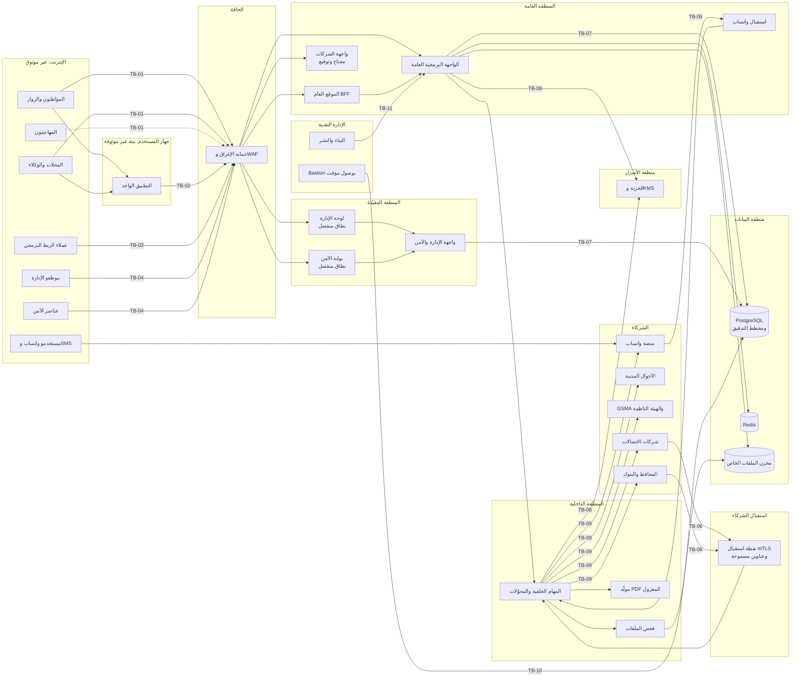

# 20 — نموذج التهديد وضوابط الأمن

> هذه الوثيقة هي المرجع الأمني المُلزم لفرق التنفيذ. تحدد ما نحميه، وممن نحميه، وكيف: الأصول والفاعلون وحدود الثقة، ونموذج تهديد STRIDE لكل وحدة، وحالات الإساءة الخاصة بالمنصة، ومواصفة المصادقة واستعادة الحسابات ورموز التحقق، وبروتوكول الدعم الفني ضد الهندسة الاجتماعية، وضوابط بوابة قوى الأمن، والرقابة على المدير العام، وحماية التطبيق من الكسر والتعديل، وتقوية الويب والواجهة البرمجية والبنية التحتية، وإدارة الثغرات، وخطط الاستجابة للحوادث. وهي **توسّع** [الأمان والخصوصية والإطار القانوني](07-security-privacy-legal.md) ولا تخالفه، وتخضع لقرارات الزبون في [سجل القرارات](02-decisions-log.md).

**الأرقام الثابتة:** الضوابط حتى CT-150 (§3)، والتهديدات حتى TH-259 (§4)، وحالات الإساءة حتى AB-74 (§5)، وقواعد الكشف حتى DET-56 (§9.6 و§10.3 و§15.1)، والخطط PB-01 إلى PB-13 (§15.5)، والمتطلبات حتى SR-100 (§18)، و**القائمة الوحيدة لمفاتيح الطوارئ بأسمائها التقنية** في §15.2، وتطبيق قرارات الزبون حتى D-129 في §20. والرقم الجديد يأخذ التالي في سلسلته، ولا يُعاد ترقيم ما قبله. والسلوك على مستوى العمل لكل حالة (الآثار المتسلسلة، والقيود، وأحداث الحياة) في [الترابط والسيناريوهات](26-scenarios-and-linkage.md)، وهذه الوثيقة تحدد ضوابطه الأمنية فقط.

سجل المراجعات وتغطية بنودها: [مراجعة الجاهزية](16-readiness-review.md) §2.2

---

## 1. النطاق والمنهجية

### 1.1 النطاق

| يشمل | التفصيل |
|---|---|
| الواجهات | الموقع، والتطبيق الواحد لأندرويد وآيفون، ولوحة الإدارة، وبوابة قوى الأمن، وبوت واتساب، والرقم القصير للـ SMS، والربط البرمجي للشركات، ونقاط استقبال الشركاء |
| الشركاء | شركات الاتصالات، والأحوال المدنية، وGSMA، والهيئة الناظمة (الجمركة)، ومزوّدو المحافظ والبنوك، وشام كاش وسيريتل وMTN للمحفظة والتعبئة (D-89)، وشركة الشحن (D-87)، ومنصة واتساب، وبوابة SMS، ومتجرا التطبيقات (للتوزيع والإشعارات فقط، فلا دفع عبرهما، D-86) |
| البيئات | الإنتاج، والتجريب (staging)، والتدريب، والتطوير. وبيانات الإنتاج لا تخرج من الإنتاج أبداً |
| الاستضافة (D-124) | المسار الحساس كله داخل سوريا (الفحص، والبلاغات، والمحلات، وبوابة الأمن، والرسائل القصيرة، والربط مع الاتصالات). والنسخ الاحتياطية المشفّرة وموقع الطوارئ خارجها **بشرط تأكيد الوزارة كتابياً**، والبديل إن لم تؤكده: موقع طوارئ ونسخ في مدينة سورية ثانية ([الخصوصية](21-privacy-dpia.md) §6، TB-16) |
| الأشخاص والإجراءات | المشرفون، والدعم الفني، والمشرف التجاري، ومسؤولو الأمن والعناصر، وأصحاب المحلات وموظفوهم، وفريق التشغيل التقني لدى الشركة |
| المورّدون | الاستضافة، والحماية من الإغراق، ومنصة واتساب، وبوابة SMS، وخدمات المتجرين والإشعارات، وأي مكتبة أو خدمة خارجية |
| الوحدات المطفأة يوم الإطلاق (D-95) | ضوابطها تُبنى وتُختبر مع وحداتها قبل الإطلاق. وتشغيل أي وحدة بعده يسبقه التأكد من أن ضوابطها في هذه الوثيقة مفعّلة ومختبرة، واختبار اختراق لها عند الحاجة (§14.2) |

### 1.2 المراجع المعيارية

| المرجع | الاستخدام |
|---|---|
| STRIDE | تصنيف التهديدات لكل وحدة (§4): انتحال (S)، وتلاعب (T)، وإنكار (R)، وكشف معلومات (I)، وحرمان من الخدمة (D)، ورفع صلاحيات (E) |
| OWASP ASVS 5.0، المستوى 2 | متطلبات الويب والواجهة البرمجية ولوحة الإدارة وبوابة الأمن (§12، §18). وتُضاف للوحة الإدارة وبوابة الأمن ووحدات CIVIL وTELCO والمحفظة ضوابط أشد حيث تذكرها هذه الوثيقة (أربع عيون، وسجل متسلسل، وmTLS) |
| OWASP MASVS 2 مع ملفّي MAS-L2 وMAS-R | متطلبات التطبيق، ومنها مقاومة الكسر والتعديل (§11) |
| OWASP Top 10 وOWASP API Security Top 10 (2023) | أصناف الهجمات التي يغطيها الاختبار والمراجعة (§12، §14) |
| NIST SP 800-63B | قواعد كلمات المرور ورموز التحقق والجلسات (§6) |

### 1.3 مقياس المخاطر

الرموز كما في [المخاطر](12-risks-and-open-questions.md): 🔴 عالٍ · 🟡 متوسط · 🟢 منخفض.

| المستوى | الاحتمال | الأثر |
|---|---|---|
| 🔴 | متوقع بانتظام، أو يكفيه مهاجم بقدرات عادية وأدوات منتشرة | كشف بيانات حساسة جداً لعدد كبير، أو استيلاء على ملكية أو حساب، أو حظر أجهزة بريئة، أو خطر على السلامة الجسدية، أو توقف واسع للخدمة |
| 🟡 | يحتاج قدرات أو ظروفاً خاصة (وصول داخلي، أو شريحة الضحية، أو تواطؤ شخص واحد) | أثر على عدد محدود من الأشخاص، أو كشف بيانات حساسة، أو توقف جزئي |
| 🟢 | نادر، أو يحتاج قدرات عالية أو تواطؤ أكثر من شخص | أثر محدود يمكن تصحيحه دون ضرر دائم |

**قاعدة قبول الخطر المتبقي:** المتبقي 🔴 لا يُقبل عند الإطلاق. والمتبقي 🟡 يُقبل بموافقة مكتوبة من رئيس أمن التطبيقات في الشركة والمدير العام للمنصة، مع رصد مخصص له في §15. والمتبقي 🟢 مقبول.

### 1.4 الاصطلاحات

| المعرّف | المعنى |
|---|---|
| `AS-NN` | أصل محمي (§2.1) |
| `ATK-NN` | صنف مهاجم (§2.4) |
| `TB-NN` | حد ثقة (§2.5) |
| `CT-NN` | ضابط أمني (§3) |
| `TH-NN` | تهديد (§4). وحرف `T-` محجوز لقوالب الرسائل في [كتالوج المحتوى](24-content-catalog.md) |
| `AB-NN` | حالة إساءة (§5) |
| `DET-NN` | قاعدة كشف في الرصد الأمني (§15.1) |
| `PB-NN` | خطة استجابة لحادثة (§15.5) |
| `SR-NN` | متطلب أمني للمطوّرين (§18) |

- المعرّفات ثابتة: كل تهديد أو ضابط أو حالة يُضاف يأخذ الرقم التالي المتاح، ولا يُعاد ترقيم ما سبقه، حتى تبقى الإشارات في الوثائق الأخرى والاختبارات صحيحة.
- **«يجب»** إلزام، و**«يُمنع»** حظر، و**«يُفضَّل»** توصية.
- القيم المعلَّمة بـ ⚙️ تُعدَّل من إعدادات لوحة الإدارة، و**قيمها وحدودها وفئتها في [فهرس الإعدادات](06-business-rules.md#15-فهرس-الإعدادات) وحده**. وما تذكره هذه الوثيقة من قيم للإيضاح فقط، وعند أي اختلاف فالمرجع 06 §15. ومفاتيح الإعدادات التي تحتاجها ضوابط هذه الوثيقة ولم تُدرج هناك بعد مجمّعة في §19.
- **مبادئ الحسم:** ما لا تغطيه هذه الوثيقة يُحسم بالمبادئ P-1 إلى P-14 بترتيبها ([الترابط والسيناريوهات](26-scenarios-and-linkage.md) §1). وأكثرها حضوراً في الأمن: **P-1** (الإجراءات الحامية لا يمنعها تعليق ولا قيد ولا مفتاح)، و**P-4** (عند الشك: لا كشف ولا حفظ ولا إرسال، والأخطاء لا تكشف وقائع مخفية، وD-101 مطلق)، و**P-6** (الإغلاق عند الشك فيما ينقل قيمة أو يمنح صلاحية، والمتابعة مع علامة وإعادة تحقق فيما يحمي أو يتحقق)، و**P-11** (لا موافق جديد أبداً: تأخير أو إشعار أو تدقيق بدلاً منه، D-102)، و**P-12** (المساءلة والعدّادات والقيود على الشخص برقمه الوطني). ولا يُخترع بمبدأ موافق ولا حركة مال ولا إفصاح ولا تغيير ملكية، بل يصير عملاً بشرياً في قائمة `unforeseen` (26 §13).
- **الأولوية:** قرار الزبون يعلو على أي ضابط هنا. وحيث تفصّل هذه الوثيقة مبدأً عاماً في الوثيقة 07، فالقيمة التفصيلية هنا هي المعتمدة.
- التصميم التقني للمصادقة والصلاحيات والعزل في [التصميم التقني](19-technical-design.md)، والخصوصية وسجل المعالجة في [الخصوصية وتقييم الأثر](21-privacy-dpia.md)، والإجراءات اليومية في [إجراءات التشغيل](23-operations-sops.md)، ومعايير القبول في [معايير القبول](25-acceptance-criteria.md). وهذه الوثيقة تحدد **ما يجب** أن يتحقق أمنياً، وتلك تحدد **كيف** يُبنى ويُشغَّل.

## 2. الأصول والفاعلون وحدود الثقة

### 2.1 الأصول

| # | الأصل | الخاصية الأهم | ما يحدث عند المساس به |
|---|---|---|---|
| AS-01 | الرقم الوطني وبيانات الهوية للأشخاص | السرية | انتحال الهوية، وابتزاز، وتتبّع أشخاص |
| AS-02 | صور الهويات (المستخدمون، والبائعون للمحلات، والموظفون) | السرية | تزوير هويات، وفتح حسابات باسم الضحايا |
| AS-03 | ردود السجل المدني (المطابقة، والاسم، وحالة البطاقة، وصورة السجل المدني لحظة العرض) | السرية | استعلام جماعي عن المواطنين، وخرق «تحقّق لا استعلام» |
| AS-04 | المواقع الدقيقة (الفحوص، والمحلات، وعمليات المحل، والحادثة) | السرية | ملاحقة أشخاص، وخطر على السلامة الجسدية |
| AS-05 | بيانات الشبكة: أرقام الشرائح، ومواقع الأبراج، وجلسات التتبّع | السرية | تتبّع غير قانوني للأشخاص، وخرق اتفاقية الاتصالات |
| AS-06 | هوية الفاحص (الحساب، وعنوان الشبكة، ورقم واتساب، ورقم SMS) | السرية | انتقام من الفاحص أو المبلّغ عن معلومة (D-09) |
| AS-07 | سجل الملكية وسلسلة انتقالها | السلامة | سرقة الملكية، وتبييض أجهزة مسروقة |
| AS-08 | حالة الجهاز العامة ونتيجة الفحص | السلامة والتوافر | بيع مسروق كأنه غير مبلّغ عنه، أو حظر جهاز بريء |
| AS-09 | البلاغات وأدلتها وقرارات المراجعة | السلامة والسرية | بلاغات كيدية، وإغلاق بلاغات صحيحة |
| AS-10 | الوثائق الموثّقة: الفواتير، والشهادات، والإيصالات، وتقارير التاريخ | الأصالة | تزوير إثبات الملكية أو حسن النية |
| AS-11 | حسابات المستخدمين والمحلات والوكلاء وجلساتهم | السرية والسلامة | استيلاء على الحساب، ونقل أجهزة الضحية |
| AS-12 | حسابات الإدارة وبوابة الأمن وصلاحياتها | السرية والسلامة | كشف بيانات بالجملة، وقرارات مزوّرة |
| AS-13 | سجل التدقيق وسجل «من اطّلع على بياناتي» | السلامة | إخفاء آثار الإساءة |
| AS-14 | الأسرار والمفاتيح (التشفير، والبصمات، والتوقيع، وmTLS، ورموز واتساب، ومفاتيح الشركات، ومفاتيح توقيع التطبيق وتحديثاته) | السرية | فك تشفير البيانات، وانتحال المنصة، وتوزيع تطبيق خبيث |
| AS-15 | قنوات التواصل الرسمية: رقم بوت واتساب، ورقم الدعم (D-82)، ورقم الإدارة التجاري (D-86)، وأرقام تنبيهات الإدارة، والرقم القصير، والنطاقات | الأصالة والتوافر | تصيّد باسم المنصة، وجمع أموال باسم خدمات وهمية |
| AS-16 | الإعدادات وقوالب الرسائل ومفاتيح التشغيل | السلامة | إضعاف الضوابط بصمت، أو رسائل تصيّد من القناة الرسمية |
| AS-17 | قوائم المراقبة والحظر لدى الاتصالات، وطلبات إيقاف الخطوط وتجميد المحافظ | السلامة | حظر جماعي لأجهزة بريئة، أو فك حظر أجهزة مسروقة |
| AS-18 | المدفوعات وتفعيل الخدمات، وأموال المتجر: نقد التحصيل عند الاستلام، وكشوف تسوية المورّدين وبيانات حساباتهم المستلمة (D-86، D-87)، والإعلانات | السلامة | تفعيل دون دفع، واختلاس نقد الشحن، وتحويل التسويات لحساب محتال، وإعلانات خبيثة |
| AS-19 | توافر المنصة (الفحص، وواجهات المحلات، والبوابة، واستقبال الشركاء) | التوافر | توقف إلزام المحلات، وضياع تنبيهات لحظية |
| AS-20 | ثقة الناس والوزارة والشركاء بالمنصة | السمعة | انهيار الاستخدام، وإلغاء الاتفاقيات |
| AS-21 | محافظ المحلات وعمليات التعبئة (D-89): المال لدى شام كاش باسم المحل، والمنصة واجهة تأمر بالعمليات وتحفظ دفتراً مرآة لها | السلامة | سحب أموال المحلات، واستنزافها بالتعبئة، وغسل الأموال، وفقدان ثقة الشريكين |
| AS-22 | سجل الأجهزة دون شريحة بالشركة المصنّعة والرقم التسلسلي (D-91) | السلامة | تبييض حواسيب مسروقة بملصقات مزوّرة |
| AS-23 | بيانات المحاسبة والإدارة للمحل (D-92، SHOPPRO): المبيعات، والصندوق، والمصاريف، والرواتب، والديون وبيانات المدينين، والأرباح، وسجلات نقطة البيع دون اتصال على الأجهزة | السرية والسلامة | كشف أسرار المحل التجارية لغيره (ومنه الإدارة والأمن والوزارة)، واختلاس الموظفين للنقد |
| AS-24 | النطاقات المسجّلة وحسابات المسجِّل ومزوّد DNS وسجلاتها (A وCAA وMX وDMARC وDNSSEC) وشهاداتها، واسم المرسل في الرسائل القصيرة | الأصالة والتوافر | تحويل بوابة الأمن أو لوحة الإدارة أو الموقع لمهاجم بشهادة صحيحة، وتصيّد العناصر والموظفين، وانتحال بريد المنصة ورسائلها |
| AS-25 | وثائق أحداث الحياة: شهادات الوفاة، ووثائق الوصاية والوكالة، والبيانات العائلية وإخراجات القيد (D-129)، والوثائق البديلة للهوية (D-103، D-104)، وتعيين الوصي، وكتب ممثلي المؤسسات (D-105) | السلامة والسرية | نقل أجهزة شخص حي أو مؤسسة بوثيقة مزوّرة، وكشف الوفاة أو صفة اللجوء لغير المخوّل |
| AS-26 | القيود والعقوبات والعدّادات على الشخص (D-106، 06 §13) | السلامة | الإفلات من العقوبة بحساب جديد، أو قيد ظالم على بريء، أو رفع قيد بصمت |
| AS-27 | البريد الأمني الاختياري للمواطن (D-126) | السلامة | تحويل تنبيهات الاستعادة لعنوان المهاجم فتخفى عن الضحية |

### 2.2 تصنيف عناصر البيانات وحمايتها

يوسّع [تصنيف البيانات](07-security-privacy-legal.md#1-تصنيف-البيانات) إلى مستوى الحقل. الرموز كما في [نموذج البيانات](09-data-model.md): 🔐 حقل مشفّر · #️⃣ بصمة للبحث · 📍 إحداثيات.

| العنصر | التصنيف | الحماية في التخزين | الإخفاء عند العرض | من يراه |
|---|---|---|---|---|
| الرقم الوطني | حساسة جداً | 🔐 AES-256-GCM + #️⃣ بمفتاح بصمة خاص به | آخر 3 خانات فقط: `••••••••123` | صاحبه. والمحل داخل معاملته فقط (CT-37). والإدارة 🔒 بكشف مسجّل. والأمن ضمن نطاقه 🔒 |
| صور الهوية (الوجهان) | حساسة جداً | تشفير ظرفي لكل ملف بمفتاح بيانات خاص به، في مخزن خاص | لا تُعرض إلا عبر وكيل الملفات مع علامة مائية | المشرف المراجع، والأمن ضمن نطاقه 🔒. ولا يعيد المحل عرض صورة هوية البائع بعد إرسالها |
| صورة السجل المدني | حساسة جداً | **لا تُخزَّن** (CIVIL-06)، وتُعرض بترويسة `Cache-Control: no-store` | لحظة المراجعة فقط | مشرف توثيق الهوية فقط (D-84) |
| الاسم وحالة البطاقة من السجل المدني | حساسة جداً | تُخزَّن نتيجة التحقق ومرجع الاستعلام، والاسم في المعاملة | — | موظف المحل داخل معاملة جارية فقط، دون صورة (D-84) |
| المواقع الدقيقة 📍 | حساسة جداً | جدول PostGIS منفصل بصلاحيات مقيّدة، وتخفيض الدقة بعد ⚙️ 90 يوماً (07 §2) | على الخريطة فقط | الإدارة، والأمن ضمن نطاقه |
| أرقام الشرائح وIMSI ومواقع الأبراج | حساسة جداً | 🔐 + #️⃣ | آخر رقمين | الإدارة والأمن ضمن نطاقه. ولا تُرسل في واتساب أبداً (07 §8) |
| رقم واتساب الفاحص ورقم SMS الفاحص | حساسة جداً | 🔐 + #️⃣ | مخفي | الإدارة فقط، ولا يُكشف لصاحب الجهاز (D-09) |
| عناوين الشبكة (للفاحص، وفي سجلات الدخول والتدقيق) | حساسة (07 §1) | **تشفير التخزين الكامل** على مستوى القرص والنسخ، لا تشفير على مستوى الحقل، لأن حدود الطلبات والرصد وكشف الشذوذ تحتاجها. وصلاحيات قراءة محصورة، وتخفيض الدقة في التقارير | مخفية كلياً حتى الكشف، والمحافظة التقريبية بدلاً منها في إشعارات المستخدم | الإدارة 🔒 والأمن ضمن نطاقه 🔒 |
| الأرقام البديلة | حساسة جداً | 🔐 | `0933••••12` | صاحب الحساب، والإدارة 🔒 |
| رموز التحقق والرموز لمرة واحدة | فئة `secret_ephemeral` (سرّية عابرة) | **لا تُحفظ أبداً**: بصمة HMAC للتحقق فقط، والقيمة في خانة عابرة مشفّرة حتى يقبلها المزوّد (CT-122) | لا تُعرض إلا لصاحبها في قناة الرمز | لا أحد من المنصة، ولا سجل الرسائل |
| شهادة الوفاة، ووثيقة الوصاية أو الوكالة، والبيان العائلي أو إخراج القيد (D-103، D-129، PERSON-06) | حساسة جداً | كصور الهوية: تشفير ظرفي لكل ملف في مخزن خاص | عبر وكيل الملفات مع علامة مائية | مشرف الإرث، والمدير العام عند النزاع، وقوى الأمن ضمن نطاقها عند الإحالة |
| الوثيقة البديلة: نوعها وبلدها ورقمها وصورها (D-104) | حساسة جداً، لأنها تكشف صفة اللجوء أو الجنسية | الرقم 🔐 + #️⃣، ورقم الإقامة 🔐 + #️⃣ فريد بين الأشخاص النشطين (CT-150)، والصور كصور الهوية | آخر 3 خانات من الرقم، و«وثيقة بديلة» دون البلد في سجل المحل | كالرقم الوطني |
| البريد الأمني الاختياري (D-126) | حساسة | تشفير التخزين، وبصمة للتفرّد | أول حرف ثم نقاط ثم النطاق | صاحبه، والإدارة 🔒 |
| القيود والعقوبات والعدّادات على الشخص | حساسة | جدول القيود بصلاحيات محصورة (CT-131) | يرى الشخص قيوده وحده بنوعها وسببها ومدتها، ولا يُذكر سببها لغيره | المشرف المختص والمدير العام |
| رقم موبايل الحساب | حساسة | تشفير التخزين الكامل (يلزم للدخول) | `0933••••12` | صاحبه، والإدارة 🔒 |
| المعاملات والأسعار | حساسة | تشفير التخزين الكامل، وعزل المستأجر | السعر للمشتري فقط (D-17) | المحل لمعاملاته، والإدارة، والأمن ضمن نطاقه |
| صور الكراتين والأدلة | حساسة | مخزن خاص | — | الإدارة، والأمن ضمن نطاقه |
| مراجع الدفعات وإثباتاتها | حساسة | مخزن خاص، ورقم مرجعي فريد لكل مزوّد | آخر 4 خانات للمرجع خارج شاشة التأكيد | المشرف التجاري، والمدير العام |
| حساب الدافع في الدفعة اليدوية (رقم المحفظة أو IBAN من سطر الكشف) | حساسة | 🔐 (`payer_account_enc`) مع قناع | آخر 4 خانات | المشرف التجاري، ومنفّذ الإبطال أو الاسترداد قراءةً فقط (CT-147) |
| IMEI في الصفحات العامة (الشهادة، والفاتورة، والإيصال) | عامة جزئياً | — | أول 8 خانات (TAC) ثم `•••` ثم آخر 4 | الجميع. والرقم الكامل لمالكه بعد الدخول |
| اسم المشتري في صفحة التحقق من الفاتورة | حساسة | — | الاسم الأول وأول حرف من الكنية: «أحمد م.» | الجميع (PUB-02) |
| سجل التدقيق | حساسة | مخطط منفصل للإضافة فقط، ومتسلسل بالبصمات (CT-89) | — | المدير العام وجهة الرقابة (§10.4) |
| الأسرار والمفاتيح | سرّية (خارج تصنيف البيانات) | الخزنة فقط، ولا تظهر في اللوحة (06 §15.3) | لا تُعرض أبداً | الخدمات بسياسات وصول محددة |
| بيانات المحاسبة للمحل (SHOPPRO) | سرّية المحل (D-92)، فئة `tenant_private` | مخطط مستقل بـ RLS لكل محل، ولا صلاحية عليه لأي دور بشري (الإدارة، والأمن، والدعم، والتشغيل `ops_readonly`، ومدير قاعدة البيانات). و**كل أعمدة المحتوى المحاسبي مشفّرة بمفتاح خاص بكل محل** (المبالغ، والأصناف، والزبائن وديونهم، والملاحظات، والجرد، والمصاريف، والرواتب، وملفات التصدير)، ولا يبقى صريحاً إلا ما يلزم العزل والفهرسة (معرّف المحل والفرع، والمعرّفات، والأوقات). ومفتاح التغليف لا يفكّه إلا هويتا حمل الخدمة، وسياسته تمنع كل إنسان صراحة (CT-109، CT-123) | الأرباح والتكاليف والرواتب مخفية عن الموظفين افتراضياً (SHOPPRO-13) | المحل وحده حسب صلاحيات صاحبه. ولا يراها أحد من المنصة أبداً، لا الإدارة ولا الدعم ولا المبرمجون ولا الأمن ولا الوزارة، ولا حتى بإذن صاحب المحل (D-101، CT-110) |
| حالة الجهاز، والماركة والموديل، وتاريخ نشر البلاغ | عامة | — | — | الجميع (CHECK-08) |


**صيغ الإخفاء المعتمدة:** هذا الجدول هو المرجع الوحيد لصيغ الإخفاء في كل الوثائق والواجهات والرسائل، وما يخالفه في غيرها يُصحَّح إليه. والإخفاء يُطبَّق في الخادم، فلا تصل القيمة الكاملة لأي واجهة إلا بكشف مسجّل (CT-28)، وكل نقطة `•` تحل محل خانة مخفية واحدة.

| القيمة | الصيغة | مثال |
|---|---|---|
| IMEI في الصفحات العامة والرسائل والقوائم وبوابة الأمن خارج النطاق | أول 8 خانات (TAC) ثم نقاط ثم آخر 4 | `35846210•••4821` |
| IMEI لدى الجهة الموثوقة | آخر 4 خانات فقط | `•••••••••••4821` |
| الرقم الوطني | آخر 3 خانات فقط، ولا تظهر الخانات الأولى لأنها تدل على مكان القيد | `••••••••123` |
| رقم الموبايل لغير صاحبه (رقم الحساب، والبديل، ورقم زبون التعبئة) | أول 4 خانات وآخر 2 | `0933••••12` |
| رقم الشريحة وIMSI | آخر رقمين | `•••••••••••••47` |
| رقم الفاحص وعنوان شبكته | مخفي كلياً حتى الكشف | `••••` |
| مرجع الدفعة | آخر 4 خانات خارج شاشة التأكيد | `••••7731` |
| اسم الشخص في الصفحات العامة | الاسم الأول كاملاً (المركّب يبقى: «عبد …»، «أبو …») ثم أول حرف من الكنية بعد حذف «ال»، من حقلي الاسم والكنية لا بتقسيم الاسم الكامل | «أحمد م.»، و«عبدالله خ.» |
| اسم الشخص في قوائم الإدارة وبوابة الأمن قبل الكشف | أول حرف من الاسم ثم نقاط، وأول حرف من الكنية بعد حذف «ال» ثم نقاط، والاسم الكامل بكشف مسجّل (CT-28) | «ر••• خ•••» |
| البريد الأمني | أول حرف ثم نقاط ثم النطاق | `a•••••@gmail.com` |
| رقم الوثيقة البديلة | آخر 3 خانات فقط | `•••••789` |

### 2.3 الفاعلون الشرعيون

| الفاعل | نطاق الهوية | الصلاحيات ([الأدوار](03-roles-and-permissions.md)) | الخطر إن أساء أو اختُرق |
|---|---|---|---|
| الزائر | دون حساب | الفحص بحدود، ونموذجا المعلومات والإرجاع | المسح، والإزعاج |
| المواطن (مؤكَّد الرقم، أو مرتبط تلقائياً، أو موثّق الهوية) | 1 (الحسابات العامة) | أجهزته وبلاغاته ونقلها وشهاداتها | بلاغ كيدي، وتسجيل ذاتي لجهاز مسروق |
| المستخدم المفوّض (قد يكون قاصراً بلا هوية) | 1 | بدء بلاغ فقط بتأكيد المالك (D-33) | بلاغ دون علم المالك |
| الجهة الموثوقة | 1 | بلاغ عاجل وطلب الحمايات عن المستخدم (D-62) | إيقاف خط شخص أو تجميد محفظته كيداً |
| صاحب المحل وموظفوه، ومحل الصيانة | 1 | معاملات المحل فقط، والاسم وحالة البطاقة داخل معاملة (D-84) | تصريف المسروقات، وجمع هويات الزبائن |
| الوكيل أو المستورد وموظفوه | 1 | أجهزته ومعاملاته فقط | إدخال أرقام أجهزة مسروقة كأجهزة جديدة |
| المدير العام، ومشرف البلاغات، ومشرف المحلات، والدعم الفني، والمشرف التجاري، والأدوار الديناميكية | 2 (الإدارة) | حسب الدور (D-78) | كشف بيانات وبيعها، وقرارات مزوّرة، وتفعيل دون دفع |
| مسؤول الأمن وعنصر الأمن والإدارة المركزية | 3 (بوابة الأمن) | ضمن النطاق (D-80) | بحث بالأشخاص خارج القضايا، وإغلاق بلاغات صحيحة |
| شركات الاتصالات، والأحوال المدنية، وGSMA، والهيئة الناظمة، والمحافظ والبنوك | 4 (الأنظمة عبر mTLS) | ما تحدده الاتفاقيات | أحداث مزيّفة، وتسريب من جهة الشريك |
| شام كاش (حسابات محافظ المحلات، D-89)، وسيريتل وMTN (توزيع الرصيد) | 4 (الأنظمة عبر mTLS) | فتح الحسابات، والشحن والسحب والدفع، وتنفيذ التعبئة، وكشوف المطابقة | تأكيدات مزيّفة، أو اختراق الربط لتحريك الأموال |
| المورّد المعتمد (D-87) | 1 (حساب تجاري، ومستأجر معزول بنوع «مورّد») | منتجاته بعد المراجعة، والطلبات المسندة إليه، وكشوف تسويته. ولا يرى من المحل إلا اسمه وعنوان التوصيل لطلباته (03 §2.4.3) | إدراج أصناف ممنوعة، والتلاعب بالطلبات والمرتجعات، وتغيير الحساب المستلم للتسوية بعد الاستيلاء على حسابه |
| شركة الشحن ومندوب المنصة (D-87) | 4 (ربط مع شركة الشحن) أو حساب مندوب | استلام الطلب من المورّد وتسليمه للمحل وقبض ثمنه عند الاستلام (STORE-09)، ويرى اسم المحل وعنوانه وهاتفه ومبلغ التحصيل فقط | اختلاس النقد، وتأكيد تسليم وهمي |
| عملاء الربط البرمجي | 4 (مفتاح وتوقيع HMAC) | فحص الحالة وتقرير التاريخ دون بيانات شخصية | مسح جماعي، ومراقبة أجهزة مسروقة |
| فريق التشغيل التقني لدى الشركة | وصول مؤقت للإنتاج | ما يمنحه الطلب المؤقت فقط (CT-87)، ولا كتابة يدوية في جداول العمل أبداً (§13.7) | وصول مباشر لقاعدة البيانات |
| المناوب التقني | دور ديناميكي بأقل صلاحية ([العملية الهندسية](22-engineering-process.md) §14.2) | تفعيل مفاتيح الطوارئ (§15.2) ونشر قوالب الأزمات الثابتة في أي ساعة، دون إيقاف المفاتيح | تعطيل وظيفة دون سبب، أو بيان غير معتمد |
| الوارث بالكنية، والوصي المختار أو القانوني، وحامل الوكالة، وممثل المؤسسة ([الأدوار](03-roles-and-permissions.md) §2.7) | 1 | ما تسمح به صفته وحدها، وتُسجَّل `acting_as` في كل إجراء | نقل أجهزة شخص حي أو قاصر أو مؤسسة بوثيقة مزوّرة |

### 2.4 المهاجمون

| # | المهاجم | الدافع | القدرات المفترضة | حالات الإساءة |
|---|---|---|---|---|
| ATK-01 | السارق | بيع الجهاز أو استخدامه، وإخفاء أثره | الجهاز وكرتونته غالباً، وشريحة الضحية وواتسابها المفتوح أحياناً، وهوية حقيقية أو مستعارة | AB-01، AB-08، AB-10، AB-14، AB-39 |
| ATK-02 | مصرّف المسروقات والمحل غير النزيه | تمرير أجهزة مسروقة بوثائق نظامية | حساب محل موثّق، وموظفون، وطباعة فواتير، وتعامل يومي مع الهويات | AB-04، AB-05، AB-14، AB-24، AB-26، AB-35، AB-37، AB-39، AB-43، AB-45، AB-51، AB-53، AB-64 |
| ATK-03 | المبلّغ الكيدي (بائع يبلّغ بعد البيع، أو مبتز، أو خصم) | استرداد جهاز باعه، أو ابتزاز المشتري، أو الإضرار بشخص | حساب موثّق، وكرتونة الجهاز الأصلية، وفاتورة قديمة | AB-02، AB-09، AB-27 |
| ATK-04 | المشرف المسيء من الداخل | المال أو الانتقام أو الفضول | صلاحيات دوره، ومعرفة بالإجراءات | AB-07، AB-19، AB-21، AB-29، AB-33، AB-60، AB-61 |
| ATK-05 | عنصر الأمن المسيء من الداخل | استخدام البيانات لأغراض شخصية أو لصالح طرف | حساب شخصي في البوابة ضمن نطاق محافظته | AB-06 |
| ATK-06 | الاحتيال المنظّم | الاستيلاء على الحسابات والملكية، وبيع البيانات، وجمع المال | تبديل الشرائح، وتزوير الهويات، وحسابات واجهة، وتصيّد منظّم | AB-08، AB-12، AB-16، AB-17، AB-18، AB-28، AB-34، AB-36، AB-37، AB-57، AB-58، AB-70 |
| ATK-07 | الروبوتات وجامعو البيانات | بناء قوائم أجهزة، أو إرهاق الخدمة، أو إغراق رموز التحقق | شبكات عناوين واسعة، ومتصفحات آلية، وأرقام كثيرة، وهويات زائر مسكوكة | AB-15، AB-30، AB-71 |
| ATK-08 | مهاجم بقدرات دولة | التجسس على المواطنين والبنية الأمنية | ثغرات غير معلنة، واختراق سلسلة التوريد، واعتراض الشبكات، وسلطة شهادات أو مسجِّل نطاقات، واستهداف الموظفين | AB-38، AB-58، AB-59، PB-01، PB-05، PB-10، PB-12 |
| ATK-09 | الملاحِق أو الشريك المسيء | معرفة مكان شخص بعينه أو التضييق عليه | معرفة شخصية بالضحية، ورقم IMEI جهازها، وأحياناً وصول لهاتفها | AB-03، AB-09 |
| ATK-10 | منتحل القنوات الرسمية | سرقة الرموز والأموال باسم المنصة | أرقام واتساب مشابهة، ونطاقات مشابهة، وبريد ورسائل قصيرة بمرسل منتحل، وتطبيق معدّل، وإعلانات مزيّفة، وتسرّب بيانات حساب مراجعة المتجر | AB-11، AB-12، AB-16، AB-23، AB-46، AB-58 |
| ATK-11 | المورّد أو مندوب الشحن المحتال، أو من يتواطأ معهما من الداخل (D-87) | المال: نقد التحصيل، أو تسويات غير مستحقة | حساب مورّد موثّق، أو صفة مندوب يحمل النقد، أو صلاحية إعداد التسوية | AB-31، AB-32، AB-33، AB-70 |
| ATK-12 | مزوّر وثائق أحداث الحياة | الاستيلاء على أجهزة شخص حي أو متوفى أو مؤسسة، أو التسجيل بهوية غيره | شهادة وفاة أو وثيقة وصاية أو وكالة مزوّرة، أو وثيقة بديلة مستعارة، وكنية مشتركة مع الضحية | AB-48، AB-49، AB-62، AB-65 |
| ATK-13 | المستخدم المشاكس أو المتحرّش | إزعاج شخص بعينه، أو إنهاك المراجعين، أو التسلية، أو الإفلات من العقوبة | حساب أو أكثر، وأرقام الناس، وصور ونصوص مسيئة، وصبر على التكرار | AB-50، AB-54، AB-55، AB-56، AB-67، AB-68 |
| ATK-14 | من يحمل موبايل الضحية مفتوحاً أو شريحتها | نقل أجهزتها أو تعطيل استعادتها قبل أن تتحرك | الجهاز المربوط، والشريحة وواتسابها، ومعرفة عادات الضحية | AB-52، AB-53، AB-63، AB-69 |

### 2.5 حدود الثقة



| # | الحد | ما يعبره | الضوابط الأساسية |
|---|---|---|---|
| TB-01 | الإنترنت ← الحافة | كل طلبات المتصفحات والمهاجمين | حماية الإغراق، وWAF، وTLS 1.2 فما فوق، وحدود الطلبات، وALTCHA (CT-79، CT-38، CT-04) |
| TB-02 | التطبيق ← الخادم | طلبات التطبيق من جهاز لا نتحكم به | إثبات سلامة التطبيق، وتثبيت الشهادات، وربط الرموز بالجهاز، وفرض أدنى إصدار (CT-62، CT-64، CT-09، CT-69) |
| TB-03 | عملاء الربط ← واجهة الشركات | طلبات آلية موقّعة | مفتاح وتوقيع HMAC، وطابع زمني، وحصص (CT-54) |
| TB-04 | الموظفون والعناصر ← نطاقا الإدارة والأمن | جلسات ذات صلاحيات عليا | نطاقات منفصلة، وتحقق ثنائي، وجلسات قصيرة، وحصر اختياري بالعناوين (CT-10، CT-80) |
| TB-05 | منصة واتساب ← استقبال البوت | رسائل الفحص الواردة | التحقق من توقيع `X-Hub-Signature-256`، وحدود لكل رقم (CT-59) |
| TB-06 | الشركاء ← نقطة الاستقبال | أحداث الشبكة، ورسائل SMS، وحالات الطلبات | mTLS، وقائمة عناوين، وتوقيع الرسالة، وطابع زمني ومنع التكرار (CT-55، CT-57) |
| TB-07 | الخادم ← قاعدة البيانات | كل الاستعلامات | أدوار بأقل صلاحية، وعزل المستأجرين ونطاق الأمن بـ RLS، وتشفير الحقول (CT-85، CT-16، CT-17، CT-26) |
| TB-08 | الخدمات ← الخزنة | طلب المفاتيح والأسرار | هوية الخدمة، وسياسات وصول لكل خدمة، وسجل تدقيق الخزنة (CT-83) |
| TB-09 | المحوّلات ← الشركاء | طلبات المراقبة والحظر والاستعلام والإرسال | قائمة وجهات مسموحة، وmTLS، وقاطع دائرة، وتحقق من الحالة قبل كل طلب (CT-56، CT-58) |
| TB-10 | فريق التشغيل ← الإنتاج | وصول تقني | وصول مؤقت بموافقة، وجلسات مسجّلة (CT-87) |
| TB-11 | البناء والنشر ← الإنتاج والمتجرين | الكود والحاويات والتطبيق | بناء موقّع، وSBOM، وموافقة يدوية للنشر (CT-86) |
| TB-12 | محل ← محل آخر، ووكيل ← آخر (حد منطقي) | بيانات المستأجرين | RLS بمعرّف المستأجر في كل طلب، وفحوص التطبيق (CT-16) |
| TB-13 | محافظة ← محافظة في بوابة الأمن (حد منطقي) | بيانات الأشخاص والبلاغات | فرض النطاق في الخادم وفي RLS (CT-17، D-80) |
| TB-14 | المسجِّل ومزوّد DNS ← نطاقاتنا (غير مرسوم في المخطط) | تعديل السجلات، والتجديد، ونقل النطاق، وإصدار الشهادات | CT-118، CT-119، DET-42 |
| TB-15 | خادم الويب (BFF) ← `api-public` (حد داخلي غير مرسوم) | عنوان الزائر ومفتاح جهازه وجلسته | ترويسة داخلية موثّقة بهوية الحمل لا يقبلها `api-public` إلا منه (CT-129)، ولا اعتماد خدمي مميّز في خادم الويب (CT-136) |
| TB-16 | الإنتاج ← موقع النسخ والطوارئ خارج سوريا (D-124، غير مرسوم) | نسخ مشفّرة فقط في الأوقات العادية، وتشغيل كامل عند إعلان كارثة | التشفير قبل الخروج بمفاتيح لا تغادر مع النسخة، وقفل غير قابل للتعديل (CT-84)، والتشغيل هناك بقرار المدير العام وإبلاغ الوزارة ([الخصوصية](21-privacy-dpia.md) §6) |

## 3. فهرس الضوابط

كل ضابط يُشار إليه برقمه في جداول التهديد (§4) وحالات الإساءة (§5)، والعمود الأخير يحدد مكان مواصفته التفصيلية.

### 3.1 الهوية والمصادقة

| الرقم | الضابط | التفصيل |
|---|---|---|
| CT-01 | تخزين كلمات المرور بـ Argon2id مع قيمة سرّية من الخزنة، ورفض كلمات المرور المسرّبة والسياقية | §6.2 |
| CT-02 | قواعد رموز التحقق: 6 خانات، و5 دقائق، و5 محاولات، و5 رموز في الساعة، وإعادة الإرسال بعد 60 ثانية، وتخزين البصمة فقط، وربط الرمز بالغرض | §6.3 |
| CT-03 | القفل التدريجي لكل حساب، والتأخير لكل عنوان شبكة | §6.4 |
| CT-04 | تحقق «لست روبوتاً» بإثبات العمل (ALTCHA) بصعوبة متكيّفة | §6.5 |
| CT-05 | إعادة المصادقة قبل الإجراءات الحساسة | §6.6 |
| CT-06 | فترة التهدئة بمصادرها الستة: تغيير الرقم، والاستعادة بالهوية، واستعادة الرقم الأصلي، وفك «لم أكن أنا»، وإعادة تعيين كلمة المرور من جهاز غير مربوط، وإشارة تبديل الشريحة من شركة الاتصالات. **والسحب من محفظة المحل لا تؤخّره إلا المصادر الثلاثة الأولى** (D-115)، وباقيها يمنع تغيير محفظة السحب لا السحب. **وحجز ⚙️ 24 ساعة بعد كل إعادة تعيين لكلمة المرور برمز ولو من جهاز مربوط** (`password_reset_hold`، 06 §7) | §6.7 |
| CT-07 | الاستعادة بالهوية فقط، مع موافقة مشرف ثانٍ ومهلة إشعار قبل التنفيذ | §6.8 |
| CT-08 | الرقم البديل للإشعارات فقط، ولا يستقبل أي رمز يأذن بإجراء (D-81) | §6.8.3 |
| CT-09 | جلسات المستخدمين: رمز دخول قصير، ورمز تجديد دوّار مع كشف إعادة الاستخدام، وربطه بمفتاح الجهاز | §6.9 |
| CT-10 | التحقق الثنائي الإلزامي للإدارة والأمن: مفتاح مرور أو مفتاح أمان **إلزامي** للأدوار الحساسة، ورمز التطبيق مع قائمة عناوين مسموحة **إلزامية** لغيرها (D-125، CT-121)، وجلسات خادمية قصيرة | §6.10 |
| CT-11 | ربط تطبيق المحل والوكيل بالجهاز، وتأكيد كل جهاز جديد برمز وإشعار صاحب المحل | §6.12 |
| CT-12 | إشعار كل حدث أمني على كل القنوات، مع زر «لم أكن أنا» الذي يجمّد الحساب | §6.7 |
| CT-13 | عدم كشف وجود الحسابات وحالاتها: في التسجيل والدخول والاستعادة وتغيير الرقم وإدخال الرقم الوطني ودعوة الموظف ورسائل الرفض، بعدّادات وأزمنة ونصوص متطابقة، ولا «مستخدم» يُذكر إلا بعد إثبات صاحب الرقم. و«نسيت كلمة المرور» دون دخول يرد دائماً الرد الموحّد، و`AUTH_PHONE_COMPROMISED` لا يظهر إلا داخل جلسة مصادَق عليها، ورفض التسجيل الذاتي بنص محايد: «تعذّر قبول التسجيل الذاتي لهذا الجهاز. إن كان جهازك فقدّم طلب دعم بأدلتك.» | §6.3 |
| CT-14 | ضوابط الجهة الموثوقة: قبول من حسابها، ومهلة تفعيل، وإشعار المالك بكل إجراء، والإزالة التلقائية عند الرفض | AB-09 |
| CT-115 | جلسة «بلاغ السرقة فقط» (THEFT-08): كلمة المرور مع ALTCHA بالصعوبة المرتفعة وإثبات سلامة التطبيق (أو تحدي الروبوت المعزّز في الموقع) دون رمز، ونطاق مقيّد في الخادم لا يسمح إلا بالبلاغ وحمايات لحظة السرقة، وعلامة للمراجع، وإشعار كل الأجهزة المربوطة. وحدودها على الحساب والجهاز المثبَت السلامة، وعنوان الشبكة لا يرفضها | §6.8.5 |
| CT-116 | نسيان كلمة مرور الموظف والعنصر (ADMIN-19): لا إعادة تعيين ذاتية ولا برسالة، بل طلب يوافق عليه المدير العام أو مسؤول الأمن في الجهة بعد تحقق حضوري أو بمكالمة فيديو، مع إعادة ربط العامل الثاني | §6.11 |
| CT-117 | فصل الرقم المعاد تخصيصه: لا ينقل الحساب ولا أي شيء منه، وإثبات حيازة الرقم، وهوية مختلفة عن صاحب الحساب، وإشعار صاحب الحساب ومهلة اعتراض ⚙️ 72 ساعة، وموافقة مشرف ثانٍ. **والاعتراض دون دخول** بزر «هذا رقمي، أوقف» (S-PUB-30): رمز لمرة واحدة بفعل `phone_detach_object` يُرسل للأجهزة المربوطة والإيميل الأمني لا للرقم نفسه، لا يخوّل إلا إيقاف الطلب وإحالته، ويُستهلك بطلب POST وحده (CT-135)، ولا يفتح جلسة ولا يعرض بياناً عن الحساب أو الطالب أو الرقم ([التصميم التقني](19-technical-design.md) §13.3) | §6.8.6 |

### 3.2 التفويض والنطاق

| الرقم | الضابط | التفصيل |
|---|---|---|
| CT-15 | تفويض في الخادم لكل طلب بمبدأ المنع الافتراضي، وسياسات مكتوبة كقواعد قابلة للاختبار | §12.9 |
| CT-16 | عزل المحلات والوكلاء بـ Row-Level Security في PostgreSQL مع فحوص التطبيق | §12.9 |
| CT-17 | فرض نطاق المحافظات لعناصر الأمن في الخادم وفي RLS (D-80) | §9.3 |
| CT-18 | معرّفات داخلية غير مكشوفة، ورموز عامة عشوائية بطول 128 بت على الأقل، ورد 404 لما لا يملكه الطالب | §12.9 |
| CT-19 | منع الإسناد الجماعي: الحقول المسموحة فقط، والحقول التي يحددها الخادم لا تأتي من الطلب | §12.10 |
| CT-20 | أربع عيون حيث قررها الزبون فقط، في سجل مغلق واحد (19 §5.4، §10.1)، والنائب المؤقت موافق بدل المدير العام في أزواج المال والتصحيح وحدها (CT-148)، والحظر وسحب الترخيص للمدير العام وحده باقتراح المشرف (06 §13.1)، وضوابط تعويضية لإجراءات المدير العام التي ينفّذها وحده (D-102)، ولا موافق جديد يُضاف أبداً (P-11) | §10.1 |
| CT-21 | فصل المهام ومنع تعارض المصالح | §10.5 |
| CT-22 | ضوابط الأدوار الديناميكية والصلاحيات الحرجة | §10.6 |
| CT-23 | حساب الطوارئ (break-glass) | §10.2 |
| CT-24 | مراجعة دورية لصلاحيات الإدارة والأمن والموظفين وعملاء الربط | §9.8، §10.7 |
| CT-25 | «تحقّق لا استعلام»: لا استعلام من السجل المدني إلا ضمن طلب توثيق مسند للمشرف أو معاملة جارية بعد فحص الجهاز، والمحل يرى الاسم وحالة البطاقة فقط | CIVIL-01..09، D-84 |

### 3.3 حماية البيانات

| الرقم | الضابط | التفصيل |
|---|---|---|
| CT-26 | تشفير الحقول بـ AES-256-GCM بمفاتيح ظرفية ذات إصدارات | §13.3 |
| CT-27 | مفتاح بصمة (HMAC-SHA256) منفصل لكل حقل بحث، ومنفصل عن مفاتيح التشفير | §13.3 |
| CT-28 | الإخفاء الافتراضي، والكشف بسبب مرتبط بعنصر عمل، وحصة كشف لكل موظف | §10.3 |
| CT-29 | مخزن ملفات خاص، ووكيل مصادَق لعرض الملفات الحساسة، وروابط موقّعة قصيرة لغيرها، ونطاق ملفات منفصل بلا كوكيز | §12.8 |
| CT-30 | جدول مواقع مقيّد، وتخفيض دقة مواقع الفحوص غير المرتبطة ببلاغ | 07 §2 |
| CT-31 | شفافية «من اطّلع على بياناتي» مع تأخير ظهور اطلاع الأمن | §9.9 |
| CT-32 | قواعد محتوى الرسائل والإشعارات لكل قناة | §7 |
| CT-33 | تقليل البيانات في المخرجات العامة: نتيجة الفحص لا تميّز الجهاز المسجّل من المجهول، ولا بيانات شخصية في الصفحات العامة والتقارير والربط | §12.9، CHECK-11 |
| CT-34 | العلامة المائية الديناميكية ومنع تصوير الشاشات الحساسة | §11.8 |
| CT-35 | عدم تخزين صور السجل المدني، وعرضها دون تخزين مؤقت | CIVIL-06 |
| CT-36 | الحذف الآمن حسب الاحتفاظ، وانتهاء النسخ الاحتياطية | §17 |
| CT-37 | وثائق الهوية «للكتابة فقط» لدى المحل: لا يعيد المحل عرض صورة هوية البائع بعد الإرسال، والرقم الوطني مخفي في سجل معاملاته | AB-05 |

### 3.4 منع الإساءة وكشفها

| الرقم | الضابط | التفصيل |
|---|---|---|
| CT-38 | حدود الطلبات بأصناف الإساءة لكل نقطة: الرفض على مفتاح الجهاز أو الرقم أو الحساب أو الشخص أو المحل، وعنوان الشبكة يرفع صعوبة التحقق فقط ولا يرفض وحده (CT-130) | §12.11 |
| CT-39 | كشف المسح والأنماط المتسلسلة، وأرقام IMEI طُعم تنبّه عند فحصها | §12.14 |
| CT-40 | حصص عناصر الأمن وكشف الشذوذ في البوابة | §9.5، §9.6 |
| CT-41 | كشف شذوذ الإدارة، وسجلات طُعم (honeytokens) تنبّه عند كشفها | §10.3 |
| CT-42 | كشف شذوذ المحلات والوكلاء والموظفين (SMART-06) | §5 |
| CT-43 | أدلة البلاغ: الصورة الحيّة مع رقم الحساب، والباركود، وكشف التكرار، ومستوى الموثوقية | 06 §4، §11 |
| CT-44 | طبقات حماية التسجيل الذاتي | 06 §5.1 |
| CT-45 | ضوابط نقل الملكية: مطابقة رقم المستلم ورقمه الوطني، ورمز للمالك، ومهلة، ومنع النقل أثناء البلاغ | OWN-04..07 |
| CT-46 | إغلاق البلاغ بمراجعة الإدارة أو الأمن فقط (D-21، D-58) | 06 §3 |
| CT-47 | الاعتراض بأدلة الطرفين | DISPUTE-01..03 |
| CT-48 | سلّم العقوبات المتدرّج على الشخص والمحل: تحذير، ثم قيد على ميزة، ثم تعليق، ثم حظر الشخص أو سحب الترخيص بقرار المدير العام (06 §13، CT-131) | 06 §13 |
| CT-49 | سلامة المعرّفات: Luhn، وتطابق TAC مع الموديل، وتطابق الرقمين، والرقم غير المخصص، وتنبيه التكرار من الشبكة | 06 §1، FAKE، TELCO-08 |
| CT-50 | فرض موقع المحل (500 متر)، وكشف الموقع المزيّف، ومقارنة GPS بموقع الشبكة | 06 §6، §11 |
| CT-51 | تجميع إشعارات الفحص لصاحب البلاغ وسقفها (D-42) | 06 §9 |
| CT-52 | مراجعة المحتوى التجاري قبل النشر، والأصناف الممنوعة، وفحص الروابط، ومنع سكربتات الإعلانات الخارجية | D-70، §12.3 |
| CT-53 | سلامة الدفع اليدوي (D-86): رقم مرجعي فريد، والتأكيد من سجل الحساب المستلم لا من صورة، وتسوية يومية يجريها غير المفعِّل، وموافقة المدير العام على الاسترداد والتفعيل دون دفعة | AB-17 إلى AB-20 |
| CT-54 | حماية الربط للشركات: مفتاح وتوقيع وطابع زمني ونطاقات وحصص وقائمة عناوين | §12.15 |

### 3.5 التكاملات

| الرقم | الضابط | التفصيل |
|---|---|---|
| CT-55 | أمن الربط مع الشركاء: mTLS، وقائمة عناوين، وتوقيع الرسالة، وطابع زمني، ومعرّف فريد لمنع التكرار | §13.2 |
| CT-56 | تقوية المحوّلات: وجهات مسموحة فقط، وحماية من SSRF، ومهل، وقاطع دائرة، والتحقق من صيغة ردود الشريك | §12.6 |
| CT-57 | فحص معقولية أحداث الشبكة، والمطابقة اليومية للقوائم (TELCO-10) | §4.6 |
| CT-58 | ربط كل طلب حظر أو فك حظر أو إيقاف خط أو تجميد بحالة صالحة، وقاطع دائرة للطلبات الجماعية | §4.6 |
| CT-59 | أمن حسابات واتساب الرسمية: المنصة الرسمية فقط، والتحقق من توقيع الرسائل الواردة، ورمز التحقق بخطوتين، ومفاتيح عتادية لمديري الحساب التجاري، ورقم احتياطي | §15.5 PB-06 |
| CT-60 | أمن الرقم القصير: الاستقبال من بوابة الشركة فقط، وحدود لكل رقم | §4.14 |
| CT-61 | أمن الإكمال بالتطبيق: رمز لمرة واحدة، و10 دقائق، ومرتبط بالحساب والخطوة والجلسة، وشاشة تأكيد في التطبيق، ولا نقل للجلسة | HANDOFF-03، AB-11 |

### 3.6 التطبيق

| الرقم | الضابط | التفصيل |
|---|---|---|
| CT-62 | إثبات سلامة التطبيق والجهاز (Play Integrity بطلب كلاسيكي، أو شهادة مفاتيح أندرويد، أو آلية Huawei، أو App Attest) للنقاط الحساسة، مع رجوع آلي إلى شهادة المفاتيح عند تعذّر Play Integrity أو نفاد حصته، والرفض بحكم سلبي فقط | §11.2 |
| CT-63 | كشف الروت وكسر الحماية والمحاكيات وأدوات الحقن، بسياسة حسب الدور | §11.1 |
| CT-64 | تثبيت الشهادات **لكل نطاق يتصل به التطبيق** (الواجهة البرمجية، وWebSocket، والملفات والرفع، وخادم التحديث، و`www`) مع مفاتيح احتياطية وتدوير موقّع | §11.3 |
| CT-65 | التعمية، ومنع التعديل وإعادة التغليف، وتوقيع التحديثات الفورية، والفحص الذاتي بتوقيع بيان التحديث (CT-120) | §11.4، §11.5 |
| CT-66 | التخزين الآمن في Keychain وKeystore، وتشفير المسودات، ومنع النسخ الاحتياطي، والمسح عند الخروج | §11.7 |
| CT-67 | الالتقاط الحي من الكاميرا فقط، وكشف حقن الكاميرا الافتراضية | §11.9 |
| CT-68 | قبول الروابط العميقة الموثّقة فقط، والتحقق من كل معاملاتها | §11.11 |
| CT-69 | فرض أدنى إصدار مدعوم في الخادم (APPVER-03) | §11.12 |

### 3.7 الويب والواجهة البرمجية

| الرقم | الضابط | التفصيل |
|---|---|---|
| CT-70 | التحقق من المدخلات وتوحيدها، وإزالة محارف التحكم في الاتجاه | §12.1 |
| CT-71 | ترميز المخرجات، وتنقية المحتوى المنسّق، وقوالب رسائل بلا منطق | §12.2، §12.7 |
| CT-72 | سياسة أمن المحتوى (CSP) والترويسات الأمنية | §12.3 |
| CT-73 | الحماية من CSRF حسب النطاق، وخصائص الكوكيز | §12.4 |
| CT-74 | قائمة مصادر CORS المسموحة | §12.5 |
| CT-75 | منع الحقن: استعلامات بمعاملات، وتحييد صيغ الجداول، ومحرّك تعابير خطّي للأنماط القابلة للضبط، وتحليل آمن لملفات Excel | §12.7 |
| CT-76 | خط رفع الملفات: النوع الحقيقي، وإعادة الترميز، وحذف EXIF، والفحص من البرمجيات الخبيثة، وحدود الحجم والأبعاد | §12.8 |
| CT-77 | توليد PDF معزول دون شبكة ولا سكربت، وتوقيع الوثائق رقمياً | §12.7، AB-13 |
| CT-78 | مفاتيح عدم التكرار والتزامن المتفائل لمنع السباقات | §12.10 |
| CT-79 | WAF وطبقات الحماية من الإغراق و«وضع الهجوم» | §12.12، §12.13 |
| CT-80 | فصل نطاقات ونشرات الإدارة والأمن واستقبال الشركاء عن العام | §13.1 |
| CT-81 | أخطاء موحّدة بصيغة problem+json دون تفاصيل داخلية | §12.16 |

### 3.8 البنية والأسرار والرصد

| الرقم | الضابط | التفصيل |
|---|---|---|
| CT-82 | تقسيم الشبكة بمبدأ المنع الافتراضي | §13.1 |
| CT-83 | الأسرار والمفاتيح في الخزنة وKMS، والتشفير الظرفي، والتدوير | §13.3 |
| CT-84 | نسخ احتياطي مشفّر وغير قابل للتعديل في موقع آخر، مع تجارب استعادة | §13.4 |
| CT-85 | أقل صلاحية في قاعدة البيانات والسحابة | §13.5 |
| CT-86 | أمن سلسلة التوريد: فحص المكتبات، وSBOM، والبناء والحاويات الموقّعة، وتثبيت الحزم دون سكربتات تثبيت، والحزم الداخلية بنطاق محجوز، وأجهزة المهندسين المُدارة وحساباتهم بمفاتيح عتادية | §13.6 |
| CT-87 | وصول مؤقت للإنتاج عبر Bastion بجلسات مسجّلة | §13.7 |
| CT-88 | عزل البيئات، والبيانات الاصطناعية خارج الإنتاج | §13.8 |
| CT-89 | سجل تدقيق للإضافة فقط، متسلسل بالبصمات، ومثبَّت دورياً في مخزن خارجي غير قابل للتعديل | §10.4 |
| CT-90 | رصد أمني مركزي بقواعد كشف وتنبيه لمناوبة التشغيل التقني | §15.1 |
| CT-91 | خطط الاستجابة للحوادث | §15.5 |
| CT-92 | إدارة الثغرات (SAST وDAST وSCA واختبار الاختراق وسياسة الإفصاح) | §14 |
| CT-93 | نظافة السجلات: لا بيانات شخصية ولا أسرار ولا رموز فيها | §12.17 |
| CT-94 | مفاتيح الطوارئ لتعطيل الوظائف الخطرة فوراً: يفعّلها المدير العام أو المناوب التقني بصلاحية `config.kill_switch.activate` (تفعيل فقط، بتحقق لحظي وسبب، في أي ساعة) دون موافقة ثانية، ويصل تفعيل غير المدير العام فوراً إلى وسائل المدير العام والمناوبة (T-310)، ويوقفها المدير العام وحده (D-102)، وإيقاف السحب (D-100) بشخصين | §15.2 |

### 3.9 الأشخاص والإجراءات

| الرقم | الضابط | التفصيل |
|---|---|---|
| CT-95 | بروتوكول الدعم ضد الهندسة الاجتماعية | §8 |
| CT-96 | التدريب الأمني وتعهدات السرية وإقرار تعارض المصالح للإدارة والدعم والأمن والمحلات | §17، 03 §4 |
| CT-97 | التوعية العامة وقائمة القنوات الرسمية: «لا نطلب الرمز أبداً»، والأرقام الرسمية في الموقع، وكل تفعيل يظهر داخل الحساب | AB-12، AB-16 |
| CT-98 | رصد انتحال المنصة (أرقام، ونطاقات، وتطبيقات، وصفحات) وطلب إزالته | PB-07 |
| CT-99 | الردع القانوني: الإقرارات الموقّتة والمسجّلة، والإحالة لقوى الأمن | REPORT-08، OWN-03 |
| CT-100 | أمن المورّدين والشركاء | §16 |
| CT-101 | السلامة من التصميم: لا تواصل مباشر بين الأطراف، ولا موقع لصاحب الجهاز، والإرجاع عبر الإدارة أو الأمن (D-10، D-46) | 07 §9 |

### 3.10 أموال المتجر والمورّدون (D-87)

| الرقم | الضابط | التفصيل |
|---|---|---|
| CT-102 | إثبات التسليم وتسوية نقد الشحن: رمز استلام لمرة واحدة يحمله المورّد للمندوب، ورمز تسليم يعطيه المحل للمندوب، والطلب لا يصبح «مسلَّماً ومدفوعاً» دونهما، وتسوية نقد الشحن ⚙️ يومياً مع شركة الشحن وتعليم كل فرق | AB-31 |
| CT-103 | سلامة تسويات المورّدين: الكشف يُحسب آلياً من الطلبات المسلّمة المدفوعة بعد انتهاء مهلة الإرجاع، والتعديل اليدوي مرتبط بسجل إرجاع أو عيب، والإعداد من المشرف التجاري ثم موافقة المدير العام (STORE-10)، والتحويل إلى الحساب المستلم المسجّل فقط، وتغيير هذا الحساب بتحقق خارج القناة وأربع عيون ومهلة تهدئة | AB-32، AB-33 |
| CT-104 | عزل المورّدين: مستأجر مستقل بـ RLS، ولا يرى إلا منتجاته وطلباته المسندة (اسم المحل وعنوان التوصيل فقط) وكشوفه، وكل منتج أو تعديل عليه يمر بالمراجعة قبل النشر | §12.9، STORE-12 |

### 3.11 محفظة المحل والتعبئة والأجهزة بالرقم التسلسلي (D-89، D-91)

| الرقم | الضابط | التفصيل |
|---|---|---|
| CT-105 | حماية المحفظة: للمحل الموثّق فقط، ورمز محفظة من 6 أرقام مختلف عن كلمة المرور، والسحب لصاحب المحل وحده برمز المحفظة ورمز تحقق إلى محفظة شام كاش باسمه الموثّق فقط، وحدود ⚙️ يومية وشهرية. و**بوابات السحب قائمة مغلقة** (06 §14.3): إيقاف السحب بشخصين (D-100)، والتهدئة الناتجة عن تغيير الرقم أو الاستعادة بالهوية أو استعادة الرقم الأصلي **فقط** (D-115، UC-18)، والمنع ⚙️ 24 ساعة بعد تغيير رمز المحفظة أو إعادة تعيينه، والتجميد الخارجي من شام كاش أو بأمر رسمي، واحتجاز المطابقة لما فوق الرصيد الذي أكّده شام كاش وحده. وباقي مصادر التهدئة تمنع تغيير محفظة السحب لا السحب. والتجميد الفوري (من صاحب المحل، أو «لم أكن أنا»، أو الإدارة) يوقف التعبئة والدفع **ولا يوقف السحب**، لأن السحب لا يذهب إلا إلى محفظة شام كاش الموثّقة باسم صاحب المحل. والإيقاف التقديري الوحيد للسحب هو D-100. والإشعار بكل سحب (SHOPWALLET-03، SHOPWALLET-07، [التصميم التقني](19-technical-design.md) §8.11) | AB-34، AB-36 |
| CT-106 | حدود التعبئة والدفع للموظفين: صلاحية «تعبئة رصيد» أو «الدفع من المحفظة» بحد يومي لكل موظف يحدده صاحب المحل، وحد لكل رقم مستفيد، وتأكيد الرقم بخط كبير، ورصد الأنماط (SHOPWALLET-05، TOPUP-05) | AB-35، AB-37 |
| CT-107 | المطابقة المستقلة: دفتر عمليات للإضافة فقط، ومطابقة آلية يومية مع شام كاش وسيريتل وMTN من واجهاتهم مباشرة، والفرق يوقف العمليات المعنية حتى حسمه بأربع عيون (SHOPWALLET-06، TOPUP-06). والمشرف التجاري يرى المحافظ عند الفروق والتجميد فقط، لا كل العمليات (21 PA-33) | AB-38 |
| CT-108 | هوية الأجهزة دون شريحة: الشركة المصنّعة مع الرقم التسلسلي معاً، وصيغة لكل شركة، والتكرار تعارض، ومطابقة رقم النظام مع الملصق عند المحل، وصورة الملصق دليلاً (SERIAL-01) | AB-39 |

### 3.12 برنامج المحاسبة وإدارة المحل (D-92)

| الرقم | الضابط | التفصيل |
|---|---|---|
| CT-109 | عزل بيانات المحاسبة عن الإدارة والأمن والوزارة: مخطط مستقل `shoppro` لا تملك أدوار قاعدة البيانات للإدارة والأمن والتقارير أي صلاحية عليه، وRLS بمعرّف المحل، ولا نقطة واجهة في لوحة الإدارة أو بوابة الأمن تقرأ منه، ولا يدخل تقرير الالتزام ولا الإعلانات ولا أي تحليل للمنصة، و**كل أعمدة المحتوى المحاسبي مشفّرة بمفتاح خاص بكل محل** لا يبقى صريحاً منها إلا ما يلزم العزل والفهرسة، واختبار آلي يفشل البناء إن ظهرت صلاحية غير مسموحة (SHOPPRO-14) | AB-40 |
| CT-110 | لا مسار بشري إلى بيانات المحاسبة (D-101): لا إذن دعم، ولا وصول تقني ولو مؤقتاً، ولا أداة تشغيل أو استعلام تقرأ مخطط `shoppro`، والدعم يساعد بالشرح فقط. واختبارات البناء تثبت غياب أي مسار (SR-60)، ومهمة `security.grants.verify` كل ساعة تقارن صلاحيات قاعدة البيانات الفعلية بالمعتمدة وتنبّه فوراً على أي صلاحية على `shoppro` لدور غير مسموح (DET-35، [التصميم التقني](19-technical-design.md) §6.8). **ورسائل المحل لزبائنه** (تذكيرات الديون والأقساط، وإيصالات الدفع، وفواتير نقطة البيع) تخرج من منفذ واحد يكتبه `shoppro_system` بمتغيرات مشفّرة بمفتاح المحل تُمحى عند الحالة النهائية للتسليم، فلا تظهر في سجل الرسائل إلا عدداً وحالة، ولا في أي صندوق للموظفين، والرد عليها يتلقى رداً آلياً ثابتاً ويُحذف | AB-40، AB-41، AB-61 |
| CT-111 | بيانات نقطة البيع دون اتصال: مشفّرة على الجهاز بمفتاح في Keystore أو Keychain، وسجل عمليات محلي للإضافة فقط متسلسل وموقّع بمفتاح الجهاز، وحد ⚙️ للمدة والعدد قبل فرض المزامنة، والمسح عند إلغاء ربط الجهاز، ولا تكاليف ولا أرباح في النسخة المحلية | AB-42 |
| CT-112 | ضوابط الصندوق ضد احتيال الموظفين: لا حذف لبيع بل قيد إلغاء بسبب، وموافقة صاحب المحل على الإلغاء والاسترداد والخصم فوق ⚙️ حدود يحددها، وجرد أعمى عند إغلاق الصندوق، وإيصال لكل بيع، وتنبيهات لصاحب المحل وحده | AB-43 |
| CT-113 | فرض الاستحقاقات في الخادم (D-93): كل نقطة لميزة مدفوعة تفحص في الخادم باقة المحل الفعّالة وميزاتها في كل طلب، وما في الواجهة للعرض فقط، والعمل دون اتصال يحتاج رمز استحقاق موقّعاً قصير العمر لا يتجاوز نهاية السماح أو التجربة، والتجربة المجانية مرة واحدة **لكل محل ولكل رقم وطني لصاحب المحل ولكل ترخيص** (D-113)، ووظائف الالتزام لا تُدرج في باقة مدفوعة أبداً، وسحب رصيد المحفظة متاح دائماً إلا ما في بوابات السحب (06 §14.3) | AB-44 |

### 3.13 الحسابات الخاصة في الإنتاج

| الرقم | الضابط | التفصيل |
|---|---|---|
| CT-114 | حساب مراجعة المتجرين: رقم من النطاق المحجوز، ورمز ثابت لا يُقبل إلا لهذا الرقم وأثناء تفعيل مفتاح «مراجعة المتجر» فقط مع إغلاق آلي، ودور مستخدم فقط، وأجهزة اصطناعية بـ TAC محجوز معزولة عن الاتصالات وGSMA والفحص العام والتقارير، وتنبيه عند أي دخول خارج نافذة المراجعة | AB-46، 22 §10.6 |

### 3.14 القنوات والنطاقات وسلسلة التطبيق والدخول

| الرقم | الضابط | التفصيل |
|---|---|---|
| CT-118 | **ضمان النطاقات وDNS:** حسابات المسجِّل ومزوّد DNS باسم الكيان القانوني، بمفاتيح أمان عتادية وأمناء مسمّين، ودون بريد أو هاتف استرداد شخصي. وقفل السجل (registry lock) حيث يتيحه النطاق الأعلى، وإلا قفل المسجِّل مع إجراء تغيير يدوي موثّق. وتوقيع DNSSEC. وتجديد لعدة سنوات مع تجديد آلي وتنبيهات قبل الانتهاء بـ 90 و30 و7 أيام. وسجلات CAA بـ `accounturi` و`validationmethods` (RFC 8657) تربط الإصدار بحساب ACME الخاص بالمنصة. وتسجيل دفاعي للنطاقات المشابهة ولمحارف IDN المشابهة لنطاقي الإدارة والأمن. ورصد أي تغيير في السجلات (DET-42). والعناصر والموظفون يفتحون البوابة واللوحة من إشارة مرجعية مُدارة، لا من رابط في رسالة | §13.9، AB-58 |
| CT-119 | **أصالة بريد المنصة ورسائلها:** DMARC بسياسة `p=reject` مع التقارير على كل نطاق يرسل أو يمكن انتحاله، والنطاقات التي لا ترسل تحمل MX فارغاً و`v=spf1 -all` وDMARC رفض. وحماية اسم المرسل في الرسائل القصيرة لدى المشغّلين بملحق اتفاقية الاتصالات (07 §10.1). وصفحة القنوات الرسمية تذكر أسماء المرسلين الرسمية ونطاق الروابط الوحيد. والتقارير المجمّعة التي تظهر مرسلاً غير مخوّل تنبّه (DET-43) | §13.9، AB-58 |
| CT-120 | **سلسلة التطبيق من بنيتنا:** البناء على مشغّلات تملكها المنصة، ومفاتيح التوقيع في خزنة مدعومة بوحدة عتادية، **ولا يُرفع الكود ولا المفاتيح لأي خدمة بناء سحابية لطرف ثالث**. والتحديث عبر الهواء ببروتوكول Expo Updates من خادم مستضاف على نطاقنا، موقّعاً بمفتاح دون اتصال (K-15)، فلا يستطيع المضيف تزوير تحديث. والفحص الذاتي ضد إعادة التغليف يتحقق من الحزمة النشطة بتوقيع بيان التحديث (المفتاح العام مضمّن في الكود الأصلي)، لا ببصمة ثابتة. والإشعارات برموز FCM وAPNs مباشرة دون خدمة Expo | §11.5، §13.6، AB-59 |
| CT-121 | **دخول الموظفين وقوى الأمن المقاوم للتصيّد (D-125):** مفتاح مرور على الجهاز المُدار أو مفتاح أمان **إلزامي** للمدير العام ومسؤولي الأمن والإدارة المركزية وكل دور (ثابت أو ديناميكي) يكشف أو يصدّر أو يبحث بالرقم الوطني أو يتتبّع، والخادم يرفض لهم رمز التطبيق ([الأدوار](03-roles-and-permissions.md) §2.5.3). ورمز التطبيق لغيرهم مع قائمة عناوين مسموحة **إلزامية**. والجهاز المُدار مربوط تقنياً: مفتاح مرور مرتبط بالجهاز عند التسجيل، أو شهادة عميل من نظام إدارة الأجهزة تُفحص على الحافة لنطاقي الإدارة والأمن. وإعادة التعيين بمكالمة يبدؤها المعتمِد إلى جهة اتصال مسجّلة، ولا يُسلَّم رابطها في المكالمة أبداً (§6.11) | §6.10، §6.11، AB-58 |

### 3.15 البيانات العابرة وبيانات المحاسبة والمصارف

| الرقم | الضابط | التفصيل |
|---|---|---|
| CT-122 | **الرمز لا يُحفظ أبداً (فئة `secret_ephemeral`):** لا يُكتب رمز التحقق ولا أي رمز لمرة واحدة في الإشعارات ولا صندوق الصادر ولا المهام المجدولة ولا الرسائل الميتة ولا سجلات التكامل. صف الإشعار يحمل معرّف التحدي فقط، والعامل المرسل يأخذ الرمز من خانة عابرة مشفّرة مدتها مدة صلاحية الرمز وتُحذف حين يقبل المزوّد الرسالة. والتسليم الفاشل لفئة `otp` لا يعيده موظف ولا يدخل الرسائل الميتة بمحتواه، و«إعادة الإرسال» من لوحة الدعم تُصدر تحدياً **جديداً** لرقم صاحب الحساب نفسه. وسجل الرسائل يعرض لفئتي `otp` و`security` مفتاح القالب والقناة والحالة فقط. وكناري الرمز لا يظهر في أي جدول أو سجل أو تتبّع أو إطار WebSocket أو رد إداري ([العملية الهندسية](22-engineering-process.md) §6.5). والنسخة لدى Meta أو بوابة SMS تنتهي بانتهاء صلاحية الرمز | §6.3، AB-60 |
| CT-123 | **D-101 تحت طبقة التطبيق:** كل أعمدة المحتوى المحاسبي مشفّرة بمفتاح المحل (K-17). ومفتاح التغليف لا يُفك إلا لهويتي حمل `api-public` و`shoppro_system`، وسياسته في KMS أو الخزنة **تمنع صراحة كل إنسان**: حساب الطوارئ، وجذر الخزنة، ومديري السحابة ومركز البيانات. وتغيير هذه السياسة مراسم بـ 2 من 3 أمناء مفاتيح مع تنبيه فوري (DET-35). والمستخدم الأعلى لقاعدة البيانات وأجزاء فتح الخزنة وجذرها **مواد طوارئ مختومة بحفظ مقسوم** كحساب الطوارئ (§10.2)، وأي استخدام لها حادث SEV1 (DET-45)، ولا تُمنح في أي وصول مؤقت (CT-87). وملف التصدير يُولَّد لجلسة صاحب المحل مشفّراً ويُحذف آلياً بعد ⚙️ `accounting.export.file_ttl`. فالنسخ الاحتياطية وموقع الطوارئ والاستعادة لنقطة زمنية لا تحمل إلا نصاً مشفّراً. والخطر المتبقي (اختراق KMS نفسه) حادث تسريب (PB-01) يُبلَّغ به المحل (§15.3) | §13.3، §13.5، AB-61 |
| CT-124 | **سياسة فئات البيانات والمصارف (M-11):** لكل مصرف تصل إليه البيانات (عمود، ورد واجهة، وحمولة حدث، ونص رسالة، وسجل الإشعارات، ورسالة ميتة، وسجل تكامل، وسجل تقني وتتبّع، ومؤشر، وتصدير، ومعاينة رابط، وحمولة شريك، وصندوق موظف، وذاكرة مؤقتة، ونسخة احتياطية) قاعدة معلنة لكل فئة (`public`، و`internal`، و`personal`، و`sensitive`، و`secret_ephemeral`، و`tenant_private`، و`location_precise`، وتعريفها في [الأمان والخصوصية](07-security-privacy-legal.md) §1): مسموح، أو مشفّر فقط، أو ممنوع. والمصفوفة الوحيدة في [التصميم التقني](19-technical-design.md) §20.12، وأثرها على الأشخاص في [الخصوصية](21-privacy-dpia.md) §13.4. ومخططات الحمولات معلّمة بفئاتها، وفحص آلي يرفض الحمولة التي تحمل فئة ممنوعة، ويرفض استخدام مصرف جديد دون صف في المصفوفة (FF-27، FF-33)، ولكل فئة كناري: الرمز، والمحاسبة، وXSS، والسجلات | §12.17، 19 §20.12 |

### 3.16 المال والإدارة تحت D-102

| الرقم | الضابط | التفصيل |
|---|---|---|
| CT-125 | **تأخير تغيير وجهات المال وهوية المنصة (06 §14.3):** قائمة مغلقة: حسابات الدفع الرسمية، وأرقام واتساب المنصة والدعم والتجاري والاحتياطي، وحسابات التسوية لدى شام كاش والتعبئة والشحن، ووجهات المحوّلات. التغيير **يُجدول** بعد ⚙️ `governance.money_routing.time_lock` (وتفعيل الرقم الاحتياطي أثناء PB-06 بعد ⚙️ `governance.backup_whatsapp.time_lock`)، والقيمة القديمة سارية حتى ذلك، والتغيير المنتظر ظاهر في صفحة القنوات الرسمية العامة «يتغير في [التاريخ]»، وإشعار فوري لوسائل المدير العام وجهة الرقابة وممثل مالك المنصة (DET-20)، ويلغيه المدير العام أو حساب الطوارئ خلال المهلة. ووجهات المحوّلات **تُختار** من قائمة مجهّزة في البنية كرمز بشهادة الشريك المثبّتة، وتغيير هذه القائمة يمر بموافقتين على `infra/**` ([العملية الهندسية](22-engineering-process.md) §4.4)، ولا تُدخل اللوحة عنواناً جديداً. **تأخير لا موافق** (D-102، P-11) | §10.1، AB-57 |
| CT-126 | **ما بعد اختراق حساب المدير العام:** «كنس الاستمرار» إلزامي في PB-02: كل حساب، ومنح دور، وجهة أمن وعنصر، ومفتاح ربط، وإعادة تعيين، ومفتاح تشغيل أو طوارئ، ورقم رسمي، ووجهة، وقالب أنشأه الحساب أو غيّره منذ آخر دخول موثوق: يُسرد ويُجمَّد ويُراجع. وإنشاء جهة أمن أو حساب مسؤول أمن يرسل **إشعار علم** آلياً لجهة الاتصال في الإدارة المركزية بالوزارة (إعلام لا موافقة، D-102)، ولا يستطيع مسؤول الأمن الجديد البحث بالرقم الوطني قبل ⚙️ `police.new_officer.nid_delay` من إنشائه | §9.1، PB-02، AB-57 |
| CT-127 | **تأكيد المال وثوابت المبالغ:** إشعار الشريك الوارد **تلميح** لا دليل: لا ينتقل مال (شحن، أو سحب، أو خصم، أو نتيجة تعبئة، أو تحصيل) إلا بعد أن يؤكد استعلامنا الصادر عبر القناة الموثّقة (أو رد طلبنا نفسه) المرجع والمبلغ، والاختلاف يجعل العملية محتجزة وينبّه (DET-34). والسحب يُطابَق المستفيد فيه **بالرقم الوطني** لدى شام كاش لا بالاسم، وإن تعذّر فكل وجهة جديدة تنتظر ⚙️ `wallet.withdraw.new_destination` مع اتصال تأكيد على الرقم الأساسي. وثوابت في قاعدة البيانات (`CHECK`) وفي العقد وفي اختبارات الخصائص: كل مبلغ في الدفع والسحب والتعبئة والاسترداد والتحصيل أكبر من صفر، وكل كمية أكبر من صفر، ومجموع الاستردادات لا يتجاوز المدفوع، والمرتجع لا يتجاوز المسلَّم، وسطر نقطة البيع بكمية موجبة وسعر غير سالب وخصم لا يتجاوز السطر، وتعديل التسوية لا يتجاوز الإرجاع أو العيب المرتبط به. والمخالف في مزامنة نقطة البيع يُرفض سطراً سطراً (`POS_SYNC_REJECTED`) ويُعلَم صاحب المحل | §12.10، §12.16، AB-70 |
| CT-128 | **حماية موبايل المحل وعمليات المالك:** في شاشات المحل والمحفظة ونقطة البيع يكشف التطبيق خدمات الوصول غير النظامية المفعّلة وتطبيقات التسجيل والتراكب، ويرسل الإشارة للخادم مع إثبات السلامة. وحقول رمز المحفظة والرمز والمبلغ معلّمة حساسة لخدمات الوصول (أندرويد 14 فما فوق). والخادم يرفض **السحب وتغيير محفظة السحب من هذا الجهاز** ما دامت الإشارة قائمة (`SHOPWALLET_DEVICE_RISK`)، ويعلّم غيرهما (DET-51). وهو رفض للجهاز لا بوابة سحب (06 §14.3): السحب نفسه من جهاز آخر مربوط بالحساب يعمل، ونص الرفض يذكر سببه الحقيقي «أوقف خدمات الوصول أو التسجيل على هذا الجهاز أو استخدم جهازاً آخر مربوطاً بحسابك». ونص رمز السحب يذكر المبلغ وآخر 4 خانات من الوجهة. وكل دفع أو تعبئة من حساب صاحب المحل **بأي مبلغ** يتطلب رمز المحفظة أو بصمة خلال ⚙️ `wallet.pin_freshness`، وصاحب المحل يرى «آخر عمليات من جهازك» في الملخص اليومي (SHOPWALLET-12) | §11.13، AB-69 |
| CT-147 | **مصدر الدفع اليدوي ووجهة الإبطال والاسترداد (D-86، D-116، 06 §14.3):** عند تأكيد دفعة يدوية (تحويل محفظة أو مصرف) يُلتقط من سطر الكشف حساب الدافع مشفّراً (`payer_account_enc`) مع قناعه. ووجهة الإبطال الآلي (قبل بدء الخدمة أو قبل «قيد التجهيز»، أو لسطر أُلغي أو استُبعد قبل التسليم) ووجهة الاسترداد بأربع عيون **تُنسخ منه للقراءة فقط**، فلا يكتب أحد وجهة. والمنفّذ غير من أكّد الدفعة، ويسجّل مرجع التحويل الصادر. والمطابقة اليومية تقابل كل سطر صادر في الكشف (الوجهة والمبلغ) بقيد الإبطال أو الاسترداد، والفرق ينبّه (DET-53) وينشئ عنصر عمل (SOP-40). والإبطال والاسترداد بعملة الدفعة، ومجموعهما لا يتجاوز المدفوع | §12.10، AB-73 |
| CT-148 | **النائب المؤقت للمدير العام (D-128):** يعيّنه المدير العام وحده بتحقق لحظي (`governance.gm_deputy.manage`) من حسابات الإدارة النشطة التي تدخل بمفتاح مرور أو مفتاح أمان (D-125)، لمدة محددة لا تتجاوز ⚙️ `governance.gm_deputy.term_max`، وبتفويض نشط واحد فقط. والتجديد تعيين جديد، ويلغيه المدير العام متى شاء، وينتهي آلياً بنهاية مدته (`admin.gm_deputy.expire`). **يملك أثناء التفويض فقط** الموافقة بدل المدير العام على الاسترداد والتسويات وتصحيح المال وتغيير الحساب المستلم للمورّد والتفعيل دون دفعة، وإيقاف السحب (D-100) وتجديده، وتصحيح القرارات والملكية وإلغاء تأكيد الوفاة، وتغيير مالك المحل على وثيقة رسمية. **ولا يملك أبداً:** حسابات الإدارة والأدوار والصلاحيات، والإعدادات ومفاتيح التشغيل (ومنها إيقاف مفاتيح الطوارئ)، والتكاملات، وجهات الأمن، وتصدير التدقيق والبيانات، وسحب الترخيص، وحظر الشخص، والتقويم، وقرارات الحالات غير المتوقعة، ومدد الاحتفاظ، وتغيير وجهات المال المؤجلة، والقوالب، وتعيين نائب أو موظف. وفي أزواج الأربع عيون المالية والتصحيحية يكون **الموافق** بدل المدير العام فقط: لا يوافق على ما طلبه أو أعدّه، ولا يكون الشخصين معاً في إيقاف السحب، وفي غيرها يعمل بدوره الأصلي. وكل إجراء له يحمل `acting_as = gm_deputy` ومعرّف التفويض في التدقيق، ويصل المدير العام فوراً إشعار بكل إجراء (T-315)، ويصل المدير العام والنائب إشعار بالتعيين والانتهاء (T-314). والتعيين أو تغيير الأدوار الذي يترك زوجاً مالياً بأقل من شخصين مؤهلين يحذّر قبل الحفظ | §10.1، AB-74 |

### 3.17 الإساءة والقيود والرسائل للغير

| الرقم | الضابط | التفصيل |
|---|---|---|
| CT-129 | **عنوان العميل الموثوق:** لكل طبقة قائمة ثابتة بالوكلاء الموثوقين. والحافة تحذف ترويسات التمرير الواردة من الإنترنت (`X-Forwarded-For` و`Forwarded` و`X-Real-IP`) وتضع ترويسة واحدة معتمدة. وخادم الويب يمرر عنوان الزائر ومفتاح جهازه ومعرّف الطلب إلى `api-public` في ترويسة داخلية موثّقة بهوية الحمل، ولا يقبلها `api-public` إلا منه، فلا يظهر كل زوار الموقع بعنوان خادم الويب. والحدود وALTCHA وعنوان سجل التدقيق والمحافظة التقريبية في الإشعارات تعتمد هذا العنوان المشتق ([العملية الهندسية](22-engineering-process.md) §3.13 البند 11، PF-28) | §12.11، AB-71 |
| CT-130 | **أصناف الإساءة ومفاتيحها (M-12):** كل نقطة وأمر يعلن صنف إساءته في `x-rate-limit` ([التصميم التقني](19-technical-design.md) §3.8): `public_read`، و`auth_code`، و`third_party_message`، و`submission`، و`existence_oracle`، و`staff_reveal`، و`partner_write`، و`resource_ceiling`. والمفاتيح الموثوقة للرفض: الجهاز المثبَت السلامة، ومفتاح الزائر (لا يُسك جديد إلا بحل ALTCHA وبحد لكل عنوان، وعلى النطاقات المشتركة يرفع الحدُّ الصعوبةَ ولا يرفض، §6.5)، والحساب، و**الشخص** برقمه الوطني (P-12، فإغلاق الحساب وفتح غيره لا يصفّر العدّادات)، والمحل، ورقم المستلم، وزوج المرسل والمستلم. **وعنوان الشبكة لا يرفض وحده أبداً**: يرفع صعوبة ALTCHA ويخضع لحد الفيضان الخشن فقط، ولا يُرفض عنوان في النطاقات المشتركة. وصنف `submission`: طلب مفتوح واحد لكل موضوع، وإعادة التقديم بدليل جديد بعد مهلة (06 §3.6). وصنف `partner_write`: قائمة عناوين إلزامية وإشعار لكل دفعة وسقف يومي. وصنف `resource_ceiling`: سقف ساعي عام لرموز المنصة، وحصص متزامنة لمهام PDF والتصدير لكل محل ووحدة، وحد أدنى لطول البحث | §12.11، AB-67، AB-71 |
| CT-131 | **القيود صفوف، والعقوبة على الشخص (M-4، D-106):** كل منع جزئي **قيد** مستقل بنوعه ومصدره ونطاقه ومدته ومن وضعه، يُرفع وحده دون أن يمس غيره، والحالة لدورة الحياة فقط ([التصميم التقني](19-technical-design.md) §5.11، 06 §13.3). والقيود تُفرض في محلّل القدرات لا بفحص متفرّق في الكود. والحظر على **الشخص** طوال مدته: لا حساب آخر برقمه الوطني أو وثيقته، ولا ملكية محل ولا عمل فيه، ولا صفة جهة موثوقة أو وصي، ولا تسجيل ذاتي ولا نقل بين شخصين. ويقرره المدير العام وحده باقتراح المشرف بعد معاينة الأثر (D-102). ومن يغلق حسابه ويفتح غيره خلال ⚙️ `person.reopen.inherit_window` يرث عدّاداته وقيوده، والقضايا المفتوحة عند الإغلاق تأخذ حجزاً قانونياً آلياً على أدلتها (LH-3). والإجراءات الحامية لا تُقيَّد أبداً (P-1) | §8.7، AB-56 |
| CT-132 | **الرسائل التي يطلقها شخص لرقم غيره (NOTIF-08):** دعوات الجهة الموثوقة والوصي والمفوّض والموظف، وطلبات النقل، و«حاول أحدهم إنشاء حساب برقمك»: حد لكل رقم مستلم من كل المرسلين معاً (⚙️ `notifications.third_party.daily` و`notifications.third_party.monthly`)، وما يزيد يُسقط بصمت دون أثر على المرسل. وكل قالب منها يحمل رد «لا أعرف هذا الشخص — أوقف» الذي يمنع الزوج ⚙️ `notifications.recipient_block` ويُحسب على المرسل، وتكراره يضع قيد `invites` (06 §13.3). وإعادة دعوة الرقم نفسه بعد رفض أو انتهاء ممنوعة ⚙️ `notifications.reinvite_after`. والاسم الظاهر للمستلم هو الاسم الموثّق المخفي («أحمد م.») أو «أحد مستخدمي بصمة»، لا نص كتبه المرسل (NOTIF-09) | §7.1، AB-54 |
| CT-133 | **سياسة المدخلات النصية والمكافأة:** الأسماء الظاهرة للغير (المحل، والمورّد، والمنتج، والموظف، والدور الديناميكي) تُرفض إن حملت كلمة محجوزة (بصمة، دعم، إدارة، شرطة، أمن، وزارة، رمز، تحقق، وما يُضاف) أو خلطاً بين أبجديات أو شكلاً مشابهاً لاسم محمي بفحص الهيكل (Unicode UTS #39)، أو نمط رابط، أو أرقاماً متتالية أطول من ⚙️ `names.max_digit_run`. واسم المحل المشابه لمحل في المحافظة نفسها يُعلَّم للمراجع. والنص الحر تُزال منه محارف الاتجاه والصفرية العرض ويُعرض للموظفين معزولاً. وكلمة المرور تُوحَّد بصيغة NFKC قبل التجزيء. **والمكافأة** تُقرَّب لخطوة ⚙️ `report.reward.step` بين حدين، وتُعدَّل ⚙️ `report.reward.max_edits` مرات فقط، ويُرفض المبلغ الذي يطابق نمط رقم موبايل، وتُعرض بالكلمات («500 ألف ل.س») | §12.1، AB-68 |
| CT-134 | **المحتوى المخالف والوسائط الواردة (PRIV-12):** تصنيف «محتوى مخالف» في كل شاشة مراجعة، والمرفقات المأخوذة من المعرض **مموّهة افتراضياً** للموظف وتُكشف بنقرة مسجّلة، والمرفوض ينتقل لمخزن مقيّد خارج العرض العادي ويُحذف بعد ⚙️ `content.restricted_store.retention` ما لم يوجد حجز. والمحتوى الذي يُشتبه أنه غير قانوني يُحفظ بحجز قانوني ويُحال لقوى الأمن عبر إجراء المحامي، ولا يُمرَّر داخلياً. والوسائط الواردة عبر واتساب (الدعم، والتجاري، والبوت) تُجلب من نقطة وسائط Meta وحدها وتمر بخط الرفع كاملاً (§12.8) قبل أن يراها موظف، والصيغ غير المدعومة تُهمل برد ثابت | §12.8، AB-55 |

### 3.18 الويب والروابط والتخزين

| الرقم | الضابط | التفصيل |
|---|---|---|
| CT-135 | **الروابط ذات الاستخدام الواحد والمعاينات وإعادة التوجيه:** طلبا GET وHEAD لأي رابط برمز (`/n/`، و`/t/`، و`/h/`، و`/invite/`، و`/v/`) **لا يغيّران حالة الرمز أبداً**، والاستهلاك بطلب POST الذي يكمل الإجراء. وصفحات الرموز ترسل وسوم معاينة عامة (اسم المنصة فقط) و`noindex`، ولا بيانات شخص أو وثيقة في أي معاينة، ووكلاء المعاينة المعروفون يتلقون الصفحة العامة. ومعامل `returnTo` بعد الدخول يقبل مساراً نسبياً من جدول المسارات فقط (لا `//` ولا مخطط)، وكل رابط مطلق في الرسائل والدعوات والوسوم يُبنى من عناوين أساس مُعدّة لا من ترويسات الطلب، والحافة تحذف `X-Forwarded-Host` | §12.18، AB-71 |
| CT-136 | **طبقة Next.js والمضيف الثابت:** خوادم الويب لا تحمل أي اعتماد خدمي مميّز، وتمرر جلسة المستخدم نفسه إلى الواجهة البرمجية التي هي السلطة الوحيدة، والوسيط (middleware) ليس طبقة تفويض، وإجراءات الخادم معطّلة أو مسجّلة في اختبار سياسات المسارات. والصفحات المصادَق عليها وكل صفحة تعرض حالة جهاز أو بلاغ أو وثيقة ديناميكية بـ `no-store` دون ذاكرة بيانات مشتركة. والأصول الثابتة على **مضيف منفصل بلا كوكيز** هو وحده الذي يجوز أن يمر عبر شبكة توصيل محتوى، و`www` يُخدم من حافتنا. ورمز CSRF مزامن مرتبط بالجلسة يُسلَّم في الصفحة لا «إرسالاً مزدوجاً»، وكوكي `__Host-` واحد في كل الحالات، ويُدوَّر معرّفه عند الدخول وإعادة المصادقة ورفع الصلاحية | §12.3، §12.4، §12.19 |
| CT-137 | **تعرّض مخزن الملفات:** المخزن لا يُكشف إلا عبر وكيل عكسي يسمح بـ PUT الموقّع إلى `quarantine/`، وGET الموقّع إلى `documents/` و`exports/` وفئات الأدلة غير الحساسة، وGET العام إلى `public-assets/` وحدها. وتُحجب واجهة الإدارة ولوحة التحكم وسرد الحاويات والوصول المجهول. والرابط الموقّع يربط الطريقة والمفتاح الدقيق ونوع المحتوى ومدى الطول. وفحص يومي للإعداد ومسبار خارجي في المراقبة الاصطناعية | §12.8، §13.1 |

### 3.19 أحداث الحياة والملكية

| الرقم | الضابط | التفصيل |
|---|---|---|
| CT-138 | **انتقال جهاز المتوفى (D-103، D-129، 06 §5.2، 26 §7.1):** الطالب موثّق الهوية (L2) وغير محظور، بصفة وارث يحمل الكنية بعد التطبيع، أو وصي مختار قبل تاريخ الوفاة، أو وصي قانوني بوثيقة رسمية تسمّي المتوفى أو قاصريه، **ولا تصلح الوكالة** لأنها تنقضي بالوفاة. والشهادة تُصوَّر مباشرة بالكاميرا لا من المعرض، ويتحقق **مشرف واحد** بصلاحية `succession.review` (أو المدير العام أو نائبه المؤقت) من الشهادة وتاريخ الوفاة والكنية أو الصفة، ومن حالة الوفاة في الأحوال المدنية عند الربط، دون موافق ثانٍ لأن الضابط هو مهلة الاعتراض (UC-17). **ولا تُعرض للطالب قائمة أجهزة المتوفى قبل التنفيذ** (P-4): يُدخل ما يعرفه من أرقام IMEI أو يختار «وأي جهاز آخر مسجّل باسمه»، ويثبّت المشرف المجموعة عند الاعتماد ولا يُضاف بعده جهاز، وجهاز المؤسسة يُستبعد آلياً (`SUCCESSION_ORG_DEVICE`)، و«يوجد طلب مفتوح» و«غير مؤهل» بنص محايد واحد. ثم إشعار إلى **كل وسائل حساب المتوفى** بمحلّل واحد (`deceased_account_channels`): الرقم الأساسي (ما لم تُوقف رسائله)، والرقم البديل المؤكَّد، والأجهزة المربوطة، والبريد الأمني، كلها برابط «أنا حي» لمرة واحدة دون دخول (S-PUB-26)، ورابط الرقم البديل **يوقف فقط** ولا يمنح أي قدرة على الحساب (D-81). والجهات الموثوقة النشطة والوصي المختار (إن لم يكن هو الطالب) بنص الغير والرابط نفسه، وضغطتهم اعتراض من الغير. والتنفيذ بعد ⚙️ `succession.objection_window` إن لم يعترض أحد، والأجهزة المشمولة تحت قيد `succession_pending` طوال المهلة. **وأي ضغطة توقف التنفيذ وتنشئ مراجعة بشرية، ولا عقوبة آلية:** علامة الاحتيال والإحالة (SOP-18) والحظر (06 §13.4) **بإثبات الحياة وحده**، وهو دخول بكلمة المرور ورمز من جهاز رُبط قبل تاريخ الوفاة، أو هوية L3 لدى الدعم أو حضورياً، أو حالة «حي» في الأحوال المدنية، وعندها يُرفض الطلب آلياً. وأي نشاط آخر بعد تاريخ الوفاة علامة خطر للمشرف فقط (UC-11). **ومن لا تصل إليه رسالة:** إن لم يُؤكَّد التسليم لأي وسيلة من وسائل الحساب نفسه قبل نهاية المهلة، أو لم يكن للمتوفى حساب أو أُغلق قبلاً، لا يُنفَّذ الطلب دون بيان عائلي أو إخراج قيد يثبت القرابة، أو تأكيد الوفاة من الأحوال المدنية عند الربط، وتبقى المهلة نفسها (D-129). والانقطاع أثناء المهلة يمدّها بقاعدة الحوادث العامة لا بغيرها، والإشعار الحرج الفاشل يُعاد بعد التعافي. وإشارة «متوفى» من الأحوال المدنية وحدها لا تنقل شيئاً. والوصي المختار مسبقاً يُضاف بإعادة تحقق، ويُمنع في التهدئة وحجز إعادة التعيين، ولا يملك شيئاً قبل الوفاة، ويُزال إن حُظر. ونزاع الورثة يرفض الطلب ويبقي الجهاز باسم المتوفى حتى الوثيقة القضائية (REVERSAL-03). والتأكيد المزوّر المنفَّذ يُلغى بـ CT-149 | §6.6، AB-48، AB-49 |
| CT-139 | **الوثائق البديلة وممثلو المؤسسات وحاملو الوكالات (D-104، D-105، M-13):** الوثيقة البديلة تُصوَّر كالهوية (الوجهان، تصوير مباشر)، ويتحقق منها المشرف يدوياً لأنها خارج ربط السجل المدني، وهي فريدة لكل (نوع، وبلد، ورقم)، والمعاملة توسم «طرف بوثيقة بديلة» لعيّنة دورية (SOP-22)، وتركّزها لدى محل أو موظف ينبّه (DET-50)، والإقامة المنتهية تمنع كل إجراء حساس جديد. وممثل المؤسسة شخص طبيعي برقمه الوطني، وتغييره نقل عادي أو تصحيح موثّق بكتاب الكيان. وحامل الوكالة يوثّق هويته بالمستوى L3، ويرفع وكالة تسمّي المالك والإجراء بقائمة تحقق المحامي، ويوافق مشرف ثانٍ، ونقل الملكية بموجبها بموافقة المدير العام، ويُبلَّغ المالك على كل وسائله مع مهلة الاعتراض، **ولا تملك الوكالة أبداً** استعادة الحساب أو تغيير الرقم (D-81) أو السحب. وكل إجراء يحمل صفة فاعله `acting_as` في التدقيق | §8.2، AB-62، AB-65 |
| CT-140 | **حجز إعادة التعيين وإشعار خروج الملكية (OWN-17، OWN-18):** كل إعادة تعيين لكلمة المرور برمز، ولو من جهاز مربوط، تبدأ حجزاً ⚙️ `security.password_reset_hold` يمنع النقل الصادر و«نقل لمحل» وطلب إغلاق البلاغ والشهادة وتغيير الجهات الموثوقة والرقم البديل والبريد والوصي وتغيير الرقم وإغلاق الحساب، وفي المحل: طلب تغيير المالك أو الإغلاق، وإدارة الموظفين وصلاحياتهم، ومفاتيح الربط، وبلاغ سرقة المحل دفعة واحدة. ولا يمنع البلاغ الفردي ولا الفحص ولا النقل الوارد ولا السحب (D-115). وكل خروج لجهاز من ملكية شخص (نقل، أو شراء محل منه، أو «نقل لمحل»، أو اعتماد معاملة معلّقة، أو نقل بالجملة، أو تصحيح، أو إرث) يُبلَّغ به المالك السابق على كل وسائله برسالة محايدة مع «لم أفعل ذلك»، وفاتورة البيع تحمل للمشتري «لم أشترِ هذا الجهاز»، وكلاهما يفتح طلب دعم عاجلاً ويعلّم المعاملة «ينكرها طرفها». وخلال ⚙️ `ownership.exit_contest_window` بعد أي خروج لا يرفض OWN-07 بلاغ المالك السابق أو إنكاره، بل يُقبل للمراجعة ⛔، وهذه المهلة تغطي حالة الموبايل المخطوف مفتوحاً. والمعاملة الوهمية المثبتة تُصحَّح بقرار المدير العام (REVERSAL-03) مع العقوبة | §6.6، §6.7، AB-51، AB-52 |
| CT-141 | **الادعاءات المنافسة وإبلاغ الحائز (D-119، REPORT-19، REPORT-25):** بلاغ شخص آخر على جهاز عليه بلاغ نافذ أو قيد المراجعة **لا يُرفض** بل يُسجَّل ادعاءً منافساً ⛔ مرتبطاً بالأول، والقاعدة «بلاغ واحد **نافذ** للجهاز، وعدة ادعاءات قيد المراجعة». والمدّعي الثاني يرى إيصالاً محايداً «تلقّينا بلاغك، وسيُراجع مع المعلومات المتوفرة عن الجهاز» **لا يكشف وجود البلاغ الأول ولا حالته** (CHECK-15، CT-33)، وخطأ «البلاغ مكرر» لا يظهر إلا للمبلّغ نفسه عن بلاغه هو. وقوى الأمن ترى علامة «ادعاءات متعددة»، ولا يُغلق البلاغ بالإرجاع قبل الحسم (PP-19). وعند قبول بلاغ على جهاز مسجّل لغير المبلّغ يصل المسجّل إشعار محايد برابط اعتراض **دون هوية المبلّغ**، ويُؤجَّل فقط بطلب سرية مكتوب من الأمن لبلاغ رسمي، أو لبلاغ مواطن ربطت به الوحدة المختصة بلاغاً رسمياً برقم قضية، حتى ⚙️ `report.holder_notice.secrecy_max` | §7.2، AB-50 |
| CT-142 | **«نقل لمحل» (D-121، SHOP-20):** يبدؤه المالك المسجّل من تطبيقه برقم المحل وبإعادة تحقق (كلمة المرور ورمز)، ويُمنع في التهدئة وحجز إعادة التعيين. وشاشة التأكيد تعرض اسم المحل الموثّق ومحافظته وتحذيراً ثابتاً «لا تنقل جهازك لمحل بطلب شخص لا تعرفه». ويقبله صاحب المحل أو موظف بصلاحية الشراء **في موقع المحل** مع صورة هوية الشخص الحاضر (D-31)، فيصير القبول نفسه معاملة الشراء بإعادة فحص كاملة عبر باب الحيازة. وينتهي الطلب بعد ⚙️ `ownership.transfer.accept_window`، ويلغيه المالك قبل القبول متى شاء، ويصله إشعار خروج الملكية (CT-140). وتلقّي محل واحد طلبات كثيرة من مالكين مختلفين في وقت قصير، أو بعد انتهاء حجز أو تهدئة مباشرة، ينبّه (DET-47) | §6.6، AB-53 |
| CT-143 | **المعرّف المنسوخ (D-120، CHECK-18):** يُوسم المعرّف «قد يكون منسوخاً» **بالوجود المتزامن وحده**: أحداث تكرار من الشبكة (TELCO-08) تُظهر المعرّف نفسه على شرائح (IMSI) أو خلايا مختلفة في أوقات متداخلة، بعدد ⚙️ `identifiers.shared.devices` خلال ⚙️ `identifiers.shared.window`. وتبديل الشرائح المتتابع في جهاز واحد لا يُحسب أبداً، والوسم الذي ظهر أول مرة **بعد تاريخ حادثة بلاغ** يُهمل لذلك البلاغ فتمضي المراقبة الآلية. **وقائمة الأرقام المنسوخة المعروفة** بصلاحية للمدير العام وحده (`identifiers.known_clones.manage`)، وبأنماط فقط، ولا تقبل رقماً مفرداً عليه بلاغ مفتوح أو له مالك مسجّل، وكل إضافة تنبّه (DET-55). والبلاغ على المعرّف الموسوم **يُقبل** ويأخذ صاحبه حمايته كاملة في المنصة، **لكن طلب المراقبة والحظر لدى الشبكات لا يُرسل آلياً**، بل ينتظر قراراً مسجّلاً بسبب من وحدة قوى الأمن المختصة (PP-18). والبلاغ دون معرّف ثانٍ يحمي كل جهاز يحمل المعرّف (P-1)، ويربطه الدعم بالجهاز المعني بالأدلة (SOP-75). **وشراء المحل أو بيعه لمعرّف موسوم دون بلاغ:** يلتقط المحل **معرّفاً ثانياً** (IMEI الثاني، أو الرقم التسلسلي للشركة ومنه رقم آبل التسلسلي، أو ملصق الكرتونة الذي يحمل الرقمين)، فإن كان صالحاً غير متعارض **اكتملت المعاملة** بوسم `shared_identifier` ودخلت عيّنة SOP-22 الأسبوعية، وإلا **عُلّقت للمراجعة** (`hold_reason = shared_identifier`). والموسوم المبلّغ عنه يُمنع كأي جهاز مبلّغ عنه، وإن خالف معرّفه الثاني المعرّفَ الثاني المعروف للجهاز المبلّغ عنه عُلّقت المعاملة للمراجعة ولم تكتمل. والتسجيل الذاتي أو الملكية على معرّف موسوم يحتاج المعرّف الثاني نفسه ويُراجع | §4.2، AB-14، AB-72 |
| CT-144 | **البريد الأمني الاختياري (D-126، AUTH-13):** للتنبيهات الأمنية فقط (الاستعادة، والتهدئة، و«لم أكن أنا»، وجلسة «بلاغ السرقة فقط»، والإرث)، و**لا يحمل أبداً رمز تحقق ولا رابط دخول**، ولا يُستخدم لاستعادة الحساب ولا للتحقق من أي طلب (D-81). يُؤكَّد برابط لا يفتح جلسة. وتغييره يتطلب كلمة المرور ورمزاً، ويُمنع في التهدئة والحجز، ويُبلَّغ العنوان القديم وكل الأجهزة، ولا يسري الجديد قبل ⚙️ `email.change.effective_after`، فيصل تنبيه الاستعادة للعنوان القديم أثناء المهلة. والبريد **الأول** الذي يُضاف خلال 72 ساعة بعد انتهاء أي تهدئة يسري بعد المهلة نفسها لا عند تأكيده. **ولا يصلح البريد أداة تجميد متكرر:** إذا جرى التغيير أو الحذف بكلمة المرور ورمز من جهاز رُبط قبل إضافة العنوان الخارج، فضغطة «لم أكن أنا» من ذلك العنوان لا تلغي التغيير ولا تجمّد الحساب، بل تفتح طلب أمن عاجلاً وتُبلَّغ كل الوسائل، ويمضي التغيير ما لم يلغه صاحب الحساب من جهاز مربوط قبل ذلك. **ولا يصلح أداة نقض للاستعادة** (CT-145) | §6.13، AB-66 |
| CT-145 | **حسم «لم أكن أنا» أثناء الاستعادة بالهوية:** أثناء انتظار تنفيذ الاستعادة، «لم أكن أنا» من وسيلة **أُنشئت بعد آخر حدث خطر** (جهاز رُبط بعد إعادة تعيين من جهاز غير مربوط، أو رقم عليه إشارة تبديل شريحة أو علامة سرقة أو حجز إعادة تعيين، أو **بريد أمني أُضيف أو تغيّر بعد آخر حدث خطر أو خلال ⚙️ `email.recovery_veto.recent_window` قبل طلب الاستعادة**) **لا يلغي الطلب**، بل يجمّد الحساب وينشئ عملاً للمدير العام يحسمه بالأدلة خلال ⚙️ `recovery.veto.decision` (يوم دوام). وحين يذكر الطالب أن شريحته سُرقت يطبّق المراجع إيقاف الرسائل للرقم (THEFT-03) قبل إرسال الإشعار. والطلب الذي أُلغي ⚙️ `recovery.veto.escalate_after` مرات يُصعَّد للمدير العام آلياً | §6.8.2، AB-63 |
| CT-146 | **تغيير مالك المحل وإغلاقه وسحب ترخيصه (D-107، D-108، 06 §6.3، 26 §7.6 و§7.7):** **الترتيب واحد:** الطلب، ثم قبول المالك الجديد، ثم مراجعة مشرف المحلات واعتماده، ثم اكتمال الشروط، ثم التنفيذ الآلي. **ومن يطلب:** المالك الحالي بإعادة تحقق، أو المالك المحظور من نطاق «الخروج فقط»، أو **خلف موثّق** هو طالب انتقال منفَّذ لأجهزة المالك المتوفى (ولو دون أجهزة، `scope = none`، فلا يبدأ وارث تغيير المالك قبل تأكيد الوفاة بإشعار «أنا حي»)، أو مشرف المحلات على وثيقة رسمية (حكم أو ترخيص باسم غيره) باعتماد المدير العام أو نائبه المؤقت. **ولا يتغير المالك بكلمة شريك**، والمالك الحي يصله عند طلب الشريك أو الوثيقة «لم أطلب هذا» الذي يحيل الطلب للنزاع. والمالك الجديد يقبل من حسابه موثّق الهوية، وغير الموثّق والمحظور والممنوع من العمل في المحلات يتلقى الطالب عنهم نصاً محايداً واحداً (`TENANT_NEW_OWNER_NOT_ELIGIBLE`) لا يكشف عقوبة. **والتغيير ممنوع** أثناء إيقاف بسبب تحقيق (RSN-SUS-01 إلى 05) أو إغلاق جارٍ أو سحب ترخيص (`TENANT_OWNER_CHANGE_BLOCKED`). وشرط التنفيذ محفظة قديمة منتهية: سحب صاحبها رصيدها وأُغلقت، أو أُغلقت عند الوفاة ويبقى رصيدها لدى شام كاش للورثة، أو أُعيدت للمزوّد في مسار الوثيقة الرسمية، ولا عملية معلّقة عليها. والمال الذي يصل بعد إغلاقها لا يذهب أبداً لمحفظة المالك الجديد. **وعند التنفيذ:** تُعاد صلاحيات الموظفين للضبط، وتنتهي جلسات سياق المحل، وتُلغى دعوات الموظفين المعلّقة، و**يُلغى كل وصول تكاملي**: كل مفاتيح `api_keys` لعملاء الربط التابعين للمحل (ومنها مفتاح كتابة الوكيل `importer.devices.register`)، وأعضاء العميل الذين دعاهم المالك القديم، وعناوين الإشعار البرمجي حتى يعيد المالك الجديد تأكيدها، ورموز نقطة البيع دون اتصال (والمبيعات المسجّلة قبل التنفيذ تُزامَن). والمحاسبة يختار القديم تسليمها أو الاحتفاظ بها (الافتراضي)، فتنفصل بيانات فترته للتصدير فقط من نطاقه ثم تُمحى بإتلاف مفتاحها (D-101). ويُبلَّغ المالكان والموظفون. **والإغلاق:** قائمته يحسبها النظام وينتهي آلياً حين تفرغ، ونقل مخزون الإغلاق يقبله المستلم مع إعادة فحص كل جهاز. و**الإيقاف بسبب تحقيق** يمنع طلب الإغلاق (`TENANT_CLOSURE_BLOCKED`) وكل حركة مخزون خارجة عدا الضبط وتسليم الصيانة (`TENANT_HANDOVER_BLOCKED`). وسحب الترخيص لاحتيال يجمّد كل جهاز في المخزون في قضية تجميد تقرر فيها وحدة الأمن جهازاً جهازاً. ولصاحب المحل المسحوب أو المغلق نطاق «الخروج فقط» (السحب، وتصدير المحاسبة، وتسليم الصيانة) | §4.26، AB-64 |
| CT-149 | **إلغاء تأكيد الوفاة المزوّر (D-103):** إن ظهر صاحب الحساب حياً بعد تنفيذ انتقال بشهادة مزوّرة، يطلب مشرف تصحيح «إلغاء تأكيد الوفاة» ويعتمده المدير العام أو نائبه المؤقت، والطالب غير المعتمِد، والدليل هوية الشخص الحي بالمستوى L3 بضوابط SOP-89. والأثر في طلب واحد: الشخص يعود نشطاً، والحساب المغلق للوفاة يعود هو نفسه (يُعاد ربط رقمه إن لم يُخصَّص لغيره، وإلا فبالاستعادة بالهوية، ثم تهدئة)، ويُرفع `owner_deceased` عن أجهزته، ويُعكس كل انتقال مزوّر بتصحيح الملكية (REVERSAL-03) في الطلب نفسه، ويُرفع إيقاف الوفاة عن محلاته، ويُمحى علم الوفاة عن محفظة لم تُغلق. وتغيير مالك محله المنفَّذ لا يُعكس آلياً بل يصير عنصر عمل للمدير العام بالوثائق، والعلاقات الملغاة لا تُعاد (P-7). والطالب المزوّر: علامة احتيال، وSOP-18، والحظر حسب 06 §13.4، والإحالة لقوى الأمن. ويُبلَّغ الشخص على كل وسائله والمدير العام (T-307) | AB-48 |
| CT-150 | **الشخص الواحد عبر وثائقه (D-104، D-106، P-12):** رقم الإقامة له بصمة بحث (`residence_number_bidx`) **فريدة بين الأشخاص النشطين**، لأنه يبقى عند تجديد الجواز. وتجديد الوثيقة يحدّث صف الشخص نفسه مع سجل الوثائق السابقة، ولا ينشئ شخصاً جديداً أبداً. وعند مراجعة الوثيقة البديلة (SOP-78) يعرض النظام للمشرف «أشخاصاً محتملين» بالاسم المطبّع واسم الأب وتاريخ الميلاد ورقم الإقامة ليقارن الصور (DET-54). والتكرار المؤكد يُدمج بأربع عيون (`merged_into`)، ويحمل الشخص الباقي **كل القيود والعدّادات والحظر** للشخصين | AB-56، AB-62 |

## 4. نموذج STRIDE لكل وحدة

**الأعمدة:** حرف STRIDE (S انتحال، T تلاعب، R إنكار، I كشف معلومات، D حرمان من الخدمة، E رفع صلاحيات)، والأثر والاحتمال **قبل** الضوابط، والخطر المتبقي **بعدها**. والضوابط بأرقامها في §3.

### 4.1 الحسابات والهوية (AUTH)

| المعرّف | STRIDE | التهديد | الأثر | الاحتمال | الضوابط | المتبقي |
|---|---|---|---|---|---|---|
| TH-01 | S | حشو بيانات الدخول المسرّبة من مواقع أخرى، ورشّ كلمات المرور الشائعة على الدخول برقم الموبايل | 🔴 استيلاء على حسابات بالجملة | 🔴 | CT-01، CT-03، CT-04، CT-38، CT-12، CT-90 | 🟢 |
| TH-02 | S | تبديل الشريحة أو اختطاف واتساب الضحية لاستلام رمز إعادة تعيين كلمة المرور | 🔴 استيلاء على الحساب ثم نقل الأجهزة أو إغلاق البلاغ | 🟡 | CT-06، CT-12، CT-05، CT-46، CT-45 | 🟡 |
| TH-03 | S | تخمين رمز التحقق | 🔴 | 🟢 (25 تخميناً في الساعة من مليون احتمال) | CT-02، CT-03 | 🟢 |
| TH-04 | I | معرفة الأرقام المسجّلة من ردود التسجيل والدخول والاستعادة | 🟡 قوائم أهداف للتصيّد وتبديل الشرائح | 🔴 | CT-13، CT-38، CT-04 | 🟢 |
| TH-05 | D | إغراق رموز التحقق وضخ الرسائل لأرقام عشوائية | 🟡 إزعاج أصحاب الأرقام، وتراجع جودة رقم واتساب | 🔴 | CT-02، CT-04، CT-38، CT-59، CT-90 | 🟢 |
| TH-06 | S | سرقة رمز التجديد من الجهاز أو من نسخة احتياطية وإعادة استخدامه | 🔴 | 🟡 | CT-09، CT-66 | 🟢 |
| TH-07 | E | تغيير رقم الحساب بخداع الدعم الفني | 🔴 | 🟡 | CT-07، CT-95، CT-06، CT-20 | 🟡 |
| TH-08 | S | توثيق الهوية بصورة بطاقة شخص آخر (مسروقة أو مستعارة) | 🔴 حساب باسم الضحية يبلّغ أو يسجّل أجهزة باسمها | 🟡 | CT-67، CT-25، CT-43، تفرّد الرقم الوطني (AUTH-07) | 🟡 |
| TH-09 | S | تصيّد بموقع مستنسخ يجمع كلمة المرور والرمز لحظياً | 🔴 | 🟡 | CT-97، CT-12، CT-02 (نص الرمز يذكر الغرض)، رمز إلزامي عند الدخول من جهاز جديد (§6.9) | 🟡 |
| TH-10 | R | إنكار إجراء (نقل، أو بلاغ، أو إقرار) | 🟡 | 🟡 | CT-89، CT-99، سجل الجلسة والجهاز | 🟢 |
| TH-11 | I | تسرب الرموز والجلسات عبر السجلات أو الروابط أو ترويسة المُحيل | 🟡 | 🟡 | CT-93، CT-72، CT-09 | 🟢 |
| TH-12 | E | رفع حساب عام إلى دور محل أو وكيل أو إدارة بالتلاعب بالطلب | 🔴 | 🟢 | CT-15، CT-19، CT-80 | 🟢 |
| TH-193 | S، D | من يملك كلمة مرور الضحية دون رمزها (تصيّد أو تسريب) يفتح جلسة «بلاغ السرقة فقط» ليقدّم بلاغاً كاذباً عن جهازها، ويوقف الرسائل لرقمها، وينهي جلساتها، ويطلب إيقاف خطها | 🟡 حرمان مؤقت من الحساب والخط، دون أي اطلاع على البيانات أو تغيير فيها | 🟡 | CT-115 (§6.8.5: النطاق المقيّد، والحدود، والإشعار، و«لم أكن أنا» الذي يحيل للدعم ولا يرفع الحمايات)، CT-04، CT-62، CT-58، ومراجعة البلاغ قبل نشره، DET-38 | 🟡 |
| TH-196 | S، E | استغلال فصل الرقم المعاد تخصيصه (SOP-17): من حصل على شريحة لرقم الضحية بتبديل شريحة أو بتواطؤ في شركة الاتصالات يدّعي أن الرقم أُعيد تخصيصه له، ليفصله عن حسابها أو ليستلم ما يُرسل إليه | 🟡 | 🟢 | CT-117، AB-47 | 🟢 |
| TH-197 | I، E | موظف أو مهندس يقرأ رمز تحقق حياً من حمولة الإشعار أو صندوق الصادر أو الرسائل الميتة أو سجل التكامل أو سجل الرسائل في اللوحة، فيستولي على الحساب خلال صلاحية الرمز | 🔴 | 🟡 | CT-122، CT-124، CT-87، AB-60 | 🟢 |
| TH-198 | S | **موبايل مخطوف مفتوحاً:** السارق يعيد تعيين كلمة المرور على الجهاز المربوط نفسه والرمز يصله عليه، ثم ينقل الجهاز لشريك يقبله فوراً، فلا تستطيع الضحية جلسة «بلاغ السرقة فقط» ويمنعها OWN-07 من البلاغ | 🔴 | 🟡 | CT-06 (حجز إعادة التعيين لكل إعادة تعيين)، CT-140 (إشعار خروج الملكية ومهلة الاعتراض)، CT-12، DET-02، AB-52 | 🟢 |
| TH-199 | I | **كواشف وجود الحسابات:** فروق العدّادات أو رمز 429 أو الزمن بين رقم مسجّل وغير مسجّل، وخطأ فشل التسليم، ورد إعادة التعيين لرقم معلّم مسروقاً، و«الرقم الوطني مستخدم» و«الرقم مستخدم» قبل إثبات الرقم الجديد، ودعوة موظف لحساب قائم، ونص رفض التسجيل الذاتي «مسجّل في المنصة»، وتكرار «حاول أحدهم إنشاء حساب برقمك» للإزعاج | 🟡 | 🔴 | CT-13، CT-130 (صنف `existence_oracle`) | 🟢 |
| TH-200 | D | مشاغب واحد خلف عنوان شبكة مشترك (CGNAT) يستنفد حد العنوان فيُحرم كل من خلفه من الرموز والدخول وجلسة «بلاغ السرقة فقط» في أسوأ لحظة | 🟡 | 🔴 | CT-130 (العنوان يرفع الصعوبة ولا يرفض)، CT-129، AB-71 | 🟢 |
| TH-201 | S، T | تزوير عنوان العميل بترويسات التمرير لتصفير عدّادات الحدود وتسميم عنوان سجل التدقيق، أو ظهور كل زوار الموقع بعنوان خادم الويب فيُقفلون معاً | 🟡 | 🟡 | CT-129، AB-71 | 🟢 |
| TH-202 | E | حامل الشريحة (سارق أو مبدّل شريحة) يلغي طلب الاستعادة بالهوية بـ«لم أكن أنا» كلما بدأه صاحب الحساب، فيعطّل استعادته بلا نهاية | 🟡 | 🟡 | CT-145، CT-07، AB-63 | 🟢 |
| TH-203 | S، T | من استولى على الحساب يغيّر البريد الأمني لعنوانه ليخفي تنبيهات الاستعادة عن الضحية، أو يُستغل البريد قناة لرموز أو روابط دخول، أو بريد حديث يلغي استعادة صاحب الحساب، أو عنوان قديم يجمّد الحساب مراراً (D-126) | 🟡 | 🟢 | CT-144، CT-145، CT-08، AB-66، AB-63 | 🟢 |
| TH-255 | S، I، D | **رابط «هذا رقمي، أوقف» دون دخول (S-PUB-30):** بوت معاينة يستهلك الرمز قبل صاحبه، أو تكشف الصفحة لحامل الرابط شيئاً عن الحساب أو عن طالب الفصل، أو يُستعمل الرمز لغير الاعتراض، أو يعترض كيداً من يحمل جهازاً مربوطاً قديماً أو يصل لصندوق البريد الأمني ليعطّل فصلاً مشروعاً | 🟡 | 🟢 | CT-117 (الرمز يوقف ويحيل فقط ولا ينقل شيئاً، ولا يُرسل للرقم نفسه)، CT-135 (GET وHEAD لا يستهلكان الرمز، والاستهلاك بطلب POST، ومعاينة عامة)، والاعتراض يعيد الطلب لقرار بشري في SOP-17 لا يرفضه نهائياً، AB-47 | 🟢 |

### 4.2 الفحص العام (CHECK)

| المعرّف | STRIDE | التهديد | الأثر | الاحتمال | الضوابط | المتبقي |
|---|---|---|---|---|---|---|
| TH-13 | I | مسح قاعدة الأجهزة آلياً لبناء قوائم، أو لاكتشاف أرقام غير مبلّغ عنها لاستنساخها على أجهزة مسروقة | 🟡 | 🔴 | CT-38، CT-04، CT-39، CT-33، CT-79، CT-130 (لا يُسك مفتاح زائر جديد إلا بحل ALTCHA وبحد لكل عنوان، ومعرّف جهاز التطبيق دلو مستقل فقط إن اجتاز إثبات السلامة)، DET-44 | 🟢 |
| TH-14 | I | استخدام الفحص وإشعاراته لمعرفة هوية صاحب الجهاز أو مكانه | 🔴 خطر على السلامة | 🟡 | CT-33، CT-51، CT-32، CT-101 | 🟢 |
| TH-15 | T | تزييف GPS للحصول على إيصال بموقع كاذب أو تضليل الإدارة | 🟢 | 🟡 | CT-50، CT-63، الإيصال يذكر المحافظة فقط (06 §10.1) | 🟢 |
| TH-16 | D | إغراق الفحص واستنزاف حصة الاستعلام من GSMA والجمركة | 🟡 | 🟡 | CT-38، CT-04، CT-79، الحفظ المؤقت 24 ساعة، ولا استعلام خارجي إلا لرقم صالح بـ Luhn | 🟢 |
| TH-17 | T | فحص جهاز مبلّغ عنه مراراً لإغراق صاحبه بالإشعارات | 🟡 | 🟡 | CT-51، CT-38 | 🟢 |
| TH-18 | I | السارق يتحقق من وجود بلاغ قبل البيع (الفحص عام بطبيعته) | 🟢 | 🔴 | مقبول بالتصميم: فحص جهاز مبلّغ عنه يصل للإدارة والأمن مع موقعه (CHECK-14)، فيصبح الفحص أثراً | 🟢 مقبول |
| TH-19 | T | تزوير إيصال الفحص (صورة أو PDF معدّل) | 🟡 | 🟡 | CT-77، CT-18، صفحة التحقق تعرض النسخة المحفوظة (PUB-06) | 🟢 |
| TH-20 | I | استنتاج هوية الفاحص من محتوى الإشعار أو توقيته (D-09) | 🟡 | 🟢 | CT-32، CT-51 | 🟢 |
| TH-204 | D، I | سك مفاتيح زائر جديدة (حذف الكوكي أو تغيير معرّف التثبيت) لتجاوز حد الفحص، وجمع أرقام IMEI غير مبلّغ عنها للاستنساخ | 🟡 | 🔴 | CT-130، CT-39، DET-44، AB-71 | 🟢 |
| TH-205 | T، D | **المعرّف المنسوخ:** بلاغ على IMEI منسوخ على أجهزة كثيرة يرسل طلب حظر آلياً فيقطع الخدمة عن أبرياء، أو أول من يسجّل الرقم «يملكه» إلى الأبد (D-120) | 🔴 | 🟡 | CT-143، CT-49، AB-14 | 🟢 |
| TH-258 | T، E | **التلاعب بوسم «قد يكون منسوخاً»:** سارق يضع شرائح كثيرة في جهاز مسروق ليوسم معرّفه فينتظر حظره قرار الأمن، أو موظف يضيف رقماً مسروقاً إلى قائمة الأرقام المنسوخة ليعطّل حظره، أو محل يمرّر جهازاً بمعرّف موسوم دون معرّف ثانٍ (D-120) | 🔴 | 🟡 | CT-143، AB-72، DET-55 | 🟢 |

### 4.3 البلاغات (REPORT)

| المعرّف | STRIDE | التهديد | الأثر | الاحتمال | الضوابط | المتبقي |
|---|---|---|---|---|---|---|
| TH-21 | S، T | بلاغ كيدي من بائع بعد بيع مشروع، لاسترداد الجهاز أو ابتزاز المشتري | 🔴 | 🔴 | CT-45، CT-43، CT-46، CT-47، CT-48، CT-99 | 🟡 |
| TH-22 | T | أدلة مصطنعة: صورة كرتونة من الإنترنت، أو معدّلة، أو مكررة | 🔴 | 🟡 | CT-43، CT-67، CT-76 (بصمة الصورة) | 🟡 |
| TH-23 | E | مستخدم مفوّض يرسل بلاغاً دون علم المالك | 🟡 | 🟡 | تأكيد المالك خلال ⚙️ 48 ساعة (OWN-08)، والتأكيد يتطلب CT-05 | 🟢 |
| TH-24 | T | تغيير حالة بلاغ أو مستوى موثوقيته أو صاحبه عبر الواجهة البرمجية | 🔴 | 🟡 | CT-15، CT-18، CT-19، CT-78 | 🟢 |
| TH-25 | D | إغراق قائمة المراجعة ببلاغات كاذبة منظّمة | 🟡 | 🟡 | توثيق الهوية شرط للبلاغ، CT-04، CT-42، ⚙️ حد البلاغات لكل حساب (§19)، PB-04 | 🟢 |
| TH-26 | I | تسرب أدلة البلاغ أو مكان الحادثة | 🔴 | 🟢 | CT-29، CT-28، CT-30 | 🟢 |
| TH-27 | R | المبلّغ الكاذب ينكر بلاغه | 🟡 | 🟡 | CT-99 (الإقرار REPORT-08 موقّت ومسجّل مع نص نسخته)، CT-89 | 🟢 |
| TH-28 | E | إغلاق بلاغ بعد الاستيلاء على الحساب، لتبييض الجهاز قبل بيعه | 🔴 | 🟡 | CT-46، CT-06، CT-05 | 🟢 |
| TH-29 | T | استخدام المكافأة للابتزاز (R-21) | 🟡 | 🟡 | صياغة المسروق (TIP-06)، CT-101، AB-27 | 🟡 |
| TH-187 | S، T | بلاغ سرقة محل دفعة واحدة كاذب (D-94، REPORT-18) لتغطية بيع خارج السجل، أو من حساب مستولى عليه لحظر مخزون غير مسروق | 🔴 | 🟢 | AB-45، CT-05، CT-06، CT-48 | 🟡 |
| TH-206 | S، T | **احتلال الجهاز ببلاغ أول:** على جهاز غير مسجّل يبلّغ شريك السارق أو شريك سابق أو من وجده أولاً فيأخذ البلاغ الوحيد، ويُرفض بلاغ المالك الحقيقي برسالة تكشف أن بلاغاً قيد المراجعة موجود، ثم يُبلَّغ «صاحبه» عند الضبط | 🔴 | 🟡 | CT-141، AB-50 | 🟢 |
| TH-207 | D | إنهاك المراجعين والطرف الآخر بالتكرار: اعتراضات متتالية، وطلبات تسجيل ذاتي وطلبات إغلاق متكررة، واعتراض على كل قرار، ودورة بلاغ ثم إغلاق ثم بلاغ | 🟡 | 🟡 | CT-130 (صنف `submission`، و06 §3.6)، CT-131، AB-67 | 🟢 |
| TH-208 | T | المكافأة قناة جانبية: مبلغ يخفي رقم موبايل ليتصل الناس بالمالك مباشرة (يتجاوز D-10 وD-46)، أو مبلغ عبثي أو مسيء يظهر في كل فحص | 🟡 | 🟡 | CT-133، AB-68 | 🟢 |
| TH-209 | S | إغراق المعلومات الواردة و«وجدته» بادعاءات كاذبة عبر النماذج والرسائل القصيرة | 🟢 | 🟡 | CT-130، CT-131 (قيد `tips`)، AB-67 | 🟢 |
| TH-210 | I | إشعار الحائز المسجّل عند قبول بلاغ غيره على جهازه (D-119) يكشف هوية المبلّغ أو تحقيقاً جارياً | 🟡 | 🟢 | CT-141 (نص محايد دون هوية المبلّغ، والتأجيل بطلب سرية مكتوب فقط) | 🟢 |

### 4.4 المحلات والصيانة والوكلاء (SHOP، REPAIR، IMPORTER)

| المعرّف | STRIDE | التهديد | الأثر | الاحتمال | الضوابط | المتبقي |
|---|---|---|---|---|---|---|
| TH-30 | S | محل وهمي بترخيص مزوّر أو باسم شخص واجهة | 🔴 قناة نظامية لتصريف المسروقات | 🟡 | التوثيق (SHOP-03، GEO-03)، CT-25 للمالك، CT-42، AB-22 | 🟡 |
| TH-31 | T | تسجيل هوية بائع وهمية أو لشخص غير حاضر | 🔴 ضياع أثر السارق | 🟡 | CT-25 (الاسم وحالة البطاقة)، صورة الهوية إلزامية (D-31)، CT-67، CT-42، ⚙️ تأكيد رقم البائع برمز (§19) | 🟡 |
| TH-32 | I | موظف يجمع هويات البائعين والمشترين | 🔴 | 🟡 | CT-37، CT-34، CT-25، CT-42، CT-31، AB-05 | 🟡 |
| TH-33 | S | تشارك الحسابات بين الموظفين، أو العمل بحساب صاحب المحل | 🟡 ضياع المسؤولية الفردية (D-40) | 🔴 | CT-11، CT-42، CT-09 | 🟡 |
| TH-34 | T | تنفيذ عمليات بعيداً عن المحل بموقع مزيّف | 🟡 | 🟡 | CT-50، CT-63، CT-62، AB-24 | 🟢 |
| TH-35 | E | موظف يرفع صلاحياته أو يصل لبيانات محل آخر | 🔴 | 🟢 | CT-16، CT-15، CT-19 | 🟢 |
| TH-36 | T | تبييض جهاز مسروق باستبدال لوحته الأم، أو تركيب لوحة من جهاز مسروق (R-22) | 🟡 | 🟡 | REPAIR-04، REPAIR-05، CT-49، AB-26 | 🟡 |
| TH-37 | T | وكيل يُدخل أرقام أجهزة مسروقة أو مستعملة كأجهزة جديدة | 🔴 | 🟢 | IMPORTER-07، CUSTOMS-04، CT-49، CT-42، AB-26 | 🟢 |
| TH-38 | D | تعطل عمليات المحل بسبب فشل إثبات السلامة أو تثبيت الشهادات | 🟡 | 🟢 | CT-64 (مفاتيح احتياطية)، CT-62: الرجوع الآلي إلى شهادة مفاتيح أندرويد عند تعذّر Play Integrity أو نفاد حصته، وآلية Huawei، والرفض بحكم سلبي فقط (§11.2) | 🟢 |
| TH-39 | R | المحل ينكر معاملة سجّلها | 🟡 | 🟡 | دخول شخصي لكل موظف، CT-11، موقع العملية، CT-89 | 🟢 |
| TH-40 | T | ملف استيراد بالجملة خبيث (كيانات XML خارجية، أو قنبلة ضغط، أو صيغ في تقرير الرفض) | 🟡 | 🟢 | CT-75، CT-76 | 🟢 |
| TH-188 | S، I | بائع ليس المالك المسجّل يبيع جهازاً لمحل (سارق جهاز مسجّل)، أو يستخدم ردّ المنصة ليعرف أن الجهاز مسجّل لغيره | 🔴 | 🟡 | D-96: تُعلَّق العملية لمراجعة الإدارة برسالة محايدة لا تذكر المالك ولا سبب التعليق ولا تنبّه البائع، أو ينقل المالك الملكية من حسابه أولاً. وهوية البائع مسجّلة إلزامياً (D-31)، CT-101 | 🟢 |
| TH-189 | S | قاصر يبيع أو يشتري جهازاً كأنه بالغ، أو بالغ يستعمل قاصراً واجهة لتصريف جهاز مسروق | 🟡 | 🟡 | D-97: معاملة من دون 18 سنة باسم وليّ أمره الحاضر وهويته، ويُضاف القاصر مفوّضاً. والعمر يُتحقق منه من بطاقة الهوية في التوثيق وبجواب نعم أو لا من السجل المدني عند تفعيله (CT-25)، ولا حساب مستقل قبل 18 سنة (§17.6) | 🟢 |
| TH-211 | S، T | **معاملة محل وهمية:** محل يستعمل هوية شخص (مستعارة، أو رآها في استلام صيانة) ليسجّل «شراء من المالك المسجّل» فيخرج الجهاز من «أجهزتي» بصمت ويمنع OWN-07 بلاغه، أو يسجّل بيعاً برقم وطني لغريب أو بموبايل خاطئ لتبييض جهاز | 🔴 | 🟡 | CT-140، CT-37، CT-25، DET-39، DET-40، AB-51 | 🟢 |
| TH-212 | T | مصرّف يبيع لعدة محلات بهوية واحدة، أو محلات متواطئة، أو محل يسجّل ثم يلغي ذاتياً بعد خروج الزبون ليبدو ملتزماً | 🟡 | 🟡 | DET-39، DET-40، DET-41، CT-42، AB-51 | 🟡 |
| TH-213 | S | إساءة «نقل لمحل» (D-121): محتال يقنع المالك بنقل جهازه لمحل مصرّف، أو من يحمل موبايل الضحية مفتوحاً ينقل أجهزتها لمحل متواطئ | 🟡 | 🟡 | CT-142، CT-140، DET-47، AB-53 | 🟢 |
| TH-214 | S | أسماء محلات مشابهة لمحلات معروفة أو للمنصة، أو تحمل أرقام هواتف أو روابط تُطبع على الفواتير وتصل في الرسائل الرسمية | 🟡 | 🟡 | CT-133، AB-68 | 🟢 |
| TH-215 | S | وثيقة بديلة مزوّرة أو مستعارة (بطاقة لاجئ أو جواز مع إقامة) لتبييض جهاز أو فتح حساب، وهي خارج ربط السجل المدني (D-104) | 🔴 | 🟡 | CT-139، DET-50، AB-62 | 🟡 |

### 4.5 الملكية و«أجهزتي» (OWN)

| المعرّف | STRIDE | التهديد | الأثر | الاحتمال | الضوابط | المتبقي |
|---|---|---|---|---|---|---|
| TH-41 | S | سارق يسجّل جهازاً مسروقاً ذاتياً بكرتونته | 🔴 | 🟡 | CT-44، CT-67، CT-99، AB-01 | 🟡 |
| TH-42 | T | سباق بين النقل والبلاغ: بائع يبلّغ قبل قبول المشتري، أو يحاول الاسترداد بعد النقل | 🟡 | 🟡 | CT-45، CT-78، قبول البلاغ يلغي النقل المعلّق (06 §3)، وبعد النقل لا حق للتبليغ (OWN-07) | 🟢 |
| TH-43 | S | نقل أجهزة الضحية بعد الاستيلاء على حسابها | 🔴 | 🟡 | CT-05، CT-06، CT-12، CT-45 | 🟢 |
| TH-44 | T | تزوير شهادة الفحص أو إعادة استخدام شهادة منتهية أو ملغاة | 🟡 | 🟡 | CT-77، CT-18، الحالة اللحظية في صفحة الشهادة (OWN-10) | 🟢 |
| TH-45 | I | صفحات التحقق تكشف اسم المشتري أو IMEI كاملاً | 🟡 | 🟡 | CT-33، الإخفاء في §2.2، CT-38 | 🟢 |
| TH-46 | E | المفوّض يحاول النقل أو إصدار الشهادة | 🟡 | 🟢 | CT-15 | 🟢 |
| TH-47 | S | إساءة الربط التلقائي (AUTH-06) بإدخال رقم وطني لشخص آخر | 🔴 | 🟢 | الربط يتطلب تطابق الرقم الوطني **والموبايل المؤكَّد** معاً، وتفرّد الرقم الوطني (AUTH-07)، CT-06 | 🟢 |
| TH-216 | S، T | **ادعاء وفاة مزوّر:** شهادة وفاة مزوّرة وكنية مشتركة لنقل أجهزة شخص حي (D-103) | 🔴 | 🟡 | CT-138، DET-46، AB-48 | 🟡 |
| TH-217 | D | «أنا حي» كيداً: من يحمل موبايل المتوفى أو وسيلة من وسائله يوقف الإرث المشروع ويُعلّم الطالب محتالاً (UC-11) | 🟡 | 🟡 | CT-138 (الضغط يوقف التنفيذ ويُراجَع بشرياً، والعقوبة بإثبات الحياة وحده)، AB-49 | 🟢 |
| TH-218 | E | من استولى على الحساب يعيّن نفسه وصياً ثم يدّعي وفاة صاحبه، أو وصي مختار يتصرف والمالك حي | 🔴 | 🟢 | CT-138، CT-06، CT-140، AB-48 | 🟢 |
| TH-219 | S | وكالة مزوّرة أو منتهية لنقل أجهزة مالك محتجز أو مسافر | 🔴 | 🟢 | CT-139، AB-65 | 🟡 |
| TH-220 | S | تغيير ممثل المؤسسة احتيالاً لنقل أجهزتها، أو ممثل يغادر بالأجهزة (D-105) | 🟡 | 🟢 | CT-139، CT-45، AB-65 | 🟢 |
| TH-259 | S، E | **تأكيد وفاة مزوّر بلا رجعة، أو إشعار لا يصل لأحد:** صاحب الحساب الحي يظهر بعد التنفيذ فلا طريق لإعادته حياً، أو متوفى بلا حساب أو بحساب لا تصل وسائله فينفَّذ الانتقال بصمت (D-103، D-129) | 🔴 | 🟢 | CT-138، CT-149، AB-48 | 🟢 |

### 4.6 التكامل مع شركات الاتصالات (TELCO)

| المعرّف | STRIDE | التهديد | الأثر | الاحتمال | الضوابط | المتبقي |
|---|---|---|---|---|---|---|
| TH-48 | S | حقن أحداث استخدام مزيّفة لحظر أجهزة بريئة أو خلق تنبيهات كاذبة | 🔴 | 🟢 | CT-55، CT-57 | 🟢 |
| TH-49 | T | التلاعب بقوائم المراقبة والحظر: حظر جماعي، أو فك حظر أجهزة مسروقة | 🔴 | 🟢 | CT-58، CT-55، CT-89، المطابقة اليومية (TELCO-10) | 🟢 |
| TH-50 | I | تسرب أرقام الشرائح ومواقع الأبراج | 🔴 | 🟡 | CT-26، CT-28، CT-30، CT-32، CT-17 | 🟡 |
| TH-51 | D | انقطاع الربط أو إغراق الأحداث فتتراكم الطوابير | 🟡 | 🟡 | CT-56، PB-05 | 🟢 |
| TH-52 | R | الشركة تنكر استلام طلب حظر، أو المنصة تنكر حدثاً | 🟡 | 🟢 | طلبات وإقرارات موقّعة ومحفوظة، CT-89 | 🟢 |
| TH-53 | I | استعلام سجل الشريحة (TELCO-12) كأداة استعلام عن الأشخاص | 🔴 | 🟢 | لا استعلام إلا مرتبطاً بتسجيل ذاتي أو تعارض أو اعتراض قائم، CT-41، CT-28 | 🟢 |
| TH-54 | T | إعادة إرسال أحداث قديمة | 🟡 | 🟢 | CT-55 (طابع زمني ومعرّف فريد) | 🟢 |

**قواعد CT-57 وCT-58 لهذه الوحدة:**

- الحدث الوارد يُرفض ويُنبَّه عليه إذا كان IMEI غير موجود في قائمة المراقبة لدى الشركة المرسلة، أو كان الطابع الزمني خارج ±10 دقائق، أو تكرر معرّف الرسالة، أو فشل التوقيع.
- ارتفاع الأحداث من شركة واحدة فوق ⚙️ 3 أضعاف المتوسط المتحرك لأسبوعين يُنشئ تنبيهاً، ولا يوقف الاستقبال.
- كل طلب حظر أو فك حظر أو إيقاف خط أو تجميد يُبنى في الخادم من حالة صالحة (بلاغ نافذ لطلب الحظر، وبلاغ مغلق لطلب الفك)، ولا يُقبل من أي واجهة مباشرة.
- **قاطع الدائرة:** إذا تجاوزت طلبات الحظر أو فك الحظر في ساعة ⚙️ 3 أضعاف المتوسط المتحرك لأسبوعين، يتوقف الإرسال الآلي من هذا النوع، ويُطلب تأكيد المدير العام أو مشرف البلاغات لاستئنافه. ودفعات استيراد بلاغات الأمن تُستثنى بعد موافقتها (§10.1).

### 4.7 التكامل مع الأحوال المدنية (CIVIL)

| المعرّف | STRIDE | التهديد | الأثر | الاحتمال | الضوابط | المتبقي |
|---|---|---|---|---|---|---|
| TH-55 | I | استعلام جماعي عن الأرقام الوطنية عبر المحلات | 🔴 | 🟡 | CT-25، CT-42، الحدود ⚙️ 30 لكل موظف و100 لكل محل في الساعة (06 §7.1)، AB-04 | 🟡 |
| TH-56 | I | كشف صورة السجل المدني لغير مشرف التوثيق | 🔴 | 🟢 | CT-25، CT-35، CT-15، CT-34 | 🟢 |
| TH-57 | S | ردود مزيّفة من السجل المدني (اعتراض الاتصال أو اختراق المحوّل) تعطي «مطابق» كاذباً | 🔴 | 🟢 | CT-55، CT-56 | 🟢 |
| TH-58 | D | تعطل الربط | 🟡 | 🟡 | التوثيق اليدوي وتعليم المعاملات لإعادة التحقق (06 §7.1)، CT-56 | 🟢 |
| TH-59 | R | إنكار استعلام | 🟡 | 🟢 | CIVIL-07، CT-89 | 🟢 |
| TH-60 | E | مشرف يستعلم من السجل المدني خارج طلب توثيق مسند إليه | 🔴 | 🟢 | CT-25، CT-41 | 🟢 |

### 4.8 خريطة التتبّع (TRACK)

| المعرّف | STRIDE | التهديد | الأثر | الاحتمال | الضوابط | المتبقي |
|---|---|---|---|---|---|---|
| TH-61 | I | استخدام خريطة التتبّع لملاحقة شخص خارج قضية | 🔴 | 🟢 | الجلسة أثناء تأجيل الحظر فقط ومع رقم القضية (06 §12)، CT-17، CT-40، CT-41، CT-31 | 🟡 |
| TH-62 | E | فتح جلسة تتبّع أو تمديدها دون تفويض | 🔴 | 🟢 | CT-15، CT-05، رقم القضية والسبب لكل فتح أو تمديد، ومدة ⚙️ محددة (06 §3)، والتمديدات في تقرير نشاط البوابة (§9.8) | 🟢 |
| TH-63 | I | وصول الموقع لصاحب الجهاز أو للعامة (D-46) | 🔴 | 🟢 | لا مسار برمجي يعيد أي موقع لأدوار المواطنين والمحلات، واختبارات تفويض آلية (SR-24)، CT-101 | 🟢 |
| TH-64 | T | «آخر موقع معروف» كاذب من صاحب البلاغ (REPORT-16) لتوجيه الأمن خطأً | 🟡 | 🟡 | يُعرض كمؤشر غير موثّق بلون مستقل (TRACK-02) | 🟡 مقبول |
| TH-65 | D | إغراق اتصالات WebSocket في اللوحة والبوابة | 🟡 | 🟢 | المصادقة قبل الترقية، وسقف اتصالات لكل مستخدم (§12.11) | 🟢 |

### 4.9 بوابة قوى الأمن (PP)

| المعرّف | STRIDE | التهديد | الأثر | الاحتمال | الضوابط | المتبقي |
|---|---|---|---|---|---|---|
| TH-66 | S | الاستيلاء على حساب عنصر أمن | 🔴 | 🟡 | CT-10، CT-121 (مفتاح مرور أو مفتاح أمان إلزامي لكل دور يبحث بالرقم الوطني أو يتتبّع أو يكشف، D-125)، CT-80، CT-40، حصر العناوين الإلزامي لمن يدخل برمز التطبيق | 🟢 |
| TH-67 | E | وصول عنصر لبيانات خارج محافظته | 🔴 | 🟡 | CT-17 | 🟢 |
| TH-68 | I | إساءة البحث بالرقم الوطني | 🔴 | 🟡 | رقم القضية (§9.4)، CT-40، CT-31، AB-06 | 🟡 |
| TH-69 | T | إغلاق بلاغات صحيحة أو قبول بلاغات كاذبة لقاء منفعة | 🔴 | 🟢 | السبب إلزامي، وإشعار صاحب البلاغ (PP-08)، CT-40، التصحيح (§9.11) | 🟡 |
| TH-70 | S | حسابات مشتركة أو عامة | 🟡 | 🟡 | PP-01، رقم وظيفي فريد، جلسة واحدة لكل عنصر (§6.9)، CT-40 | 🟢 |
| TH-71 | R | العنصر ينكر بحثاً أو قراراً | 🟡 | 🟡 | الحساب الشخصي، CT-89 | 🟢 |
| TH-72 | T | بلاغ رسمي مباشر كاذب (نافذ فوراً، PP-04) لحظر جهاز شخص | 🔴 | 🟢 | رقم الضبط إلزامي، وإشعار المالك المسجّل، والاعتراض، CT-40، AB-25 | 🟡 |
| TH-73 | I | فحص المضبوطات بالجملة (PP-11) كأداة مسح | 🟡 | 🟢 | ⚙️ حد الأسطر والملفات (§9.5)، CT-40 | 🟢 |
| TH-74 | T | ملف استيراد بلاغات قوى الأمن (POLICE-01) مختلق من الداخل | 🔴 | 🟢 | بصمة الملف المحفوظة ومرجع كتاب الإحالة الرسمي، وكل استيراد في سجل التدقيق، AB-25 | 🟢 |
| TH-221 | I | تسجيل جهاز مضبوط من مالكه المسجّل (مشتبه به) يرسل له «جهازك موجود لدى القسم» فيكشف التحقيق | 🔴 | 🟡 | غرض الضبط الإلزامي (PP-15، §9.3): «حفظ كدليل» صامت لا يصل صاحبه منه شيء | 🟢 |
| TH-222 | S | جهة أمن أو مسؤول أمن مزيّف أنشأه حساب مدير عام مخترق، ينشئ عناصر ويبحث بالأرقام الوطنية | 🔴 | 🟢 | CT-126 (إشعار علم للوزارة، وتأخير البحث بالرقم الوطني، وكنس الاستمرار)، CT-121، AB-57 | 🟢 |

### 4.10 حماية لحظة السرقة (THEFT)

| المعرّف | STRIDE | التهديد | الأثر | الاحتمال | الضوابط | المتبقي |
|---|---|---|---|---|---|---|
| TH-75 | S | السارق يستخدم جلسة التطبيق المفتوحة على الجهاز المسروق | 🔴 | 🔴 | إنهاء الجلسات (THEFT-04)، وقفل التطبيق عند العودة إليه (§6.9)، ورمز الدخول القصير | 🟢 |
| TH-76 | S | الاستيلاء على الحساب عبر الرقم البديل | 🔴 | 🟡 | CT-08 | 🟢 |
| TH-77 | E | السارق «يستعيد» الرقم الأصلي بالشريحة المسروقة فيلغي إيقاف الرسائل | 🔴 | 🟡 | §6.8.4، CT-06 | 🟢 |
| TH-78 | D | شخص مسيء يفعّل حماية لحظة السرقة كيداً فيقطع الضحية عن حسابها | 🟡 | 🟢 | لا تُفعَّل إلا من المالك الموثّق أو جهته الموثوقة، CT-14، CT-12 | 🟢 |

### 4.11 الجهات الموثوقة (TRUSTED)

| المعرّف | STRIDE | التهديد | الأثر | الاحتمال | الضوابط | المتبقي |
|---|---|---|---|---|---|---|
| TH-79 | S | جهة موثوقة مزيّفة أو مسيئة | 🟡 | 🟡 | CT-14، AB-09 | 🟡 |
| TH-80 | D | إيقاف خط الضحية أو تجميد محفظتها كيداً | 🟡 | 🟢 | CT-14، CT-58، الإعادة عبر المزوّد (LINE-02، WALLET-03) | 🟡 |
| TH-81 | I | الجهة الموثوقة تطّلع على أجهزة المستخدم ومعرّفاتها | 🟡 | 🟡 | تُعرض لها الماركة والموديل وآخر 4 خانات فقط، CT-15 | 🟢 |
| TH-82 | E | من استولى على الحساب يضيف نفسه جهة موثوقة | 🔴 | 🟢 | CT-05، CT-06، CT-14 (مهلة التفعيل) | 🟢 |

### 4.12 إيقاف الخط وتجميد المحافظ (LINE، WALLET)

| المعرّف | STRIDE | التهديد | الأثر | الاحتمال | الضوابط | المتبقي |
|---|---|---|---|---|---|---|
| TH-83 | T | طلبات إيقاف خط أو تجميد محفظة غير مشروعة تحرم شخصاً من خطه وماله | 🔴 | 🟢 | CT-58، ⚙️ حد الطلبات لكل شخص (§19)، تحقق المزوّد من صاحب الحساب، CT-55 | 🟢 |
| TH-84 | I | إرسال بيانات للمزوّد أكثر من اللازم | 🟡 | 🟢 | الحقول الدنيا المتفق عليها، CT-100 | 🟢 |
| TH-85 | S | ردود حالة مزيّفة من المزوّد | 🟡 | 🟢 | CT-55 | 🟢 |
| TH-86 | R | المزوّد ينكر استلام الطلب | 🟡 | 🟢 | طلبات وإقرارات موقّعة، CT-89 | 🟢 |

### 4.13 بوت واتساب (WABOT)

| المعرّف | STRIDE | التهديد | الأثر | الاحتمال | الضوابط | المتبقي |
|---|---|---|---|---|---|---|
| TH-87 | S | بوت فحص مزيّف، أو رقم دعم مزيّف، أو رقم «إدارة تجارية» مزيّف | 🔴 | 🔴 | CT-59، CT-97، CT-98، AB-12، AB-16 | 🟡 |
| TH-88 | S | رسائل واردة مزوّرة لنقطة استقبال البوت | 🟡 | 🟡 | CT-59 (التحقق من `X-Hub-Signature-256`) | 🟢 |
| TH-89 | D | حظر رقم واتساب المنصة بسبب الشكاوى أو جودة القوالب أو السياسات (R-05) | 🔴 | 🟡 | CT-59، CT-02، طبقة الإرسال القابلة للتبديل (NOTIF-03)، PB-06 | 🟡 |
| TH-90 | S | الاستيلاء على الحساب التجاري في منصة Meta | 🔴 | 🟢 | CT-59، CT-83 | 🟢 |
| TH-91 | I | البوت يكشف أكثر من النتيجة العامة | 🟡 | 🟢 | CT-33، CT-32 | 🟢 |
| TH-92 | D | مسح عبر أرقام واتساب كثيرة | 🟡 | 🟡 | ⚙️ 20 فحصاً لكل رقم في الساعة (06 §15)، CT-39 | 🟢 |
| TH-93 | T | مشاركة موقع مزيّف في واتساب للحصول على إيصال | 🟢 | 🟡 | الإيصال يذكر المحافظة فقط، CT-50 | 🟢 |

### 4.14 الفحص برسالة SMS (SMS)

| المعرّف | STRIDE | التهديد | الأثر | الاحتمال | الضوابط | المتبقي |
|---|---|---|---|---|---|---|
| TH-94 | S | رقم مرسل منتحل | 🟡 | 🟢 | CT-60: لا تُقبل الرسائل إلا من بوابة الشركة عبر CT-55، والرقم كما تسلّمه الشركة | 🟢 |
| TH-95 | D | إغراق الرقم القصير | 🟡 | 🟡 | ⚙️ 10 رسائل لكل رقم في الساعة، وسقف عام، وإيقاف الرد مؤقتاً للرقم المسيء، CT-39 | 🟢 |
| TH-96 | I | الرد مكشوف على شبكة GSM | 🟢 | 🔴 | CT-32 (الرد لا يحمل إلا النتيجة العامة والموديل) | 🟢 |

### 4.15 الإكمال بالتطبيق (HANDOFF)

| المعرّف | STRIDE | التهديد | الأثر | الاحتمال | الضوابط | المتبقي |
|---|---|---|---|---|---|---|
| TH-97 | S | تصيّد برمز QR يقود لتطبيق أو موقع مزيّف | 🟡 | 🟡 | CT-61، CT-68، AB-11 | 🟢 |
| TH-98 | T | تخمين الرمز القصير البديل | 🟡 | 🟢 | 6 رموز من الأبجدية الآمنة من 29 رمزاً (نحو 600 مليون احتمال)، و⚙️ 5 محاولات لكل حساب في 10 دقائق، والرمز مرتبط بالحساب | 🟢 |
| TH-99 | I | تسرّب الرمز بالنظر أو مشاركة الشاشة | 🟢 | 🟡 | CT-61 (لمرة واحدة، وللحساب نفسه فقط) | 🟢 |
| TH-100 | E | استخدام الإكمال لنقل جلسة التطبيق إلى الموقع أو العكس | 🔴 | 🟢 | CT-61 (لا نقل للجلسة بالتصميم) | 🟢 |

### 4.16 الدعم الفني (SUPPORT)

| المعرّف | STRIDE | التهديد | الأثر | الاحتمال | الضوابط | المتبقي |
|---|---|---|---|---|---|---|
| TH-101 | S | خداع الدعم لتغيير الرقم أو استعادة الحساب | 🔴 | 🔴 | CT-95، CT-07، CT-06 | 🟡 |
| TH-102 | I | الدعم يكشف بيانات طرف ثالث | 🔴 | 🟡 | CT-95، والدعم بلا صلاحية كشف (03 §3.3) | 🟢 |
| TH-103 | E | موظف دعم ينشئ بلاغاً بالنيابة كيداً | 🔴 | 🟢 | ONBEHALF-03، CT-21، AB-21 | 🟢 |
| TH-104 | S | رقم دعم مزيّف | 🔴 | 🔴 | CT-97، CT-98، AB-12 | 🟡 |
| TH-105 | T | مرفقات خبيثة في طلبات الدعم تستهدف الموظفين | 🟡 | 🟡 | CT-76، وعرض المرفقات عبر CT-29 | 🟢 |

### 4.17 تصحيح القرارات (REVERSAL)

| المعرّف | STRIDE | التهديد | الأثر | الاحتمال | الضوابط | المتبقي |
|---|---|---|---|---|---|---|
| TH-106 | E | تواطؤ مشرفَين لعكس قرار، مثل إعادة جهاز مسروق لسارقه | 🔴 | 🟢 | REVERSAL-02، REVERSAL-03، CT-41، AB-29 | 🟡 |
| TH-107 | T | استخدام التصحيح لمحو الأثر | 🟡 | 🟢 | REVERSAL-05، CT-89 | 🟢 |

### 4.18 المتجر والإعلانات والمدفوعات (STORE، ADS، PAY)

| المعرّف | STRIDE | التهديد | الأثر | الاحتمال | الضوابط | المتبقي |
|---|---|---|---|---|---|---|
| TH-108 | S | رقم «إدارة تجارية» مزيّف يجمع أموالاً لتفعيلات وهمية (D-86) | 🔴 | 🔴 | CT-97، CT-98، CT-53، AB-16 | 🟡 |
| TH-109 | T | إثبات تحويل مزوّر (صورة شاشة معدّلة) | 🟡 | 🔴 | CT-53، AB-17 | 🟢 |
| TH-110 | T | رقم مرجعي واحد لتفعيلين أو لحسابين | 🟡 | 🟡 | CT-53، AB-18 | 🟢 |
| TH-111 | E | المشرف التجاري يفعّل خدمة أو يمدّدها دون دفع | 🟡 | 🟡 | CT-53، CT-21، CT-41، AB-19 | 🟢 |
| TH-112 | T | طلبات وهمية بالدفع عند الاستلام، أو استرداد إلى محفظة غير الدافع | 🟡 | 🟡 | CT-53، CT-20، AB-20، وقيد `cod_blocked` آلياً بعد ⚙️ `store.cod.block_after` طلبات لم تُستلم (06 §13.3) | 🟢 |
| TH-113 | T | إعلان خبيث (رابط تصيّد، أو رقم مزيّف، أو أداة ممنوعة) | 🔴 | 🟡 | CT-52، AB-23 | 🟢 |
| TH-114 | E | المشرف التجاري يصل لبيانات غير تجارية | 🔴 | 🟢 | CT-15، 03 §3.3.1 | 🟢 |
| TH-115 | I | استهداف الإعلانات ببيانات المعاملات (ممنوع، D-70) | 🔴 | 🟢 | دور قاعدة بيانات لوحدة الإعلانات لا يصل لجداول المعاملات والأشخاص (CT-85) | 🟢 |
| TH-116 | T | مورّد يدرج أصنافاً ممنوعة (أدوات تغيير IMEI وتجاوز الأقفال، واللوحات الأم مجهولة المصدر التي تبيّض أجهزة مسروقة، وأدوات التجسّس والتتبّع، وأجهزة التشويش، والبرامج غير المرخّصة، D-70، D-99) | 🔴 | 🟡 | STORE-06، CT-52، CT-104 | 🟢 |
| TH-117 | D | نقر وهمي يضخّم إحصاءات الإعلانات | 🟢 | 🟡 | حذف المكرر وتصفية الروبوتات قبل العد | 🟢 |
| TH-118 | R | الزبون ينكر الدفعة، أو ينكر التفعيل | 🟡 | 🟡 | الرقم المرجعي والإيصال (PAY-02)، وسجل محادثة القناة التجارية، CT-89 | 🟢 |
| TH-146 | T | مندوب الشحن يختلس نقد التحصيل عند الاستلام أو يؤخّر توريده (D-87) | 🟡 | 🟡 | CT-102، AB-31 | 🟢 |
| TH-147 | S، T | تأكيد تسليم وهمي: المندوب أو المورّد يعلّم الطلب «مسلَّماً» دون تسليم | 🟡 | 🟡 | CT-102، إشعار المحل فور التعليم مع زر «لم أستلم» | 🟢 |
| TH-148 | T | التلاعب بالمرتجعات والعيوب من المحل أو المورّد أو بتواطئهما، أو تضخيم ما يطالب به المورّد | 🟡 | 🟡 | CT-103، AB-32 | 🟢 |
| TH-149 | T، E | تعديل مبالغ كشف التسوية من الداخل | 🔴 | 🟢 | CT-103، CT-20، CT-21، AB-33 | 🟢 |
| TH-150 | S، T | تغيير الحساب المستلم لتسوية المورّد (من الداخل، أو بعد الاستيلاء على حساب المورّد، أو برسالة منتحلة) | 🔴 | 🟡 | CT-103، CT-05، CT-12، AB-33 | 🟢 |
| TH-151 | E، I | مورّد يصل لطلبات مورّد آخر أو لبيانات المحلات خارج طلباته | 🟡 | 🟢 | CT-104، CT-16، CT-15 | 🟢 |
| TH-152 | T | مورّد يغيّر وصف منتج أو سعره بعد اعتماده ليدرج صنفاً ممنوعاً | 🔴 | 🟡 | CT-104 (كل تعديل يعود للمراجعة)، CT-52 | 🟢 |
| TH-153 | I | شركة الشحن تستخدم عناوين المحلات وهواتفها لغير التوصيل | 🟡 | 🟡 | الحقول الدنيا للطلب، واتفاقية معالجة بيانات (CT-100)، وحذف البيانات بعد التسليم والتسوية حسب الاتفاقية | 🟢 |
| TH-154 | T | جهاز يُباع في المتجر من وكيل (D-88) ينتقل لمخزون محل بتأكيد تسليم وهمي، أو يُعرض جهاز مبلّغ عنه | 🟡 | 🟢 | CT-102 (لا انتقال للمخزون دون رمز التسليم)، وفحص كل جهاز عند إدراجه وعند التسليم (STORE-13، IMPORTER-07) | 🟢 |
| TH-257 | T، E | **إبطال دفعة يدوية أو استردادها إلى غير الدافع:** موظف يكتب وجهة من عنده لمبلغ يعود من المنصة، أو ينفّذ الإبطال من أكّد الدفعة نفسه (D-86، D-116) | 🔴 | 🟡 | CT-147، CT-53، AB-73 | 🟢 |

### 4.19 الربط البرمجي للشركات (BIZAPI)

| المعرّف | STRIDE | التهديد | الأثر | الاحتمال | الضوابط | المتبقي |
|---|---|---|---|---|---|---|
| TH-119 | S | سرقة مفتاح ربط من كود العميل أو مستودعه | 🔴 | 🟡 | CT-54 (السر لا يُرسل مع الطلب، وقائمة عناوين)، CT-90 | 🟢 |
| TH-120 | I | مراقبة الأجهزة المسروقة بالجملة، أو إعادة نشر القاعدة | 🟡 | 🟡 | CT-54، CT-39، العقد، BIZAPI-05 | 🟡 |
| TH-121 | T | إعادة إرسال طلب موقّع | 🟡 | 🟢 | CT-54 (طابع زمني ±300 ثانية ومعرّف فريد) | 🟢 |
| TH-122 | D | عميل واحد يستنزف الموارد | 🟡 | 🟡 | CT-54، CT-38 | 🟢 |
| TH-123 | R | العميل ينكر الاستخدام أو الفاتورة | 🟡 | 🟡 | سجل طلبات موقّعة (BIZAPI-04)، CT-89 | 🟢 |

### 4.20 لوحة الإدارة (ADMIN، SMART)

| المعرّف | STRIDE | التهديد | الأثر | الاحتمال | الضوابط | المتبقي |
|---|---|---|---|---|---|---|
| TH-124 | I، E | مشرف يبيع البيانات | 🔴 | 🟡 | CT-28، CT-41، CT-20، CT-34، CT-89، AB-07 | 🟡 |
| TH-125 | S | الاستيلاء على حساب إدارة (تصيّد، أو برمجية خبيثة على جهازه) | 🔴 | 🟡 | CT-10، CT-121 (D-125: مفتاح مرور على الجهاز المُدار أو مفتاح أمان للأدوار الحساسة، والجهاز مربوط تقنياً)، CT-80، حصر العناوين الإلزامي لمن يدخل برمز التطبيق، PB-02 | 🟢 |
| TH-126 | T | إضعاف إعدادات الأمان بصمت (محاولات الرمز، أو إيقاف ALTCHA، أو مد الجلسات) | 🔴 | 🟢 | الحدود الدنيا والعليا (ADMIN-16)، والضوابط التعويضية لـ D-102 (§10.1: تحقق لحظي بملخص الفرق، وإشعار فوري لوسائل المدير العام، وتقرير أسبوعي لجهة الرقابة)، وسجل تغييرات الإعدادات، CT-90 | 🟢 |
| TH-127 | E | إساءة المدير العام لصلاحياته الواسعة | 🔴 | 🟢 | الضوابط التعويضية لـ D-102 (§10.1): عامل ثانٍ قوي، وتحقق لحظي، وإشعار فوري لوسائله، وحدود الإعدادات. وCT-23، وCT-89 (التثبيت الخارجي)، وجهة الرقابة للاطلاع | 🟡 |
| TH-128 | R | إنكار قرار إداري | 🟡 | 🟡 | السبب إلزامي، CT-89 | 🟢 |
| TH-129 | T، E | حقن سكربت في اللوحة عبر محتوى المستخدمين (الأوصاف، والأسماء، وأسماء المحلات) | 🔴 | 🟡 | CT-71، CT-72 (CSP صارم وTrusted Types)، CT-70 | 🟢 |
| TH-130 | T | تعديل قوالب الرسائل لإرسال روابط تصيّد من القناة الرسمية | 🔴 | 🟢 | فحص آلي يرفض أي رابط من خارج نطاقاتنا وأي رقم خارج الأرقام الرسمية، ومسودة ثم اعتماد، وإشعار فوري للمدير العام (§10.1، §7.1)، CT-71 | 🟢 |
| TH-131 | D | تعطل اللوحة أثناء الحوادث | 🟡 | 🟢 | CT-80 (نشر منفصل) | 🟢 |
| TH-194 | S | انتحال موظف أو عنصر «نسي كلمة مروره» لدى المدير العام أو مسؤول الأمن (صوت، أو صورة، أو رسالة من رقمه) لإصدار رابط إعادة تعيين | 🔴 | 🟢 | CT-116: لا قناة رسائل أبداً، وتحقق حضوري أو بمكالمة فيديو، ورابط لمرة واحدة يُسلَّم في الجلسة نفسها، وإعادة ربط العامل الثاني، وإشعار الموظف ومسؤوله، ومراقبة مشددة (DET-18) | 🟢 |
| TH-223 | S، T | **حساب مدير عام مخترق يحوّل المال وهوية المنصة:** في جلسة واحدة يغيّر حسابات الدفع الرسمية والرقم التجاري وأرقام المنصة والدعم ووجهات المحوّلات، فيدفع كل محل للمهاجم فوراً | 🔴 | 🟡 | CT-125، CT-121، DET-20، AB-57 | 🟢 |
| TH-224 | S | تصيّد لحظي (وسيط بين الضحية والموقع) لموظفي الإدارة وعناصر الأمن برمز التطبيق، والوصول من أي متصفح | 🔴 | 🟡 | CT-121، CT-118، AB-58 | 🟢 |
| TH-225 | S | مكالمة فيديو بوجه وصوت مزيّفين لإعادة تعيين كلمة مرور موظف، ورابط يُقرأ للمتصل في المكالمة | 🔴 | 🟢 | CT-121، CT-116، §6.11 | 🟢 |
| TH-226 | E، D | إساءة مفاتيح الطوارئ: تفعيلها بلا سبب يعطّل وظيفة، أو إيقافها لإسقاط ضابط | 🟡 | 🟢 | CT-94 (التفعيل مسجّل ويُبلَّغ المدير العام، والإيقاف له وحده)، §15.2 | 🟢 |
| TH-227 | E | **الإفلات من العقوبة:** المحظور يفتح حساباً برقمه الوطني، أو يعمل في محل، أو يصبح جهة موثوقة أو وصياً، أو يغلق حسابه ليمحو عدّاداته وأدلته، أو يعود شخصاً جديداً بوثيقة بديلة ثانية (جواز مجدّد، أو بطاقة لاجئ مع جواز) (D-106) | 🟡 | 🔴 | CT-131، CT-150، AB-56 | 🟢 |
| TH-228 | T | تعديل يدوي لبيانات العمل في الإنتاج بأمر SQL يتجاوز الآلات والأحداث والتدقيق والأربع عيون | 🔴 | 🟡 | §13.7 (لا كتابة يدوية، والتصحيح بمسار المنتج أو بمهمة تصحيح مراجعة)، CT-87، DET-31 | 🟢 |
| TH-256 | E، T | **النائب المؤقت للمدير العام:** يوافق على مال أعدّه متواطئ معه، أو يمدّد تفويضه أو يوسّع صلاحياته، أو يُستغل حسابه المخترق أثناء غياب المدير العام لتحويل المال (D-128) | 🔴 | 🟢 | CT-148، CT-125، CT-20، AB-74 | 🟢 |

### 4.21 الملفات

| المعرّف | STRIDE | التهديد | الأثر | الاحتمال | الضوابط | المتبقي |
|---|---|---|---|---|---|---|
| TH-132 | T | رفع ملف خبيث: متعدد الصيغ، أو برمجية خبيثة، أو SVG بسكربت، أو استغلال لمحلّل الصور | 🔴 | 🟡 | CT-76، CT-29 | 🟢 |
| TH-133 | I | تسرب رابط ملف موقّع ومشاركته | 🟡 | 🟡 | الملفات الحساسة جداً عبر الوكيل المصادَق فقط، وغيرها بروابط ⚙️ 5 دقائق (CT-29) | 🟢 |
| TH-134 | D | استنزاف التخزين بالرفع | 🟡 | 🟡 | ⚙️ حصة رفع يومية (§19)، وحدود الحجم (06 §11) | 🟢 |
| TH-135 | I | إحداثيات EXIF في الصور تكشف مكان صاحبها | 🟡 | 🔴 | CT-76 (حذف EXIF عند إعادة الترميز) | 🟢 |
| TH-136 | T | تعديل ملف مخزّن بعد رفعه | 🟡 | 🟢 | بصمة SHA-256 في جدول `files` تُفحص عند العرض، وقفل الإصدارات لمخزن الأدلة | 🟢 |
| TH-229 | I، T | صور صريحة أو مسيئة أو غير قانونية ونصوص مسيئة في المرفقات والأدلة والمعلومات، أو وسائط واتساب الواردة دون فحص، تظهر للموظفين أو تُحفظ بلا مدة | 🟡 | 🔴 | CT-134، CT-76، AB-55 | 🟢 |
| TH-230 | I | تعرّض مخزن الملفات المستضاف ذاتياً: واجهة إدارته أو لوحته أو سرد الحاويات أو قراءة مجهولة، أو رابط موقّع أوسع من غرضه | 🔴 | 🟡 | CT-137، CT-29 | 🟢 |

### 4.22 وحدات أخرى (GSMA، CUSTOMS، DATAACCESS، ROLLOUT، APPVER، NOTIF)

| المعرّف | STRIDE | التهديد | الأثر | الاحتمال | الضوابط | المتبقي |
|---|---|---|---|---|---|---|
| TH-137 | T | ردود مزيّفة من GSMA أو الهيئة الناظمة | 🟡 | 🟢 | CT-55، CT-56 | 🟢 |
| TH-138 | I | تسرب أنماط الفحص للمزوّد الدولي | 🟢 | 🟡 | لا يُرسل إلا IMEI، والحفظ المؤقت 24 ساعة يقلل الاستعلامات | 🟢 |
| TH-139 | I | «من اطّلع على بياناتي» يكشف تحقيقاً جارياً للمشتبه به | 🔴 | 🟡 | CT-31 | 🟢 |
| TH-140 | T | إخفاء اطلاع إداري من سجل «من اطّلع» | 🟡 | 🟢 | السجل يُولَّد في الخادم من أحداث الكشف ولا يُعدَّل، CT-89 | 🟢 |
| TH-141 | E | تجاوز وضع الدعوات أثناء التجريب (ROLLOUT-01) | 🟡 | 🟢 | الدعوة مرتبطة بالرقم وتُفحص في الخادم | 🟢 |
| TH-142 | S | إصدار قديم من التطبيق فيه ثغرة معروفة | 🔴 | 🟡 | CT-69، CT-62 | 🟢 |
| TH-143 | D | تعطل واتساب فتتعذر رموز التحقق للجميع | 🔴 | 🟡 | SMS بديلاً (NOTIF-03)، PB-06 | 🟡 |
| TH-144 | T | بيئة التدريب تحتوي بيانات حقيقية أو تُستخدم منفذاً للهجوم | 🔴 | 🟢 | CT-88، ROLLOUT-04 | 🟢 |
| TH-145 | I | تنبيه الإدارة أو الأمن على واتساب يكشف بيانات حساسة | 🔴 | 🟡 | CT-32، NOTIF-06 | 🟢 |
| TH-190 | S، E | رمز التحقق الثابت لحساب مراجعة المتجرين ([العملية الهندسية](22-engineering-process.md) §10.6 البند 18) يصبح باباً خلفياً: يتسرّب من ملاحظات المراجِع، أو يبقى المفتاح مفتوحاً، أو يقبله الخادم خطأً لرقم آخر | 🔴 | 🟡 | CT-114، AB-46 | 🟢 |
| TH-191 | T | بيانات حساب المراجعة الاصطناعية تتسرب إلى العمل الحقيقي: بلاغ يصل لقوائم المراقبة لدى الاتصالات، أو يظهر في الفحص العام، أو يدخل التقارير والمؤشرات وتقرير الالتزام | 🟡 | 🟡 | CT-114 | 🟢 |
| TH-192 | I | حساب المراجعة يصل لبيانات حقيقية أو لوظائف المحل والإدارة | 🔴 | 🟢 | CT-114، CT-15 | 🟢 |
| TH-195 | S، I | رموز التحقق عبر تلغرام (NOTIF-03): بوت يراسله أي شخص فيربط حساب تلغرام برقم ليس له، أو حساب تلغرام قديم على الرقم بعد إعادة تخصيصه أو على الجهاز المسروق، أو بوت مزيّف باسم المنصة | 🔴 | 🟡 | لا رموز عبر محادثة بوت أبداً، والرموز عبر بوابة التحقق الرسمية من تلغرام إلى الرقم الموثّق نفسه فقط، وهي ⚙️ معطّلة للرموز افتراضياً فتذهب الرموز بالـ SMS. والإشعارات العامة وحدها عبر تلغرام بقواعد §7.1، وإيقاف الرسائل (THEFT-03) يشملها (§6.3، §7.1) | 🟢 |
| TH-231 | D، S | **التحرّش بالرسائل من الرقم الرسمي:** دعوات جهة موثوقة ووصي ومفوّض وموظف وطلبات نقل متكررة لرقم شخص، بأسماء يكتبها المرسل مثل «الدعم الفني لبصمة» أو إهانة، فتصل من رقم المنصة الرسمي | 🟡 | 🔴 | CT-132، CT-133، AB-54 | 🟢 |
| TH-232 | T، I | روبوتات معاينة الروابط في واتساب وتلغرام والبريد تفتح الرابط قبل المستخدم فتستهلك رمزاً لمرة واحدة، أو تكشف المعاينة اسم المشتري والموديل | 🟡 | 🔴 | CT-135 | 🟢 |
| TH-233 | S | إعادة توجيه مفتوحة بعد الدخول، أو روابط رسمية تُبنى من ترويسة المضيف فتحمل نطاق المهاجم | 🟡 | 🟡 | CT-135 | 🟢 |
| TH-234 | S | بريد بنطاق المنصة أو مشابه له، أو رسالة قصيرة باسم مرسل منتحل، تحمل رابط تصيّد | 🔴 | 🟡 | CT-119، CT-97، CT-98، AB-58 | 🟡 |
| TH-235 | D | استنزاف الموارد: ضخ رسائل قصيرة مكلفة، أو مهام PDF وتصدير من محل أو وحدة تخنق العاملين، أو بحث بحرف واحد أو بنمط شامل | 🟡 | 🟡 | CT-130 (صنف `resource_ceiling`)، DET-49 | 🟢 |

### 4.23 محفظة المحل وتعبئة الرصيد (SHOPWALLET، TOPUP)

| المعرّف | STRIDE | التهديد | الأثر | الاحتمال | الضوابط | المتبقي |
|---|---|---|---|---|---|---|
| TH-155 | S | الاستيلاء على حساب صاحب المحل (تبديل الشريحة أو التصيّد) لسحب رصيد المحفظة | 🔴 | 🟡 | CT-105، CT-06، CT-12، AB-34 | 🟢 |
| TH-156 | E، T | موظف يستنزف المحفظة بتعبئات لأرقامه أو لأرقام يبيع رصيدها | 🟡 | 🔴 | CT-106، CT-42، AB-35 | 🟢 |
| TH-157 | S | تخمين رمز المحفظة | 🔴 | 🟡 | CT-105، AB-36 | 🟢 |
| TH-158 | T | غسل أموال عبر الشحن والسحب، أو تحويل المال إلى رصيد اتصالات | 🔴 | 🟡 | CT-105، CT-106، SHOPWALLET-08، AB-37 | 🟡 |
| TH-159 | S، T | اختراق ربط شام كاش أو أحد المشغّلين، أو تأكيدات مزيّفة لشحن لم يحدث | 🔴 | 🟢 | CT-55، CT-56، CT-107، AB-38 | 🟢 |
| TH-160 | T | التلاعب بالمطابقة اليومية لإخفاء فرق | 🔴 | 🟢 | CT-107، CT-89، CT-21 | 🟢 |
| TH-161 | T | سباق أو إعادة إرسال: خصم مزدوج، أو تعبئة مكررة، أو استرداد تعبئة نجحت | 🟡 | 🟡 | CT-78 (مفتاح عدم تكرار لكل عملية يُمرَّر للشريك)، CT-107، TOPUP-02 | 🟢 |
| TH-162 | E | موظف يرى كشف الحساب الكامل أو يسحب | 🟡 | 🟢 | CT-15، SHOPWALLET-05 | 🟢 |
| TH-163 | I | استخراج أرقام الزبائن المعبّأة وتواريخها لاستهدافهم | 🟡 | 🟡 | الرقم مخفي في السجل إلا لمنفّذ العملية وصاحب المحل، ولا تستخدمه الإعلانات (D-70، CT-85) | 🟢 |
| TH-164 | R | المحل ينكر سحباً أو تعبئة | 🟡 | 🟡 | رمز المحفظة ورمز التحقق والجهاز والموظف مسجّلة مع كل عملية، ومراجع شام كاش والمشغّل، CT-89 | 🟢 |
| TH-165 | D | تعطل شام كاش أو المشغّل أثناء العمليات | 🟡 | 🟡 | الحالة «معلّقة» تُحسم بالمطابقة خلال ⚙️ 24 ساعة (TOPUP-02)، وقاطع الدائرة (CT-56) | 🟢 |
| TH-166 | E، T | مشرف يجمّد محفظة أو يفك تجميدها دون سبب، أو يعدّل قيود الدفتر | 🔴 | 🟢 | المال لدى شام كاش لا لدى المنصة، والتجميد الإداري لا يوقف السحب، والتجميد وفكّه بفاعل واحد يملك `wallet.freeze` بسبب إلزامي وإشعار صاحب المحل، والدفتر للإضافة فقط والتصحيح بقيد مقابل بأربع عيون (§10.1 الصف 3)، CT-89 | 🟢 |
| TH-236 | S، T | إشعار مزيّف أو معاد من شريك («نجحت التعبئة»، «وصل الشحن») يُعامل نجاحاً فيمنع استرداداً أو يضيف رصيداً وهمياً | 🔴 | 🟢 | CT-127، CT-55، AB-70 | 🟢 |
| TH-237 | S | سحب إلى محفظة شخص يحمل اسم المالك نفسه بعد الاستيلاء على جلسته، لأن المطابقة بالاسم ضعيفة مع تشابه الأسماء | 🔴 | 🟡 | CT-127، CT-105، AB-70 | 🟢 |
| TH-238 | T | قيم سالبة أو مفرطة: سطر نقطة بيع بكمية أو سعر سالب، واسترداد يتجاوز المدفوع، ومرتجع يتجاوز المسلَّم، وخصم يتجاوز السعر، وتعديل تسوية بلا حد | 🟡 | 🟡 | CT-127، AB-70 | 🟢 |
| TH-239 | S، T | برمجية تستغل خدمات الوصول أو التراكب على موبايل المحل تقرأ رمز المحفظة والرمز وتنفّذ سحباً أو تعبئة | 🔴 | 🟡 | CT-128، CT-62، AB-69 | 🟡 |
| TH-240 | E | موظف يستعمل موبايل المالك المفتوح خلال دقائق قبل القفل فيعبّئ أو يدفع باسم المالك | 🟡 | 🟡 | CT-128، AB-69 | 🟢 |

### 4.24 الأجهزة دون شريحة بالرقم التسلسلي (SERIAL)

| المعرّف | STRIDE | التهديد | الأثر | الاحتمال | الضوابط | المتبقي |
|---|---|---|---|---|---|---|
| TH-167 | T | كشط ملصق الرقم التسلسلي أو استبداله بملصق مزوّر يحمل رقماً غير مبلّغ عنه | 🟡 | 🟡 | CT-108 (مطابقة رقم النظام مع الملصق)، AB-39 | 🟡 |
| TH-168 | T | تكرار الرقم التسلسلي بين شركات مختلفة أو داخل الشركة نفسها | 🟡 | 🟡 | المعرّف هو الشركة مع الرقم معاً (SERIAL-01)، والتكرار داخل الشركة نفسها تعارض للمراجعة (06 §1) | 🟢 |
| TH-169 | I | مسح الأرقام التسلسلية، وكثير منها متسلسل أو بنمط معروف | 🟡 | 🔴 | CT-38، CT-39 (أرقام طُعم تسلسلية أيضاً)، CT-33 | 🟢 |
| TH-170 | D | الجهاز المبلّغ عنه يبقى قابلاً للاستخدام والبيع خارج المحلات لغياب الحظر من الشبكة | 🟡 | 🔴 | مقبول بالقرار (D-91): الحماية بمنع البيع عبر المحلات والتنبيهات الأمنية للأمن (SERIAL-05)، والإيضاح للمبلّغ (SERIAL-03) | 🟡 مقبول |
| TH-171 | T | استبدال اللوحة الأم يغيّر الرقم التسلسلي في نظام الجهاز | 🟡 | 🟡 | يُسجَّل كاستبدال لوحة بالرقمين (REPAIR-04) | 🟡 |
| TH-172 | S | سارق يسجّل حاسوباً مسروقاً ذاتياً بصورة ملصقه | 🔴 | 🟡 | CT-44 دون سجل الشريحة، فيُعتمد على الأدلة والانتظار والوسم، وCT-108 | 🟡 |

### 4.25 برنامج المحاسبة وإدارة المحل (SHOPPRO)

| المعرّف | STRIDE | التهديد | الأثر | الاحتمال | الضوابط | المتبقي |
|---|---|---|---|---|---|---|
| TH-173 | I | اطلاع مشرف أو عنصر أمن أو جهة في الوزارة على بيانات محاسبة محل (ممنوع، D-92) | 🔴 خرق لقرار الزبون وثقة المحلات | 🟡 | CT-109، CT-89، AB-40 | 🟢 |
| TH-174 | I، E | محاولة إنسان من المنصة الوصول لبيانات محاسبة محل بأي طريق: الدعم بحجة حل مشكلة، أو صاحب المحل يطلب من الدعم أن «يطّلع»، أو موظف تشغيل أثناء حادث | 🔴 | 🟡 | CT-110، CT-109، AB-41 | 🟢 |
| TH-175 | I | مدير قاعدة بيانات أو فريق التشغيل يقرأ بيانات المحاسبة مباشرة | 🔴 | 🟢 | CT-110 (لا يُمنح أي وصول لـ `shoppro` حتى في الوصول المؤقت)، CT-109 (التشفير بمفتاح المحل لبيانات الأشخاص والرواتب)، CT-89 | 🟢 |
| TH-176 | I | فقد أو سرقة جهاز المحل وعليه بيانات نقطة البيع دون اتصال | 🟡 | 🟡 | CT-111، CT-66، AB-42 | 🟢 |
| TH-177 | T | تعديل أو حذف مبيعات نقطة البيع دون اتصال قبل مزامنتها لاختلاس النقد | 🟡 | 🟡 | CT-111، CT-112، AB-42 | 🟢 |
| TH-178 | T | احتيال الموظف في الصندوق: بيع دون تسجيل، أو إلغاء بعد خروج الزبون، أو استرداد وهمي، أو خصم غير مبرر | 🟡 | 🔴 | CT-112، AB-43 | 🟡 |
| TH-179 | I | موظف يرى الأرباح والتكاليف ورواتب زملائه | 🟡 | 🟡 | الإخفاء الافتراضي (SHOPPRO-13) في الخادم لا في الواجهة فقط، CT-15، ولا تكاليف في النسخة المحلية (CT-111) | 🟢 |
| TH-180 | E | تجاوز عزل المستأجر بين المحلات أو بين فروع المحل | 🔴 | 🟢 | CT-16، CT-109، والفرع **محمول ثانٍ في RLS** على جداول الفروع في `shoppro` والمحل بمتغير `app.branch_ids` يضبطه الخادم لكل طلب (المالك كل الفروع)، لا في طبقة التطبيق وحدها (SR-25) | 🟢 |
| TH-181 | T | حقن صيغ في تصدير التقارير والكشوف (Excel) | 🟡 | 🟡 | CT-75 | 🟢 |
| TH-182 | D، T | إساءة تذكيرات الديون والتقسيط على واتساب لإزعاج أشخاص أو إرسال محتوى غير مسموح باسم المنصة | 🟡 | 🟡 | قوالب ثابتة، وحد التذكيرات لكل دفعة، وأمر «إيقاف» يحترمه النظام (§7.2)، وتجاوز الشكاوى يوقف التذكيرات للمحل | 🟢 |
| TH-183 | I | استخدام المنصة بيانات المحاسبة لأي غرض آخر (إعلانات، أو تقارير، أو تسعير) | 🔴 | 🟢 | CT-109، D-70، SHOPPRO-14 | 🟢 |
| TH-184 | E | تجاوز الاستحقاقات: استخدام ميزات باقة المشتركين دون اشتراك بتعديل التطبيق أو استدعاء الواجهة البرمجية مباشرة أو التلاعب بوقت الجهاز (D-93) | 🟡 | 🔴 | CT-113، CT-65، CT-15، AB-44 | 🟢 |
| TH-185 | E، T | موظف إدارة يمنح اشتراكاً أو يمدّد تجربة دون دفع، أو ينشئ باقة بسعر صفري، أو ينقل وظيفة التزام إلى باقة مدفوعة | 🟡 | 🟡 | CT-113، CT-20، CT-53، AB-19 | 🟢 |
| TH-186 | S | تكرار التجربة المجانية بمحلات أو حسابات جديدة | 🟢 | 🔴 | CT-113 (التجربة مرة واحدة لكل محل ولكل رقم وطني لصاحب المحل ولكل ترخيص، D-113، بجدول منح التجارب وقيد تفرّد لكل مفتاح) | 🟢 |
| TH-241 | I | **D-101 تحت طبقة التطبيق:** من يملك المستخدم الأعلى لقاعدة البيانات أو جذر الخزنة أو أقراص الخوادم أو نسخة احتياطية ومفتاحها، أو من يجري تمرين الاستعادة، يقرأ مبيعات المحل ومصاريفه وأرباحه | 🔴 | 🟡 | CT-123، AB-61 | 🟢 |
| TH-242 | I | D-101 عبر رسائل المحل لزبائنه: تذكيرات الديون وإيصالات الدفع وفواتير نقطة البيع تمر بالرقم التجاري الذي تديره اللوحة، وحمولتها في سجل الرسائل، وردود الزبائن في صندوق المشرف التجاري | 🔴 | 🟡 | CT-110، CT-124، AB-61 | 🟢 |

### 4.26 دورة حياة المحل (TENANT)

| المعرّف | STRIDE | التهديد | الأثر | الاحتمال | الضوابط | المتبقي |
|---|---|---|---|---|---|---|
| TH-243 | S، E | الاستيلاء على محل بطلب «تغيير المالك» بترخيص أو بيع مزوّر، أو بادعاء شريك، أو بادعاء وراثة كاذب (D-107) | 🔴 | 🟢 | CT-146، CT-138، AB-64 | 🟢 |
| TH-244 | T، D | استغلال الإغلاق أو سحب الترخيص: احتجاز مال صاحب المحل أو أجهزة زبائن الصيانة، أو تبييض المخزون عبر «نقل مخزون الإغلاق» لمحل متواطئ، أو محل موقوف للتحقيق يطلب الإغلاق ليبيع مخزونه أو يسلّمه قبل التجميد (D-108) | 🟡 | 🟡 | CT-146، CT-105، P-3 (نطاق الخروج)، AB-64 | 🟢 |

### 4.27 النطاقات وسلسلة التطبيق والبنية

| المعرّف | STRIDE | التهديد | الأثر | الاحتمال | الضوابط | المتبقي |
|---|---|---|---|---|---|---|
| TH-245 | S، T | خطف النطاق أو DNS (حساب المسجِّل، أو الهندسة الاجتماعية لديه، أو انتهاء التسجيل، أو اختراق مزوّد DNS) لتحويل بوابة الأمن أو لوحة الإدارة أو `www` لمهاجم بشهادة صحيحة، أو نطاقات مشابهة لتصيّد العناصر | 🔴 | 🟡 | CT-118، CT-121، DET-42، PB-12، AB-58 | 🟡 |
| TH-246 | T، E | تطبيق أو تحديث خبيث موقّع لكل المستخدمين عبر اختراق خدمة بناء أو تحديث سحابية تحمل مفاتيح التوقيع | 🔴 | 🟡 | CT-120، CT-86، PB-07، AB-59 | 🟢 |
| TH-247 | T | الفحص الذاتي ببصمة ثابتة يكسر كل تحديث عبر الهواء فيُعطَّل، فتسقط حماية إعادة التغليف | 🟡 | 🟡 | CT-120 | 🟢 |
| TH-248 | I، E | تجاوز في طبقة Next.js: تفويض في الوسيط وحده، أو إجراءات خادم خارج اختبار السياسات، أو ذاكرة بيانات مشتركة تعرض رد مستخدم لغيره، أو اعتماد خدمي مميّز في خادم الويب | 🔴 | 🟡 | CT-136 | 🟢 |
| TH-249 | I | شبكة توصيل محتوى أجنبية تنهي TLS أمام `www` فترى كوكي الجلسة ورموز الإكمال والوثائق | 🔴 | 🟡 | CT-136 (مضيف ثابت منفصل بلا كوكيز)، §13.1 | 🟢 |
| TH-250 | I | ملفات خرائط المصدر منشورة مع حزم اللوحة والبوابة، والمراجع المتسلسلة السنوية تكشف أحجاماً وطنية | 🟢 | 🟡 | لا خرائط مصدر على أي نطاق ([العملية الهندسية](22-engineering-process.md) §10.8)، والمراجع ليست مفاتيح وصول ولا تظهر في الصفحات العامة | 🟢 مقبول للمراجع (الترقيم المتصل للفواتير التزام قانوني) |
| TH-251 | T | سلسلة التوريد: سكربتات تثبيت الحزم، وخلط الحزم الداخلية بأسماء عامة، وسرقة رموز المهندسين وحساباتهم | 🔴 | 🟡 | CT-86، §13.6 | 🟢 |
| TH-252 | D | انقطاع الإنترنت الدولي أو حجب مزوّد أجنبي أثناء العمل (D-124) | 🔴 | 🟡 | الاستضافة داخل سوريا للمسار الحساس، والأوضاع المتدهورة لكل اعتمادية ([الترابط والسيناريوهات](26-scenarios-and-linkage.md) §10)، ووقت من مصدرين داخليين، ومرايا داخلية، PB-13 | 🟢 |
| TH-253 | I | النسخ الاحتياطية وموقع الطوارئ خارج سوريا (D-124): فك تشفيرها هناك أو خضوعها لولاية أجنبية | 🔴 | 🟢 | CT-84، TB-16، المفاتيح لا تغادر مع النسخة، والتشغيل هناك بقرار مُعلن وإبلاغ الوزارة ([الخصوصية](21-privacy-dpia.md) §6) | 🟢 |
| TH-254 | D، I | تعطّل إثبات السلامة (Play Integrity غير متاح أو حصته نفدت، أو جهاز Huawei) يحجب المحلات عن عملها، أو يدفع لاستثناء مرتجل | 🔴 | 🟡 | CT-62 (الرجوع الآلي وآلية Huawei، والرفض بحكم سلبي فقط)، تنبيه الحصة عند 70% | 🟢 |

## 5. حالات الإساءة الخاصة بالمنصة

كل حالة تصف إساءة واقعية لوظيفة مشروعة، والضوابط التي تمنعها أو تكشفها. والمطوّر والمختبِر يكتبان اختبار قبول سلبياً لكل حالة في [معايير القبول](25-acceptance-criteria.md).

### AB-01 — سارق يسجّل جهازاً مسروقاً باسمه مع كرتونته

| البند | التفصيل |
|---|---|
| الفاعل | ATK-01 |
| السيناريو | يسرق الجهاز وكرتونته، ويوثّق هويته، ويطلب تسجيلاً ذاتياً بصورة حيّة للكرتونة ورقم حسابه قبل أن يبلّغ صاحب الجهاز، ثم يحاول بيعه بشهادة فحص أو لمحل |
| الضوابط المانعة | (1) التسجيل الذاتي من حساب موثّق الهوية بالصورة فقط، فيكشف السارق هويته بنفسه (CT-44). (2) الالتقاط الحي وكشف حقن الكاميرا (CT-67). (3) إقرار قانوني موقّت ومسجّل (CT-99). (4) فترة انتظار ⚙️ 30 يوماً: لا نقل، ولا شهادة، ولا بيع لمحل (OWN-12، SHOP-18). (5) الجهاز المسجّل لغيره يُرفض آلياً ويُنبَّه مالكه (OWN-13). (6) البلاغ يجمّد التسجيل الذاتي ويحوّله تعارضاً ⛔ (REPORT-15). (7) سجل الشريحة يُظهر أن رقم المسجِّل لم يُستخدم في الجهاز قبل تاريخ الحادثة (TELCO-12). (8) وسم «تسجيل ذاتي» دائم يراه المحل والمشتري (OWN-14). (9) ⚙️ 3 تسجيلات مقبولة لكل **شخص** خلال 365 يوماً متحركة (`self_registration.max_per_person`، P-12). (10) الهوية المستعارة تنكشف إن كانت البطاقة مفقودة أو ملغاة (CIVIL-05) أو صورتها مكررة (CT-43) |
| إشارات الكشف | تسجيل ذاتي لجهاز فحصه محل مؤخراً، أو أول استخدام لرقم المسجِّل في الجهاز حديث جداً، أو طلب نقل فور انتهاء الانتظار، أو عدة تسجيلات من الجهاز أو العنوان نفسه |
| المتبقي | 🟡 إن لم يبلّغ المالك الحقيقي أبداً يبقى الجهاز باسم السارق، لكن هويته الحقيقية مسجّلة وتُحال عند أي بلاغ لاحق |

### AB-02 — بلاغ كيدي على جهاز بيع بطريقة مشروعة

| البند | التفصيل |
|---|---|
| الفاعل | ATK-03 |
| السيناريو | بائع يبيع جهازه نقداً خارج المنصة، ثم يبلّغ عنه كمسروق ليحظره أو ليبتز المشتري: «ادفع لأغلق البلاغ» |
| الضوابط المانعة | (1) نقل الملكية عبر المنصة يُسقط حق التبليغ (OWN-07)، والموقع ينصح المشتري بالنقل أو الشهادة قبل الدفع (الرحلة 1). (2) لا يُنشر بلاغ دون مراجعة (D-07)، ومستوى الموثوقية يُظهر التعارض. (3) الاعتراض بأدلة الطرفين (CT-47)، وإيصال الفحص دليل حسن نية (D-37). (4) الحظر يأتي بعد أول استخدام على الشبكة لا فوراً (D-27)، فيتسع وقت الاعتراض. (5) سجل الشريحة يُظهر أن رقم المشتري مستخدم في الجهاز قبل «تاريخ الحادثة» (TELCO-12). (6) المبلّغ لا يملك إغلاق البلاغ بنفسه (D-21)، فلا يستطيع «بيع» الإغلاق. (7) الحظر النهائي للكاذب والإحالة (CT-48، CT-99). (8) لا تواصل مباشر بين الطرفين (D-10) |
| إشارات الكشف | طلب إغلاق بسبب «وجدته» بعد اعتراض مباشرة، أو مبلّغ له بلاغات سابقة أُغلقت بالسبب نفسه، أو تاريخ حادثة لاحق لآخر استخدام لرقم المبلّغ في الجهاز |
| المتبقي | 🟡 البيع النقدي دون نقل يبقى أضعف نقطة، ويخففه الاعتراض وسجل الشريحة والتوعية |

### AB-03 — استخدام الفحص لتحديد مكان الضحايا أو ملاحقتهم

| البند | التفصيل |
|---|---|
| الفاعل | ATK-09 (ملاحِق يعرف IMEI جهاز الضحية)، أو ATK-01 |
| السيناريو | (أ) فحص IMEI لمعرفة اسم صاحبه أو مكانه. (ب) استخدام «إرجاع المفقود» لاستدراج صاحب الجهاز للقاء. (ج) فحص متكرر لإزعاج صاحب البلاغ بالإشعارات. (د) استخراج بيانات من صفحات الشهادة أو الفاتورة |
| الضوابط المانعة | (1) نتيجة الفحص لا تعرض أي بيانات عن صاحب الجهاز ولا مكان الحادثة (CHECK-11، CT-33). (2) صفحات التحقق مخفية جزئياً (§2.2). (3) الإشعار يحمل الماركة والموديل والتاريخ فقط، ويُجمَّع على واتساب كل ⚙️ 6 ساعات (CT-51، CT-32). (4) المعلومات الواردة تصل للإدارة لا لصاحب الجهاز (TIP-03). (5) الإرجاع تنسّقه الإدارة أو الأمن في مكان رسمي دون كشف أرقام الأطراف (TIP-02، CT-101) |
| إشارات الكشف | الجهاز نفسه يُفحص ⚙️ 5 مرات أو أكثر في 24 ساعة من المصدر نفسه (DET-05)، أو معلومات واردة بمحتوى تهديد |
| المتبقي | 🟢 |

### AB-04 — جمع الأرقام الوطنية عبر المحلات

| البند | التفصيل |
|---|---|
| الفاعل | ATK-02، أو موظف يتقاضى مقابلاً |
| السيناريو | يفتح الموظف مسار «شراء» مراراً، ويُدخل قائمة أرقام وطنية ليحصل على الأسماء الكاملة وحالة البطاقات، فيصبح السجل المدني أداة استعلام |
| الضوابط المانعة | (1) «تحقّق لا استعلام»: لا استعلام إلا داخل مسودة معاملة أُنشئت بعد فحص ناجح للجهاز عبر الإنترنت، وبحد ⚙️ استعلامين للمسودة الواحدة (تصحيح خطأ إدخال)، والجهاز ليس في مخزون المحل أصلاً (CT-25). (2) الحدود ⚙️ 30 لكل موظف و100 لكل محل في الساعة (06 §7.1). (3) الموظف يرى الاسم وحالة البطاقة فقط، دون صورة ولا تاريخ ميلاد ولا عنوان (D-84). (4) كل استعلام يظهر لصاحب الرقم الوطني في «من اطّلع على بياناتي» باسم المحل (DATAACCESS-01)، ومعه زر «اطلاع مشبوه». (5) تعليق المحل والإحالة (06 §13) |
| إشارات الكشف | الاستعلامات التي لا تكتمل بعدها معاملة (CIVIL-08)، ونسبة الاستعلامات إلى المعاملات المكتملة فوق ⚙️ 3 لكل موظف في اليوم (DET-08)، وأرقام وطنية متتالية، وتكرار «غير مطابق» |
| المتبقي | 🟡 إساءة صغيرة ضمن الحدود ممكنة، لكنها مسجّلة ومرئية لأصحاب البيانات |

### AB-05 — موظف محل يجمع هويات المشترين والبائعين

| البند | التفصيل |
|---|---|
| الفاعل | ATK-02 |
| السيناريو | يصوّر الموظف الشاشات، أو يتصفح سجل المعاملات القديمة لنسخ الأرقام الوطنية والموبايلات وصور الهويات، ثم يبيعها لعصابات الاحتيال |
| الضوابط المانعة | (1) **وثائق الهوية للكتابة فقط (CT-37):** صورة هوية البائع لا يعيد أي دور في المحل عرضها بعد إرسال المعاملة، والرقم الوطني يظهر في السجل والفواتير المحفوظة بآخر 3 خانات، والموبايل مخفي جزئياً. (2) منع تصوير الشاشات الحساسة في التطبيق وعلامة مائية برقم حساب الموظف في الموقع (CT-34). (3) الموظف يرى ما سجّله هو فقط ما لم يمنحه صاحب المحل «عرض المعاملات» (03 §3.2). (4) تصدير بيانات المحل (SHOPPRO-08) يستثني الأرقام الوطنية وصور الهويات. (5) حدود عرض تفاصيل المعاملات، وكل عرض لتفاصيل فيها بيانات شخصية يُسجَّل ويظهر لصاحبها (CT-31) |
| إشارات الكشف | عرض تفاصيل أكثر من ⚙️ 50 معاملة قديمة في اليوم لموظف واحد (DET-09)، وتنبيه لصاحب المحل والإدارة |
| المتبقي | 🟡 الموظف يرى البطاقة الحاضرة بعينه ويكتب رقمها بيده، ولا تمنع المنصة تدوينه يدوياً. والردع بالتسجيل والشفافية والعقوبة |

### AB-06 — عنصر أمن يسيء البحث بالرقم الوطني

| البند | التفصيل |
|---|---|
| الفاعل | ATK-05 |
| السيناريو | يبحث العنصر عن أجهزة جيرانه أو صحفيين أو شريك سابق برقم قضية مختلق أو مكرر، أو يبيع النتائج |
| الضوابط المانعة | كامل §9: حساب شخصي وتحقق ثنائي، ونطاق المحافظة في الخادم (D-80)، ورقم قضية بالصيغة المعتمدة وسبب، وحصص يومية ⚙️، وكشف شذوذ، وسجل نشاط يراه مسؤول الأمن في الجهة والمدير العام للمنصة، ومراجعة شهرية، وقائمة أشخاص محميين، وأرقام وطنية طُعم، وظهور الاطلاع لصاحب البيانات بعد إغلاق القضية |
| إشارات الكشف | DET-11 إلى DET-15 |
| المتبقي | 🟡 العنصر الذي يحترم الحصص ويختلق قضايا معقولة لا يُكشف آلياً دائماً، والردع بالمراجعة الدورية والشفافية المؤجلة |

### AB-07 — مشرف يبيع البيانات

| البند | التفصيل |
|---|---|
| الفاعل | ATK-04 |
| السيناريو | مشرف يكشف أرقاماً وطنية وصور هويات وموبايلات لأشخاص كثيرين ويصوّرها أو يصدّرها، أو يستخدم المدير العام التصدير الجماعي |
| الضوابط المانعة | (1) الإخفاء الافتراضي، والكشف مرتبط **بعنصر عمل** مسند للمشرف (بلاغ، أو توثيق، أو محل، أو طلب دعم) مع سبب، وحصة ⚙️ 30 كشفاً في الساعة و150 في اليوم (CT-28). (2) لا قوائم أشخاص للتصفح، والوصول للشخص بمعرّف محدد فقط، وكل بحث يُسجَّل (ADMIN-13). (3) لا تصدير جماعي لبيانات شخصية من أي دور إلا بموافقة المدير العام (CT-20)، وتصدير المدير العام نفسه بتحقق لحظي وإشعار فوري لوسائله (§10.1)، والملف مشفّر بعلامة مائية ومدة صلاحية. (4) علامة مائية ديناميكية على الشاشات (CT-34). (5) الدخول من أجهزة مُدارة، و⚙️ حصر العناوين (§10.7). (6) سجلات طُعم تنبّه فوراً عند كشفها (CT-41). (7) كل كشف يظهر لصاحب البيانات (DATAACCESS). (8) تعهد السرية والملاحقة القانونية (CT-96) |
| إشارات الكشف | DET-16 إلى DET-20، والنشاط خارج الدوام (D-85) |
| المتبقي | 🟡 تصوير الشاشة ضمن الحصة يبقى ممكناً، ويكشفه أثر العلامة المائية والسجل |

### AB-08 — الاستيلاء بتبديل الشريحة لإغلاق بلاغ أو نقل ملكية

| البند | التفصيل |
|---|---|
| الفاعل | ATK-06 |
| السيناريو | تستخرج العصابة شريحة بدل ضائع لرقم الضحية (بهوية مزوّرة أو بتواطؤ في نقطة بيع)، أو تختطف واتسابها، فتعيد تعيين كلمة المرور برمز، ثم: (أ) تطلب إغلاق بلاغ الضحية عن جهاز سرقته العصابة لتبيعه دون بلاغ، أو (ب) تنقل أجهزة الضحية لحساب وسيط، أو (ج) تغيّر رقم الحساب نهائياً |
| الضوابط المانعة | (1) إعادة التعيين برمز من جهاز غير مربوط تُنهي كل الجلسات، وتفرض تهدئة ⚙️ 72 ساعة على الإجراءات الحساسة، وترسل «لم أكن أنا» لكل الأجهزة المربوطة سابقاً، وجهاز الضحية الحقيقي ما زال معها غالباً (CT-06، CT-12). (2) تغيير الرقم يفرض تهدئة ⚙️ 72 ساعة (CT-06). (3) طلب الإغلاق والنقل محظوران أثناء التهدئة. (4) الإغلاق يحتاج مراجعة الإدارة أو الأمن (CT-46)، والمراجِع يرى علامة «استعادة حديثة». (5) النقل يتطلب الرقم الوطني للمستلم (CT-45). (6) إذا كان على جهاز الضحية بلاغ مع إيقاف الرسائل (THEFT-03)، لا يُرسل أي رمز للرقم الأصلي أصلاً. (7) إشارة تبديل الشريحة من شركة الاتصالات حيث تسمح الاتفاقية (§6.7) |
| إشارات الكشف | DET-02: إعادة تعيين من جهاز جديد في محافظة مختلفة يعقبها إجراء حساس، أو إشارة تبديل شريحة حديثة |
| المتبقي | 🟡 إن لم تلاحظ الضحية الإشعارات حتى انتهاء التهدئة، ويخففه أن الإغلاق والنقل يمرّان بمراجعة أو مطابقة رقم وطني |

### AB-09 — جهة موثوقة مزيّفة أو مسيئة

| البند | التفصيل |
|---|---|
| الفاعل | ATK-09، أو ATK-06 |
| السيناريو | (أ) محتال يقنع الضحية بإضافته جهة موثوقة «لحمايتها». (ب) شريك مسيء مضاف جهة موثوقة يقدّم بلاغاً عاجلاً ليقطع جلسات الضحية ويوقف خطها ويجمّد محفظتها. (ج) من استولى على الحساب يضيف نفسه |
| الضوابط المانعة | **CT-14:** (1) الدعوة تُقبل من حساب الجهة المؤكَّد الرقم فقط. (2) إضافة جهة تتطلب كلمة المرور ورمزاً (CT-05)، وتُمنع أثناء التهدئة (CT-06). (3) **مهلة تفعيل ⚙️ 72 ساعة** بعد القبول قبل أن تستطيع الجهة تقديم بلاغ عاجل، مع إشعار المالك على كل القنوات عند الإضافة وعند التفعيل. (4) ⚙️ 3 جهات كحد أقصى. (5) الجهة ترى الماركة والموديل وآخر 4 خانات فقط. (6) البلاغ العاجل لا يصبح نافذاً قبل المراجعة وتأكيد المالك (TRUSTED-03). (7) إشعار المالك بكل إجراء مع التراجع عبر الدعم (TRUSTED-04). (8) ⚙️ حد لطلبات إيقاف الخط وتجميد المحافظ لكل شخص. (9) إذا رفض المالك البلاغ العاجل أو أبلغ عن إساءة، تُزال الجهة تلقائياً وتُعلَّم، وتكرارها يدخل سلّم العقوبات (06 §13.4: إزالة العلاقة وتحذير ← قيد `invites` ← تعليق ← حظر). (10) الجهة لا تستعيد الحساب، ولا تستقبل رموزاً، ولا تغلق بلاغاً، ولا تنقل ملكية (D-81) |
| إشارات الكشف | بلاغ عاجل يرفضه المالك، أو جهة موثوقة لعدة حسابات غير مترابطة، أو بلاغ عاجل خلال أيام من الإضافة |
| المتبقي | 🟡 إيقاف الخط وتجميد المحفظة إجراءان مؤقتان يعيدهما المزوّد، والضرر محدود بالمدة |

### AB-10 — الاستيلاء على الحساب عبر الرقم البديل

| البند | التفصيل |
|---|---|
| الفاعل | ATK-01، أو ATK-06، أو جهة موثوقة مسيئة |
| السيناريو | يسجّل المهاجم رقمه بديلاً أثناء بلاغ (أو يخدع الدعم ليسجّله)، ثم يطلب استعادة كلمة المرور أو تأكيد إجراء حساس برمز يصله على الرقم البديل |
| الضوابط المانعة | **D-81 كما تفرضه CT-08:** (1) لا يُرسل للرقم البديل أي رمز يأذن بإجراء. الرمز الوحيد الذي يصله هو رمز تأكيد إمكانية الوصول إليه عند إضافته، ونجاحه لا يمنح أي صلاحية. (2) استعادة كلمة المرور وتغيير الرقم واستعادة الحساب لا تستخدم الرقم البديل أبداً. (3) الإجراءات الحساسة أثناء البلاغ (THEFT-07) تتطلب كلمة المرور مع رمز للرقم الأصلي بعد التحقق من استعادته، أو التحقق من الهوية عبر الدعم (§6.8.3). (4) تأكيد المالك للبلاغ العاجل بكلمة مرور حسابه أو عبر الدعم بالهوية (§6.8.3)، والرقم البديل لا يؤكد شيئاً (TRUSTED-03). (5) إضافة الرقم البديل أو تغييره تتطلب كلمة المرور، وتُمنع أثناء التهدئة. (6) الرسائل إلى الرقم البديل لا تحمل رموزاً ولا روابط تُدخل الحساب (CT-32) |
| إشارات الكشف | محاولة طلب استعادة من رقم مسجّل بديلاً لحساب آخر (DET-04) |
| المتبقي | 🟢 |

### AB-11 — تصيّد عبر رمز QR للإكمال بالتطبيق

| البند | التفصيل |
|---|---|
| الفاعل | ATK-10 |
| السيناريو | (أ) موقع مزيّف يعرض QR يقود لتطبيق أو صفحة مزيّفة. (ب) مهاجم يرسل للضحية رمز الإكمال الخاص بطلبه، لعل تطبيقها يرفع صور هويتها إلى طلبه. (ج) محاولة استخدام الإكمال للحصول على جلسة |
| الضوابط المانعة | **CT-61:** (1) الرمز يحمل رابطاً على نطاقنا فقط `https://<النطاق>/h/<code>`، ويُفتح كرابط تطبيق موثّق (CT-68)، وماسح التطبيق يرفض أي QR خارج نطاقاتنا مع تحذير. (2) الرمز مرتبط بالحساب والخطوة وجلسة المتصفح، والتطبيق يرفضه إذا كان على حساب آخر (HANDOFF-03)، فيفشل السيناريو (ب). (3) شاشة تأكيد في التطبيق: «أنت تكمل خطوة [تصوير الهوية] لطلب بدأته على متصفح [النوع] في [المحافظة التقريبية] قبل [المدة]. هل أنت من بدأه؟»، والرفض يلغي الرمز. (4) لا تنتقل أي جلسة أو رمز دخول بين الموقع والتطبيق في أي اتجاه. (5) لمرة واحدة و⚙️ 10 دقائق، و⚙️ 5 محاولات للرمز القصير |
| إشارات الكشف | رفض متكرر لشاشة التأكيد، أو محاولات رمز قصير فاشلة |
| المتبقي | 🟢 |

### AB-12 — بوت واتساب مزيّف أو رقم دعم مزيّف

| البند | التفصيل |
|---|---|
| الفاعل | ATK-10 |
| السيناريو | حساب واتساب باسم «دعم بصمة» وشعارها يراسل من ينشر عن جهاز مسروق، ويطلب «رمز التحقق لحماية حسابك» أو مالاً «لإغلاق البلاغ أو فك الحظر»، أو بوت مزيّف يعطي نتيجة «لا توجد بلاغات» لجهاز مسروق لمساعدة المصرّف |
| الضوابط المانعة | (1) الأرقام الرسمية (البوت والدعم) منشورة في صفحة «تواصل معنا» في الموقع وفي التطبيق، وتُذكر في نص رسائل الرموز. (2) حساب أعمال رسمي باسم عرض ثابت، وطلب شارة التحقق من Meta حيث تُتاح (CT-59). (3) نص كل رمز: «لا تشارك هذا الرمز مع أي أحد، ولا حتى مع الدعم» (§7). (4) التحذير الثابت في الدعم (SUPPORT-05)، والدعم لا يبادر بطلب رموز أبداً (§8). (5) الإغلاق وفك الحظر لا يتمّان عبر واتساب أبداً (D-21). (6) نتيجة البوت يمكن التحقق منها في الموقع، والإيصال يحمل QR لنطاقنا. (7) رصد الانتحال وطلب الإزالة من Meta (CT-98)، وتصنيف «انتحال» في طلبات الدعم. (8) حملات توعية (CT-97) |
| إشارات الكشف | بلاغات المستخدمين، ورصد المجموعات العامة، ومحاولات دخول فاشلة بعد رمز أُرسل لتوه |
| المتبقي | 🟡 الانتحال خارج المنصة لا يُمنع تقنياً، ويُحدّ بالتوعية والإزالة |

### AB-13 — إعادة استخدام الفواتير والشهادات والإيصالات أو تزويرها

| البند | التفصيل |
|---|---|
| الفاعل | ATK-02، أو ATK-10 |
| السيناريو | بائع يعرض صورة شهادة قديمة قبل البلاغ أو لجهاز آخر، أو فاتورة PDF معدّلة، أو فاتورة حقيقية لجهاز آخر من الموديل نفسه، أو موقع تحقق مزيّف بنطاق مشابه |
| الضوابط المانعة | (1) QR يحمل رابطاً على نطاقنا برمز عشوائي 128 بت (CT-18). (2) صفحة التحقق تعرض **الحالة اللحظية** (OWN-10، PUB-02) وIMEI مخفياً (TAC وآخر 4 خانات) مع تعليمة: «طابق الرقم مع ‎*#06#‎ على الجهاز نفسه». (3) الشهادة صالحة ⚙️ 30 يوماً، وتُلغى عند النقل أو البلاغ. (4) ملفات PDF موقّعة رقمياً بشهادة المنصة مع ختم زمني (CT-77)، فيُكشف أي تعديل. (5) الرمز المقروء (`CR-XXXXXXXX`) عند إدخاله يدوياً يعرض الصلاحية والبيانات المخفية فقط، بحد ⚙️ 30 طلباً في الدقيقة لكل عنوان. (6) ماسح التطبيق يحذّر من QR خارج نطاقاتنا. (7) التوعية: «افحص الرقم بنفسك دائماً» |
| إشارات الكشف | تكرار التحقق من الوثيقة نفسها من مصادر كثيرة، أو طلبات لرموز غير موجودة (DET-06) |
| المتبقي | 🟢 |

### AB-14 — استنساخ IMEI والأجهزة المقلّدة

| البند | التفصيل |
|---|---|
| الفاعل | ATK-01، ATK-02 |
| السيناريو | يعيد المصرّف برمجة جهاز مسروق برقم IMEI لجهاز غير مبلّغ عنه (قد يكون مسجّلاً لشخص آخر) أو برقم صالح عشوائي، فيظهر في الفحص «لا توجد بلاغات». أو جهاز مقلّد برقم غير مخصص |
| الضوابط المانعة | (1) CT-49: مقارنة TAC بالموديل الذي يؤكده المحل، وتطابق الرقمين لنفس الموديل (D-66)، وتحذير الرقم غير المخصص (FAKE-01)، وتنبيه تكرار IMEI على الشبكة (TELCO-08). (2) التفرّد في السجل: رقم مسجّل لشخص آخر يجعل البيع أو الشراء تعارضاً (SHOP-08). (3) الرقم التسلسلي لأجهزة آبل معرّف إضافي. (4) الفحص العام لا يميّز الرقم المسجّل من المجهول (CT-33)، فلا يكتشف المستنسخ منا أرقاماً مسجّلة غير مبلّغ عنها. (5) IMEI مخفي في الصفحات العامة (§2.2). (6) توعية المحلات بمطابقة `*#06#` مع لصاقة الكرتونة وشاشة الإعدادات. (7) **المعرّف المنسوخ (D-120، CT-143):** معرّف تُظهر أحداث الشبكة **وجوده المتزامن** على شرائح أو خلايا مختلفة في ⚙️ `identifiers.shared.devices` أجهزة خلال ⚙️ `identifiers.shared.window` (لا تبديل الشرائح المتتابع)، أو يطابق نمطاً في قائمة الأرقام المنسوخة المعروفة، يُوسم «قد يكون منسوخاً» في الفحص، والبلاغ عليه يُقبل بحماية كاملة داخل المنصة **دون طلب مراقبة أو حظر آلي** حتى قرار وحدة قوى الأمن المختصة (PP-18)، والتسجيل وشراء المحل وبيعه عليه يحتاج معرّفاً ثانياً. فلا يقطع بلاغ واحد الخدمة عن عشرات الأبرياء، ولا «يملك» أول مسجّل رقماً منسوخاً. والتلاعب بالوسم نفسه في AB-72 |
| إشارات الكشف | تنبيه تكرار من الشبكة، وعدم تطابق TAC، ورقم واحد في معاملتين متباعدتين جغرافياً في وقت قصير |
| المتبقي | 🟡 الاستنساخ من رقم جهاز حقيقي معروض للبيع يبقى ممكناً، وكشفه الأساسي تنبيه التكرار من الشبكة ووسم «قد يكون منسوخاً» |

### AB-15 — مسح الفحص العام

| البند | التفصيل |
|---|---|
| الفاعل | ATK-07 |
| السيناريو | روبوتات تفحص أرقاماً بالجملة عبر الموقع والتطبيق وواتساب والـ SMS والربط البرمجي لبناء قوائم الأجهزة المسروقة، موزّعة على عناوين وأرقام كثيرة |
| الضوابط المانعة | (1) حدود ⚙️ 20 / 60 / 300 في الساعة (06 §8) بمفاتيح تجمع العنوان ومعرّف الجهاز وإثبات ALTCHA، مع مراعاة العناوين المشتركة لشبكات الموبايل (§12.11). (2) ALTCHA من الفحص الرابع للزائر، بصعوبة متكيّفة (CT-04). (3) كشف الأنماط المتسلسلة وحظر المصدر (06 §8). (4) **أرقام طُعم:** أرقام IMEI صالحة بخوارزمية Luhn لا تُنشر في أي مكان، وفحص أي منها دليل مسح يحظر المصدر وينبّه (CT-39). (5) ⚙️ 20 فحصاً لكل رقم واتساب و10 لكل رقم SMS في الساعة. (6) حصص الربط البرمجي وعقوده. (7) ردود دنيا ولا نقطة فحص جماعي للعامة |
| إشارات الكشف | DET-05، DET-06 |
| المتبقي | 🟢 |

### AB-16 — أرقام «إدارة تجارية» مزيّفة (D-86)

| البند | التفصيل |
|---|---|
| الفاعل | ATK-10، ATK-06 |
| السيناريو | لأن الشراء يتم بمراسلة رقم واتساب الإدارة التجاري (D-86)، ينشئ المحتال رقماً مشابهاً باسم «الإدارة التجارية»، ويعلن في مجموعات المحلات «تفعيل أدوات المحل بنصف السعر»، فيجمع تحويلات المحافظ، أو يطلب من صاحب المحل كلمة مروره أو رمزه «للتفعيل» |
| الضوابط المانعة | (1) زر «اطلب التفعيل» في الموقع يبني رابط المحادثة في الخادم من إعداد الرقم التجاري، وتغيير هذا الإعداد إجراء خطر للمدير العام بتحقق لحظي وإشعار فوري (§10.1)، **ويُجدول بعد ⚙️ 72 ساعة معلناً في صفحة القنوات الرسمية** فلا يسري تغيير من حساب مخترق قبل أن يُرى ويُلغى (CT-125). (2) الأرقام الرسمية وحسابات الدفع الرسمية منشورة في صفحة واحدة في الموقع، والمشرف التجاري يرسلها من قالب ثابت. (3) المحادثة التجارية لا تطلب كلمة مرور ولا رمزاً أبداً، والقالب يقول ذلك. (4) **الخدمة لا تكون مفعّلة إلا إذا ظهرت مفعّلة في الحساب:** إشعار التفعيل يصل داخل المنصة (PAY-07)، والتطبيق يعرض الحالة (PAY-08)، فيستطيع كل شخص التحقق. (5) الدفع إلى حسابات المنصة الرسمية فقط، ولا محافظ شخصية أبداً. (6) الرسالة الجاهزة تحمل رقم الحساب ورمز الخدمة فقط. (7) رصد الانتحال وطلب الإزالة (CT-98). (8) التطبيق يعرض تحذيراً عاماً دون أي دعوة للشراء (احتراماً لـ PAY-08): «لا يطلب منك أحد من المنصة كلمة المرور أو رمز التحقق، وكل خدمة مفعّلة تظهر هنا في حسابك» |
| إشارات الكشف | شكاوى «دفعت ولم تُفعَّل»، ودفعات تصل بمراجع لا تطابق أي طلب، ورصد الإعلانات في المجموعات |
| المتبقي | 🟡 |

### AB-17 — صورة تحويل مزوّرة

| البند | التفصيل |
|---|---|
| الفاعل | ATK-06، أو صاحب محل محتال |
| السيناريو | يرسل صاحب المحل للرقم التجاري صورة شاشة معدّلة لتحويل عبر سيريتل كاش أو شام كاش، أو صورة حقيقية لتحويل أُلغي بعد التقاطها أو ذهب لمستلم آخر |
| الضوابط المانعة | **CT-53:** (1) **صورة الشاشة ليست إثباتاً أبداً.** التأكيد يتم بإيجاد الحركة في سجل الحساب المستلم الرسمي للمنصة (بوابة التاجر، أو كشف الحساب، أو الربط الآلي إن أتاحه المزوّد). (2) نموذج التفعيل يطلب اختيار حركة مطابقة من كشف مستورد أو إدخال المرجع والمبلغ، ويتحقق الخادم من: الرقم المرجعي، والمبلغ المساوي لسعر الباقة، والحساب المستلم، ونافذة التاريخ. (3) لا تفعيل لدفعة «معلّقة» قبل تسويتها لدى المزوّد. (4) عند عدم المطابقة: رفض، وتعليم الحساب، وتكرار المحاولة يعلّق قدرته على طلب الخدمات |
| إشارات الكشف | تفعيلات لا تطابقها حركة في التسوية اليومية (DET-21) |
| المتبقي | 🟢 |

### AB-18 — إعادة استخدام الرقم المرجعي

| البند | التفصيل |
|---|---|
| الفاعل | ATK-06، أو محل محتال |
| السيناريو | تحويل حقيقي واحد يُستخدم مرجعه لتفعيل خدمتين، أو لحسابين أو محلين، أو يُعاد بعد استرداده |
| الضوابط المانعة | (1) قيد تفرّد في قاعدة البيانات على (المزوّد، والرقم المرجعي). (2) دورة حياة للدفعة: مستلمة، ثم مطابقة، ثم مستهلكة، أو مستردة. (3) مجموع ما يُفعَّل لا يتجاوز المبلغ المستلم. (4) الاسترداد يُعلّم الدفعة «مستردة» ويوقف الخدمة المرتبطة تلقائياً. (5) الرقم المستخدم يُرفض برمز الخطأ `PAY_REFERENCE_DUPLICATE` ويُنشئ تنبيهاً |
| إشارات الكشف | محاولة استخدام مرجع مستهلك (DET-21) |
| المتبقي | 🟢 |

### AB-19 — تفعيل الخدمات دون دفع من الداخل

| البند | التفصيل |
|---|---|
| الفاعل | ATK-04 (المشرف التجاري) |
| السيناريو | يفعّل المشرف التجاري خدمات أو باقة المشتركين (D-93) لأصدقاء أو مقابل رشوة، أو يمدّد المدد أو التجارب، أو يُدخل مراجع وهمية، أو ينشئ باقة بسعر صفري أو خصم كامل |
| الضوابط المانعة | (1) التفعيل (PAY-07) لا يتم إلا بربطه بسجل دفعة مطابق، ولا تفعيل بنص حر. (2) التفعيل دون دفعة (تعويض أو مجاملة)، وإنشاء باقة أو تعديل ميزاتها أو سعرها (PAY-09)، للمدير العام وحده أو لنائبه المؤقت في التفعيل (§10.1، CT-148) بتحقق لحظي وإشعار فوري وسجل تدقيق (D-102)، وتجربة الباقة المؤهلة يفعّلها المشرف التجاري مرة واحدة لكل محل ومالك وترخيص مع سجل منحها (D-113)، ولا تنشئ أي باقة بسعر صفري غير الباقة المجانية الافتراضية. (3) **تسوية يومية يجريها غير المفعِّل** (المدير العام، أو دور ديناميكي «مدقق مالي»، CT-21): استيراد كشوف المحافظ والبنك، ومطابقة آلية لكل تفعيل بدفعة مستلمة، والتفعيلات غير المطابقة تُعلَّم في تقرير يومي. (4) مدة الباقة وسعرها من قائمة الأسعار في النظام، ولا تُعدَّل عند التفعيل. (5) لا يفعّل المشرف لحساب مرتبط به أو بأقاربه المعلنين (03 §4). (6) تقرير شهري للمدير العام بالتفعيلات لكل مشرف مقابل الدفعات. (7) سجل التدقيق (CT-89) |
| إشارات الكشف | DET-21، وتمديدات متكررة لحساب واحد، ودافع واحد لحسابات كثيرة |
| المتبقي | 🟢 |

### AB-20 — احتيال الطلبات والاسترداد

| البند | التفصيل |
|---|---|
| الفاعل | ATK-06، أو ATK-04 |
| السيناريو | (أ) طلبات مادية وهمية بالدفع عند الاستلام ثم رفض الاستلام. (ب) استرداد إلى محفظة غير محفظة الدافع. (ج) سحب تحويل بنكي بعد التفعيل. (د) الدفع من محفظة مسروقة، فيسترد المزوّد المبلغ |
| الضوابط المانعة | (1) المتجر للمحلات والوكلاء الموثّقين فقط (STORE-01). (2) ⚙️ حد للطلبات المفتوحة بالدفع عند الاستلام لكل محل، وتكرار الرفض يوقف هذه الطريقة للمحل. (3) الإبطال الآلي (قبل بدء الخدمة أو التجهيز، أو لسطر أُلغي أو استُبعد قبل التسليم) والاسترداد بأربع عيون يذهبان إلى حساب الدافع الأصلي المسجّل في الدفعة فقط، ووجهة الدفعة اليدوية تُنسخ من سطر الكشف للقراءة فقط، والمنفّذ غير من أكّد الدفعة (CT-147). (4) الاسترداد يوقف الخدمة تلقائياً. (5) إشعار السحب أو الاسترداد من المزوّد يعلّق الخدمة ويعلّم الحساب آلياً. (6) مفتاح عدم التكرار على التفعيل (CT-78) |
| إشارات الكشف | نسبة رفض عالية لمحل، واسترداد لحساب يختلف عن الدافع (يُمنع ويُنبّه) |
| المتبقي | 🟢 |

### AB-21 — بلاغ بالنيابة كيدي من الداخل (R-25)

| البند | التفصيل |
|---|---|
| الفاعل | ATK-04 (موظف دعم) |
| السيناريو | ينشئ موظف الدعم بلاغاً بالنيابة على جهاز شخص للإضرار به، بصورة هوية مزيّفة |
| الضوابط المانعة | التحقق من الهوية إلزامي مع مطابقة الأحوال المدنية عند تفعيلها (ONBEHALF-02)، ومراجعة مشرف بلاغات آخر غير المنشئ (ONBEHALF-03، CT-21)، ووسم «بالنيابة» باسم المنشئ، والبلاغ على جهاز مسجّل لغير صاحب البلاغ تعارض ⛔ يُشعَر مالكه، وسجل التدقيق |
| إشارات الكشف | عدد البلاغات بالنيابة لكل موظف دعم فوق ⚙️ 10 في الأسبوع، أو نسبة رفضها |
| المتبقي | 🟢 |

### AB-22 — محل وهمي أو باسم واجهة

| البند | التفصيل |
|---|---|
| الفاعل | ATK-02 |
| السيناريو | مصرّف يسجّل محلاً بترخيص مزوّر أو بهوية شخص واجهة، ليصدر فواتير نظامية لأجهزة مسروقة |
| الضوابط المانعة | توثيق هوية المالك بالصورة والأحوال المدنية، وصورة الترخيص ورقمه، وصور الواجهة من الداخل والخارج، والموقع على الخريطة يتحقق منه المشرف (SHOP-01، GEO-03)، والعمليات ضمن ⚙️ 500 متر وبموقع إلزامي (CT-50، D-41)، وتوثيق هويات الموظفين، وتقرير الالتزام للوزارة (D-57)، وطلب الأمن تعليق المحل (PP-09). ويُفضَّل التحقق الميداني عند الاشتباه حسب [إجراءات التشغيل](23-operations-sops.md) |
| إشارات الكشف | محل يشتري من بائعين كثيرين مختلفين مقارنة بأمثاله، وأجهزة يُبلَّغ عنها بعد شرائها بقليل، وبيع سريع بعد الشراء، وفحص أجهزة مبلّغ عنها (SMART-06، DET-10) |
| المتبقي | 🟡 |

### AB-23 — الإعلانات الخبيثة وإساءة المتجر

| البند | التفصيل |
|---|---|
| الفاعل | ATK-10، أو مورّد مخالف |
| السيناريو | إعلان برابط صفحة دخول مزيّفة، أو برقم دعم أو رقم تجاري مزيّف داخل الصورة، أو لأداة تغيير IMEI، أو سكربت خبيث، أو تغيير محتوى صفحة الهبوط بعد الموافقة، أو صنف ممنوع باسم بريء |
| الضوابط المانعة | **CT-52:** (1) الإعلان صورة ونص ورابط فقط يعرضها كودنا، ولا سكربتات ولا إطارات خارجية (CSP، §12.3). (2) الصور يُعاد ترميزها (CT-76)، ويُرفض أي رقم هاتف أو QR داخل الصورة إلا رقم المعلن الموثّق. (3) نطاق صفحة الهبوط موثّق لكل معلن، ولا روابط مختصرة، والنقر يمر عبر نقطة إعادة توجيه لدينا تفحص الرابط عند النقر وتعرض صفحة تنبيه قبل الخروج من نطاقنا. (4) إعادة فحص صفحات الهبوط دورياً. (5) كلمة «إعلان» (ADS-05)، ولا إعلانات في الشاشات الرسمية (ADS-02) ولا في بوابة الأمن (D-83). (6) زر «الإبلاغ عن إعلان». (7) قائمة الأصناف الممنوعة للإضافة فقط (06 §15.3)، وتشمل بعد D-99: اللوحات الأم المستعملة مجهولة المصدر، وأدوات التجسّس والتتبّع، وأجهزة التشويش على الشبكات، والبرامج غير المرخّصة، إضافة لأدوات تغيير IMEI وتجاوز الأقفال (D-70). وحظر المورّد المخالف (STORE-06). (8) تصفية النقر الوهمي |
| إشارات الكشف | بلاغات الإعلانات، وتغيّر بصمة صفحة الهبوط |
| المتبقي | 🟢 |

### AB-24 — تشارك حسابات المحل والعمل بموقع مزيّف

| البند | التفصيل |
|---|---|
| الفاعل | ATK-02 |
| السيناريو | صاحب المحل يعطي حسابه لعمال غير مسجّلين، أو «مصرّف متنقل» يستخدم حساب محل على هاتف آخر بعيداً عنه مع GPS مزيّف لتسجيل شراء مسروقات في الشارع |
| الضوابط المانعة | ربط الجهاز (CT-11): ⚙️ جهازان لكل عضو، والجهاز الجديد برمز واتساب وإشعار صاحب المحل. ودخول شخصي لكل عضو. وإثبات السلامة وكشف الروت والموقع الوهمي (CT-62، CT-63): وظائف المحل تُمنع على جهاز مكسور الحماية أو محاكٍ أو عند إشارة الموقع الوهمي من النظام. ومقارنة GPS بموقع الشبكة، وقاعدة 500 متر (CT-50) |
| إشارات الكشف | عمليات لعضو واحد من مكانين متباعدين في وقت قصير، أو العضو نشط على جهازين في اللحظة نفسها (DET-10) |
| المتبقي | 🟡 |

### AB-25 — بلاغ رسمي أو استيراد مزيّف باسم قوى الأمن

| البند | التفصيل |
|---|---|
| الفاعل | ATK-05، ATK-04، أو منتحل |
| السيناريو | (أ) عنصر يضيف بلاغاً رسمياً نافذاً فوراً لحظر جهاز خصم. (ب) مشرف يرفع ملف استيراد مختلقاً. (ج) رسالة «إحالة رسمية» مزيّفة تصل للإدارة لإنشاء بلاغ رسمي فردي (POLICE-04) |
| الضوابط المانعة | البلاغ الرسمي من حسابات البوابة الشخصية فقط، أو من استيراد مسجّل مع حفظ بصمة الملف ومرجع كتاب الإحالة. والإحالة الفردية للإدارة عبر القناة المتفق عليها فقط ومرجعها الرسمي. والبلاغ الرسمي على جهاز مسجّل يُشعر مالكه ويُنشئ تعارضاً يُحال للأمن (POLICE-06)، ويستطيع المالك الاعتراض. وكشف شذوذ البلاغات الرسمية لكل عنصر (CT-40) |
| إشارات الكشف | عنصر يضيف بلاغات رسمية على أجهزة مسجّلة لأشخاص فوق المعتاد، أو ملف استيراد كبير خارج المواعيد المتفق عليها |
| المتبقي | 🟡 |

### AB-26 — تبييض الأجهزة عبر الوكيل أو استبدال اللوحة

| البند | التفصيل |
|---|---|
| الفاعل | ATK-02 (وكيل أو محل صيانة) |
| السيناريو | وكيل يسجّل أرقام أجهزة مسروقة كمخزون جديد فتأخذ أصل «وكيل» الموثوق، أو محل صيانة يركّب لوحة من جهاز مسروق أو يسجّل استبدالاً وهمياً لنقل هوية رقم غير مبلّغ عنه |
| الضوابط المانعة | رفض الرقم الموجود مسبقاً (IMPORTER-07) والمبلّغ عنه مع تنبيه، ومقارنة بيانات الوكيل ببيانات الهيئة (CUSTOMS-04)، واتساق TAC والموديل، وفحص الرقم الجديد للوحة ومنع لوحة جهاز مبلّغ عنه (REPAIR-04)، وتعليم الأجهزة المفكّكة (REPAIR-05)، وتنبيه التكرار من الشبكة |
| إشارات الكشف | دفعة «أجهزة جديدة» فيها TAC لموديلات قديمة، أو أجهزة وكيل غير مسجّلة لدى الهيئة، أو استبدالات لوحة كثيرة لمحل واحد |
| المتبقي | 🟡 |

### AB-27 — الابتزاز عبر المكافأة أو «إرجاع المفقود»

| البند | التفصيل |
|---|---|
| الفاعل | ATK-01، أو محتال |
| السيناريو | السارق يطلب مالاً لإعادة الجهاز، أو من وجده يشترط المكافأة قبل الإرجاع، أو محتال يدّعي أن الجهاز معه ليأخذ المكافأة |
| الضوابط المانعة | لا تبادل لبيانات التواصل (D-10)، والمنصة ليست طرفاً في المكافأة (D-50)، ومكافأة المسروق مرتبطة بالمعلومات عبر المنصة (TIP-06)، والإرجاع بتنسيق الإدارة أو الأمن في مكان رسمي (TIP-02، 07 §9)، والتوعية: «لا تدفع لأحد قبل استلام جهازك عبر الجهات المختصة»، وإحالة محاولات الابتزاز لقوى الأمن |
| إشارات الكشف | معلومات واردة تطلب مالاً أو تواصلاً مباشراً |
| المتبقي | 🟡 |

### AB-28 — حملة بلاغات كاذبة منظّمة

| البند | التفصيل |
|---|---|
| الفاعل | ATK-06 |
| السيناريو | مجموعة بحسابات موثّقة كثيرة (هويات مشتراة أو أشخاص واجهة) تقدّم بلاغات كاذبة على مخزون منافس أو موديل كامل لتعطيل السوق |
| الضوابط المانعة | توثيق الهوية شرط، و⚙️ حد البلاغات لكل حساب، والمراجعة قبل النشر، وكشف تكرار الصور بين البلاغات، والبلاغ على جهاز مسجّل لغير المبلّغ تعارض ⛔، وPB-04 |
| إشارات الكشف | DET-07: ارتفاع البلاغات فوق ⚙️ 3 أضعاف المتوسط، وتجمّعها حسب الجهاز أو العنوان أو المنطقة أو الوقت |
| المتبقي | 🟢 |

### AB-29 — تواطؤ مشرفَين لتصحيح قرار

| البند | التفصيل |
|---|---|
| الفاعل | ATK-04 (اثنان) |
| السيناريو | مشرفان يتواطآن لعكس قرار ملكية أو بلاغ، مثل إعادة جهاز مسروق لسارقه |
| الضوابط المانعة | أربع عيون بأدوار محددة (REVERSAL-02)، وتصحيح الملكية بموافقة المدير العام مع الأدلة (REVERSAL-03)، وإشعار الطرفين، وتقرير دوري بالتصحيحات لكل مشرف (REVERSAL-05)، وفحص تعارض المصالح، وتثبيت سجل التدقيق خارجياً |
| إشارات الكشف | الزوج نفسه من الطالب والموافق في أكثر من ⚙️ 5 تصحيحات خلال 30 يوماً (DET-19) |
| المتبقي | 🟡 |

### AB-30 — إغراق رموز التحقق وضخ الرسائل

| البند | التفصيل |
|---|---|
| الفاعل | ATK-07 |
| السيناريو | روبوتات تطلب رموز تسجيل واستعادة لأرقام كثيرة: إزعاج، وكلفة رسائل، وتراجع جودة رقم واتساب حتى حظره |
| الضوابط المانعة | أرقام الموبايل السورية فقط `^\+9639\d{8}$`، وALTCHA دائماً في التسجيل والاستعادة، و⚙️ 5 رموز لكل رقم في الساعة و10 في اليوم، وطلبات العنوان الواحد فوق ⚙️ `otp.per_ip.hour` في الساعة **ترفع صعوبة ALTCHA ولا تُرفض** (CT-130)، وحد لكل جهاز، وقاطع عام: ارتفاع الإرسال فوق ⚙️ 3 أضعاف المتوسط يرفع صعوبة ALTCHA وينبّه، و**سقف ساعي عام** لرموز المنصة عند تجاوزه تذهب الرموز الجديدة عبر واتساب وحده مع ALTCHA المرتفع وتُنبَّه المناوبة (DET-49)، وواتساب أولاً والـ SMS بديلاً بعد فشله فقط. ورسالة «حاول أحدهم إنشاء حساب برقمك» تُحسب من حد الرقم نفسه ولا تتجاوز ⚙️ واحدة يومياً (CT-13). والرسائل غير الرموز التي يطلقها شخص لرقم غيره محكومة بـ CT-132 |
| إشارات الكشف | DET-03 |
| المتبقي | 🟢 |

### AB-31 — اختلاس نقد الشحن وتأكيد التسليم الوهمي (D-87)

| البند | التفصيل |
|---|---|
| الفاعل | ATK-11 (مندوب شحن أو موظف في شركة الشحن)، أو مورّد متواطئ |
| السيناريو | (أ) يقبض المندوب ثمن الطلب من المحل ولا يورّده، أو يورّد أقل منه. (ب) يعلّم الطلب «مسلَّماً ومدفوعاً» دون تسليم ويبيع البضاعة. (ج) المورّد يدّعي تسليم الطلب للمندوب ولم يسلّمه |
| الضوابط المانعة | **CT-102:** (1) **رمز الاستلام:** عند تأكيد الطلب يصدر للمورّد رمز استلام لمرة واحدة، والمندوب يسجّله عند أخذ الطرد، فيثبت انتقال العهدة. (2) **رمز التسليم:** يصل للمحل في حسابه (لا في رسالة يراها المندوب) رمز من 6 خانات يعطيه للمندوب عند الاستلام فقط، أو يؤكد المحل الاستلام من لوحته، والطلب لا يصبح «مسلَّماً ومدفوعاً» دون أحدهما. (3) المبلغ المقبوض يُسجَّل مع التسليم، ويصل للمحل إشعار فوري: «سُلّم طلبك وقُبض مبلغ [...]»، مع زر «لم أستلم» أو «المبلغ غير صحيح». (4) **تسوية النقد ⚙️ يومياً:** مجموع المقبوض في الطلبات المسلّمة لكل مندوب أو شركة يُطابق مع التوريد الفعلي إلى حساب المنصة، والفروق تُعلَّم في تقرير اليوم التالي للمشرف التجاري والمدير العام. (5) ⚙️ سقف للنقد غير المورَّد لكل مندوب، يوقف إسناد طلبات جديدة له عند تجاوزه. (6) مسؤولية شركة الشحن عن النقد في عقدها (CT-100) |
| إشارات الكشف | DET-22: فرق في تسوية النقد، أو طلبات «مسلَّمة» يعترض عليها المحل، أو تأخر التوريد عن ⚙️ يوم عمل |
| المتبقي | 🟢 |

### AB-32 — التلاعب بالمرتجعات والعيوب وتضخيم مطالبات المورّد

| البند | التفصيل |
|---|---|
| الفاعل | ATK-11، أو محل محتال، أو كلاهما بالتواطؤ |
| السيناريو | (أ) محل يدّعي عيباً أو يعيد قطعة مختلفة ليسترد ماله ويحتفظ بالبضاعة. (ب) مورّد يطالب بطلبات لم تُسلَّم، أو يعترض على خصومات عيوب مشروعة، أو يرفع سعر منتج بعد اعتماده. (ج) مورّد ومحل يتواطآن: طلبات وهمية تُدفع ثم تُسوّى للمورّد ثم تُسترد للمحل بعد التسوية، فتخسر المنصة |
| الضوابط المانعة | **CT-103:** (1) **لا يدخل الطلب كشف التسوية إلا بعد انتهاء مهلة الإرجاع** ⚙️ 7 أيام (STORE-11)، فلا تُسوّى قيمة قد تُسترد. (2) الإرجاع بطلب من المحل مع صور ملتقطة من الكاميرا داخل التطبيق (CT-67)، ويقرره المشرف التجاري، ولا يُعاد المبلغ للمحل إلا بعد وصول القطعة المرتجعة وفحصها. (3) الخصم من المورّد مرتبط بسجل إرجاع معتمد، ولا خصم ولا إضافة بنص حر. (4) الكشف يُحسب آلياً من الطلبات المسلّمة المدفوعة فعلاً (CT-102)، فلا يستطيع المورّد إضافة طلبات. (5) أي تعديل على منتج (السعر أو الوصف أو الصور) يعيده للمراجعة قبل النشر (CT-104)، والسعر في الطلب يُثبَّت لحظة الطلب. (6) ⚙️ مبلغ محتجز من تسويات المورّد الجديد خلال أول أشهره لتغطية العيوب، حسب اتفاقيته |
| إشارات الكشف | DET-23: نسبة إرجاع لمحل أو لمورّد فوق ⚙️ ضعف متوسط الصنف، أو محل ومورّد تتكرر بينهما الطلبات والمرتجعات |
| المتبقي | 🟢 |

### AB-33 — تعديل مبالغ التسوية أو الحساب المستلم للمورّد

| البند | التفصيل |
|---|---|
| الفاعل | ATK-04 (المشرف التجاري أو من يعدّ الكشف)، أو ATK-06 بعد الاستيلاء على حساب مورّد، أو منتحل يرسل «تغيير حساب» باسم المورّد |
| السيناريو | (أ) يضيف من يعدّ الكشف تعديلاً يرفع صافي مورّد متواطئ. (ب) يُغيَّر الحساب المستلم (المحفظة أو الحساب البنكي) للمورّد قبل موعد التسوية إلى حساب المحتال. (ج) رسالة واتساب أو بريد «غيّروا رقم محفظتنا» تصل للإدارة باسم المورّد |
| الضوابط المانعة | **CT-103 مع CT-20:** (1) الكشف يُولَّد آلياً، وكل تعديل يدوي مرتبط بسجل إرجاع أو عيب ويظهر منفصلاً بسببه. (2) **التحويل بشخصين:** المشرف التجاري يعدّ الكشف، والمدير العام يوافق بعامل ثانٍ حديث (STORE-10)، ولا يجوز أن يكون الشخص نفسه (CT-21)، وشاشة الموافقة تُبرز أي تعديل يدوي وأي تغيير في الحساب المستلم منذ آخر تسوية. (3) **الحساب المستلم لا يُغيَّر إلا من لوحة المورّد** بإعادة مصادقة (CT-05)، ولا يُقبل تغييره برسالة أو اتصال أبداً. ثم يتحقق المشرف التجاري خارج القناة باتصال راجع على الرقم المسجّل في عقد المورّد (§8.5)، ويوافق المدير العام، ولا يُستخدم الحساب الجديد في تسوية قبل مهلة ⚙️ 72 ساعة، مع إشعار المورّد على كل قنواته المسجّلة (CT-12). (4) التحويل يُنفَّذ إلى الحساب المسجّل فقط، ويُسجَّل رقمه المرجعي في الكشف، ويرى المورّد الكشف والتحويل في لوحته فيعترض فوراً. (5) تطابق دوري بين مجموع التحويلات للمورّدين وكشوف الحساب البنكي للمنصة يجريه المدير العام أو «المدقق المالي» |
| إشارات الكشف | DET-24: تغيير حساب مستلم قبل موعد تسوية بأقل من ⚙️ 7 أيام، أو تعديلات يدوية متكررة لمورّد واحد |
| المتبقي | 🟢 |

### AB-34 — الاستيلاء على حساب صاحب المحل لسحب المحفظة (D-89)

| البند | التفصيل |
|---|---|
| الفاعل | ATK-06 |
| السيناريو | تستولي العصابة على حساب صاحب محل بتبديل شريحته أو بالتصيّد، ثم تسحب رصيد المحفظة، أو تغيّر محفظة السحب إلى محفظة واجهة، أو تدفع منها طلبات متجر تستلمها هي |
| الضوابط المانعة | **CT-105:** (1) السحب إلى محفظة شام كاش **مسجّلة باسم صاحب المحل الموثّق فقط**، ويتحقق الربط من تطابق الرقم الوطني لصاحب المحفظة المستلمة مع صاحب المحل (جواب نعم أو لا)، فلا تُسحب لمحفظة واجهة. (2) السحب برمز المحفظة ورمز تحقق معاً (SHOPWALLET-03). (3) **التأخير الأمني للسحب (D-115):** بعد تغيير الرقم أو الاستعادة بالهوية أو استعادة الرقم الأصلي ⚙️ 72 ساعة، وبعد تغيير رمز المحفظة أو إعادة تعيينه ⚙️ 24 ساعة (§6.7). وإعادة تعيين كلمة المرور وإشارة تبديل الشريحة تمنعان تغيير محفظة السحب لا السحب، لأن السحب لا يذهب إلا لمحفظة صاحب المحل. (4) تغيير محفظة السحب بإعادة مصادقة كاملة، ولا يُستخدم الجديد قبل ⚙️ 72 ساعة، مع إشعار على كل القنوات. (5) حدود ⚙️ يومية وشهرية يحددها الاتفاق مع شام كاش. (6) إشعار فوري بكل سحب وبكل عملية فوق ⚙️ حد التنبيه، و«لم أكن أنا» يجمّد الحساب والمحفظة ومعها السحب (CT-12). (7) ربط الجهاز للمحل (CT-11): الدخول من جهاز جديد يحتاج رمزاً ويُشعر الأجهزة الأخرى. (8) الدفع من المحفظة لطلب متجر لا يغيّر عنوان التوصيل عن عنوان المحل دون إعادة مصادقة |
| إشارات الكشف | DET-33: سحب أو تغيير محفظة السحب بعد دخول من جهاز جديد أو بعد استعادة، أو سحب كامل الرصيد دفعة واحدة على غير عادة المحل |
| المتبقي | 🟢 المال لا يخرج إلا لمحفظة صاحب المحل نفسه، فأقصى ضرر هو إنفاقه داخل المنصة ضمن الحدود |

### AB-35 — موظف يستنزف المحفظة بالتعبئة

| البند | التفصيل |
|---|---|
| الفاعل | ATK-02 (موظف محل) |
| السيناريو | موظف يملك صلاحية «تعبئة رصيد» يعبّئ أرقامه أو أرقام زبائن يبيعهم الرصيد نقداً لحسابه، أو يقسّم المبالغ لتمر تحت الانتباه |
| الضوابط المانعة | **CT-106:** (1) حد يومي لكل موظف يحدده صاحب المحل (SHOPWALLET-05)، وتغييره بإعادة مصادقة صاحب المحل. (2) ⚙️ حد لعدد التعبئات للرقم الواحد في الساعة وفي اليوم من المحل (TOPUP-05). (3) كل تعبئة باسم الموظف وجهازه وموقعه، وسجل التعبئات بالموظف (TOPUP-03). (4) ملخص يومي لصاحب المحل بالتعبئات لكل موظف. (5) الموظف لا يسحب ولا يرى كشف الحساب الكامل. (6) التعبئة لأرقام الموظفين المسجّلين في المحل نفسه تُعلَّم لصاحب المحل |
| إشارات الكشف | DET-33: تكرار التعبئة لأرقام قليلة، أو تعبئات خارج ساعات عمل المحل المعتادة، أو بلوغ الحد يومياً على غير العادة |
| المتبقي | 🟢 الخسارة محدودة بالحد اليومي الذي يختاره صاحب المحل |

### AB-36 — تخمين رمز المحفظة

| البند | التفصيل |
|---|---|
| الفاعل | ATK-06، أو موظف يعرف حساب صاحب المحل |
| السيناريو | تجربة رموز المحفظة على جلسة صاحب المحل المفتوحة على جهاز مشترك، أو على حساب استولى عليه المهاجم |
| الضوابط المانعة | (1) الرمز 6 أرقام يُرفض فيه المتكرر والمتسلسل وتاريخ الميلاد الظاهر في الملف، ويُخزَّن بـ Argon2id بقيمة سرّية مستقلة عن كلمات المرور، ولا يُرسل لشام كاش ولا لأي جهة. (2) قفل المحفظة بعد ⚙️ 5 محاولات خاطئة (SHOPWALLET-07)، ولا يُفك إلا بإعادة تعيين الرمز بكلمة المرور ورمز تحقق، ثم منع السحب ⚙️ 24 ساعة. (3) المحاولات تُعدّ للمحفظة لا للجهاز، فلا يفيد تبديل الأجهزة. (4) السحب يحتاج رمز تحقق إضافة لرمز المحفظة، فمعرفة الرمز وحدها لا تكفي. (5) قفل التطبيق في وضع المحل بعد ⚙️ 10 دقائق خمول (§6.9) |
| إشارات الكشف | محاولات خاطئة متتالية، وقفل المحفظة يرسل إشعاراً فورياً لصاحب المحل |
| المتبقي | 🟢 |

### AB-37 — غسل الأموال عبر المحفظة والتعبئة

| البند | التفصيل |
|---|---|
| الفاعل | ATK-06، ATK-02 |
| السيناريو | محل (حقيقي أو واجهة) يستقبل شحنات من محافظ كثيرة لأشخاص مختلفين، ثم يسحبها سريعاً، أو يحوّلها إلى رصيد اتصالات يُباع، لإخفاء مصدرها |
| الضوابط المانعة | (1) المحفظة لمحل موثّق فقط بالترخيص وهوية المالك (SHOPWALLET-08). (2) لا تحويل بين المحلات ولا للأفراد، والسحب لمحفظة صاحب المحل نفسه فقط (D-89). (3) قواعد شام كاش لمكافحة غسل الأموال تنطبق، وهي الجهة المرخّصة التي ترفع تقارير الاشتباه، والمنصة ترسل لها تنبيهاتها حسب الاتفاقية. (4) حدود السحب والتعبئة اليومية والشهرية. (5) تجميد المحفظة مع المحل عند الاشتباه، وفكّه بفاعل واحد يملك `wallet.freeze` بعد التحقق (§10.1). وتجميد الإدارة يوقف التعبئة والدفع ويبقى السحب، لكنه إلى محفظة صاحب المحل الموثّقة وحدها فلا يخرج المال لطرف ثالث، وتجميد شام كاش من جهتها عند الاشتباه يوقف السحب أيضاً |
| إشارات الكشف | DET-33: سحب أكثر من ⚙️ 80% من الشحنات الواردة خلال 24 ساعة، أو شحن من أكثر من ⚙️ 20 محفظة مختلفة في اليوم، أو حجم تعبئة يفوق ⚙️ 3 أضعاف متوسط محلات النشاط نفسه في المحافظة، أو محل حديث التوثيق بحجم كبير فوراً |
| المتبقي | 🟡 الكشف النهائي والإبلاغ الرسمي من مسؤولية شام كاش بصفتها الجهة المرخّصة، ودور المنصة الحدود والرصد والتجميد |

### AB-38 — اختراق ربط شام كاش أو المشغّلين، أو التلاعب بالمطابقة

| البند | التفصيل |
|---|---|
| الفاعل | ATK-08، ATK-06، أو ATK-04 |
| السيناريو | (أ) سرقة مفاتيح الربط مع شام كاش لإصدار أوامر سحب أو دفع. (ب) تأكيدات مزيّفة بأن شحناً تمّ فيظهر رصيد غير موجود. (ج) ردود مزيّفة من المشغّل بفشل تعبئة نجحت فيُعاد المبلغ والرصيد معاً. (د) تعديل نتائج المطابقة لإخفاء الفرق |
| الضوابط المانعة | (1) الربط عبر mTLS وتوقيع الرسائل ومعرّف فريد وطابع زمني (CT-55)، والمفاتيح في الخزنة ولا يصل إليها إلا محوّل المحفظة (CT-83). (2) **الرصيد المعروض هو رصيد شام كاش** المستعلم من واجهتها، والدفتر في المنصة مرآة له، ولا يُعتمد إشعار وارد وحده: كل شحن أو سحب يُؤكَّد باستعلام حالة العملية من شام كاش قبل عرضه. (3) أوامر السحب لا تقبل إلا المحفظة المستلمة المسجّلة لصاحب المحل، وتطابقها شام كاش من جهتها حسب الاتفاقية. (4) التعبئة: الخصم أولاً ثم التنفيذ، ومفتاح عدم تكرار يُمرَّر للمشغّل، والفشل لا يُعتمد إلا بحالة نهائية من المشغّل، والمعلّقة تُحسم بالمطابقة (TOPUP-02). (5) **المطابقة (CT-107)** آلية تقرأ كشوف الشركاء من واجهاتهم لا من ملفات يرفعها موظف، ونتائجها للإضافة فقط، والفرق يوقف العمليات المعنية ويُحسم بأربع عيون، وتقريرها اليومي يصل للمدير العام وجهة الرقابة. (6) تعديل كود المطابقة والمحوّلات يتطلب مراجعة أمنية إلزامية (§13.6). (7) ⚙️ حد أعلى لقيمة التعبئة الواحدة ولمجموع ما يُنفَّذ في الساعة على مستوى المنصة، وتجاوزه يوقف الإرسال (قاطع الدائرة) |
| إشارات الكشف | DET-34: فرق في المطابقة، أو تأكيدات لا تجد عملية مقابلة لدى الشريك، أو ارتفاع مفاجئ في التعبئات أو الاستردادات |
| المتبقي | 🟢 |

### AB-39 — الأرقام التسلسلية المكشوطة أو المزوّرة أو المكررة (D-91)

| البند | التفصيل |
|---|---|
| الفاعل | ATK-01، ATK-02 |
| السيناريو | (أ) كشط ملصق الرقم التسلسلي لحاسوب مسروق. (ب) لصق ملصق مطبوع برقم غير مبلّغ عنه لجهاز من الموديل نفسه. (ج) استغلال تكرار الأرقام بين الشركات لتمرير جهاز مبلّغ عنه. (د) مسح الأرقام التسلسلية المتسلسلة لإيجاد أرقام غير مبلّغ عنها للطباعة |
| الضوابط المانعة | **CT-108:** (1) المعرّف هو **الشركة المصنّعة مع الرقم** معاً، فالرقم نفسه لشركتين جهازان مختلفان، والتكرار داخل الشركة نفسها تعارض للمراجعة. (2) صيغة الرقم ⚙️ لكل شركة، يُتحقق منها بمحرّك تعابير خطّي (CT-75). (3) **المحل يقرأ الرقم من نظام الجهاز نفسه** (شاشة «حول الجهاز» أو إعدادات النظام الأساسي) ويطابقه مع الملصق، والتطبيق يرشده لمكانه حسب الشركة. وعدم التطابق يُعلَّم للإدارة. (4) يُفضَّل منع شراء المحل لجهاز لا يمكن قراءة رقمه من نظامه، وتعليمه للإدارة (قاعدة مقترحة لقواعد العمل). (5) الفحص العام لا يميّز الرقم المسجّل من المجهول (CT-33)، وأرقام تسلسلية طُعم تكشف المسح (CT-39). (6) استبدال اللوحة الأم يُسجَّل بالرقمين (REPAIR-04). (7) صورة الملصق والفاتورة دليلا البلاغ (SERIAL-03) |
| إشارات الكشف | ملصق لا يطابق النظام، أو رقم واحد في محافظتين في وقت قصير، أو فحص متسلسل للأرقام |
| المتبقي | 🟡 لا حظر من الشبكة لهذه الأجهزة (D-91)، والحماية تقوم على منع البيع عبر المحلات والتنبيهات للأمن |

### AB-40 — اطلاع الإدارة أو الأمن أو الوزارة على حسابات محل (D-92)

| البند | التفصيل |
|---|---|
| الفاعل | ATK-04، ATK-05، أو طلب غير رسمي من جهة |
| السيناريو | مشرف فضولي أو مسيء يريد أرباح محل منافس لقريبه، أو عنصر أمن يريد ديون محل وزبائنه، أو طلب «تقرير» بأرقام مبيعات المحلات |
| الضوابط المانعة | **CT-109:** (1) **لا مسار في المنتج:** لا شاشة في لوحة الإدارة ولا بوابة الأمن تعرض بيانات المحاسبة، ولا صلاحية في كتالوج الصلاحيات تمنحها، فلا يستطيع المدير العام ولا دور ديناميكي الوصول إليها. (2) **قاعدة البيانات:** مخطط مستقل `shoppro`، والأدوار `app_admin` و`app_police` وأي دور للتقارير بلا `SELECT` عليه، وسياسة RLS تشترط أن يكون معرّف المحل في سياق الطلب هو صاحب السجل، ولا استثناء لها (CT-110). (3) بيانات المدينين (الأسماء والأرقام) والرواتب مشفّرة بمفتاح بيانات خاص بكل محل، لا يُفك إلا في سياق المحل. (4) تقرير الالتزام (COMPLIANCE) يُبنى من جداول السجل فقط، ولا يقرأ `shoppro`. (5) **اختبار آلي في البناء** يفحص صلاحيات قاعدة البيانات وسياسات RLS ونقاط الواجهة، ويفشل إن ظهرت صلاحية غير مسموحة (SR-60). (6) **لا وصول تقني استثنائي** (D-101): لا يُمنح أي دور بشري ولا طلب وصول مؤقت صلاحية على `shoppro`، والحوادث تُشخَّص بالمؤشرات والسجلات الخالية من البيانات وبإعادة إنتاجها اصطناعياً. (7) لا يوجد في المنتج أي مسار لتسليمها لجهة، والوضع القانوني مذكور مرة واحدة في [الخصوصية وتقييم الأثر](21-privacy-dpia.md) |
| إشارات الكشف | محاولة استعلام مرفوضة على `shoppro` من دور غير مسموح (سجل قاعدة البيانات)، وتنبيه فوري لجهة الرقابة |
| المتبقي | 🟢 |

### AB-41 — محاولة الوصول لبيانات المحاسبة عبر الدعم أو التشغيل (D-101)

| البند | التفصيل |
|---|---|
| الفاعل | ATK-04 (موظف دعم أو تشغيل)، أو صاحب محل يطلب ذلك بنفسه، أو محتال يدّعي أنه صاحب المحل |
| السيناريو | موظف دعم «يحل مشكلة» في كشف المحل فيطلب الاطلاع على بياناته، أو صاحب المحل نفسه يعرض ذلك، أو موظف تشغيل يفتح جداول المحاسبة أثناء حادث، أو محتال يرسل للدعم «أعطوني صلاحية على حسابات المحل» |
| الضوابط المانعة | **CT-110:** (1) **لا إذن دعم أصلاً** (D-101): لا شاشة ولا صلاحية ولا إعداد يمنح أحداً من المنصة اطلاعاً على بيانات المحاسبة، ولا حتى بموافقة صاحب المحل، فلا يوجد ما يُطلب أو يُخدع لأجله. (2) الدعم يساعد بالشرح فقط، ولا يطلب لقطات شاشة من بيانات المحاسبة ولا ملفات تصديرها (§8.2). (3) طلبات الوصول المؤقت للإنتاج (CT-87) لا تشمل `shoppro` بأي صورة، وأدوات الاستعلام المدقّقة مقيّدة دونه. (4) مشكلات المحاسبة تُشخَّص بالمؤشرات والسجلات الخالية من البيانات، وتُعاد إنتاجها ببيانات اصطناعية. (5) اختبار آلي في البناء يثبت أنه لا يوجد دور بشري ولا نقطة في اللوحة أو البوابة أو أدوات التشغيل تقرأ `shoppro` (SR-60) |
| إشارات الكشف | DET-35: أي محاولة استعلام مرفوضة على `shoppro`، وطلب وصول مؤقت يذكره |
| المتبقي | 🟢 |

### AB-42 — فقد جهاز نقطة البيع أو التلاعب بمبيعاته دون اتصال

| البند | التفصيل |
|---|---|
| الفاعل | سارق الجهاز، أو ATK-02 (موظف المحل) |
| السيناريو | (أ) يُسرق جهاز المحل وعليه مبيعات وأسعار غير مزامنة. (ب) يحذف الموظف بيعاً نقدياً من الطابور المحلي قبل المزامنة ويأخذ ثمنه، أو يغيّر وقت الجهاز أو قيمته |
| الضوابط المانعة | **CT-111:** (1) البيانات المحلية مشفّرة بمفتاح غير قابل للتصدير في Keystore أو Keychain، ولا تُفتح إلا بعد قفل التطبيق (§6.9). (2) النسخة المحلية فيها الباركود وأسعار البيع فقط، **دون تكاليف ولا أرباح ولا بيانات مدينين**. (3) دون اتصال يُسمح ببيع الإكسسوارات النقدي فقط (SHOPPRO-03)، لا أجهزة ولا محفظة ولا دين. (4) كل بيع محلي يُكتب في سجل للإضافة فقط برقم تسلسلي متصاعد، وكل سجل يحمل بصمة السابق وتوقيعاً بمفتاح الجهاز، فالحذف أو التعديل يكسر السلسلة، والخادم يكشف الفجوة عند المزامنة ويُعلِم صاحب المحل. (5) الوقت يُسجَّل من الجهاز ومن عدّاد متصاعد، والخادم يقارن عند المزامنة. (6) مفتاح عدم تكرار لكل عملية يمنع المزامنة المزدوجة. (7) حد ⚙️ 72 ساعة و⚙️ 500 عملية دون مزامنة، وبعده يتوقف البيع دون اتصال. (8) إلغاء صاحب المحل ربط الجهاز (§6.12) يمسح بياناته المحلية عند أول اتصال، والمفتاح المحلي يُبطل |
| إشارات الكشف | فجوة في التسلسل، أو فرق كبير بين وقت الجهاز ووقت المزامنة، أو جهاز لم يزامن قرب الحد |
| المتبقي | 🟢 |

### AB-43 — احتيال الموظف في الصندوق

| البند | التفصيل |
|---|---|
| الفاعل | ATK-02 (موظف المحل) |
| السيناريو | يقبض الموظف ثمن إكسسوار ولا يسجّل البيع، أو يسجّله ثم يلغيه بعد خروج الزبون، أو يسجّل استرداداً وهمياً، أو خصماً لصديق، أو يغطي العجز بتعديل جرد الصندوق، أو يبيع بحساب زميله |
| الضوابط المانعة | **CT-112:** (1) كل بيع وإلغاء واسترداد وخصم باسم الموظف المنفّذ وجهازه، ولا حسابات مشتركة (D-40، CT-11). (2) **لا حذف لبيع:** الإلغاء والاسترداد قيدان مقابلان بسبب إلزامي. (3) موافقة صاحب المحل (برمزه) على الإلغاء بعد ⚙️ 10 دقائق من البيع، وعلى أي استرداد، وعلى الخصم فوق ⚙️ نسبة يحددها لكل موظف. (4) **الجرد الأعمى:** عند إغلاق الصندوق يُدخل الموظف النقد المعدود دون أن يرى المبلغ المتوقع، ثم يظهر الفرق لصاحب المحل (SHOPPRO-05)، والفرق فوق ⚙️ حد يحدده ينبّهه فوراً. (5) إيصال لكل بيع (مطبوع أو على واتساب) يجعل الزبون رقيباً. (6) فتح الدرج دون بيع يُسجَّل. (7) تقرير يومي لصاحب المحل بالإلغاءات والاستردادات والخصومات والفروق لكل موظف. (8) **التنبيهات تصل لصاحب المحل وحده**، وتُحسب داخل سياق المحل، فلا يراها أحد في الإدارة (CT-109) |
| إشارات الكشف | نسبة إلغاء أو استرداد أو خصم لموظف أعلى من زملائه، وفروق صندوق متكررة، ومبيعات منخفضة في نوبة موظف مقارنة بغيره |
| المتبقي | 🟡 البيع النقدي غير المسجّل أصلاً لا يكشفه نظام، ويحدّ منه الإيصال والجرد ومقارنة حركة المخزون بالمبيعات |

### AB-44 — تجاوز الاستحقاقات واستخدام ميزات المشتركين دون اشتراك (D-93)

| البند | التفصيل |
|---|---|
| الفاعل | محل في الباقة المجانية، أو من يبيع نسخاً معدّلة من التطبيق للمحلات |
| السيناريو | (أ) تعديل التطبيق لإظهار شاشات المحاسبة والمحفظة دون اشتراك. (ب) استدعاء نقاط الواجهة البرمجية للميزات المدفوعة مباشرة. (ج) إرجاع وقت الجهاز ليبقى رمز الاستحقاق المحلي صالحاً. (د) تكرار التجربة المجانية بمحل جديد. (هـ) استمرار التعبئة والدفع من المحفظة بعد انتهاء الاشتراك |
| الضوابط المانعة | **CT-113:** (1) **الاستحقاق يُفرض في الخادم:** كل نقطة لميزة مدفوعة (SHOPPRO-02..15، والتعبئة، والدفع من المحفظة، والفروع) تفحص في كل طلب باقة المحل الفعّالة وقائمة ميزاتها، وتردّ برمز خطأ ثابت عند غيابها. وعلامات الواجهة للعرض فقط، فتعديل التطبيق لا يفتح شيئاً (ومعه CT-65 وCT-62). (2) قرار الاستحقاق يُحفظ مؤقتاً ⚙️ 60 ثانية كحد أقصى، ويُبطل فور تغيّر الاشتراك. (3) **دون اتصال:** نقطة البيع تعمل برمز استحقاق يوقّعه الخادم، مربوط بالمحل والجهاز، صالح ⚙️ 72 ساعة كحد CT-111، ويُتحقق منه بمفتاح عام في التطبيق وبالعدّاد المتصاعد، فإرجاع الوقت لا يمدّه، ولا يتجاوز نهاية السماح أو التجربة، والتطبيق ينبّه قبل انتهائه بـ ⚙️ 24 ساعة ويمنع البيع دون اتصال بعده، فلا تُرفض عند المزامنة مبيعات حقيقية، وما يصل بعد الانتهاء (تلاعب بالوقت) يُحفظ في سجل المزامنة موسوماً لصاحب المحل ولا يُهمل. (4) **التجربة المجانية مرة واحدة** لكل محل ولكل رقم وطني لصاحب المحل ولكل رقم ترخيص (D-113). (5) **وظائف الالتزام لا تُقفل أبداً:** محرّر الباقات (PAY-09) يرفض إدراج أي ميزة معلَّمة «التزام» في باقة مدفوعة، والخادم لا يربط نقاطها بأي استحقاق، فلا يمكن خطأً أو عمداً إيقاف تسجيل المعاملات بانتهاء اشتراك. (6) **عند الانتهاء:** تتوقف التعبئة والدفع من المحفظة، ويبقى **سحب الرصيد** متاحاً دائماً لصاحب المحل بضوابطه (D-93، CT-105)، والبيانات للقراءة والتصدير ⚙️ 12 شهراً (SHOPPRO-15)، ثم تُحذف بعد إشعار صاحب المحل قبل ⚙️ 30 يوماً (§17.2) |
| إشارات الكشف | طلبات مرفوضة متكررة لنقاط مدفوعة من محل غير مشترك، أو إصدار تطبيق غير معروف (DET-26) |
| المتبقي | 🟢 |

### AB-45 — بلاغ سرقة محل دفعة واحدة كاذب (D-94)

| البند | التفصيل |
|---|---|
| الفاعل | ATK-02، أو ATK-06 بعد الاستيلاء على حساب صاحب محل |
| السيناريو | (أ) محل يبيع أجهزة دون تسجيل المشتري، ثم يبلّغ عنها كمسروقة من مخزونه ليتخلص من مسؤوليتها، فتُحظر أجهزة مشترين أبرياء. (ب) من استولى على حساب صاحب محل يبلّغ عن مخزونه كله ليعطّل عمله |
| الضوابط المانعة | (1) البلاغ لا يشمل إلا أجهزة **في مخزون المحل المسجّل لحظة البلاغ** (REPORT-18). (2) لصاحب المحل وحده بإعادة مصادقة (كلمة المرور ورمز)، ويُمنع أثناء التهدئة وحجز إعادة التعيين (§6.6، §6.7). والبلاغ نفسه من جلسة «بلاغ السرقة فقط» (بكلمة المرور دون رمز) يبدأ معلّقاً **دون تجميد المخزون** حتى يؤكده المراجع ذو الأولوية أو قوى الأمن، فلا يجمّد من عرف كلمة المرور وحدها مخزون المحل (§6.8.5). (3) مستوى 🟢 لا يعني القبول الآلي: تُراجعه الإدارة أو الأمن بأولوية، ويصل لبوابة أمن المحافظة فوراً فتتحقق من وقوع السرقة. ودفعة فوق ⚙️ 5 أجهزة دون رقم ضبط تُراجع بتدقيق مشدد. (4) كل جهاز من الدفعة يظهر بعد البلاغ في معاملة أو على الشبكة مع شريحة شخص اشتراه يُحال للتحقيق مع المحل. (5) البلاغ الكاذب يعلّق المحل ويُحال لقوى الأمن (06 §13) |
| إشارات الكشف | محل مبيعاته المسجّلة أقل بكثير من مشترياته (COMPLIANCE-01) ثم يبلّغ عن دفعة، أو تكرار بلاغات الدفعات، أو دفعة بعد دخول من جهاز جديد |
| المتبقي | 🟡 |

### AB-46 — استغلال حساب مراجعة المتجرين

| البند | التفصيل |
|---|---|
| الفاعل | ATK-10، أو أي شخص اطّلع على ملاحظات المراجِع لدى المتجر، أو موظف من الداخل |
| السيناريو | (أ) يُستخدم الرقم والرمز الثابت المرسلان لمراجِع المتجر للدخول بعد انتهاء المراجعة. (ب) يُجرَّب الرمز الثابت على أرقام حقيقية أملاً بخلل يقبله. (ج) يُقدَّم من الحساب بلاغ على رقم IMEI حقيقي فيصل للاتصالات أو يظهر في الفحص. (د) يُستخدم الحساب لاستكشاف الواجهة البرمجية من داخل الإنتاج |
| الضوابط المانعة | **CT-114:** (1) الرقم من النطاق المحجوز الذي يرفضه الإنتاج في كل إدخال آخر ولا يُرسل إليه شيء (22 §7.5). (2) الرمز الثابت مسار مستقل في الخادم يشترط معاً: الرقم المحجوز المحدد، وعلامة «حساب مراجعة» على الحساب، ومفتاح «مراجعة المتجر» مفعّلاً. وأي رقم آخر يمر بالمسار العادي، واختبار وحدة وتكامل يثبت أن الرمز نفسه يفشل لكل رقم غيره. (3) المفتاح يُفتح لمدة ⚙️ 14 يوماً كحد أقصى ويُغلق آلياً، وفتحه وإغلاقه يُسجَّلان ويُشعَر بهما المدير العام فوراً (ومسؤول أمن المنصة إن وُجد). (4) الحساب بدور مستخدم فقط: لا محل ولا وكيل ولا مورّد ولا محفظة، ولا يُمنح دوراً آخر. (5) أجهزته اصطناعية بـ TAC محجوز، وبلاغاته وفحوصه لا تُرسل للاتصالات ولا لـ GSMA ولا تظهر في الفحص العام ولا تدخل قوائم العمل ولا التقارير ولا المؤشرات ولا تقرير الالتزام. وبلاغ منه على IMEI حقيقي يُرفض. (6) حدود الطلبات وإثبات السلامة تنطبق عليه كأي حساب، ولا يُعفى من شيء غير الرمز. (7) رمز ثابت جديد لكل جولة مراجعة، ويُبطل السابق |
| إشارات الكشف | DET-37: أي دخول أو طلب من حساب المراجعة والمفتاح مغلق، أو استخدام الرمز الثابت لرقم آخر، أو محاولة بلاغ على IMEI حقيقي |
| المتبقي | 🟢 |

### AB-47 — استغلال فصل الرقم المعاد تخصيصه (SOP-17)

| البند | التفصيل |
|---|---|
| الفاعل | ATK-06، أو موظف متواطئ في شركة اتصالات، أو شخص حصل فعلاً على رقم معاد تخصيصه ويريد ما يصل إليه |
| السيناريو | (أ) يستخرج المهاجم شريحة لرقم الضحية (تبديل شريحة)، ثم يطلب من الدعم «فصل رقم أُعيد تخصيصه لي»، ليقطعه عن حساب الضحية فلا تصلها إشعاراتها، أو ليفتح به حساباً جديداً يتلقى ما يُرسل لهذا الرقم. (ب) صاحب رقم معاد تخصيصه فعلاً يأمل أن يرث أجهزة الحساب القديم أو بلاغاته أو طلبات نقل معلّقة موجّهة لرقمه. (ج) الضحية نفسها لا ترى الإشعار فيُفصل رقمها |
| الضوابط المانعة | **CT-117 (§6.8.6):** (1) **الفصل لا ينقل شيئاً أبداً:** لا الحساب، ولا الأجهزة، ولا البلاغات، ولا الجهات الموثوقة، ولا السجل، ولا الرصيد. والشخص الجديد يفتح حساباً فارغاً برقمه. (2) إثبات حيازة الرقم برمز، وتوثيق هوية الطالب بالكاميرا، ويُرفض الطلب إن طابقت هويته صاحب الحساب القائم، فمساره الاستعادة لا الفصل. (3) إشعار صاحب الحساب القائم داخل المنصة وعلى أجهزته المربوطة وإيميله ورقمه البديل (إشعاراً فقط)، **لا على الرقم نفسه**، مع مهلة اعتراض ⚙️ 72 ساعة. (4) الاعتراض (من الحساب، أو عبر الدعم، أو بزر «هذا رقمي، أوقف» دون دخول في S-PUB-30 برمز لمرة واحدة لا يعرض شيئاً، TH-255) يوقف الطلب ويحيله لمشرف البلاغات. (5) التنفيذ بموافقة مشرف ثانٍ (§10.1)، وللمدير العام إن كان الحساب صاحب محل أو له محفظة أو بلاغ نافذ. ويُستعان بتأكيد شركة الاتصالات لتاريخ إعادة التخصيص حيث تتيحه الاتفاقية. (6) عند الفصل تُلغى كل طلبات النقل والدعوات المعلّقة الموجّهة إلى الرقم، ولا يُرسل للرقم أي شيء من الحساب القديم. (7) الحساب القديم يبقى لصاحبه ويربط رقماً جديداً عبر الدعم بالهوية (§6.8.1)، والتهدئة تنطبق (§6.7) |
| إشارات الكشف | DET-04: طلب فصل بعد إشارة تبديل شريحة على الرقم، أو على حساب له نشاط حديث، أو طلبات فصل متكررة من الهوية نفسها |
| المتبقي | 🟢 أقصى أثر انقطاع إشعارات الرقم القديم، وصاحب الحساب يربط رقماً جديداً بالهوية |

### AB-48 — ادعاء وفاة مزوّر لنقل أجهزة شخص حي (D-103، D-129)

| البند | التفصيل |
|---|---|
| الفاعل | ATK-12، وقد يكون قريباً يحمل الكنية نفسها، أو من استولى على حساب الضحية |
| السيناريو | (أ) يصوّر المحتال شهادة وفاة مزوّرة لشخص حي يحمل كنيته، ويطلب نقل أجهزته. (ب) من استولى على الحساب يعيّن نفسه «وصياً مختاراً» ثم يدّعي وفاة صاحبه. (ج) يطلب قائمة أجهزة «المتوفى» ليعرف ما يملكه الضحية. (د) يختار ضحية بلا حساب (أجهزة ربطتها المحلات برقمه الوطني) أو بحساب لا تصل وسائله، فلا يرى أحد الإشعار. (هـ) يدّعي وفاة صاحب محل لا يملك جهازاً مسجّلاً ليستولي على المحل عبر تغيير المالك. (و) يتأخر ظهور الضحية الحي حتى ما بعد التنفيذ |
| الضوابط المانعة | **CT-138:** (1) الطالب موثّق الهوية بالصورة وغير محظور، فيكشف هويته بنفسه، والوكالة لا تصلح صفة. (2) الشهادة تُصوَّر مباشرة بالكاميرا، ويتحقق المشرف منها ومن تاريخ الوفاة وتطابق الكنية بعد التطبيع أو صفة الوصي، ومن حالة الوفاة في الأحوال المدنية عند الربط. (3) **لا تُعرض أجهزة المتوفى للطالب قبل التنفيذ**، والطالب يُدخل ما يعرفه من أرقام IMEI أو يختار «وأي جهاز آخر مسجّل باسمه»، والمجموعة تثبت عند الاعتماد، و«طلب مفتوح» و«غير مؤهل» بنص محايد واحد (P-4). (4) **إشعار إلى كل وسائل الحساب** بمحلّل `deceased_account_channels` (رقمه، ورقمه البديل، وأجهزته المربوطة، وبريده الأمني) برابط «أنا حي» لمرة واحدة، وجهاته الموثوقة ووصيه بنص الغير، والتنفيذ بعد ⚙️ `succession.objection_window` دون اعتراض. (5) **أي ضغطة توقف التنفيذ للمراجعة البشرية، ولا تعاقب أحداً وحدها.** وإثبات الحياة (دخول بكلمة المرور ورمز من جهاز رُبط قبل تاريخ الوفاة، أو هوية L3، أو حالة «حي» في الأحوال المدنية) يرفض الطلب آلياً ويعلّمه احتيالاً، فيُفتح SOP-18 على الطالب ويُراجع حظره حسب 06 §13.4 ويُحال لقوى الأمن. وأي نشاط آخر للحساب بعد تاريخ الوفاة علامة خطر للمشرف. (6) **من لا تصل إليه رسالة (D-129):** إن لم يُؤكَّد التسليم لأي وسيلة من وسائل الحساب نفسه قبل نهاية المهلة، أو لم يكن للمتوفى حساب أو أُغلق قبلاً، يتوقف التنفيذ حتى بيان عائلي أو إخراج قيد يثبت القرابة أو تأكيد الأحوال المدنية، وتبقى المهلة. (7) تعيين الوصي يتطلب كلمة المرور ورمزاً، ويُمنع في التهدئة وحجز إعادة التعيين، ويُبلَّغ به صاحب الحساب على كل وسائله، ولا يملك الوصي شيئاً قبل الوفاة. (8) إشارة «متوفى» من الأحوال المدنية وحدها لا تنقل شيئاً. (9) اعتراض قريب آخر بأدلة يرفض الطلب ويبقي الجهاز باسم المتوفى حتى الوثيقة القضائية (REVERSAL-03). (10) **المحل:** لا يبدأ وارث تغيير مالك المحل إلا بعد انتقال منفَّذ يؤكد الوفاة، ولو دون أجهزة (`scope = none`) بالإشعار و«أنا حي» نفسيهما (CT-146). (11) **التأكيد المزوّر المنفَّذ يُلغى** بإلغاء تأكيد الوفاة (CT-149): يعود الشخص والحساب نفسه، وتُعكس الانتقالات، ويُحال الطالب |
| إشارات الكشف | DET-46: طالب يتكرر في طلبات إرث لأشخاص مختلفين، أو صورة شهادة مكررة البصمة، أو «أنا حي» على طلب، أو طلب إرث بعد دخول من جهاز جديد أو تعيين وصي حديث، أو نشاط للحساب بعد تاريخ الوفاة المذكور، أو طلب لا يصل إشعاره لأي وسيلة |
| المتبقي | 🟡 إن مات صاحب الحساب فعلاً وكان الطالب قريباً غير مستحق فالخلاف بين الورثة يُحسم بالقانون، والمنصة تنفّذ الوثيقة القضائية. والضحية الحي الذي يظهر بعد التنفيذ يعود بـ CT-149 |

### AB-49 — «أنا حي» كيداً أو من حامل جهاز المتوفى

| البند | التفصيل |
|---|---|
| الفاعل | من يحمل موبايل المتوفى أو شريحته أو وسيلة من وسائله (قريب خصم، أو من وجد الجهاز)، أو ATK-13 |
| السيناريو | يضغط «أنا حي» على إشعار الإرث ليوقف انتقالاً مشروعاً، أملاً في أن يُعلَّم الوارث الحقيقي محتالاً، أو يكرر ذلك مع كل طلب |
| الضوابط المانعة | (1) أي ضغطة (من رابط أي وسيلة، أو من داخل الحساب، أو اعتراض عبر الدعم) تنقل الطلب إلى `objected`: يتوقف التنفيذ ويبقى قيد الأجهزة وتُنشأ مراجعة بأولوية، **ولا عقوبة على أحد** (P-10، UC-11). والطالب يرى «أُوقف مؤقتاً للمراجعة» بنص محايد. (2) **العقوبة بإثبات الحياة وحده** (CT-138)، فالضغطة من الموبايل أو الشريحة التي بيد غير صاحبها لا تُعلّم الطالب محتالاً. (3) بعد مهلة ⚙️ `succession.proof_of_life.window` دون إثبات حياة، يرفض المشرف الاعتراض **فقط** إذا تأكدت الوفاة (حالة «متوفى» في الأحوال المدنية، أو وثيقة قرابة مفحوصة) ولم يثبت نزاع بين الورثة، فتُستأنف المهلة حتى ⚙️ `succession.objection_resume` على الأقل، وتُبطل روابط الوسائل التي رُفض اعتراضها، ولا تُحسب ضغطة بعدها إلا بإثبات حياة. (4) نزاع وارث آخر بأدلة يرفض الطلب للقانون، ولا يُنفَّذ إلا بوثيقة قضائية (REVERSAL-03) |
| إشارات الكشف | DET-46: «أنا حي» من جهاز لم يُستخدم منذ مدة طويلة، أو مع حالة «متوفى» من الأحوال المدنية، أو ضغطات متكررة من الوسيلة نفسها على طلبات متتالية |
| المتبقي | 🟢 تأخير بأيام، والقرار للمراجع |

### AB-50 — احتلال الجهاز ببلاغ أول

| البند | التفصيل |
|---|---|
| الفاعل | ATK-13، أو شريك السارق، أو شريك سابق يحمل الكرتونة، أو من وجد الجهاز |
| السيناريو | على جهاز غير مسجّل يقدّم المحتال البلاغ أولاً، فيُرفض بلاغ المالك الحقيقي برسالة «يوجد بلاغ نافذ أو قيد المراجعة» تكشف بلاغاً مخفياً (تخالف CHECK-15)، ولا يملك المالك إلا طلب دعم، وعند الضبط يُبلَّغ «صاحبه» الأول |
| الضوابط المانعة | **CT-141:** (1) بلاغ الشخص الثاني لا يُرفض، بل يُسجَّل **ادعاءً منافساً ⛔** مرتبطاً بالأول قيد المراجعة. (2) الإيصال محايد لا يكشف البلاغ الأول ولا حالته، وخطأ التكرار للمبلّغ نفسه فقط. (3) يقارن المراجع أدلة ما قبل الحادثة وسجل الشريحة للطرفين، والقبول بموافقة ثانية، والخاسر يُرفض بسبب، والتلفيق المثبت يدخل سلّم العقوبات. (4) إرجاع المضبوط وإغلاق البلاغ ينتظران الحسم، وقوى الأمن ترى «ادعاءات متعددة» (PP-19) |
| إشارات الكشف | ادعاء منافس على جهاز بلاغه الأول حديث، أو مبلّغ له ادعاءات منافسة متعددة |
| المتبقي | 🟢 |

### AB-51 — معاملة محل وهمية بهوية مستعارة، والمصرّفون عبر المحلات

| البند | التفصيل |
|---|---|
| الفاعل | ATK-02 |
| السيناريو | (أ) محل يستعمل هوية المالك المسجّل (مستعارة أو رآها في استلام صيانة) ليسجّل شراء جهازه منه، فيخرج الجهاز من «أجهزتي» دون علمه. (ب) يسجّل بيعاً برقم وطني لغريب أو بموبايل خاطئ لتبييض جهاز. (ج) مصرّف يبيع لعدة محلات بهوية واحدة. (د) محل يسجّل ثم يلغي ذاتياً بعد خروج الزبون ليبدو ملتزماً |
| الضوابط المانعة | **CT-140:** (1) كل خروج للملكية يُبلَّغ به المالك السابق على كل وسائله مع «لم أفعل ذلك»، وفاتورة البيع للمشتري مع «لم أشترِ هذا الجهاز»، وأي منهما يفتح طلب دعم عاجلاً ويعلّم المعاملة «ينكرها طرفها» للمراجعة (SOP-22). (2) خلال ⚙️ 14 يوماً لا يمنع OWN-07 بلاغ المالك السابق أو إنكاره. (3) صورة الهوية تُلتقط مباشرة في المعاملة (CT-67)، والاسم وحالة البطاقة من السجل المدني (CT-25). (4) المعاملة الوهمية المثبتة: تصحيح بقرار المدير العام (REVERSAL-03)، وتعليق المحل، وقيد `staff_bar` أو حظر للموظف المنفّذ، وإحالة لقوى الأمن، وذكر في تقرير الالتزام (06 §13.4). (5) ⚙️ تأكيد رقم المشتري برمز في البيع (`shop.buyer_otp`) متاح عند الحاجة |
| إشارات الكشف | **DET-39** رقم وطني لبائع في ⚙️ 3 مشتريات محلات خلال 30 يوماً أو في محلين. **DET-40** رقم وطني لمشترٍ في ⚙️ 5 مبيعات خلال 30 يوماً. **DET-41** نسبة إلغاء ذاتي فوق ⚙️ 10% أو ⚙️ 5 يومياً لمحل أو موظف (`anomaly.cross_shop`). وإنكار طرف لمعاملة |
| المتبقي | 🟡 الضحية التي لا ترى الإشعار خلال المهلة تبقى حمايتها بالقانون (P-2) |

### AB-52 — موبايل مخطوف مفتوحاً: إعادة تعيين ثم نقل فوري

| البند | التفصيل |
|---|---|
| الفاعل | ATK-14 |
| السيناريو | يخطف السارق الموبايل مفتوحاً، فيطلب «نسيت كلمة المرور» ويصله الرمز على الجهاز نفسه، ثم يرسل نقل الملكية لشريك يقبله فوراً، أو «نقل لمحل» متواطئ. والضحية لا تستطيع جلسة «بلاغ السرقة فقط» لأن كلمة المرور تغيّرت، والدعم خارج الدوام |
| الضوابط المانعة | (1) **حجز إعادة التعيين** ⚙️ 24 ساعة بعد كل إعادة تعيين برمز ولو من جهاز مربوط، يمنع النقل الصادر و«نقل لمحل» وطلب إغلاق البلاغ والشهادة وتغيير الجهات والرقم البديل والبريد والوصي والرقم وإغلاق الحساب (CT-06، CT-140). (2) إشعار «لم أكن أنا» لكل الوسائل، ومنها البريد الأمني والأجهزة الأخرى (CT-12). (3) الجهة الموثوقة تقدّم البلاغ العاجل فوراً (TRUSTED). (4) **مهلة الاعتراض على خروج الملكية** ⚙️ 14 يوماً تجعل بلاغ الضحية بعد أي نقل مقبولاً للمراجعة ⛔. (5) الدعم بالنيابة يطبّق الحمايات الوقائية بعد التحقق من الهوية (§6.8.3) |
| إشارات الكشف | DET-02: إعادة تعيين من أي جهاز يتبعها نقل صادر أو «نقل لمحل» خلال ⚙️ 72 ساعة |
| المتبقي | 🟢 |

### AB-53 — إساءة «نقل لمحل» (D-121)

| البند | التفصيل |
|---|---|
| الفاعل | ATK-02 مع محتال يتواصل مع المالك، أو ATK-14 |
| السيناريو | (أ) «انقل جهازك لمحل SH-xxxxx لنقبض لك ثمنه»: المحتال يقنع المالك بالنقل لمحل مصرّف ثم لا يدفع. (ب) من يحمل موبايل الضحية ينقل أجهزتها لمحل متواطئ. (ج) محل يقبل دون أن يحضر أحد ودون صورة هوية |
| الضوابط المانعة | **CT-142:** (1) البدء بإعادة تحقق، ويُمنع في التهدئة وحجز إعادة التعيين. (2) شاشة التأكيد تعرض اسم المحل الموثّق ومحافظته وتحذيراً ثابتاً. (3) القبول في موقع المحل فقط وبصورة هوية الحاضر المباشرة (D-31)، والقبول نفسه معاملة شراء بإعادة فحص كاملة. (4) إشعار خروج الملكية ومهلة الاعتراض (CT-140). (5) انتهاء الطلب بعد ⚙️ 72 ساعة، والمالك يلغيه قبل القبول متى شاء |
| إشارات الكشف | DET-47: محل يتلقى طلبات «نقل لمحل» من مالكين مختلفين كثيرين في وقت قصير، أو طلب بعد انتهاء حجز أو تهدئة مباشرة |
| المتبقي | 🟡 المالك المخدوع الذي أكمل النقل بإرادته طريقه القانون (P-2)، وهويتا الحاضر والمحل مسجّلتان |

### AB-54 — التحرّش بالدعوات والرسائل للغير

| البند | التفصيل |
|---|---|
| الفاعل | ATK-13، أو ATK-09 |
| السيناريو | يكرر دعوات الجهة الموثوقة والوصي والمفوّض والموظف وطلبات النقل لرقم شخص يريد إزعاجه، ويضع اسماً مثل «الدعم الفني لبصمة» أو إهانة، فتصل الرسالة من رقم المنصة الرسمي ويتضرر تقييم الرقم (TH-89) |
| الضوابط المانعة | **CT-132:** (1) حد لكل رقم مستلم من كل المرسلين معاً (⚙️ 3 يومياً و10 كل 30 يوماً) يُسقط ما يزيد بصمت. (2) رد «لا أعرف هذا الشخص — أوقف» في كل قالب يمنع الزوج ⚙️ 180 يوماً، و⚙️ 3 ردود في 30 يوماً تضع قيد `invites`. (3) لا إعادة دعوة للرقم نفسه قبل ⚙️ 30 يوماً من الرفض أو الانتهاء. (4) الاسم الظاهر هو الموثّق المخفي أو «أحد مستخدمي بصمة» (CT-133) |
| إشارات الكشف | DET-52: ردود «أوقف» فوق المعتاد لمرسل أو لقالب |
| المتبقي | 🟢 |

### AB-55 — محتوى مسيء أو صريح أو غير قانوني

| البند | التفصيل |
|---|---|
| الفاعل | ATK-13 |
| السيناريو | صور فاضحة أو مسيئة أو تهديدات في مرفقات الدعم والمعلومات والأدلة، أو عبر وسائط واتساب الواردة، يراها الموظف دون تحذير، وتبقى محفوظة بلا مدة |
| الضوابط المانعة | **CT-134:** مرفقات المعرض مموّهة افتراضياً وتُكشف بنقرة مسجّلة، وتصنيف «محتوى مخالف» ينقل الملف لمخزن مقيّد يُحذف بعد ⚙️ 30 يوماً ما لم يوجد حجز ([الخصوصية](21-privacy-dpia.md) RT-63)، والمحتوى غير القانوني بحجز قانوني وإحالة عبر المحامي، والوسائط الواردة عبر خط الرفع كاملاً قبل العرض، والعقوبة بالسلّم: رفض وتحذير ← قيد `uploads_gallery` ← تعليق ← حظر |
| إشارات الكشف | تكرار تصنيف «محتوى مخالف» لمصدر واحد |
| المتبقي | 🟢 |

### AB-56 — الإفلات من العقوبة (D-106)

| البند | التفصيل |
|---|---|
| الفاعل | ATK-13، أو ATK-03 المحظور |
| السيناريو | (أ) المحظور يفتح حساباً جديداً برقمه الوطني، أو يعمل موظفاً في محل آخر، أو يقبل دعوة جهة موثوقة أو وصي. (ب) صاحب قضية مفتوحة يغلق حسابه لتُحذف صور هويته وتُصفَّر عدّاداته ثم يفتح غيره. (ج) مقيم أجنبي محظور يجدّد جوازه برقم جديد، أو لاجئ يحمل بطاقة لجوء وجوازاً مع إقامة، فيعود «شخصاً جديداً» بالوثيقة الثانية |
| الضوابط المانعة | **CT-131:** (1) القيود والحظر والعدّادات على **الشخص** برقمه الوطني أو وثيقته البديلة. (2) الحظر يمنع طوال مدته الحساب الجديد وملكية المحل والعمل فيه ودور الجهة الموثوقة والوصي والتسجيل الذاتي والنقل بين شخصين، برسائل محايدة لا تكشف الحظر لغيره. (3) إعادة الفتح خلال ⚙️ 12 شهراً ترث العدّادات والقيود وعلامة «محاولة خداع». (4) القضايا المفتوحة عند الإغلاق (حالة SOP-18، أو تسجيل ذاتي مرفوض، أو تنبيه أمني) تأخذ حجزاً قانونياً آلياً على أدلتها (LH-3). (5) قيد `staff_bar` يُفحص عند تفعيل الموظف وعند كل دخول بسياق منشأة. (6) **CT-150:** رقم الإقامة فريد بين الأشخاص النشطين، وتجديد الوثيقة يحدّث الشخص نفسه، والمشرف يرى «أشخاصاً محتملين» عند مراجعة الوثيقة البديلة، والتكرار المؤكد يُدمج بأربع عيون فيحمل الباقي كل القيود والعدّادات |
| إشارات الكشف | محاولة تسجيل برقم وطني عليه حظر، أو تفعيل موظف عليه `staff_bar`، أو وثيقة بديلة جديدة تطابق شخصاً قائماً بالاسم واسم الأب وتاريخ الميلاد (DET-54) |
| المتبقي | 🟢 |

### AB-57 — اختراق حساب المدير العام لتحويل المال وهوية المنصة والبقاء

| البند | التفصيل |
|---|---|
| الفاعل | ATK-06، أو ATK-08 |
| السيناريو | بعد تصيّد المدير العام: يغيّر حسابات الدفع الرسمية والرقم التجاري وأرقام المنصة والدعم ووجهات المحوّلات فيدفع كل محل للمهاجم، وينشئ مديراً عاماً ثانياً أو دوراً ديناميكياً واسعاً، وجهة أمن مزيّفة ومسؤول أمن يبحث بالأرقام الوطنية، ومفاتيح ربط، ويوافق على إعادة تعيين موظفين |
| الضوابط المانعة | (1) **مفتاح أمان عتادي إلزامي** وتحقق لحظي لكل إجراء خطر (§10.1، CT-121). (2) **CT-125:** تغيير وجهات المال وهوية المنصة يُجدول ⚙️ 72 ساعة، معلناً للعامة، والقيمة القديمة سارية، ويُلغى من المدير العام أو حساب الطوارئ، ووجهات المحوّلات لا تُدخل من اللوحة أصلاً. (3) إشعار فوري لوسائل المدير العام وجهة الرقابة وممثل مالك المنصة، ووسائل المدير العام نفسها لا تتغير قبل ⚙️ 72 ساعة. (4) **CT-126:** إنشاء جهة أمن أو مسؤول أمن يُعلم الوزارة آلياً، ولا بحث بالرقم الوطني قبل ⚙️ 24 ساعة. (5) PB-02 بنسخة المدير العام: حساب الطوارئ يعطّل الحساب، ثم «كنس الاستمرار» لكل ما أنشأه أو غيّره منذ آخر دخول موثوق. **ولا موافق ثانٍ يُضاف** (D-102، P-11) |
| إشارات الكشف | DET-20 (تغيير جدولة الوجهات، وإنشاء جهة أمن، ومنح دور حرج)، DET-18، وتنبيه المدير العام نفسه |
| المتبقي | 🟡 أفعال المدير العام داخل صلاحياته تكشفها جهة الرقابة لاحقاً، والمال المحوّل محمي بالمهلة |

### AB-58 — خطف النطاق أو DNS وتصيّد العناصر والموظفين

| البند | التفصيل |
|---|---|
| الفاعل | ATK-06، أو ATK-08، أو ATK-10 |
| السيناريو | (أ) استيلاء على حساب المسجِّل أو هندسة اجتماعية لديه أو انتهاء التسجيل، فيوجّه المهاجم نطاق بوابة الأمن لخادمه ويصدر شهادة صحيحة. (ب) نطاق مشابه أو بمحارف IDN يرسل له العناصر روابط. (ج) صفحة وسيطة تنقل كلمة المرور ورمز التطبيق لحظياً. (د) بريد ورسائل قصيرة بمرسل منتحل |
| الضوابط المانعة | **CT-118** (حسابات المسجِّل بمفاتيح عتادية، وقفل السجل، وDNSSEC، والتجديد لسنوات وتنبيهات الانتهاء، وCAA المربوطة بحسابنا، والتسجيل الدفاعي، ورصد التغييرات، والإشارات المرجعية المُدارة). **CT-121** (مفتاح المرور مربوط بالنطاق الحقيقي فلا تنقله صفحة وسيطة، والجهاز المُدار مربوط تقنياً). **CT-119** (DMARC رفض، وحماية اسم المرسل). وتنبيهات البوابة لا تحمل روابط أصلاً (§7.2) |
| إشارات الكشف | DET-42 (تغيير سجل، أو شهادة غير متوقعة DET-36، أو اقتراب الانتهاء)، DET-43، ودخول عنصر من جهاز غير مُدار |
| المتبقي | 🟡 اختراق المسجِّل نفسه خارج سيطرتنا، ويحدّ منه قفل السجل والرصد وPB-12 |

### AB-59 — تحديث تطبيق خبيث عبر خدمة بناء أو تحديث

| البند | التفصيل |
|---|---|
| الفاعل | ATK-08 |
| السيناريو | اختراق حساب خدمة بناء سحابية تحمل الكود ومفاتيح التوقيع، أو خادم تحديثات خارجي، فيصل إصدار أو تحديث موقّع خبيث لكل المستخدمين |
| الضوابط المانعة | **CT-120:** البناء على مشغّلاتنا ومفاتيح المتجرين في خزنة بوحدة عتادية، ولا رفع للكود ولا للمفاتيح لخدمة سحابية. والتحديث عبر الهواء من خادمنا موقّعاً بمفتاح دون اتصال، فاختراق الخادم لا يكفي لتزوير تحديث. وموافقتان على الإصدار (§13.6)، وتثبيت شهادة خادم التحديث (CT-64) |
| إشارات الكشف | DET-26، وتحديث لا يطابق توقيع البيان |
| المتبقي | 🟢 |

### AB-60 — قراءة رمز التحقق من الداخل

| البند | التفصيل |
|---|---|
| الفاعل | ATK-04 (موظف يفتح سجل الرسائل، أو مهندس بوصول مؤقت) |
| السيناريو | يقرأ رمز إعادة التعيين أو تأكيد النقل لضحية خلال دقائق صلاحيته من حمولة الإشعار أو الرسائل الميتة أو سجل الرسائل في اللوحة، ثم يستولي على الحساب |
| الضوابط المانعة | **CT-122:** الرمز لا يُحفظ في أي مصرف، وسجل الرسائل لا يعرض محتوى فئتي `otp` و`security`، ولا إعادة إرسال لمحتوى رمز بل تحدٍّ جديد لرقم صاحبه، وكناري الرمز في كل مخرج. ومعه CT-124 وCT-87 |
| إشارات الكشف | ظهور كناري الرمز في أي مصرف يفشل البناء |
| المتبقي | 🟢 |

### AB-61 — الالتفاف على D-101 تحت طبقة التطبيق أو عبر الرسائل

| البند | التفصيل |
|---|---|
| الفاعل | ATK-04 (مدير قاعدة بيانات أو مشغّل نسخ)، أو ATK-08 |
| السيناريو | (أ) جلسة بالمستخدم الأعلى أو بجذر الخزنة، أو قراءة أقراص أو نسخة احتياطية مع مفتاحها، أو تمرين استعادة، تعرض مبيعات المحل وأرباحه. (ب) المشرف التجاري يقرأ تذكيرات الديون وردود زبائن المحل في صندوق الرقم التجاري وسجل الرسائل |
| الضوابط المانعة | **CT-123:** كل أعمدة المحتوى مشفّرة بمفتاح المحل، وسياسة المفتاح تمنع كل إنسان صراحة، والمستخدم الأعلى وجذر الخزنة مواد طوارئ مختومة، والتصدير مشفّر لجلسة المالك ويُحذف آلياً. **CT-110:** رسائل المحل من منفذ `shoppro_system` بمتغيرات مشفّرة تُمحى عند التسليم، ولا تظهر في سجل الرسائل ولا أي صندوق للموظفين. والاختبار: جلسة بالمستخدم الأعلى على نسخة مستعادة ترى نصاً مشفّراً فقط ([العملية الهندسية](22-engineering-process.md) §6.17) |
| إشارات الكشف | DET-35، DET-45 |
| المتبقي | 🟢 اختراق KMS نفسه حادث تسريب يُبلَّغ به المحل (§15.3) |

### AB-62 — وثيقة بديلة مزوّرة أو مستعارة (D-104)

| البند | التفصيل |
|---|---|
| الفاعل | ATK-12، أو ATK-02 |
| السيناريو | بطاقة لاجئ أو جواز مع إقامة مزوّرة أو لشخص آخر، تُستخدم طرفاً في بيع جهاز مسروق لمحل أو لفتح حساب، لأنها خارج ربط السجل المدني |
| الضوابط المانعة | **CT-139:** تصوير مباشر للوجهين، وتحقق يدوي من المشرف، والتفرّد لكل (نوع، وبلد، ورقم)، ووسم «طرف بوثيقة بديلة» وعيّنة دورية (SOP-22)، والإقامة المنتهية تمنع الإجراءات الحساسة الجديدة، وإحالة التزوير لقوى الأمن. **CT-150:** رقم الإقامة فريد بين الأشخاص النشطين، والتجديد لا ينشئ شخصاً جديداً، و«الأشخاص المحتملون» للمقارنة عند المراجعة (SOP-78) |
| إشارات الكشف | DET-50: تركّز الأطراف بوثائق بديلة لدى محل أو موظف، أو الوثيقة نفسها في عدة مبيعات. DET-54: وثيقة جديدة تطابق شخصاً قائماً |
| المتبقي | 🟡 لا تحقق آلياً من الجهة المصدرة حتى يتاح ربط رسمي |

### AB-63 — حامل الشريحة يعطّل استعادة صاحب الحساب

| البند | التفصيل |
|---|---|
| الفاعل | ATK-14 |
| السيناريو | كلما بدأ صاحب الحساب الاستعادة بالهوية وصل الإشعار ⚙️ 24 ساعة للرقم الذي بيد المهاجم، فيضغط «لم أكن أنا» فيُلغى الطلب، ويعيد صاحب الحساب كل شيء من البداية. أو ينتظر من بدّل الشريحة انتهاء التهدئة، ويضيف بريده هو بريداً أمنياً أول، ثم يلغي من البريد كل استعادة يبدؤها صاحب الحساب |
| الضوابط المانعة | **CT-145:** «لم أكن أنا» من وسيلة أُنشئت بعد آخر حدث خطر لا يلغي، بل يجمّد الحساب وينشئ عملاً للمدير العام يحسمه خلال ⚙️ يوم دوام، وإيقاف الرسائل للرقم المسروق قبل الإشعار، والتصعيد الآلي بعد ⚙️ إلغاءين. **والبريد الأمني** الذي أُضيف أو تغيّر بعد آخر حدث خطر أو خلال ⚙️ `email.recovery_veto.recent_window` قبل الطلب وسيلة من هذا النوع، والبريد الأول بعد انتهاء تهدئة لا يسري إلا بعد ⚙️ `email.change.effective_after` (CT-144) |
| إشارات الكشف | إلغاء متكرر لطلب استعادة، وDET-04 |
| المتبقي | 🟢 |

### AB-64 — الاستيلاء على محل بتغيير المالك، أو استغلال الإغلاق (D-107، D-108)

| البند | التفصيل |
|---|---|
| الفاعل | ATK-02، أو شريك مسيء، أو ATK-12 |
| السيناريو | (أ) شريك يدّعي أنه المالك الجديد، أو بيع مزوّر للمحل، أو ادعاء وراثة كاذب، للاستيلاء على السجل ومخزونه وسمعته. (ب) محل يُسحب ترخيصه لاحتيال ينقل مخزونه قبل التجميد لمحل متواطئ عبر «نقل مخزون الإغلاق». (ج) احتجاز مال صاحب المحل المسحوب ترخيصه أو أجهزة زبائن الصيانة. (د) محل موقوف بسبب تحقيق (معاملات وهمية مثلاً) يطلب الإغلاق الطوعي ليبيع مخزونه ويسلّمه لصاحبه شخصياً قبل أن يسحب المدير العام ترخيصه لاحتيال، فيجد التجميد محلاً فارغاً. (هـ) المالك القديم يبقى بعد البيع يسجّل «مخزوناً جديداً» لدى وكيل صار لغيره بمفتاح الربط القديم |
| الضوابط المانعة | **CT-146:** تغيير المالك بطلب المالك الحالي بإعادة تحقق، أو المالك المحظور من نطاق «الخروج فقط»، أو خلف موثّق بعد انتقال منفَّذ يؤكد الوفاة، أو مشرف المحلات على وثيقة رسمية باعتماد المدير العام أو نائبه، ولا يتغير المالك بكلمة شريك، والمالك الجديد يقبل موثّقاً وغير محظور بنص رفض محايد واحد، ومراجعة مشرف المحلات واعتماده قبل الشروط، وإشعار المالكين و«لم أطلب هذا» للمالك الحي، والمحفظة القديمة منتهية قبل التنفيذ، والمحاسبة للقديم افتراضياً. **وعند التنفيذ يُلغى كل وصول تكاملي** (مفاتيح الربط ومنها مفتاح كتابة الوكيل، والأعضاء المدعوّون، وعناوين الإشعار البرمجي، ورموز نقطة البيع دون اتصال). **والإيقاف بسبب تحقيق** يمنع الإغلاق الطوعي وتغيير المالك وكل حركة مخزون خارجة عدا الضبط وتسليم الصيانة (`TENANT_CLOSURE_BLOCKED`، `TENANT_HANDOVER_BLOCKED`). ونقل مخزون الإغلاق يقبله المستلم بإعادة فحص كل جهاز، وسحب الترخيص لاحتيال يجمّد الأجهزة فوراً حتى قرار قوى الأمن، والمالك يبقى له نطاق «الخروج فقط» للسحب والتصدير وتسليم الصيانة (P-3) |
| إشارات الكشف | طلب تغيير مالك بعد دخول من جهاز جديد، ونقل مخزون إغلاق كبير لمحل واحد، وDET-10 |
| المتبقي | 🟢 |

### AB-65 — وكالة مزوّرة، أو تغيير ممثل المؤسسة احتيالاً (D-105)

| البند | التفصيل |
|---|---|
| الفاعل | ATK-12 |
| السيناريو | (أ) وكالة مزوّرة أو منتهية باسم مالك محتجز أو مسافر لنقل أجهزته. (ب) موظف في مؤسسة يدّعي أنه الممثل الجديد بكتاب مزوّر |
| الضوابط المانعة | **CT-139:** هوية حامل الوكالة بالمستوى L3، والوكالة تسمّي المالك والإجراء بقائمة تحقق المحامي، وموافقة مشرف ثانٍ، ونقل الملكية بموافقة المدير العام (§10.1)، وإشعار المالك على كل وسائله مع مهلة الاعتراض، ولا استعادة حساب ولا تغيير رقم ولا سحب بالوكالة أبداً. وتغيير ممثل المؤسسة نقل عادي من الممثل القديم، أو تصحيح موثّق بكتاب الكيان يتحقق منه المشرف |
| إشارات الكشف | وكالات متعددة من الحامل نفسه، أو اعتراض المالك |
| المتبقي | 🟡 تزوير الوثيقة الرسمية المتقن يُحسم بالقانون |

### AB-66 — إساءة البريد الأمني الاختياري (D-126)

| البند | التفصيل |
|---|---|
| الفاعل | ATK-06، أو ATK-14 |
| السيناريو | (أ) من استولى على الحساب يغيّر البريد لعنوانه فتذهب تنبيهات الاستعادة إليه لا للضحية. (ب) رسالة تصيّد تنتحل «بريد بصمة» وتطلب الرمز. (ج) اختراق صندوق بريد الضحية، أو بريد أضافه مهاجم ليلغي استعادة صاحب الحساب. (د) شريك سابق أو متسلل قديم يملك العنوان الذي يريد صاحب الحساب حذفه، فيضغط «لم أكن أنا» عند كل محاولة حذف ليجمّد الحساب مرة بعد مرة (وكل تجميد ينهي الجلسات ويلغي النقل المعلّق ويبدأ تهدئة) |
| الضوابط المانعة | **CT-144:** التغيير بكلمة المرور ورمز، ويُمنع في التهدئة والحجز، والعنوان القديم وكل الأجهزة يُبلَّغون، والجديد لا يسري قبل ⚙️ 72 ساعة، فيصل تنبيه الاستعادة للقديم أثناء المهلة. والبريد لا يحمل رمزاً ولا رابط دخول أبداً، فاختراقه لا يعطي دخولاً. (ج) البريد الحديث لا يلغي استعادة بل يجمّد وينشئ عملاً للمدير العام (CT-145). (د) إذا جرى التغيير أو الحذف بكلمة المرور ورمز من جهاز رُبط قبل إضافة العنوان الخارج، فضغطة العنوان الخارج لا تلغي ولا تجمّد: طلب أمن عاجل وإشعار كل الوسائل، ويمضي التغيير ما لم يلغه صاحب الحساب من جهاز مربوط قبل ذلك (CT-144). **CT-119:** DMARC رفض لنطاق المنصة |
| إشارات الكشف | تغيير البريد بعد إعادة تعيين أو دخول من جهاز جديد، أو «لم أكن أنا» من بريد حديث على طلب استعادة (DET-02)، أو ضغطات متكررة من عنوان خارج |
| المتبقي | 🟢 |

### AB-67 — إنهاك المراجعين بالتكرار والمعلومات الكاذبة

| البند | التفصيل |
|---|---|
| الفاعل | ATK-13، أو ATK-03 |
| السيناريو | اعتراضات متتالية على بلاغ ليُجبر صاحبه على الرد كل مرة، وطلبات تسجيل ذاتي وطلبات إغلاق متكررة، واعتراض على كل عقوبة، وادعاءات «وجدته» كاذبة، وإغراق الدعم بالطلبات والإساءة لموظفيه |
| الضوابط المانعة | **CT-130** (صنف `submission`): اعتراض مفتوح واحد لكل بلاغ، وإعادته بدليل جديد بعد ⚙️ 30 يوماً، و⚙️ 3 طلبات تسجيل لكل جهاز لكل شخص في 90 يوماً، وطلب إغلاق جديد بعد ⚙️ 7 أيام، واعتراض واحد لكل قرار عقوبة، والبلاغ المتكرر بعد «وجدته» يُراجع مشدّداً (06 §3.6). و**CT-131**: قيد `tips` بعد معلومتين كاذبتين، وقيد `support_new_tickets` بعد الإساءة، و⚙️ 3 طلبات دعم مفتوحة لكل حساب. والبلاغ العاجل لا يُقيَّد أبداً |
| إشارات الكشف | تكرار يتجاوز الحدود، وردود ثابتة متكررة لحساب واحد |
| المتبقي | 🟢 |

### AB-68 — المكافأة والأسماء قناة جانبية أو انتحال

| البند | التفصيل |
|---|---|
| الفاعل | ATK-13، أو ATK-10، أو ATK-02 |
| السيناريو | (أ) مكافأة «933123456 ل.س» ليتصل الناس بالمالك مباشرة. (ب) محل باسم «بصمة الرسمي» أو بحروف فارسية أو لاتينية مشابهة لمحل معروف، أو باسم يحمل رقم هاتف أو رابطاً يُطبع على الفواتير. (ج) دور ديناميكي أو اسم موظف يشبه «الإدارة» |
| الضوابط المانعة | **CT-133:** المكافأة مقرّبة بين حدين، و⚙️ 3 تعديلات فقط، ويُرفض ما يطابق نمط رقم موبايل، وتُعرض بالكلمات. والأسماء تُرفض بالكلمات المحجوزة وخلط الأبجديات والشكل المشابه لاسم محمي والروابط والأرقام المتتالية، والاسم المشابه لمحل في المحافظة نفسها يُعلَّم للمراجع، والنص يُعرض معزولاً |
| إشارات الكشف | رفض متكرر للأسماء لحساب واحد |
| المتبقي | 🟢 |

### AB-69 — برمجية خدمات الوصول على موبايل المحل، وموظف على موبايل المالك

| البند | التفصيل |
|---|---|
| الفاعل | ATK-06 (برمجية خبيثة)، أو ATK-02 (موظف) |
| السيناريو | (أ) برمجية بصلاحية خدمات الوصول تقرأ رمز المحفظة والرمز وتنقر لتنفيذ سحب أو تعبئة. (ب) موظف يستعمل موبايل المالك المفتوح خلال دقائق قبل القفل فيعبّئ لأرقامه |
| الضوابط المانعة | **CT-128:** كشف خدمات الوصول والتراكب وإرسالها للخادم، والحقول الحساسة مخفية عن خدمات الوصول، والسحب وتغيير المحفظة مرفوضان من هذا الجهاز ما دامت الإشارة قائمة (ومن جهاز آخر مربوط يعملان)، ونص رمز السحب يذكر المبلغ وآخر 4 خانات من الوجهة. وكل دفع أو تعبئة من حساب المالك بأي مبلغ برمز المحفظة أو بصمة خلال ⚙️ دقيقتين، و«آخر عمليات من جهازك» في الملخص اليومي. ومع CT-105 وCT-106 |
| إشارات الكشف | DET-51، وDET-33 |
| المتبقي | 🟡 برمجية متقدمة على جهاز مكسور الحماية يكشفها إثبات السلامة غالباً لا دائماً |

### AB-70 — التلاعب بالمال عبر الإشعارات والقيم والأسماء المتشابهة

| البند | التفصيل |
|---|---|
| الفاعل | ATK-06، أو ATK-11، أو ATK-02 |
| السيناريو | (أ) إشعار «نجح الشحن» أو «نجحت التعبئة» مزيّف أو معاد. (ب) سحب إلى محفظة شخص بالاسم نفسه. (ج) سطر نقطة بيع بكمية سالبة يصنع نقداً، أو استرداد يتجاوز المدفوع، أو مرتجع يتجاوز المسلَّم، أو تعديل تسوية بلا حد |
| الضوابط المانعة | **CT-127:** الإشعار تلميح والتأكيد باستعلامنا، والمطابقة بالرقم الوطني مع انتظار ⚙️ 72 ساعة واتصال تأكيد إن تعذّرت، والثوابت في قاعدة البيانات والعقد واختبارات الخصائص، ورفض سطر المزامنة المخالف وإعلام صاحب المحل. ومع المطابقة اليومية (CT-107) |
| إشارات الكشف | DET-34، ورفض سطور المزامنة |
| المتبقي | 🟢 |

### AB-71 — تعطيل الخدمة خلف عنوان مشترك، وسك هويات الزائر، وتزوير العنوان

| البند | التفصيل |
|---|---|
| الفاعل | ATK-07، أو ATK-13 |
| السيناريو | (أ) مشاغب خلف عنوان شبكة موبايل مشترك يستنفد حدود العنوان فيُحرم آلاف الناس من الرموز والدخول وجلسة «بلاغ السرقة فقط». (ب) روبوت يسك مفتاح زائر جديداً لكل بضعة فحوص. (ج) ترويسة `X-Forwarded-For` مزوّرة تصفّر العدّادات |
| الضوابط المانعة | **CT-129** (العنوان من الحافة وخادم الويب فقط بترويسة موثّقة). **CT-130** (العنوان يرفع الصعوبة ولا يرفض، والرفض على الجهاز المثبَت والرقم والحساب والشخص، ومفتاح الزائر الجديد يكلّف حل ALTCHA وبحد لكل عنوان، وعلى النطاقات المشتركة يرفع بلوغ الحد الصعوبة ولا يرفض، ومعرّف جهاز غير مثبَت يأخذ دلو مفتاح زائر مع ALTCHA من الفحص الأول، §6.5). وحدود جلسة «بلاغ السرقة فقط» على الحساب والجهاز المثبَت وحدهما |
| إشارات الكشف | DET-44، DET-01، DET-05 |
| المتبقي | 🟢 |

### AB-72 — التلاعب بوسم المعرّف المنسوخ وقائمته (D-120)

| البند | التفصيل |
|---|---|
| الفاعل | ATK-01 (سارق)، أو ATK-04 (موظف من الداخل)، أو ATK-02 (محل) |
| السيناريو | (أ) السارق يضع شرائح كثيرة متتالية في الجهاز المسروق ليوسم معرّفه «قد يكون منسوخاً»، فلا يُرسل طلب المراقبة والحظر آلياً لبلاغ الضحية وينتظر قرار الأمن. (ب) موظف يضيف رقماً مسروقاً مفرداً إلى قائمة الأرقام المنسوخة المعروفة ليعطّل حظره. (ج) محل يشتري أو يبيع جهازاً بمعرّف موسوم دون معرّف ثانٍ ليبيّضه بين الأجهزة التي تحمل الرقم نفسه |
| الضوابط المانعة | **CT-143:** (1) الوسم بالوجود المتزامن وحده (المعرّف نفسه على شرائح أو خلايا مختلفة في أوقات متداخلة)، وتبديل الشرائح المتتابع في جهاز واحد لا يُحسب أبداً. (2) الوسم الذي ظهر أول مرة بعد تاريخ حادثة البلاغ يُهمل لذلك البلاغ، فتمضي المراقبة الآلية. (3) القائمة بصلاحية للمدير العام وحده، وبأنماط فقط، ولا تقبل رقماً مفرداً عليه بلاغ مفتوح أو له مالك مسجّل، وكل إضافة تنبّه (DET-55). (4) المحل يلتقط معرّفاً ثانياً لكل معاملة على معرّف موسوم: صالح غير متعارض فتكتمل المعاملة بوسم وتدخل العيّنة الأسبوعية، وإلا تُعلَّق للمراجعة. والموسوم المبلّغ عنه يُمنع، ومعرّفه الثاني المخالف يعلّق المعاملة. (5) البلاغ دون معرّف ثانٍ يحمي كل جهاز يحمل المعرّف (P-1) |
| إشارات الكشف | DET-55: إضافة إلى القائمة، أو وسم يظهر بعد تاريخ حادثة بلاغ مفتوح بقليل، أو محل تتركّز لديه معاملات على معرّفات موسومة |
| المتبقي | 🟡 الاستنساخ المتزامن الحقيقي يبقى بانتظار قرار الأمن (D-120)، وصاحب البلاغ محمي داخل المنصة |

### AB-73 — تحويل إبطال الدفعة اليدوية أو استردادها إلى غير الدافع (D-86، D-116)

| البند | التفصيل |
|---|---|
| الفاعل | ATK-04 (المشرف التجاري أو من يؤكد الدفعات) |
| السيناريو | معظم الدفعات يدوية (تحويل إلى حساب المنصة). موظف يؤكد دفعة ثم ينفّذ إبطالها الآلي أو استردادها بنفسه إلى محفظة أو حساب يكتبه هو، أو يغيّر الوجهة عند التنفيذ، فيخرج مال المنصة دون موافق ثانٍ ودون ما يُقارن به |
| الضوابط المانعة | **CT-147:** (1) حساب الدافع يُلتقط مشفّراً من سطر الكشف عند تأكيد الدفعة، ووجهة الإبطال والاسترداد تُنسخ منه للقراءة فقط. (2) المنفّذ غير من أكّد الدفعة، ويسجّل مرجع التحويل الصادر. (3) المطابقة اليومية تقابل كل سطر صادر (الوجهة والمبلغ) بقيد الإبطال أو الاسترداد، والفرق تنبيه وعنصر عمل. (4) الاسترداد (بعد التسليم أو بقرار) بأربع عيون، والإبطال الآلي محصور في الإلغاء قبل بدء الخدمة أو قبل التجهيز أو لسطر لم يُسلَّم (D-116). (5) مجموع المرتجع لا يتجاوز المدفوع بعملة الدفعة (CT-127) |
| إشارات الكشف | DET-53 |
| المتبقي | 🟢 |

### AB-74 — إساءة النائب المؤقت للمدير العام أو اختراق حسابه (D-128)

| البند | التفصيل |
|---|---|
| الفاعل | ATK-04 (النائب نفسه أو متواطئ معه)، أو ATK-06 (من اخترق حساب النائب) |
| السيناريو | (أ) أثناء غياب المدير العام يوافق النائب على استرداد أو تسوية أو تصحيح مالي أعدّه مشرف تجاري متواطئ. (ب) النائب يحاول تمديد تفويضه أو تعيين نائب آخر أو منح نفسه صلاحية أو إيقاف مفتاح طوارئ أو تغيير وجهة مال. (ج) النائب يطلب إيقاف السحب ويوافق عليه بنفسه. (د) حساب النائب المخترق يُستخدم لتحريك المال في الأيام التي لا يراقب فيها المدير العام |
| الضوابط المانعة | **CT-148:** (1) التعيين بيد المدير العام وحده، لمدة لا تتجاوز ⚙️ `governance.gm_deputy.term_max`، وتفويض واحد، وينتهي آلياً، والتجديد تعيين جديد. (2) قائمة الممنوح مغلقة، والصلاحيات والإعدادات ومفاتيح التشغيل ووجهات المال والقوالب وتعيين النواب والموظفين ممنوعة عليه أبداً، والفرض في محلّل القدرات لا في الواجهة. (3) لا يوافق على ما طلبه أو أعدّه، ولا يكون الشخصين معاً في إيقاف السحب (فصل المهام §10.5). (4) حساب النائب يدخل بمفتاح مرور أو مفتاح أمان إلزامي (D-125). (5) كل إجراء له يصل المدير العام فوراً (T-315) ويحمل `acting_as = gm_deputy` ومعرّف التفويض، والمدير العام يحتفظ بوصوله الكامل عن بُعد ويلغي التفويض متى شاء. (6) تغيير وجهات المال مؤجل للجميع (CT-125)، فلا يحوّل حساب نائب مخترق المال فوراً |
| إشارات الكشف | DET-56 |
| المتبقي | 🟡 تواطؤ النائب مع مُعِدّ داخل حدود الصلاحية يكشفه الإشعار الفوري للمدير العام والمطابقة اليومية لاحقاً |

## 6. مواصفة المصادقة والاستعادة (مُلزمة)

هذا القسم مُلزم لفرق التنفيذ كما هو. وتصميمه التقني (الجداول، والنقاط، وآلات الحالة) في [التصميم التقني](19-technical-design.md)، وإجراء الدعم في [إجراءات التشغيل](23-operations-sops.md).

### 6.1 نطاقات الهوية وعوامل المصادقة

| النطاق | من | العوامل | الجلسة | ضوابط إضافية |
|---|---|---|---|---|
| 1. الحسابات العامة | المواطنون، وأصحاب المحلات وموظفوهم، ومحلات الصيانة، والوكلاء وموظفوهم، والمورّدون ومندوبو الشحن | رقم الموبايل وكلمة المرور، ورمز تحقق عند الدخول من جهاز أو متصفح جديد. ومن سُرقت شريحته مع موبايله: جلسة «بلاغ السرقة فقط» دون رمز (§6.8.5) | رمز دخول ⚙️ 15 دقيقة، ورمز تجديد دوّار ⚙️ 30 يوماً مربوط بالجهاز (§6.9) | ربط الجهاز للمحلات والوكلاء (§6.12). والمورّد ومندوب الشحن من الموقع فقط |
| 2. الإدارة | الأدوار الخمسة والأدوار الديناميكية (D-78) | اسم الدخول وكلمة المرور، و**مفتاح مرور على الجهاز المُدار أو مفتاح أمان إلزامياً** للمدير العام وكل دور يكشف أو يصدّر أو يبحث بالرقم الوطني أو يتتبّع، ورمز التطبيق (TOTP) مع قائمة عناوين مسموحة إلزامية لغيرها (D-125، §6.10) | جلسة خادمية: ⚙️ 30 دقيقة خمول و8 ساعات مطلقة | نطاق منفصل، و⚙️ حصر العناوين، وأجهزة مُدارة (§10.7) |
| 3. بوابة الأمن | مسؤول الأمن وعنصر الأمن والإدارة المركزية | مفتاح المرور أو مفتاح الأمان إلزامي **لكل حسابات البوابة**، لأن الدورين كليهما يملكان البحث بالرقم الوطني (D-125)، ولا رمز تطبيق فيها | كالإدارة | نطاق منفصل، وحساب شخصي فقط (§9) |
| 4. الأنظمة | الشركاء وعملاء الربط | الشركاء: شهادة عميل mTLS وتوقيع الرسالة. وعملاء الربط: معرّف مفتاح وتوقيع HMAC | دون جلسة، وكل طلب مستقل | §12.15، §13.2 |

### 6.2 كلمات المرور

| القاعدة | القيمة |
|---|---|
| الخوارزمية | Argon2id (RFC 9106)، بصيغة PHC التي تحفظ المعاملات مع التجزئة |
| المعاملات | ذاكرة 64 ميغابايت (`m=65536`)، و`t=3`، و`p=1`، وملح عشوائي 16 بايت، وناتج 32 بايت. وتُعاير ليستغرق التجزيء بين 250 و500 ملّي ثانية على خادم الإنتاج، ولا تنزل أبداً عن الحد الأدنى في توصيات OWASP (`m=19456`، `t=2`، `p=1`) |
| القيمة السرّية | مفتاح من الخزنة يُمرَّر كمعامل `secret` في Argon2id، فلا تكفي سرقة قاعدة البيانات وحدها لتجربة كلمات المرور. ولها إصدار يُحفظ مع التجزئة |
| الترقية | عند كل دخول ناجح، إن كانت المعاملات أو إصدار القيمة السرّية أقدم من الحالي، يُعاد التجزيء |
| حماية المعالج | حد للتجزيء المتزامن في كل خادم، وALTCHA وحدود الطلبات تسبق التجزيء، فلا يصبح الدخول أداة إغراق |
| الطول | ⚙️ 8 أحرف حداً أدنى للحسابات العامة (06 §15)، و⚙️ 12 حرفاً للإدارة والأمن، و128 حداً أعلى. وتُقبل كل المحارف ومنها العربية والمسافات، وتُوحَّد بصيغة Unicode NFC قبل التجزيء |
| التركيب والانتهاء | لا قواعد تركيب (حرف كبير، ورمز...) ولا انتهاء دوري، حسب NIST SP 800-63B. ويُفرض التغيير عند الاشتباه بالتسريب فقط |
| الرفض | (1) قائمة كلمات مرور مسرّبة محفوظة محلياً كبصمات، تُحدَّث دورياً دون استدعاء خدمة خارجية. (2) قائمة كلمات شائعة عربية ومحلية (مثل `12345678` و`سوريا123`). (3) كلمات سياقية: رقم الموبايل، ورقم الحساب، والرقم الوطني، والاسم، واسم المنصة |
| الإرشاد | مؤشر قوة مرئي للإرشاد فقط، وزر إظهار الكلمة، والسماح باللصق لمديري كلمات المرور |
| التغيير | يتطلب الكلمة الحالية، وينهي كل الجلسات الأخرى (07 §5)، ويرسل إشعاراً أمنياً (CT-12) |

### 6.3 رموز التحقق (OTP)

| القاعدة | القيمة |
|---|---|
| الصيغة | 6 خانات عشرية من مولّد عشوائي آمن تشفيرياً |
| الصلاحية | ⚙️ 5 دقائق (06 §9) |
| محاولات الإدخال | ⚙️ 5 لكل رمز، ثم يُبطل |
| الإصدار | ⚙️ 5 رموز في الساعة لكل رقم (06 §15)، و⚙️ 10 في اليوم لكل رقم، وإعادة الإرسال بعد ⚙️ 60 ثانية. **وعنوان الشبكة لا يرفض:** من ⚙️ `otp.per_ip.hour` طلباً في الساعة لعنوان واحد ترتفع صعوبة ALTCHA فقط، ولا يُرفض أبداً عنوان في النطاقات المشتركة، والرفض على الرقم والجهاز (CT-130) |
| احتمال التخمين | 5 محاولات × 5 رموز = 25 تخميناً في الساعة من مليون احتمال (نحو 1 من 40 ألفاً)، و50 تخميناً في اليوم كحد أقصى |
| القناة | واتساب بقالب مصادقة رسمي فيه زر نسخ الرمز، ثم SMS بديلاً عند فشل التسليم أو بطلب المستخدم بعد 60 ثانية (NOTIF-03). و**تلغرام** لا يحمل رمزاً عبر محادثة بوت أبداً، بل عبر بوابة التحقق الرسمية من تلغرام إلى الرقم الموثّق نفسه فقط، وهي ⚙️ معطّلة للرموز افتراضياً، فإذا تحوّلت القناة إلى تلغرام ذهبت الرموز بالـ SMS (§7.1، TH-195) |
| التخزين | بصمة HMAC-SHA256 بمفتاح من الخزنة مع معرّف التحدي. **والرمز من فئة `secret_ephemeral`:** لا يُحفظ ولا يُكتب في أي سجل ولا في الإشعارات ولا صندوق الصادر ولا المهام ولا الرسائل الميتة ولا سجلات التكامل، والعامل المرسل يأخذه من خانة عابرة مشفّرة تُحذف حين يقبله المزوّد، والتسليم الفاشل لا يعيده موظف بل يطلب صاحبه رمزاً جديداً (CT-122) |
| الربط | كل رمز مرتبط بالغرض (تسجيل، أو دخول من جهاز جديد، أو إعادة تعيين، أو تغيير الرقم القديم، أو تغيير الرقم الجديد، أو تأكيد نقل، أو إعادة مصادقة، أو تأكيد رقم بديل، أو تأكيد جهاز محل) وبالرقم وبمعرّف التحدي وبالجهاز الطالب، فلا يصلح رمز غرض لغرض آخر |
| الاستخدام | لمرة واحدة، والرمز الجديد يبطل السابق للغرض نفسه، والمقارنة بزمن ثابت |
| النص | «رمز [الغرض] في [اسم المنصة]: 123456. صالح 5 دقائق. لا تشاركه مع أي أحد، ولا حتى مع فريق الدعم.» دون أي رابط ([كتالوج المحتوى](24-content-catalog.md)) |
| المنع | لا يُرسل لرقم بديل (CT-08)، ولا لرقم أوقف THEFT-03 رسائله، ولا لرقم غير سوري (`^\+9639\d{8}$`) |
| عدم كشف الحسابات (CT-13) | التسجيل والاستعادة يردّان دائماً: «إن كان الرقم صالحاً سيصلك رمز». وإن كان الرقم مسجّلاً أصلاً تصله في التسجيل رسالة: «حاول أحدهم إنشاء حساب برقمك. إن نسيت كلمة المرور استخدم الاستعادة». ورسالة فشل الدخول واحدة: «رقم الموبايل أو كلمة المرور غير صحيحة»، وزمن الرد متقارب في الحالتين. **ويُضاف:** العدّادات والحد 429 و`Retry-After` والزمن متطابقة للرقم المسجّل وغير المسجّل، ورسالة «حاول أحدهم إنشاء حساب برقمك» تُحسب من حد الرقم نفسه ولا تتجاوز ⚙️ واحدة يومياً. والنقاط غير المصادَق عليها لا تكشف نتيجة التسليم (الإرسال غير متزامن). وإعادة التعيين ترد دائماً الرد الموحّد حتى لرقم معلّم مسروقاً، والإرشاد للاستعادة بالهوية في النص العام، و`AUTH_PHONE_COMPROMISED` لا يُعاد إلا داخل جلسة مصادَق عليها. و«الرقم مستخدم» لا يظهر إلا بعد تأكيد رمز الرقم الجديد، وتغيير الرقم الوطني في الملف ⚙️ `identity.nid_changes` مرات كل 30 يوماً مع ALTCHA ودخوله في عدّادات التوثيق. ودعوة الموظف لا تقول إن كان للمدعو حساب، ورفض التسجيل الذاتي لجهاز مسجّل لغيره لا يقول «مسجّل في المنصة»، بل نصه: «تعذّر قبول التسجيل الذاتي لهذا الجهاز. إن كان جهازك فقدّم طلب دعم بأدلتك.» |
| سقف الإرسال العام | ⚙️ سقف ساعي لكل رموز المنصة (`otp.global_hourly_budget`): عند تجاوزه تذهب الرموز الجديدة عبر واتساب وحده مع ALTCHA بالصعوبة المرتفعة، وتُنبَّه المناوبة (DET-49) |

### 6.4 القفل والتأخير التدريجي

| الحالة | الإجراء |
|---|---|
| ⚙️ 5 محاولات دخول فاشلة متتالية لحساب من المصدر نفسه (الجهاز، أو العنوان مع بصمة المتصفح) | قفل مؤقت ⚙️ 15 دقيقة لهذا الحساب من هذا المصدر |
| 5 محاولات فاشلة أخرى بعد انتهاء القفل الأول | قفل ⚙️ ساعة |
| ⚙️ 20 محاولة فاشلة لحساب خلال 24 ساعة من أي مصادر | قفل الحساب كله حتى إعادة تعيين كلمة المرور برمز، مع إشعار أمني (CT-12) |
| من المحاولة الفاشلة ⚙️ الثانية للحساب أو المصدر | ALTCHA إلزامي (§6.5) |
| عنوان شبكة: ⚙️ `login.ip.altcha` محاولة فاشلة خلال 15 دقيقة | ALTCHA لكل محاولات العنوان ثم بالصعوبة المرتفعة. **ولا رفض بالعنوان وحده:** الرفض على المصدر (الجهاز، أو العنوان مع بصمة المتصفح) والحساب كما أعلاه، والعنوان يخضع لحد الفيضان الخشن وحده، ولا يُرفض أبداً عنوان في النطاقات المشتركة (CT-130، 06 §8) |
| الإدارة والأمن: ⚙️ 5 محاولات فاشلة (كلمة المرور أو العامل الثاني) | قفل كالحسابات العامة (15 دقيقة ثم ساعة، 19 §4.3)، وتنبيه لصاحب الحساب ولمن يديره |
| الإدارة والأمن: ⚙️ 10 محاولات فاشلة خلال 24 ساعة | تعطيل الحساب حتى يفكّه المدير العام (للإدارة) أو مسؤول الأمن في الجهة (للعناصر) بعد التحقق من صاحبه |

- القفل أولاً **لكل مصدر**، حتى لا يستطيع مهاجم قفل حساب الضحية عن بُعد. والقفل الكامل لا يأتي إلا بعد 20 محاولة، ويفكّه صاحب الحساب بنفسه برمز.
- الحساب غير الموجود يمر بالعدادات نفسها، فلا يكشف القفل وجود الحساب.
- إعادة التعيين الناجحة برمز تصفّر العدادات.
- «فك قفل حساب» من اللوحة (SMART-10) يقتصر على القفل المؤقت، وبعد تحقق الدعم بالمستوى L2 على الأقل (§8.3). والقفل الكامل لا يُفك إلا بإعادة التعيين.

### 6.5 الحماية من الروبوتات (ALTCHA)

| النقطة | متى يُطلب |
|---|---|
| الفحص للزائر | من الفحص ⚙️ الرابع في الساعة (06 §8) |
| الفحص للمستخدم المؤكَّد | عند الاشتباه فقط: نمط متسلسل، أو تجاوز 80% من الحد |
| التسجيل | دائماً |
| طلب رمز الاستعادة | دائماً |
| الدخول | من المحاولة الفاشلة ⚙️ الثانية |
| إعادة إرسال الرمز | من الإعادة الثانية |
| نماذج «عندك معلومات؟» والإرجاع و«تواصل معنا» للزائر | دائماً |
| التحقق من وثيقة برمزها المقروء يدوياً | من الطلب ⚙️ الخامس في الساعة |
| بوت واتساب والـ SMS، والربط البرمجي، والإدارة والأمن | لا يُطلب (حدود لكل رقم، أو مفاتيح، أو تحقق ثنائي) |

- **الصعوبة:** ⚙️ عادية (تُحل في أقل من ثانية على جهاز أندرويد بذاكرة 2 غيغابايت)، و⚙️ مرتفعة (نحو 10 أضعاف) تُفعَّل آلياً عند قواعد الكشف DET-01 وDET-03 وDET-05، أو يدوياً في «وضع الهجوم» (§15.2).
- التحدي موقّع بـ HMAC-SHA256 بمفتاح من الخزنة، وصالح 5 دقائق، والحل لمرة واحدة (ذاكرة إعادة الاستخدام في Redis)، ومرتبط بنقطة الواجهة.
- في التطبيق يُحل التحدي برمجياً دون WebView. ويُفضَّل إعفاء نسخة التطبيق التي نجح إثبات سلامتها (CT-62) من التحدي العادي في الفحص، ما لم يظهر اشتباه.
- إثبات العمل لا يطلب حل ألغاز بصرية، فهو مناسب لإمكانية الوصول.
- **سك مفتاح الزائر:** مفتاح زائر جديد في الموقع لا يُصدر إلا بعد حل ALTCHA، وإصداره محدود ⚙️ `ratelimit.visitor_key.per_ip` لكل عنوان في الساعة. **وعلى عنوان في النطاقات المشتركة** (`ratelimit.shared_ranges`) يصير الحد ⚙️ `ratelimit.visitor_key.shared_multiplier` ضعفاً للحد الأساس، **وبلوغه يرفع صعوبة ALTCHA ولا يرفض أبداً**، فلا يحرم روبوت خلف عنوان موبايل مشترك كل زائر جديد خلفه من الفحص. والرفض الصلب عند الحد للعناوين غير المشتركة وحدها. ومعرّف جهاز التطبيق يُعدّ دلواً مستقلاً **فقط إن ارتبط بمفتاح اجتاز إثبات السلامة**، وإلا أخذ دلو مفتاح زائر مع ALTCHA من الفحص الأول (لا دلو عنوان). ومعدل إصدار المفاتيح لكل عنوان ولكل /24 يُرصد (DET-44).

### 6.6 إعادة المصادقة قبل الإجراءات الحساسة

تعني «إعادة المصادقة» أن يكون آخر إدخال لكلمة المرور (أو للعامل الثاني للموظفين) خلال ⚙️ 5 دقائق، وإلا يُطلب من جديد. والعمود الأخير يحدد حكم الإجراء أثناء التهدئة (§6.7).

| الإجراء | المطلوب | أثناء التهدئة |
|---|---|---|
| نقل ملكية جهاز (إرسال) | كلمة المرور ورمز | ❌ |
| طلب إغلاق بلاغ | كلمة المرور ورمز | ❌ |
| إصدار شهادة فحص | كلمة المرور | ❌ |
| إضافة مستخدم مفوّض أو إزالته | كلمة المرور | ❌ |
| إضافة جهة موثوقة أو إزالتها | كلمة المرور ورمز | ❌ |
| إضافة رقم بديل أو تغييره | كلمة المرور، ورمز تأكيد الوصول للرقم البديل نفسه | ❌ |
| تقديم تسجيل ذاتي | كلمة المرور | ❌ |
| تقديم بلاغ أو تأكيد بلاغ مفوّض | كلمة المرور | ✅ مع علامة للمراجع |
| تغيير رقم الموبايل | كلمة المرور ورمز لكل من الرقمين | يبدأ التهدئة |
| تغيير كلمة المرور | الكلمة الحالية | ✅ |
| إغلاق الحساب، أو طلب نسخة من البيانات | كلمة المرور ورمز | ❌ |
| المحل: إنشاء موظف، وتعديل صلاحياته أو حدوده، وتعديل موقع المحل أو ترخيصه | كلمة المرور | ❌ |
| الوكيل: النقل بالجملة | كلمة المرور ورمز | ❌ |
| المحل: بلاغ سرقة المحل دفعة واحدة (REPORT-18) | كلمة المرور ورمز. ومن جلسة «بلاغ السرقة فقط» يبدأ معلّقاً دون تجميد المخزون (§6.8.5) | ❌ |
| المحل: طلب تغيير المالك أو إغلاق المحل (D-107، D-108) | كلمة المرور ورمز | ❌ |
| المورّد: تغيير الحساب المستلم للتسوية | كلمة المرور ورمز | ❌ |
| طلب استرداد مبلغ | كلمة المرور ورمز | ❌ |
| المحفظة: السحب | رمز المحفظة ورمز تحقق | ❌ |
| المحفظة: تغيير محفظة السحب | كلمة المرور ورمز ورمز المحفظة، والجديدة لا تُستخدم قبل ⚙️ 72 ساعة | ❌ |
| المحفظة: إعادة تعيين رمزها | كلمة المرور ورمز، ثم منع السحب ⚙️ 24 ساعة | ✅ |
| المحفظة: منح الموظف صلاحية التعبئة أو الدفع، أو رفع حده | كلمة المرور | ❌ |
| المحفظة: دفع أو تعبئة من صاحب المحل **بأي مبلغ** | رمز المحفظة أو بصمة خلال ⚙️ `wallet.pin_freshness` | ✅ |
| المحاسبة: تغيير صلاحيات رؤية الموظفين، أو حدود الخصم والإلغاء | كلمة المرور | ❌ |
| إنشاء مفتاح ربط برمجي أو تدويره | كلمة المرور ورمز | ❌ |
| قبول نقل ملكية وارد | الجلسة الحالية | ✅ |
| «نقل لمحل» (D-121) | كلمة المرور ورمز | ❌ |
| تعيين الوصي المختار أو تغييره أو إزالته (SUCCESSION-03) | كلمة المرور ورمز | ❌ |
| إضافة البريد الأمني أو تغييره (D-126) | كلمة المرور ورمز، ويسري الجديد بعد ⚙️ 72 ساعة | ❌ |
| طلب نقل جهاز متوفى (D-103) | كلمة المرور | ❌ |
| «أنا حي» على إشعار الإرث، و«لم أفعل ذلك» على إشعار خروج الملكية | من أي جهاز مربوط أو برد على الإشعار، دون شرط آخر لأنه إجراء حامٍ | ✅ |
| **الموظفون:** كشف بيانات حساسة، والبحث بالرقم الوطني (الأمن)، والموافقة الثانية، وتغيير الإعدادات والقوالب، والأدوار والصلاحيات، وإنشاء الحسابات، والتصدير، وفتح جلسة تتبّع، وتأجيل الحظر، واعتماد تسوية مورّد | عامل ثانٍ خلال آخر ⚙️ 15 دقيقة (19 §4.3). وإجراءات المدير العام الخطرة تطلبه لحظة كل إجراء (§10.1) | — |

**حجز إعادة التعيين (§6.7)** يمنع من هذا الجدول: النقل الصادر، و«نقل لمحل»، وطلب إغلاق البلاغ، وإصدار الشهادة، وتغيير الجهات الموثوقة والرقم البديل والبريد الأمني والوصي، وتغيير الرقم، وإغلاق الحساب، وفي المحل: طلب تغيير المالك أو الإغلاق، وإدارة الموظفين وصلاحياتهم، ومفاتيح الربط، وبلاغ سرقة المحل دفعة واحدة. ولا يمنع البلاغ الفردي ولا الفحص ولا قبول النقل الوارد ولا سحب المحفظة (D-115).

**أثناء بلاغ سرقة مع إيقاف رسائل الرقم الأصلي (THEFT-03):** الإجراءات التي تتطلب «رمزاً» لا تتم برمز للرقم البديل أبداً (D-81). بل تنتظر استعادة الرقم الأصلي (§6.8.4)، أو تتم عبر الدعم بعد التحقق من الهوية بالمستوى L3 (§8.3). وهذا ما ينص عليه THEFT-07 و06 §3.2: لا رمز للرقم البديل أبداً، والإجراء الذي يحتاج رمزاً ينتظر استعادة الرقم أو يتم عبر الدعم بالهوية.

### 6.7 تبديل الشريحة وفترة التهدئة

| الحدث | الأثر |
|---|---|
| تغيير رقم الموبايل (AUTH-09) بأي طريق | تهدئة ⚙️ 72 ساعة، وإنهاء كل الجلسات ورموز التجديد |
| الاستعادة بالهوية (THEFT-06) | تهدئة ⚙️ 72 ساعة بعد التنفيذ، وإنهاء كل الجلسات |
| استعادة الرقم الأصلي بعد بلاغ سرقة (§6.8.4) | تهدئة ⚙️ 72 ساعة |
| إعادة تعيين كلمة المرور برمز من جهاز غير مربوط بالحساب | تهدئة ⚙️ 72 ساعة، وإنهاء الجلسات الأخرى ([التصميم التقني](19-technical-design.md) §4.2.8) |
| فك تجميد «لم أكن أنا» | تهدئة ⚙️ 72 ساعة |
| **كل إعادة تعيين لكلمة المرور برمز، ولو من جهاز مربوط** (06 §7) | حجز ⚙️ 24 ساعة (`password_reset_hold`) بما في §6.6، وإنهاء الجلسات الأخرى، وإشعار «لم أكن أنا» لكل الوسائل. ويُضاف إليه التهدئة إن كانت من جهاز غير مربوط |
| إشارة تبديل شريحة من شركة الاتصالات لرقم الحساب خلال ⚙️ 72 ساعة قبل إجراء حساس (حيث تتيحها الاتفاقية) | يُعامل الإجراء كأنه في تهدئة |

**ما يُمنع أثناء التهدئة:** نقل الملكية للخارج و«نقل لمحل»، وطلب إغلاق بلاغ، وتغيير الجهات الموثوقة أو الرقم البديل أو البريد الأمني أو الوصي، والتسجيل الذاتي، والمدفوعات الخارجة (الاسترداد، وتغيير الحساب المستلم لتسوية المورّد)، و**تغيير محفظة السحب ورفع حدود الموظفين فيها** (SHOPWALLET-07). و**السحب من محفظة المحل** يتأخر ⚙️ 72 ساعة فقط إن كان سبب التهدئة تغيير الرقم أو استعادة الحساب بالهوية أو استعادة الرقم الأصلي (لا إعادة التعيين من جهاز غير مربوط ولا فك «لم أكن أنا» ولا إشارة تبديل الشريحة)، و⚙️ 24 ساعة بعد تغيير رمز المحفظة أو إعادة تعيينه (D-115)، ولا يؤخّره غير ذلك إلا إيقاف السحب بشخصين (D-100) والتجميد الخارجي واحتجاز المطابقة لما فوق الرصيد المؤكد. ورفض السحب من جهاز عليه إشارة خطر (CT-128) رفض لذلك الجهاز لا بوابة سحب. وحجز إعادة التعيين (24 ساعة) لا يمنعه، وتجميد صاحب المحل لمحفظته لا يمنعه لأن السحب لا يذهب إلا لمحفظته الموثّقة، وقفل رمز المحفظة بعد المحاولات الخاطئة يوقف كل ما يتطلب الرمز حتى إعادة تعيينه. وجدول بوابات السحب الواحد في 06 §14.3، ويطابقه 19 §5.11. ويضيف هذا النموذج: إصدار الشهادات، وإضافة المفوّضين، وإدارة موظفي المحل وصلاحياته وموقعه، والنقل بالجملة للوكيل، ومفاتيح الربط، وإغلاق الحساب، وطلب نسخة البيانات، وتغيير الرقم مرة أخرى.

**ما يبقى مسموحاً:** الفحص، والعرض، وتقديم بلاغ (بعلامة للمراجع)، وقبول نقل وارد، ومعاملات المحل من الأجهزة المربوطة قبل التهدئة. ومعاملات المحل من جهاز جديد أثناء التهدئة تُعلَّم لمشرف المحلات.

**الإشعار عند كل حدث (CT-12):** داخل المنصة، وإشعار فوري لكل الأجهزة المربوطة سابقاً، وواتساب أو SMS للرقم القديم والجديد عند تغيير الرقم، والبريد الأمني إن وُجد (§6.13): «تم [تغيير رقم حسابك / إعادة تعيين كلمة المرور] في [التاريخ والوقت] من جهاز [النوع] في [المحافظة التقريبية]. إن لم تكن أنت فاضغط «لم أكن أنا»». ويظهر في الحساب شريط: «حسابك في فترة حماية حتى [التاريخ]» مع قائمة ما يُمنع.

**«لم أكن أنا»:** متاح من الأجهزة المربوطة قبل الحدث، ومن رابط لمرة واحدة صالح ⚙️ 7 أيام في الرسالة إلى الرقم القديم. يجمّد الحساب فوراً: تُمنع كل الإجراءات الحساسة، وتُنهى الجلسات، وتُلغى طلبات النقل المعلّقة، ويُفتح طلب دعم بأولوية عاجلة. ولا يُفك التجميد إلا بإعادة تعيين كلمة المرور برمز للرقم الأساسي **من جهاز كان مربوطاً بالحساب قبل التجميد**، أو بالتحقق من الهوية (§6.8.2)، ثم تبدأ التهدئة. فلا يستطيع من بدّل الشريحة أن يفك التجميد من جهازه الجديد.

**اختطاف واتساب دون تبديل الشريحة:** تنطبق الضوابط نفسها. ويُضاف إلى قسم «احمِ جهازك» (PROTECT-01) خطوة: «فعّل التحقق بخطوتين في واتساب»، لأن اختطاف واتساب يعطي المهاجم رموزنا.

### 6.8 استعادة الحساب

#### 6.8.1 المسارات

| الحالة | المسار | الشروط | بعد التنفيذ |
|---|---|---|---|
| نسي كلمة المرور، ويملك رقمه | إعادة التعيين برمز (AUTH-03) | ALTCHA ورمز للرقم الأساسي | إنهاء كل الجلسات، وتهدئة 72 ساعة إن كان الجهاز غير مربوط |
| يملك الرقمين القديم والجديد | تغيير الرقم ذاتياً (AUTH-09) | كلمة المرور ورمز لكل رقم | تهدئة 72 ساعة |
| فقد رقمه، ويعرف كلمة المرور | تغيير الرقم عبر الدعم (AUTH-09) | كلمة المرور، والتحقق من الهوية (§6.8.2)، ورمز للرقم الجديد، وموافقة مشرف ثانٍ | تهدئة 72 ساعة |
| سُرق موبايله مع شريحته، ويعرف كلمة المرور، ويريد التبليغ فوراً | جلسة «بلاغ السرقة فقط» (THEFT-08) | §6.8.5 | لا جلسة كاملة حتى استعادة الرقم (§6.8.4) أو الاستعادة بالهوية |
| فقد رقمه وكلمة المرور (مثل جهاز مسروق مع شريحته) | الاستعادة بالهوية فقط (THEFT-06، D-81) | §6.8.2 كاملاً | تهدئة 72 ساعة |
| حساب لم يوثّق هويته فقد رقمه وكلمة المرور | §6.8.2، ويجب أن يطابق الرقم الوطني المصوَّر الرقم الوطني المسجّل في ملفه (AUTH-04) ونتيجة الأحوال المدنية عند تفعيلها | §6.8.2 | تهدئة 72 ساعة. وإن لم يكن في الملف رقم وطني فلا استعادة: يُغلق الحساب القديم ويفتح صاحبه حساباً جديداً برقمه الجديد |
| حصل على رقم أعادت شركة الاتصالات تخصيصه وما زال مسجّلاً لحساب غيره | فصل الرقم عن الحساب القائم (SOP-17) | §6.8.6 | حساب جديد فارغ برقمه، ولا ينتقل إليه شيء |

#### 6.8.2 الاستعادة بالهوية فقط

1. **البدء:** يبدؤها صاحب الحساب بنفسه **دون أي جلسة**: من خيار «استعادة الحساب بالهوية» في شاشة الدخول بالموقع أو التطبيق، برقم الموبايل الجديد بعد تأكيده برمز (يثبت حيازة الرقم الجديد فقط)، أو من رقم واتساب الدعم فيُفتح له طلب ويصله رابط البدء، ولا يتم أي إجراء داخل المحادثة (SUPPORT-03). وطلب الاستعادة لا يصدر أي جلسة على الحساب ولا يكشف وجوده (CT-13).
2. **الهوية:** تصوير الوجهين بالكاميرا داخل التطبيق فقط (CT-67)، برمز مرتبط بطلب الاستعادة وحده (HANDOFF-02) لا بجلسة على الحساب، صالح لهذا الطلب ولخطوة التصوير فقط، ومطابقة الأحوال المدنية عند تفعيلها (CIVIL-01)، ومقارنة الصورة والرقم الوطني بما في ملف التوثيق الأصلي (AUTH-05).
3. **معلومات مساندة لا تكفي وحدها:** رقم الحساب، وموديل جهاز مسجّل، والمحافظة. يسألها الدعم ولا يلمّح لإجاباتها (§8.4).
4. **المراجعة:** يراجع الدعم الفني ويوصي، ثم يوافق **مشرف ثانٍ** (مشرف بلاغات أو المدير العام، غير المراجع الأول) (03 §2.5، CT-20).
5. **مهلة إشعار قبل التنفيذ ⚙️ 24 ساعة:** يصل خلالها إشعار للرقم الحالي (ما لم تكن رسائله موقوفة)، وللأجهزة المربوطة، وللبريد الأمني إن وُجد: «طلب استعادة حسابك سيُنفَّذ في [الموعد]. إن لم تكن أنت فاضغط «لم أكن أنا»». **وحسم الضغط (CT-145):** «لم أكن أنا» من وسيلة قائمة قبل آخر حدث خطر يلغي الطلب ويجمّد الحساب. أما من وسيلة **أُنشئت بعد آخر حدث خطر** (جهاز رُبط بعد إعادة تعيين من جهاز غير مربوط، أو رقم عليه إشارة تبديل شريحة أو علامة سرقة أو حجز إعادة تعيين، أو بريد أمني أُضيف أو تغيّر بعد آخر حدث خطر أو خلال ⚙️ `email.recovery_veto.recent_window` قبل الطلب) فلا يلغي: يجمّد الحساب وينشئ عملاً للمدير العام يحسمه بالأدلة خلال ⚙️ `recovery.veto.decision` (يوم دوام). وحين يذكر الطالب أن شريحته سُرقت يطبّق المراجع إيقاف الرسائل للرقم (THEFT-03) **قبل** الإشعار. والطلب الملغى ⚙️ `recovery.veto.escalate_after` مرات يُصعَّد للمدير العام آلياً.
6. **التنفيذ:** ربط الرقم الجديد، ووضع كلمة مرور جديدة، وإنهاء كل الجلسات ورموز التجديد، وإيقاف الأرقام البديلة، وإلغاء طلبات النقل المعلّقة، ثم تهدئة ⚙️ 72 ساعة (§6.7).
7. **الحدود:** ⚙️ 3 محاولات توثيق مرفوضة ثم الإحالة لمشرف البلاغات (06 §7). والاستعادة الثانية للحساب نفسه خلال 30 يوماً تتطلب موافقة المدير العام.
8. **ما لا يُقبل أبداً دليلاً:** الرقم البديل، أو الجهة الموثوقة، أو اتصال صوتي، أو محادثة واتساب، أو صورة هوية من المعرض (D-81).

#### 6.8.3 الرقم البديل والإجراءات أثناء البلاغ

- الرقم البديل **للإشعارات فقط** (D-81، THEFT-02): يُؤكَّد برمز يثبت الوصول إليه عند إضافته، ونجاح التأكيد لا يمنح أي صلاحية. ولا يستقبل بعدها أي رمز.
- لا تستخدمه إعادة تعيين كلمة المرور، ولا تغيير الرقم، ولا الاستعادة، ولا تأكيد أي إجراء حساس.
- **الإجراءات الحساسة أثناء البلاغ (THEFT-07):** كلمة المرور مع رمز للرقم الأصلي **بعد** التحقق من استعادته (§6.8.4)، أو عبر الدعم بالتحقق من الهوية بالمستوى L3.
- **تأكيد صاحب الجهاز للبلاغ العاجل (TRUSTED-03):** خلال ⚙️ 72 ساعة، **بكلمة مرور حسابه** لا بالرقم البديل: إما بدخوله إلى حسابه (ولو بجلسة «بلاغ السرقة فقط»، §6.8.5)، أو في صفحة تأكيد مخصصة لا تصدر جلسة ولا تغيّر أي بيان وتُرفض بعد ⚙️ 5 محاولات خاطئة ([التصميم التقني](19-technical-design.md) §4.2.10)، أو عبر الدعم بالمستوى L3. **وإن لم يؤكده خلال المهلة يرفضه النظام آلياً** (مهمة مؤقتة، [التصميم التقني](19-technical-design.md) §8.1)، ويرفع ما يُرفع من الحمايات دون إعادة أي جلسة منتهية، ويُشعَر المالك والجهة. **والرقم البديل لا يؤكد شيئاً:** ما يصله إشعار لا يحمل رمزاً، ووصول رابط صفحة التأكيد إليه لا يغني عن كلمة مرور صاحب الحساب.
- **الحماية العاجلة عبر الدعم لمن لا جهة موثوقة له:** يسأل الدعم أولاً إن كان صاحب الحساب يتذكر كلمة مروره، فإن تذكّرها أرشده إلى جلسة «بلاغ السرقة فقط» (§6.8.5) لأنها أسرع وأأمن. وإذا لم يستطع الدخول بها أيضاً (نسي كلمة المرور، وجهازه وشريحته مسروقان) ولا جهة موثوقة له، يجوز للدعم بعد التحقق من هويته (SOP-14) تطبيق الحمايات **الوقائية القابلة للتراجع** فقط: إيقاف الرسائل للرقم المسروق (THEFT-03)، وإنهاء الجلسات (THEFT-04)، وطلب إيقاف الخط (LINE-01)، وتسجيل رقم بديل للإشعارات. ولا يمنح ذلك دخولاً للحساب، ولا يغيّر كلمة المرور، ويُراجع البلاغ كالمعتاد (الإجراء في [إجراءات التشغيل](23-operations-sops.md)).

#### 6.8.4 استعادة الرقم الأصلي بعد بلاغ السرقة

لا يُرفع إيقاف الرسائل عن الرقم الأصلي (THEFT-03) إلا بكلمة المرور ورمز للرقم الأصلي **ومعهما واحد مما يلي**، لأن السارق قد يحمل الشريحة المسروقة نفسها:

| الإثبات | المعنى |
|---|---|
| تأكيد شركة الاتصالات أن شريحة الرقم أُعيد إصدارها بعد وقت البلاغ (حيث تتيحه الاتفاقية) | الشريحة المسروقة لم تعد تعمل |
| طلب إيقاف الخط (LINE-01) نُفّذ، ثم أعاد المزوّد تشغيله بشريحة بدل ضائع (LINE-02) | الأمر نفسه |
| التحقق من الهوية عبر الدعم بالمستوى L3 | عند غياب الإثباتين السابقين |

وبعدها تهدئة ⚙️ 72 ساعة (§6.7)، وإشعار على الرقم البديل (إشعاراً فقط) وكل القنوات.

#### 6.8.5 جلسة «بلاغ السرقة فقط» (THEFT-08)

من سُرق موبايله مع شريحة حسابه لا يستلم رمز الجهاز الجديد، لأنه يذهب للشريحة المسروقة. فيفتح من أي جهاز جديد جلسة مقيّدة دون رمز (CT-115، [التصميم التقني](19-technical-design.md) §4.2.13):

| البند | القاعدة |
|---|---|
| الفتح | خيار «سُرق موبايلي» في شاشة الدخول بالموقع والتطبيق: رقم الموبايل وكلمة المرور، مع ALTCHA بالصعوبة المرتفعة (§6.5)، وإثبات سلامة التطبيق في الموبايل (§11.2) أو تحدي «لست روبوتاً» المعزّز في الموقع، ودون رمز تحقق. وتخضع لقفل الدخول نفسه (§6.4)، وفشل إثبات السلامة يمنعها |
| الحدود | ⚙️ جلسة واحدة للحساب كل 24 ساعة، و⚙️ 3 حسابات في اليوم لكل **جهاز مثبَت السلامة**. وعنوان الشبكة يرفع صعوبة ALTCHA فقط ولا يرفض، كي لا يحرم مشاغبٌ خلف عنوان مشترك ضحيةً حقيقية في أسوأ لحظة. ولا تُفتح لحسابات الإدارة والأمن، ولا لحساب جمّده صاحبه بـ «لم أكن أنا» |
| الجلسة | نطاق `theft_only` في الخادم: رمز دخول بالمدة المعتادة، ورمز تجديد لا يتجاوز ⚙️ 24 ساعة من الفتح ولا يُمدَّد، ولا يُربط الجهاز ولا يُوثَّق، وشريط ثابت «جلسة مقيّدة: بلاغ السرقة فقط» |
| المسموح فقط | تقديم بلاغ سرقة عن جهاز مسجّل باسمه، وتأكيد بلاغ عاجل بدأته جهته الموثوقة (TRUSTED-03)، وحمايات لحظة السرقة: إيقاف الرسائل للرقم (THEFT-03)، وإنهاء الجلسات الأخرى (THEFT-04)، وطلب إيقاف الخط (LINE-01) حيث تعمل الوحدة وكان الحساب موثّق الهوية. وعرض حالة بلاغه. ولصاحب المحل بلاغ سرقة المحل دفعة واحدة، فيبدأ معلّقاً **دون تجميد المخزون** حتى يؤكده المراجع ذو الأولوية أو قوى الأمن (AB-45). ولا يُعرض من أجهزته إلا الماركة والموديل وIMEI مخفياً (§2.2) لاختيار الجهاز |
| الممنوع | كل ما عداه، ويُفرض في الخادم لكل نقطة لا في الواجهة (SR-69): بيانات الحساب، والفواتير، والنقل، والشهادات، وإغلاق البلاغ، وتغيير أي بيان (كلمة المرور، والرقم، والرقم البديل، والجهات الموثوقة)، وتجميد المحافظ، والمحفظة، ولوحة المحل. والرد `AUTH_SESSION_SCOPE_RESTRICTED`. وما يحتاجه منها يتم بعد استعادة الدخول، أو عبر الدعم بالهوية (§6.8.3) |
| العلامة | كل بلاغ أو تأكيد منها يحمل علامة «قُدّم من جلسة مقيّدة» يراها المراجع، فيطلب ما يلزم من أدلة قبل القبول. ولا يُنشر البلاغ ولا يُرسل طلب حظر قبل المراجعة كالمعتاد |
| الإشعار | فور الفتح وعند كل إجراء: إشعار لكل الأجهزة المربوطة وللبريد الأمني إن وُجد، ورسالة أخيرة دون رمز ولا رابط إلى الرقم قبل إيقاف رسائله: «فُتحت جلسة بلاغ سرقة لحسابك من جهاز جديد [النوع] في [المحافظة التقريبية]»، مع «لم أكن أنا» (CT-12) |
| «لم أكن أنا» هنا | يجمّد الحساب، ويعلّم البلاغ «معترضاً عليه»، ويفتح طلب دعم عاجلاً، **ولا يرفع الحمايات**، لأن السارق قد يضغطه من الموبايل المسروق نفسه. ويحسم الدعم بالتحقق من الهوية بالمستوى L3 (SOP-14): فإن ثبت أن الجلسة لم تكن من صاحب الحساب، يُرفع ما يُرفع (إعادة الرسائل، وإبلاغ المزوّد لإعادة الخط، LINE-02)، ويُفرض تغيير كلمة المرور، ويُرفض البلاغ |
| الخروج منها | الجلسة العادية لا تعود إلا بعد استعادة الرقم الأصلي (§6.8.4) أو الاستعادة بالهوية (§6.8.2)، ثم التهدئة (§6.7) |
| الرصد | DET-38، والتهديد المتبقي TH-193 |

#### 6.8.6 فصل الرقم المعاد تخصيصه

تعيد شركات الاتصالات تخصيص الأرقام المتروكة، فيصل لشخص جديد رقم ما زال مسجّلاً لحساب قائم، ولا يستطيع إنشاء حساب به (AUTH-07). والفصل (CT-117، AB-47، SOP-17):

1. **الطلب** من صاحب الرقم الجديد عبر الدعم: يثبت حيازة الرقم برمز، ويوثّق هويته بالكاميرا في التطبيق. **ويُرفض إن طابقت هويته صاحب الحساب القائم**، فهو صاحبه ومساره الدخول أو الاستعادة لا الفصل.
2. **الإشعار:** يُشعَر صاحب الحساب القائم داخل المنصة، وعلى أجهزته المربوطة وإيميله، وعلى رقمه البديل إشعاراً فقط، **ولا يُرسل شيء للرقم نفسه** لأنه صار لشخص آخر. وله الاعتراض خلال ⚙️ 72 ساعة من حسابه، أو عبر الدعم، أو **بزر «هذا رقمي، أوقف» دون دخول** (S-PUB-30) في رابط الإشعار إلى أجهزته المربوطة وإيميله، برمز لمرة واحدة يخوّل الاعتراض وحده ولا يعرض أي بيان ولا يفتح جلسة (CT-117، CT-135). والاعتراض يوقف الطلب ويحيله لمشرف البلاغات.
3. **التنفيذ** بعد انقضاء المهلة دون اعتراض، **بموافقة مشرف ثانٍ** غير المراجع الأول (§10.1)، وللمدير العام إن كان الحساب صاحب محل أو له محفظة أو بلاغ نافذ. ويُستعان بتأكيد شركة الاتصالات لتاريخ إعادة التخصيص حيث تتيحه الاتفاقية.
4. **الأثر:** **لا ينتقل للشخص الجديد أي شيء**: لا الحساب، ولا الأجهزة، ولا البلاغات، ولا الجهات الموثوقة، ولا السجل، ولا الرصيد. بل يفتح حساباً جديداً فارغاً برقمه. ويصبح الحساب القائم «بلا رقم»، وتُلغى طلبات النقل والدعوات المعلّقة الموجّهة إلى الرقم، ولا يُرسل له شيء من الحساب القديم. ويربط صاحب الحساب القديم رقماً جديداً عبر الدعم بالهوية (§6.8.1)، والتهدئة تنطبق (§6.7).

### 6.9 إدارة الجلسات

**الحسابات العامة:**

| العنصر | القاعدة |
|---|---|
| رمز الدخول | JWT موقّع بـ ES256، صالح ⚙️ 15 دقيقة، يحمل: المستخدم، والجلسة، والجهاز، والسياق (الحساب، أو المحل، أو الوكيل، أو المورّد ومندوب الشحن في جلسة الموقع وحدها، §6.12)، والجمهور (`aud`) حسب الواجهة. ويُرفض أي خوارزمية غير المعتمدة، ويُتحقق من المُصدر والجمهور والمدة دائماً |
| رمز التجديد | قيمة عشوائية معتمة 256 بت (ليست JWT)، تُحفظ بصمتها فقط، صالحة ⚙️ 30 يوماً، وتدور مع كل استخدام. وتقديم رمز دار سابقاً يبطل سلسلته كلها وينهي الجلسة ويرسل إشعاراً أمنياً، مع نافذة سماح تقنية لا تزيد على 30 ثانية للطلبات المتزامنة من الجهاز نفسه وبإثبات جهاز صحيح (19 §4.2.5) |
| الربط بالجهاز | ينشئ التطبيق عند أول دخول زوج مفاتيح غير قابل للتصدير في Secure Enclave أو Android Keystore (بالعتاد الآمن عند توفره)، ويسجّل المفتاح العام في سجل الجهاز. وكل طلب تجديد يحمل إثبات حيازة موقّعاً بهذا المفتاح على قيمة عشوائية من الخادم، فلا يفيد رمز تجديد مسروق وحده |
| الموقع | نمط BFF: خادم Next.js يحفظ الرموز، والمتصفح لا يرى إلا كوكي `__Host-` بخصائص `HttpOnly; Secure; SameSite=Lax; Path=/`. والخمول ⚙️ 30 يوماً، و⚙️ 12 ساعة لوظائف المحل والوكيل والمورّد ومندوب الشحن في الموقع |
| الدخول من جهاز جديد | كلمة المرور ورمز تحقق ⚙️ (مفعّل افتراضياً)، وإشعار للأجهزة المربوطة الأخرى. ومن لا يصله الرمز لأن شريحته في الموبايل المسروق: جلسة «بلاغ السرقة فقط» (§6.8.5) لا جلسة كاملة |
| قفل التطبيق | عند العودة بعد ⚙️ 10 دقائق خمول في وضع المحل أو الوكيل: فتح بالبصمة أو رمز الجهاز بمفتاح مربوط بالمصادقة الحيوية. وللمواطن خيار تفعيله. وهو قفل محلي لا يغني عن المصادقة في الخادم |
| الحد الأعلى | ⚙️ 10 جلسات نشطة للحساب العام، وتُنهى الأقدم عند التجاوز. و⚙️ جهازان لكل عضو في محل أو وكيل |
| الإنهاء | عرض الجلسات (الجهاز، والمنصة، والمحافظة التقريبية، وآخر نشاط) وإنهاء أي منها أو كلها (AUTH-08). وتُنهى كلها تلقائياً عند: تغيير كلمة المرور أو الرقم، والاستعادة، وبلاغ السرقة مع الشريحة (THEFT-04)، وتعليق الحساب، و«لم أكن أنا»، وكشف إعادة استخدام رمز التجديد |
| الخروج | يُبطل رمز التجديد في الخادم، ويُمسح التخزين الآمن والمسودات المحلية، وتُرسل ترويسة `Clear-Site-Data` في الموقع |
| كوكي الموقع | كوكي `__Host-` **واحد** في كل الحالات: مفتاح الزائر داخل الجلسة المجهولة نفسها لا في كوكي ثانٍ، ومعرّف الجلسة يُدوَّر عند الدخول وإعادة المصادقة ورفع الصلاحية |

**الإدارة والأمن:**

| العنصر | القاعدة |
|---|---|
| الجلسة | معرّف عشوائي 256 بت في كوكي `__Host-` بخصائص `HttpOnly; Secure; SameSite=Strict`، وخمول ⚙️ 30 دقيقة، ومدة مطلقة ⚙️ 8 ساعات |
| التجديد | معرّف جديد عند الدخول وعند أي رفع صلاحية، فلا تثبيت للجلسة |
| جلسة واحدة | ⚙️ جلسة نشطة واحدة لكل حساب، والدخول الجديد ينهي السابقة وينبّه صاحبها |
| تغيّر الشبكة | تغيّر الدولة أو مزوّد الشبكة أو بصمة المتصفح أثناء الجلسة يطلب عاملاً ثانياً جديداً ويُسجَّل، ولا يُنهي الجلسة بصمت فيضيع عمل الموظف |
| حصر العناوين | **إلزامي** لكل دور يدخل برمز التطبيق، واختياري لمن يدخل بمفتاح المرور أو مفتاح الأمان (D-125، 06 §15.3) |
| WebSocket | يُفتح بعد المصادقة فقط، ويُغلق مع انتهاء الجلسة |

### 6.10 التحقق الثنائي للموظفين (D-125)

- **إلزامي** لكل حسابات الإدارة والأمن، ولا يعمل الحساب قبل تسجيله في أول دخول عبر رابط تفعيل لمرة واحدة صالح ⚙️ `staff.invite.ttl` (19 §4.3). ويُسجَّل في الدعوة **العامل الذي يتطلبه الدور**: مفتاح المرور أو مفتاح الأمان لأدوار AUTH-16، ورمز التطبيق لغيرها.
- **مفتاح مرور أو مفتاح أمان إلزامي** (WebAuthn/FIDO2 باشتراط تحقق المستخدم): للمدير العام، ومسؤولي الأمن في الجهات، وعناصر الإدارة المركزية، وكل دور ثابت أو ديناميكي يملك كشف بيانات مخفية أو تصديرها أو البحث بالرقم الوطني أو خريطة التتبّع ([الأدوار](03-roles-and-permissions.md) §2.5.3). والخادم يرفض لهم رمز التطبيق، ويُسجَّل مفتاحان (أساسي واحتياطي). ومنح دور يحمل هذه الصلاحيات لا يعمل حتى يُسجَّل المفتاح. والمفتاح العتادي إلزامي لحساب الطوارئ (§10.2).
- **الجهاز المُدار مربوط تقنياً** لا بالسياسة وحدها: مفتاح مرور مرتبط بالجهاز يُسجَّل عند تسليم الجهاز، أو شهادة عميل يصدرها نظام إدارة الأجهزة وتفحصها الحافة لنطاقي الإدارة والأمن. فلا تعمل كلمة مرور مسروقة ورمز مُرحَّل من متصفح آخر (TH-224).
- **رمز التطبيق (TOTP)** لباقي الأدوار فقط، حسب RFC 6238: 30 ثانية، و6 خانات، وSHA-1 للتوافق، ونافذة ±1 خطوة، وكل خطوة تُقبل مرة واحدة، والسر 160 بت مشفّر 🔐 (09 §2). **ومعه قائمة عناوين مسموحة إلزامية** للجهة أو للإدارة.
- **لا SMS ولا واتساب ولا بريد** عاملاً ثانياً للموظفين.
- يستطيع الموظف تسجيل عاملين لتقليل حالات الفقد.
- **لا رموز استرداد ذاتية:** فقدان العامل الثاني يُعالج بإجراء §6.11 فقط (19 §4.3).

### 6.11 نسيان كلمة المرور وفقد العامل الثاني للموظفين

| الحالة | الإجراء |
|---|---|
| موظف إدارة أو عنصر أمن نسي كلمة المرور (ADMIN-19، CT-116) | **لا إعادة تعيين ذاتية، ولا عبر SMS أو واتساب أو إيميل أبداً.** زر «نسيت كلمة المرور» في شاشة الدخول يفتح طلباً لا يكشف وجود الحساب، يصل للمدير العام (لموظفي الإدارة) أو لمسؤول الأمن في الجهة (للعناصر). فيتحقق من الشخص **حضورياً أو بمكالمة فيديو** ومن هويته الوظيفية، ويوافق بتحقق لحظي، فيصدر رابط إعادة تعيين لمرة واحدة صالح ⚙️ 24 ساعة. **وضد التزييف العميق:** مكالمة الفيديو **يبدؤها المعتمِد** إلى رقم أو جهة اتصال مسجّلة في ملف الموظف لا إلى رقم يذكره، مع سؤال عن واقعة معروفة، وتأكيد المسؤول المباشر (للإدارة) أو اتصال راجع بالجهة على رقمها في الاتفاقية (للعناصر). **ولا يُرسل الرابط ولا يُقرأ في المكالمة أبداً:** يُسلَّم حضورياً، أو يصل إلى بريد العمل المسجّل أو إلى الجهاز المُدار وحده. ويضبط به كلمة مرور جديدة **ويعيد ربط عامله الثاني** ([التصميم التقني](19-technical-design.md) §4.3)، وأول دخول بعده من الجهاز المُدار أو العنوان المسموح فقط |
| مسؤول أمن نسي كلمة المرور | ينفّذ ذلك له المدير العام للمنصة بكتاب رسمي من الجهة، وبالتحقق نفسه |
| المدير العام نسي كلمة المرور | عبر حساب الطوارئ المختوم فقط (§10.2) |
| موظف إدارة فقد عامله الثاني | طلب للمدير العام، والتحقق من الشخص حضورياً أو باتصال مرئي **بضوابط الصف الأول نفسها وSOP-89** (مكالمة يبدؤها المعتمِد إلى جهة اتصال مسجّلة، وتأكيد المسؤول المباشر، ولا رابط يُرسل أو يُقرأ في المكالمة)، ثم يعيد المدير العام التعيين (D-102) |
| المدير العام | لا يعيد تعيين عامله بنفسه. بل عبر حساب الطوارئ المختوم (§10.2)، أو من مدير عام آخر إن وُجد، ويبقى المفتاح الاحتياطي المسجّل (§10.1) أول حل |
| عنصر أمن | يعيده مسؤول الأمن في جهته بعد التحقق الحضوري أو المرئي بضوابط SOP-89، ويُشعَر المدير العام للمنصة |
| مسؤول أمن | يعيده مسؤول الأمن في الإدارة المركزية، أو المدير العام للمنصة بكتاب رسمي من الجهة، بضوابط SOP-89 |
| بعد كل إعادة تعيين | إنهاء الجلسات، وإشعار الشخص ومسؤوله، ومراقبة مشددة ⚙️ 24 ساعة (DET-18)، وتسجيل في التدقيق |

### 6.12 ربط تطبيق المحل والوكيل بالجهاز

| القاعدة | التفصيل |
|---|---|
| تسجيل الجهاز | لكل عضو (صاحب أو موظف) سجل جهاز فيه: المفتاح العام (§6.9)، ونتيجة إثبات السلامة (CT-62)، والطراز، والنظام، وإصدار التطبيق |
| الجهاز الجديد | كلمة المرور ورمز عبر واتساب لرقم العضو (07 §5)، وإشعار لصاحب المحل أو الوكيل: «سجّل [الاسم] دخوله من جهاز جديد [الطراز] في [المحافظة التقريبية]». وللمالك نفسه يصل الإشعار لأجهزته الأخرى |
| الحد | ⚙️ جهازان لكل عضو، وإضافة ثالث تتطلب إزالة أحدهما |
| الإدارة | صاحب المحل يرى أجهزة موظفيه ويلغي ربط أي منها، فتنتهي جلساته فوراً |
| السلامة | وظائف المحل تُرفض على جهاز فشل إثبات سلامته أو مكسور الحماية (§11.1) |
| الجهاز المشترك في المحل | كل موظف يدخل ويخرج بحسابه، والتبديل بين الموظفين يتطلب كلمة المرور، والقفل التلقائي بعد ⚙️ 10 دقائق |
| الأثر | كل معاملة تحمل معرّف الجهاز المنفّذ مع الموظف والموقع |
| الموقع على الكمبيوتر | لوحة المحل في الموقع للعرض والإدارة، والعمليات تُكمل في التطبيق المربوط عبر الإكمال (D-79) |
| المورّد ومندوب الشحن | **الموقع فقط**، ولا وضع لهما في التطبيق: الخادم لا يصدر لعميل التطبيق رمز دخول بسياق المورّد أو المندوب، وجلستهما جلسة الموقع (§6.9) مع رمز تحقق لكل متصفح جديد |

### 6.13 البريد الأمني الاختياري للمواطن (D-126)

| القاعدة | التفصيل |
|---|---|
| الغرض | **التنبيهات الأمنية فقط:** طلب الاستعادة بالهوية وموعد تنفيذها، وبدء التهدئة، وإعادة تعيين كلمة المرور، وفتح جلسة «بلاغ السرقة فقط»، وطلب نقل أجهزته بعد إبلاغ بوفاته (D-103)، وطلب فصل رقمه بعد ادعاء إعادة تخصيصه (§6.8.6)، وتغيير البريد نفسه. ولا رسائل تجارية عليه |
| ما لا يحمله أبداً | رمز تحقق، أو رابط دخول، أو رابط يغيّر بياناً. والروابط الوحيدة المسموحة روابط الحماية لمرة واحدة التي توقف ولا تنقل حقاً لأحد: «لم أكن أنا» الذي يجمّد الحساب فقط دون دخول (§6.7)، و«أنا حي، أوقف هذا» في إشعار انتقال أجهزة المتوفى (CT-138)، و«هذا رقمي، أوقف» في إشعار فصل الرقم المعاد تخصيصه (CT-117)، وكلها تفتح صفحة تأكيد بطلب POST (CT-135) |
| ما لا يُستخدم له أبداً | استعادة الحساب، وتغيير الرقم، والتحقق من أي طلب حق أو دعم، وعاملاً ثانياً (D-81). فاختراق صندوق البريد لا يعطي دخولاً |
| الإضافة والتأكيد | من الحساب بكلمة المرور ورمز، ويُؤكَّد برابط تأكيد لمرة واحدة لا يفتح جلسة، ولا يُفعَّل قبل التأكيد |
| التغيير والحذف | بكلمة المرور ورمز، ويُمنع أثناء التهدئة وحجز إعادة التعيين، ويُبلَّغ العنوان القديم وكل الأجهزة فوراً، **ولا يسري الجديد قبل ⚙️ `email.change.effective_after`**، ويصل خلالها كل تنبيه أمني للعنوانين. والحذف يسري بالمهلة نفسها. والبريد **الأول** الذي يُضاف خلال 72 ساعة بعد انتهاء أي تهدئة يسري بعد المهلة نفسها لا عند تأكيده |
| «لم أكن أنا» من العنوان الخارج | إذا جرى التغيير أو الحذف بكلمة المرور ورمز **من جهاز رُبط قبل إضافة العنوان الخارج**، فضغطة «لم أكن أنا» من ذلك العنوان **لا تلغي ولا تجمّد**: تفتح طلب أمن عاجلاً وتُبلَّغ كل الوسائل، ويمضي التغيير ما لم يلغه صاحب الحساب من جهاز مربوط قبل ذلك. وفي غير هذه الحالة يلغي التغيير ويجمّد كالمعتاد (§6.7) |
| حدّه في الاستعادة | بريد أُضيف أو تغيّر بعد آخر حدث خطر، أو خلال ⚙️ `email.recovery_veto.recent_window` قبل طلب الاستعادة بالهوية، **لا يلغي الاستعادة**: «لم أكن أنا» منه يجمّد الحساب وينشئ عملاً للمدير العام (CT-145، §6.8.2) |
| العرض | مخفياً بصيغة §2.2، وكاملاً لصاحبه بعد إعادة المصادقة |
| الإرسال | من نطاق محمي بـ DMARC رفض (CT-119)، بنص عام لا يذكر جهازاً ولا رقماً، ودون بكسل تتبّع، والمزوّد في سجل المورّدين ([الخصوصية](21-privacy-dpia.md) §7.1) |
| الوحدة | `module.security_email` مطفأة يوم الإطلاق حتى يُعتمد مزوّد البريد ([التصميم التقني](19-technical-design.md) §14.3) |

## 7. محتوى الرسائل والإشعارات

### 7.1 قواعد عامة لكل القنوات

1. **لا تحمل أي رسالة** (واتساب، أو SMS، أو إشعار التطبيق، أو الإيميل): الرقم الوطني، أو صورة هوية، أو رقم شريحة أو IMSI (07 §8)، أو أي موقع (D-09، D-46)، أو هوية الفاحص، أو أسماء أطراف ثالثة، أو كلمة مرور. وIMEI يظهر مخفياً (§2.2) إلا لمالكه داخل التطبيق.
2. **الروابط** من نطاقاتنا فقط وبـ HTTPS، دون مختصِرات روابط خارجية. والرمز داخل الرابط للعرض أو لمرة واحدة، **ولا يُدخل أي رابط المستخدمَ إلى حسابه** (لا روابط دخول سحرية).
3. **إشعار التطبيق** على شاشة القفل عام: «لديك تحديث بخصوص بلاغك»، والتفاصيل داخل التطبيق بعد فتحه.
4. كل رسالة تذكر غرضها، ورسائل الرموز والدعم تحمل التحذير الثابت (SUPPORT-05).
5. القوالب تُدار من اللوحة (SMART-01) بمسودة ثم اعتماد. وفحص آلي يرفض أي رابط من خارج نطاقاتنا وأي رقم هاتف خارج قائمة الأرقام الرسمية، وتعديل القوالب إجراء خطر للمدير العام بتحقق لحظي وإشعار فوري (§10.1). والمتغيرات تُرمَّز لكل قناة، وقوالب واتساب يعتمدها Meta.
6. الرسائل للرقم البديل إشعارات فقط، دون رموز (عدا تأكيد الوصول) ودون روابط تُدخل الحساب (CT-08). ورابط صفحة تأكيد البلاغ العاجل إن وصله لا يعمل دون كلمة مرور صاحب الحساب ولا يصدر جلسة (§6.8.3).
7. **تلغرام (NOTIF-03):** إن حُوّلت القناة إليه فللإشعارات العامة فقط، بالقواعد أعلاه. ولا يُرسل رمز عبر محادثة بوت أبداً، لأن البوت يعرف حساب تلغرام لا صاحب الرقم، فقد يراسله أي شخص وينسب لنفسه رقماً ليس له، وقد يبقى حساب تلغرام القديم على رقم أُعيد تخصيصه أو على الموبايل المسروق. والرموز عبر بوابة التحقق الرسمية من تلغرام إلى الرقم الموثّق نفسه فقط، وهي ⚙️ معطّلة للرموز افتراضياً، فتذهب الرموز بالـ SMS (§6.3، TH-195). وإيقاف الرسائل للرقم (THEFT-03) يشمل تلغرام، والبوت الرسمي الوحيد منشور في صفحة القنوات الرسمية (CT-97).
8. **تنبيهات المتصفح للإدارة والأمن** تظهر داخل تبويب مفتوح فقط، عبر اتصال WebSocket القائم بالجلسة (§6.9). فلا Service Worker ولا اشتراك في خدمات إشعارات الويب (Web Push)، فلا تمر بيانات الإدارة والأمن عبر خدمة طرف ثالث، ولا يظهر شيء خارج التبويب أو على شاشة القفل (§12.3).
9. **الرموز لا تمر بأي مخزن (CT-122):** قالب الرمز يُملأ في العامل المرسل من خانة عابرة، فلا يظهر الرمز في صندوق الصادر ولا الإشعارات المحفوظة ولا سجل التكامل ولا الرسائل الميتة ولا لوحة الرصد.
10. **رسائل يطلقها شخص لرقم غيره (CT-132):** قوالب ثابتة بلا نص حر من المرسل، تحمل الاسم الموثّق للمرسل لا اسماً يكتبه، ورد «لا أعرف هذا الشخص — أوقف»، وتخضع لحد المستلم من كل المرسلين معاً. ولا تكشف أي رسالة للمستلم وجود بلاغ أو ادعاء على جهاز ولا هوية مقدّمه (CT-141).
11. **الروابط في الرسائل (CT-135):** فتح الرابط أو معاينته (بوتات معاينة واتساب وتلغرام والبريد) لا يستهلك رمزه ولا يغيّر شيئاً، والإجراء بزر تأكيد داخل الصفحة. والمعاينة عامة دون بيانات شخص.
12. **البريد الأمني (§6.13):** تنبيهات أمنية فقط، دون رمز ولا رابط دخول، ومن نطاق محمي بـ DMARC رفض (CT-119).
13. **إشعار المال تلميح لا دليل (CT-127):** لا يُبنى تأكيد دفعة أو تعبئة على رسالة أو إشعار يصل من مزوّد أو يلصقه أحد، ورسائل المنصة عن المال تذكر أن التأكيد يظهر داخل الحساب وحده.

### 7.2 جدول المحتوى

| الرسالة | القناة | المسموح | الممنوع |
|---|---|---|---|
| رمز التحقق | واتساب ثم SMS | الرمز، والغرض، والمدة، والتحذير | أي رابط |
| إشعار فحص الجهاز (NOTIF-04) | داخل المنصة، وواتساب مجمّعاً كل ⚙️ 6 ساعات | الماركة والموديل والتاريخ وعدد الفحوص | الفاحص، ونوعه (محل أو فرد)، والموقع، والمحافظة |
| حدث أمني للحساب | كل القنوات | نوع الحدث، والوقت، ونوع الجهاز، والمحافظة التقريبية، و«لم أكن أنا» | عنوان الشبكة الكامل |
| الفاتورة (SHOP-11) | واتساب، والإيميل | اسم المحل، والموديل، ورابط الفاتورة برمز عشوائي | الرقم الوطني، والسعر في نص الرسالة (D-17) |
| طلب نقل ملكية | واتساب | الموديل، وIMEI مخفياً، والاسم الأول للمرسل، ورابط يتطلب الدخول للقبول | الرقم الوطني للطرفين |
| تنبيه الإدارة العاجل (NOTIF-06) | رقم واتساب الإدارة | «تنبيه عاجل جديد في اللوحة» ونوعه العام | IMEI، والمحل، والموقع، والأسماء |
| تنبيه الجهة الأمنية (PP-05) | الرقم المحدد للجهة | «تنبيه جديد في نطاقك» ورابط البوابة | كما سبق |
| إشعارات الجهة الموثوقة والرقم البديل | واتساب، وSMS | حالة البلاغ والحمايات وخطوات الإرشاد | رموز، وروابط دخول، ومعرّفات كاملة |
| إرجاع المضبوطات (PP-10) | واتساب، وSMS، وداخل المنصة | «جهازك موجود لدى [القسم]، راجعه ومعك هويتك» | تفاصيل القضية أو الموقوف |
| تفعيل خدمة مدفوعة (PAY-07) | داخل المنصة، وواتساب | الخدمة، وتاريخ الانتهاء، وآخر 4 خانات من المرجع | وفي التطبيق لا دعوة للشراء ولا رابط شراء (PAY-08) |
| رسائل القناة التجارية (D-86) | رقم واتساب الإدارة التجاري | قوالب ثابتة: الأسعار، وحسابات الدفع الرسمية، وتأكيد استلام الدفعة | طلب كلمة المرور أو الرمز، أو أي حساب دفع غير منشور |
| حالات طلب المتجر (STORE-05) | داخل المنصة، وواتساب | رقم الطلب، والحالة، والمبلغ | — |
| رمز تسليم طلب المتجر (CT-102) | داخل حساب المحل، وواتساب لرقم المحل | الرمز ورقم الطلب | لا يُرسل لأي رقم يراه المندوب أو المورّد |
| كشف تسوية المورّد، وتغيير حسابه المستلم | لوحة المورّد، وكل قنواته | رقم الكشف، والصافي، والتنبيه مع «لم أكن أنا» | الرقم الكامل للحساب الجديد |
| سحب من المحفظة، أو تغيير محفظة السحب، أو قفل رمز المحفظة | كل قنوات صاحب المحل | المبلغ، والوقت، وآخر 4 خانات من المحفظة المستلمة، و«لم أكن أنا» | الرصيد الكامل في رسالة واتساب |
| تذكير دفعة دين أو تقسيط (SHOPPRO-08) | واتساب باسم المحل عبر قالب ثابت | اسم المحل، والمبلغ المستحق، والموعد، وطريقة «إيقاف» التذكير | أي نص حر من المحل، أو تهديد، أو تفاصيل مشتريات الزبون، وأكثر من ⚙️ تذكير واحد للدفعة قبل موعدها وتذكير كل 3 أيام بعد تأخرها |
| إيصال التعبئة (TOPUP-03) | لوحة المحل والطباعة | رقم العملية، والقيمة، والشبكة، ورقم الزبون مخفياً جزئياً في النسخة المطبوعة | — |
| إشعار خروج الملكية (OWN-18) | كل وسائل المالك السابق | الموديل، وIMEI مخفياً، وطريقة الخروج (نقل، أو بيع لمحل، أو «نقل لمحل»، أو تصحيح، أو إرث)، والتاريخ، وزر «لم أفعل ذلك»، ومهلة ⚙️ `ownership.exit_contest_window` | اسم المشتري أو المستلم ورقمه الوطني، وموقع المحل |
| «لم أشترِ هذا الجهاز» في الفاتورة | داخل الفاتورة | الزر ورقم الفاتورة | — |
| حجز إعادة التعيين | كل الوسائل، ومنها البريد الأمني | «أُعيد تعيين كلمة مرور حسابك. بعض الإجراءات موقوفة ⚙️ 24 ساعة»، و«لم أكن أنا» | الرمز، ونوع الجهاز الجديد كاملاً |
| إشعار طلب نقل أجهزة متوفى (D-103، T-209) | وسائل حساب المتوفى بمحلّل `deceased_account_channels`: رقمه الأساسي، ورقمه البديل، وأجهزته المربوطة، وبريده الأمني بالنص (أ). وجهاته الموثوقة ووصيه المختار بالنص (ب) للغير | «طُلب نقل أجهزتك بعد الإبلاغ بوفاتك. إن كنت حياً فاضغط «أنا حي»»، والموعد، ورابط «أنا حي» لمرة واحدة دون دخول (S-PUB-26) يوقف الطلب فقط | اسم الطالب وصلته، وقائمة الأجهزة، وأي رابط دخول |
| دعوة الوصي المختار (SUCCESSION-03) | واتساب، ثم SMS | الاسم الموثّق للداعي، والغرض، ورد «لا أعرف هذا الشخص — أوقف» | أي جهاز أو معرّف |
| إبلاغ حائز جهاز عليه ادعاءات (REPORT-25) | داخل حساب الحائز، وواتساب برسالة عامة | «يوجد إجراء مراجعة على جهاز في حسابك، افتح المنصة» | هوية المبلّغ، ونوع البلاغ، وتفاصيله |
| «نقل لمحل» (D-121) | كل وسائل المالك | اسم المحل الموثّق، والمحافظة، والموديل، والتحذير الثابت، وزر الإلغاء | رقم موظف المحل |
| إشعار تغيير المالك أو الإغلاق للمحل (D-107، D-108) | كل وسائل المالكَين، والموظفين بنص محايد | نوع الإجراء والموعد وخطوات المحاسبة والمحفظة | أرصدة المحفظة وبيانات المحاسبة (D-101) |
| تنبيه وجهات المال وهوية المنصة (CT-125) | كل وسائل المدير العام، وجهة الرقابة، والمناوبة | ما تغيّر وموعد سريانه بعد ⚙️ 72 ساعة، وزر الإلغاء | الحساب الجديد كاملاً |
| تفعيل مفتاح طوارئ من غير المدير العام (T-310) | وسائل المدير العام والمناوبة التقنية، واتساب ثم SMS في أي ساعة | «فُعّل مفتاح طوارئ، راجع اللوحة» | اسم المفتاح وسببه وأي رابط (التفاصيل داخل اللوحة) |
| إجراء النائب المؤقت للمدير العام، وتعيينه وانتهاؤه (T-315، T-314) | وسائل المدير العام فوراً، والنائب في التعيين والانتهاء | نوع الإجراء ووقته، و«راجع اللوحة» | المبالغ والأسماء والوجهات وأي رابط |
| إلغاء تأكيد الوفاة (T-307) | كل وسائل الشخص، والمدير العام | «أُلغي تأكيد وفاتك وأُعيد حسابك»، والخطوة التالية | اسم الطالب وتفاصيل الادعاء |

## 8. بروتوكول الدعم الفني ضد الهندسة الاجتماعية

الدعم الفني (D-82) أسهل باب للمهاجم: لا يحتاج ثغرة، بل قصة مقنعة. هذا البروتوكول مُلزم لكل من يرد على «طلب دعم» أو على رقم واتساب الدعم، ويُفصَّل إجرائياً في [إجراءات التشغيل](23-operations-sops.md).

### 8.1 مبادئ ثابتة

1. **الدعم لا يطلب كلمة المرور ولا رمز التحقق أبداً**، بأي قناة ولأي سبب (SUPPORT-05). ومن يطلبهما يخالف تعهده ويُحاسب.
2. **لا إجراء حساس داخل محادثة أو اتصال** (SUPPORT-03). القناة تفتح طلباً، والإجراء يتم داخل المنصة بعد مستوى التحقق المطلوب (§8.3).
3. لا يكشف الدعم أي بيانات عن طرف ثالث، ولا يؤكد لمتصل غير متحقق وجود حساب أو جهاز أو بلاغ أو هوية أي شخص، إلا ما تعرضه نتيجة الفحص العامة.
4. الدعم بلا صلاحية كشف البيانات المخفية (03 §3.3)، ويرى من الحساب ما يلزم الطلب فقط.
5. لا يتجاوز الدعم فترة التهدئة، ولا القفل الكامل، ولا أي حصة، ولا يستثني أحداً من الإجراء مهما كانت القصة.
6. كل تواصل يحمل رقم الطلب `ST-YYYY-NNNNNN` ويُحفظ فيه.
7. **لا يكشف الدعم أبداً أجهزة شخص لمن يدّعي أنه وارثه أو وصيه أو وكيله أو ممثل مؤسسته** قبل اكتمال التحقق في الطابور المختص (CT-138، CT-139)، ولا يؤكد وفاة أحد أو حياته.
8. **البريد الأمني ليس وسيلة تحقق** (D-126): لا يُقبل منه طلب، ولا يضيفه الدعم أو يغيّره.

### 8.2 ما يجوز وما لا يجوز

| المجال | يجوز للدعم | لا يجوز أبداً |
|---|---|---|
| الحساب | شرح الخطوات، وإعادة إرسال رمز إلى رقم الحساب نفسه بطلب من صاحبه، وفك القفل المؤقت بعد L2، وبدء طلب تغيير الرقم أو الاستعادة بالهوية | تغيير الرقم أو كلمة المرور مباشرة، أو تعطيل أي تحقق، أو إرسال رمز لرقم آخر، أو تجاوز التهدئة |
| البلاغات | إخبار صاحب البلاغ بحالته بعد L1، وإنشاء بلاغ بالنيابة بعد التحقق (ONBEHALF)، والحماية العاجلة بعد L3 (§6.8.3)، وتحويل الطلب للمشرف | قبول بلاغ أو رفضه أو إغلاقه، أو كشف أي شيء عن فاحص أو معترض أو موقع |
| الملكية | شرح النقل والشهادة | نقل الملكية أو تصحيحها (REVERSAL-03) |
| الجهات الموثوقة والرقم البديل | شرح الإجراء، وتسجيل رقم بديل للإشعارات ضمن الحماية العاجلة | إضافة جهة موثوقة، أو اعتبار الرقم البديل وسيلة تحقق |
| المحلات والوكلاء والمورّدون | شرح الإجراءات، وتحويل الطلب للمشرف المختص | إضافة موظف، أو تغيير بيانات محل، أو تغيير الحساب المستلم لمورّد |
| المدفوعات | تحويل الطلب للمشرف التجاري | تأكيد دفعة، أو تفعيل خدمة، أو استرداد |
| برنامج المحاسبة | الشرح فقط (D-101) | الاطلاع على أي بيانات محاسبة، أو طلب لقطات شاشة منها أو ملفات تصديرها، ولو بإذن صاحب المحل |
| البيانات | إرشاد المستخدم لصفحة «من اطّلع على بياناتي»، وتسجيل «اطلاع مشبوه» | قراءة بيانات شخص لمتصل، أو إرسال أي وثيقة خارج حساب صاحبها في المنصة |
| الوفاة والوصي (D-103، D-129) | شرح خطوات طلب نقل أجهزة المتوفى وتوجيه الطالب لرفعه من حسابه، أو تقديمه عنه بعد التحقق من هويته، وطلب البيان العائلي أو إخراج القيد حين لا تصل رسالة لصاحب الحساب. وتسجيل اعتراض («أنا حي» أو اعتراض وارث آخر) فينتقل الطلب للمراجعة | ذكر أجهزة المتوفى أو عددها، أو تأكيد وفاته، أو تنفيذ الانتقال، أو إضافة وصي بالنيابة، أو تلميح للمحل بوفاة صاحب جهاز |
| الوثائق البديلة والمؤسسات والوكالات (D-104، D-105) | شرح الوثائق المقبولة وتحويل الطلب لطابوره | قبول وثيقة أو وكالة أو كتاب مؤسسة عبر المحادثة، أو تغيير ممثل مؤسسة |
| إنكار معاملة («لم أفعل ذلك»، «لم أشترِ») | فتح الطلب العاجل المرتبط بالمعاملة وتحويله لمراجع المعاملات | عكس الملكية أو وعد بذلك |
| المحتوى المخالف (CT-134) | تحويل الطلب للمراجع مع تصنيف «محتوى مخالف» | تمرير المحتوى داخلياً أو إعادة إرساله |

### 8.3 مستويات التحقق

| المستوى | كيف يتحقق | ما يتيحه |
|---|---|---|
| L0: غير متحقق | أي متصل أو مراسل | معلومات عامة، وفتح طلب، وإرسال رابط بدء الاستعادة في التطبيق |
| L1: داخل الحساب | طلب دعم من داخل الحساب بعد الدخول (SUPPORT-01) | الحديث عن بيانات الحساب وبلاغاته وطلباته |
| L2: رقم الحساب مع أسئلة | المراسلة من رقم الحساب نفسه إلى رقم الدعم، مع إجابة صحيحة عن سؤالين من §8.4 | فك القفل المؤقت، وشرح حالة البلاغ دون تفاصيل حساسة. ولأن تبديل الشريحة يعطي المهاجم هذا المستوى، فلا يتيح أي إجراء حساس |
| L3: الهوية | تصوير الهوية في التطبيق مع مطابقة الأحوال المدنية عند تفعيلها ومقارنتها بملف التوثيق (§6.8.2)، ومراجعة موظف ثانٍ | الحماية العاجلة (§6.8.3)، وبدء الاستعادة بالهوية وتغيير الرقم (بموافقة مشرف ثانٍ)، وتأكيد البلاغ العاجل. وهو أيضاً مستوى حامل الوكالة الموثّقة قبل أي إجراء باسم موكّله (CT-139) |

### 8.4 أسئلة التحقق

- مساندة فقط، ولا تكفي وحدها لأي إجراء حساس.
- من معلومات يعرفها صاحب الحساب ولا تظهر في أي صفحة عامة: رقم الحساب `SY-XXXXXX`، وموديل جهاز مسجّل في «أجهزتي»، واسم المحل الذي اشترى منه آخر جهاز، والمحافظة في الملف، والشهر التقريبي لفتح الحساب.
- يُطرح السؤال مفتوحاً، ولا تُعرض خيارات ولا تلميح، ولا يُقال للمتصل أي جزء من جوابه خطأ.
- بعد جوابين خاطئين يتوقف التحقق بالأسئلة في هذا الطلب، ولا يبقى إلا L3.
- لا يُسأل عن الرقم الوطني كاملاً، ولا عن كلمة المرور، ولا عن أي رمز.

### 8.5 قواعد الاتصال الراجع

- الدعم يتصل ويراسل من الأرقام الرسمية المنشورة فقط، ويبدأ بذكر رقم الطلب، ويستطيع المستخدم التأكد منه في حسابه.
- الاتصال الراجع لأمور الحساب يكون على **رقم الحساب المسجّل** فقط، لا على رقم يذكره المتصل. ولصاحب البلاغ بالنيابة على الرقم المسجّل بعد التحقق من هويته (ONBEHALF-02).
- مع المحلات والوكلاء والمورّدين وعملاء الربط والشركاء: على جهة الاتصال المسجّلة في العقد أو ملف التوثيق، لا على ما يرد في الرسالة (CT-103).
- الطلبات باسم جهة رسمية (قوى الأمن، أو وزارة، أو شركة اتصالات) لا تُنفّذ عبر الدعم: الأمن يعمل من بوابته (D-58)، والجهات الأخرى عبر قناة اتفاقيتها، ويُتحقق منها باتصال راجع على رقم الجهة المسجّل في الاتفاقية.
- **والمحلات كذلك:** طلب قوى الأمن من محل يصل عبر المنصة (PP-09 يظهر في لوحته) أو بأمر رسمي مكتوب، فلا يعطي المحل بيانات زبون أو جهازاً لمتصل، والمنصة لا تطلب من المحل رمزاً أو كلمة مرور أو مالاً بالهاتف. وموضوع دعم «انتحال صفة» ينشئ تنبيهاً أمنياً (التدريب في SOP-20، والنص في [كتالوج المحتوى](24-content-catalog.md)).
- لا يُطلب من أحد قراءة أي رمز أثناء الاتصال.
- **مكالمات الفيديو للتحقق من الموظفين** يبدؤها المعتمِد إلى جهة اتصال مسجّلة، ولا تُعد دليلاً وحدها، ولا يُرسل خلالها أي رابط (§6.11، ضد التزييف العميق).

### 8.6 علامات الخطر

| العلامة | الإجراء |
|---|---|
| الاستعجال والضغط العاطفي («مسافر»، «مريض»، «أحتاجه الآن») | الالتزام بالإجراء دون استثناء |
| طلب تغيير الرقم وكلمة المرور معاً، أو إرسال الرمز لرقم آخر | L3 فقط |
| ادعاء صفة رسمية وطلب بيانات | رفض، وإحالة للقناة الرسمية (§8.5)، وتسجيل المحاولة |
| السؤال عن صاحب جهاز أو فاحص أو معترض أو موقع | رفض ثابت بالصيغة المعتمدة في [كتالوج المحتوى](24-content-catalog.md) |
| معلومات متناقضة، أو معرفة دقيقة جداً بتفاصيل حساب شخص آخر | إيقاف وتصعيد |
| عدة حسابات تسأل عن IMEI واحد، أو عدة طلبات عن حساب واحد من أرقام مختلفة | تصعيد |
| طلب إغلاق بلاغ على جهاز شخص آخر، أو «فك حظر» مقابل مال | رفض وتصعيد، وإحالة الابتزاز لقوى الأمن |
| رقم أجنبي أو افتراضي، أو مراسلة من رقم بديل بطلب إجراء حساس | L3 فقط |
| طلب تجاوز التهدئة أو الحصص | رفض ثابت |
| طلب الدفع لحساب غير منشور أو تغيير حساب مستلم | رفض، وإحالة للمشرف التجاري، وتنبيه أمني |
| ادعاء وفاة صاحب حساب، أو طلب معرفة أجهزة متوفى | توجيه لمسار D-103 من حساب الطالب، دون أي معلومة |
| ادعاء وكالة أو تمثيل مؤسسة دون وثيقة في الطابور | رفض ثابت وتوجيه لرفع الوثيقة |
| فيديو أو صوت «لمسؤول» يطلب استثناء أو رابطاً | رفض، والتحقق باتصال راجع (§8.5)، وتنبيه أمني |
| تكرار الطلب نفسه بعد رده دون معلومة جديدة | الرد الثابت وإغلاق الطلب (06 §13.4) |

### 8.7 التصعيد

| الحالة | إلى | المهلة |
|---|---|---|
| اشتباه هندسة اجتماعية | مشرف البلاغات، وتنبيه أمني (DET-04)، وعلامة «محاولة خداع» على الحساب ⚙️ 30 يوماً تفرض L3 لأي طلب حساس | فوراً خلال الدوام |
| طلب استعادة بالهوية أو تغيير رقم | المشرف الثاني | ضمن ⚙️ مهلة توثيق الهوية 24 ساعة (06 §15) |
| انتحال المنصة (رقم، أو صفحة، أو تطبيق) | فريق الأمن (CT-98) | يوم عمل |
| شبهة إساءة من موظف إدارة | المدير العام وجهة الرقابة (§10.4) | يوم عمل |
| شبهة إساءة من عنصر أمن | المدير العام للمنصة ومسؤول الأمن في الجهة (§9) | يوم عمل |
| البلاغات والهويات والمحلات والمدفوعات | المشرف المختص (SUPPORT-07) | ⚙️ مهلة التصنيف (SUPPORT-04) |
| انتقال جهاز متوفى، ووثيقة بديلة، وتغيير مالك محل، ومعاملة ينكرها طرفها | طوابيرها المختصة (06 §15 `sla.new_queues`) | مهلة الطابور |
| محتوى يُشتبه أنه غير قانوني | المحامي عبر الإجراء المعتمد، بحجز قانوني (CT-134) | فوراً |

### 8.8 التدريب والاختبار

- لا يحصل موظف الدعم على صلاحياته قبل التدريب على هذا البروتوكول وتوقيع تعهده (CT-96)، ويُعاد التدريب دورياً.
- اختبارات هندسة اجتماعية محاكاة (اتصالات ورسائل) على الدعم دورياً، ونتائجها تُراجع دون عقوبة في المرة الأولى.
- مراجعة شهرية لعيّنة من طلبات الاستعادة وتغيير الرقم يجريها مشرف لم يشارك فيها.

## 9. ضوابط بوابة قوى الأمن

### 9.1 الحسابات

| القاعدة | التفصيل |
|---|---|
| شخصي فقط | حساب لكل عنصر برقمه الوظيفي الفريد على مستوى المنصة، ويحمل الاسم والرتبة. ويُمنع الحساب المشترك أو باسم قسم (PP-01) |
| مسؤول الأمن | ينشئ حسابه المدير العام للمنصة وحده (D-102) بكتاب رسمي من الجهة يُحفظ مرجعه، بتحقق لحظي وإشعار فوري (§10.1) |
| العناصر | ينشئها مسؤول الأمن لجهته فقط، ونطاق العنصر يرث نطاق الجهة ولا يتجاوزه |
| التفعيل | رابط لمرة واحدة ⚙️ 24 ساعة، ثم كلمة المرور وتسجيل العامل الثاني إلزامياً (مفتاح المرور أو مفتاح الأمان لكل حساب في البوابة، D-125)، ثم قبول إقرار الاستخدام المقبول (§17) قبل أول استخدام |
| الجهة الجديدة ومسؤولها | إنشاؤهما يرسل إشعاراً معلوماتياً تلقائياً لجهة الإدارة المركزية في الوزارة (إشعار لا موافقة، D-102)، ولا يبحث بالرقم الوطني مسؤول أمن جديد ولا حساب في جهة جديدة قبل ⚙️ 24 ساعة من الإنشاء ([التصميم التقني](19-technical-design.md) §4.3، CT-126) |
| نسيان كلمة المرور | لا إعادة تعيين ذاتية ولا برسالة: طلب يوافق عليه مسؤول الأمن في الجهة بعد تحقق حضوري أو بمكالمة فيديو، ثم إعادة ربط العامل الثاني (ADMIN-19، CT-116، §6.11) |
| التدريب | حسابات بيئة التدريب منفصلة تماماً، ببيانات اصطناعية (ROLLOUT-04) |

### 9.2 الدخول والجلسة

- كلمة مرور ⚙️ 12 حرفاً على الأقل، وعامل ثانٍ (§6.10): **مفتاح مرور على الجهاز المُدار أو مفتاح أمان إلزامي لكل حسابات البوابة** (مسؤول الأمن وعنصر الأمن والإدارة المركزية)، لأن الدورين كليهما يملكان البحث بالرقم الوطني، ولا رمز تطبيق في البوابة (D-125). وجلسة ⚙️ 30 دقيقة خمول و8 ساعات مطلقة، وجلسة واحدة لكل عنصر (§6.9).
- حصر شبكات الجهة ⚙️ `police.network_restriction` اختياري للجهة، لأن كل الدخول بمفتاح المرور أو مفتاح الأمان (PP-02). و⚙️ الدول المسموح الدخول منها: سوريا افتراضياً.
- البوابة تُفتح من إشارة مرجعية مُدارة على الجهاز، ولا يُتبع إليها رابط من رسالة (CT-118). ومفتاح المرور لا يعمل على نطاق مشابه، فالصفحة المزيّفة لا تحصل على عامل صالح (TH-224).
- عامل ثانٍ جديد قبل البحث بالرقم الوطني إن مضى على آخر تحقق ⚙️ 15 دقيقة.
- البوابة على نطاق منفصل، ولا تُفتح من داخل التطبيق، ولا عروض تجارية ولا إعلانات فيها أبداً (D-83، PAY-06، ADS-02).

### 9.3 فرض النطاق في الخادم (D-80)

| الإجراء | عنصر المحافظة | الإدارة المركزية |
|---|---|---|
| البحث برقم IMEI | كل المحافظات. **داخل نطاقه** (إحدى محافظات الصلة بالجهاز ضمن نطاقه): **بطاقة الجهاز** كاملة: الحالة، والبلاغ (رقمه ونوعه وتاريخه ومحافظته)، وأصل التسجيل، واسم المالك الحالي مع رقم وطني مخفي (§2.2). **وخارج نطاقه: ملخص فقط ودون أي شخص**: المعرّفات مخفية (§2.2)، والماركة والموديل، والحالة العامة، وملخص البلاغ النافذ (رقمه ونوعه وتاريخه ومحافظته ومصدره)، وأصل التسجيل، وعلَم «خارج نطاقك»، من دالة واحدة في الخادم ([التصميم التقني](19-technical-design.md) §5.6). ⚠️ إتاحة هذا الملخص وحقوله ⚙️ تُؤكَّد مع الوزارة (Q-27). وتسجيل الجهاز مضبوطاً (PP-10) متاح من الملخص، فيصل الإشعار لصاحبه **عبر المنصة** دون أن يظهر للعنصر اسمه أو رقمه، ويتطلب سبباً مسجّلاً ويدخل في كشف الشذوذ (§9.6) | كل المحافظات، بالبطاقة الكاملة |
| سجل الجهاز الكامل، والمعاملات، والمواقع، والتتبّع، وطلب الحظر أو تأجيله | ما يرتبط بمحافظته: مكان الحادثة، أو موقع التنبيه، أو المحل، أو مكان الضبط (PP-03) | الكل |
| البحث بالرقم الوطني | أجهزة الشخص ومعاملاته وبلاغاته المرتبطة بمحافظته فقط، برقم قضية وسبب (§9.4) | الكل، برقم قضية وسبب |
| قبول بلاغ مواطن أو إغلاق بلاغ نافذ | بلاغات محافظة الحادثة فقط (PP-08) | الكل |
| التنبيهات اللحظية | تنبيهات محافظته (PP-05) | الكل |
| كشف رقم وطني أو صورة هوية | ضمن نطاقه، بسبب، ويُحتسب في الحصة | الكل، بسبب |
| البلاغ الرسمي المباشر | لحوادث محافظته (PP-04) | الكل |

**متطلبات التنفيذ:**

1. النطاق يُقرأ من جلسة الخادم (جهة العنصر ومحافظاتها)، ولا يُقبل من الطلب أبداً.
2. سياسة تفويض لكل نقطة في الواجهة البرمجية للبوابة، تُختبر آلياً بمصفوفة: كل نقطة × كل دور × داخل النطاق وخارجه (SR-24).
3. طبقة ثانية في قاعدة البيانات: عروض (views) خاصة بالأمن عليها سياسات RLS بمتغير الجلسة `app.police_governorates` الذي يضبطه الخادم في كل طلب، فلا يُرجع استعلام خاطئ بيانات خارج النطاق.
4. الكيان خارج النطاق يُرجع 404 لا 403، فلا يكشف وجوده.
5. توسيع نطاق عنصر مؤقتاً (مهمة في محافظة أخرى) يمنحه مسؤول الأمن في الإدارة المركزية بسبب ولمدة ⚙️ لا تتجاوز 7 أيام، ويُسجَّل وينتهي تلقائياً.
6. **غرض الضبط:** الضبط من المالك المسجّل نفسه يُلزم غرض `evidence_hold`، فلا يصله إشعار «جهازك لدى القسم» ولا يظهر الاطلاع في «من اطّلع على بياناتي» حتى إغلاق القضية (§9.9)، وتغيير الغرض لاحقاً إلى الإرجاع يرسل الإشعار. واختيار الغرض مسجّل ويدخل المراجعة الدورية (§9.8).
7. **المعرّف الموسوم «قد يكون منسوخاً»** (D-120، CT-143): البلاغ عليه يُقبل، وطلب الحظر لدى الشبكات لا يُرسل إلا بقرار مسجّل بسبب من وحدة الأمن المختصة، والقرار يظهر في كشف الشذوذ (DET-15).
8. **الادعاءات المتعددة** (CT-141): العنصر يرى علامة «ادعاءات متعددة» على البطاقة ضمن نطاقه، ولا يُغلق البلاغ النافذ بسبب «ادعاء آخر» دون مراجعة الادعاءات المرتبطة.

### 9.4 رقم القضية والسبب

| القاعدة | التفصيل |
|---|---|
| الصيغة | ⚙️ تعبير نمطي تحدده الوزارة، يُنفَّذ بمحرّك تعابير خطّي (RE2) حتى لا يعطّل تعبير معقّد الخدمة (CT-75). والافتراضي إلى أن تحدده الوزارة: `^[0-9]{1,7}/[0-9]{4}$` (رقم/سنة) |
| السبب | من قائمة أسباب معتمدة ⚙️ (تحقيق في سرقة، أو ضبط، أو إرجاع مضبوطات، أو طلب قضائي)، مع نص حر ⚙️ 20 حرفاً على الأقل |
| الربط | كل بحث يُربط برقم القضية، فتتجمع عمليات القضية الواحدة في سجل النشاط |
| حد الأشخاص | ⚙️ 10 أرقام وطنية مختلفة لكل رقم قضية لكل عنصر، وما يزيد يتطلب موافقة مسؤول الأمن في الجهة |
| التحقق الآلي | إن أتاحت الوزارة ربطاً للتحقق من وجود القضية يُضاف كمحوّل. وإلا فالتحقق شكلي، ومعه المراجعة الدورية (§9.8) |
| رقم قضية في محافظتين | يُقبل ويُعلَّم (DET-13) ما لم تكن هناك إحالة مسجّلة بين الجهتين |

### 9.5 الحصص اليومية

| الحصة | ⚙️ الافتراضي | عند التجاوز |
|---|---|---|
| البحث بالرقم الوطني لكل عنصر | 20 في اليوم | منع حتى يرفعها مسؤول الأمن مؤقتاً، مع تنبيه للمنصة |
| البحث بالرقم الوطني لكل جهة | 200 في اليوم | منع، وتنبيه لمسؤول الأمن والمدير العام للمنصة |
| البحث برقم IMEI لكل عنصر | 300 في اليوم | منع وتنبيه |
| كشف بيانات مخفية لكل عنصر | 50 في اليوم | منع وتنبيه |
| فحص المضبوطات بالجملة (PP-11) | ⚙️ `police.seizure_file.rows` 1,000 سطر للملف، و⚙️ `police.seizure_file.daily` 5 ملفات في اليوم (06 §15) | رفض الملف |
| تقارير PDF لكل عنصر | 50 في اليوم | منع وتنبيه |
| جلسات التتبّع المتزامنة | ⚙️ `police.tracking.concurrent` 5 **لكل جهة** (06 §15) | منع فتح جلسة جديدة، وطلب رفع مؤقت من مسؤول الأمن |

- عند بلوغ 80% من أي حصة يظهر تنبيه للعنصر.
- البحث بالرقم الوطني ينبّه مسؤول الجهة عند ⚙️ `police.nid_search.alert` بحثاً للعنصر في اليوم، قبل بلوغ الحصة.
- مفتاح الطوارئ `emergency.police_nid_search_stop` يوقف البحث بالرقم الوطني فوراً عند اشتباه اختراق جهة أو حساب، و`emergency.bulk_list_stop` يحتجز طلبات الحظر الناشئة عن مصدر جماعي كاستيراد بلاغات قوى الأمن، دون أن يمس بلاغاً فردياً (§15.2).
- رفع الحصة مؤقتاً: من مسؤول الأمن فقط، بسبب، وحتى ضعفها، ولمدة 24 ساعة، ويُسجَّل وينبّه المنصة. ولا يرفع مسؤول الأمن حصته هو.

### 9.6 كشف الشذوذ

| القاعدة | الشرط ⚙️ | الإجراء |
|---|---|---|
| DET-11 بحث جماعي بالرقم الوطني | أكثر من 5 عمليات خلال 10 دقائق، أو 10 لرقم قضية واحد | تنبيه لمسؤول الأمن والمنصة، وإيقاف البحث للعنصر 30 دقيقة |
| DET-12 نشاط خارج نمط العنصر | أكثر من 3 عمليات حساسة في ساعات لا تتوافق مع نمط العنصر في آخر 30 يوماً أو مع مناوبة جهته. (عمل الأمن مستمر على مدار الساعة، D-85، فالمعيار نمط العنصر لا ساعات الدوام) | تنبيه لمسؤول الأمن |
| DET-13 بحث بلا أثر تحقيقي | بحث لا يتبعه خلال 7 أيام أي إجراء في القضية (بلاغ، أو ضبط، أو تتبّع، أو تقرير)، أو نتائج فارغة فوق 60% من بحث العنصر، أو رقم قضية في محافظتين دون إحالة | يدخل تقرير المراجعة الشهرية، والتكرار ينبّه |
| DET-14 أشخاص محميون وأرقام طُعم | رقم وطني في قائمة محمية (موظفو المنصة، وعناصر الأمن، وأشخاص تحددهم الوزارة)، أو رقم وطني طُعم لا يخص أحداً | تنبيه فوري لمسؤول الإدارة المركزية والمدير العام للمنصة. والرقم الطُعم يعلّق الحساب حتى المراجعة |
| DET-15 قرارات غير معتادة | أكثر من 5 إغلاقات في اليوم لعنصر، أو بلاغات رسمية على أجهزة مسجّلة لأشخاص، أو قبول بلاغات متكررة لمواطن واحد، أو جلسة تتبّع دون طلب تأجيل حظر، أو بلوغ 80% من الحصص | تنبيه لمسؤول الأمن |
| DET-18 دخول غير معتاد | جهاز أو عنوان أو دولة جديدة | عامل ثانٍ جديد وتنبيه |

### 9.7 سجل النشاط

- كل عرض وبحث وكشف وقرار وتصدير يُسجَّل (PP-13): العنصر، والجهة، والإجراء، والكيان، ورقم القضية، والسبب، والوقت، والعنوان، والجهاز، وعدد نتائج البحث (لا محتواها).
- **من يراه:** العنصر يرى سجله. ومسؤول الأمن يرى سجل عناصر جهته. ومسؤول الإدارة المركزية يرى كل الجهات. والمدير العام للمنصة يرى الجميع (07 §3). ولا يراه غيرهم في الإدارة.
- نشاط مسؤول الأمن نفسه يراه مسؤول الإدارة المركزية والمدير العام للمنصة، ولا يستطيع إخفاءه أو تعديله.
- السجل جزء من سجل التدقيق غير القابل للتعديل (§10.4)، ويُصدَّر للوزارة حسب الاتفاقية.

### 9.8 المراجعة الدورية للصلاحيات

يطبّق هذا القسم [حوكمة وصول قوى الأمن](21-privacy-dpia.md) §11.5 ويضيف إليه:

| المراجعة | من | ⚙️ الدورية | المحتوى |
|---|---|---|---|
| تقرير نشاط البوابة | آلي، لمسؤول كل جهة وللإدارة المركزية ولمسؤول حماية البيانات | شهرياً | أعداد البحث بالرقم الوطني لكل عنصر، والتمديدات، وتنبيهات DET-11 إلى DET-15، والحسابات الخاملة |
| عيّنة البحث بالرقم الوطني | مسؤول الأمن في الجهة | شهرياً | ⚙️ 10% عشوائياً من البحث، مع التحقق من القضايا، ونتائج DET-13 |
| المراجعة المشتركة | مسؤول حماية البيانات مع ممثل الإدارة المركزية في الوزارة | كل ثلاثة أشهر | عيّنة تُطابق أرقام قضاياها مع سجلات الوزارة، والإجراءات التصحيحية |
| حسابات العناصر | مسؤول الأمن في كل جهة (CT-24) | كل ثلاثة أشهر | تأكيد كل حساب أو إيقافه، ومن انتقل أو ترك العمل. والتأخر ⚙️ 7 أيام ينبّه المدير العام للمنصة |
| الخمول | آلي | يومياً | الحساب الذي لم يدخل ⚙️ 60 يوماً يُعطَّل (06 §15)، ولا يُعاد إلا بطلب من مسؤول الأمن |

### 9.9 التأخير في «من اطّلع على بياناتي» لسرية التحقيق

- اطلاع الأمن على بيانات شخص يُسجَّل فوراً في `data_access_events` مع موعد ظهوره `visible_from` (09 §7.4)، ولا يظهر للشخص قبله (DATAACCESS-02).
- `visible_from` هو تاريخ إغلاق القضية الذي يسجّله العنصر في البوابة، أو ⚙️ 180 يوماً من الاطلاع إن لم تُغلق، أيهما أقرب. ويستطيع العنصر تمديد السرية بسبب مسجّل ⚙️ 180 يوماً كل مرة حتى مرتين، وما بعدهما بموافقة الإدارة المركزية في الوزارة ([الخصوصية](21-privacy-dpia.md) §11.4). والقيم تُعتمد مع المحامي والوزارة.
- التمديدات تظهر في تقرير النشاط الشهري لمسؤول الجهة (§9.8)، والتمديد المتكرر لعنصر واحد فوق المعتاد يدخل DET-15.
- ما يظهر للشخص: «قوى الأمن الداخلي — إجراء تحقيقي» والتاريخ فقط، دون اسم العنصر ولا رقم القضية (21 §11.4).
- الاطلاع الذي تثبت إساءته يظهر للشخص فور تأكيد الإساءة، والتوصية أن تنص الاتفاقية على ذلك.
- التأخير لا يحجب الاطلاع عن الرقابة: مسؤول الأمن والمدير العام للمنصة يرونه فوراً في سجل النشاط.

### 9.10 دورة حياة الحساب

| الحدث | الإجراء |
|---|---|
| الانضمام | طلب من الجهة، ثم إنشاء من مسؤول الأمن، ثم تفعيل بعامل ثانٍ، ثم إقرار الاستخدام، ثم تدريب في بيئة التدريب |
| النقل لجهة أو محافظة أخرى | لا يُعدَّل نطاق الحساب في مكانه. يعطّل مسؤول الجهة القديمة الحساب، وتُسند جلسات التتبّع والقضايا المفتوحة لعنصر آخر، ثم ينشئ مسؤول الجهة الجديدة حساباً بنطاقها. ويبقى السجل القديم مرتبطاً بالشخص عبر رقمه الوظيفي |
| ترك الخدمة أو الإيقاف | تعطيل خلال ⚙️ 24 ساعة من إبلاغ الجهة، وإنهاء الجلسات فوراً، وإيقاف جلسات التتبّع التي فتحها أو إسنادها. والتعطيل بعد ⚙️ 60 يوماً من الخمول شبكة أمان إن تأخر الإبلاغ |
| تغيير مسؤول الأمن | إنشاء حساب المسؤول الجديد بإجراء §9.1، ثم تحويل حساب القديم إلى عنصر أو تعطيله، بعلم المدير العام للمنصة |
| الاشتباه بإساءة | تعليق فوري من مسؤول الأمن أو المدير العام للمنصة، ثم PB-03 |

### 9.11 قرارات الأمن وتصحيحها

- كل قبول أو إغلاق يتطلب سبباً من قائمة ونصاً، ويُبلَّغ صاحب البلاغ (PP-08).
- تصحيح قرار عنصر يتم من مسؤول الأمن في جهته أو من الإدارة المركزية بأربع عيون على نسق REVERSAL-02، مع إشعار الأطراف وإعادة حساب الآثار (REVERSAL-04).
- إغلاق البلاغ يطلب فك الحظر آلياً (TELCO-07)، وكثافة الإغلاقات تُفعّل قاطع الدائرة (§4.6).

### 9.12 ضوابط أخرى

- لا تصدير جماعي من البوابة. التقارير PDF بالحصة، وكل تقرير يحمل علامة مائية باسم العنصر ورقمه الوظيفي والوقت.
- الشاشات التي تعرض بيانات شخصية تحمل علامة مائية ديناميكية (CT-34)، وترسل `Cache-Control: no-store`.
- تنبيهات الجهة على واتساب بمحتوى عام (§7.2).

## 10. الرقابة على المدير العام والصلاحيات العليا

### 10.1 إجراءات المدير العام وأربع عيون لغيره (D-102)

**المدير العام ينفّذ إجراءاته الحساسة وحده** (D-102)، دون موافقة شخص ثانٍ: إنشاء حسابات الإدارة وإيقافها، والأدوار والصلاحيات (ومنها الأدوار الديناميكية ومنح دور المدير العام)، والإعدادات ذات الأثر الأمني (رموز التحقق، والقفل، والتهدئة، والجلسات، وALTCHA، والحصص، وحدود الطلبات، وحصر العناوين، وأرقام القنوات الرسمية، وسياسة الروت، وصيغة رقم القضية، ووجهات المحوّلات، وحدود المحفظة والتعبئة)، وإنشاء جهات الأمن وحسابات مسؤوليها، وقوالب الرسائل، وتشغيل الوحدات والتكاملات ووضع الدعوات (D-95)، والتصدير الذي ينفّذه بنفسه، وإيقاف مفاتيح الطوارئ، ومدد الاحتفاظ (بعد تشغيل تجريبي ورأي مسؤول حماية البيانات المسجّل، ويُبلَّغ المسؤول، 21 §5.5)، وتعيين نائبه المؤقت وإلغاؤه (CT-148، §10.8). ويعوّض غيابَ الموافق الثاني ما يلي:

| الضابط التعويضي | التفصيل |
|---|---|
| عامل ثانٍ قوي إلزامي | **مفتاح مرور على الجهاز المُدار أو مفتاح أمان عتادي إلزامي** بمفتاحين مسجّلين (أساسي واحتياطي)، ولا يُقبل رمز التطبيق للمدير العام (D-125، §6.10) |
| تحقق لحظي لكل إجراء خطر | كل إجراء من القائمة أعلاه يطلب العامل الثاني لحظة تنفيذه، لا ضمن نافذة الـ 15 دقيقة، ويعرض قبل التأكيد ملخص الفرق (قبل وبعد)، والسبب إلزامي |
| إشعار فوري للمدير العام نفسه | كل إجراء خطر يصل إشعاره فوراً إلى وسائل المدير العام المسجّلة (موبايله، وبريده، وجلساته الأخرى)، فإن كان حسابه مخترقاً علم بذلك فوراً. وتغيير هذه الوسائل نفسها يطلب تحققاً لحظياً، ويُشعَر به على الوسيلة القديمة، ولا تُعتمد الجديدة قبل ⚙️ 72 ساعة |
| سجل تدقيق غير قابل للتعديل | §10.4 مع التثبيت الخارجي، فلا يستطيع المدير العام إخفاء أي إجراء |
| حدود الإعدادات | كل إعداد بحد أدنى وأعلى مبرمج (ADMIN-16) لا يتجاوزه أحد، ولو المدير العام منفرداً |
| حساب طوارئ مختوم | §10.2، لاستعادة السيطرة إن اختُرق حساب المدير العام أو فُقد عامله الثاني |
| تأخير وجهات المال وهوية المنصة (CT-125، 06 §14.3) | تغيير حسابات الدفع الرسمية وأرقام القنوات الرسمية وقوالب الرسائل ووجهات المحوّلات والدفع ووجهات التسوية يُعرض فوراً ويُشعَر به ولا يسري قبل ⚙️ `governance.money_routing.time_lock` (72 ساعة)، وتغيير رقم واتساب الاحتياطي ⚙️ `governance.backup_whatsapp.time_lock` (24 ساعة). ويُلغى خلالها من أي جلسة للمدير العام أو بالحساب المختوم. وحسابات الدفع ورقم الدعم الثابت في القناة الرسمية تُقرأ من إعداد في البنية لا يغيّره حساب في اللوحة (CT-118). وهذا تأخير لا موافقة، فلا يُضاف موافق ثانٍ (D-102) |
| إشعار جهة خارجية | إنشاء جهة أمنية أو مسؤول أمن جديد يُشعَر به معلوماتياً الإدارة المركزية في الوزارة تلقائياً (§9.1)، دون موافقة |
| كنس الاستمرار بعد الاختراق (CT-126) | PB-02 يحصر كل حساب ودور وجهة ومفتاح ربط ومفتاح تشغيل ورقم رسمي ووجهة وقالب أنشأه الحساب أو غيّره منذ آخر دخول موثوق، فيجمّده ويراجعه |
| جهة الرقابة (اطلاع فقط) | ممثل مالك المنصة (الكيان القانوني)، و«مسؤول أمن المنصة» إن أُنشئ هذا الدور الديناميكي الاختياري. يقرآن سجل التدقيق والبصمات المثبتة، ويصلهما تقرير أسبوعي آلي بإجراءات المدير العام الخطرة، دون أي صلاحية موافقة أو تنفيذ |

**أربع عيون تبقى حيث قررها الزبون لغير المدير العام** (D-102)، وبالآلية التالية: ينشئ الطالب الطلب مع السبب ومعاينة الفرق، ويوافق الموافق بعامل ثانٍ حديث (§6.6)، ولا يكون الطالب نفسه أبداً. والطلب ينتهي إن لم يُوافق عليه خلال ⚙️ 24 ساعة، والتنفيذ آلي فور الموافقة، والخطوتان في سجل التدقيق. ولا يجوز تقسيم إجراء جماعي إلى طلبات صغيرة لتجنب العتبة، فالطلبات خلال 24 ساعة تُجمع.

**والسجل المغلق لأزواج الأربع عيون واحد** في [التصميم التقني](19-technical-design.md) §5.4، وهذا الجدول يعرضه للقراءة الأمنية، وعند أي اختلاف يُعتمد ما هناك. وكل إجراء ليس فيه إجراءٌ لفاعل واحد (D-102):

| # | الإجراء | الطالب أو المُعِدّ | الموافق | المدير العام فاعلاً | النائب المؤقت موافقاً (D-128) |
|---|---|---|---|---|---|
| 1 | الاسترداد غير الآلي (PAY-04) | المشرف التجاري | المدير العام | يوافق وحده | نعم |
| 2 | تحويل تسوية المورّد (STORE-10) | المشرف التجاري | المدير العام | يوافق وحده | نعم |
| 3 | تصحيح المال: المحفظة، والتعبئة، والدفع عند الاستلام، وفروق المطابقة | المشرف التجاري أو «مدقق مالي» | المدير العام | يوافق وحده | نعم |
| 4 | تغيير الحساب المستلم للمورّد | المشرف التجاري | المدير العام، غير المُعِدّ | يوافق وحده | نعم |
| 5 | فرض إيقاف السحب (D-100) أو رفعه مبكراً | واحد من: المدير العام، والنائب المؤقت، والمشرف التجاري | آخر منهم | **يحتاج شخصاً ثانياً دائماً** | نعم، ولا يكون الشخصين معاً |
| 6 | تصحيح القرارات (REVERSAL-01، REVERSAL-02) | مشرف | مشرف آخر بدور مساوٍ أو أعلى غير صاحب القرار الأصلي، وقرارات المدير العام يصححها المدير العام | يوافق وحده | نعم، بدل المدير العام |
| 7 | تصحيح الملكية (REVERSAL-03)، وإلغاء تأكيد الوفاة (CT-149) | مشرف | المدير العام | يوافق وحده | نعم |
| 8 | الاستعادة بالهوية، وتغيير الرقم عبر الدعم (§6.8) | الدعم الفني | مشرف ثانٍ | — | لا |
| 9 | دمج الأجهزة، ودمج الأشخاص أو فصل الرقم الوطني (SOP-12، CT-150) | مشرف | مشرف آخر، والمدير العام إن اختلفت الملكية | — | لا |
| 10 | مراجعة البلاغ بالنيابة (ONBEHALF-03) | الدعم الفني (المنشئ) | مشرف البلاغات غير المنشئ | — | لا |
| 11 | قبول بلاغ متعارض ⛔، وحسم الادعاءات المنافسة (06 §4، CT-141) | مشرف البلاغات | مشرف ثانٍ | **يحتاج شخصاً ثانياً أيضاً** | لا |
| 12 | إجراء الوكيل القانوني (PERSON-06) | الدعم الفني | مشرف البلاغات، والنقل ينفّذه المدير العام | — | لا |
| 13 | تسجيل إفصاح خارجي (21 §11.6) | مسؤول حماية البيانات أو غيره | المدير العام | لا يحتاج ثانياً | لا |

**ليست أربع عيون:** انتقال جهاز المتوفى (مشرف واحد ومهلة اعتراض، UC-17)، وتجديد إيقاف السحب (المدير العام أو نائبه المؤقت)، وتجميد المحفظة إدارياً وفكّه (فاعل واحد بصلاحية `wallet.freeze`)، وإعادة تعيين بيانات دخول الموظف (المدير العام وحده)، والتفعيل دون دفعة (المدير العام أو نائبه، والتجربة المؤهلة للمشرف التجاري مع سجلها)، والتصدير بالجملة (`data.export` للمدير العام وحده). وفي حوكمة الشركة خارج المنصة: حذف نسخة احتياطية أو تقصير مدتها بموافقة المدير العام ورئيس أمن التطبيقات.

وعمود «المدير العام فاعلاً» يحسم دوره: حيث هو الموافق يعتمد وحده ما أعدّه غيره، وما يبدؤه بنفسه ينفّذه وحده بالضوابط التعويضية أعلاه (D-102)، **إلا** إيقاف السحب (D-100) وقبول البلاغ المتعارض وحسم الادعاءات المنافسة، فيحتاج فيها شخصاً ثانياً.

**ما لا يدخل هذا الجدول (06 §13.1):** حظر الشخص وسحب ترخيص المحل يقررهما **المدير العام وحده** باقتراح المشرف بعد معاينة الأثر، فلا طلب أربع عيون لهما. وكذلك تغيير مالك المحل وإغلاقه بعد مراجعة مشرف المحلات (CT-146)، وحسم «لم أكن أنا» المتنازع عليه أثناء الاستعادة (CT-145)، وانتقال جهاز المتوفى بعد مراجعة المشرف (CT-138): مراجعة مشرف واحد بإجرائها، دون موافق ثانٍ جديد.

**التشديد والتخفيف:** تشديد أي ضابط (رفع صعوبة ALTCHA، أو خفض حصة، أو تفعيل مفتاح طوارئ) يملكه المدير العام، لأن الخطأ فيه آمن. وتملك المناوبة التقنية منه تفعيل مفاتيح الطوارئ في قائمة §15.2 بصلاحية `config.kill_switch.activate` (عدا إيقاف السحب)، وإعلان توقف إرسال الرموز (`system.otp_outage.declare`) فيُسجَّل نافذة حادث، ونشر لافتات الصيانة من القوالب المعتمدة وحدها. وتخفيف أي ضابط، ومنه إيقاف مفتاح طوارئ، إجراء خطر **للمدير العام وحده** بالضوابط التعويضية أعلاه، دون أربع عيون (D-102). والاستثناء إيقاف السحب من المحافظ: فرضه ورفعه المبكر بشخصين (D-100، الصف 5)، وينتهي آلياً عند موعده.

### 10.2 حساب الطوارئ (break-glass)

| القاعدة | التفصيل |
|---|---|
| الغرض | حساب مدير عام احتياطي لا يُستخدم يومياً، فقط عند قفل حسابات المدير العام كلها أو اشتباه اختراقها، أو حادثة تتطلب إجراءً فورياً لا يستطيعه غيره |
| الحفظ | كلمة المرور مقسومة على حارسَين (أو 2 من 3 بتقسيم Shamir)، كل جزء في مظروف مختوم في خزنة مادية منفصلة. والعامل الثاني مفتاح أمان عتادي إلزامي مع أحد الحارسين |
| الحارسان | ممثل مالك المنصة (الكيان القانوني)، ورئيس أمن التطبيقات في الشركة، أو من يسميانه كتابياً |
| الاستخدام | أي دخول به يرسل تنبيهاً فورياً لكل المديرين العامين ولمسؤول أمن المنصة إن وُجد ولمالك المنصة ولمناوبة التشغيل، وتُسجَّل الجلسة كاملة |
| بعد الاستخدام | مراجعة إلزامية خلال ⚙️ يومي عمل يوقّعها الحارسان (ومسؤول أمن المنصة إن وُجد)، ثم تغيير كلمة المرور وإعادة تقسيمها |
| الاختبار | تجربة الإجراء ⚙️ كل 6 أشهر دون تنفيذ إجراءات فعلية |
| الحدود | لا يملك حذف سجل التدقيق أو تعديله، مثل أي حساب |
| بعد اختراق حساب المدير العام | الحساب المختوم يلغي تغييرات وجهات المال المعلّقة خلال مهلتها (CT-125)، ويطلق كنس الاستمرار (CT-126، PB-02) |

### 10.3 الكشف والشذوذ الإداري

**قواعد الكشف (CT-28):**

- البيانات المخفية تُكشف بضغطة «إظهار» مع سبب (03 §4)، والكشف مرتبط **بعنصر عمل** مفتوح في قائمة المشرف أو مسند إليه. والكشف خارج عنصر عمل يتطلب سبباً موسّعاً وينبّه فوراً.
- حصة ⚙️ 30 كشفاً في الساعة و150 في اليوم لكل موظف، وتجاوزها يوقف الكشف حتى يراجعه المدير العام.
- الكشف للعرض الحالي فقط، ولا يُخزَّن مكشوفاً في المتصفح.
- لا قوائم تصفّح للأشخاص، والبحث بمعرّف محدد (SMART-07)، و⚙️ 20 نتيجة للصفحة.
- **سجلات طُعم:** أشخاص وأجهزة اصطناعية تبدو حقيقية، لا يرتبط بها أي عنصر عمل، فلا سبب مشروعاً لفتحها.

| القاعدة | الشرط ⚙️ | الإجراء |
|---|---|---|
| DET-16 كشف كثيف | 80% من الحصة، أو كشف أشخاص لا يرتبطون بعناصر عمل المشرف | تنبيه للمدير العام (ولمسؤول أمن المنصة إن وُجد) |
| DET-17 نشاط خارج الدوام | أي دخول أو إجراء خارج ⚙️ ساعات الدوام المعتمدة، لأنه لا مناوبة إدارية ليلية (D-85) | تنبيه وطلب سبب من الموظف. و⚙️ يمكن تحويل السياسة إلى منع، عدا المدير العام وحساب الطوارئ |
| DET-18 دخول غير معتاد | جهاز أو عنوان أو دولة جديدة، أو محاولات عامل ثانٍ فاشلة، أو إعادة تعيينه | عامل ثانٍ جديد، وتنبيه لصاحب الحساب والمدير العام |
| DET-19 تواطؤ محتمل | الزوج نفسه من الطالب والموافق في أكثر من ⚙️ 5 طلبات أربع عيون خلال 30 يوماً، أو قرار في عنصر يخص الموظف أو أقاربه المعلنين | تنبيه للمدير العام ولجهة الرقابة |
| DET-20 أفعال حساسة | فتح سجل طُعم، أو تغيير دور أو صلاحية، أو تغيير إعداد أمني، أو محاولة تصدير، أو تغيير أرقام القنوات الرسمية، أو أي تغيير في قائمة وجهات المال وهوية المنصة (CT-125)، أو إنشاء جهة أمن أو مفتاح ربط أو حساب إدارة | تنبيه فوري لوسائل المدير العام نفسه (§10.1) ولجهة الرقابة. والسجل الطُعم يعلّق حساب غير المدير العام حتى المراجعة |

**رقابة المدير العام نفسه:** تنبيهات DET-17 إلى DET-20 الناتجة عن حساب مدير عام تصل فوراً إلى وسائل المدير العام نفسه، فيعلم إن كان حسابه يُستخدم دون علمه، وتدخل التقرير الأسبوعي لجهة الرقابة للاطلاع (§10.1). ولا صلاحية لجهة الرقابة في الموافقة أو المنع (D-102).

### 10.4 سجل التدقيق غير القابل للتعديل

| القاعدة | التفصيل |
|---|---|
| الفصل | مخطط مستقل `audit` في PostgreSQL. دور التطبيق يملك `INSERT` فقط، ولا `UPDATE` ولا `DELETE` ولا `TRUNCATE` لأي دور تطبيقي، ومشغّل (trigger) يرفض أي تعديل حتى لو مُنحت الصلاحية خطأً |
| المحتوى | الفاعل ونوعه (مستخدم، أو موظف، أو عنصر، أو نظام، أو شريك)، و**صفة الفعل** `acting_as` (بنفسه، أو موظفاً، أو ممثلاً لمؤسسة، أو وصياً، أو وكيلاً، أو بالنيابة، [التصميم التقني](19-technical-design.md) §20.14)، والإجراء، والكيان ومعرّفه، والسبب، والقيم قبل وبعد للتغييرات الإدارية (دون بيانات حساسة مكشوفة، ودون أي محتوى محاسبي، D-101)، والعنوان المشتق من الوكيل الموثوق (CT-129)، والجهاز، ومعرّف الطلب، والوقت (07 §4) |
| التسلسل | كل سجل يحمل `hash = SHA-256(prev_hash ‖ canonical_json(record))`، فأي حذف أو تعديل يكسر السلسلة. والختم بمهمة واحدة غير متزامنة في `audit.seals` المقسّم شهرياً، والتفصيل في [التصميم التقني](19-technical-design.md) §17.2 |
| التثبيت الخارجي | كل ⚙️ ساعة تُوقَّع آخر بصمة بمفتاح Ed25519 من الخزنة وتُكتب في مخزن خارجي بقفل غير قابل للتجاوز (Object Lock بوضع الامتثال) في حساب منفصل لا يملك فريق التشغيل الحذف فيه |
| التحقق | مهمة يومية تعيد حساب السلسلة وتطابقها مع البصمات المثبتة، وأي فرق ينبّه فوراً (DET-28) |
| النسخة الرقابية | الأحداث تُرسل أيضاً لنظام الرصد الأمني (§15.1) في حساب منفصل |
| الوصول | المدير العام يعرض ويبحث ولا يعدّل ولا يحذف (ADMIN-15، 07 §4). وجهة الرقابة تقرأ السجل والبصمات المثبتة، فالمدير العام مراقَب أيضاً |
| قاعدة البيانات | مدير قاعدة البيانات لا يصل لمخطط التدقيق إلا بالوصول المؤقت المسجّل (CT-87) |
| الاحتفاظ | لا يُحذف أي قيد أبداً، ويُؤرشف بعد سنتين (07 §4، [الخصوصية وتقييم الأثر](21-privacy-dpia.md) §5) |

### 10.5 فصل المهام

| المهمة | لا يجوز أن ينفّذها |
|---|---|
| مراجعة البلاغ بالنيابة | منشئه (ONBEHALF-03) |
| الموافقة على تصحيح قرار | صاحب القرار الأصلي أو طالب التصحيح (REVERSAL-02) |
| الموافقة على الاستعادة بالهوية | المراجع الأول |
| الاسترداد، واعتماد تسوية المورّد، وتصحيح المال | المُعِدّ نفسه (يوافق المدير العام أو نائبه المؤقت) |
| تنفيذ إبطال دفعة يدوية أو استردادها | من أكّد تلك الدفعة (CT-147) |
| أي موافقة للنائب المؤقت للمدير العام | ما طلبه النائب أو أعدّه، ولا يكون الشخصين معاً في إيقاف السحب (CT-148) |
| التسوية اليومية للتفعيلات والدفعات | من فعّل الخدمات (CT-53) |
| حسم فروقات مطابقة المحفظة والتعبئة | المشرف التجاري وحده، ولا من نفّذ العملية (CT-107) |
| الموافقة على أي طلب أربع عيون | الطالب نفسه |
| أي قرار في عنصر يخص الموظف أو أقاربه المعلنين | الموظف نفسه (03 §4)، والنظام يمنعه آلياً بمقارنة الرقم الوطني وقائمة الأقارب المعلنين |
| رفع حصة عنصر أمن، أو مراجعة سجله | العنصر نفسه |
| منح صلاحية | من سيحصل عليها |
| مراجعة انتقال جهاز متوفى، أو وثيقة بديلة، أو تغيير مالك محل، أو معاملة ينكرها طرفها | من أدخل المعاملة أو الطلب، أو من يرتبط بأحد أطرافها |

**صلاحيات متعارضة لا يجمعها دور واحد:** تأكيد الدفعات مع التسوية اليومية، وإعداد تسوية المورّد مع اعتمادها، وطلب التصدير مع الموافقة عليه، وطلب الاسترداد مع اعتماده.

### 10.6 ضوابط الأدوار الديناميكية (SMART-03)

- كتالوج الصلاحيات يعلّم الصلاحيات **الحرجة**: كشف البيانات، والتصدير، والإعدادات الأمنية، وإدارة الأدوار والحسابات، وسجل التدقيق، وإدارة جهات الأمن، والتتبّع، وتأكيد الدفعات والتفعيل والاسترداد والتسويات.
- إضافة صلاحية حرجة لدور ديناميكي، أو منح دور يحملها، إجراء خطر للمدير العام بتحقق لحظي وإشعار فوري (§10.1، D-102).
- لا يمنح أحد صلاحية لا يملكها، ولا يجمع دور صلاحيتين متعارضتين (§10.5).
- لا يمنح دور إداري أي صلاحية في بوابة الأمن (نطاق هوية مختلف)، ولا توجد أصلاً صلاحية لتعديل سجل التدقيق.
- لكل دور ديناميكي مالك ووصف وسبب، ويُراجع ⚙️ كل ثلاثة أشهر، والدور غير المستخدم ⚙️ 90 يوماً يُعطَّل.

### 10.7 حسابات الإدارة وأجهزتها

- حساب لكل شخص، ولا حسابات مشتركة، ولكل حساب تعهد سرية وإقرار تعارض مصالح (03 §4، CT-96).
- الدخول من أجهزة مُدارة من الكيان: تشفير القرص، وتحديثات تلقائية، وحماية من البرمجيات الخبيثة، وقفل تلقائي للشاشة. **والجهاز المُدار مربوط تقنياً** بمفتاح مرور مرتبط به أو بشهادة عميل تفحصها الحافة (§6.10). وحصر العناوين إلزامي لمن يدخل برمز التطبيق (D-125).
- **الإشارات المرجعية المُدارة:** اللوحة والبوابة تُفتحان من إشارة مرجعية يثبّتها نظام إدارة الأجهزة، والمتصفح المُدار يحذّر من النطاقات المشابهة (CT-118).
- مراجعة الحسابات والأدوار ⚙️ كل ثلاثة أشهر من المدير العام، والحساب الذي لم يدخل ⚙️ 60 يوماً يُعطَّل (06 §15).
- مغادرة الموظف: تعطيل الحساب يوم المغادرة، وإنهاء الجلسات، ومراجعة آخر 30 يوماً من نشاطه.

### 10.8 النائب المؤقت للمدير العام (D-128)

الضابط CT-148، وحالة الإساءة AB-74. والتصميم في [التصميم التقني](19-technical-design.md) §5.4، والإجراء في [إجراءات التشغيل](23-operations-sops.md) SOP-90.

| القاعدة | التفصيل |
|---|---|
| التعيين | المدير العام وحده (`governance.gm_deputy.manage`) بتحقق لحظي وسبب، لحساب إدارة نشط يدخل بمفتاح مرور أو مفتاح أمان (D-125)، لمدة ثابتة لا تتجاوز ⚙️ `governance.gm_deputy.term_max`، وتفويض نشط واحد. والتجديد تعيين جديد، والإلغاء في أي وقت، والانتهاء آلي (`admin.gm_deputy.expire`) |
| ما يملكه | الموافقة بدل المدير العام في أزواج المال والتصحيح (§10.1 الصفوف 1 إلى 7)، وتجديد إيقاف السحب، والتفعيل دون دفعة، وتغيير مالك المحل على وثيقة رسمية. أثناء التفويض فقط |
| ما لا يملكه أبداً | الصلاحيات والأدوار وحسابات الإدارة، والإعدادات ومفاتيح التشغيل وإيقاف مفاتيح الطوارئ، والتكاملات، وجهات الأمن، وتصدير التدقيق والبيانات، وسحب الترخيص، وحظر الشخص، والتقويم، وقرارات الحالات غير المتوقعة، ومدد الاحتفاظ، وتغيير وجهات المال المؤجلة، والقوالب، وتعيين نائب أو موظف |
| فصل المهام | لا يوافق على ما طلبه أو أعدّه، ولا يكون شخصي إيقاف السحب معاً، وفي الأزواج غير المالية يعمل بدوره الأصلي فقط |
| الأثر والإشعار | كل إجراء يحمل `acting_as = gm_deputy` ومعرّف التفويض، وإشعار فوري للمدير العام بكل إجراء (T-315)، وإشعار للمدير العام والنائب بالتعيين والانتهاء (T-314)، والأحداث `admin.gm_deputy.appointed` و`.ended` و`.action`، وقاعدة الكشف DET-56 |
| حد الطاقم | التعيين أو تغيير الأدوار الذي يترك زوجاً مالياً بأقل من شخصين مؤهلين مختلفين يحذّر قبل الحفظ |
| غياب المدير العام | ما لم يُفوَّض ينتظر المدير العام، وله وصوله الكامل عن بُعد. والعجز التام يغطيه حساب الطوارئ المختوم (§10.2) |

## 11. حماية التطبيق من الكسر والتعديل (OWASP MASVS)

التطبيق يعمل على جهاز لا نتحكم به، فكل ما فيه قابل للقراءة والتعديل. لذلك **كل قرار أمني يُتخذ في الخادم**، وضوابط التطبيق تجعل الهجوم أصعب وأوضح أثراً، ولا تحل محل الخادم.

### 11.1 الأجهزة المكسورة الحماية: سياسة حسب الدور

| الدور والوظيفة | جهاز مكسور الحماية أو محاكٍ أو فشل إثبات السلامة ⚙️ |
|---|---|
| الزائر والمواطن: الفحص والعرض | تحذير ظاهر مرة في الجلسة، ويُسمح |
| المواطن: تصوير الهوية، والصورة الحيّة، والتسجيل الذاتي، والبلاغ | يُسمح مع علامة «جهاز غير موثوق» للمراجع، ويُطلب دليل إضافي |
| المواطن: نقل الملكية والجهات الموثوقة والرقم البديل | يُسمح بإعادة المصادقة المعتادة، مع علامة في السجل |
| صاحب المحل وموظفوه، والوكيل: وظائف المحل، والمحفظة، والتعبئة، ونقطة البيع (والمورّد ومندوب الشحن في الموقع فقط، §6.12) | **منع** مع رسالة توضيحية وطريقة الحل |
| الإدارة والأمن | ويب فقط من أجهزة مُدارة، ولا تُفتح من التطبيق (§10.7، §9.2) |

- **الإشارات:** ملفات `su` وMagisk وZygisk، ونظام قابل للكتابة، ومفاتيح اختبار في البناء، وأدوات الحقن (Frida وXposed وSubstrate)، ومصحح متصل، وخصائص المحاكي، والموقع الوهمي من النظام. وفي آيفون: ملفات كسر الحماية، واختبار الكتابة خارج الصندوق، والمكتبات المحقونة، وحالة التصحيح.
- الإشارات المحلية يمكن تجاوزها، لذلك تُرسل للخادم ويجمعها مع نتيجة إثبات السلامة (§11.2) ليقرر. ولا يثق الخادم بقول التطبيق «جهازي غير معدّل».

### 11.2 إثبات سلامة التطبيق والجهاز

| المنصة | الآلية | ما يتحقق منه الخادم |
|---|---|---|
| أندرويد مع خدمات Google Play | Play Integrity **بالطلب الكلاسيكي** بقيمة nonce من الخادم مربوطة ببصمة الإجراء، وفك الرمز محلياً بمفاتيح في الخزنة (K-18) دون الاعتماد على خوادم Google عند كل طلب. **وعند أي خطأ أو عدم إتاحة لسوريا أو نفاد الحصة يرجع الخادم آلياً إلى شهادة مفاتيح أندرويد** (الصف التالي)، ولا يُرفض إجراء لأن خدمة Google غير متاحة ([العملية الهندسية](22-engineering-process.md) PF-47) | التطبيق معروف وموقّع بمفتاحنا، والجهاز يحقق `MEETS_DEVICE_INTEGRITY` على الأقل |
| أندرويد دون خدمات Google أو مثبّت من قناة التوزيع الرسمية البديلة | **شهادة مفاتيح أندرويد (Key Attestation):** مفتاح في Keystore بتحدٍّ من الخادم، والتحقق من سلسلة الشهادات حتى جذر Google للعتاد، ومن `attestationApplicationId` (اسم الحزمة وبصمة شهادة التوقيع)، و`verifiedBootState = VERIFIED`، والجهاز مقفل، ومستوى الأمان TEE أو StrongBox، وقائمة الإلغاء (نسخة محدّثة محلياً) | الأمر نفسه دون خدمات Google، لأن إتاحتها في سوريا غير مضمونة |
| أجهزة Huawei دون خدمات Google | آلية إثبات Huawei المكافئة حيث تتاح، وإلا شهادة مفاتيح أندرويد | كالصف السابق |
| آيفون | App Attest: إثبات عند إنشاء المفتاح بالتحقق من جذر آبل، ثم تأكيد (assertion) لكل طلب حساس مع عدّاد متصاعد | التطبيق تطبيقنا من متجر آبل على جهاز حقيقي |

- **النقاط التي تتطلب إثباتاً جديداً** (بقيمة عشوائية من الخادم صالحة 5 دقائق): الدخول من جهاز جديد، وطلب رمز التحقق، والتسجيل، ورفع صور الهوية والصورة الحيّة، وتقديم البلاغ، والتسجيل الذاتي، ونقل الملكية، وإكمال الخطوة بالتطبيق، وكل معاملات المحل واستعلامات السجل المدني، وعمليات المحفظة والتعبئة، ومزامنة نقطة البيع، وإصدار الشهادة.
- النقاط الأخرى تكتفي بنتيجة إثبات للجهاز محفوظة ⚙️ `app.attestation.cache` (24 ساعة).
- **دلو الحدود:** معرّف جهاز التطبيق مفتاحُ حدٍّ مستقل فقط إن ارتبط بمفتاح اجتاز الإثبات. والجهاز غير المثبَت يأخذ دلو مفتاح زائر مع ALTCHA من الطلب الأول، ولا دلو للعنوان يُرفض به (CT-130، §6.5).
- **إشارات خدمات الوصول والتراكب** في شاشات المحل والمحفظة ونقطة البيع تُرسل مع الإثبات، ويعمل بها الخادم كما في CT-128.
- ⚙️ **وضع لكل نقطة:** «رصد» (تسجيل وعلامة) أو «فرض» (رفض برمز `AUTH_ATTESTATION_FAILED` مع إرشاد). والافتراضي «فرض» لوظائف المحلات والمحفظة، و«رصد مع علامة» لوظائف المواطنين، ومفتاح الطوارئ `emergency.attestation_enforce` يحوّل الكل إلى «فرض» (§15.2).

### 11.3 تثبيت الشهادات (Certificate Pinning)

- يُثبَّت التطبيق على بصمات المفتاح العام (SPKI SHA-256) لنطاقات الواجهة البرمجية والإكمال **ونطاق الملفات (الرفع والتنزيل الموقّع) واتصال WebSocket وخادم التحديثات الفورية**، لا على شهادة الخادم وحدها: مفتاح الشهادة الوسيطة الحالية، ومعه **مفتاحان احتياطيان على الأقل:** زوج مفاتيح احتياطي مولّد مسبقاً ومحفوظ دون اتصال، والشهادة الوسيطة لسلطة إصدار ثانية.
- أندرويد: Network Security Config بقائمة تثبيت لها تاريخ انتهاء، وآيفون: `NSPinnedDomains` أو مكتبة مكافئة، عبر وحدة أصلية في تطبيق React Native.
- **التدوير:** يُضاف المفتاح الجديد إلى قائمة التثبيت في إصدار يسبق التدوير، ويُرفع أدنى إصدار مدعوم (CT-69) قبل إزالة المفتاح القديم. ويمكن **إضافة** مفاتيح عبر إعداد عن بُعد موقّع بمفتاح دون اتصال (K-16)، ولا يمكن بهذه الطريقة حذف كل المفاتيح أو تعطيل التثبيت.
- **الفشل:** يُرفض الاتصال دون أي تراجع لاتصال غير مثبّت، ويُرسل حدث إلى نقطة إبلاغ (DET-26)، لأن تكرار الفشل يدل على اعتراض.
- **الويب:** لا تثبيت في المتصفح (HPKP ملغى)، والبديل: سجلات CAA في DNS تحصر سلطات الإصدار، ورصد سجلات الشفافية (Certificate Transparency) لأي شهادة غير متوقعة لنطاقاتنا (DET-36)، وHSTS مع الإدراج المسبق.

### 11.4 التعمية

- كود JavaScript يُشحن كـ Hermes bytecode لا كنص، والأجزاء الأصلية في أندرويد بـ R8 بوضع التعمية، وتُزال رموز التصحيح في الإصدارين، وملفات الربط ترفع لأداة الأعطال الخاصة فقط.
- المعرّفات والنصوص الحساسة في الكود الأصلي مموّهة.
- التعمية تؤخر المهاجم فقط، ولا يقوم عليها أي ضابط.

### 11.5 منع التعديل وإعادة التغليف

- **فحص ذاتي:** بصمة شهادة التوقيع في أندرويد تُقارن بالقيمة المتوقعة، وحزمة Hermes النشطة يُتحقق منها **بتوقيع بيان التحديث** بالمفتاح العام المضمّن في الكود الأصلي، لا ببصمة ثابتة تكسرها التحديثات الفورية (CT-120).
- **في الخادم:** التطبيق المعاد تغليفه لا يستطيع إنتاج إثبات صالح (§11.2) لأن بصمة التوقيع ومعرّف التطبيق تختلف، فتُرفض نقاطه الحساسة حتى لو أُزيل الفحص الذاتي.
- **التحديثات الفورية (expo-updates):** توقيع إلزامي للتحديث بمفتاح دون اتصال (K-15) والتطبيق يرفض أي تحديث غير موقّع، والتحديثات **من خادم تحديث مستضاف على بنيتنا ونطاقنا** ببروتوكول Expo Updates، ولا تغيّر الكود الأصلي.
- **البناء والتوقيع من بنيتنا (CT-120):** لا يُرفع الكود ولا مفاتيح التوقيع لأي خدمة بناء أو تحديث سحابية لطرف ثالث. البناء على مشغّلات تملكها المنصة، ومفاتيح التوقيع في خزنة مدعومة بوحدة عتادية، ومفتاح رفع المتجر منفصل عن مفتاح التوقيع حيث يتيحه المتجر. والإشعارات عبر FCM وAPNs مباشرة.
- **قنوات التوزيع الرسمية:** Google Play وApp Store وصفحة تنزيل رسمية للنسخة البديلة تنشر بصمة SHA-256 للملف وبصمة شهادة التوقيع، ويُرصد ظهور نسخ معدّلة في المواقع والمجموعات (CT-98، PB-07).
- عند كشف التعديل: تُرفض العمليات الحساسة، ويُسجَّل الحدث.

### 11.6 لا أسرار في التطبيق

- **يُمنع** في حزمة التطبيق وإعداداته: مفاتيح سرية لأي واجهة، ومفاتيح HMAC، وبيانات ربط الشركاء، ورموز واتساب، ورموز الخزنة، وأي مفتاح خاص، وعناوين داخلية، وحسابات اختبار.
- **يُسمح:** عنوان الواجهة البرمجية العامة، والمفاتيح العامة (التثبيت، وشهادة توقيع التحديثات، ومفتاح التحقق من رموز الاستحقاق)، ومعرّف أداة الأعطال العام مع تنقية البيانات.
- فحص آلي لنصوص الحزمة المبنية قبل كل إصدار يبحث عن أسرار (§13.6).
- لا يحتوي التطبيق كود الإدارة أو بوابة الأمن، وواجهات المحل فيه تخضع لتفويض الخادم كأي واجهة.

### 11.7 التخزين الآمن على الجهاز

| البيانات | المكان | الحماية |
|---|---|---|
| رمز التجديد ومفتاح الجهاز | Keychain بخاصية `kSecAttrAccessibleWhenUnlockedThisDeviceOnly`، وAndroid Keystore (StrongBox عند توفره) | غير قابل للتصدير ولا يُنسخ احتياطياً |
| رمز الدخول | الذاكرة فقط | يزول بإغلاق التطبيق |
| المسودات (REPORT-14، SHOP-17) وطابور نقطة البيع (CT-111) | قاعدة SQLite مشفّرة (SQLCipher) بمفتاح ملفوف في Keystore أو Keychain | تُمسح تلقائياً بعد ⚙️ 7 أيام للمسودات، وعند الخروج أو تبديل الحساب |
| صور الهوية والكرتونة الملتقطة قبل الرفع | ملفات مشفّرة داخل صندوق التطبيق | لا تُحفظ في المعرض أبداً، وتُحذف بعد الرفع الناجح |
| الاستجابات الحساسة | لا تخزين مؤقت (`Cache-Control: no-store`) | — |

- النسخ الاحتياطي معطّل: `android:allowBackup="false"` مع قواعد استبعاد البيانات، وفي آيفون استبعاد الملفات من النسخ وKeychain بخاصية «هذا الجهاز فقط».
- لقطة التطبيق في قائمة التطبيقات المفتوحة تُستبدل بغطاء خصوصية.
- إصدارات الإنتاج لا تكتب أي بيانات شخصية في السجلات.
- على جهاز المحل المشترك: مساحة تخزين مشفّرة لكل مستخدم، وتبديل المستخدم يمسح بيانات السابق من الذاكرة ويتطلب الدخول.

### 11.8 منع تصوير الشاشات الحساسة

**الشاشات المحمية:** تصوير الهوية ومعاينتها (للمستخدم والبائع والموظف)، وتصوير شهادة الوفاة والوثيقة البديلة والوكالة وكتاب المؤسسة ومعاينتها (CT-138، CT-139)، والصورة الحيّة، وشاشة معلومات السجل المدني في المعاملة (D-84)، ونموذج بيانات البائع والمشتري وتفاصيل معاملة فيها رقم وطني، وشاشة رمز التحقق ورمز المحفظة، وشاشات الاستعادة بالهوية، والجهات الموثوقة والمفوّضون والرقم البديل، وكشف المحفظة وتقارير الأرباح (لحماية المحل من موظفيه).

| المنصة | الضابط |
|---|---|
| أندرويد | `FLAG_SECURE` على الشاشات المحمية، فتمنع التصوير والتسجيل وتظهر سوداء في قائمة التطبيقات |
| آيفون | لا واجهة لمنع التصوير: يُخفى المحتوى عند التسجيل أو العرض على شاشة أخرى (`UIScreen.isCaptured`)، وتُرصد لقطة الشاشة (`userDidTakeScreenshotNotification`) فتُسجَّل ويظهر تنبيه، وغطاء خصوصية عند الانتقال للخلفية |
| الويب | لا يمكن منع التصوير في المتصفح. البديل: علامة مائية ديناميكية (رقم حساب المشاهد أو اسم الموظف والوقت) على الشاشات الحساسة في لوحة المحل ولوحة الإدارة وبوابة الأمن، وإخفاء الحقول الحساسة عند الطباعة، وإخفاء معلومات السجل المدني فور انتهاء المعاملة، و`Cache-Control: no-store` |

### 11.9 الالتقاط الحي وكشف حقن الكاميرا

- صور الهوية والكرتونة والتسجيل الذاتي وأدلة الإرجاع، **وشهادة الوفاة والوثيقة البديلة** (D-103، D-104)، تُلتقط من كاميرا التطبيق فقط، دون منتقي المعرض (D-32، D-39).
- يصدر الخادم قيمة عشوائية لجلسة الالتقاط، ويوقّع التطبيق بيانات الالتقاط (الوقت، والطراز، والقيمة العشوائية) بمفتاح الجهاز، ويُرفض الرفع بعد ⚙️ 10 دقائق من إصدارها أو دون إثبات سلامة.
- الوجهان يُلتقطان في الجلسة نفسها، ورقم الحساب المكتوب بخط اليد في الصورة الحيّة (D-39) هو عامل الحيوية.
- كشف الصور المكررة وشبه المكررة (REPORT-06)، وتعليم الالتقاط من جهاز غير موثوق (§11.1) للمراجع، ويُفضَّل كشف تصوير الشاشات (نمط التموّج) آلياً للتنبيه.
- بيانات EXIF تُحذف عند الحفظ، وتُحفظ بيانات الالتقاط الموقّعة منفصلة بصلاحية الإدارة فقط.

### 11.10 الحافظة ولوحة المفاتيح

- لا زر نسخ للرقم الوطني، ولا لبيانات المحفظة، ولا لمعرّفات الآخرين. والنسخ مسموح لرقم الحساب وأرقام الإيصالات وIMEI المالك.
- ما ينسخه التطبيق من بيانات المالك يُعلَّم حساساً (`EXTRA_IS_SENSITIVE` في أندرويد 13 فما فوق) ويُمسح من الحافظة بعد 60 ثانية.
- تعبئة رمز التحقق بآليات النظام: `textContentType = oneTimeCode` في آيفون، وواجهة SMS Retriever وتعبئة رموز واتساب في أندرويد، بدل الحافظة، ودون إذن قراءة الرسائل.
- حقول كلمة المرور ورمز المحفظة بخاصية الإدخال الآمن، دون تصحيح تلقائي ولا اقتراحات، ومع `IME_FLAG_NO_PERSONALIZED_LEARNING` في أندرويد. واللصق مسموح لمديري كلمات المرور.

### 11.11 الروابط العميقة

- روابط التطبيق الموثّقة فقط: App Links في أندرويد (`assetlinks.json` ببصمة شهادة التوقيع) وUniversal Links في آيفون (`apple-app-site-association`) على نطاقاتنا. والمخطط الخاص (custom scheme) لا يُستخدم للمسارات الحساسة.
- قائمة مسارات مسموحة فقط، وهي جدول المسارات في [التصميم التقني](19-technical-design.md) §13.3 وحده، ومنها: `/h/{code}` للإكمال، و`/v/{token}` للتحقق من الوثائق، و`/t/{token}` لقبول النقل، و`/n/{token}` لفتح إشعار، و`/invite/{token}` على نطاقي الإدارة والأمن لدعوة موظف أو رابط إعادة تعيين كلمة مروره (§6.11) ويُفتح في المتصفح فقط لا في التطبيق. وأي مسار آخر يفتح الرئيسية. ورمز `/n/` معتم لا يحمل محتوى الإشعار، ويفتح الشاشة المعنية بعد الدخول. والاستثناءات الأربعة التي تعمل دون دخول (S-PUB-29، وS-PUB-26، وS-PUB-30، وS-PUB-27)، وكلها تحمي ولا تكشف بيانات ولا تنقل حقاً: رمز «لم أكن أنا» الذي يخوّل تجميد الحساب فقط (§6.7)، ورمز «أنا حي، أوقف هذا» الذي يوقف طلب انتقال أجهزة المتوفى فقط (CT-138)، ورمز «هذا رقمي، أوقف» الذي يوقف طلب فصل الرقم المعاد تخصيصه فقط (CT-117، TH-255)، ورمز تأكيد البلاغ العاجل أو رفضه بكلمة مرور الحساب دون جلسة وبحد محاولات ⚙️ `trusted.confirm_page.attempts` (§6.8.3، 19 §13.3).
- كل معامل يُتحقق من صيغته وطوله، والرابط **لا ينفّذ أي إجراء تلقائياً**، بل يفتح شاشة تطلب تأكيد المستخدم ومصادقته. والرموز في الروابط معتمة لمرة واحدة تُحل عبر الخادم، ولا يغيّر الرابط الحساب ولا يحقن جلسة.
- ماسح QR في التطبيق يقبل نطاقاتنا فقط، ويعرض غيرها نصاً مع تحذير (AB-11، AB-13).
- لا WebView للدخول. وأي WebView (مثل الصفحات القانونية) يحمّل نطاقنا فقط، دون جسر JavaScript ودون وصول للملفات.

### 11.12 فرض أدنى إصدار مدعوم

- كل طلب يحمل `X-App-Version` والمنصة، والخادم يقارنه بـ ⚙️ أدنى إصدار مدعوم (APPVER) ويرد بـ HTTP 426 ورمز `APPVER_UNSUPPORTED` (APPVER-03). وحيث يتضمن الإثبات رقم الإصدار (شهادة مفاتيح أندرويد) يُعتمد على قيمته لا على الترويسة.
- عند ثغرة حرجة في التطبيق: تحديث فوري موقّع إن كانت في كود JavaScript، وإلا إصدار جديد ثم رفع أدنى إصدار مدعوم فور توفره في قنوات التوزيع (D-56).
- انتهاء قوائم التثبيت في الإصدارات القديمة جداً يدفعها للتحديث أيضاً.

### 11.13 ضوابط أخرى

- أذونات دنيا: الكاميرا، والموقع أثناء الاستخدام، والإشعارات، وإذن **الإضافة فقط** لمكتبة الصور لحفظ الإيصالات وملفات PDF دون قراءتها، وبلوتوث الطباعة في أندرويد عند ربط طابعة إيصالات معتمدة فقط (والطباعة في آيفون عبر AirPrint أو المشاركة). ولا جهات اتصال، ولا قراءة رسائل، ولا قراءة لمكتبة الصور، ولا وصول واسع للتخزين. واختيار صورة من المعرض حيث يسمح به المسار (مثل الأدلة الاختيارية للبلاغ) عبر منتقي النظام الذي لا يمنح إذناً على المكتبة، وصور الهوية والصورة الحيّة وصور الإرجاع بالكاميرا فقط (CT-67، §11.9).
- حماية من النقر الخفي: `filterTouchesWhenObscured` على أزرار التأكيد الحساسة (المعاملة، والسحب، والنقل)، وكشف التطبيقات المتراكبة في أندرويد.
- **خدمات الوصول (CT-128):** في شاشات المحل والمحفظة ونقطة البيع يكشف التطبيق خدمات الوصول غير النظامية وتطبيقات التسجيل والتراكب، وحقول رمز المحفظة والرمز والمبلغ معلّمة حساسة لخدمات الوصول (`setAccessibilityDataSensitive` في أندرويد 14 فما فوق). والسحب وتغيير محفظة السحب يُرفضان ما دامت الإشارة قائمة.
- **عمليات المالك من موبايله:** كل دفع أو تعبئة من حساب صاحب المحل بأي مبلغ يتطلب رمز المحفظة أو بصمة خلال ⚙️ `wallet.pin_freshness`، فلا يكفي موبايل المالك مفتوحاً بيد موظف.
- كل مكوّنات أندرويد غير مصدّرة (`exported=false`) عدا نشاط التشغيل ونشاط الروابط الموثّقة.
- إصدارات الإنتاج `debuggable=false` ودون نقاط اختبار.
- إشعارات التطبيق بمحتوى عام (§7.1)، ومركز الإشعارات داخل المنصة هو المرجع لأن خدمات الإشعارات قد لا تكون متاحة في سوريا (16 ج-5).
- لا مكتبات إعلانات ولا تتبّع من أطراف ثالثة، وأداة الأعطال تنقّي البيانات الشخصية، وكل مكتبة مدرجة في SBOM (§13.6).

## 12. تقوية الويب والواجهة البرمجية (OWASP ASVS المستوى 2 وTop 10)

**أين تُعالج أصناف OWASP:**

| الصنف | أين |
|---|---|
| التحكم بالوصول المعطوب، وAPI1 (التفويض على مستوى الكائن)، وAPI3 (التفويض على مستوى الخاصية)، وAPI5 (التفويض على مستوى الوظيفة) | §12.9، §12.10، §9.3، §10 |
| فشل المصادقة، وAPI2 | §6 |
| فشل التشفير | §2.2، §13.3، SR-40 |
| الحقن | §12.1، §12.2، §12.7 |
| التصميم غير الآمن، وAPI6 (الوصول غير المقيّد لتدفقات العمل الحساسة) | §4، §5 (حالات الإساءة) |
| سوء الإعداد، وAPI8 | §12.3، §13.1، SR-42 إلى SR-44 |
| المكوّنات الضعيفة وسلسلة التوريد | §13.6، §14.1 |
| فشل سلامة البيانات والبرمجيات | §11.5، §13.6، §10.4 |
| فشل التسجيل والتنبيه | §10.4، §12.17، §15.1 |
| SSRF، وAPI7 | §12.6 |
| API4 (استهلاك الموارد دون قيد) | §12.11، §12.12 |
| API9 (جرد الواجهات) | عقد OpenAPI مرجعاً وحيداً، ولا نقاط غير موثّقة، وإيقاف الإصدارات القديمة (APPVER) |
| API10 (الاستهلاك غير الآمن لواجهات الشركاء) | §12.6، §12.16، CT-56، CT-57 |
| إعادة التوجيه المفتوح، وروابط الاستخدام الواحد، وبوتات المعاينة | §12.18، CT-135 |
| طبقة الويب الوسيطة والتخزين المؤقت المشترك | §12.19، CT-136 |

**خطافات القبول:** لكل من XSS وCSRF وSSRF وإعادة التوجيه المفتوح اختبار قبول آلي إلزامي في تعريف الإنجاز: SR-81 (XSS)، وSR-82 (CSRF)، وSR-83 (SSRF)، وSR-79 (الروابط وإعادة التوجيه)، تُنفَّذ بمجموعة حمولات ثابتة على كل حقل يظهر للغير وكل نقطة تغيّر حالة وكل محوّل، ومعاييرها في [معايير القبول](25-acceptance-criteria.md).


### 12.1 التحقق من المدخلات وتوحيدها

- كل نقطة في الخادم تتحقق من مدخلاتها بمخطط مولّد من عقد OpenAPI، وترفض الحقول غير المعروفة. والتحقق في الواجهة للتجربة فقط.
- **التوحيد قبل التحقق:** تحويل الأرقام العربية إلى إنكليزية (CHECK-02)، وتوحيد Unicode بصيغة NFC، وحذف المسافات الزائدة، وإزالة محارف التحكم في الاتجاه (U+202A إلى U+202E، وU+2066 إلى U+2069) والمحارف الصفرية العرض من الأسماء والمعرّفات، لمنع انتحال الأسماء بقلب الاتجاه. **وتوحيد العربية للبحث والمطابقة دالة واحدة** (`ar_norm_v1`) مشتركة بين قاعدة البيانات والخادم والتطبيق، تشمل حروف لوحة المفاتيح الفارسية وأشكال العرض المنسوخة والتطويل والتشكيل والهمزات، ولا تُعاد كتابتها في مكان آخر ([العملية الهندسية](22-engineering-process.md) §3.8 PF-01).
- حد لحجم جسم الطلب (1 ميغابايت عدا الرفع)، وحدود لكل حقل نصي، والتحقق من القيم المعدودة والتواريخ والأعداد.
- **المبالغ والكميات (CT-127):** كل مبلغ في الدفع والسحب والتعبئة والاسترداد والتحصيل أكبر من صفر، وكل كمية أكبر من صفر، والسعر غير سالب، والخصم لا يتجاوز السطر، بثوابت `CHECK` في قاعدة البيانات وفي العقد معاً.
- **الأسماء الظاهرة للغير (CT-133):** ترفض الكلمات المحجوزة، والخلط بين الأبجديات، والأشكال المشابهة لاسم محمي (UTS #39)، وأنماط الروابط، والأرقام المتتالية أطول من ⚙️ `names.max_digit_run`. ونص المكافأة في البلاغ من قائمة ثابتة لا نص حر.

| الحقل | الصيغة |
|---|---|
| IMEI | `^\d{15}$` مع خوارزمية Luhn |
| رقم الموبايل | الإدخال `09XXXXXXXX`، والتخزين `^\+9639\d{8}$` |
| الرقم الوطني | `^\d{11}$` |
| المراجع المقروءة (`SY-`، و`BL-`، و`SH-`، و`TX-`، و`ST-`، و`CR-`، ورمز الإكمال القصير) | التعابير في [التصميم التقني](19-technical-design.md) §13.1 **وحده**، والمدققات مولّدة منه، ولا تُنسخ هنا كي لا تنحرف (PF-44) |
| رقم القضية، وصيغ الأرقام التسلسلية، وبادئات المشغّلين | ⚙️ تعابير قابلة للضبط تُنفَّذ بمحرّك RE2 |

### 12.2 ترميز المخرجات

- React يرمّز تلقائياً، ويُمنع `dangerouslySetInnerHTML` بقاعدة فحص آلي، إلا لمحتوى اللوحة المنسّق (SMART-01) بعد تنقيته بـ DOMPurify بقائمة وسوم مسموحة.
- عرض Markdown دون HTML خام، وعدم إعادة أي مدخل في رسائل الخطأ.
- الأسماء التي يُدخلها المستخدمون تُعرض داخل `<bdi>` لعزل اتجاهها في الواجهة العربية.
- **مواضع الحقن المخزَّن:** أسماء المحلات والمنتجات والموظفين والأدوار، والنص الحر في البلاغات والطلبات، وأسماء الملفات، وتسميات التنبيهات، تُعرض للموظفين وفي PDF والرسائل مرمَّزة لكل سياق، ويُختبر كل منها بمجموعة حمولات ثابتة (SR-81).

### 12.3 سياسة أمن المحتوى والترويسات

| الترويسة | القيمة |
|---|---|
| `Content-Security-Policy` (الإدارة والأمن) | `default-src 'none'; script-src 'self' 'nonce-{n}' 'strict-dynamic'; style-src 'self' 'nonce-{n}'; img-src 'self' blob: data: https://<نطاق-الملفات> https://<خادم-البلاطات>; font-src 'self'; connect-src 'self' wss://<نطاق-الواجهة>; frame-ancestors 'none'; form-action 'self'; base-uri 'none'; object-src 'none'; require-trusted-types-for 'script'; upgrade-insecure-requests` |
| `Content-Security-Policy` (الموقع العام) | السياسة نفسها، ولا سكربتات من أي طرف ثالث (ولا للإعلانات، CT-52)، مع `report-to` لنقطة إبلاغ مخالفات تذهب للرصد |
| `Strict-Transport-Security` | `max-age=63072000; includeSubDomains; preload` |
| `X-Content-Type-Options` | `nosniff` |
| `Referrer-Policy` | `strict-origin-when-cross-origin`، و`no-referrer` في صفحات التحقق التي تحمل رمزاً |
| `Permissions-Policy` | الموقع العام: `camera=(self), geolocation=(self), microphone=(), payment=(), usb=()` (الكاميرا للباركود CHECK-05، والموقع GEO-02). والإدارة والأمن: `camera=(), geolocation=(), microphone=()` |
| `Cross-Origin-Opener-Policy` | `same-origin` |
| `Cross-Origin-Resource-Policy` | `same-origin`، وعلى نطاق الملفات للصور فقط `cross-origin` |
| `X-Frame-Options` | `DENY` للمتصفحات القديمة |
| `Cache-Control` | `no-store` لكل استجابة مصادَقة أو حساسة |
| `Clear-Site-Data` | `"cache", "cookies", "storage"` عند الخروج |
| نطاق الملفات | `Content-Disposition: attachment` للمستندات، و`Content-Security-Policy: default-src 'none'; sandbox`، دون كوكيز |
| صفحات التحقق | `X-Robots-Tag: noindex` |

- لوحة الإدارة وبوابة الأمن لا تسجّلان Service Worker ولا تطلبان إذن إشعارات الويب، وتنبيهاتهما داخل التبويب المفتوح عبر WebSocket فقط (§7.1).
- الصفحة التي تحمل nonce لا تُخزَّن في أي ذاكرة مشتركة، والأصول الثابتة من مضيف منفصل بلا كوكيز (CT-136).

### 12.4 الحماية من CSRF حسب النطاق

| النطاق | الاستراتيجية |
|---|---|
| الموقع العام (BFF) | كوكي `__Host-` واحد `SameSite=Lax`، ورمز CSRF **مزامن** مرتبط بالجلسة يُسلَّم في الصفحة لكل طلب غير آمن (لا «إرسال مزدوج» بكوكي ثانٍ)، والتحقق من `Origin` و`Sec-Fetch-Site`، وحماية نموذج الدخول نفسه، ولا طلب GET أو HEAD يغيّر حالة أو يستهلك رمزاً (CT-135، CT-136) |
| لوحة الإدارة وبوابة الأمن | `SameSite=Strict`، ورمز مزامن لكل نموذج، والتحقق من `Origin`، ولا طلب GET يغيّر حالة |
| الواجهة البرمجية للتطبيق | رمز Bearer في `Authorization` دون كوكيز، فلا ينطبق CSRF |
| واجهة الشركات واستقبال الشركاء | توقيع لكل طلب دون كوكيز |
| WebSocket | التحقق من `Origin` عند المصافحة، ورمز قصير لمرة واحدة |

### 12.5 CORS

- المتصفح يكلّم خادم BFF في نطاقه، والخادم يكلّم الواجهة البرمجية من الخادم، فلا تحتاج الواجهة البرمجية CORS أصلاً ويبقى معطّلاً.
- إن احتاجت نقطة CORS فبقائمة مصادر حرفية من نطاقاتنا، دون `*` ولا `null`، ودون السماح بالاعتماد (credentials) إلا للأصل المسموح.
- واجهة الشركات دون CORS (من خادم إلى خادم). ونطاق الملفات يسمح بـ GET لنطاقاتنا فقط.

### 12.6 الحماية من SSRF في المحوّلات وغيرها

- المحوّلات لا تتصل إلا بالوجهات المحددة في إعدادات التكامل وقائمة وكيل الخروج (النطاق والعنوان)، وتغيير الوجهات إجراء خطر للمدير العام بتحقق لحظي وإشعار فوري (§10.1).
- كل خروج من المنطقة الداخلية عبر وكيل، والخروج المباشر للإنترنت ممنوع على مستوى الشبكة (§13.1).
- حظر العناوين الخاصة والمحلية وعنوان بيانات السحابة (`10/8` و`172.16/12` و`192.168/16` و`127/8` و`169.254/16` و`::1` و`fc00::/7`) بعد حل DNS، وتثبيت العنوان المحلول ضد إعادة الربط، وعدم اتباع إعادة التوجيه أو التحقق من كل قفزة، وحدود لحجم الرد وزمنه.
- لا يجلب الخادم أي رابط يقدّمه مستخدم. وروابط الإعلانات تُفحص بقائمة حظر دون جلبها من الشبكة الداخلية.
- **مولّد PDF:** Chromium دون شبكة خارجية في حاوية معزولة، واعتراض الطلبات يسمح بموارد القالب الداخلية فقط، ولا `file://`، وJavaScript معطّل، ومهلة لكل وثيقة.
- معالجة الصور بمكتبة بقائمة صيغ (مثل libvips) دون مفوّضات خارجية، ولا SVG.
- **الوسائط الواردة عبر واتساب** تُجلب من نقطة وسائط Meta وحدها بمعرّفها، لا من رابط في الرسالة، وتمر بخط الرفع كاملاً (CT-134).
- **عناوين الأساس للروابط** في الرسائل والدعوات تُبنى من إعداد ثابت لا من ترويسة `Host` أو `X-Forwarded-Host` (CT-135).
- **الاختبار (SR-83):** محاولة كل محوّل الوصول لعنوان خاص بعد حل DNS، وإعادة الربط، وإعادة التوجيه إلى عنوان داخلي، تُرفض كلها.

### 12.7 منع الحقن

| النوع | الضابط |
|---|---|
| SQL | Drizzle بمعاملات فقط، وSQL الخام عبر قالب `sql` بمعاملات، وقاعدة فحص تمنع دمج النصوص في الاستعلامات، ودور قاعدة البيانات دون صلاحيات DDL وقت التشغيل |
| صيغ الجداول (CSV وExcel) | كل خلية تبدأ بـ `=` أو `+` أو `-` أو `@` أو Tab أو CR تُسبق بـ `'`، والأرقام تُكتب كأرقام. وينطبق على تقرير الالتزام، وتصدير المحاسبة، وتقرير أسطر الوكيل المرفوضة، وتصدير الإدارة، وسجل استخدام الربط، وملف فحص المضبوطات، وتقرير «من اطّلع على بياناتي» |
| قوالب الرسائل | محرّك قوالب بلا منطق (على نسق Mustache) بقائمة متغيرات ثابتة لكل قالب، ولا تعابير ولا دوال، والمتغير غير المعروف يُرفض عند الحفظ، وترميز المتغيرات لكل قناة (ومنها محارف تنسيق واتساب `*` و`_` و`~`) |
| PDF وHTML | كل نص من المستخدمين (الأسماء، وأسماء المحلات، والأوصاف، والعناوين) يُرمَّز في القالب، ولا موارد خارجية، والخطوط مضمّنة |
| الترويسات والسجلات | إزالة CR وLF من أي قيمة تدخل ترويسة، وأسماء الملفات في `Content-Disposition` يولّدها الخادم: اسم ASCII بالمرجع أولاً ثم `filename*=UTF-8''` للاسم العربي مرمَّزاً (RFC 6266). والسجلات بصيغة JSON مع ترميز الأسطر |
| التعابير القابلة للضبط | محرّك RE2 خطّي الزمن لمنع ReDoS |
| الأوامر | لا تنفيذ لأوامر النظام بمدخلات المستخدم، وأي عملية فرعية بمصفوفة معاملات |
| تلويث النماذج الأولية | تحليل JSON بمخطط، ورفض المفاتيح `__proto__` و`constructor` و`prototype` |
| XML وExcel | تحليل دون كيانات خارجية، وحد للحجم بعد فك الضغط (قنابل الضغط) ولعدد الأسطر |

### 12.8 خط رفع الملفات

1. يضغط التطبيق الصورة (06 §11)، ثم يرفع إلى رابط رفع موقّع لكائن واحد، أو عبر رفع مستأنف مصادَق، بحد ⚙️ 10 ميغابايت ومدة صلاحية قصيرة.
2. يصل الملف إلى مخزن عزل (quarantine) لا يُعرض منه شيء.
3. مهمة خلفية: التحقق من النوع الحقيقي بالبايتات الأولى (JPG وPNG وHEIC وPDF، وXLSX وCSV للاستيراد) ورفض المخالف، وفك الصورة بحد للأبعاد ثم إعادة ترميزها وحذف EXIF، وحساب SHA-256 والبصمة الإدراكية، وتحليل PDF بمحلّل صارم يرفض JavaScript والملفات المضمّنة والإجراءات والتشفير، ثم الفحص من البرمجيات الخبيثة (مثل ClamAV بتواقيع يومية) في حاوية معزولة.
4. النقل إلى المخزن الخاص بمفتاح عشوائي، وتسجيله في `files`. وأسماء الملفات من المستخدم لا تُستخدم أبداً في المسارات.
5. **العرض:** الملفات الحساسة جداً (صور الهوية) عبر وكيل مصادَق يتحقق من التفويض في كل طلب ويضيف علامة مائية. وغيرها بروابط موقّعة ⚙️ 5 دقائق من نطاق الملفات المنفصل. ولا مخزن عام أبداً.
6. حصة رفع ⚙️ 50 ملفاً في اليوم للحساب العام و300 للمحل. وتُرفض SVG وHTML والملفات التنفيذية والأرشيفات (عدا XLSX بحدودها).
7. **المحتوى المخالف (CT-134):** مرفقات المعرض مموّهة افتراضياً للمراجع، والمرفوض لمحتواه ينتقل لمخزن مقيّد ويُحذف بعد ⚙️ `content.restricted_store.retention` ما لم يوجد حجز قانوني، والمشتبه بأنه غير قانوني يُحفظ بحجز قانوني ويُحال عبر المحامي. وتكرار رفع المخالف يضع قيد `uploads_gallery` (06 §13.3).
8. **تعرّض المخزن (CT-137):** وكيل عكسي يسمح بالعمليات الموقّعة على المسارات المحددة فقط، ولا واجهة إدارة ولا سرد ولا وصول مجهول.

### 12.9 التفويض ومنع الوصول لكائنات الغير (IDOR)

- **المنع الافتراضي:** كل مسار يعلن سياسته (الدور، والعلاقة بالكائن، والنطاق) كقاعدة مكتوبة، وفحص في البناء يفشل إن وُجد مسار دون سياسة (SR-24).
- **على مستوى الكائن:** الملكية (المالك الحالي)، والمستأجر (المحل، أو الوكيل، أو المورّد، أو الفرع)، ونطاق الأمن، والتفويض والجهات الموثوقة. والاستعلام يُرشَّح دائماً بالفاعل، وRLS طبقة ثانية بمتغيرات الجلسة `app.tenant_id` و`app.police_governorates` يضبطها الخادم لكل طلب.
- **المعرّفات:** UUIDv7 داخلياً، ولا تُستخدم في الروابط العامة لأنها تكشف وقت الإنشاء. والمراجع المقروءة (`SY-` و`BL-` و`TX-` و`CR-`) ليست مفاتيح وصول. والتحقق العام برمز عشوائي مستقل 128 بت على الأقل (`public_token`).
- الكائن غير المسموح يُرجع 404.
- **على مستوى الوظيفة:** نقاط الإدارة والأمن في نشر منفصل ومسار مستقل وبطبقة مصادقة لنطاقيهما فقط، ورموز الحسابات العامة تُرفض هناك والعكس (فحص الجمهور `aud`).
- **تقليل المخرجات العامة (CT-33):** نتيجة الفحص بالشكل نفسه للجهاز المسجّل والمجهول، وزمن الرد متقارب.

### 12.10 الإسناد الجماعي والتزامن

- نماذج نقل بيانات لكل دور وإجراء. والحقول التي يحددها الخادم لا تُقبل من الطلب أبداً: الحالة، والمالك، ومستوى الموثوقية، والمحل، والدور، والموافِق، والمبلّغ، وأسعار الباقات، والاستحقاقات، وأرصدة المحفظة.
- `Idempotency-Key` إلزامي على كل إنشاء وانتقال، يُحفظ 24 ساعة مع بصمة الطلب، والتكرار يعيد الرد نفسه، واختلاف الجسم يعطي HTTP 409.
- `ETag` و`If-Match` على التعديل، والانتقالات بتحديث مشروط في قاعدة البيانات (`WHERE status = <المتوقع>`) لمنع السباقات، مثل النقل مقابل البلاغ، أو التعبئة المزدوجة.
- قيود تفرّد في قاعدة البيانات للثوابت: **بلاغ واحد نافذ للجهاز** مع ادعاءات منافسة قيد المراجعة مرتبطة به (CT-141)، ومالك حالي واحد، ورقم مرجعي واحد لكل مزوّد، ووثيقة بديلة واحدة لكل (نوع، وبلد، ورقم).
- **ثوابت المال (CT-127):** مبالغ وكميات موجبة، والاستردادات لا تتجاوز المدفوع، والمرتجع لا يتجاوز المسلَّم، وتُختبر باختبارات الخصائص (SR-80). والمخالف في مزامنة نقطة البيع يُرفض سطراً سطراً برمز `POS_SYNC_REJECTED`.

### 12.11 حدود الطلبات لكل فئة

| الفئة | المفتاح | ⚙️ الحد | عند التجاوز |
|---|---|---|---|
| الفحص العام | مفتاح الزائر أو الجهاز المثبَت / الحساب، والعنوان للتصعيد فقط | 20 / 60 / 300 في الساعة (06 §8) | ALTCHA، ثم `RATE_LIMITED` للمفتاح لا للعنوان |
| الدخول | الحساب والمصدر | §6.4 | قفل تدريجي |
| طلب رمز التحقق | الرقم والجهاز، والعنوان للتصعيد فقط | §6.3 | `AUTH_OTP_RATE_LIMITED` للرقم أو الجهاز، وALTCHA المرتفع للعنوان |
| التسجيل | الجهاز ومفتاح الزائر، والعنوان للتصعيد | 5 في الساعة | ALTCHA ثم رفض للمفتاح |
| التحقق من الوثائق | العنوان | 30 في الدقيقة | `RATE_LIMITED` |
| النماذج العامة (معلومات، وإرجاع، وتواصل) | الجهاز ومفتاح الزائر، والعنوان للتصعيد | 5 في الساعة | ALTCHA ثم رفض للمفتاح |
| رسائل لرقم الغير (`third_party_message`) | رقم المستلم من كل المرسلين، وزوج المرسل والمستلم | ⚙️ `notifications.third_party.daily` / `notifications.third_party.monthly` | إسقاط صامت دون أثر على المرسل (CT-132) |
| نقاط كشف الوجود (`existence_oracle`) | الحساب أو الجهاز، والعنوان للتصعيد | كحد الصنف | الرد نفسه للموجود وغير الموجود (§6.3) |
| سك مفتاح الزائر | العنوان، ونطاق /24 | ⚙️ حد في الساعة، وأعلى للنطاقات المشتركة | ALTCHA إلزامي لكل مفتاح جديد |
| سقف الموارد (`resource_ceiling`) | المحل أو الجهة، والمنصة | سقوف PDF والتصدير والبحث العام والرموز (`otp.global_hourly_budget`) | طابور أو قناة أرخص وتنبيه (DET-49) |
| الرفع | الحساب | 50 في اليوم، و300 للمحل | رفض |
| استعلام السجل المدني | الموظف / المحل | 30 / 100 في الساعة (06 §7.1) | رفض وتنبيه |
| البحث في معاملات المحل | الموظف | 120 في الساعة | تأخير |
| الإكمال بالتطبيق | الحساب | 10 رموز في الساعة، و5 محاولات للرمز القصير في 10 دقائق | رفض |
| بوت واتساب / SMS | الرقم | 20 / 10 في الساعة (06 §15) | رد «حاول لاحقاً» |
| الكشف الإداري | الموظف | 30 في الساعة و150 في اليوم | §10.3 |
| بحث الأمن | العنصر والجهة | §9.5 | §9.5 |
| الربط البرمجي | المفتاح | حسب الباقة (BIZAPI-03) | `RATE_LIMITED` مع `Retry-After` |
| التعبئة | الموظف / الرقم المستفيد | حد صاحب المحل / 3 في الساعة | رفض |
| WebSocket | المستخدم | 3 اتصالات متزامنة | رفض |
| استقبال الشركاء | الشريك | حسب الاتفاقية، مع سقف حماية | تنبيه دون إسقاط، والشريك يعيد الإرسال |

- الخوارزمية: GCRA أو نافذة منزلقة في Redis، والترويسات `RateLimit-Limit` و`RateLimit-Remaining` و`RateLimit-Reset` و`Retry-After`، والخطأ `RATE_LIMITED` بصيغة problem+json.
- **الأصناف (M-12، CT-130):** كل نقطة تعلن صنف إساءتها (`public_read`، و`auth_code`، و`third_party_message`، و`submission`، و`existence_oracle`، و`staff_reveal`، و`partner_write`، و`resource_ceiling`)، والصنف يحدد مفاتيح الرفض. **وعنوان الشبكة لا يرفض وحده أبداً** (06 §8).
- **العناوين المشتركة:** شبكات الموبايل في سوريا تضع مستخدمين كثيرين خلف عناوين قليلة (CGNAT). لذلك مفتاح الزائر يجمع العنوان مع معرّف تثبيت مثبَت السلامة أو كوكي مجهول من الطرف الأول وإثبات ALTCHA، وحد العنوان المجرد خشن مرتفع (⚙️ 600 طلب في الدقيقة، 19 §3.8) ويصعّد إلى ALTCHA بدل الحظر، ولا يُحظر أبداً عنوان في ⚙️ قائمة نطاقات العناوين المشتركة للمشغّلين.
- **العنوان المعتمد (CT-129):** العنوان الذي تقرؤه الحدود هو المشتق من قائمة الوكلاء الموثوقين لكل طبقة، والحافة تحذف ترويسات التمرير الواردة من الإنترنت، فلا يزوّر أحد عنوانه بترويسة.
- الحدود تُفرض في الواجهة البرمجية (المرجع)، وحدود أعم على الحافة.

### 12.12 طبقات الحماية من الإغراق (DDoS)

1. **الشبكة:** تنقية L3/L4 لدى مزوّد يقبل الخدمة المتعلقة بسوريا (Q-05).
2. **الحافة:** التخزين المؤقت للملفات الثابتة والصفحات العامة، وحدود الاتصالات، وقواعد الدولة ومزوّد الشبكة في «وضع الهجوم». والواجهة البرمجية والإدارة والبوابة خلف حماية الشبكة دون إنهاء TLS لدى طرف ثالث (§13.1).
3. **التطبيق:** حدود الطلبات، وتصعيد ALTCHA، و«وضع الهجوم» (§15.2): ALTCHA لكل فحص زائر بصعوبة مرتفعة، وإيقاف غير الضروري (الإعلانات، وتقرير التاريخ، والاستعلام الحي من GSMA مع الاكتفاء بالمحفوظ).
4. **عزل السعة:** نشرات منفصلة (CT-80)، فإغراق الموقع العام لا يوقف المحلات ولا بوابة الأمن ولا استقبال الشركاء، وطوابير أولوية للتنبيهات.
5. **التوسع الآلي بسقف** حتى لا يتحول الإغراق إلى استنزاف للموارد، وقواطع دائرة نحو الشركاء.
6. استقبال الشركاء وبوابة الأمن بقوائم عناوين حيث أمكن.
7. اختبار الحمل بـ 5 أضعاف الحمل المتوقع (08 §10) يتضمن سيناريوهات هجوم.

### 12.13 جدار حماية تطبيقات الويب (WAF)

- قواعد OWASP CRS: مستوى الحساسية 2 بوضع المنع للإدارة والأمن، والمستوى 1 بالمنع للموقع العام مع ضبط الإيجابيات الكاذبة، وقواعد خاصة: أنماط تعداد IMEI والأرقام التسلسلية، ووكلاء المستخدم السيئة المعروفة، والأجسام الضخمة، وتجاوز المسارات، وتهريب الطلبات.
- WAF طبقة دفاع إضافية، والتحقق في التطبيق هو الأساس. وسجلاته تذهب للرصد.
- ⚙️ الدول المسموح الدخول منها إلى نطاقي الإدارة والأمن: سوريا افتراضياً.

### 12.14 إدارة الروبوتات

- ALTCHA (§6.5)، وحقول طُعم مخفية في النماذج، وإشارات السلوك (توقيت الطلبات، وعلامات المتصفح الآلي)، وتحديات الحافة في «وضع الهجوم».
- **أرقام طُعم (CT-39):** أرقام IMEI وأرقام تسلسلية صالحة الصيغة لا تُنشر في أي مكان، وفحص أي منها دليل مسح يحظر المصدر وينبّه (DET-05).
- الروبوتات المسموحة (محركات البحث) للصفحات العامة فقط، وصفحات التحقق `noindex`.

### 12.15 الربط البرمجي للشركات (BIZAPI)

| القاعدة | التفصيل |
|---|---|
| المفتاح | معرّف مفتاح وسرّ 256 بت يُعرض مرة واحدة، ويُحفظ مشفّراً في الخزنة لأن التحقق من HMAC يحتاجه. ومفتاحان فعّالان للتدوير، وتدوير ⚙️ كل 12 شهراً، وإلغاء فوري من لوحة الشركة أو الإدارة |
| التوقيع | `Authorization: HMAC-SHA256 keyId=…, signature=…` على نص قانوني: الطريقة، والمسار، والاستعلام، و`X-Timestamp`، و`X-Nonce`، وSHA-256 للجسم. والطابع ضمن ±300 ثانية، والمعرّف محفوظ 10 دقائق لمنع الإعادة |
| النطاقات | `check:read` و`history:read` حسب العقد، و⚙️ قائمة عناوين لكل مفتاح (يُفضَّل تفعيلها) |
| الحصص | حسب الباقة في الدقيقة واليوم (BIZAPI-03)، والاستحقاق يُفحص في الخادم (CT-113) |
| المخرجات | دون بيانات شخصية، وبالشكل نفسه للنتيجة العامة (BIZAPI-05) |
| الرصد | الأنماط المتسلسلة، ونسبة عالية من النتائج المبلّغ عنها، وتكرار فحص جهاز مبلّغ عنه نفسه أكثر من ⚙️ 5 مرات في اليوم (مراقبة جهاز مسروق) ينبّه، وسجل استخدام موقّع (BIZAPI-04) |
| العقد | يمنع إعادة النشر والتخزين الجماعي واستخدام النتائج لتتبّع الأشخاص، والمخالفة توقف المفتاح |
| الطوارئ | `emergency.bizapi_stop` يوقف كل المفاتيح فوراً، ولا يمس مفتاح تسجيل الوكيل (§15.2) |

### 12.16 الرسائل الواردة والأخطاء

- **الواردة:** واتساب بالتحقق من `X-Hub-Signature-256` بسر التطبيق. وشركات الاتصالات والمحافظ وشام كاش بـ mTLS وتوقيع JWS وطابع زمني ومعرّف فريد. وشركة الشحن بمفتاح وتوقيع HMAC. وكل حدث يُعالج بمعرّفه مرة واحدة، وبشكل غير متزامن. **والإشعار الوارد بالمال تلميح لا دليل** (CT-127): لا ينتقل مال إلا بعد أن يؤكد استعلامنا الصادر المرجع والمبلغ.
- **الأخطاء:** RFC 9457 بصيغة problem+json برمز `code` ثابت ورسالة عربية، دون تتبّع للمكدس ولا أخطاء قاعدة البيانات ولا أسماء الخوادم، مع معرّف ارتباط للدعم. ورسائل المصادقة عامة لا تكشف وجود الحسابات.
- نقاط التصحيح معطّلة في الإنتاج، ووثائق النقاط الداخلية لا تُنشر للعامة (تُنشر وثائق واجهة الشركات فقط).

### 12.17 نظافة السجلات

- سجلات منظّمة بطبقة حجب للحقول: كلمة المرور، والرموز، ورمز المحفظة، ورموز الدخول، و`Authorization`، والكوكيز، والرقم الوطني، والموبايل، وأرقام الشرائح، وروابط الملفات الموقّعة، وأرقام المحافظ. وIMEI يظهر بآخر 4 خانات.
- لا تسجيل لأجسام الطلبات والردود في المسارات الحساسة، والتتبّع الموزّع (OpenTelemetry) يتبع قواعد الحجب نفسها.
- السجلات بصلاحيات محدودة ومدة احتفاظ محددة في [الخصوصية](21-privacy-dpia.md)، ولا تكون باباً خلفياً للبيانات الشخصية.
- **فئات البيانات والمصارف (M-11، CT-124):** كل مصرف (السجل، والتتبّع، والمقاييس، وتقارير الأعطال، وصندوق الصادر، والرسائل الميتة، ومحتوى التنبيه، والتصدير، والنسخ الاحتياطي، وسياق نموذج الذكاء الاصطناعي، وبيئات التطوير) له قاعدة معلنة لكل فئة في المصفوفة الوحيدة في [التصميم التقني](19-technical-design.md) §20.12. وفئة `secret_ephemeral` ممنوعة في كل مصرف دائم، وفئة `tenant_private` مشفّرة فقط (D-101). وكناري لكل فئة في اختبار البوابة 6 (22 §6.5).

### 12.18 الروابط ذات الاستخدام الواحد وإعادة التوجيه والمعاينات

- طلبا GET وHEAD لأي رابط برمز **لا يغيّران حالته**، والاستهلاك بطلب POST من زر في الصفحة، فلا يستهلك بوت معاينة الرسائل أو ماسح البريد الرابط قبل صاحبه.
- صفحات الرموز ترسل `noindex` ووسوم معاينة عامة (اسم المنصة فقط)، و`Referrer-Policy: no-referrer`، ولا بيانات شخص في أي معاينة.
- `returnTo` يقبل مساراً نسبياً من جدول المسارات فقط، ويُرفض `//` وأي مخطط أو نطاق.
- كل رابط مطلق يُبنى من عناوين أساس مُعدّة، والحافة تحذف `X-Forwarded-Host`.
- الاختبار: SR-79.

### 12.19 طبقة الويب الوسيطة والتخزين المؤقت

- خادم الويب لا يحمل اعتماداً خدمياً مميّزاً، ويمرر جلسة المستخدم إلى الواجهة البرمجية، والوسيط (middleware) ليس طبقة تفويض، وإجراءات الخادم معطّلة أو مسجّلة في اختبار سياسات المسارات.
- الصفحات المصادَق عليها وكل صفحة تعرض حالة جهاز أو بلاغ أو وثيقة `no-store` دون ذاكرة بيانات مشتركة، والأصول الثابتة وحدها تمر عبر شبكة توصيل محتوى من مضيف بلا كوكيز.
- كوكي `__Host-` واحد يُدوَّر عند الدخول وإعادة المصادقة ورفع الصلاحية (§6.9)، ورمز CSRF مزامن (§12.4).
- عنوان الزائر يمر إلى `api-public` في ترويسة داخلية لا يقبلها إلا من خادم الويب (CT-129).

## 13. البنية التحتية والأسرار

### 13.1 تقسيم الشبكة وفصل النشرات

| المنطقة | المكوّنات | الدخول من | الخروج إلى |
|---|---|---|---|
| الحافة | حماية الإغراق، وWAF، وموازن الحمل | الإنترنت (443 فقط) | المنطقتين العامة والمقيّدة |
| العامة | الموقع BFF، والواجهة البرمجية العامة، وواجهة الشركات، واستقبال واتساب | الحافة | الداخلية والبيانات بمنافذ محددة |
| المقيّدة | لوحة الإدارة، وبوابة الأمن، وواجهتهما البرمجية | الحافة، مع حصر العناوين الإلزامي لمن يدخل برمز التطبيق، وشهادة الجهاز المُدار (D-125، §6.10) | البيانات والداخلية |
| استقبال الشركاء | نقطة mTLS | عناوين الشركاء فقط | الداخلية |
| الداخلية | المهام الخلفية، والمحوّلات، ومولّد PDF، وفحص الملفات | العامة والمقيّدة عبر الطوابير | البيانات، ووكيل الخروج إلى وجهات الشركاء فقط |
| البيانات | PostgreSQL، وRedis، ومخزن الملفات | الخدمات المحددة فقط | لا شيء |
| الأسرار | الخزنة وKMS | الخدمات بهوياتها | — |
| الإدارة التقنية | Bastion، وأدوات المراقبة | شبكة الشركة عبر VPN بعامل ثانٍ عتادي | كل المناطق بوصول مؤقت |

- **الكود نفسه بنشرات منفصلة** (D-76 يبقى قائماً: خادم واحد وكود واحد): `public` و`staff` (الإدارة والأمن) و`partner-ingress` و`workers`، لكل منها إعداد يفعّل مساراته فقط، وبيانات اعتماد ودور قاعدة بيانات خاص به (CT-80).
- لوحة الإدارة وبوابة الأمن على **نطاقات مسجّلة مستقلة** لا نطاقات فرعية للموقع العام، فلا تعبر الكوكيز ولا سياق الموقع بينها. وهذا هو القرار المعتمد، ويتبعه [التصميم التقني](19-technical-design.md) ADR-08، والكوكيز `__Host-` في كل الأحوال.
- سياسات شبكة بالمنع الافتراضي، وRedis بـ TLS ومستخدم لكل خدمة، وPostgreSQL بـ TLS إلزامي، والمخزن عبر نقطة خاصة، ولا عناوين عامة للخدمات الداخلية، والخروج عبر الوكيل فقط.
- الحاويات: مستخدم غير root، ونظام ملفات للقراءة فقط، وإسقاط الصلاحيات، وseccomp الافتراضي، ولا حاويات مميّزة، وصور مصغّرة (distroless).
- لا يمر عبر مزوّد خارجي ينهي TLS إلا الأصول الثابتة من مضيفها المنفصل بلا كوكيز (CT-136). أما الواجهة البرمجية والإدارة والبوابة واستقبال الشركاء والصفحات التي تعرض حالة جهاز أو وثيقة فتكفيها حماية الشبكة (L3/L4) دون أن يرى المزوّد محتواها ([الخصوصية](21-privacy-dpia.md) §7.1، VN-14).
- **مكان الاستضافة (D-124):** المسار الحساس كله داخل سوريا (الفحص، والبلاغات، والمحلات، وبوابة الأمن، والرسائل القصيرة، والربط مع الاتصالات). والنسخ الاحتياطية المشفّرة وموقع الطوارئ خارجها، بشرط أن تبقى مشفّرة بمفاتيح لا تغادر سيطرة المنصة داخل سوريا (K-10)، وأن تؤكد الوزارة ذلك كتابياً. **وإن لم تؤكده** فموقع الطوارئ في مدينة سورية ثانية بالضوابط نفسها ([الخصوصية](21-privacy-dpia.md) §6).
- **الوكلاء الموثوقون (CT-129):** لكل طبقة قائمة ثابتة بالوكلاء، والحافة تحذف ترويسات التمرير الواردة، والعنوان المعتمد للحدود والتدقيق هو المشتق منها.
- **مخزن الملفات (CT-137)** خلف وكيل عكسي يسمح بالعمليات الموقّعة فقط.

### 13.2 الربط مع الشركاء (mTLS)

- لكل شريك شهادة عميل خاصة به من المنصة، والتحقق من شهادة خادم الشريك بتثبيت سلطته. وللاتجاه الوارد: شهادات عملاء الشركاء من سلطة خاصة لكل بيئة (أو سلطة الشريك المثبّتة)، مع قائمة عناوين.
- صلاحية الشهادات سنة كحد أقصى، والتدوير قبل الانتهاء بـ 30 يوماً مع تداخل، وتنبيهات انتهاء عند 30 و14 و7 أيام.
- **على مستوى الرسالة:** توقيع JWS (ES256) للطلبات والردود حيث يدعمه الشريك، وطابع زمني (±5 دقائق، و±10 لأحداث الشبكة §4.6)، ومعرّف فريد يُحفظ 7 أيام لمنع الإعادة، والإقرارات موقّعة ومحفوظة (TH-52).
- الإلغاء عبر CRL أو OCSP أو الحذف الفوري من مخزن الثقة. ولكل بيئة بيانات اعتماد مستقلة، والمحاكيات بسلطة مستقلة.
- ملحق أمني في كل اتفاقية شراكة (§16).

### 13.3 إدارة المفاتيح

**التسلسل:** مفاتيح جذر غير قابلة للتصدير في HSM أو KMS، ثم مفاتيح تشفير مفاتيح (KEK) لكل مجال بيانات في الخزنة أو KMS، ثم مفاتيح بيانات (DEK) بالتشفير الظرفي، يُحفظ الملفوف منها بجانب النص المشفّر مع `key_version` (16 ب-22).

| المفتاح | الغرض | الخوارزمية | المكان | التدوير |
|---|---|---|---|---|
| K-01 | تشفير الحقول: الرقم الوطني، والشرائح، والأرقام البديلة، وأرقام الفاحصين (وعناوين الشبكة بتشفير التخزين الكامل لا بهذا المفتاح، §2.2) | AES-256-GCM، وIV عشوائي 96 بت لكل قيمة، وAAD = الجدول والحقل ومعرّف السجل | DEK ملفوف بـ KEK في الخزنة | KEK وDEK سنوياً، مع إعادة تشفير تدريجية |
| K-02 | ملفات الهوية والأدلة | AES-256-GCM بمفتاح بيانات لكل ملف | ملفوف بـ KEK | KEK سنوياً |
| K-03 | البصمات للبحث (الرقم الوطني، ورقم الشريحة، ورقم الفاحص، وغيرها) | HMAC-SHA256، **مفتاح منفصل لكل حقل**، ومنفصل عن K-01 | الخزنة، ويُحمَّل في ذاكرة الخدمة المخوّلة فقط | لا تدوير دوري لأنه يتطلب إعادة حساب كل البصمات، ويُدوَّر عند الاشتباه بإجراء مخطط |
| K-04 | القيمة السرّية لكلمات المرور ورمز المحفظة (قيمتان منفصلتان) | 256 بت | الخزنة | عند الاشتباه، بإصدار |
| K-05 | بصمات رموز التحقق | HMAC-SHA256 | الخزنة | كل 90 يوماً |
| K-06 | توقيع رموز الدخول | ES256 مع `kid` | الخزنة | كل 90 يوماً بتداخل |
| K-07 | تحديات ALTCHA | HMAC-SHA256 | الخزنة | كل 90 يوماً |
| K-08 | توقيع الوثائق PDF (الفواتير، والشهادات، والإيصالات، والتقارير) | شهادة X.509 من سلطة المنصة، ECDSA P-256، مع ختم زمني | HSM أو KMS | سنوياً |
| K-09 | تثبيت سلسلة التدقيق | Ed25519 | الخزنة | سنوياً |
| K-10 | النسخ الاحتياطي | AES-256 | KMS في حساب منفصل | سنوياً |
| K-11 | mTLS مع الشركاء | ECDSA P-256 أو RSA 3072 حسب الشريك | الخزنة | سنوياً |
| K-12 | أسرار الشركاء والمزوّدين (واتساب، وSMS، وشام كاش، والمشغّلان، وشركة الشحن، والمحافظ) | حسب المزوّد | الخزنة فقط، ولا تظهر في اللوحة (06 §15.3) | حسب المزوّد، وسنوياً على الأقل |
| K-13 | أسرار عملاء الربط البرمجي | HMAC 256 بت | الخزنة (Transit) | ⚙️ 12 شهراً |
| K-14 | توقيع التطبيق (مفتاح الرفع ومفتاح التوقيع في أندرويد، وشهادة التوزيع في آيفون) | حسب المتجر | HSM أو خزنة البناء المحمية **في بنية المنصة**، ولا يُرفع لأي خدمة بناء لطرف ثالث (CT-120) | حسب المتجر |
| K-15 | توقيع التحديثات الفورية | RSA 2048 فما فوق | دون اتصال | عند الاشتباه |
| K-16 | توقيع إعداد التثبيت عن بُعد، ورموز الاستحقاق دون اتصال (CT-113) | Ed25519، مفتاحان منفصلان | الأول دون اتصال، والثاني في الخزنة | سنوياً |
| K-17 | **كل** أعمدة المحتوى المحاسبي لكل محل (المبالغ، والأصناف، والزبائن، والملاحظات، وعدّ النقد، والمصاريف، والديون، والرواتب، وملفات التصدير)، ولا يبقى صريحاً إلا ما يلزم RLS والفهرسة (معرّف المستأجر والفرع، والمعرّفات، والأوقات) (CT-109، CT-123) | AES-256-GCM بمفتاح بيانات لكل محل | ملفوف بـ KEK خاص بمخطط `shoppro`، **وسياسته تسمح بالفك لهويتي `api-public` و`shoppro_system` وحدهما وتمنع صراحة كل إنسان**: حساب الطوارئ، وجذر الخزنة، ومديري السحابة ومركز البيانات | سنوياً، وتغيير السياسة مراسم بـ 2 من 3 أمناء مفاتيح مع تنبيه (DET-35) |
| K-18 | فك رموز Play Integrity محلياً | حسب Google | الخزنة | حسب Google |
| K-19 | توقيع مناطق DNS (DNSSEC) وحسابات المسجِّل ومزوّد DNS (CT-118) | حسب المزوّد (ECDSA P-256 لـ DNSSEC) | لدى مزوّد DNS بحساب الكيان القانوني، ومفاتيح الأمان العتادية للحسابات لدى أمناء مسمّين | مفتاح التوقيع حسب المزوّد، ومفاتيح الأمان عند تغيير الأمناء |

**قواعد عامة:**

- لا مفتاح في الكود ولا في المستودع ولا في ملفات بيئة مرفوعة (07 §2). والخدمات تصادق على الخزنة بهوية حمل العمل (workload identity) وبعقود قصيرة.
- سجل تدقيق الخزنة يذهب للرصد (DET-29).
- **تحكم مزدوج** لعمليات مفاتيح الجذر وKEK: 2 من 3 مسؤولي مفاتيح.
- **فصل:** مدير قاعدة البيانات لا يصل إلى K-01 وK-03 وK-17، وخدمات الإنتاج لا تصل إلى K-10.
- **مواد الطوارئ المختومة:** المستخدم الأعلى لقاعدة البيانات، وأجزاء فتح الخزنة وجذرها، تُحفظ كحساب الطوارئ (§10.2) بحفظ مقسوم في مظاريف مختومة. ولا تُمنح في أي وصول مؤقت (CT-87)، وأي استخدام لها حادث SEV1 (DET-45).
- **نسخة الخزنة المستقلة:** للخزنة وKMS نسخة احتياطية مشفّرة منفصلة عن نسخ البيانات ومحفوظة دون اتصال، لا تُستعاد إلا بـ 2 من 3 أمناء مفاتيح ([العملية الهندسية](22-engineering-process.md) RB-41). وفقد K-17 يعني فقد محاسبة كل المحلات بلا مسار آخر (D-101)، فنسختها جزء إلزامي من هذه النسخة.
- **لا حذف فوري لمفتاح:** حذف أي KEK أو مفتاح جذر بالحذف المجدول فقط بعد ⚙️ 30 يوماً على الأقل مع تنبيه فوري، ويُلغى خلالها. والاستثناء مفاتيح مجموعات المحو التشفيري التي تُتلف بمهمة الاحتفاظ بعد مدتها (21 §5.4) بأربع عيون من فريق التشغيل.
- **حيازة المفاتيح عند تغيّر الفريق:** مفاتيح توقيع المتجرين (K-14)، ومفتاح التحديثات الفورية (K-15)، ومفتاح توقيع الصور، وأجزاء استرداد الخزنة، وحسابات المسجِّل (K-19) باسم الكيان القانوني للمنصة وبحيازة أمنائه، مع إجراء تسليم مكتوب يصوغ المحامي بنده. والإيداع البرمجي قابل للبناء دون الفريق القديم ودون إنترنت (22 §4.6، RB-43).

**إجراء الاشتباه بكشف مفتاح** (ويفصّله PB-10):

1. تعطيل إصدار المفتاح في KMS فوراً (لا حذفه)، وإصدار إصدار جديد.
2. حسب النوع: K-06 ← إبطال كل رموز الدخول وفرض دخول جديد. K-01 أو K-02 أو K-17 ← إعادة لفّ مفاتيح البيانات، وإن احتمل كشف النص الصريح فهي حادثة تسريب (PB-01). K-03 ← تدوير مخطط وإعادة حساب البصمات. K-08 ← إلغاء الشهادة ونشر الإلغاء، والوثائق القديمة تبقى صالحة لأن صفحة التحقق تعتمد سجل الخادم والختم الزمني. K-11 ← إصدار شهادات جديدة مع الشريك. K-14 ← إجراءات المتجر لاستبدال مفتاح الرفع. K-15 ← تحديث عبر المتجر بمفتاح جديد ورفع أدنى إصدار. K-17 أو سياسته ← حادث تسريب يُبلَّغ به المحل خلال ⚙️ 24 ساعة (§15.3). K-19 ← PB-12.
3. البحث عن مصدر الكشف، والمراجعة بعد الحادثة.

### 13.4 النسخ الاحتياطي

- نسخ كامل يومي ونسخ مستمر للتغييرات (PITR) في موقع جغرافي مختلف (07 §7)، مشفّر بـ K-10 في حساب منفصل. ومكان الموقع يتبع D-124 (§13.1): خارج سوريا مشفّراً إن أكدت الوزارة، وإلا في مدينة سورية ثانية.
- **النسخ لا تحمل محاسبة مقروءة:** محتوى `shoppro` فيها نص مشفّر بـ K-17 (CT-123)، فلا يقرأ مشغّل الاستعادة أو التمرين شيئاً منه، والتحقق منه بالعدّادات والبصمات فقط (22 §6.12).
- **غير قابل للتعديل:** قفل كائنات لمدة ⚙️ 35 يوماً، فلا تستطيع برمجية فدية ولا حساب مخترق حذفه.
- تجربة استعادة كل ربع سنة (07 §7) في بيئة معزولة، تشمل التحقق من سلسلة التدقيق ومن فك تشفير الحقول، وتُتلف بيانات التجربة بعدها.
- **المحو بعد الاستعادة:** كل استعادة أو تحويل يعيد تشغيل سجل المحو (`purge_runs`) قبل فتح الخدمة، فلا يعود سجل حُذف بحق صاحبه ([الخصوصية](21-privacy-dpia.md) §5.4، RB-38).
- **استعادة الخزنة من نسختها** لا من الخزنة الحية، في تمرين التعافي (RB-41).
- تمرين تعافٍ كامل من الكوارث **مرتين في السنة** ([العملية الهندسية](22-engineering-process.md) §6.12)، بالاستعادة في الموقع الثاني، وبالضوابط الأمنية نفسها (العزل، والمفاتيح، والتحقق من سلسلة التدقيق).
- الوصول للنسخ بتحكم مزدوج، والحذف أو تقصير الاحتفاظ بموافقة المدير العام ورئيس أمن التطبيقات في حوكمة الشركة (§10.1)، وهو إجراء تشغيلي لا إداري، فلا يمس D-102.
- مخزن الملفات بإصدارات ونسخ إلى منطقة أخرى بقفل.

### 13.5 أقل صلاحية

| دور قاعدة البيانات | يملك | لا يملك |
|---|---|---|
| `app_public` | جداول الوحدات العامة عبر RLS، و`shoppro` بسياق المحل فقط | جداول الإدارة، وأي تعديل على `audit` |
| `app_staff` (الإدارة والأمن) | ما تحتاجه اللوحة والبوابة، والأمن عبر عروض RLS | **`shoppro` إطلاقاً** (CT-109)، ولا فك تشفير إلا عبر خدمة الكشف المسجّلة |
| `app_worker` | ما تحتاجه المهام | `shoppro` إلا مهام المحاسبة بسياق المحل |
| `app_migrator` | DDL في نافذة النشر فقط | أي استخدام وقت التشغيل |
| `audit_writer` | `INSERT` على `audit` | `UPDATE` و`DELETE` و`TRUNCATE` |
| `reporting` (تقرير الالتزام) | عروض مجمّعة من جداول السجل | `shoppro`، والحقول المشفّرة |
| مدير قاعدة البيانات | بالوصول المؤقت فقط (§13.7) | مفاتيح فك التشفير، و`shoppro` أبداً (D-101)، والمستخدم الأعلى (مادة طوارئ مختومة) |

- في السحابة: هوية لكل خدمة، ولا صلاحيات شاملة، ولا مفاتيح وصول دائمة، وحساب الإنتاج منفصل.
- سياسات الخزنة لكل خدمة، ولا يقرأ إنسان أسرار الإنتاج إلا بحساب الطوارئ، ولا يفك إنسان K-17 أبداً ولو بحساب الطوارئ (CT-123).

### 13.6 سلسلة التوريد والبناء والنشر

| المجال | الضابط |
|---|---|
| المستودع | حماية الفرع الرئيسي، ومراجعة إلزامية، و**مراجعتان** للمسارات الحساسة (المصادقة، والتشفير، والسياسات، وترحيلات RLS والصلاحيات، والمحفظة والمطابقة، والمحوّلات، والتدقيق) عبر CODEOWNERS، وتوقيع الالتزامات، ولا دفع مباشر |
| GitHub Actions | الإجراءات مثبّتة ببصمة الالتزام الكاملة، وصلاحيات دنيا لكل مهمة، وOIDC للسحابة دون مفاتيح ثابتة، وموافقة يدوية للنشر على الإنتاج (10 §6)، والأسرار في البيئات المحمية فقط |
| المكتبات | ملف القفل إلزامي (`--frozen-lockfile`)، وسجل حزم مسموح، وفحص SCA لكل طلب دمج يمنع الحرج والعالي الذي له إصلاح، ومراجعة كل مكتبة جديدة (المصدر، والصيانة، والترخيص)، وتأخير اعتماد النسخ المنشورة حديثاً أياماً قليلة لتجنب التحديثات الخبيثة |
| SBOM | قائمة مكوّنات بصيغة CycloneDX لكل بناء (صور الخادم، والمواقع، والتطبيق) تُحفظ مع الإصدار، وتُطابق يومياً مع قواعد الثغرات |
| الأصالة | هدف SLSA المستوى 3، وتوقيع الصور (Sigstore cosign)، ومتحكم قبول في الإنتاج يرفض الصور غير الموقّعة |
| الأسرار | gitleaks قبل الالتزام وفي البناء، مع حماية الدفع |
| التطبيق | البناء على مشغّلات تملكها المنصة، ومفاتيح التوقيع في HSM، وموافقتان على الإصدار، والتحديثات الفورية موقّعة (K-15) ومن الخط فقط ومن خادم تحديث على بنيتنا، **ولا خدمة بناء أو تحديث سحابية لطرف ثالث** (CT-120) |
| الإصدارات المدعومة | لا يعمل مكوّن بعد انتهاء دعم مورّده: جدول تواريخ انتهاء الدعم لكل بيئة تشغيل في مراجعة السعة والموثوقية، والترقية الرئيسية لقاعدة البيانات دون توقف ([العملية الهندسية](22-engineering-process.md) §4.6، RB-42)، وترخيص البنية المستضافة ذاتياً يُسجَّل |
| الإيداع | وسم إصدار موقّع للمستودع مع ملف القفل ومرآة دون اتصال للمكتبات والصور، وتمرين «البناء من الإيداع» دوري (RB-43) |
| البنية كرمز | فحص Terraform وHelm آلياً، ومراجعة كل تغيير |

### 13.7 وصول فريق التشغيل إلى الإنتاج

- لا وصول دائم. طلب مؤقت بسبب ورقم تذكرة، يوافق عليه شخص ثانٍ، لمدة محددة (4 ساعات كحد أقصى)، عبر Bastion بدخول موحّد وعامل ثانٍ عتادي، وجلسات مسجّلة، وللقراءة افتراضياً.
- **لا DML يدوي على بيانات العمل:** موافقة الكتابة المنفصلة تشمل **إجراءات البنية فقط** (إنهاء قفل، وVACUUM، وإعادة بناء فهرس، وإصلاح متسلسلة) بأوامر من دليل تشغيل معتمد. ولا جلسة بشرية تكتب في جداول `app` و`commerce` و`audit` و`shoppro` وجداول العمل في `ops`، وpgaudit ينبّه على أي DML من دور بشري. والتصحيح ذو المعنى للعمل يمر بمسار المنتج بأربع عيونه المقررة (REVERSAL وتصحيح المعاملة وحسم المطابقة والدمج). وإصلاح ما كتبه خلل **مهمة تصحيح** في المستودع تُراجع كمسار حساس وتمر عبر خدمات الوحدات (آلات الحالة، وأحداث outbox، و`state_transitions` بسبب `correction`، والتدقيق بفاعل `system` ومرجع التصحيح)، بتشغيل تجريبي ثم فعلي ([العملية الهندسية](22-engineering-process.md) §5.7، RB-36). ولا تصحيح بشري على `shoppro` أبداً (D-101).
- استعلامات قاعدة البيانات عبر أداة مدقّقة، بدور الحوادث المؤقت `ops_readonly`: قراءة مقيّدة للجداول التشغيلية، والحقول المشفّرة تظهر له بايتات فقط. و**الوصول إلى `shoppro` غير ممكن لأي إنسان أبداً** (D-101، CT-110): لا يملك `ops_readonly` ولا أي دور بشري صلاحية عليه، ولا يُمنح في أي طلب مؤقت، ومهمة التحقق من الصلاحيات كل ساعة تنبّه على أي انحراف. والبيانات المفكوكة غير مشمولة افتراضياً.
- لا تُنسخ بيانات الإنتاج إلى أي بيئة أخرى أبداً، والبيانات الاصطناعية للاختبار في [العملية الهندسية](22-engineering-process.md).
- لا دخول تنفيذي إلى حاويات الإنتاج إلا بالوصول المؤقت، وكل وصول يذهب للرصد ويُراجع أسبوعياً.

### 13.8 عزل البيئات

- حساب سحابي مستقل لكل بيئة (الإنتاج، والتجريب، والتدريب، والتطوير)، بأسرار ومفاتيح وسلطات شهادات وأرقام واتساب ومحاكيات مستقلة.
- بيئة التدريب تحمل شريطاً ثابتاً وبيانات اصطناعية فقط (ROLLOUT-04)، والتجريب متاح عبر VPN أو قائمة عناوين فقط.
- لا سر من الإنتاج في أي بيئة أخرى.
- **لا محاكيات في الإنتاج أبداً:** محاكيات الاتصالات والأحوال المدنية وشام كاش والمشغّلين وGSMA تعمل في التطوير والتجريب والتدريب فقط. وبناء الإنتاج لا يحمل إعداداتها، ومخزن الثقة فيه لا يضم سلطة شهاداتها (§13.2)، فيفشل أي اتصال بها. والتكامل الذي لم يُوقَّع اتفاقه يبقى مطفأً بمفتاحه في الإنتاج، لا موصولاً بمحاكٍ، ومعيار التجريب الذي يحتاجه لا ينطبق ([العملية الهندسية](22-engineering-process.md) §8.5).

### 13.9 النطاقات وDNS والبريد وهوية المنصة (CT-118، CT-119)

| المجال | الضابط |
|---|---|
| حسابات المسجِّل ومزوّد DNS | باسم الكيان القانوني، بمفاتيح أمان عتادية لأمناء مسمّين، دون بريد أو هاتف استرداد شخصي، وكل تغيير بإجراء يدوي موثّق (K-19) |
| الأقفال | قفل السجل (registry lock) حيث يتيحه النطاق الأعلى، وإلا قفل المسجِّل مع اتصال تأكيد |
| التوقيع والإصدار | DNSSEC، وسجلات CAA بـ `accounturi` و`validationmethods` (RFC 8657) تربط الإصدار بحساب ACME الخاص بالمنصة، ورصد سجلات الشفافية (DET-36) |
| التجديد | تجديد لعدة سنوات مع تجديد آلي، وتنبيهات قبل الانتهاء بـ 90 و30 و7 أيام (DET-42، RB-16) |
| النطاقات المشابهة | تسجيل دفاعي للمشابه ولمحارف IDN المشابهة لنطاقي الإدارة والأمن، ورصد التسجيلات الجديدة المشابهة (CT-98) |
| البريد | DMARC `p=reject` مع التقارير على كل نطاق، ونطاقات لا ترسل بـ MX فارغ و`v=spf1 -all`، وتقارير DMARC تذهب للرصد (DET-43) |
| الرسائل القصيرة | حماية اسم المرسل لدى المشغّلين بملحق اتفاقية الاتصالات (07 §10.1) |
| فتح اللوحة والبوابة | من إشارة مرجعية مُدارة على الجهاز المُدار، ومفتاح المرور مربوط بالنطاق الحقيقي (CT-121) |
| الاستجابة | PB-12 |

## 14. إدارة الثغرات

### 14.1 الفحص الآلي في خط البناء

| النشاط | أداة على سبيل المثال | متى | البوابة |
|---|---|---|---|
| تحليل الكود الثابت (SAST) | Semgrep وCodeQL بقواعد OWASP وقواعد خاصة (منع SQL الخام، ومنع `dangerouslySetInnerHTML`، ومنع المسارات دون سياسة) | كل طلب دمج | يمنع الدمج عند حرج أو عالٍ |
| تحليل المكتبات (SCA) | OSV-Scanner أو ما يماثله | كل طلب دمج، ويومياً على الفرع الرئيسي والإصدارات المنشورة | يمنع عند حرج أو عالٍ له إصلاح |
| فحص الأسرار | gitleaks مع حماية الدفع | كل دفع | يمنع |
| فحص الحاويات والبنية كرمز | Trivy، وCheckov | كل بناء، ويومياً للصور المنشورة | يمنع عند حرج |
| الفحص الديناميكي (DAST) | OWASP ZAP: أساسي بعد كل نشر على بيئة التجريب، وكامل بالمصادقة أسبوعياً | — | يمنع الترقية للإنتاج عند حرج أو عالٍ |
| اختبار الواجهة البرمجية بالتوليد | Schemathesis من عقد OpenAPI | ليلياً | تقرير |
| تحليل التطبيق | MobSF ثابتاً لكل بناء إصدار، وفحص يدوي بمنهج MASTG لكل إصدار رئيسي | — | يمنع النشر عند حرج |
| اختبارات التفويض | مصفوفة الأدوار والنطاقات (SR-24) واختبار صلاحيات `shoppro` (SR-60) | كل طلب دمج | يمنع |
| تحديث المكتبات | Renovate، ويفتح طلبات الترقية الرئيسية آلياً | أسبوعياً | — |
| انتهاء دعم المكوّنات | جدول تواريخ انتهاء الدعم لكل بيئة تشغيل ومكتبة رئيسية (Node.js، وNestJS، وNext.js، وExpo SDK، وPostgreSQL وPostGIS، وRedis، وChromium لتوليد PDF، والخزنة) | في مراجعة السعة والموثوقية | يمنع النشر لمكوّن تجاوز تاريخ دعمه دون سجل قرار (ADR) يحدد موعد الترقية |
| خطافات القبول للويب | مجموعات حمولات XSS وCSRF وSSRF وإعادة التوجيه (SR-79، SR-81 إلى SR-83) | كل طلب دمج يمس واجهة أو محوّلاً | يمنع |
| فحص إعداد النطاقات والبريد | DNSSEC وCAA والأقفال وتاريخ الانتهاء وDMARC (SR-94) | يومياً | ينبّه (DET-42) |

### 14.2 اختبار الاختراق

- **قبل الإطلاق** من جهة مستقلة (07 §6، 08 §10). النطاق: الموقع، ولوحة الإدارة، وبوابة الأمن، والواجهة البرمجية العامة، وواجهة الشركات، ونقاط استقبال الشركاء (بالمحاكيات في بيئة التجريب، لا في الإنتاج، §13.8)، والتطبيق على المنصتين (MASVS L2 وR)، والبنية من الخارج والداخل، ومسارات المحفظة والتعبئة والمتجر والتسويات، ومنطق العمل (حالات الإساءة §5)، والهندسة الاجتماعية على الدعم (بموافقة مكتوبة).
- **بوابة الإطلاق:** إصلاح كل الحرج والعالي وإعادة اختباره (08 §10، 11 §2).
- **دورياً:** سنوياً (11 §4)، وبعد كل تغيير جوهري: تكامل جديد، أو تغيير في المصادقة، أو تفعيل المحفظة، أو تفعيل وحدة الحواسيب. ويُفضَّل تمرين «فريق أحمر» يحاكي المسيء من الداخل في الإدارة والأمن.
- كل نتيجة تُسجَّل في متتبّع الثغرات بمهلها (§14.4).

### 14.3 سياسة الإفصاح عن الثغرات

**ملف `security.txt`** (RFC 9116) على كل نطاق في `/.well-known/security.txt`:

```
Contact: mailto:security@<النطاق>
Expires: <تاريخ بصيغة ISO 8601 لا يتجاوز سنة>
Encryption: https://<النطاق>/.well-known/pgp-key.txt
Policy: https://<النطاق>/security-policy
Preferred-Languages: ar
Canonical: https://<النطاق>/.well-known/security.txt
```

**صفحة السياسة بالعربية** تتضمن:

| البند | المحتوى |
|---|---|
| النطاق | كل نطاقات المنصة وتطبيقها وواجهاتها |
| خارج النطاق | إغراق الخدمة، والهجمات المادية، والهندسة الاجتماعية على الموظفين أو المستخدمين، وخدمات الأطراف الثالثة، والملاحظات دون أثر |
| القواعد | لا وصول لبيانات الآخرين ولا تعديلها أكثر من إثبات أدنى، والتوقف والإبلاغ فور الوصول لبيانات شخصية، ولا استخراج للبيانات، واستخدام حسابات اختبار، وعدم إضعاف الخدمة، والكتمان حتى الإصلاح |
| الملاذ الآمن | البحث بحسن نية ضمن السياسة يُعد مأذوناً، ولا تتخذ المنصة إجراءً قانونياً ضد الباحث ولا تبلّغ عنه. والصياغة تُراجع مع المحامي السوري |
| الالتزامات | إقرار الاستلام خلال ⚙️ 3 أيام عمل، والفرز خلال ⚙️ 10 أيام عمل، وتحديثات بالحالة، وشكر علني اختياري |

- تُقبل التقارير بأي لغة لأنها قناة تواصل لا واجهة للمنتج (D-22 قائم).
- تصل التقارير لفريق الأمن، وتُعامل بمهل §14.4.

### 14.4 الخطورة ومهل الإصلاح

| الخطورة | المعيار (CVSS 4.0 مع سياق المنصة) | الاحتواء | الإصلاح في الإنتاج |
|---|---|---|---|
| حرجة | تنفيذ كود، أو كشف بيانات حساسة جداً بالجملة، أو تجاوز المصادقة، أو تحريك أموال المحافظ، أو تعديل البلاغات أو الملكية لغير صاحبها | 24 ساعة | 72 ساعة |
| عالية | كشف بيانات لعدد محدود، أو تجاوز تفويض بشروط، أو حقن سكربت في الإدارة أو البوابة | 3 أيام | 7 أيام |
| متوسطة | أثر محدود بشروط صعبة | — | 30 يوماً |
| منخفضة | دفاع إضافي أو تحسين | — | 90 يوماً |

- هذه **قيم حوكمة** في متتبّع الثغرات، لا إعدادات في لوحة الإدارة، ولذلك لا تحمل علامة ⚙️. وهي **القاعدة الوحيدة** لمهل الإصلاح وقبول الخطر، ويشير إليها [العملية الهندسية](22-engineering-process.md) §5.1 ونافذة التحديثات الشهرية في 11 §4.
- ثغرة حرجة في التطبيق: تحديث فوري موقّع، أو إصدار جديد مع رفع أدنى إصدار (§11.12).
- **الاستثناء:** قبول الخطر بموافقة مكتوبة من رئيس أمن التطبيقات والمدير العام للمنصة، لمدة لا تتجاوز 90 يوماً، ويُعاد تقييمه مع كل إصدار، ويُتابع حتى الإغلاق.

## 15. الرصد الأمني وخطط الاستجابة للحوادث

يوسّع [الاستجابة للحوادث](07-security-privacy-legal.md#11-الاستجابة-للحوادث-الأمنية). والمناوبة التقنية والإجراءات اليومية في [العملية الهندسية](22-engineering-process.md) و[إجراءات التشغيل](23-operations-sops.md).

### 15.1 الرصد

- **المصادر:** سجل التدقيق، وسجلات التطبيق المحجوبة، وأحداث المصادقة، وسجلات الحافة وWAF، ومقاييس الواجهة البرمجية، وسجلات قاعدة البيانات (pgaudit لتغييرات الأدوار والبنية ومحاولات الوصول المرفوضة)، وسجل الخزنة، وسجلات السحابة وKubernetes، ونتائج إثبات السلامة، وأحداث المحوّلات والشركاء، ونتائج المطابقة، وأحداث حسابات واتساب، وسجلات شفافية الشهادات، وتقارير مخالفات CSP.
- نظام الرصد (SIEM) في حساب منفصل، والاحتفاظ حسب [الخصوصية](21-privacy-dpia.md).
- **التوجيه:** التنبيهات الحرجة تصل لمناوبة التشغيل التقني والأمن لدى الشركة على مدار الساعة. وهذه غير المناوبة الإدارية التي ألغاها D-85: قرارات البلاغات والهويات تنتظر الدوام، أما الحوادث التقنية فلا تنتظر. وتنبيهات العمل تذهب لقوائم الإدارة بمهل محسوبة بساعات الدوام (D-85، D-98) ولبوابة الأمن لحظياً.

| القاعدة | الشرط ⚙️ | الخطة |
|---|---|---|
| DET-01 حشو بيانات الدخول | فشل الدخول فوق 3 أضعاف المتوسط، أو حسابات كثيرة من مصدر واحد | ALTCHA المرتفع، PB-08 |
| DET-02 استعادة يعقبها إجراء حساس | إعادة تعيين أو دخول من جهاز جديد ثم محاولة إجراء حساس، أو إشارة تبديل شريحة، أو محاولة إجراء محجوز أثناء حجز إعادة التعيين (CT-140)، أو «لم أكن أنا» من وسيلة أُنشئت بعد حدث خطر (CT-145) | علامة وتنبيه للمراجع |
| DET-03 إغراق الرموز | إرسال الرموز فوق 3 أضعاف المتوسط | AB-30 |
| DET-04 هندسة اجتماعية واستعادة مشبوهة | علامة الدعم، أو طلبات استعادة متكررة، أو من رقم بديل | §8.7 |
| DET-05 مسح الفحص | نمط متسلسل، أو فحص رقم طُعم، أو الجهاز نفسه 5 مرات في 24 ساعة من المصدر نفسه | حظر المصدر |
| DET-06 تعداد رموز الوثائق | نسبة رموز غير موجودة في صفحات التحقق فوق 20% من مصدر | حظر المصدر |
| DET-07 موجة بلاغات | البلاغات فوق 3 أضعاف المتوسط، أو تجمّعها | PB-04 |
| DET-08 استعلامات السجل المدني | نسبة الاستعلام إلى المعاملات فوق 3 لموظف في اليوم | AB-04 |
| DET-09 تصفح المعاملات القديمة | أكثر من 50 في اليوم لموظف | AB-05 |
| DET-10 شذوذ المحلات | عمليات من مكانين متباعدين في وقت قصير، أو عضو نشط على جهازين معاً، أو أنماط شراء غير معتادة | AB-22، AB-24 |
| DET-11 إلى DET-15 | قواعد بوابة الأمن (§9.6) | PB-03 |
| DET-16 إلى DET-20 | قواعد الإدارة (§10.3) | PB-02 |
| DET-21 تفعيلات غير مطابقة | تفعيل دون دفعة مطابقة في التسوية اليومية، أو مرجع مستهلك | AB-17 إلى AB-19 |
| DET-22 فرق نقد الشحن | فرق في تسوية النقد، أو تأخر التوريد | AB-31 |
| DET-23 نسب الإرجاع | ضعف متوسط الصنف لمحل أو مورّد | AB-32 |
| DET-24 تغيير الحساب المستلم للمورّد | قبل التسوية بأقل من 7 أيام | AB-33 |
| DET-25 شذوذ أحداث الاتصالات | فشل التوقيع، أو أحداث من عناوين غير متوقعة، أو تفعيل قاطع الدائرة، أو عدم تطابق المطابقة | PB-05 |
| DET-26 سلامة التطبيق | فشل الإثبات أو التثبيت فوق المعتاد، أو بصمة توقيع غير معروفة | PB-07 |
| DET-27 حسابات واتساب | انخفاض الجودة، أو تقييد، أو حظر، أو تغيير مديري الحساب التجاري | PB-06 |
| DET-28 سلسلة التدقيق | عدم تطابق السلسلة مع البصمات المثبتة | PB-02، PB-09 |
| DET-29 المفاتيح والأسرار | استخدام مفتاح من خدمة غير متوقعة، أو سر مكشوف في مستودع أو سجل | PB-10 |
| DET-30 الإغراق | ارتفاع الحركة أو الأخطاء أو زمن الرد فوق أهداف الخدمة | PB-08 |
| DET-31 خروج البيانات | قراءات جماعية غير معتادة من قاعدة البيانات، أو حجم خروج كبير، أو فتح سجل طُعم | PB-01 |
| DET-32 العبث بالتخزين | حذف جماعي، أو تعديل كثيف للملفات، أو فشل مهام النسخ، أو محاولة حذف نسخة مقفلة | PB-09 |
| DET-33 شذوذ المحفظة والتعبئة | §5 (AB-34، AB-35، AB-37) | PB-11 |
| DET-34 فرق مطابقة المحفظة والتعبئة | أي فرق مع شام كاش أو المشغّلين | PB-11 |
| DET-35 محاولة وصول إلى بيانات المحاسبة | استعلام مرفوض على `shoppro` من دور غير مسموح، أو أي تغيير على سياسة مفتاح التغليف المحاسبي (K-17) أو محاولة فكّه من هوية غير `api-public` و`shoppro_system` (CT-123) | PB-02 |
| DET-36 شهادات غير متوقعة | شهادة لنطاقاتنا في سجلات الشفافية لم نطلبها | PB-10 |
| DET-37 حساب مراجعة المتجرين | دخول أو طلب منه والمفتاح مغلق، أو رمزه الثابت لرقم آخر، أو بلاغ منه على IMEI حقيقي | AB-46، PB-02 |
| DET-38 جلسات «بلاغ السرقة فقط» | أكثر من جلسة للحساب خلال ⚙️ 24 ساعة، أو جهاز يفتحها لأكثر من ⚙️ 3 حسابات في اليوم، أو «لم أكن أنا» على بلاغ منها، أو ارتفاعها فوق ⚙️ 3 أضعاف المتوسط. (والعنوان يرفع ALTCHA فقط) | TH-193، PB-04 |
| DET-39 بائع متكرر للمحلات | رقم وطني لبائع في ⚙️ 3 مشتريات محلات خلال 30 يوماً أو في محلين | AB-51، SOP-22 |
| DET-40 مشترٍ متكرر | رقم وطني لمشترٍ في ⚙️ 5 مبيعات خلال 30 يوماً | AB-51 |
| DET-41 إلغاء ذاتي وإنكار | نسبة إلغاء ذاتي فوق ⚙️ 10% أو ⚙️ 5 يومياً لمحل أو موظف (`anomaly.cross_shop`)، أو إنكار طرف لمعاملة («لم أفعل ذلك»، «لم أشترِ») | AB-51، SOP-22 |
| DET-42 النطاقات وDNS | أي تغيير في سجلات DNS أو المسجِّل أو أقفاله، أو اقتراب انتهاء نطاق (90 و30 و7 أيام)، أو تسجيل نطاق مشابه | PB-12 |
| DET-43 انتحال البريد والمرسل | تقارير DMARC تظهر مرسلاً غير مخوّل، أو رسائل باسم مرسلنا خارج اتفاقية الاتصالات | PB-12، PB-06 |
| DET-44 سك مفاتيح الزائر | معدل إصدار مفاتيح الزائر لعنوان أو لنطاق /24 فوق ⚙️ 3 أضعاف المتوسط، أو مفاتيح كثيرة تحل ALTCHA بالتوقيت نفسه | PB-08 |
| DET-45 مواد الطوارئ المختومة | أي استخدام للمستخدم الأعلى لقاعدة البيانات أو أجزاء فتح الخزنة أو جذرها خارج مراسم موثّقة (CT-123) | SEV1، PB-02، PB-10 |
| DET-46 احتيال الإرث | طالب يتكرر في طلبات إرث لأشخاص مختلفين، أو صورة شهادة مكررة أو معدّلة، أو «أنا حي» على طلب، أو «أنا حي» من جهاز خامل منذ مدة طويلة مع شهادة صحيحة (CT-138) | AB-48 |
| DET-47 «نقل لمحل» | محل يتلقى طلبات من مالكين مختلفين كثيرين في وقت قصير، أو طلب بعد انتهاء حجز أو تهدئة مباشرة (CT-142) | AB-53 |
| DET-48 استكشاف الوجود | مصدر واحد يطلب رموزاً أو إعادة تعيين أو دعوات لأرقام كثيرة مختلفة، أو يغيّر الرقم الوطني في ملفه مراراً، أو نسبة ردود «غير موجود» عالية (صنف `existence_oracle`) | PB-08 |
| DET-49 سقوف الموارد | تجاوز سقف رموز المنصة في الساعة (`otp.global_hourly_budget`)، أو طابور PDF أو التصدير فوق سقفه لمحل أو جهة | AB-30، PB-08 |
| DET-50 الوثائق البديلة | تركّز الأطراف بوثائق بديلة لدى محل أو موظف، أو الوثيقة نفسها لدى أكثر من شخص، أو إقامة منتهية في معاملة (CT-139) | AB-62، SOP-22 |
| DET-51 خطر جهاز المحل | إشارة خدمة وصول أو تسجيل أو تراكب في شاشات المحفظة أو نقطة البيع (CT-128) | AB-69، PB-11 |
| DET-52 رسائل لأرقام الغير | ردود «لا أعرف هذا الشخص — أوقف» فوق المعتاد لمرسل أو لقالب، أو مرسل يبلغ حد المستلم مراراً (CT-132) | AB-67 |
| DET-53 إبطال أو استرداد يدوي غير مطابق | سطر صادر في كشف حساب المنصة لا يقابله قيد إبطال أو استرداد بالوجهة والمبلغ نفسيهما، أو وجهة تخالف حساب الدافع المسجّل، أو محاولة تنفيذ ممن أكّد الدفعة (CT-147) | AB-73، PB-11 |
| DET-54 شخص محتمل بوثيقة ثانية | وثيقة بديلة جديدة يطابق اسمها المطبّع واسم الأب وتاريخ الميلاد أو رقم الإقامة شخصاً قائماً، ولا سيما شخصاً عليه حظر أو قيد (CT-150) | AB-56، AB-62، SOP-78 |
| DET-55 قائمة المعرّفات المنسوخة | أي إضافة إلى قائمة الأرقام المنسوخة المعروفة، أو وسم «قد يكون منسوخاً» يظهر بعد تاريخ حادثة بلاغ مفتوح على المعرّف، أو تركّز معاملات محل على معرّفات موسومة (CT-143) | AB-72 |
| DET-56 إجراءات النائب المؤقت | زوج متكرر بين النائب ومُعِدّ بعينه فوق عتبة DET-19، أو إجراء للنائب خارج ساعات الدوام، أو محاولة صلاحية خارج ما فُوِّض به، أو كثافة موافقات مالية قرب نهاية التفويض (CT-148) | AB-74، PB-02 |

### 15.2 مفاتيح الطوارئ

هذه **القائمة الوحيدة** لمفاتيح الطوارئ في الوثائق، وأسماؤها التقنية في العمود الأول هي نفسها في [التصميم التقني](19-technical-design.md) §14.3. **تفعيلها** يملكه المدير العام والدور الديناميكي «مناوب تقني» بصلاحية `config.kill_switch.activate`: في أي ساعة، بتحقق لحظي وسبب إلزامي، ودون انتظار أحد، **وللتفعيل فقط**، ولا تشمل إيقاف السحب. وتفعيل غير المدير العام يرسل الحدث `config.toggle.changed` (`kind = kill_switch`) إلى وسائل المدير العام والمناوبة فوراً (T-310، واتساب ثم SMS في أي ساعة، دون تفاصيل ولا رابط). ويعلن المناوب توقف إرسال الرموز بصلاحية `system.otp_outage.declare` فتُسجَّل نافذة حادث، وينشر لافتات الصيانة من القوالب المعتمدة وحدها. و**إيقافها** قرار **المدير العام وحده** بالضوابط التعويضية (§10.1، D-102)، دون موافق ثانٍ، ولا يملكه النائب المؤقت. والاستثناء الوحيد إيقاف السحب (آخر الجدول). وكلها `off` يوم الإطلاق، وتمرينها دوري ([العملية الهندسية](22-engineering-process.md) §14).

| المفتاح ⚙️ | الاسم | أثره | من يفعّله |
|---|---|---|---|
| `emergency.attack_mode` | وضع الهجوم | ALTCHA لكل فحص زائر بصعوبة مرتفعة، وإيقاف الإعلانات وتقرير التاريخ والاستعلام الحي من GSMA | المناوبة التقنية أو المدير العام |
| `emergency.reveal_export_freeze` | تجميد الكشف والتصدير الإداري | يوقف «إظهار» البيانات المخفية والتصدير لكل الموظفين عدا المدير العام، ولا يمس تصدير صاحب البيانات لبياناته | المناوبة التقنية أو المدير العام |
| `emergency.integration_stop.{code}` | إيقاف تكامل بعينه | الاتصالات، أو الأحوال المدنية، أو GSMA، أو المحافظ، أو شام كاش، أو المشغّلين، أو شركة الشحن، أو مزوّد البريد (06 §15.3). والطلبات الصادرة محتجزة لا مرفوضة | المناوبة التقنية أو المدير العام |
| `emergency.bizapi_stop` | إيقاف الربط البرمجي | كل مفاتيح الربط للشركات، ولا يمس مفتاح تسجيل الوكيل | المناوبة التقنية أو المدير العام |
| `emergency.handoff_stop` | إيقاف الإكمال بالتطبيق | إنشاء رموز الإكمال واستهلاكها | المناوبة التقنية أو المدير العام |
| `emergency.signup_stop` | إيقاف التسجيل الجديد | إنشاء الحسابات وطلبات تسجيل المستأجرين الجديدة، ولا يمس الفحص ولا بلاغ السرقة من جلسة قائمة | المناوبة التقنية أو المدير العام |
| `emergency.attestation_enforce` | فرض إثبات السلامة على كل النقاط | يحوّل كل النقاط إلى «فرض» (§11.2) | المناوبة التقنية أو المدير العام |
| `emergency.wallet_ops_stop` | إيقاف التعبئة والدفع من المحافظ | يوقف العمليات الجديدة، ولا يمس السحب ولا حسم المعلّق | المناوبة التقنية أو المدير العام |
| `emergency.bulk_import_stop` | إيقاف الاستيراد الجماعي | يحتجز معالجة كل ملفات الاستيراد الجماعي الجديدة (استيراد بلاغات قوى الأمن، ودفعات الوكيل، وملفات فحص المضبوطات، والنقل بالجملة) في العزل دون رفضها أو فقدها، ولا يمس الإدخال الفردي ولا الالتزامات المقدّمة قبله | المناوبة التقنية أو المدير العام |
| `emergency.police_nid_search_stop` | إيقاف البحث بالرقم الوطني في بوابة الأمن | يوقف البحث بالرقم الوطني لجهة بعينها أو للكل عند اشتباه اختراق حساب أو جهة، ويبقى البحث بـ IMEI والتنبيهات والبلاغات والضبط | المناوبة التقنية أو المدير العام |
| `emergency.civil_photo_stop` | إيقاف عرض صورة الأحوال المدنية | يوقف عرض صورة السجل المدني في مراجعة توثيق الهوية (S-ADM-10) وكشفها في الإدارة عند اشتباه تسريب منها، فيراجع المشرف بصور الهوية الملتقطة وحدها ويُوسم التوثيق `civil_photo_unavailable`. والمحلات لا ترى أي صورة أصلاً (D-84) | المناوبة التقنية أو المدير العام |
| `emergency.bulk_list_stop` | احتجاز طلبات الحظر الجماعية | يحتجز **فقط** طلبات الحظر لدى الشبكات الناشئة عن مصدر جماعي (استيراد، أو ملف، أو موجة آلية)، و**لا يمس أبداً** طلب حظر بلاغ سرقة فردي ولا أي طلب فك حظر | المناوبة التقنية أو المدير العام |
| `system.maintenance` | وضع الصيانة ولافتة الأعطال | SMART-11. وفي أي ساعة تنشر المناوبة **قوالب ثابتة معتمدة مسبقاً** فقط، وتحدّثها كل ساعة في SEV1 وSEV2 (§15.3)، وأي بيان غيرها يحتاج المدير العام | المناوبة التقنية أو المدير العام |
| `emergency.wallet_withdrawal_stop` | إيقاف السحب من المحافظ مؤقتاً (D-100) | الاستثناء الوحيد من «صاحب المحل يسحب رصيده دائماً» (D-93): أثناء اختراق مؤكد لحساب أو للربط فقط، لمحل بعينه أو لكل المحافظ. **مدخل فقط** ينشئ قيد `restrictions` الواحد (`type = withdrawal_stop`، ونطاقه كل المحافظ أو محفظة بعينها) ولا حالة له ولا موعد غير القيد. والقيد لمدة ⚙️ 24 ساعة، وينتهي بمهمة القيود العامة (`restrictions.expire`)، ويصل قبل انتهائه تذكير للمدير العام ونائبه والطالب والموافق (T-311). ويجدّده المدير العام أو نائبه المؤقت بقرار مسجّل، ورفعه المبكر بالزوج نفسه، مع إشعار المحلات المعنية بالسبب | **شخصان** من المدير العام ونائبه المؤقت والمشرف التجاري (D-100، §10.1 الصف 5)، ولا تفعّله المناوبة التقنية |

**ما لا يملكه أي مفتاح طوارئ:** إيقاف بلاغ سرقة فردي أو حماياته (P-1)، أو فك حظر، أو حذف بيانات، أو فتح أي مسار بشري إلى بيانات المحاسبة (D-101). وكل مفاتيح الجدول في 19 §14.3 بالأسماء نفسها (SR-93).

**الإطفاء الطارئ لوحدة** (`hard_off` بالسبب RSN-FTR-02) ليس من هذه القائمة: تحكمه [التصميم التقني](19-technical-design.md) §14.3 وعقد التصفية فيه، و**لا يمس أبداً بلاغ سرقة فردياً ولا حماياته**، ومنه بلاغ الجهاز بالرقم التسلسلي في `module.serial_devices` وبلاغات `module.reports`، فكلاهما في مسار `protected` (P-1).

### 15.3 درجات الحوادث والإبلاغ

السلّم المعتمد هو سلّم [العملية الهندسية](22-engineering-process.md) §14.1 (SEV1 إلى SEV4) بالاستجابة والتحديثات المذكورة فيه. وهذه مطابقة الحوادث الأمنية عليه:

| المستوى (22 §14.1) | الحوادث الأمنية التي تأخذه | الخطط | الإبلاغ الداخلي الإضافي |
|---|---|---|---|
| SEV1 | تسرّب بيانات أو اشتباه به، أو كسر سلسلة التدقيق، أو اختراق حساب مدير عام أو مفتاح جوهري، أو استخدام مادة طوارئ مختومة خارج مراسمها (DET-45)، أو تحريك أموال أو خلل مالي متكرر، أو برمجية فدية، أو خطف نطاق أو DNS | PB-01، PB-02 (للمدير العام)، PB-09، PB-10، PB-11، PB-12 | فوراً: رئيس أمن التطبيقات، والمدير العام، ومسؤول حماية البيانات، وممثل مالك المنصة |
| SEV2 | اختراق حساب موظف أو عنصر، أو إساءة مؤكدة محدودة، أو حظر رقم واتساب أو اختطافه، أو اختراق تكامل مع تراكم، أو تطبيق معدّل منتشر، أو إغراق يدهور الخدمة، أو انقطاع الإنترنت الدولي | PB-02، PB-03، PB-05، PB-06، PB-07، PB-08، PB-13 | خلال ساعة |
| SEV3 | محاولة مكتشفة دون أثر مؤكد، أو موجة بلاغات كاذبة تحت السيطرة | PB-04، والقواعد DET | خلال يوم عمل |
| SEV4 | ملاحظة أو خطر محتمل دون أثر | — | التقرير الأسبوعي |

وتُحدَّد درجة خرق البيانات الشخصية بالتوازي بسلّم [الخصوصية](21-privacy-dpia.md) §12.2، ويُقيَّد كل حادث في سجل الحوادث (`privacy_incidents`).

**الإخطار الخارجي** تحكمه [سياسة الإخطار بخرق البيانات](21-privacy-dpia.md) §12 (المستويات، والجهات، والمهل، والمحتوى)، وهذه خلاصتها لخطط هذا القسم:

| الجهة | ⚙️ المهلة |
|---|---|
| مسؤول حماية البيانات والمدير العام للمنصة والزبون | ساعة من الاكتشاف |
| وزارة الداخلية | 24 ساعة من التأكد للخرق الحرج أو العالي، أو أي حادث يمس بيانات البوابة أو التتبّع، ثم تحديثات حتى الإغلاق |
| الشركاء المعنيون (الاتصالات، والأحوال المدنية، والمحافظ، وشام كاش، والمشغّلان) | 24 ساعة من التأكد، وفوراً لشام كاش في حوادث المحافظ |
| المتأثرون | 72 ساعة من التأكد، و**فوراً** عند خطر على السلامة الجسدية بالتنسيق مع قوى الأمن، برسالة عامة على واتساب أو SMS تدعو لفتح الإخطار المفصّل داخل المنصة (§7) |
| المحل (لبيانات برنامج المحاسبة، بصفته المتحكم) | 24 ساعة من التأكد |
| العامة | شريط تنبيه عام مع إخطار المتأثرين في الحوادث الواسعة، وبيان منسّق مع الوزارة |

### 15.4 مبادئ مشتركة لكل الخطط

- **الأدوار:** قائد الحادثة (تقني)، ومسؤول التواصل، والمحلل الفني، والممثل القانوني، وممثل الإدارة للقرارات التشغيلية، وإعلام جهة الرقابة.
- **حفظ الأدلة قبل الاستئصال:** لقطات الأقراص وقاعدة البيانات، والسجلات، وسلسلة حيازة موثّقة، والأوقات بتوقيت UTC.
- **التواصل:** قوالب جاهزة في [كتالوج المحتوى](24-content-catalog.md)، ولا تواصل عبر قناة يُشتبه باختراقها.
- **ما بعد الحادثة:** مراجعة دون لوم خلال ⚙️ 5 أيام عمل، وإجراءات بمسؤولين ومواعيد، وتحديث هذه الوثيقة (التهديدات والضوابط) والاختبارات.
- **التمرين:** تمرين مكتبي لكل خطة سنوياً، وتجربة الاستعادة كل ربع سنة (07 §7)، وتمرين لكل مفتاح طوارئ في §15.2 (RB-34)، وتمرين الانقطاع الدولي (PB-13).
- **مفاتيح الطوارئ أولاً:** أول خطوة احتواء في كل خطة تذكر مفتاح الطوارئ المناسب باسمه التقني (§15.2) إن وُجد.

### 15.5 خطط الاستجابة

كل خطة هنا تحدد القرار الأمني، وتنفّذ خطواتها التقنية أدلة التشغيل في [العملية الهندسية](22-engineering-process.md) §14.6، والإجراءات البشرية في [إجراءات التشغيل](23-operations-sops.md):

| الخطة | دليل التشغيل التقني المقابل |
|---|---|
| PB-01 تسريب بيانات | RB-25 |
| PB-02 اختراق حساب إدارة | RB-25، وRB-26 إن مسّ سجل التدقيق |
| PB-03 إساءة حساب أمن | RB-25 |
| PB-04 موجة بلاغات كاذبة | لا دليل تقني خاص، والإجراء في 23 |
| PB-05 اختراق تكامل الاتصالات | RB-11، RB-16 |
| PB-06 حظر رقم واتساب أو اختطافه | RB-09 |
| PB-07 تطبيق معدّل | RB-18 |
| PB-08 إغراق الخدمة | RB-24 |
| PB-09 برمجية فدية واستعادة | RB-06، RB-26، RB-27 |
| PB-10 كشف مفتاح أو سر | RB-17، RB-16 |
| PB-11 احتيال المحافظ أو اختراق ربطها | RB-29، RB-30، RB-31، RB-32 |
| PB-12 خطف النطاق أو DNS أو انتحال المرسل | RB-16، وRB-45 المطلوب (استعادة النطاق وDNS) |
| PB-13 انقطاع الإنترنت الدولي | RB-39 |

وفي الاتجاه المعاكس: RB-24 ينفّذ PB-08، وRB-25 ينفّذ PB-01 أو PB-02 أو PB-03 حسب المصدر (وPB-10 إن كُشف مفتاح)، وRB-26 ينفّذ PB-02 أو PB-09 حسب سبب كسر السلسلة (DET-28).

#### PB-01 — تسريب بيانات

| الخطوة | الإجراءات |
|---|---|
| الاكتشاف | DET-31، أو فتح سجل طُعم، أو ظهور بيانات طُعم خارج المنصة، أو بلاغ باحث (§14.3) أو صحفي أو الوزارة، أو رصد عرض البيانات للبيع |
| الاحتواء | تحديد المسار، وإبطال بيانات الاعتماد والجلسات والمفاتيح المعنية، وحجب الخروج المشبوه، وإيقاف النقطة أو الوظيفة بمفتاح طوارئ، و«تجميد الكشف والتصدير» إن كان المسار داخلياً، وحفظ الأدلة |
| الاستئصال | إصلاح الثغرة أو سحب الصلاحية، وتدوير المفاتيح إن احتمل كشفها مع إعادة التشفير (PB-10)، وإزالة أي وصول دخيل |
| التعافي | إعادة الوظائف تدريجياً، ورصد مشدد ⚙️ 30 يوماً، والتحقق من سلامة سلسلة التدقيق |
| الإبلاغ | الوزارة والشركاء المعنيون والمتأثرون حسب §15.3، مع إرشادهم: «احذر رسائل تدّعي أنها منا، ونحن لا نطلب الرمز أبداً». وإن شمل التسريب أرقام شرائح أو مواقع تُبلَّغ شركات الاتصالات |
| الدروس | تحديث نموذج التهديد، وإضافة قواعد كشف، ومراجعة الصلاحيات ذات الصلة |

#### PB-02 — اختراق حساب إدارة

| الخطوة | الإجراءات |
|---|---|
| الاكتشاف | DET-16 إلى DET-20، أو DET-35، أو دخول خارج الدوام (D-85)، أو تغيير إعداد أمني غير متوقع، أو بلاغ صاحب الحساب |
| الاحتواء | تعطيل الحساب (من مدير عام آخر، أو بحساب الطوارئ إن كان المخترَق مديراً عاماً)، وإنهاء جلساته، وإلغاء عوامله الثانية، و`emergency.reveal_export_freeze`، و**إلغاء كل تغيير معلّق في وجهات المال وهوية المنصة خلال مهلته** (CT-125)، و**كنس الاستمرار** (CT-126): حصر كل حساب ودور وجهة أمنية ومفتاح ربط وإعادة تعيين ومفتاح تشغيل ورقم رسمي ووجهة وقالب أنشأه الحساب أو غيّره منذ آخر دخول موثوق وتجميدها ومراجعتها، وتجميد طلبات أربع عيون التي أنشأها أو وافق عليها، ومراجعة تغييرات الإعدادات والقوالب وإعادتها من سجل التغييرات (`settings_history`)، واستخراج قائمة الأشخاص الذين كُشفت بياناتهم |
| الاستئصال | فحص جهاز الموظف جنائياً، وإعادة كلمة المرور والعامل الثاني بإجراء §6.11، ومراجعة أدواره |
| التعافي | إعادة التفعيل من جهاز جديد مُدار، ومراقبة مشددة ⚙️ 30 يوماً، وتصحيح القرارات المتأثرة عبر REVERSAL |
| الإبلاغ | المدير العام وجهة الرقابة. والوزارة والمتأثرون إن ثبت كشف بيانات (ويظهر الاطلاع لهم في DATAACCESS أصلاً). وقوى الأمن إن كان الفعل جرمياً |
| الدروس | تشديد حصر العناوين والمفاتيح العتادية، ومراجعة قواعد DET-16 إلى DET-20 |

#### PB-03 — إساءة استخدام حساب أمن

| الخطوة | الإجراءات |
|---|---|
| الاكتشاف | DET-11 إلى DET-15، أو زر «اطلاع مشبوه» (DATAACCESS-03)، أو المراجعة الشهرية (§9.8)، أو شكوى من الجهة |
| الاحتواء | تعليق الحساب (مسؤول الأمن أو المدير العام للمنصة)، وإنهاء الجلسات، وإيقاف جلسات التتبّع التي فتحها أو إسنادها، واستخراج كل عمليات البحث والكشف والقرارات |
| الاستئصال | إن كان اختراقاً: إعادة بيانات الاعتماد (§6.11). وإن كانت إساءة من العنصر: تسليم السجلات للجهة حسب الاتفاقية، فالتحقيق مع العنصر من اختصاصها لا المنصة |
| التعافي | مراجعة قرارات العنصر (الإغلاقات والقبول والبلاغات الرسمية) من الإدارة المركزية بأربع عيون (§9.11)، وإعادة فتح ما أُغلق خطأً مع إشعار أصحابه، وإعادة طلبات الحظر اللازمة |
| الإبلاغ | مسؤول الأمن في الجهة، والإدارة المركزية، وجهة الاتصال في الوزارة. والمتأثرون حسب الاتفاقية، والتوصية إظهار الاطلاع المسيء لهم فور التأكد (§9.9) |
| الدروس | ضبط الحصص وقواعد الشذوذ، والتدريب |

#### PB-04 — موجة بلاغات كاذبة

| الخطوة | الإجراءات |
|---|---|
| الاكتشاف | DET-07، وتكرار الصور، وكثرة الاعتراضات، وشكاوى المالكين، وحسابات موثّقة حديثاً بأعداد كبيرة |
| الاحتواء | رفع ALTCHA، وإعطاء أولوية لفرز القائمة، وطلب دليل إضافي لمستوى 🔴 مؤقتاً، وتعليق الحسابات المتورطة. وإن كان المصدر استيراداً رسمياً: إيقاف خط الاستيراد |
| الاستئصال | رفض البلاغات الكاذبة أو إغلاقها بسبب «بلاغ كاذب»، وفك الحظر لما نفذ منها (TELCO-07)، وحظر الحسابات (06 §13)، والإحالة لقوى الأمن |
| التعافي | إشعار المالكين المتأثرين بصياغة محايدة، ومطابقة القوائم مع الاتصالات، وإعادة حساب الحالات (REVERSAL-04) |
| الإبلاغ | قوى الأمن (نشاط منظّم)، والاتصالات إن حدث حظر، والمالكون المتأثرون |
| الدروس | تحسين كشف التجمّع، ومراجعة حد البلاغات لكل حساب |

#### PB-05 — اختراق التكامل مع شركة اتصالات

| الخطوة | الإجراءات |
|---|---|
| الاكتشاف | DET-25، وعدم تطابق المطابقة اليومية (TELCO-10)، وتفعيل قاطع الدائرة، وإشعار من الشركة |
| الاحتواء | `emergency.integration_stop.{code}` للشركة (الطلبات الصادرة محتجزة `held` لا مرفوضة، والالتزامات أولاً عند العودة، 19 §14.3)، و`emergency.bulk_list_stop` إن كانت طلبات جماعية مشبوهة، وإلغاء شهادات mTLS ومفاتيح التوقيع الخاصة بهذه الشركة وتدويرها، وحفظ الطلبات الصادرة في الطابور، ورفض الأحداث الواردة حتى إعادة الثقة (تبقى لدى الشركة لتُعاد)، والتواصل مع مركز أمن الشركة |
| الاستئصال | تحقيق مشترك، وإعادة نشر المحوّل من بناء موقّع، وشهادات جديدة |
| التعافي | مطابقة كاملة لقوائم المراقبة والحظر، واستلام الأحداث الفائتة من الشركة، والاستئناف برصد مشدد |
| الإبلاغ | الشركة، والهيئة الناظمة، والوزارة إن كُشفت أرقام شرائح أو مواقع، والمتأثرون إن كُشفت بياناتهم |
| الدروس | مراجعة الملحق الأمني في الاتفاقية |

#### PB-06 — حظر رقم واتساب الرسمي أو اختطافه

| الخطوة | الإجراءات |
|---|---|
| الاكتشاف | DET-27: أخطاء الحساب من المنصة (تقييد أو حظر)، وانخفاض الجودة، وفشل التسليم، وتوقف الرسائل الواردة، وتغيير مديري الحساب التجاري، وبلاغات عن رسائل غريبة من رقمنا |
| الاحتواء | تحويل إرسال الرموز إلى SMS آلياً (NOTIF-03). وفي الاختطاف: حذف المديرين المجهولين، وتدوير رموز مستخدمي النظام، وإعادة رمز التحقق بخطوتين، ومراسلة دعم Meta. وشريط في الموقع والتطبيق: «رقم واتساب الرسمي متوقف مؤقتاً، لا تتعامل مع أي رقم آخر يدّعي أنه نحن»، وإيقاف البوت |
| الاستئصال | الاعتراض على الحظر، ومعالجة سببه (جودة القوالب، أو إلغاء الاشتراك)، وتأمين الحساب التجاري بمفاتيح عتادية |
| التعافي | تفعيل الرقم الاحتياطي المجهّز مسبقاً، وإعلانه داخل الموقع والتطبيق فقط (لا عبر واتساب)، وتحديث أرقام الدعم والتجاري (D-82، D-86) من المدير العام بتحقق لحظي وإشعار فوري لوسائله (§10.1، D-102) |
| الإبلاغ | المستخدمون داخل المنصة وبالـ SMS: «رقمنا الرسمي الجديد هو [...]، ولا نطلب منك أي رمز»، والوزارة عند الاختطاف |
| الدروس | مراجعة جودة القوالب ومعدلات الإرسال |

#### PB-07 — تطبيق معدّل يُوزَّع باسم المنصة

| الخطوة | الإجراءات |
|---|---|
| الاكتشاف | DET-26 (بصمات توقيع غير معروفة، وفشل إثبات)، ورصد مواقع ملفات APK والمجموعات، وبلاغات المستخدمين |
| الاحتواء | فرض الإثبات على كل النقاط (§15.2)، وحظر بصمات التوقيع المعروفة، ورفع أدنى إصدار إن لزم، وإنهاء الجلسات التي نشأت من التطبيق المعدّل، وتنبيه في الموقع والتطبيق بقنوات التنزيل الرسمية |
| الاستئصال | طلبات الإزالة (الاستضافة، وتلغرام، وفيسبوك، وGoogle، وآبل)، وتحليل الحمولة الخبيثة. وإن سرقت بيانات الدخول: فرض إعادة تعيين كلمة المرور للمتأثرين |
| التعافي | حملة توعية، ورصد مستمر |
| الإبلاغ | المتأثرون (إعادة التعيين مع إرشاد)، والمتجران، والوزارة إن اتسع الانتشار |
| الدروس | تعزيز التعمية ونشر بصمة التطبيق الرسمي |

#### PB-08 — هجوم إغراق الخدمة (DDoS)

| الخطوة | الإجراءات |
|---|---|
| الاكتشاف | DET-30، وDET-01، وتنبيهات مزوّد الحماية |
| الاحتواء | تفعيل التنقية و«وضع الهجوم»، وقواعد الدولة ومزوّد الشبكة على الحافة، وتخزين الصفحات العامة مؤقتاً، وإيقاف غير الضروري، وحماية السعة المخصصة للمحلات وبوابة الأمن واستقبال الشركاء |
| الاستئصال | ضبط قواعد WAF، وحظر مصادر الشبكة المهاجمة |
| التعافي | رفع إجراءات الطوارئ تدريجياً بقرار المدير العام، وإعادة إرسال الرسائل المؤجلة |
| الإبلاغ | شريط حالة (SMART-11)، والوزارة إن طال التوقف أكثر من ⚙️ 4 ساعات، والشركاء إن تأثر استقبالهم |
| الدروس | تحديث سيناريوهات اختبار الحمل |

#### PB-09 — برمجية فدية واستعادة من النسخ

| الخطوة | الإجراءات |
|---|---|
| الاكتشاف | DET-32، وDET-28، وتنبيهات حماية الخوادم وأجهزة الموظفين، وتعطل مفاجئ للخدمات |
| الاحتواء | عزل المناطق المصابة، وإبطال بيانات الاعتماد، وتجميد خط النشر، وتحويل المنصة للقراءة فقط أو الصيانة. ولا يُعتمد دفع الفدية طريقاً للتعافي، فالتعافي من النسخ المعزولة |
| الاستئصال | إعادة بناء البنية من البنية كرمز والصور الموقّعة دون إعادة استخدام الخوادم المصابة، وتدوير كل الأسرار والمفاتيح |
| التعافي | استعادة الخزنة من نسختها المستقلة إن مسّها الاختراق (RB-41)، ثم استعادة قاعدة البيانات من النسخة المقفلة مع الاستعادة لنقطة زمنية قبل الاختراق، وإعادة تشغيل سجل المحو قبل الفتح، و**إعادة ما ألغته الاستعادة من حمايات** (إيقاف الرسائل للرقم المسروق، وإبطال الجلسات، والبلاغات والحظر المرسل للشركاء) من سجلات الرسائل المرسلة والشركاء، وقفزة أمان في عدّادات المراجع كي لا يُعاد رقم سُلِّم لأحد (RB-38) (فقدان ⚙️ ساعة كحد أقصى، والاستعادة خلال ⚙️ 4 ساعات للكارثة، 07 §7)، والتحقق من سلسلة التدقيق، ومطابقة قوائم الاتصالات والمحافظ والتعبئة مع الشركاء، وإبلاغ المحلات بإعادة إدخال ما سُجّل في الفترة المفقودة من مسوداتها وفواتيرها |
| الإبلاغ | الوزارة، والشركاء، والمتأثرون إن سُرقت البيانات قبل التشفير، وقوى الأمن |
| الدروس | مراجعة العزل والنسخ وأجهزة الموظفين |

#### PB-10 — كشف مفتاح أو سر

| الخطوة | الإجراءات |
|---|---|
| الاكتشاف | DET-29، وDET-36، وDET-45، وسر في مستودع أو سجل أو لقطة شاشة، وإشعار من شريك |
| الاحتواء | تعطيل إصدار المفتاح وإصدار جديد فوراً حسب §13.3 |
| الاستئصال | البحث عن مصدر الكشف وإغلاقه (صلاحية زائدة، أو سجل غير محجوب، أو جهاز مخترق) |
| التعافي | التحقق من عمل كل الخدمات بالمفتاح الجديد، وإعادة لفّ مفاتيح البيانات أو إعادة حساب البصمات حسب النوع |
| الإبلاغ | الشريك صاحب العلاقة (mTLS وأسرار الربط)، والمتأثرون والوزارة إن كُشفت بيانات (PB-01)، والمحلات خلال ⚙️ 24 ساعة إن مسّ الكشف K-17 أو سياسته |
| الدروس | تضييق الوصول للخزنة، وتحسين فحص الأسرار |

#### PB-11 — احتيال المحافظ أو اختراق ربط شام كاش أو التعبئة

| الخطوة | الإجراءات |
|---|---|
| الاكتشاف | DET-33، وDET-34، وبلاغ «لم أكن أنا» من صاحب محل، وإشعار من شام كاش أو المشغّل |
| الاحتواء | تجميد المحافظ المتأثرة من الإدارة (SHOPWALLET-07، يوقف التعبئة والدفع فقط)، وإيقاف التعبئة والدفع من المحافظ بمفتاح الطوارئ، وإيقاف السحب مؤقتاً بشخصين (§10.1 الصف 5) إن ثبت اختراق حساب أو الربط نفسه (§15.2، D-100)، وإلغاء مفاتيح الربط مع شام كاش أو المشغّل وتدويرها، والتنسيق الفوري مع مركز أمن الشريك |
| الاستئصال | إغلاق مسار الاختراق، وإعادة نشر المحوّل من بناء موقّع، وإعادة التحقق من محافظ السحب المسجّلة للمحلات المتأثرة |
| التعافي | مطابقة كاملة مع شام كاش والمشغّلين، وتصحيح الدفتر بقيود مقابلة بأربع عيون، واسترداد ما أمكن عبر الشريك، وفك تجميد الإدارة بفاعل واحد يملك `wallet.freeze` بعد التحقق من كل محل، ورفع إيقاف السحب المبكر بالزوج نفسه الذي فرضه (D-100) |
| الإبلاغ | شام كاش فوراً، والمشغّلان، والمحلات المتأثرة، والوزارة وقوى الأمن عند الاحتيال، ومصرف سوريا المركزي عبر شام كاش حسب الاتفاقية |
| الدروس | مراجعة الحدود وقواعد الرصد |

#### PB-12 — خطف النطاق أو DNS أو انتحال المرسل

| الخطوة | الإجراءات |
|---|---|
| الاكتشاف | DET-42 (تغيير سجل أو قفل، أو اقتراب انتهاء)، وDET-36 (شهادة لم نطلبها)، وDET-43 (مرسل غير مخوّل)، وبلاغ عنصر أو موظف عن صفحة دخول غريبة، وفشل App Links أو التحقق من نطاق التطبيق |
| الاحتواء | التواصل مع المسجِّل ومزوّد DNS عبر قناة الأمناء الموثّقة لاستعادة الحساب والسجلات، وإلغاء الشهادات المصدرة للمهاجم لدى سلطاتها، و`emergency.attack_mode` إن لزم، وإنهاء كل جلسات الإدارة والأمن، وتنبيه العناصر والموظفين عبر قناة مستقلة: «افتحوا البوابة من الإشارة المرجعية فقط». ومفتاح المرور لا يعمل على النطاق المزيّف، فالخطر على من يدخل برمز التطبيق |
| الاستئصال | تدوير مفاتيح حسابات المسجِّل وK-19، وتأكيد الأقفال وDNSSEC وCAA، وإعادة تعيين كلمات المرور ورموز التطبيق لمن أدخلها في الصفحة المزيّفة (§6.11)، وطلبات إزالة النطاقات المشابهة |
| التعافي | التحقق من سجلات DNS وملفات `assetlinks.json` و`apple-app-site-association`، ومراجعة نشاط الحسابات التي يحتمل أن بيانات دخولها كُشفت |
| الإبلاغ | الوزارة والإدارة المركزية فوراً إن مسّ نطاق البوابة، والمستخدمون بشريط داخل المنصة إن مسّ الموقع العام، والشركاء إن مسّ استقبالهم |
| الدروس | مراجعة الأمناء والأقفال والتسجيل الدفاعي (§13.9) |

#### PB-13 — انقطاع الإنترنت الدولي

| الخطوة | الإجراءات |
|---|---|
| الاكتشاف | فقد الوصول إلى خدمات خارج سوريا (واتساب، وGoogle وApple، وموقع النسخ، وGSMA)، مع بقاء الشبكة المحلية |
| الاحتواء | المسار الحساس داخل سوريا يعمل (D-124): الفحص والبلاغات والمحلات والبوابة والرسائل القصيرة والربط مع الاتصالات. وتتحول الرموز إلى SMS (NOTIF-03)، ويُكتفى بالمحفوظ من GSMA، ويعمل إثبات السلامة بالنتيجة المحفوظة وبالرصد لا الفرض لوظائف المواطنين، وتُعلن اللافتة بقالب ثابت |
| الاستئصال | لا شيء تقني، والمتابعة مع المشغّلين |
| التعافي | استئناف النسخ إلى الموقع الخارجي والتحقق من اكتماله، وإعادة إرسال المؤجل، وإعادة وضع الفرض حيث كان |
| الإبلاغ | شريط حالة، والوزارة إن طال أكثر من ⚙️ 4 ساعات |
| الدروس | مراجعة ما تبيّن اعتماده على الخارج، وتحديث RB-39 |

## 16. أمن المورّدين والشركاء

سجل المورّدين والمعالجين والشركاء وبنود عقد المعالجة وإجراء إدخال مورّد جديد في [الخصوصية وتقييم الأثر](21-privacy-dpia.md) §7 (VN-01 إلى VN-22). ويضيف هذا القسم **المتطلبات الأمنية** لكل فئة (CT-100):

| الفئة | أمثلة | المتطلبات الأمنية |
|---|---|---|
| الاستضافة والنسخ | VN-01، VN-02 | مفاتيح التشفير تحت سيطرة المنصة (KMS في حسابها أو HSM)، ولا وصول منطقي للمزوّد إلى البيانات، وسجلات الوصول المادي، وحساب منفصل للنسخ (§13.4)، وإخطار الحوادث خلال ⚙️ 24 ساعة |
| قنوات الرسائل | VN-03، VN-04 | محتوى أدنى (§7)، وحسابات بمفاتيح عتادية وأقل عدد من المديرين، ورمز التحقق بخطوتين للأرقام (CT-59)، ورقم احتياطي جاهز، والتحقق من توقيع الرسائل الواردة |
| خدمات المنصات | VN-05، VN-06، VN-07 | نص إشعار عام، وتوقيع التحديثات (K-15)، وبديل لإثبات السلامة دون خدمات Google (§11.2)، وقناة توزيع بديلة رسمية |
| الحماية من الإغراق | VN-14 | لا إنهاء TLS لغير الأصول الثابتة والصفحات العامة (§13.1) |
| الشركاء الرسميون | الاتصالات، والأحوال المدنية، وGSMA، والهيئة، والمحافظ (21 §7.2) | **ملحق أمني في كل اتفاقية:** mTLS والتوقيع وقوائم العناوين (§13.2)، وسجل الرسائل لدى الطرفين، والإخطار المتبادل بالحوادث خلال ⚙️ 24 ساعة، ونقطة اتصال أمنية لكل طرف، وبيئة اختبار منفصلة، وتدوير الشهادات دون توقف، وحق مراجعة الربط |
| المال | شام كاش، وسيريتل وMTN للتعبئة (VN-18، VN-19)، ومزوّدو التحصيل (VN-13) | ما سبق، مع المطابقة اليومية من واجهات الشريك (CT-107)، وحدود العمليات في الربط، وتنسيق مكافحة الاحتيال وغسل الأموال، وإجراء طوارئ مشترك (PB-11) |
| الشحن | VN-17 | الحد الأدنى من البيانات، ومسؤولية النقد في العقد، والتسوية اليومية ورمز التسليم (CT-102)، وحذف بيانات التسليم |
| التطوير والتشغيل | VN-09، VN-15، VN-16 | لا بيانات حقيقية ولا أسرار، وتنقية تقارير الأعطال قبل تفعيلها، وقواعد اشتباك مكتوبة لاختبار الاختراق، وأمن سلسلة التوريد (§13.6) |
| المكتبات مفتوحة المصدر | — | §13.6 |
| النطاقات وDNS | مسجِّل النطاقات ومزوّد DNS (VN-20) | §13.9: حسابات باسم الكيان ومفاتيح عتادية وأقفال وDNSSEC وتجديد آلي، وإخطار بأي تغيير |
| البريد الأمني وتلغرام | مزوّد إرسال البريد (VN-08، D-126)، وتلغرام إن حُوّلت إليه القناة (VN-21) | DMARC رفض، ودون بكسل تتبّع، ومحتوى أمني عام (§6.13)، وحساب بمفاتيح عتادية، ولا يُفعَّل `module.security_email` قبل اعتماده. وتلغرام للإشعارات العامة فقط ولا رموز عبره (§7.1) |
| موقع الطوارئ | مزوّد موقع الطوارئ والنسخ (VN-22، D-124) | نص مشفّر فقط بمفاتيح تحت سيطرة المنصة، ولا وصول منطقي للمزوّد، ونقطة اتصال للحوادث |
| البناء والتحديث | — | لا خدمة بناء أو تحديث سحابية لطرف ثالث (CT-120)، والإشعارات عبر FCM وAPNs مباشرة |

- **التقييم قبل الربط** (21 §7.4): استبيان أمني، والشهادات المتاحة، وإتاحة الخدمة لسوريا، ونتيجة اختبار الربط في بيئة التجريب. ولا يُرسل أي طلب لمورّد قبل اكتمال ذلك.
- **المراجعة السنوية** لكل مورّد وشريك، وعند أي حادث لديه.
- **نقاط الفشل الواحدة وبدائلها:** واتساب (SMS بديلاً)، وخدمات Google (شهادة مفاتيح أندرويد وقناة التوزيع البديلة)، والاستضافة (قابلية النقل والاستعادة في موقع آخر)، وكل تكامل رسمي (مفتاح تشغيل يطفئه وتعمل المنصة دونه بأمان، والمحاكي للاختبار خارج الإنتاج فقط، §13.8).

## 17. ضوابط أمنية للبنود المشتركة مع الخصوصية والقانون

هذه البنود تملكها [الخصوصية وتقييم الأثر](21-privacy-dpia.md)، ويحدد هذا القسم جانبها الأمني فقط.

### 17.1 دقة ما يُقال للمستخدم

العبارات المعتمدة في 21 §3.4. والجدول التالي يحدد **الشرط التقني** الذي يجعل كلاً منها صحيحاً، ويُختبر في [معايير القبول](25-acceptance-criteria.md):

| العبارة | الشرط التقني الذي يجعلها صحيحة |
|---|---|
| «موقعك لا يظهر لصاحب الجهاز ولا لأي شخص، وتستخدمه الإدارة والجهات المختصة فقط» | لا مسار برمجي يعيد أي موقع لأدوار المواطنين والمحلات (TH-63)، والوصول للإدارة والأمن ضمن النطاق ومسجّل (CT-17، CT-30) |
| «يصل إلى هذا الرقم إشعارات بلاغك فقط، ولا يُستخدم أبداً لاستعادة حسابك» | CT-08 و§6.8.3 |
| «فريق الدعم لا يطلب منك كلمة المرور أو رمز التحقق أبداً» | §8.1، وتعهد الموظفين، وعدم وجود أي شاشة في اللوحة تعرض رمزاً أو تقبله |
| «قد يتأخر ظهور اطلاع الجهات المختصة» | `visible_from` (§9.9) |
| «بيانات برنامجك ملك محلك، ولا يطّلع عليها أحد من المنصة» | CT-109 وCT-110 واختبار SR-60، ولا استثناء ولو بإذن صاحب المحل (D-101) |
| «أموال المحفظة محفوظة لدى شام كاش» | الرصيد المعروض من شام كاش، ولا حساب للمنصة يحتفظ بأموال المحلات (AB-38) |
| «كل خدمة مفعّلة تظهر هنا في حسابك» | التفعيل لا يتم إلا من اللوحة ويظهر لحظياً (PAY-07، CT-113) |
| أي عبارة «مشفّر» | تُقال عن الحقول المشفّرة فعلاً فقط (§2.2)، لا عن كل البيانات (21 §3.4 يمنع «مشفّر بالكامل») |
| «بريدك للتنبيهات الأمنية فقط، ولا يُستخدم لدخول حسابك أو استعادته» | §6.13، CT-144: لا نقطة ترسل رمزاً أو رابط دخول إلى البريد (SR-92) |
| «يصلك إشعار بكل جهاز يخرج من ملكيتك» | CT-140: إشعار خروج الملكية لكل أنواع الخروج (SR-85) |
| «لا تُعرض أجهزة المتوفى على طالب الانتقال قبل التنفيذ» | CT-138: لا نقطة تعيد للطالب قائمة الأجهزة أو عددها قبل التنفيذ (SR-91) |
| «لا يطّلع على بلاغك من يبلّغ عن الجهاز نفسه» | CT-141: إيصال محايد للادعاء المنافس (SR-86) |

### 17.2 الاحتفاظ والحذف

- **بيانات المحاسبة بعد تغيير المالك أو الإغلاق (D-107، D-108):** يختار المالك القديم التسليم أو الاحتفاظ (الافتراضي). وفي الاحتفاظ تنفصل بيانات فترته بمفتاح خاص بها، ويصل إليها من نطاق «الخروج فقط» للتصدير وحده، ولا يراها المالك الجديد، ثم تُمحى بإتلاف المفتاح عند نهاية مدتها أو فوراً بطلبه «احذفها الآن» (RT-43 في [الخصوصية](21-privacy-dpia.md) §5). ولا يحذفها أو يقرؤها إنسان من المنصة (D-101).
- **تعديل مدد الاحتفاظ:** للمدير العام وحده (D-102) بعد تشغيل تجريبي يعرض أثره ورأي مسؤول حماية البيانات المسجّل، ويُبلَّغ المسؤول فوراً بكل تعديل (21 §5.5).
- **المحو والنسخ:** إعادة تشغيل سجل المحو بعد أي استعادة (§13.4).
- الجدول والآلية في 21 §5. ومن الجانب الأمني: الحذف يشمل الإصدارات السابقة للملفات في المخزن، ومفتاح البيانات لكل ملف هوية (K-02) يتيح **المحو التشفيري** بإتلاف المفتاح.
- النسخ الاحتياطية تنتهي بعد ⚙️ 35 يوماً (§13.4)، وبعد أي استعادة يُعاد تطبيق ما حُذف منذ تاريخ النسخة قبل فتح الخدمة (21 §5.4).
- سجل التدقيق لا يُحذف أبداً ويُؤرشف (§10.4)، والحجز القانوني يوقف الحذف (21 §5.3).
- بيانات المحاسبة (SHOPPRO) بعد انتهاء الاشتراك: قراءة وتصدير ⚙️ 12 شهراً، ثم حذف نهائي بعد إشعار صاحب المحل قبل ⚙️ 30 يوماً، بمهمة الحذف لا بيد إنسان (D-101)، مع المحو التشفيري لمفتاح المحل الخاص (CT-109).
- مهام الحذف تعمل بدور قاعدة بيانات مخصص، وتُسجَّل في `purge_runs`، ولا حذف يدوي خارجها.

### 17.3 حقوق أصحاب البيانات

- طلب نسخة البيانات أو إغلاق الحساب يتطلب إعادة المصادقة بكلمة المرور ورمز (§6.6)، ويُمنع أثناء التهدئة، فلا يستطيع من استولى على حساب سحب بيانات صاحبه.
- النسخة تُسلَّم داخل الحساب فقط برابط لمرة واحدة مدته قصيرة، لا عبر واتساب ولا الإيميل.
- النسخة لا تتضمن هوية الفاحصين (D-09)، ولا اطلاعات الأمن قبل موعد ظهورها (§9.9)، ولا بيانات أطراف أخرى.
- التحقق من هوية من لا حساب له (مثل بائع سجّله محل) بإجراء 21 §8.3، ولا تُسلَّم بياناته إلا بعد تحقق L3.

### 17.4 سجلات القبول والموافقة

- كل قبول للشروط أو سياسة الخصوصية أو اتفاقية المحلات أو إقرار الاستخدام لعناصر الأمن، وكل إقرار قانوني (REPORT-08، والتسجيل الذاتي)، يُسجَّل: الحساب، ورقم نسخة النص، وبصمة SHA-256 للنص المعروض، والوقت، والقناة، والعنوان (21 §9.3).
- السجل للإضافة فقط، ويدخل سلسلة التدقيق (§10.4)، فيصلح دليلاً عند الإنكار (TH-10، TH-27).

### 17.5 تقييم الأثر وسجل المعالجة

- يغذّي هذا النموذج تقييم الأثر في 21 §4 بالتهديدات والضوابط، وأنشطة المعالجة عالية الخطورة فيه: السجل المدني، وبحث الأمن بالرقم الوطني، وبيانات الشبكة والتتبّع، وصور الهويات، وهويات البائعين في المحلات، والمواقع، ومحافظ المحلات، وبيانات المحاسبة، والقاصرون.
- أي تغيير يضيف تهديداً عالياً هنا يعيد تقييم الأثر (21 §1.7).

### 17.6 القاصرون

- المستخدم المفوّض قد يكون قاصراً بلا هوية (D-33): تُحفظ أقل البيانات (الاسم، وصلة القرابة، والموبايل)، ولا يرى أي بيانات للمالك ولا لأجهزته عدا الجهاز المفوّض عليه، ولا يملك إلا بدء البلاغ (OWN-08)، والسياسة في 21 §10.
- **D-97:** من عمره أقل من 18 سنة تُسجَّل معاملته في المحل باسم وليّ أمره الحاضر وهويته، ويُضاف القاصر مستخدماً مفوّضاً على الجهاز، والحساب المستقل من عمر 18 سنة (TH-189).
- لا حساب مستقل ولا محفظة ولا محل ولا توثيق هوية قبل 18 سنة، ويُرفض ذلك في الخادم بالعمر المستخرج عند التوثيق.

### 17.7 توطين البيانات

- **D-124:** المسار الحساس داخل سوريا، والنسخ المشفّرة وموقع الطوارئ خارجها بتأكيد كتابي من الوزارة، وإلا في مدينة سورية ثانية (§13.1، [الخصوصية](21-privacy-dpia.md) §6).
- المصفوفة في 21 §6 والقرار في ADR-14. والضوابط هنا لا تعتمد على مكان الاستضافة.
- إن استُضيف جزء خارج سوريا: مفاتيح التشفير تحت سيطرة المنصة، ويُفضَّل HSM داخل سوريا للمفاتيح الجذرية، ودخول الإدارة والأمن ⚙️ مقيّد بالدول المسموحة، ولا بيانات حساسة جداً لدى مزوّد خارجي إلا مشفّرة.
- الرسائل عبر Meta لا تحمل بيانات حساسة (§7)، وأول رسالة في كل قناة واتساب تنبّه لذلك (21 §3.4).

### 17.8 الوثائق القانونية ذات الأثر الأمني

| الوثيقة | البنود الأمنية |
|---|---|
| تعهد السرية لموظفي الإدارة والدعم | السرية، وعدم طلب الرموز، وحصر الكشف بعنصر العمل، وإقرار تعارض المصالح، والمساءلة (CT-96) |
| إقرار الاستخدام المقبول لعناصر الأمن | الحساب الشخصي، ورقم القضية الحقيقي، وحظر الاستخدام الشخصي، والعلم بأن كل عملية مسجّلة ومراقبة (§9) |
| اتفاقية المحلات | منع جمع هويات الزبائن خارج المعاملة، والإبلاغ عن فقد أجهزة المحل، ومنع تشارك الحسابات، والتزامات المعالج لبيانات المحاسبة (21 §7.3) |
| اتفاقيات المورّدين والشحن وشام كاش والمشغّلين | الملحق الأمني (§16) |
| شروط الربط البرمجي | منع إعادة النشر وبناء قاعدة موازية وتتبّع الأشخاص (§12.15) |
| سياسة الإفصاح عن الثغرات | §14.3 والملاذ الآمن بمراجعة المحامي |
| إقرار طلب نقل أجهزة متوفى، وشروط الوصي المختار (D-103، D-129) | الإقرار بصحة الشهادة والصفة ووثيقة القرابة والمسؤولية عن الادعاء الكاذب، وإحالة التزوير، ونص «أنا حي»، وأن الوكالة لا تصلح صفة بعد الوفاة. **صياغتها للمحامي** |
| وكالة التصرف وكتاب المؤسسة (D-105) | ما تجيزه الوكالة ومدتها، والتحقق L3 لحاملها، والمسؤولية |
| حماية المستهلك في المتجر والتسويات (D-111) | الإرجاع والعيب ومسؤولية المورّد. **صياغتها للمحامي** |
| حيازة المفاتيح والإيداع | بند يجعل المفاتيح والحسابات باسم الكيان القانوني، وإجراء التسليم |

### 17.9 التنويهات الأمنية الثابتة

نصوصها في [كتالوج المحتوى](24-content-catalog.md): «فريق الدعم لا يطلب منك كلمة المرور أو رمز التحقق أبداً» (SUPPORT-05)، ونص رسالة الرمز (§6.3)، و«لا تشترِ قبل الفحص»، و«لا تدفع لأحد قبل استلام جهازك عبر الجهات المختصة» (AB-27)، و«كل خدمة مفعّلة تظهر في حسابك» (AB-16)، و«لا تحاول استرداد جهازك بنفسك» (PROTECT-03)، وإقرار المبلّغ والتسجيل الذاتي (06 §14)، وتنبيه أول رسالة واتساب (21 §3.4).

### 17.10 المدفوعات

- لا بيانات بطاقات إطلاقاً، فالمنصة خارج نطاق PCI DSS. والدفع برقم مرجعي يُطابق من سجل الحساب المستلم (D-86، CT-53)، ولا دفع داخل التطبيقين (PAY-08).
- الإبطال الآلي إلى المصدر نفسه قبل بدء الخدمة أو التجهيز أو لسطر لم يُسلَّم (D-116)، والاسترداد بأربع عيون إلى حساب الدافع الأصلي، والوجهة اليدوية من سطر الكشف للقراءة فقط والمنفّذ غير المؤكِّد (CT-147، AB-20)، وتسويات المورّدين بشخصين (CT-103)، والإيصالات والفواتير PDF موقّعة (K-08).
- الجوانب الضريبية وحماية المستهلك في [الخصوصية](21-privacy-dpia.md) والوثائق القانونية، لا هنا.

## 18. قائمة المتطلبات الأمنية للمطوّرين

كل متطلب هنا جزء من تعريف الإنجاز في [العملية الهندسية](22-engineering-process.md)، ويُختبر بالطريقة المذكورة. والمراجع: فصول OWASP ASVS 5.0 (`V1` إلى `V17`) وفئات OWASP MASVS 2.

**ضوابط البنية والعملية واختباراتها في العملية الهندسية** (22 §6.5 يشترط أن يكون لكل `CT-NN` مرجع اختبار):

| الضابط | الاختبار أو البوابة في [العملية الهندسية](22-engineering-process.md) |
|---|---|
| CT-86 سلسلة التوريد | §5.1 البوابات 1 (التثبيت من ملف القفل)، و9 (SAST)، و10 (SCA والتراخيص)، و11 (الأسرار)، و12 (SBOM)، و13 (فحص الحاويات)، و14 (توقيع البناء ورفض الصور غير الموقّعة)، و§5.6 (البنية كرمز والأسرار في خط النشر)، و§4.4 (CODEOWNERS للمسارات الحساسة) |
| CT-87 الوصول المؤقت للإنتاج | §5.6 (لا وصول بشري دائم، وBastion بجلسات مسجّلة وموافقة ثانية)، و§6.17 (مخطط المحاسبة خارج كل وصول بشري، D-101)، و§8.1 (لا وصول مباشر للبيانات في الإنتاج إلا بالإجراء المؤقت) |
| CT-88 عزل البيئات والبيانات الاصطناعية | §7 كاملاً، وحراسات §7.5 (هوية البيئة، وحارس الإرسال، ورفض النطاقات المحجوزة، ومفاتيح منفصلة لكل بيئة)، و§8.1 |
| CT-93 نظافة السجلات | §3.6 (قواعد السجلات)، و«اختبار الكناري» في البوابة 6 بقيم كناري يزرعها مولّد البيانات (§7) |
| CT-114 حساب مراجعة المتجرين | §10.6 البند 18، و§7.5 (الاستثناءات الوحيدة في الإنتاج) |
| CT-109، CT-110 عزل بيانات المحاسبة ولا مسار بشري إليها | §6.17 والبوابة 7 (SR-60) |
| CT-105 إلى CT-107 المحفظة والتعبئة | §6.15 |
| CT-111 نقطة البيع دون اتصال | §6.16 |
| CT-15 إلى CT-17 التفويض والعزل والنطاق | §6.3 والبوابة 7 (SR-24، SR-25) |
| CT-118، CT-119 النطاقات وDNS والبريد | §5.6، و§13.5، و§6.5 (SR-94) |
| CT-120 سلسلة التطبيق من بنيتنا | §5.6، و§10.5 (التحديث من خادمنا)، و§10.7 (SR-95) |
| CT-122 الرمز لا يُحفظ، وCT-124 فئات البيانات والمصارف | §6.5 (كناري لكل فئة في كل مصرف، SR-71، SR-73) |
| CT-123 D-101 تحت طبقة التطبيق | §6.17 و§6.12 (جلسة المستخدم الأعلى على نسخة مستعادة ترى نصاً مشفّراً، SR-72) |
| CT-129 عنوان العميل الموثوق | §3.13 البند 11 (SR-76) |
| CT-117 فصل الرقم المعاد تخصيصه | §6.5: هوية مطابقة لحائز الرقم تُرفض، والاعتراض خلال ⚙️ 72 ساعة يوقف الفصل، ولا ينتقل شيء |
| تصحيح البيانات في الإنتاج (§13.7) | §5.7 وRB-36 |
| نسخة الخزنة والإيداع (§13.3) | §6.12، وRB-41، و§4.6، وRB-43 |

| # | المتطلب | المرجع | الضابط والتحقق |
|---|---|---|---|
| SR-01 | ترميز كل المخرجات حسب السياق، ومنع `dangerouslySetInnerHTML` إلا بتنقية DOMPurify | V1 | CT-71. قاعدة فحص آلي واختبار حقن |
| SR-02 | تحييد صيغ الجداول في كل تصدير CSV وExcel | V1 | CT-75. اختبار وحدة لكل مُصدِّر |
| SR-03 | قوالب رسائل بلا منطق بمتغيرات محددة لكل قالب | V1 | CT-71. رفض المتغير غير المعروف عند الحفظ |
| SR-04 | استعلامات بمعاملات فقط، ولا دمج نصوص في SQL | V1 | CT-75. قاعدة SAST |
| SR-05 | تحقق كل مدخل في الخادم بمخطط من OpenAPI، ورفض الحقول غير المعروفة | V2 | CT-70، CT-19. اختبار توليدي (Schemathesis) |
| SR-06 | توحيد الأرقام العربية وNFC وإزالة محارف الاتجاه والصفرية العرض | V2 | CT-70. اختبار وحدة |
| SR-07 | فرض آلات الحالة في الخادم بتحديث مشروط | V2 | CT-78. اختبار سباق متزامن |
| SR-08 | حدود الطلبات لكل فئة (§12.11) مع مراعاة العناوين المشتركة | V2 | CT-38. اختبار تكامل |
| SR-09 | `Idempotency-Key` إلزامي على كل إنشاء وانتقال | V2 | CT-78. اختبار إعادة الإرسال |
| SR-10 | لكل حالة إساءة في §5 اختبار قبول سلبي | V2 | [معايير القبول](25-acceptance-criteria.md) |
| SR-11 | CSP بقيمة nonce، وTrusted Types للإدارة والأمن | V3 | CT-72. فحص DAST |
| SR-12 | الترويسات الأمنية كاملة (§12.3) | V3 | CT-72. فحص آلي لكل نطاق |
| SR-13 | كوكيز `__Host-` بخصائص `HttpOnly` و`Secure` و`SameSite` | V3 | CT-73. اختبار تكامل |
| SR-14 | CSRF حسب النطاق (§12.4) | V3 | CT-73. فحص DAST |
| SR-15 | لا سكربتات من أطراف ثالثة، ولا إعلانات بسكربت | V3 | CT-52. CSP دون مصادر خارجية |
| SR-16 | CORS معطّل أو بقائمة حرفية | V4 | CT-74. اختبار تكامل |
| SR-17 | أخطاء problem+json دون تفاصيل داخلية | V4 | CT-81. فحص DAST |
| SR-18 | التحقق من توقيع كل رسالة واردة (واتساب، والشركاء، والشحن) ومنع إعادتها | V4 | CT-55، CT-59. اختبار برسائل مزوّرة ومكررة |
| SR-19 | توقيع HMAC للربط البرمجي مع الطابع الزمني والمعرّف الفريد | V4 | CT-54. اختبار إعادة وتوقيع خاطئ |
| SR-20 | خط رفع الملفات كاملاً (§12.8) | V5 | CT-76. ملفات خبيثة في الاختبار |
| SR-21 | الملفات من نطاق منفصل أو وكيل مصادَق، وروابط قصيرة العمر | V5 | CT-29. اختبار وصول بعد الانتهاء |
| SR-22 | Argon2id بالمعاملات والقيمة السرّية في §6.2 | V6 | CT-01. اختبار وحدة لصيغة PHC |
| SR-23 | قواعد الرموز والقفل وALTCHA وإعادة المصادقة والتهدئة والاستعادة والرقم البديل والعامل الثاني وعدم كشف الحسابات (§6) | V6 | CT-02 إلى CT-08، CT-10، CT-13. اختبارات تكامل لكل قاعدة |
| SR-24 | **مصفوفة التفويض:** كل نقطة × كل دور × داخل النطاق وخارجه، وفشل البناء عند نقطة دون سياسة | V8 | CT-15، CT-17. اختبار آلي في كل طلب دمج |
| SR-25 | RLS للمستأجرين (المحل، والوكيل، والمورّد، والفرع) ولنطاق الأمن | V8 | CT-16، CT-17. اختبار قاعدة بيانات مباشر بدور التطبيق |
| SR-26 | 404 لما لا يملكه الطالب، ورموز عامة عشوائية 128 بت | V8 | CT-18. اختبار IDOR |
| SR-27 | أربع عيون وفصل المهام وتعارض المصالح في الخادم | V8 | CT-20، CT-21. اختبار أن الطالب لا يوافق |
| SR-28 | فرض الاستحقاقات في الخادم، ووظائف الالتزام خارج أي باقة | V8 | CT-113. اختبار استدعاء مباشر دون اشتراك |
| SR-29 | الكشف مرتبط بعنصر عمل وبحصة | V8 | CT-28. اختبار تكامل |
| SR-30 | استعلام السجل المدني داخل معاملة جارية فقط | V8 | CT-25. اختبار رفض خارج المعاملة |
| SR-31 | رمز دخول قصير، ورمز تجديد دوّار مع كشف إعادة الاستخدام، وإثبات حيازة مفتاح الجهاز | V7 | CT-09. اختبار سرقة الرمز |
| SR-32 | جلسات الموظفين الخادمية وجلسة واحدة وتجديد المعرّف | V7 | CT-10. اختبار تكامل |
| SR-33 | إنهاء كل الجلسات عند الأحداث الأمنية (§6.9) | V7 | CT-09. اختبار لكل حدث |
| SR-34 | JWT بخوارزمية ثابتة والتحقق من المُصدر والجمهور والمدة و`kid` | V9 | CT-09. اختبار برمز `alg=none` وجمهور خاطئ |
| SR-35 | رموز الاستحقاق دون اتصال وإعداد التثبيت عن بُعد موقّعة | V9 | CT-113، CT-64. اختبار برمز معدّل |
| — | OAuth وOIDC | V10 | لا ينطبق: لا تستخدم المنصة OAuth ولا OIDC |
| SR-36 | AES-256-GCM بإصدار المفتاح وAAD لكل قيمة | V11 | CT-26. اختبار نقل نص مشفّر بين حقلين يفشل |
| SR-37 | مفتاح بصمة منفصل لكل حقل | V11 | CT-27. مراجعة الإعداد |
| SR-38 | مولّد عشوائي آمن لكل الرموز والقيم السرّية | V11 | قاعدة SAST تمنع `Math.random` |
| SR-39 | لا مفاتيح ولا أسرار في الكود والإعدادات والحزم | V11 | CT-83. فحص الأسرار وفحص حزمة التطبيق |
| SR-40 | TLS 1.2 فما فوق (1.3 مفضّل) بشيفرات AEAD، وHSTS مع الإدراج المسبق | V12 | فحص آلي للنطاقات |
| SR-41 | mTLS مع الشركاء، وتثبيت الشهادات في التطبيق | V12 | CT-55، CT-64. اختبار بشهادة غير موثوقة |
| SR-42 | الإعدادات الأمنية بحدود دنيا وعليا، والتخفيف إجراء خطر للمدير العام بتحقق لحظي وإشعار فوري | V13 | CT-20. اختبار تكامل |
| SR-43 | لا نقاط تصحيح ولا وثائق داخلية في الإنتاج | V13 | CT-81. فحص DAST |
| SR-44 | حاويات بلا root ونظام ملفات للقراءة وصلاحيات مسقطة | V13 | CT-82. فحص البنية كرمز |
| SR-45 | SBOM وتوقيع البناء والصور ومتحكم القبول | V13 | CT-86. فحص في خط النشر |
| SR-46 | الإخفاء الجزئي في الخادم لا في الواجهة (§2.2) | V14 | CT-28. اختبار الاستجابة |
| SR-47 | `Cache-Control: no-store` لكل استجابة حساسة | V14 | فحص آلي |
| SR-48 | محتوى الرسائل حسب §7 | V14 | CT-32. مراجعة القوالب واختبار |
| SR-49 | الاحتفاظ والحذف وإصدارات الملفات والنسخ (§17.2) | V14 | CT-36. اختبار مهام الحذف |
| SR-50 | نشرات ونطاقات منفصلة للإدارة والأمن والشركاء | V15 | CT-80. اختبار رفض رموز النطاق الآخر |
| SR-51 | الحماية من SSRF ووكيل الخروج | V15 | CT-56. اختبار بعناوين داخلية |
| SR-52 | محرّك RE2 لكل تعبير قابل للضبط | V15 | CT-75. اختبار تعبير خبيث |
| SR-53 | مراجعة أمنية إلزامية للمسارات الحساسة (§13.6) | V15 | CODEOWNERS |
| SR-54 | سجل التدقيق المتسلسل والمثبّت، ولا تعديل ولا حذف | V16 | CT-89. اختبار محاولة تعديل وتحقق السلسلة |
| SR-55 | حجب البيانات الحساسة في كل السجلات والتتبّع | V16 | CT-93. اختبار سجل لكل مسار حساس |
| SR-56 | كل قاعدة DET تُغذّى بأحداث منظّمة | V16 | CT-90. اختبار توليد الحدث |
| SR-57 | المحفظة: الوجهة باسم المالك، ورمز المحفظة، والتهدئة، والمطابقة، وعدم التكرار | V2، V8 | CT-105 إلى CT-107. اختبار تكامل مع المحاكي في بيئة التجريب |
| SR-58 | سجل نقطة البيع دون اتصال متسلسل وموقّع ومشفّر | V2، MASVS-STORAGE | CT-111. اختبار حذف من الطابور |
| SR-59 | هوية الأجهزة دون شريحة بالشركة والرقم، والتكرار تعارض | V2 | CT-108. اختبار وحدة |
| SR-60 | **لا صلاحية لأي دور بشري أو أداة تشغيل على `shoppro`** (الإدارة، والأمن، والتقارير، والدعم، ومدير قاعدة البيانات)، ولا نقطة تقرأ منه في اللوحة أو البوابة | V8 | CT-109، CT-110. اختبار آلي للصلاحيات والسياسات يفشل البناء |
| SR-61 | التخزين الآمن، وتشفير المسودات، ومنع النسخ الاحتياطي، والمسح عند الخروج | MASVS-STORAGE | CT-66 |
| SR-62 | مفاتيح الجهاز غير قابلة للتصدير في العتاد الآمن | MASVS-CRYPTO | CT-09 |
| SR-63 | قفل التطبيق وإثبات الحيازة، ولا قرار مصادقة في التطبيق | MASVS-AUTH | CT-09، §6.9 |
| SR-64 | تثبيت الشهادات بمفاتيح احتياطية، ولا تراجع لاتصال غير مثبّت | MASVS-NETWORK | CT-64 |
| SR-65 | الروابط العميقة الموثّقة، ومنع التصوير، وحماية النقر، والمكوّنات غير المصدّرة | MASVS-PLATFORM | CT-68، CT-34، §11.13 |
| SR-66 | فرض أدنى إصدار، والتحديثات الموقّعة، ولا أسرار في الحزمة | MASVS-CODE | CT-69، CT-65، §11.6 |
| SR-67 | إثبات السلامة، وكشف الروت والتعديل، والتعمية | MASVS-RESILIENCE | CT-62، CT-63، CT-65. اختبار يدوي بمنهج MASTG |
| SR-68 | أذونات دنيا، ولا مكتبات تتبّع، وتنقية تقارير الأعطال | MASVS-PRIVACY | §11.13 |
| SR-69 | نطاق جلسة «بلاغ السرقة فقط» في الخادم: كل نقطة غير مسموحة ترد `AUTH_SESSION_SCOPE_RESTRICTED` ولو استُدعيت مباشرة | V8 | CT-115، §6.8.5. اختبار مصفوفة النقاط × نطاق الجلسة |
| SR-70 | لا إعادة تعيين ذاتية لكلمة مرور الموظف والعنصر، والرابط لمرة واحدة بعد موافقة مسجّلة، وإعادة ربط العامل الثاني إلزامية | V6 | CT-116، §6.11. واختبار أن لا نقطة ترسل رابطاً أو رمزاً برسالة |
| SR-71 | رمز التحقق لا يُكتب في أي مخزن دائم: كناري الرمز لا يظهر في أي جدول أو سجل أو تتبّع أو إطار WebSocket أو رد إداري أو رسالة ميتة | V14 | CT-122. اختبار الكناري (22 §6.5) |
| SR-72 | لا إنسان يقرأ محتوى `shoppro`: جلسة المستخدم الأعلى على نسخة مستعادة ترى نصاً مشفّراً، وسياسة KEK تمنع كل هوية بشرية | V11 | CT-123. اختبار آلي في تمرين الاستعادة |
| SR-73 | كل مصرف معلن في مصفوفة فئات البيانات (19 §20.12)، ومصرف غير معلن أو فئة ممنوعة فيه تُفشل البناء | V14 | CT-124. فحص الملاءمة وكناري لكل فئة |
| SR-74 | تغيير وجهات المال وهوية المنصة لا يسري قبل مهلته ويُلغى خلالها، والوجهات الثابتة في البنية لا تتغير من اللوحة | V8 | CT-125. اختبار تكامل بالساعة المحاكاة |
| SR-75 | الأدوار ذات الكشف والتصدير والبحث بالرقم الوطني والتتبّع ترفض رمز التطبيق، والدخول برمز التطبيق دون قائمة عناوين يُرفض | V6 | CT-121، §6.10. اختبار مصفوفة الأدوار × العوامل |
| SR-76 | ترويسات التمرير المزوّرة من الإنترنت لا تغيّر العنوان المعتمد، والترويسة الداخلية لا تُقبل إلا من خادم الويب | V4 | CT-129. اختبار تكامل |
| SR-77 | كل نقطة تعلن صنف إساءتها، وعنوان في النطاقات المشتركة لا يتلقى 429 أبداً، ومنه سك مفاتيح الزائر عند حده (ALTCHA أصعب بدل الرفض) | V2 | CT-130، §6.5. فحص العقد واختبار حمل خلف عنوان واحد: روبوت يستنفد حد السك ثم يحصل زائر جديد خلف العنوان نفسه على مفتاح بعد ALTCHA |
| SR-78 | الردود والعدّادات والزمن متطابقة للرقم أو الرقم الوطني الموجود وغير الموجود في كل نقاط كشف الوجود | V6 | §6.3، CT-13. اختبار مقارنة آلي |
| SR-79 | GET وHEAD لا يستهلكان أي رمز، و`returnTo` يرفض أي مسار غير نسبي، والروابط المطلقة من عناوين أساس مُعدّة | V3 | CT-135، §12.18. اختبار ببوت معاينة محاكى |
| SR-80 | ثوابت المال: مبلغ أو كمية صفر أو سالبة تُرفض في العقد وفي قاعدة البيانات، والاستردادات لا تتجاوز المدفوع | V2 | CT-127. اختبارات الخصائص |
| SR-81 | XSS: مجموعة حمولات ثابتة على كل حقل يظهر للغير (الأسماء، والنص الحر، وأسماء الملفات) في الويب واللوحة وPDF والرسائل | V1 | CT-71، §12.2. اختبار آلي وDAST |
| SR-82 | CSRF: رمز مزامن لكل طلب غير آمن، ورفض طلب يغيّر حالة دونه أو بـ GET، وحماية نموذج الدخول | V3 | CT-73، §12.4. اختبار تكامل وDAST |
| SR-83 | SSRF: كل محوّل يرفض عنواناً خاصاً بعد حل DNS، وإعادة الربط، وإعادة التوجيه إلى الداخل | V12 | CT-74، §12.6. اختبار تكامل |
| SR-84 | حجز إعادة التعيين يمنع الإجراءات المذكورة في §6.6 ولا يمنع البلاغ ولا الفحص ولا النقل الوارد ولا السحب | V6 | CT-140. اختبار مصفوفة |
| SR-85 | إشعار خروج الملكية يُرسل لكل نوع خروج، و«لم أفعل ذلك» خلال المهلة يفتح طلباً عاجلاً ويوسم المعاملة | V8 | CT-140. اختبار لكل نوع حيازة |
| SR-86 | الادعاء المنافس يُقبل بإيصال محايد لا يكشف البلاغ الأول ولا حالته | V8 | CT-141. اختبار مقارنة الردود |
| SR-87 | حد المستلم من كل المرسلين، ورد «أوقف» يمنع الزوج ويُحسب على المرسل | V2 | CT-132. اختبار تكامل |
| SR-88 | سياسة الأسماء الظاهرة للغير ترفض الكلمات المحجوزة والخلط والأشكال المشابهة والروابط والأرقام الطويلة | V2 | CT-133. اختبار وحدة بمجموعة أسماء |
| SR-89 | «لم أكن أنا» من وسيلة أُنشئت بعد حدث خطر (ومنها بريد أمني حديث) لا يلغي الاستعادة بل يجمّد وينشئ عملاً للمدير العام، وضغطة العنوان الخارج بعد تغيير من جهاز رُبط قبله لا تلغي ولا تجمّد | V6 | CT-145، CT-144. اختبار تكامل |
| SR-90 | القيود والعدّادات والحظر على الشخص تبقى بعد إغلاق الحساب وفتح غيره بالرقم الوطني أو الوثيقة نفسها | V8 | CT-131. اختبار تكامل |
| SR-91 | طلب نقل أجهزة متوفى لا يعيد للطالب قائمة الأجهزة ولا عددها قبل التنفيذ، وأي ضغطة «أنا حي» توقفه للمراجعة دون عقوبة آلية، وعلامة الاحتيال بإثبات الحياة وحده، ولا تنفيذ دون تسليم مؤكد لوسيلة من الحساب نفسه أو وثيقة قرابة أو تأكيد مدني (D-129)، والتنفيذ بعد المهلة فقط | V8 | CT-138. اختبار تكامل بساعة الاختبار |
| SR-92 | البريد الأمني لا يحمل رمزاً ولا رابط دخول، ولا يُقبل في أي مسار استعادة، والجديد لا يسري قبل مهلته | V6 | CT-144. فحص القوالب واختبار تكامل |
| SR-93 | كل مفتاح في §15.2 موجود باسمه نفسه في 19 §14.3 وله تمرين، و`emergency.bulk_list_stop` لا يحتجز بلاغاً فردياً ولا فك حظر أبداً | V13 | §15.2. فحص الملاءمة واختبار تكامل |
| SR-94 | إعداد النطاقات والبريد: DNSSEC وCAA بـ `accounturi` والأقفال وتاريخ الانتهاء وDMARC رفض، يُفحص يومياً | V13 | CT-118، CT-119. فحص آلي خارجي |
| SR-95 | التطبيق يرفض تحديثاً غير موقّع أو من غير خادمنا، والفحص الذاتي بتوقيع بيان التحديث، ولا اتصال بخدمات بناء أو تحديث لطرف ثالث | MASVS-CODE | CT-120. التقاط حركة التطبيق |
| SR-96 | وجهة الإبطال والاسترداد للدفعة اليدوية تُقرأ من `payer_account_enc` ولا يقبل العقد وجهة مُدخلة، والمنفّذ غير من أكّد الدفعة، والمطابقة اليومية تقابل كل سطر صادر بقيده | V2 | CT-147. فحص العقد واختبار تكامل |
| SR-97 | صلاحيات النائب المؤقت تُحسب في محلّل القدرات من التفويض النشط وقائمته المغلقة، ولا تعمل بعد انتهائه، ولا يوافق على ما أعدّه، وكل إجراء يحمل `acting_as = gm_deputy` ويرسل T-315 | V8 | CT-148. اختبار مولّد لكل صلاحية ممنوعة وكل زوج |
| SR-98 | إلغاء تأكيد الوفاة يعيد الشخص والحساب نفسه ويعكس الانتقالات المزوّرة في معاملة واحدة، ويُرفض إن كان المعتمِد هو الطالب | V8 | CT-149. اختبار تكامل |
| SR-99 | `residence_number_bidx` فريد بين الأشخاص النشطين، وتجديد الوثيقة لا ينشئ شخصاً جديداً، والدمج ينقل كل القيود والعدّادات والحظر | V2 | CT-150. اختبار قاعدة البيانات والتكامل |
| SR-100 | وسم المعرّف المنسوخ يُحسب من الأحداث المتزامنة وحدها ويُهمل لبلاغ سبق ظهوره، وقائمة الأرقام المنسوخة لا تُعدَّل إلا بصلاحية المدير العام وترفض رقماً مفرداً عليه بلاغ مفتوح أو له مالك | V2 | CT-143. اختبار وحدة بسيناريوهات الشبكة |
| — | WebRTC | V17 | لا ينطبق |

## 19. الإعدادات الجديدة التي تضيفها هذه الوثيقة

القيم التالية ⚙️ جديدة على [فهرس الإعدادات](06-business-rules.md#15-فهرس-الإعدادات) أو تحدد قيمة كانت عامة فيه («قصيرة»، «دقائق»). **و06 §15 هو المرجع الوحيد للقيم وحدودها الدنيا والعليا**، فإن اختلف رقم هنا عنه فالمعتمد ما في 06، ويُصحَّح هنا. وكلها في مجموعة «الأمان» ما لم يُذكر غير ذلك، وتخفيف أي منها إجراء خطر للمدير العام بتحقق لحظي وإشعار فوري (§10.1).

| المجموعة | الإعداد | الافتراضي |
|---|---|---|
| رموز التحقق | الحد اليومي لكل رقم / عتبة رفع ALTCHA للعنوان في الساعة (`otp.per_ip.hour`، دون رفض) / فاصل إعادة الإرسال | 10 / 20 / 60 ثانية |
| كلمات المرور | الحد الأدنى للإدارة والأمن | 12 حرفاً |
| الدخول | عتبة القفل / القفل الأول / القفل الثاني | 5 محاولات / 15 دقيقة / ساعة |
| الدخول | قفل الحساب كله / ALTCHA من المحاولة الفاشلة للحساب | 20 محاولة في 24 ساعة / الثانية. (وعتبة ALTCHA للعنوان `login.ip.altcha` في 06 §15، ولا رفض بالعنوان وحده) |
| الدخول | تعطيل حساب الإدارة أو الأمن | 10 محاولات في 24 ساعة |
| الدخول | رمز التحقق عند الدخول من جهاز جديد | مفعّل |
| ALTCHA | الصعوبة العادية / المرتفعة / بدء التحدي للتحقق اليدوي من الوثائق | تُحل في أقل من ثانية على جهاز ضعيف / نحو 10 أضعافها / الطلب الخامس في الساعة |
| إعادة المصادقة | صلاحية التحقق للمستخدمين / للموظفين | 5 دقائق / 15 دقيقة |
| التهدئة | نافذة إشارة تبديل الشريحة / صلاحية رابط «لم أكن أنا» | 72 ساعة / 7 أيام. (ومدة التهدئة 72 ساعة موجودة في 06 §15) |
| الاستعادة | مهلة الإشعار قبل تنفيذ الاستعادة بالهوية | 24 ساعة |
| الاستعادة | جلسة «بلاغ السرقة فقط»: الحد للحساب / الحد لكل جهاز مثبَت السلامة / أقصى عمر لرمز تجديدها | 1 كل 24 ساعة / 3 حسابات في اليوم / 24 ساعة |
| الجلسات | رمز الدخول / رمز التجديد / خمول الموقع لوظائف المحل | 15 دقيقة / 30 يوماً / 12 ساعة |
| الجلسات | قفل التطبيق في وضع المحل / حد الجلسات للحساب العام / أجهزة العضو في المحل | 10 دقائق / 10 / 2 |
| الجلسات | جلسة الإدارة والأمن: الخمول / المطلقة / جلسة واحدة | 30 دقيقة / 8 ساعات / مفعّل (تحديد لـ «قصيرة» في 06 §15) |
| الحسابات | صلاحية رابط تفعيل الموظفين والعناصر (`staff.invite.ttl`) | 24 ساعة |
| الحسابات | صلاحية رابط إعادة تعيين كلمة مرور الموظف أو العنصر بعد الموافقة (§6.11) | 24 ساعة |
| الرسائل | رموز التحقق عبر بوابة التحقق الرسمية من تلغرام (§6.3) | معطّلة |
| الجهات الموثوقة | مهلة التفعيل بعد القبول | 72 ساعة |
| البلاغ العاجل | محاولات كلمة المرور في رابط التأكيد | 5 |
| الإكمال بالتطبيق | الرموز في الساعة لكل حساب | 10. (ومحاولات الرمز القصير 5 في 10 دقائق موجودة في 06 §15) |
| إيقاف الخط وتجميد المحافظ | حد الطلبات لكل شخص | 3 في 30 يوماً |
| البلاغات | حد البلاغات المرسلة لكل حساب قبل التعليم للمراجعة / بلاغات الدعم بالنيابة قبل التنبيه | 3 في 30 يوماً / 10 لكل موظف في الأسبوع |
| البلاغات | بلاغ سرقة المحل: حجم الدفعة دون رقم ضبط قبل التدقيق المشدد | 5 أجهزة |
| الاتصالات | عتبة قاطع الدائرة للحظر وفكه، وعتبة تنبيه الأحداث | 3 أضعاف المتوسط المتحرك لأسبوعين |
| الفحص | تكرار فحص الجهاز نفسه من المصدر نفسه قبل التنبيه | 5 في 24 ساعة |
| السجل المدني | الاستعلامات لكل مسودة معاملة / نسبة الاستعلام إلى المعاملات قبل التنبيه | 2 / 3 لكل موظف يومياً |
| المحلات | عرض المعاملات القديمة قبل التنبيه / تأكيد رقم البائع برمز عند الشراء من الأفراد (إعداد اختياري) | 50 يومياً / معطّل (افتراضي الشركة) |
| الوثائق | التحقق من الوثائق لكل عنوان | 30 في الدقيقة |
| الملفات | حصة الرفع اليومية للحساب / للمحل / مدة الرابط الموقّع | 50 / 300 / 5 دقائق (تحديد لـ «دقائق» في 07 §3) |
| حدود الطلبات | التسجيل / النماذج العامة / البحث في معاملات المحل / اتصالات WebSocket | 5 في الساعة / 5 في الساعة / 120 في الساعة / 3 |
| حدود الطلبات | قائمة نطاقات العناوين المشتركة للمشغّلين | تُعبّأ عند الإطلاق |
| بوابة الأمن | الحصص اليومية: البحث بالرقم الوطني لكل عنصر / لكل جهة / بـ IMEI / الكشف / تقارير PDF | 20 / 200 / 300 / 50 / 50 |
| بوابة الأمن | فحص المضبوطات: أسطر الملف / الملفات في اليوم / جلسات التتبّع المتزامنة لكل جهة | 1,000 / 5 / 5 (06 §15) |
| بوابة الأمن | صيغة رقم القضية / قائمة الأسباب / أدنى طول للسبب / الأرقام الوطنية لكل قضية | `^[0-9]{1,7}/[0-9]{4}$` حتى تحددها الوزارة / قائمة أولية / 20 حرفاً / 10 |
| بوابة الأمن | توسيع النطاق المؤقت / الدول المسموحة | 7 أيام / سوريا |
| بوابة الأمن | قواعد الشذوذ DET-11 إلى DET-15 | §9.6 |
| بوابة الأمن | عيّنة المراجعة الشهرية / تعطيل حساب من ترك الخدمة بعد إبلاغ الجهة | 10% / 24 ساعة |
| بوابة الأمن | تأخير ظهور اطلاع الأمن / التمديد | 180 يوماً / 180 يوماً حتى مرتين (21 §11.4) |
| الإدارة | حصة الكشف في الساعة / في اليوم / نتائج البحث للصفحة | 30 / 150 / 20 |
| الإدارة | سياسة النشاط خارج ساعات الدوام (06 §15: الأحد إلى الخميس 08:00–16:00) | تنبيه مع سبب |
| الإدارة | انتهاء طلب أربع عيون / عتبة التواطؤ | 24 ساعة / 5 في 30 يوماً |
| الإدارة | مراجعة الأدوار والحسابات / تعطيل الدور غير المستخدم | كل 3 أشهر / 90 يوماً. (وتعطيل حسابات الإدارة والأمن الخاملة 60 يوماً موجود في 06 §15) |
| الإدارة | تثبيت سلسلة التدقيق / مراجعة استخدام حساب الطوارئ / اختبار إجرائه | كل ساعة / يوما عمل / كل 6 أشهر |
| التطبيق | سياسة الأجهزة المكسورة لكل دور / وضع إثبات السلامة لكل نقطة / حفظ نتيجة الإثبات / مسح المسودات / مهلة رمز الالتقاط | §11.1 / §11.2 / 24 ساعة / 7 أيام / 10 دقائق |
| المدفوعات | الطلبات المفتوحة بالدفع عند الاستلام لكل محل | 5 |
| المتجر | سقف النقد غير المورَّد لكل مندوب / مهلة التوريد / عتبة نسبة الإرجاع / المبلغ المحتجز للمورّد الجديد | يُحدد مع شركة الشحن / يوم عمل / ضعف متوسط الصنف / حسب اتفاقية المورّد |
| المتجر | مهلة استخدام الحساب المستلم الجديد للمورّد / تنبيه تغييره قبل التسوية | 72 ساعة / 7 أيام |
| المحفظة | مهلة استخدام محفظة السحب الجديدة / منع السحب بعد إعادة تعيين رمز المحفظة | 72 ساعة / 24 ساعة |
| المحفظة | قواعد الاشتباه: نسبة السحب من الوارد خلال 24 ساعة / المحافظ المرسلة يومياً / مضاعف حجم التعبئة | 80% / 20 / 3 أضعاف متوسط النشاط والمحافظة |
| التعبئة | الحد الأعلى للتعبئة الواحدة / سقف المنصة في الساعة / التعبئات للرقم الواحد في الساعة | حسب اتفاقية التوزيع / حسب الاتفاقية / 3 |
| المحاسبة | حدود نقطة البيع دون اتصال / الإلغاء الذي يحتاج موافقة صاحب المحل | 72 ساعة و500 عملية / بعد 10 دقائق من البيع |
| المحاسبة | حفظ قرار الاستحقاق / صلاحية رمز الاستحقاق دون اتصال | 60 ثانية / 72 ساعة |
| المحاسبة | تذكيرات الدين والتقسيط | واحد قبل الموعد، وواحد كل 3 أيام بعد التأخر |
| الدعم | مدة علامة «محاولة خداع» | 30 يوماً |
| الربط البرمجي | تدوير المفتاح / تكرار فحص جهاز مبلّغ عنه قبل التنبيه | 12 شهراً / 5 في اليوم |
| الطوارئ | مفاتيح الطوارئ الأربعة عشر (§15.2)، ومدة إيقاف السحب (D-100) | معطّلة / 24 ساعة كحد أقصى |
| مراجعة المتجرين | الإغلاق الآلي لمفتاح «مراجعة المتجر» | 14 يوماً |

**مفاتيح أمنية مسمّاة** (في [قواعد العمل](06-business-rules.md) §15 بأسمائها، وقيمها وحدودها هناك وحدها):

| المفتاح في 06 §15 | ما يضبطه هنا |
|---|---|
| `otp.global_hourly_budget` | سقف رموز المنصة في الساعة قبل التحويل إلى واتساب وحده (§6.3، DET-49) |
| `recovery.veto.decision` | مهلة حسم المدير العام لـ «لم أكن أنا» المتنازع عليه (CT-145) |
| `recovery.veto.escalate_after` | عدد إلغاءات طلب الاستعادة قبل التصعيد الآلي للمدير العام (CT-145) |
| `police.new_officer.nid_delay` | منع البحث بالرقم الوطني لمسؤول أمن جديد بعد إنشائه (§9.1، CT-126) |
| `ratelimit.visitor_key.per_ip` | سك مفاتيح الزائر لكل عنوان في الساعة، والرفض عنده للعناوين غير المشتركة وحدها (§6.5، CT-130) |
| `ratelimit.visitor_key.shared_multiplier` | مضاعف حد السك للنطاقات المشتركة، وبلوغه يرفع صعوبة ALTCHA ولا يرفض (§6.5) |
| `email.recovery_veto.recent_window` | نافذة البريد الحديث الذي لا يلغي الاستعادة بالهوية (CT-145، §6.13) |
| `governance.gm_deputy.term_max` | أقصى مدة لتفويض النائب المؤقت للمدير العام (CT-148، §10.8) |
| `staff.invite.ttl` | صلاحية رابط تفعيل الموظفين والعناصر (§6.10) |
| `wallet.withdrawal_stop.expiry_notice` | التذكير قبل انتهاء إيقاف السحب (§15.2) |
| `succession.objection_window`، `succession.proof_of_life.window`، `succession.objection_resume` | مهلة «أنا حي»، ومهلة إثبات الحياة بعد الاعتراض، والحد الأدنى لاستئناف المهلة بعد رفض الاعتراض (CT-138، AB-49) |
| `identifiers.shared.devices`، `identifiers.shared.window` | عتبة الوجود المتزامن لوسم المعرّف المنسوخ (CT-143) |
| `app.attestation.cache` | حفظ نتيجة إثبات السلامة للنقاط غير الطازجة (§11.2) |
| `keys.kek.scheduled_deletion` | الحذف المجدول لمفتاح KEK أو جذر (§13.3) |
| `anomaly.security` | عتبات DET-42 إلى DET-52 (§15.1)، وDET-39 إلى DET-41 على `anomaly.cross_shop` |
| `emergency.*` | مفاتيح الطوارئ الأربعة عشر (§15.2) |

**قيم حوكمة لا تُضبط من لوحة الإدارة** بل تُثبَّت في سياسات الشركة والاتفاقيات: مهل إصلاح الثغرات (§14.4)، والتزامات سياسة الإفصاح (§14.3)، ومهل الإخطار بالحوادث (§15.3، 21 §12.3)، ومراجعة ما بعد الحادثة (5 أيام عمل)، ومدة الاحتفاظ بالنسخ الاحتياطية (35 يوماً، RT-50).

## 20. تطبيق قرارات الزبون

| القرار | أين يُطبَّق |
|---|---|
| D-09، D-46، D-80 هوية الفاحص، ولا تتبّع للمالك، ونطاق الأمن | CT-32، CT-51، §9.3، §7.1 |
| D-81 الرقم البديل للإشعارات فقط | CT-08، §6.8.3، ورابط «أنا حي» للرقم البديل يوقف فقط (CT-138) |
| D-84 صورة السجل المدني للمشرف وحده | §2.2، §15.2 (`emergency.civil_photo_stop`) |
| D-100 إيقاف السحب بشخصين | CT-105، §10.1 الصف 5، §15.2 |
| D-101 لا مسار بشري إلى بيانات المحاسبة | CT-109، CT-110، CT-123، AB-40، AB-41، AB-61 |
| D-102 المدير العام يعمل وحده | §10.1 (الضوابط التعويضية والسجل المغلق للأربع عيون)، §15.2 |
| D-103 انتقال جهاز المتوفى والوصي المختار | CT-138، CT-149، §6.6، §7.2، DET-46، AB-48، AB-49، SR-91، SR-98 |
| D-104 الوثائق البديلة، وD-105 ممثل المؤسسة | CT-139، CT-150، §8.2، DET-50، DET-54، AB-62، AB-65 |
| D-106 العقوبة على الشخص | CT-131، CT-150، AB-56، SR-90، SR-99 |
| D-107 تغيير مالك المحل، وD-108 الإغلاق | CT-146، §7.2، §17.2، AB-64 |
| D-115 تأخيرات السحب الأمنية | CT-06، CT-105، §6.7، §6.6 |
| D-116 الإبطال الآلي إلى المصدر نفسه | CT-147، AB-20، AB-73، DET-53 |
| D-119 الادعاءات المنافسة وإبلاغ الحائز | CT-141 |
| D-120 المعرّف المنسوخ | CT-143، AB-14، AB-72، DET-55، SR-100 |
| D-121 «نقل لمحل» | CT-142، §6.6، DET-47، AB-53 |
| D-124 الاستضافة | §13.1، §13.4، §17.7، PB-13، TH-253 |
| D-125 دخول الموظفين المقاوم للتصيّد | CT-121، §6.1، §6.10، §9.2، §10.1، §10.7 |
| D-126 البريد الأمني | §6.13، CT-144، CT-145، AB-66 |
| D-127 الحلول المعتمدة UC-01 إلى UC-18 | UC-11 في CT-138 وAB-49، وUC-17 في CT-138 و§10.1، وUC-18 في CT-105 |
| D-128 النائب المؤقت للمدير العام | CT-148، §10.1، §10.8، DET-56، AB-74، SR-97 |
| D-129 المتوفى دون حساب أو دون وسيلة تصلها الرسالة | CT-138، AB-48، TH-259 |
