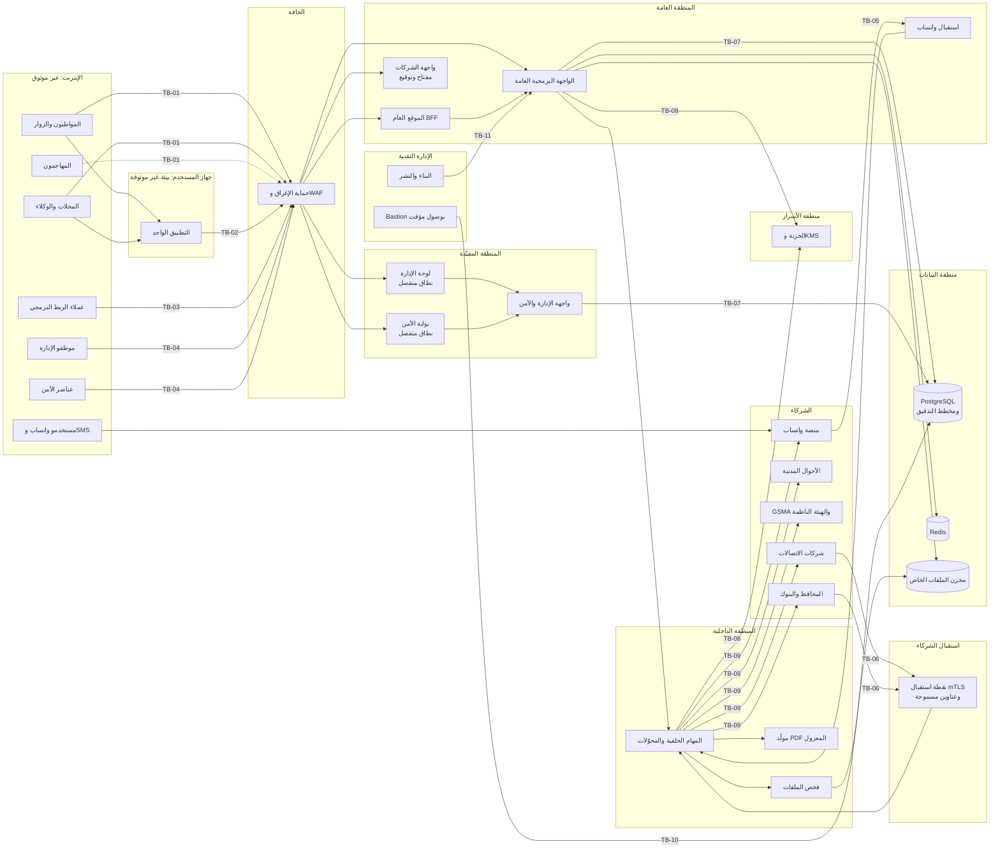

# 20 — نموذج التهديد وضوابط الأمن

> هذه الوثيقة هي المرجع الأمني المُلزم لفرق التنفيذ. تحدد ما نحميه، وممن نحميه، وكيف: الأصول والفاعلون وحدود الثقة، ونموذج تهديد STRIDE لكل وحدة، وحالات الإساءة الخاصة بالمنصة، ومواصفة المصادقة واستعادة الحسابات ورموز التحقق، وبروتوكول الدعم الفني ضد الهندسة الاجتماعية، وضوابط بوابة قوى الأمن، والرقابة على المدير العام، وحماية التطبيق من الكسر والتعديل، وتقوية الويب والواجهة البرمجية والبنية التحتية، وإدارة الثغرات، وخطط الاستجابة للحوادث. وهي **توسّع** [الأمان والخصوصية والإطار القانوني](07-security-privacy-legal.md) ولا تخالفه، وتخضع لقرارات الزبون في [سجل القرارات](02-decisions-log.md).

---

## 1. النطاق والمنهجية

### 1.1 النطاق

| يشمل | التفصيل |
|---|---|
| الواجهات | الموقع، والتطبيق الواحد لأندرويد وآيفون، ولوحة الإدارة، وبوابة قوى الأمن، وبوت واتساب، والرقم القصير للـ SMS، والربط البرمجي للشركات، ونقاط استقبال الشركاء |
| الشركاء | شركات الاتصالات، والأحوال المدنية، وGSMA، والهيئة الناظمة (الجمركة)، ومزوّدو المحافظ والبنوك، وشام كاش وسيريتل وMTN للمحفظة والتعبئة (D-89)، وشركة الشحن (D-87)، ومنصة واتساب، وبوابة SMS، ومتجرا التطبيقات (للتوزيع والإشعارات فقط، فلا دفع عبرهما، D-86) |
| البيئات | الإنتاج، والتجريب (staging)، والتدريب، والتطوير. وبيانات الإنتاج لا تخرج من الإنتاج أبداً |
| الأشخاص والإجراءات | المشرفون، والدعم الفني، والمشرف التجاري، ومسؤولو الأمن والعناصر، وأصحاب المحلات وموظفوهم، وفريق التشغيل التقني لدى الشركة |
| المورّدون | الاستضافة، والحماية من الإغراق، ومنصة واتساب، وبوابة SMS، وخدمات المتجرين والإشعارات، وأي مكتبة أو خدمة خارجية |
| الوحدات المطفأة يوم الإطلاق (D-95) | ضوابطها تُبنى وتُختبر مع وحداتها قبل الإطلاق. وتشغيل أي وحدة بعده يسبقه التأكد من أن ضوابطها في هذه الوثيقة مفعّلة ومختبرة، واختبار اختراق لها عند الحاجة (§14.2) |

### 1.2 المراجع المعيارية

| المرجع | الاستخدام |
|---|---|
| STRIDE | تصنيف التهديدات لكل وحدة (§4): انتحال (S)، وتلاعب (T)، وإنكار (R)، وكشف معلومات (I)، وحرمان من الخدمة (D)، ورفع صلاحيات (E) |
| OWASP ASVS 5.0، المستوى 2 | متطلبات الويب والواجهة البرمجية ولوحة الإدارة وبوابة الأمن (§12، §18). وتُضاف للوحة الإدارة وبوابة الأمن ووحدات CIVIL وTELCO والمحفظة ضوابط أشد حيث تذكرها هذه الوثيقة (أربع عيون، وسجل متسلسل، وmTLS) |
| OWASP MASVS 2 مع ملفّي MAS-L2 وMAS-R | متطلبات التطبيق، ومنها مقاومة الكسر والتعديل (§11) |
| OWASP Top 10 وOWASP API Security Top 10 (2023) | أصناف الهجمات التي يغطيها الاختبار والمراجعة (§12، §14) |
| NIST SP 800-63B | قواعد كلمات المرور ورموز التحقق والجلسات (§6) |

### 1.3 مقياس المخاطر

الرموز كما في [المخاطر](12-risks-and-open-questions.md): 🔴 عالٍ · 🟡 متوسط · 🟢 منخفض.

| المستوى | الاحتمال | الأثر |
|---|---|---|
| 🔴 | متوقع بانتظام، أو يكفيه مهاجم بقدرات عادية وأدوات منتشرة | كشف بيانات حساسة جداً لعدد كبير، أو استيلاء على ملكية أو حساب، أو حظر أجهزة بريئة، أو خطر على السلامة الجسدية، أو توقف واسع للخدمة |
| 🟡 | يحتاج قدرات أو ظروفاً خاصة (وصول داخلي، أو شريحة الضحية، أو تواطؤ شخص واحد) | أثر على عدد محدود من الأشخاص، أو كشف بيانات حساسة، أو توقف جزئي |
| 🟢 | نادر، أو يحتاج قدرات عالية أو تواطؤ أكثر من شخص | أثر محدود يمكن تصحيحه دون ضرر دائم |

**قاعدة قبول الخطر المتبقي:** المتبقي 🔴 لا يُقبل عند الإطلاق. والمتبقي 🟡 يُقبل بموافقة مكتوبة من رئيس أمن التطبيقات في الشركة والمدير العام للمنصة، مع رصد مخصص له في §15. والمتبقي 🟢 مقبول.

### 1.4 الاصطلاحات

| المعرّف | المعنى |
|---|---|
| `AS-NN` | أصل محمي (§2.1) |
| `ATK-NN` | صنف مهاجم (§2.4) |
| `TB-NN` | حد ثقة (§2.5) |
| `CT-NN` | ضابط أمني (§3) |
| `TH-NN` | تهديد (§4). وحرف `T-` محجوز لقوالب الرسائل في [كتالوج المحتوى](24-content-catalog.md) |
| `AB-NN` | حالة إساءة (§5) |
| `DET-NN` | قاعدة كشف في الرصد الأمني (§15.1) |
| `PB-NN` | خطة استجابة لحادثة (§15.5) |
| `SR-NN` | متطلب أمني للمطوّرين (§18) |

- المعرّفات ثابتة: كل تهديد أو ضابط أو حالة يُضاف يأخذ الرقم التالي المتاح، ولا يُعاد ترقيم ما سبقه، حتى تبقى الإشارات في الوثائق الأخرى والاختبارات صحيحة.
- **«يجب»** إلزام، و**«يُمنع»** حظر، و**«يُفضَّل»** توصية.
- القيم المعلَّمة بـ ⚙️ تُعدَّل من إعدادات لوحة الإدارة ([فهرس الإعدادات](06-business-rules.md#15-فهرس-الإعدادات))، والقيم الجديدة التي تضيفها هذه الوثيقة مجمّعة في §19.
- **الأولوية:** قرار الزبون يعلو على أي ضابط هنا. وحيث تفصّل هذه الوثيقة مبدأً عاماً في الوثيقة 07، فالقيمة التفصيلية هنا هي المعتمدة.
- التصميم التقني للمصادقة والصلاحيات والعزل في [التصميم التقني](19-technical-design.md)، والخصوصية وسجل المعالجة في [الخصوصية وتقييم الأثر](21-privacy-dpia.md)، والإجراءات اليومية في [إجراءات التشغيل](23-operations-sops.md)، ومعايير القبول في [معايير القبول](25-acceptance-criteria.md). وهذه الوثيقة تحدد **ما يجب** أن يتحقق أمنياً، وتلك تحدد **كيف** يُبنى ويُشغَّل.

## 2. الأصول والفاعلون وحدود الثقة

### 2.1 الأصول

| # | الأصل | الخاصية الأهم | ما يحدث عند المساس به |
|---|---|---|---|
| AS-01 | الرقم الوطني وبيانات الهوية للأشخاص | السرية | انتحال الهوية، وابتزاز، وتتبّع أشخاص |
| AS-02 | صور الهويات (المستخدمون، والبائعون للمحلات، والموظفون) | السرية | تزوير هويات، وفتح حسابات باسم الضحايا |
| AS-03 | ردود السجل المدني (المطابقة، والاسم، وحالة البطاقة، وصورة السجل المدني لحظة العرض) | السرية | استعلام جماعي عن المواطنين، وخرق «تحقّق لا استعلام» |
| AS-04 | المواقع الدقيقة (الفحوص، والمحلات، وعمليات المحل، والحادثة) | السرية | ملاحقة أشخاص، وخطر على السلامة الجسدية |
| AS-05 | بيانات الشبكة: أرقام الشرائح، ومواقع الأبراج، وجلسات التتبّع | السرية | تتبّع غير قانوني للأشخاص، وخرق اتفاقية الاتصالات |
| AS-06 | هوية الفاحص (الحساب، وعنوان الشبكة، ورقم واتساب، ورقم SMS) | السرية | انتقام من الفاحص أو المبلّغ عن معلومة (D-09) |
| AS-07 | سجل الملكية وسلسلة انتقالها | السلامة | سرقة الملكية، وتبييض أجهزة مسروقة |
| AS-08 | حالة الجهاز العامة ونتيجة الفحص | السلامة والتوافر | بيع مسروق كأنه سليم، أو حظر جهاز بريء |
| AS-09 | البلاغات وأدلتها وقرارات المراجعة | السلامة والسرية | بلاغات كيدية، وإغلاق بلاغات صحيحة |
| AS-10 | الوثائق الموثّقة: الفواتير، والشهادات، والإيصالات، وتقارير التاريخ | الأصالة | تزوير إثبات الملكية أو حسن النية |
| AS-11 | حسابات المستخدمين والمحلات والوكلاء وجلساتهم | السرية والسلامة | استيلاء على الحساب، ونقل أجهزة الضحية |
| AS-12 | حسابات الإدارة وبوابة الأمن وصلاحياتها | السرية والسلامة | كشف بيانات بالجملة، وقرارات مزوّرة |
| AS-13 | سجل التدقيق وسجل «من اطّلع على بياناتي» | السلامة | إخفاء آثار الإساءة |
| AS-14 | الأسرار والمفاتيح (التشفير، والبصمات، والتوقيع، وmTLS، ورموز واتساب، ومفاتيح الشركات، ومفاتيح توقيع التطبيق وتحديثاته) | السرية | فك تشفير البيانات، وانتحال المنصة، وتوزيع تطبيق خبيث |
| AS-15 | قنوات التواصل الرسمية: رقم بوت واتساب، ورقم الدعم (D-82)، ورقم الإدارة التجاري (D-86)، وأرقام تنبيهات الإدارة، والرقم القصير، والنطاقات | الأصالة والتوافر | تصيّد باسم المنصة، وجمع أموال باسم خدمات وهمية |
| AS-16 | الإعدادات وقوالب الرسائل ومفاتيح التشغيل | السلامة | إضعاف الضوابط بصمت، أو رسائل تصيّد من القناة الرسمية |
| AS-17 | قوائم المراقبة والحظر لدى الاتصالات، وطلبات إيقاف الخطوط وتجميد المحافظ | السلامة | حظر جماعي لأجهزة بريئة، أو فك حظر أجهزة مسروقة |
| AS-18 | المدفوعات وتفعيل الخدمات، وأموال المتجر: نقد التحصيل عند الاستلام، وكشوف تسوية المورّدين وبيانات حساباتهم المستلمة (D-86، D-87)، والإعلانات | السلامة | تفعيل دون دفع، واختلاس نقد الشحن، وتحويل التسويات لحساب محتال، وإعلانات خبيثة |
| AS-19 | توافر المنصة (الفحص، وواجهات المحلات، والبوابة، واستقبال الشركاء) | التوافر | توقف إلزام المحلات، وضياع تنبيهات لحظية |
| AS-20 | ثقة الناس والوزارة والشركاء بالمنصة | السمعة | انهيار الاستخدام، وإلغاء الاتفاقيات |
| AS-21 | محافظ المحلات وعمليات التعبئة (D-89): المال لدى شام كاش باسم المحل، والمنصة واجهة تأمر بالعمليات وتحفظ دفتراً مرآة لها | السلامة | سحب أموال المحلات، واستنزافها بالتعبئة، وغسل الأموال، وفقدان ثقة الشريكين |
| AS-22 | سجل الأجهزة دون شريحة بالشركة المصنّعة والرقم التسلسلي (D-91) | السلامة | تبييض حواسيب مسروقة بملصقات مزوّرة |
| AS-23 | بيانات المحاسبة والإدارة للمحل (D-92، SHOPPRO): المبيعات، والصندوق، والمصاريف، والرواتب، والديون وبيانات المدينين، والأرباح، وسجلات نقطة البيع دون اتصال على الأجهزة | السرية والسلامة | كشف أسرار المحل التجارية لغيره (ومنه الإدارة والأمن والوزارة)، واختلاس الموظفين للنقد |

### 2.2 تصنيف عناصر البيانات وحمايتها

يوسّع [تصنيف البيانات](07-security-privacy-legal.md#1-تصنيف-البيانات) إلى مستوى الحقل. الرموز كما في [نموذج البيانات](09-data-model.md): 🔐 حقل مشفّر · #️⃣ بصمة للبحث · 📍 إحداثيات.

| العنصر | التصنيف | الحماية في التخزين | الإخفاء عند العرض | من يراه |
|---|---|---|---|---|
| الرقم الوطني | حساسة جداً | 🔐 AES-256-GCM + #️⃣ بمفتاح بصمة خاص به | آخر 3 خانات فقط: `••••••••123` | صاحبه. والمحل داخل معاملته فقط (CT-37). والإدارة 🔒 بكشف مسجّل. والأمن ضمن نطاقه 🔒 |
| صور الهوية (الوجهان) | حساسة جداً | تشفير ظرفي لكل ملف بمفتاح بيانات خاص به، في مخزن خاص | لا تُعرض إلا عبر وكيل الملفات مع علامة مائية | المشرف المراجع، والأمن ضمن نطاقه 🔒. ولا يعيد المحل عرض صورة هوية البائع بعد إرسالها |
| صورة السجل المدني | حساسة جداً | **لا تُخزَّن** (CIVIL-06)، وتُعرض بترويسة `Cache-Control: no-store` | لحظة المراجعة فقط | مشرف توثيق الهوية فقط (D-84) |
| الاسم وحالة البطاقة من السجل المدني | حساسة جداً | تُخزَّن نتيجة التحقق ومرجع الاستعلام، والاسم في المعاملة | — | موظف المحل داخل معاملة جارية فقط، دون صورة (D-84) |
| المواقع الدقيقة 📍 | حساسة جداً | جدول PostGIS منفصل بصلاحيات مقيّدة، وتخفيض الدقة بعد ⚙️ 90 يوماً (07 §2) | على الخريطة فقط | الإدارة، والأمن ضمن نطاقه |
| أرقام الشرائح وIMSI ومواقع الأبراج | حساسة جداً | 🔐 + #️⃣ | آخر رقمين | الإدارة والأمن ضمن نطاقه. ولا تُرسل في واتساب أبداً (07 §8) |
| رقم واتساب الفاحص ورقم SMS الفاحص | حساسة جداً | 🔐 + #️⃣ | مخفي | الإدارة فقط، ولا يُكشف لصاحب الجهاز (D-09) |
| عنوان الشبكة للفاحص | حساسة | 🔐 | مخفي | الإدارة والأمن ضمن نطاقه |
| الأرقام البديلة | حساسة جداً | 🔐 | `09••••••12` | صاحب الحساب، والإدارة 🔒 |
| رقم موبايل الحساب | حساسة | تشفير التخزين الكامل (يلزم للدخول) | `0933••••12` | صاحبه، والإدارة 🔒 |
| المعاملات والأسعار | حساسة | تشفير التخزين الكامل، وعزل المستأجر | السعر للمشتري فقط (D-17) | المحل لمعاملاته، والإدارة، والأمن ضمن نطاقه |
| صور الكراتين والأدلة | حساسة | مخزن خاص | — | الإدارة، والأمن ضمن نطاقه |
| مراجع الدفعات وإثباتاتها | حساسة | مخزن خاص، ورقم مرجعي فريد لكل مزوّد | آخر 4 خانات للمرجع خارج شاشة التأكيد | المشرف التجاري، والمدير العام |
| IMEI في الصفحات العامة (الشهادة، والفاتورة، والإيصال) | عامة جزئياً | — | أول 8 خانات (TAC) ثم `•••` ثم آخر 4 | الجميع. والرقم الكامل لمالكه بعد الدخول |
| اسم المشتري في صفحة التحقق من الفاتورة | حساسة | — | الاسم الأول وأول حرف من الكنية: «أحمد م.» | الجميع (PUB-02) |
| سجل التدقيق | حساسة | مخطط منفصل للإضافة فقط، ومتسلسل بالبصمات (CT-89) | — | المدير العام وجهة الرقابة (§10.4) |
| الأسرار والمفاتيح | سرّية (خارج تصنيف البيانات) | الخزنة فقط، ولا تظهر في اللوحة (06 §15.3) | لا تُعرض أبداً | الخدمات بسياسات وصول محددة |
| بيانات المحاسبة للمحل (SHOPPRO) | سرّية المحل (D-92) | مخطط مستقل بـ RLS لكل محل ولا صلاحيات لأدوار الإدارة والأمن عليه، وبيانات المدينين والرواتب مشفّرة بمفتاح خاص بكل محل (CT-109) | الأرباح والتكاليف والرواتب مخفية عن الموظفين افتراضياً (SHOPPRO-13) | المحل وحده حسب صلاحيات صاحبه، والدعم بإذن مؤقت منه فقط (CT-110). ولا تراها الإدارة ولا الأمن ولا الوزارة أبداً |
| حالة الجهاز، والماركة والموديل، وتاريخ نشر البلاغ | عامة | — | — | الجميع (CHECK-08) |

### 2.3 الفاعلون الشرعيون

| الفاعل | نطاق الهوية | الصلاحيات ([الأدوار](03-roles-and-permissions.md)) | الخطر إن أساء أو اختُرق |
|---|---|---|---|
| الزائر | دون حساب | الفحص بحدود، ونموذجا المعلومات والإرجاع | المسح، والإزعاج |
| المواطن (مؤكَّد الرقم، أو مرتبط تلقائياً، أو موثّق الهوية) | 1 (الحسابات العامة) | أجهزته وبلاغاته ونقلها وشهاداتها | بلاغ كيدي، وتسجيل ذاتي لجهاز مسروق |
| المستخدم المفوّض (قد يكون قاصراً بلا هوية) | 1 | بدء بلاغ فقط بتأكيد المالك (D-33) | بلاغ دون علم المالك |
| الجهة الموثوقة | 1 | بلاغ عاجل وطلب الحمايات عن المستخدم (D-62) | إيقاف خط شخص أو تجميد محفظته كيداً |
| صاحب المحل وموظفوه، ومحل الصيانة | 1 | معاملات المحل فقط، والاسم وحالة البطاقة داخل معاملة (D-84) | تصريف المسروقات، وجمع هويات الزبائن |
| الوكيل أو المستورد وموظفوه | 1 | أجهزته ومعاملاته فقط | إدخال أرقام أجهزة مسروقة كأجهزة جديدة |
| المدير العام، ومشرف البلاغات، ومشرف المحلات، والدعم الفني، والمشرف التجاري، والأدوار الديناميكية | 2 (الإدارة) | حسب الدور (D-78) | كشف بيانات وبيعها، وقرارات مزوّرة، وتفعيل دون دفع |
| مسؤول الأمن وعنصر الأمن والإدارة المركزية | 3 (بوابة الأمن) | ضمن النطاق (D-80) | بحث بالأشخاص خارج القضايا، وإغلاق بلاغات صحيحة |
| شركات الاتصالات، والأحوال المدنية، وGSMA، والهيئة الناظمة، والمحافظ والبنوك | 4 (الأنظمة عبر mTLS) | ما تحدده الاتفاقيات | أحداث مزيّفة، وتسريب من جهة الشريك |
| شام كاش (حسابات محافظ المحلات، D-89)، وسيريتل وMTN (توزيع الرصيد) | 4 (الأنظمة عبر mTLS) | فتح الحسابات، والشحن والسحب والدفع، وتنفيذ التعبئة، وكشوف المطابقة | تأكيدات مزيّفة، أو اختراق الربط لتحريك الأموال |
| المورّد المعتمد (D-87) | 1 (حساب تجاري، ومستأجر معزول بنوع «مورّد») | منتجاته بعد المراجعة، والطلبات المسندة إليه، وكشوف تسويته. ولا يرى من المحل إلا اسمه وعنوان التوصيل لطلباته (03 §2.4.3) | إدراج أصناف ممنوعة، والتلاعب بالطلبات والمرتجعات، وتغيير الحساب المستلم للتسوية بعد الاستيلاء على حسابه |
| شركة الشحن ومندوب المنصة (D-87) | 4 (ربط مع شركة الشحن) أو حساب مندوب | استلام الطلب من المورّد وتسليمه للمحل وقبض ثمنه عند الاستلام (STORE-09)، ويرى اسم المحل وعنوانه وهاتفه ومبلغ التحصيل فقط | اختلاس النقد، وتأكيد تسليم وهمي |
| عملاء الربط البرمجي | 4 (مفتاح وتوقيع HMAC) | فحص الحالة وتقرير التاريخ دون بيانات شخصية | مسح جماعي، ومراقبة أجهزة مسروقة |
| فريق التشغيل التقني لدى الشركة | وصول مؤقت للإنتاج | ما يمنحه الطلب المؤقت فقط (CT-87) | وصول مباشر لقاعدة البيانات |

### 2.4 المهاجمون

| # | المهاجم | الدافع | القدرات المفترضة | حالات الإساءة |
|---|---|---|---|---|
| ATK-01 | السارق | بيع الجهاز أو استخدامه، وإخفاء أثره | الجهاز وكرتونته غالباً، وشريحة الضحية وواتسابها المفتوح أحياناً، وهوية حقيقية أو مستعارة | AB-01، AB-08، AB-10، AB-14، AB-39 |
| ATK-02 | مصرّف المسروقات والمحل غير النزيه | تمرير أجهزة مسروقة بوثائق نظامية | حساب محل موثّق، وموظفون، وطباعة فواتير، وتعامل يومي مع الهويات | AB-04، AB-05، AB-14، AB-24، AB-26، AB-35، AB-37، AB-39، AB-43، AB-45 |
| ATK-03 | المبلّغ الكيدي (بائع يبلّغ بعد البيع، أو مبتز، أو خصم) | استرداد جهاز باعه، أو ابتزاز المشتري، أو الإضرار بشخص | حساب موثّق، وكرتونة الجهاز الأصلية، وفاتورة قديمة | AB-02، AB-09، AB-27 |
| ATK-04 | المشرف المسيء من الداخل | المال أو الانتقام أو الفضول | صلاحيات دوره، ومعرفة بالإجراءات | AB-07، AB-19، AB-21، AB-29، AB-33 |
| ATK-05 | عنصر الأمن المسيء من الداخل | استخدام البيانات لأغراض شخصية أو لصالح طرف | حساب شخصي في البوابة ضمن نطاق محافظته | AB-06 |
| ATK-06 | الاحتيال المنظّم | الاستيلاء على الحسابات والملكية، وبيع البيانات، وجمع المال | تبديل الشرائح، وتزوير الهويات، وحسابات واجهة، وتصيّد منظّم | AB-08، AB-12، AB-16، AB-17، AB-18، AB-28، AB-34، AB-36، AB-37 |
| ATK-07 | الروبوتات وجامعو البيانات | بناء قوائم أجهزة، أو إرهاق الخدمة، أو إغراق رموز التحقق | شبكات عناوين واسعة، ومتصفحات آلية، وأرقام كثيرة | AB-15، AB-30 |
| ATK-08 | مهاجم بقدرات دولة | التجسس على المواطنين والبنية الأمنية | ثغرات غير معلنة، واختراق سلسلة التوريد، واعتراض الشبكات، واستهداف الموظفين | AB-38، PB-01، PB-05، PB-10 |
| ATK-09 | الملاحِق أو الشريك المسيء | معرفة مكان شخص بعينه أو التضييق عليه | معرفة شخصية بالضحية، ورقم IMEI جهازها، وأحياناً وصول لهاتفها | AB-03، AB-09 |
| ATK-10 | منتحل القنوات الرسمية | سرقة الرموز والأموال باسم المنصة | أرقام واتساب مشابهة، ونطاقات مشابهة، وتطبيق معدّل، وإعلانات مزيّفة | AB-11، AB-12، AB-16، AB-23 |
| ATK-11 | المورّد أو مندوب الشحن المحتال، أو من يتواطأ معهما من الداخل (D-87) | المال: نقد التحصيل، أو تسويات غير مستحقة | حساب مورّد موثّق، أو صفة مندوب يحمل النقد، أو صلاحية إعداد التسوية | AB-31، AB-32، AB-33 |

### 2.5 حدود الثقة



| # | الحد | ما يعبره | الضوابط الأساسية |
|---|---|---|---|
| TB-01 | الإنترنت ← الحافة | كل طلبات المتصفحات والمهاجمين | حماية الإغراق، وWAF، وTLS 1.2 فما فوق، وحدود الطلبات، وALTCHA (CT-79، CT-38، CT-04) |
| TB-02 | التطبيق ← الخادم | طلبات التطبيق من جهاز لا نتحكم به | إثبات سلامة التطبيق، وتثبيت الشهادات، وربط الرموز بالجهاز، وفرض أدنى إصدار (CT-62، CT-64، CT-09، CT-69) |
| TB-03 | عملاء الربط ← واجهة الشركات | طلبات آلية موقّعة | مفتاح وتوقيع HMAC، وطابع زمني، وحصص (CT-54) |
| TB-04 | الموظفون والعناصر ← نطاقا الإدارة والأمن | جلسات ذات صلاحيات عليا | نطاقات منفصلة، وتحقق ثنائي، وجلسات قصيرة، وحصر اختياري بالعناوين (CT-10، CT-80) |
| TB-05 | منصة واتساب ← استقبال البوت | رسائل الفحص الواردة | التحقق من توقيع `X-Hub-Signature-256`، وحدود لكل رقم (CT-59) |
| TB-06 | الشركاء ← نقطة الاستقبال | أحداث الشبكة، ورسائل SMS، وحالات الطلبات | mTLS، وقائمة عناوين، وتوقيع الرسالة، وطابع زمني ومنع التكرار (CT-55، CT-57) |
| TB-07 | الخادم ← قاعدة البيانات | كل الاستعلامات | أدوار بأقل صلاحية، وعزل المستأجرين ونطاق الأمن بـ RLS، وتشفير الحقول (CT-85، CT-16، CT-17، CT-26) |
| TB-08 | الخدمات ← الخزنة | طلب المفاتيح والأسرار | هوية الخدمة، وسياسات وصول لكل خدمة، وسجل تدقيق الخزنة (CT-83) |
| TB-09 | المحوّلات ← الشركاء | طلبات المراقبة والحظر والاستعلام والإرسال | قائمة وجهات مسموحة، وmTLS، وقاطع دائرة، وتحقق من الحالة قبل كل طلب (CT-56، CT-58) |
| TB-10 | فريق التشغيل ← الإنتاج | وصول تقني | وصول مؤقت بموافقة، وجلسات مسجّلة (CT-87) |
| TB-11 | البناء والنشر ← الإنتاج والمتجرين | الكود والحاويات والتطبيق | بناء موقّع، وSBOM، وموافقة يدوية للنشر (CT-86) |
| TB-12 | محل ← محل آخر، ووكيل ← آخر (حد منطقي) | بيانات المستأجرين | RLS بمعرّف المستأجر في كل طلب، وفحوص التطبيق (CT-16) |
| TB-13 | محافظة ← محافظة في بوابة الأمن (حد منطقي) | بيانات الأشخاص والبلاغات | فرض النطاق في الخادم وفي RLS (CT-17، D-80) |

## 3. فهرس الضوابط

كل ضابط يُشار إليه برقمه في جداول التهديد (§4) وحالات الإساءة (§5)، والعمود الأخير يحدد مكان مواصفته التفصيلية.

### 3.1 الهوية والمصادقة

| الرقم | الضابط | التفصيل |
|---|---|---|
| CT-01 | تخزين كلمات المرور بـ Argon2id مع قيمة سرّية من الخزنة، ورفض كلمات المرور المسرّبة والسياقية | §6.2 |
| CT-02 | قواعد رموز التحقق: 6 خانات، و5 دقائق، و5 محاولات، و5 رموز في الساعة، وإعادة الإرسال بعد 60 ثانية، وتخزين البصمة فقط، وربط الرمز بالغرض | §6.3 |
| CT-03 | القفل التدريجي لكل حساب، والتأخير لكل عنوان شبكة | §6.4 |
| CT-04 | تحقق «لست روبوتاً» بإثبات العمل (ALTCHA) بصعوبة متكيّفة | §6.5 |
| CT-05 | إعادة المصادقة قبل الإجراءات الحساسة | §6.6 |
| CT-06 | فترة التهدئة بعد تغيير الرقم أو الاستعادة بالهوية أو إعادة تعيين كلمة المرور من جهاز جديد | §6.7 |
| CT-07 | الاستعادة بالهوية فقط، مع موافقة مشرف ثانٍ ومهلة إشعار قبل التنفيذ | §6.8 |
| CT-08 | الرقم البديل للإشعارات فقط، ولا يستقبل أي رمز يأذن بإجراء (D-81) | §6.8.3 |
| CT-09 | جلسات المستخدمين: رمز دخول قصير، ورمز تجديد دوّار مع كشف إعادة الاستخدام، وربطه بمفتاح الجهاز | §6.9 |
| CT-10 | التحقق الثنائي الإلزامي للإدارة والأمن (TOTP أو WebAuthn)، وجلسات خادمية قصيرة | §6.10 |
| CT-11 | ربط تطبيق المحل والوكيل بالجهاز، وتأكيد كل جهاز جديد برمز وإشعار صاحب المحل | §6.12 |
| CT-12 | إشعار كل حدث أمني على كل القنوات، مع زر «لم أكن أنا» الذي يجمّد الحساب | §6.7 |
| CT-13 | عدم كشف وجود الحسابات في التسجيل والدخول والاستعادة | §6.3 |
| CT-14 | ضوابط الجهة الموثوقة: قبول من حسابها، ومهلة تفعيل، وإشعار المالك بكل إجراء، والإزالة التلقائية عند الرفض | AB-09 |

### 3.2 التفويض والنطاق

| الرقم | الضابط | التفصيل |
|---|---|---|
| CT-15 | تفويض في الخادم لكل طلب بمبدأ المنع الافتراضي، وسياسات مكتوبة كقواعد قابلة للاختبار | §12.9 |
| CT-16 | عزل المحلات والوكلاء بـ Row-Level Security في PostgreSQL مع فحوص التطبيق | §12.9 |
| CT-17 | فرض نطاق المحافظات لعناصر الأمن في الخادم وفي RLS (D-80) | §9.3 |
| CT-18 | معرّفات داخلية غير مكشوفة، ورموز عامة عشوائية بطول 128 بت على الأقل، ورد 404 لما لا يملكه الطالب | §12.9 |
| CT-19 | منع الإسناد الجماعي: الحقول المسموحة فقط، والحقول التي يحددها الخادم لا تأتي من الطلب | §12.10 |
| CT-20 | أربع عيون للإجراءات الخطرة | §10.1 |
| CT-21 | فصل المهام ومنع تعارض المصالح | §10.5 |
| CT-22 | ضوابط الأدوار الديناميكية والصلاحيات الحرجة | §10.6 |
| CT-23 | حساب الطوارئ (break-glass) | §10.2 |
| CT-24 | مراجعة دورية لصلاحيات الإدارة والأمن والموظفين وعملاء الربط | §9.8، §10.7 |
| CT-25 | «تحقّق لا استعلام»: لا استعلام من السجل المدني إلا ضمن طلب توثيق مسند للمشرف أو معاملة جارية بعد فحص الجهاز، والمحل يرى الاسم وحالة البطاقة فقط | CIVIL-01..09، D-84 |

### 3.3 حماية البيانات

| الرقم | الضابط | التفصيل |
|---|---|---|
| CT-26 | تشفير الحقول بـ AES-256-GCM بمفاتيح ظرفية ذات إصدارات | §13.3 |
| CT-27 | مفتاح بصمة (HMAC-SHA256) منفصل لكل حقل بحث، ومنفصل عن مفاتيح التشفير | §13.3 |
| CT-28 | الإخفاء الافتراضي، والكشف بسبب مرتبط بعنصر عمل، وحصة كشف لكل موظف | §10.3 |
| CT-29 | مخزن ملفات خاص، ووكيل مصادَق لعرض الملفات الحساسة، وروابط موقّعة قصيرة لغيرها، ونطاق ملفات منفصل بلا كوكيز | §12.8 |
| CT-30 | جدول مواقع مقيّد، وتخفيض دقة مواقع الفحوص غير المرتبطة ببلاغ | 07 §2 |
| CT-31 | شفافية «من اطّلع على بياناتي» مع تأخير ظهور اطلاع الأمن | §9.9 |
| CT-32 | قواعد محتوى الرسائل والإشعارات لكل قناة | §7 |
| CT-33 | تقليل البيانات في المخرجات العامة: نتيجة الفحص لا تميّز الجهاز المسجّل من المجهول، ولا بيانات شخصية في الصفحات العامة والتقارير والربط | §12.9، CHECK-11 |
| CT-34 | العلامة المائية الديناميكية ومنع تصوير الشاشات الحساسة | §11.8 |
| CT-35 | عدم تخزين صور السجل المدني، وعرضها دون تخزين مؤقت | CIVIL-06 |
| CT-36 | الحذف الآمن حسب الاحتفاظ، وانتهاء النسخ الاحتياطية | §17 |
| CT-37 | وثائق الهوية «للكتابة فقط» لدى المحل: لا يعيد المحل عرض صورة هوية البائع بعد الإرسال، والرقم الوطني مخفي في سجل معاملاته | AB-05 |

### 3.4 منع الإساءة وكشفها

| الرقم | الضابط | التفصيل |
|---|---|---|
| CT-38 | حدود الطلبات لكل فئة من نقاط الواجهة، مع مراعاة العناوين المشتركة | §12.11 |
| CT-39 | كشف المسح والأنماط المتسلسلة، وأرقام IMEI طُعم تنبّه عند فحصها | §12.14 |
| CT-40 | حصص عناصر الأمن وكشف الشذوذ في البوابة | §9.5، §9.6 |
| CT-41 | كشف شذوذ الإدارة، وسجلات طُعم (honeytokens) تنبّه عند كشفها | §10.3 |
| CT-42 | كشف شذوذ المحلات والوكلاء والموظفين (SMART-06) | §5 |
| CT-43 | أدلة البلاغ: الصورة الحيّة مع رقم الحساب، والباركود، وكشف التكرار، ومستوى الموثوقية | 06 §4، §11 |
| CT-44 | طبقات حماية التسجيل الذاتي | 06 §5.1 |
| CT-45 | ضوابط نقل الملكية: مطابقة رقم المستلم ورقمه الوطني، ورمز للمالك، ومهلة، ومنع النقل أثناء البلاغ | OWN-04..07 |
| CT-46 | إغلاق البلاغ بمراجعة الإدارة أو الأمن فقط (D-21، D-58) | 06 §3 |
| CT-47 | الاعتراض بأدلة الطرفين | DISPUTE-01..03 |
| CT-48 | العقوبات: حظر الكاذب، وتعليق المحل المخالف | 06 §13 |
| CT-49 | سلامة المعرّفات: Luhn، وتطابق TAC مع الموديل، وتطابق الرقمين، والرقم غير المخصص، وتنبيه التكرار من الشبكة | 06 §1، FAKE، TELCO-08 |
| CT-50 | فرض موقع المحل (500 متر)، وكشف الموقع المزيّف، ومقارنة GPS بموقع الشبكة | 06 §6، §11 |
| CT-51 | تجميع إشعارات الفحص لصاحب البلاغ وسقفها (D-42) | 06 §9 |
| CT-52 | مراجعة المحتوى التجاري قبل النشر، والأصناف الممنوعة، وفحص الروابط، ومنع سكربتات الإعلانات الخارجية | D-70، §12.3 |
| CT-53 | سلامة الدفع اليدوي (D-86): رقم مرجعي فريد، والتأكيد من سجل الحساب المستلم لا من صورة، وتسوية يومية يجريها غير المفعِّل، وموافقة المدير العام على الاسترداد والتفعيل دون دفعة | AB-17 إلى AB-20 |
| CT-54 | حماية الربط للشركات: مفتاح وتوقيع وطابع زمني ونطاقات وحصص وقائمة عناوين | §12.15 |

### 3.5 التكاملات

| الرقم | الضابط | التفصيل |
|---|---|---|
| CT-55 | أمن الربط مع الشركاء: mTLS، وقائمة عناوين، وتوقيع الرسالة، وطابع زمني، ومعرّف فريد لمنع التكرار | §13.2 |
| CT-56 | تقوية المحوّلات: وجهات مسموحة فقط، وحماية من SSRF، ومهل، وقاطع دائرة، والتحقق من صيغة ردود الشريك | §12.6 |
| CT-57 | فحص معقولية أحداث الشبكة، والمطابقة اليومية للقوائم (TELCO-10) | §4.6 |
| CT-58 | ربط كل طلب حظر أو فك حظر أو إيقاف خط أو تجميد بحالة صالحة، وقاطع دائرة للطلبات الجماعية | §4.6 |
| CT-59 | أمن حسابات واتساب الرسمية: المنصة الرسمية فقط، والتحقق من توقيع الرسائل الواردة، ورمز التحقق بخطوتين، ومفاتيح عتادية لمديري الحساب التجاري، ورقم احتياطي | §15.5 PB-06 |
| CT-60 | أمن الرقم القصير: الاستقبال من بوابة الشركة فقط، وحدود لكل رقم | §4.14 |
| CT-61 | أمن الإكمال بالتطبيق: رمز لمرة واحدة، و10 دقائق، ومرتبط بالحساب والخطوة والجلسة، وشاشة تأكيد في التطبيق، ولا نقل للجلسة | HANDOFF-03، AB-11 |

### 3.6 التطبيق

| الرقم | الضابط | التفصيل |
|---|---|---|
| CT-62 | إثبات سلامة التطبيق والجهاز (Play Integrity، أو شهادة مفاتيح أندرويد، أو App Attest) للنقاط الحساسة | §11.2 |
| CT-63 | كشف الروت وكسر الحماية والمحاكيات وأدوات الحقن، بسياسة حسب الدور | §11.1 |
| CT-64 | تثبيت الشهادات مع مفاتيح احتياطية وتدوير موقّع | §11.3 |
| CT-65 | التعمية، ومنع التعديل وإعادة التغليف، وتوقيع التحديثات الفورية | §11.4، §11.5 |
| CT-66 | التخزين الآمن في Keychain وKeystore، وتشفير المسودات، ومنع النسخ الاحتياطي، والمسح عند الخروج | §11.7 |
| CT-67 | الالتقاط الحي من الكاميرا فقط، وكشف حقن الكاميرا الافتراضية | §11.9 |
| CT-68 | قبول الروابط العميقة الموثّقة فقط، والتحقق من كل معاملاتها | §11.11 |
| CT-69 | فرض أدنى إصدار مدعوم في الخادم (APPVER-03) | §11.12 |

### 3.7 الويب والواجهة البرمجية

| الرقم | الضابط | التفصيل |
|---|---|---|
| CT-70 | التحقق من المدخلات وتوحيدها، وإزالة محارف التحكم في الاتجاه | §12.1 |
| CT-71 | ترميز المخرجات، وتنقية المحتوى المنسّق، وقوالب رسائل بلا منطق | §12.2، §12.7 |
| CT-72 | سياسة أمن المحتوى (CSP) والترويسات الأمنية | §12.3 |
| CT-73 | الحماية من CSRF حسب النطاق، وخصائص الكوكيز | §12.4 |
| CT-74 | قائمة مصادر CORS المسموحة | §12.5 |
| CT-75 | منع الحقن: استعلامات بمعاملات، وتحييد صيغ الجداول، ومحرّك تعابير خطّي للأنماط القابلة للضبط، وتحليل آمن لملفات Excel | §12.7 |
| CT-76 | خط رفع الملفات: النوع الحقيقي، وإعادة الترميز، وحذف EXIF، والفحص من البرمجيات الخبيثة، وحدود الحجم والأبعاد | §12.8 |
| CT-77 | توليد PDF معزول دون شبكة ولا سكربت، وتوقيع الوثائق رقمياً | §12.7، AB-13 |
| CT-78 | مفاتيح عدم التكرار والتزامن المتفائل لمنع السباقات | §12.10 |
| CT-79 | WAF وطبقات الحماية من الإغراق و«وضع الهجوم» | §12.12، §12.13 |
| CT-80 | فصل نطاقات ونشرات الإدارة والأمن واستقبال الشركاء عن العام | §13.1 |
| CT-81 | أخطاء موحّدة بصيغة problem+json دون تفاصيل داخلية | §12.16 |

### 3.8 البنية والأسرار والرصد

| الرقم | الضابط | التفصيل |
|---|---|---|
| CT-82 | تقسيم الشبكة بمبدأ المنع الافتراضي | §13.1 |
| CT-83 | الأسرار والمفاتيح في الخزنة وKMS، والتشفير الظرفي، والتدوير | §13.3 |
| CT-84 | نسخ احتياطي مشفّر وغير قابل للتعديل في موقع آخر، مع تجارب استعادة | §13.4 |
| CT-85 | أقل صلاحية في قاعدة البيانات والسحابة | §13.5 |
| CT-86 | أمن سلسلة التوريد: فحص المكتبات، وSBOM، والبناء والحاويات الموقّعة | §13.6 |
| CT-87 | وصول مؤقت للإنتاج عبر Bastion بجلسات مسجّلة | §13.7 |
| CT-88 | عزل البيئات، والبيانات الاصطناعية خارج الإنتاج | §13.8 |
| CT-89 | سجل تدقيق للإضافة فقط، متسلسل بالبصمات، ومثبَّت دورياً في مخزن خارجي غير قابل للتعديل | §10.4 |
| CT-90 | رصد أمني مركزي بقواعد كشف وتنبيه لمناوبة التشغيل التقني | §15.1 |
| CT-91 | خطط الاستجابة للحوادث | §15.5 |
| CT-92 | إدارة الثغرات (SAST وDAST وSCA واختبار الاختراق وسياسة الإفصاح) | §14 |
| CT-93 | نظافة السجلات: لا بيانات شخصية ولا أسرار ولا رموز فيها | §12.17 |
| CT-94 | مفاتيح الطوارئ لتعطيل الوظائف الخطرة فوراً | §15.2 |

### 3.9 الأشخاص والإجراءات

| الرقم | الضابط | التفصيل |
|---|---|---|
| CT-95 | بروتوكول الدعم ضد الهندسة الاجتماعية | §8 |
| CT-96 | التدريب الأمني وتعهدات السرية وإقرار تعارض المصالح للإدارة والدعم والأمن والمحلات | §17، 03 §4 |
| CT-97 | التوعية العامة وقائمة القنوات الرسمية: «لا نطلب الرمز أبداً»، والأرقام الرسمية في الموقع، وكل تفعيل يظهر داخل الحساب | AB-12، AB-16 |
| CT-98 | رصد انتحال المنصة (أرقام، ونطاقات، وتطبيقات، وصفحات) وطلب إزالته | PB-07 |
| CT-99 | الردع القانوني: الإقرارات الموقّتة والمسجّلة، والإحالة لقوى الأمن | REPORT-08، OWN-03 |
| CT-100 | أمن المورّدين والشركاء | §16 |
| CT-101 | السلامة من التصميم: لا تواصل مباشر بين الأطراف، ولا موقع لصاحب الجهاز، والإرجاع عبر الإدارة أو الأمن (D-10، D-46) | 07 §9 |

### 3.10 أموال المتجر والمورّدون (D-87)

| الرقم | الضابط | التفصيل |
|---|---|---|
| CT-102 | إثبات التسليم وتسوية نقد الشحن: رمز استلام لمرة واحدة يحمله المورّد للمندوب، ورمز تسليم يعطيه المحل للمندوب، والطلب لا يصبح «مسلَّماً ومدفوعاً» دونهما، وتسوية نقد الشحن ⚙️ يومياً مع شركة الشحن وتعليم كل فرق | AB-31 |
| CT-103 | سلامة تسويات المورّدين: الكشف يُحسب آلياً من الطلبات المسلّمة المدفوعة بعد انتهاء مهلة الإرجاع، والتعديل اليدوي مرتبط بسجل إرجاع أو عيب، والإعداد من المشرف التجاري ثم موافقة المدير العام (STORE-10)، والتحويل إلى الحساب المستلم المسجّل فقط، وتغيير هذا الحساب بتحقق خارج القناة وأربع عيون ومهلة تهدئة | AB-32، AB-33 |
| CT-104 | عزل المورّدين: مستأجر مستقل بـ RLS، ولا يرى إلا منتجاته وطلباته المسندة (اسم المحل وعنوان التوصيل فقط) وكشوفه، وكل منتج أو تعديل عليه يمر بالمراجعة قبل النشر | §12.9، STORE-12 |

### 3.11 محفظة المحل والتعبئة والأجهزة بالرقم التسلسلي (D-89، D-91)

| الرقم | الضابط | التفصيل |
|---|---|---|
| CT-105 | حماية المحفظة: للمحل الموثّق فقط، ورمز محفظة من 6 أرقام مختلف عن كلمة المرور، والسحب لصاحب المحل وحده برمز المحفظة ورمز تحقق إلى محفظة شام كاش باسمه الموثّق فقط، وحدود ⚙️ يومية وشهرية، ومنع السحب أثناء التهدئة، والتجميد الفوري، والإشعار بكل سحب (SHOPWALLET-03، SHOPWALLET-07) | AB-34، AB-36 |
| CT-106 | حدود التعبئة والدفع للموظفين: صلاحية «تعبئة رصيد» أو «الدفع من المحفظة» بحد يومي لكل موظف يحدده صاحب المحل، وحد لكل رقم مستفيد، وتأكيد الرقم بخط كبير، ورصد الأنماط (SHOPWALLET-05، TOPUP-05) | AB-35، AB-37 |
| CT-107 | المطابقة المستقلة: دفتر عمليات للإضافة فقط، ومطابقة آلية يومية مع شام كاش وسيريتل وMTN من واجهاتهم مباشرة، والفرق يوقف العمليات المعنية حتى حسمه بأربع عيون (SHOPWALLET-06، TOPUP-06) | AB-38 |
| CT-108 | هوية الأجهزة دون شريحة: الشركة المصنّعة مع الرقم التسلسلي معاً، وصيغة لكل شركة، والتكرار تعارض، ومطابقة رقم النظام مع الملصق عند المحل، وصورة الملصق دليلاً (SERIAL-01) | AB-39 |

### 3.12 برنامج المحاسبة وإدارة المحل (D-92)

| الرقم | الضابط | التفصيل |
|---|---|---|
| CT-109 | عزل بيانات المحاسبة عن الإدارة والأمن والوزارة: مخطط مستقل `shoppro` لا تملك أدوار قاعدة البيانات للإدارة والأمن والتقارير أي صلاحية عليه، وRLS بمعرّف المحل، ولا نقطة واجهة في لوحة الإدارة أو بوابة الأمن تقرأ منه، ولا يدخل تقرير الالتزام ولا الإعلانات ولا أي تحليل للمنصة، وبيانات المدينين والرواتب مشفّرة بمفتاح خاص بكل محل، واختبار آلي يفشل البناء إن ظهرت صلاحية غير مسموحة (SHOPPRO-14) | AB-40 |
| CT-110 | إذن الدعم المؤقت: يمنحه صاحب المحل وحده من لوحته بإعادة مصادقة، لطلب دعم محدد، وللقراءة فقط افتراضياً، ولأقسام يختارها، لمدة ⚙️ 24 ساعة، ويلغيه متى شاء، وكل اطلاع يُسجَّل ويراه صاحب المحل | AB-41 |
| CT-111 | بيانات نقطة البيع دون اتصال: مشفّرة على الجهاز بمفتاح في Keystore أو Keychain، وسجل عمليات محلي للإضافة فقط متسلسل وموقّع بمفتاح الجهاز، وحد ⚙️ للمدة والعدد قبل فرض المزامنة، والمسح عند إلغاء ربط الجهاز، ولا تكاليف ولا أرباح في النسخة المحلية | AB-42 |
| CT-112 | ضوابط الصندوق ضد احتيال الموظفين: لا حذف لبيع بل قيد إلغاء بسبب، وموافقة صاحب المحل على الإلغاء والاسترداد والخصم فوق ⚙️ حدود يحددها، وجرد أعمى عند إغلاق الصندوق، وإيصال لكل بيع، وتنبيهات لصاحب المحل وحده | AB-43 |
| CT-113 | فرض الاستحقاقات في الخادم (D-93): كل نقطة لميزة مدفوعة تفحص في الخادم باقة المحل الفعّالة وميزاتها في كل طلب، وما في الواجهة للعرض فقط، والعمل دون اتصال يحتاج رمز استحقاق موقّعاً قصير العمر، والتجربة المجانية مرة واحدة لكل صاحب محل وترخيص، ووظائف الالتزام لا تُدرج في باقة مدفوعة أبداً، وسحب رصيد المحفظة متاح دائماً | AB-44 |

## 4. نموذج STRIDE لكل وحدة

**الأعمدة:** حرف STRIDE (S انتحال، T تلاعب، R إنكار، I كشف معلومات، D حرمان من الخدمة، E رفع صلاحيات)، والأثر والاحتمال **قبل** الضوابط، والخطر المتبقي **بعدها**. والضوابط بأرقامها في §3.

### 4.1 الحسابات والهوية (AUTH)

| المعرّف | STRIDE | التهديد | الأثر | الاحتمال | الضوابط | المتبقي |
|---|---|---|---|---|---|---|
| TH-01 | S | حشو بيانات الدخول المسرّبة من مواقع أخرى، ورشّ كلمات المرور الشائعة على الدخول برقم الموبايل | 🔴 استيلاء على حسابات بالجملة | 🔴 | CT-01، CT-03، CT-04، CT-38، CT-12، CT-90 | 🟢 |
| TH-02 | S | تبديل الشريحة أو اختطاف واتساب الضحية لاستلام رمز إعادة تعيين كلمة المرور | 🔴 استيلاء على الحساب ثم نقل الأجهزة أو إغلاق البلاغ | 🟡 | CT-06، CT-12، CT-05، CT-46، CT-45 | 🟡 |
| TH-03 | S | تخمين رمز التحقق | 🔴 | 🟢 (25 تخميناً في الساعة من مليون احتمال) | CT-02، CT-03 | 🟢 |
| TH-04 | I | معرفة الأرقام المسجّلة من ردود التسجيل والدخول والاستعادة | 🟡 قوائم أهداف للتصيّد وتبديل الشرائح | 🔴 | CT-13، CT-38، CT-04 | 🟢 |
| TH-05 | D | إغراق رموز التحقق وضخ الرسائل لأرقام عشوائية | 🟡 إزعاج أصحاب الأرقام، وتراجع جودة رقم واتساب | 🔴 | CT-02، CT-04، CT-38، CT-59، CT-90 | 🟢 |
| TH-06 | S | سرقة رمز التجديد من الجهاز أو من نسخة احتياطية وإعادة استخدامه | 🔴 | 🟡 | CT-09، CT-66 | 🟢 |
| TH-07 | E | تغيير رقم الحساب بخداع الدعم الفني | 🔴 | 🟡 | CT-07، CT-95، CT-06، CT-20 | 🟡 |
| TH-08 | S | توثيق الهوية بصورة بطاقة شخص آخر (مسروقة أو مستعارة) | 🔴 حساب باسم الضحية يبلّغ أو يسجّل أجهزة باسمها | 🟡 | CT-67، CT-25، CT-43، تفرّد الرقم الوطني (AUTH-07) | 🟡 |
| TH-09 | S | تصيّد بموقع مستنسخ يجمع كلمة المرور والرمز لحظياً | 🔴 | 🟡 | CT-97، CT-12، CT-02 (نص الرمز يذكر الغرض)، رمز إلزامي عند الدخول من جهاز جديد (§6.9) | 🟡 |
| TH-10 | R | إنكار إجراء (نقل، أو بلاغ، أو إقرار) | 🟡 | 🟡 | CT-89، CT-99، سجل الجلسة والجهاز | 🟢 |
| TH-11 | I | تسرب الرموز والجلسات عبر السجلات أو الروابط أو ترويسة المُحيل | 🟡 | 🟡 | CT-93، CT-72، CT-09 | 🟢 |
| TH-12 | E | رفع حساب عام إلى دور محل أو وكيل أو إدارة بالتلاعب بالطلب | 🔴 | 🟢 | CT-15، CT-19، CT-80 | 🟢 |

### 4.2 الفحص العام (CHECK)

| المعرّف | STRIDE | التهديد | الأثر | الاحتمال | الضوابط | المتبقي |
|---|---|---|---|---|---|---|
| TH-13 | I | مسح قاعدة الأجهزة آلياً لبناء قوائم، أو لاكتشاف أرقام «سليمة» لاستنساخها على أجهزة مسروقة | 🟡 | 🔴 | CT-38، CT-04، CT-39، CT-33، CT-79 | 🟢 |
| TH-14 | I | استخدام الفحص وإشعاراته لمعرفة هوية صاحب الجهاز أو مكانه | 🔴 خطر على السلامة | 🟡 | CT-33، CT-51، CT-32، CT-101 | 🟢 |
| TH-15 | T | تزييف GPS للحصول على إيصال بموقع كاذب أو تضليل الإدارة | 🟢 | 🟡 | CT-50، CT-63، الإيصال يذكر المحافظة فقط (06 §10.1) | 🟢 |
| TH-16 | D | إغراق الفحص واستنزاف حصة الاستعلام من GSMA والجمركة | 🟡 | 🟡 | CT-38، CT-04، CT-79، الحفظ المؤقت 24 ساعة، ولا استعلام خارجي إلا لرقم صالح بـ Luhn | 🟢 |
| TH-17 | T | فحص جهاز مبلّغ عنه مراراً لإغراق صاحبه بالإشعارات | 🟡 | 🟡 | CT-51، CT-38 | 🟢 |
| TH-18 | I | السارق يتحقق من وجود بلاغ قبل البيع (الفحص عام بطبيعته) | 🟢 | 🔴 | مقبول بالتصميم: فحص جهاز مبلّغ عنه يصل للإدارة والأمن مع موقعه (CHECK-14)، فيصبح الفحص أثراً | 🟢 مقبول |
| TH-19 | T | تزوير إيصال الفحص (صورة أو PDF معدّل) | 🟡 | 🟡 | CT-77، CT-18، صفحة التحقق تعرض النسخة المحفوظة (PUB-06) | 🟢 |
| TH-20 | I | استنتاج هوية الفاحص من محتوى الإشعار أو توقيته (D-09) | 🟡 | 🟢 | CT-32، CT-51 | 🟢 |

### 4.3 البلاغات (REPORT)

| المعرّف | STRIDE | التهديد | الأثر | الاحتمال | الضوابط | المتبقي |
|---|---|---|---|---|---|---|
| TH-21 | S، T | بلاغ كيدي من بائع بعد بيع مشروع، لاسترداد الجهاز أو ابتزاز المشتري | 🔴 | 🔴 | CT-45، CT-43، CT-46، CT-47، CT-48، CT-99 | 🟡 |
| TH-22 | T | أدلة مصطنعة: صورة كرتونة من الإنترنت، أو معدّلة، أو مكررة | 🔴 | 🟡 | CT-43، CT-67، CT-76 (بصمة الصورة) | 🟡 |
| TH-23 | E | مستخدم مفوّض يرسل بلاغاً دون علم المالك | 🟡 | 🟡 | تأكيد المالك خلال ⚙️ 48 ساعة (OWN-08)، والتأكيد يتطلب CT-05 | 🟢 |
| TH-24 | T | تغيير حالة بلاغ أو مستوى موثوقيته أو صاحبه عبر الواجهة البرمجية | 🔴 | 🟡 | CT-15، CT-18، CT-19، CT-78 | 🟢 |
| TH-25 | D | إغراق قائمة المراجعة ببلاغات كاذبة منظّمة | 🟡 | 🟡 | توثيق الهوية شرط للبلاغ، CT-04، CT-42، ⚙️ حد البلاغات لكل حساب (§19)، PB-04 | 🟢 |
| TH-26 | I | تسرب أدلة البلاغ أو مكان الحادثة | 🔴 | 🟢 | CT-29، CT-28، CT-30 | 🟢 |
| TH-27 | R | المبلّغ الكاذب ينكر بلاغه | 🟡 | 🟡 | CT-99 (الإقرار REPORT-08 موقّت ومسجّل مع نص نسخته)، CT-89 | 🟢 |
| TH-28 | E | إغلاق بلاغ بعد الاستيلاء على الحساب، لتبييض الجهاز قبل بيعه | 🔴 | 🟡 | CT-46، CT-06، CT-05 | 🟢 |
| TH-29 | T | استخدام المكافأة للابتزاز (R-21) | 🟡 | 🟡 | صياغة المسروق (TIP-06)، CT-101، AB-27 | 🟡 |
| TH-187 | S، T | بلاغ سرقة محل دفعة واحدة كاذب (D-94، REPORT-18) لتغطية بيع خارج السجل، أو من حساب مستولى عليه لحظر مخزون سليم | 🔴 | 🟢 | AB-45، CT-05، CT-06، CT-48 | 🟡 |

### 4.4 المحلات والصيانة والوكلاء (SHOP، REPAIR، IMPORTER)

| المعرّف | STRIDE | التهديد | الأثر | الاحتمال | الضوابط | المتبقي |
|---|---|---|---|---|---|---|
| TH-30 | S | محل وهمي بترخيص مزوّر أو باسم شخص واجهة | 🔴 قناة نظامية لتصريف المسروقات | 🟡 | التوثيق (SHOP-03، GEO-03)، CT-25 للمالك، CT-42، AB-22 | 🟡 |
| TH-31 | T | تسجيل هوية بائع وهمية أو لشخص غير حاضر | 🔴 ضياع أثر السارق | 🟡 | CT-25 (الاسم وحالة البطاقة)، صورة الهوية إلزامية (D-31)، CT-67، CT-42، ⚙️ تأكيد رقم البائع برمز (§19) | 🟡 |
| TH-32 | I | موظف يجمع هويات البائعين والمشترين | 🔴 | 🟡 | CT-37، CT-34، CT-25، CT-42، CT-31، AB-05 | 🟡 |
| TH-33 | S | تشارك الحسابات بين الموظفين، أو العمل بحساب صاحب المحل | 🟡 ضياع المسؤولية الفردية (D-40) | 🔴 | CT-11، CT-42، CT-09 | 🟡 |
| TH-34 | T | تنفيذ عمليات بعيداً عن المحل بموقع مزيّف | 🟡 | 🟡 | CT-50، CT-63، CT-62، AB-24 | 🟢 |
| TH-35 | E | موظف يرفع صلاحياته أو يصل لبيانات محل آخر | 🔴 | 🟢 | CT-16، CT-15، CT-19 | 🟢 |
| TH-36 | T | تبييض جهاز مسروق باستبدال لوحته الأم، أو تركيب لوحة من جهاز مسروق (R-22) | 🟡 | 🟡 | REPAIR-04، REPAIR-05، CT-49، AB-26 | 🟡 |
| TH-37 | T | وكيل يُدخل أرقام أجهزة مسروقة أو مستعملة كأجهزة جديدة | 🔴 | 🟢 | IMPORTER-07، CUSTOMS-04، CT-49، CT-42، AB-26 | 🟢 |
| TH-38 | D | تعطل عمليات المحل بسبب فشل إثبات السلامة أو تثبيت الشهادات | 🟡 | 🟢 | CT-64 (مفاتيح احتياطية)، بديل الإثبات (§11.2) | 🟢 |
| TH-39 | R | المحل ينكر معاملة سجّلها | 🟡 | 🟡 | دخول شخصي لكل موظف، CT-11، موقع العملية، CT-89 | 🟢 |
| TH-40 | T | ملف استيراد بالجملة خبيث (كيانات XML خارجية، أو قنبلة ضغط، أو صيغ في تقرير الرفض) | 🟡 | 🟢 | CT-75، CT-76 | 🟢 |

### 4.5 الملكية و«أجهزتي» (OWN)

| المعرّف | STRIDE | التهديد | الأثر | الاحتمال | الضوابط | المتبقي |
|---|---|---|---|---|---|---|
| TH-41 | S | سارق يسجّل جهازاً مسروقاً ذاتياً بكرتونته | 🔴 | 🟡 | CT-44، CT-67، CT-99، AB-01 | 🟡 |
| TH-42 | T | سباق بين النقل والبلاغ: بائع يبلّغ قبل قبول المشتري، أو يحاول الاسترداد بعد النقل | 🟡 | 🟡 | CT-45، CT-78، قبول البلاغ يلغي النقل المعلّق (06 §3)، وبعد النقل لا حق للتبليغ (OWN-07) | 🟢 |
| TH-43 | S | نقل أجهزة الضحية بعد الاستيلاء على حسابها | 🔴 | 🟡 | CT-05، CT-06، CT-12، CT-45 | 🟢 |
| TH-44 | T | تزوير شهادة الفحص أو إعادة استخدام شهادة منتهية أو ملغاة | 🟡 | 🟡 | CT-77، CT-18، الحالة اللحظية في صفحة الشهادة (OWN-10) | 🟢 |
| TH-45 | I | صفحات التحقق تكشف اسم المشتري أو IMEI كاملاً | 🟡 | 🟡 | CT-33، الإخفاء في §2.2، CT-38 | 🟢 |
| TH-46 | E | المفوّض يحاول النقل أو إصدار الشهادة | 🟡 | 🟢 | CT-15 | 🟢 |
| TH-47 | S | إساءة الربط التلقائي (AUTH-06) بإدخال رقم وطني لشخص آخر | 🔴 | 🟢 | الربط يتطلب تطابق الرقم الوطني **والموبايل المؤكَّد** معاً، وتفرّد الرقم الوطني (AUTH-07)، CT-06 | 🟢 |

### 4.6 التكامل مع شركات الاتصالات (TELCO)

| المعرّف | STRIDE | التهديد | الأثر | الاحتمال | الضوابط | المتبقي |
|---|---|---|---|---|---|---|
| TH-48 | S | حقن أحداث استخدام مزيّفة لحظر أجهزة بريئة أو خلق تنبيهات كاذبة | 🔴 | 🟢 | CT-55، CT-57 | 🟢 |
| TH-49 | T | التلاعب بقوائم المراقبة والحظر: حظر جماعي، أو فك حظر أجهزة مسروقة | 🔴 | 🟢 | CT-58، CT-55، CT-89، المطابقة اليومية (TELCO-10) | 🟢 |
| TH-50 | I | تسرب أرقام الشرائح ومواقع الأبراج | 🔴 | 🟡 | CT-26، CT-28، CT-30، CT-32، CT-17 | 🟡 |
| TH-51 | D | انقطاع الربط أو إغراق الأحداث فتتراكم الطوابير | 🟡 | 🟡 | CT-56، PB-05 | 🟢 |
| TH-52 | R | الشركة تنكر استلام طلب حظر، أو المنصة تنكر حدثاً | 🟡 | 🟢 | طلبات وإقرارات موقّعة ومحفوظة، CT-89 | 🟢 |
| TH-53 | I | استعلام سجل الشريحة (TELCO-12) كأداة استعلام عن الأشخاص | 🔴 | 🟢 | لا استعلام إلا مرتبطاً بتسجيل ذاتي أو تعارض أو اعتراض قائم، CT-41، CT-28 | 🟢 |
| TH-54 | T | إعادة إرسال أحداث قديمة | 🟡 | 🟢 | CT-55 (طابع زمني ومعرّف فريد) | 🟢 |

**قواعد CT-57 وCT-58 لهذه الوحدة:**

- الحدث الوارد يُرفض ويُنبَّه عليه إذا كان IMEI غير موجود في قائمة المراقبة لدى الشركة المرسلة، أو كان الطابع الزمني خارج ±10 دقائق، أو تكرر معرّف الرسالة، أو فشل التوقيع.
- ارتفاع الأحداث من شركة واحدة فوق ⚙️ 3 أضعاف المتوسط المتحرك لأسبوعين يُنشئ تنبيهاً، ولا يوقف الاستقبال.
- كل طلب حظر أو فك حظر أو إيقاف خط أو تجميد يُبنى في الخادم من حالة صالحة (بلاغ نافذ لطلب الحظر، وبلاغ مغلق لطلب الفك)، ولا يُقبل من أي واجهة مباشرة.
- **قاطع الدائرة:** إذا تجاوزت طلبات الحظر أو فك الحظر في ساعة ⚙️ 3 أضعاف المتوسط المتحرك لأسبوعين، يتوقف الإرسال الآلي من هذا النوع، ويُطلب تأكيد المدير العام أو مشرف البلاغات لاستئنافه. ودفعات استيراد بلاغات الأمن تُستثنى بعد موافقتها (§10.1).

### 4.7 التكامل مع الأحوال المدنية (CIVIL)

| المعرّف | STRIDE | التهديد | الأثر | الاحتمال | الضوابط | المتبقي |
|---|---|---|---|---|---|---|
| TH-55 | I | استعلام جماعي عن الأرقام الوطنية عبر المحلات | 🔴 | 🟡 | CT-25، CT-42، الحدود ⚙️ 30 لكل موظف و100 لكل محل في الساعة (06 §7.1)، AB-04 | 🟡 |
| TH-56 | I | كشف صورة السجل المدني لغير مشرف التوثيق | 🔴 | 🟢 | CT-25، CT-35، CT-15، CT-34 | 🟢 |
| TH-57 | S | ردود مزيّفة من السجل المدني (اعتراض الاتصال أو اختراق المحوّل) تعطي «مطابق» كاذباً | 🔴 | 🟢 | CT-55، CT-56 | 🟢 |
| TH-58 | D | تعطل الربط | 🟡 | 🟡 | التوثيق اليدوي وتعليم المعاملات لإعادة التحقق (06 §7.1)، CT-56 | 🟢 |
| TH-59 | R | إنكار استعلام | 🟡 | 🟢 | CIVIL-07، CT-89 | 🟢 |
| TH-60 | E | مشرف يستعلم من السجل المدني خارج طلب توثيق مسند إليه | 🔴 | 🟢 | CT-25، CT-41 | 🟢 |

### 4.8 خريطة التتبّع (TRACK)

| المعرّف | STRIDE | التهديد | الأثر | الاحتمال | الضوابط | المتبقي |
|---|---|---|---|---|---|---|
| TH-61 | I | استخدام خريطة التتبّع لملاحقة شخص خارج قضية | 🔴 | 🟢 | الجلسة أثناء تأجيل الحظر فقط ومع رقم القضية (06 §12)، CT-17، CT-40، CT-41، CT-31 | 🟡 |
| TH-62 | E | فتح جلسة تتبّع أو تمديدها دون تفويض | 🔴 | 🟢 | CT-15، CT-05، أربع عيون من التمديد الثاني (§10.1) | 🟢 |
| TH-63 | I | وصول الموقع لصاحب الجهاز أو للعامة (D-46) | 🔴 | 🟢 | لا مسار برمجي يعيد أي موقع لأدوار المواطنين والمحلات، واختبارات تفويض آلية (SR-24)، CT-101 | 🟢 |
| TH-64 | T | «آخر موقع معروف» كاذب من صاحب البلاغ (REPORT-16) لتوجيه الأمن خطأً | 🟡 | 🟡 | يُعرض كمؤشر غير موثّق بلون مستقل (TRACK-02) | 🟡 مقبول |
| TH-65 | D | إغراق اتصالات WebSocket في اللوحة والبوابة | 🟡 | 🟢 | المصادقة قبل الترقية، وسقف اتصالات لكل مستخدم (§12.11) | 🟢 |

### 4.9 بوابة قوى الأمن (PP)

| المعرّف | STRIDE | التهديد | الأثر | الاحتمال | الضوابط | المتبقي |
|---|---|---|---|---|---|---|
| TH-66 | S | الاستيلاء على حساب عنصر أمن | 🔴 | 🟡 | CT-10، CT-80، CT-40، ⚙️ حصر العناوين | 🟡 |
| TH-67 | E | وصول عنصر لبيانات خارج محافظته | 🔴 | 🟡 | CT-17 | 🟢 |
| TH-68 | I | إساءة البحث بالرقم الوطني | 🔴 | 🟡 | رقم القضية (§9.4)، CT-40، CT-31، AB-06 | 🟡 |
| TH-69 | T | إغلاق بلاغات صحيحة أو قبول بلاغات كاذبة لقاء منفعة | 🔴 | 🟢 | السبب إلزامي، وإشعار صاحب البلاغ (PP-08)، CT-40، التصحيح (§9.11) | 🟡 |
| TH-70 | S | حسابات مشتركة أو عامة | 🟡 | 🟡 | PP-01، رقم وظيفي فريد، جلسة واحدة لكل عنصر (§6.9)، CT-40 | 🟢 |
| TH-71 | R | العنصر ينكر بحثاً أو قراراً | 🟡 | 🟡 | الحساب الشخصي، CT-89 | 🟢 |
| TH-72 | T | بلاغ رسمي مباشر كاذب (نافذ فوراً، PP-04) لحظر جهاز شخص | 🔴 | 🟢 | رقم الضبط إلزامي، وإشعار المالك المسجّل، والاعتراض، CT-40، AB-25 | 🟡 |
| TH-73 | I | فحص المضبوطات بالجملة (PP-11) كأداة مسح | 🟡 | 🟢 | ⚙️ حد الأسطر والملفات (§9.5)، CT-40 | 🟢 |
| TH-74 | T | ملف استيراد بلاغات قوى الأمن (POLICE-01) مختلق من الداخل | 🔴 | 🟢 | أربع عيون للاستيراد (§10.1)، ومرجع الإحالة الرسمي، AB-25 | 🟢 |

### 4.10 حماية لحظة السرقة (THEFT)

| المعرّف | STRIDE | التهديد | الأثر | الاحتمال | الضوابط | المتبقي |
|---|---|---|---|---|---|---|
| TH-75 | S | السارق يستخدم جلسة التطبيق المفتوحة على الجهاز المسروق | 🔴 | 🔴 | إنهاء الجلسات (THEFT-04)، وقفل التطبيق عند العودة إليه (§6.9)، ورمز الدخول القصير | 🟢 |
| TH-76 | S | الاستيلاء على الحساب عبر الرقم البديل (B-12) | 🔴 | 🟡 | CT-08 | 🟢 |
| TH-77 | E | السارق «يستعيد» الرقم الأصلي بالشريحة المسروقة فيلغي إيقاف الرسائل | 🔴 | 🟡 | §6.8.4، CT-06 | 🟢 |
| TH-78 | D | شخص مسيء يفعّل حماية لحظة السرقة كيداً فيقطع الضحية عن حسابها | 🟡 | 🟢 | لا تُفعَّل إلا من المالك الموثّق أو جهته الموثوقة، CT-14، CT-12 | 🟢 |

### 4.11 الجهات الموثوقة (TRUSTED)

| المعرّف | STRIDE | التهديد | الأثر | الاحتمال | الضوابط | المتبقي |
|---|---|---|---|---|---|---|
| TH-79 | S | جهة موثوقة مزيّفة أو مسيئة | 🟡 | 🟡 | CT-14، AB-09 | 🟡 |
| TH-80 | D | إيقاف خط الضحية أو تجميد محفظتها كيداً | 🟡 | 🟢 | CT-14، CT-58، الإعادة عبر المزوّد (LINE-02، WALLET-03) | 🟡 |
| TH-81 | I | الجهة الموثوقة تطّلع على أجهزة المستخدم ومعرّفاتها | 🟡 | 🟡 | تُعرض لها الماركة والموديل وآخر 4 خانات فقط، CT-15 | 🟢 |
| TH-82 | E | من استولى على الحساب يضيف نفسه جهة موثوقة | 🔴 | 🟢 | CT-05، CT-06، CT-14 (مهلة التفعيل) | 🟢 |

### 4.12 إيقاف الخط وتجميد المحافظ (LINE، WALLET)

| المعرّف | STRIDE | التهديد | الأثر | الاحتمال | الضوابط | المتبقي |
|---|---|---|---|---|---|---|
| TH-83 | T | طلبات إيقاف خط أو تجميد محفظة غير مشروعة تحرم شخصاً من خطه وماله | 🔴 | 🟢 | CT-58، ⚙️ حد الطلبات لكل شخص (§19)، تحقق المزوّد من صاحب الحساب، CT-55 | 🟢 |
| TH-84 | I | إرسال بيانات للمزوّد أكثر من اللازم | 🟡 | 🟢 | الحقول الدنيا المتفق عليها، CT-100 | 🟢 |
| TH-85 | S | ردود حالة مزيّفة من المزوّد | 🟡 | 🟢 | CT-55 | 🟢 |
| TH-86 | R | المزوّد ينكر استلام الطلب | 🟡 | 🟢 | طلبات وإقرارات موقّعة، CT-89 | 🟢 |

### 4.13 بوت واتساب (WABOT)

| المعرّف | STRIDE | التهديد | الأثر | الاحتمال | الضوابط | المتبقي |
|---|---|---|---|---|---|---|
| TH-87 | S | بوت فحص مزيّف، أو رقم دعم مزيّف، أو رقم «إدارة تجارية» مزيّف | 🔴 | 🔴 | CT-59، CT-97، CT-98، AB-12، AB-16 | 🟡 |
| TH-88 | S | رسائل واردة مزوّرة لنقطة استقبال البوت | 🟡 | 🟡 | CT-59 (التحقق من `X-Hub-Signature-256`) | 🟢 |
| TH-89 | D | حظر رقم واتساب المنصة بسبب الشكاوى أو جودة القوالب أو السياسات (R-05) | 🔴 | 🟡 | CT-59، CT-02، طبقة الإرسال القابلة للتبديل (NOTIF-03)، PB-06 | 🟡 |
| TH-90 | S | الاستيلاء على الحساب التجاري في منصة Meta | 🔴 | 🟢 | CT-59، CT-83 | 🟢 |
| TH-91 | I | البوت يكشف أكثر من النتيجة العامة | 🟡 | 🟢 | CT-33، CT-32 | 🟢 |
| TH-92 | D | مسح عبر أرقام واتساب كثيرة | 🟡 | 🟡 | ⚙️ 20 فحصاً لكل رقم في الساعة (06 §15)، CT-39 | 🟢 |
| TH-93 | T | مشاركة موقع مزيّف في واتساب للحصول على إيصال | 🟢 | 🟡 | الإيصال يذكر المحافظة فقط، CT-50 | 🟢 |

### 4.14 الفحص برسالة SMS (SMS)

| المعرّف | STRIDE | التهديد | الأثر | الاحتمال | الضوابط | المتبقي |
|---|---|---|---|---|---|---|
| TH-94 | S | رقم مرسل منتحل | 🟡 | 🟢 | CT-60: لا تُقبل الرسائل إلا من بوابة الشركة عبر CT-55، والرقم كما تسلّمه الشركة | 🟢 |
| TH-95 | D | إغراق الرقم القصير | 🟡 | 🟡 | ⚙️ 10 رسائل لكل رقم في الساعة، وسقف عام، وإيقاف الرد مؤقتاً للرقم المسيء، CT-39 | 🟢 |
| TH-96 | I | الرد مكشوف على شبكة GSM | 🟢 | 🔴 | CT-32 (الرد لا يحمل إلا النتيجة العامة والموديل) | 🟢 |

### 4.15 الإكمال بالتطبيق (HANDOFF)

| المعرّف | STRIDE | التهديد | الأثر | الاحتمال | الضوابط | المتبقي |
|---|---|---|---|---|---|---|
| TH-97 | S | تصيّد برمز QR يقود لتطبيق أو موقع مزيّف | 🟡 | 🟡 | CT-61، CT-68، AB-11 | 🟢 |
| TH-98 | T | تخمين الرمز القصير البديل | 🟡 | 🟢 | 6 رموز من الأبجدية الآمنة من 29 رمزاً (نحو 600 مليون احتمال)، و⚙️ 5 محاولات لكل حساب في 10 دقائق، والرمز مرتبط بالحساب | 🟢 |
| TH-99 | I | تسرّب الرمز بالنظر أو مشاركة الشاشة | 🟢 | 🟡 | CT-61 (لمرة واحدة، وللحساب نفسه فقط) | 🟢 |
| TH-100 | E | استخدام الإكمال لنقل جلسة التطبيق إلى الموقع أو العكس | 🔴 | 🟢 | CT-61 (لا نقل للجلسة بالتصميم) | 🟢 |

### 4.16 الدعم الفني (SUPPORT)

| المعرّف | STRIDE | التهديد | الأثر | الاحتمال | الضوابط | المتبقي |
|---|---|---|---|---|---|---|
| TH-101 | S | خداع الدعم لتغيير الرقم أو استعادة الحساب | 🔴 | 🔴 | CT-95، CT-07، CT-06 | 🟡 |
| TH-102 | I | الدعم يكشف بيانات طرف ثالث | 🔴 | 🟡 | CT-95، والدعم بلا صلاحية كشف (03 §3.3) | 🟢 |
| TH-103 | E | موظف دعم ينشئ بلاغاً بالنيابة كيداً | 🔴 | 🟢 | ONBEHALF-03، CT-21، AB-21 | 🟢 |
| TH-104 | S | رقم دعم مزيّف | 🔴 | 🔴 | CT-97، CT-98، AB-12 | 🟡 |
| TH-105 | T | مرفقات خبيثة في طلبات الدعم تستهدف الموظفين | 🟡 | 🟡 | CT-76، وعرض المرفقات عبر CT-29 | 🟢 |

### 4.17 تصحيح القرارات (REVERSAL)

| المعرّف | STRIDE | التهديد | الأثر | الاحتمال | الضوابط | المتبقي |
|---|---|---|---|---|---|---|
| TH-106 | E | تواطؤ مشرفَين لعكس قرار، مثل إعادة جهاز مسروق لسارقه | 🔴 | 🟢 | REVERSAL-02، REVERSAL-03، CT-41، AB-29 | 🟡 |
| TH-107 | T | استخدام التصحيح لمحو الأثر | 🟡 | 🟢 | REVERSAL-05، CT-89 | 🟢 |

### 4.18 المتجر والإعلانات والمدفوعات (STORE، ADS، PAY)

| المعرّف | STRIDE | التهديد | الأثر | الاحتمال | الضوابط | المتبقي |
|---|---|---|---|---|---|---|
| TH-108 | S | رقم «إدارة تجارية» مزيّف يجمع أموالاً لتفعيلات وهمية (D-86) | 🔴 | 🔴 | CT-97، CT-98، CT-53، AB-16 | 🟡 |
| TH-109 | T | إثبات تحويل مزوّر (صورة شاشة معدّلة) | 🟡 | 🔴 | CT-53، AB-17 | 🟢 |
| TH-110 | T | رقم مرجعي واحد لتفعيلين أو لحسابين | 🟡 | 🟡 | CT-53، AB-18 | 🟢 |
| TH-111 | E | المشرف التجاري يفعّل خدمة أو يمدّدها دون دفع | 🟡 | 🟡 | CT-53، CT-21، CT-41، AB-19 | 🟢 |
| TH-112 | T | طلبات وهمية بالدفع عند الاستلام، أو استرداد إلى محفظة غير الدافع | 🟡 | 🟡 | CT-53، CT-20، AB-20 | 🟢 |
| TH-113 | T | إعلان خبيث (رابط تصيّد، أو رقم مزيّف، أو أداة ممنوعة) | 🔴 | 🟡 | CT-52، AB-23 | 🟢 |
| TH-114 | E | المشرف التجاري يصل لبيانات غير تجارية | 🔴 | 🟢 | CT-15، 03 §3.3.1 | 🟢 |
| TH-115 | I | استهداف الإعلانات ببيانات المعاملات (ممنوع، D-70) | 🔴 | 🟢 | دور قاعدة بيانات لوحدة الإعلانات لا يصل لجداول المعاملات والأشخاص (CT-85) | 🟢 |
| TH-116 | T | مورّد يدرج أصنافاً ممنوعة | 🔴 | 🟡 | STORE-06، CT-52 | 🟢 |
| TH-117 | D | نقر وهمي يضخّم إحصاءات الإعلانات | 🟢 | 🟡 | حذف المكرر وتصفية الروبوتات قبل العد | 🟢 |
| TH-118 | R | الزبون ينكر الدفعة، أو ينكر التفعيل | 🟡 | 🟡 | الرقم المرجعي والإيصال (PAY-02)، وسجل محادثة القناة التجارية، CT-89 | 🟢 |
| TH-146 | T | مندوب الشحن يختلس نقد التحصيل عند الاستلام أو يؤخّر توريده (D-87) | 🟡 | 🟡 | CT-102، AB-31 | 🟢 |
| TH-147 | S، T | تأكيد تسليم وهمي: المندوب أو المورّد يعلّم الطلب «مسلَّماً» دون تسليم | 🟡 | 🟡 | CT-102، إشعار المحل فور التعليم مع زر «لم أستلم» | 🟢 |
| TH-148 | T | التلاعب بالمرتجعات والعيوب من المحل أو المورّد أو بتواطئهما، أو تضخيم ما يطالب به المورّد | 🟡 | 🟡 | CT-103، AB-32 | 🟢 |
| TH-149 | T، E | تعديل مبالغ كشف التسوية من الداخل | 🔴 | 🟢 | CT-103، CT-20، CT-21، AB-33 | 🟢 |
| TH-150 | S، T | تغيير الحساب المستلم لتسوية المورّد (من الداخل، أو بعد الاستيلاء على حساب المورّد، أو برسالة منتحلة) | 🔴 | 🟡 | CT-103، CT-05، CT-12، AB-33 | 🟢 |
| TH-151 | E، I | مورّد يصل لطلبات مورّد آخر أو لبيانات المحلات خارج طلباته | 🟡 | 🟢 | CT-104، CT-16، CT-15 | 🟢 |
| TH-152 | T | مورّد يغيّر وصف منتج أو سعره بعد اعتماده ليدرج صنفاً ممنوعاً | 🔴 | 🟡 | CT-104 (كل تعديل يعود للمراجعة)، CT-52 | 🟢 |
| TH-153 | I | شركة الشحن تستخدم عناوين المحلات وهواتفها لغير التوصيل | 🟡 | 🟡 | الحقول الدنيا للطلب، واتفاقية معالجة بيانات (CT-100)، وحذف البيانات بعد التسليم والتسوية حسب الاتفاقية | 🟢 |
| TH-154 | T | جهاز يُباع في المتجر من وكيل (D-88) ينتقل لمخزون محل بتأكيد تسليم وهمي، أو يُعرض جهاز مبلّغ عنه | 🟡 | 🟢 | CT-102 (لا انتقال للمخزون دون رمز التسليم)، وفحص كل جهاز عند إدراجه وعند التسليم (STORE-13، IMPORTER-07) | 🟢 |

### 4.19 الربط البرمجي للشركات (BIZAPI)

| المعرّف | STRIDE | التهديد | الأثر | الاحتمال | الضوابط | المتبقي |
|---|---|---|---|---|---|---|
| TH-119 | S | سرقة مفتاح ربط من كود العميل أو مستودعه | 🔴 | 🟡 | CT-54 (السر لا يُرسل مع الطلب، وقائمة عناوين)، CT-90 | 🟢 |
| TH-120 | I | مراقبة الأجهزة المسروقة بالجملة، أو إعادة نشر القاعدة | 🟡 | 🟡 | CT-54، CT-39، العقد، BIZAPI-05 | 🟡 |
| TH-121 | T | إعادة إرسال طلب موقّع | 🟡 | 🟢 | CT-54 (طابع زمني ±300 ثانية ومعرّف فريد) | 🟢 |
| TH-122 | D | عميل واحد يستنزف الموارد | 🟡 | 🟡 | CT-54، CT-38 | 🟢 |
| TH-123 | R | العميل ينكر الاستخدام أو الفاتورة | 🟡 | 🟡 | سجل طلبات موقّعة (BIZAPI-04)، CT-89 | 🟢 |

### 4.20 لوحة الإدارة (ADMIN، SMART)

| المعرّف | STRIDE | التهديد | الأثر | الاحتمال | الضوابط | المتبقي |
|---|---|---|---|---|---|---|
| TH-124 | I، E | مشرف يبيع البيانات | 🔴 | 🟡 | CT-28، CT-41، CT-20، CT-34، CT-89، AB-07 | 🟡 |
| TH-125 | S | الاستيلاء على حساب إدارة (تصيّد، أو برمجية خبيثة على جهازه) | 🔴 | 🟡 | CT-10، CT-80، ⚙️ حصر العناوين، الأجهزة المُدارة (§10.7)، PB-02 | 🟡 |
| TH-126 | T | إضعاف إعدادات الأمان بصمت (محاولات الرمز، أو إيقاف ALTCHA، أو مد الجلسات) | 🔴 | 🟢 | الحدود الدنيا والعليا (ADMIN-16)، CT-20، CT-90 | 🟢 |
| TH-127 | E | إساءة المدير العام لصلاحياته الواسعة | 🔴 | 🟢 | CT-20، CT-23، CT-89 (التثبيت الخارجي)، جهة الرقابة (§10.4) | 🟡 |
| TH-128 | R | إنكار قرار إداري | 🟡 | 🟡 | السبب إلزامي، CT-89 | 🟢 |
| TH-129 | T، E | حقن سكربت في اللوحة عبر محتوى المستخدمين (الأوصاف، والأسماء، وأسماء المحلات) | 🔴 | 🟡 | CT-71، CT-72 (CSP صارم وTrusted Types)، CT-70 | 🟢 |
| TH-130 | T | تعديل قوالب الرسائل لإرسال روابط تصيّد من القناة الرسمية | 🔴 | 🟢 | الروابط من نطاقاتنا فقط، ومسودة ثم اعتماد بأربع عيون (§10.1)، CT-71 | 🟢 |
| TH-131 | D | تعطل اللوحة أثناء الحوادث | 🟡 | 🟢 | CT-80 (نشر منفصل) | 🟢 |

### 4.21 الملفات

| المعرّف | STRIDE | التهديد | الأثر | الاحتمال | الضوابط | المتبقي |
|---|---|---|---|---|---|---|
| TH-132 | T | رفع ملف خبيث: متعدد الصيغ، أو برمجية خبيثة، أو SVG بسكربت، أو استغلال لمحلّل الصور | 🔴 | 🟡 | CT-76، CT-29 | 🟢 |
| TH-133 | I | تسرب رابط ملف موقّع ومشاركته | 🟡 | 🟡 | الملفات الحساسة جداً عبر الوكيل المصادَق فقط، وغيرها بروابط ⚙️ 5 دقائق (CT-29) | 🟢 |
| TH-134 | D | استنزاف التخزين بالرفع | 🟡 | 🟡 | ⚙️ حصة رفع يومية (§19)، وحدود الحجم (06 §11) | 🟢 |
| TH-135 | I | إحداثيات EXIF في الصور تكشف مكان صاحبها | 🟡 | 🔴 | CT-76 (حذف EXIF عند إعادة الترميز) | 🟢 |
| TH-136 | T | تعديل ملف مخزّن بعد رفعه | 🟡 | 🟢 | بصمة SHA-256 في جدول `files` تُفحص عند العرض، وقفل الإصدارات لمخزن الأدلة | 🟢 |

### 4.22 وحدات أخرى (GSMA، CUSTOMS، DATAACCESS، ROLLOUT، APPVER، NOTIF)

| المعرّف | STRIDE | التهديد | الأثر | الاحتمال | الضوابط | المتبقي |
|---|---|---|---|---|---|---|
| TH-137 | T | ردود مزيّفة من GSMA أو الهيئة الناظمة | 🟡 | 🟢 | CT-55، CT-56 | 🟢 |
| TH-138 | I | تسرب أنماط الفحص للمزوّد الدولي | 🟢 | 🟡 | لا يُرسل إلا IMEI، والحفظ المؤقت 24 ساعة يقلل الاستعلامات | 🟢 |
| TH-139 | I | «من اطّلع على بياناتي» يكشف تحقيقاً جارياً للمشتبه به | 🔴 | 🟡 | CT-31 | 🟢 |
| TH-140 | T | إخفاء اطلاع إداري من سجل «من اطّلع» | 🟡 | 🟢 | السجل يُولَّد في الخادم من أحداث الكشف ولا يُعدَّل، CT-89 | 🟢 |
| TH-141 | E | تجاوز وضع الدعوات أثناء التجريب (ROLLOUT-01) | 🟡 | 🟢 | الدعوة مرتبطة بالرقم وتُفحص في الخادم | 🟢 |
| TH-142 | S | إصدار قديم من التطبيق فيه ثغرة معروفة | 🔴 | 🟡 | CT-69، CT-62 | 🟢 |
| TH-143 | D | تعطل واتساب فتتعذر رموز التحقق للجميع | 🔴 | 🟡 | SMS بديلاً (NOTIF-03)، PB-06 | 🟡 |
| TH-144 | T | بيئة التدريب تحتوي بيانات حقيقية أو تُستخدم منفذاً للهجوم | 🔴 | 🟢 | CT-88، ROLLOUT-04 | 🟢 |
| TH-145 | I | تنبيه الإدارة أو الأمن على واتساب يكشف بيانات حساسة | 🔴 | 🟡 | CT-32، NOTIF-06 | 🟢 |

### 4.23 محفظة المحل وتعبئة الرصيد (SHOPWALLET، TOPUP)

| المعرّف | STRIDE | التهديد | الأثر | الاحتمال | الضوابط | المتبقي |
|---|---|---|---|---|---|---|
| TH-155 | S | الاستيلاء على حساب صاحب المحل (تبديل الشريحة أو التصيّد) لسحب رصيد المحفظة | 🔴 | 🟡 | CT-105، CT-06، CT-12، AB-34 | 🟢 |
| TH-156 | E، T | موظف يستنزف المحفظة بتعبئات لأرقامه أو لأرقام يبيع رصيدها | 🟡 | 🔴 | CT-106، CT-42، AB-35 | 🟢 |
| TH-157 | S | تخمين رمز المحفظة | 🔴 | 🟡 | CT-105، AB-36 | 🟢 |
| TH-158 | T | غسل أموال عبر الشحن والسحب، أو تحويل المال إلى رصيد اتصالات | 🔴 | 🟡 | CT-105، CT-106، SHOPWALLET-08، AB-37 | 🟡 |
| TH-159 | S، T | اختراق ربط شام كاش أو أحد المشغّلين، أو تأكيدات مزيّفة لشحن لم يحدث | 🔴 | 🟢 | CT-55، CT-56، CT-107، AB-38 | 🟢 |
| TH-160 | T | التلاعب بالمطابقة اليومية لإخفاء فرق | 🔴 | 🟢 | CT-107، CT-89، CT-21 | 🟢 |
| TH-161 | T | سباق أو إعادة إرسال: خصم مزدوج، أو تعبئة مكررة، أو استرداد تعبئة نجحت | 🟡 | 🟡 | CT-78 (مفتاح عدم تكرار لكل عملية يُمرَّر للشريك)، CT-107، TOPUP-02 | 🟢 |
| TH-162 | E | موظف يرى كشف الحساب الكامل أو يسحب | 🟡 | 🟢 | CT-15، SHOPWALLET-05 | 🟢 |
| TH-163 | I | استخراج أرقام الزبائن المعبّأة وتواريخها لاستهدافهم | 🟡 | 🟡 | الرقم مخفي في السجل إلا لمنفّذ العملية وصاحب المحل، ولا تستخدمه الإعلانات (D-70، CT-85) | 🟢 |
| TH-164 | R | المحل ينكر سحباً أو تعبئة | 🟡 | 🟡 | رمز المحفظة ورمز التحقق والجهاز والموظف مسجّلة مع كل عملية، ومراجع شام كاش والمشغّل، CT-89 | 🟢 |
| TH-165 | D | تعطل شام كاش أو المشغّل أثناء العمليات | 🟡 | 🟡 | الحالة «معلّقة» تُحسم بالمطابقة خلال ⚙️ 24 ساعة (TOPUP-02)، وقاطع الدائرة (CT-56) | 🟢 |
| TH-166 | E، T | مشرف يجمّد محفظة أو يفك تجميدها دون سبب، أو يعدّل قيود الدفتر | 🔴 | 🟢 | المال لدى شام كاش لا لدى المنصة، وفك تجميد الاشتباه بأربع عيون (§10.1)، والدفتر للإضافة فقط والتصحيح بقيد مقابل بأربع عيون، CT-89 | 🟢 |

### 4.24 الأجهزة دون شريحة بالرقم التسلسلي (SERIAL)

| المعرّف | STRIDE | التهديد | الأثر | الاحتمال | الضوابط | المتبقي |
|---|---|---|---|---|---|---|
| TH-167 | T | كشط ملصق الرقم التسلسلي أو استبداله بملصق مزوّر يحمل رقماً سليماً | 🟡 | 🟡 | CT-108 (مطابقة رقم النظام مع الملصق)، AB-39 | 🟡 |
| TH-168 | T | تكرار الرقم التسلسلي بين شركات مختلفة أو داخل الشركة نفسها | 🟡 | 🟡 | المعرّف هو الشركة مع الرقم معاً (SERIAL-01)، والتكرار داخل الشركة نفسها تعارض للمراجعة (06 §1) | 🟢 |
| TH-169 | I | مسح الأرقام التسلسلية، وكثير منها متسلسل أو بنمط معروف | 🟡 | 🔴 | CT-38، CT-39 (أرقام طُعم تسلسلية أيضاً)، CT-33 | 🟢 |
| TH-170 | D | الجهاز المبلّغ عنه يبقى قابلاً للاستخدام والبيع خارج المحلات لغياب الحظر من الشبكة | 🟡 | 🔴 | مقبول بالقرار (D-91): الحماية بمنع البيع عبر المحلات والتنبيهات الأمنية للأمن (SERIAL-05)، والإيضاح للمبلّغ (SERIAL-03) | 🟡 مقبول |
| TH-171 | T | استبدال اللوحة الأم يغيّر الرقم التسلسلي في نظام الجهاز | 🟡 | 🟡 | يُسجَّل كاستبدال لوحة بالرقمين (REPAIR-04) | 🟡 |
| TH-172 | S | سارق يسجّل حاسوباً مسروقاً ذاتياً بصورة ملصقه | 🔴 | 🟡 | CT-44 دون سجل الشريحة، فيُعتمد على الأدلة والانتظار والوسم، وCT-108 | 🟡 |

### 4.25 برنامج المحاسبة وإدارة المحل (SHOPPRO)

| المعرّف | STRIDE | التهديد | الأثر | الاحتمال | الضوابط | المتبقي |
|---|---|---|---|---|---|---|
| TH-173 | I | اطلاع مشرف أو عنصر أمن أو جهة في الوزارة على بيانات محاسبة محل (ممنوع، D-92) | 🔴 خرق لقرار الزبون وثقة المحلات | 🟡 | CT-109، CT-89، AB-40 | 🟢 |
| TH-174 | I، E | إساءة إذن الدعم المؤقت: توسيعه، أو إطالته، أو التصدير خلاله | 🟡 | 🟡 | CT-110، AB-41 | 🟢 |
| TH-175 | I | مدير قاعدة بيانات أو فريق التشغيل يقرأ بيانات المحاسبة مباشرة | 🔴 | 🟢 | CT-109 (التشفير بمفتاح المحل لبيانات الأشخاص والرواتب)، CT-87 (الوصول المؤقت لا يشمل `shoppro` افتراضياً)، CT-89 | 🟢 |
| TH-176 | I | فقد أو سرقة جهاز المحل وعليه بيانات نقطة البيع دون اتصال | 🟡 | 🟡 | CT-111، CT-66، AB-42 | 🟢 |
| TH-177 | T | تعديل أو حذف مبيعات نقطة البيع دون اتصال قبل مزامنتها لاختلاس النقد | 🟡 | 🟡 | CT-111، CT-112، AB-42 | 🟢 |
| TH-178 | T | احتيال الموظف في الصندوق: بيع دون تسجيل، أو إلغاء بعد خروج الزبون، أو استرداد وهمي، أو خصم غير مبرر | 🟡 | 🔴 | CT-112، AB-43 | 🟡 |
| TH-179 | I | موظف يرى الأرباح والتكاليف ورواتب زملائه | 🟡 | 🟡 | الإخفاء الافتراضي (SHOPPRO-13) في الخادم لا في الواجهة فقط، CT-15، ولا تكاليف في النسخة المحلية (CT-111) | 🟢 |
| TH-180 | E | تجاوز عزل المستأجر بين المحلات أو بين فروع المحل | 🔴 | 🟢 | CT-16، CT-109، والفرع بُعد إضافي في RLS (SHOPPRO-12) | 🟢 |
| TH-181 | T | حقن صيغ في تصدير التقارير والكشوف (Excel) | 🟡 | 🟡 | CT-75 | 🟢 |
| TH-182 | D، T | إساءة تذكيرات الديون والتقسيط على واتساب لإزعاج أشخاص أو إرسال محتوى غير مسموح باسم المنصة | 🟡 | 🟡 | قوالب ثابتة، وحد التذكيرات لكل دفعة، وأمر «إيقاف» يحترمه النظام (§7.2)، وتجاوز الشكاوى يوقف التذكيرات للمحل | 🟢 |
| TH-183 | I | استخدام المنصة بيانات المحاسبة لأي غرض آخر (إعلانات، أو تقارير، أو تسعير) | 🔴 | 🟢 | CT-109، D-70، SHOPPRO-14 | 🟢 |
| TH-184 | E | تجاوز الاستحقاقات: استخدام ميزات باقة المشتركين دون اشتراك بتعديل التطبيق أو استدعاء الواجهة البرمجية مباشرة أو التلاعب بوقت الجهاز (D-93) | 🟡 | 🔴 | CT-113، CT-65، CT-15، AB-44 | 🟢 |
| TH-185 | E، T | موظف إدارة يمنح اشتراكاً أو يمدّد تجربة دون دفع، أو ينشئ باقة بسعر صفري، أو ينقل وظيفة التزام إلى باقة مدفوعة | 🟡 | 🟡 | CT-113، CT-20، CT-53، AB-19 | 🟢 |
| TH-186 | S | تكرار التجربة المجانية بمحلات أو حسابات جديدة | 🟢 | 🔴 | CT-113 (التجربة مرة واحدة لكل رقم وطني لصاحب المحل ولكل ترخيص) | 🟢 |

## 5. حالات الإساءة الخاصة بالمنصة

كل حالة تصف إساءة واقعية لوظيفة مشروعة، والضوابط التي تمنعها أو تكشفها. والمطوّر والمختبِر يكتبان اختبار قبول سلبياً لكل حالة في [معايير القبول](25-acceptance-criteria.md).

### AB-01 — سارق يسجّل جهازاً مسروقاً باسمه مع كرتونته

| البند | التفصيل |
|---|---|
| الفاعل | ATK-01 |
| السيناريو | يسرق الجهاز وكرتونته، ويوثّق هويته، ويطلب تسجيلاً ذاتياً بصورة حيّة للكرتونة ورقم حسابه قبل أن يبلّغ صاحب الجهاز، ثم يحاول بيعه بشهادة فحص أو لمحل |
| الضوابط المانعة | (1) التسجيل الذاتي من حساب موثّق الهوية بالصورة فقط، فيكشف السارق هويته بنفسه (CT-44). (2) الالتقاط الحي وكشف حقن الكاميرا (CT-67). (3) إقرار قانوني موقّت ومسجّل (CT-99). (4) فترة انتظار ⚙️ 30 يوماً: لا نقل، ولا شهادة، ولا بيع لمحل (OWN-12، SHOP-18). (5) الجهاز المسجّل لغيره يُرفض آلياً ويُنبَّه مالكه (OWN-13). (6) البلاغ يجمّد التسجيل الذاتي ويحوّله تعارضاً ⛔ (REPORT-15). (7) سجل الشريحة يُظهر أن رقم المسجِّل لم يُستخدم في الجهاز قبل تاريخ الحادثة (TELCO-12). (8) وسم «تسجيل ذاتي» دائم يراه المحل والمشتري (OWN-14). (9) ⚙️ 3 تسجيلات سنوياً كحد أقصى. (10) الهوية المستعارة تنكشف إن كانت البطاقة مفقودة أو ملغاة (CIVIL-05) أو صورتها مكررة (CT-43) |
| إشارات الكشف | تسجيل ذاتي لجهاز فحصه محل مؤخراً، أو أول استخدام لرقم المسجِّل في الجهاز حديث جداً، أو طلب نقل فور انتهاء الانتظار، أو عدة تسجيلات من الجهاز أو العنوان نفسه |
| المتبقي | 🟡 إن لم يبلّغ المالك الحقيقي أبداً يبقى الجهاز باسم السارق، لكن هويته الحقيقية مسجّلة وتُحال عند أي بلاغ لاحق |

### AB-02 — بلاغ كيدي على جهاز بيع بطريقة مشروعة

| البند | التفصيل |
|---|---|
| الفاعل | ATK-03 |
| السيناريو | بائع يبيع جهازه نقداً خارج المنصة، ثم يبلّغ عنه كمسروق ليحظره أو ليبتز المشتري: «ادفع لأغلق البلاغ» |
| الضوابط المانعة | (1) نقل الملكية عبر المنصة يُسقط حق التبليغ (OWN-07)، والموقع ينصح المشتري بالنقل أو الشهادة قبل الدفع (الرحلة 1). (2) لا يُنشر بلاغ دون مراجعة (D-07)، ومستوى الموثوقية يُظهر التعارض. (3) الاعتراض بأدلة الطرفين (CT-47)، وإيصال الفحص دليل حسن نية (D-37). (4) الحظر يأتي بعد أول استخدام على الشبكة لا فوراً (D-27)، فيتسع وقت الاعتراض. (5) سجل الشريحة يُظهر أن رقم المشتري مستخدم في الجهاز قبل «تاريخ الحادثة» (TELCO-12). (6) المبلّغ لا يملك إغلاق البلاغ بنفسه (D-21)، فلا يستطيع «بيع» الإغلاق. (7) الحظر النهائي للكاذب والإحالة (CT-48، CT-99). (8) لا تواصل مباشر بين الطرفين (D-10) |
| إشارات الكشف | طلب إغلاق بسبب «وجدته» بعد اعتراض مباشرة، أو مبلّغ له بلاغات سابقة أُغلقت بالسبب نفسه، أو تاريخ حادثة لاحق لآخر استخدام لرقم المبلّغ في الجهاز |
| المتبقي | 🟡 البيع النقدي دون نقل يبقى أضعف نقطة، ويخففه الاعتراض وسجل الشريحة والتوعية |

### AB-03 — استخدام الفحص لتحديد مكان الضحايا أو ملاحقتهم

| البند | التفصيل |
|---|---|
| الفاعل | ATK-09 (ملاحِق يعرف IMEI جهاز الضحية)، أو ATK-01 |
| السيناريو | (أ) فحص IMEI لمعرفة اسم صاحبه أو مكانه. (ب) استخدام «إرجاع المفقود» لاستدراج صاحب الجهاز للقاء. (ج) فحص متكرر لإزعاج صاحب البلاغ بالإشعارات. (د) استخراج بيانات من صفحات الشهادة أو الفاتورة |
| الضوابط المانعة | (1) نتيجة الفحص لا تعرض أي بيانات عن صاحب الجهاز ولا مكان الحادثة (CHECK-11، CT-33). (2) صفحات التحقق مخفية جزئياً (§2.2). (3) الإشعار يحمل الماركة والموديل والتاريخ فقط، ويُجمَّع على واتساب كل ⚙️ 6 ساعات (CT-51، CT-32). (4) المعلومات الواردة تصل للإدارة لا لصاحب الجهاز (TIP-03). (5) الإرجاع تنسّقه الإدارة أو الأمن في مكان رسمي دون كشف أرقام الأطراف (TIP-02، CT-101) |
| إشارات الكشف | الجهاز نفسه يُفحص ⚙️ 5 مرات أو أكثر في 24 ساعة من المصدر نفسه (DET-05)، أو معلومات واردة بمحتوى تهديد |
| المتبقي | 🟢 |

### AB-04 — جمع الأرقام الوطنية عبر المحلات

| البند | التفصيل |
|---|---|
| الفاعل | ATK-02، أو موظف يتقاضى مقابلاً |
| السيناريو | يفتح الموظف مسار «شراء» مراراً، ويُدخل قائمة أرقام وطنية ليحصل على الأسماء الكاملة وحالة البطاقات، فيصبح السجل المدني أداة استعلام |
| الضوابط المانعة | (1) «تحقّق لا استعلام»: لا استعلام إلا داخل مسودة معاملة أُنشئت بعد فحص ناجح للجهاز عبر الإنترنت، وبحد ⚙️ استعلامين للمسودة الواحدة (تصحيح خطأ إدخال)، والجهاز ليس في مخزون المحل أصلاً (CT-25). (2) الحدود ⚙️ 30 لكل موظف و100 لكل محل في الساعة (06 §7.1). (3) الموظف يرى الاسم وحالة البطاقة فقط، دون صورة ولا تاريخ ميلاد ولا عنوان (D-84). (4) كل استعلام يظهر لصاحب الرقم الوطني في «من اطّلع على بياناتي» باسم المحل (DATAACCESS-01)، ومعه زر «اطلاع مشبوه». (5) تعليق المحل والإحالة (06 §13) |
| إشارات الكشف | الاستعلامات التي لا تكتمل بعدها معاملة (CIVIL-08)، ونسبة الاستعلامات إلى المعاملات المكتملة فوق ⚙️ 3 لكل موظف في اليوم (DET-08)، وأرقام وطنية متتالية، وتكرار «غير مطابق» |
| المتبقي | 🟡 إساءة صغيرة ضمن الحدود ممكنة، لكنها مسجّلة ومرئية لأصحاب البيانات |

### AB-05 — موظف محل يجمع هويات المشترين والبائعين

| البند | التفصيل |
|---|---|
| الفاعل | ATK-02 |
| السيناريو | يصوّر الموظف الشاشات، أو يتصفح سجل المعاملات القديمة لنسخ الأرقام الوطنية والموبايلات وصور الهويات، ثم يبيعها لعصابات الاحتيال |
| الضوابط المانعة | (1) **وثائق الهوية للكتابة فقط (CT-37):** صورة هوية البائع لا يعيد أي دور في المحل عرضها بعد إرسال المعاملة، والرقم الوطني يظهر في السجل والفواتير المحفوظة بآخر 3 خانات، والموبايل مخفي جزئياً. (2) منع تصوير الشاشات الحساسة في التطبيق وعلامة مائية برقم حساب الموظف في الموقع (CT-34). (3) الموظف يرى ما سجّله هو فقط ما لم يمنحه صاحب المحل «عرض المعاملات» (03 §3.2). (4) تصدير بيانات المحل (SHOPPRO-08) يستثني الأرقام الوطنية وصور الهويات. (5) حدود عرض تفاصيل المعاملات، وكل عرض لتفاصيل فيها بيانات شخصية يُسجَّل ويظهر لصاحبها (CT-31) |
| إشارات الكشف | عرض تفاصيل أكثر من ⚙️ 50 معاملة قديمة في اليوم لموظف واحد (DET-09)، وتنبيه لصاحب المحل والإدارة |
| المتبقي | 🟡 الموظف يرى البطاقة الحاضرة بعينه ويكتب رقمها بيده، ولا تمنع المنصة تدوينه يدوياً. والردع بالتسجيل والشفافية والعقوبة |

### AB-06 — عنصر أمن يسيء البحث بالرقم الوطني

| البند | التفصيل |
|---|---|
| الفاعل | ATK-05 |
| السيناريو | يبحث العنصر عن أجهزة جيرانه أو صحفيين أو شريك سابق برقم قضية مختلق أو مكرر، أو يبيع النتائج |
| الضوابط المانعة | كامل §9: حساب شخصي وتحقق ثنائي، ونطاق المحافظة في الخادم (D-80)، ورقم قضية بالصيغة المعتمدة وسبب، وحصص يومية ⚙️، وكشف شذوذ، وسجل نشاط يراه مسؤول الأمن في الجهة والمدير العام للمنصة، ومراجعة شهرية، وقائمة أشخاص محميين، وأرقام وطنية طُعم، وظهور الاطلاع لصاحب البيانات بعد إغلاق القضية |
| إشارات الكشف | DET-11 إلى DET-15 |
| المتبقي | 🟡 العنصر الذي يحترم الحصص ويختلق قضايا معقولة لا يُكشف آلياً دائماً، والردع بالمراجعة الدورية والشفافية المؤجلة |

### AB-07 — مشرف يبيع البيانات

| البند | التفصيل |
|---|---|
| الفاعل | ATK-04 |
| السيناريو | مشرف يكشف أرقاماً وطنية وصور هويات وموبايلات لأشخاص كثيرين ويصوّرها أو يصدّرها، أو يستخدم المدير العام التصدير الجماعي |
| الضوابط المانعة | (1) الإخفاء الافتراضي، والكشف مرتبط **بعنصر عمل** مسند للمشرف (بلاغ، أو توثيق، أو محل، أو طلب دعم) مع سبب، وحصة ⚙️ 30 كشفاً في الساعة و150 في اليوم (CT-28). (2) لا قوائم أشخاص للتصفح، والوصول للشخص بمعرّف محدد فقط، وكل بحث يُسجَّل (ADMIN-13). (3) لا تصدير جماعي لبيانات شخصية إلا بأربع عيون، كملف مشفّر بعلامة مائية ومدة صلاحية (CT-20). (4) علامة مائية ديناميكية على الشاشات (CT-34). (5) الدخول من أجهزة مُدارة، و⚙️ حصر العناوين (§10.7). (6) سجلات طُعم تنبّه فوراً عند كشفها (CT-41). (7) كل كشف يظهر لصاحب البيانات (DATAACCESS). (8) تعهد السرية والملاحقة القانونية (CT-96) |
| إشارات الكشف | DET-16 إلى DET-20، والنشاط خارج الدوام (D-85) |
| المتبقي | 🟡 تصوير الشاشة ضمن الحصة يبقى ممكناً، ويكشفه أثر العلامة المائية والسجل |

### AB-08 — الاستيلاء بتبديل الشريحة لإغلاق بلاغ أو نقل ملكية

| البند | التفصيل |
|---|---|
| الفاعل | ATK-06 |
| السيناريو | تستخرج العصابة شريحة بدل ضائع لرقم الضحية (بهوية مزوّرة أو بتواطؤ في نقطة بيع)، أو تختطف واتسابها، فتعيد تعيين كلمة المرور برمز، ثم: (أ) تطلب إغلاق بلاغ الضحية عن جهاز سرقته العصابة لتبيعه «سليماً»، أو (ب) تنقل أجهزة الضحية لحساب وسيط، أو (ج) تغيّر رقم الحساب نهائياً |
| الضوابط المانعة | (1) إعادة التعيين برمز من جهاز غير مربوط تُنهي كل الجلسات، وتفرض تهدئة ⚙️ 72 ساعة على الإجراءات الحساسة، وترسل «لم أكن أنا» لكل الأجهزة المربوطة سابقاً، وجهاز الضحية الحقيقي ما زال معها غالباً (CT-06، CT-12). (2) تغيير الرقم يفرض تهدئة ⚙️ 72 ساعة (CT-06). (3) طلب الإغلاق والنقل محظوران أثناء التهدئة. (4) الإغلاق يحتاج مراجعة الإدارة أو الأمن (CT-46)، والمراجِع يرى علامة «استعادة حديثة». (5) النقل يتطلب الرقم الوطني للمستلم (CT-45). (6) إذا كان على جهاز الضحية بلاغ مع إيقاف الرسائل (THEFT-03)، لا يُرسل أي رمز للرقم الأصلي أصلاً. (7) إشارة تبديل الشريحة من شركة الاتصالات حيث تسمح الاتفاقية (§6.7) |
| إشارات الكشف | DET-02: إعادة تعيين من جهاز جديد في محافظة مختلفة يعقبها إجراء حساس، أو إشارة تبديل شريحة حديثة |
| المتبقي | 🟡 إن لم تلاحظ الضحية الإشعارات حتى انتهاء التهدئة، ويخففه أن الإغلاق والنقل يمرّان بمراجعة أو مطابقة رقم وطني |

### AB-09 — جهة موثوقة مزيّفة أو مسيئة

| البند | التفصيل |
|---|---|
| الفاعل | ATK-09، أو ATK-06 |
| السيناريو | (أ) محتال يقنع الضحية بإضافته جهة موثوقة «لحمايتها». (ب) شريك مسيء مضاف جهة موثوقة يقدّم بلاغاً عاجلاً ليقطع جلسات الضحية ويوقف خطها ويجمّد محفظتها. (ج) من استولى على الحساب يضيف نفسه |
| الضوابط المانعة | **CT-14:** (1) الدعوة تُقبل من حساب الجهة المؤكَّد الرقم فقط. (2) إضافة جهة تتطلب كلمة المرور ورمزاً (CT-05)، وتُمنع أثناء التهدئة (CT-06). (3) **مهلة تفعيل ⚙️ 72 ساعة** بعد القبول قبل أن تستطيع الجهة تقديم بلاغ عاجل، مع إشعار المالك على كل القنوات عند الإضافة وعند التفعيل. (4) ⚙️ 3 جهات كحد أقصى. (5) الجهة ترى الماركة والموديل وآخر 4 خانات فقط. (6) البلاغ العاجل لا يصبح نافذاً قبل المراجعة وتأكيد المالك (TRUSTED-03). (7) إشعار المالك بكل إجراء مع التراجع عبر الدعم (TRUSTED-04). (8) ⚙️ حد لطلبات إيقاف الخط وتجميد المحافظ لكل شخص. (9) إذا رفض المالك البلاغ العاجل أو أبلغ عن إساءة، تُزال الجهة تلقائياً وتُعلَّم، وتكرارها يُعاقب (06 §13). (10) الجهة لا تستعيد الحساب، ولا تستقبل رموزاً، ولا تغلق بلاغاً، ولا تنقل ملكية (D-81) |
| إشارات الكشف | بلاغ عاجل يرفضه المالك، أو جهة موثوقة لعدة حسابات غير مترابطة، أو بلاغ عاجل خلال أيام من الإضافة |
| المتبقي | 🟡 إيقاف الخط وتجميد المحفظة إجراءان مؤقتان يعيدهما المزوّد، والضرر محدود بالمدة |

### AB-10 — الاستيلاء على الحساب عبر الرقم البديل (B-12)

| البند | التفصيل |
|---|---|
| الفاعل | ATK-01، أو ATK-06، أو جهة موثوقة مسيئة |
| السيناريو | يسجّل المهاجم رقمه بديلاً أثناء بلاغ (أو يخدع الدعم ليسجّله)، ثم يطلب استعادة كلمة المرور أو تأكيد إجراء حساس برمز يصله على الرقم البديل |
| الضوابط المانعة | **D-81 كما تفرضه CT-08:** (1) لا يُرسل للرقم البديل أي رمز يأذن بإجراء. الرمز الوحيد الذي يصله هو رمز تأكيد إمكانية الوصول إليه عند إضافته، ونجاحه لا يمنح أي صلاحية. (2) استعادة كلمة المرور وتغيير الرقم واستعادة الحساب لا تستخدم الرقم البديل أبداً. (3) الإجراءات الحساسة أثناء البلاغ (THEFT-07) تتطلب كلمة المرور مع رمز للرقم الأصلي بعد التحقق من استعادته، أو التحقق من الهوية عبر الدعم (§6.8.3). (4) تأكيد المالك للبلاغ العاجل بكلمة مرور حسابه أو عبر الدعم بالهوية (§6.8.3)، والرقم البديل لا يؤكد شيئاً (TRUSTED-03). (5) إضافة الرقم البديل أو تغييره تتطلب كلمة المرور، وتُمنع أثناء التهدئة. (6) الرسائل إلى الرقم البديل لا تحمل رموزاً ولا روابط تُدخل الحساب (CT-32) |
| إشارات الكشف | محاولة طلب استعادة من رقم مسجّل بديلاً لحساب آخر (DET-04) |
| المتبقي | 🟢 |

### AB-11 — تصيّد عبر رمز QR للإكمال بالتطبيق

| البند | التفصيل |
|---|---|
| الفاعل | ATK-10 |
| السيناريو | (أ) موقع مزيّف يعرض QR يقود لتطبيق أو صفحة مزيّفة. (ب) مهاجم يرسل للضحية رمز الإكمال الخاص بطلبه، لعل تطبيقها يرفع صور هويتها إلى طلبه. (ج) محاولة استخدام الإكمال للحصول على جلسة |
| الضوابط المانعة | **CT-61:** (1) الرمز يحمل رابطاً على نطاقنا فقط `https://<النطاق>/h/<code>`، ويُفتح كرابط تطبيق موثّق (CT-68)، وماسح التطبيق يرفض أي QR خارج نطاقاتنا مع تحذير. (2) الرمز مرتبط بالحساب والخطوة وجلسة المتصفح، والتطبيق يرفضه إذا كان على حساب آخر (HANDOFF-03)، فيفشل السيناريو (ب). (3) شاشة تأكيد في التطبيق: «أنت تكمل خطوة [تصوير الهوية] لطلب بدأته على متصفح [النوع] في [المحافظة التقريبية] قبل [المدة]. هل أنت من بدأه؟»، والرفض يلغي الرمز. (4) لا تنتقل أي جلسة أو رمز دخول بين الموقع والتطبيق في أي اتجاه. (5) لمرة واحدة و⚙️ 10 دقائق، و⚙️ 5 محاولات للرمز القصير |
| إشارات الكشف | رفض متكرر لشاشة التأكيد، أو محاولات رمز قصير فاشلة |
| المتبقي | 🟢 |

### AB-12 — بوت واتساب مزيّف أو رقم دعم مزيّف

| البند | التفصيل |
|---|---|
| الفاعل | ATK-10 |
| السيناريو | حساب واتساب باسم «دعم بصمة» وشعارها يراسل من ينشر عن جهاز مسروق، ويطلب «رمز التحقق لحماية حسابك» أو مالاً «لإغلاق البلاغ أو فك الحظر»، أو بوت مزيّف يعطي نتيجة «سليم» لجهاز مسروق لمساعدة المصرّف |
| الضوابط المانعة | (1) الأرقام الرسمية (البوت والدعم) منشورة في صفحة «تواصل معنا» في الموقع وفي التطبيق، وتُذكر في نص رسائل الرموز. (2) حساب أعمال رسمي باسم عرض ثابت، وطلب شارة التحقق من Meta حيث تُتاح (CT-59). (3) نص كل رمز: «لا تشارك هذا الرمز مع أي أحد، ولا حتى مع الدعم» (§7). (4) التحذير الثابت في الدعم (SUPPORT-05)، والدعم لا يبادر بطلب رموز أبداً (§8). (5) الإغلاق وفك الحظر لا يتمّان عبر واتساب أبداً (D-21). (6) نتيجة البوت يمكن التحقق منها في الموقع، والإيصال يحمل QR لنطاقنا. (7) رصد الانتحال وطلب الإزالة من Meta (CT-98)، وتصنيف «انتحال» في طلبات الدعم. (8) حملات توعية (CT-97) |
| إشارات الكشف | بلاغات المستخدمين، ورصد المجموعات العامة، ومحاولات دخول فاشلة بعد رمز أُرسل لتوه |
| المتبقي | 🟡 الانتحال خارج المنصة لا يُمنع تقنياً، ويُحدّ بالتوعية والإزالة |

### AB-13 — إعادة استخدام الفواتير والشهادات والإيصالات أو تزويرها

| البند | التفصيل |
|---|---|
| الفاعل | ATK-02، أو ATK-10 |
| السيناريو | بائع يعرض صورة شهادة قديمة قبل البلاغ أو لجهاز آخر، أو فاتورة PDF معدّلة، أو فاتورة حقيقية لجهاز آخر من الموديل نفسه، أو موقع تحقق مزيّف بنطاق مشابه |
| الضوابط المانعة | (1) QR يحمل رابطاً على نطاقنا برمز عشوائي 128 بت (CT-18). (2) صفحة التحقق تعرض **الحالة اللحظية** (OWN-10، PUB-02) وIMEI مخفياً (TAC وآخر 4 خانات) مع تعليمة: «طابق الرقم مع ‎*#06#‎ على الجهاز نفسه». (3) الشهادة صالحة ⚙️ 30 يوماً، وتُلغى عند النقل أو البلاغ. (4) ملفات PDF موقّعة رقمياً بشهادة المنصة مع ختم زمني (CT-77)، فيُكشف أي تعديل. (5) الرمز المقروء (`CR-XXXXXXXX`) عند إدخاله يدوياً يعرض الصلاحية والبيانات المخفية فقط، بحد ⚙️ 30 طلباً في الدقيقة لكل عنوان. (6) ماسح التطبيق يحذّر من QR خارج نطاقاتنا. (7) التوعية: «افحص الرقم بنفسك دائماً» |
| إشارات الكشف | تكرار التحقق من الوثيقة نفسها من مصادر كثيرة، أو طلبات لرموز غير موجودة (DET-06) |
| المتبقي | 🟢 |

### AB-14 — استنساخ IMEI والأجهزة المقلّدة

| البند | التفصيل |
|---|---|
| الفاعل | ATK-01، ATK-02 |
| السيناريو | يعيد المصرّف برمجة جهاز مسروق برقم IMEI لجهاز سليم (قد يكون مسجّلاً لشخص آخر) أو برقم صالح عشوائي، فيظهر في الفحص «لا توجد بلاغات». أو جهاز مقلّد برقم غير مخصص |
| الضوابط المانعة | (1) CT-49: مقارنة TAC بالموديل الذي يؤكده المحل، وتطابق الرقمين لنفس الموديل (D-66)، وتحذير الرقم غير المخصص (FAKE-01)، وتنبيه تكرار IMEI على الشبكة (TELCO-08). (2) التفرّد في السجل: رقم مسجّل لشخص آخر يجعل البيع أو الشراء تعارضاً (SHOP-08). (3) الرقم التسلسلي لأجهزة آبل معرّف إضافي. (4) الفحص العام لا يميّز الرقم المسجّل من المجهول (CT-33)، فلا يكتشف المستنسخ منا أرقاماً «سليمة مسجّلة». (5) IMEI مخفي في الصفحات العامة (§2.2). (6) توعية المحلات بمطابقة `*#06#` مع لصاقة الكرتونة وشاشة الإعدادات |
| إشارات الكشف | تنبيه تكرار من الشبكة، وعدم تطابق TAC، ورقم واحد في معاملتين متباعدتين جغرافياً في وقت قصير |
| المتبقي | 🟡 الاستنساخ من رقم جهاز حقيقي معروض للبيع يبقى ممكناً، وكشفه الأساسي تنبيه التكرار من الشبكة |

### AB-15 — مسح الفحص العام

| البند | التفصيل |
|---|---|
| الفاعل | ATK-07 |
| السيناريو | روبوتات تفحص أرقاماً بالجملة عبر الموقع والتطبيق وواتساب والـ SMS والربط البرمجي لبناء قوائم الأجهزة المسروقة، موزّعة على عناوين وأرقام كثيرة |
| الضوابط المانعة | (1) حدود ⚙️ 20 / 60 / 300 في الساعة (06 §8) بمفاتيح تجمع العنوان ومعرّف الجهاز وإثبات ALTCHA، مع مراعاة العناوين المشتركة لشبكات الموبايل (§12.11). (2) ALTCHA من الفحص الرابع للزائر، بصعوبة متكيّفة (CT-04). (3) كشف الأنماط المتسلسلة وحظر المصدر (06 §8). (4) **أرقام طُعم:** أرقام IMEI صالحة بخوارزمية Luhn لا تُنشر في أي مكان، وفحص أي منها دليل مسح يحظر المصدر وينبّه (CT-39). (5) ⚙️ 20 فحصاً لكل رقم واتساب و10 لكل رقم SMS في الساعة. (6) حصص الربط البرمجي وعقوده. (7) ردود دنيا ولا نقطة فحص جماعي للعامة |
| إشارات الكشف | DET-05، DET-06 |
| المتبقي | 🟢 |

### AB-16 — أرقام «إدارة تجارية» مزيّفة (D-86)

| البند | التفصيل |
|---|---|
| الفاعل | ATK-10، ATK-06 |
| السيناريو | لأن الشراء يتم بمراسلة رقم واتساب الإدارة التجاري (D-86)، ينشئ المحتال رقماً مشابهاً باسم «الإدارة التجارية»، ويعلن في مجموعات المحلات «تفعيل أدوات المحل بنصف السعر»، فيجمع تحويلات المحافظ، أو يطلب من صاحب المحل كلمة مروره أو رمزه «للتفعيل» |
| الضوابط المانعة | (1) زر «اطلب التفعيل» في الموقع يبني رابط المحادثة في الخادم من إعداد الرقم التجاري، وتغيير هذا الإعداد بأربع عيون (§10.1). (2) الأرقام الرسمية وحسابات الدفع الرسمية منشورة في صفحة واحدة في الموقع، والمشرف التجاري يرسلها من قالب ثابت. (3) المحادثة التجارية لا تطلب كلمة مرور ولا رمزاً أبداً، والقالب يقول ذلك. (4) **الخدمة لا تكون مفعّلة إلا إذا ظهرت مفعّلة في الحساب:** إشعار التفعيل يصل داخل المنصة (PAY-07)، والتطبيق يعرض الحالة (PAY-08)، فيستطيع كل شخص التحقق. (5) الدفع إلى حسابات المنصة الرسمية فقط، ولا محافظ شخصية أبداً. (6) الرسالة الجاهزة تحمل رقم الحساب ورمز الخدمة فقط. (7) رصد الانتحال وطلب الإزالة (CT-98). (8) التطبيق يعرض تحذيراً عاماً دون أي دعوة للشراء (احتراماً لـ PAY-08): «لا يطلب منك أحد من المنصة كلمة المرور أو رمز التحقق، وكل خدمة مفعّلة تظهر هنا في حسابك» |
| إشارات الكشف | شكاوى «دفعت ولم تُفعَّل»، ودفعات تصل بمراجع لا تطابق أي طلب، ورصد الإعلانات في المجموعات |
| المتبقي | 🟡 |

### AB-17 — صورة تحويل مزوّرة

| البند | التفصيل |
|---|---|
| الفاعل | ATK-06، أو صاحب محل محتال |
| السيناريو | يرسل صاحب المحل للرقم التجاري صورة شاشة معدّلة لتحويل عبر سيريتل كاش أو شام كاش، أو صورة حقيقية لتحويل أُلغي بعد التقاطها أو ذهب لمستلم آخر |
| الضوابط المانعة | **CT-53:** (1) **صورة الشاشة ليست إثباتاً أبداً.** التأكيد يتم بإيجاد الحركة في سجل الحساب المستلم الرسمي للمنصة (بوابة التاجر، أو كشف الحساب، أو الربط الآلي إن أتاحه المزوّد). (2) نموذج التفعيل يطلب اختيار حركة مطابقة من كشف مستورد أو إدخال المرجع والمبلغ، ويتحقق الخادم من: الرقم المرجعي، والمبلغ المساوي لسعر الباقة، والحساب المستلم، ونافذة التاريخ. (3) لا تفعيل لدفعة «معلّقة» قبل تسويتها لدى المزوّد. (4) عند عدم المطابقة: رفض، وتعليم الحساب، وتكرار المحاولة يعلّق قدرته على طلب الخدمات |
| إشارات الكشف | تفعيلات لا تطابقها حركة في التسوية اليومية (DET-21) |
| المتبقي | 🟢 |

### AB-18 — إعادة استخدام الرقم المرجعي

| البند | التفصيل |
|---|---|
| الفاعل | ATK-06، أو محل محتال |
| السيناريو | تحويل حقيقي واحد يُستخدم مرجعه لتفعيل خدمتين، أو لحسابين أو محلين، أو يُعاد بعد استرداده |
| الضوابط المانعة | (1) قيد تفرّد في قاعدة البيانات على (المزوّد، والرقم المرجعي). (2) دورة حياة للدفعة: مستلمة، ثم مطابقة، ثم مستهلكة، أو مستردة. (3) مجموع ما يُفعَّل لا يتجاوز المبلغ المستلم. (4) الاسترداد يُعلّم الدفعة «مستردة» ويوقف الخدمة المرتبطة تلقائياً. (5) الرقم المستخدم يُرفض برمز الخطأ `PAY_REFERENCE_ALREADY_USED` ويُنشئ تنبيهاً |
| إشارات الكشف | محاولة استخدام مرجع مستهلك (DET-21) |
| المتبقي | 🟢 |

### AB-19 — تفعيل الخدمات دون دفع من الداخل

| البند | التفصيل |
|---|---|
| الفاعل | ATK-04 (المشرف التجاري) |
| السيناريو | يفعّل المشرف التجاري خدمات أو باقة المشتركين (D-93) لأصدقاء أو مقابل رشوة، أو يمدّد المدد أو التجارب، أو يُدخل مراجع وهمية، أو ينشئ باقة بسعر صفري أو خصم كامل |
| الضوابط المانعة | (1) التفعيل (PAY-07) لا يتم إلا بربطه بسجل دفعة مطابق، ولا تفعيل بنص حر. (2) التفعيل دون دفعة (تعويض أو مجاملة)، وتمديد التجربة، وإنشاء باقة أو تعديل ميزاتها أو سعرها (PAY-09)، كلها تتطلب موافقة ثانية بأربع عيون (§10.1)، ولا تنشئ أي باقة بسعر صفري غير الباقة المجانية الافتراضية. (3) **تسوية يومية يجريها غير المفعِّل** (المدير العام، أو دور ديناميكي «مدقق مالي»، CT-21): استيراد كشوف المحافظ والبنك، ومطابقة آلية لكل تفعيل بدفعة مستلمة، والتفعيلات غير المطابقة تُعلَّم في تقرير يومي. (4) مدة الباقة وسعرها من قائمة الأسعار في النظام، ولا تُعدَّل عند التفعيل. (5) لا يفعّل المشرف لحساب مرتبط به أو بأقاربه المعلنين (03 §4). (6) تقرير شهري للمدير العام بالتفعيلات لكل مشرف مقابل الدفعات. (7) سجل التدقيق (CT-89) |
| إشارات الكشف | DET-21، وتمديدات متكررة لحساب واحد، ودافع واحد لحسابات كثيرة |
| المتبقي | 🟢 |

### AB-20 — احتيال الطلبات والاسترداد

| البند | التفصيل |
|---|---|
| الفاعل | ATK-06، أو ATK-04 |
| السيناريو | (أ) طلبات مادية وهمية بالدفع عند الاستلام ثم رفض الاستلام. (ب) استرداد إلى محفظة غير محفظة الدافع. (ج) سحب تحويل بنكي بعد التفعيل. (د) الدفع من محفظة مسروقة، فيسترد المزوّد المبلغ |
| الضوابط المانعة | (1) المتجر للمحلات والوكلاء الموثّقين فقط (STORE-01). (2) ⚙️ حد للطلبات المفتوحة بالدفع عند الاستلام لكل محل، وتكرار الرفض يوقف هذه الطريقة للمحل. (3) الاسترداد إلى حساب الدافع الأصلي المسجّل في الدفعة فقط، وبموافقة المدير العام (03 §3.3.1). (4) الاسترداد يوقف الخدمة تلقائياً. (5) إشعار السحب أو الاسترداد من المزوّد يعلّق الخدمة ويعلّم الحساب آلياً. (6) مفتاح عدم التكرار على التفعيل (CT-78) |
| إشارات الكشف | نسبة رفض عالية لمحل، واسترداد لحساب يختلف عن الدافع (يُمنع ويُنبّه) |
| المتبقي | 🟢 |

### AB-21 — بلاغ بالنيابة كيدي من الداخل (R-25)

| البند | التفصيل |
|---|---|
| الفاعل | ATK-04 (موظف دعم) |
| السيناريو | ينشئ موظف الدعم بلاغاً بالنيابة على جهاز شخص للإضرار به، بصورة هوية مزيّفة |
| الضوابط المانعة | التحقق من الهوية إلزامي مع مطابقة الأحوال المدنية عند تفعيلها (ONBEHALF-02)، ومراجعة مشرف بلاغات آخر غير المنشئ (ONBEHALF-03، CT-21)، ووسم «بالنيابة» باسم المنشئ، والبلاغ على جهاز مسجّل لغير صاحب البلاغ تعارض ⛔ يُشعَر مالكه، وسجل التدقيق |
| إشارات الكشف | عدد البلاغات بالنيابة لكل موظف دعم فوق ⚙️ 10 في الأسبوع، أو نسبة رفضها |
| المتبقي | 🟢 |

### AB-22 — محل وهمي أو باسم واجهة

| البند | التفصيل |
|---|---|
| الفاعل | ATK-02 |
| السيناريو | مصرّف يسجّل محلاً بترخيص مزوّر أو بهوية شخص واجهة، ليصدر فواتير نظامية لأجهزة مسروقة |
| الضوابط المانعة | توثيق هوية المالك بالصورة والأحوال المدنية، وصورة الترخيص ورقمه، وصور الواجهة من الداخل والخارج، والموقع على الخريطة يتحقق منه المشرف (SHOP-01، GEO-03)، والعمليات ضمن ⚙️ 500 متر وبموقع إلزامي (CT-50، D-41)، وتوثيق هويات الموظفين، وتقرير الالتزام للوزارة (D-57)، وطلب الأمن تعليق المحل (PP-09). ويُفضَّل التحقق الميداني عند الاشتباه حسب [إجراءات التشغيل](23-operations-sops.md) |
| إشارات الكشف | محل يشتري من بائعين كثيرين مختلفين مقارنة بأمثاله، وأجهزة يُبلَّغ عنها بعد شرائها بقليل، وبيع سريع بعد الشراء، وفحص أجهزة مبلّغ عنها (SMART-06، DET-10) |
| المتبقي | 🟡 |

### AB-23 — الإعلانات الخبيثة وإساءة المتجر

| البند | التفصيل |
|---|---|
| الفاعل | ATK-10، أو مورّد مخالف |
| السيناريو | إعلان برابط صفحة دخول مزيّفة، أو برقم دعم أو رقم تجاري مزيّف داخل الصورة، أو لأداة تغيير IMEI، أو سكربت خبيث، أو تغيير محتوى صفحة الهبوط بعد الموافقة، أو صنف ممنوع باسم بريء |
| الضوابط المانعة | **CT-52:** (1) الإعلان صورة ونص ورابط فقط يعرضها كودنا، ولا سكربتات ولا إطارات خارجية (CSP، §12.3). (2) الصور يُعاد ترميزها (CT-76)، ويُرفض أي رقم هاتف أو QR داخل الصورة إلا رقم المعلن الموثّق. (3) نطاق صفحة الهبوط موثّق لكل معلن، ولا روابط مختصرة، والنقر يمر عبر نقطة إعادة توجيه لدينا تفحص الرابط عند النقر وتعرض صفحة تنبيه قبل الخروج من نطاقنا. (4) إعادة فحص صفحات الهبوط دورياً. (5) كلمة «إعلان» (ADS-05)، ولا إعلانات في الشاشات الرسمية (ADS-02) ولا في بوابة الأمن (D-83). (6) زر «الإبلاغ عن إعلان». (7) قائمة الأصناف الممنوعة للإضافة فقط (06 §15.3)، وحظر المورّد المخالف (STORE-06). (8) تصفية النقر الوهمي |
| إشارات الكشف | بلاغات الإعلانات، وتغيّر بصمة صفحة الهبوط |
| المتبقي | 🟢 |

### AB-24 — تشارك حسابات المحل والعمل بموقع مزيّف

| البند | التفصيل |
|---|---|
| الفاعل | ATK-02 |
| السيناريو | صاحب المحل يعطي حسابه لعمال غير مسجّلين، أو «مصرّف متنقل» يستخدم حساب محل على هاتف آخر بعيداً عنه مع GPS مزيّف لتسجيل شراء مسروقات في الشارع |
| الضوابط المانعة | ربط الجهاز (CT-11): ⚙️ جهازان لكل عضو، والجهاز الجديد برمز واتساب وإشعار صاحب المحل. ودخول شخصي لكل عضو. وإثبات السلامة وكشف الروت والموقع الوهمي (CT-62، CT-63): وظائف المحل تُمنع على جهاز مكسور الحماية أو محاكٍ أو عند إشارة الموقع الوهمي من النظام. ومقارنة GPS بموقع الشبكة، وقاعدة 500 متر (CT-50) |
| إشارات الكشف | عمليات لعضو واحد من مكانين متباعدين في وقت قصير، أو العضو نشط على جهازين في اللحظة نفسها (DET-10) |
| المتبقي | 🟡 |

### AB-25 — بلاغ رسمي أو استيراد مزيّف باسم قوى الأمن

| البند | التفصيل |
|---|---|
| الفاعل | ATK-05، ATK-04، أو منتحل |
| السيناريو | (أ) عنصر يضيف بلاغاً رسمياً نافذاً فوراً لحظر جهاز خصم. (ب) مشرف يرفع ملف استيراد مختلقاً. (ج) رسالة «إحالة رسمية» مزيّفة تصل للإدارة لإنشاء بلاغ رسمي فردي (POLICE-04) |
| الضوابط المانعة | البلاغ الرسمي من حسابات البوابة الشخصية فقط، أو من استيراد بأربع عيون مع حفظ بصمة الملف ومرجع كتاب الإحالة (§10.1). والإحالة الفردية للإدارة عبر القناة المتفق عليها فقط وبأربع عيون. والبلاغ الرسمي على جهاز مسجّل يُشعر مالكه ويُنشئ تعارضاً يُحال للأمن (POLICE-06)، ويستطيع المالك الاعتراض. وكشف شذوذ البلاغات الرسمية لكل عنصر (CT-40) |
| إشارات الكشف | عنصر يضيف بلاغات رسمية على أجهزة مسجّلة لأشخاص فوق المعتاد، أو ملف استيراد كبير خارج المواعيد المتفق عليها |
| المتبقي | 🟡 |

### AB-26 — تبييض الأجهزة عبر الوكيل أو استبدال اللوحة

| البند | التفصيل |
|---|---|
| الفاعل | ATK-02 (وكيل أو محل صيانة) |
| السيناريو | وكيل يسجّل أرقام أجهزة مسروقة كمخزون جديد فتأخذ أصل «وكيل» الموثوق، أو محل صيانة يركّب لوحة من جهاز مسروق أو يسجّل استبدالاً وهمياً لنقل هوية رقم سليم |
| الضوابط المانعة | رفض الرقم الموجود مسبقاً (IMPORTER-07) والمبلّغ عنه مع تنبيه، ومقارنة بيانات الوكيل ببيانات الهيئة (CUSTOMS-04)، واتساق TAC والموديل، وفحص الرقم الجديد للوحة ومنع لوحة جهاز مبلّغ عنه (REPAIR-04)، وتعليم الأجهزة المفكّكة (REPAIR-05)، وتنبيه التكرار من الشبكة |
| إشارات الكشف | دفعة «أجهزة جديدة» فيها TAC لموديلات قديمة، أو أجهزة وكيل غير مسجّلة لدى الهيئة، أو استبدالات لوحة كثيرة لمحل واحد |
| المتبقي | 🟡 |

### AB-27 — الابتزاز عبر المكافأة أو «إرجاع المفقود»

| البند | التفصيل |
|---|---|
| الفاعل | ATK-01، أو محتال |
| السيناريو | السارق يطلب مالاً لإعادة الجهاز، أو من وجده يشترط المكافأة قبل الإرجاع، أو محتال يدّعي أن الجهاز معه ليأخذ المكافأة |
| الضوابط المانعة | لا تبادل لبيانات التواصل (D-10)، والمنصة ليست طرفاً في المكافأة (D-50)، ومكافأة المسروق مرتبطة بالمعلومات عبر المنصة (TIP-06)، والإرجاع بتنسيق الإدارة أو الأمن في مكان رسمي (TIP-02، 07 §9)، والتوعية: «لا تدفع لأحد قبل استلام جهازك عبر الجهات المختصة»، وإحالة محاولات الابتزاز لقوى الأمن |
| إشارات الكشف | معلومات واردة تطلب مالاً أو تواصلاً مباشراً |
| المتبقي | 🟡 |

### AB-28 — حملة بلاغات كاذبة منظّمة

| البند | التفصيل |
|---|---|
| الفاعل | ATK-06 |
| السيناريو | مجموعة بحسابات موثّقة كثيرة (هويات مشتراة أو أشخاص واجهة) تقدّم بلاغات كاذبة على مخزون منافس أو موديل كامل لتعطيل السوق |
| الضوابط المانعة | توثيق الهوية شرط، و⚙️ حد البلاغات لكل حساب، والمراجعة قبل النشر، وكشف تكرار الصور بين البلاغات، والبلاغ على جهاز مسجّل لغير المبلّغ تعارض ⛔، وPB-04 |
| إشارات الكشف | DET-07: ارتفاع البلاغات فوق ⚙️ 3 أضعاف المتوسط، وتجمّعها حسب الجهاز أو العنوان أو المنطقة أو الوقت |
| المتبقي | 🟢 |

### AB-29 — تواطؤ مشرفَين لتصحيح قرار

| البند | التفصيل |
|---|---|
| الفاعل | ATK-04 (اثنان) |
| السيناريو | مشرفان يتواطآن لعكس قرار ملكية أو بلاغ، مثل إعادة جهاز مسروق لسارقه |
| الضوابط المانعة | أربع عيون بأدوار محددة (REVERSAL-02)، وتصحيح الملكية بموافقة المدير العام مع الأدلة (REVERSAL-03)، وإشعار الطرفين، وتقرير دوري بالتصحيحات لكل مشرف (REVERSAL-05)، وفحص تعارض المصالح، وتثبيت سجل التدقيق خارجياً |
| إشارات الكشف | الزوج نفسه من الطالب والموافق في أكثر من ⚙️ 5 تصحيحات خلال 30 يوماً (DET-19) |
| المتبقي | 🟡 |

### AB-30 — إغراق رموز التحقق وضخ الرسائل

| البند | التفصيل |
|---|---|
| الفاعل | ATK-07 |
| السيناريو | روبوتات تطلب رموز تسجيل واستعادة لأرقام كثيرة: إزعاج، وكلفة رسائل، وتراجع جودة رقم واتساب حتى حظره |
| الضوابط المانعة | أرقام الموبايل السورية فقط `^\+9639\d{8}$`، وALTCHA دائماً في التسجيل والاستعادة، و⚙️ 5 رموز لكل رقم في الساعة و10 في اليوم، و⚙️ 20 طلباً لكل عنوان في الساعة، وحد لكل جهاز، وقاطع عام: ارتفاع الإرسال فوق ⚙️ 3 أضعاف المتوسط يرفع صعوبة ALTCHA وينبّه، وواتساب أولاً والـ SMS بديلاً بعد فشله فقط |
| إشارات الكشف | DET-03 |
| المتبقي | 🟢 |

### AB-31 — اختلاس نقد الشحن وتأكيد التسليم الوهمي (D-87)

| البند | التفصيل |
|---|---|
| الفاعل | ATK-11 (مندوب شحن أو موظف في شركة الشحن)، أو مورّد متواطئ |
| السيناريو | (أ) يقبض المندوب ثمن الطلب من المحل ولا يورّده، أو يورّد أقل منه. (ب) يعلّم الطلب «مسلَّماً ومدفوعاً» دون تسليم ويبيع البضاعة. (ج) المورّد يدّعي تسليم الطلب للمندوب ولم يسلّمه |
| الضوابط المانعة | **CT-102:** (1) **رمز الاستلام:** عند تأكيد الطلب يصدر للمورّد رمز استلام لمرة واحدة، والمندوب يسجّله عند أخذ الطرد، فيثبت انتقال العهدة. (2) **رمز التسليم:** يصل للمحل في حسابه (لا في رسالة يراها المندوب) رمز من 6 خانات يعطيه للمندوب عند الاستلام فقط، أو يؤكد المحل الاستلام من لوحته، والطلب لا يصبح «مسلَّماً ومدفوعاً» دون أحدهما. (3) المبلغ المقبوض يُسجَّل مع التسليم، ويصل للمحل إشعار فوري: «سُلّم طلبك وقُبض مبلغ [...]»، مع زر «لم أستلم» أو «المبلغ غير صحيح». (4) **تسوية النقد ⚙️ يومياً:** مجموع المقبوض في الطلبات المسلّمة لكل مندوب أو شركة يُطابق مع التوريد الفعلي إلى حساب المنصة، والفروق تُعلَّم في تقرير اليوم التالي للمشرف التجاري والمدير العام. (5) ⚙️ سقف للنقد غير المورَّد لكل مندوب، يوقف إسناد طلبات جديدة له عند تجاوزه. (6) مسؤولية شركة الشحن عن النقد في عقدها (CT-100) |
| إشارات الكشف | DET-22: فرق في تسوية النقد، أو طلبات «مسلَّمة» يعترض عليها المحل، أو تأخر التوريد عن ⚙️ يوم عمل |
| المتبقي | 🟢 |

### AB-32 — التلاعب بالمرتجعات والعيوب وتضخيم مطالبات المورّد

| البند | التفصيل |
|---|---|
| الفاعل | ATK-11، أو محل محتال، أو كلاهما بالتواطؤ |
| السيناريو | (أ) محل يدّعي عيباً أو يعيد قطعة مختلفة ليسترد ماله ويحتفظ بالبضاعة. (ب) مورّد يطالب بطلبات لم تُسلَّم، أو يعترض على خصومات عيوب مشروعة، أو يرفع سعر منتج بعد اعتماده. (ج) مورّد ومحل يتواطآن: طلبات وهمية تُدفع ثم تُسوّى للمورّد ثم تُسترد للمحل بعد التسوية، فتخسر المنصة |
| الضوابط المانعة | **CT-103:** (1) **لا يدخل الطلب كشف التسوية إلا بعد انتهاء مهلة الإرجاع** ⚙️ 7 أيام (STORE-11)، فلا تُسوّى قيمة قد تُسترد. (2) الإرجاع بطلب من المحل مع صور ملتقطة من الكاميرا داخل التطبيق (CT-67)، ويقرره المشرف التجاري، ولا يُعاد المبلغ للمحل إلا بعد وصول القطعة المرتجعة وفحصها. (3) الخصم من المورّد مرتبط بسجل إرجاع معتمد، ولا خصم ولا إضافة بنص حر. (4) الكشف يُحسب آلياً من الطلبات المسلّمة المدفوعة فعلاً (CT-102)، فلا يستطيع المورّد إضافة طلبات. (5) أي تعديل على منتج (السعر أو الوصف أو الصور) يعيده للمراجعة قبل النشر (CT-104)، والسعر في الطلب يُثبَّت لحظة الطلب. (6) ⚙️ مبلغ محتجز من تسويات المورّد الجديد خلال أول أشهره لتغطية العيوب، حسب اتفاقيته |
| إشارات الكشف | DET-23: نسبة إرجاع لمحل أو لمورّد فوق ⚙️ ضعف متوسط الصنف، أو محل ومورّد تتكرر بينهما الطلبات والمرتجعات |
| المتبقي | 🟢 |

### AB-33 — تعديل مبالغ التسوية أو الحساب المستلم للمورّد

| البند | التفصيل |
|---|---|
| الفاعل | ATK-04 (المشرف التجاري أو من يعدّ الكشف)، أو ATK-06 بعد الاستيلاء على حساب مورّد، أو منتحل يرسل «تغيير حساب» باسم المورّد |
| السيناريو | (أ) يضيف من يعدّ الكشف تعديلاً يرفع صافي مورّد متواطئ. (ب) يُغيَّر الحساب المستلم (المحفظة أو الحساب البنكي) للمورّد قبل موعد التسوية إلى حساب المحتال. (ج) رسالة واتساب أو بريد «غيّروا رقم محفظتنا» تصل للإدارة باسم المورّد |
| الضوابط المانعة | **CT-103 مع CT-20:** (1) الكشف يُولَّد آلياً، وكل تعديل يدوي مرتبط بسجل إرجاع أو عيب ويظهر منفصلاً بسببه. (2) **التحويل بشخصين:** المشرف التجاري يعدّ الكشف، والمدير العام يوافق بعامل ثانٍ حديث (STORE-10)، ولا يجوز أن يكون الشخص نفسه (CT-21)، وشاشة الموافقة تُبرز أي تعديل يدوي وأي تغيير في الحساب المستلم منذ آخر تسوية. (3) **الحساب المستلم لا يُغيَّر إلا من لوحة المورّد** بإعادة مصادقة (CT-05)، ولا يُقبل تغييره برسالة أو اتصال أبداً. ثم يتحقق المشرف التجاري خارج القناة باتصال راجع على الرقم المسجّل في عقد المورّد (§8.5)، ويوافق المدير العام، ولا يُستخدم الحساب الجديد في تسوية قبل مهلة ⚙️ 72 ساعة، مع إشعار المورّد على كل قنواته المسجّلة (CT-12). (4) التحويل يُنفَّذ إلى الحساب المسجّل فقط، ويُسجَّل رقمه المرجعي في الكشف، ويرى المورّد الكشف والتحويل في لوحته فيعترض فوراً. (5) تطابق دوري بين مجموع التحويلات للمورّدين وكشوف الحساب البنكي للمنصة يجريه المدير العام أو «المدقق المالي» |
| إشارات الكشف | DET-24: تغيير حساب مستلم قبل موعد تسوية بأقل من ⚙️ 7 أيام، أو تعديلات يدوية متكررة لمورّد واحد |
| المتبقي | 🟢 |

### AB-34 — الاستيلاء على حساب صاحب المحل لسحب المحفظة (D-89)

| البند | التفصيل |
|---|---|
| الفاعل | ATK-06 |
| السيناريو | تستولي العصابة على حساب صاحب محل بتبديل شريحته أو بالتصيّد، ثم تسحب رصيد المحفظة، أو تغيّر محفظة السحب إلى محفظة واجهة، أو تدفع منها طلبات متجر تستلمها هي |
| الضوابط المانعة | **CT-105:** (1) السحب إلى محفظة شام كاش **مسجّلة باسم صاحب المحل الموثّق فقط**، ويتحقق الربط من تطابق الرقم الوطني لصاحب المحفظة المستلمة مع صاحب المحل (جواب نعم أو لا)، فلا تُسحب لمحفظة واجهة. (2) السحب برمز المحفظة ورمز تحقق معاً (SHOPWALLET-03). (3) **التهدئة تمنع السحب:** بعد تغيير الرقم أو الاستعادة أو إعادة تعيين كلمة المرور من جهاز جديد ⚙️ 72 ساعة، وبعد إعادة تعيين رمز المحفظة ⚙️ 24 ساعة (§6.7). (4) تغيير محفظة السحب بإعادة مصادقة كاملة، ولا يُستخدم الجديد قبل ⚙️ 72 ساعة، مع إشعار على كل القنوات. (5) حدود ⚙️ يومية وشهرية يحددها الاتفاق مع شام كاش. (6) إشعار فوري بكل سحب وبكل عملية فوق ⚙️ حد التنبيه، و«لم أكن أنا» يجمّد المحفظة (CT-12). (7) ربط الجهاز للمحل (CT-11): الدخول من جهاز جديد يحتاج رمزاً ويُشعر الأجهزة الأخرى. (8) الدفع من المحفظة لطلب متجر لا يغيّر عنوان التوصيل عن عنوان المحل دون إعادة مصادقة |
| إشارات الكشف | DET-33: سحب أو تغيير محفظة السحب بعد دخول من جهاز جديد أو بعد استعادة، أو سحب كامل الرصيد دفعة واحدة على غير عادة المحل |
| المتبقي | 🟢 المال لا يخرج إلا لمحفظة صاحب المحل نفسه، فأقصى ضرر هو إنفاقه داخل المنصة ضمن الحدود |

### AB-35 — موظف يستنزف المحفظة بالتعبئة

| البند | التفصيل |
|---|---|
| الفاعل | ATK-02 (موظف محل) |
| السيناريو | موظف يملك صلاحية «تعبئة رصيد» يعبّئ أرقامه أو أرقام زبائن يبيعهم الرصيد نقداً لحسابه، أو يقسّم المبالغ لتمر تحت الانتباه |
| الضوابط المانعة | **CT-106:** (1) حد يومي لكل موظف يحدده صاحب المحل (SHOPWALLET-05)، وتغييره بإعادة مصادقة صاحب المحل. (2) ⚙️ حد لعدد التعبئات للرقم الواحد في الساعة وفي اليوم من المحل (TOPUP-05). (3) كل تعبئة باسم الموظف وجهازه وموقعه، وسجل التعبئات بالموظف (TOPUP-03). (4) ملخص يومي لصاحب المحل بالتعبئات لكل موظف. (5) الموظف لا يسحب ولا يرى كشف الحساب الكامل. (6) التعبئة لأرقام الموظفين المسجّلين في المحل نفسه تُعلَّم لصاحب المحل |
| إشارات الكشف | DET-33: تكرار التعبئة لأرقام قليلة، أو تعبئات خارج ساعات عمل المحل المعتادة، أو بلوغ الحد يومياً على غير العادة |
| المتبقي | 🟢 الخسارة محدودة بالحد اليومي الذي يختاره صاحب المحل |

### AB-36 — تخمين رمز المحفظة

| البند | التفصيل |
|---|---|
| الفاعل | ATK-06، أو موظف يعرف حساب صاحب المحل |
| السيناريو | تجربة رموز المحفظة على جلسة صاحب المحل المفتوحة على جهاز مشترك، أو على حساب استولى عليه المهاجم |
| الضوابط المانعة | (1) الرمز 6 أرقام يُرفض فيه المتكرر والمتسلسل وتاريخ الميلاد الظاهر في الملف، ويُخزَّن بـ Argon2id بقيمة سرّية مستقلة عن كلمات المرور، ولا يُرسل لشام كاش ولا لأي جهة. (2) قفل المحفظة بعد ⚙️ 5 محاولات خاطئة (SHOPWALLET-07)، ولا يُفك إلا بإعادة تعيين الرمز بكلمة المرور ورمز تحقق، ثم منع السحب ⚙️ 24 ساعة. (3) المحاولات تُعدّ للمحفظة لا للجهاز، فلا يفيد تبديل الأجهزة. (4) السحب يحتاج رمز تحقق إضافة لرمز المحفظة، فمعرفة الرمز وحدها لا تكفي. (5) قفل التطبيق في وضع المحل بعد ⚙️ 10 دقائق خمول (§6.9) |
| إشارات الكشف | محاولات خاطئة متتالية، وقفل المحفظة يرسل إشعاراً فورياً لصاحب المحل |
| المتبقي | 🟢 |

### AB-37 — غسل الأموال عبر المحفظة والتعبئة

| البند | التفصيل |
|---|---|
| الفاعل | ATK-06، ATK-02 |
| السيناريو | محل (حقيقي أو واجهة) يستقبل شحنات من محافظ كثيرة لأشخاص مختلفين، ثم يسحبها سريعاً، أو يحوّلها إلى رصيد اتصالات يُباع، لإخفاء مصدرها |
| الضوابط المانعة | (1) المحفظة لمحل موثّق فقط بالترخيص وهوية المالك (SHOPWALLET-08). (2) لا تحويل بين المحلات ولا للأفراد، والسحب لمحفظة صاحب المحل نفسه فقط (D-89). (3) قواعد شام كاش لمكافحة غسل الأموال تنطبق، وهي الجهة المرخّصة التي ترفع تقارير الاشتباه، والمنصة ترسل لها تنبيهاتها حسب الاتفاقية. (4) حدود السحب والتعبئة اليومية والشهرية. (5) تجميد المحفظة مع المحل عند الاشتباه، وفكّه بأربع عيون (§10.1) |
| إشارات الكشف | DET-33: سحب أكثر من ⚙️ 80% من الشحنات الواردة خلال 24 ساعة، أو شحن من أكثر من ⚙️ 20 محفظة مختلفة في اليوم، أو حجم تعبئة يفوق ⚙️ 3 أضعاف متوسط محلات النشاط نفسه في المحافظة، أو محل حديث التوثيق بحجم كبير فوراً |
| المتبقي | 🟡 الكشف النهائي والإبلاغ الرسمي من مسؤولية شام كاش بصفتها الجهة المرخّصة، ودور المنصة الحدود والرصد والتجميد |

### AB-38 — اختراق ربط شام كاش أو المشغّلين، أو التلاعب بالمطابقة

| البند | التفصيل |
|---|---|
| الفاعل | ATK-08، ATK-06، أو ATK-04 |
| السيناريو | (أ) سرقة مفاتيح الربط مع شام كاش لإصدار أوامر سحب أو دفع. (ب) تأكيدات مزيّفة بأن شحناً تمّ فيظهر رصيد غير موجود. (ج) ردود مزيّفة من المشغّل بفشل تعبئة نجحت فيُعاد المبلغ والرصيد معاً. (د) تعديل نتائج المطابقة لإخفاء الفرق |
| الضوابط المانعة | (1) الربط عبر mTLS وتوقيع الرسائل ومعرّف فريد وطابع زمني (CT-55)، والمفاتيح في الخزنة ولا يصل إليها إلا محوّل المحفظة (CT-83). (2) **الرصيد المعروض هو رصيد شام كاش** المستعلم من واجهتها، والدفتر في المنصة مرآة له، ولا يُعتمد إشعار وارد وحده: كل شحن أو سحب يُؤكَّد باستعلام حالة العملية من شام كاش قبل عرضه. (3) أوامر السحب لا تقبل إلا المحفظة المستلمة المسجّلة لصاحب المحل، وتطابقها شام كاش من جهتها حسب الاتفاقية. (4) التعبئة: الخصم أولاً ثم التنفيذ، ومفتاح عدم تكرار يُمرَّر للمشغّل، والفشل لا يُعتمد إلا بحالة نهائية من المشغّل، والمعلّقة تُحسم بالمطابقة (TOPUP-02). (5) **المطابقة (CT-107)** آلية تقرأ كشوف الشركاء من واجهاتهم لا من ملفات يرفعها موظف، ونتائجها للإضافة فقط، والفرق يوقف العمليات المعنية ويُحسم بأربع عيون، وتقريرها اليومي يصل للمدير العام وجهة الرقابة. (6) تعديل كود المطابقة والمحوّلات يتطلب مراجعة أمنية إلزامية (§13.6). (7) ⚙️ حد أعلى لقيمة التعبئة الواحدة ولمجموع ما يُنفَّذ في الساعة على مستوى المنصة، وتجاوزه يوقف الإرسال (قاطع الدائرة) |
| إشارات الكشف | DET-34: فرق في المطابقة، أو تأكيدات لا تجد عملية مقابلة لدى الشريك، أو ارتفاع مفاجئ في التعبئات أو الاستردادات |
| المتبقي | 🟢 |

### AB-39 — الأرقام التسلسلية المكشوطة أو المزوّرة أو المكررة (D-91)

| البند | التفصيل |
|---|---|
| الفاعل | ATK-01، ATK-02 |
| السيناريو | (أ) كشط ملصق الرقم التسلسلي لحاسوب مسروق. (ب) لصق ملصق مطبوع برقم سليم لجهاز من الموديل نفسه. (ج) استغلال تكرار الأرقام بين الشركات لتمرير جهاز مبلّغ عنه. (د) مسح الأرقام التسلسلية المتسلسلة لإيجاد أرقام «سليمة» للطباعة |
| الضوابط المانعة | **CT-108:** (1) المعرّف هو **الشركة المصنّعة مع الرقم** معاً، فالرقم نفسه لشركتين جهازان مختلفان، والتكرار داخل الشركة نفسها تعارض للمراجعة. (2) صيغة الرقم ⚙️ لكل شركة، يُتحقق منها بمحرّك تعابير خطّي (CT-75). (3) **المحل يقرأ الرقم من نظام الجهاز نفسه** (شاشة «حول الجهاز» أو إعدادات النظام الأساسي) ويطابقه مع الملصق، والتطبيق يرشده لمكانه حسب الشركة. وعدم التطابق يُعلَّم للإدارة. (4) يُفضَّل منع شراء المحل لجهاز لا يمكن قراءة رقمه من نظامه، وتعليمه للإدارة (قاعدة مقترحة لقواعد العمل). (5) الفحص العام لا يميّز الرقم المسجّل من المجهول (CT-33)، وأرقام تسلسلية طُعم تكشف المسح (CT-39). (6) استبدال اللوحة الأم يُسجَّل بالرقمين (REPAIR-04). (7) صورة الملصق والفاتورة دليلا البلاغ (SERIAL-03) |
| إشارات الكشف | ملصق لا يطابق النظام، أو رقم واحد في محافظتين في وقت قصير، أو فحص متسلسل للأرقام |
| المتبقي | 🟡 لا حظر من الشبكة لهذه الأجهزة (D-91)، والحماية تقوم على منع البيع عبر المحلات والتنبيهات للأمن |

### AB-40 — اطلاع الإدارة أو الأمن أو الوزارة على حسابات محل (D-92)

| البند | التفصيل |
|---|---|
| الفاعل | ATK-04، ATK-05، أو طلب غير رسمي من جهة |
| السيناريو | مشرف فضولي أو مسيء يريد أرباح محل منافس لقريبه، أو عنصر أمن يريد ديون محل وزبائنه، أو طلب «تقرير» بأرقام مبيعات المحلات |
| الضوابط المانعة | **CT-109:** (1) **لا مسار في المنتج:** لا شاشة في لوحة الإدارة ولا بوابة الأمن تعرض بيانات المحاسبة، ولا صلاحية في كتالوج الصلاحيات تمنحها، فلا يستطيع المدير العام ولا دور ديناميكي الوصول إليها. (2) **قاعدة البيانات:** مخطط مستقل `shoppro`، والأدوار `app_admin` و`app_police` وأي دور للتقارير بلا `SELECT` عليه، وسياسة RLS تشترط أن يكون معرّف المحل في سياق الطلب هو صاحب السجل (أو إذن دعم ساري، CT-110). (3) بيانات المدينين (الأسماء والأرقام) والرواتب مشفّرة بمفتاح بيانات خاص بكل محل، لا يُفك إلا في سياق المحل. (4) تقرير الالتزام (COMPLIANCE) يُبنى من جداول السجل فقط، ولا يقرأ `shoppro`. (5) **اختبار آلي في البناء** يفحص صلاحيات قاعدة البيانات وسياسات RLS ونقاط الواجهة، ويفشل إن ظهرت صلاحية غير مسموحة (SR-60). (6) أي وصول تقني استثنائي يُسجَّل في التدقيق ويظهر لصاحب المحل. (7) أي طلب رسمي لهذه البيانات يُعامل كطلب قانوني خارج المنتج، لأن المحل صاحب البيانات، حسب [الخصوصية وتقييم الأثر](21-privacy-dpia.md) |
| إشارات الكشف | محاولة استعلام مرفوضة على `shoppro` من دور غير مسموح (سجل قاعدة البيانات)، وتنبيه فوري لجهة الرقابة |
| المتبقي | 🟢 |

### AB-41 — إساءة إذن الدعم المؤقت لبيانات المحاسبة

| البند | التفصيل |
|---|---|
| الفاعل | ATK-04 (موظف دعم)، أو موظف محل يدّعي أنه صاحبه |
| السيناريو | موظف دعم يطلب من صاحب المحل إذناً واسعاً «لحل مشكلة» ثم يتصفح كل شيء أو يصدّره، أو يمدّد الإذن، أو موظف في المحل يمنح الدعم إذناً دون علم صاحبه |
| الضوابط المانعة | **CT-110:** (1) الإذن يمنحه **صاحب المحل وحده** من لوحته بإعادة مصادقة (كلمة المرور)، ولا يستطيعه موظف ولا يُطلب عبر واتساب. (2) مرتبط بطلب دعم محدد `ST-` وبموظف الدعم المسند إليه. (3) للقراءة فقط افتراضياً، ولأقسام يختارها صاحب المحل (مثل المخزون دون الرواتب)، والتعديل أو التصدير يحتاج تأشيراً صريحاً منفصلاً. (4) مدته ⚙️ 24 ساعة (حد أعلى 72)، وينتهي تلقائياً أو بإغلاق الطلب أو بإلغاء صاحب المحل في أي وقت. (5) كل صفحة يفتحها الدعم تُسجَّل، ويرى صاحب المحل سجل الاطلاع لحظياً، والشاشة بعلامة مائية باسم الموظف. (6) لا يمنح أي موظف إدارة (ومنهم المدير العام وحساب الطوارئ) نفسه إذناً، ولا يوجد إذن «دائم» |
| إشارات الكشف | اطلاع على أقسام كثيرة في وقت قصير، أو طلبات إذن متكررة من موظف واحد |
| المتبقي | 🟢 |

### AB-42 — فقد جهاز نقطة البيع أو التلاعب بمبيعاته دون اتصال

| البند | التفصيل |
|---|---|
| الفاعل | سارق الجهاز، أو ATK-02 (موظف المحل) |
| السيناريو | (أ) يُسرق جهاز المحل وعليه مبيعات وأسعار غير مزامنة. (ب) يحذف الموظف بيعاً نقدياً من الطابور المحلي قبل المزامنة ويأخذ ثمنه، أو يغيّر وقت الجهاز أو قيمته |
| الضوابط المانعة | **CT-111:** (1) البيانات المحلية مشفّرة بمفتاح غير قابل للتصدير في Keystore أو Keychain، ولا تُفتح إلا بعد قفل التطبيق (§6.9). (2) النسخة المحلية فيها الباركود وأسعار البيع فقط، **دون تكاليف ولا أرباح ولا بيانات مدينين**. (3) دون اتصال يُسمح ببيع الإكسسوارات النقدي فقط (SHOPPRO-03)، لا أجهزة ولا محفظة ولا دين. (4) كل بيع محلي يُكتب في سجل للإضافة فقط برقم تسلسلي متصاعد، وكل سجل يحمل بصمة السابق وتوقيعاً بمفتاح الجهاز، فالحذف أو التعديل يكسر السلسلة، والخادم يكشف الفجوة عند المزامنة ويُعلِم صاحب المحل. (5) الوقت يُسجَّل من الجهاز ومن عدّاد متصاعد، والخادم يقارن عند المزامنة. (6) مفتاح عدم تكرار لكل عملية يمنع المزامنة المزدوجة. (7) حد ⚙️ 72 ساعة و⚙️ 500 عملية دون مزامنة، وبعده يتوقف البيع دون اتصال. (8) إلغاء صاحب المحل ربط الجهاز (§6.12) يمسح بياناته المحلية عند أول اتصال، والمفتاح المحلي يُبطل |
| إشارات الكشف | فجوة في التسلسل، أو فرق كبير بين وقت الجهاز ووقت المزامنة، أو جهاز لم يزامن قرب الحد |
| المتبقي | 🟢 |

### AB-43 — احتيال الموظف في الصندوق

| البند | التفصيل |
|---|---|
| الفاعل | ATK-02 (موظف المحل) |
| السيناريو | يقبض الموظف ثمن إكسسوار ولا يسجّل البيع، أو يسجّله ثم يلغيه بعد خروج الزبون، أو يسجّل استرداداً وهمياً، أو خصماً لصديق، أو يغطي العجز بتعديل جرد الصندوق، أو يبيع بحساب زميله |
| الضوابط المانعة | **CT-112:** (1) كل بيع وإلغاء واسترداد وخصم باسم الموظف المنفّذ وجهازه، ولا حسابات مشتركة (D-40، CT-11). (2) **لا حذف لبيع:** الإلغاء والاسترداد قيدان مقابلان بسبب إلزامي. (3) موافقة صاحب المحل (برمزه) على الإلغاء بعد ⚙️ 10 دقائق من البيع، وعلى أي استرداد، وعلى الخصم فوق ⚙️ نسبة يحددها لكل موظف. (4) **الجرد الأعمى:** عند إغلاق الصندوق يُدخل الموظف النقد المعدود دون أن يرى المبلغ المتوقع، ثم يظهر الفرق لصاحب المحل (SHOPPRO-05)، والفرق فوق ⚙️ حد يحدده ينبّهه فوراً. (5) إيصال لكل بيع (مطبوع أو على واتساب) يجعل الزبون رقيباً. (6) فتح الدرج دون بيع يُسجَّل. (7) تقرير يومي لصاحب المحل بالإلغاءات والاستردادات والخصومات والفروق لكل موظف. (8) **التنبيهات تصل لصاحب المحل وحده**، وتُحسب داخل سياق المحل، فلا يراها أحد في الإدارة (CT-109) |
| إشارات الكشف | نسبة إلغاء أو استرداد أو خصم لموظف أعلى من زملائه، وفروق صندوق متكررة، ومبيعات منخفضة في نوبة موظف مقارنة بغيره |
| المتبقي | 🟡 البيع النقدي غير المسجّل أصلاً لا يكشفه نظام، ويحدّ منه الإيصال والجرد ومقارنة حركة المخزون بالمبيعات |

### AB-44 — تجاوز الاستحقاقات واستخدام ميزات المشتركين دون اشتراك (D-93)

| البند | التفصيل |
|---|---|
| الفاعل | محل في الباقة المجانية، أو من يبيع نسخاً معدّلة من التطبيق للمحلات |
| السيناريو | (أ) تعديل التطبيق لإظهار شاشات المحاسبة والمحفظة دون اشتراك. (ب) استدعاء نقاط الواجهة البرمجية للميزات المدفوعة مباشرة. (ج) إرجاع وقت الجهاز ليبقى رمز الاستحقاق المحلي صالحاً. (د) تكرار التجربة المجانية بمحل جديد. (هـ) استمرار التعبئة والدفع من المحفظة بعد انتهاء الاشتراك |
| الضوابط المانعة | **CT-113:** (1) **الاستحقاق يُفرض في الخادم:** كل نقطة لميزة مدفوعة (SHOPPRO-02..15، والتعبئة، والدفع من المحفظة، والفروع) تفحص في كل طلب باقة المحل الفعّالة وقائمة ميزاتها، وتردّ برمز خطأ ثابت عند غيابها. وعلامات الواجهة للعرض فقط، فتعديل التطبيق لا يفتح شيئاً (ومعه CT-65 وCT-62). (2) قرار الاستحقاق يُحفظ مؤقتاً ⚙️ 60 ثانية كحد أقصى، ويُبطل فور تغيّر الاشتراك. (3) **دون اتصال:** نقطة البيع تعمل برمز استحقاق يوقّعه الخادم، مربوط بالمحل والجهاز، صالح ⚙️ 72 ساعة كحد CT-111، ويُتحقق منه بمفتاح عام في التطبيق وبالعدّاد المتصاعد، فإرجاع الوقت لا يمدّه، والمبيعات المحلية بعد انتهائه تُرفض عند المزامنة إلا ما سُجّل قبل الانتهاء. (4) **التجربة المجانية مرة واحدة** لكل رقم وطني لصاحب المحل ولكل رقم ترخيص. (5) **وظائف الالتزام لا تُقفل أبداً:** محرّر الباقات (PAY-09) يرفض إدراج أي ميزة معلَّمة «التزام» في باقة مدفوعة، والخادم لا يربط نقاطها بأي استحقاق، فلا يمكن خطأً أو عمداً إيقاف تسجيل المعاملات بانتهاء اشتراك. (6) **عند الانتهاء:** تتوقف التعبئة والدفع من المحفظة، ويبقى **سحب الرصيد** متاحاً دائماً لصاحب المحل بضوابطه (D-93، CT-105)، والبيانات للقراءة والتصدير ⚙️ 12 شهراً (SHOPPRO-15) |
| إشارات الكشف | طلبات مرفوضة متكررة لنقاط مدفوعة من محل غير مشترك، أو إصدار تطبيق غير معروف (DET-26) |
| المتبقي | 🟢 |

### AB-45 — بلاغ سرقة محل دفعة واحدة كاذب (D-94)

| البند | التفصيل |
|---|---|
| الفاعل | ATK-02، أو ATK-06 بعد الاستيلاء على حساب صاحب محل |
| السيناريو | (أ) محل يبيع أجهزة دون تسجيل المشتري، ثم يبلّغ عنها كمسروقة من مخزونه ليتخلص من مسؤوليتها، فتُحظر أجهزة مشترين أبرياء. (ب) من استولى على حساب صاحب محل يبلّغ عن مخزونه كله ليعطّل عمله |
| الضوابط المانعة | (1) البلاغ لا يشمل إلا أجهزة **في مخزون المحل المسجّل لحظة البلاغ** (REPORT-18). (2) لصاحب المحل وحده بإعادة مصادقة (كلمة المرور ورمز)، ويُمنع أثناء التهدئة (§6.6، §6.7). (3) مستوى 🟢 لا يعني القبول الآلي: تُراجعه الإدارة أو الأمن بأولوية، ويصل لبوابة أمن المحافظة فوراً فتتحقق من وقوع السرقة. ودفعة فوق ⚙️ 5 أجهزة دون رقم ضبط تُراجع بتدقيق مشدد. (4) كل جهاز من الدفعة يظهر بعد البلاغ في معاملة أو على الشبكة مع شريحة شخص اشتراه يُحال للتحقيق مع المحل. (5) البلاغ الكاذب يعلّق المحل ويُحال لقوى الأمن (06 §13) |
| إشارات الكشف | محل مبيعاته المسجّلة أقل بكثير من مشترياته (COMPLIANCE-01) ثم يبلّغ عن دفعة، أو تكرار بلاغات الدفعات، أو دفعة بعد دخول من جهاز جديد |
| المتبقي | 🟡 |

## 6. مواصفة المصادقة والاستعادة (مُلزمة)

هذا القسم مُلزم لفرق التنفيذ كما هو. وتصميمه التقني (الجداول، والنقاط، وآلات الحالة) في [التصميم التقني](19-technical-design.md)، وإجراء الدعم في [إجراءات التشغيل](23-operations-sops.md).

### 6.1 نطاقات الهوية وعوامل المصادقة

| النطاق | من | العوامل | الجلسة | ضوابط إضافية |
|---|---|---|---|---|
| 1. الحسابات العامة | المواطنون، وأصحاب المحلات وموظفوهم، ومحلات الصيانة، والوكلاء وموظفوهم، والمورّدون | رقم الموبايل وكلمة المرور، ورمز تحقق عند الدخول من جهاز أو متصفح جديد | رمز دخول ⚙️ 15 دقيقة، ورمز تجديد دوّار ⚙️ 30 يوماً مربوط بالجهاز (§6.9) | ربط الجهاز للمحلات والوكلاء والمورّدين (§6.12) |
| 2. الإدارة | الأدوار الخمسة والأدوار الديناميكية (D-78) | اسم الدخول وكلمة المرور، وTOTP أو WebAuthn إلزامياً | جلسة خادمية: ⚙️ 30 دقيقة خمول و8 ساعات مطلقة | نطاق منفصل، و⚙️ حصر العناوين، وأجهزة مُدارة (§10.7) |
| 3. بوابة الأمن | مسؤول الأمن وعنصر الأمن | كالإدارة | كالإدارة | نطاق منفصل، وحساب شخصي فقط (§9) |
| 4. الأنظمة | الشركاء وعملاء الربط | الشركاء: شهادة عميل mTLS وتوقيع الرسالة. وعملاء الربط: معرّف مفتاح وتوقيع HMAC | دون جلسة، وكل طلب مستقل | §12.15، §13.2 |

### 6.2 كلمات المرور

| القاعدة | القيمة |
|---|---|
| الخوارزمية | Argon2id (RFC 9106)، بصيغة PHC التي تحفظ المعاملات مع التجزئة |
| المعاملات | ذاكرة 64 ميغابايت (`m=65536`)، و`t=3`، و`p=1`، وملح عشوائي 16 بايت، وناتج 32 بايت. وتُعاير ليستغرق التجزيء بين 250 و500 ملّي ثانية على خادم الإنتاج، ولا تنزل أبداً عن الحد الأدنى في توصيات OWASP (`m=19456`، `t=2`، `p=1`) |
| القيمة السرّية | مفتاح من الخزنة يُمرَّر كمعامل `secret` في Argon2id، فلا تكفي سرقة قاعدة البيانات وحدها لتجربة كلمات المرور. ولها إصدار يُحفظ مع التجزئة |
| الترقية | عند كل دخول ناجح، إن كانت المعاملات أو إصدار القيمة السرّية أقدم من الحالي، يُعاد التجزيء |
| حماية المعالج | حد للتجزيء المتزامن في كل خادم، وALTCHA وحدود الطلبات تسبق التجزيء، فلا يصبح الدخول أداة إغراق |
| الطول | ⚙️ 8 أحرف حداً أدنى للحسابات العامة (06 §15)، و⚙️ 12 حرفاً للإدارة والأمن، و128 حداً أعلى. وتُقبل كل المحارف ومنها العربية والمسافات، وتُوحَّد بصيغة Unicode NFC قبل التجزيء |
| التركيب والانتهاء | لا قواعد تركيب (حرف كبير، ورمز...) ولا انتهاء دوري، حسب NIST SP 800-63B. ويُفرض التغيير عند الاشتباه بالتسريب فقط |
| الرفض | (1) قائمة كلمات مرور مسرّبة محفوظة محلياً كبصمات، تُحدَّث دورياً دون استدعاء خدمة خارجية. (2) قائمة كلمات شائعة عربية ومحلية (مثل `12345678` و`سوريا123`). (3) كلمات سياقية: رقم الموبايل، ورقم الحساب، والرقم الوطني، والاسم، واسم المنصة |
| الإرشاد | مؤشر قوة مرئي للإرشاد فقط، وزر إظهار الكلمة، والسماح باللصق لمديري كلمات المرور |
| التغيير | يتطلب الكلمة الحالية، وينهي كل الجلسات الأخرى (07 §5)، ويرسل إشعاراً أمنياً (CT-12) |

### 6.3 رموز التحقق (OTP)

| القاعدة | القيمة |
|---|---|
| الصيغة | 6 خانات عشرية من مولّد عشوائي آمن تشفيرياً |
| الصلاحية | ⚙️ 5 دقائق (06 §9) |
| محاولات الإدخال | ⚙️ 5 لكل رمز، ثم يُبطل |
| الإصدار | ⚙️ 5 رموز في الساعة لكل رقم (06 §15)، و⚙️ 10 في اليوم لكل رقم، و⚙️ 20 طلباً في الساعة لكل عنوان شبكة، وإعادة الإرسال بعد ⚙️ 60 ثانية |
| احتمال التخمين | 5 محاولات × 5 رموز = 25 تخميناً في الساعة من مليون احتمال (نحو 1 من 40 ألفاً)، و50 تخميناً في اليوم كحد أقصى |
| القناة | واتساب بقالب مصادقة رسمي فيه زر نسخ الرمز، ثم SMS بديلاً عند فشل التسليم أو بطلب المستخدم بعد 60 ثانية (NOTIF-03) |
| التخزين | بصمة HMAC-SHA256 بمفتاح من الخزنة مع معرّف التحدي. ولا يُحفظ الرمز ولا يُكتب في أي سجل |
| الربط | كل رمز مرتبط بالغرض (تسجيل، أو دخول من جهاز جديد، أو إعادة تعيين، أو تغيير الرقم القديم، أو تغيير الرقم الجديد، أو تأكيد نقل، أو إعادة مصادقة، أو تأكيد رقم بديل، أو تأكيد جهاز محل) وبالرقم وبمعرّف التحدي وبالجهاز الطالب، فلا يصلح رمز غرض لغرض آخر |
| الاستخدام | لمرة واحدة، والرمز الجديد يبطل السابق للغرض نفسه، والمقارنة بزمن ثابت |
| النص | «رمز [الغرض] في [اسم المنصة]: 123456. صالح 5 دقائق. لا تشاركه مع أي أحد، ولا حتى مع فريق الدعم.» دون أي رابط ([كتالوج المحتوى](24-content-catalog.md)) |
| المنع | لا يُرسل لرقم بديل (CT-08)، ولا لرقم أوقف THEFT-03 رسائله، ولا لرقم غير سوري (`^\+9639\d{8}$`) |
| عدم كشف الحسابات (CT-13) | التسجيل والاستعادة يردّان دائماً: «إن كان الرقم صالحاً سيصلك رمز». وإن كان الرقم مسجّلاً أصلاً تصله في التسجيل رسالة: «حاول أحدهم إنشاء حساب برقمك. إن نسيت كلمة المرور استخدم الاستعادة». ورسالة فشل الدخول واحدة: «رقم الموبايل أو كلمة المرور غير صحيحة»، وزمن الرد متقارب في الحالتين |

### 6.4 القفل والتأخير التدريجي

| الحالة | الإجراء |
|---|---|
| ⚙️ 5 محاولات دخول فاشلة متتالية لحساب من المصدر نفسه (الجهاز، أو العنوان مع بصمة المتصفح) | قفل مؤقت ⚙️ 15 دقيقة لهذا الحساب من هذا المصدر |
| 5 محاولات فاشلة أخرى بعد انتهاء القفل الأول | قفل ⚙️ ساعة |
| ⚙️ 20 محاولة فاشلة لحساب خلال 24 ساعة من أي مصادر | قفل الحساب كله حتى إعادة تعيين كلمة المرور برمز، مع إشعار أمني (CT-12) |
| من المحاولة الفاشلة ⚙️ الثانية للحساب أو المصدر | ALTCHA إلزامي (§6.5) |
| عنوان شبكة: ⚙️ 20 محاولة فاشلة خلال 15 دقيقة (06 §15) | ALTCHA لكل محاولات العنوان، ثم بالصعوبة المرتفعة، ثم رفض ⚙️ 15 دقيقة برمز `RATE_LIMITED` إن استمر، مع مراعاة العناوين المشتركة (§12.11) |
| الإدارة والأمن: ⚙️ 5 محاولات فاشلة (كلمة المرور أو العامل الثاني) | قفل كالحسابات العامة (15 دقيقة ثم ساعة، 19 §4.3)، وتنبيه لصاحب الحساب ولمن يديره |
| الإدارة والأمن: ⚙️ 10 محاولات فاشلة خلال 24 ساعة | تعطيل الحساب حتى يفكّه المدير العام (للإدارة) أو مسؤول الأمن في الجهة (للعناصر) بعد التحقق من صاحبه |

- القفل أولاً **لكل مصدر**، حتى لا يستطيع مهاجم قفل حساب الضحية عن بُعد. والقفل الكامل لا يأتي إلا بعد 20 محاولة، ويفكّه صاحب الحساب بنفسه برمز.
- الحساب غير الموجود يمر بالعدادات نفسها، فلا يكشف القفل وجود الحساب.
- إعادة التعيين الناجحة برمز تصفّر العدادات.
- «فك قفل حساب» من اللوحة (SMART-10) يقتصر على القفل المؤقت، وبعد تحقق الدعم بالمستوى L2 على الأقل (§8.3). والقفل الكامل لا يُفك إلا بإعادة التعيين.

### 6.5 الحماية من الروبوتات (ALTCHA)

| النقطة | متى يُطلب |
|---|---|
| الفحص للزائر | من الفحص ⚙️ الرابع في الساعة (06 §8) |
| الفحص للمستخدم المؤكَّد | عند الاشتباه فقط: نمط متسلسل، أو تجاوز 80% من الحد |
| التسجيل | دائماً |
| طلب رمز الاستعادة | دائماً |
| الدخول | من المحاولة الفاشلة ⚙️ الثانية |
| إعادة إرسال الرمز | من الإعادة الثانية |
| نماذج «عندك معلومات؟» والإرجاع و«تواصل معنا» للزائر | دائماً |
| التحقق من وثيقة برمزها المقروء يدوياً | من الطلب ⚙️ الخامس في الساعة |
| بوت واتساب والـ SMS، والربط البرمجي، والإدارة والأمن | لا يُطلب (حدود لكل رقم، أو مفاتيح، أو تحقق ثنائي) |

- **الصعوبة:** ⚙️ عادية (تُحل في أقل من ثانية على جهاز أندرويد بذاكرة 2 غيغابايت)، و⚙️ مرتفعة (نحو 10 أضعاف) تُفعَّل آلياً عند قواعد الكشف DET-01 وDET-03 وDET-05، أو يدوياً في «وضع الهجوم» (§15.2).
- التحدي موقّع بـ HMAC-SHA256 بمفتاح من الخزنة، وصالح 5 دقائق، والحل لمرة واحدة (ذاكرة إعادة الاستخدام في Redis)، ومرتبط بنقطة الواجهة.
- في التطبيق يُحل التحدي برمجياً دون WebView. ويُفضَّل إعفاء نسخة التطبيق التي نجح إثبات سلامتها (CT-62) من التحدي العادي في الفحص، ما لم يظهر اشتباه.
- إثبات العمل لا يطلب حل ألغاز بصرية، فهو مناسب لإمكانية الوصول.

### 6.6 إعادة المصادقة قبل الإجراءات الحساسة

تعني «إعادة المصادقة» أن يكون آخر إدخال لكلمة المرور (أو للعامل الثاني للموظفين) خلال ⚙️ 5 دقائق، وإلا يُطلب من جديد. والعمود الأخير يحدد حكم الإجراء أثناء التهدئة (§6.7).

| الإجراء | المطلوب | أثناء التهدئة |
|---|---|---|
| نقل ملكية جهاز (إرسال) | كلمة المرور ورمز | ❌ |
| طلب إغلاق بلاغ | كلمة المرور ورمز | ❌ |
| إصدار شهادة فحص | كلمة المرور | ❌ |
| إضافة مستخدم مفوّض أو إزالته | كلمة المرور | ❌ |
| إضافة جهة موثوقة أو إزالتها | كلمة المرور ورمز | ❌ |
| إضافة رقم بديل أو تغييره | كلمة المرور، ورمز تأكيد الوصول للرقم البديل نفسه | ❌ |
| تقديم تسجيل ذاتي | كلمة المرور | ❌ |
| تقديم بلاغ أو تأكيد بلاغ مفوّض | كلمة المرور | ✅ مع علامة للمراجع |
| تغيير رقم الموبايل | كلمة المرور ورمز لكل من الرقمين | يبدأ التهدئة |
| تغيير كلمة المرور | الكلمة الحالية | ✅ |
| إغلاق الحساب، أو طلب نسخة من البيانات | كلمة المرور ورمز | ❌ |
| المحل: إنشاء موظف، وتعديل صلاحياته أو حدوده، وتعديل موقع المحل أو ترخيصه | كلمة المرور | ❌ |
| الوكيل: النقل بالجملة | كلمة المرور ورمز | ❌ |
| المحل: بلاغ سرقة المحل دفعة واحدة (REPORT-18) | كلمة المرور ورمز | ❌ |
| المورّد: تغيير الحساب المستلم للتسوية | كلمة المرور ورمز | ❌ |
| طلب استرداد مبلغ | كلمة المرور ورمز | ❌ |
| المحفظة: السحب | رمز المحفظة ورمز تحقق | ❌ |
| المحفظة: تغيير محفظة السحب | كلمة المرور ورمز ورمز المحفظة، والجديدة لا تُستخدم قبل ⚙️ 72 ساعة | ❌ |
| المحفظة: إعادة تعيين رمزها | كلمة المرور ورمز، ثم منع السحب ⚙️ 24 ساعة | ✅ |
| المحفظة: منح الموظف صلاحية التعبئة أو الدفع، أو رفع حده | كلمة المرور | ❌ |
| المحفظة: دفع أو تعبئة من صاحب المحل فوق ⚙️ حد التنبيه | رمز المحفظة | ✅ |
| المحاسبة: منح إذن الدعم المؤقت (CT-110) | كلمة المرور | ❌ |
| المحاسبة: تغيير صلاحيات رؤية الموظفين، أو حدود الخصم والإلغاء | كلمة المرور | ❌ |
| إنشاء مفتاح ربط برمجي أو تدويره | كلمة المرور ورمز | ❌ |
| قبول نقل ملكية وارد | الجلسة الحالية | ✅ |
| **الموظفون:** كشف بيانات حساسة، والبحث بالرقم الوطني (الأمن)، والموافقة الثانية، وتغيير الإعدادات والقوالب، والأدوار والصلاحيات، وإنشاء الحسابات، والتصدير، وفتح جلسة تتبّع، وتأجيل الحظر، واعتماد تسوية مورّد | عامل ثانٍ خلال آخر ⚙️ 15 دقيقة (19 §4.3) | — |

**أثناء بلاغ سرقة مع إيقاف رسائل الرقم الأصلي (THEFT-03):** الإجراءات التي تتطلب «رمزاً» لا تتم برمز للرقم البديل أبداً (D-81). بل تنتظر استعادة الرقم الأصلي (§6.8.4)، أو تتم عبر الدعم بعد التحقق من الهوية بالمستوى L3 (§8.3). وهذا يحل محل «رمز للرقم البديل» في THEFT-07 و06 §3.2.

### 6.7 تبديل الشريحة وفترة التهدئة

| الحدث | الأثر |
|---|---|
| تغيير رقم الموبايل (AUTH-09) بأي طريق | تهدئة ⚙️ 72 ساعة، وإنهاء كل الجلسات ورموز التجديد |
| الاستعادة بالهوية (THEFT-06) | تهدئة ⚙️ 72 ساعة بعد التنفيذ، وإنهاء كل الجلسات |
| استعادة الرقم الأصلي بعد بلاغ سرقة (§6.8.4) | تهدئة ⚙️ 72 ساعة |
| إعادة تعيين كلمة المرور برمز من جهاز غير مربوط بالحساب | تهدئة ⚙️ 72 ساعة، وإنهاء الجلسات الأخرى ([التصميم التقني](19-technical-design.md) §4.2.8) |
| فك تجميد «لم أكن أنا» | تهدئة ⚙️ 72 ساعة |
| إشارة تبديل شريحة من شركة الاتصالات لرقم الحساب خلال ⚙️ 72 ساعة قبل إجراء حساس (حيث تتيحها الاتفاقية) | يُعامل الإجراء كأنه في تهدئة |

**ما يُمنع أثناء التهدئة:** نقل الملكية للخارج، وطلب إغلاق بلاغ، وتغيير الجهات الموثوقة أو الرقم البديل، والتسجيل الذاتي، والمدفوعات الخارجة (الاسترداد، وتغيير الحساب المستلم لتسوية المورّد). ويشمل ذلك صراحة **السحب من محفظة المحل وتغيير محفظة السحب ورفع حدود الموظفين فيها** (SHOPWALLET-07). ويضيف هذا النموذج: إصدار الشهادات، وإضافة المفوّضين، وإدارة موظفي المحل وصلاحياته وموقعه، والنقل بالجملة للوكيل، ومفاتيح الربط، وإغلاق الحساب، وطلب نسخة البيانات، وتغيير الرقم مرة أخرى.

**ما يبقى مسموحاً:** الفحص، والعرض، وتقديم بلاغ (بعلامة للمراجع)، وقبول نقل وارد، ومعاملات المحل من الأجهزة المربوطة قبل التهدئة. ومعاملات المحل من جهاز جديد أثناء التهدئة تُعلَّم لمشرف المحلات.

**الإشعار عند كل حدث (CT-12):** داخل المنصة، وإشعار فوري لكل الأجهزة المربوطة سابقاً، وواتساب أو SMS للرقم القديم والجديد عند تغيير الرقم، والإيميل إن وُجد: «تم [تغيير رقم حسابك / إعادة تعيين كلمة المرور] في [التاريخ والوقت] من جهاز [النوع] في [المحافظة التقريبية]. إن لم تكن أنت فاضغط «لم أكن أنا»». ويظهر في الحساب شريط: «حسابك في فترة حماية حتى [التاريخ]» مع قائمة ما يُمنع.

**«لم أكن أنا»:** متاح من الأجهزة المربوطة قبل الحدث، ومن رابط لمرة واحدة صالح ⚙️ 7 أيام في الرسالة إلى الرقم القديم. يجمّد الحساب فوراً: تُمنع كل الإجراءات الحساسة، وتُنهى الجلسات، وتُلغى طلبات النقل المعلّقة، ويُفتح طلب دعم بأولوية عاجلة. ولا يُفك التجميد إلا بإعادة تعيين كلمة المرور برمز للرقم الأساسي **من جهاز كان مربوطاً بالحساب قبل التجميد**، أو بالتحقق من الهوية (§6.8.2)، ثم تبدأ التهدئة. فلا يستطيع من بدّل الشريحة أن يفك التجميد من جهازه الجديد.

**اختطاف واتساب دون تبديل الشريحة:** تنطبق الضوابط نفسها. ويُضاف إلى قسم «احمِ جهازك» (PROTECT-01) خطوة: «فعّل التحقق بخطوتين في واتساب»، لأن اختطاف واتساب يعطي المهاجم رموزنا.

### 6.8 استعادة الحساب

#### 6.8.1 المسارات

| الحالة | المسار | الشروط | بعد التنفيذ |
|---|---|---|---|
| نسي كلمة المرور، ويملك رقمه | إعادة التعيين برمز (AUTH-03) | ALTCHA ورمز للرقم الأساسي | إنهاء كل الجلسات، وتهدئة 72 ساعة إن كان الجهاز غير مربوط |
| يملك الرقمين القديم والجديد | تغيير الرقم ذاتياً (AUTH-09) | كلمة المرور ورمز لكل رقم | تهدئة 72 ساعة |
| فقد رقمه، ويعرف كلمة المرور | تغيير الرقم عبر الدعم (AUTH-09) | كلمة المرور، والتحقق من الهوية (§6.8.2)، ورمز للرقم الجديد، وموافقة مشرف ثانٍ | تهدئة 72 ساعة |
| فقد رقمه وكلمة المرور (مثل جهاز مسروق مع شريحته) | الاستعادة بالهوية فقط (THEFT-06، D-81) | §6.8.2 كاملاً | تهدئة 72 ساعة |
| حساب لم يوثّق هويته فقد رقمه وكلمة المرور | §6.8.2، ويجب أن يطابق الرقم الوطني المصوَّر الرقم الوطني المسجّل في ملفه (AUTH-04) ونتيجة الأحوال المدنية عند تفعيلها | §6.8.2 | تهدئة 72 ساعة. وإن لم يكن في الملف رقم وطني فلا استعادة: يُغلق الحساب القديم ويفتح صاحبه حساباً جديداً برقمه الجديد |

#### 6.8.2 الاستعادة بالهوية فقط

1. **البدء:** من التطبيق برقم الموبايل الجديد بعد تأكيده برمز (يثبت حيازة الرقم الجديد فقط). ومن يراسل رقم واتساب الدعم يُفتح له طلب ويصله رابط البدء في التطبيق، ولا يتم أي إجراء داخل المحادثة (SUPPORT-03).
2. **الهوية:** تصوير الوجهين بالكاميرا داخل التطبيق فقط (CT-67)، ومطابقة الأحوال المدنية عند تفعيلها (CIVIL-01)، ومقارنة الصورة والرقم الوطني بما في ملف التوثيق الأصلي (AUTH-05).
3. **معلومات مساندة لا تكفي وحدها:** رقم الحساب، وموديل جهاز مسجّل، والمحافظة. يسألها الدعم ولا يلمّح لإجاباتها (§8.4).
4. **المراجعة:** يراجع الدعم الفني ويوصي، ثم يوافق **مشرف ثانٍ** (مشرف بلاغات أو المدير العام، غير المراجع الأول) (03 §2.5، CT-20).
5. **مهلة إشعار قبل التنفيذ ⚙️ 24 ساعة:** يصل خلالها إشعار للرقم الحالي (ما لم تكن رسائله موقوفة)، وللأجهزة المربوطة، وللإيميل إن وُجد: «طلب استعادة حسابك سيُنفَّذ في [الموعد]. إن لم تكن أنت فاضغط «لم أكن أنا»»، والضغط يلغي الطلب ويجمّد الحساب.
6. **التنفيذ:** ربط الرقم الجديد، ووضع كلمة مرور جديدة، وإنهاء كل الجلسات ورموز التجديد، وإيقاف الأرقام البديلة، وإلغاء طلبات النقل المعلّقة، ثم تهدئة ⚙️ 72 ساعة (§6.7).
7. **الحدود:** ⚙️ 3 محاولات توثيق مرفوضة ثم الإحالة لمشرف البلاغات (06 §7). والاستعادة الثانية للحساب نفسه خلال 30 يوماً تتطلب موافقة المدير العام.
8. **ما لا يُقبل أبداً دليلاً:** الرقم البديل، أو الجهة الموثوقة، أو اتصال صوتي، أو محادثة واتساب، أو صورة هوية من المعرض (D-81).

#### 6.8.3 الرقم البديل والإجراءات أثناء البلاغ (يغلق B-12)

- الرقم البديل **للإشعارات فقط** (D-81، THEFT-02): يُؤكَّد برمز يثبت الوصول إليه عند إضافته، ونجاح التأكيد لا يمنح أي صلاحية. ولا يستقبل بعدها أي رمز.
- لا تستخدمه إعادة تعيين كلمة المرور، ولا تغيير الرقم، ولا الاستعادة، ولا تأكيد أي إجراء حساس.
- **الإجراءات الحساسة أثناء البلاغ (THEFT-07):** كلمة المرور مع رمز للرقم الأصلي **بعد** التحقق من استعادته (§6.8.4)، أو عبر الدعم بالتحقق من الهوية بالمستوى L3.
- **تأكيد صاحب الجهاز للبلاغ العاجل (TRUSTED-03):** خلال ⚙️ 72 ساعة، **بكلمة مرور حسابه** لا بالرقم البديل: إما بدخوله إلى حسابه، أو في صفحة تأكيد مخصصة لا تصدر جلسة ولا تغيّر أي بيان وتُرفض بعد ⚙️ 5 محاولات خاطئة ([التصميم التقني](19-technical-design.md) §4.2.10)، أو عبر الدعم بالمستوى L3. **والرقم البديل لا يؤكد شيئاً:** ما يصله إشعار لا يحمل رمزاً، ووصول رابط صفحة التأكيد إليه لا يغني عن كلمة مرور صاحب الحساب.
- **الحماية العاجلة عبر الدعم لمن لا جهة موثوقة له:** إذا لم يستطع صاحب الحساب الدخول (جهازه وشريحته مسروقان) ولا جهة موثوقة له، يجوز للدعم بعد التحقق من هويته (SOP-14) تطبيق الحمايات **الوقائية القابلة للتراجع** فقط: إيقاف الرسائل للرقم المسروق (THEFT-03)، وإنهاء الجلسات (THEFT-04)، وطلب إيقاف الخط (LINE-01)، وتسجيل رقم بديل للإشعارات. ولا يمنح ذلك دخولاً للحساب، ولا يغيّر كلمة المرور، ويُراجع البلاغ كالمعتاد (الإجراء في [إجراءات التشغيل](23-operations-sops.md)).

#### 6.8.4 استعادة الرقم الأصلي بعد بلاغ السرقة

لا يُرفع إيقاف الرسائل عن الرقم الأصلي (THEFT-03) إلا بكلمة المرور ورمز للرقم الأصلي **ومعهما واحد مما يلي**، لأن السارق قد يحمل الشريحة المسروقة نفسها:

| الإثبات | المعنى |
|---|---|
| تأكيد شركة الاتصالات أن شريحة الرقم أُعيد إصدارها بعد وقت البلاغ (حيث تتيحه الاتفاقية) | الشريحة المسروقة لم تعد تعمل |
| طلب إيقاف الخط (LINE-01) نُفّذ، ثم أعاد المزوّد تشغيله بشريحة بدل ضائع (LINE-02) | الأمر نفسه |
| التحقق من الهوية عبر الدعم بالمستوى L3 | عند غياب الإثباتين السابقين |

وبعدها تهدئة ⚙️ 72 ساعة (§6.7)، وإشعار على الرقم البديل (إشعاراً فقط) وكل القنوات.

### 6.9 إدارة الجلسات

**الحسابات العامة:**

| العنصر | القاعدة |
|---|---|
| رمز الدخول | JWT موقّع بـ ES256، صالح ⚙️ 15 دقيقة، يحمل: المستخدم، والجلسة، والجهاز، والسياق (الحساب، أو المحل، أو الوكيل، أو المورّد)، والجمهور (`aud`) حسب الواجهة. ويُرفض أي خوارزمية غير المعتمدة، ويُتحقق من المُصدر والجمهور والمدة دائماً |
| رمز التجديد | قيمة عشوائية معتمة 256 بت (ليست JWT)، تُحفظ بصمتها فقط، صالحة ⚙️ 30 يوماً، وتدور مع كل استخدام. وتقديم رمز دار سابقاً يبطل سلسلته كلها وينهي الجلسة ويرسل إشعاراً أمنياً، مع نافذة سماح تقنية لا تزيد على 30 ثانية للطلبات المتزامنة من الجهاز نفسه وبإثبات جهاز صحيح (19 §4.2.5) |
| الربط بالجهاز | ينشئ التطبيق عند أول دخول زوج مفاتيح غير قابل للتصدير في Secure Enclave أو Android Keystore (بالعتاد الآمن عند توفره)، ويسجّل المفتاح العام في سجل الجهاز. وكل طلب تجديد يحمل إثبات حيازة موقّعاً بهذا المفتاح على قيمة عشوائية من الخادم، فلا يفيد رمز تجديد مسروق وحده |
| الموقع | نمط BFF: خادم Next.js يحفظ الرموز، والمتصفح لا يرى إلا كوكي `__Host-` بخصائص `HttpOnly; Secure; SameSite=Lax; Path=/`. والخمول ⚙️ 30 يوماً، و⚙️ 12 ساعة لوظائف المحل والوكيل والمورّد في الموقع |
| الدخول من جهاز جديد | كلمة المرور ورمز تحقق ⚙️ (مفعّل افتراضياً)، وإشعار للأجهزة المربوطة الأخرى |
| قفل التطبيق | عند العودة بعد ⚙️ 10 دقائق خمول في وضع المحل أو الوكيل أو المورّد: فتح بالبصمة أو رمز الجهاز بمفتاح مربوط بالمصادقة الحيوية. وللمواطن خيار تفعيله. وهو قفل محلي لا يغني عن المصادقة في الخادم |
| الحد الأعلى | ⚙️ 10 جلسات نشطة للحساب العام، وتُنهى الأقدم عند التجاوز. و⚙️ جهازان لكل عضو في محل أو وكيل أو مورّد |
| الإنهاء | عرض الجلسات (الجهاز، والمنصة، والمحافظة التقريبية، وآخر نشاط) وإنهاء أي منها أو كلها (AUTH-08). وتُنهى كلها تلقائياً عند: تغيير كلمة المرور أو الرقم، والاستعادة، وبلاغ السرقة مع الشريحة (THEFT-04)، وتعليق الحساب، و«لم أكن أنا»، وكشف إعادة استخدام رمز التجديد |
| الخروج | يُبطل رمز التجديد في الخادم، ويُمسح التخزين الآمن والمسودات المحلية، وتُرسل ترويسة `Clear-Site-Data` في الموقع |

**الإدارة والأمن:**

| العنصر | القاعدة |
|---|---|
| الجلسة | معرّف عشوائي 256 بت في كوكي `__Host-` بخصائص `HttpOnly; Secure; SameSite=Strict`، وخمول ⚙️ 30 دقيقة، ومدة مطلقة ⚙️ 8 ساعات |
| التجديد | معرّف جديد عند الدخول وعند أي رفع صلاحية، فلا تثبيت للجلسة |
| جلسة واحدة | ⚙️ جلسة نشطة واحدة لكل حساب، والدخول الجديد ينهي السابقة وينبّه صاحبها |
| تغيّر الشبكة | تغيّر الدولة أو مزوّد الشبكة أثناء الجلسة يطلب عاملاً ثانياً جديداً ويُسجَّل |
| حصر العناوين | ⚙️ اختياري لكل جهة أو دور (07 §3، PP-02) |
| WebSocket | يُفتح بعد المصادقة فقط، ويُغلق مع انتهاء الجلسة |

### 6.10 التحقق الثنائي للموظفين

- **إلزامي** لكل حسابات الإدارة والأمن، ولا يعمل الحساب قبل تسجيله في أول دخول عبر رابط تفعيل لمرة واحدة صالح ⚙️ 24 ساعة (19 §4.3).
- **TOTP** حسب RFC 6238: 30 ثانية، و6 خانات، وSHA-1 للتوافق مع تطبيقات المصادقة، ونافذة ±1 خطوة، وكل خطوة تُقبل مرة واحدة. والسر 160 بت مشفّر 🔐 (09 §2).
- **WebAuthn/FIDO2** بديلاً، مع اشتراط تحقق المستخدم. ويُفضَّل بقوة مفتاح أمان عتادي للمدير العام ولمسؤولي الأمن ولكل من يملك صلاحية الموافقة الثانية، وهو إلزامي لحساب الطوارئ (§10.2).
- **لا SMS ولا واتساب** عاملاً ثانياً للموظفين.
- يستطيع الموظف تسجيل عاملين (مثل تطبيق مصادقة ومفتاح عتادي) لتقليل حالات الفقد.
- **لا رموز استرداد ذاتية:** فقدان العامل الثاني يُعالج بإجراء §6.11 فقط (19 §4.3)، حتى لا تصبح ورقة رموز منسية طريقاً للدخول.

### 6.11 استعادة التحقق الثنائي للموظفين

| الحالة | الإجراء |
|---|---|
| موظف إدارة فقد عامله الثاني | طلب للمدير العام، والتحقق من الشخص حضورياً أو باتصال مرئي مع مسؤوله المباشر، ثم إعادة التعيين بأربع عيون |
| المدير العام | لا يعيد تعيين عامله بنفسه أبداً. بل عبر حساب الطوارئ (§10.2)، أو بموافقة مدير عام آخر ومسؤول أمن المنصة (§10.1) |
| عنصر أمن | يعيده مسؤول الأمن في جهته بعد التحقق الحضوري، ويُشعَر المدير العام للمنصة |
| مسؤول أمن | يعيده مسؤول الأمن في الإدارة المركزية، أو المدير العام للمنصة بكتاب رسمي من الجهة وموافقة ثانية |
| بعد كل إعادة تعيين | إنهاء الجلسات، وإشعار الشخص ومسؤوله، ومراقبة مشددة ⚙️ 24 ساعة (DET-18)، وتسجيل في التدقيق |

### 6.12 ربط تطبيق المحل والوكيل والمورّد بالجهاز

| القاعدة | التفصيل |
|---|---|
| تسجيل الجهاز | لكل عضو (صاحب أو موظف) سجل جهاز فيه: المفتاح العام (§6.9)، ونتيجة إثبات السلامة (CT-62)، والطراز، والنظام، وإصدار التطبيق |
| الجهاز الجديد | كلمة المرور ورمز عبر واتساب لرقم العضو (07 §5)، وإشعار لصاحب المحل أو الوكيل أو المورّد: «سجّل [الاسم] دخوله من جهاز جديد [الطراز] في [المحافظة التقريبية]». وللمالك نفسه يصل الإشعار لأجهزته الأخرى |
| الحد | ⚙️ جهازان لكل عضو، وإضافة ثالث تتطلب إزالة أحدهما |
| الإدارة | صاحب المحل يرى أجهزة موظفيه ويلغي ربط أي منها، فتنتهي جلساته فوراً |
| السلامة | وظائف المحل تُرفض على جهاز فشل إثبات سلامته أو مكسور الحماية (§11.1) |
| الجهاز المشترك في المحل | كل موظف يدخل ويخرج بحسابه، والتبديل بين الموظفين يتطلب كلمة المرور، والقفل التلقائي بعد ⚙️ 10 دقائق |
| الأثر | كل معاملة تحمل معرّف الجهاز المنفّذ مع الموظف والموقع |
| الموقع على الكمبيوتر | لوحة المحل في الموقع للعرض والإدارة، والعمليات تُكمل في التطبيق المربوط عبر الإكمال (D-79) |

## 7. محتوى الرسائل والإشعارات

### 7.1 قواعد عامة لكل القنوات

1. **لا تحمل أي رسالة** (واتساب، أو SMS، أو إشعار التطبيق، أو الإيميل): الرقم الوطني، أو صورة هوية، أو رقم شريحة أو IMSI (07 §8)، أو أي موقع (D-09، D-46)، أو هوية الفاحص، أو أسماء أطراف ثالثة، أو كلمة مرور. وIMEI يظهر مخفياً (§2.2) إلا لمالكه داخل التطبيق.
2. **الروابط** من نطاقاتنا فقط وبـ HTTPS، دون مختصِرات روابط خارجية. والرمز داخل الرابط للعرض أو لمرة واحدة، **ولا يُدخل أي رابط المستخدمَ إلى حسابه** (لا روابط دخول سحرية).
3. **إشعار التطبيق** على شاشة القفل عام: «لديك تحديث بخصوص بلاغك»، والتفاصيل داخل التطبيق بعد فتحه.
4. كل رسالة تذكر غرضها، ورسائل الرموز والدعم تحمل التحذير الثابت (SUPPORT-05).
5. القوالب تُدار من اللوحة (SMART-01) بمسودة ثم اعتماد، وأي تعديل يضيف رابطاً أو رقم هاتف يتطلب أربع عيون (§10.1). والمتغيرات تُرمَّز لكل قناة، وقوالب واتساب يعتمدها Meta.
6. الرسائل للرقم البديل إشعارات فقط، دون رموز (عدا تأكيد الوصول) ودون روابط تُدخل الحساب (CT-08). ورابط صفحة تأكيد البلاغ العاجل إن وصله لا يعمل دون كلمة مرور صاحب الحساب ولا يصدر جلسة (§6.8.3).

### 7.2 جدول المحتوى

| الرسالة | القناة | المسموح | الممنوع |
|---|---|---|---|
| رمز التحقق | واتساب ثم SMS | الرمز، والغرض، والمدة، والتحذير | أي رابط |
| إشعار فحص الجهاز (NOTIF-04) | داخل المنصة، وواتساب مجمّعاً كل ⚙️ 6 ساعات | الماركة والموديل والتاريخ وعدد الفحوص | الفاحص، ونوعه (محل أو فرد)، والموقع، والمحافظة |
| حدث أمني للحساب | كل القنوات | نوع الحدث، والوقت، ونوع الجهاز، والمحافظة التقريبية، و«لم أكن أنا» | عنوان الشبكة الكامل |
| الفاتورة (SHOP-11) | واتساب، والإيميل | اسم المحل، والموديل، ورابط الفاتورة برمز عشوائي | الرقم الوطني، والسعر في نص الرسالة (D-17) |
| طلب نقل ملكية | واتساب | الموديل، وIMEI مخفياً، والاسم الأول للمرسل، ورابط يتطلب الدخول للقبول | الرقم الوطني للطرفين |
| تنبيه الإدارة العاجل (NOTIF-06) | رقم واتساب الإدارة | «تنبيه عاجل جديد في اللوحة» ونوعه العام | IMEI، والمحل، والموقع، والأسماء |
| تنبيه الجهة الأمنية (PP-05) | الرقم المحدد للجهة | «تنبيه جديد في نطاقك» ورابط البوابة | كما سبق |
| إشعارات الجهة الموثوقة والرقم البديل | واتساب، وSMS | حالة البلاغ والحمايات وخطوات الإرشاد | رموز، وروابط دخول، ومعرّفات كاملة |
| إرجاع المضبوطات (PP-10) | واتساب، وSMS، وداخل المنصة | «جهازك موجود لدى [القسم]، راجعه ومعك هويتك» | تفاصيل القضية أو الموقوف |
| تفعيل خدمة مدفوعة (PAY-07) | داخل المنصة، وواتساب | الخدمة، وتاريخ الانتهاء، وآخر 4 خانات من المرجع | وفي التطبيق لا دعوة للشراء ولا رابط شراء (PAY-08) |
| رسائل القناة التجارية (D-86) | رقم واتساب الإدارة التجاري | قوالب ثابتة: الأسعار، وحسابات الدفع الرسمية، وتأكيد استلام الدفعة | طلب كلمة المرور أو الرمز، أو أي حساب دفع غير منشور |
| حالات طلب المتجر (STORE-05) | داخل المنصة، وواتساب | رقم الطلب، والحالة، والمبلغ | — |
| رمز تسليم طلب المتجر (CT-102) | داخل حساب المحل، وواتساب لرقم المحل | الرمز ورقم الطلب | لا يُرسل لأي رقم يراه المندوب أو المورّد |
| كشف تسوية المورّد، وتغيير حسابه المستلم | لوحة المورّد، وكل قنواته | رقم الكشف، والصافي، والتنبيه مع «لم أكن أنا» | الرقم الكامل للحساب الجديد |
| سحب من المحفظة، أو تغيير محفظة السحب، أو قفل رمز المحفظة | كل قنوات صاحب المحل | المبلغ، والوقت، وآخر 4 خانات من المحفظة المستلمة، و«لم أكن أنا» | الرصيد الكامل في رسالة واتساب |
| تذكير دفعة دين أو تقسيط (SHOPPRO-08) | واتساب باسم المحل عبر قالب ثابت | اسم المحل، والمبلغ المستحق، والموعد، وطريقة «إيقاف» التذكير | أي نص حر من المحل، أو تهديد، أو تفاصيل مشتريات الزبون، وأكثر من ⚙️ تذكير واحد للدفعة قبل موعدها وتذكير كل 3 أيام بعد تأخرها |
| إيصال التعبئة (TOPUP-03) | لوحة المحل والطباعة | رقم العملية، والقيمة، والشبكة، ورقم الزبون مخفياً جزئياً في النسخة المطبوعة | — |

## 8. بروتوكول الدعم الفني ضد الهندسة الاجتماعية

الدعم الفني (D-82) أسهل باب للمهاجم: لا يحتاج ثغرة، بل قصة مقنعة. هذا البروتوكول مُلزم لكل من يرد على «طلب دعم» أو على رقم واتساب الدعم، ويُفصَّل إجرائياً في [إجراءات التشغيل](23-operations-sops.md).

### 8.1 مبادئ ثابتة

1. **الدعم لا يطلب كلمة المرور ولا رمز التحقق أبداً**، بأي قناة ولأي سبب (SUPPORT-05). ومن يطلبهما يخالف تعهده ويُحاسب.
2. **لا إجراء حساس داخل محادثة أو اتصال** (SUPPORT-03). القناة تفتح طلباً، والإجراء يتم داخل المنصة بعد مستوى التحقق المطلوب (§8.3).
3. لا يكشف الدعم أي بيانات عن طرف ثالث، ولا يؤكد لمتصل غير متحقق وجود حساب أو جهاز أو بلاغ أو هوية أي شخص، إلا ما تعرضه نتيجة الفحص العامة.
4. الدعم بلا صلاحية كشف البيانات المخفية (03 §3.3)، ويرى من الحساب ما يلزم الطلب فقط.
5. لا يتجاوز الدعم فترة التهدئة، ولا القفل الكامل، ولا أي حصة، ولا يستثني أحداً من الإجراء مهما كانت القصة.
6. كل تواصل يحمل رقم الطلب `ST-YYYY-NNNNNN` ويُحفظ فيه.

### 8.2 ما يجوز وما لا يجوز

| المجال | يجوز للدعم | لا يجوز أبداً |
|---|---|---|
| الحساب | شرح الخطوات، وإعادة إرسال رمز إلى رقم الحساب نفسه بطلب من صاحبه، وفك القفل المؤقت بعد L2، وبدء طلب تغيير الرقم أو الاستعادة بالهوية | تغيير الرقم أو كلمة المرور مباشرة، أو تعطيل أي تحقق، أو إرسال رمز لرقم آخر، أو تجاوز التهدئة |
| البلاغات | إخبار صاحب البلاغ بحالته بعد L1، وإنشاء بلاغ بالنيابة بعد التحقق (ONBEHALF)، والحماية العاجلة بعد L3 (§6.8.3)، وتحويل الطلب للمشرف | قبول بلاغ أو رفضه أو إغلاقه، أو كشف أي شيء عن فاحص أو معترض أو موقع |
| الملكية | شرح النقل والشهادة | نقل الملكية أو تصحيحها (REVERSAL-03) |
| الجهات الموثوقة والرقم البديل | شرح الإجراء، وتسجيل رقم بديل للإشعارات ضمن الحماية العاجلة | إضافة جهة موثوقة، أو اعتبار الرقم البديل وسيلة تحقق |
| المحلات والوكلاء والمورّدون | شرح الإجراءات، وتحويل الطلب للمشرف المختص | إضافة موظف، أو تغيير بيانات محل، أو تغيير الحساب المستلم لمورّد |
| المدفوعات | تحويل الطلب للمشرف التجاري | تأكيد دفعة، أو تفعيل خدمة، أو استرداد |
| البيانات | إرشاد المستخدم لصفحة «من اطّلع على بياناتي»، وتسجيل «اطلاع مشبوه» | قراءة بيانات شخص لمتصل، أو إرسال أي وثيقة خارج حساب صاحبها في المنصة |

### 8.3 مستويات التحقق

| المستوى | كيف يتحقق | ما يتيحه |
|---|---|---|
| L0: غير متحقق | أي متصل أو مراسل | معلومات عامة، وفتح طلب، وإرسال رابط بدء الاستعادة في التطبيق |
| L1: داخل الحساب | طلب دعم من داخل الحساب بعد الدخول (SUPPORT-01) | الحديث عن بيانات الحساب وبلاغاته وطلباته |
| L2: رقم الحساب مع أسئلة | المراسلة من رقم الحساب نفسه إلى رقم الدعم، مع إجابة صحيحة عن سؤالين من §8.4 | فك القفل المؤقت، وشرح حالة البلاغ دون تفاصيل حساسة. ولأن تبديل الشريحة يعطي المهاجم هذا المستوى، فلا يتيح أي إجراء حساس |
| L3: الهوية | تصوير الهوية في التطبيق مع مطابقة الأحوال المدنية عند تفعيلها ومقارنتها بملف التوثيق (§6.8.2)، ومراجعة موظف ثانٍ | الحماية العاجلة (§6.8.3)، وبدء الاستعادة بالهوية وتغيير الرقم (بموافقة مشرف ثانٍ)، وتأكيد البلاغ العاجل |

### 8.4 أسئلة التحقق

- مساندة فقط، ولا تكفي وحدها لأي إجراء حساس.
- من معلومات يعرفها صاحب الحساب ولا تظهر في أي صفحة عامة: رقم الحساب `SY-XXXXXX`، وموديل جهاز مسجّل في «أجهزتي»، واسم المحل الذي اشترى منه آخر جهاز، والمحافظة في الملف، والشهر التقريبي لفتح الحساب.
- يُطرح السؤال مفتوحاً، ولا تُعرض خيارات ولا تلميح، ولا يُقال للمتصل أي جزء من جوابه خطأ.
- بعد جوابين خاطئين يتوقف التحقق بالأسئلة في هذا الطلب، ولا يبقى إلا L3.
- لا يُسأل عن الرقم الوطني كاملاً، ولا عن كلمة المرور، ولا عن أي رمز.

### 8.5 قواعد الاتصال الراجع

- الدعم يتصل ويراسل من الأرقام الرسمية المنشورة فقط، ويبدأ بذكر رقم الطلب، ويستطيع المستخدم التأكد منه في حسابه.
- الاتصال الراجع لأمور الحساب يكون على **رقم الحساب المسجّل** فقط، لا على رقم يذكره المتصل. ولصاحب البلاغ بالنيابة على الرقم المسجّل بعد التحقق من هويته (ONBEHALF-02).
- مع المحلات والوكلاء والمورّدين وعملاء الربط والشركاء: على جهة الاتصال المسجّلة في العقد أو ملف التوثيق، لا على ما يرد في الرسالة (CT-103).
- الطلبات باسم جهة رسمية (قوى الأمن، أو وزارة، أو شركة اتصالات) لا تُنفّذ عبر الدعم: الأمن يعمل من بوابته (D-58)، والجهات الأخرى عبر قناة اتفاقيتها، ويُتحقق منها باتصال راجع على رقم الجهة المسجّل في الاتفاقية.
- لا يُطلب من أحد قراءة أي رمز أثناء الاتصال.

### 8.6 علامات الخطر

| العلامة | الإجراء |
|---|---|
| الاستعجال والضغط العاطفي («مسافر»، «مريض»، «أحتاجه الآن») | الالتزام بالإجراء دون استثناء |
| طلب تغيير الرقم وكلمة المرور معاً، أو إرسال الرمز لرقم آخر | L3 فقط |
| ادعاء صفة رسمية وطلب بيانات | رفض، وإحالة للقناة الرسمية (§8.5)، وتسجيل المحاولة |
| السؤال عن صاحب جهاز أو فاحص أو معترض أو موقع | رفض ثابت بالصيغة المعتمدة في [كتالوج المحتوى](24-content-catalog.md) |
| معلومات متناقضة، أو معرفة دقيقة جداً بتفاصيل حساب شخص آخر | إيقاف وتصعيد |
| عدة حسابات تسأل عن IMEI واحد، أو عدة طلبات عن حساب واحد من أرقام مختلفة | تصعيد |
| طلب إغلاق بلاغ على جهاز شخص آخر، أو «فك حظر» مقابل مال | رفض وتصعيد، وإحالة الابتزاز لقوى الأمن |
| رقم أجنبي أو افتراضي، أو مراسلة من رقم بديل بطلب إجراء حساس | L3 فقط |
| طلب تجاوز التهدئة أو الحصص | رفض ثابت |
| طلب الدفع لحساب غير منشور أو تغيير حساب مستلم | رفض، وإحالة للمشرف التجاري، وتنبيه أمني |

### 8.7 التصعيد

| الحالة | إلى | المهلة |
|---|---|---|
| اشتباه هندسة اجتماعية | مشرف البلاغات، وتنبيه أمني (DET-04)، وعلامة «محاولة خداع» على الحساب ⚙️ 30 يوماً تفرض L3 لأي طلب حساس | فوراً خلال الدوام |
| طلب استعادة بالهوية أو تغيير رقم | المشرف الثاني | ضمن ⚙️ مهلة توثيق الهوية 24 ساعة (06 §15) |
| انتحال المنصة (رقم، أو صفحة، أو تطبيق) | فريق الأمن (CT-98) | يوم عمل |
| شبهة إساءة من موظف إدارة | المدير العام وجهة الرقابة (§10.4) | يوم عمل |
| شبهة إساءة من عنصر أمن | المدير العام للمنصة ومسؤول الأمن في الجهة (§9) | يوم عمل |
| البلاغات والهويات والمحلات والمدفوعات | المشرف المختص (SUPPORT-07) | ⚙️ مهلة التصنيف (SUPPORT-04) |

### 8.8 التدريب والاختبار

- لا يحصل موظف الدعم على صلاحياته قبل التدريب على هذا البروتوكول وتوقيع تعهده (CT-96)، ويُعاد التدريب دورياً.
- اختبارات هندسة اجتماعية محاكاة (اتصالات ورسائل) على الدعم دورياً، ونتائجها تُراجع دون عقوبة في المرة الأولى.
- مراجعة شهرية لعيّنة من طلبات الاستعادة وتغيير الرقم يجريها مشرف لم يشارك فيها.

## 9. ضوابط بوابة قوى الأمن (يغلق B-13)

### 9.1 الحسابات

| القاعدة | التفصيل |
|---|---|
| شخصي فقط | حساب لكل عنصر برقمه الوظيفي الفريد على مستوى المنصة، ويحمل الاسم والرتبة. ويُمنع الحساب المشترك أو باسم قسم (PP-01) |
| مسؤول الأمن | ينشئ حسابه المدير العام للمنصة بكتاب رسمي من الجهة يُحفظ مرجعه، وبموافقة ثانية (§10.1) |
| العناصر | ينشئها مسؤول الأمن لجهته فقط، ونطاق العنصر يرث نطاق الجهة ولا يتجاوزه |
| التفعيل | رابط لمرة واحدة ⚙️ 24 ساعة، ثم كلمة المرور وتسجيل العامل الثاني إلزامياً، ثم قبول إقرار الاستخدام المقبول (§17) قبل أول استخدام |
| التدريب | حسابات بيئة التدريب منفصلة تماماً، ببيانات اصطناعية (ROLLOUT-04) |

### 9.2 الدخول والجلسة

- كلمة مرور ⚙️ 12 حرفاً على الأقل، وعامل ثانٍ (TOTP أو WebAuthn) (§6.10)، وجلسة ⚙️ 30 دقيقة خمول و8 ساعات مطلقة، وجلسة واحدة لكل عنصر (§6.9).
- ⚙️ حصر العناوين اختياري لكل جهة (PP-02)، ويُفضَّل للإدارة المركزية. و⚙️ الدول المسموح الدخول منها: سوريا افتراضياً.
- عامل ثانٍ جديد قبل البحث بالرقم الوطني إن مضى على آخر تحقق ⚙️ 15 دقيقة.
- البوابة على نطاق منفصل، ولا تُفتح من داخل التطبيق، ولا عروض تجارية ولا إعلانات فيها أبداً (D-83، PAY-06، ADS-02).

### 9.3 فرض النطاق في الخادم (D-80)

| الإجراء | عنصر المحافظة | الإدارة المركزية |
|---|---|---|
| البحث برقم IMEI | كل المحافظات. والنتيجة **بطاقة الجهاز**: الحالة، والبلاغ (رقمه ونوعه وتاريخه ومحافظته)، وأصل التسجيل، واسم المالك الحالي مع رقم وطني مخفي، وإمكانية تسجيله مضبوطاً (PP-10) | كل المحافظات |
| سجل الجهاز الكامل، والمعاملات، والمواقع، والتتبّع، وطلب الحظر أو تأجيله | ما يرتبط بمحافظته: مكان الحادثة، أو موقع التنبيه، أو المحل، أو مكان الضبط (PP-03) | الكل |
| البحث بالرقم الوطني | أجهزة الشخص ومعاملاته وبلاغاته المرتبطة بمحافظته فقط، برقم قضية وسبب (§9.4) | الكل، برقم قضية وسبب |
| قبول بلاغ مواطن أو إغلاق بلاغ نافذ | بلاغات محافظة الحادثة فقط (PP-08) | الكل |
| التنبيهات اللحظية | تنبيهات محافظته (PP-05) | الكل |
| كشف رقم وطني أو صورة هوية | ضمن نطاقه، بسبب، ويُحتسب في الحصة | الكل، بسبب |
| البلاغ الرسمي المباشر | لحوادث محافظته (PP-04) | الكل |

**متطلبات التنفيذ:**

1. النطاق يُقرأ من جلسة الخادم (جهة العنصر ومحافظاتها)، ولا يُقبل من الطلب أبداً.
2. سياسة تفويض لكل نقطة في الواجهة البرمجية للبوابة، تُختبر آلياً بمصفوفة: كل نقطة × كل دور × داخل النطاق وخارجه (SR-24).
3. طبقة ثانية في قاعدة البيانات: عروض (views) خاصة بالأمن عليها سياسات RLS بمتغير الجلسة `app.police_governorates` الذي يضبطه الخادم في كل طلب، فلا يُرجع استعلام خاطئ بيانات خارج النطاق.
4. الكيان خارج النطاق يُرجع 404 لا 403، فلا يكشف وجوده.
5. توسيع نطاق عنصر مؤقتاً (مهمة في محافظة أخرى) يمنحه مسؤول الأمن في الإدارة المركزية بسبب ولمدة ⚙️ لا تتجاوز 7 أيام، ويُسجَّل وينتهي تلقائياً.

### 9.4 رقم القضية والسبب

| القاعدة | التفصيل |
|---|---|
| الصيغة | ⚙️ تعبير نمطي تحدده الوزارة، يُنفَّذ بمحرّك تعابير خطّي (RE2) حتى لا يعطّل تعبير معقّد الخدمة (CT-75). والافتراضي إلى أن تحدده الوزارة: `^[0-9]{1,7}/[0-9]{4}$` (رقم/سنة) |
| السبب | من قائمة أسباب معتمدة ⚙️ (تحقيق في سرقة، أو ضبط، أو إرجاع مضبوطات، أو طلب قضائي)، مع نص حر ⚙️ 20 حرفاً على الأقل |
| الربط | كل بحث يُربط برقم القضية، فتتجمع عمليات القضية الواحدة في سجل النشاط |
| حد الأشخاص | ⚙️ 10 أرقام وطنية مختلفة لكل رقم قضية لكل عنصر، وما يزيد يتطلب موافقة مسؤول الأمن في الجهة |
| التحقق الآلي | إن أتاحت الوزارة ربطاً للتحقق من وجود القضية يُضاف كمحوّل. وإلا فالتحقق شكلي، ومعه المراجعة الدورية (§9.8) |
| رقم قضية في محافظتين | يُقبل ويُعلَّم (DET-13) ما لم تكن هناك إحالة مسجّلة بين الجهتين |

### 9.5 الحصص اليومية

| الحصة | ⚙️ الافتراضي | عند التجاوز |
|---|---|---|
| البحث بالرقم الوطني لكل عنصر | 20 في اليوم | منع حتى يرفعها مسؤول الأمن مؤقتاً، مع تنبيه للمنصة |
| البحث بالرقم الوطني لكل جهة | 200 في اليوم | منع، وتنبيه لمسؤول الأمن والمدير العام للمنصة |
| البحث برقم IMEI لكل عنصر | 300 في اليوم | منع وتنبيه |
| كشف بيانات مخفية لكل عنصر | 50 في اليوم | منع وتنبيه |
| فحص المضبوطات بالجملة (PP-11) | 500 سطر للملف، و5 ملفات في اليوم | رفض الملف |
| تقارير PDF لكل عنصر | 50 في اليوم | منع وتنبيه |
| جلسات التتبّع المتزامنة لكل عنصر | 5 | منع فتح جلسة جديدة |

- عند بلوغ 80% من أي حصة يظهر تنبيه للعنصر.
- رفع الحصة مؤقتاً: من مسؤول الأمن فقط، بسبب، وحتى ضعفها، ولمدة 24 ساعة، ويُسجَّل وينبّه المنصة. ولا يرفع مسؤول الأمن حصته هو.

### 9.6 كشف الشذوذ

| القاعدة | الشرط ⚙️ | الإجراء |
|---|---|---|
| DET-11 بحث جماعي بالرقم الوطني | أكثر من 5 عمليات خلال 10 دقائق، أو 10 لرقم قضية واحد | تنبيه لمسؤول الأمن والمنصة، وإيقاف البحث للعنصر 30 دقيقة |
| DET-12 نشاط خارج نمط العنصر | أكثر من 3 عمليات حساسة في ساعات لا تتوافق مع نمط العنصر في آخر 30 يوماً أو مع مناوبة جهته. (عمل الأمن مستمر على مدار الساعة، D-85، فالمعيار نمط العنصر لا ساعات الدوام) | تنبيه لمسؤول الأمن |
| DET-13 بحث بلا أثر تحقيقي | بحث لا يتبعه خلال 7 أيام أي إجراء في القضية (بلاغ، أو ضبط، أو تتبّع، أو تقرير)، أو نتائج فارغة فوق 60% من بحث العنصر، أو رقم قضية في محافظتين دون إحالة | يدخل تقرير المراجعة الشهرية، والتكرار ينبّه |
| DET-14 أشخاص محميون وأرقام طُعم | رقم وطني في قائمة محمية (موظفو المنصة، وعناصر الأمن، وأشخاص تحددهم الوزارة)، أو رقم وطني طُعم لا يخص أحداً | تنبيه فوري لمسؤول الإدارة المركزية والمدير العام للمنصة. والرقم الطُعم يعلّق الحساب حتى المراجعة |
| DET-15 قرارات غير معتادة | أكثر من 5 إغلاقات في اليوم لعنصر، أو بلاغات رسمية على أجهزة مسجّلة لأشخاص، أو قبول بلاغات متكررة لمواطن واحد، أو جلسة تتبّع دون طلب تأجيل حظر، أو بلوغ 80% من الحصص | تنبيه لمسؤول الأمن |
| DET-18 دخول غير معتاد | جهاز أو عنوان أو دولة جديدة | عامل ثانٍ جديد وتنبيه |

### 9.7 سجل النشاط

- كل عرض وبحث وكشف وقرار وتصدير يُسجَّل (PP-13): العنصر، والجهة، والإجراء، والكيان، ورقم القضية، والسبب، والوقت، والعنوان، والجهاز، وعدد نتائج البحث (لا محتواها).
- **من يراه:** العنصر يرى سجله. ومسؤول الأمن يرى سجل عناصر جهته. ومسؤول الإدارة المركزية يرى كل الجهات. والمدير العام للمنصة يرى الجميع (07 §3). ولا يراه غيرهم في الإدارة.
- نشاط مسؤول الأمن نفسه يراه مسؤول الإدارة المركزية والمدير العام للمنصة، ولا يستطيع إخفاءه أو تعديله.
- السجل جزء من سجل التدقيق غير القابل للتعديل (§10.4)، ويُصدَّر للوزارة حسب الاتفاقية.

### 9.8 المراجعة الدورية للصلاحيات

يطبّق هذا القسم [حوكمة وصول قوى الأمن](21-privacy-dpia.md) §11.5 ويضيف إليه:

| المراجعة | من | ⚙️ الدورية | المحتوى |
|---|---|---|---|
| تقرير نشاط البوابة | آلي، لمسؤول كل جهة وللإدارة المركزية ولمسؤول حماية البيانات | شهرياً | أعداد البحث بالرقم الوطني لكل عنصر، والتمديدات، وتنبيهات DET-11 إلى DET-15، والحسابات الخاملة |
| عيّنة البحث بالرقم الوطني | مسؤول الأمن في الجهة | شهرياً | ⚙️ 10% عشوائياً من البحث، مع التحقق من القضايا، ونتائج DET-13 |
| المراجعة المشتركة | مسؤول حماية البيانات مع ممثل الإدارة المركزية في الوزارة | كل ثلاثة أشهر | عيّنة تُطابق أرقام قضاياها مع سجلات الوزارة، والإجراءات التصحيحية |
| حسابات العناصر | مسؤول الأمن في كل جهة (CT-24) | كل ثلاثة أشهر | تأكيد كل حساب أو إيقافه، ومن انتقل أو ترك العمل. والتأخر ⚙️ 7 أيام ينبّه المدير العام للمنصة |
| الخمول | آلي | يومياً | الحساب الذي لم يدخل ⚙️ 60 يوماً يُعطَّل (06 §15)، ولا يُعاد إلا بطلب من مسؤول الأمن |

### 9.9 التأخير في «من اطّلع على بياناتي» لسرية التحقيق

- اطلاع الأمن على بيانات شخص يُسجَّل فوراً في `data_access_events` مع موعد ظهوره `visible_from` (09 §7.4)، ولا يظهر للشخص قبله (DATAACCESS-02).
- `visible_from` هو تاريخ إغلاق القضية الذي يسجّله العنصر في البوابة، أو ⚙️ 180 يوماً من الاطلاع إن لم تُغلق، أيهما أقرب. ويستطيع العنصر تمديد السرية بسبب مسجّل ⚙️ 180 يوماً كل مرة حتى مرتين، وما بعدهما بموافقة الإدارة المركزية في الوزارة ([الخصوصية](21-privacy-dpia.md) §11.4). والقيم تُعتمد مع المحامي والوزارة.
- التمديدات تظهر في تقرير النشاط الشهري لمسؤول الجهة (§9.8)، والتمديد المتكرر لعنصر واحد فوق المعتاد يدخل DET-15.
- ما يظهر للشخص: «قوى الأمن الداخلي — إجراء تحقيقي» والتاريخ فقط، دون اسم العنصر ولا رقم القضية (21 §11.4).
- الاطلاع الذي تثبت إساءته يظهر للشخص فور تأكيد الإساءة، والتوصية أن تنص الاتفاقية على ذلك.
- التأخير لا يحجب الاطلاع عن الرقابة: مسؤول الأمن والمدير العام للمنصة يرونه فوراً في سجل النشاط.

### 9.10 دورة حياة الحساب

| الحدث | الإجراء |
|---|---|
| الانضمام | طلب من الجهة، ثم إنشاء من مسؤول الأمن، ثم تفعيل بعامل ثانٍ، ثم إقرار الاستخدام، ثم تدريب في بيئة التدريب |
| النقل لجهة أو محافظة أخرى | لا يُعدَّل نطاق الحساب في مكانه. يعطّل مسؤول الجهة القديمة الحساب، وتُسند جلسات التتبّع والقضايا المفتوحة لعنصر آخر، ثم ينشئ مسؤول الجهة الجديدة حساباً بنطاقها. ويبقى السجل القديم مرتبطاً بالشخص عبر رقمه الوظيفي |
| ترك الخدمة أو الإيقاف | تعطيل خلال ⚙️ 24 ساعة من إبلاغ الجهة، وإنهاء الجلسات فوراً، وإيقاف جلسات التتبّع التي فتحها أو إسنادها. والتعطيل بعد ⚙️ 60 يوماً من الخمول شبكة أمان إن تأخر الإبلاغ |
| تغيير مسؤول الأمن | إنشاء حساب المسؤول الجديد بإجراء §9.1، ثم تحويل حساب القديم إلى عنصر أو تعطيله، بعلم المدير العام للمنصة |
| الاشتباه بإساءة | تعليق فوري من مسؤول الأمن أو المدير العام للمنصة، ثم PB-03 |

### 9.11 قرارات الأمن وتصحيحها

- كل قبول أو إغلاق يتطلب سبباً من قائمة ونصاً، ويُبلَّغ صاحب البلاغ (PP-08).
- تصحيح قرار عنصر يتم من مسؤول الأمن في جهته أو من الإدارة المركزية بأربع عيون على نسق REVERSAL-02، مع إشعار الأطراف وإعادة حساب الآثار (REVERSAL-04).
- إغلاق البلاغ يطلب فك الحظر آلياً (TELCO-07)، وكثافة الإغلاقات تُفعّل قاطع الدائرة (§4.6).

### 9.12 ضوابط أخرى

- لا تصدير جماعي من البوابة. التقارير PDF بالحصة، وكل تقرير يحمل علامة مائية باسم العنصر ورقمه الوظيفي والوقت.
- الشاشات التي تعرض بيانات شخصية تحمل علامة مائية ديناميكية (CT-34)، وترسل `Cache-Control: no-store`.
- تنبيهات الجهة على واتساب بمحتوى عام (§7.2).

## 10. الرقابة على المدير العام والصلاحيات العليا

### 10.1 أربع عيون للإجراءات الخطرة

**الآلية:** ينشئ الطالب الطلب مع السبب ومعاينة الفرق (قبل وبعد). ويرى الموافق الفرق كاملاً ويوافق بعامل ثانٍ خلال آخر ⚙️ 15 دقيقة (§6.6)، ولا يكون الطالب نفسه أبداً. والطلب ينتهي إن لم يُوافق عليه خلال ⚙️ 24 ساعة. والتنفيذ آلي فور الموافقة، والخطوتان في سجل التدقيق. ولا يجوز تقسيم إجراء جماعي إلى طلبات صغيرة لتجنب العتبة، فالطلبات خلال 24 ساعة تُجمع.

**قاعدة الموافق الثاني:** يجب أن يوجد دائماً شخصان على الأقل يملكان صلاحية الموافقة على إجراءات المدير العام: مديران عامان، أو مدير عام و**مسؤول أمن المنصة**، وهو دور ديناميكي (D-78، SMART-03) للموافقة والرقابة فقط، دون أي صلاحية تشغيلية.

| الإجراء | الطالب | الموافق الثاني |
|---|---|---|
| إنشاء حساب إدارة، أو منح دور أو صلاحية، أو تعديل دور (ومنه الأدوار الديناميكية) | المدير العام | مدير عام آخر أو مسؤول أمن المنصة |
| منح دور المدير العام | المدير العام | مسؤول أمن المنصة |
| الإعدادات ذات الأثر الأمني: رموز التحقق، والقفل، والتهدئة، والجلسات، وALTCHA، والحصص، وحدود الطلبات، وحصر العناوين، وأرقام القنوات الرسمية (البوت، والدعم، والتجاري، والتنبيهات)، وسياسة الروت، وصيغة رقم القضية، ووجهات المحوّلات، وحدود المحفظة والتعبئة | المدير العام | مسؤول أمن المنصة أو مدير عام آخر |
| قوالب الرسائل التي تضيف رابطاً أو رقم هاتف | المدير العام | مسؤول أمن المنصة |
| تصدير بيانات شخصية لأكثر من ⚙️ 100 سجل | أي دور مخوّل | المدير العام، أو مسؤول أمن المنصة إن كان الطالب المدير العام |
| تصحيح الملكية (REVERSAL-03) | مشرف | المدير العام، ولا يوافق المدير العام على طلب قدّمه هو |
| تصحيح القرارات الأخرى (REVERSAL-02) | مشرف | مشرف آخر بدور مساوٍ أو أعلى |
| إنشاء جهة أمن وحساب مسؤولها | المدير العام | مسؤول أمن المنصة |
| استيراد بلاغات قوى الأمن (POLICE-01)، والبلاغ الرسمي الفردي عبر الإدارة (POLICE-04) | مشرف البلاغات | المدير العام أو مشرف بلاغات آخر |
| تمديد جلسة تتبّع للمرة الثانية فما بعد | المشرف أو العنصر | المدير العام أو مسؤول الأمن في الجهة |
| الاسترداد المالي (PAY-04) | المشرف التجاري | المدير العام (03 §3.3.1) |
| اعتماد تحويل تسوية مورّد (STORE-10) | المشرف التجاري | المدير العام |
| تغيير الحساب المستلم لمورّد | المورّد من لوحته، ثم تحقق المشرف التجاري | المدير العام |
| تفعيل خدمة مدفوعة دون دفعة | المشرف التجاري | المدير العام |
| إنشاء باقة، أو تعديل ميزاتها أو سعرها أو فترة تجربتها (PAY-09)، أو تمديد تجربة أو اشتراك لمحل دون دفعة | المشرف التجاري أو المدير العام | المدير العام، أو مسؤول أمن المنصة إن كان الطالب المدير العام |
| فك تجميد محفظة جمّدتها الإدارة للاشتباه، أو حسم فرق مطابقة المحفظة أو التعبئة، أو قيد تصحيح في دفتر المحفظة | المشرف التجاري | المدير العام |
| حظر حساب نهائياً | المشرف المخوّل | المدير العام أو مشرف آخر |
| إعادة تعيين العامل الثاني لموظف إدارة | المدير العام | موافق ثانٍ (§6.11) |
| إيقاف مفتاح طوارئ أو الخروج من «وضع الهجوم» | المدير العام أو مناوبة التشغيل | المدير العام أو مسؤول أمن المنصة |
| حذف نسخة احتياطية أو تقصير مدة الاحتفاظ بها | فريق التشغيل | المدير العام ورئيس أمن التطبيقات |
| تعديل مدد الاحتفاظ بالبيانات | المدير العام | مسؤول حماية البيانات ([الخصوصية](21-privacy-dpia.md) §5.5) |

**تشغيل الوحدات والتكاملات ووضع الدعوات** (D-95، SMART-04، ROLLOUT-05) قرار المدير العام وحده كما قرر الزبون، دون موافقة ثانية. لكن اللوحة تعرض قبل التشغيل قائمة ضوابط الوحدة من هذه الوثيقة ليؤكدها، ويُشعَر مسؤول أمن المنصة، ويُسجَّل القرار.

**الاستثناء:** تشديد أي ضابط (رفع صعوبة ALTCHA، أو تفعيل مفتاح طوارئ، أو خفض حصة) لا يحتاج أربع عيون، لأن الخطأ فيه آمن. أما تخفيفه فيحتاجها دائماً.

### 10.2 حساب الطوارئ (break-glass)

| القاعدة | التفصيل |
|---|---|
| الغرض | حساب مدير عام احتياطي لا يُستخدم يومياً، فقط عند قفل حسابات المدير العام كلها أو اشتباه اختراقها، أو حادثة تتطلب إجراءً فورياً لا يستطيعه غيره |
| الحفظ | كلمة المرور مقسومة على حارسَين (أو 2 من 3 بتقسيم Shamir)، كل جزء في مظروف مختوم في خزنة مادية منفصلة. والعامل الثاني مفتاح أمان عتادي إلزامي مع أحد الحارسين |
| الحارسان | ممثل مالك المنصة (الكيان القانوني)، ورئيس أمن التطبيقات في الشركة، أو من يسميانه كتابياً |
| الاستخدام | أي دخول به يرسل تنبيهاً فورياً لكل المديرين العامين ولمسؤول أمن المنصة ولمالك المنصة ولمناوبة التشغيل، وتُسجَّل الجلسة كاملة |
| بعد الاستخدام | مراجعة إلزامية خلال ⚙️ يومي عمل يوقّعها الحارسان ومسؤول أمن المنصة، ثم تغيير كلمة المرور وإعادة تقسيمها |
| الاختبار | تجربة الإجراء ⚙️ كل 6 أشهر دون تنفيذ إجراءات فعلية |
| الحدود | لا يملك حذف سجل التدقيق أو تعديله، مثل أي حساب |

### 10.3 الكشف والشذوذ الإداري

**قواعد الكشف (CT-28):**

- البيانات المخفية تُكشف بضغطة «إظهار» مع سبب (03 §4)، والكشف مرتبط **بعنصر عمل** مفتوح في قائمة المشرف أو مسند إليه. والكشف خارج عنصر عمل يتطلب سبباً موسّعاً وينبّه فوراً.
- حصة ⚙️ 30 كشفاً في الساعة و150 في اليوم لكل موظف، وتجاوزها يوقف الكشف حتى يراجعه المدير العام.
- الكشف للعرض الحالي فقط، ولا يُخزَّن مكشوفاً في المتصفح.
- لا قوائم تصفّح للأشخاص، والبحث بمعرّف محدد (SMART-07)، و⚙️ 20 نتيجة للصفحة.
- **سجلات طُعم:** أشخاص وأجهزة اصطناعية تبدو حقيقية، لا يرتبط بها أي عنصر عمل، فلا سبب مشروعاً لفتحها.

| القاعدة | الشرط ⚙️ | الإجراء |
|---|---|---|
| DET-16 كشف كثيف | 80% من الحصة، أو كشف أشخاص لا يرتبطون بعناصر عمل المشرف | تنبيه للمدير العام ومسؤول أمن المنصة |
| DET-17 نشاط خارج الدوام | أي دخول أو إجراء خارج ⚙️ ساعات الدوام المعتمدة، لأنه لا مناوبة إدارية ليلية (D-85) | تنبيه وطلب سبب من الموظف. و⚙️ يمكن تحويل السياسة إلى منع، عدا المدير العام وحساب الطوارئ |
| DET-18 دخول غير معتاد | جهاز أو عنوان أو دولة جديدة، أو محاولات عامل ثانٍ فاشلة، أو إعادة تعيينه | عامل ثانٍ جديد، وتنبيه لصاحب الحساب والمدير العام |
| DET-19 تواطؤ محتمل | الزوج نفسه من الطالب والموافق في أكثر من ⚙️ 5 طلبات أربع عيون خلال 30 يوماً، أو قرار في عنصر يخص الموظف أو أقاربه المعلنين | تنبيه للمدير العام ولجهة الرقابة |
| DET-20 أفعال حساسة | فتح سجل طُعم، أو تغيير دور أو صلاحية، أو تغيير إعداد أمني، أو محاولة تصدير، أو تغيير أرقام القنوات الرسمية | تنبيه فوري لكل المديرين العامين ولمسؤول أمن المنصة. والسجل الطُعم يعلّق الحساب حتى المراجعة |

**رقابة المدير العام نفسه:** تنبيهات DET-17 إلى DET-20 الناتجة عن حساب مدير عام تصل إلى **جهة الرقابة** (مسؤول أمن المنصة وممثل مالك المنصة) عبر قناة لا يتحكم بها المدير العام: إيميل خارجي مسجّل لا يُغيَّر إلا بأربع عيون.

### 10.4 سجل التدقيق غير القابل للتعديل

| القاعدة | التفصيل |
|---|---|
| الفصل | مخطط مستقل `audit` في PostgreSQL. دور التطبيق يملك `INSERT` فقط، ولا `UPDATE` ولا `DELETE` ولا `TRUNCATE` لأي دور تطبيقي، ومشغّل (trigger) يرفض أي تعديل حتى لو مُنحت الصلاحية خطأً |
| المحتوى | الفاعل ونوعه (مستخدم، أو موظف، أو عنصر، أو نظام، أو شريك)، والإجراء، والكيان ومعرّفه، والسبب، والقيم قبل وبعد للتغييرات الإدارية (دون بيانات حساسة مكشوفة)، والعنوان، والجهاز، ومعرّف الطلب، والوقت (07 §4) |
| التسلسل | كل سجل يحمل `hash = SHA-256(prev_hash ‖ canonical_json(record))`، فأي حذف أو تعديل يكسر السلسلة |
| التثبيت الخارجي | كل ⚙️ ساعة تُوقَّع آخر بصمة بمفتاح Ed25519 من الخزنة وتُكتب في مخزن خارجي بقفل غير قابل للتجاوز (Object Lock بوضع الامتثال) في حساب منفصل لا يملك فريق التشغيل الحذف فيه |
| التحقق | مهمة يومية تعيد حساب السلسلة وتطابقها مع البصمات المثبتة، وأي فرق ينبّه فوراً (DET-28) |
| النسخة الرقابية | الأحداث تُرسل أيضاً لنظام الرصد الأمني (§15.1) في حساب منفصل |
| الوصول | المدير العام يعرض ويبحث ولا يعدّل ولا يحذف (ADMIN-15، 07 §4). وجهة الرقابة تقرأ السجل والبصمات المثبتة، فالمدير العام مراقَب أيضاً |
| قاعدة البيانات | مدير قاعدة البيانات لا يصل لمخطط التدقيق إلا بالوصول المؤقت المسجّل (CT-87) |
| الاحتفاظ | لا يُحذف أي قيد أبداً، ويُؤرشف بعد سنتين (07 §4، [الخصوصية وتقييم الأثر](21-privacy-dpia.md) §5) |

### 10.5 فصل المهام

| المهمة | لا يجوز أن ينفّذها |
|---|---|
| مراجعة البلاغ بالنيابة | منشئه (ONBEHALF-03) |
| الموافقة على تصحيح قرار | صاحب القرار الأصلي أو طالب التصحيح (REVERSAL-02) |
| الموافقة على الاستعادة بالهوية | المراجع الأول |
| الاسترداد، واعتماد تسوية المورّد، والتفعيل دون دفعة | المشرف التجاري وحده (يوافق المدير العام) |
| التسوية اليومية للتفعيلات والدفعات | من فعّل الخدمات (CT-53) |
| حسم فروقات مطابقة المحفظة والتعبئة | المشرف التجاري وحده، ولا من نفّذ العملية (CT-107) |
| الموافقة على أي طلب أربع عيون | الطالب نفسه |
| أي قرار في عنصر يخص الموظف أو أقاربه المعلنين | الموظف نفسه (03 §4)، والنظام يمنعه آلياً بمقارنة الرقم الوطني وقائمة الأقارب المعلنين |
| رفع حصة عنصر أمن، أو مراجعة سجله | العنصر نفسه |
| منح صلاحية | من سيحصل عليها |

**صلاحيات متعارضة لا يجمعها دور واحد:** تأكيد الدفعات مع التسوية اليومية، وإعداد تسوية المورّد مع اعتمادها، وإدارة الأدوار مع الموافقة الثانية عليها، وطلب التصدير مع الموافقة عليه.

### 10.6 ضوابط الأدوار الديناميكية (SMART-03)

- كتالوج الصلاحيات يعلّم الصلاحيات **الحرجة**: كشف البيانات، والتصدير، والإعدادات الأمنية، وإدارة الأدوار والحسابات، وسجل التدقيق، وإدارة جهات الأمن، والتتبّع، وتأكيد الدفعات والتفعيل والاسترداد والتسويات.
- إضافة صلاحية حرجة لدور ديناميكي، أو منح دور يحملها، يتطلب أربع عيون (§10.1).
- لا يمنح أحد صلاحية لا يملكها، ولا يجمع دور صلاحيتين متعارضتين (§10.5).
- لا يمنح دور إداري أي صلاحية في بوابة الأمن (نطاق هوية مختلف)، ولا توجد أصلاً صلاحية لتعديل سجل التدقيق.
- لكل دور ديناميكي مالك ووصف وسبب، ويُراجع ⚙️ كل ثلاثة أشهر، والدور غير المستخدم ⚙️ 90 يوماً يُعطَّل.

### 10.7 حسابات الإدارة وأجهزتها

- حساب لكل شخص، ولا حسابات مشتركة، ولكل حساب تعهد سرية وإقرار تعارض مصالح (03 §4، CT-96).
- الدخول من أجهزة مُدارة من الكيان: تشفير القرص، وتحديثات تلقائية، وحماية من البرمجيات الخبيثة، وقفل تلقائي للشاشة. و⚙️ حصر العناوين متاح.
- مراجعة الحسابات والأدوار ⚙️ كل ثلاثة أشهر من المدير العام ومسؤول أمن المنصة، والحساب الذي لم يدخل ⚙️ 60 يوماً يُعطَّل (06 §15).
- مغادرة الموظف: تعطيل الحساب يوم المغادرة، وإنهاء الجلسات، ومراجعة آخر 30 يوماً من نشاطه.

## 11. حماية التطبيق من الكسر والتعديل (OWASP MASVS)

التطبيق يعمل على جهاز لا نتحكم به، فكل ما فيه قابل للقراءة والتعديل. لذلك **كل قرار أمني يُتخذ في الخادم**، وضوابط التطبيق تجعل الهجوم أصعب وأوضح أثراً، ولا تحل محل الخادم.

### 11.1 الأجهزة المكسورة الحماية: سياسة حسب الدور

| الدور والوظيفة | جهاز مكسور الحماية أو محاكٍ أو فشل إثبات السلامة ⚙️ |
|---|---|
| الزائر والمواطن: الفحص والعرض | تحذير ظاهر مرة في الجلسة، ويُسمح |
| المواطن: تصوير الهوية، والصورة الحيّة، والتسجيل الذاتي، والبلاغ | يُسمح مع علامة «جهاز غير موثوق» للمراجع، ويُطلب دليل إضافي |
| المواطن: نقل الملكية والجهات الموثوقة والرقم البديل | يُسمح بإعادة المصادقة المعتادة، مع علامة في السجل |
| صاحب المحل وموظفوه، والوكيل، والمورّد: وظائف المحل، والمحفظة، والتعبئة، ونقطة البيع | **منع** مع رسالة توضيحية وطريقة الحل |
| الإدارة والأمن | ويب فقط من أجهزة مُدارة، ولا تُفتح من التطبيق (§10.7، §9.2) |

- **الإشارات:** ملفات `su` وMagisk وZygisk، ونظام قابل للكتابة، ومفاتيح اختبار في البناء، وأدوات الحقن (Frida وXposed وSubstrate)، ومصحح متصل، وخصائص المحاكي، والموقع الوهمي من النظام. وفي آيفون: ملفات كسر الحماية، واختبار الكتابة خارج الصندوق، والمكتبات المحقونة، وحالة التصحيح.
- الإشارات المحلية يمكن تجاوزها، لذلك تُرسل للخادم ويجمعها مع نتيجة إثبات السلامة (§11.2) ليقرر. ولا يثق الخادم بقول التطبيق «جهازي سليم».

### 11.2 إثبات سلامة التطبيق والجهاز

| المنصة | الآلية | ما يتحقق منه الخادم |
|---|---|---|
| أندرويد مع خدمات Google Play | Play Integrity بطلب قياسي يربط الرمز ببصمة الإجراء (`requestHash`)، وفك الرمز محلياً بمفاتيح في الخزنة دون الاعتماد على خوادم Google عند كل طلب | التطبيق معروف وموقّع بمفتاحنا، والجهاز يحقق `MEETS_DEVICE_INTEGRITY` على الأقل |
| أندرويد دون خدمات Google أو مثبّت من قناة التوزيع الرسمية البديلة | **شهادة مفاتيح أندرويد (Key Attestation):** مفتاح في Keystore بتحدٍّ من الخادم، والتحقق من سلسلة الشهادات حتى جذر Google للعتاد، ومن `attestationApplicationId` (اسم الحزمة وبصمة شهادة التوقيع)، و`verifiedBootState = VERIFIED`، والجهاز مقفل، ومستوى الأمان TEE أو StrongBox، وقائمة الإلغاء (نسخة محدّثة محلياً) | الأمر نفسه دون خدمات Google، لأن إتاحتها في سوريا غير مضمونة |
| آيفون | App Attest: إثبات عند إنشاء المفتاح بالتحقق من جذر آبل، ثم تأكيد (assertion) لكل طلب حساس مع عدّاد متصاعد | التطبيق تطبيقنا من متجر آبل على جهاز حقيقي |

- **النقاط التي تتطلب إثباتاً جديداً** (بقيمة عشوائية من الخادم صالحة 5 دقائق): الدخول من جهاز جديد، وطلب رمز التحقق، والتسجيل، ورفع صور الهوية والصورة الحيّة، وتقديم البلاغ، والتسجيل الذاتي، ونقل الملكية، وإكمال الخطوة بالتطبيق، وكل معاملات المحل واستعلامات السجل المدني، وعمليات المحفظة والتعبئة، ومزامنة نقطة البيع، وإصدار الشهادة.
- النقاط الأخرى تكتفي بنتيجة إثبات للجهاز محفوظة ⚙️ 24 ساعة.
- ⚙️ **وضع لكل نقطة:** «رصد» (تسجيل وعلامة) أو «فرض» (رفض برمز `APP_ATTESTATION_FAILED` مع إرشاد). والافتراضي «فرض» لوظائف المحلات والمحفظة، و«رصد مع علامة» لوظائف المواطنين.

### 11.3 تثبيت الشهادات (Certificate Pinning)

- يُثبَّت التطبيق على بصمات المفتاح العام (SPKI SHA-256) لنطاقات الواجهة البرمجية والإكمال، لا على شهادة الخادم وحدها: مفتاح الشهادة الوسيطة الحالية، ومعه **مفتاحان احتياطيان على الأقل:** زوج مفاتيح احتياطي مولّد مسبقاً ومحفوظ دون اتصال، والشهادة الوسيطة لسلطة إصدار ثانية.
- أندرويد: Network Security Config بقائمة تثبيت لها تاريخ انتهاء، وآيفون: `NSPinnedDomains` أو مكتبة مكافئة، عبر وحدة أصلية في تطبيق React Native.
- **التدوير:** يُضاف المفتاح الجديد إلى قائمة التثبيت في إصدار يسبق التدوير، ويُرفع أدنى إصدار مدعوم (CT-69) قبل إزالة المفتاح القديم. ويمكن **إضافة** مفاتيح عبر إعداد عن بُعد موقّع بمفتاح دون اتصال (K-16)، ولا يمكن بهذه الطريقة حذف كل المفاتيح أو تعطيل التثبيت.
- **الفشل:** يُرفض الاتصال دون أي تراجع لاتصال غير مثبّت، ويُرسل حدث إلى نقطة إبلاغ (DET-26)، لأن تكرار الفشل يدل على اعتراض.
- **الويب:** لا تثبيت في المتصفح (HPKP ملغى)، والبديل: سجلات CAA في DNS تحصر سلطات الإصدار، ورصد سجلات الشفافية (Certificate Transparency) لأي شهادة غير متوقعة لنطاقاتنا (DET-36)، وHSTS مع الإدراج المسبق.

### 11.4 التعمية

- كود JavaScript يُشحن كـ Hermes bytecode لا كنص، والأجزاء الأصلية في أندرويد بـ R8 بوضع التعمية، وتُزال رموز التصحيح في الإصدارين، وملفات الربط ترفع لأداة الأعطال الخاصة فقط.
- المعرّفات والنصوص الحساسة في الكود الأصلي مموّهة.
- التعمية تؤخر المهاجم فقط، ولا يقوم عليها أي ضابط.

### 11.5 منع التعديل وإعادة التغليف

- **فحص ذاتي:** بصمة شهادة التوقيع في أندرويد تُقارن بالقيمة المتوقعة، وبصمة حزمة Hermes تُقارن بقيمة مضمّنة في الكود الأصلي عند التشغيل.
- **في الخادم:** التطبيق المعاد تغليفه لا يستطيع إنتاج إثبات صالح (§11.2) لأن بصمة التوقيع ومعرّف التطبيق تختلف، فتُرفض نقاطه الحساسة حتى لو أُزيل الفحص الذاتي.
- **التحديثات الفورية (expo-updates):** توقيع إلزامي للتحديث بمفتاح دون اتصال (K-15) والتطبيق يرفض أي تحديث غير موقّع، والتحديثات من نطاقنا فقط، ولا تغيّر الكود الأصلي.
- **قنوات التوزيع الرسمية:** Google Play وApp Store وصفحة تنزيل رسمية للنسخة البديلة تنشر بصمة SHA-256 للملف وبصمة شهادة التوقيع، ويُرصد ظهور نسخ معدّلة في المواقع والمجموعات (CT-98، PB-07).
- عند كشف التعديل: تُرفض العمليات الحساسة، ويُسجَّل الحدث.

### 11.6 لا أسرار في التطبيق

- **يُمنع** في حزمة التطبيق وإعداداته: مفاتيح سرية لأي واجهة، ومفاتيح HMAC، وبيانات ربط الشركاء، ورموز واتساب، ورموز الخزنة، وأي مفتاح خاص، وعناوين داخلية، وحسابات اختبار.
- **يُسمح:** عنوان الواجهة البرمجية العامة، والمفاتيح العامة (التثبيت، وشهادة توقيع التحديثات، ومفتاح التحقق من رموز الاستحقاق)، ومعرّف أداة الأعطال العام مع تنقية البيانات.
- فحص آلي لنصوص الحزمة المبنية قبل كل إصدار يبحث عن أسرار (§13.6).
- لا يحتوي التطبيق كود الإدارة أو بوابة الأمن، وواجهات المحل فيه تخضع لتفويض الخادم كأي واجهة.

### 11.7 التخزين الآمن على الجهاز

| البيانات | المكان | الحماية |
|---|---|---|
| رمز التجديد ومفتاح الجهاز | Keychain بخاصية `kSecAttrAccessibleWhenUnlockedThisDeviceOnly`، وAndroid Keystore (StrongBox عند توفره) | غير قابل للتصدير ولا يُنسخ احتياطياً |
| رمز الدخول | الذاكرة فقط | يزول بإغلاق التطبيق |
| المسودات (REPORT-14، SHOP-17) وطابور نقطة البيع (CT-111) | قاعدة SQLite مشفّرة (SQLCipher) بمفتاح ملفوف في Keystore أو Keychain | تُمسح تلقائياً بعد ⚙️ 7 أيام للمسودات، وعند الخروج أو تبديل الحساب |
| صور الهوية والكرتونة الملتقطة قبل الرفع | ملفات مشفّرة داخل صندوق التطبيق | لا تُحفظ في المعرض أبداً، وتُحذف بعد الرفع الناجح |
| الاستجابات الحساسة | لا تخزين مؤقت (`Cache-Control: no-store`) | — |

- النسخ الاحتياطي معطّل: `android:allowBackup="false"` مع قواعد استبعاد البيانات، وفي آيفون استبعاد الملفات من النسخ وKeychain بخاصية «هذا الجهاز فقط».
- لقطة التطبيق في قائمة التطبيقات المفتوحة تُستبدل بغطاء خصوصية.
- إصدارات الإنتاج لا تكتب أي بيانات شخصية في السجلات.
- على جهاز المحل المشترك: مساحة تخزين مشفّرة لكل مستخدم، وتبديل المستخدم يمسح بيانات السابق من الذاكرة ويتطلب الدخول.

### 11.8 منع تصوير الشاشات الحساسة

**الشاشات المحمية:** تصوير الهوية ومعاينتها (للمستخدم والبائع والموظف)، والصورة الحيّة، وشاشة معلومات السجل المدني في المعاملة (D-84)، ونموذج بيانات البائع والمشتري وتفاصيل معاملة فيها رقم وطني، وشاشة رمز التحقق ورمز المحفظة، وشاشات الاستعادة بالهوية، والجهات الموثوقة والمفوّضون والرقم البديل، وكشف المحفظة وتقارير الأرباح (لحماية المحل من موظفيه).

| المنصة | الضابط |
|---|---|
| أندرويد | `FLAG_SECURE` على الشاشات المحمية، فتمنع التصوير والتسجيل وتظهر سوداء في قائمة التطبيقات |
| آيفون | لا واجهة لمنع التصوير: يُخفى المحتوى عند التسجيل أو العرض على شاشة أخرى (`UIScreen.isCaptured`)، وتُرصد لقطة الشاشة (`userDidTakeScreenshotNotification`) فتُسجَّل ويظهر تنبيه، وغطاء خصوصية عند الانتقال للخلفية |
| الويب (16 ج-24) | لا يمكن منع التصوير في المتصفح. البديل: علامة مائية ديناميكية (رقم حساب المشاهد أو اسم الموظف والوقت) على الشاشات الحساسة في لوحة المحل ولوحة الإدارة وبوابة الأمن، وإخفاء الحقول الحساسة عند الطباعة، وإخفاء معلومات السجل المدني فور انتهاء المعاملة، و`Cache-Control: no-store` |

### 11.9 الالتقاط الحي وكشف حقن الكاميرا

- صور الهوية والكرتونة والتسجيل الذاتي وأدلة الإرجاع تُلتقط من كاميرا التطبيق فقط، دون منتقي المعرض (D-32، D-39).
- يصدر الخادم قيمة عشوائية لجلسة الالتقاط، ويوقّع التطبيق بيانات الالتقاط (الوقت، والطراز، والقيمة العشوائية) بمفتاح الجهاز، ويُرفض الرفع بعد ⚙️ 10 دقائق من إصدارها أو دون إثبات سلامة.
- الوجهان يُلتقطان في الجلسة نفسها، ورقم الحساب المكتوب بخط اليد في الصورة الحيّة (D-39) هو عامل الحيوية.
- كشف الصور المكررة وشبه المكررة (REPORT-06)، وتعليم الالتقاط من جهاز غير موثوق (§11.1) للمراجع، ويُفضَّل كشف تصوير الشاشات (نمط التموّج) آلياً للتنبيه.
- بيانات EXIF تُحذف عند الحفظ، وتُحفظ بيانات الالتقاط الموقّعة منفصلة بصلاحية الإدارة فقط.

### 11.10 الحافظة ولوحة المفاتيح

- لا زر نسخ للرقم الوطني، ولا لبيانات المحفظة، ولا لمعرّفات الآخرين. والنسخ مسموح لرقم الحساب وأرقام الإيصالات وIMEI المالك.
- ما ينسخه التطبيق من بيانات المالك يُعلَّم حساساً (`EXTRA_IS_SENSITIVE` في أندرويد 13 فما فوق) ويُمسح من الحافظة بعد 60 ثانية.
- تعبئة رمز التحقق بآليات النظام: `textContentType = oneTimeCode` في آيفون، وواجهة SMS Retriever وتعبئة رموز واتساب في أندرويد، بدل الحافظة، ودون إذن قراءة الرسائل.
- حقول كلمة المرور ورمز المحفظة بخاصية الإدخال الآمن، دون تصحيح تلقائي ولا اقتراحات، ومع `IME_FLAG_NO_PERSONALIZED_LEARNING` في أندرويد. واللصق مسموح لمديري كلمات المرور.

### 11.11 الروابط العميقة

- روابط التطبيق الموثّقة فقط: App Links في أندرويد (`assetlinks.json` ببصمة شهادة التوقيع) وUniversal Links في آيفون (`apple-app-site-association`) على نطاقاتنا. والمخطط الخاص (custom scheme) لا يُستخدم للمسارات الحساسة.
- قائمة مسارات مسموحة فقط، مثل: `/h/<code>` للإكمال، و`/v/<token>` للتحقق من الوثائق، و`/t/<token>` لقبول النقل. وأي مسار آخر يفتح الرئيسية.
- كل معامل يُتحقق من صيغته وطوله، والرابط **لا ينفّذ أي إجراء تلقائياً**، بل يفتح شاشة تطلب تأكيد المستخدم ومصادقته. والرموز في الروابط معتمة لمرة واحدة تُحل عبر الخادم، ولا يغيّر الرابط الحساب ولا يحقن جلسة.
- ماسح QR في التطبيق يقبل نطاقاتنا فقط، ويعرض غيرها نصاً مع تحذير (AB-11، AB-13).
- لا WebView للدخول. وأي WebView (مثل الصفحات القانونية) يحمّل نطاقنا فقط، دون جسر JavaScript ودون وصول للملفات.

### 11.12 فرض أدنى إصدار مدعوم

- كل طلب يحمل `X-App-Version` والمنصة، والخادم يقارنه بـ ⚙️ أدنى إصدار مدعوم (APPVER) ويرد بـ HTTP 426 ورمز `APPVER_UNSUPPORTED` (APPVER-03). وحيث يتضمن الإثبات رقم الإصدار (شهادة مفاتيح أندرويد) يُعتمد على قيمته لا على الترويسة.
- عند ثغرة حرجة في التطبيق: تحديث فوري موقّع إن كانت في كود JavaScript، وإلا إصدار جديد ثم رفع أدنى إصدار مدعوم فور توفره في قنوات التوزيع (D-56).
- انتهاء قوائم التثبيت في الإصدارات القديمة جداً يدفعها للتحديث أيضاً.

### 11.13 ضوابط أخرى

- أذونات دنيا: الكاميرا، والموقع أثناء الاستخدام، والإشعارات. ولا جهات اتصال ولا قراءة رسائل ولا وصول واسع للتخزين.
- حماية من النقر الخفي: `filterTouchesWhenObscured` على أزرار التأكيد الحساسة (المعاملة، والسحب، والنقل)، وكشف التطبيقات المتراكبة في أندرويد.
- كل مكوّنات أندرويد غير مصدّرة (`exported=false`) عدا نشاط التشغيل ونشاط الروابط الموثّقة.
- إصدارات الإنتاج `debuggable=false` ودون نقاط اختبار.
- إشعارات التطبيق بمحتوى عام (§7.1)، ومركز الإشعارات داخل المنصة هو المرجع لأن خدمات الإشعارات قد لا تكون متاحة في سوريا (16 ج-5).
- لا مكتبات إعلانات ولا تتبّع من أطراف ثالثة، وأداة الأعطال تنقّي البيانات الشخصية، وكل مكتبة مدرجة في SBOM (§13.6).

## 12. تقوية الويب والواجهة البرمجية (OWASP ASVS المستوى 2 وTop 10)

**أين تُعالج أصناف OWASP:**

| الصنف | أين |
|---|---|
| التحكم بالوصول المعطوب، وAPI1 (التفويض على مستوى الكائن)، وAPI3 (التفويض على مستوى الخاصية)، وAPI5 (التفويض على مستوى الوظيفة) | §12.9، §12.10، §9.3، §10 |
| فشل المصادقة، وAPI2 | §6 |
| فشل التشفير | §2.2، §13.3، SR-40 |
| الحقن | §12.1، §12.2، §12.7 |
| التصميم غير الآمن، وAPI6 (الوصول غير المقيّد لتدفقات العمل الحساسة) | §4، §5 (حالات الإساءة) |
| سوء الإعداد، وAPI8 | §12.3، §13.1، SR-42 إلى SR-44 |
| المكوّنات الضعيفة وسلسلة التوريد | §13.6، §14.1 |
| فشل سلامة البيانات والبرمجيات | §11.5، §13.6، §10.4 |
| فشل التسجيل والتنبيه | §10.4، §12.17، §15.1 |
| SSRF، وAPI7 | §12.6 |
| API4 (استهلاك الموارد دون قيد) | §12.11، §12.12 |
| API9 (جرد الواجهات) | عقد OpenAPI مرجعاً وحيداً، ولا نقاط غير موثّقة، وإيقاف الإصدارات القديمة (APPVER) |
| API10 (الاستهلاك غير الآمن لواجهات الشركاء) | §12.6، §12.16، CT-56، CT-57 |


### 12.1 التحقق من المدخلات وتوحيدها

- كل نقطة في الخادم تتحقق من مدخلاتها بمخطط مولّد من عقد OpenAPI، وترفض الحقول غير المعروفة. والتحقق في الواجهة للتجربة فقط.
- **التوحيد قبل التحقق:** تحويل الأرقام العربية إلى إنكليزية (CHECK-02)، وتوحيد Unicode بصيغة NFC، وحذف المسافات الزائدة، وإزالة محارف التحكم في الاتجاه (U+202A إلى U+202E، وU+2066 إلى U+2069) والمحارف الصفرية العرض من الأسماء والمعرّفات، لمنع انتحال الأسماء بقلب الاتجاه.
- حد لحجم جسم الطلب (1 ميغابايت عدا الرفع)، وحدود لكل حقل نصي، والتحقق من القيم المعدودة والتواريخ والأعداد.

| الحقل | الصيغة |
|---|---|
| IMEI | `^\d{15}$` مع خوارزمية Luhn |
| رقم الموبايل | الإدخال `09XXXXXXXX`، والتخزين `^\+9639\d{8}$` |
| الرقم الوطني | `^\d{11}$` |
| رقم الحساب | `^SY-[2-9ABCDEFGHJKMNPQRTUVWXY]{6}$` (الأبجدية الآمنة من 29 رمزاً، 19 §13.1) |
| البلاغ / المحل / المعاملة / طلب الدعم | `^BL-\d{4}-\d{6}$` / `^SH-\d{5}$` / `^TX-\d{4}-\d{7}$` / `^ST-\d{4}-\d{6}$` |
| الشهادة والإيصال | `^CR-[2-9ABCDEFGHJKMNPQRTUVWXY]{8}$` |
| رمز الإكمال القصير | `^[2-9ABCDEFGHJKMNPQRTUVWXY]{6}$` |
| رقم القضية، وصيغ الأرقام التسلسلية، وبادئات المشغّلين | ⚙️ تعابير قابلة للضبط تُنفَّذ بمحرّك RE2 |

### 12.2 ترميز المخرجات

- React يرمّز تلقائياً، ويُمنع `dangerouslySetInnerHTML` بقاعدة فحص آلي، إلا لمحتوى اللوحة المنسّق (SMART-01) بعد تنقيته بـ DOMPurify بقائمة وسوم مسموحة.
- عرض Markdown دون HTML خام، وعدم إعادة أي مدخل في رسائل الخطأ.
- الأسماء التي يُدخلها المستخدمون تُعرض داخل `<bdi>` لعزل اتجاهها في الواجهة العربية.

### 12.3 سياسة أمن المحتوى والترويسات

| الترويسة | القيمة |
|---|---|
| `Content-Security-Policy` (الإدارة والأمن) | `default-src 'none'; script-src 'self' 'nonce-{n}' 'strict-dynamic'; style-src 'self' 'nonce-{n}'; img-src 'self' blob: data: https://<نطاق-الملفات> https://<خادم-البلاطات>; font-src 'self'; connect-src 'self' wss://<نطاق-الواجهة>; frame-ancestors 'none'; form-action 'self'; base-uri 'none'; object-src 'none'; require-trusted-types-for 'script'; upgrade-insecure-requests` |
| `Content-Security-Policy` (الموقع العام) | السياسة نفسها، ولا سكربتات من أي طرف ثالث (ولا للإعلانات، CT-52)، مع `report-to` لنقطة إبلاغ مخالفات تذهب للرصد |
| `Strict-Transport-Security` | `max-age=63072000; includeSubDomains; preload` |
| `X-Content-Type-Options` | `nosniff` |
| `Referrer-Policy` | `strict-origin-when-cross-origin`، و`no-referrer` في صفحات التحقق التي تحمل رمزاً |
| `Permissions-Policy` | الموقع العام: `camera=(self), geolocation=(self), microphone=(), payment=(), usb=()` (الكاميرا للباركود CHECK-05، والموقع GEO-02). والإدارة والأمن: `camera=(), geolocation=(), microphone=()` |
| `Cross-Origin-Opener-Policy` | `same-origin` |
| `Cross-Origin-Resource-Policy` | `same-origin`، وعلى نطاق الملفات للصور فقط `cross-origin` |
| `X-Frame-Options` | `DENY` للمتصفحات القديمة |
| `Cache-Control` | `no-store` لكل استجابة مصادَقة أو حساسة |
| `Clear-Site-Data` | `"cache", "cookies", "storage"` عند الخروج |
| نطاق الملفات | `Content-Disposition: attachment` للمستندات، و`Content-Security-Policy: default-src 'none'; sandbox`، دون كوكيز |
| صفحات التحقق | `X-Robots-Tag: noindex` |

### 12.4 الحماية من CSRF حسب النطاق

| النطاق | الاستراتيجية |
|---|---|
| الموقع العام (BFF) | كوكي `SameSite=Lax`، ورمز CSRF مرتبط بالجلسة لكل طلب غير آمن، والتحقق من `Origin` و`Sec-Fetch-Site`، وحماية نموذج الدخول نفسه |
| لوحة الإدارة وبوابة الأمن | `SameSite=Strict`، ورمز مزامن لكل نموذج، والتحقق من `Origin`، ولا طلب GET يغيّر حالة |
| الواجهة البرمجية للتطبيق | رمز Bearer في `Authorization` دون كوكيز، فلا ينطبق CSRF |
| واجهة الشركات واستقبال الشركاء | توقيع لكل طلب دون كوكيز |
| WebSocket | التحقق من `Origin` عند المصافحة، ورمز قصير لمرة واحدة |

### 12.5 CORS

- المتصفح يكلّم خادم BFF في نطاقه، والخادم يكلّم الواجهة البرمجية من الخادم، فلا تحتاج الواجهة البرمجية CORS أصلاً ويبقى معطّلاً.
- إن احتاجت نقطة CORS فبقائمة مصادر حرفية من نطاقاتنا، دون `*` ولا `null`، ودون السماح بالاعتماد (credentials) إلا للأصل المسموح.
- واجهة الشركات دون CORS (من خادم إلى خادم). ونطاق الملفات يسمح بـ GET لنطاقاتنا فقط.

### 12.6 الحماية من SSRF في المحوّلات وغيرها

- المحوّلات لا تتصل إلا بالوجهات المحددة في إعدادات التكامل وقائمة وكيل الخروج (النطاق والعنوان)، وتغيير الوجهات بأربع عيون (§10.1).
- كل خروج من المنطقة الداخلية عبر وكيل، والخروج المباشر للإنترنت ممنوع على مستوى الشبكة (§13.1).
- حظر العناوين الخاصة والمحلية وعنوان بيانات السحابة (`10/8` و`172.16/12` و`192.168/16` و`127/8` و`169.254/16` و`::1` و`fc00::/7`) بعد حل DNS، وتثبيت العنوان المحلول ضد إعادة الربط، وعدم اتباع إعادة التوجيه أو التحقق من كل قفزة، وحدود لحجم الرد وزمنه.
- لا يجلب الخادم أي رابط يقدّمه مستخدم. وروابط الإعلانات تُفحص بقائمة حظر دون جلبها من الشبكة الداخلية.
- **مولّد PDF:** Chromium دون شبكة خارجية في حاوية معزولة، واعتراض الطلبات يسمح بموارد القالب الداخلية فقط، ولا `file://`، وJavaScript معطّل، ومهلة لكل وثيقة.
- معالجة الصور بمكتبة بقائمة صيغ (مثل libvips) دون مفوّضات خارجية، ولا SVG.

### 12.7 منع الحقن

| النوع | الضابط |
|---|---|
| SQL | Drizzle بمعاملات فقط، وSQL الخام عبر قالب `sql` بمعاملات، وقاعدة فحص تمنع دمج النصوص في الاستعلامات، ودور قاعدة البيانات دون صلاحيات DDL وقت التشغيل |
| صيغ الجداول (CSV وExcel) | كل خلية تبدأ بـ `=` أو `+` أو `-` أو `@` أو Tab أو CR تُسبق بـ `'`، والأرقام تُكتب كأرقام. وينطبق على تقرير الالتزام، وتصدير المحاسبة، وتقرير أسطر الوكيل المرفوضة، وتصدير الإدارة، وسجل استخدام الربط |
| قوالب الرسائل | محرّك قوالب بلا منطق (على نسق Mustache) بقائمة متغيرات ثابتة لكل قالب، ولا تعابير ولا دوال، والمتغير غير المعروف يُرفض عند الحفظ، وترميز المتغيرات لكل قناة (ومنها محارف تنسيق واتساب `*` و`_` و`~`) |
| PDF وHTML | كل نص من المستخدمين (الأسماء، وأسماء المحلات، والأوصاف، والعناوين) يُرمَّز في القالب، ولا موارد خارجية، والخطوط مضمّنة |
| الترويسات والسجلات | إزالة CR وLF من أي قيمة تدخل ترويسة، وأسماء الملفات في `Content-Disposition` يولّدها الخادم. والسجلات بصيغة JSON مع ترميز الأسطر |
| التعابير القابلة للضبط | محرّك RE2 خطّي الزمن لمنع ReDoS |
| الأوامر | لا تنفيذ لأوامر النظام بمدخلات المستخدم، وأي عملية فرعية بمصفوفة معاملات |
| تلويث النماذج الأولية | تحليل JSON بمخطط، ورفض المفاتيح `__proto__` و`constructor` و`prototype` |
| XML وExcel | تحليل دون كيانات خارجية، وحد للحجم بعد فك الضغط (قنابل الضغط) ولعدد الأسطر |

### 12.8 خط رفع الملفات

1. يضغط التطبيق الصورة (06 §11)، ثم يرفع إلى رابط رفع موقّع لكائن واحد، أو عبر رفع مستأنف مصادَق، بحد ⚙️ 10 ميغابايت ومدة صلاحية قصيرة.
2. يصل الملف إلى مخزن عزل (quarantine) لا يُعرض منه شيء.
3. مهمة خلفية: التحقق من النوع الحقيقي بالبايتات الأولى (JPG وPNG وHEIC وPDF، وXLSX وCSV للاستيراد) ورفض المخالف، وفك الصورة بحد للأبعاد ثم إعادة ترميزها وحذف EXIF، وحساب SHA-256 والبصمة الإدراكية، وتحليل PDF بمحلّل صارم يرفض JavaScript والملفات المضمّنة والإجراءات والتشفير، ثم الفحص من البرمجيات الخبيثة (مثل ClamAV بتواقيع يومية) في حاوية معزولة.
4. النقل إلى المخزن الخاص بمفتاح عشوائي، وتسجيله في `files`. وأسماء الملفات من المستخدم لا تُستخدم أبداً في المسارات.
5. **العرض:** الملفات الحساسة جداً (صور الهوية) عبر وكيل مصادَق يتحقق من التفويض في كل طلب ويضيف علامة مائية. وغيرها بروابط موقّعة ⚙️ 5 دقائق من نطاق الملفات المنفصل. ولا مخزن عام أبداً.
6. حصة رفع ⚙️ 50 ملفاً في اليوم للحساب العام و300 للمحل. وتُرفض SVG وHTML والملفات التنفيذية والأرشيفات (عدا XLSX بحدودها).

### 12.9 التفويض ومنع الوصول لكائنات الغير (IDOR)

- **المنع الافتراضي:** كل مسار يعلن سياسته (الدور، والعلاقة بالكائن، والنطاق) كقاعدة مكتوبة، وفحص في البناء يفشل إن وُجد مسار دون سياسة (SR-24).
- **على مستوى الكائن:** الملكية (المالك الحالي)، والمستأجر (المحل، أو الوكيل، أو المورّد، أو الفرع)، ونطاق الأمن، والتفويض والجهات الموثوقة. والاستعلام يُرشَّح دائماً بالفاعل، وRLS طبقة ثانية بمتغيرات الجلسة `app.tenant_id` و`app.police_governorates` يضبطها الخادم لكل طلب.
- **المعرّفات:** UUIDv7 داخلياً، ولا تُستخدم في الروابط العامة لأنها تكشف وقت الإنشاء. والمراجع المقروءة (`SY-` و`BL-` و`TX-` و`CR-`) ليست مفاتيح وصول. والتحقق العام برمز عشوائي مستقل 128 بت على الأقل (`public_token`).
- الكائن غير المسموح يُرجع 404.
- **على مستوى الوظيفة:** نقاط الإدارة والأمن في نشر منفصل ومسار مستقل وبطبقة مصادقة لنطاقيهما فقط، ورموز الحسابات العامة تُرفض هناك والعكس (فحص الجمهور `aud`).
- **تقليل المخرجات العامة (CT-33):** نتيجة الفحص بالشكل نفسه للجهاز المسجّل والمجهول، وزمن الرد متقارب.

### 12.10 الإسناد الجماعي والتزامن

- نماذج نقل بيانات لكل دور وإجراء. والحقول التي يحددها الخادم لا تُقبل من الطلب أبداً: الحالة، والمالك، ومستوى الموثوقية، والمحل، والدور، والموافِق، والمبلّغ، وأسعار الباقات، والاستحقاقات، وأرصدة المحفظة.
- `Idempotency-Key` إلزامي على كل إنشاء وانتقال، يُحفظ 24 ساعة مع بصمة الطلب، والتكرار يعيد الرد نفسه، واختلاف الجسم يعطي HTTP 409.
- `ETag` و`If-Match` على التعديل، والانتقالات بتحديث مشروط في قاعدة البيانات (`WHERE status = <المتوقع>`) لمنع السباقات، مثل النقل مقابل البلاغ، أو التعبئة المزدوجة.
- قيود تفرّد في قاعدة البيانات للثوابت: بلاغ واحد فعّال للجهاز، ومالك حالي واحد، ورقم مرجعي واحد لكل مزوّد.

### 12.11 حدود الطلبات لكل فئة

| الفئة | المفتاح | ⚙️ الحد | عند التجاوز |
|---|---|---|---|
| الفحص العام | العنوان ومعرّف الجهاز والحساب | 20 / 60 / 300 في الساعة (06 §8) | ALTCHA ثم `RATE_LIMITED` |
| الدخول | الحساب والمصدر | §6.4 | قفل تدريجي |
| طلب رمز التحقق | الرقم، والعنوان، والجهاز | §6.3 | `AUTH_OTP_RATE_LIMITED` |
| التسجيل | العنوان والجهاز | 5 في الساعة | ALTCHA ثم رفض |
| التحقق من الوثائق | العنوان | 30 في الدقيقة | `RATE_LIMITED` |
| النماذج العامة (معلومات، وإرجاع، وتواصل) | العنوان والجهاز | 5 في الساعة | ALTCHA ثم رفض |
| الرفع | الحساب | 50 في اليوم، و300 للمحل | رفض |
| استعلام السجل المدني | الموظف / المحل | 30 / 100 في الساعة (06 §7.1) | رفض وتنبيه |
| البحث في معاملات المحل | الموظف | 120 في الساعة | تأخير |
| الإكمال بالتطبيق | الحساب | 10 رموز في الساعة، و5 محاولات للرمز القصير في 10 دقائق | رفض |
| بوت واتساب / SMS | الرقم | 20 / 10 في الساعة (06 §15) | رد «حاول لاحقاً» |
| الكشف الإداري | الموظف | 30 في الساعة و150 في اليوم | §10.3 |
| بحث الأمن | العنصر والجهة | §9.5 | §9.5 |
| الربط البرمجي | المفتاح | حسب الباقة (BIZAPI-03) | `RATE_LIMITED` مع `Retry-After` |
| التعبئة | الموظف / الرقم المستفيد | حد صاحب المحل / 3 في الساعة | رفض |
| WebSocket | المستخدم | 3 اتصالات متزامنة | رفض |
| استقبال الشركاء | الشريك | حسب الاتفاقية، مع سقف حماية | تنبيه دون إسقاط، والشريك يعيد الإرسال |

- الخوارزمية: GCRA أو نافذة منزلقة في Redis، والترويسات `RateLimit-Limit` و`RateLimit-Remaining` و`RateLimit-Reset` و`Retry-After`، والخطأ `RATE_LIMITED` بصيغة problem+json.
- **العناوين المشتركة (16 ب-4):** شبكات الموبايل في سوريا تضع مستخدمين كثيرين خلف عناوين قليلة. لذلك مفتاح الزائر يجمع العنوان مع معرّف تثبيت التطبيق أو كوكي مجهول من الطرف الأول وإثبات ALTCHA، وحد العنوان المجرد خشن مرتفع (⚙️ 600 طلب في الدقيقة، 19 §3.8) ويصعّد إلى ALTCHA بدل الحظر، مع ⚙️ قائمة نطاقات العناوين المشتركة للمشغّلين.
- الحدود تُفرض في الواجهة البرمجية (المرجع)، وحدود أعم على الحافة.

### 12.12 طبقات الحماية من الإغراق (DDoS)

1. **الشبكة:** تنقية L3/L4 لدى مزوّد يقبل الخدمة المتعلقة بسوريا (Q-05).
2. **الحافة:** التخزين المؤقت للملفات الثابتة والصفحات العامة، وحدود الاتصالات، وقواعد الدولة ومزوّد الشبكة في «وضع الهجوم». والواجهة البرمجية والإدارة والبوابة خلف حماية الشبكة دون إنهاء TLS لدى طرف ثالث (§13.1).
3. **التطبيق:** حدود الطلبات، وتصعيد ALTCHA، و«وضع الهجوم» (§15.2): ALTCHA لكل فحص زائر بصعوبة مرتفعة، وإيقاف غير الضروري (الإعلانات، وتقرير التاريخ، والاستعلام الحي من GSMA مع الاكتفاء بالمحفوظ).
4. **عزل السعة:** نشرات منفصلة (CT-80)، فإغراق الموقع العام لا يوقف المحلات ولا بوابة الأمن ولا استقبال الشركاء، وطوابير أولوية للتنبيهات.
5. **التوسع الآلي بسقف** حتى لا يتحول الإغراق إلى استنزاف للموارد، وقواطع دائرة نحو الشركاء.
6. استقبال الشركاء وبوابة الأمن بقوائم عناوين حيث أمكن.
7. اختبار الحمل بـ 5 أضعاف الحمل المتوقع (08 §10) يتضمن سيناريوهات هجوم.

### 12.13 جدار حماية تطبيقات الويب (WAF)

- قواعد OWASP CRS: مستوى الحساسية 2 بوضع المنع للإدارة والأمن، والمستوى 1 بالمنع للموقع العام مع ضبط الإيجابيات الكاذبة، وقواعد خاصة: أنماط تعداد IMEI والأرقام التسلسلية، ووكلاء المستخدم السيئة المعروفة، والأجسام الضخمة، وتجاوز المسارات، وتهريب الطلبات.
- WAF طبقة دفاع إضافية، والتحقق في التطبيق هو الأساس. وسجلاته تذهب للرصد.
- ⚙️ الدول المسموح الدخول منها إلى نطاقي الإدارة والأمن: سوريا افتراضياً.

### 12.14 إدارة الروبوتات

- ALTCHA (§6.5)، وحقول طُعم مخفية في النماذج، وإشارات السلوك (توقيت الطلبات، وعلامات المتصفح الآلي)، وتحديات الحافة في «وضع الهجوم».
- **أرقام طُعم (CT-39):** أرقام IMEI وأرقام تسلسلية صالحة الصيغة لا تُنشر في أي مكان، وفحص أي منها دليل مسح يحظر المصدر وينبّه (DET-05).
- الروبوتات المسموحة (محركات البحث) للصفحات العامة فقط، وصفحات التحقق `noindex`.

### 12.15 الربط البرمجي للشركات (BIZAPI)

| القاعدة | التفصيل |
|---|---|
| المفتاح | معرّف مفتاح وسرّ 256 بت يُعرض مرة واحدة، ويُحفظ مشفّراً في الخزنة لأن التحقق من HMAC يحتاجه. ومفتاحان فعّالان للتدوير، وتدوير ⚙️ كل 12 شهراً، وإلغاء فوري من لوحة الشركة أو الإدارة |
| التوقيع | `Authorization: HMAC-SHA256 keyId=…, signature=…` على نص قانوني: الطريقة، والمسار، والاستعلام، و`X-Timestamp`، و`X-Nonce`، وSHA-256 للجسم. والطابع ضمن ±300 ثانية، والمعرّف محفوظ 10 دقائق لمنع الإعادة |
| النطاقات | `check:read` و`history:read` حسب العقد، و⚙️ قائمة عناوين لكل مفتاح (يُفضَّل تفعيلها) |
| الحصص | حسب الباقة في الدقيقة واليوم (BIZAPI-03)، والاستحقاق يُفحص في الخادم (CT-113) |
| المخرجات | دون بيانات شخصية، وبالشكل نفسه للنتيجة العامة (BIZAPI-05) |
| الرصد | الأنماط المتسلسلة، ونسبة عالية من النتائج المبلّغ عنها، وتكرار فحص جهاز مبلّغ عنه نفسه أكثر من ⚙️ 5 مرات في اليوم (مراقبة جهاز مسروق) ينبّه، وسجل استخدام موقّع (BIZAPI-04) |
| العقد | يمنع إعادة النشر والتخزين الجماعي واستخدام النتائج لتتبّع الأشخاص، والمخالفة توقف المفتاح |

### 12.16 الرسائل الواردة والأخطاء

- **الواردة:** واتساب بالتحقق من `X-Hub-Signature-256` بسر التطبيق. وشركات الاتصالات والمحافظ وشام كاش بـ mTLS وتوقيع JWS وطابع زمني ومعرّف فريد. وشركة الشحن بمفتاح وتوقيع HMAC. وكل حدث يُعالج بمعرّفه مرة واحدة، وبشكل غير متزامن.
- **الأخطاء:** RFC 9457 بصيغة problem+json برمز `code` ثابت ورسالة عربية، دون تتبّع للمكدس ولا أخطاء قاعدة البيانات ولا أسماء الخوادم، مع معرّف ارتباط للدعم. ورسائل المصادقة عامة لا تكشف وجود الحسابات.
- نقاط التصحيح معطّلة في الإنتاج، ووثائق النقاط الداخلية لا تُنشر للعامة (تُنشر وثائق واجهة الشركات فقط).

### 12.17 نظافة السجلات

- سجلات منظّمة بطبقة حجب للحقول: كلمة المرور، والرموز، ورمز المحفظة، ورموز الدخول، و`Authorization`، والكوكيز، والرقم الوطني، والموبايل، وأرقام الشرائح، وروابط الملفات الموقّعة، وأرقام المحافظ. وIMEI يظهر بآخر 4 خانات.
- لا تسجيل لأجسام الطلبات والردود في المسارات الحساسة، والتتبّع الموزّع (OpenTelemetry) يتبع قواعد الحجب نفسها.
- السجلات بصلاحيات محدودة ومدة احتفاظ محددة في [الخصوصية](21-privacy-dpia.md)، ولا تكون باباً خلفياً للبيانات الشخصية.

## 13. البنية التحتية والأسرار

### 13.1 تقسيم الشبكة وفصل النشرات

| المنطقة | المكوّنات | الدخول من | الخروج إلى |
|---|---|---|---|
| الحافة | حماية الإغراق، وWAF، وموازن الحمل | الإنترنت (443 فقط) | المنطقتين العامة والمقيّدة |
| العامة | الموقع BFF، والواجهة البرمجية العامة، وواجهة الشركات، واستقبال واتساب | الحافة | الداخلية والبيانات بمنافذ محددة |
| المقيّدة | لوحة الإدارة، وبوابة الأمن، وواجهتهما البرمجية | الحافة، مع ⚙️ حصر العناوين | البيانات والداخلية |
| استقبال الشركاء | نقطة mTLS | عناوين الشركاء فقط | الداخلية |
| الداخلية | المهام الخلفية، والمحوّلات، ومولّد PDF، وفحص الملفات | العامة والمقيّدة عبر الطوابير | البيانات، ووكيل الخروج إلى وجهات الشركاء فقط |
| البيانات | PostgreSQL، وRedis، ومخزن الملفات | الخدمات المحددة فقط | لا شيء |
| الأسرار | الخزنة وKMS | الخدمات بهوياتها | — |
| الإدارة التقنية | Bastion، وأدوات المراقبة | شبكة الشركة عبر VPN بعامل ثانٍ عتادي | كل المناطق بوصول مؤقت |

- **الكود نفسه بنشرات منفصلة** (D-76 يبقى قائماً: خادم واحد وكود واحد): `public` و`staff` (الإدارة والأمن) و`partner-ingress` و`workers`، لكل منها إعداد يفعّل مساراته فقط، وبيانات اعتماد ودور قاعدة بيانات خاص به (CT-80).
- لوحة الإدارة وبوابة الأمن على **نطاقات مسجّلة مستقلة** لا نطاقات فرعية للموقع العام، فلا تعبر الكوكيز ولا سياق الموقع بينها. وإن فُرضت نطاقات فرعية فالكوكيز `__Host-` حصراً.
- سياسات شبكة بالمنع الافتراضي، وRedis بـ TLS ومستخدم لكل خدمة، وPostgreSQL بـ TLS إلزامي، والمخزن عبر نقطة خاصة، ولا عناوين عامة للخدمات الداخلية، والخروج عبر الوكيل فقط.
- الحاويات: مستخدم غير root، ونظام ملفات للقراءة فقط، وإسقاط الصلاحيات، وseccomp الافتراضي، ولا حاويات مميّزة، وصور مصغّرة (distroless).
- لا يمر عبر مزوّد خارجي ينهي TLS إلا الأصول الثابتة والصفحات العامة. أما الواجهة البرمجية والإدارة والبوابة واستقبال الشركاء فتكفيها حماية الشبكة (L3/L4) دون أن يرى المزوّد محتواها ([الخصوصية](21-privacy-dpia.md) §7.1، VN-14).

### 13.2 الربط مع الشركاء (mTLS)

- لكل شريك شهادة عميل خاصة به من المنصة، والتحقق من شهادة خادم الشريك بتثبيت سلطته. وللاتجاه الوارد: شهادات عملاء الشركاء من سلطة خاصة لكل بيئة (أو سلطة الشريك المثبّتة)، مع قائمة عناوين.
- صلاحية الشهادات سنة كحد أقصى، والتدوير قبل الانتهاء بـ 30 يوماً مع تداخل، وتنبيهات انتهاء عند 30 و14 و7 أيام.
- **على مستوى الرسالة:** توقيع JWS (ES256) للطلبات والردود حيث يدعمه الشريك، وطابع زمني (±5 دقائق، و±10 لأحداث الشبكة §4.6)، ومعرّف فريد يُحفظ 7 أيام لمنع الإعادة، والإقرارات موقّعة ومحفوظة (TH-52).
- الإلغاء عبر CRL أو OCSP أو الحذف الفوري من مخزن الثقة. ولكل بيئة بيانات اعتماد مستقلة، والمحاكيات بسلطة مستقلة.
- ملحق أمني في كل اتفاقية شراكة (§16).

### 13.3 إدارة المفاتيح

**التسلسل:** مفاتيح جذر غير قابلة للتصدير في HSM أو KMS، ثم مفاتيح تشفير مفاتيح (KEK) لكل مجال بيانات في الخزنة أو KMS، ثم مفاتيح بيانات (DEK) بالتشفير الظرفي، يُحفظ الملفوف منها بجانب النص المشفّر مع `key_version` (16 ب-22).

| المفتاح | الغرض | الخوارزمية | المكان | التدوير |
|---|---|---|---|---|
| K-01 | تشفير الحقول: الرقم الوطني، والشرائح، والأرقام البديلة، وأرقام الفاحصين، وعناوين الشبكة | AES-256-GCM، وIV عشوائي 96 بت لكل قيمة، وAAD = الجدول والحقل ومعرّف السجل | DEK ملفوف بـ KEK في الخزنة | KEK وDEK سنوياً، مع إعادة تشفير تدريجية |
| K-02 | ملفات الهوية والأدلة | AES-256-GCM بمفتاح بيانات لكل ملف | ملفوف بـ KEK | KEK سنوياً |
| K-03 | البصمات للبحث (الرقم الوطني، ورقم الشريحة، ورقم الفاحص، وغيرها) | HMAC-SHA256، **مفتاح منفصل لكل حقل**، ومنفصل عن K-01 | الخزنة، ويُحمَّل في ذاكرة الخدمة المخوّلة فقط | لا تدوير دوري لأنه يتطلب إعادة حساب كل البصمات، ويُدوَّر عند الاشتباه بإجراء مخطط |
| K-04 | القيمة السرّية لكلمات المرور ورمز المحفظة (قيمتان منفصلتان) | 256 بت | الخزنة | عند الاشتباه، بإصدار |
| K-05 | بصمات رموز التحقق | HMAC-SHA256 | الخزنة | كل 90 يوماً |
| K-06 | توقيع رموز الدخول | ES256 مع `kid` | الخزنة | كل 90 يوماً بتداخل |
| K-07 | تحديات ALTCHA | HMAC-SHA256 | الخزنة | كل 90 يوماً |
| K-08 | توقيع الوثائق PDF (الفواتير، والشهادات، والإيصالات، والتقارير) | شهادة X.509 من سلطة المنصة، ECDSA P-256، مع ختم زمني | HSM أو KMS | سنوياً |
| K-09 | تثبيت سلسلة التدقيق | Ed25519 | الخزنة | سنوياً |
| K-10 | النسخ الاحتياطي | AES-256 | KMS في حساب منفصل | سنوياً |
| K-11 | mTLS مع الشركاء | ECDSA P-256 أو RSA 3072 حسب الشريك | الخزنة | سنوياً |
| K-12 | أسرار الشركاء والمزوّدين (واتساب، وSMS، وشام كاش، والمشغّلان، وشركة الشحن، والمحافظ) | حسب المزوّد | الخزنة فقط، ولا تظهر في اللوحة (06 §15.3) | حسب المزوّد، وسنوياً على الأقل |
| K-13 | أسرار عملاء الربط البرمجي | HMAC 256 بت | الخزنة (Transit) | ⚙️ 12 شهراً |
| K-14 | توقيع التطبيق (مفتاح الرفع ومفتاح التوقيع في أندرويد، وشهادة التوزيع في آيفون) | حسب المتجر | HSM أو خزنة البناء المحمية | حسب المتجر |
| K-15 | توقيع التحديثات الفورية | RSA 2048 فما فوق | دون اتصال | عند الاشتباه |
| K-16 | توقيع إعداد التثبيت عن بُعد، ورموز الاستحقاق دون اتصال (CT-113) | Ed25519، مفتاحان منفصلان | الأول دون اتصال، والثاني في الخزنة | سنوياً |
| K-17 | بيانات المحاسبة الحساسة لكل محل (CT-109) | AES-256-GCM بمفتاح بيانات لكل محل | ملفوف بـ KEK خاص بمخطط `shoppro` لا تملك أدوار الإدارة والأمن فكّه | سنوياً |
| K-18 | فك رموز Play Integrity محلياً | حسب Google | الخزنة | حسب Google |

**قواعد عامة:**

- لا مفتاح في الكود ولا في المستودع ولا في ملفات بيئة مرفوعة (07 §2). والخدمات تصادق على الخزنة بهوية حمل العمل (workload identity) وبعقود قصيرة.
- سجل تدقيق الخزنة يذهب للرصد (DET-29).
- **تحكم مزدوج** لعمليات مفاتيح الجذر وKEK: 2 من 3 مسؤولي مفاتيح.
- **فصل:** مدير قاعدة البيانات لا يصل إلى K-01 وK-03 وK-17، وخدمات الإنتاج لا تصل إلى K-10.

**إجراء الاشتباه بكشف مفتاح** (ويفصّله PB-10):

1. تعطيل إصدار المفتاح في KMS فوراً (لا حذفه)، وإصدار إصدار جديد.
2. حسب النوع: K-06 ← إبطال كل رموز الدخول وفرض دخول جديد. K-01 أو K-02 أو K-17 ← إعادة لفّ مفاتيح البيانات، وإن احتمل كشف النص الصريح فهي حادثة تسريب (PB-01). K-03 ← تدوير مخطط وإعادة حساب البصمات. K-08 ← إلغاء الشهادة ونشر الإلغاء، والوثائق القديمة تبقى صالحة لأن صفحة التحقق تعتمد سجل الخادم والختم الزمني. K-11 ← إصدار شهادات جديدة مع الشريك. K-14 ← إجراءات المتجر لاستبدال مفتاح الرفع. K-15 ← تحديث عبر المتجر بمفتاح جديد ورفع أدنى إصدار.
3. البحث عن مصدر الكشف، والمراجعة بعد الحادثة.

### 13.4 النسخ الاحتياطي

- نسخ كامل يومي ونسخ مستمر للتغييرات (PITR) في موقع جغرافي مختلف (07 §7)، مشفّر بـ K-10 في حساب منفصل.
- **غير قابل للتعديل:** قفل كائنات لمدة ⚙️ 35 يوماً، فلا تستطيع برمجية فدية ولا حساب مخترق حذفه.
- تجربة استعادة كل ربع سنة (07 §7) في بيئة معزولة، تشمل التحقق من سلسلة التدقيق ومن فك تشفير الحقول، وتُتلف بيانات التجربة بعدها.
- الوصول للنسخ بتحكم مزدوج، والحذف أو تقصير الاحتفاظ بأربع عيون (§10.1).
- مخزن الملفات بإصدارات ونسخ إلى منطقة أخرى بقفل.

### 13.5 أقل صلاحية

| دور قاعدة البيانات | يملك | لا يملك |
|---|---|---|
| `app_public` | جداول الوحدات العامة عبر RLS، و`shoppro` بسياق المحل فقط | جداول الإدارة، وأي تعديل على `audit` |
| `app_staff` (الإدارة والأمن) | ما تحتاجه اللوحة والبوابة، والأمن عبر عروض RLS | **`shoppro` إطلاقاً** (CT-109)، ولا فك تشفير إلا عبر خدمة الكشف المسجّلة |
| `app_worker` | ما تحتاجه المهام | `shoppro` إلا مهام المحاسبة بسياق المحل |
| `app_migrator` | DDL في نافذة النشر فقط | أي استخدام وقت التشغيل |
| `audit_writer` | `INSERT` على `audit` | `UPDATE` و`DELETE` و`TRUNCATE` |
| `reporting` (تقرير الالتزام) | عروض مجمّعة من جداول السجل | `shoppro`، والحقول المشفّرة |
| مدير قاعدة البيانات | بالوصول المؤقت فقط (§13.7) | مفاتيح فك التشفير |

- في السحابة: هوية لكل خدمة، ولا صلاحيات شاملة، ولا مفاتيح وصول دائمة، وحساب الإنتاج منفصل.
- سياسات الخزنة لكل خدمة، ولا يقرأ إنسان أسرار الإنتاج إلا بحساب الطوارئ.

### 13.6 سلسلة التوريد والبناء والنشر

| المجال | الضابط |
|---|---|
| المستودع | حماية الفرع الرئيسي، ومراجعة إلزامية، و**مراجعتان** للمسارات الحساسة (المصادقة، والتشفير، والسياسات، وترحيلات RLS والصلاحيات، والمحفظة والمطابقة، والمحوّلات، والتدقيق) عبر CODEOWNERS، وتوقيع الالتزامات، ولا دفع مباشر |
| GitHub Actions | الإجراءات مثبّتة ببصمة الالتزام الكاملة، وصلاحيات دنيا لكل مهمة، وOIDC للسحابة دون مفاتيح ثابتة، وموافقة يدوية للنشر على الإنتاج (10 §6)، والأسرار في البيئات المحمية فقط |
| المكتبات | ملف القفل إلزامي (`--frozen-lockfile`)، وسجل حزم مسموح، وفحص SCA لكل طلب دمج يمنع الحرج والعالي الذي له إصلاح، ومراجعة كل مكتبة جديدة (المصدر، والصيانة، والترخيص)، وتأخير اعتماد النسخ المنشورة حديثاً أياماً قليلة لتجنب التحديثات الخبيثة |
| SBOM | قائمة مكوّنات بصيغة CycloneDX لكل بناء (صور الخادم، والمواقع، والتطبيق) تُحفظ مع الإصدار، وتُطابق يومياً مع قواعد الثغرات |
| الأصالة | هدف SLSA المستوى 3، وتوقيع الصور (Sigstore cosign)، ومتحكم قبول في الإنتاج يرفض الصور غير الموقّعة |
| الأسرار | gitleaks قبل الالتزام وفي البناء، مع حماية الدفع |
| التطبيق | البناء في خط محمي، ومفاتيح التوقيع في HSM، وموافقتان على الإصدار، والتحديثات الفورية موقّعة (K-15) ومن الخط فقط |
| البنية كرمز | فحص Terraform وHelm آلياً، ومراجعة كل تغيير |

### 13.7 وصول فريق التشغيل إلى الإنتاج

- لا وصول دائم. طلب مؤقت بسبب ورقم تذكرة، يوافق عليه شخص ثانٍ، لمدة محددة (4 ساعات كحد أقصى)، عبر Bastion بدخول موحّد وعامل ثانٍ عتادي، وجلسات مسجّلة، وللقراءة افتراضياً، والكتابة بموافقة منفصلة.
- استعلامات قاعدة البيانات عبر أداة مدقّقة. والوصول إلى `shoppro` والبيانات المفكوكة **غير مشمول** افتراضياً، وأي وصول تقني استثنائي له يُسجَّل ويظهر لصاحب المحل (CT-109).
- لا تُنسخ بيانات الإنتاج إلى أي بيئة أخرى أبداً، والبيانات الاصطناعية للاختبار في [العملية الهندسية](22-engineering-process.md).
- لا دخول تنفيذي إلى حاويات الإنتاج إلا بالوصول المؤقت، وكل وصول يذهب للرصد ويُراجع أسبوعياً.

### 13.8 عزل البيئات

- حساب سحابي مستقل لكل بيئة (الإنتاج، والتجريب، والتدريب، والتطوير)، بأسرار ومفاتيح وسلطات شهادات وأرقام واتساب ومحاكيات مستقلة.
- بيئة التدريب تحمل شريطاً ثابتاً وبيانات اصطناعية فقط (ROLLOUT-04)، والتجريب متاح عبر VPN أو قائمة عناوين فقط.
- لا سر من الإنتاج في أي بيئة أخرى.

## 14. إدارة الثغرات

### 14.1 الفحص الآلي في خط البناء

| النشاط | أداة على سبيل المثال | متى | البوابة |
|---|---|---|---|
| تحليل الكود الثابت (SAST) | Semgrep وCodeQL بقواعد OWASP وقواعد خاصة (منع SQL الخام، ومنع `dangerouslySetInnerHTML`، ومنع المسارات دون سياسة) | كل طلب دمج | يمنع الدمج عند حرج أو عالٍ |
| تحليل المكتبات (SCA) | OSV-Scanner أو ما يماثله | كل طلب دمج، ويومياً على الفرع الرئيسي والإصدارات المنشورة | يمنع عند حرج أو عالٍ له إصلاح |
| فحص الأسرار | gitleaks مع حماية الدفع | كل دفع | يمنع |
| فحص الحاويات والبنية كرمز | Trivy، وCheckov | كل بناء، ويومياً للصور المنشورة | يمنع عند حرج |
| الفحص الديناميكي (DAST) | OWASP ZAP: أساسي بعد كل نشر على بيئة التجريب، وكامل بالمصادقة أسبوعياً | — | يمنع الترقية للإنتاج عند حرج أو عالٍ |
| اختبار الواجهة البرمجية بالتوليد | Schemathesis من عقد OpenAPI | ليلياً | تقرير |
| تحليل التطبيق | MobSF ثابتاً لكل بناء إصدار، وفحص يدوي بمنهج MASTG لكل إصدار رئيسي | — | يمنع النشر عند حرج |
| اختبارات التفويض | مصفوفة الأدوار والنطاقات (SR-24) واختبار صلاحيات `shoppro` (SR-60) | كل طلب دمج | يمنع |
| تحديث المكتبات | Renovate | أسبوعياً | — |

### 14.2 اختبار الاختراق

- **قبل الإطلاق** من جهة مستقلة (07 §6، 08 §10). النطاق: الموقع، ولوحة الإدارة، وبوابة الأمن، والواجهة البرمجية العامة، وواجهة الشركات، ونقاط استقبال الشركاء (مع المحاكيات)، والتطبيق على المنصتين (MASVS L2 وR)، والبنية من الخارج والداخل، ومسارات المحفظة والتعبئة والمتجر والتسويات، ومنطق العمل (حالات الإساءة §5)، والهندسة الاجتماعية على الدعم (بموافقة مكتوبة).
- **بوابة الإطلاق:** إصلاح كل الحرج والعالي وإعادة اختباره (08 §10، 11 §2).
- **دورياً:** سنوياً (11 §4)، وبعد كل تغيير جوهري: تكامل جديد، أو تغيير في المصادقة، أو تفعيل المحفظة، أو تفعيل وحدة الحواسيب. ويُفضَّل تمرين «فريق أحمر» يحاكي المسيء من الداخل في الإدارة والأمن.
- كل نتيجة تُسجَّل في متتبّع الثغرات بمهلها (§14.4).

### 14.3 سياسة الإفصاح عن الثغرات

**ملف `security.txt`** (RFC 9116) على كل نطاق في `/.well-known/security.txt`:

```
Contact: mailto:security@<النطاق>
Expires: <تاريخ بصيغة ISO 8601 لا يتجاوز سنة>
Encryption: https://<النطاق>/.well-known/pgp-key.txt
Policy: https://<النطاق>/security-policy
Preferred-Languages: ar
Canonical: https://<النطاق>/.well-known/security.txt
```

**صفحة السياسة بالعربية** تتضمن:

| البند | المحتوى |
|---|---|
| النطاق | كل نطاقات المنصة وتطبيقها وواجهاتها |
| خارج النطاق | إغراق الخدمة، والهجمات المادية، والهندسة الاجتماعية على الموظفين أو المستخدمين، وخدمات الأطراف الثالثة، والملاحظات دون أثر |
| القواعد | لا وصول لبيانات الآخرين ولا تعديلها أكثر من إثبات أدنى، والتوقف والإبلاغ فور الوصول لبيانات شخصية، ولا استخراج للبيانات، واستخدام حسابات اختبار، وعدم إضعاف الخدمة، والكتمان حتى الإصلاح |
| الملاذ الآمن | البحث بحسن نية ضمن السياسة يُعد مأذوناً، ولا تتخذ المنصة إجراءً قانونياً ضد الباحث ولا تبلّغ عنه. والصياغة تُراجع مع المحامي السوري |
| الالتزامات | إقرار الاستلام خلال ⚙️ 3 أيام عمل، والفرز خلال ⚙️ 10 أيام عمل، وتحديثات بالحالة، وشكر علني اختياري |

- تُقبل التقارير بأي لغة لأنها قناة تواصل لا واجهة للمنتج (D-22 قائم).
- تصل التقارير لفريق الأمن، وتُعامل بمهل §14.4.

### 14.4 الخطورة ومهل الإصلاح

| الخطورة | المعيار (CVSS 4.0 مع سياق المنصة) | ⚙️ الاحتواء | ⚙️ الإصلاح في الإنتاج |
|---|---|---|---|
| حرجة | تنفيذ كود، أو كشف بيانات حساسة جداً بالجملة، أو تجاوز المصادقة، أو تحريك أموال المحافظ، أو تعديل البلاغات أو الملكية لغير صاحبها | 24 ساعة | 72 ساعة |
| عالية | كشف بيانات لعدد محدود، أو تجاوز تفويض بشروط، أو حقن سكربت في الإدارة أو البوابة | 3 أيام | 7 أيام |
| متوسطة | أثر محدود بشروط صعبة | — | 30 يوماً |
| منخفضة | دفاع إضافي أو تحسين | — | 90 يوماً |

- هذه **قيم حوكمة** في متتبّع الثغرات، لا إعدادات في لوحة الإدارة.
- ثغرة حرجة في التطبيق: تحديث فوري موقّع، أو إصدار جديد مع رفع أدنى إصدار (§11.12).
- **الاستثناء:** قبول الخطر بموافقة رئيس أمن التطبيقات والمدير العام للمنصة، لمدة لا تتجاوز 90 يوماً، ومتابعة حتى الإغلاق.

## 15. الرصد الأمني وخطط الاستجابة للحوادث

يوسّع [الاستجابة للحوادث](07-security-privacy-legal.md#11-الاستجابة-للحوادث-الأمنية). والمناوبة التقنية والإجراءات اليومية في [العملية الهندسية](22-engineering-process.md) و[إجراءات التشغيل](23-operations-sops.md).

### 15.1 الرصد

- **المصادر:** سجل التدقيق، وسجلات التطبيق المحجوبة، وأحداث المصادقة، وسجلات الحافة وWAF، ومقاييس الواجهة البرمجية، وسجلات قاعدة البيانات (pgaudit لتغييرات الأدوار والبنية ومحاولات الوصول المرفوضة)، وسجل الخزنة، وسجلات السحابة وKubernetes، ونتائج إثبات السلامة، وأحداث المحوّلات والشركاء، ونتائج المطابقة، وأحداث حسابات واتساب، وسجلات شفافية الشهادات، وتقارير مخالفات CSP.
- نظام الرصد (SIEM) في حساب منفصل، والاحتفاظ حسب [الخصوصية](21-privacy-dpia.md).
- **التوجيه:** التنبيهات الحرجة تصل لمناوبة التشغيل التقني والأمن لدى الشركة على مدار الساعة. وهذه غير المناوبة الإدارية التي ألغاها D-85: قرارات البلاغات والهويات تنتظر الدوام، أما الحوادث التقنية فلا تنتظر. وتنبيهات العمل تذهب لقوائم الإدارة في الدوام ولبوابة الأمن لحظياً.

| القاعدة | الشرط ⚙️ | الخطة |
|---|---|---|
| DET-01 حشو بيانات الدخول | فشل الدخول فوق 3 أضعاف المتوسط، أو حسابات كثيرة من مصدر واحد | ALTCHA المرتفع، PB-08 |
| DET-02 استعادة يعقبها إجراء حساس | إعادة تعيين أو دخول من جهاز جديد ثم محاولة إجراء حساس، أو إشارة تبديل شريحة | علامة وتنبيه للمراجع |
| DET-03 إغراق الرموز | إرسال الرموز فوق 3 أضعاف المتوسط | AB-30 |
| DET-04 هندسة اجتماعية واستعادة مشبوهة | علامة الدعم، أو طلبات استعادة متكررة، أو من رقم بديل | §8.7 |
| DET-05 مسح الفحص | نمط متسلسل، أو فحص رقم طُعم، أو الجهاز نفسه 5 مرات في 24 ساعة من المصدر نفسه | حظر المصدر |
| DET-06 تعداد رموز الوثائق | نسبة رموز غير موجودة في صفحات التحقق فوق 20% من مصدر | حظر المصدر |
| DET-07 موجة بلاغات | البلاغات فوق 3 أضعاف المتوسط، أو تجمّعها | PB-04 |
| DET-08 استعلامات السجل المدني | نسبة الاستعلام إلى المعاملات فوق 3 لموظف في اليوم | AB-04 |
| DET-09 تصفح المعاملات القديمة | أكثر من 50 في اليوم لموظف | AB-05 |
| DET-10 شذوذ المحلات | عمليات من مكانين متباعدين في وقت قصير، أو عضو نشط على جهازين معاً، أو أنماط شراء غير معتادة | AB-22، AB-24 |
| DET-11 إلى DET-15 | قواعد بوابة الأمن (§9.6) | PB-03 |
| DET-16 إلى DET-20 | قواعد الإدارة (§10.3) | PB-02 |
| DET-21 تفعيلات غير مطابقة | تفعيل دون دفعة مطابقة في التسوية اليومية، أو مرجع مستهلك | AB-17 إلى AB-19 |
| DET-22 فرق نقد الشحن | فرق في تسوية النقد، أو تأخر التوريد | AB-31 |
| DET-23 نسب الإرجاع | ضعف متوسط الصنف لمحل أو مورّد | AB-32 |
| DET-24 تغيير الحساب المستلم للمورّد | قبل التسوية بأقل من 7 أيام | AB-33 |
| DET-25 شذوذ أحداث الاتصالات | فشل التوقيع، أو أحداث من عناوين غير متوقعة، أو تفعيل قاطع الدائرة، أو عدم تطابق المطابقة | PB-05 |
| DET-26 سلامة التطبيق | فشل الإثبات أو التثبيت فوق المعتاد، أو بصمة توقيع غير معروفة | PB-07 |
| DET-27 حسابات واتساب | انخفاض الجودة، أو تقييد، أو حظر، أو تغيير مديري الحساب التجاري | PB-06 |
| DET-28 سلسلة التدقيق | عدم تطابق السلسلة مع البصمات المثبتة | PB-02، PB-09 |
| DET-29 المفاتيح والأسرار | استخدام مفتاح من خدمة غير متوقعة، أو سر مكشوف في مستودع أو سجل | PB-10 |
| DET-30 الإغراق | ارتفاع الحركة أو الأخطاء أو زمن الرد فوق أهداف الخدمة | PB-08 |
| DET-31 خروج البيانات | قراءات جماعية غير معتادة من قاعدة البيانات، أو حجم خروج كبير، أو فتح سجل طُعم | PB-01 |
| DET-32 العبث بالتخزين | حذف جماعي، أو تعديل كثيف للملفات، أو فشل مهام النسخ، أو محاولة حذف نسخة مقفلة | PB-09 |
| DET-33 شذوذ المحفظة والتعبئة | §5 (AB-34، AB-35، AB-37) | PB-11 |
| DET-34 فرق مطابقة المحفظة والتعبئة | أي فرق مع شام كاش أو المشغّلين | PB-11 |
| DET-35 محاولة وصول إلى بيانات المحاسبة | استعلام مرفوض على `shoppro` من دور غير مسموح | PB-02 |
| DET-36 شهادات غير متوقعة | شهادة لنطاقاتنا في سجلات الشفافية لم نطلبها | PB-10 |

### 15.2 مفاتيح الطوارئ

| المفتاح ⚙️ | أثره |
|---|---|
| وضع الهجوم | ALTCHA لكل فحص زائر بصعوبة مرتفعة، وإيقاف الإعلانات وتقرير التاريخ والاستعلام الحي من GSMA |
| تجميد الكشف والتصدير الإداري | يوقف «إظهار» البيانات المخفية والتصدير لكل الموظفين عدا المدير العام |
| إيقاف تكامل بعينه | الاتصالات، أو الأحوال المدنية، أو GSMA، أو المحافظ، أو شام كاش، أو المشغّلين، أو شركة الشحن (06 §15.3) |
| إيقاف الربط البرمجي أو الإكمال بالتطبيق أو التسجيل الجديد | يوقف الوظيفة كلها مع رسالة واضحة |
| فرض إثبات السلامة على كل النقاط | يحوّل كل النقاط إلى «فرض» (§11.2) |
| إيقاف التعبئة والدفع من المحافظ | يوقف العمليات الجديدة |
| إيقاف السحب من المحافظ مؤقتاً | **أثناء حادثة مؤكدة فقط** تمس الحسابات أو الربط، بأربع عيون، ولمدة ⚙️ 24 ساعة كحد أقصى تُجدَّد بقرار موثّق من المدير العام، مع إعلان واضح للمحلات، لأن السحب حق دائم لصاحب المحل (D-93) |
| وضع الصيانة | SMART-11 |

- **التشديد** (تفعيل مفتاح طوارئ) يملكه المدير العام أو مناوبة التشغيل التقني عبر إجراء موثّق ووصول مؤقت، دون انتظار موافقة ثانية. و**التخفيف** (إيقافه) بأربع عيون (§10.1)، عدا إيقاف السحب الذي يتطلب أربع عيون في الاتجاهين.

### 15.3 درجات الحوادث والإبلاغ

| الدرجة | التعريف | الإبلاغ الداخلي |
|---|---|---|
| SEV-1 | كشف مؤكد لبيانات حساسة جداً، أو اختراق حساب مدير عام أو مفتاح جوهري، أو تحريك أموال، أو توقف كامل | فوراً: رئيس أمن التطبيقات، والمدير العام، ومسؤول حماية البيانات، وممثل مالك المنصة |
| SEV-2 | اختراق حساب موظف أو عنصر، أو إساءة مؤكدة محدودة، أو توقف جزئي لوظيفة حرجة | خلال ساعة |
| SEV-3 | محاولة مكتشفة دون أثر مؤكد، أو تعطل تكامل | خلال يوم عمل |
| SEV-4 | ملاحظة | التقرير الأسبوعي |

وتُحدَّد درجة خرق البيانات الشخصية بالتوازي بسلّم [الخصوصية](21-privacy-dpia.md) §12.2، ويُقيَّد كل حادث في سجل الحوادث (`privacy_incidents`).

**الإخطار الخارجي** تحكمه [سياسة الإخطار بخرق البيانات](21-privacy-dpia.md) §12 (المستويات، والجهات، والمهل، والمحتوى)، وهذه خلاصتها لخطط هذا القسم:

| الجهة | ⚙️ المهلة |
|---|---|
| مسؤول حماية البيانات والمدير العام للمنصة والزبون | ساعة من الاكتشاف |
| وزارة الداخلية | 24 ساعة من التأكد للخرق الحرج أو العالي، أو أي حادث يمس بيانات البوابة أو التتبّع، ثم تحديثات حتى الإغلاق |
| الشركاء المعنيون (الاتصالات، والأحوال المدنية، والمحافظ، وشام كاش، والمشغّلان) | 24 ساعة من التأكد، وفوراً لشام كاش في حوادث المحافظ |
| المتأثرون | 72 ساعة من التأكد، و**فوراً** عند خطر على السلامة الجسدية بالتنسيق مع قوى الأمن، برسالة عامة على واتساب أو SMS تدعو لفتح الإخطار المفصّل داخل المنصة (§7) |
| المحل (لبيانات برنامج المحاسبة، بصفته المتحكم) | 24 ساعة من التأكد |
| العامة | شريط تنبيه عام مع إخطار المتأثرين في الحوادث الواسعة، وبيان منسّق مع الوزارة |

### 15.4 مبادئ مشتركة لكل الخطط

- **الأدوار:** قائد الحادثة (تقني)، ومسؤول التواصل، والمحلل الفني، والممثل القانوني، وممثل الإدارة للقرارات التشغيلية، وإعلام جهة الرقابة.
- **حفظ الأدلة قبل الاستئصال:** لقطات الأقراص وقاعدة البيانات، والسجلات، وسلسلة حيازة موثّقة، والأوقات بتوقيت UTC.
- **التواصل:** قوالب جاهزة في [كتالوج المحتوى](24-content-catalog.md)، ولا تواصل عبر قناة يُشتبه باختراقها.
- **ما بعد الحادثة:** مراجعة دون لوم خلال ⚙️ 5 أيام عمل، وإجراءات بمسؤولين ومواعيد، وتحديث هذه الوثيقة (التهديدات والضوابط) والاختبارات.
- **التمرين:** تمرين مكتبي لكل خطة سنوياً، وتجربة الاستعادة كل ربع سنة (07 §7).

### 15.5 خطط الاستجابة

#### PB-01 — تسريب بيانات

| الخطوة | الإجراءات |
|---|---|
| الاكتشاف | DET-31، أو فتح سجل طُعم، أو ظهور بيانات طُعم خارج المنصة، أو بلاغ باحث (§14.3) أو صحفي أو الوزارة، أو رصد عرض البيانات للبيع |
| الاحتواء | تحديد المسار، وإبطال بيانات الاعتماد والجلسات والمفاتيح المعنية، وحجب الخروج المشبوه، وإيقاف النقطة أو الوظيفة بمفتاح طوارئ، و«تجميد الكشف والتصدير» إن كان المسار داخلياً، وحفظ الأدلة |
| الاستئصال | إصلاح الثغرة أو سحب الصلاحية، وتدوير المفاتيح إن احتمل كشفها مع إعادة التشفير (PB-10)، وإزالة أي وصول دخيل |
| التعافي | إعادة الوظائف تدريجياً، ورصد مشدد ⚙️ 30 يوماً، والتحقق من سلامة سلسلة التدقيق |
| الإبلاغ | الوزارة والشركاء المعنيون والمتأثرون حسب §15.3، مع إرشادهم: «احذر رسائل تدّعي أنها منا، ونحن لا نطلب الرمز أبداً». وإن شمل التسريب أرقام شرائح أو مواقع تُبلَّغ شركات الاتصالات |
| الدروس | تحديث نموذج التهديد، وإضافة قواعد كشف، ومراجعة الصلاحيات ذات الصلة |

#### PB-02 — اختراق حساب إدارة

| الخطوة | الإجراءات |
|---|---|
| الاكتشاف | DET-16 إلى DET-20، أو DET-35، أو دخول خارج الدوام (D-85)، أو تغيير إعداد أمني غير متوقع، أو بلاغ صاحب الحساب |
| الاحتواء | تعطيل الحساب (من مدير عام آخر، أو بحساب الطوارئ إن كان المخترَق مديراً عاماً)، وإنهاء جلساته، وإلغاء عوامله الثانية، وتجميد طلبات أربع عيون التي أنشأها أو وافق عليها، ومراجعة تغييرات الإعدادات والقوالب وإعادتها من سجل التغييرات (`settings_history`)، واستخراج قائمة الأشخاص الذين كُشفت بياناتهم |
| الاستئصال | فحص جهاز الموظف جنائياً، وإعادة كلمة المرور والعامل الثاني بإجراء §6.11، ومراجعة أدواره |
| التعافي | إعادة التفعيل من جهاز جديد مُدار، ومراقبة مشددة ⚙️ 30 يوماً، وتصحيح القرارات المتأثرة عبر REVERSAL |
| الإبلاغ | المدير العام وجهة الرقابة. والوزارة والمتأثرون إن ثبت كشف بيانات (ويظهر الاطلاع لهم في DATAACCESS أصلاً). وقوى الأمن إن كان الفعل جرمياً |
| الدروس | تشديد حصر العناوين والمفاتيح العتادية، ومراجعة قواعد DET-16 إلى DET-20 |

#### PB-03 — إساءة استخدام حساب أمن

| الخطوة | الإجراءات |
|---|---|
| الاكتشاف | DET-11 إلى DET-15، أو زر «اطلاع مشبوه» (DATAACCESS-03)، أو المراجعة الشهرية (§9.8)، أو شكوى من الجهة |
| الاحتواء | تعليق الحساب (مسؤول الأمن أو المدير العام للمنصة)، وإنهاء الجلسات، وإيقاف جلسات التتبّع التي فتحها أو إسنادها، واستخراج كل عمليات البحث والكشف والقرارات |
| الاستئصال | إن كان اختراقاً: إعادة بيانات الاعتماد (§6.11). وإن كانت إساءة من العنصر: تسليم السجلات للجهة حسب الاتفاقية، فالتحقيق مع العنصر من اختصاصها لا المنصة |
| التعافي | مراجعة قرارات العنصر (الإغلاقات والقبول والبلاغات الرسمية) من الإدارة المركزية بأربع عيون (§9.11)، وإعادة فتح ما أُغلق خطأً مع إشعار أصحابه، وإعادة طلبات الحظر اللازمة |
| الإبلاغ | مسؤول الأمن في الجهة، والإدارة المركزية، وجهة الاتصال في الوزارة. والمتأثرون حسب الاتفاقية، والتوصية إظهار الاطلاع المسيء لهم فور التأكد (§9.9) |
| الدروس | ضبط الحصص وقواعد الشذوذ، والتدريب |

#### PB-04 — موجة بلاغات كاذبة

| الخطوة | الإجراءات |
|---|---|
| الاكتشاف | DET-07، وتكرار الصور، وكثرة الاعتراضات، وشكاوى المالكين، وحسابات موثّقة حديثاً بأعداد كبيرة |
| الاحتواء | رفع ALTCHA، وإعطاء أولوية لفرز القائمة، وطلب دليل إضافي لمستوى 🔴 مؤقتاً، وتعليق الحسابات المتورطة. وإن كان المصدر استيراداً رسمياً: إيقاف خط الاستيراد |
| الاستئصال | رفض البلاغات الكاذبة أو إغلاقها بسبب «بلاغ كاذب»، وفك الحظر لما نفذ منها (TELCO-07)، وحظر الحسابات (06 §13)، والإحالة لقوى الأمن |
| التعافي | إشعار المالكين المتأثرين بصياغة محايدة، ومطابقة القوائم مع الاتصالات، وإعادة حساب الحالات (REVERSAL-04) |
| الإبلاغ | قوى الأمن (نشاط منظّم)، والاتصالات إن حدث حظر، والمالكون المتأثرون |
| الدروس | تحسين كشف التجمّع، ومراجعة حد البلاغات لكل حساب |

#### PB-05 — اختراق التكامل مع شركة اتصالات

| الخطوة | الإجراءات |
|---|---|
| الاكتشاف | DET-25، وعدم تطابق المطابقة اليومية (TELCO-10)، وتفعيل قاطع الدائرة، وإشعار من الشركة |
| الاحتواء | إيقاف التكامل من الإعدادات، وإلغاء شهادات mTLS ومفاتيح التوقيع الخاصة بهذه الشركة وتدويرها، وحفظ الطلبات الصادرة في الطابور، ورفض الأحداث الواردة حتى إعادة الثقة (تبقى لدى الشركة لتُعاد)، والتواصل مع مركز أمن الشركة |
| الاستئصال | تحقيق مشترك، وإعادة نشر المحوّل من بناء موقّع، وشهادات جديدة |
| التعافي | مطابقة كاملة لقوائم المراقبة والحظر، واستلام الأحداث الفائتة من الشركة، والاستئناف برصد مشدد |
| الإبلاغ | الشركة، والهيئة الناظمة، والوزارة إن كُشفت أرقام شرائح أو مواقع، والمتأثرون إن كُشفت بياناتهم |
| الدروس | مراجعة الملحق الأمني في الاتفاقية |

#### PB-06 — حظر رقم واتساب الرسمي أو اختطافه

| الخطوة | الإجراءات |
|---|---|
| الاكتشاف | DET-27: أخطاء الحساب من المنصة (تقييد أو حظر)، وانخفاض الجودة، وفشل التسليم، وتوقف الرسائل الواردة، وتغيير مديري الحساب التجاري، وبلاغات عن رسائل غريبة من رقمنا |
| الاحتواء | تحويل إرسال الرموز إلى SMS آلياً (NOTIF-03). وفي الاختطاف: حذف المديرين المجهولين، وتدوير رموز مستخدمي النظام، وإعادة رمز التحقق بخطوتين، ومراسلة دعم Meta. وشريط في الموقع والتطبيق: «رقم واتساب الرسمي متوقف مؤقتاً، لا تتعامل مع أي رقم آخر يدّعي أنه نحن»، وإيقاف البوت |
| الاستئصال | الاعتراض على الحظر، ومعالجة سببه (جودة القوالب، أو إلغاء الاشتراك)، وتأمين الحساب التجاري بمفاتيح عتادية |
| التعافي | تفعيل الرقم الاحتياطي المجهّز مسبقاً، وإعلانه داخل الموقع والتطبيق فقط (لا عبر واتساب)، وتحديث أرقام الدعم والتجاري (D-82، D-86) بأربع عيون |
| الإبلاغ | المستخدمون داخل المنصة وبالـ SMS: «رقمنا الرسمي الجديد هو [...]، ولا نطلب منك أي رمز»، والوزارة عند الاختطاف |
| الدروس | مراجعة جودة القوالب ومعدلات الإرسال |

#### PB-07 — تطبيق معدّل يُوزَّع باسم المنصة

| الخطوة | الإجراءات |
|---|---|
| الاكتشاف | DET-26 (بصمات توقيع غير معروفة، وفشل إثبات)، ورصد مواقع ملفات APK والمجموعات، وبلاغات المستخدمين |
| الاحتواء | فرض الإثبات على كل النقاط (§15.2)، وحظر بصمات التوقيع المعروفة، ورفع أدنى إصدار إن لزم، وإنهاء الجلسات التي نشأت من التطبيق المعدّل، وتنبيه في الموقع والتطبيق بقنوات التنزيل الرسمية |
| الاستئصال | طلبات الإزالة (الاستضافة، وتلغرام، وفيسبوك، وGoogle، وآبل)، وتحليل الحمولة الخبيثة. وإن سرقت بيانات الدخول: فرض إعادة تعيين كلمة المرور للمتأثرين |
| التعافي | حملة توعية، ورصد مستمر |
| الإبلاغ | المتأثرون (إعادة التعيين مع إرشاد)، والمتجران، والوزارة إن اتسع الانتشار |
| الدروس | تعزيز التعمية ونشر بصمة التطبيق الرسمي |

#### PB-08 — هجوم إغراق الخدمة (DDoS)

| الخطوة | الإجراءات |
|---|---|
| الاكتشاف | DET-30، وDET-01، وتنبيهات مزوّد الحماية |
| الاحتواء | تفعيل التنقية و«وضع الهجوم»، وقواعد الدولة ومزوّد الشبكة على الحافة، وتخزين الصفحات العامة مؤقتاً، وإيقاف غير الضروري، وحماية السعة المخصصة للمحلات وبوابة الأمن واستقبال الشركاء |
| الاستئصال | ضبط قواعد WAF، وحظر مصادر الشبكة المهاجمة |
| التعافي | رفع إجراءات الطوارئ تدريجياً بأربع عيون، وإعادة إرسال الرسائل المؤجلة |
| الإبلاغ | شريط حالة (SMART-11)، والوزارة إن طال التوقف أكثر من ⚙️ 4 ساعات، والشركاء إن تأثر استقبالهم |
| الدروس | تحديث سيناريوهات اختبار الحمل |

#### PB-09 — برمجية فدية واستعادة من النسخ

| الخطوة | الإجراءات |
|---|---|
| الاكتشاف | DET-32، وDET-28، وتنبيهات حماية الخوادم وأجهزة الموظفين، وتعطل مفاجئ للخدمات |
| الاحتواء | عزل المناطق المصابة، وإبطال بيانات الاعتماد، وتجميد خط النشر، وتحويل المنصة للقراءة فقط أو الصيانة. ولا يُعتمد دفع الفدية طريقاً للتعافي، فالتعافي من النسخ المعزولة |
| الاستئصال | إعادة بناء البنية من البنية كرمز والصور الموقّعة دون إعادة استخدام الخوادم المصابة، وتدوير كل الأسرار والمفاتيح |
| التعافي | استعادة قاعدة البيانات من النسخة المقفلة مع الاستعادة لنقطة زمنية قبل الاختراق (فقدان ⚙️ ساعة كحد أقصى، والاستعادة خلال ⚙️ 4 ساعات للكارثة، 07 §7)، والتحقق من سلسلة التدقيق، ومطابقة قوائم الاتصالات والمحافظ والتعبئة مع الشركاء، وإبلاغ المحلات بإعادة إدخال ما سُجّل في الفترة المفقودة من مسوداتها وفواتيرها |
| الإبلاغ | الوزارة، والشركاء، والمتأثرون إن سُرقت البيانات قبل التشفير، وقوى الأمن |
| الدروس | مراجعة العزل والنسخ وأجهزة الموظفين |

#### PB-10 — كشف مفتاح أو سر

| الخطوة | الإجراءات |
|---|---|
| الاكتشاف | DET-29، وDET-36، وسر في مستودع أو سجل أو لقطة شاشة، وإشعار من شريك |
| الاحتواء | تعطيل إصدار المفتاح وإصدار جديد فوراً حسب §13.3 |
| الاستئصال | البحث عن مصدر الكشف وإغلاقه (صلاحية زائدة، أو سجل غير محجوب، أو جهاز مخترق) |
| التعافي | التحقق من عمل كل الخدمات بالمفتاح الجديد، وإعادة لفّ مفاتيح البيانات أو إعادة حساب البصمات حسب النوع |
| الإبلاغ | الشريك صاحب العلاقة (mTLS وأسرار الربط)، والمتأثرون والوزارة إن كُشفت بيانات (PB-01) |
| الدروس | تضييق الوصول للخزنة، وتحسين فحص الأسرار |

#### PB-11 — احتيال المحافظ أو اختراق ربط شام كاش أو التعبئة

| الخطوة | الإجراءات |
|---|---|
| الاكتشاف | DET-33، وDET-34، وبلاغ «لم أكن أنا» من صاحب محل، وإشعار من شام كاش أو المشغّل |
| الاحتواء | تجميد المحافظ المتأثرة (SHOPWALLET-07)، وإيقاف التعبئة والدفع من المحافظ، وإيقاف السحب مؤقتاً إن مست الحادثة الربط نفسه (§15.2)، وإلغاء مفاتيح الربط مع شام كاش أو المشغّل وتدويرها، والتنسيق الفوري مع مركز أمن الشريك |
| الاستئصال | إغلاق مسار الاختراق، وإعادة نشر المحوّل من بناء موقّع، وإعادة التحقق من محافظ السحب المسجّلة للمحلات المتأثرة |
| التعافي | مطابقة كاملة مع شام كاش والمشغّلين، وتصحيح الدفتر بقيود مقابلة بأربع عيون، واسترداد ما أمكن عبر الشريك، وفك التجميد بأربع عيون بعد التحقق من كل محل |
| الإبلاغ | شام كاش فوراً، والمشغّلان، والمحلات المتأثرة، والوزارة وقوى الأمن عند الاحتيال، ومصرف سوريا المركزي عبر شام كاش حسب الاتفاقية |
| الدروس | مراجعة الحدود وقواعد الرصد |

## 16. أمن المورّدين والشركاء

سجل المورّدين والمعالجين والشركاء وبنود عقد المعالجة وإجراء إدخال مورّد جديد في [الخصوصية وتقييم الأثر](21-privacy-dpia.md) §7 (VN-01 إلى VN-19). ويضيف هذا القسم **المتطلبات الأمنية** لكل فئة (CT-100):

| الفئة | أمثلة | المتطلبات الأمنية |
|---|---|---|
| الاستضافة والنسخ | VN-01، VN-02 | مفاتيح التشفير تحت سيطرة المنصة (KMS في حسابها أو HSM)، ولا وصول منطقي للمزوّد إلى البيانات، وسجلات الوصول المادي، وحساب منفصل للنسخ (§13.4)، وإخطار الحوادث خلال ⚙️ 24 ساعة |
| قنوات الرسائل | VN-03، VN-04 | محتوى أدنى (§7)، وحسابات بمفاتيح عتادية وأقل عدد من المديرين، ورمز التحقق بخطوتين للأرقام (CT-59)، ورقم احتياطي جاهز، والتحقق من توقيع الرسائل الواردة |
| خدمات المنصات | VN-05، VN-06، VN-07 | نص إشعار عام، وتوقيع التحديثات (K-15)، وبديل لإثبات السلامة دون خدمات Google (§11.2)، وقناة توزيع بديلة رسمية |
| الحماية من الإغراق | VN-14 | لا إنهاء TLS لغير الأصول الثابتة والصفحات العامة (§13.1) |
| الشركاء الرسميون | الاتصالات، والأحوال المدنية، وGSMA، والهيئة، والمحافظ (21 §7.2) | **ملحق أمني في كل اتفاقية:** mTLS والتوقيع وقوائم العناوين (§13.2)، وسجل الرسائل لدى الطرفين، والإخطار المتبادل بالحوادث خلال ⚙️ 24 ساعة، ونقطة اتصال أمنية لكل طرف، وبيئة اختبار منفصلة، وتدوير الشهادات دون توقف، وحق مراجعة الربط |
| المال | شام كاش، وسيريتل وMTN للتعبئة (VN-18، VN-19)، ومزوّدو التحصيل (VN-13) | ما سبق، مع المطابقة اليومية من واجهات الشريك (CT-107)، وحدود العمليات في الربط، وتنسيق مكافحة الاحتيال وغسل الأموال، وإجراء طوارئ مشترك (PB-11) |
| الشحن | VN-17 | الحد الأدنى من البيانات، ومسؤولية النقد في العقد، والتسوية اليومية ورمز التسليم (CT-102)، وحذف بيانات التسليم |
| التطوير والتشغيل | VN-09، VN-15، VN-16 | لا بيانات حقيقية ولا أسرار، وتنقية تقارير الأعطال قبل تفعيلها، وقواعد اشتباك مكتوبة لاختبار الاختراق، وأمن سلسلة التوريد (§13.6) |
| المكتبات مفتوحة المصدر | — | §13.6 |

- **التقييم قبل الربط** (21 §7.4): استبيان أمني، والشهادات المتاحة، وإتاحة الخدمة لسوريا، ونتيجة اختبار الربط في بيئة التجريب. ولا يُرسل أي طلب لمورّد قبل اكتمال ذلك.
- **المراجعة السنوية** لكل مورّد وشريك، وعند أي حادث لديه.
- **نقاط الفشل الواحدة وبدائلها:** واتساب (SMS بديلاً)، وخدمات Google (شهادة مفاتيح أندرويد وقناة التوزيع البديلة)، والاستضافة (قابلية النقل والاستعادة في موقع آخر)، وكل تكامل رسمي (مفتاح تشغيل ومحاكٍ، وتعمل المنصة دونه بأمان).

## 17. ضوابط أمنية للبنود المشتركة مع الخصوصية والقانون

هذه البنود تملكها [الخصوصية وتقييم الأثر](21-privacy-dpia.md)، ويحدد هذا القسم جانبها الأمني فقط.

### 17.1 دقة ما يُقال للمستخدم (هـ-14)

العبارات المعتمدة في 21 §3.4. والجدول التالي يحدد **الشرط التقني** الذي يجعل كلاً منها صحيحاً، ويُختبر في [معايير القبول](25-acceptance-criteria.md):

| العبارة | الشرط التقني الذي يجعلها صحيحة |
|---|---|
| «موقعك لا يظهر لصاحب الجهاز ولا لأي شخص، وتستخدمه الإدارة والجهات المختصة فقط» | لا مسار برمجي يعيد أي موقع لأدوار المواطنين والمحلات (TH-63)، والوصول للإدارة والأمن ضمن النطاق ومسجّل (CT-17، CT-30) |
| «يصل إلى هذا الرقم إشعارات بلاغك فقط، ولا يُستخدم أبداً لاستعادة حسابك» | CT-08 و§6.8.3 |
| «فريق الدعم لا يطلب منك كلمة المرور أو رمز التحقق أبداً» | §8.1، وتعهد الموظفين، وعدم وجود أي شاشة في اللوحة تعرض رمزاً أو تقبله |
| «قد يتأخر ظهور اطلاع الجهات المختصة» | `visible_from` (§9.9) |
| «بيانات برنامجك ملك محلك، ولا تُعرض للإدارة ولا لقوى الأمن ولا للوزارة» | CT-109 واختبار SR-60 |
| «أموال المحفظة محفوظة لدى شام كاش» | الرصيد المعروض من شام كاش، ولا حساب للمنصة يحتفظ بأموال المحلات (AB-38) |
| «كل خدمة مفعّلة تظهر هنا في حسابك» | التفعيل لا يتم إلا من اللوحة ويظهر لحظياً (PAY-07، CT-113) |
| أي عبارة «مشفّر» | تُقال عن الحقول المشفّرة فعلاً فقط (§2.2)، لا عن كل البيانات (21 §3.4 يمنع «مشفّر بالكامل») |

### 17.2 الاحتفاظ والحذف (هـ-15)

- الجدول والآلية في 21 §5. ومن الجانب الأمني: الحذف يشمل الإصدارات السابقة للملفات في المخزن، ومفتاح البيانات لكل ملف هوية (K-02) يتيح **المحو التشفيري** بإتلاف المفتاح.
- النسخ الاحتياطية تنتهي بعد ⚙️ 35 يوماً (§13.4)، وبعد أي استعادة يُعاد تطبيق ما حُذف منذ تاريخ النسخة قبل فتح الخدمة (21 §5.4).
- سجل التدقيق لا يُحذف أبداً ويُؤرشف (§10.4)، والحجز القانوني يوقف الحذف (21 §5.3).
- مهام الحذف تعمل بدور قاعدة بيانات مخصص، وتُسجَّل في `purge_runs`، ولا حذف يدوي خارجها.

### 17.3 حقوق أصحاب البيانات (هـ-16)

- طلب نسخة البيانات أو إغلاق الحساب يتطلب إعادة المصادقة بكلمة المرور ورمز (§6.6)، ويُمنع أثناء التهدئة، فلا يستطيع من استولى على حساب سحب بيانات صاحبه.
- النسخة تُسلَّم داخل الحساب فقط برابط لمرة واحدة مدته قصيرة، لا عبر واتساب ولا الإيميل.
- النسخة لا تتضمن هوية الفاحصين (D-09)، ولا اطلاعات الأمن قبل موعد ظهورها (§9.9)، ولا بيانات أطراف أخرى.
- التحقق من هوية من لا حساب له (مثل بائع سجّله محل) بإجراء 21 §8.3، ولا تُسلَّم بياناته إلا بعد تحقق L3.

### 17.4 سجلات القبول والموافقة (هـ-17)

- كل قبول للشروط أو سياسة الخصوصية أو اتفاقية المحلات أو إقرار الاستخدام لعناصر الأمن، وكل إقرار قانوني (REPORT-08، والتسجيل الذاتي)، يُسجَّل: الحساب، ورقم نسخة النص، وبصمة SHA-256 للنص المعروض، والوقت، والقناة، والعنوان (21 §9.3).
- السجل للإضافة فقط، ويدخل سلسلة التدقيق (§10.4)، فيصلح دليلاً عند الإنكار (TH-10، TH-27).

### 17.5 تقييم الأثر وسجل المعالجة (هـ-18)

- يغذّي هذا النموذج تقييم الأثر في 21 §4 بالتهديدات والضوابط، وأنشطة المعالجة عالية الخطورة فيه: السجل المدني، وبحث الأمن بالرقم الوطني، وبيانات الشبكة والتتبّع، وصور الهويات، وهويات البائعين في المحلات، والمواقع، ومحافظ المحلات، وبيانات المحاسبة، والقاصرون.
- أي تغيير يضيف تهديداً عالياً هنا يعيد تقييم الأثر (21 §1.7).

### 17.6 القاصرون (هـ-19)

- المستخدم المفوّض قد يكون قاصراً بلا هوية (D-33): تُحفظ أقل البيانات (الاسم، وصلة القرابة، والموبايل)، ولا يرى أي بيانات للمالك ولا لأجهزته عدا الجهاز المفوّض عليه، ولا يملك إلا بدء البلاغ (OWN-08)، والسياسة في 21 §10.
- لا محفظة ولا محل ولا توثيق هوية لقاصر، ويُرفض ذلك في الخادم.

### 17.7 توطين البيانات (هـ-21)

- المصفوفة في 21 §6 والقرار في ADR-14. والضوابط هنا لا تعتمد على مكان الاستضافة.
- إن استُضيف جزء خارج سوريا: مفاتيح التشفير تحت سيطرة المنصة، ويُفضَّل HSM داخل سوريا للمفاتيح الجذرية، ودخول الإدارة والأمن ⚙️ مقيّد بالدول المسموحة، ولا بيانات حساسة جداً لدى مزوّد خارجي إلا مشفّرة.
- الرسائل عبر Meta لا تحمل بيانات حساسة (§7)، وأول رسالة في كل قناة واتساب تنبّه لذلك (21 §3.4).

### 17.8 الوثائق القانونية ذات الأثر الأمني (هـ-24)

| الوثيقة | البنود الأمنية |
|---|---|
| تعهد السرية لموظفي الإدارة والدعم | السرية، وعدم طلب الرموز، وحصر الكشف بعنصر العمل، وإقرار تعارض المصالح، والمساءلة (CT-96) |
| إقرار الاستخدام المقبول لعناصر الأمن | الحساب الشخصي، ورقم القضية الحقيقي، وحظر الاستخدام الشخصي، والعلم بأن كل عملية مسجّلة ومراقبة (§9) |
| اتفاقية المحلات | منع جمع هويات الزبائن خارج المعاملة، والإبلاغ عن فقد أجهزة المحل، ومنع تشارك الحسابات، والتزامات المعالج لبيانات المحاسبة (21 §7.3) |
| اتفاقيات المورّدين والشحن وشام كاش والمشغّلين | الملحق الأمني (§16) |
| شروط الربط البرمجي | منع إعادة النشر وبناء قاعدة موازية وتتبّع الأشخاص (§12.15) |
| سياسة الإفصاح عن الثغرات | §14.3 والملاذ الآمن بمراجعة المحامي |

### 17.9 التنويهات الأمنية الثابتة (هـ-25)

نصوصها في [كتالوج المحتوى](24-content-catalog.md): «فريق الدعم لا يطلب منك كلمة المرور أو رمز التحقق أبداً» (SUPPORT-05)، ونص رسالة الرمز (§6.3)، و«لا تشترِ قبل الفحص»، و«لا تدفع لأحد قبل استلام جهازك عبر الجهات المختصة» (AB-27)، و«كل خدمة مفعّلة تظهر في حسابك» (AB-16)، و«لا تحاول استرداد جهازك بنفسك» (PROTECT-03)، وإقرار المبلّغ والتسجيل الذاتي (06 §14)، وتنبيه أول رسالة واتساب (21 §3.4).

### 17.10 المدفوعات (هـ-26)

- لا بيانات بطاقات إطلاقاً، فالمنصة خارج نطاق PCI DSS. والدفع برقم مرجعي يُطابق من سجل الحساب المستلم (D-86، CT-53)، ولا دفع داخل التطبيقين (PAY-08).
- الاسترداد بأربع عيون إلى حساب الدافع الأصلي (AB-20)، وتسويات المورّدين بشخصين (CT-103)، والإيصالات والفواتير PDF موقّعة (K-08).
- الجوانب الضريبية وحماية المستهلك في [الخصوصية](21-privacy-dpia.md) والوثائق القانونية، لا هنا.

## 18. قائمة المتطلبات الأمنية للمطوّرين

كل متطلب هنا جزء من تعريف الإنجاز في [العملية الهندسية](22-engineering-process.md)، ويُختبر بالطريقة المذكورة. والمراجع: فصول OWASP ASVS 5.0 (`V1` إلى `V17`) وفئات OWASP MASVS 2.

| # | المتطلب | المرجع | الضابط والتحقق |
|---|---|---|---|
| SR-01 | ترميز كل المخرجات حسب السياق، ومنع `dangerouslySetInnerHTML` إلا بتنقية DOMPurify | V1 | CT-71. قاعدة فحص آلي واختبار حقن |
| SR-02 | تحييد صيغ الجداول في كل تصدير CSV وExcel | V1 | CT-75. اختبار وحدة لكل مُصدِّر |
| SR-03 | قوالب رسائل بلا منطق بمتغيرات محددة لكل قالب | V1 | CT-71. رفض المتغير غير المعروف عند الحفظ |
| SR-04 | استعلامات بمعاملات فقط، ولا دمج نصوص في SQL | V1 | CT-75. قاعدة SAST |
| SR-05 | تحقق كل مدخل في الخادم بمخطط من OpenAPI، ورفض الحقول غير المعروفة | V2 | CT-70، CT-19. اختبار توليدي (Schemathesis) |
| SR-06 | توحيد الأرقام العربية وNFC وإزالة محارف الاتجاه والصفرية العرض | V2 | CT-70. اختبار وحدة |
| SR-07 | فرض آلات الحالة في الخادم بتحديث مشروط | V2 | CT-78. اختبار سباق متزامن |
| SR-08 | حدود الطلبات لكل فئة (§12.11) مع مراعاة العناوين المشتركة | V2 | CT-38. اختبار تكامل |
| SR-09 | `Idempotency-Key` إلزامي على كل إنشاء وانتقال | V2 | CT-78. اختبار إعادة الإرسال |
| SR-10 | لكل حالة إساءة في §5 اختبار قبول سلبي | V2 | [معايير القبول](25-acceptance-criteria.md) |
| SR-11 | CSP بقيمة nonce، وTrusted Types للإدارة والأمن | V3 | CT-72. فحص DAST |
| SR-12 | الترويسات الأمنية كاملة (§12.3) | V3 | CT-72. فحص آلي لكل نطاق |
| SR-13 | كوكيز `__Host-` بخصائص `HttpOnly` و`Secure` و`SameSite` | V3 | CT-73. اختبار تكامل |
| SR-14 | CSRF حسب النطاق (§12.4) | V3 | CT-73. فحص DAST |
| SR-15 | لا سكربتات من أطراف ثالثة، ولا إعلانات بسكربت | V3 | CT-52. CSP دون مصادر خارجية |
| SR-16 | CORS معطّل أو بقائمة حرفية | V4 | CT-74. اختبار تكامل |
| SR-17 | أخطاء problem+json دون تفاصيل داخلية | V4 | CT-81. فحص DAST |
| SR-18 | التحقق من توقيع كل رسالة واردة (واتساب، والشركاء، والشحن) ومنع إعادتها | V4 | CT-55، CT-59. اختبار برسائل مزوّرة ومكررة |
| SR-19 | توقيع HMAC للربط البرمجي مع الطابع الزمني والمعرّف الفريد | V4 | CT-54. اختبار إعادة وتوقيع خاطئ |
| SR-20 | خط رفع الملفات كاملاً (§12.8) | V5 | CT-76. ملفات خبيثة في الاختبار |
| SR-21 | الملفات من نطاق منفصل أو وكيل مصادَق، وروابط قصيرة العمر | V5 | CT-29. اختبار وصول بعد الانتهاء |
| SR-22 | Argon2id بالمعاملات والقيمة السرّية في §6.2 | V6 | CT-01. اختبار وحدة لصيغة PHC |
| SR-23 | قواعد الرموز والقفل وALTCHA وإعادة المصادقة والتهدئة والاستعادة والرقم البديل والعامل الثاني وعدم كشف الحسابات (§6) | V6 | CT-02 إلى CT-08، CT-10، CT-13. اختبارات تكامل لكل قاعدة |
| SR-24 | **مصفوفة التفويض:** كل نقطة × كل دور × داخل النطاق وخارجه، وفشل البناء عند نقطة دون سياسة | V8 | CT-15، CT-17. اختبار آلي في كل طلب دمج |
| SR-25 | RLS للمستأجرين (المحل، والوكيل، والمورّد، والفرع) ولنطاق الأمن | V8 | CT-16، CT-17. اختبار قاعدة بيانات مباشر بدور التطبيق |
| SR-26 | 404 لما لا يملكه الطالب، ورموز عامة عشوائية 128 بت | V8 | CT-18. اختبار IDOR |
| SR-27 | أربع عيون وفصل المهام وتعارض المصالح في الخادم | V8 | CT-20، CT-21. اختبار أن الطالب لا يوافق |
| SR-28 | فرض الاستحقاقات في الخادم، ووظائف الالتزام خارج أي باقة | V8 | CT-113. اختبار استدعاء مباشر دون اشتراك |
| SR-29 | الكشف مرتبط بعنصر عمل وبحصة | V8 | CT-28. اختبار تكامل |
| SR-30 | استعلام السجل المدني داخل معاملة جارية فقط | V8 | CT-25. اختبار رفض خارج المعاملة |
| SR-31 | رمز دخول قصير، ورمز تجديد دوّار مع كشف إعادة الاستخدام، وإثبات حيازة مفتاح الجهاز | V7 | CT-09. اختبار سرقة الرمز |
| SR-32 | جلسات الموظفين الخادمية وجلسة واحدة وتجديد المعرّف | V7 | CT-10. اختبار تكامل |
| SR-33 | إنهاء كل الجلسات عند الأحداث الأمنية (§6.9) | V7 | CT-09. اختبار لكل حدث |
| SR-34 | JWT بخوارزمية ثابتة والتحقق من المُصدر والجمهور والمدة و`kid` | V9 | CT-09. اختبار برمز `alg=none` وجمهور خاطئ |
| SR-35 | رموز الاستحقاق دون اتصال وإعداد التثبيت عن بُعد موقّعة | V9 | CT-113، CT-64. اختبار برمز معدّل |
| — | OAuth وOIDC | V10 | لا ينطبق: لا تستخدم المنصة OAuth ولا OIDC |
| SR-36 | AES-256-GCM بإصدار المفتاح وAAD لكل قيمة | V11 | CT-26. اختبار نقل نص مشفّر بين حقلين يفشل |
| SR-37 | مفتاح بصمة منفصل لكل حقل | V11 | CT-27. مراجعة الإعداد |
| SR-38 | مولّد عشوائي آمن لكل الرموز والقيم السرّية | V11 | قاعدة SAST تمنع `Math.random` |
| SR-39 | لا مفاتيح ولا أسرار في الكود والإعدادات والحزم | V11 | CT-83. فحص الأسرار وفحص حزمة التطبيق |
| SR-40 | TLS 1.2 فما فوق (1.3 مفضّل) بشيفرات AEAD، وHSTS مع الإدراج المسبق | V12 | فحص آلي للنطاقات |
| SR-41 | mTLS مع الشركاء، وتثبيت الشهادات في التطبيق | V12 | CT-55، CT-64. اختبار بشهادة غير موثوقة |
| SR-42 | الإعدادات الأمنية بحدود دنيا وعليا وأربع عيون للتخفيف | V13 | CT-20. اختبار تكامل |
| SR-43 | لا نقاط تصحيح ولا وثائق داخلية في الإنتاج | V13 | CT-81. فحص DAST |
| SR-44 | حاويات بلا root ونظام ملفات للقراءة وصلاحيات مسقطة | V13 | CT-82. فحص البنية كرمز |
| SR-45 | SBOM وتوقيع البناء والصور ومتحكم القبول | V13 | CT-86. فحص في خط النشر |
| SR-46 | الإخفاء الجزئي في الخادم لا في الواجهة (§2.2) | V14 | CT-28. اختبار الاستجابة |
| SR-47 | `Cache-Control: no-store` لكل استجابة حساسة | V14 | فحص آلي |
| SR-48 | محتوى الرسائل حسب §7 | V14 | CT-32. مراجعة القوالب واختبار |
| SR-49 | الاحتفاظ والحذف وإصدارات الملفات والنسخ (§17.2) | V14 | CT-36. اختبار مهام الحذف |
| SR-50 | نشرات ونطاقات منفصلة للإدارة والأمن والشركاء | V15 | CT-80. اختبار رفض رموز النطاق الآخر |
| SR-51 | الحماية من SSRF ووكيل الخروج | V15 | CT-56. اختبار بعناوين داخلية |
| SR-52 | محرّك RE2 لكل تعبير قابل للضبط | V15 | CT-75. اختبار تعبير خبيث |
| SR-53 | مراجعة أمنية إلزامية للمسارات الحساسة (§13.6) | V15 | CODEOWNERS |
| SR-54 | سجل التدقيق المتسلسل والمثبّت، ولا تعديل ولا حذف | V16 | CT-89. اختبار محاولة تعديل وتحقق السلسلة |
| SR-55 | حجب البيانات الحساسة في كل السجلات والتتبّع | V16 | CT-93. اختبار سجل لكل مسار حساس |
| SR-56 | كل قاعدة DET تُغذّى بأحداث منظّمة | V16 | CT-90. اختبار توليد الحدث |
| SR-57 | المحفظة: الوجهة باسم المالك، ورمز المحفظة، والتهدئة، والمطابقة، وعدم التكرار | V2، V8 | CT-105 إلى CT-107. اختبار تكامل مع المحاكي |
| SR-58 | سجل نقطة البيع دون اتصال متسلسل وموقّع ومشفّر | V2، MASVS-STORAGE | CT-111. اختبار حذف من الطابور |
| SR-59 | هوية الأجهزة دون شريحة بالشركة والرقم، والتكرار تعارض | V2 | CT-108. اختبار وحدة |
| SR-60 | **لا صلاحية لأدوار الإدارة والأمن والتقارير على `shoppro`** ولا نقطة تقرأ منه في اللوحة أو البوابة | V8 | CT-109. اختبار آلي للصلاحيات والسياسات يفشل البناء |
| SR-61 | التخزين الآمن، وتشفير المسودات، ومنع النسخ الاحتياطي، والمسح عند الخروج | MASVS-STORAGE | CT-66 |
| SR-62 | مفاتيح الجهاز غير قابلة للتصدير في العتاد الآمن | MASVS-CRYPTO | CT-09 |
| SR-63 | قفل التطبيق وإثبات الحيازة، ولا قرار مصادقة في التطبيق | MASVS-AUTH | CT-09، §6.9 |
| SR-64 | تثبيت الشهادات بمفاتيح احتياطية، ولا تراجع لاتصال غير مثبّت | MASVS-NETWORK | CT-64 |
| SR-65 | الروابط العميقة الموثّقة، ومنع التصوير، وحماية النقر، والمكوّنات غير المصدّرة | MASVS-PLATFORM | CT-68، CT-34، §11.13 |
| SR-66 | فرض أدنى إصدار، والتحديثات الموقّعة، ولا أسرار في الحزمة | MASVS-CODE | CT-69، CT-65، §11.6 |
| SR-67 | إثبات السلامة، وكشف الروت والتعديل، والتعمية | MASVS-RESILIENCE | CT-62، CT-63، CT-65. اختبار يدوي بمنهج MASTG |
| SR-68 | أذونات دنيا، ولا مكتبات تتبّع، وتنقية تقارير الأعطال | MASVS-PRIVACY | §11.13 |
| — | WebRTC | V17 | لا ينطبق |

## 19. الإعدادات الجديدة التي تضيفها هذه الوثيقة

القيم التالية ⚙️ جديدة على [فهرس الإعدادات](06-business-rules.md#15-فهرس-الإعدادات) أو تحدد قيمة كانت عامة فيه («قصيرة»، «دقائق»). وكلها في مجموعة «الأمان» ما لم يُذكر غير ذلك، وتخفيف أي منها بأربع عيون (§10.1).

| المجموعة | الإعداد | الافتراضي |
|---|---|---|
| رموز التحقق | الحد اليومي لكل رقم / الحد لكل عنوان في الساعة / فاصل إعادة الإرسال | 10 / 20 / 60 ثانية |
| كلمات المرور | الحد الأدنى للإدارة والأمن | 12 حرفاً |
| الدخول | عتبة القفل / القفل الأول / القفل الثاني | 5 محاولات / 15 دقيقة / ساعة |
| الدخول | قفل الحساب كله / ALTCHA من المحاولة الفاشلة للحساب / الرفض بعد ALTCHA للعنوان | 20 محاولة في 24 ساعة / الثانية / 15 دقيقة. (وحد العنوان قبل ALTCHA، 20 في 15 دقيقة، موجود في 06 §15) |
| الدخول | تعطيل حساب الإدارة أو الأمن | 10 محاولات في 24 ساعة |
| الدخول | رمز التحقق عند الدخول من جهاز جديد | مفعّل |
| ALTCHA | الصعوبة العادية / المرتفعة / بدء التحدي للتحقق اليدوي من الوثائق | تُحل في أقل من ثانية على جهاز ضعيف / نحو 10 أضعافها / الطلب الخامس في الساعة |
| إعادة المصادقة | صلاحية التحقق للمستخدمين / للموظفين | 5 دقائق / 15 دقيقة |
| التهدئة | نافذة إشارة تبديل الشريحة / صلاحية رابط «لم أكن أنا» | 72 ساعة / 7 أيام. (ومدة التهدئة 72 ساعة موجودة في 06 §15) |
| الاستعادة | مهلة الإشعار قبل تنفيذ الاستعادة بالهوية | 24 ساعة |
| الجلسات | رمز الدخول / رمز التجديد / خمول الموقع لوظائف المحل | 15 دقيقة / 30 يوماً / 12 ساعة |
| الجلسات | قفل التطبيق في وضع المحل / حد الجلسات للحساب العام / أجهزة العضو في المحل | 10 دقائق / 10 / 2 |
| الجلسات | جلسة الإدارة والأمن: الخمول / المطلقة / جلسة واحدة | 30 دقيقة / 8 ساعات / مفعّل (تحديد لـ «قصيرة» في 06 §15) |
| الحسابات | صلاحية رابط تفعيل الموظفين والعناصر | 24 ساعة |
| الجهات الموثوقة | مهلة التفعيل بعد القبول | 72 ساعة |
| البلاغ العاجل | محاولات كلمة المرور في رابط التأكيد | 5 |
| الإكمال بالتطبيق | الرموز في الساعة لكل حساب | 10. (ومحاولات الرمز القصير 5 في 10 دقائق موجودة في 06 §15) |
| إيقاف الخط وتجميد المحافظ | حد الطلبات لكل شخص | 3 في 30 يوماً |
| البلاغات | حد البلاغات المرسلة لكل حساب قبل التعليم للمراجعة / بلاغات الدعم بالنيابة قبل التنبيه | 3 في 30 يوماً / 10 لكل موظف في الأسبوع |
| البلاغات | بلاغ سرقة المحل: حجم الدفعة دون رقم ضبط قبل التدقيق المشدد | 5 أجهزة |
| الاتصالات | عتبة قاطع الدائرة للحظر وفكه، وعتبة تنبيه الأحداث | 3 أضعاف المتوسط المتحرك لأسبوعين |
| الفحص | تكرار فحص الجهاز نفسه من المصدر نفسه قبل التنبيه | 5 في 24 ساعة |
| السجل المدني | الاستعلامات لكل مسودة معاملة / نسبة الاستعلام إلى المعاملات قبل التنبيه | 2 / 3 لكل موظف يومياً |
| المحلات | عرض المعاملات القديمة قبل التنبيه / تأكيد رقم البائع برمز | 50 يومياً / معطّل |
| الوثائق | التحقق من الوثائق لكل عنوان | 30 في الدقيقة |
| الملفات | حصة الرفع اليومية للحساب / للمحل / مدة الرابط الموقّع | 50 / 300 / 5 دقائق (تحديد لـ «دقائق» في 07 §3) |
| حدود الطلبات | التسجيل / النماذج العامة / البحث في معاملات المحل / اتصالات WebSocket | 5 في الساعة / 5 في الساعة / 120 في الساعة / 3 |
| حدود الطلبات | قائمة نطاقات العناوين المشتركة للمشغّلين | تُعبّأ عند الإطلاق |
| بوابة الأمن | الحصص اليومية: البحث بالرقم الوطني لكل عنصر / لكل جهة / بـ IMEI / الكشف / تقارير PDF | 20 / 200 / 300 / 50 / 50 |
| بوابة الأمن | فحص المضبوطات: أسطر الملف / الملفات في اليوم / جلسات التتبّع المتزامنة | 500 / 5 / 5 |
| بوابة الأمن | صيغة رقم القضية / قائمة الأسباب / أدنى طول للسبب / الأرقام الوطنية لكل قضية | `^[0-9]{1,7}/[0-9]{4}$` حتى تحددها الوزارة / قائمة أولية / 20 حرفاً / 10 |
| بوابة الأمن | توسيع النطاق المؤقت / الدول المسموحة | 7 أيام / سوريا |
| بوابة الأمن | قواعد الشذوذ DET-11 إلى DET-15 | §9.6 |
| بوابة الأمن | عيّنة المراجعة الشهرية / تعطيل حساب من ترك الخدمة بعد إبلاغ الجهة | 10% / 24 ساعة |
| بوابة الأمن | تأخير ظهور اطلاع الأمن / التمديد | 180 يوماً / 180 يوماً حتى مرتين (21 §11.4) |
| الإدارة | حصة الكشف في الساعة / في اليوم / نتائج البحث للصفحة | 30 / 150 / 20 |
| الإدارة | سياسة النشاط خارج ساعات الدوام (06 §15: الأحد إلى الخميس 08:00–16:00) | تنبيه مع سبب |
| الإدارة | عتبة التصدير التي تحتاج أربع عيون / انتهاء طلب أربع عيون / عتبة التواطؤ | 100 سجل / 24 ساعة / 5 في 30 يوماً |
| الإدارة | مراجعة الأدوار والحسابات / تعطيل الدور غير المستخدم | كل 3 أشهر / 90 يوماً. (وتعطيل حسابات الإدارة والأمن الخاملة 60 يوماً موجود في 06 §15) |
| الإدارة | تثبيت سلسلة التدقيق / مراجعة استخدام حساب الطوارئ / اختبار إجرائه | كل ساعة / يوما عمل / كل 6 أشهر |
| التطبيق | سياسة الأجهزة المكسورة لكل دور / وضع إثبات السلامة لكل نقطة / حفظ نتيجة الإثبات / مسح المسودات / مهلة رمز الالتقاط | §11.1 / §11.2 / 24 ساعة / 7 أيام / 10 دقائق |
| المدفوعات | الطلبات المفتوحة بالدفع عند الاستلام لكل محل | 5 |
| المتجر | سقف النقد غير المورَّد لكل مندوب / مهلة التوريد / عتبة نسبة الإرجاع / المبلغ المحتجز للمورّد الجديد | يُحدد مع شركة الشحن / يوم عمل / ضعف متوسط الصنف / حسب اتفاقية المورّد |
| المتجر | مهلة استخدام الحساب المستلم الجديد للمورّد / تنبيه تغييره قبل التسوية | 72 ساعة / 7 أيام |
| المحفظة | مهلة استخدام محفظة السحب الجديدة / منع السحب بعد إعادة تعيين رمز المحفظة | 72 ساعة / 24 ساعة |
| المحفظة | قواعد الاشتباه: نسبة السحب من الوارد خلال 24 ساعة / المحافظ المرسلة يومياً / مضاعف حجم التعبئة | 80% / 20 / 3 أضعاف متوسط النشاط والمحافظة |
| التعبئة | الحد الأعلى للتعبئة الواحدة / سقف المنصة في الساعة / التعبئات للرقم الواحد في الساعة | حسب اتفاقية التوزيع / حسب الاتفاقية / 3 |
| المحاسبة | مدة إذن الدعم (والحد الأعلى) / حدود نقطة البيع دون اتصال / الإلغاء الذي يحتاج موافقة صاحب المحل | 24 ساعة (72) / 72 ساعة و500 عملية / بعد 10 دقائق من البيع |
| المحاسبة | حفظ قرار الاستحقاق / صلاحية رمز الاستحقاق دون اتصال | 60 ثانية / 72 ساعة |
| المحاسبة | تذكيرات الدين والتقسيط | واحد قبل الموعد، وواحد كل 3 أيام بعد التأخر |
| الدعم | مدة علامة «محاولة خداع» | 30 يوماً |
| الربط البرمجي | تدوير المفتاح / تكرار فحص جهاز مبلّغ عنه قبل التنبيه | 12 شهراً / 5 في اليوم |
| الطوارئ | مفاتيح الطوارئ (§15.2)، ومدة إيقاف السحب | معطّلة / 24 ساعة كحد أقصى |

**قيم حوكمة لا تُضبط من لوحة الإدارة** بل تُثبَّت في سياسات الشركة والاتفاقيات: مهل إصلاح الثغرات (§14.4)، والتزامات سياسة الإفصاح (§14.3)، ومهل الإخطار بالحوادث (§15.3، 21 §12.3)، ومراجعة ما بعد الحادثة (5 أيام عمل)، ومدة الاحتفاظ بالنسخ الاحتياطية (35 يوماً، RT-50).

## 20. تغطية بنود مراجعة الجاهزية

| البند في [مراجعة الجاهزية](16-readiness-review.md) | أين يُغلق هنا | الحالة |
|---|---|---|
| **B-11** نموذج التهديد وحالات الإساءة لكل وحدة | §2 إلى §5: الأصول والفاعلون وحدود الثقة، و187 تهديداً في 25 قسماً للوحدات، و45 حالة إساءة | ✅ |
| **B-12** الاستيلاء على الحساب عبر الرقم البديل والجهة الموثوقة | D-81 مطبّقاً: CT-08، وCT-14، و§6.8.3، وAB-09، وAB-10، وتوحيد THEFT-07 وTRUSTED-03 | ✅ |
| **B-13** ضوابط بوابة الأمن | §9 كاملاً: الحسابات، والنطاق في الخادم، ورقم القضية، والحصص، والشذوذ، والسجل، والمراجعة، والتأخير، ودورة الحياة | ✅ |
| هـ-1 نموذج التهديد وحالات الإساءة | §2 إلى §5 | ✅ |
| هـ-2 الاستيلاء عبر الرقم البديل والجهة الموثوقة | §6.8.3، AB-09، AB-10 | ✅ |
| هـ-3 تبديل الشريحة واختطاف واتساب | §6.7، §6.8.4، AB-08، AB-34 | ✅ |
| هـ-4 الهندسة الاجتماعية على الدعم الفني | §8 | ✅ |
| هـ-5 قوة المصادقة لكل دور وإعادة التحقق | §6.1، §6.6، §6.10، §11.1 | ✅ |
| هـ-6 نموذج التفويض وتعارضه مع D-58 | §9.3 (قرار D-80 مطبّقاً)، وCT-15 إلى CT-17، و§10.6، و§12.9. والنموذج التفصيلي في [التصميم التقني](19-technical-design.md) | ✅ الجانب الأمني |
| هـ-7 ضوابط بوابة الأمن | §9 | ✅ |
| هـ-8 الرقابة على المدير العام والأدوار المخصّصة | §10 | ✅ |
| هـ-9 الأسرار وإدارة المفاتيح | §13.2، §13.3 | ✅ |
| هـ-10 التشفير وتصنيف البيانات | §2.2، §13.3 | ✅ |
| هـ-11 منع تعديل سجل التدقيق تقنياً | §10.4 | ✅ |
| هـ-12 التطوير الآمن والإفصاح عن الثغرات | §13.6، §14، §18 | ✅ |
| هـ-13 محتوى التنبيهات عبر واتساب | §7 | ✅ |
| هـ-14 تقليل البيانات ودقة ما يُقال | §17.1، ومعه [الخصوصية](21-privacy-dpia.md) §3 | ✅ الجانب الأمني |
| هـ-15 آلية الاحتفاظ والحذف | §17.2، ومعه 21 §5 | ✅ الجانب الأمني |
| هـ-16 حقوق أصحاب البيانات | §17.3، ومعه 21 §8 | ✅ الجانب الأمني |
| هـ-17 الأساس القانوني وسجلات الموافقة | §17.4 (سلامة السجل)، والأساس في 21 §1.4 و§9 | ✅ الجانب الأمني |
| هـ-18 تقييم الأثر وسجل المعالجة | §17.5 مدخلاً، والتقييم في 21 | ✅ الجانب الأمني |
| هـ-19 بيانات القاصرين | §17.6، ومعه 21 §10 | ✅ الجانب الأمني |
| هـ-20 وصول قوى الأمن والشفافية | §9.7، §9.9، ومعه 21 §11 | ✅ |
| هـ-21 توطين البيانات ونقلها | §17.7، ومعه 21 §6 | ✅ الجانب الأمني |
| هـ-22 مخاطر المورّدين | §16، ومعه 21 §7 | ✅ |
| هـ-23 الرصد والاستجابة للحوادث | §15 | ✅ |
| هـ-24 الوثائق القانونية الناقصة | §17.8 للبنود الأمنية فيها | ✅ الجانب الأمني |
| هـ-25 إخلاء المسؤولية | §17.9 للتنويهات الأمنية | ✅ الجانب الأمني |
| هـ-26 المدفوعات والضرائب وحماية المستهلك | §17.10، AB-16 إلى AB-20، AB-31 إلى AB-33 | ✅ الجانب الأمني |
| هـ-27 إساءة الإعلانات والمتجر | AB-23، AB-31، AB-32، CT-52، §4.18 | ✅ |
| هـ-28 الملكية الفكرية وملكية البيانات | قائم، وتضيف هذه الوثيقة ملكية المحل لبيانات المحاسبة تقنياً (CT-109) | ✅ |
| هـ-29 ضوابط موجودة وكافية | 07 مرجعاً، وهذه الوثيقة تفصّله | ✅ |
| ب-4 خوارزمية حدود الطلبات والعناوين المشتركة | §12.11 (الجانب الأمني)، والخوارزمية في 19 §3.8 | ✅ الجانب الأمني |
| ب-5 المصادقة والجلسات والرموز | §6 مواصفة مُلزمة، والتصميم في 19 §4 | ✅ الجانب الأمني |
| ب-6 الصلاحيات الديناميكية ونطاق الأمن | §9.3، §10.6 | ✅ الجانب الأمني |
| ب-7 عزل المحلات والوكلاء والفروع | CT-16، CT-104، CT-109، §12.9 | ✅ الجانب الأمني |
| ب-22 سجل التدقيق وإصدارات المفاتيح | §10.4، §13.3 | ✅ |
| ب-23 الإعدادات ومفاتيح التشغيل والأسرار | §10.1 (أربع عيون للإعدادات الأمنية)، §13.3، §15.2 | ✅ الجانب الأمني |
| ج-6 الروابط العميقة | §11.11 | ✅ الجانب الأمني |
| ج-13 الجلسات والقفل البيومتري وأجهزة المحل المشتركة | §6.9، §6.12 | ✅ |
| ج-14 التخزين الآمن للرموز | §11.7 | ✅ |
| ج-24 منع تصوير الشاشة على الويب | §11.8 | ✅ |
| د-11 الأسرار والمفاتيح والشهادات | §13.2، §13.3 | ✅ |
| د-18 الحوادث وأدلة التشغيل | §15 (الخطط الأمنية) | ✅ الجانب الأمني |
| د-24 فحص الثغرات وقائمة المكوّنات | §13.6، §14 | ✅ |
| و-4 التصعيد الداخلي وصلاحيات الدعم | §8.2، §8.7 | ✅ الجانب الأمني |
| و-7 الحالات العاجلة دون جهة موثوقة | §6.8.3 (الحماية العاجلة عبر الدعم)، والإجراء SOP-14 | ✅ الجانب الأمني |
| و-8 استعادة الحساب عبر الدعم | §6.8، §8.3، والإجراء SOP-16 وSOP-17 | ✅ الجانب الأمني |
| و-18 تأهيل حسابات بوابة الأمن | §9.1، §9.10 | ✅ الجانب الأمني |
| و-25 العمليات التجارية وتدفق الأموال | §3.10 إلى §3.12، AB-16 إلى AB-20، AB-31 إلى AB-44 | ✅ الجانب الأمني |
