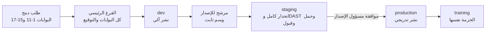

# 22 — العملية الهندسية والجودة

> تحدد هذه الوثيقة كيف تُبنى المنصة وتُختبر وتُنشر وتُشغَّل تقنياً: متى يدخل البند التطوير ومتى يُعدّ منجزاً، ومعايير الكود، والمستودع ومراجعة الكود، وبوابات الجودة في خط النشر بترتيبها، واستراتيجية الاختبار، وسياسة البيانات الاصطناعية، والبيئات والمحاكيات، وإدارة إصدارات التطبيق والويب، وتوافق الواجهة البرمجية، وأهداف مستوى الخدمة، والمراقبة، وإدارة الحوادث، والأداء والسعة، والتوثيق كرمز. وهي تصف **العملية وبواباتها فقط**. وتغلق البندين B-15 وB-16، وبنود الجودة والتشغيل والإصدارات في ملحق [مراجعة الجاهزية](16-readiness-review.md).
>
> وهي أيضاً **المرجع الوحيد لمنهجية التطوير** التي طلبها الزبون: «أي تعديل لاحق يسري على كل شيء، وأي ميزة جديدة تندمج دون شرح مفصّل، والمنصة سهلة التطوير والتحديث والتعديل والإصلاح، ولا يفاجئنا خطأ معروف لاحقاً». ولذلك تحمل: عقد الميزة (§2.5)، وسجل الأخطاء الهندسية المعروفة (§3.15)، وحوكمة إعدادات التشغيل وقوائم اللوحة (§3.16)، وسياسة الإصدارات المدعومة (§4.6)، والسجلات كرمز ومولّداتها (§4.7)، وتصحيح البيانات في الإنتاج (§5.7)، والفصل بين الإصدار وإعدادات التشغيل (§5.8)، واختبارات الآليات المولّدة (§6.19)، وبيئة المطوّر ودليله (§8.6)، والمراقبة من أجل الإصلاح (§13.8)، وبروتوكول التغيير (§16.5)، وسجل الحالات غير المتوقعة (§16.6)، وفحوص الملاءمة في خط النشر FF-01..FF-45 (§16.7). والتصميم التقني للآليات M-0..M-15 في [التصميم التقني](19-technical-design.md)، ومبادئ الحسم الافتراضية P-1..P-14 في [مصفوفات سلوك المنصة §1](26-scenarios-and-linkage.md). وتغلق ما وجّهته المراجعة الثالثة لهذه الوثيقة (§17).

---

## 1. مبادئ حاكمة

| # | المبدأ | التطبيق |
|---|---|---|
| 1 | البوابة قبل كل شيء | لا ينتقل تغيير إلى الخطوة التالية إلا باجتياز بواباتها، ولا تُتجاوز بوابة لأي سبب. والاستثناء الوحيد هو الاستثناء الأمني الموقّع (القسم 5.1) |
| 2 | مصدر واحد لكل حقيقة | المتطلبات في [المتطلبات الوظيفية](04-functional-requirements.md)، والقواعد والإعدادات في [قواعد العمل](06-business-rules.md)، والنصوص في [كتالوج المحتوى](24-content-catalog.md)، ومعايير القبول في [معايير القبول](25-acceptance-criteria.md)، والعقد البرمجي في OpenAPI. والكود والاختبارات تشير إليها بمعرّفاتها (القسم 16). **وما تقرؤه الآلة** (الحالات، والأحداث، والقوالب، ورموز الأخطاء، والصلاحيات والقدرات، وتعريفات الإعدادات، ومفاتيح التشغيل، والقيود، ومدد الاحتفاظ...) ملفات سجلات في المستودع، ومنها يُولَّد كل ما يُشتق منها (القسم 4.7). **وبعد الإطلاق** تصبح قاعدة بيانات الإنتاج المرجع الحي لما يملكه التشغيل (قيم الإعدادات، وحالات المفاتيح، والنصوص المنشورة، وقوائم اللوحة)، والوثائق تحمل الافتراضيات وقيم يوم الإطلاق (القسم 5.8) |
| 3 | قرارات الزبون قيود آلية | كل قرار في [سجل القرارات](02-decisions-log.md) يمس السلوك يتحول إلى اختبار أو قاعدة فحص في خط النشر (القسم 6.4) |
| 4 | بيانات الإنتاج لا تغادر الإنتاج | كل البيئات الأخرى تعمل ببيانات اصطناعية فقط (القسم 7، CT-88) |
| 5 | الخصوصية تشمل الأدوات | السجلات والمؤشرات والتتبّع وتقارير الأعطال خالية من البيانات الشخصية (القسم 3.6، CT-93) |
| 6 | منتج كامل خلف مفاتيح | كل الوحدات تُبنى كاملة، وتشغيلها بمفاتيح التشغيل (SMART-04، ROLLOUT) لا بإصدارات منفصلة (D-18، D-71). ويوم الإطلاق يبدأ بالأساس مفعّلاً وبالباقي مطفأً حتى يفتحه المدير العام (D-95، ROLLOUT-06) |
| 7 | الآلة أولاً | ما يمكن فحصه آلياً يُفحص في خط النشر، والمراجعة البشرية لما لا تراه الأداة |
| 8 | تعديل واحد يسري على كل شيء | كل تغيير يبدأ من صف واحد في سجل، أو من قرار جديد في 02. والمولّدات تنشره إلى قاعدة البيانات والواجهة البرمجية والواجهات الأربع والمحتوى والاختبارات والوثائق في طلب الدمج نفسه، وخط النشر يفشل حيث يبقى أثر ناقص (القسمان 16.5 و16.7) |
| 9 | الميزة الجديدة تُعرَّف بخاناتها | أي ميزة أو تغيير يُعرَّف بملء عقد الميزة (القسم 2.5). فالخانة الفارغة هي السؤال، والنموذج الافتراضي للآلية هو الجواب الآمن، ولا يحتاج المطوّر من يشرح له «إذا حدث كذا فيجب كذا» |
| 10 | الإصلاح بمسار المنتج | لا SQL يدوي على بيانات العمل في الإنتاج (القسم 5.7)، ولا إصدار يكتب فوق قيمة غيّرها المدير العام (القسم 5.8) |
| 11 | الخطأ المعروف لا يتكرر | لكل خطأ هندسي معروف قاعدة واختبار في سجل الأخطاء المعروفة (القسم 3.15)، ولكل خلل يُصلح اختبار رجوع، ولكل حالة لم تحسمها الوثائق صف في سجل الحالات غير المتوقعة (القسم 16.6) |

## 2. شروط دخول التطوير وتعريف الإنجاز

### 2.1 شروط دخول التطوير (Definition of Ready)

لا يدخل البند (متطلب، أو جزء منه، أو إصلاح) التطوير إلا إذا تحققت الشروط التالية، وأقرّها المنتج والهندسة والجودة معاً في جلسة تهيئة البند:

| # | الشرط | المرجع |
|---|---|---|
| R-1 | للبند معرّف ثابت في 04، ومرتبط بالقرارات ذات الصلة في 02 | 04، 02 |
| R-2 | القواعد محددة، وكل قيمة ⚙️ لها في فهرس الإعدادات افتراضي وحد أدنى وأعلى ووحدة وصنف حدود وسياسة سريان على الجاري (القسم 3.16)، وصنف مؤقّت إن كانت مهلة (M-7) | 06، 06 §15 |
| R-3 | معايير القبول مكتوبة بصيغة Given/When/Then وبمعرّفات `AC-<REQ-ID>-NN`، وتشمل المسارات السلبية والأخطاء والحدود | 25 |
| R-4 | الشاشات المعنية معرّفة (`S-<AREA>-NN`)، وتصاميمها جاهزة بالثيمين، ومعها الحالات: فارغة، وتحميل، وخطأ، ودون اتصال، وكل حالة قياسية منطبقة من 18 §2 (ومنها: نافذة القراءة فقط، والخروج فقط، والمقيّد، والتفريغ، والمحجوز لدى جهة رسمية، وتعطّل تبعية). **وكل نص في الشاشة** (التسميات، والعناوين، والمساعدة، وأسماء قارئ الشاشة للأزرار الأيقونية في مساحة `a11y.*`) له مفتاح في كتالوج المحتوى قبل البناء (J-12) | [قائمة الشاشات](18-screen-inventory.md)، معرض التصاميم، 24 |
| R-5 | النصوص وقوالب الرسائل (`T-<CHANNEL>-NN`) ورموز الأخطاء الجديدة لها مفاتيح في كتالوج المحتوى | 24 |
| R-6 | الصلاحيات محددة لكل إجراء حسب الدور، ونطاق الأمن حسب D-80 | [الأدوار والصلاحيات](03-roles-and-permissions.md) |
| R-7 | أثر البيانات معروف: الجداول والحقول، وتصنيف الحساسية، وطريقة الترحيل (القسم 5.4) | [نموذج البيانات](09-data-model.md)، 07 §1 |
| R-8 | أثر الواجهة البرمجية معروف: المسارات، والأخطاء، ومفتاح عدم التكرار، وهل التغيير إضافي (القسم 11) | [التصميم التقني](19-technical-design.md) |
| R-9 | للوحدات الحساسة: التهديدات والضوابط (`TH-NN`، `CT-NN`). ولأي بيانات شخصية جديدة: نشاط المعالجة (`PA-NN`) | [نموذج التهديد](20-threat-model.md)، [الخصوصية](21-privacy-dpia.md) |
| R-10 | للتكاملات: سيناريوهات المحاكي المطلوبة متاحة، أو مدرجة ضمن البند (القسم 9) | — |
| R-11 | مفتاح التشغيل معروف: مفتاح وحدة في SMART-04 أو ROLLOUT، أو مفتاح إصدار مؤقت (القسم 5.5)، ومعه صنف المسار (`intake` أو `drain` أو `protected`) لكل عملية ومستهلك ومهمة ونقطة استقبال (FC-10) | 04 §38، §41 |
| R-12 | القياس محدد: الأحداث والمؤشرات المطلوبة، وأثر البند على أهداف الخدمة (القسم 12) | — |
| R-13 | لا سؤال مفتوح ولا قرار زبون معلّق يغيّر سلوك البند. والاتفاقيات الخارجية غير الموقّعة لا تمنع البدء، لأن البند يُبنى خلف المحاكي والمفتاح | [المخاطر والأسئلة](12-risks-and-open-questions.md) |
| R-14 | عقد الميزة FC-01..FC-30 مملوء في السجلات، وكل خانة «لا تنطبق» معها سببها مكتوباً في السجل (القسم 2.5) | القسم 4.7 |
| R-15 | أي حالة لم تحسمها الوثائق حُسمت بمبادئ P-1..P-14 بالترتيب، وسُجّلت في سجل الحالات غير المتوقعة (`UC-NN`)، أو رُفعت للزبون قبل البدء إن مسّت موافقاً جديداً أو حركة مال أو إفصاحاً أو تغيير ملكية (القسم 16.6) | [مصفوفات سلوك المنصة §1](26-scenarios-and-linkage.md) |

### 2.2 تعريف الإنجاز للبند (Definition of Done)

| المجال | الشرط | التحقق |
|---|---|---|
| الكود | يلتزم بمعايير القسم 3، ويجتاز كل بوابات القسم 5.1 | آلي |
| الاختبارات | اختبارات وحدات وتكامل وعقد للبند، واختبار رجوع لكل خلل أُصلح، وتغطية الأسطر المعدّلة ≥ 80% | آلي |
| معايير القبول | كل `AC-<REQ-ID>-NN` الخاصة بالبند ناجحة: الآلية في خط النشر، واليدوية بدليل مسجّل (لقطة أو تسجيل) في نظام إدارة الاختبار | آلي + يدوي |
| المراجعة | موافقة مالك الكود، وموافقتان للمسارات الحساسة (القسم 4.4)، ولا تعليقات مفتوحة | المستودع |
| الأمن | لا نتائج حرجة أو عالية من SAST وSCA وفحص الأسرار، والضوابط `CT-NN` المرتبطة مختبرة، واختبارات رفض الوصول موجودة (دور غير مخوّل، ومحل آخر، ومحافظة أخرى) | آلي |
| الخصوصية | فحص السجلات الآلي يمر (القسم 3.6)، ولا حقل حساس جديد دون تصنيف وتشفير حسب 07 §1، وبطاقة الخصوصية في المتجرين محدّثة إن تغيّر ما يُجمع (القسم 10.6) | آلي + مراجعة |
| الوصولية | لا مخالفات جسيمة أو حرجة في فحص axe، والتسميات العربية لقارئات الشاشة موجودة، وأحجام اللمس صحيحة، والشاشة تعمل بتكبير الخط 200% | آلي + يدوي |
| العربية والاتجاه | الشاشات المعدّلة تمر بالمقارنة البصرية في الثيمين الفاتح والغامق ومن اليمين لليسار، والأرقام والنصوص اللاتينية معزولة الاتجاه، ولا نص عربي مكتوب في الكود | آلي + مراجعة بصرية |
| المحتوى | كل نص ورسالة خطأ وقالب من كتالوج المحتوى بمفتاحه | آلي |
| الأداء | ميزانيات القسم 3.12 غير متجاوزة | آلي |
| القياس | سجلات منظّمة ومؤشرات وتتبّع للمسار الجديد، وتنبيه ودليل تشغيل لأي نمط عطل جديد | مراجعة |
| مفتاح التشغيل | المفتاح موصول ومختبر بحالاته (`on`، و`draining`، و`off`، والإيقاف الطارئ): عند الإطفاء يختفي الإدخال الجديد ويرد الخادم `FEATURE_DISABLED` لمسارات `intake`، وتُكمل مسارات `drain` الجاري حتى حالته النهائية، ولا تتوقف مسارات `protected` أبداً ولو في الإيقاف الطارئ (محاكاة التفريغ FF-20، القسم 5.5). ولا تتأثر الوحدات الأخرى | آلي |
| الإعدادات | كل قيمة ⚙️ تُقرأ من الإعدادات لا من الكود، ومختبرة عند حدّيها الأدنى والأعلى، والقيود بين المفاتيح مختبرة (القسم 3.16)، وسياسة السريان على الجاري مطبّقة | آلي |
| الترحيل | متوافق مع الإصدار السابق (القسم 5.4)، ولا يعدّل صفاً يملكه التشغيل (القسم 5.8)، وبند «الجاري» مكتوب في طلب الدمج: ما يحدث للصفوف القائمة والمؤقّتات الجارية (FF-45) | آلي + مراجعة |
| المال | لأي بند يمس حركة مال (المحفظة، والتعبئة، والدفع، والاسترداد، والتحصيل عند الاستلام، وتحويلات المندوب، وتسوية المورّدين، والسحب): كل نوع عملية يطبّق نمط MONEY_OP (M-9) بمهلة حسم، ومطابقة، ونوع تصحيح مرتبط، ومسار للمال غير المطابق، وصنف سلطة (`void` أو `refund`، D-116)، وكل اختبارات القسم 6.15 ناجحة له، والمطابقة مختبرة بفروقات محقونة، وموافقتان | آلي + مراجعة |
| المحاسبة | لأي بند في SHOPPRO: اختبارات المزامنة (6.16) وعزل البيانات (6.17) ناجحة، وجولة الكناري نظيفة | آلي |
| السجلات والمولّدات | كل صف سجل مسّه البند كامل الحقول (القسم 4.7)، والمولّدات أُعيد تشغيلها والناتج المحفوظ مطابق، وفحوص الملاءمة FF-01..FF-45 ناجحة (القسم 16.7)، وتقرير الأثر مرفق بطلب الدمج (القسم 16.5) | آلي |
| الأخطاء المعروفة | قواعد سجل الأخطاء الهندسية المعروفة (القسم 3.15) التي يمسّها البند مطبّقة، واختباراتها `PF-NN` ناجحة | آلي + مراجعة |
| الحالات غير المتوقعة | أي سلوك حسمه المطوّر بمبدأ افتراضي معلَّم في الكود `DEFAULT-PRINCIPLE(P-n, UC-NN)` وله صف في السجل (القسم 16.6) | آلي (تقرير) |
| التوثيق | ملف OpenAPI المولَّد محدّث ومحفوظ، وADR عند قرار معماري، ودليل تشغيل عند سلوك تشغيلي جديد، و**تحديث** أقسام الوثائق التي تصف السلوك المتغيّر (04، و06، و09، و18، و19، و24، و25) في طلب الدمج نفسه، لا اقتراحاً (القسم 16.3) | آلي + مراجعة |
| العرض | البند منشور على بيئة dev، واختبار الدخان ناجح | آلي |

### 2.3 تعريف الإنجاز للإصدار

| # | الشرط |
|---|---|
| 1 | كل البنود المضمّنة منجزة حسب 2.2 |
| 2 | مجموعة الانحدار الشاملة (سيناريوهات القبول الشاملة الـ 24 `AC-E2E-01..24` في [معايير القبول §7](25-acceptance-criteria.md)) ناجحة على staging، بالثيمين وعلى مصفوفة الأجهزة (القسم 6.7) |
| 3 | لا خلل مفتوح من الدرجة S1 أو S2 (القسم 2.4) |
| 4 | فحص DAST على staging دون نتائج عالية أو حرجة |
| 5 | اختبار الحمل على المرشح للإصدار إذا مسّ مساراً ساخناً (الفحص، أو المعاملة، أو التنبيهات) أو ترحيلاً على جدول كبير (القسم 15) |
| 6 | قائمة الامتثال للمتجرين مكتملة لإصدارات التطبيق (القسم 10.6) |
| 7 | ملاحظات الإصدار بالعربية جاهزة (القسم 10.9) |
| 8 | طريقة التراجع مختبرة: الحزمة السابقة متاحة، والترحيلات متوافقة، ومفاتيح الإصدار قابلة للإيقاف |
| 9 | أدلة التشغيل المتأثرة محدّثة، والمناوبة التقنية على اطلاع بالتغييرات |
| 10 | موافقة مسؤول الإصدار ومسؤول الجودة مسجّلة في سجل التغيير |

### 2.4 درجات الخلل

| الدرجة | التعريف والأمثلة | أثرها على الإصدار |
|---|---|---|
| S1 حرج | نتيجة فحص خاطئة (جهاز عليه بلاغ نافذ يظهر دون بلاغات أو العكس)، أو تسرّب بيانات، أو تجاوز صلاحية أو نطاق محل أو محافظة، أو توقف رحلة حرجة، أو فقدان بيانات، أو كسر سجل التدقيق، أو خطأ في صيغة قانونية ثابتة (06 §14)، أو دعوة شراء داخل التطبيقين (PAY-08)، أو أي خلل مالي: خصم مكرر، أو استرداد لم يتم أو تم مرتين، أو رصيد معروض يخالف شام كاش، أو تجاوز حد سحب أو حد موظف | يمنع الإصدار، ويُعالج فوراً |
| S2 عالٍ | رحلة لا تكتمل إلا بالتفاف صعب، أو تكامل لا يتعافى تلقائياً، أو إشعار لا يصل، أو مخالفة وصولية تمنع إكمال مهمة، أو عرض عربي مكسور في شاشة أساسية | يمنع الإصدار |
| S3 متوسط | خلل له التفاف سهل، أو أداء خارج الميزانية دون كسر أهداف الخدمة | يُسمح بالإصدار بقرار مسؤول الجودة مع تذكرة مفتوحة |
| S4 منخفض | شكلي لا يؤثر على الفهم أو الاستخدام | لا يمنع |

### 2.5 عقد الميزة (شرط الدخول والإنجاز لأي ميزة أو تغيير)

**البند جاهز** للتطوير حين تُملأ كل خانة منطبقة أدناه في سجلها (القسم 4.7)، **ومنجز** حين تنجح فحوص الملاءمة المقابلة لها (القسم 16.7). والجواب «لا تنطبق» يُقبل فقط مع سبب يُحفظ في السجل نفسه. والعقد يكمّل شروط الدخول R-1..R-15 وتعريف الإنجاز (2.2) ولا يلغيهما. وهو ما يجعل الميزة الجديدة (نوع مستأجر جديد، أو وحدة مدفوعة، أو تكامل، أو نوع جهاز، أو قناة) **تندمج دون أن يشرح أحد للمطوّر ما يجب أن يحدث**.

| # | البند | ما تعلنه الميزة | مكانه | يفرضه |
|---|---|---|---|---|
| FC-01 | الربط بالمتطلبات والقرارات | معرّفات المتطلبات (04) والقرارات (02) على كل صف سجل | كل السجلات | FF-40، FF-41 |
| FC-02 | الكيانات والملكية | الجداول، والوحدة المالكة، ونطاق المستأجر أو «عام»، وRLS | 09، خريطة الملكية (3.3) | FF-32 |
| FC-03 | آلة الحالة | نسخة من نموذج (archetype) بكل حقول M-1: الحالات وأنواعها، والانتقالات، والمنفّذ وصلاحيته، والحراسات، والآثار المسمّاة، والحدث | سجل الآلات | FF-04..FF-07 |
| FC-04 | المخارج | لكل حالة غير نهائية مخرج: مؤقّت، أو طابور بشري بصنف مهلة، أو جهة خارجية مع متابعة | سجل الآلات | FF-05، FF-10 |
| FC-05 | الأحداث | الأحداث الصادرة، والمستهلكون **مع أثر كل منهم** وصنف التسليم (`latest_state` أو `every_event`) | سجل الأحداث | FF-25 |
| FC-06 | التتابع (cascades) | كابن: سياسة لكل صنف حالة لكل أب. وكأب: أصناف الحالات التي يصدرها (M-2) | سجل التتابع | FF-11 |
| FC-07 | آثار العهدة | أنواع العهدة المستخدمة، وسياسة `on_device_restricted` لكل سياق، والحجوزات (M-3) | سجل أنواع العهدة | FF-12..FF-14 |
| FC-08 | القيود | أنواع القيود التي تُنشئها أو تحترمها أو تمنعها (M-4) | سجل أنواع القيود | FF-15 |
| FC-09 | القدرات | صفوف القدرات: الصلاحية، والميزة أو «التزام»، وخانات حالة المستأجر، ونطاقات الجلسة، وعلم «حماية» (M-5) | سجل القدرات والصلاحيات | FF-16..FF-18، FF-36 |
| FC-10 | المفتاح والتفريغ | مفتاح التشغيل، وصنف المسار لكل عملية ومستهلك ومهمة، وسلوك الإيقاف الطارئ، وسياسة التعويض للمدفوع (M-6، D-111) | سجل المفاتيح | FF-19..FF-21 |
| FC-11 | صنف الإساءة والحدود | صنف الحد لكل عملية، وحصة الرسائل لطرف ثالث، وسياسة الإدخال للنص الذي يراه غيره (M-12) | سجل أصناف الحدود | FF-01، FF-44 |
| FC-12 | عدم التكرار والمال | `x-idempotency`، ونسخة MONEY_OP لأي مال (M-9) | OpenAPI، سجل الآلات | FF-01، FF-28..FF-30 |
| FC-13 | التدقيق | صنف التدقيق لكل انتقال ولكل قراءة حساسة | سجل الآلات | FF-06 |
| FC-14 | الإشعارات | قاعدة لكل حدث وانتقال، أو `none:<السبب>`، وكل طرف معني مغطّى (M-8) | سجل قواعد الإشعار | FF-25، FF-26 |
| FC-15 | الأخطاء | الرموز، وحالة HTTP، والنص العربي، والجمهور، ورتبة الأسبقية | سجل الأخطاء، 24 §5 | FF-03 |
| FC-16 | الإعدادات | لكل ⚙️: الافتراضي، والأدنى، والأعلى، والوحدة، وصنف الحدود، وسياسة السريان (`new_only` أو `recompute_open` أو `immediate`) | سجل الإعدادات، 06 §15 | FF-34 |
| FC-17 | المؤقّتات | صنف المؤقّت (M-7)، والإعداد، والتذكيرات وقواعدها، وسياسة ما فات، والأثر الرجعي، والمالك، والتنبيه | سجل المؤقّتات والمهام | FF-22..FF-24 |
| FC-18 | الخصوصية | صنف البيانات لكل حقل **ولكل مصبّ** (الأحداث، والإشعارات، والرسائل الميتة، والسجلات، والتصدير، والمعاينات)، ونشاط المعالجة، ومدة الاحتفاظ، وصف تقييم الأثر (M-11) | سجلات البيانات، 21 | FF-27، FF-31، FF-33 |
| FC-19 | التهديدات | صفوف TH وCT وAB، وحالات الإساءة التي تفتحها الميزة | 20 | 16.4 (CT) |
| FC-20 | الشاشات | معرّفات S مع كل حالة قياسية منطبقة (R-4) | 18 | FF-37 |
| FC-21 | التسميات | تسمية ولون وأيقونة لكل حالة ولكل جمهور، مولّدة من الآلة | 24 §7.3 (مولّد) | FF-08 |
| FC-22 | معايير القبول | معايير الميزة، ومعايير المنصة المولّدة (AC-PLAT) | 25 | FF-38 |
| FC-23 | القرارات البشرية | خطوة الإجراء في 23، وقائمة الأسباب (RSN)، وسياسة الموافق حسب D-102، ومعاينة أثر التتابع قبل القرار | 23، سجل الأسباب | FF-35 |
| FC-24 | المتغيّرات | كل خانة من: نوع الفاعل × نوع المستأجر × القناة × نوع الجهاز × الاتجاه، مسموحة أو ممنوعة بسبب | سجل القدرات | FF-16 |
| FC-25 | التبعيات | الوضع لكل تبعية × رحلة (M-14)، واللافتة، وأثر التعطل على المهل، والتعافي | سجل التبعيات | FF-43 |
| FC-26 | الترحيل والملء والجاري | ترحيل المخطط، وما يحدث للصفوف القائمة والمؤقّتات والنسخ الجارية | بند «الجاري» في طلب الدمج + فرق السجل | FF-45 |
| FC-27 | التصحيح العكسي | لكل انتقال قراري: نتيجة التصحيح، والموافق، والتعويضات، وإعادة التحقق عند التنفيذ | سجل الآلات | FF-06 |
| FC-28 | التمثيل | صفات الفعل نيابة عن الغير المسموح لها بكل قدرة (M-13) | سجل القدرات وصفات التمثيل | FF-16 |
| FC-29 | القياس وأهداف الخدمة | المؤشرات، والأحداث، والأثر على أهداف الخدمة، والتنبيه ودليل التشغيل | القسمان 12 و13 | مراجعة |
| FC-30 | الثغرات المفتوحة | كل حالة حُسمت بمبدأ افتراضي ← صف UC (القسم 16.6) | سجل الحالات غير المتوقعة | FF-42 (تقرير فقط) |

**ما يتغيّر للمطوّر:**

- الميزة الجديدة تُعرَّف بملء FC-01..FC-30، ثم تولّد المولّدات تعداداتها وتسمياتها وطوابيرها ومؤقّتاتها وربط إشعاراتها ومعالجة التتابع وفحوص القدرات وسلوك التفريغ وهياكل اختباراتها (القسم 4.7).
- فحوص خط النشر تسرد الخانات الفارغة بالضبط، فلا يحتاج أحد أن يقول للمطوّر «إذا حدث كذا فيجب كذا»: الخانة الفارغة هي السؤال، والقيمة الافتراضية للنموذج هي الجواب الآمن.
- وصفات الإضافة الشائعة (نوع جهاز، أو مشغّل اتصالات، أو مزوّد محفظة، أو شركة شحن، أو حدث إشعار، أو وحدة) قوائم تحقق قصيرة في دليل المطوّر (القسم 8.6)، وكل منها ينتهي بهذا العقد.

## 3. معايير الكود

### 3.1 TypeScript

| القاعدة | التفصيل |
|---|---|
| الوضع الصارم | `strict: true` في كل الحزم، ومعه `noUncheckedIndexedAccess` و`exactOptionalPropertyTypes` و`noImplicitOverride` و`noFallthroughCasesInSwitch` |
| `any` | ممنوع (`no-explicit-any` خطأ)، ويُستخدم `unknown` مع تضييق النوع |
| تجاوز المترجم | `@ts-ignore` ممنوع. و`@ts-expect-error` مسموح في الاختبارات فقط مع سبب مكتوب |
| التأكيد القسري | `!` والتحويل غير الآمن بـ `as` ممنوعان في كود الإنتاج إلا بتعليق يشرح السبب |
| التحقق عند الحدود | كل ما يدخل من الخارج (طلبات HTTP، ورسائل الطوابير، وردود التكاملات، والإعدادات، وملفات الاستيراد) يُتحقق منه بمخطط تحقق مشترك (zod) في `packages/shared`، ومنه تُشتق الأنواع. ومخططات الواجهة البرمجية مع بيانات كل مسار (`x-permission` وبقية الامتدادات) تُكتب في الكود، ويُولَّد منها ملف OpenAPI لكل نطاق ويُحفظ في المستودع ويُراجع فرقه قبل دمج التنفيذ (القسم 16.2) |
| الأعداد الكبيرة | أعمدة `bigint` في Drizzle بوضع `mode: 'bigint'` داخل نوع المال المشترك. وكل `amountMinor` في JSON يُتحقق منه بـ `Number.isSafeInteger` عند الحدود، ونتائج مجاميع SQL للمال (نصوص من `pg`) تُحوَّل عبر نوع المال لا بـ `Number()` (PF-07) |
| ما يُولَّد من السجلات | التعدادات والأنواع المشتقة من السجلات (الحالات، والأحداث، ورموز الأخطاء، ومفاتيح الإعدادات ومفاتيح التشغيل، والقدرات) تُستورد من الكود المولَّد في `packages/registry`، ولا تُكتب يدوياً، ولا تُعدَّل الملفات المولّدة باليد (القسم 4.7) |
| الأنواع المميّزة | المعرّفات الحساسة أنواع لا تختلط ببعضها: `Imei`، و`NationalId`، و`PhoneE164`، و`AccountNumber`، و`ShopId`. ولا تُنشأ إلا عبر دوال التحقق في `packages/shared` |
| آلات الحالة | تُمثَّل باتحادات مميّزة حسب [التصميم التقني](19-technical-design.md)، وكل `switch` عليها يُفحص للشمول (`assertNever`) |

### 3.2 التدقيق والتنسيق

| الأداة | القواعد الأساسية |
|---|---|
| Prettier | تنسيق موحّد من `packages/config`. ولا نقاش في الأسلوب أثناء المراجعة |
| ESLint | إعداد مشترك: قواعد `typescript-eslint` الصارمة المعتمدة على الأنواع، و`no-console`، و`eqeqeq`، ومنع الوعود العائمة (`no-floating-promises`)، وتعقيد دوري ≤ 15 لكل دالة، وقواعد React وHooks، وقواعد الوصولية (`jsx-a11y` للويب، وقواعد الوصولية لـ React Native) |
| قواعد الاتجاه | تمنع الخصائص المادية: `margin-left/right` و`padding-left/right` و`left/right` و`text-align: left/right` في CSS، وأصناف Tailwind مثل `ml-` و`mr-` و`pl-` و`pr-` و`left-` و`right-` و`text-left` و`rounded-l-` و`border-r-`، و`marginLeft` و`paddingRight` في React Native. والبديل المنطقي إلزامي (القسم 3.8) |
| منع النصوص الثابتة | قاعدة ترفض أي حرف عربي (`[\u0600-\u06FF]`) في كود الواجهات، خارج ملفات الاختبار والنسخة الاحتياطية المضمّنة لكتالوج المحتوى |
| حدود الوحدات | dependency-cruiser وقواعد `no-restricted-imports` (القسم 3.3) |
| رموز التصميم | مصدر واحد للرموز (`packages/ui/tokens/tokens.json` بصيغة W3C Design Tokens) يولّد متغيرات CSS وإعداد Tailwind وثيم React Native ومجموعة الطباعة (فاتحة دائماً، THEME-04)، والبناء يفشل عند أي انحراف بين الناتج والمصدر. وقاعدة تمنع الألوان الحرفية (hex وrgb وhsl) والمسافات الحرفية خارج الرموز، عدا إطارات الأجهزة في معرض التصاميم. والرموز القابلة للتغيير وقت التشغيل (SMART-02) عائلة اللون الأساسي للعلامة وحدها، وألوان الحالات مقفلة (N-16) |
| الحقول اللاتينية في الشاشات العربية | الاستثناء الوحيد من قواعد الاتجاه: حقول IMEI والموبايل والبريد والرقم التسلسلي والمراجع بمكوّن واحد في `packages/ui` يضبط `dir="ltr"` في الويب و`writingDirection: 'ltr'` في React Native مع `text-align: start` (PF-36) |
| السجلات | مدقّق مخطط JSON لكل ملف في `packages/registry`، وقاعدة تمنع تعريف حالة أو حدث أو رمز خطأ أو مفتاح إعداد أو مفتاح تشغيل خارج السجل (FF-03، FF-04، FF-25، FF-34) |
| رسائل الإيداع | commitlint (القسم 4.3) |
| إعدادات التطبيق الأصلية | فحص آلي لإعدادات Expo يرفض أي إذن خارج القائمة المسموحة (القسم 10.6) |
| قاعدة الصفر | لا أخطاء ولا تحذيرات في الملفات المعدّلة. وتعطيل قاعدة في سطر يتطلب تعليقاً بالسبب |

### 3.3 حدود الوحدات

الخادم أحادي معياري (modular monolith): وحدات NestJS داخل `apps/api`، **وأسماء الوحدات وما تملكه من جداول مرجعها الوحيد [التصميم التقني §2.2](19-technical-design.md)** (مثل `accounts`، و`access`، و`checks`، و`reports`، و`tenancy`، و`ownership`، و`devices`، و`telecom`، و`civil`، و`intl`، و`police`، و`billing`، و`wallet`، و`topup`، و`shoppro`، و`support`، و`rollout`، و`reversals`)، وطبقة الحافة (`http-public`، و`http-admin`، و`http-police`، و`http-partner`، و`http-biz`، و`ws`) بلا قواعد عمل.

| القاعدة | الفرض |
|---|---|
| لكل وحدة واجهة عامة واحدة (`index.ts`) فيها خدماتها المعلنة وأحداثها، والداخل (`internal/`) لا يُستورد من خارجها | dependency-cruiser يُفشل البناء |
| لكل جدول وحدة مالكة واحدة مسجّلة في خريطة الملكية، ولا تقرأ وحدة جدول غيرها ولا تكتب فيه مباشرة | فحص آلي لاستعلامات Drizzle حسب الوحدة |
| التواصل بين الوحدات باستدعاء الواجهة العامة، أو بالأحداث عبر outbox (`domain.entity.past_tense`) | قاعدة استيراد + مراجعة |
| محوّلات التكامل في `integrations/<partner>` داخل الوحدة المالكة، ولا تُستدعى إلا عبرها | dependency-cruiser |
| `packages/shared` لا تستورد من `apps/*`، و`packages/ui` بلا منطق عمل ولا استدعاء للواجهة البرمجية | dependency-cruiser |
| التطبيقات (`web`، و`admin`، و`police`، و`mobile`) لا يستورد بعضها من بعض | dependency-cruiser |
| `apps/police` لا يستورد `packages/commerce` ولا أي مكوّن تجاري (D-83، PAY-06) | dependency-cruiser + اختبار شامل (القسم 6.4) |
| `apps/mobile` لا يستورد مكوّنات الشراء أو زر «اطلب التفعيل» أو رابط رقم الإدارة التجاري من `packages/commerce` (D-86، PAY-08) | dependency-cruiser + فحص حزمة التطبيق (القسم 10.6) |
| **المال من باب واحد:** وحدة `wallet` وحدها تستدعي محوّل شام كاش، و`topup` وحدها تستدعي محوّلات التعبئة. وأي خصم من المحفظة (التعبئة، وطلبات المتجر، والخدمات) يمر عبر الواجهة العامة لـ `wallet` بمفتاح عدم تكرار، ولا تكتب وحدة أخرى في جداول المحفظة | dependency-cruiser + فحص ملكية الجداول |
| **بيانات المحاسبة للمحل وحده (D-92، D-101، SHOPPRO-14):** وحدة `shoppro` لا تُستورد من `http-admin` و`http-police` ولا من وحدات `compliance` و`ads` و`backoffice` و`police` و`support`، ومخططها لا يملك عليه أي دور في قاعدة البيانات صلاحية غير دور المحل نفسه. **ولا يوجد أي مسار بشري للاطلاع عليها**، ولا بإذن صاحب المحل | dependency-cruiser + فحص الصلاحيات في قاعدة البيانات (القسم 6.17) |
| **العهدة من باب واحد (M-3):** الدالة `custody.move` في وحدة `ownership` وحدها تكتب سجلات الملكية وأعمدة العهدة وحجوزات الأجهزة. وكل نقل لجهاز (شراء المحل وبيعه، والنقل بين الأشخاص، والنقل لمحل D-121، وتسليم الصيانة، والمرتجع، والجملة، وتسليم مخزون الإغلاق D-108، والانتقال بعد الوفاة D-103، والتصحيح) يمر عبرها بإعادة الفحص نفسها داخل المعاملة نفسها | dependency-cruiser + فحص ملكية الجداول (FF-12) |
| **القيود صفوف لا حالات (M-4):** القيد الذي يتعايش مع غيره (التهدئة، وتأخيرات السحب الأمنية D-115، وتجميدات المحفظة، وحظر الشخص D-106، وتجميد مخزون الاحتيال D-108...) صف في جدول القيود بمصدره ونطاقه ومدته، ولا عمود حالة جديد يحمل قيداً | فحص المخطط (FF-15) |
| **الإشعار من باب واحد (M-8):** لا ترسل وحدة رسالة مباشرة، بل تُصدر حدثاً، وموجّه الإشعارات وحده يرسل حسب قاعدة الحدث ومستلميها ومحظوراتها | dependency-cruiser + FF-25 |
| **لا استدعاء شبكة داخل معاملة قاعدة بيانات مفتوحة (PF-25):** المعاملة الأولى تسجّل العملية `pending` وتلتزم، ثم يُستدعى الشريك، ثم تطبّق معاملة ثانية النتيجة عبر حارس الحالة | قاعدة SAST مخصصة + اختبار الفوضى (القسم 6.11) |
| لا دوائر استيراد بين الوحدات | dependency-cruiser |

### 3.4 التسمية

| العنصر | الصيغة | مثال |
|---|---|---|
| الملفات والمجلدات | kebab-case | `report-review.service.ts` |
| الأنواع والأصناف والمكوّنات | PascalCase | `ReportReviewService` |
| المتغيرات والدوال | camelCase، والدالة تبدأ بفعل | `calculateTrustLevel` |
| الثوابت | UPPER_SNAKE | `MAX_EVIDENCE_FILES` |
| الجداول والحقول | snake_case، والجداول بالجمع | `shop_transactions.created_at` |
| الأحداث | `domain.entity.past_tense` | `report.accepted` |
| رموز الأخطاء | UPPER_SNAKE ببادئة الوحدة | `CHECK_IMEI_INVALID`، `APPVER_UNSUPPORTED` |
| مفاتيح الإعدادات ⚙️ | `<module>.<setting>` بـ snake_case، ومربوطة بسطرها في 06 §15 | `checks.visitor_hourly_limit` |
| مفاتيح التشغيل | أسماؤها وحالاتها (`on`، و`off`، و`awaiting_agreement`) مرجعها الوحيد [التصميم التقني §14.3](19-technical-design.md): `module.*`، و`commerce.*`، و`integration.*`، و`portal.*`، و`rollout.*`، و`system.*`. ومفاتيح الإصدار الهندسية `release.<slug>` | `commerce.store`، `integration.gsma`، `release.bulk-transfer-scan` |
| متغيرات البيئة | UPPER_SNAKE، ولا تحمل قيم عمل (القسم 3.14) | `DATABASE_URL` |
| الفروع | `<type>/<module>-<short-desc>` | `feat/intl-gsma-timeout` |
| الاختبارات | يبدأ الاسم بمعرّف معيار القبول أو المتطلب، أو بمعرّف الخطأ المعروف `PF-NN` | `[AC-CHECK-08-01] shows stolen status with international indicator` |
| ملفات السجلات | `packages/registry/<السجل>.yaml` بـ snake_case، والآلات في مجلد بملف لكل آلة | `settings.yaml`، `state_machines/reports.yaml` |
| مهام التصحيح | `apps/api/src/corrections/<رقم التذكرة>-<وصف>` | `corrections/1234-fix-governorate-backfill` |
| الحالات غير المتوقعة | `UC-NN` في السجل، و`DEFAULT-PRINCIPLE(P-n, UC-NN)` في تعليق الكود | `// DEFAULT-PRINCIPLE(P-3, UC-07)` |
| فحوص الملاءمة | `FF-NN` في اسم مهمة خط النشر | `ff-11-cascade-completeness` |
| رقم المرجع للمستخدم | `ER-` ثم 8 محارف من الأبجدية الآمنة لصيغ المراجع، مشتق من معرّف الطلب (القسم 13.8) | `ER-7K2M9QXD` |

### 3.5 معالجة الأخطاء

1. كل خطأ يصل للعميل بصيغة RFC 9457 (`application/problem+json`)، **والشكل والرموز العامة مرجعها الوحيد [التصميم التقني §3.4](19-technical-design.md)**، وأسماء الرموز ونصوصها العربية مرجعها [كتالوج المحتوى §5](24-content-catalog.md).
2. الحقول: `type`، و`title` و`detail` (نصان عربيان من الكتالوج)، و`status`، و`instance` (مسار الطلب)، و`code`، و`requestId` (يظهر للمستخدم منه «رقم المرجع» بصيغة `ER-XXXXXXXX`، ويبحث به الدعم دون أي بيانات محمية، القسم 13.8)، و`errors[]` لأخطاء الحقول بمؤشر JSON Pointer ورمز لكل حقل.
3. الخطأ لا يحمل تتبّع المكدّس، ولا نص استعلام، ولا اسم جدول، ولا أي بيانات شخصية. ولا يكشف وجود حساب أو جهاز أو بلاغ لغير المخوّل: المورد غير الموجود وغير المسموح يعطيان الرد نفسه (404 `NOT_FOUND`).
4. أخطاء العمل أصناف معرّفة داخل كل وحدة، وتتحول إلى problem+json في مرشح واحد. وأي خطأ غير متوقع يُسجَّل ويُرد بالرمز `INTERNAL_ERROR` (500) مع `requestId`.
5. `RATE_LIMITED` (429) والتوقف المؤقت (503) يحملان `Retry-After`.
6. لا يُبتلع خطأ: الالتقاط مسموح فقط لإضافة سياق أو للتحويل إلى خطأ عمل.
7. محوّلات التكامل تحوّل أخطاء الشريك إلى أنواع موحّدة: انتهاء المهلة، وعدم الإتاحة، والرفض، والرد غير الصالح. ولكل محوّل مهلة، وإعادة محاولة بتباعد متزايد، وقاطع دائرة (circuit breaker).
8. إعادة المحاولة فقط للعمليات المحمية بمفتاح عدم التكرار (`Idempotency-Key`) أو الآمنة بطبيعتها.
9. في الواجهات: حاجز أخطاء عام يعرض رسالة الكتالوج والرقم المرجعي، ويُبلغ أداة تتبّع الأعطال دون بيانات شخصية.
10. **أسبقية الأخطاء (M-5):** حين يفشل أكثر من شرط يعيد الخادم رمز **أول** فشل بترتيب محلّل القدرات: نطاق الجلسة، ثم مسار مفتاح التشغيل، ثم حالة حساب الفاعل وقيوده، ثم حالة المستأجر، ثم العضوية والهوية (D-40)، ثم الصلاحية، ثم نوع النشاط، ثم الاستحقاق ونافذة القراءة فقط، ثم خصائص المورد (الملكية، ونطاق الأمن، وتعارض المصالح، والتهدئة، والأربع عيون)، ثم الحدود. ولكل رمز رتبة أسبقية في سجل الأخطاء (FF-03)، فلكل رفض رمز واحد وخطوة تالية واحدة. والقدرات المعلَّمة «حماية» (مثل بلاغ السرقة) لا تمر بالخطوتين 3 و4 (المبدأ P-1).
11. خطأ الشريك ليس فشلاً: انتهاء المهلة دون جواب يجعل العملية `pending` حتى استعلام الحالة، ولا يُعاد طلب مالي قبل الاستعلام (PF-26).

```json
{
  "type": "https://<domain>/problems/check-imei-invalid",
  "title": "رقم IMEI غير صالح",
  "status": 400,
  "detail": "تأكد من الخانات الخمس عشرة وأعد المحاولة.",
  "instance": "/v1/checks",
  "code": "CHECK_IMEI_INVALID",
  "requestId": "0192f3c4-7b1e-7c2a-9d55-1f0a2b3c4d5e",
  "errors": [{ "pointer": "/imei", "code": "CHECK_IMEI_INVALID" }]
}
```

### 3.6 السجلات

السجلات JSON منظّمة من مُسجِّل واحد في `packages/shared`، بالمستويات `error` و`warn` و`info` (و`debug` خارج الإنتاج فقط). **الحقول من قائمة مسموحة**، وأي حقل خارجها يُحذف ويُعدّ في مؤشر. ويُسجَّل قالب المسار فقط (`/v1/devices/{id}`)، ولا تُسجَّل سلاسل الاستعلام ولا أجسام الطلبات والردود.

**الحقول الممنوعة وبدائلها:**

| الممنوع | البديل في السجل |
|---|---|
| الرقم الوطني | `person_id` (UUID)، أو بصمة السجل `nid_h` |
| أرقام الموبايل كلها: رقم الحساب، والرقم البديل، ورقم واتساب الفاحص، ومرسل SMS، والجهات الموثوقة، والمحافظ | `user_id`، أو `phone_h` |
| IMSI وMSISDN وأي رقم شريحة | `telecom_event_id` |
| الإحداثيات الدقيقة: GPS، وموقع البرج، ونقطة الحادثة، ومواقع التتبّع | `governorate_id` فقط |
| الأسماء: المستخدم، والبائع، والمشتري، والموظف، وصاحب الهوية | المعرّف الداخلي للكيان |
| IMEI والرقم التسلسلي | `device_id`، أو `imei_h`، ومعه TAC (أول 8 خانات) عند الحاجة لتشخيص الموديل |
| صور الهويات والأدلة، ومفاتيح تخزينها، وروابطها الموقّعة | `file_id` |
| كلمات المرور، ورموز التحقق، ورموز الدخول والتجديد، ومفاتيح API، والتواقيع، والكوكيز، وترويسة `Authorization`، ورموز الإشعارات للأجهزة | لا شيء |
| عنوان IP الكامل | `ip_h` في سجلات التطبيق. والعنوان الكامل في سجل الأمن وسجل التدقيق فقط |
| البريد الإلكتروني | `user_id` |
| النصوص الحرة: وصف البلاغ، والمعلومات الواردة، وطلبات الدعم، والرسائل، والملاحظات | الطول فقط |
| ردود الأحوال المدنية وشركات الاتصالات وGSMA | رمز النتيجة ومعرّف الاستعلام |
| الأسعار ومبالغ المكافآت والمدفوعات، وأرصدة المحافظ ومبالغ التعبئة | معرّف المعاملة أو الدفعة أو عملية المحفظة |
| بيانات المحاسبة: الأصناف وأسعار الكلفة والأرباح، والمصاريف، والرواتب والعمولات، وأسماء زبائن الديون وأرقامهم ومبالغهم، والجرد | معرّف السجل المحاسبي فقط، ولا مؤشرات بقيمها حتى إجمالية (SHOPPRO-14) |
| أرقام حسابات شام كاش ومحافظ السحب، ورقم الزبون المعبَّأ له، ورمز المحفظة (PIN) | معرّف عملية المحفظة أو التعبئة. ورمز المحفظة لا يُسجَّل بأي صيغة أبداً |

**البصمات:** `*_h` تُحسب بـ HMAC-SHA256 بمفتاح سجلات مستقل في الخزنة، منفصل عن مفاتيح البصمة للبحث (CT-27)، ويُدوَّر، وتُقتطع النتيجة لـ 16 خانة ست عشرية. **والبصمة دون مفتاح (SHA-256 وحدها) ممنوعة**، لأن أرقام الموبايل والأرقام الوطنية محدودة العدد ويمكن استرجاعها بالتجريب.

**الفرض الآلي:**

| الآلية | ما تمنعه |
|---|---|
| القائمة المسموحة في المُسجِّل، ومسارات الحجب للترويسات والأجسام | الحقول الحساسة والأسرار |
| قاعدة تدقيق تمنع تمرير كائن كيان كامل للمُسجِّل، وتمنع الحقول بأسماء مثل `nationalId` و`phone` و`imsi` و`msisdn` و`lat` و`lng` و`fullName` و`password` و`otp` و`token` | التسرّب العرضي |
| «اختبار الكناري» في البوابة 6: تُجمع سجلات اختبارات التكامل والاختبارات الشاملة وتُفحص بأنماط وبقيم كناري فريدة يزرعها مولّد البيانات (القسم 7) | أي تسرّب يصل للسجل فعلاً |
| ضبط أداة تتبّع الأعطال: `sendDefaultPii` معطّل، وتنظيف قبل الإرسال، ولا إعادة تشغيل للجلسات ولا لقطات شاشة | التسرّب عبر تقارير الأعطال |
| **رمز التحقق لا يُحفظ في أي مصبّ دائم (H-01، M-11):** لا في الإشعارات، ولا صندوق الصادر، ولا المهام المجدولة، ولا الرسائل الميتة، ولا سجلات التكامل. صف الإشعار يحمل `otp_challenge_id` فقط، والمرسل يقرأ الرمز من خانة مؤقتة مشفّرة تنتهي بانتهاء صلاحية الرمز وتُحذف بعد قبول المزوّد. ورسائل فئتي `otp` و`security` الفاشلة لا يعيد إرسالها موظف، ولا تدخل الرسائل الميتة بنصها، و«إعادة الإرسال» من الدعم = تحدٍّ جديد لرقم المستخدم نفسه | قراءة موظف أو مهندس لرمز حي |
| كناري رمز التحقق وكناري XSS في البوابة 6 والقسم 6.5: رمز كناري فريد لا يظهر في أي جدول أو سجل أو تتبّع أو إطار WebSocket أو رد إداري | أي تسرّب لرموز التحقق أو للنص المحقون |

أنماط الكناري (أمثلة):

```text
national_id : \b\d{11}\b
sy_mobile   : (?:\+?963|\b0)9\d{8}\b
imei        : \b\d{15}\b            (ثم فحص Luhn لتقليل الإنذار الكاذب)
imsi        : \b(?:417|001)\d{12}\b
coordinates : \b3[2-7]\.\d{4,}\b.{0,40}\b(?:3[5-9]|4[0-2])\.\d{4,}\b
```

مثال سطر سجل مقبول:

```json
{"ts":"2026-10-12T09:41:07.218Z","level":"info","service":"api","env":"production","version":"a1b2c3d",
 "trace_id":"4bf92f3577b34da6","request_id":"0192f3c4-7b1e-7c2a-9d55-1f0a2b3c4d5e","route":"POST /v1/checks",
 "actor_type":"visitor","channel":"web","governorate_id":3,"imei_h":"9f2c41d07a6e88b1",
 "tac":"35693803","result":"reported_stolen","gsma":"pending","status":200,"duration_ms":142}
```

### 3.7 التعليقات

- التعليق يشرح «لماذا» لا «ماذا»، ويشير إلى المعرّفات: `// SHOP-14, 06 §6: distance threshold comes from settings`.
- `TODO` مسموح فقط مع رقم تذكرة: `TODO(#123)`. ولا كود معلّق في الفرع الرئيسي.
- توثيق TSDoc للواجهة العامة لكل وحدة وحزمة.
- المعرّفات والتعليقات بالإنكليزية. ولا تُنسخ نصوص الواجهة العربية في الكود ولا في التعليقات، بل يُشار إلى مفتاحها في الكتالوج.

### 3.8 العربية والاتجاه والنصوص

| المجال | القاعدة |
|---|---|
| مصدر النصوص | كل نص ظاهر من [كتالوج المحتوى](24-content-catalog.md) بمفتاحه، ويُقرأ من الخادم (SMART-01) مع نسخة احتياطية مضمّنة في التطبيق والويب للعمل دون اتصال وفي التشغيل الأول. والعربية هي اللغة الوحيدة (D-01، D-22)، والبنية تحفظ النصوص بمفاتيح |
| المتغيرات في النصوص | بصيغة ICU MessageFormat بأسماء معرّفة (`{deviceModel}`)، مع صيغ الجمع العربية الست (zero، وone، وtwo، وfew، وmany، وother) |
| الاتجاه | `<html lang="ar" dir="rtl">` في الويب. وفي التطبيق `I18nManager.forceRTL(true)` مع فحص عند الإقلاع يعيد التشغيل إن لم يُطبَّق |
| الخصائص المنطقية | فقط: `margin-inline-start` و`padding-inline-end` و`inset-inline-start` و`text-align: start` في CSS، و`ms-` و`me-` و`ps-` و`pe-` و`start-` و`end-` و`text-start` و`rounded-s-` في Tailwind، و`marginStart` و`paddingEnd` و`start` في React Native |
| الأيقونات | الأيقونات الدالة على اتجاه (الأسهم، والرجوع، والتقدّم، والسلاسل) تُعكس. وغير الاتجاهية (الشعار، والهاتف، وعلامة الصح، والتشغيل، والباركود) لا تُعكس. والقائمة في `packages/ui` |
| عزل الاتجاه | كل قيمة لاتينية أو رقمية داخل جملة عربية تُعزل: IMEI، وأرقام الموبايل، ورقم الحساب `SY-XXXXXX`، وكل المراجع بصيغها المعتمدة في [التصميم التقني §13.1](19-technical-design.md) (مثل `BL-` و`TX-` و`CR-` و`ST-` و`SH-` و`OR-` و`RN-` و`IN-` و`WL-` و`TP-`)، والبريد، والروابط، وأسماء الموديلات اللاتينية. في الويب وPDF بعنصر `<bdi>` أو `dir="ltr"` مع `unicode-bidi: isolate`، وفي التطبيق بمحارف العزل (U+2066 إلى U+2069) من دالة التنسيق المشتركة. **وفي واتساب وSMS لا محارف عزل أبداً:** القيمة اللاتينية في آخر السطر بعد نقطتين أو في سطر مستقل، ولا قيمتان لاتينيتان متجاورتان في سطر واحد، حسب [كتالوج المحتوى §1.6](24-content-catalog.md)، لأن بعض الأجهزة لا تعرض المحارف الخفية، ولأن المستلم ينسخ الأرقام والمراجع من الرسالة إلى أنظمة أخرى (PF-10) |
| الأرقام | العرض بالأرقام الغربية (0-9) حسب [الهوية البصرية §4](15-visual-identity.md). والإدخال يقبل الأرقام العربية (٠-٩) والفارسية (۰-۹) والغربية، ويحذف المسافات والشرطات ومحارف الاتجاه الخفية (U+200E وU+200F وU+2066 إلى U+2069) قبل التحقق، لأن الأرقام المنسوخة من واتساب تحملها غالباً |
| أرقام الموبايل | بعد تطبيع الأرقام وحذف الفواصل تُقبل: `09XXXXXXXX`، و`9XXXXXXXX`، و`+9639XXXXXXXX`، و`009639XXXXXXXX`، و`9639XXXXXXXX`، و`+963 09XXXXXXXX`، وتُخزَّن `+9639XXXXXXXX` (08 §5)، وتُعرض `09XX XXX XXX` معزولة. وأي صيغة أخرى `AUTH_PHONE_INVALID`. وبادئات المشغّلين بيانات في الإعدادات، لا ثوابت في الكود (PF-04) |
| الخط | IBM Plex Sans Arabic مستضاف ذاتياً بصيغة WOFF2، مقسّماً لنطاقات الحروف المستخدمة، بوزنين محمّلين مسبقاً (400 و700) و`font-display: swap`. ولكل مستوى نص في الرموز ارتفاع سطر ≥ 1.5 من حجمه، وفي أندرويد `includeFontPadding: false` مع توسيط عمودي، فلا تُقص الهمزات والتشكيل (PF-36) |
| البحث | توحيد النص العربي للبحث بدالة واحدة `ar_norm_v1` معرّفة في قاعدة البيانات ومستخدمة في المحفّز وفي جانب الاستعلام معاً، والتفاصيل والمتجهات الذهبية في PF-01 و19 §16.2 |
| معاملات قوالب واتساب | كل متغير يمر بمعقّم واحد: حذف محارف الاتجاه والمحارف الصفرية العرض، واستبدال السطر الجديد والجدولة بمسافة، وطي المسافات المتتالية، والقص لأقصى طول المتغير في 24، لأن Meta ترفض المعاملات التي فيها سطر جديد أو أكثر من أربع مسافات متتالية فتسقط رسالة حرجة إلى SMS (PF-43) |
| الطباعة | الوثائق المطبوعة بالثيم الفاتح دائماً (THEME-04)، ووصل الحروف واتجاهها مختبران في Chromium على الخادم |

### 3.9 التواريخ والتوقيت

| المجال | القاعدة |
|---|---|
| التخزين | `timestamptz` بتوقيت UTC، وفي الواجهة البرمجية بصيغة ISO 8601 مع `Z` |
| العرض | بتوقيت `Asia/Damascus` والتقويم الميلادي، عبر دالة تنسيق مشتركة واحدة بالإعداد المحلي `ar-SY-u-nu-latn` (فتُضمن الأرقام الغربية في كل محرك، لأن `ar-SY` وحده يعطي أرقاماً هندية في بعض المحركات)، وأسماء الأشهر الشامية (كانون الثاني، وشباط، وآذار...) من جدول [كتالوج المحتوى §1.6](24-content-catalog.md) لا من بيانات ICU في الجهاز. والصيغ النهائية في كتالوج المحتوى (PF-08) |
| قواعد المناطق الزمنية | لا تُحسب الإزاحة يدوياً أبداً، ولا تُكتب في الكود. وسوريا على UTC+3 طوال العام منذ 2022 حسب قاعدة IANA، وأجهزة أندرويد القديمة قد تحمل قواعد قديمة، لذلك يرسل الخادم إزاحة دمشق الحالية ومدة صلاحيتها ضمن إعدادات التطبيق، ويعتمدها التطبيق في العرض، ويُختبر ذلك على أندرويد 8. والتواريخ الواقعة خارج تلك المدة (مثل حوادث قديمة في ملف استيراد) تُنسَّق في الخادم. **وكل خدمة ترفض الإقلاع** إن كانت إزاحة `Asia/Damascus` في 15 كانون الثاني ≠ +03:00 (قاعدة tzdata قديمة في الصورة أو في Node أو في PostgreSQL) |
| الحسابات الزمنية | المهل (مثل ⚙️ 30 دقيقة للإلغاء الذاتي و⚙️ 72 ساعة لقبول النقل) وحساب ساعات الدوام (D-85، D-98، [إجراءات التشغيل §1.3](23-operations-sops.md)) تُحسب في الخادم فقط. ووقت الجهاز لا يدخل في أي قرار، لأنه قد يكون خاطئاً بعد انقطاع الكهرباء. **وكل مهلة تنتمي لصنف مؤقّت واحد من M-7** معلن في سجل المؤقّتات: `WALL_SECURITY` (مطلقة لا تتحرك)، و`WALL_USER` (تتحرك إذا منع عطل معلن أو صيانة الرحلة)، و`BUSINESS` (بتقويم الدوام الرسمي، D-123)، و`BUSINESS_FLOOR` (الأكبر من المدة المطلقة ونهاية يوم الدوام N)، و`PAUSABLE` (تتوقف ما دام شرط معلن قائماً). ولا يُختار الأساس داخل الكود |
| تقويم الدوام (D-123) | كيان في قاعدة البيانات: عطلة الجمعة والسبت، والعطل الرسمية كما تُعلن، ودوام رمضان المخفّض. يحدّثه المدير العام عند الإعلان، وكل تعديل يعيد حساب المهل المفتوحة من صنفي `BUSINESS*`. وتنبيهات قوى الأمن لحظية في كل أيام السنة ولا تمر بالتقويم |
| المهام الدورية | تُعرَّف بالتوقيت المحلي، وتعمل مرة واحدة لكل تاريخ محلي (هوية التشغيل = المهمة + التاريخ المحلي)، ولكل مهمة سياسة لما فات: `run_missed_once` (المطابقات، والتسويات، وتقارير الالتزام والمؤشرات، والاحتفاظ، والتقسيم، والتحقق من التدقيق) أو `skip` (الحذف والمسح والفحص الدوري). والتقرير المتأخر يحمل «وُلّد متأخراً في...» (E-11، E-23) |
| ساعة الخوادم | مزامنة من مصدرين داخل بلد الاستضافة على الأقل (NTP لدى المشغّل أو ساعة GPS)، وتنبيه عند فرق > ثانية واحدة، لأن رموز TOTP والجلسات وتواقيع الشركاء (±5 دقائق) تعتمد عليها، ولأن مصادر NTP الخارجية قد تنقطع (PF-42) |
| الاختبار بمنطقتين | مجموعة الاختبارات تعمل بـ `TZ=UTC` و`TZ=Asia/Damascus`، مع متجهات حدية عند 20:59 و21:00 UTC (منتصف ليل دمشق: الحدود اليومية، وأيام التسوية) و31 كانون الأول 21:00 UTC (سنة المراجع `BL-YYYY` و`TX-YYYY`) (PF-08) |
| الساعة في الكود | الوقت يُقرأ من خدمة ساعة قابلة للحقن (`Clock`) لا من `Date.now()` مباشرة، لتُختبر المهل بالتحكم بالوقت |
| التاريخ دون وقت | مثل تاريخ الحادثة (REPORT-02): تاريخ محلي مع نافذة وقت تقريبية، ويُخزَّن معه اسم المنطقة الزمنية صراحة |

### 3.10 المبالغ المالية

- المبلغ عدد صحيح (`bigint`) بأصغر وحدة للعملة، ومعه رمز العملة (`SYP`) في كل مكان. ولا أعداد عشرية عائمة أبداً.
- الحساب عبر وحدة مال مشتركة في `packages/shared`، والأعداد الكبيرة حسب PF-07.
- **قاعدة التقريب الوحيدة (PF-06):** النسب تُحفظ بنقاط الأساس (`*_bp`، عدد صحيح). وكل سطر محسوب (عمولة، وحصة، وخصم، وقسط) يُقرَّب نصفاً للأعلى (half-up) إلى الوحدة الكاملة للعملة لحظة حسابه. والإجماليات والتسويات وكشوف الحساب مجاميع دقيقة للأسطر المقرَّبة ولا يُعاد تقريبها، وباقي القسمة يُحمَّل على آخر قسط أو سطر. والدالة واحدة في `packages/shared` باختبار خصائص (مجموع الأسطر = الإجمالي دائماً)، ومتجهات ثابتة منها: 1,050 × 250 نقطة أساس = 26.25 ← 26، و1,030 × 250 = 25.75 ← 26.
- العرض: أرقام غربية، وفاصل الآلاف، و«ل.س» بعد الرقم، والقيمة معزولة الاتجاه.
- **تبديل العملة وحذف الأصفار (D-118، PF-06):** الحساب والتخزين بالوحدة الرسمية الحالية فقط. وجدول مرجعي للوحدات (الرمز، والاسم، وأس الوحدة الصغرى، وتاريخ السريان، والنسبة للوحدة السابقة). ولا يُحوَّل مبلغ مخزَّن في مكانه أبداً، فكل صف يحمل رمز عملته، والعرض وحده يحوّل عبر الجدول. وخلال الفترة الانتقالية الرسمية تعرض شاشات إدخال المبالغ والإيصالات والفواتير المقابل بالوحدة القديمة بخط صغير، وتطلب تأكيداً مع كتابة المبلغ بالحروف حين يتجاوز المُدخل حد المعقولية للحقل ⚙️ (06 §15) أو يبدو أكبر بمئة مرة. وكل محوّل شريك يعلن الوحدة التي يتكلمها ويحوّل عند الحدود، والمبلغ المخالف لكتالوج المنتج بمعامل 100 خطأ من الشريك لا نجاح.
- **ثوابت المبالغ في المخطط (H-15، FF-30):** كل `amount_minor` في الدفع والسحب والتعبئة والاسترداد والتحصيل > 0، والكمية > 0، ومجموع الاستردادات لكل دفعة ≤ المدفوع، ومجموع المرتجع لكل سطر طلب ≤ المسلَّم، وسطر نقطة البيع بكمية > 0 وسعر ≥ 0 وخصم ≤ إجمالي السطر، وتعديل التسوية ≤ المرتجع أو العيب المرتبط به. قيود `CHECK` في قاعدة البيانات، وحدود دنيا في العقد، واختبارات خصائص. والمرتجع أو الإلغاء قيد عكسي منفصل، لا كمية سالبة.
- سعر البيع اختياري ولا يظهر إلا للمشتري (D-17)، ولا يدخل السجلات ولا المؤشرات. ومبلغ المكافأة نص للعرض فقط، ولا مسار دفع له (D-50).
- كشوف تسوية المورّدين (STORE-10) تُحسب في الخادم من الطلبات المسلّمة والمدفوعة بالقواعد نفسها، ومجموعها يطابق مجموع بنودها دائماً، واختبارها ضمن الوحدات الحرجة.
- **محفظة المحل (D-89):** المال لدى شام كاش في حساب باسم المحل، والمنصة لا تمسك مالاً. لذلك الرصيد المرجعي هو رصيد شام كاش، وما تحفظه المنصة سجل عمليات مرآة بمراجع شام كاش ومراجع الشركات، يُطابق يومياً (SHOPWALLET-06، TOPUP-06). ولا يُعدَّل رصيد ولا سجل يدوياً أبداً، بل بعملية تصحيح موثّقة.
- كل عملية مال (شحن، وسحب، وخصم، وتعبئة، واسترداد) لها مفتاح عدم تكرار يُمرَّر للشريك نفسه، وحالة صريحة (معلّقة، أو ناجحة، أو فاشلة، أو مستردة)، ولا تنتقل من حالة نهائية أبداً.
- **نمط MONEY_OP لكل حركة مال (M-9، التفصيل في [التصميم التقني](19-technical-design.md)):** الرد الوارد من الشريك **تلميح** فقط، ولا تُلتزم حركة مال إلا بعد استعلامنا نحن عن الحالة عبر القناة الموثّقة وتطابق المرجع والمبلغ (H-13). والمهلة دون جواب ليست فشلاً (PF-26). والتصحيح عملية مرتبطة جديدة (`corrects_id`) لا تعديل لحالة نهائية. والمال الذي لا يطابق شيئاً يذهب إلى «غير مخصّص» حتى يُخصَّص أو يُعاد لمصدره، ولا يُصادر أبداً. و**الإلغاء قبل بدء الخدمة أو قبل تأكيد الطلب** إرجاع آلي للمبلغ نفسه إلى المصدر نفسه (`void`) مسجّل دون موافقات، وكل استرداد آخر (`refund`) بموافقتين (D-116). وتغيير وجهات الدفع والسحب للشركاء يسري بعد مهلة أمان ⚙️ مع إعلان، ولا يكون فورياً.
- الدفع للخدمات التجارية برقم مرجعي يؤكده المشرف التجاري أو من محفظة المحل (PAY-01، PAY-07، SHOPWALLET-04)، **ولا دفع عبر آبل أو جوجل** (D-86)، فلا أسعار متاجر ولا مكتبات فوترة في الكود.

### 3.11 إمكانية الوصول (WCAG 2.2 AA)

المستوى المطلوب WCAG 2.2 AA لكل الواجهات: الموقع، والتطبيق، ولوحة الإدارة، وبوابة الأمن.

| المجال | القاعدة |
|---|---|
| التباين | 4.5:1 للنص، و3:1 للنص الكبير ولحدود عناصر الواجهة، في الثيمين. ورموز التصميم تُفحص آلياً (SMART-02) |
| اللون | لا يحمل المعنى وحده: لون وأيقونة ونص لكل حالة (THEME-03) |
| أهداف اللمس | 44×44 نقطة في iOS، و48×48 dp في أندرويد، وفي الويب 24×24 بكسل حداً أدنى (2.5.8) مع تباعد كافٍ |
| التركيز | ظاهر دائماً، لا يغطيه رأس ثابت أو شريط (2.4.11)، وترتيبه منطقي من اليمين لليسار |
| لوحة المفاتيح | كل وظائف لوحة الإدارة وبوابة الأمن تعمل بلوحة المفاتيح، ومنها الجداول والخريطة والنوافذ المنبثقة |
| السحب | لكل حركة سحب بديل بنقرة (2.5.7): دبوس الخريطة (SHOP-02) له زر «موقعي الحالي» وحقل عنوان، والمنزلق الزمني (TRACK-04) له حقلا تاريخ |
| المصادقة | لا اختبار ذهني (3.3.8): ALTCHA بإثبات العمل دون ألغاز، ولصق رمز التحقق وكلمة المرور مسموح، ومديرو كلمات المرور مدعومون، وحقل الرمز من نوع `one-time-code` |
| الإدخال المكرر | لا يُطلب من المستخدم إعادة ما أدخله في المسار نفسه (3.3.7)، والمسودات تحفظ ما سبق |
| المساعدة | مدخل «طلب دعم» في الموضع نفسه في كل الشاشات (3.2.6) |
| قارئ الشاشة | تسميات عربية لكل عنصر تفاعلي، والأرقام الطويلة (IMEI) تُقرأ خانةً خانة بتسمية مخصصة، وإعلانات حيّة (`aria-live`) لنتيجة الفحص وللتحديث اللحظي في البوابة واللوحة |
| التكبير | النص يكبر حتى 200% دون قص أو تداخل، ويحترم حجم الخط في إعدادات النظام |
| الحركة | احترام إعداد «تقليل الحركة»، ولا وميض |
| النماذج | لكل حقل تسمية ظاهرة، ورسالة الخطأ مرتبطة بالحقل وتقول ماذا حدث وماذا يفعل المستخدم (08 §7) |
| مهل الجلسات | تنبيه قبل انتهاء جلسة الإدارة والأمن مع إمكانية التمديد، دون فقدان العمل |
| العدّاد التنازلي | رمز التحقق، ورمز الإكمال، ومهل 48 و72 ساعة: إعلان مهذّب (`polite`) عند البدء، وعند بقاء دقيقة، وعند الانتهاء فقط، لا كل ثانية (J-28) |
| المحتوى المتحرك | ما يتبدّل تلقائياً أكثر من 5 ثوانٍ (مثل شرائح الإعلانات) له زر إيقاف وتشغيل ظاهر، ويتوقف عند التركيز أو اللمس (2.2.2، J-31) |
| الأزرار الأيقونية | لا زر بأيقونة وحدها إلا الرجوع والإغلاق والبحث، ولا زر أيقوني لإجراء هدّام، وتسميات التبويبات ظاهرة دائماً. ولكل زر أيقوني اسم لقارئ الشاشة بمفتاح من مساحة `a11y.*` في كتالوج المحتوى (J-12، J-28) |
| إعادة التدفق | صفحات الويب تعمل بعرض 320 بكسل CSS دون تمرير أفقي (1.4.10)، والجداول الكثيفة تتحول إلى بطاقات تحت العرض المحدد في [الهوية البصرية](15-visual-identity.md) (J-06) |
| الحالات المتقاربة | الحالات المتقاربة لوناً (مثل «مفقود» و«تحذير») تتميّز بأيقونة مختلفة دائماً، لا باللون وحده (J-28) |
| نغمة التنبيه | تنبيه بوابة الأمن بنغمة مميزة غير مفزعة أقصر من ثانية، تُفعَّل بلمسة المستخدم عند بدء المناوبة (قيود المتصفحات على الصوت)، ومعها إعلان مرئي ولقارئ الشاشة (J-28) |
| محدودو القراءة وكبار السن | جمل قصيرة، وأيقونة مع كل نص حالة، وخطوة واحدة في كل شاشة للرحلات الحرجة (الفحص والبلاغ)، واختبار مع مستخدمين من هذه الفئة (08 §7) |

### 3.12 ميزانيات الأداء

**التطبيق** (القياس على جهاز حقيقي من مصفوفة القسم 6.7):

| المقياس | الجهاز الضعيف المرجعي (أندرويد 8، ذاكرة 2 غيغابايت) | جهاز متوسط |
|---|---|---|
| الإقلاع البارد حتى شاشة الفحص التفاعلية | ≤ 4 ثوانٍ | ≤ 2 ثانية |
| الانتقال بين الشاشات | ≤ 300 ملّي ثانية | ≤ 150 ملّي ثانية |
| فتح الماسح حتى قراءة باركود واضح | ≤ 2 ثانية | ≤ 1 ثانية |
| ضغط صورة 12 ميغابكسل إلى ⚙️ 2000 بكسل | ≤ 2 ثانية | ≤ 1 ثانية |
| نقطة البيع: من مسح الباركود حتى ظهور السطر في الفاتورة | ≤ 300 ملّي ثانية | ≤ 150 ملّي ثانية |
| نقطة البيع: حفظ بيع نقدي دون اتصال | ≤ 300 ملّي ثانية | ≤ 150 ملّي ثانية |
| الذاكرة في ذروة الاستخدام (الكاميرا مفتوحة) | ≤ 300 ميغابايت | ≤ 400 ميغابايت |
| سلاسة القوائم | ≥ 55 إطاراً في الثانية في المتوسط | ≥ 58 |
| البيانات المستهلكة لفحص واحد بعد التحميل الأول | ≤ 20 كيلوبايت | — |
| حجم التنزيل من المتجر | أندرويد ≤ 35 ميغابايت، وiOS ≤ 60 ميغابايت | — |
| الاستقرار | جلسات دون أعطال ≥ 99.5%، ومعدل الأعطال الملحوظة < 1.09%، ومعدل ANR < 0.47% (حدود Google Play) | — |

**الويب:**

| الواجهة | الميزانية |
|---|---|
| الموقع العام (صفحة الفحص) | الصفحة الأولى ≤ 200 كيلوبايت مضغوطة إجمالاً (08 §1)، منها JavaScript ≤ 90 كيلوبايت والخطوط ≤ 60 كيلوبايت. وLCP ≤ 3 ثوانٍ على ملف 3G المرجعي (08 §1) و≤ 2.5 ثانية على 4G، وINP ≤ 200 ملّي ثانية، وCLS ≤ 0.1، ودرجة Lighthouse للأداء ≥ 90 على الموبايل |
| صفحات التحقق العامة (PUB-02، PUB-03، PUB-06) | الميزانية نفسها، لأنها تُفتح غالباً من متصفح واتساب الداخلي |
| لوحة الإدارة وبوابة الأمن | JavaScript الأولي ≤ 300 كيلوبايت مضغوطة، وLCP ≤ 2.5 ثانية على اتصال مكتبي، وتحديث القوائم والخريطة لحظياً دون إعادة تحميل |

**الخادم** (ميزانية لكل صنف طلب، زمن الخادم دون الشبكة، تُقاس على المجموعة L في القسم 15.2، ويراقبها القسم 12):

| صنف الطلب | الميزانية | الهدف المرتبط |
|---|---|---|
| الفحص العام (نتيجة المنصة) | p95 ≤ 300 ملّي ثانية، وp99 ≤ 1,000 ملّي ثانية | SLO-02 |
| خطوة معاملة المحل (دون انتظار الأحوال المدنية) | p95 ≤ 800 ملّي ثانية | SLO-07 |
| بيع نقطة البيع المتصل | p95 ≤ 500 ملّي ثانية | SLO-25 |
| قوائم لوحة الإدارة وقوائم العمل (صفحة واحدة بالمؤشر) | p95 ≤ 800 ملّي ثانية | SLO-29 |
| البحث الإداري الموحّد (SMART-07) | p95 ≤ 1.5 ثانية | SLO-30 |
| بحث الأمن بـ IMEI أو بالرقم الوطني مع رقم القضية | p95 ≤ 1 ثانية | SLO-31 |
| معالجة الملف المرفوع حتى `ready` (الفحص من البرمجيات الخبيثة، وإعادة الترميز، وحذف EXIF) | p95 ≤ 20 ثانية | SLO-32 |
| توليد PDF (فاتورة أو إيصال) / تقرير أمن | p95 ≤ 5 ثوانٍ / ≤ 10 ثوانٍ للتوليد، والجاهزية من تأكيد البيع p95 ≤ 15 ثانية | SLO-08 |
| تقارير الأرباح الشهرية لمحل كبير | p95 ≤ 5 ثوانٍ، والتصدير الكبير مهمة خلفية | SLO-28 |

### 3.13 قواعد أمنية في الكود

تفصّل [نموذج التهديد](20-threat-model.md) متطلبات المطوّرين الأمنية (`SR-NN`)، وهذه أساسياتها التي تفحصها المراجعة والأدوات:

1. **المنع الافتراضي:** كل مسار في الواجهة البرمجية يحمل سياسة صلاحية صريحة، واختبار آلي يعدّد المسارات ويُفشل البناء إن وُجد مسار بلا سياسة.
2. **الاستعلامات:** عبر Drizzle بمعاملات فقط. والـ SQL الخام مسموح في قوالب `sql` ذات المعاملات، ولا دمج نصوص أبداً.
3. **لا معرّفات حساسة في الروابط:** الرقم الوطني ورقم الموبايل لا يظهران في مسار أو سلسلة استعلام أبداً، وIMEI في الفحص يُرسل في جسم الطلب (`POST /v1/checks`)، حتى لا يُسجَّل في الوسطاء والمتصفحات.
4. **العرض:** الترميز الافتراضي في React، و`dangerouslySetInnerHTML` ممنوع إلا في مكوّن عرض المحتوى المعقَّم.
5. **الملفات:** الرفع بروابط موقّعة إلى مخزن خاص، ثم تحقق الخادم من النوع الحقيقي وإعادة الترميز وحذف EXIF والفحص من البرمجيات الخبيثة (07 §6).
6. **التشفير:** عبر وحدة `packages/shared/crypto` فقط (AES-256-GCM، وHMAC)، ولا تشفير مكتوب يدوياً، ولا مفاتيح في الكود أو المتغيرات المرفوعة للمستودع.
7. **العشوائية:** مولّد آمن تشفيرياً لكل رمز تحقق ورقم حساب ومرجع `CR-` ورمز إكمال.
8. **التزامن:** `Idempotency-Key` لكل طلب إنشاء أو انتقال حالة، و`If-Match` لكل تعديل.
9. **التطبيق:** الرموز في Keychain وKeystore عبر `expo-secure-store`، ولا تُحفظ في `AsyncStorage` أبداً. والروابط العميقة يُتحقق منها قبل التنفيذ.
10. **خوادم Next.js (H-16):** لا تحمل أي اعتماد خدمي مميّز، وكل استدعاء من جهة الخادم يمرر جلسة المستخدم نفسه إلى الواجهة البرمجية، فهي السلطة الوحيدة. والوسيط (middleware) ليس طبقة تفويض أبداً. وإجراءات الخادم (Server Actions) معطّلة، أو كل منها مسجّل في اختبار سياسات المسارات ومربوط باستدعاء للواجهة البرمجية. والصفحات المصادَق عليها ديناميكية بالكامل بـ `no-store` ودون ذاكرة بيانات مشتركة (PF-27).
11. **عنوان العميل (PF-28):** لكل طبقة قائمة ثابتة بالوكلاء الموثوقين (الحافة، ونطاقات شبكة التوصيل، ووحدات الويب). والحافة تحذف ترويسات التمرير الواردة من الإنترنت (`X-Forwarded-For` و`Forwarded` و`X-Real-IP`) وتضع ترويسة واحدة معتمدة. وخادم الويب يمرر عنوان الزائر ومفتاح جهازه ومعرّف الطلب إلى `api-public` في ترويسة داخلية موثّقة بهوية الحمل (mTLS أو HMAC بمفتاح في الخزنة)، و`api-public` لا يقبلها إلا منه. والحدود وALTCHA وعنوان سجل التدقيق تعتمد هذا العنوان المشتق.
12. **الروابط ذات الاستخدام الواحد (PF-13):** طلبا GET وHEAD لأي رابط عام (`/n/`، و`/t/`، و`/h/`، و`/invite/`، و`/v/`) لا يغيّران حالة الرمز أبداً، والرمز لا يُستهلك إلا بطلب POST الذي يكمل الإجراء، لأن روبوتات معاينة الروابط في واتساب وتلغرام والبريد تفتح الرابط قبل المستخدم.
13. **أسماء ملفات التنزيل (PF-46):** `Content-Disposition: attachment; filename="<المرجع اللاتيني>.pdf"; filename*=UTF-8''<الاسم العربي بترميز النسبة>`، فيبقى الاسم صحيحاً في كل المتصفحات ومتصفح واتساب الداخلي.
14. **سلسلة التوريد (H-36):** تثبيت الحزم بـ `--ignore-scripts` افتراضياً مع قائمة مسموحة، والحزم الداخلية بـ `workspace:` ونطاق محجوز باسم المنصة (منع خلط الاعتماديات)، وأجهزة المهندسين مُدارة، وحساباتهم في GitHub وسجل الحزم بمفتاح أمان عتادي، والرموز قصيرة العمر دقيقة الصلاحية فقط، وفحص الأسرار على مستوى المؤسسة.

### 3.14 أنواع الإعدادات وأين تعيش

| النوع | أمثلة | المكان | من يغيّره |
|---|---|---|---|
| إعدادات البنية | عناوين الخدمات، وأحجام مجمّعات الاتصال، وعدد النسخ | البنية كرمز ومتغيرات البيئة | الهندسة عبر طلب دمج |
| الأسرار | مفاتيح التشفير، وشهادات mTLS، ومفاتيح الشركاء، ومفاتيح التوقيع | الخزنة وKMS فقط (CT-83) | الهندسة بإجراء الأسرار في 20 |
| إعدادات العمل ⚙️ | المهل، والحدود، والقوائم (06 §15) | **التعريف** (المفتاح، والنوع، والحدود، والوحدة، وسياسة السريان) في سجل الإعدادات بالمستودع، و**القيمة الحية** في جدول `settings` في قاعدة البيانات | التعريف: الهندسة ببروتوكول التغيير (16.5). والقيمة: المدير العام من اللوحة ضمن الحدود، مع سجل (ADMIN-16) |
| مفاتيح التشغيل | الوحدات، والتكاملات، والخدمات التجارية، ووضع الدعوات، والمحافظات (SMART-04، ROLLOUT) | **المفتاح** وصنف مساراته في سجل المفاتيح، و**الحالة** في قاعدة البيانات | المفتاح: الهندسة. والحالة: المدير العام من اللوحة |
| مفاتيح الطوارئ | تعطيل وظيفة خطرة فوراً (القائمة الوحيدة في [نموذج التهديد §15.2](20-threat-model.md)) | قاعدة البيانات | التفعيل: المدير العام أو المناوبة التقنية دون موافقة ثانية مع إبلاغ المدير العام فوراً. والإيقاف قرار المدير العام وحده (D-102، 20 §15.2). والاستثناء الوحيد إيقاف السحب (D-100): بشخصين في التفعيل، والتجديد بقرار مسجّل من المدير العام |
| مفاتيح الإصدار | إخفاء عمل غير مكتمل على الفرع الرئيسي | سجل المفاتيح في المستودع | الهندسة (القسم 5.5) |
| المحتوى | النصوص والقوالب والصفحات القانونية | **المفتاح ومتغيراته** في سجل القوالب، و**الصياغة المنشورة** في كتالوج المحتوى في قاعدة البيانات (SMART-01) | المفتاح: الهندسة. والصياغة: من يملك صلاحية المحتوى في اللوحة (24 §9) |
| سجلات الكود | الحالات، والأحداث، ورموز الأخطاء، والصلاحيات والقدرات، وأنواع القيود والعهدة، وأصناف المؤقّتات والحدود، وتعريفات الإعدادات | `packages/registry` في المستودع (القسم 4.7) | الهندسة ببروتوكول التغيير (القسم 16.5) |
| وضع التكامل | `live` أو `disabled` في الإنتاج، و`simulator` خارجه (ADR-16) | البنية كرمز لكل بيئة، ويظهر في اللوحة للقراءة فقط | الهندسة عبر طلب دمج (N-08) |

**القاعدة:** لا قيمة عمل في متغيرات البيئة، ولا قيمة بنية في إعدادات اللوحة، ولا سر في أي منهما (06 §15.3).

**تكامل واحد، مفتاح عمل واحد (N-08):** مفتاح التشغيل `integration.*` هو المفتاح التجاري الوحيد للتكامل، والوضع إعداد بيئة لا يُغيَّر من اللوحة. والإنتاج لا يقبل إلا `live` أو `disabled` بقيد في المخطط وبفحص عند الإقلاع معاً، فلا يتحول صف خاطئ إلى عطل. والتكامل فعّال فقط إذا كان المفتاح `on` والوضع `live`، وإلا يظهر «غير متاح» مع السبب في شاشتي المفاتيح و«صحة النظام». والمهل في الإعدادات وحدها (`integration.<partner>.<op>_timeout`) لا في إعداد التكامل، وضمن نافذة قاطع الدائرة دائماً. وعناوين الشركاء يختار منها المدير العام فقط بين عناوين معدّة مسبقاً في البنية كرمز (أساسي واحتياطي، مع قائمة الخروج المسموحة والشهادة المثبّتة)، والتبديل يسري بعد مهلة أمان ⚙️ مع إعلان (M-9).

### 3.15 سجل الأخطاء الهندسية المعروفة (PF)

أخطاء برمجية معروفة في بيئة المنصة (سوريا، والعربية، وIMEI، والمال، والأجهزة الضعيفة، والاتصال غير المستقر). لكل منها **قاعدة واحدة** يلتزمها الكود و**اختبار** يثبتها، ويحمل الاختبار معرّفها `PF-NN`. وPF-01..PF-38 تقابل بنود المراجعة L بالترتيب نفسه، وPF-39..PF-49 أخطاء إضافية كشفتها. والقيمة أو القاعدة التجارية المرتبطة في وثيقتها المرجعية، وهنا القاعدة الهندسية. وأي خطأ جديد يُكتشف في حادث أو مراجعة يُضاف هنا مع اختباره قبل إغلاق المراجعة (القسم 14.5).

**النص والإدخال:**

| # | الخطأ المعروف | القاعدة | الاختبار | المرجع |
|---|---|---|---|---|
| PF-01 | توحيد العربية للبحث والمطابقة: حروف لوحة المفاتيح الفارسية (ک ی ە)، وأشكال العرض المنسوخة من PDF (ﻻ ﷲ)، وعلامة الحرف العربي U+061C والمحارف الصفرية العرض، و«عبد الله» و«عبدالله»، ودالتا تطبيع (SQL وTypeScript) تنحرفان | دالة واحدة ثابتة `ar_norm_v1` (IMMUTABLE في قاعدة البيانات) يستخدمها المحفّز وجانب الاستعلام معاً، ونسخة TypeScript للإبراز فقط تجتاز المتجهات نفسها. الخطوات: NFKC، وحذف التشكيل (U+064B–U+065F وU+0670) والتطويل، وحذف U+200B–U+200F وU+202A–U+202E وU+2066–U+2069 وU+061C وU+FEFF وU+00AD، و(أ إ آ ٱ ← ا)، و(ة ← ه)، و(ى ← ي)، و(ؤ ← و)، و(ئ ← ي)، و(ک ← ك)، و(ی ← ي)، و(ە ھ ← ه)، والأرقام إلى ASCII، وطي المسافات، ودمج «عبد » بما بعدها. والأصل يُحفظ بصيغة NFC. وأي تغيير في الخطوات = `v2` وعمود جديد وملء | ملف متجهات ذهبية (≥ 50 زوجاً، منها «علی/علي» و«کریم/كريم» وZWNJ وأشكال العرض و«عبدالله/عبد الله») ينجح في SQL وTypeScript، وAC-NFR-DIG-04 | L-07، 19 §16.2، 20 §12.1 |
| PF-02 | أرقام عربية وفارسية، وIMEI ملصوق بمسافات وشرطات و«IMEI1:» ولاحقة `/01`، وIMEISV بـ 16 خانة، و14 خانة، وMEID | دالة مشتركة واحدة `extractImeiCandidates()` في `packages/shared` للتطبيق والويب وخطوة الباركود في الخادم: تطبيع الأرقام، وحذف الفواصل والتسميات (IMEI وIMEI1/2 وMEID وS/N)، وقص لاحقة `/NN`، والمرشحون سلاسل من 15 رقماً بالضبط تجتاز Luhn، وتُهمل باركودات EAN-13 وUPC والتسلسلي وIMEISV. وفي الحقل المكتوب: مرشح واحد ← يُقبل، وإلا الخطأ القائم. وMEID (CDMA) غير مستخدم في سوريا ويُرفض | «IMEI1: ٣٥ 693803 564380 9/01» ← `356938035643809`، وAC-NFR-DIG-01 | L-08، 06 §1، 19 §3.10 |
| PF-03 | IMEI صالح بـ Luhn لكنه وهمي أو منسوخ على أجهزة كثيرة (`000000000000000`، و`123456789012347`)، وTAC مجهول، وTAC يبدأ بـ `00` على جهاز تجاري مقلّد | علم «معرّف مشترك» آلياً حين تُظهر أحداث الشبكة الرقم مع ≥ ⚙️ 5 أرقام IMSI مختلفة خلال ⚙️ 30 يوماً، أو من قائمة أرقام رديئة تُدار من اللوحة. ومعه سطر محايد في الفحص «قد يكون منسوخاً»، والبلاغ يُقبل بحمايته كاملة لكن **طلب المراقبة والحظر لا يُرسل آلياً** وينتظر قرار وحدة الأمن المختصة (D-120)، والتسجيل يحتاج معرّفاً ثانياً ويذهب للمراجعة. وTAC يبدأ بـ `00` في الإنتاج: الفحص يعطي نتيجته العادية، والتسجيل والبلاغ يُحوَّلان للمراجعة برسالة محايدة ولا يُرفضان بصمت. وحالة تخصيص TAC ثلاثية (نعم، ولا، ومجهول)، ولا يضع «لا» إلا مصدر GSMA، والمجهول لا يُظهر تحذير التقليد. والقيم والقواعد في 06 §1 | المحاكي يرسل `duplicate_imei` بـ 50 IMSI ← البلاغ مقبول، ولا طلب حظر في صندوق الصادر، وتنبيه للمراجِع، وسطر «قد يكون منسوخاً». وتسجيل `000000000000000` ← مراجعة بسبب. وTAC مجهول ← لا تحذير تقليد | L-01، L-09، K-10، K-12، D-120، 06 §1، §12 |
| PF-04 | أرقام موبايل بصيغ كثيرة، وبادئات المشغّلين ثوابت في الكود، ورقم منقول بين الشبكات | الصيغ المقبولة والتخزين في القسم 3.8. والبادئات جدول في الإعدادات (06 §15.2). والتعبئة التي يرفضها المشغّل لأن الرقم على شبكة أخرى تُسترد بالمسار العادي | جدول متجهات من 10 صيغ، وتعبئة برقم منقول في المحاكي ← استرداد مرة واحدة | L-24، 06 §16.1 |
| PF-05 | الأسماء: الاسم كاملاً في حقل واحد، والعرض العام «الاسم وأول حرف من الكنية» يكسر المركّب («عبد الله»، «أبو...»، «ال»)، ومطابقة الأحوال المدنية تفشل بفروق الإملاء فتستهلك المحاولات | تُحفظ أجزاء الاسم حين تُعرف (الاسم، واسم الأب، والكنية). والعرض العام = الاسم الأول كاملاً (المركّب يبقى مركّباً) + أول حرف من الكنية بعد حذف «ال». ومطابقة CIVIL-01 بعد `ar_norm_v1` وطي المسافات، والفرق في الاسم وحده مع تطابق الرقم الوطني والحقل الإضافي يذهب للمراجعة ولا يُحسب محاولة. والقواعد في 06 §7.1 و24 §1.6 | «عبدالله محمد الخطيب» ← «عبدالله خ.»، و«عبد الله» مقابل «عبدالله» ← مطابق، وفرق الاسم وحده ← مراجعة دون مساس بعدّاد المحاولات | L-10، 09 §4.1، 20 §2.2 |
| PF-06 | المال: أعداد عشرية، وتقريب غير مكتوب، وحذف الأصفار من العملة، ومبالغ أكبر بمئة مرة | القسم 3.10: أعداد صحيحة مع رمز العملة، وقاعدة التقريب الوحيدة، وتبديل العملة دون تحويل في المكان (D-118)، وحدود المعقولية، ووحدة كل شريك عند الحدود | متجهات التقريب، وتبديل وحدة العرض لا يغيّر صفاً مخزَّناً، ومحاكي التعبئة يعيد مبلغاً ×100 ← العملية فاشلة مع تنبيه، ومبلغ مُدخل ×100 ← تأكيد بالحروف | L-06، MC-22، D-118 |
| PF-07 | أعداد كبيرة في JSON وJavaScript: `int8` يعود نصاً، و`"100"+"200"`، وتجاوز 2^53−1 | IMEI والرقم الوطني نصوص دائماً، والمعرّفات UUIDv7، والمال حسب القسم 3.1 | مجاميع تتجاوز 2^31، واختبار خصائص لذهاب المبالغ وإيابها | L-25، 19 §3.10 |
| PF-08 | التواريخ: أرقام هندية من `Intl`، وأسماء أشهر مختلفة في الأجهزة القديمة، وtzdata قديمة، وساعة الجهاز، وأوقات البيع دون اتصال، وCI بتوقيت UTC وحده | القسم 3.9 كاملاً، ووقت الجهاز ووقت الاستلام معاً في نقطة البيع (6.16) | المتجهات الحدية في القسم 3.9، ولقطة تاريخ طويل على أندرويد 8 تعرض «12 تشرين الأول 2026»، وAC-NFR-DIG-03 | L-21، E-23، 19 §15.5 |
| PF-09 | فرز العربية والبحث الثلاثي: pg_trgm يتجاهل الحروف العربية إن كان `LC_CTYPE` للقاعدة `C`، وترقية glibc أو ICU تغيّر الفرز بصمت فتفسد الفهارس | القواعد تُنشأ `ENCODING 'UTF8'` بإعداد محلي UTF-8 أو ICU (ليس `C` أبداً)، والفرز الظاهر بترتيب ICU على أعمدة `*_norm`، ودليل التشغيل RB-44 يسجّل `pg_collation_actual_version` ويعيد بناء الفهارس المتأثرة بعد أي ترقية | في CI: `show_trgm('أحمد')` غير فارغ، و`similarity('محمد','محمود') > 0`، وترتيب قائمة عربية ثابتة كالمتوقع | L-17، 19 ADR-02، §16.2 |
| PF-10 | عزل الاتجاه في الواجهات والرسائل | القسم 3.8: عزل في الويب وPDF والتطبيق، وترتيب السطر في واتساب وSMS دون محارف عزل (24 §1.6) | لا يحوي أي نص واتساب U+2066–U+2069، والمقارنة البصرية (6.6) | L-11، 24 §1.6 |

**الرسائل:**

| # | الخطأ المعروف | القاعدة | الاختبار | المرجع |
|---|---|---|---|---|
| PF-11 | SMS العربي بترميز UCS-2 (70 حرفاً، و67 لكل قطعة)، وتأخر SMS مقابل صلاحية الرمز | العدّ بعد ملء المتغيرات بأطول قيمها (24 §1.9)، والرمز نفسه بـ SMS بعد 60 ثانية، وتسليم الرمز p95 ≤ 60 ثانية (SLO-14) | فحص طول كل قالب SMS بأطول القيم، ومحاكي SMS بتأخير 90 ثانية | 24 §1.9، 19 §4.2.2 |
| PF-12 | واتساب: اعتماد القوالب، والفئات، ونافذة 24 ساعة، وحد المراسلة اليومي للرقم الجديد، والجودة، والحظر | طبقة الإرسال تصنّف «بلغ الحد» خطأَ سعة: رموز التحقق والرسائل الحرجة إلى SMS فوراً دون إعادة، وغير الحرجة تنتظر النافذة التالية أو تبقى داخل التطبيق. والمستوى والهامش في «صحة النظام» مع تنبيه عند 80%. والرقم يُوثَّق ويُسخَّن عبر التجريب المغلق، وسعة SMS تحمل كل رموز يوم الفتح | محاكي واتساب يعيد «بلغ الحد» ← الرمز يصل بـ SMS خلال 5 ثوانٍ، والعادية مؤجلة، وعدّاد الإعادة لا يتغيّر، والتنبيه عند 80% | L-12، 19 §11.2، 23 SOP-34 |
| PF-13 | روبوتات معاينة الروابط تستهلك الروابط ذات الاستخدام الواحد | القسم 3.13 البند 12 | فتح كل رابط 5 مرات بوكلاء المعاينة (واتساب، وتلغرام، وOutlook) ثم إكمال الإجراء بنجاح | L-23، 19 §13.3 |
| PF-14 | الإشعار الفوري أفضل جهد (قتل التطبيقات في الخلفية، والأجهزة دون خدمات جوجل) | لا إجراء حرج يعتمد على الإشعار الفوري وحده: مركز الإشعارات داخل التطبيق هو المرجع، والرسائل الحرجة عبر واتساب ثم SMS، والإرسال عبر FCM وAPNs مباشرة (PF-48) | جهاز Huawei في المصفوفة (6.7) يكمل الرحلات الحرجة | 19 §11.2 |

**الإتاحة في سوريا:**

| # | الخطأ المعروف | القاعدة | الاختبار | المرجع |
|---|---|---|---|---|
| PF-15 | Google Play وPlay Integrity وFCM وApp Store وخدمات Expo وشبكات التوصيل قد لا تتاح لسوريا | لا خدمة أجنبية في المسار الحرج وقت التشغيل إلا مع بديل جاهز ([البنية التقنية §1](10-architecture-and-tech-stack.md)). الخطوط والبلاطات وALTCHA وتتبّع الأعطال مستضافة ذاتياً، وقناة APK البديلة (10.7)، والتحديث عبر الهواء من خادمنا (10.5)، وإثبات السلامة يرجع آلياً إلى Key Attestation (PF-47) | لعبة «القطع الخارجي» (6.11)، والتقاط حركة التطبيق لا يُظهر نطاقات Expo | L-03، L-04، L-18 |
| PF-16 | انقطاع الإنترنت الدولي أو حجب مزوّد لحركة سوريا، وانقطاع الكهرباء | الاستضافة داخل سوريا للمسار الحرج كله (D-124). وجرد للخروج في البنية كرمز يحدد كل وجهة خارجية ووضعها المتدهور (M-14). وسجل حاويات خاص ومرآة حزم داخل بيئة الاستضافة، فيعمل النشر والتراجع والتوسع أثناء القطع. والشهادات تُجدَّد حين يبقى 30 يوماً من مرجع شهادات يصل إليه موقع الاستضافة مع تنبيه عند 21 يوماً. وقواعد ClamAV وGeoLite وTAC عبر مرايا مع تنبيه «قديمة > 72 ساعة». والكهرباء: المسودات والاستئناف (6.8) | لعبة «القطع الخارجي» الدورية (4 ساعات، كل الخروج محجوب عدا الشركاء داخل البلد): الفحص والبلاغ ومعاملات المحلات وتنبيهات الأمن ورمز SMS تعمل، و«صحة النظام» تُظهر التكاملات المتدهورة المتوقعة، وفرق الساعة < ثانية | L-03، D-124 |
| PF-17 | أجهزة أندرويد ضعيفة و3G بطيء | ميزانيات القسم 3.12، وملفات الشبكة في القسم 6.8 | القياس على الأجهزة الحقيقية المرجعية (6.7)، وAC-NFR-NET-01 | 08 §4، §6 |

**الأجهزة والمسح والطباعة:**

| # | الخطأ المعروف | القاعدة | الاختبار | المرجع |
|---|---|---|---|---|
| PF-18 | باركودات متعددة على الكرتونة، وشاشة `*#06#`، وترتيب الشريحتين، وIMEI2 للشريحة الإلكترونية | `extractImeiCandidates()` (PF-02) في الماسح: مرشح واحد ← يُملأ. مرشحان بموديل TAC نفسه ← IMEI1 وIMEI2 حسب التسمية المقروءة، وإلا حسب الترتيب من الأعلى، مع زر تبديل. أكثر من اثنين أو موديلان مختلفان ← يختار المستخدم. وإدخال IMEI2 مكان IMEI1 مقبول (19 §7.3) | صورة كرتونة اصطناعية فيها EAN-13 وS/N وIMEI1 وIMEI2 وIMEISV ← يُملأ IMEI1 وIMEI2 وحدهما | L-08، 18 S-APP-08 |
| PF-19 | الطابعات الحرارية 58 و80 مم، ووصل الحروف العربية، والبلوتوث، وiOS | المقاسان مدعومان حسب الطابعة المربوطة (D-122): 58 مم (384 نقطة) و80 مم (576 نقطة)، وكل قالب حراري يُرسم **صورة نقطية** للمقاسين بحد أدنى لحجم وحدة QR، فلا يعتمد على خطوط الطابعة. والربط من إعدادات البلوتوث في النظام، والتطبيق يعرض **الأجهزة المقترنة فقط** دون بحث، فلا يُطلب إذن الموقع في أندرويد 8–11، ويكفي `BLUETOOTH_CONNECT` في أندرويد 12 فما فوق. وفي iOS عبر AirPrint أو مشاركة PDF. وقائمة اختيارية بالموديلات المجرّبة ⚙️ | طباعة كل وثيقة حرارية على طابعتي 58 و80 مم المرجعيتين: لا نص مقصوص، وQR مقروء من الورق، وتدقيق الأذونات لا يُظهر طلب موقع للطباعة، وAC-NFR-DEV-04 | L-19، D-122، 19 §16.3، 08 §6 |
| PF-20 | PDF بـ Chromium على الخادم: الخط العربي، والاتجاه، والوصول للشبكة | دون أي وصول للشبكة ودون JavaScript في القوالب، والخط العربي مضمّن، وQR بصيغة SVG، والثيم الفاتح دائماً (THEME-04) | استخراج النص بالترتيب الصحيح، والمقارنة البصرية (6.6) | 19 §16.3 |
| PF-21 | صور HEIC، واتجاه EXIF وإحداثياته، والأحجام، والرفع المنقطع | HEIC مقبول، وإعادة ترميز إلى JPEG بعد تطبيق الاتجاه ثم حذف كل EXIF وXMP، والحد ⚙️ 10 ميغابايت، والرفع متعدد الأجزاء فوق 5 ميغابايت قابل للاستئناف | ملفات HEIC وEXIF بإحداثيات، وسيناريو الانقطاع 1 في 6.8 | 19 §12.1–12.2 |
| PF-22 | استيراد Excel وCSV يفسد المعرّفات: `3.54882E+14`، وضياع الصفر الأول (IMEI يبدأ بـ `01`، والرقم الوطني)، وترميز Windows-1256 | القالب XLSX وأعمدة المعرّفات منسّقة «نصاً» مع سطر تعليمات. والمحلّل يقرأ نوع الخلية: النص عادي، والرقم يُقبل فقط إن كان صحيحاً ≤ 15 خانة فيُكمَّل بالأصفار إلى 15 لـ IMEI (مع إعادة Luhn) وإلى 11 للرقم الوطني، وأي قيمة فيها `E+` أو كسر أو > 15 خانة معنوية ← خطأ السطر `ROW_IDENTIFIER_EXCEL_FORMAT`. وCSV: فحص BOM وصحة UTF-8، وإلا تجربة Windows-1256 مع معاينة للتأكيد، وإلا `IMPORT_ENCODING_UNSUPPORTED`. والقواعد في 06 §16.2 والنصوص في 24 §5.9 | ملفات ثابتة: CSV فيه `3.54882E+14`، وXLSX برقم IMEI رقمي يبدأ بـ `01`، وCSV بترميز Windows-1256 بأسماء موديلات عربية ← كل منها يعطي النتيجة المحددة | L-16، 06 §16.2 |

**البيانات والخادم:**

| # | الخطأ المعروف | القاعدة | الاختبار | المرجع |
|---|---|---|---|---|
| PF-23 | RLS مع مجمّع الاتصالات بوضع المعاملة | `SET LOCAL` في بداية كل معاملة، ولا إعداد على مستوى الجلسة، وكل استعلام على جدول معزول داخل معاملة | اختبار تسرّب الاتصال في كل بناء (6.3) | 19 §6.3، §6.7 |
| PF-24 | بصمات البحث (`*_bidx`) لا تتطابق إلا إذا بقيت صيغة المدخل ثابتة إلى الأبد | الصيغة القانونية لكل فئة معرّفة مرة في `packages/shared` ومجمّدة كـ `v1` (الرقم الوطني 11 رقماً ASCII، والموبايل `+9639XXXXXXXX`، والتسلسلي `manufacturer_id:` + أحرف كبيرة دون مسافات)، ومدخل HMAC = الفئة + `:v1:` + الصيغة. وأي تغيير = عمود إصدار جديد وملء، بإجراء تدوير مفتاح البصمة نفسه | متجهات ذهبية (أرقام عربية، ومسافات، و`+963` و`0963` و`09`) تعطي البصمة نفسها، وCI يفشل إن تغيّر كود الصيغة أو متجهاته دون رفع الإصدار | L-20، 19 ADR-07، §17.5 |
| PF-25 | استدعاء خارجي داخل معاملة تمسك أقفالاً، والقفل الاستشاري على مستوى الجلسة عبر المجمّع | القسم 3.3: معاملة تسجّل `pending` وتلتزم، ثم الاستدعاء، ثم معاملة بحارس الحالة. وعملية سحب أو خصم واحدة قيد التنفيذ لكل محفظة بفهرس فريد جزئي أو صف رصيد محجوز. ومسار الطلب يستخدم `pg_advisory_xact_lock` فقط | محاكي شام كاش بزمن 10 ثوانٍ مع 200 تعبئة متزامنة ← المجمّع لا ينفد، وهدف تنبيهات الأمن صامد | L-14، 19 §7.5، §7.6، §8.11 |
| PF-26 | المال مع الشركاء: المهلة ليست فشلاً، والمراجع غير المكررة، والردود الموقّعة، والسجل المرآة | لا إعادة دون استعلام الحالة أولاً، والمهلة دون جواب ← `pending`، والرد الوارد تلميح (القسم 3.10)، و«خزّن ثم عالج» مع تفرّد (المصدر، والمعرّف الخارجي) عبر جدول مفاتيح (PF-39) | القسم 6.15 | 19 §11.2، §3.14 |
| PF-27 | نتيجة «لا بلاغ عليه» قديمة من الذاكرة المؤقتة: سباق القراءة ثم الكتابة بعد حذف ما بعد الالتزام، وصفحات ديناميكية مخزّنة في شبكة التوصيل أو في Next.js | قيد الفحص العام في Redis يحمل إصدار حالة الجهاز، ولا يُكتب إلا بمقارنة وتبديل (Lua) يرفض الكتابة فوق إصدار أحدث، والمعاملات التي تغيّر الحالة ترفع الإصدار وتحذف بعد الالتزام. والملفات الثابتة وصفحات PUB-08 القابلة للفهرسة وحدها تُخزَّن مؤقتاً، وكل مسار يعرض حالة جهاز أو بلاغ أو وثيقة (`/v/` و`/n/` و`/t/` و`/h/` ونتائج الفحص و`/api/*` وصفحات الحساب) ديناميكي بـ `Cache-Control: no-store` | سباق 1,000 فحص متزامن أثناء قبول بلاغ ← لا «لا بلاغ عليه» بعد الالتزام أبداً، وزاحف ترويسات يتحقق من `no-store` خارج القائمة المسموحة، وصفحة شهادة تُظهر البلاغ الجديد خلال 5 ثوانٍ | L-13، H-16، 19 §16.1 |
| PF-28 | عنوان العميل خلف الوكلاء ووحدات الويب، وCGNAT | القسم 3.13 البند 11، وحدود 19 §3.8 (حد خشن للعنوان وحدود فعلية لكل هوية، ولا حد فحوص للعنوان) | طلب بـ `X-Forwarded-For` مزوّر ← سجل التدقيق يُظهر العنوان الحقيقي ولا تُصفَّر الحدود، ومتصفحان بعنوانين عبر وحدة الويب لهما عدّادان مستقلان، و`api-public` يتجاهل الترويسات غير الموثّقة | L-02، H-07، 19 §3.8 |
| PF-29 | تعدادات PostgreSQL مقابل حالات تتطور | كل عمود حالة `text` بقيد `CHECK` مولّد من سجل الآلات، والقيم تُضاف فقط، والحذف بالتقليص (5.4) | FF-04 | 09 §1.2 |
| PF-30 | الإصدارات القديمة من التطبيق | القارئ المتسامح مختبر في كل عميل بحقن قيم ورموز مجهولة، وحمولات نقطة البيع من كل إصدار مدعوم مقبولة (القسم 11) | عقود الإصدارات القديمة في البوابة 5 | 19 §3.2 |
| PF-31 | المهام الدورية على عدة نسخ، ومنطقتها الزمنية، والرسائل السامة والميتة | مجدول واحد نشط بعقد إيجار (PF-41)، والمهام مرة لكل تاريخ محلي مع سياسة ما فات (3.9)، وتشغيل الرسائل الميتة حسب القسم 13.8 | مجدولان ← واحد نشط، ومهمة فائتة تُشغَّل مرة واحدة | E-11، 19 §10.1 |
| PF-32 | إعادة اتصال WebSocket وتنبيهات الأمن الفائتة | الضمان أفضل جهد، والحقيقة في الواجهة البرمجية: عند إعادة الاتصال يطلب العميل التغييرات منذ آخر مؤشر، مع النبضات والتباعد العشوائي وإقرار العميل | سيناريو الشبكة 5 (6.8) | 19 §3.12 |
| PF-33 | سلسلة بصمات التدقيق: رأس ساخن، ونمو بلا نهاية | الختم في مهمة واحدة غير متزامنة، و`audit.seals` مقسّم شهرياً مع سجلات التدقيق، والتحقق اليومي تزايدي من آخر نقطة متحقق منها، وكل شهر يُتحقق منه كاملاً عند الأرشفة وبالعيّنة في تمارين الاستعادة | `audit.chain.verify`، وتمرين الاستعادة (6.12) | L-27، N-15، 19 §17.2 |
| PF-34 | بيانات محذوفة تعود من النسخ الاحتياطية | بعد أي استعادة يُعاد تطبيق كل ما في `purge_runs` منذ تاريخ النسخة قبل فتح الخدمة، والمحو التشفيري للملفات الحساسة | سجل محذوف ثم مستعاد يُحذف مجدداً قبل فتح الخدمة (6.12) | L-22، 21 §5.4 |
| PF-35 | فقدان المفاتيح = فقدان البيانات، ومفتاح المحاسبة K-17 لا بديل له بسبب D-101 | للخزنة نسخة احتياطية مشفّرة مستقلة عن نسخ البيانات ومحفوظة دون اتصال، لا تُستعاد إلا بـ 2 من 3 أمناء مفاتيح، وحصص الفتح في مظاريف مختومة. وحذف مفتاح رئيسي بحذف مجدول ≥ ⚙️ 30 يوماً مع تنبيه، عدا مفاتيح المحو التشفيري التي تتلفها مهمة الاحتفاظ بأربع عيون. والتفاصيل في 20 §13.3 | تمرين التعافي يستعيد الخزنة **من نسختها** لا من الخزنة الحية، ويفك عيّنة من K-01 وK-02، ومفتاح K-17 يُتحقق منه بالبصمة فقط (D-101) | L-22، 20 §13.3، §13.4 |

**التطبيقات والواجهات:**

| # | الخطأ المعروف | القاعدة | الاختبار | المرجع |
|---|---|---|---|---|
| PF-36 | React Native من اليمين لليسار: قص الحروف العربية، وحشو الخط في أندرويد، وحقول لاتينية داخل شاشات عربية | القسمان 3.2 و3.8: ارتفاع سطر ≥ 1.5، و`includeFontPadding: false`، ومكوّن الحقل اللاتيني الوحيد | لقطات بحجم خط 100% و200% مع «إِ» و«لآ» دون قص، ومؤشر الكتابة واللصق صحيحان في حقل IMEI داخل شاشة عربية | L-28، 15 §4 |
| PF-37 | سياسة التحديث عبر الهواء، والتراجع الطارئ، والحد الأدنى للإصدار | القسمان 10.4 و10.5: خادم تحديثات مستضاف ذاتياً بتوقيع الكود، والمسموح والممنوع، والتراجع بإعادة نشر السابق | تحديث موقّع بمفتاح خاطئ يُرفض، والتقاط الحركة لا يُظهر نطاقات Expo | L-18، H-05، H-19 |
| PF-38 | واقعية الاختبار: أسماء عربية، وIMEI وTAC واقعيان، والمنطقة الزمنية، والفوضى | القسم 7، والمتجهات الحدية (3.9)، والفوضى (6.11) | المولّدات في 7.2 | — |

**أخطاء إضافية كشفتها المراجعة:**

| # | الخطأ المعروف | القاعدة | الاختبار | المرجع |
|---|---|---|---|---|
| PF-39 | التفرّد في الجداول المقسّمة: PostgreSQL لا يفرض UNIQUE لا يضم مفتاح التقسيم، فتمر مراجع مكررة عبر الأشهر | أي تفرّد على جدول مقسّم يُفرض بجدول مفاتيح غير مقسّم يُدرج فيه في المعاملة نفسها (مثل `wallet_operation_refs`)، ومنها طلبات التعبئة ومراجع مزوّدها. وفحص فهرس في CI يتحقق أن كل قيد تفرّد معلن في 19 §7.1 فهرس فريد حقيقي على الأعمدة المعلنة بالضبط | تعبئتان بالمرجع نفسه في شهرين ← الثانية تُرفض، ورد مكرر من المشغّل عبر شهرين ← يُعالج مرة واحدة | L-15، 09 §1.4، §14.7 |
| PF-40 | المستهلكون المرتّبون يُسقطون حقائق: الحدث الأقدم من آخر ما طُبّق يُتجاهل، فيضيع قيد محاسبي بعد فشل عابر | صنف تسليم لكل مستهلك: `latest_state` (الإسقاطات، والبث اللحظي، وقوائم الاتصالات التي تقرأ الحالة المرغوبة من الجدول) يُسمح فيه بتجاهل الأقدم، و`every_event` (القيود المحاسبية، والعدّادات، وسطور التسوية، والإشعارات، وأوامر الشركاء، وآثار الاستحقاق) لا يُتجاهل فيه حدث أبداً: فشل الحدث k للكيان E يوقف ما بعده لـ E في هذا المستهلك حتى ينجح k أو يُحسم (13.8)، ومفتاح عدم التكرار لكل أثر = معرّف الحدث المصدر. ومطابقة `integrity` يومية: لكل حدث مال لمحل مشترك قيد واحد بالضبط، ولكل بلاغ مقبول حالة مرغوبة واحدة في قوائم المراقبة | فشل عابر لـ `topup.order.succeeded` في مستهلك المحاسبة ثم `topup.order.refunded` ← الدفتر ينتهي بالقيدين بالترتيب، ومستهلك `latest_state` تحت الحقن نفسه ينتهي بالحالة الأحدث | L-05، N-02، 19 §9.4، §9.5 |
| PF-41 | الأقفال الاستشارية على مستوى الجلسة وLISTEN/NOTIFY لا تعمل عبر المجمّع بوضع المعاملة | انتخاب القائد (ناقل صندوق الصادر، والمجدول) وLISTEN عبر اتصال مباشر مخصص يتجاوز المجمّع، بعقد إيجار وفحص صحة | ناقلان ← واحد نشط، وقتله ← استلام الآخر خلال < 30 ثانية | L-14، 19 §9.3، §10.1 |
| PF-42 | ساعة الخوادم حين تتعذّر مصادر NTP الخارجية | القسم 3.9 «ساعة الخوادم» | لعبة القطع الخارجي: فرق الساعة < ثانية | L-03 |
| PF-43 | معاملات قوالب واتساب: Meta ترفض السطر الجديد والجدولة وأكثر من أربع مسافات متتالية | القسم 3.8 «معاملات قوالب واتساب» | اسم فيه سطر جديد وست مسافات ← يقبله محاكي واتساب | L-11، 24 §3.1.2 |
| PF-44 | تعابير المراجع تنحرف بين الوثائق | 19 §13.1 المصدر الوحيد، والمدققات مولّدة منه في `packages/shared`، والوثائق الأخرى تشير إليه ولا تنسخ التعابير (M-15) | التعبير المولّد يقبل `BL-2026-1234567` ويرفض `SY-S2345Z`، وFF-40 | L-26، 20 §12.1، 25 |
| PF-45 | العدّاد المتصل دون فجوات صف ساخن | تحديث العدّاد (`UPDATE … RETURNING`) آخر جملة قبل الالتزام، والمراجع التي لا تحتاج اتصالاً (`BL-` و`ST-` و`OR-`) بتسلسل | حمل على L بخمسة أضعاف ذروة الإطلاق: p95 للمعاملة ضمن الميزانية | L-29، 19 §13.2 |
| PF-46 | أسماء الملفات العربية في التنزيل | القسم 3.13 البند 13 | التنزيل في Chrome وSafari وSamsung Internet ومتصفح واتساب الداخلي يحفظ الاسم | L-30، 19 §12.4 |
| PF-47 | Play Integrity: الطلب القياسي لا يُفك محلياً، وحصة يومية للاستدعاءات، وعدم الإتاحة لسوريا | الطلبات الكلاسيكية بقيمة nonce من الخادم مربوطة ببصمة الإجراء وتُفك محلياً، وحكم الجهاز محفوظ ⚙️ 24 ساعة للنقاط غير الطازجة، ورفع الحصة قبل التجريب المغلق مع تنبيه عند 70%. **وعند أي خطأ أو عدم إتاحة أو نفاد حصة يرجع الخادم آلياً إلى Key Attestation**، ومعه آلية Huawei للأجهزة دون خدمات جوجل (H-20)، ولا يُرفض إجراء محل أو التزام إلا بحكم سلبي من الآلية المتاحة، لا لأن جوجل غير متاحة. والتفاصيل في 20 §11.2 | محاكاة `429` و`UNAVAILABLE` ← معاملة المحل تكتمل عبر Key Attestation وتُعلَّم، وAPK معاد تغليفه ← يُرفض بالمسارين، وتنبيه الحصة عند 70% | L-04، H-20، 20 §11.2 |
| PF-48 | خدمة إشعارات Expo وسيط أجنبي خفي | الإشعارات برموز FCM وAPNs الأصلية تُرسل مباشرة من `worker-integrations`، ولا تُستخدم خدمة Expo للإشعارات أبداً | التقاط حركة التشغيل لا يُظهر `exp.host` ولا `*.expo.dev` | L-18، 19 §11.2 |
| PF-49 | Excel بالإعداد المحلي العربي يحفظ CSV بفاصل `؛` أو `;` | الفاصل يُكتشف آلياً بين `,` و`;` و`؛` والجدولة (مع PF-22) | ملف بفاصل `؛` يُستورد صحيحاً | L-16، 06 §16.2 |

### 3.16 إعدادات التشغيل وقوائم اللوحة: الحدود والنسخ والتراجع

**حدود الإعدادات (N-04):** المفاتيح وقيمها وحدودها ووحدتها وصنفها وفئة مهلتها وسياسة سريانها، وقاعدة الحد لما لم يُكتب حده، والقيود بين المفاتيح: كلها في [فهرس الإعدادات](06-business-rules.md#15-فهرس-الإعدادات) **وحده**، ولا تُكرر هنا ولا في غيره. وفي سجل الإعدادات (القسم 4.7) يُكتب الصنف برمز: `S` = حماية، و`L` = قانوني، و`P` = اتفاقية، و`O` = تشغيلي، ويولّد المولّد الفهرس والتحقق من المصدر نفسه. وما يخص الهندسة:

- **«يُحدد لاحقاً» ممنوع في السجل:** القيمة المرتبطة باتفاقية غير موقّعة تُكتب «تُضبط عند توقيع الاتفاقية»، ووحدتها مطفأة حتى ذلك (D-95).
- **سياسة السريان على الجاري:** `new_only` (الافتراضي: المؤقّت الجاري يبقى بقيمته وقت إنشائه، 19 §10.1)، أو `recompute_open` (يُعاد حساب المفتوح، مثل تقويم الدوام D-123)، أو `immediate` (للحدود والحصص). ويُعرض الأثر قبل الحفظ.
- **الفرض:** سجل الإعدادات يرفض صفاً ناقصاً (FF-34)، والخادم يرفض قيمة خارج الحدود حتى من المدير العام، وكل تغيير في `settings_history` مع شارة «يختلف عن الافتراضي» في اللوحة (القسم 5.8).

**عقد القائمة لكل قائمة تُعدَّل من اللوحة (N-06):** المحافظات والمناطق، وقوائم الأسباب (RSN)، والشركات المصنّعة وصيغ أرقامها التسلسلية، وتأكيدات TAC، وبادئات المشغّلين ومنتجات التعبئة وعمولاتها، وقواعد عمولات المورّدين، والأدوار الديناميكية، ووحدات الأمن، وتجاوزات حدود الطلبات، وتصنيفات طلبات الدعم، وقائمة الطابعات المجرّبة (D-122)، وقائمة الأرقام الرديئة (PF-03):

| القاعدة | التفصيل |
|---|---|
| سجل تغيير لكل تعديل | صف إلحاقي: الكيان، والمعرّف، والإصدار، وقبل، وبعد، والفاعل، والسبب، ومعرّف الطلب |
| التراجع | يعيد تطبيق «قبل» **كتغيير جديد عبر التحقق نفسه**: تراجع دور مثلاً يُفحص بقواعد فصل المهام وبحامليه الحاليين. ولا كتابة مباشرة فوق التاريخ |
| الرموز ثابتة | الرمز لا يُحذف ولا يُعاد استخدامه أبداً، بل يُتقاعد (`active = false`)، والتسميات بإصدارات، والسجلات التاريخية تحفظ رمزها |
| صلاحية واحدة لكل قائمة | لكل قائمة مفتاح صلاحية واحد، ولا مفتاحان لفعل واحد. والمفاتيح في [التصميم التقني §5.9](19-technical-design.md) و[الأدوار والصلاحيات](03-roles-and-permissions.md) |
| معاينة الأثر | قبل حفظ نمط (صيغة الرقم التسلسلي، وصيغة رقم القضية، وبادئات المشغّلين): كم معرّفاً قائماً لن يطابق، وكم بادئة تتداخل، ويُمنع التداخل |
| مكان تخزين واحد | قوائم الأسباب في مكان تخزين واحد، والتصنيفات بالآلية نفسها |

**ما يحتاج مطوّراً بالتصميم (N-21):** هذه تتغير ببروتوكول التغيير (16.5) لا من اللوحة، وهذا مقصود: آلات الحالة، وقواعد مستويات الموثوقية، وتركيب نتيجة الفحص، والخطوط الحمراء (D-46، وD-83، وD-86، وD-101)، ومفاتيح الصلاحيات الجديدة، ورموز الأخطاء، وأنواع الأحداث، ومفاتيح القوالب ومتغيراتها، والمحوّلات، ومضلّعات المحافظات (بترحيل)، واسم التطبيق وأيقونته وشاشة البداية، والحد الأدنى لنظام التشغيل (بموافقة الزبون)، وبنى التقارير، وأنواع قواعد الكشف، وبنية تدفق البوت. **أما ما يخص العمل فبيانات:** تصنيفات طلبات الدعم وتوجيهها قائمة بالعقد أعلاه. والمدير العام يوقف قناة غير إلزامية لحدث بأرشفة قالب تلك القناة، فيتخطاها الإرسال ويرجع للبديل. أما القنوات الإلزامية (رموز التحقق، ولحظة السرقة، والأمن، والنصوص القانونية 🔒) فمعلَّمة في سجل قواعد الإشعار ولا تُطفأ.

## 4. المستودع والتفرّع ومراجعة الكود

### 4.1 هيكل المستودع

مستودع واحد (monorepo) بـ pnpm workspaces وTurborepo، وملف قفل واحد، وإصدار Node مثبّت (`.nvmrc` و`engines`). يوسّع الهيكل المقترح في [البنية التقنية §5](10-architecture-and-tech-stack.md):

```text
imei/
├── apps/
│   ├── api/          الخادم (NestJS) والعمّال (BullMQ) من الكود نفسه، ووحدة لكل بادئة متطلبات
│   │   └── src/corrections/  مهام تصحيح البيانات المراجَعة (القسم 5.7)
│   ├── web/          الموقع العام وحسابات المستخدمين والمحلات (Next.js)
│   ├── admin/        لوحة الإدارة (Next.js، نطاق منفصل)
│   ├── police/       بوابة قوى الأمن (Next.js، نطاق منفصل)
│   └── mobile/       التطبيق الواحد حسب الدور (React Native + Expo)
├── contracts/        ملفات OpenAPI المولّدة لكل نطاق، ووصف الأحداث (AsyncAPI)، محفوظة ومراجَعة
├── packages/
│   ├── registry/     السجلات كرمز ومخططاتها ومولّداتها، وسجل الحالات غير المتوقعة (القسم 4.7)
│   ├── shared/       التحقق (IMEI، والرقم الوطني، والموبايل)، والأنواع، والمخططات، والتنسيق، والمال، والتشفير، والمُسجِّل، وتطبيع العربية
│   ├── api-client/   عميل مولَّد من OpenAPI تستخدمه كل الواجهات
│   ├── ui/           نظام التصميم ورموزه ومكوّناته (الوثيقة 15)
│   ├── content/      قراءة كتالوج المحتوى ونسخته الاحتياطية المضمّنة
│   ├── commerce/     واجهات الخدمات التجارية في الموقع وتطبيق المتجر المادي
│   ├── test-data/    مولّدات البيانات الاصطناعية وحزم السيناريوهات (القسم 7)
│   ├── simulators/   محاكيات التكاملات ولوحة سيناريوهاتها (القسم 9)
│   └── config/       إعدادات TypeScript وESLint وPrettier المشتركة
├── infra/            البنية كرمز، وصور الحاويات، وإعدادات النشر، ووضع التكاملات لكل بيئة، وجرد الخروج
├── docs/             الوثائق، وأدلة التشغيل (docs/runbooks)، ودليل المطوّر، والجداول المولّدة (docs/generated)
└── .github/          خط النشر، وCODEOWNERS، وقالب طلب الدمج
```

تحديث المكتبات بطلبات دمج آلية مجمّعة (مثل Renovate) تمر بالبوابات نفسها، ولا تُدمج تحديثات رئيسية دون مراجعة ملاحظات الإصدار وأثرها على الحد الأدنى لأنظمة التشغيل (القسم 10.4)، وحسب سياسة الإصدارات المدعومة (القسم 4.6).

### 4.2 التطوير على الفرع الرئيسي

| القاعدة | التفصيل |
|---|---|
| الفرع الرئيسي قابل للإصدار دائماً | `main` يجتاز كل البوابات في كل لحظة. والفشل فيه يوقف الدمج حتى يُصلح أو يُعاد التغيير |
| فروع قصيرة | كل فرع يحمل تغييراً منطقياً واحداً من `main`، ويُحدَّث عليه قبل الدمج، ويُحذف بعده |
| حجم صغير | ≤ 400 سطر معدّل، دون الملفات المولّدة وملف القفل واللقطات المرجعية. وما يزيد يُقسَّم |
| العمل غير المكتمل | يُدمج خلف مفتاح إصدار مغلق افتراضياً (القسم 5.5)، ولا فروع طويلة للميزات |
| الدمج | دمج مضغوط (squash) بسجل خطي، وإيداعات موقّعة |
| حماية الفرع | طلب دمج إلزامي، والبوابات المطلوبة، ومراجعة CODEOWNERS، وإسقاط الموافقات عند أي إيداع جديد، ومنع الدفع القسري، وتسري القواعد على المسؤولين أيضاً |
| فروع الإصدار | تُقتطع من `main` لإصدارات التطبيق فقط عند الحاجة لإصلاح عاجل في المتجر. والإصلاح يدخل `main` أولاً ثم يُنقل (cherry-pick) |
| الإصلاح العاجل | يمر بكل البوابات دون استثناء، ويتسارع فقط في خطوات النشر التدريجي (القسم 5.3) |

### 4.3 رسائل الإيداع

صيغة Conventional Commits، بالإنكليزية لتوافق الأدوات، ويفحصها commitlint:

| العنصر | القاعدة |
|---|---|
| الصيغة | `<type>(<scope>): <summary>`، مثل `fix(intl): cap gsma wait at configured timeout` |
| الأنواع | `feat`، و`fix`، و`perf`، و`refactor`، و`test`، و`docs`، و`build`، و`ci`، و`chore`، و`revert` |
| النطاق | اسم الوحدة حسب 19 §2.2 (`checks`، `reports`...) أو التطبيق (`mobile`، `police`...) أو الحزمة |
| التذييل | `Refs:` بمعرّفات المتطلبات ومعايير القبول والقرارات، مثل `Refs: CHECK-08, AC-CHECK-08-01, D-42` |
| التغيير الكاسر | `!` و`BREAKING CHANGE:` للحزم الداخلية فقط. والتغيير الكاسر في الواجهة البرمجية العامة ممنوع داخل `/v1` (القسم 11) |
| سجل التغييرات | يُولَّد منها آلياً لكل تطبيق عند الإصدار (القسم 16.3) |

### 4.4 قواعد المراجعة وCODEOWNERS

- كل تغيير بطلب دمج، ولا يوافق الكاتب على تغييره.
- **موافقة واحدة** من مالك الكود للمسارات العادية.
- **موافقتان للمسارات الحساسة**، إحداهما من مالك الأمن، كما في الجدول. والمالكون أدوار في ملف CODEOWNERS لا أسماء أشخاص.
- المراجعة تتبع قائمة تحقق: الصحة، والصلاحيات والنطاق، والبيانات الحساسة والسجلات، والاتجاه والعربية، والأداء، والاختبارات، والتوافق مع الإصدار السابق.

| المسار | المالك | موافقتان |
|---|---|---|
| `apps/api/src/modules/accounts/**` و`access/**`: الجلسات والرموز والتحقق الثنائي واستعادة الحساب وجلسة البلاغ فقط | الهوية + الأمن | ✅ |
| سياسات RLS، وأي ترحيل يمسّها أو يمس جداول المحلات والوكلاء | البيانات + الأمن | ✅ |
| سياسات الصلاحيات ونطاق الأمن (`police`، و`tracking`)، ووحدات `civil` و`telecom` و`intl` ومحوّلاتها | مالك الوحدة + الأمن | ✅ |
| مخطط سجل التدقيق | البيانات + الأمن | ✅ |
| `packages/shared/crypto`، وإعدادات المُسجِّل والحجب | الأمن | ✅ |
| رفع الملفات ومعالجة الصور | مالك الوحدة + الأمن | ✅ |
| `billing` وتفعيل الخدمات التجارية، وتسوية المورّدين (STORE-10)، وظهور الشراء في `apps/mobile` (PAY-08) | التجاري + الأمن | ✅ |
| `wallet` و`topup` ومحوّلاتهما ومهام المطابقة | المال + الأمن | ✅ |
| حدود العزل لبيانات المحاسبة (`shoppro` ومخططها وأدوار قاعدة البيانات)، ومزامنة نقطة البيع دون اتصال | المحاسبة + الأمن | ✅ |
| `infra/**` و`.github/workflows/**` وإعدادات الأسرار | المنصة + الأمن | ✅ |
| إعدادات التطبيق الأصلية (`app.config`، والأذونات، والصلاحيات الخاصة، وإعداد التحديث عبر الهواء) | التطبيق + الأمن | ✅ |
| `packages/registry/**`: سجلات الصلاحيات والقدرات، والقيود، وأصناف البيانات والمصبّات، وأصناف الحدود، والآلات المالية | مالك السجل (القسم 4.7) + الأمن (والمال للمالية) | ✅ |
| `packages/registry/**`: بقية السجلات | مالك السجل (القسم 4.7) | — |
| `apps/api/src/corrections/**` (مهام تصحيح البيانات) | مالك الوحدة + البيانات + الأمن، ومالك المال لأي تصحيح مالي | ✅ |
| `packages/ui/**` ورموز التصميم | نظام التصميم | — |
| `apps/web`، و`apps/admin`، و`apps/police` (خارج ما سبق) | مالك الواجهة | — |
| `docs/02-*` (القرارات) | المنتج، ولا يُضاف قرار إلا بمرجع موافقة الزبون (SOP-57 الفئة C) | ✅ |
| `docs/03-*` و`docs/20-*` | الأمن | — |
| `docs/21-*` | مسؤول حماية البيانات | — |
| `docs/09-*` و`docs/19-*` و`docs/10-*` | البنية والبيانات | — |
| `docs/22-*` و`docs/08-*` و`docs/runbooks/**` | الهندسة (والمناوبون لأدلة التشغيل) | — |
| `docs/23-*` | العمليات | — |
| `docs/24-*` | مالك المحتوى | — |
| `docs/25-*` | الجودة | — |
| `docs/15-*` و`design/**` | نظام التصميم | — |
| `docs/**` (البقية: 01، و04، و05، و06، و11 إلى 14، و16 إلى 18، و26، و27) | المنتج | — |
| `docs/generated/**` | لا يُعدَّل يدوياً: يكتبه المولّد وحده، وأي تعديل يدوي يُفشل FF-40 | — |

### 4.5 قالب طلب الدمج

| القسم | المطلوب |
|---|---|
| الملخص | ماذا تغيّر ولماذا، في سطرين |
| المعرّفات | المتطلبات (04)، ومعايير القبول (25)، والقرارات (02)، وADR إن وُجد |
| الشاشات | معرّفات `S-...` المتأثرة، ولقطات قبل وبعد بالثيمين ومن اليمين لليسار |
| الواجهة البرمجية | فرق OpenAPI، وتأكيد أنه إضافي (القسم 11) |
| قاعدة البيانات | الترحيل وخطوته (توسيع، أو ترحيل بيانات، أو تقليص)، وتحليل الأقفال |
| الإعدادات والمفاتيح | قيم ⚙️ جديدة أو معدّلة، ومفتاح التشغيل أو الإصدار |
| الأمن والخصوصية | بيانات شخصية جديدة؟ حقول سجلات جديدة؟ ضوابط `CT-NN` المعنية؟ |
| الاختبارات | ما أُضيف، وأي اختبار يدوي ودليله |
| القياس | مؤشرات وتنبيهات جديدة، ودليل تشغيل إن لزم |
| التراجع | كيف يُعاد التغيير دون أثر جانبي |
| السجلات | صفوف السجلات المعدّلة، و**تقرير الأثر** المولَّد (القسم 16.5) |
| بند الجاري (إلزامي) | ما يحدث للصفوف القائمة والمؤقّتات الجارية والنسخ المفتوحة، وهل تتغير قيمة يملكها التشغيل (الجواب يجب أن يكون «لا»، القسم 5.8) |
| الوثائق | أقسام الوثائق المحدّثة في الطلب نفسه (القسم 16.3) |
| الحالات غير المتوقعة | صفوف `UC-NN` المضافة أو المغلقة (القسم 16.6) |
| قائمة تعريف الإنجاز | مربعات تحقق القسم 2.2 |

### 4.6 سياسة الإصدارات المدعومة واستمرارية البناء

**القاعدة:** لا يعمل أي مكوّن بعد انتهاء دعم مورّده. والجدول التالي يُراجع في كل مراجعة سعة وموثوقية (القسم 15.3)، ويُسجَّل تاريخ نهاية الدعم لكل مكوّن جديد عند اعتماده (N-13).

| المكوّن | المتابَع | القاعدة |
|---|---|---|
| Node.js | الإصدار طويل الدعم (LTS) | الانتقال إلى الإصدار LTS التالي قبل نهاية دعم الحالي |
| NestJS وNext.js وReact وDrizzle وBullMQ | الإصدارات الرئيسية المدعومة | طلب دمج آلي لكل إصدار رئيسي، يُدمج حين تنجح كل البوابات، أو يُسجَّل ADR بسبب التأجيل وحتى أي نهاية دعم |
| React Native وExpo SDK | ما يدعمه خادم التحديث عبر الهواء، ومستوى API الذي تفرضه المتاجر (10.6 البند 19) | أي ترقية ترفع الحد الأدنى لنظام التشغيل تتطلب موافقة الزبون (10.4) |
| PostgreSQL وPostGIS والإضافات | الإصدار الرئيسي المستقر عند بدء البناء (ADR-02 يُصاغ دون رقم ثابت) | الترقية الرئيسية **دون توقف**: نسخ منطقي إلى عنقود جديد، والتحقق على المجموعة L، ثم تحويل خلال ثوانٍ بقواعد التراجع في القسم 5.3 (RB-42). وترقيات الإضافات تُختبر على L |
| مخزن متوافق مع Redis | إصدار مستقر بترخيص مفتوح المصدر (ADR-04 يُصاغ «متوافق مع Redis») | ترخيص كل مكوّن ذاتي الاستضافة يُسجَّل في ADR، والأفضلية للتراخيص المعتمدة من OSI أو للنسخ المتفرعة عنها |
| Chromium لتوليد PDF، والخزنة، وMinIO، وClamAV، وصور الأساس | إصدارات الأمان | ضمن مهل الإصلاح في [نموذج التهديد §14.4](20-threat-model.md) |

- **التراخيص:** البوابة 10 تشمل ما يُوزَّع، وتمتد إلى البنية ذاتية الاستضافة: لا يبقى مكوّن تغيّر ترخيصه إلى ما يمنع استخدامنا دون ADR بالبديل.
- **استمرارية البناء (N-20):** الإيداع لدى طرف ثالث (13 §2) = وسم إصدار موقّع للمستودع كاملاً (الكود، والوثائق، وأدلة التشغيل، والبنية كرمز، والقرارات المعمارية) مع ملف القفل، و**مرآة دون اتصال** لكل الاعتماديات وصور الحاويات، وتعليمات البناء والنشر. وتمرين دوري «البناء من الإيداع» في بيئة معزولة دون إنترنت (RB-43). ومفاتيح توقيع التطبيقين، ومفتاح توقيع التحديث عبر الهواء، ومفتاح cosign، وحصص استعادة الخزنة تُحفظ باسم الكيان القانوني للمنصة (الشرط المسبق P-1 في [الإطلاق والتشغيل §1](11-launch-and-operations.md))، مع إجراء تسليم موثّق، والتفصيل في [نموذج التهديد](20-threat-model.md).

### 4.7 السجلات كرمز والمولّدات (M-0)

**الغرض:** لكل حقيقة بيت واحد تقرؤه الآلة، ومنه يُولَّد كل ما يُشتق منها، فيصل التعديل الواحد إلى قاعدة البيانات والواجهة البرمجية والواجهات الأربع وكتالوج المحتوى والاختبارات والوثائق في طلب دمج واحد. وتصميم المحرّكات التي تفسّر هذه السجلات وقت التشغيل (M-1..M-14) في [التصميم التقني](19-technical-design.md) (ADR-18 و§20)، وهذا القسم يحدد السجلات وصيغتها ومولّداتها وملكيتها.

**القواعد:**

1. البيت `packages/registry/`: ملف YAML لكل سجل (وللآلات ملف لكل آلة)، يُتحقق منه بمخطط JSON Schema في الحزمة نفسها.
2. كل صف يحمل `owner` و`decision_refs` (D-xx) و`req_refs` (المتطلبات ومعايير القبول)، والبند المتروك يُكتب «لا تنطبق» مع سببه.
3. قرارات الزبون في 02 نهائية: السجل **يرمّزها** بمراجعها، وعند أي تعارض يغلب القرار ويُصحَّح السجل ببروتوكول التغيير (16.5).
4. الرموز لا تُحذف ولا يُعاد استخدامها: الصف المتقاعد يبقى بـ `retired: true` ومعه بديله.
5. السجل يحمل **التعريف والافتراضي**، لا القيمة الحية: قيم الإعدادات وحالات المفاتيح والنصوص المنشورة في قاعدة البيانات (القسم 5.8).
6. الناتج المولَّد محفوظ في المستودع ويُقارن بايتاً ببايت في خط النشر، والتعديل اليدوي عليه يُفشل البناء (FF-40).

**السجلات:**

| السجل | الملف | ما يحمله كل صف | الآلية | المالك |
|---|---|---|---|---|
| آلات الحالة | `state_machines/<machine>.yaml` | النموذج (archetype)، والحالات بأنواعها (`initial`، و`active`، و`waiting_actor`، و`waiting_timer`، و`waiting_external`، و`terminal`) ومخارجها وتسمياتها لكل جمهور ولونها. والانتقالات: المحفّز، والفاعل وصلاحيته، والحراسات المسمّاة، والآثار المسمّاة (لا نص حر)، والحدث، وصنف التدقيق، وقاعدة الإشعار أو `none`، والأسباب، والمؤقّتات، وعدم التكرار، والتصحيح العكسي، ورمز الانتقال غير الصالح، ومراجع القرارات. وحزم «تطبيق/رفع» الحمايات المربوطة بالدخول إلى الحالة والخروج منها | M-1 | مالك الوحدة |
| التتابع | `cascades.yaml` | (الآلة الأب، وصنف الحالة) × نوع الابن (مسار المفتاح الأجنبي) ← السياسة من القائمة المغلقة ومعاملاتها، و«يمنع إغلاق الأب»، والترتيب، والسلوك عند الإعادة | M-2 | البنية والبيانات |
| أنواع العهدة | `custody_kinds.yaml` | الجهتان، وهل تتغير الملكية، وقيمة `source`، والإثبات المطلوب، ومجموعة الفحص، والنتيجة عند المنع أو التعليق، وإشعار المالك السابق، وأثر الثقة، والتصحيح العكسي، وحالات الأب المسموحة | M-3 | مالك وحدة `ownership` |
| أنواع القيود | `restriction_types.yaml` | القدرات التي يمنعها، ومن يضعه ومن يرفعه، والمدة القصوى، والانتهاء الآلي، والإشعار، والتسمية، وأولوية العرض، وهل يبقى بعد إغلاق الحساب (مرتبط بالشخص، D-106)، ومراجع القرارات | M-4 | الأمن |
| القدرات ونطاقات الجلسة | `capabilities.yaml`، `session_scopes.yaml` | الصلاحية، و«للمالك فقط»، والميزة أو «التزام»، ومفتاح التشغيل وصنف المسار، ومصفوفة المتغيّرات (الفاعل × المستأجر × النشاط × القناة × نوع الجهاز)، والحالات المسموحة، والقيود المانعة، ونطاقات الجلسة (`full`، و`theft_only`، و`recovery`، و`exit_only`، و`handoff`، و`read_only`)، وتعزيز التحقق، والأربع عيون، وصنف الحد، ورمز الخطأ لكل فحص، والخطوة التالية، وعلم «حماية»، وصفات التمثيل المسموحة | M-5، M-13 | المنتج + الأمن |
| الصلاحيات | `permissions.yaml` | المفتاح، والوصف، والأدوار الافتراضية، و«للمدير العام فقط»، وقواعد فصل المهام | M-5 | الأمن |
| الميزات والاستحقاقات | `features.yaml` | مفتاح الميزة، ونوعها، واعتمادياتها، وحدودها. ولا تحمل قدرة التزام أي شرط ميزة (D-92، D-109) | M-5 | التجاري |
| مفاتيح التشغيل وعقد التفريغ | `toggles.yaml` | المفتاح، والنوع (وحدة، أو تكامل، أو طوارئ، أو إصدار)، والاعتماديات، وحالة يوم الإطلاق (ROLLOUT-06)، وصنف المسار (`intake` أو `drain` أو `protected`) لكل عملية ومستهلك ومهمة ونقطة استقبال، وسياسة التعويض للمدفوع (D-111) | M-6 | المنتج + الهندسة |
| الإعدادات | `settings.yaml` | المفتاح، والنوع، والافتراضي، والأدنى، والأعلى، والوحدة، وصنف الحدود (3.16)، و«عام» أو لا، وسياسة السريان، وصنف المؤقّت إن كان مهلة، والقيود بين المفاتيح، والحاجة لملاحظة مسؤول حماية البيانات | M-0، M-7 | مالك الوحدة (والأمن للصنف S) |
| المؤقّتات والمهام | `timers.yaml`، `jobs.yaml` | الصنف (M-7)، والإعداد، والتذكيرات وقواعد إشعارها، والأثر الرجعي، وسياسة ما فات، والمالك، وطريقة التشغيل (مفردة بقفل، أو مجزأة لكل مستأجر، أو مؤقّت)، وعدم التكرار، وأقصى زمن، والتنبيه، وصنف المسار | M-7 | مالك الوحدة |
| تقويم الدوام | `business_calendar.seed.yaml` | البذرة الأولى فقط (عطلة الجمعة والسبت، D-123)، والتواريخ الحية يحدّثها المدير العام في قاعدة البيانات | M-7 | العمليات |
| الأحداث | `events.yaml` (ومنه وصف AsyncAPI في `contracts/`) | النوع، والمنتج، ومخطط الحمولة (معرّفات وتعدادات دون بيانات شخصية)، وصنف بيانات الحمولة، والمستهلكون مع **أثر كل منهم** وصنف تسليمه (`latest_state` أو `every_event`، PF-40) | M-2، M-8 | البنية |
| قواعد الإشعار والقوالب | `notification_rules.yaml`، `templates.yaml` | المحفّز (حدث أو مؤقّت)، والشرط، والمستلمون (محلّلات مسمّاة)، وصلاحية المستلم، وسياسة القناة وتوائمها للرقم البديل (D-81)، والقالب لكل قناة، وغرض الموافقة، والمرسل، والساعات الهادئة، والتجميع، وحصة المستلم، وصنف الحمولة، أو `none:<السبب>`. والقوالب: المفتاح، والمتغيرات وأقصى طول لكل منها، وهل القناة إلزامية | M-8 | مالك المحتوى + المنتج |
| رموز الأخطاء | `errors.yaml` | الرمز، وحالة HTTP، والجمهور، ورتبة الأسبقية، ومفتاح النص في 24 §5، والخطوة التالية | M-5 | مالك الوحدة + مالك المحتوى |
| رموز الأسباب | `reasons.yaml` | `RSN-*`، والجمهور، والانتقالات التي تستخدمه، والمتقاعد وبديله | M-1 | العمليات |
| أصناف البيانات والمصبّات والاحتفاظ | `data_classes.yaml`، `retention.yaml` | صنف كل جدول وحقل، ونشاط المعالجة (PA)، ومدة الاحتفاظ (RT) وعمود البداية والإجراء، ومصفوفة الصنف × المصبّ (مسموح، أو مشفّر فقط، أو ممنوع) | M-11 | مسؤول حماية البيانات |
| أصناف الحدود والإساءة | `rate_classes.yaml` | مفاتيح الحد الموثوقة، والعتبات (من الإعدادات)، والتصعيد، وحصة المستلم، وسياسة إدخال النص، وسلّم العقوبات وأنواع القيود التي يُنشئها | M-12 | الأمن |
| التبعيات والأوضاع المتدهورة | `dependencies.yaml` | التبعية × الرحلة ← الوضع (`fail_open_with_flag`، أو `fail_closed`، أو `proceed_protective`، أو `queue_desired_state`، أو `manual_fallback`)، واللافتة، وأثر التعطل على المهل، ومن يُبلَّغ، وخطوات التعافي، وحالة الفوضى المقابلة (6.11)، وهل الوجهة خارج بلد الاستضافة (جرد الخروج، PF-16) | M-14 | المنصة |
| صفات التمثيل | `acting_capacities.yaml` | الصفة (`self`، و`guardian`، و`delegate`، و`trusted_contact`، و`support_on_behalf`، و`legal_agent`، و`heir`، و`authority`، والوصي بنوعيه حسب D-103)، والإثبات، ومستوى التحقق، والموافقة، والقدرات المسموحة والممنوعة، وإشعار الأصيل | M-13 | المنتج + المحامي (القوائم القانونية) |
| صيغ المراجع | `reference_formats.yaml` | البادئة، والتعبير، والطول القابل للنمو، والاتصال دون فجوات أو لا (المرجع 19 §13.1، PF-44) | — | البنية |
| رموز التصميم | `packages/ui/tokens/tokens.json` | الألوان والخطوط والمسافات والحركة ونقاط العرض بالثيمين (القسم 3.2) | — | نظام التصميم |
| القرارات | `decisions.yaml` | وسوم السلوك لكل D-xx، والقرار المستبدل معلَّم، ومنها يقرأ الحراس الآليون (6.4) | — | المنتج |
| الحالات غير المتوقعة | `unforeseen.yaml` | القسم 16.6 | — | المنتج |
| الطوابير | **مولَّدة** من حالات `waiting_actor` في الآلات، لا تُكتب يدوياً | — | M-10 | — |

**صيغة الصف (مثالان توضيحيان):**

```yaml
# packages/registry/settings.yaml
- key: transfers.accept_window_hours
  type: duration_hours
  default: 72          # القيمة المرجعية في 06 §15
  min: 24
  max: 168
  unit: hour
  bound_class: L       # القسم 3.16
  inflight: new_only
  timer_class: WALL_USER
  owner: ownership
  decision_refs: [D-07]
  req_refs: [OWN-03]

# packages/registry/state_machines/ownership_transfers.yaml (مقتطف)
- id: TRF-ACCEPT
  from: pending
  to: accepted
  trigger: { command: transfers.accept }
  actor: { kind: user, permission: own.transfer.accept }
  guards: [custody.guard, no_restriction(cooldown)]
  effects: [custody.move(kind=transfer_accept)]
  emits: ownership.transfer.accepted
  audit_class: ownership
  notify: rule.transfer.accepted
  reversal: { allowed: true, outcome: work_item, approver_policy: four_eyes, revalidate: true }
```

**المولّدات** (حتمية، تعمل في البوابة 5 وعند كل تعديل لسجل):

| المولّد | الناتج | يُفحص في |
|---|---|---|
| قاعدة البيانات | قيود `CHECK` للحالات والأنواع، وبذور القيم المرجعية (إدراج إن غاب فقط، القسم 5.8)، وجدول شرعية الانتقالات | البوابتان 7 و8، FF-04 |
| العقد البرمجي | تعدادات OpenAPI وقيم امتدادات `x-` الافتراضية، ووصف الأحداث | البوابة 5، FF-01 |
| الأنواع | اتحادات TypeScript، ودوال وصول مكتوبة الأنواع للإعدادات والمفاتيح | البوابة 2 |
| الواجهات | خريطة التسميات والألوان والأيقونات لكل حالة ولكل جمهور (عبر مفاتيح المحتوى)، وحالات الشاشات القياسية المشتقة من خريطة القدرات | FF-08، FF-37 |
| لوحة الإدارة | نماذج الإعدادات والمفاتيح وقوائم الأسباب وأنواع القيود بحدودها وتحققها | FF-34 |
| المحتوى | مفاتيح نصوص فارغة لكل تسمية وقالب جديد، وتقرير «نص عربي ناقص» | FF-03، FF-26 |
| الاختبارات | هياكل اختبارات الآلات والتتابع والعهدة والتفريغ والمؤقّتات والمال (القسم 6.19)، ومعايير قبول المنصة AC-PLAT | FF-07، FF-38 |
| الوثائق | جداول الآلات ومخططاتها، وكتالوج الأحداث، وجدول المهام، وأعمدة فهرس الإعدادات، وجدول التسميات، ومصفوفة التتابع، في `docs/generated/` بعلامة «مولَّد، لا يُعدَّل يدوياً». والوثائق النثرية تشير إليها بالمعرّف | FF-40 |
| التشغيل | قاعدة تنبيه ودليل تشغيل أولي لكل مهمة، وسطر في «صحة النظام» لكل تبعية | FF-23، FF-43 |

## 5. خط التكامل والنشر وبوابات الجودة

### 5.1 البوابات بالترتيب

تعمل البوابات بالترتيب التالي، وتوقف أي بوابة فاشلة ما بعدها. الأعمدة: **طلب دمج** (PR)، و**الرئيسي** (بعد الدمج في `main`)، و**المرشح** (المرشح للإصدار على staging).

| # | البوابة | الأداة (مثال) | شرط النجاح | PR | الرئيسي | المرشح |
|---|---|---|---|---|---|---|
| 1 | التثبيت من ملف القفل | `pnpm install --frozen-lockfile` | لا تغيير في ملف القفل، وتحقق سلامة الحزم، ولا سكربتات تثبيت إلا لقائمة مسموحة | ✅ | ✅ | ✅ |
| 2 | فحص الأنواع | `tsc -b` | صفر أخطاء في كل الحزم | ✅ | ✅ | ✅ |
| 3 | التدقيق والتنسيق | ESLint، Prettier، dependency-cruiser، commitlint | صفر أخطاء، وقواعد الاتجاه والنصوص والحدود والأذونات ناجحة (القسم 3.2) | ✅ | ✅ | ✅ |
| 4 | اختبارات الوحدات | Vitest، fast-check | كلها ناجحة، وعتبات التغطية (القسم 6.1)، وتغطية الأسطر المعدّلة ≥ 80% | ✅ | ✅ | ✅ |
| 5 | اختبارات العقد مع OpenAPI | فحص الانحراف، وoasdiff، والتحقق من الردود | الوصف المولَّد يطابق الملف المحفوظ، ولا تغيير كاسر مقابل أي إصدار تطبيق مدعوم أو عقد ربط منشور (القسم 11) | ✅ | ✅ | ✅ |
| 6 | اختبارات التكامل مع المحاكيات | Testcontainers (PostgreSQL + PostGIS بالإصدار الرئيسي نفسه في الإنتاج، وRedis، ومخزن S3)، والمحاكيات | كلها ناجحة، واختبارات الكناري نظيفة: السجلات، ورمز التحقق، وXSS (القسمان 3.6 و6.5) | ✅ | ✅ | ✅ |
| 7 | اختبارات عزل RLS | فحص الفهرس + اختبارات العزل المولّدة | صفر جداول بلا RLS مفعّل ومفروض، وكل اختبارات العزل والنطاق ناجحة (القسم 6.3) | ✅ | ✅ | ✅ |
| 8 | فحص الترحيلات | التطبيق على قاعدة فارغة وعلى مخطط الإصدار السابق، وsquawk | لا عملية هدّامة خارج خطوة التقليص، وتوافق الإصدار السابق مع المخطط الجديد، وزمن الأقفال ضمن الحد على المجموعة L في المرشح (القسم 5.4) | ✅ | ✅ | ✅ + L |
| 9 | SAST | Semgrep، CodeQL، وقواعد مخصصة | لا نتائج جديدة عالية أو حرجة | ✅ | ✅ | ✅ |
| 10 | SCA وتدقيق المكتبات | osv-scanner، و`pnpm audit`، وفحص التراخيص | لا ثغرة حرجة أو عالية لها إصلاح في مكتبات التشغيل، والتراخيص من القائمة المسموحة (MIT، وApache-2.0، وBSD، وISC، وOFL للخطوط)، ولا GPL أو AGPL في ما يُوزَّع، وترخيص كل مكوّن ذاتي الاستضافة مسجّل (القسم 4.6)، والحزم الداخلية تُحل من المستودع فقط (`workspace:`) | ✅ | ✅ + يومياً | ✅ |
| 11 | فحص الأسرار | gitleaks (في جهاز المطوّر قبل الإيداع وفي الخادم) وحماية الدفع | صفر نتائج. والسر المكشوف يُبطل ويُدوَّر فوراً، ولا يكفي حذفه | ✅ | ✅ | ✅ |
| 12 | قائمة المكوّنات (SBOM) | CycloneDX (syft) | SBOM لكل صورة حاوية ولكل حزمة تطبيق، محفوظة مع الإصدار | — | ✅ | ✅ |
| 13 | فحص الحاويات | Trivy | صفر ثغرات حرجة، وصفر عالية لها إصلاح، وصورة أساس صغيرة مثبّتة بالبصمة، وتشغيل بمستخدم غير جذري | — | ✅ + يومياً للصور المنشورة | ✅ |
| 14 | توقيع البناء | cosign مع مفتاح في KMS، وشهادة منشأ SLSA | كل صورة وحزمة موقّعة بشهادة منشأ، والمنصة ترفض نشر أي صورة غير موقّعة (CT-86) | — | ✅ | ✅ |
| 15 | اختبار الدخان الشامل | Playwright للويب، وMaestro للتطبيق | المسارات الحرجة ناجحة (القسم 6.1). وفي المرشح: الانحدار الكامل | معاينة | dev | ✅ كامل |
| 16 | فحص الوصولية | axe-core مع Playwright، وقواعد الوصولية للتطبيق | صفر مخالفات جسيمة أو حرجة | المكوّنات والشاشات المعدّلة | ✅ | كل الشاشات |
| 17 | فحص ميزانية الأداء | Lighthouse CI، وsize-limit، وفحص حجم التطبيق، وقياس زمن الفحص في الخادم | ضمن ميزانيات القسم 3.12، ولا تراجع > 10% في زمن الفحص أو المعاملة | الحزم والأحجام | ✅ | ✅ |
| 18 | مطابقة السجلات وفحوص الملاءمة | مدقّق المخططات، والمولّدات، وفحوص FF | كل صفوف السجلات صالحة ومكتملة، والناتج المولَّد مطابق للمحفوظ، وكل فحوص FF-01..FF-45 ناجحة عدا FF-42 الذي يُبلغ ولا يمنع (القسم 16.7)، وبند الجاري موجود لكل تعديل سجل (FF-45) | ✅ | ✅ | ✅ |
| 19 | مدقّق الوثائق | فحص المعرّفات والجداول المولّدة في `docs/` | كل معرّف في الوثائق والكود والاختبارات يُحل (D-، والمتطلبات، وAC، وS-، وT-، وRSN-، وTH/AB/CT/DET/PB، وPA/RT، وSOP، ورموز الأخطاء، والأحداث، والمفاتيح، والإعدادات، والحالات)، ولا قيمة ⚙️ مكررة خارج بيتها إلا كاستشهاد، ولا اسم متقاعد، والجداول المولّدة مطابقة (FF-40، M-15) | ✅ | ✅ | ✅ |

- **ترتيب البوابتين 18 و19:** أُضيفتا بعد ترقيم البوابات ولا يُعاد الترقيم، وتعملان مباشرة بعد البوابة 5 لأنهما لا تحتاجان قاعدة بيانات.
- **الاختبارات المتذبذبة:** الاختبار المتذبذب يُعزل بمالك وتذكرة، ولا يُعزل اختبار في وحدة حرجة (القسم 6.1) أبداً، بل يُصلح قبل أي إصدار.
- **الاستثناء الأمني:** ثغرة دون إصلاح متاح تُقبل فقط بالقاعدة الوحيدة في [نموذج التهديد §14.4](20-threat-model.md) (مالك الأمن والمدير العام، ومدة قصوى، وتقييم قابلية الاستغلال وضابط بديل، ويُعاد تقييمه في كل إصدار). ولا استثناء لأي بوابة أخرى (N-17).
- **SAST مخصص:** قواعد لطبقة Next.js (الوسيط ليس تفويضاً، وإجراءات الخادم مسجّلة، القسم 3.13 البند 10)، ولاستدعاء الشبكة داخل معاملة (PF-25)، ولاستهلاك رمز الاستخدام الواحد بطلب GET (PF-13).
- **ما بعد البوابات في المرشح:** فحص DAST (OWASP ZAP) على staging، واختبار الحمل عند الحاجة (القسم 15)، والاختبارات اليدوية الاستكشافية، وقبول الجودة.

### 5.2 مسار الترقية

الحزمة نفسها (بصمة الصورة نفسها) تنتقل بين البيئات، والإعدادات وحدها تختلف. التفصيل في القسم 8.3.

### 5.3 استراتيجية النشر والتراجع الآلي

| الطبقة | الاستراتيجية | معيار التقدّم |
|---|---|---|
| الواجهة البرمجية (HTTP) | نشر كناري: 5% من الطلبات، ثم 25%، ثم 100% | كل خطوة ≥ 10 دقائق و≥ 2,000 طلب، ومقارنة آلية مع النسخة المستقرة: نسبة أخطاء الخادم، وزمن p95، وتوزيع رموز الأخطاء، والتشبّع |
| العمّال (BullMQ) | استبدال متدرّج مع تفريغ المهام الجارية | كل مهمة تحمل إصدار مخططها، والعامل الجديد يعالج إصدار المهام السابق |
| التحديث اللحظي (WebSocket) | استبدال متدرّج مع تفريغ الاتصالات | العميل يعيد الاتصال بتباعد عشوائي (من ثانية إلى 30 ثانية) ويستأنف من آخر حدث استلمه، فلا يضيع تنبيه |
| مواقع Next.js (الموقع، واللوحة، والبوابة) | أزرق/أخضر بتبديل فوري | الملفات الثابتة بأسماء مبصومة، وتبقى ملفات الإصدارين السابقين متاحة لتجنّب أخطاء تحميل الأجزاء، والعميل يحدّث نفسه عند الانتقال التالي |
| قاعدة البيانات | خطوة ترحيل منفصلة قبل النشر، توسيعية فقط (القسم 5.4) | نجاح الترحيل وفحص المخطط |

**التراجع الآلي** يحدث عند أي مما يلي أثناء الكناري أو خلال 30 دقيقة بعد اكتماله: نسبة أخطاء الخادم > 1% أو ضعف النسخة المستقرة، أو زمن p95 للفحص أو المعاملة > 1.25 ضعف المستقرة، أو فشل فحوص الجاهزية، أو إعادة تشغيل متكررة، أو استهلاك سريع لميزانية الخطأ (القسم 12.4)، أو فشل المسابير الاصطناعية (القسم 13.5). والتراجع: إعادة كل الطلبات للنسخة المستقرة خلال ≤ 5 دقائق، وإيقاف مفاتيح الإصدار المرتبطة، وفتح حادث تلقائياً في الإنتاج. والإيقاف الآمن لكل خدمة: إيقاف استقبال الجديد، وإكمال الجاري خلال ≤ 30 ثانية.

**الصيانة المخططة** التي تتطلب توقفاً استثناء نادر لما لا بديل له (الترقية الرئيسية لقاعدة البيانات تتم دون توقف، القسم 4.6): في ساعات الليل المتأخرة (08 §2)، بإعلان مسبق عبر لافتة الصيانة (SMART-11)، وتُحسب من ميزانية الخطأ (القسم 12.2). وتُسجَّل نافذة الصيانة أو الحادث المعلن بالأسطح والرحلات المتأثرة، فتتحرك مهل المستخدمين من صنف `WALL_USER` التي تقع فيها أو خلال ⚙️ 24 ساعة بعدها إلى نهاية النافذة + ⚙️ 24 ساعة، ولا تتحرك مهل `WALL_SECURITY` أبداً (E-04). **ولا تدخل الصيانة أبداً** (لافتة فقط): بوابة الأمن ومسار التنبيهات، ونقاط استقبال الشركاء (تخزين ثم معالجة)، وصفحات التحقق `/v/`، وجلسة «بلاغ السرقة فقط» وتقديم البلاغ.

### 5.4 ترحيلات قاعدة البيانات

**القاعدة:** كل ترحيل متوافق مع الإصدار الجاري (N-1)، ولا شيء هدّام في خطوة واحدة.

| الخطوة | ما يحدث | الشرط للانتقال |
|---|---|---|
| 1. توسيع | إضافة جداول أو أعمدة تقبل القيمة الفارغة أو فهارس (`CREATE INDEX CONCURRENTLY`). والكود الجديد يكتب في القديم والجديد عند الحاجة | الإصدار السابق يعمل على المخطط الجديد (البوابة 8) |
| 2. ترحيل البيانات | ملء الجديد بمهمة خلفية على دفعات (≤ 1,000 صف للدفعة)، قابلة للاستئناف ولإعادة التنفيذ دون أثر مكرر، ومحدودة السرعة، ومراقبة | تقرير تحقق: عدد الصفوف وتطابق القيم |
| 3. تبديل القراءة | الكود يقرأ من البنية الجديدة، والقديمة باقية | إصدار كامل مستقر في الإنتاج |
| 4. تقليص | حذف القديم في إصدار تالٍ، بعد ألا يبقى أي إصدار يعمل يستخدمه: الخادم، والعمّال، وعملاء الواجهة البرمجية المدعومون (القسم 11) | فحص الاستخدام في الكود والمؤشرات، وموافقتان |

**قواعد:**

- لا إعادة تسمية ولا تغيير نوع في المكان: عمود جديد ثم تقليص.
- `NOT NULL` بإضافة `CHECK ... NOT VALID` ثم `VALIDATE`، والمفاتيح الأجنبية بـ `NOT VALID` ثم `VALIDATE`.
- كل ترحيل يضبط `lock_timeout` ≤ 2 ثانية و`statement_timeout`، ويُعاد تلقائياً عند انتهاء مهلة القفل.
- قيم التعداد تُضاف فقط ولا تُحذف ولا يُعاد ترتيبها.
- سياسات RLS تُنشأ في ترحيل إنشاء الجدول نفسه (القسم 6.3)، وتعديلات مخطط سجل التدقيق تتطلب موافقة الأمن.
- الترحيل المدموج لا يُعدَّل، والتصحيح بترحيل جديد.
- **لا ترحيلات عكسية في الإنتاج:** التراجع عن الكود ممكن دائماً لأن المخطط متوافق مع N-1، وأي خطأ يُصحَّح بترحيل أمامي. والاستعادة من النسخ الاحتياطي للكوارث فقط.
- **التجربة على حجم الإنتاج:** كل ترحيل في المرشح للإصدار يُجرَّب على المجموعة L (القسم 7.3): بيانات اصطناعية بحجم الإنتاج وبنيته وتوزيعه، دون أي بيانات حقيقية. ويُرفض أي ترحيل يأخذ قفلاً حصرياً (ACCESS EXCLUSIVE) أكثر من ثانية واحدة عليها.
- **البيانات المرجعية** (المحافظات والمناطق، والأدوار الخمسة الافتراضية، وافتراضيات 06 §15، والقوالب المعتمدة) ترحيلات ذات إصدار تُطبَّق في كل البيئات، **بقاعدة القسم 5.8**: ما يملكه الكود يُدرج ويُحدَّث، وما يملكه التشغيل يُدرج إن غاب فقط ولا يُحدَّث ولا يُحذف أبداً. أما البيانات الاصطناعية فلا تدخل الإنتاج أبداً (القسم 7.5).
- **التفرّد في الجداول المقسّمة** بجدول مفاتيح غير مقسّم في المعاملة نفسها (PF-39).
- **التقسيم (N-15):** يُقسَّم الجدول زمنياً إذا كانت له مدة احتفاظ زمنية، أو تجاوز حجمه المتوقع على المجموعة L عتبة مراجعة السعة (15.3)، ويُقسَّم بتجزئة المستأجر لجداول المحاسبة الكبيرة (أسطر البيع والقيود) فيصبح حذف بيانات محل منتهية مدته عملاً صغيراً لكل قسم. والجداول التشغيلية سريعة التبدّل (الأحداث المستهلكة، ومفاتيح عدم التكرار) بأقسام يومية **تُسقط** ولا تُحذف صفوفها. و`audit.seals` يُقسَّم شهرياً مع سجلات التدقيق ويُؤرشف معها (PF-33).
- **إعادة تقسيم جدول قائم دون توقف:** جدول مقسّم جديد ← كتابة مزدوجة ← ملء على دفعات ← تبديل القراءة ← تقليص، بالخطوات الأربع أعلاه، وتجربة على L.
- **الترقية الرئيسية لقاعدة البيانات** دون توقف حسب القسم 4.6 (RB-42).

### 5.5 مفاتيح التشغيل ومفاتيح الإصدار

| النوع | الغرض | من يغيّره | العمر | الاختبار |
|---|---|---|---|---|
| مفتاح وحدة أو تكامل أو خدمة تجارية (SMART-04) | تشغيل وحدة جاهزة عند قرار العمل أو توقيع الاتفاقية | المدير العام من اللوحة، بسبب مسجّل | دائم | الحالتان في التكامل والاختبار الشامل، وأثر الإيقاف على الوحدات الأخرى |
| مفاتيح الإطلاق المتدرّج (ROLLOUT-01، ROLLOUT-02) | وضع الدعوات وتفعيل المحافظات | المدير العام (ROLLOUT-05) | دائم | الحالتان، ودخول غير مدعو، ومحل في محافظة غير مفعّلة |
| مفاتيح الطوارئ (القائمة الوحيدة في [نموذج التهديد §15.2](20-threat-model.md)، وأسماؤها التقنية في 19 §14.3) | تعطيل وظيفة خطرة فوراً | التفعيل: المدير العام أو المناوبة التقنية مع إبلاغ المدير العام فوراً. والإيقاف قرار المدير العام وحده (D-102). وإيقاف السحب (D-100) بشخصين من الإدارة، وتجديده بقرار مسجّل من المدير العام | دائم | تمرين دوري ضمن تمارين الحوادث، واختبار أن المناوب يستطيع التفعيل ولا يستطيع الإيقاف، وأن المدير العام يوقف وحده، وأن إيقاف السحب لا يسري بموافقة واحدة. ومفتاح الطوارئ الذي يوقف طلبات الاتصالات الجماعية يمسك المدخلات الجماعية فقط، ولا يمسك أبداً حظراً فردياً لبلاغ سرقة ولا أي فك حظر |
| مفتاح إصدار (`release.<slug>`) | إخفاء عمل غير مكتمل مدموج في `main` | الهندسة عبر سجل المفاتيح | مؤقت | الحالتان، ومغلق في الإنتاج افتراضياً |

**اختبارات مفاتيح التشغيل:**

| الاختبار | المتوقع |
|---|---|
| حالة يوم الإطلاق (ROLLOUT-06، D-95) | الحالة الافتراضية للمفاتيح في سجل المفاتيح تطابق جدول ROLLOUT-06 حرفياً، وفحص آلي يُفشل البناء عند أي اختلاف (FF-19). **وهذه الحالة تُكتب مرة واحدة عند إنشاء البيئة**، ولا يعيد أي إصدار لاحق مفتاحاً فتحه المدير العام إلى `off`، والمفتاح الجديد يُدرج `off` (القسم 5.8). والانحدار الشامل يعمل مرتين على staging: بكل الوحدات مفعّلة، و**بملف يوم الإطلاق** (الأساس فقط مفعّل، والتكاملات «بانتظار اتفاقية»، والباقي مطفأ)، فيثبت أن الأساس يعمل كاملاً وحده |
| الوحدة المطفأة (ROLLOUT-07) | لا يظهر إدخالها الجديد في أي واجهة (الموقع، والتطبيق، واللوحة، والبوابة، والبوت، والرسائل)، والخادم يرفض طلبات مساراتها `intake` بالرمز `FEATURE_DISABLED`، وتكمل مسارات `drain` الجاري وتبقى مسارات `protected` (عقد التفريغ أدناه)، ويظهر للمتأثر ما يزال يعمل له |
| الفتح دون تحديث | انطلاقاً من ملف يوم الإطلاق، تُفتح كل وحدة مطفأة وحدها ثم تُطفأ، على الإصدار المنشور نفسه للتطبيق والموقع ودون أي تحديث لهما، وتعمل فوراً ثم تختفي فوراً |
| استثناء المحفظة (ROLLOUT-07، SHOPWALLET-01) | إطفاء `commerce.shop_wallet`، أو انتهاء اشتراك المحل، أو تجميد الإدارة للمحفظة، يوقف التعبئة والدفع ويخفي شاشة بيانات الشحن، **ويبقي السحب متاحاً لصاحب المحل** (`commerce.shop_wallet.withdraw`) بكل ضوابطه وعرض الرصيد وكشف الحساب له، وتستمر المطابقة وحسم التعبئات المعلّقة. **والشحن من شام كاش نفسه** تحويل خارجي إلى حساب المحل لدى شام كاش لا تمنعه المنصة ولا تستطيع، فيُسجَّل في كل حالات المحفظة عدا `closed` (I-15). والتأخيرات الأمنية المؤقتة للسحب (⚙️ 72 ساعة بعد تغيير الرقم أو استعادة الحساب، و⚙️ 24 ساعة بعد تغيير رمز المحفظة، D-115) قيود آلية لا قرار بشري. **والاستثناء الوحيد** إيقاف السحب عند اختراق مؤكد (D-100): بموافقة شخصين من الإدارة، ولمدة ⚙️ 24 ساعة تُجدَّد بقرار مسجّل من المدير العام، مع إبلاغ صاحب المحل بالسبب، ويعود السحب تلقائياً عند انتهائه |
| شاشة المفاتيح (ROLLOUT-07) | كل تغيير يظهر بمن غيّره ومتى ولماذا، ويُسجَّل في سجل التدقيق |
| الباقات (D-93) | الباقة المجانية فيها كل وظائف الالتزام وطلب المتجر بالدفع عند الاستلام، وميزات باقة المشتركين (المحفظة، والتعبئة، والمحاسبة، والفروع) تُفحص في الخادم من استحقاق الباقة لا من الواجهة، وتغيير الباقات وميزاتها من اللوحة يسري دون تحديث |

**عقد التفريغ (M-6، يحل التعارض بين «إيقاف المستهلكين والمهام» و«تسوية الجاري»):** كل عملية في الواجهة البرمجية (`x-feature-path`) وكل مستهلك ومهمة ونقطة استقبال تعلن صنف مسارها في سجل المفاتيح:

| الصنف | السلوك | أمثلة |
|---|---|---|
| `intake` | يُنشئ جديداً، ويُمنع حين تكون الوحدة `draining` أو `off` | طلب جديد في المتجر، وتجربة أو اشتراك جديد، وحملة إعلانية جديدة، وتعبئة جديدة |
| `drain` | يدفع الجاري إلى حالته النهائية بمساراته، ويعمل ما دام في الوحدة شيء غير نهائي، ويتوقف عند `off` | تتبّع الطلب المؤكَّد وتسليمه ومرتجعه ضمن المهلة، وحسم التعبئة المعلّقة، وتسوية المورّد للطلبات المسلّمة |
| `protected` | **لا يُوقف أبداً** بأي حالة للمفتاح، ولا بالإيقاف الطارئ | حسم المال ومطابقته، ونقاط استقبال الشركاء (تخزين ثم معالجة)، والتزامات الرفع والإبلاغ للشركاء (فك الحظر، وإبلاغ إغلاق البلاغ)، ومؤقّتات السلامة، ووصول صاحب البيانات إليها وتصديرها ضمن مدة الاحتفاظ (بيانات المحاسبة، والفواتير)، وإعادة العهدة (تسليم الصيانة)، ووظائف الالتزام، والتدقيق، والإشعارات التي تخبر الناس بما سبق، والشحن الخارجي للمحفظة، والسحب (عدا D-100) |

- **الحالات:** `on` ← `draining` ← `off`. يدخل المفتاح `draining` عند «إطفاء» المدير العام، ويصبح `off` آلياً حين يصل عدد النسخ غير النهائية لآلات الوحدة إلى صفر، وشاشة المفاتيح تعرض العدّاد الحي. و`hard_off` للطوارئ (RSN-FTR-02) يوقف `intake` و`drain` ولا يمس `protected`.
- **المدفوع (D-111):** إذا انتهت خدمة مدفوعة قبل وقتها بسبب المنصة (إطفاء، أو عطل طويل، أو خطأ) فللزبون تمديد أو استرجاع نسبي باختياره، وبسبب مخالفة لا استرجاع، وعند إلغاء الزبون أو إغلاق محله لا استرجاع للشهري ويُسترجع للسنوي ما بقي من أشهر كاملة. ومدد الاحتفاظ لبيانات المحل تتوقف ما دام الوصول إليها مستحيلاً بفعل المنصة، ومزامنة نقطة البيع لما بيع بإذن صالح لا تتوقف.
- **الاختبار:** محاكاة التفريغ لكل وحدة (FF-20): بيانات جارية في كل حالة ← إطفاء ← لا يبقى شيء غير نهائي بعد التفريغ، ولا مسار `protected` يفشل تحت `hard_off`، ولا مال عالق، وكل مالك متأثر يصله إشعار محايد. ويحل هذا العقد محل اختبار «الإيقاف يرفض الخادم» وحده.

**سجل مفاتيح الإصدار:** لكل مفتاح مالك، ومتطلب مرتبط، وشرط حذف مكتوب. والبناء يفشل إذا استُخدم مفتاح غير مسجّل، أو بقي مفتاح بعد إنجاز متطلبه. **وتُحذف كل مفاتيح الإصدار قبل الفتح العام**، فالمنتج كامل عند الإطلاق (D-18)، وما يبقى بعدها مفاتيح العمل الدائمة فقط، بحالات يوم الإطلاق في ROLLOUT-06.

### 5.6 البنية كرمز والأسرار في خط النشر

| البند | القاعدة |
|---|---|
| البنية كرمز | كل البنية وصف تصريحي في `infra/` بوحدات مشتركة لكل البيئات ومتغيرات لكل بيئة. والتغيير بطلب دمج يعرض ناتج `plan` (ما سيتغيّر فعلاً)، بموافقتين، والتطبيق من خط النشر فقط |
| الانحراف | فحص يومي يقارن البنية الفعلية بالرمز، وأي تعديل يدوي طارئ يُسجَّل ثم يُعاد إلى الرمز |
| صلاحيات خط النشر | هوية مؤقتة عبر OIDC بدل المفاتيح الدائمة، وصلاحيات منفصلة لكل بيئة، ونشر الإنتاج بموافقة مسؤول الإصدار |
| الأسرار | من الخزنة وقت التشغيل، ومفاتيح منفصلة لكل بيئة لا تُشارك أبداً، وتدوير حسب [نموذج التهديد](20-threat-model.md) |
| الشهادات | جرد لكل شهادات mTLS والنطاقات مع تنبيه قبل الانتهاء (القسم 12.4)، وتجديد آلي حيث يسمح الشريك |
| مفاتيح التوقيع | مفاتيح توقيع التطبيقين، ومفتاح توقيع التحديث عبر الهواء، ومفتاح cosign في KMS أو وحدة عتادية، واستخدامها بموافقة شخصين. والبناء على مشغّلات نملكها، فلا يحمل أي بناء سحابي لطرف ثالث مفاتيح التوقيع (القسم 10.2) |
| الوصول للإنتاج | لا وصول بشري دائم. الوصول المؤقت عبر Bastion بجلسات مسجّلة وموافقة ثانية (CT-87)، وهو **للقراءة والتشخيص**. والكتابة مقصورة على أفعال البنية من أوامر أدلة التشغيل المعتمدة (إنهاء قفل، وVACUUM، وإعادة فهرسة، وإصلاح تسلسل)، **ولا جمل تعديل بشرية على جداول العمل أبداً** (القسم 5.7)، وأي جملة تعديل من دور بشري تُطلق تنبيهاً من pgaudit. ودور المستخدم الأعلى لقاعدة البيانات وحصص الخزنة الجذرية مواد طوارئ مختومة بحفظ مقسوم، لا تُمنح في الوصول المؤقت، وأي استخدام لها حادث SEV1 (H-02) |
| وضع التكاملات | لكل بيئة في البنية كرمز (القسم 3.14): الإنتاج `live` أو `disabled` فقط |
| المرايا الداخلية (D-124) | سجل حاويات خاص ومرآة حزم وقواعد البيانات المرجعية (ClamAV، وGeoLite، وTAC) داخل بيئة الاستضافة في سوريا، فيعمل النشر والتراجع والتوسع أثناء انقطاع الإنترنت الدولي (PF-16). وخط النشر نفسه قد يعمل خارجها، لكن لا شيء في تشغيل الإنتاج أو تراجعه يعتمد عليه وقت القطع |
| مخزن الملفات (H-26) | يُكشف فقط عبر وكيل عكسي يسمح بالرفع الموقّع إلى `quarantine/` والتنزيل الموقّع من مسارات الوثائق والتصدير، ويحجب واجهة الإدارة ولوحة التحكم وسرد الحاويات والوصول المجهول. والرابط الموقّع يربط الطريقة والمفتاح ونوع المحتوى ومدى الحجم. وفحص يومي للإعداد في البنية كرمز، ومسبار خارجي (13.5) |
| النطاقات وDNS (H-04) | حسابات المسجّل ومزوّد DNS مؤسسية بمفتاح أمان عتادي وأمناء مسمّين، وقفل السجل حيث يتاح، وDNSSEC، وتجديد متعدد السنوات مع تنبيهات الانتهاء، وCAA مربوط بحساب ACME الخاص بنا، ومراقبة أي تغيير في السجلات. والضوابط في [نموذج التهديد](20-threat-model.md) |

### 5.7 تصحيح البيانات في الإنتاج (N-03)

**القاعدة: لا SQL يدوي على بيانات العمل في الإنتاج.** الكتابة اليدوية تتجاوز آلات الحالة وصندوق الصادر (فلا تعلم قوائم الاتصالات ولا الإشعارات)، وسجل الانتقالات، وسجل التدقيق، والأربع عيون، وتكسر قاعدة «لا حذف، والتصحيح بقيد عكسي» (09 §1.4، P-7).

| نوع الخطأ | المسار الوحيد |
|---|---|
| تصحيح له معنى عمل (قرار خاطئ، أو معاملة خاطئة، أو ملكية خاطئة، أو فرق مال) | مسار المنتج بموافقاته المقررة: التصحيح REVERSAL (SOP-19)، وتصحيح المعاملة، وحسم المطابقة (SOP-66)، والدمج (SOP-68)، وأدوات الإدارة |
| بيانات خاطئة كتبها خلل برمجي (محافظة خاطئة على آلاف المعاملات، أو مستوى موثوقية خاطئ، أو صف انتقال ناقص، أو استحقاق لم يُطبَّق) | **مهمة تصحيح** في المستودع (`apps/api/src/corrections/<تذكرة>-<وصف>`) |
| إسقاط تالف (مثل قوائم العمل) | إعادة البناء من الجداول المصدر (القسم 13.8) |
| بيانات المحاسبة | لا يمسها أي إنسان (D-101): التصحيح مهمة تعمل بهوية `shoppro_system` ويُتحقق منها بالعدّادات وحدها |

**مهمة التصحيح:**

1. تُراجع كمسار حساس: مالك الوحدة والبيانات والأمن، ومالك المال لأي أثر مالي (القسم 4.4).
2. تعمل **عبر خدمات الوحدات** لا عبر جداولها: آلات الحالة، وأحداث صندوق الصادر، وصف انتقال بمحفّز `correction`، وتدقيق بفاعل `system` ومرجع التصحيح.
3. قابلة للتكرار دون أثر، وعلى دفعات، وقابلة للاستئناف.
4. لها **تشغيل تجريبي** يسجّل في `ops.job_runs` الأعداد وعيّنة من مراجع الكيانات دون بيانات شخصية.
5. تُشغَّل على المجموعة L في staging، ثم تجريبياً في الإنتاج، ثم فعلياً، وكل خطوة بموافقة مسجّلة.
6. لا تُبلّغ المستخدمين إلا عبر الأحداث القائمة حين تتغير حالة يرونها.
7. لكل تصحيح اختبار رجوع (القسم 6.1)، وخطواتها في دليل التشغيل RB-36.

### 5.8 الإصدار لا يكتب فوق إعدادات التشغيل (N-01)

بعد الإطلاق يغيّر المدير العام في الإنتاج قيماً كانت بذوراً في الإصدار (D-43، D-76، D-77، D-102). وهذه القاعدة تحدد أيهما يغلب:

| الصنف | ما يشمله | ما يفعله الإصدار |
|---|---|---|
| **يملكه الكود** | كتالوج الصلاحيات، ومفاتيح الميزات، ورموز الأخطاء، و**أسماء** مفاتيح التشغيل، وأنواع الأحداث، و**مفاتيح** القوالب ومتغيراتها، وأنواع الأجهزة، ورموز أنواع النشاط، وتعريفات الإعدادات (النوع والحدود) | يُدرج ويُحدَّث بالترحيلات |
| **يملكه التشغيل** | قيم الإعدادات، و**حالات** مفاتيح التشغيل، و**صياغة** المحتوى والقوالب، وصفوف القوائم المعدّلة من اللوحة (3.16)، والباقات وأسعارها، وتقويم الدوام، والأدوار الديناميكية | **يُدرج إن غاب فقط** بمفتاح ثابت (`ON CONFLICT DO NOTHING`)، ولا يُحدَّث ولا يُحذف أبداً |

1. فحص الترحيلات (البوابة 8) يرفض أي `UPDATE` أو `DELETE` على جداول ما يملكه التشغيل. والمفتاح الجديد يُدرج `off` (D-95).
2. **التغيير المطلوب لقيمة حية** يصل **مقترحاً**: نسخة `draft` من النص أو القالب، أو «افتراضي مقترح» للإعداد، تظهر في شاشة الإعدادات أو المحتوى مع ملاحظة الإصدار، ولا يتغير شيء حتى ينشرها المدير العام بضوابط D-102.
3. **أين الحقيقة:** 06 §15 و24 وROLLOUT-06 تحمل الافتراضيات وقيم يوم الإطلاق، وبعد الإطلاق **قاعدة بيانات الإنتاج هي المرجع الحي** لما يملكه التشغيل، واللوحة تعرض شارة «يختلف عن الافتراضي».
4. **لقطة الإعداد الحي:** مهمة تكتب لقطة موقّعة غير شخصية (الإعدادات، وحالات المفاتيح دون معرّفات محلات أو أشخاص، ونسخ المحتوى والقوالب المنشورة، والقوائم، ولا أرقام توجيه مال ولا نطاقات عناوين ولا أسرار) إلى `docs/generated/live-config/` بطلب دمج مراجَع. ومنها تُبنى النسخة الاحتياطية المضمّنة للنصوص في التطبيق والويب، فلا يرى التثبيت الجديد نصاً قديماً، وتُستورد إلى staging بالأمر `config:import` لإعادة إنتاج خلل يعتمد على الإعداد (القسم 7.1).
5. **الاختبار:** تشغيل البذور مرتين، ثم بعد تعديلات محاكاة من المدير العام: لا يتغير أي صف معدّل ولا أي حالة مفتاح.

## 6. استراتيجية الاختبار

### 6.1 هرم الاختبارات والتغطية

| الطبقة | ما تغطيه | الأدوات (مثال) | الهدف |
|---|---|---|---|
| ساكنة | الأنواع، والتدقيق، والحدود، والأذونات | tsc، ESLint، dependency-cruiser | 100% من الكود |
| الوحدات | قواعد العمل (06)، والتحقق من المعرّفات، وآلات الحالة، ومستويات الموثوقية، والحدود، وتنسيق التاريخ والمال والاتجاه، وسياسات الصلاحيات | Vitest، fast-check | أسطر ≥ 85% وفروع ≥ 80%. **وللوحدات الحرجة** فروع ≥ 95% واختبار طفرات (Stryker) ≥ 70% |
| المكوّنات | مكوّنات `packages/ui` والشاشات | Testing Library، Storybook | أسطر ≥ 70%، ولكل مكوّن قصة بالثيمين ومن اليمين لليسار |
| التكامل | الخادم مع قاعدة البيانات وRedis والمخزن والمحاكيات، وoutbox والمهام، وRLS | Testcontainers | لكل مسار: النجاح، ورفض الوصول، والتحقق، وإعادة الطلب بمفتاح عدم التكرار، والتعارض بـ `If-Match`. وتغطية وحدات الخادم مجتمعة ≥ 85% |
| العقد | مطابقة OpenAPI، والمحوّلات مقابل المحاكيات، والإصدارات القديمة | oasdiff، Schemathesis، ملفات العقود | 100% من العمليات |
| الشاملة | سيناريوهات القبول الشاملة الـ 24 (`AC-E2E-01..24`) في [معايير القبول §7](25-acceptance-criteria.md) عبر كل الواجهات | Playwright، Maestro | 100% من السيناريوهات مؤتمتة في مسارها الرئيسي ومسار سلبي واحد على الأقل. ومجموعة دخان في كل نشر |
| غير الوظيفية | الأداء، والحمل، والتحمّل، والفوضى، والأمن، والوصولية، والمقارنة البصرية | k6، Toxiproxy، ZAP، axe، Playwright | الأهداف في الأقسام 6.5 إلى 6.12 و15 |
| الآليات المولّدة | اختبارات مولّدة من السجلات: الانتقالات، والتتابع، والعهدة، والتفريغ، وأصناف المؤقّتات، والمال، والقدرات (القسم 6.19) | المولّدات (4.7) | 100% من صفوف السجلات |
| يدوية | الاستكشاف، وقارئات الشاشة، ومختبر الأجهزة، وقبول الزبون | — | في كل مرشح للإصدار |

**الوحدات الحرجة:** توحيد IMEI والتحقق بـ Luhn، والتحقق من الرقم الوطني والموبايل، وتركيب نتيجة الفحص بكل تركيباتها (CHECK-08)، وآلة حالة البلاغ ومستويات الموثوقية (06 §3، §4)، ونقل الملكية وفترة انتظار التسجيل الذاتي، وحراسات معاملة المحل (الجهاز المبلّغ عنه، و⚙️ مسافة 500 متر، و⚙️ إلغاء خلال 30 دقيقة)، وسياسات الصلاحيات ونطاق الأمن (D-80)، وحدود الفحص (06 §8)، ورموز التحقق، وكشف إعادة استخدام رمز التجديد، ومنطق المراقبة والحظر لدى الاتصالات (06 §12)، وتجميع إشعار الفحص (D-42)، والأربع عيون في التصحيح (REVERSAL)، والمال وكشوف تسوية المورّدين (STORE-10)، وتوحيد الرقم التسلسلي والتحقق من صيغته لكل شركة مصنّعة (SERIAL-01)، واستخراج IMEI من النص والباركود (PF-02)، وتطبيع العربية (PF-01)، وقاعدة التقريب (PF-06)، والصيغ القانونية لبصمات البحث (PF-24)، ومحلّل القدرات وأسبقية الأخطاء (M-5)، وحارس العهدة (M-3). **ووحدات المال (SHOPWALLET وTOPUP) بعمق أعلى** في القسم 6.15، و**مزامنة نقطة البيع دون اتصال وعزل بيانات المحاسبة** في القسمين 6.16 و6.17.

**المسارات الحرجة لاختبار الدخان:** فحص من الموقع والتطبيق، والتسجيل برمز من المحاكي، وتقديم بلاغ، وبيع محل مع فاتورة، ووصول تنبيه إلى بوابة الأمن عبر WebSocket، ومراجعة إدارية، وفحص عبر بوت واتساب، وتعبئة رصيد من المحفظة عبر المحاكي. وفي الإنتاج يقتصر الدخان على الوحدات المفعّلة فعلاً.

**كل خلل يُصلح يُضاف له اختبار رجوع** في أدنى طبقة تكشفه.

### 6.2 اختبارات العقد

| النوع | ما يضمنه |
|---|---|
| مطابقة الخادم | كل رد في اختبارات التكامل يُتحقق منه مقابل OpenAPI، وSchemathesis يولّد طلبات من الوصف ويتأكد من عدم وجود أخطاء خادم أو ردود مخالفة |
| العملاء | كل الواجهات تستخدم `packages/api-client` المولَّد من OpenAPI، فأي اختلاف يُفشل فحص الأنواع |
| الإصدارات القديمة | لكل إصدار تطبيق ≥ أدنى إصدار مدعوم (APPVER) نسخة محفوظة من OpenAPI وملفات طلبات وردود حقيقية من اختباراته. وفي كل بناء: oasdiff ضد كل نسخة، وإعادة تشغيل الملفات ضد الخادم الجديد (القسم 11) |
| الربط للشركات | نسخة العقد المنشورة لعملاء BIZAPI تُعامل كإصدار مدعوم |
| المحوّلات | كل محوّل له مجموعة عقد تعمل ضد محاكيه، وتعمل المجموعة نفسها ضد بيئة اختبار الشريك عند توفرها («وضع الشريك»، القسم 8.4) |
| الأحداث | حمولات outbox وWebSocket لها مخططات بإصدارات في وصف AsyncAPI المولَّد من سجل الأحداث (`contracts/events.asyncapi.yaml`): رسالة لكل حدث بمخطط JSON لحقل البيانات (معرّفات وتعدادات دون بيانات شخصية) ومنتجه ومستهلكيه. واختبارات التكامل تتحقق من كل حمولة صادرة، والتغيير الكاسر يُرفض كما في القسم 11 (K-26) |
| امتدادات العمليات | كل عملية تحمل: `x-permission`، و`x-idempotency` (للكتابة)، و`x-error-codes`، و`x-rate-limit`، و`x-data-class`، و`x-feature`، و`x-feature-path`، و`x-capability`، و`x-audit`، و`x-session-scopes`، و`x-step-up` و`x-custody` حيث يلزم، وإلا يفشل البناء (FF-01) |
| كتالوج العمليات والشاشات | كتالوج العمليات (طريقة، ومسار، و`operationId`، وصلاحية، وميزة، وعدم تكرار، و`If-Match`، ورموز أخطاء، وشاشات S، ومعايير قبول) يُولَّد من العقد، وفحص آلي أن كل إجراء في شاشة من 18 يقابله `operationId` واحد على الأقل (K-16) |
| أفعال الانتقال | أفعال مسارات الانتقال (`activate`، و`revoke`، و`assign`، و`refer`، و`ack`، و`freeze`، و`unfreeze`، و`mark-paid`، و`remit`، و`publish`، و`retry`...) من سجل أفعال واحد يفرضه مدقّق العقد، ولا فعل خارجه (K-16) |

### 6.3 اختبارات العزل والنطاق (RLS)

| الاختبار | التفصيل |
|---|---|
| فحص الفهرس | استعلام على `pg_class` يُفشل البناء إذا وُجد جدول فيه `shop_id` أو `importer_id` أو `supplier_id` دون `relrowsecurity` و`relforcerowsecurity` وسياسة معرّفة |
| العزل المولَّد | لكل جدول معزول: محلان A وB، والاتصال بدور التطبيق الفعلي (لا مالك الجداول ولا المستخدم الأعلى) مع سياق المستأجر A: قراءة صفوف B تعطي صفراً، وتعديلها وحذفها لا يمس شيئاً، وإدراج صف بمعرّف B يُرفض |
| الفشل المغلق | دون سياق مستأجر: صفر صفوف، لا كل الصفوف |
| الفروع والموظفون | موظف المحل يرى ما سمح به صاحب المحل فقط (SHOP-05)، والموظف الموقوف لا يرى شيئاً. وعضو الفرع A يطلب صندوق الفرع B أو مخزونه أو مبيعاته بالمعرّف ← صفر صفوف، بالفرع شرطاً ثانياً في RLS على الجداول المرتبطة بالفرع حسب 20 TH-180 وSR-25 (H-12)، والمالك يرى كل الفروع |
| حالة الالتزام (COMPLIANCE-04) | المحل يرى حالته هو فقط، ولا يصل لتقرير الوزارة ولا لبيانات غيره |
| المحفظة (D-89) | لا يرى محل محفظة محل آخر ولا عملياته، والموظف لا يسحب ولا يرى كشف الحساب الكامل، ولا يتجاوز حده اليومي (SHOPWALLET-05) |
| المحاسبة (D-92) | لكل جدول محاسبة `shop_id` وRLS، والفرع يرى مخزونه وصندوقه فقط إلا لمن منحه صاحب المحل الكل (SHOPPRO-12)، والموظف لا يرى الأرباح والتكاليف ورواتب غيره افتراضياً (SHOPPRO-13). وعزل الإدارة والأمن عنها في القسم 6.17 |
| المورّد (D-87) | المورّد يرى منتجاته وطلباته وكشوف تسويته فقط، ومن المحل اسمه وعنوان التوصيل للطلبات المسندة إليه فقط (STORE-12) |
| نطاق الأمن (D-80) | عنصر محافظة يبحث بـ IMEI في كل المحافظات، ولا يبحث بالرقم الوطني ولا يقبل بلاغاً ولا يغلقه خارج محافظته، والبحث بالرقم الوطني دون رقم قضية بالصيغة المعتمدة ⚙️ يُرفض، والإدارة المركزية ترى الكل |
| مصفوفة الصلاحيات | اختبارات مولّدة من مصفوفة [الأدوار والصلاحيات §3](03-roles-and-permissions.md): كل صلاحية مع كل دور (الأدوار الخمسة الافتراضية، ودور ديناميكي اختباري) |
| الوصول غير المباشر | لكل مورد: محاولة الوصول بمعرّف يخص مستخدماً أو محلاً آخر تعطي 404 (IDOR) |
| خريطة الملكية والاحتفاظ | كل جدول له وحدة مالكة، ونطاق مستأجر أو «عام»، وصف في خريطة الاحتفاظ (مدة RT، أو «غير شخصي»، أو «يتبع الأب»)، وإلا يفشل البناء (FF-31، FF-32، K-15) |

### 6.4 حراسة قرارات الزبون آلياً

| القرار | الحارس الآلي |
|---|---|
| D-09، D-46 | لا مسار ولا حقل يعيد موقعاً أو هوية فاحص لصاحب الجهاز (اختبار عقد على كل ردود حساب المستخدم)، وإعدادات التطبيق لا تحوي إذن الموقع في الخلفية |
| D-22 | لا ملفات لغة غير العربية، ولا مسارات إحصائيات عامة |
| D-42 | اختبار تجميع: فحوص متعددة خلال ⚙️ 6 ساعات تعطي رسالة واتساب واحدة وإشعاراً داخلياً لكل فحص |
| D-50 | لا مسار دفع مرتبط بالمكافأة |
| D-79 | اختبار شامل للإكمال بالتطبيق: رمز لمرة واحدة، و⚙️ 10 دقائق، ورفضه على حساب آخر |
| D-80 | اختبارات نطاق الأمن (القسم 6.3) |
| D-81 | مسارات استعادة الحساب ترفض الرقم البديل ورقم الجهة الموثوقة في كل خطوة |
| D-83 | اختبار شامل يجول كل شاشات بوابة الأمن ويتأكد من غياب أي عرض تجاري، مع قاعدة الحدود في القسم 3.3 |
| D-84 | مخطط رد الأحوال المدنية للمحل لا يحوي حقل صورة أصلاً، واختبار عقد يتأكد من ذلك |
| D-85، D-98 | التنبيهات العاجلة تصل لبوابة الأمن خارج الدوام، ومهل مراجعة الإدارة تُحسب بساعات الدوام ⚙️ وتتوقف خارجها وفي العطل ⚙️، باختبار يتحكم بالوقت عبر أيام خارج الدوام وعطلة رسمية |
| D-88، STORE-13 | الأجهزة (بـ IMEI أو رقم تسلسلي) لا تُعرض في المتجر إلا من وكيل، وعند تسليم الطلب تنتقل لمخزون المحل بأرقامها كنقل بالجملة، وسلسلة الملكية كاملة في اختبار شامل |
| D-89 | لا مسار لتحويل بين محلين ولا لفرد، والسحب يُرفض لأي محفظة ليست باسم صاحب المحل، والسحب يتطلب رمز المحفظة ورمز التحقق، ويُمنع خلال التأخير الأمني ⚙️ 72 ساعة بعد تغيير الرقم أو استعادة الحساب و⚙️ 24 ساعة بعد تغيير رمز المحفظة (D-115). ويبقى السحب متاحاً في كل الحالات (إطفاء الوحدة، وانتهاء الاشتراك، وتجميد الإدارة) عدا إيقاف D-100 (القسم 5.5) |
| D-93 | اختبارات الباقات في القسم 5.5 |
| D-94، REPORT-18 | بلاغ سرقة المحل يضم أجهزة بـ IMEI وبالرقم التسلسلي دفعة واحدة، بمستوى 🟢 ومراجعة بأولوية، ثم تدخل أجهزة IMEI وحدها قوائم المراقبة (D-91)، وأي فحص لأي منها من محل يصل بوابة الأمن لحظياً، ويتابع المحل حالة كل جهاز |
| D-95 | اختبار حالة يوم الإطلاق (القسم 5.5) |
| D-96 | شراء المحل لجهاز مسجّل باسم شخص غير البائع يُعلَّق لمراجعة الإدارة برسالة محايدة لا تكشف المالك، أو يكتمل بعد أن ينقل المالك المسجّل الملكية من حسابه |
| D-97، PRIV-09 | معاملة شخص دون 18 سنة تُسجَّل باسم وليّ أمره الحاضر وهويته، ويُضاف القاصر مستخدماً مفوّضاً، ولا يُنشأ حساب مستقل لمن دون 18، وقيود علم «قاصر بإدارة وليّ الأمر» مطبّقة |
| D-70، D-99 | الأصناف الممنوعة (ومنها اللوحات الأم المستعملة مجهولة المصدر، وأدوات التجسّس والتتبّع، وأجهزة التشويش، والبرامج غير المرخّصة) لا يمكن إدراجها في المتجر، والقائمة تقبل الإضافة فقط |
| D-90 | محل نشاطه «خدمات اتصالات وإكسسوارات» فقط لا يستطيع تسجيل شراء أو بيع جهاز. والخدمات التجارية متاحة لكل محل موثّق **أياً كان نوع نشاطه**، والمحفظة والتعبئة والمحاسبة تتطلب مع ذلك باقة المشتركين (D-93): اختبار أن محل اتصالات في الباقة المجانية يُرفض له طلب التعبئة برمز الباقة (I-18) |
| D-91 | بلاغ جهاز بالرقم التسلسلي لا يُنشئ أبداً طلب مراقبة أو حظر أو تتبّع لدى الاتصالات، وفحصه من محل يُنشئ تنبيهاً أمنياً يصل لبوابة الأمن. وعند إيقاف مفتاح SERIAL لا يقبل الفحص رقماً تسلسلياً إلا لأجهزة آبل (SERIAL-07) |
| D-92 | (1) وظائف الالتزام (الفحص، والشراء، والبيع، والفواتير، والصيانة الأساسية) تعمل كاملة لمحل انتهى اشتراكه أو لم يشترك (SHOPPRO-01). (2) بعد الانتهاء تبقى بيانات المحاسبة للقراءة والتصدير ⚙️ 12 شهراً وتعود كاملة عند التجديد (SHOPPRO-15)، ثم تُحذف بعد إنذار ⚙️ 30 يوماً. (3) الاشتراك والتجربة المجانية بحالتهما فقط في التطبيق. (4) لا مسار بشري إليها (القسم 6.17) |
| D-100 | اختبارات إيقاف السحب في القسمين 5.5 و6.15 |
| D-101 | القسم 6.17: لا أحد من المنصة يرى بيانات المحاسبة، ولا توجد آلية إذن أصلاً |
| D-102 | إجراءات المدير العام الحساسة (حسابات الإدارة، والأدوار، وإعدادات الحماية، وجهات الأمن، والقوالب) تنفُذ دون موافقة ثانية، لكن كل منها يتطلب تحققاً متدرجاً (WebAuthn مفضّل)، ويصل إشعاره فوراً لوسائل المدير العام، ويُسجَّل في سجل التدقيق غير القابل للتعديل. وحساب الطوارئ المختوم لا يعمل إلا بإجرائه. وإيقاف مفاتيح الطوارئ قرار المدير العام وحده. والأربع عيون تبقى مختبرة حيث قُررت لغيره: التصحيح (REVERSAL)، وتسويات المورّدين، والاسترداد (عدا الإرجاع الآلي في D-116)، وإيقاف السحب، والبلاغات ⛔. ولا مبدأ افتراضي يضيف موافقاً جديداً (المبدأ P-11، FF-41) |
| D-86، PAY-08 | فحص حزمة التطبيق وجولة Maestro على كل الشاشات: لا زر شراء، ولا «اطلب التفعيل»، ولا رابط رقم الإدارة التجاري، ولا رابط صفحة شراء (القسم 10.6) |
| D-103 | انتقال جهاز المتوفى: لا نقل دون تحقق المشرف من شهادة الوفاة ومن أحد ثلاثة: تطابق كنية المستلم، أو وصي اختاره صاحب الحساب مسبقاً من حسابه، أو وثيقة وصاية رسمية. ثم إشعار على كل وسائل حساب المتوفى، والتنفيذ بعد ⚙️ 72 ساعة دون اعتراض، و«أنا حي» بنقرة يوقف الطلب ويعلّمه احتيالاً. واختبار بالتحكم بالوقت: لا نقل قبل انتهاء المهلة، ولا نقل بعد الاعتراض، ولا يُطلب حصر إرث ولا قرار محكمة. والنقل يمر بالعهدة من باب واحد (نوع `succession`) |
| D-104 | طرف دون هوية سورية: يُقبل ببطاقة اللاجئ الفلسطيني السوري أو بجواز سفر مع إقامة سارية، بتحقق يدوي من المشرف، ورقم الحساب سوري دائماً. واختبار أن بصمة البحث تشمل نوع الوثيقة ورقمها فلا تتصادم وثيقتان من نوعين |
| D-105 | جهاز مؤسسة: مسجّل باسم ممثل طبيعي برقمه الوطني، والموظفون مستخدمون مفوّضون (OWN-08)، وتغيير الممثل نقل ملكية عادي لا مسار خاص |
| D-106 | الحظر على الشخص: أثناء الحظر يُرفض فتح حساب جديد بالرقم الوطني نفسه، وتملّك محل أو العمل فيه، وأن يكون جهة موثوقة، ويبقى له فحص أجهزته، وبيع جهازه في محل، والتواصل مع الدعم. والقيد مرتبط بالشخص ويبقى بعد إغلاق الحساب (M-4) |
| D-107 | انتقال ملكية المحل على السجل نفسه: رقم المحل وتاريخه ومخزونه باقية، والمالك الجديد موثّق ومراجَع، ومحفظة المالك القديم لا تُغلق قبل سحب رصيدها وتُفتح محفظة جديدة للجديد، وصلاحيات الموظفين تُعاد للضبط، وبيانات المحاسبة تُسلَّم أو تبقى للقديم بقراره هو، ولا يراها أحد من المنصة في الحالين (D-101، القسم 6.17) |
| D-108 | مخزون المحل عند الإغلاق: الإغلاق الطوعي لا يكتمل وفي المخزون جهاز لم يُبع ولم يُسلَّم (شرط `must_be_terminal`)، وسحب الترخيص دون احتيال ينقل الأجهزة لصاحب المحل شخصياً، وبسبب احتيال يجمّدها قيداً حتى قرار قوى الأمن |
| D-109 | تسجيل الفرع وموقعه ومعاملاته يعمل في الباقة المجانية (قدرة التزام)، وأدوات المحاسبة للفروع وحدها تتطلب باقة المشتركين (FF-17) |
| D-110 | ملصق الخصوصية: ملف PDF باسم المحل يتولّد عند التوثيق ويُحدَّث عند تغيّر بياناته، وتأكيد «علّقت الملصق» يُسجَّل |
| D-111 | الاسترجاع حسب المسؤول: مصفوفة اختبار للأسباب الثلاثة (المنصة، والمخالفة، والزبون) × الشهري والسنوي، والنتيجة كما في القرار، وصنف السبب مسجّل مع كل إنهاء مبكر |
| D-112 | إيقاف المحل لا يوقف مدة الاشتراك، وإلغاء الإيقاف لأنه خطأ يعيد الأيام آلياً مرة واحدة |
| D-113 | التجربة المجانية مرة واحدة: محاولة ثانية بمحل جديد لصاحب الرقم الوطني نفسه أو بالرخصة نفسها تُرفض |
| D-114 | الترقية أثناء المدة تحوّل الأيام الباقية بنسبة السعرين دون أي حركة مال، بمتجهات اختبار ثابتة |
| D-115 | التأخيرات الأمنية للسحب قيود آلية تنتهي وحدها، و`withdrawal_stop` (D-100) هو القيد الوحيد الذي يضعه إنسان ويمنع السحب: فحص آلي لسجل أنواع القيود |
| D-116 | الإلغاء قبل بدء الخدمة أو قبل تأكيد الطلب: إرجاع آلي للمبلغ نفسه إلى المصدر نفسه، مسجّل، دون موافقات. وكل استرداد آخر يُرفض بموافقة واحدة |
| D-117 | لا سطر أجور توصيل في فاتورة طلب المتجر ولا في عقده |
| D-118 | تبديل العملة: القسم 3.10 وPF-06 |
| D-119 | قبول بلاغ شخص على جهاز مسجّل باسم غيره يُرسل للمسجّل رسالة محايدة برابط اعتراض، واختبار عقد على الحمولة: لا اسم ولا رقم ولا هوية للمبلّغ |
| D-120 | IMEI منسوخ على أجهزة كثيرة: البلاغ مقبول والفحص يُظهر «قد يكون منسوخاً»، ولا طلب مراقبة أو حظر في صندوق الصادر قبل قرار وحدة الأمن المختصة (PF-03) |
| D-121 | «نقل لمحل» من المالك المسجّل برقم المحل: قبول المحل هو نفسه معاملة الشراء، مع تصوير هوية الحاضر، ولا حساب مطلوب للحاضر، والنقل يمر بالعهدة من باب واحد |
| D-122 | الطباعة الحرارية بمقاسي 58 و80 مم (PF-19) |
| D-123 | تقويم الدوام: مهل `BUSINESS*` تتوقف في الجمعة والسبت والعطل المسجّلة وتلتزم دوام رمضان، وتعديل التقويم يعيد حساب المفتوح، وتنبيهات الأمن لا تتأخر أي يوم، باختبار يتحكم بالوقت |
| D-124 | الاستضافة: المسار الحرج يعمل دون أي وجهة خارج سوريا (لعبة القطع الخارجي في القسم 6.11)، والنسخ الاحتياطية مشفّرة قبل خروجها، وتمرين التعافي في موقع الطوارئ (6.12)، خارج سوريا بموافقة الوزارة، وإلا ففي مدينة سورية ثانية في محافظة أخرى وعلى شبكة كهرباء واتصالات مختلفة (11 §4.4) |
| D-125 | مصفوفة الأدوار: كل دور يحمل صلاحية كشف أو تصدير أو بحث بالرقم الوطني أو تتبّع، والمدير العام ومسؤولو الأمن والإدارة المركزية، لا يدخلون إلا بمفتاح مرور على الجهاز المعتمد أو مفتاح أمان. وبقية الأدوار برمز التطبيق، ويُرفض دخولها من عنوان خارج قائمتها المسموحة الإلزامية |
| D-126 | البريد الاختياري: فحص آلي لقوالب البريد أنها لا تحمل رمز تحقق ولا رابط دخول، وتغيير البريد يتطلب تحققاً إضافياً، ويُمنع أثناء التهدئة، ويُبلَّغ العنوان القديم، ويسري بعد ⚙️ 72 ساعة |

### 6.5 الاختبارات الأمنية

| النوع | متى | المعيار |
|---|---|---|
| SAST وSCA والأسرار | كل طلب دمج (البوابات 9 إلى 11) | القسم 5.1 |
| DAST (OWASP ZAP) | كل مرشح للإصدار على staging، وفحص نشط كامل قبل الإطلاق | لا نتائج عالية أو حرجة |
| الصلاحيات وIDOR | كل طلب دمج (القسم 6.3) | 100% ناجحة |
| الحدود والتخمين | التكامل: حدود الطلبات حسب [التصميم التقني §3.8](19-technical-design.md)، ومحاولات رمز التحقق (⚙️ 5)، وقفل الدخول حسب [نموذج التهديد §6.4](20-threat-model.md) (لكل مصدر أولاً، وقفل الحساب كله بعد 20 فشلاً في 24 ساعة)، وإعادة استخدام رمز التجديد | السلوك حسب القواعد |
| جلسة «بلاغ السرقة فقط» | كل طلب دمج يمس `accounts` | الضحية على جهاز جديد دون رمز التحقق: كلمة المرور مع ALTCHA وإثبات سلامة التطبيق (أو فحص الروبوت في الويب) تفتح جلسة مقيّدة تسمح فقط بتقديم بلاغ السرقة وحمايات لحظتها (إيقاف الرسائل، وإنهاء الجلسات الأخرى، وطلب إيقاف الخط). وكل مسار آخر يُرفض، والبلاغ يُعلَّم للمراجِع، والجلسة العادية لا تُفتح إلا بعد استعادة الرقم أو الاستعادة بالهوية. وفشل إثبات السلامة يمنعها |
| «نسيت كلمة المرور» للإدارة والأمن | كل طلب دمج يمس `access` أو `police` | لا مسار إعادة يقبل SMS أو واتساب وحدهما. الإعادة بطلب يعتمده المدير العام (للإدارة) أو مسؤول أمن الجهة (للعناصر)، مع تحقق من الهوية حضورياً أو بمكالمة فيديو، وإعادة ربط التحقق الثنائي، وإنهاء الجلسات والعوامل القديمة |
| رفع الملفات | ملفات متعددة الصيغ، وأحجام زائدة عن ⚙️ 10 ميغابايت، وEXIF، وأسماء خبيثة | الرفض أو التعقيم |
| التطبيق (MASVS) | كل إصدار تطبيق: تحليل ساكن (MobSF)، والتخزين الآمن للرموز، وعدم تسرّب البيانات في السجلات والحافظة ولقطات المهام | لا نتائج عالية |
| TLS والترويسات | عند أي تغيير في النطاقات أو الشهادات | إعداد حسب 20 |
| الضوابط وحالات الإساءة | كل `CT-NN` له مرجع اختبار، وكل `AB-NN` اختبار سلبي ([نموذج التهديد](20-threat-model.md))، ومنها CT-117 وAB-46 وAB-47 التي كانت بلا مرجع (H-31) | 100% مربوطة |
| كناري رمز التحقق (H-01) | كل طلب دمج يمس `accounts` أو الإشعارات أو الرسائل الميتة | رمز كناري لا يظهر في أي جدول أو سجل أو تتبّع أو إطار WebSocket أو رد إداري أو رسالة ميتة، وسجل الرسائل في اللوحة يعرض مفتاح القالب والقناة والحالة فقط لفئتي `otp` و`security` |
| جولة كناري XSS (H-27) | كل مرشح للإصدار | يُزرع في كل حقل نص يكتبه مستخدم (الأسماء، وأسماء المحلات والمورّدين، ونص البلاغ، ورسائل الدعم، ونصوص المنتجات، والمعلومات، وأسماء الملفات) مجموعة حمولات متعددة الصيغ، ثم تُجال لوحة الإدارة وبوابة الأمن والصفحات العامة وملفات PDF والبريد ونصوص واتساب والتصدير وإطارات WebSocket ونوافذ الخريطة: لا تنفيذ، ولا ترميز غير مهرَّب، ولا خلية صيغة في التصدير. ومعها: رفض POST من أصل آخر (CSRF)، و`frame-ancestors`، ومنع إعادة التوجيه المفتوح، وSSRF من كل جالب، ومجموعة ملفات الرفع (متعددة الصيغ، وSVG، وملف مضغوط متفجر، وEXIF بإحداثيات، والحجم الزائد) |
| عنوان العميل (PF-28) | كل طلب دمج يمس الحافة أو وحدة الويب أو الحدود | `X-Forwarded-For` المزوّر من الإنترنت لا أثر له، ومتصفحان بعنوانين عبر وحدة الويب بعدّادين مستقلين |
| سك مفاتيح الزائر (H-08) | كل طلب دمج يمس الحدود | إصدار مفتاح زائر جديد يكلّف حل ALTCHA ومحدود لكل عنوان ⚙️، ومعرّف جهاز التطبيق يُعدّ دلواً مستقلاً فقط إذا ارتبط بمفتاح اجتاز إثبات السلامة |
| طبقة Next.js (H-16) | كل طلب دمج يمس `apps/web` أو `apps/admin` أو `apps/police` | تعداد إجراءات الخادم ومعالجات المسارات ضمن اختبار سياسات المسارات، ومستخدمان بالتوازي لا يرى أحدهما بيانات الآخر أبداً، ولا اعتماد خدمي مميّز في خادم الويب |
| تثبيت الشهادات (H-18) | كل إصدار تطبيق | كل نطاق يتصل به التطبيق مثبّت: الواجهة البرمجية، وWebSocket، والملفات والرفع، وخادم التحديث، و`www`. وعلى جهاز بشهادة اعتراض موثوقة يفشل كل اتصال مغلقاً |
| إثبات السلامة (PF-47، H-20) | كل طلب دمج يمس `access` أو نقاط الفرض | Play Integrity بـ `429` أو `UNAVAILABLE` ← رجوع آلي إلى Key Attestation، وجهاز Huawei عبر آليته، والجهاز غير المثبَت: وظائف المواطن تكمل بعلامة، ووظائف المحل والمحفظة ونقطة البيع تُرفض برسالة واضحة. وتنبيه الحصة عند 70% |
| ملفات خرائط المصدر (H-35) | كل نشر للويب | أي `*.map` يعيد 404 على كل النطاقات، وخرائط المصدر تُرفع لأداة تتبّع الأعطال وحدها |
| بيانات المحاسبة تحت طبقة التطبيق (H-02) | كل مرشح، وفي تمرين الاستعادة | جلسة بدور المستخدم الأعلى على نسخة مستعادة ترى أعمدة المحاسبة نصاً مشفّراً فقط (القسم 6.17) |
| النطاقات والتخزين (H-04، H-26) | يومياً عبر المراقبة الاصطناعية (13.5) | لا تغيير غير متوقع في سجلات DNS أو CAA، ولا شهادة صادرة من غير حسابنا، ولا وصول مجهول أو سرد لمخزن الملفات |
| اختبار الاختراق | من جهة مستقلة قبل الإطلاق ثم سنوياً (07 §6، 11 §4) | إصلاح كل الحرج والعالي قبل الإطلاق |

### 6.6 العربية والاتجاه والثيمان

| الاختبار | التفصيل |
|---|---|
| المقارنة البصرية للويب | كل شاشة في [قائمة الشاشات](18-screen-inventory.md) × الثيم الفاتح والغامق × العروض 360 و768 و1280 بكسل، بلقطات Playwright مقارنة بخط أساس معتمد. والفرق المقبول ≤ 0.1% من البكسلات |
| المقارنة البصرية للتطبيق | كل شاشة × الثيمين × حجم الخط 100% و200%، على جهازين مرجعيين (أندرويد ضعيف وآيفون قديم) |
| نصوص الإجهاد | أطول نص محتمل (+40%)، وأسماء عربية رباعية طويلة، وجمل تجمع العربية مع IMEI وأرقام ومراجع لاتينية، وتشكيل، وأرقام عربية في الإدخال |
| الاتجاه | لا أيقونة اتجاهية غير معكوسة، ولا شعار معكوس، والمحاذاة إلى البداية، وترتيب التركيز من اليمين |
| الأرقام المعزولة | لا تنقلب علامات الترقيم حول IMEI ورقم الحساب والمراجع في أي واجهة أو رسالة |
| الوثائق المطبوعة | الفاتورة والإيصال والشهادة والتقارير بمقاس A4 و80 مم و58 مم (PF-19): استخراج النص يعطي الترتيب الصحيح، ووصل الحروف صحيح، والمقارنة البصرية مع خط أساس، والثيم فاتح دائماً (THEME-04)، والمقابل بالوحدة القديمة يظهر خلال الفترة الانتقالية (D-118) |
| الرسائل | قوالب واتساب وSMS تُعرض في محاكي الهاتف (القسم 9) ويُراجع اتجاهها، وتقسيم SMS العربي (UCS-2، 70 حرفاً للجزء)، ولا محارف عزل في أي نص واتساب أو SMS (PF-10) |
| قص الحروف | لقطات بحجم خط 100% و200% مع «إِ» و«لآ» والتشكيل على أندرويد وiOS دون قص (PF-36) |
| الإخفاء ورموز QR | فحص في مراجعة التصاميم وفي المقارنة البصرية: لا معرّف غير مخفي بصيغ [نموذج التهديد §2.2](20-threat-model.md) في أي لوحة أو بطاقة قابلة للمشاركة (ومنها بطاقة الشهادة و«حفظ كصورة»)، ولا رمز QR يحمل مرجعاً مقروءاً أو متسلسلاً، بل الرابط العام برمزه العشوائي فقط (J-03) |

### 6.7 مصفوفة الأجهزة والمتصفحات

مأخوذة من [المتطلبات غير الوظيفية §6](08-non-functional-requirements.md). الأجهزة المرجعية **حقيقية** لا محاكاة، لأن قياس الأداء على المحاكي لا يُعتمد.

| الفئة | المثال | النظام | لماذا |
|---|---|---|---|
| أندرويد ضعيف مرجعي | فئة Galaxy A10 أو J7، ذاكرة 2 غيغابايت | أندرويد 8 إلى 9 | الحد الأدنى في 08 §6، وقواعد التوقيت القديمة |
| أندرويد ضعيف أحدث | فئة Redmi 9A، ذاكرة 2 غيغابايت | أندرويد 10 إلى 12 | الأكثر انتشاراً في السوق المحلية |
| أندرويد متوسط | فئة Galaxy A3x أو A5x | أندرويد 13 إلى 14 | الاستخدام الغالب للمحلات |
| أندرويد دون خدمات جوجل | فئة Huawei الحديثة | — | لا إشعارات FCM: يُختبر الاعتماد على مركز الإشعارات وواتساب، والتثبيت من القناة البديلة (القسم 10.7)، وإثبات السلامة بآلية Huawei (PF-47) |
| أندرويد صغير ولوحي | شاشة بعرض 320 dp، وجهاز لوحي ≥ 600 dp | أندرويد 10 فما فوق | المحلات تشغّل نقطة البيع على أجهزة لوحية بالاتجاهين، والتخطيط حسب [الهوية البصرية](15-visual-identity.md) (J-06) |
| أحدث أندرويد | جهاز رائد | الإصدار الأحدث | سلوك الأذونات الجديد ومستوى API المستهدف |
| آيفون قديم | iPhone 7 أو 6s | iOS 15 (آخر تحديث متاح له) | الحد الأدنى في 08 §6 |
| آيفون متوسط وحديث | جهازان | الإصداران الأحدث | الاستخدام الغالب |
| المتصفحات | آخر إصدارين من Chrome وSafari وFirefox وEdge ومتصفح سامسونغ | — | 08 §6 |
| المتصفحات الداخلية | متصفح واتساب الداخلي، ومتصفح فيسبوك الداخلي | أندرويد وiOS | الروابط تُفتح منها غالباً: صفحة الفحص، وصفحات التحقق (PUB-02، PUB-03، PUB-06)، وصفحة الإكمال بالتطبيق |
| الشاشات | من 360 بكسل إلى شاشات الكمبيوتر | — | 08 §6 |
| الطابعات | حرارية 58 مم (384 نقطة) و80 مم (576 نقطة) عبر البلوتوث في أندرويد، وAirPrint في iOS، وA4 عادية، ومنها موديلات القائمة المجرّبة (D-122، PF-19) | — | 08 §6، SHOP-10 |
| قارئات الشاشة | TalkBack وVoiceOver بالعربية، وNVDA على ويندوز | — | القسم 6.9 |

### 6.8 الشبكة الضعيفة وانقطاع الكهرباء

| الملف | التنزيل | الرفع | زمن الذهاب والإياب | الفقد | الاستخدام |
|---|---|---|---|---|---|
| 3G المرجعي | 750 كيلوبت/ث | 250 كيلوبت/ث | 300 ملّي ثانية | 1% | ميزانية الثواني الثلاث (08 §1) |
| ضعيف جداً | 250 كيلوبت/ث | 64 كيلوبت/ث | 800 ملّي ثانية | 3% | رسائل ضعف الاتصال والمهل |
| متقطع | 3G مع انقطاع من 5 إلى 20 ثانية كل 30 إلى 90 ثانية | | | | المسودات والاستئناف وعدم التكرار |
| دون اتصال | — | | | | فتح التطبيق، والمسودات (SHOP-17) |
| عنوان مشترك (CGNAT) | مئات المستخدمين خلف عنوان شبكة واحد | | | | سلوك حدود الفحص (06 §8) حسب الخوارزمية في [التصميم التقني](19-technical-design.md) |

الأدوات: Toxiproxy وnetem بين الواجهات والخادم، وNetwork Link Conditioner في iOS، وإعدادات الشبكة في أندرويد، وجهاز توجيه اختبار للأجهزة الحقيقية.

**السيناريوهات الإلزامية:**

1. انقطاع أثناء رفع صورة: يستأنف الرفع من آخر جزء مكتمل، دون إعادة الصورة كاملة (08 §4).
2. انقطاع بعد إرسال طلب إنشاء وقبل وصول الرد: إعادة الإرسال بالمفتاح نفسه `Idempotency-Key` تعطي نتيجة واحدة، لا معاملة مكررة ولا بلاغاً مكرراً.
3. إطفاء الجهاز فجأة (انقطاع الكهرباء) أثناء معاملة أو بلاغ: المسودة تعود عند الفتح التالي، ولا تكتمل المعاملة دون فحص فوري متصل (SHOP-17).
4. ساعة الجهاز خاطئة بعد انقطاع الكهرباء: الخادم مرجع الوقت، وإن فشل الاتصال الآمن بسبب الساعة تظهر رسالة واضحة تطلب تصحيحها.
5. عودة الاتصال: مزامنة المسودات والإشعارات دون تكرار، وإعادة اتصال WebSocket دون ضياع تنبيه.
6. انقطاع الطابعة الحرارية: إعادة الطباعة لا تكرر الفاتورة ولا تغيّر رقمها.
7. ضعف الاتصال أثناء انتظار GSMA: النتيجة تظهر خلال المهلة ⚙️ 800 ملّي ثانية مع «جارٍ التحقق الدولي» (GSMA-01).
8. تحميل بطيء: رسالة «الاتصال بطيء» بعد ⚙️ 8 ثوانٍ بدل الانتظار دون نهاية (08 §4).
9. رفع أدنى إصدار مدعوم وفي الجهاز مبيعات غير مزامنة: مسار مزامنة نقطة البيع مستثنى من الرفض 426 لمدة ⚙️ 30 يوماً بعد خروج الإصدار من الدعم، وشاشة التحديث الإجباري تقول «لديك {n} عملية بيع غير مزامنة، نزامنها الآن قبل التحديث، ولا تحذف التطبيق» وتزامن أولاً (E-16).
10. عطل معلن أو صيانة أثناء مهلة مستخدم (قبول نقل، أو تأكيد): المهلة من صنف `WALL_USER` تتحرك إلى نهاية النافذة + ⚙️ 24 ساعة، ولا يحسمها المكنّس ضد المستخدم عند العودة (E-04، القسم 5.3).

### 6.9 الوصولية

| الاختبار | متى |
|---|---|
| axe آلياً على كل شاشات الويب بالثيمين | كل طلب دمج للشاشات المعدّلة، وكل مرشح لكل الشاشات |
| قواعد الوصولية للتطبيق وتأكيدات Maestro على التسميات | كل طلب دمج |
| جولة يدوية بـ TalkBack وVoiceOver بالعربية للرحلات الحرجة | كل مرشح لإصدار التطبيق |
| جولة لوحة المفاتيح وNVDA للوحة الإدارة وبوابة الأمن | كل مرشح |
| تكبير الخط 200%، ومحاكاة عمى الألوان لألوان الحالات (THEME-03)، وتقليل الحركة | كل مرشح |
| اختبار مع مستخدمين حقيقيين من الفئات الثلاث (08 §7) | قبل الإطلاق، وعند أي تغيير جوهري في رحلة |

### 6.10 الحمل والتحمّل

السيناريوهات والأهداف في القسم 15. وتُنفَّذ على staging بالمجموعة L، ومع محاكيات بزمن استجابة واقعي.

### 6.11 الفوضى في التكاملات

تُحقن الأعطال عبر المحاكيات (القسم 9) وToxiproxy، في التكامل والمرشح:

| العطل المحقون | السلوك المتوقع |
|---|---|
| GSMA أو الجمركة أبطأ من ⚙️ 800 ملّي ثانية | نتيجة المنصة فوراً مع «جارٍ التحقق الدولي»، ثم الاستكمال (GSMA-01) |
| GSMA أو الجمركة متوقفان | الفحص يكمل مع «تعذّر التحقق الدولي حالياً» (GSMA-05)، وقاطع الدائرة يفتح، وSMART-09 يُظهر الحالة |
| واتساب يرفض أو يتأخر أو يوقف قالباً | رمز التحقق يُرسل بـ SMS بعد 60 ثانية بالرمز نفسه، والرسائل الحرجة تُعاد بعد 1 ثم 5 ثم 15 دقيقة ثم تُرسل بـ SMS، والبقية تؤجَّل وتُعاد (08 §2، NOTIF-03) |
| شركة اتصالات متوقفة طويلاً | تراكم الطلبات في الطابور دون فقد، وتنبيه، ثم تفريغ مرتب عند العودة دون تكرار (TELCO-09)، ومطابقة تكشف أي فرق (TELCO-10) |
| أحداث مكررة أو خارج الترتيب أو بتوقيع خاطئ أو بطابع زمني قديم | التكرار يُتجاهل بمعرّفه، والترتيب يُصحَّح بالطابع الزمني، والتوقيع الخاطئ يُرفض ويُنبَّه عليه |
| الأحوال المدنية متوقفة | الانتقال للتوثيق اليدوي، وتعليم المعاملات لإعادة التحقق (06 §7.1) |
| رد غير صالح أو مقطوع | خطأ محوّل موحّد، ولا خطأ خادم يصل للمستخدم |
| انتهاء شهادة mTLS | رفض الاتصال، وتنبيه، ولا تجاوز للتحقق |
| شام كاش متوقفة أو بطيئة | الشحن والسحب والدفع من المحفظة تُرفض بوضوح أو تبقى معلّقة، ولا خصم دون تأكيد، ولا يتأثر باقي المنصة |
| شركة التعبئة لا ترد أو ترد متأخرة أو مرتين | العملية «معلّقة» دون خصم مكرر، ثم تُحسم بالرد المتأخر أو بالمطابقة، والفشل يُسترد مرة واحدة فقط (القسم 6.15) |
| فرق في ملف المطابقة | يظهر الفرق للمشرف التجاري، وتتوقف العمليات المعنية حتى حلّه (SHOPWALLET-06) |
| فقد Redis أو مسحه (E-10) | لكل مساحة مفاتيح سلوكها: **الحدود** بمحدِّد في ذاكرة كل نسخة بالقيم نفسها، وإصدار رموز التحقق واستعلامات الأحوال المدنية وكشف الموظفين وعدّادات الدخول لكل مصدر تنتقل إلى عدّادات في PostgreSQL (وإن تعذّر الاثنان: لا رموز تحقق، والفحص مع ALTCHA). **وأرقام الطُعم** تُحمَّل من جدولها قبل خدمة أي فحص. **وقائمة الجلسات الملغاة** تُعاد من الجلسات الملغاة خلال عمر رمز الدخول قبل قبول الحركة. **وتحديات ALTCHA** السابقة تُرفض ويُصدر جديد. **وجلسات الموظفين** تُستعاد من نسختها في قاعدة البيانات دون خروج جماعي. **وجلسات الويب** محفوظة مشفّرة، وعند فقدها الكامل يدخل المستخدمون من جديد بلافتة. **والطوابير** يعيد الناقل نشر صفوف صندوق الصادر منذ لحظة الفقد ناقص ⚙️ 5 دقائق وكل صف ليس في الأحداث المستهلكة لمستهلكه، والمؤجَّل يغطيه المكنّس |
| فقد نسخة من الخادم أثناء الحمل | لا طلبات ضائعة خارج المهلة، والتنبيهات تصل |
| فشل عابر في مستهلك مرتّب (PF-40) | مستهلك `every_event`: الحدث التالي للكيان نفسه ينتظر حتى ينجح السابق، وكلاهما يُطبَّق بالترتيب. ومستهلك `latest_state`: ينتهي بالحالة الأحدث |
| انقطاع الإنترنت الدولي (PF-16، D-124) | لعبة دورية 4 ساعات بحجب كل خروج عدا الشركاء داخل البلد: الفحص والبلاغ ومعاملات المحلات وتنبيهات الأمن ورمز SMS تعمل، وواتساب ← SMS، وGSMA ← «تعذّر التحقق الدولي حالياً»، والإشعار الفوري ← مركز الإشعارات، وPlay Integrity ← Key Attestation، والنشر والتراجع من المرايا الداخلية، وفرق الساعة < ثانية |
| واتساب «بلغ الحد» (PF-12) | الرمز يصل بـ SMS خلال 5 ثوانٍ دون إعادة، والرسائل العادية مؤجلة |
| Play Integrity غير متاح أو حصته نفدت (PF-47) | معاملات المحل تكمل عبر Key Attestation وتُعلَّم |
| توقف إرسال الرموز كلياً: واتساب وSMS معاً (E-08) | وضع «توقف إرسال الرموز» آلياً حين يُفتح القاطعان > ⚙️ 5 دقائق أو بقرار المناوب: يبقى يعمل الفحص العام، والجلسات القائمة، ومعاملات المحل على الأجهزة المربوطة، والبلاغ من جلسة قائمة، وجلسة «بلاغ السرقة فقط»، والإدارة والأمن. ويُرفض بـ `AUTH_OTP_DELIVERY_FAILED`: التسجيل، والدخول من جهاز جديد، واستعادة كلمة المرور، وتعزيز التحقق بالرمز. ولا قناة بديلة للرمز (لا الرقم البديل D-81، ولا البريد D-126)، والإرسال الفاشل لا يستهلك حصة الرموز، ولافتة «إرسال رموز التحقق متوقف مؤقتاً»، والمهل حسب E-04 |
| مخزن الملفات أو فاحص البرمجيات الخبيثة متوقف (E-15) | بلاغ السرقة يُقدَّم والأدلة في `uploaded` أو `processing` مرتبطة به، والحمايات تُطبَّق فوراً، ومهلة المراجعة تبدأ حين تصبح الأدلة `ready`. وتوثيق الهوية وشراء المحل يُرفضان مغلقاً بـ `MEDIA_UNAVAILABLE` مع حفظ المسودة ولافتة «رفع الصور متوقف مؤقتاً» |
| شام كاش بطيء جداً مع حمل (PF-25) | زمن 10 ثوانٍ و200 تعبئة متزامنة: مجمّع الاتصالات لا ينفد، وهدف تنبيهات الأمن صامد |
| قائد الناقل أو المجدول يسقط (PF-41) | ناقلان يعمل واحد منهما، وقتله ← استلام الآخر خلال < 30 ثانية، ولا حدث منشور مرتين بأثر مكرر |
| المجدول متوقف وقت مهمة دورية (E-11) | عند العودة تُشغَّل الفترات الفائتة مرة واحدة من الأقدم للمهام `run_missed_once`، ولا تُشغَّل مهام `skip` |
| حمل جماعي على الاتصالات مع طلب حرج (E-14) | طلب حرج (حظر بعد أول استخدام، أو فك حظر لبلاغ مغلق أو ملغى) يُخدم قبل الجماعي، ونصف تزامن الشريك على الأقل ⚙️ محجوز للحرج والعادي، والتنبيه للجماعي لكل دفعة لا لكل سطر |
| كل صف في سجل التبعيات (FF-43) | لكل تبعية × رحلة في سجل التبعيات (M-14) حالة فوضى تثبت الوضع المعلن ولافتته وأثره على المهل وخطوات التعافي |

### 6.12 استعادة النسخ الاحتياطي

| الاختبار | الدورية | المعيار |
|---|---|---|
| التحقق من النسخة اليومية | يومياً، آلياً | البصمة مطابقة، واستعادتها في بيئة معزولة داخل حدود الإنتاج تنجح، واستعلامات فحص تعطي أعداداً متوقعة، ثم تُتلف البيئة |
| استعادة لنقطة زمنية (عطل عادي) | كل ربع سنة (07 §7) | الخدمة تعود ≤ ساعة، والفقد ≤ ساعة |
| التعافي الكامل من كارثة في موقع آخر | مرتين في السنة | من البنية كرمز والنسخ خارج الموقع: الخدمة تعود ≤ 4 ساعات، والفقد ≤ ساعة |
| المفاتيح مع البيانات | في كل تمرين | البيانات المستعادة تُفك بالمفاتيح المستعادة من الخزنة، وتُفحص عينة من الحقول المشفّرة |
| سجل التدقيق | في كل تمرين | سلسلة البصمات متصلة بعد الاستعادة، ومطابقة للنقاط المثبّتة خارجياً (CT-89) |
| مخزن الملفات | في كل تمرين | استعادة عينة من الملفات بإصداراتها |
| مخطط المحاسبة | في كل تمرين | يُتحقق منه بالعدّ والبصمات فقط، دون قراءة محتواه (D-101)، وأعمدة المحاسبة في النسخة المستعادة نص مشفّر لا يقرؤه دور قاعدة البيانات (H-02) |
| الخزنة من نسختها (PF-35) | في كل تمرين تعافٍ كامل | الخزنة تُستعاد من نسختها الاحتياطية المستقلة بـ 2 من 3 أمناء مفاتيح، لا من الخزنة الحية، وتفك عيّنة K-01 وK-02، وK-17 يُتحقق منه بالبصمة فقط |
| إعادة تطبيق الحذف (PF-34) | في كل تمرين | سجل حُذف بعد تاريخ النسخة يُحذف مجدداً من `purge_runs` قبل فتح الخدمة |
| إعادة الفتح بعد فقد بيانات (E-02) | في كل تمرين، وفي كل تحويل أو استعادة حقيقية | خطوات RB-38 كلها مسجّلة قبل قبول الحركة (القفزة في العدّادات، وصفحات التحقق للرموز المجهولة، وإلغاء الجلسات اللاحقة، والحذف، وسجل انقطاع السلسلة، ومطابقة الشركاء، والإشعار)، وأداة التشغيل ترفض فتح الحركة قبلها |
| موقع الطوارئ (D-124) | التعافي الكامل مرتين في السنة | الموقع الاحتياطي (خارج سوريا بموافقة الوزارة، وإلا ففي مدينة سورية ثانية في محافظة أخرى وعلى شبكة كهرباء واتصالات مختلفة، 11 §4.4) يُشغَّل من النسخ المشفّرة ومن البنية كرمز، ونسخ البيانات لا تغادر إلا مشفّرة بمفاتيح لا تُحفظ معها |
| ترتيب الفرز (PF-09) | بعد كل استعادة على نظام مختلف | `pg_collation_actual_version` مطابق أو الفهارس المتأثرة أُعيد بناؤها |

نتائج كل تمرين تُسجَّل (الزمن الفعلي للاستعادة والفقد الفعلي) وتُعرض في مراجعة السعة والموثوقية، وأي فشل حادث من الدرجة الثانية (القسم 14.1).

### 6.13 قبول الزبون والتجريب

**قبول الزبون (UAT):**

1. على staging ببيانات اصطناعية وحسابات قبول لكل دور.
2. الزبون ينفّذ سيناريوهات القبول الشاملة الـ 24 ومعايير القبول في [معايير القبول](25-acceptance-criteria.md) على كل واجهة (08 §10).
3. كل ملاحظة تُسجَّل كخلل بدرجته (القسم 2.4) أو كطلب تغيير يمر بشروط دخول التطوير.
4. التوقيع لكل رحلة. وشرط الخروج: صفر S1 وS2 مفتوحة، وكل معايير القبول الحرجة ناجحة، وتقرير الحمل وتقرير اختبار الاختراق (مع إصلاح الحرج والعالي) مسلّمان.

**التجريب المغلق في الإنتاج (ROLLOUT-01، ROLLOUT-02):** يعمل التجريب في الإنتاج نفسه خلف وضع الدعوات وتفعيل المحافظات (القسم 8.5)، وبيانات المشاركين حقيقية وتبقى. وتُجمع ملاحظاتهم عبر «طلب دعم» بتصنيف التجريب (SUPPORT-01). والمدخلات التقنية لمعايير الخروج (ROLLOUT-03) تظهر في لوحة التجريب، والأهداف النهائية في [إجراءات التشغيل](23-operations-sops.md):

| المؤشر التقني | الهدف المقترح |
|---|---|
| توافر الفحص والمعاملات | ≥ 99.5% (القسم 12) |
| جلسات التطبيق دون أعطال | ≥ 99.5% |
| تسليم رموز التحقق | ≥ 98% |
| زمن خطوات المعاملة في الخادم | p95 ≤ 800 ملّي ثانية |
| زمن تسجيل المعاملة كاملة للموظف المتمرّس | أقل من دقيقتين (08 §1) |
| التعبئة والمحفظة (إن فُعّلتا) | SLO-19 إلى SLO-24، وصفر فرق مالي غير محلول |
| الحوادث | صفر حوادث SEV1 دون إغلاق إجراءات مراجعتها، وصفر خلل S1 أو S2 مفتوح |

**لا محاكيات في الإنتاج أبداً:** أي معيار تجريب يتطلب تكاملاً لم تُوقّع اتفاقيته (مثل تنبيهات الاتصالات) يُعدّ **غير منطبق (N/A)** على التجريب، ويُختبر ذلك التكامل في staging فقط حتى توقيعه.

### 6.14 إدارة الخلل

- كل خلل يُسجَّل بخطوات إعادة إنتاج **ببيانات اصطناعية**، والبيئة، والإصدار، والدرجة، والمتطلب المرتبط.
- لا لقطات شاشة فيها بيانات حقيقية في التذاكر: لقطات الإنتاج تُخفى قبل الإرفاق، أو يُعاد إنتاج الحالة اصطناعياً.
- الفرز يحدد الدرجة والمالك، وS1 يفتح حادثاً إن كان في الإنتاج (القسم 14).

### 6.15 اختبارات المال: المحفظة والتعبئة (SHOPWALLET، TOPUP)

المال لدى شام كاش لا لدى المنصة (D-89)، لكن أي خطأ في المنصة يخصم مال محل مرتين أو يضيّع استرداده. لذلك وحدتا `wallet` و`topup` (ومعهما كشوف تسوية المورّدين STORE-10) أعمق الوحدات اختباراً. **ونطاق هذا القسم كل نوع عملية مال** يطبّق نمط MONEY_OP (M-9): المحفظة، والتعبئة، والدفع للخدمات، والاسترداد والإرجاع الآلي، والتحصيل عند الاستلام، وتحويلات مندوب الشحن، وتسويات المورّدين، والسحب. فلكل نوع نموذجه المرجعي واختبار خصائصه وثوابته (FF-28، FF-29). وملاحظة: معرّفات الثوابت M-1..M-8 أدناه خاصة بهذا القسم، ولا علاقة لها بمعرّفات الآليات M-0..M-15، وتُكتب من خارجه «22 §6.15 M-n».

| الطبقة | الهدف |
|---|---|
| منطق المجال | فروع 100%، واختبار طفرات ≥ 85% |
| اختبار النموذج (property-based) | نموذج مرجعي للمحفظة تُولَّد له تسلسلات عشوائية من العمليات (شحن، وخصم، وتعبئة، ورد متأخر، ورد مكرر، وفشل، واسترداد، وسحب، وتجميد، ومطابقة)، وبعد كل تسلسل تُفحص الثوابت أدناه: ≥ 10,000 تسلسل في كل طلب دمج، ومليون تسلسل يومياً على الفرع الرئيسي |
| التزامن | على PostgreSQL حقيقي (Testcontainers) بمستوى العزل نفسه في الإنتاج، لا على محاكاة لقاعدة البيانات |
| التكامل والفوضى | ضد محاكيي شام كاش والتعبئة بكل القيم السحرية (القسم 9.1) |
| المطابقة | ملفات مطابقة بكل أنواع الفروق المحقونة، على المجموعتين M وL |

**الثوابت التي لا تُكسر أبداً:**

| # | الثابت |
|---|---|
| M-1 | لا خصم دون مرجع واحد مؤكَّد من شام كاش، ولا مرجع يُحسب مرتين |
| M-2 | كل تعبئة تنتهي بحالة نهائية واحدة: ناجحة بمرجع الشركة، أو فاشلة ومستردة مرة واحدة بالضبط. ولا تبقى معلّقة بعد ⚙️ 24 ساعة دون حسم أو تصعيد للمشرف التجاري |
| M-3 | لا رصيد سالب، ومجموع الخصومات المتزامنة لا يتجاوز الرصيد المتاح |
| M-4 | الحد اليومي لكل موظف (SHOPWALLET-05) وحد التعبئات للرقم ⚙️ 3 في الساعة (TOPUP-05) وحدود السحب ⚙️ (SHOPWALLET-03) لا تُتجاوز ولو بطلبات متزامنة |
| M-5 | الحالة النهائية لا تتغير: رد «ناجحة» بعد استرداد، أو رد «فاشلة» بعد نجاح، يصبح فرق مطابقة للمشرف ولا يحرّك المال آلياً |
| M-6 | بعد المطابقة اليومية: مجموع سجل المنصة لكل محفظة يساوي رصيد شام كاش، وكل تعبئة لها مقابل لدى الشركة، أو يظهر فرق مصنّف ويُجمَّد ما يتعلق به (SHOPWALLET-06) |
| M-7 | السحب لا يذهب إلا لمحفظة باسم صاحب المحل، ولا ينفّذه موظف، ولا يمر دون رمز المحفظة ورمز التحقق، ولا أثناء فترة التهدئة ولا أثناء إيقاف D-100. ولا يمنعه غير ذلك |
| M-8 | لا تحويل بين محلين ولا لفرد بأي مسار (D-89) |

**السيناريوهات الإلزامية:**

| السيناريو | المتوقع |
|---|---|
| **الإنفاق المزدوج:** 50 طلب تعبئة متزامن من أجهزة مختلفة للمحل نفسه، ورصيده يكفي 10 فقط | تنجح 10 بالضبط، وتُرفض البقية برمز الرصيد غير الكافي، والرصيد لا ينزل تحت الصفر |
| **عدم التكرار:** الطلب نفسه بمفتاح `Idempotency-Key` واحد يُرسل مرتين من جهازين أو بعد انقطاع الشبكة | خصم واحد، وتعبئة واحدة، والرد نفسه للمرتين. والمفتاح نفسه يُمرَّر للشريك فلا يكرر هو أيضاً |
| **الرد المكرر:** رد الشركة أو تأكيد شام كاش يصل مرتين أو أكثر | أثر واحد فقط |
| **السباق:** رد الشركة المتأخر يصل أثناء تشغيل المطابقة لنفس العملية | حسم واحد، لا استرداد بعد نجاح ولا نجاح بعد استرداد |
| **الانهيار في المنتصف:** إيقاف العامل بين حجز المبلغ وإرسال الطلب للشركة، أو بين رد الشركة وتسجيله | بعد الاستئناف من outbox: إما إرسال الطلب نفسه بالمفتاح نفسه، وإما الاسترداد، ولا الاثنان معاً، ولا ترك المال محجوزاً |
| **المعلّقة:** لا رد حتى انتهاء المهلة ⚙️ 24 ساعة (بالتحكم بالوقت) | الحسم من ملف المطابقة، وإن بقيت مجهولة تُصعَّد للمشرف التجاري والمبلغ محجوز لا مُسترد عشوائياً |
| **الفشل والاسترداد:** فشل فوري، وفشل بعد «معلّقة» | الاسترداد التلقائي مرة واحدة خلال SLO-22، وإشعار للمحل، وإيصال يوضح الحالة |
| **فرق المطابقة:** كل أنواع الفروق المحقونة (القسم 9.1) | كل فرق مكتشف ومصنّف، ويظهر للمشرف التجاري، وتتوقف العمليات المعنية، وإعادة تشغيل المطابقة مرتين تعطي النتيجة نفسها دون تصحيح مكرر |
| **حد الموظف:** طلبات متزامنة من موظف قريب من حده اليومي | لا تجاوز للحد، والرفض برمز الحد |
| **السحب:** لمحفظة باسم آخر، أو من موظف، أو بلا رمز، أو خلال التهدئة، أو فوق الحد | الرفض في كل حالة، وإشعار صاحب المحل بكل محاولة سحب |
| **التجميد:** تجميد الإدارة للمحفظة أثناء تعبئة جارية | العملية الجارية تُحسم، ولا تبدأ تعبئة ولا دفع جديد، ويبقى السحب. وتجميد شام كاش أو الجهات المختصة يظهر كتجميد خارجي |
| **إيقاف السحب (D-100):** طلب من مشرف واحد، ثم بموافقة ثانٍ، ثم انتهاء ⚙️ 24 ساعة، ثم التجديد | لا يسري بموافقة واحدة، ويُبلَّغ صاحب المحل بالسبب، وينتهي تلقائياً، والتجديد قرار مسجّل من المدير العام |
| **الدقة:** مبالغ عند الحدود (الحد الأدنى، والأعلى، والقيم الكبيرة) والعمولة (TOPUP-04) | حساب صحيح بالأعداد الصحيحة، ومجموع الكشف يساوي مجموع بنوده، ومتجهات التقريب في PF-06 |
| **الرد المزوّر:** رد وارد «نجح الشحن» أو «نجحت التعبئة» دون أن يؤكده استعلامنا عن الحالة (H-13) | لا حركة مال، والعملية `held`، وتنبيه أمني |
| **الإرجاع الآلي (D-116):** إلغاء طلب مدفوع مسبقاً قبل تأكيده، أو خدمة قبل بدئها | يعود المبلغ نفسه إلى المصدر نفسه آلياً مرة واحدة، مسجّلاً، دون موافق. وأي استرداد آخر لا يسري بموافقة واحدة |
| **المال غير المطابق:** دفعة بلا مرجع، أو بمبلغ خاطئ، أو لطلب ملغى أو حساب مغلق | تذهب إلى «غير مخصّص»، ثم تُخصَّص أو تُعاد لمصدرها، ولا تُصادر أبداً، وتُصعَّد للمدير العام بعد ⚙️ 90 يوماً |
| **قيم سالبة أو زائدة (H-15):** كمية سالبة في سطر نقطة بيع، واسترداد أكبر من المدفوع، ومرتجع أكبر من المسلَّم، وخصم أكبر من السطر | رفض في قاعدة البيانات وفي العقد، وسطر نقطة البيع المخالف `POS_SYNC_REJECTED` لكل سطر مع إعلام المالك |
| **التفرّد عبر الأقسام (PF-39):** المرجع نفسه في شهرين | يُرفض الثاني، والرد المكرر يُعالج مرة واحدة |
| **مبلغ من الشريك ×100 (PF-06):** رد مخالف لكتالوج المنتج بمعامل 100 | العملية فاشلة وتنبيه، لا نجاح |
| **التأخيرات الأمنية (D-115):** سحب بعد تغيير الرقم بساعة، وبعد تغيير رمز المحفظة بساعة | الرفض برمز التأخير مع موعد انتهائه، ثم السماح تلقائياً بعده |
| **وجهات الشركاء:** تغيير حساب السحب أو وجهة الدفع لمورّد | لا يسري قبل مهلة الأمان ⚙️ مع إعلان، والدفع يطابق الرقم الوطني لا الاسم |


### 6.16 نقطة البيع دون اتصال والمزامنة (SHOPPRO-03)

بيع الإكسسوارات النقدي يستمر دون اتصال ويُزامَن عند عودة الشبكة، وبيع الأجهزة يمر دائماً بمعاملة السجل المتصلة (SHOP-17). **والمبدأ:** البيع النقدي دون اتصال حقيقة وقعت (قبض المحل المال)، فالمزامنة لا تحذفه ولا ترفضه بسبب المخزون أو السعر، بل تسجّله وتعلّم أي تعارض لصاحب المحل. وتفصيل آلية المزامنة في [التصميم التقني](19-technical-design.md).

| المجال | ما يُختبر | المتوقع |
|---|---|---|
| الحفظ المحلي | إطفاء الجهاز أو قتل التطبيق أثناء حفظ بيع، وامتلاء التخزين | البيع محفوظ كاملاً أو غير موجود، لا نصف بيع. والقائمة المحلية مشفّرة ومربوطة بالحساب، وتبقى بعد إعادة التشغيل |
| ما يُمنع دون اتصال | صنف بـ IMEI أو رقم تسلسلي، والدفع من المحفظة، والبيع بالدين | يُمنع ويظهر سبب واضح، ويبقى النقد فقط |
| عدم التكرار | لكل بيع معرّف يولّده الجهاز (UUIDv7) ومفتاح عدم تكرار، وإعادة المزامنة بعد انقطاع في منتصف الدفعة، وإرسال الدفعة نفسها من جديد | كل بيع يُسجَّل مرة واحدة، والدفعة تُستأنف بإقرار لكل بيع |
| الترتيب | مبيعات من عدة أجهزة وموظفين تصل بترتيب مختلف | الترتيب برقم تسلسلي لكل جهاز ووقت استلام الخادم، لا بساعة الجهاز |
| فرق الساعة | ساعة الجهاز متقدمة أو متأخرة ساعات أو أياماً (بعد انقطاع الكهرباء)، أو تغيّرت أثناء العمل دون اتصال | يُحفظ وقت الجهاز ووقت الاستلام معاً، ويُنسب البيع لجلسة الصندوق التي تم فيها لا لتاريخ الجهاز، والوقت الخارج عن نافذة الجلسة يُعلَّم ولا يُنقل البيع ليوم آخر في التقارير دون تنبيه |
| حد البيع دون اتصال (E-19) | تغيير ساعة الجهاز لتجاوز حد ⚙️ 72 ساعة أو ⚙️ 500 بيع، وإعادة تشغيل الجهاز | الحد يُحسب بالزمن المنقضي الرتيب منذ آخر مزامنة ناجحة، وبعد إعادة التشغيل بساعة الجهاز، وإن كانت أقدم من آخر مزامنة يُمنع البيع دون اتصال حتى المزامنة. ورقم البيع بصيغته في 19 §13.1، وسنته سنة دمشق لوقت الجهاز إن كان ضمن نافذة الفرق وإلا لوقت الاستلام |
| أسطر مخالفة (H-15) | سطر بكمية سالبة أو صفر، أو سعر سالب، أو خصم أكبر من السطر | السطر يُرفض بـ `POS_SYNC_REJECTED` ويُعلَّم للمالك، وبقية الدفعة تُقبل، والمرتجع قيد عكسي منفصل |
| رفع أدنى إصدار (E-16) | الجهاز على إصدار خرج من الدعم وفيه مبيعات غير مزامنة | المزامنة مقبولة ⚙️ 30 يوماً بعد خروج الإصدار، والخادم يحفظ محلّل كل إصدار قد يحمل قائمة |
| تعارض المخزون | جهازان دون اتصال يبيعان آخر قطعة من الصنف نفسه | يُقبل البيعان، ويصبح المخزون سالباً ويُعلَّم لصاحب المحل |
| تعارض السعر | تغيّر السعر من جهاز آخر أثناء الانقطاع | يبقى السعر الذي قُبض فعلاً |
| تعارض الصندوق | أُغلق الصندوق من جهاز آخر أثناء انقطاع موظف | تُنسب المبيعات لجلستها الأصلية، ويُعاد حساب فرق الإغلاق ويُعلَّم (SHOPPRO-05) |
| تعارض الصلاحية | أُوقف الموظف أو سُحبت صلاحيته أثناء الانقطاع | تُقبل المبيعات السابقة للمزامنة وتُعلَّم لصاحب المحل، ولا يُقبل أي بيع بعد أول اتصال |
| انتهاء الاشتراك | انتهى الاشتراك أثناء الانقطاع | لا يضيع أي بيع: يُزامَن ثم تصبح البيانات للقراءة (SHOPPRO-15) |
| الأجهزة المشتركة | جهاز واحد للمحل يتناوب عليه موظفان | كل بيع باسم الموظف الذي كان داخلاً وقتها |
| الخروج | محاولة تسجيل الخروج أو تبديل الحساب مع مبيعات غير مزامنة | تحذير ومنع حتى المزامنة، ولا تنتقل القائمة لحساب آخر |
| تحديث التطبيق | تحديث عبر المتجر والقائمة المحلية غير فارغة، أو جهاز بقي دون اتصال على إصدار قديم ثم زامن مع خادم أحدث | ترحيل القائمة المحلية دون فقد، والخادم يقبل حمولات المزامنة من كل إصدار مدعوم (القسم 11) |
| الحجم والشبكة | 1,000 بيع متراكم تُزامن على ملف 3G المرجعي والملف المتقطع (القسم 6.8) | تكتمل دون تكرار ولا فقد، وتُستأنف بعد كل انقطاع |
| عودة الكهرباء في مدينة | آلاف الأجهزة تزامن في الدقائق نفسها | تباعد عشوائي في إعادة المحاولة، ولا يتأثر الفحص ولا المعاملات (القسم 15.2) |

### 6.17 بيانات المحاسبة: لا مسار بشري إليها (SHOPPRO-14، D-101)

بيانات المحاسبة ملك المحل وحده، ولا يراها أحد من المنصة أبداً: لا الإدارة، ولا الدعم الفني، ولا المهندسون، ولا قوى الأمن، ولا الوزارة، **ولا حتى بإذن صاحب المحل** (D-101). ولا تدخل تقرير الالتزام، ولا تُستخدم للإعلانات (D-92). والدعم يساعد صاحب المحل بالشرح فقط. والاختبارات تثبت أنه **لا يوجد أي مسار بشري** إليها:

| الطبقة | الاختبار | المتوقع |
|---|---|---|
| قاعدة البيانات | الاتصال بكل أدوار قاعدة البيانات عدا دور المحل: مسارات الإدارة والأمن والدعم، ومهام التقارير والإعلانات، وأدوار القراءة في الوصول المؤقت للمهندسين (CT-87)، وأدوار تشغيل النسخ الاحتياطي، ومحاولة القراءة من مخطط المحاسبة | رفض الصلاحية، وفحص آلي للصلاحيات الممنوحة على المخطط يُفشل البناء إن ظهرت صلاحية جديدة |
| الصلاحيات | الأدوار الخمسة الافتراضية (ومنها الدعم الفني)، ودور ديناميكي يُنشأ بكل الصلاحيات المتاحة في SMART-03، ومسؤول الأمن والعنصر والإدارة المركزية | لا توجد صلاحية محاسبة في قائمة صلاحيات الإدارة أصلاً، فلا يمكن منحها، وكل محاولة تعطي 404 |
| غياب آلية الإذن | فحص العقد (OpenAPI) وقائمة الصلاحيات وفهرس الإعدادات وقائمة الشاشات | لا عملية ولا صلاحية ولا إعداد ولا شاشة لمنح اطلاع على بيانات المحاسبة لأي أحد، والبناء يفشل إن ظهرت |
| المسارات | تعداد آلي لكل مسارات `http-admin` و`http-police` والتقارير، ومنها شاشات الدعم: طلبها بمعرّفات سجلات محاسبة حقيقية في البيئة، وفحص مخطط كل رد | 404 لكل محاولة، ولا حقل محاسبي في أي رد |
| الكناري | تُزرع في بيانات المحاسبة الاصطناعية قيم كناري فريدة (اسم صنف، ومبلغ، واسم زبون دين)، ثم جولة آلية كاملة على لوحة الإدارة وبوابة الأمن: البحث الموحّد (SMART-07)، وسجل الجهاز (ADMIN-11)، وتقارير PDF، وتقرير الالتزام بصيغتيه (COMPLIANCE-02)، وتقرير المؤشرات الشهري للمدير العام والوزارة (SMART-15)، وملفات التصدير، ورسائل WebSocket، وإشعارات الإدارة، واستهداف الإعلانات، والسجلات والمؤشرات | لا تظهر أي قيمة كناري في أي مخرج |
| الوصول للإنتاج | أدوار إجراء الوصول المؤقت (CT-87) وأي دور طوارئ | لا يوجد دور يقرأ مخطط المحاسبة، ولا يُمنح لأي حادث. وتشخيص أعطال المحاسبة بالعدّادات التشغيلية للمزامنة وبإعادة الإنتاج ببيانات اصطناعية فقط |
| تحت طبقة التطبيق (H-02) | جلسة بدور المستخدم الأعلى لقاعدة البيانات على نسخة مستعادة، وقراءة ملف تصدير محاسبي من مخزن الملفات | كل أعمدة المحتوى المحاسبي (المبالغ، والأصناف، والزبائن، والملاحظات، والجرد، والمصاريف، والتصدير) نص مشفّر بمفتاح المحل، ولا يُفك إلا لهوية حمل الخدمة، وسياسة المفتاح تمنع كل إنسان صراحة. والتصدير مشفّر لجلسة المالك ويُحذف بعد ⚙️ 24 ساعة |
| منفذ الرسائل الوحيد (MC-02) | تذكيرات الديون والأقساط وفواتير نقطة البيع لزبائن المحل، والرد «إيقاف» | تخرج فقط عبر جدول صادر واحد يكتبه `shoppro_system` بمتغيرات مشفّرة بمفتاح المحل تُمحى عند الحالة النهائية للتسليم، ولا تظهر في سجل الرسائل ولا في صناديق الموظفين، والرد «إيقاف» يدخل برمز معتم إلى حدث يستهلكه `shoppro_system` وحده. وجولة الكناري تشمل هذا المسار |


### 6.18 اختبارات الخصوصية (PRIV)

| الاختبار | المتوقع |
|---|---|
| تنزيل نسخة البيانات (PRIV-01) | النسخة بصيغتي PDF وJSON تضم كل البيانات الشخصية لصاحبها، ولا شيء من بيانات غيره (جولة كناري ببيانات مستخدمين آخرين)، وبعد كلمة المرور ورمز التحقق، والرابط صالح ⚙️ 24 ساعة، وتنزيل واحد كل ⚙️ 24 ساعة |
| إغلاق الحساب (PRIV-02) | من التطبيق والموقع والرابط العام، والتراجع ممكن خلال ⚙️ 7 أيام، ثم يُنفَّذ بما يُبقيه القانون فقط |
| الموافقات والشروط (PRIV-03، PRIV-10) | سحب الموافقة يوقف ما يتبعها فوراً، وتغيير جوهري في الشروط يطلب إعادة القبول، والسجل يحفظ الإصدار المقبول |
| محرك الاحتفاظ (PRIV-04) | تشغيل تجريبي على المجموعة L بالتحكم بالوقت: يحذف أو يخفّض كل ما انتهت مدته فقط، ويُنتج تدقيق الحذف والتقرير، ولا يمس سجل التدقيق ولا ما عليه حجز |
| الحجز القانوني (PRIV-05، PP-14) | الحجز من اللوحة أو من بوابة الأمن برقم القضية يمنع الحذف بانتهاء المدة، ويمدد تأخير ظهور اطلاع الأمن في «من اطّلع على بياناتي» بسبب مسجّل، ورفعه يعيد الدورة العادية |
| طلبات أصحاب البيانات (PRIV-06) | المهل ⚙️ تُحسب ويُنبَّه قبل تجاوزها |
| حوادث الخصوصية والإفصاح (PRIV-07، PRIV-08) | مهل الإخطار تُحسب آلياً، وكل إفصاح خارج البوابة مسجّل |

### 6.19 اختبارات الآليات المولّدة (M-1..M-14)

تولّدها المولّدات من السجلات (القسم 4.7)، فكل صف جديد في سجل يأتي باختباره، وكل خانة ناقصة تظهر فحصاً فاشلاً:

| الآلية | ما يُولَّد ويُختبر | الفحص |
|---|---|---|
| آلات الحالة (M-1) | لكل انتقال معلن: نجاحه بفاعله وصلاحيته، وحدثه، وتدقيقه، وقاعدة إشعاره. ولكل زوج غير معلن: الرفض بـ `<MODULE>_INVALID_STATE`. ولكل حالة غير نهائية: مخرجها (مؤقّت، أو طابور، أو متابعة خارجية). ولكل حزمة حماية: الرفع على **كل** مخرج إلا ما أعلن «إبقاء» | FF-05، FF-07، FF-09 |
| التتابع (M-2) | لكل (أب، وصنف حالة، وابن): السياسة المعلنة تُنفَّذ عبر آلة الابن بمرجع الحدث المسبّب، والإعادة ترفع ما وضعه هذا السبب فقط، ومعاينة الأثر قبل القرار تطابق ما حدث فعلاً | FF-11 |
| العهدة (M-3) | لكل نوع عهدة: إعادة الفحص بمجموعته داخل المعاملة، والنتيجة (منع أو تعليق أو متابعة مع علم)، والحجز يمنع تدفقاً ثانياً على الجهاز نفسه، وإشعار المالك السابق، و«أين الجهاز» يجد كل سياق مفتوح حين يُبلَّغ عنه | FF-12..FF-14 |
| القيود (M-4) | لكل نوع: الوضع والرفع والانتهاء والتسمية، ورفع قيد لا يمس قيداً آخر من مصدر آخر، والأولوية في العرض | FF-15 |
| القدرات (M-5) | كل خانة في المصفوفة معلنة، والقدرة «الحماية» لا تُمنع في أي حالة، وخريطة القدرات في نقطة الإقلاع تطابق قرار الخادم (اختبار عقد)، وأسبقية الأخطاء | FF-16..FF-18 |
| التفريغ (M-6) | محاكاة الإطفاء لكل وحدة ببيانات جارية في كل حالة (القسم 5.5) | FF-20 |
| المؤقّتات (M-7) | لكل مؤقّت من صنفي `BUSINESS*` و`PAUSABLE`: عبور عطلة نهاية الأسبوع وعطلة رسمية ودوام رمضان وتعديل التقويم، ولكل مؤقّت `WALL_USER`: نافذة عطل معلن، ولكل مهمة دورية: التشغيل الفائت | FF-22..FF-24 |
| الإشعارات (M-8) | كل حدث له قاعدة أو `none`، وكل قالب يُحل محفّزه، وقائمة «لا يُرسل أبداً» تُفرض، وحصة الرسائل لطرف ثالث مع رد «لا أعرف هذا الشخص» | FF-25، FF-26، FF-44 |
| المال (M-9) | القسم 6.15 لكل نوع عملية | FF-28..FF-30 |
| توجيه العمل (M-10) | كل حالة تنتظر موظفاً لها طابور وصنف مهلة وأدوار مؤهلة، وتعطيل الموظف أو فقده الصلاحية يعيد عناصره للمجموعة | FF-10 |
| المصبّات (M-11) | الكناري لكل صنف (رمز التحقق، والمحاسبة، وXSS)، ومخطط كل حمولة حدث وإشعار ورسالة ميتة خالٍ من الصنف الممنوع | FF-27، FF-33 |
| الحدود (M-12) | لكل عملية صنف حد، وسلّم العقوبات يُنشئ قيداً مرتبطاً بالشخص لا يُصفَّر بإغلاق الحساب وفتحه | FF-01، FF-44 |
| التمثيل (M-13) | كل صفة تمثيل مسموحة بقدراتها وحدها، ومسجّلة في التدقيق، والأصيل يُبلَّغ | FF-16 |
| التبعيات (M-14) | حالة فوضى لكل صف (القسم 6.11) | FF-43 |
| الإسقاطات (N-10) | لكل إسقاط (قوائم العمل وغيرها): النتيجة التزايدية = نتيجة إعادة البناء من الجداول المصدر على حزم السيناريوهات | — |

## 7. سياسة البيانات الاصطناعية (B-16)

### 7.1 القاعدة

1. **بيانات الإنتاج لا تغادر الإنتاج أبداً:** لا نسخ لقاعدة البيانات، ولا تصدير، ولا عينات، ولا «إخفاء» لبيانات حقيقية لاستخدامها في بيئة أخرى. فالإخفاء لا يمنع إعادة التعرّف على الأشخاص.
2. كل البيئات غير الإنتاج (local وdev وstaging وtraining) تعمل ببيانات اصطناعية من المولّدات نفسها.
3. المسموح من الإنتاج هو **المؤشرات الإجمالية غير الشخصية** فقط (عدد الصفوف، وأحجام الجداول، وتوزيعات الأعداد)، وهي موجودة أصلاً في نظام المؤشرات، وتُستخدم لمعايرة أحجام المولّدات وتوزيعاتها.
4. تشخيص مشكلة في الإنتاج يتم بالمؤشرات والتتبّع والسجلات الخالية من البيانات الشخصية، وبالبحث برقم المرجع (القسم 13.8). وإن تعذّر ذلك فبالوصول المؤقت المسجّل (CT-87) داخل الإنتاج، والبيانات مخفية افتراضياً، ثم يُعاد إنتاج الحالة اصطناعياً.
5. **لقطة الإعداد غير الشخصية ليست «بيانات إنتاج»** بمعنى البند 1 (N-11): الإعدادات، وحالات المفاتيح وقواعدها دون معرّفات محلات أو أشخاص، ونسخ المحتوى والقوالب المنشورة، والقوائم (المناطق، والشركات المصنّعة، والبادئات، ومنتجات التعبئة، والباقات والميزات، وأصناف المتجر، والأسباب، والعطل). ويُستبعد منها كل ما يرتبط بشخص أو مستأجر، ونطاقات العناوين، وأرقام توجيه المال، والأسرار. وتُوقَّع ويعتمدها مالك الأمن مع ملاحظة مسؤول حماية البيانات، وتُستورد إلى staging بالأمر `config:import` لإعادة إنتاج خلل يعتمد على إعداد غيّره المدير العام (القسم 5.8).

### 7.2 المولّدات

في `packages/test-data`، حتمية ببذرة (seed) فتعطي البيانات نفسها في كل تشغيل، وتنشئ الكيانات عبر خدمات العمل لا بإدراج مباشر، فتبقى الحالات صحيحة حسب آلات الحالة. وكل قيمة حساسة من **نطاق محجوز** لا يمكن أن يخص شخصاً حقيقياً:

| النوع | القاعدة | مثال |
|---|---|---|
| IMEI | 15 خانة بخانة Luhn صحيحة، وTAC يبدأ بـ `00` (الرمز المخصص لأرقام الاختبار في نظام ترقيم IMEI). وجدول TAC في البيئات الاصطناعية يربط هذه البادئات بماركات وموديلات حقيقية الأسماء. والمولّد يصنع عمداً أرقاماً بخانة Luhn خاطئة، وTAC غير مخصص (FAKE-01)، وأزواجاً من IMEI1 وIMEI2 متطابقة الموديل وأخرى غير متطابقة (D-66) | `001234560000014` |
| الرقم التسلسلي لآبل | صيغة آبل ببادئة `ZZ` | `ZZ7K2M9QX1` |
| أجهزة الرقم التسلسلي (D-91) | حواسيب وأجهزة لوحية دون شريحة بشركات مصنّعة حقيقية الأسماء، ورقم تسلسلي يطابق صيغة الشركة المضبوطة ⚙️ ويبدأ بـ `ZZ` حيث تسمح الصيغة. ومعها عمداً: أرقام بصيغة خاطئة، ورقم مكرر لشركتين مختلفتين (يجب أن يُعامل كجهازين)، وأحرف ملتبسة (O و0، وI و1) لاختبار التوحيد. ولمسابير الإنتاج «شركة مصنّعة للاختبار» مخفية في القائمة | `ZZ4F7K21` |
| الرقم الوطني | 11 خانة من النطاق المحجوز الذي يبدأ بـ `000`، ويُؤكَّد مع الأحوال المدنية أنه غير مخصص لأحد. والإنتاج يرفض هذا النطاق في كل الإدخالات | `00012345678` |
| الموبايل | النطاق المحجوز `0900000000` إلى `0900099999`، ويُؤكَّد مع الهيئة الناظمة أنه غير مخصص. والإنتاج يرفضه في التسجيل، وطبقة الإرسال فيه ترفض الإرسال إليه | `0900000123` ← `+963900000123` |
| IMSI | شبكة الاختبار الدولية (MCC 001، وMNC 01) | `001010000000123` |
| MSISDN في أحداث الشبكة | من نطاق الموبايل المحجوز | `+963900004567` |
| أرقام التعبئة (TOPUP) | من نطاق الموبايل المحجوز: النصف الأول (`090000` إلى `090004`) للمشغّل الافتراضي الأول بدور سيريتل، والثاني (`090005` إلى `090009`) للثاني بدور MTN. وقائمة بادئات الشبكات في إعدادات البيئات غير الإنتاج تتضمن هذين النصفين، وقائمة الإنتاج لا تتضمنهما أبداً | `0900021400` |
| أصناف المحاسبة ونقطة البيع (D-92) | أصناف إكسسوارات وقطع بباركود EAN-13 من بادئات GS1 للتداول المحصور (`200` إلى `299`)، فلا تطابق منتجاً حقيقياً، ومبيعات ومشتريات ومصاريف ورواتب وديون وأقساط اصطناعية لزبائن من نطاق الموبايل المحجوز، مع قيم كناري للقسم 6.17 | `2001234567893` |
| محافظ شام كاش | حسابات محافظ اصطناعية في محاكي شام كاش أو في بيئة اختباره، باسم الشخص أو المحل الاصطناعي، ومنها محافظ باسم مخالف لصاحب المحل لاختبار رفض السحب | — |
| الأسماء والأعمار | تركيب عشوائي من قوائم أسماء عربية شائعة (الاسم، واسم الأب، والكنية، واسم الأم)، دون أسماء شخصيات عامة أو موظفين. وتواريخ ميلاد موزعة تشمل قاصرين مع أولياء أمورهم (D-97)، وحالات عند حد 18 سنة تماماً | — |
| المحلات والوكلاء والمورّدون | اسم ينتهي بـ «(تجريبي)»، ورقم سجل تجاري ببادئة `TEST-`، وعنوان من المحافظات والمناطق الحقيقية (بيانات مرجعية عامة، GEO-01)، وإحداثيات عشوائية داخل حدود المحافظة | «موبايلات النور (تجريبي)» |
| صور الهويات | بطاقة بتصميم عام لا ينسخ الشعار الرسمي ولا عناصر الأمان، وعلى الوجهين ختم قطري واضح «عيّنة — SPECIMEN — غير صالحة»، وصورة وجه مولّدة مرخّصة للاختبار لا تعود لشخص حقيقي، ونسخ عمداً ضبابية ومقصوصة وبانعكاس ضوء ومخالفة للاسم لتدريب المشرفين واختبار المراجعة | — |
| صور الكرتونة والصورة الحيّة | لصاقة اصطناعية بباركود Code 128 لرقم IMEI الاصطناعي، وورقة برقم الحساب بخط يشبه خط اليد، ونسخ لا يطابق باركودها الرقم (REPORT-05) ونسخ مكررة (REPORT-06) | — |
| الفواتير والأدلة | ملفات PDF عليها «عيّنة — SPECIMEN» | — |
| البريد | النطاقات المحجوزة `example.com` و`example.org` (RFC 2606) | `user42@example.com` |
| عناوين الشبكة | نطاقات التوثيق (RFC 5737 وRFC 3849) | `203.0.113.17` |
| أرقام القضايا | تطابق صيغة الوزارة المضبوطة ⚙️، مع بادئة تجريبية إن سمحت الصيغة | — |
| قيم الكناري | سلاسل فريدة مزروعة في حقول حساسة اصطناعية، يبحث عنها فحص السجلات (القسم 3.6)، ومعها رمز تحقق كناري وحمولات XSS (القسم 6.5) | — |
| معرّفات رديئة ومنسوخة (PF-03، K-10) | أرقام IMEI من نوع «كل الخانات متماثلة» و«متسلسلة» صالحة بـ Luhn، وزوج IMEI1 = IMEI2، ومعرّف يظهر مع عشرات أرقام IMSI في أحداث المحاكي، وTAC يبدأ بـ `00` على جهاز «مقلّد» | — |
| صيغ الإدخال (PF-02، PF-04) | IMEI ملصوق بتسميات ولاحقة `/01` وأرقام عربية، وأرقام موبايل بالصيغ العشر، وحروف فارسية وأشكال عرض في الأسماء (PF-01) | — |
| الأسماء المركّبة (PF-05) | «عبد الله» و«عبدالله»، و«أبو...»، وكنى تبدأ بـ «ال»، وفروق إملاء الهمزة والتاء المربوطة | — |
| ملفات الاستيراد (PF-22، PF-49) | XLSX بخلايا رقمية تبدأ بصفر، وCSV بصيغة `E+`، وCSV بترميز Windows-1256، وفاصل `؛` | — |
| وثائق المتوفى والبدائل (D-103، D-104) | شهادات وفاة ووثائق وصاية وبطاقات لاجئ وجوازات سفر بختم «عيّنة — SPECIMEN»، ومنها نسخ بكنية غير مطابقة | — |
| مبالغ الفترة الانتقالية (D-118) | مبالغ بالوحدة القديمة والجديدة، ومُدخلات أكبر بمئة مرة | — |

**حزم السيناريوهات:** بنّاؤون جاهزون لحالات كاملة، مثل «جهاز عليه بلاغ مسروق نافذ في قائمة المراقبة، ثم فحصه محل في محافظة أخرى»، و«تسجيل ذاتي في فترة الانتظار ثم بلاغ من شخص آخر»، و«سرقة مع الشريحة وجهة موثوقة تبدأ البلاغ». تستخدمها الاختبارات الشاملة وقبول الزبون والتدريب.

### 7.3 أحجام المجموعات

| المجموعة | الحجم | الاستخدام |
|---|---|---|
| S | 50 مستخدماً، و10 محلات، و500 جهاز، وسيناريو لكل رحلة | local واختبارات التكامل |
| M | 50 ألف شخص، و1,000 محل، و500 ألف جهاز، و5 ملايين فحص | dev وstaging وقبول الزبون |
| L (بحجم الإنتاج) | 5 ملايين شخص، و3 ملايين حساب، و15 ألف محل، و10 ملايين جهاز (منها مليون بالرقم التسلسلي)، و13 مليون معرّف، و25 مليون سجل ملكية، و30 مليون معاملة، و500 ألف بلاغ، و200 مليون فحص، و20 مليون إشعار، و15 ألف محفظة، و80 مليون عملية محفظة وتعبئة، و150 مليون سطر محاسبة (مبيعات نقطة البيع، والمشتريات، والمصاريف، والديون) | الأداء، وتجربة الترحيلات، والسعة. مشتقة من سقف النمو في 08 §3، والتوزيعات منحرفة كالواقع (محلات قليلة بمعاملات كثيرة، وتوزيع المحافظات تقريبياً حسب السكان) |
| T (تدريب) | حزم سيناريوهات لكل دور: مشرف البلاغات، ومشرف المحلات، والدعم الفني، والمشرف التجاري، والمدير العام، ومسؤول الأمن، وعنصر الأمن، وصاحب المحل، والموظف، والوكيل، والمورّد. ومنها سيناريوهات المحفظة والتعبئة (شحن، وتعبئة ناجحة، ومعلّقة، وفاشلة مستردة، وفرق مطابقة) ومحلات الحواسيب، وبرنامج المحاسبة (بيع دون اتصال ثم مزامنة، وإغلاق صندوق بفرق، وتقسيط وتذكير) | training |

### 7.4 البذر لكل بيئة

| البيئة | ما يُبذر | إعادة الضبط |
|---|---|---|
| local | البيانات المرجعية + S | عند الطلب |
| dev | البيانات المرجعية + M مصغّرة + حزم السيناريوهات | عند الطلب، وعند أي ترحيل غير متوافق مع البيانات القائمة |
| staging | البيانات المرجعية + M + حزم القبول، وL في خانة الأداء المعزولة | قبل كل دورة قبول، وL تُبنى مرة وتُحدَّث بالترحيلات |
| training | البيانات المرجعية + T + حسابات المتدرّبين | ليلياً، وعند طلب المدرّب لكل مجموعة تدريب |
| production | **البيانات المرجعية فقط** | — |

### 7.5 الحراسات

| الحارس | التفصيل |
|---|---|
| هوية البيئة | كل قاعدة بيانات تحمل سجلاً ثابتاً باسم بيئتها، ومولّد البيانات يرفض العمل إذا كانت البيئة production، من الإعداد ومن هذا السجل معاً، وصلاحيات الخزنة لا تعطيه مفاتيح الإنتاج |
| حارس الإرسال | في كل البيئات غير الإنتاج، طبقة الإرسال (واتساب، وSMS، وPush، والبريد) ومحوّلات الشركاء موصولة بالمحاكيات. و«وضع الشريك» في staging يرسل فقط لقائمة مسموحة من أجهزة الاختبار وبيئات اختبار الشركاء |
| النطاقات المحجوزة | الإنتاج يرفض الأرقام الوطنية وأرقام الموبايل المحجوزة في كل إدخال بخطأ الحقل `VALIDATION_FAILED` ونصه، ولا يرسل أي رسالة لنطاق محجوز. **أما IMEI بـ TAC يبدأ بـ `00`** فقد يحمله هاتف مقلّد حقيقي، فلا يُرفض بصمت: الفحص يعطي نتيجته العادية، والتسجيل والبلاغ يُحوَّلان للمراجعة برسالة محايدة (06 §1، PF-03، L-09) |
| الاستثناءات الوحيدة في الإنتاج | (1) المسابير الاصطناعية (القسم 13.5) بأرقام IMEI محددة من النطاق المحجوز تعرفها المنصة، فلا تُطلق إشعارات ولا تدخل التقارير ولا المؤشرات ولا تقرير الالتزام. (2) حساب مراجعة المتجرين (القسم 10.6) بالضوابط نفسها |
| حسابات الاختبار | حسابات الأدوار في القسم 8.6 (ومنها بذور TOTP الثابتة) موجودة في local وdev فقط، والإنتاج يرفضها بأرقامها المحجوزة |
| مفاتيح منفصلة | مفاتيح التشفير والبصمات والتوقيع مختلفة في كل بيئة، فلا يُفك في بيئة ما شُفّر في غيرها |
| بيئة التدريب | شريط ثابت «بيئة تدريب» في كل الواجهات (ROLLOUT-04)، وفي الوثائق المطبوعة منها ختم «عيّنة — تدريب»، والتطبيق نسخة منفصلة بأيقونة مميزة (القسم 8.2) |

## 8. البيئات

### 8.1 البيئات وأغراضها

| البيئة | الغرض | البيانات | التكاملات | الوصول | النشر إليها |
|---|---|---|---|---|---|
| local | تطوير وتشغيل الاختبارات على جهاز المطوّر بحاويات، بأمر واحد (القسم 8.6) | S وحسابات الأدوار | كل المحاكيات محلياً | المطوّر | `pnpm dev:up` |
| dev | تكامل مستمر لكل دمج، ومعاينات مؤقتة للواجهات لكل طلب دمج | M مصغّرة | المحاكيات فقط | الهندسة والجودة بدخول موحّد وتحقق ثنائي | آلي عند كل دمج في `main` |
| staging | مطابقة للإنتاج في البنية والإعدادات والإصدارات: المرشح للإصدار، والانحدار الكامل، وDAST، والحمل، وقبول الزبون، واختبار الشركاء | M وحزم القبول، وL في خانة الأداء | المحاكيات افتراضياً، و«وضع الشريك» لكل تكامل (8.4) | الهندسة والجودة وحسابات قبول الزبون | المرشح للإصدار |
| training | تدريب المشرفين وعناصر الأمن والمحلات والوكلاء (ROLLOUT-04)، وتجربة الربط لعملاء BIZAPI | T | المحاكيات فقط، مع لوحة سيناريوهات للمدرّبين (القسم 9) | المتدرّبون بحسابات تدريب، والمدرّبون | الحزمة نفسها المنشورة في الإنتاج |
| production | المنصة الحقيقية، ومنها التجريب المغلق | حقيقية فقط (مع استثناءات 7.5) | الحقيقية، وكل تكامل يتفعّل بمفتاحه عند توقيع اتفاقيته | المستخدمون حسب أدوارهم، ولا وصول بشري مباشر للبيانات إلا بإجراء الوصول المؤقت (CT-87) | المرشح نفسه بعد staging، بموافقة مسؤول الإصدار وبالنشر التدريجي |

**التماثل:** البيئات كلها من وحدات البنية كرمز نفسها، وصور الحاويات نفسها، والإصدار الرئيسي نفسه لـ PostgreSQL وPostGIS وRedis. والفرق في الأحجام وقيم الإعدادات فقط. وstaging بحجم يسمح باختبار الحمل على المجموعة L.

### 8.2 الفروق في الإعدادات

| الإعداد | local | dev | staging | training | production |
|---|---|---|---|---|---|
| النطاقات | محلية | فرعية للتطوير | فرعية للاختبار | فرعية للتدريب | نطاقات رسمية منفصلة: الموقع والواجهة البرمجية، ولوحة الإدارة وبوابة الأمن **كل منهما على نطاق مسجّل مستقل** |
| وضع التكاملات (3.14) | `simulator` | `simulator` | `simulator` أو بيئة الشريك (8.4) | `simulator` | `live` أو `disabled` فقط |
| مكان التشغيل | جهاز المطوّر | أي | أي | أي | **داخل سوريا** للمسار الحرج كله، والنسخ المشفّرة وموقع التعافي خارجها، أو في مدينة سورية ثانية إن لم توافق الوزارة (D-124) |
| حارس الإرسال | محاكيات | محاكيات | محاكيات أو قائمة مسموحة | محاكيات | حقيقي، مع رفض النطاقات المحجوزة |
| لافتة البيئة | «محلي» | «تطوير» | «اختبار» | «بيئة تدريب» ثابتة | لا شيء |
| مفاتيح التشغيل | كلها مفعّلة | كلها مفعّلة | كما في المرشح، وتُختبر بالحالتين | كلها مفعّلة للتدريب | تبدأ بحالة يوم الإطلاق (ROLLOUT-06)، ثم حسب قرار المدير العام والاتفاقيات |
| السجلات | `debug` | `debug` | `info` | `info` | `info`، دون `debug` |
| عيّنة التتبّع | 100% | 100% | 100% | 10% | 10% للطلبات الناجحة، و100% للأخطاء والبطيئة |
| التنبيه | لا | قناة الهندسة | قناة الهندسة | تذكرة | استدعاء المناوب (القسم 12.4) |
| النسخ الاحتياطي | لا | لا | للمجموعة L فقط | لقطة لإعادة الضبط | كامل (07 §7) |
| مفاتيح التشفير | محلية وهمية | خاصة بالبيئة | خاصة بالبيئة | خاصة بالبيئة | خزنة الإنتاج وKMS |
| نسخة التطبيق | تطوير | داخلية (dev) | داخلية (staging) | نسخة «تدريب» بمعرّف حزمة وأيقونة مختلفين، توزَّع عبر TestFlight ومسار الاختبار المغلق في Google Play | نسخة المتجرين |

### 8.3 مسار الترقية



- الحزمة لا تُعاد بناؤها بين البيئات: البصمة نفسها من الرئيسي إلى الإنتاج، والتوقيع يُتحقق منه عند كل نشر.
- **التغيير الذي يمس عمل المشرفين أو عناصر الأمن أو المحلات** يُعلَّم «يتطلب تدريباً»: يصل للإنتاج ومفتاحه مغلق، ويُفعَّل في training أولاً، ثم يُفعَّل في الإنتاج بعد التدريب حسب [إجراءات التشغيل](23-operations-sops.md).

### 8.4 وضع الشريك وبيئة تجربة الربط

| البند | التفصيل |
|---|---|
| وضع الشريك في staging | لكل تكامل مفتاح بيئي: «محاكٍ» أو «بيئة اختبار الشريك». ويعمل مع شهادات mTLS ومفاتيح اختبار منفصلة، ولا يُرسل إلا بيانات اصطناعية. ومجموعة عقد المحوّل نفسها تعمل في الوضعين (القسم 6.2) |
| شام كاش وشركات التعبئة | «وضع الشريك» يستخدم بيئات الاختبار لدى شام كاش وسيريتل وMTN عند توفرها بمحافظ وأرقام اختبار ومبالغ اختبارية، ولا تُستخدم محفظة أو رصيد حقيقي خارج الإنتاج أبداً |
| استقبال الشركاء | نقاط الاستقبال (أحداث الاتصالات، وواتساب، والرقم القصير، وردود شام كاش والتعبئة) لها نسخة في staging بعناوين وشهادات اختبار، ليختبر الشريك إرساله قبل التفعيل في الإنتاج |
| تجربة الربط لعملاء BIZAPI | في training: مفاتيح اختبار ببادئة مميزة لا يقبلها الإنتاج أبداً، وبيانات اصطناعية، وحدود أقل، ونسخة العقد المنشورة نفسها |

### 8.5 التجريب في الإنتاج خلف المفاتيح

التجريب المغلق ليس بيئة منفصلة، بل الإنتاج نفسه بمفاتيح التشغيل:

| المفتاح | الحالة أثناء التجريب |
|---|---|
| وضع الدعوات (ROLLOUT-01) | مفعّل: لا حساب إلا لرقم مدعو، و⚙️ الفحص العام مفتوح أو مغلق حسب الإعداد |
| المحافظات (ROLLOUT-02) | المحافظة التجريبية مفعّلة فقط، والبقية في قائمة انتظار المحلات |
| التكاملات | كل تكامل حسب اتفاقيته: مفعّل إن وُقّعت، وإلا مغلق (والمحاكاة عندها في staging فقط، فلا محاكيات في الإنتاج) |
| الوحدات المطفأة يوم الإطلاق (ROLLOUT-06) | مطفأة حتى يفتحها المدير العام واحدة واحدة (D-95) |
| الخدمات التجارية | ضمنها، حسب قرار الزبون (D-71، D-95) |
| المحفظة والتعبئة (SHOPWALLET، TOPUP) | مغلقة حتى توقيع الشرطين المسبقين P-9 وP-10 (11 §1) والمراجعة القانونية (R-30)، ثم تُفعَّل لمحلات التجريب أولاً |
| الحواسيب بالرقم التسلسلي (SERIAL-07) | مغلقة حتى إدراج محلات الحواسيب في الإلزام (الشرط المسبق P-11 في 11 §1) |

- إصدارات التجريب تمر بالمسار نفسه والبوابات نفسها، ولا «نسخة تجريب» منفصلة.
- بيانات التجريب حقيقية وتبقى بعد الفتح العام، ولا يُعاد ضبط الإنتاج.
- قبل تفعيل كل محافظة تُجرى مراجعة سعة (القسم 15.3).

### 8.6 بيئة المطوّر وحسابات الاختبار ودليل المطوّر (N-12، N-19)

| البند | القاعدة |
|---|---|
| أمر واحد | `pnpm dev:up` يشغّل: PostgreSQL مع PostGIS، وRedis، وMinIO، وصندوق التقاط البريد، وكل المحاكيات ولوحة سيناريوهاتها، وخادم بلاطات محلياً، ثم الترحيلات والبيانات المرجعية والمجموعة S وحسابات الأدوار، ثم الواجهة البرمجية والعمّال والموقع واللوحة والبوابة، ويطبع العناوين. و`pnpm dev:reset` يعيد الضبط. ويعمل من مرآة الحزم والصور الداخلية (القسم 5.6)، ومهمة ليلية في CI تشغّله على مشغّل نظيف ثم مجموعة الدخان |
| حسابات الأدوار | `packages/test-data/personas`: حساب لكل دور ولكل حالة أساسية (المدير العام، والمشرفون، وعنصر أمن محافظة بعينها، ومسؤول أمن، والإدارة المركزية، وصاحب محل وموظفه وفرعه، والوكيل، والمورّد، ومندوب الشحن، ووليّ أمر قاصر، وجلسة «بلاغ السرقة فقط»، ومستخدم في التهدئة، ومحل موقوف، ومحل في الباقة المجانية وآخر مشترك)، بكلمات مرور ثابتة و**بذور TOTP ومفاتيح مرور ثابتة لـ local وdev فقط**، من نطاقات الأرقام المحجوزة، ويرفضها الإنتاج (القسم 7.5) |
| دليل المطوّر (`docs/developer-guide.md`) | ترتيب القراءة: README، ثم المسرد (17)، ثم الرؤية (01)، ثم القرارات (02)، ثم التصميم التقني (19 §2 و§8 و§9)، ثم هذه الوثيقة، ثم نموذج البيانات (09)، ثم مصفوفات سلوك المنصة ومبادئ الحسم (26). وخريطة المستودع، ومسار الطلب: الحافة ← الوحدة ← صندوق الصادر ← المستهلك ← المحوّل. وكيف تُضاف عملية، أو إعداد، أو قالب، أو رمز خطأ، أو حدث، أو مفتاح، أو ترحيل (بعقد الميزة، القسم 2.5). والقيم السحرية للمحاكيات (9.1). وقائمة الخطوط الحمراء التي لا يمسها أي كود (D-46، وD-83، وD-86، وD-101) |
| وصفات الإضافة | قائمة تحقق قصيرة لكل نوع، تنتهي كلها بعقد الميزة وفحوص الملاءمة: **نوع جهاز جديد** (صف في أنواع الأجهزة، ومفتاح تشغيل لكل نوع على نمط D-91، وخانات المتغيّرات في القدرات). **مشغّل اتصالات أو تعبئة جديد** (محوّل، ومحاكٍ، ومجموعة عقد، وصف في المشغّلين، ومفتاح، وبادئات، ومنتجات، وقيد رموز المشغّلين، ومراجعة سعة، والإجراءان SOP-30 وSOP-35، ونشاط معالجة في 21). **مزوّد محفظة أو شركة شحن** (MONEY_OP، وصف تبعية، ومطابقة). **حدث إشعار جديد** (صف حدث، وقاعدة إشعار، ومفاتيح القوالب لكل قناة، واعتماد Meta، وترقيم 24 §3). **وحدة جديدة** (مفتاح يبدأ `off`، وصف في جدول يوم الإطلاق، وحد أدنى لإصدار التطبيق في قاعدة المفتاح، وأصناف مسارات التفريغ) |

## 9. محاكيات التكاملات

### 9.1 متطلبات مشتركة

| المتطلب | التفصيل |
|---|---|
| المطابقة | المحاكي يطبق الواجهة نفسها التي يتعامل معها المحوّل الحقيقي، بالبروتوكول المعروف من الشريك: mTLS، والتوقيع، والطابع الزمني، ومعرّف عدم التكرار (CT-55). وعند تغيّر مواصفات الشريك يُحدَّث المحاكي في طلب الدمج نفسه |
| الحالة | محاكٍ ذو حالة (مثل قائمة المراقبة لدى كل شركة)، تُعاد ضبطها لكل اختبار أو مجموعة تدريب |
| القيم السحرية | سلوك افتراضي يتحدد من آخر خانات المعرّف الاصطناعي (الجدول أدناه)، فتعمل الاختبارات دون إعداد مسبق |
| واجهة التحكم | واجهة برمجية (`/__sim/...`) ولوحة ويب عربية لاختيار السيناريو، وإطلاق الأحداث، وحقن الأعطال، وعرض كل رسالة صادرة وواردة |
| حقن الأعطال | تأخير محدد أو عشوائي، ورموز خطأ، وإسقاط، وتكرار، وإعادة ترتيب، ورد مقطوع أو غير صالح، وتوقيع خاطئ، وانتهاء شهادة، وحد طلبات (429) |
| التحكم بالزمن | تسريع الأحداث الدورية (مثل تحديث الموقع ⚙️ كل 10 دقائق) لتُرى في دقائق أثناء الاختبار والتدريب |
| السجل | كل تبادل محفوظ للفحص في الاختبار، وبلا بيانات حقيقية |
| التشغيل | صورة حاوية واحدة لكل محاكٍ في `packages/simulators`، نفسها في local وdev وstaging وtraining |
| الحظر في الإنتاج | لا تُبنى المحاكيات في صور الإنتاج، وإعدادات الإنتاج ترفض أي عنوان محاكٍ، وفحص في خط النشر يتحقق من ذلك |
| لوحة المدرّب | في training: سيناريوهات جاهزة بأسماء مفهومة يطلقها المدرّب دون مهندس، مثل «تركيب شريحة في الجهاز المسروق في السيناريو 3» |

**القيم السحرية الافتراضية** (آخر خانتين قبل خانة Luhn في IMEI، وآخر خانتين في الرقم الوطني والموبايل):

| الخانتان | GSMA والجمركة (IMEI) | الأحوال المدنية (الرقم الوطني) | واتساب وSMS (الموبايل) |
|---|---|---|---|
| `00` | غير مدرج دولياً، ومسجّل لدى الهيئة | مطابق، والبطاقة سارية | تسليم خلال ثانيتين |
| `11` | مُدرج في القائمة العالمية | غير مطابق | ليس على واتساب، فيُستخدم SMS |
| `12` | TAC غير مخصص (FAKE-01) | البطاقة مفقودة | تسليم بعد 90 ثانية |
| `13` | غير مسجّل لدى الهيئة | البطاقة ملغاة | فشل الإرسال |
| `14` | — | صاحب البطاقة متوفى | — |
| `90` | رد بعد 900 ملّي ثانية (بعد المهلة ⚙️) | رد بعد 5 ثوانٍ | قبول دون تقرير تسليم |
| `91` | رد بعد ثانيتين | خطأ خادم | خطأ خادم |
| `92` | توقف كامل | رد غير صالح | حد إرسال (429) |
| غيرها | السلوك الافتراضي (`00`) | السلوك الافتراضي (`00`) | السلوك الافتراضي (`00`) |

**القيم السحرية للمال** (آخر خانتين في رقم الزبون المعبَّأ له، وآخر خانتين في المبلغ بأصغر وحدة لعمليات شام كاش). والرموز `2x` لا تتداخل مع رموز الرسائل أعلاه:

| الخانتان | التعبئة (رقم الزبون) | شام كاش (المبلغ) |
|---|---|---|
| `00` | ناجحة فوراً | ناجحة فوراً |
| `21` | معلّقة، ثم ناجحة برد لاحق | معلّقة، ثم ناجحة |
| `22` | معلّقة، ثم فاشلة فيُسترد المبلغ | معلّقة، ثم فاشلة |
| `23` | فاشلة فوراً فيُسترد المبلغ | مرفوضة (رصيد غير كافٍ لدى المحفظة المصدر) |
| `24` | لا رد حتى المطابقة، والمطابقة تقول «نُفّذت» | لا رد حتى المطابقة |
| `25` | الرد نفسه مرتين | التأكيد نفسه مرتين |
| `26` | ناجحة لدى الشركة، والرد يضيع (فرق مطابقة) | منفّذة لدى شام كاش، والرد يضيع (فرق مطابقة) |
| `27` | فاشلة لدى الشركة بعد رد «ناجحة» (فرق مطابقة) | مبلغ في ملف المطابقة يخالف المسجّل |

### 9.2 متطلبات كل محاكٍ وأدوات السيناريو

| المحاكي | ما يحاكيه | أدوات السيناريو للمختبِر والمدرّب |
|---|---|---|
| شركات الاتصالات (TELCO، LINE) | شركتان افتراضيتان: إضافة وحذف من قوائم المراقبة والحظر مع إقرار متزامن أو لاحق (TELCO-01، TELCO-05، TELCO-07)، وأحداث الاستخدام بـ IMEI وMSISDN وIMSI من النطاقات المحجوزة وموقع تقريبي (TELCO-02)، وتكرار IMEI (TELCO-08)، وتحديثات الموقع لجلسة التتبّع (TELCO-13)، واستعلام سجل الشريحة بنعم أو لا وتاريخ أول استخدام (TELCO-12)، وإيقاف الخط (LINE-01)، وملف المطابقة اليومية (TELCO-10) | «أطلق حدث استخدام للجهاز X على الشركة A في محافظة Y»، و«أخّر الإقرار N ثانية»، و«ارفض بالرمز Z»، و«أرسل الحدث مرتين أو خارج الترتيب»، و«اجعل المطابقة تكشف فرقاً»، و«حرّك الجهاز على مسار» لتدريب خريطة التتبّع |
| الأحوال المدنية (CIVIL) | المطابقة بنعم أو لا (CIVIL-01)، وصورة السجل المدني للمشرف من صور «عيّنة» المولّدة (CIVIL-02)، وتعبئة الاسم (CIVIL-03)، وحالة البطاقة (CIVIL-05)، ولا صورة أبداً في رد المحل (D-84) | حالات البطاقة الأربع، وعدم المطابقة، والبطء، والتوقف للانتقال للتوثيق اليدوي (06 §7.1)، وحد الاستعلام |
| GSMA | حالة الجهاز دولياً، وتخصيص TAC (FAKE-01)، والمشاركة والحذف (GSMA-04) | زمن الرد حول المهلة ⚙️ 800 ملّي ثانية وحول ⚙️ ثانيتين للقنوات النصية، والتوقف، وتغيّر الحالة بين فحصين لاختبار الحفظ المؤقت ⚙️ 24 ساعة |
| الجمركة (CUSTOMS) | مسجّل أو غير مسجّل مع التاريخ (CUSTOMS-01)، والظهور الأول لجهاز (CUSTOMS-03)، والمقارنة مع بيانات الوكلاء (CUSTOMS-04) | الحالات، والبطء، والتوقف، ودفعة مقارنة بفروقات |
| واتساب (WhatsApp Business Platform) | إرسال القوالب مع التحقق من اسم القالب ومعاملاته مقابل القوالب المعتمدة في كتالوج المحتوى، وتقارير الحالة (أُرسلت، ووصلت، وقُرئت، وفشلت) عبر webhook موقّع، والرسائل الواردة للبوت (IMEI بأرقام عربية، ومشاركة الموقع، وطلب الدعم)، وقاعدة نافذة خدمة العملاء، وإيقاف قالب أو انخفاض جودة الرقم | «هاتف افتراضي» يعرض صندوق رسائل كل رقم اصطناعي (فيرى المتدرّب رمز التحقق والإشعارات)، وإرسال رسالة واردة كأنها من مستخدم، وحقن الفشل والتأخير، وإيقاف قالب، و«بلغ حد المراسلة اليومي» (PF-12)، ورفض معامل فيه سطر جديد أو أكثر من أربع مسافات متتالية كما تفعل Meta (PF-43) |
| SMS (الرقم القصير والإرسال البديل) | إرسال رموز التحقق البديلة مع تقارير التسليم، واستقبال رسائل الفحص على الرقم القصير والرد عليها (SMS-01)، والتقسيم العربي (UCS-2) | الهاتف الافتراضي نفسه، والتأخير، والفشل، وحد الرسائل ⚙️ 10 لكل رقم في الساعة |
| المحافظ والبنوك (WALLET) | طلب التجميد مع بيانات صاحب الحساب الموثّقة، والحالة (مُرسل، ومنفّذ، ومرفوض، وفشل) عبر رد لاحق (WALLET-01، WALLET-02)، والإبلاغ عند إغلاق البلاغ (WALLET-03)، لثلاثة مزوّدين افتراضيين | «نفّذ» أو «ارفض» أو «لا ترد»، ورد مكرر، ومزوّد غير منضم |
| شام كاش: محفظة المحل (SHOPWALLET) | فتح حساب باسم المحل (SHOPWALLET-01)، والشحن من محفظة اصطناعية بالرقم أو QR مع تأكيد لاحق (SHOPWALLET-02)، والسحب لمحفظة باسم صاحب المحل مع التحقق من الاسم والحدود ⚙️ (SHOPWALLET-03)، والخصم للتعبئة والمتجر والخدمات بمفتاح عدم تكرار (SHOPWALLET-04)، والرصيد، والتجميد، وملف المطابقة اليومية (SHOPWALLET-06) | «اشحن X من محفظة اصطناعية»، والنتائج الأربع: نجاح، ومعلّقة ثم نجاح، وفشل، وفشل بعد خصم يتبعه استرداد، و«محفظة السحب باسم آخر»، و«تجاوز الحد»، ورد مكرر، وتأخر التأكيد، و«اجعل المطابقة تكشف فرقاً» (عملية ناقصة عندنا، أو ناقصة عندهم، أو مبلغ مختلف، أو حالة مختلفة، أو مكررة) |
| تعبئة الرصيد: سيريتل وMTN (TOPUP) | مشغّلان افتراضيان: قائمة القيم والباقات المتاحة، والتنفيذ مع رد فوري أو لاحق بمرجع الشركة، وحالات ناجحة ومعلّقة وفاشلة (TOPUP-02)، وحد التعبئات للرقم ⚙️ 3 في الساعة (TOPUP-05)، وعمولة المحل (TOPUP-04)، وملف المطابقة اليومية (TOPUP-06) | النجاح، والمعلّقة ثم الحسم نجاحاً أو فشلاً خلال المهلة ⚙️ 24 ساعة (مع تسريع الزمن)، والفشل مع الاسترداد التلقائي، و«نجحت لدى الشركة وسُجّلت فاشلة عندنا» و«العكس» كفروق مطابقة، ورد مكرر، ورد بعد انتهاء المهلة، وتوقف المشغّل |
| الإشعارات الفورية (FCM وAPNs مباشرة، دون خدمة Expo، PF-48) | قبول الإشعار، ورمز جهاز منتهٍ | عرض الإشعارات الملتقطة، وإبطال رمز |
| إثبات سلامة التطبيق (Play Integrity، وKey Attestation، وآلية Huawei) | الأحكام (ناجح، ومعاد التغليف، وجهاز مكسور الحماية، وغير مثبَت)، والرفض بـ `429` و`UNAVAILABLE` (PF-47) | «اجعل Play Integrity غير متاح» لاختبار الرجوع الآلي، و«نفدت الحصة» |
| الشحن (STORE-09) | إن وفّرت شركة الشحن المتعاقدة ربطاً برمجياً: إنشاء الشحنة، وتحديثات الحالة (استُلمت من المورّد، ومع المندوب، وسُلّمت وقُبض الثمن، وتعذّر التسليم، ومرتجع برقم `RN-`)، وملف التسوية اليومية ⚙️. وإن لم توفّره فالحالات تُسجَّل يدوياً في اللوحة ولا محاكي | تسليم ناجح، وتعذّر، ومرتجع، ومبلغ مقبوض مختلف عن الفاتورة، وتسوية بفروقات |
| البريد | صندوق التقاط (مثل Mailpit) لفواتير البريد الاختيارية | عرض الرسائل |
| بلاطات الخرائط | خادم بلاطات محلي لـ OpenStreetMap بمنطقة سوريا | — |

**لا محاكي لفوترة المتاجر:** لا دفع عبر آبل أو جوجل في المنصة (D-86). والدفع للخدمات التجارية برقم مرجعي يؤكده المشرف التجاري ثم يفعّل الخدمة من اللوحة (PAY-01، PAY-07)، أو من محفظة المحل عبر محاكي شام كاش أعلاه (SHOPWALLET-04)، فلا تكامل مع فوترة المتاجر، ويُختبر المسار كله عبر لوحة الإدارة والموقع في الاختبارات الشاملة. وزر «اطلب التفعيل» في الموقع رابط محادثة برسالة جاهزة، يُختبر محتواه (رقم الحساب والخدمة) دون محاكٍ.

## 10. إدارة إصدارات التطبيق والويب

### 10.1 ترقيم الإصدارات

| العنصر | الصيغة | القاعدة |
|---|---|---|
| إصدار التطبيق الظاهر | `MAJOR.MINOR.PATCH` | PATCH للإصلاحات، وMINOR لتغيير ظاهر للمستخدم، وMAJOR لتغيير يتطلب موافقة جديدة على الشروط أو يرفع الحد الأدنى لنظام التشغيل |
| رقم البناء | عدد صحيح متزايد مشترك بين أندرويد وiOS | لا يُعاد استخدامه أبداً |
| إصدار وقت التشغيل (runtimeVersion) | بصمة الطبقة الأصلية (سياسة `fingerprint` في Expo) | التحديث عبر الهواء لا يصل إلا لنسخة بالطبقة الأصلية نفسها |
| الويب والخادم | بصمة الإيداع ورقم بناء متزايد | يظهر في تذييل لوحة الإدارة وبوابة الأمن وفي مسار الصحة، ليُذكر في طلبات الدعم |
| الواجهة البرمجية | `/v1` في المسار | القسم 11 |

### 10.2 مسار إصدار التطبيق

1. **قطع المرشح** من `main` بوسم `mobile/vX.Y.Z`، وفرع إصدار عند الحاجة فقط (القسم 4.2).
2. **البناء** على مشغّلات بناء نملكها (بناء محلي بأدوات Expo أو Gradle وXcode)، والبناءان موقّعان بمفاتيح المتجرين المحفوظة في الخزنة المدعومة بوحدة عتادية. **ولا تُرفع مفاتيح التوقيع ولا الكود إلى أي خدمة بناء سحابية لطرف ثالث** (H-05)، فتتسق هذه الخطوة مع [نموذج التهديد](20-threat-model.md) ومع توطين البيانات.
3. **الاختبار الداخلي** عبر TestFlight الداخلي ومسار الاختبار الداخلي في Google Play، وانحدار كامل على مصفوفة الأجهزة (القسم 6.7)، وجولة قارئات الشاشة، وفحص MASVS.
4. **قائمة الامتثال للمتجرين** (القسم 10.6) وبيانات المتجر بالعربية وملاحظات الإصدار (القسم 10.9).
5. **الإرسال للمراجعة** مع ملاحظات المراجِع وحساب المراجعة (القسم 10.6).
6. **الطرح التدريجي** (القسم 10.3)، ومراقبة لوحة الإصدار (القسم 13.4).
7. **بعد الوصول لـ 100% على المتجرين:** يُرفع «الإصدار الموصى به» في الإعدادات (APPVER-01، SMART-12)، ويُحدَّث خط الأساس لعقود الإصدارات القديمة (القسم 11).

### 10.3 الطرح التدريجي

| البند | القيمة |
|---|---|
| ⚙️ خطوات الطرح في Google Play والتحديث عبر الهواء | 1% ← 10% ← 50% ← 100% |
| iOS | الإطلاق التدريجي من آبل (Phased Release) بنسبه الثابتة، مع إمكانية الإيقاف المؤقت |
| شرط الانتقال للخطوة التالية | جلسات دون أعطال ≥ 99.5% للإصدار الجديد، ومعدل ANR < 0.47%، ولا خلل S1 أو S2 جديد، ونسبة أخطاء الواجهة البرمجية لهذا الإصدار لا تزيد عن السابق |
| الإيقاف | تجاوز أي شرط يوقف الطرح فوراً (إيقاف الطرح في Google Play، وإيقاف Phased Release في آبل) ويفتح حادثاً |
| الإصلاح | تحديث عبر الهواء إن كان الإصلاح مسموحاً به (القسم 10.5)، وإلا بناء جديد بالمسار نفسه. وللثغرة الأمنية يُرفع أدنى إصدار مدعوم بعد توفر الإصلاح على المتجرين (10.4) |

خطوات الطرح قيمة في إعدادات «التطبيق» في لوحة الإدارة بجانب أدنى إصدار مدعوم والإصدار الموصى به (SMART-12). ويقرؤها خط الإصدار ونظام التحديث عبر الهواء، ويطبّقها مسؤول الإصدار في لوحتي المتجرين بالقيم نفسها، وكل تغيير فيها يُسجَّل.

### 10.4 أدنى إصدار مدعوم (APPVER)

| القاعدة | التفصيل |
|---|---|
| المصدر | «أدنى إصدار مدعوم» و«الإصدار الموصى به» من الإعدادات (APPVER-01، SMART-12، 06 §15) |
| التحقق في الخادم | كل طلب من التطبيق يحمل ترويستي الإصدار والمنصة، والخادم يرفض الإصدار غير المدعوم بالرمز `APPVER_UNSUPPORTED` (426، [التصميم التقني §3.4](19-technical-design.md)) حتى لو تجاوز المستخدم الشاشة (APPVER-03) |
| متى يُرفع الأدنى | ثغرة أمنية، أو إزالة عقد قديم في الواجهة البرمجية (القسم 11)، أو اشتراط من المتجرين. ولا يُرفع أبداً إلى إصدار غير متاح بنسبة 100% على المتجرين معاً |
| القياس قبل الرفع | نسبة الجلسات النشطة على الإصدارات التي ستُمنع تظهر في لوحة الإصدار، وتُرفق بقرار الرفع |
| الإصدار الموصى به | يُرفع بعد اكتمال الطرح، فيظهر تنبيه قابل للتأجيل (APPVER-02) |
| نظام التشغيل | الحد الأدنى أندرويد 8 وiOS 15 (08 §6). وأي تحديث لإطار العمل يرفع هذا الحد يتطلب موافقة الزبون، لأنه يُخرج مستخدمين، ويُرفق به عدد المتأثرين |
| المبيعات غير المزامنة | مسار مزامنة نقطة البيع مستثنى من 426 لمدة ⚙️ 30 يوماً بعد خروج الإصدار من الدعم، وقرار رفع الأدنى يُرفق به عدد الأجهزة التي تحمل مبيعات غير مزامنة على الإصدارات المتأثرة (E-16، RB-18) |
| قناة APK | التطبيق المثبَّت من القناة البديلة يقرأ آخر إصدار APK من نقطة الإقلاع، وشاشتا التحديث (S-APP-02، S-APP-03) تفتحان صفحة التنزيل الرسمية مع بصمة SHA-256 بدل المتجر (L-18) |

### 10.5 التحديث عبر الهواء (OTA)

التحديث ببروتوكول Expo Updates من **خادم تحديثات مستضاف ذاتياً على نطاقنا** داخل الاستضافة المعتمدة (D-124)، لا من خدمة EAS Update، وموقّع بمفتاح المنصة (code signing) المحفوظ دون اتصال، فلا يستطيع المضيف تزوير تحديث، ونطاقه مثبّت الشهادة كبقية النطاقات (H-18). ومرتبط بإصدار وقت التشغيل، ويُطرح بالخطوات ⚙️ نفسها، ويُتراجع عنه بإعادة نشر التحديث السابق. ويُطبَّق عند الإقلاع التالي، ولا يُعاد تحميل التطبيق أبداً أثناء مسودة أو معاملة مفتوحة. **والفحص الذاتي ضد إعادة التغليف** يتحقق من الحزمة النشطة بتوقيع بيان التحديث (المفتاح العام مضمّن في الكود الأصلي)، لا ببصمة ثابتة وقت البناء، فلا يكسر التحديثات ولا يُعطَّل (H-19). والإشعارات برموز FCM وAPNs مباشرة دون خدمة Expo (PF-48).

| مسموح عبر الهواء | ممنوع عبر الهواء (بناء جديد عبر المتجر) |
|---|---|
| إصلاح خلل في JavaScript أو التنسيق | أي تغيير في الكود الأصلي أو المكتبات الأصلية، أو ترقية Expo أو React Native |
| إصلاح عطل أو بطء | إذن جديد، أو تغيير نص طلب إذن (Info.plist وAndroidManifest) |
| تعديل واجهة صغير لا يغيّر غرض التطبيق | ميزة جديدة أو تغيير جوهري في غرض التطبيق أو سلوكه المعلن للمراجعة |
| إصلاح أمني في JavaScript لا يغيّر ما يُجمع من بيانات | أي تغيير فيما يُجمع من بيانات أو يُشارك (يغيّر بطاقات الخصوصية) |
| — | أي تغيير في ظهور الخدمات التجارية أو مسار «إغلاق الحساب» أو الإعلانات داخل التطبيق |
| — | تعطيل الحد الأدنى للإصدار أو التحقق من التوقيع |
| — | تغيير بنية البيانات المحلية لنقطة البيع وقائمة المزامنة دون اتصال |

النصوص لا تحتاج تحديثاً عبر الهواء، لأنها تأتي من كتالوج المحتوى في الخادم (SMART-01).

### 10.6 الامتثال لسياسات المتجرين

قائمة تحقق إلزامية لكل إصدار تطبيق، يوقّعها مسؤول الإصدار:

| # | البند | التحقق |
|---|---|---|
| 1 | **الخدمات الرقمية بحالتها فقط (PAY-08، D-86):** أدوات المحل المدفوعة، والإعلانات، وتقرير تاريخ الجهاز، والربط البرمجي تظهر داخل التطبيق «مفعّلة حتى [التاريخ]» أو «غير مفعّلة»، **دون زر شراء، ودون «اطلب التفعيل»، ودون أي دعوة للتواصل من أجل الشراء، ودون رابط لصفحة شراء أو لرقم الإدارة التجاري**. وكذلك باقة المشتركين (D-93) وبرنامج المحاسبة وتجربته المجانية: «تجربة مجانية حتى [التاريخ]» دون زر «ابدأ التجربة» داخل التطبيق (SHOPPRO-01) | فحص حزمة التطبيق آلياً (مفاتيح الكتالوج التجارية الخاصة بالموقع، ورابط رقم الإدارة التجاري، ومسارات صفحات الشراء غير موجودة فيها)، وجولة Maestro على كل الشاشات، ومراجعة يدوية |
| 2 | تقرير تاريخ الجهاز في التطبيق: المجاني للمالك الحالي يظهر عادياً (HISTORY-03)، والمدفوع لغيره لا يظهر له مدخل في التطبيق إلا إذا كان مفعّلاً لحسابه | اختبار شامل |
| 3 | أماكن الإعلانات داخل التطبيق (ADS-01) لا تعرض حملات تروّج للخدمات الرقمية للمنصة، وتعرض فقط ما لا يخص شراء خدمة رقمية (المنتجات المادية، والمحلات الموثّقة) | فلتر حملات حسب المكان، واختبار شامل |
| 4 | إشعارات التطبيق ورسائله الداخلية عن الخدمات الرقمية تذكر الحالة فقط (التفعيل والانتهاء) دون دعوة للشراء أو التجديد | فحص قوالب `T-PUSH` و`T-INAPP` في كتالوج المحتوى |
| 5 | الصفحات التي يفتحها التطبيق من الموقع قائمة مسموحة (الصفحات القانونية وصفحات التحقق) خالية من أي دعوة شراء | اختبار شامل |
| 6 | المنتجات المادية في المتجر تُطلب من التطبيق عادياً، والدفع عند الاستلام لمندوب الشحن أو بالمحافظ أو التحويل برقم مرجعي (STORE-04، PAY-08، D-87) | اختبار شامل |
| 7 | لا قراءة من المعرض أبداً: الصور بالكاميرا فقط (D-32، وصور المرتجعات أيضاً). والإذن الوحيد للمعرض **إضافة فقط** لحفظ الإيصالات وملفات PDF: `NSPhotoLibraryAddUsageDescription` في iOS، والحفظ عبر MediaStore دون إذن قراءة في أندرويد 10 فما فوق، وإذن الكتابة لأندرويد 8 و9 فقط (`maxSdkVersion=28`) | فحص الأذونات |
| 8 | الموقع أثناء الاستخدام فقط، ولا إذن موقع في الخلفية أبداً (D-46) | فحص الأذونات |
| 9 | القائمة المسموحة للأذونات: الكاميرا، والموقع أثناء الاستخدام، والإشعارات، والقياسات الحيوية لقفل التطبيق، والشبكة، وإضافة الصور للمعرض (البند 7)، والبلوتوث في أندرويد فقط لطابعات ESC/POS الحرارية (وفي iOS الطباعة عبر AirPrint أو مشاركة PDF). **ولا يُطلب `QUERY_ALL_PACKAGES` أبداً**، وكشف الروت والتراكب ([نموذج التهديد](20-threat-model.md)) يعمل دونه. وأي إذن غير القائمة يُفشل البوابة 3 | آلي |
| 10 | نصوص طلب الأذونات بالعربية من كتالوج المحتوى، وصادقة في الغرض | مراجعة |
| 11 | **إغلاق الحساب من داخل التطبيق:** مسار «إغلاق الحساب» (AUTH-10) يبدأ من الإعدادات بخطوات قليلة، ويشرح ما يُحتفظ به قانوناً. ومعه رابط ويب لطلب الإغلاق دون تثبيت التطبيق (قسم في سياسة الخصوصية، PUB-04، يحيل لصفحة الحساب في الموقع ولرقم واتساب الدعم لمن لا يستطيع الدخول، D-82)، كما يشترط المتجران، ومهلة التراجع ⚙️ 7 أيام (PRIV-02) | اختبار شامل + مراجعة |
| 12 | **بطاقات الخصوصية:** App Privacy في آبل وData safety في جوجل مطابقة لما يُجمع فعلاً (الموبايل، والاسم، والرقم الوطني، وصور الهوية والأدلة، والموقع الدقيق لوظائف المحل وإيصال الفحص، ومعرّفات الجهاز، وبيانات الأعطال)، و«لا تتبّع عبر التطبيقات»، ولا مكتبات إعلانات أو تحليلات من طرف ثالث | مقارنة آلية مع سجل أنشطة المعالجة في [الخصوصية](21-privacy-dpia.md) + مراجعة |
| 13 | ملف الخصوصية في iOS (`PrivacyInfo.xcprivacy`) يذكر أسباب الواجهات ذات الأسباب المطلوبة | آلي |
| 14 | لا يُشترط «تسجيل الدخول بآبل»، لأن الدخول برقم الموبايل وكلمة المرور دون خدمات دخول خارجية | مراجعة |
| 15 | استبيان التصنيف العمري يُجاب بدقة، ويُراجع عند أي تغيير في المحتوى أو الإعلانات | مراجعة |
| 16 | إعلان التشفير: التطبيق يستخدم التشفير القياسي المعفى فقط | مراجعة |
| 17 | **ملاحظات المراجِع:** شرح أن التطبيق لفحص IMEI والبلاغات وتسجيل الملكية، **دون أي تتبّع للأجهزة** (D-46)، وأن الخدمات الرقمية تُدار خارج التطبيق ويعرض التطبيق حالتها فقط، وأن حساب المطوّر باسم الكيان القانوني للمنصة (الشرطان المسبقان P-1 وP-6 في 11 §1) مع كتاب الشراكة الرسمية عند طلبه | مراجعة |
| 18 | **حساب المراجعة:** حساب في الإنتاج برقم من النطاق المحجوز، ورمز تحقق ثابت يعمل لهذا الرقم وحده وفقط أثناء تفعيل مفتاح «مراجعة المتجر»، بدور مستخدم، وأجهزة اصطناعية بـ TAC محجوز، ولا تدخل طلباته قوائم العمل ولا التقارير. ويُغلق المفتاح بعد المراجعة، ويُقيَّم في [نموذج التهديد](20-threat-model.md) | اختبار + مراجعة الأمن |
| 19 | مستوى API المستهدف في أندرويد هو ما تفرضه Google Play عند الإصدار | آلي |
| 20 | **المحفظة والتعبئة داخل التطبيق (D-89):** التعبئة رصيد اتصالات يُستهلك خارج التطبيق، وطلبات المتجر سلع مادية، فيُسمح بدفعهما من المحفظة داخل التطبيق. **أما الخدمات الرقمية المدفوعة فلا تُدفع من المحفظة داخل التطبيق**، ويبقى الدفع لها من الموقع فقط (PAY-08) | اختبار شامل + فحص الحزمة |
| 21 | **دليل مراجعة المحفظة والتعبئة للمتجرين:** إعلان الميزات المالية في Google Play (Financial features)، وفي ملاحظات المراجِع لآبل وجوجل: أن المحفظة لدى شام كاش المرخّصة في حساب باسم المحل والمنصة واجهة لها، وأن التعبئة رصيد اتصالات يُستهلك خارج التطبيق بموجب اتفاقية توزيع، وأن الخدمات الرقمية لا تُدفع داخل التطبيق. ومع ذلك تسجيل شاشة كامل من staging (الشحن، والتعبئة الناجحة والفاشلة المستردة، والسحب) ببيانات اصطناعية، وكتابا الاتفاقيتين (الشرطان المسبقان P-9 وP-10) عند الطلب. وفي حساب المراجعة تظهر المحفظة «غير مفعّلة» ما لم يوفّر شام كاش وضع اختبار في الإنتاج | مراجعة |

**الخطر المتبقي:** قرار المراجعة للمتجر. وبند الحالة فقط (البند 1) يتبع قاعدة التطبيقات المجانية المرافقة لخدمة مدفوعة خارجها، دون أي شراء أو دعوة للشراء داخلها. وأي رفض من المراجعة يُعامل كخلل S1 في هذه القائمة.

### 10.7 قناة التوزيع البديلة

إتاحة المتجرين لسوريا تبعية معروفة (الشرط المسبق P-6، وQ-09). ولأندرويد قناة بديلة جاهزة: ملف APK شامل موقّع **بمفتاح توقيع التطبيق نفسه** في Google Play (يُنزَّل من مستكشف الحزم في Play Console)، ينشر على الموقع الرسمي (المستضاف داخل سوريا، D-124) مع بصمة SHA-256 للتحقق، فيمكن الانتقال بين القناتين دون حذف التطبيق. والقناة البديلة تخضع لـ APPVER نفسه، وتعرض الخدمات الرقمية بحالتها فقط كما في القسم 10.6. والتطبيق يسجّل مصدر تثبيته: المثبَّت من القناة البديلة يقرأ آخر إصدار APK من نقطة الإقلاع ويفتح صفحة التنزيل بدل المتجر عند التحديث (10.4). ولـ iOS لا قناة بديلة.

### 10.8 نشر الويب

| البند | القاعدة |
|---|---|
| الاستراتيجية | أزرق/أخضر لكل من الموقع ولوحة الإدارة وبوابة الأمن، كل على نطاقه (القسم 5.3) |
| الإصدار الجديد للمستخدم المفتوح | الموقع يحدّث نفسه عند الانتقال التالي. ولوحة الإدارة وبوابة الأمن تعرضان «يتوفر تحديث، احفظ عملك ثم حدّث الصفحة» دون إجبار، ولا تفقدان نموذجاً مفتوحاً |
| ذاكرة التخزين المؤقت | الملفات الثابتة بأسماء مبصومة وتخزين طويل، وصفحات PUB-08 القابلة للفهرسة وحدها بتخزين قصير، وكل صفحة تعرض حالة جهاز أو بلاغ أو وثيقة أو بيانات مستخدم ديناميكية بـ `no-store` ولا تُخزَّن في الوسطاء ولا في ذاكرة Next.js (PF-27) |
| خرائط المصدر | تُرفع لأداة تتبّع الأعطال وحدها ولا تُنشر على أي نطاق (H-35) |
| WebSocket | إعادة الاتصال والاستئناف من آخر حدث بعد النشر (القسم 5.3) |

### 10.9 ملاحظات الإصدار بالعربية

| النوع | القاعدة |
|---|---|
| المتجران («ما الجديد») | بالعربية، بنبرة [الهوية البصرية §8](15-visual-identity.md)، ≤ 500 حرف (حد Google Play)، ودون وعود أو مبالغة، ودون ذكر أي خدمة رقمية مدفوعة أو دعوة لها (PAY-08) |
| لوحة الإدارة وبوابة الأمن | إشعار «ما الجديد» داخلي عند كل تغيير يمس عملهم، مع رابط مادة التدريب إن وُجدت |
| سجل التغييرات الداخلي | مولّد من رسائل الإيداع لكل تطبيق، بالإنكليزية التقنية، للهندسة والجودة |
| المسؤول | المنتج يكتب، ومالك المحتوى يراجع الصياغة حسب [المسرد](17-glossary.md) والكلمات الممنوعة فيه |
| لقطات المتجرين وأصول العلامة | من مجموعة الأصول في [الهوية البصرية](15-visual-identity.md) بمقاساتها ومناطقها الآمنة، بالثيم الفاتح وبيانات عيّنة محايدة، دون أسعار أو دعوات لأي خدمة رقمية مدفوعة (D-86، PAY-08)، ودون أي بيانات شخصية في صورة المشاركة (J-21) |

## 11. سياسة توافق الواجهة البرمجية

**المبدأ:** داخل `/v1` كل تغيير إضافي، وكل عميل مدعوم يستمر بالعمل دون تحديث.

| التغيير | داخل `/v1` |
|---|---|
| إضافة مسار جديد | ✅ مسموح |
| إضافة حقل اختياري في الطلب | ✅ مسموح |
| إضافة حقل في الرد | ✅ مسموح، والعملاء يتجاهلون ما لا يعرفون |
| إضافة قيمة لتعداد في الرد | ✅ مسموح، بشرط أن يعرض العميل حالة عامة لأي قيمة مجهولة (القارئ المتسامح)، وهذا مختبر في كل عميل |
| إضافة رمز خطأ جديد | ✅ مسموح، والعميل يعرض نصاً عاماً حسب حالة HTTP إن لم يعرف الرمز |
| إضافة مفتاح محتوى أو إعداد | ✅ مسموح، مع افتراضي مضمّن في العميل الجديد، والعميل القديم يتجاهله |
| جعل حقل إلزامياً، أو حذفه، أو تغيير نوعه أو معناه، أو تغيير حالة HTTP لحالة قائمة | ❌ ممنوع: مسار جديد للمورد بإصدار أعلى، وفق الإيقاف أدناه |
| تشديد التحقق على حقل قائم | ❌ ممنوع، إلا لسبب أمني بموافقة الأمن، ومع رفع APPVER إن لزم |

**الإيقاف (deprecation):**

1. يُعلَّم المسار القديم `deprecated: true` في OpenAPI، ويحمل الرد ترويسة `Deprecation` (RFC 9745) و`Sunset` (RFC 8594) و`Link` للبديل، ويُسجَّل ADR.
2. يُقاس استخدامه لكل إصدار تطبيق ولكل عميل BIZAPI.
3. **لا يُحذف المسار إلا بعد:** أن يتجاوز «أدنى إصدار مدعوم» (APPVER) آخر إصدار تطبيق يستخدمه، وأن يصبح استخدامه من العملاء المدعومين صفراً في المؤشرات، وأن يُبلَّغ عملاء BIZAPI بالمدة المنصوص عليها في عقودهم.
4. الحذف نفسه خطوة تقليص بموافقتين (القسم 5.4).

**عقود الإصدارات القديمة:** لكل إصدار تطبيق ≥ أدنى إصدار مدعوم، ولكل نسخة عقد منشورة لـ BIZAPI، نسخة محفوظة من OpenAPI وملفات طلبات وردود تُعاد في كل بناء (البوابة 5). وتخرج نسخة الإصدار من المجموعة فقط عندما يتجاوزها APPVER.

**مزامنة نقطة البيع:** حمولات المزامنة من أي إصدار تطبيق مدعوم تُقبل دائماً، لأن الجهاز قد يبقى دون اتصال على إصدار قديم ثم يزامن مع خادم أحدث (القسم 6.16).

**الأحداث والتحديث اللحظي:** حمولات WebSocket والأحداث الداخلية تحمل `schema_version`، والتغيير فيها إضافي بالقواعد نفسها.

## 12. أهداف مستوى الخدمة

### 12.1 المؤشرات والأهداف لكل رحلة

النافذة شهر متحرك (30 يوماً). والأهداف قيم هندسية تُراجع في مراجعة السعة والموثوقية، وليست من إعدادات اللوحة. وما يعتمد على شريك يُقاس فيه **جزء المنصة**: تعطل GSMA مثلاً لا يُفشل هدف الفحص إذا أكمل الفحص بنتيجة المنصة كما هو محدد. وزمن شركات التعبئة يُعرض لكل شركة في لوحة التكاملات ويُراجع مقابل اتفاقية التوزيع (الشرط المسبق P-9). والفحص بالرقم التسلسلي (SERIAL-02) يخضع لـ SLO-01 وSLO-02، ولا ينطبق عليه SLO-03 لأنه لا استعلام دولياً له.

| الرقم | الرحلة | المؤشر (SLI) | الهدف (SLO) |
|---|---|---|---|
| SLO-01 | الفحص العام (الموقع، والتطبيق، وBIZAPI) | نسبة طلبات الفحص الصحيحة الصيغة التي تعيد نتيجة دون خطأ خادم أو انتهاء مهلة | ≥ 99.5% |
| SLO-02 | | زمن نتيجة المنصة في الخادم | p95 ≤ 300 ملّي ثانية (08 §1)، وp99 ≤ 1,000 ملّي ثانية |
| SLO-03 | | اكتمال الحالة الدولية والجمركة ضمن المهلة ⚙️ 800 ملّي ثانية (من الحفظ المؤقت أو مباشرة)، والباقي يُستكمل أو يُعلَّم «تعذّر» | ≥ 95% ضمن المهلة، و99% مستكملة أو معلَّمة خلال 10 ثوانٍ |
| SLO-04 | | ظهور صفحة الفحص على ملف 3G المرجعي (مسبار اصطناعي) | ≤ 3 ثوانٍ (08 §1) |
| SLO-05 | الفحص عبر واتساب والـ SMS (عند تفعيلهما) | زمن إرسال الرد من استلام الرسالة، شاملاً انتظار GSMA حتى ⚙️ ثانيتين | p95 ≤ 5 ثوانٍ، ونجاح ≥ 99% |
| SLO-06 | معاملة المحل (شراء، وبيع، واستلام صيانة) | نجاح طلبات المعاملة دون خطأ خادم | ≥ 99.5% |
| SLO-07 | | زمن كل خطوة في الخادم، دون انتظار الأحوال المدنية | p95 ≤ 800 ملّي ثانية |
| SLO-08 | | جاهزية الفاتورة PDF من تأكيد البيع، ثم قبول رسالة واتساب للمشتري | p95 ≤ 15 ثانية، ثم p95 ≤ 60 ثانية |
| SLO-09 | تقديم البلاغ | نجاح الإرسال (دون أخطاء التحقق)، ونجاح رفع الأدلة بعد الاستئناف | ≥ 99.5%، و≥ 99% |
| SLO-10 | | تطبيق حماية لحظة السرقة (إنهاء الجلسات، THEFT-04) من الإرسال | p99 ≤ 10 ثوانٍ |
| SLO-11 | وصول التنبيه لبوابة الأمن | من وقوع الحدث (فحص محل لجهاز مبلّغ عنه، أو استلام حدث الشبكة) حتى ظهوره لدى العنصر المتصل ضمن نطاقه، عبر WebSocket في التبويب المفتوح دون خدمات إشعارات المتصفح | **99% ≤ 30 ثانية** (القيمة المرجعية لكل الوثائق، 08 §1)، والوسيط ≤ 5 ثوانٍ |
| SLO-12 | | ظهوره في قائمة لوحة الإدارة، وإن انتظر قرار المشرف بداية الدوام (D-85) | 99% ≤ 30 ثانية |
| SLO-13 | | قبول رسالة واتساب لرقم الجهة الأمنية (PP-05) | p95 ≤ 60 ثانية |
| SLO-14 | الإشعارات | رمز التحقق: قبول المزوّد، ثم التسليم بواتساب أو SMS البديل (بعد 60 ثانية بالرمز نفسه)، ونسبة التسليم للأرقام الصالحة | p95 ≤ 10 ثوانٍ، و**تسليم الرمز p95 ≤ 60 ثانية** (القيمة المرجعية)، و≥ 98% |
| SLO-15 | | الإشعار داخل المنصة من وقوع الحدث، وقبول Push لدى FCM وAPNs | p99 ≤ 5 ثوانٍ، وp95 ≤ 60 ثانية |
| SLO-16 | | صحة التجميع: رسائل فحص على واتساب تخالف فاصل ⚙️ 6 ساعات (D-42) | صفر |
| SLO-17 | لوحة الإدارة وبوابة الأمن | نجاح الطلبات، والبوابة على مدار الساعة | ≥ 99.5% |
| SLO-18 | التكامل مع الاتصالات (عند تفعيله) | إرسال طلب المراقبة بعد قبول البلاغ، والإقرار بالأحداث الواردة | p99 ≤ 60 ثانية، وp99 ≤ 2 ثانية |
| SLO-19 | تعبئة الرصيد (عند تفعيلها) | من تأكيد الموظف حتى الحالة النهائية (ناجحة أو فاشلة) على الشاشة، شاملاً زمن الشركة | p95 ≤ 10 ثوانٍ، وp99 ≤ 30 ثانية، وما يتجاوزها يظهر «معلّقة» |
| SLO-20 | | جزء المنصة: من التأكيد حتى إرسال الطلب للشركة بعد حجز المبلغ | p95 ≤ 1 ثانية |
| SLO-21 | | نسبة المعلّقة من كل التعبئات، وحسم المعلّقة (نجاحاً أو استرداداً) | ≤ 1% معلّقة، و100% محسومة خلال ⚙️ 24 ساعة (TOPUP-02) |
| SLO-22 | | الاسترداد التلقائي للتعبئة الفاشلة إلى المحفظة من وصول الفشل | p99 ≤ 60 ثانية |
| SLO-23 | محفظة المحل (عند تفعيلها) | ظهور الشحن في الرصيد من تأكيد شام كاش (SHOPWALLET-02)، ونجاح عمليات المحفظة دون خطأ خادم | p95 ≤ 10 ثوانٍ، و≥ 99.5% |
| SLO-24 | | صحة المال: خصم مكرر، أو استرداد ناقص أو مكرر، أو فرق مطابقة غير مفسّر بعد المطابقة اليومية | صفر |
| SLO-25 | برنامج المحاسبة (عند الاشتراك) | زمن بيع نقطة البيع المتصل في الخادم، ونجاحه | p95 ≤ 500 ملّي ثانية، و≥ 99.5% |
| SLO-26 | | المزامنة بعد عودة الاتصال: اكتمال قائمة حتى 100 بيع | p95 ≤ 30 ثانية على ملف 3G المرجعي |
| SLO-27 | | صحة المزامنة: بيع دون اتصال ضاع أو تكرر | صفر |
| SLO-28 | | تقارير الأرباح (SHOPPRO-11) لشهر لمحل كبير | p95 ≤ 5 ثوانٍ، والتصدير الكبير مهمة خلفية |
| SLO-29 | لوحة الإدارة وبوابة الأمن | زمن قوائم العمل والقوائم الإدارية في الخادم (صفحة واحدة بالمؤشر) | p95 ≤ 800 ملّي ثانية |
| SLO-30 | | البحث الإداري الموحّد (SMART-07) | p95 ≤ 1.5 ثانية |
| SLO-31 | | بحث الأمن بـ IMEI أو بالرقم الوطني مع رقم القضية | p95 ≤ 1 ثانية |
| SLO-32 | الملفات | من اكتمال الرفع حتى `ready` (الفحص، وإعادة الترميز، وحذف EXIF) | p95 ≤ 20 ثانية |

### 12.2 ميزانية الخطأ والتوفيق مع زمن الاستعادة

هدف 99.5% يعني ميزانية 0.5% من الطلبات، أو **216 دقيقة** توقف كامل في 30 يوماً (نحو 3.6 ساعات، 08 §2). وهذا يتسق مع أهداف الاستعادة في [الأمان §7](07-security-privacy-legal.md) بعد فصل الحالات (C-13):

| الحالة | هدف الاستعادة | هل تُحسب من الميزانية؟ |
|---|---|---|
| عطل عادي (مكوّن، أو نشر سيئ، أو تحويل قاعدة البيانات للنسخة الاحتياطية) | الخدمة تعود ≤ ساعة، والفقد ≤ ساعة | نعم: العطل الكامل الواحد يستهلك حتى 60 من 216 دقيقة، فتستوعب الميزانية ثلاثة أعطال كاملة كحد أقصى |
| صيانة مخططة بتوقف | — | نعم، ولذلك النشر دون توقف هو القاعدة (القسم 5.3) |
| تعطل جهة خارجية | المنصة تتدهور بأمان (08 §2) | لا، إذا تدهورت المنصة كما هو محدد. ونعم إذا لم تفعل |
| كارثة معلنة (فقدان مركز البيانات) | الخدمة تعود ≤ 4 ساعات، والفقد ≤ ساعة | لا، مستثناة (08 §2). ويعلنها قائد الحادث مع ممثل الزبون، وتليها مراجعة إلزامية |

### 12.3 سياسة ميزانية الخطأ

| المستهلك من الميزانية | الإجراء |
|---|---|
| < 50% | عمل عادي |
| من 50% إلى 100% | كل نشر للإنتاج يحتاج مراجعة موثوقية من مسؤول الإصدار، وإصلاحات الموثوقية تتقدم على غيرها |
| مستنفدة | يتوقف نشر أي تغيير غير إصلاحي (يُسمح بالإصلاحات والأمن والموثوقية فقط) حتى تعود الميزانية في النافذة المتحركة، ومراجعة إلزامية للأسباب |

### 12.4 قواعد التنبيه

كل تنبيه قابل للتنفيذ، وله مالك ودليل تشغيل (القسم 14.6)، ومبني على العَرَض لا على السبب، إلا للأسباب التي تسبق العطل (الشهادات، والقرص، والنسخ).

| التنبيه | الشرط | المستوى |
|---|---|---|
| استهلاك سريع للميزانية | استهلاك 2% من الميزانية في ساعة (معدل 14.4، أي أخطاء ≥ 7.2% لساعة مع تأكيد في 5 دقائق) | استدعاء فوري |
| استهلاك متوسط | 5% في 6 ساعات (معدل 6) | استدعاء فوري |
| استهلاك بطيء | 10% في 3 أيام (معدل 1) | تذكرة |
| تأخر التنبيهات الأمنية | أي تنبيه لم يصل لعميل البوابة المتصل خلال 30 ثانية، أو فشل نبضات قناة WebSocket | استدعاء فوري |
| عمر الطوابير | أقدم مهمة في طابور رموز التحقق أو التنبيهات > دقيقتين، أو تأخر outbox > 60 ثانية | استدعاء فوري |
| تكامل متوقف | قاطع الدائرة مفتوح > 5 دقائق لواتساب أو SMS أو شركة اتصالات مفعّلة | استدعاء فوري |
| طلبات الاتصالات (TELCO-09) | طلب مراقبة أو حظر أو فك لم يُؤكَّد بعد 5 محاولات أو 60 دقيقة، والمحاولات تستمر حتى 24 ساعة | تنبيه في «صحة النظام» وتذكرة، واستدعاء إن تعددت الطلبات |
| تكامل متوقف (غير حرج) | GSMA أو الجمركة أو الأحوال المدنية أو المحافظ > 15 دقيقة | تذكرة، واستدعاء إن تجاوز ساعة |
| المال | أي خصم مكرر أو استرداد ناقص يكشفه فحص الثوابت الدوري، أو فرق مطابقة مع شام كاش أو شركة تعبئة | استدعاء فوري، وحادث، وإبلاغ المشرف التجاري |
| المحاسبة | فشل دفعات المزامنة > 2% خلال 15 دقيقة، أو أي تكرار أو فقد يكشفه فحص الثوابت، أو أي رفض صلاحية لمسار إدارة أو أمن على مخطط المحاسبة | استدعاء فوري، والأخير حادث أمني |
| التعبئة | نسبة الفشل > 5% أو المعلّقة > 2% خلال 15 دقيقة لشركة، أو معلّقة عمرها > ساعة، أو قاطع دائرة شام كاش أو شركة تعبئة مفتوح > 5 دقائق | استدعاء فوري |
| تأخر النسخ المتماثل | > 60 ثانية (يهدد هدف الفقد) | استدعاء فوري |
| فشل النسخ الاحتياطي أو التحقق منه | أي فشل | استدعاء فوري |
| الشهادات والنطاقات | انتهاء خلال 30 يوماً، ثم خلال 7 أيام | تذكرة، ثم استدعاء |
| القرص والذاكرة | > 85% | تذكرة، و> 95% استدعاء |
| أعطال التطبيق | جلسات دون أعطال < 99.5% لإصدار في الطرح | استدعاء وإيقاف الطرح |
| سلسلة سجل التدقيق | فشل التحقق من البصمات | استدعاء فوري وحادث أمني ([نموذج التهديد](20-threat-model.md)) |
| قواعد الكشف الأمني | حسب `DET-NN` في [نموذج التهديد §15.1](20-threat-model.md) | حسب القاعدة |
| الرسائل الميتة (N-05) | أي رسالة ميتة في عائلات رموز التحقق، أو تنبيهات الأمن، أو قوائم الاتصالات، أو المال، أو المحاسبة، أو أي مستهلك `every_event` | استدعاء فوري. والبقية تذكرة |
| المهام الدورية (E-11، K-14) | فترة بلا تشغيل ناجح بعد ساعتين من موعدها، أو مهمة تجاوزت أقصى زمنها المعلن في سجل المهام | تذكرة، واستدعاء للمطابقات المالية ومطابقة الاتصالات وتحقق التدقيق |
| طلبات الاتصالات الجماعية (E-14) | دفعة جماعية لم تُؤكَّد خلال ⚙️ 24 ساعة (والحرج والعادي بقاعدة TELCO-09 لكل طلب) | تذكرة |
| مطابقة السلامة اليومية (PF-40) | حدث مال لمحل مشترك بلا قيد أو بقيدين، أو بلاغ مقبول دون حالة مرغوبة في قوائم المراقبة | استدعاء فوري |
| هامش واتساب (PF-12) | الهامش المتبقي من حد المراسلة اليومي < 20% | تذكرة، واستدعاء عند البلوغ |
| حصة Play Integrity (PF-47) | الاستهلاك اليومي ≥ 70% من الحصة، أو الرجوع إلى Key Attestation بنسبة غير معتادة | تذكرة |
| ساعة الخوادم (PF-42) | فرق > ثانية واحدة عن المصدرين الداخليين | استدعاء فوري |
| المرايا والقواعد المرجعية (PF-16) | قواعد ClamAV أو GeoLite أو TAC أقدم من 72 ساعة، أو شهادة بقي لها 21 يوماً ولم تُجدَّد | تذكرة |
| النطاقات وDNS والتخزين (H-04، H-26) | أي تغيير غير متوقع في سجلات DNS، أو شهادة صادرة من غير حسابنا، أو وصول مجهول ناجح لمخزن الملفات، أو `*.map` يعيد غير 404 | استدعاء فوري وحادث أمني |

## 13. المراقبة والرصد

### 13.1 السجلات

حسب القسم 3.6: JSON منظّمة، ومعرّف الطلب ومعرّف التتبّع في كل سطر، ودون بيانات شخصية. وتُجمع مركزياً مع بحث حسب الخدمة والإصدار والمسار ورمز الخطأ.

### 13.2 المؤشرات

| الصنف | الأمثلة | قاعدة |
|---|---|---|
| الطلبات (RED) | المعدل، والأخطاء حسب الرمز، والزمن (p50 وp95 وp99) لكل مسار وقناة | — |
| الموارد (USE) | المعالج، والذاكرة، والاتصالات بقاعدة البيانات، وذاكرة Redis، والقرص، والشبكة | — |
| الرحلات | الفحوص حسب القناة وصنف النتيجة، والمعاملات، والبلاغات، ونسب أهداف القسم 12 | دون IMEI ولا أي معرّف شخصي |
| الطوابير وoutbox | العمق، وعمر أقدم مهمة، والفشل، وإعادة المحاولة لكل طابور | — |
| التكاملات | نسبة النجاح، والزمن، وحالة قاطع الدائرة، والطلبات المعلّقة لكل محوّل وشريك. وهي مصدر صفحة «صحة النظام» (SMART-09) | — |
| الإشعارات | مسار رمز التحقق (أُرسل، وقُبل، ووصل، وأُدخل)، والتسليم حسب القناة والقالب | — |
| التحديث اللحظي | الاتصالات النشطة، وزمن وصول التنبيه، والنبضات | — |
| التطبيق | الإقلاع، والأعطال، وANR حسب الإصدار والجهاز | — |
| المزامنة | دفعات المزامنة ونجاحها، وعمر أقدم بيع غير مزامن عند وصوله، وعدد التعارضات حسب النوع | عدّادات تشغيلية فقط، دون أي قيمة محاسبية (القسم 3.6) |
| المال | التعبئات حسب الشركة والحالة، وعمر المعلّقة، وزمن الاسترداد، وعمليات المحفظة حسب النوع والحالة، وفروق المطابقة اليومية حسب النوع، ومجاميع يومية إجمالية | دون معرّف محل أو رقم أو رصيد فردي |
| قاعدة **عدد القيم** | لا معرّف مستخدم أو جهاز أو محل كتسمية في المؤشرات، والتسميات من قيم محدودة (المسار، والقناة، والمحافظة، والإصدار) | تمنع الانفجار والتسرّب |

### 13.3 التتبّع الموزّع

OpenTelemetry من الواجهة البرمجية عبر الطوابير والعمّال حتى المحوّلات (10 §8)، مع نقل السياق في حمولات المهام. وسمات الامتدادات تخضع لقائمة السجلات المسموحة نفسها. والعيّنة في القسم 8.2.

### 13.4 اللوحات

| اللوحة | المحتوى |
|---|---|
| أهداف الخدمة | كل SLO وميزانيته المتبقية ومعدل استهلاكها |
| الرحلات | الفحص، والمعاملة، والبلاغ، والتنبيهات، والإشعارات، من الطرف للطرف |
| التكاملات | لكل شريك: الحالة والزمن والأخطاء والطلبات المعلّقة والمطابقة اليومية |
| الإصدار | مقارنة الكناري بالمستقر، والأعطال حسب إصدار التطبيق، ونسبة الجلسات على كل إصدار (لقرارات APPVER) |
| السعة | الاستخدام مقابل السعة المختبرة، ونمو الجداول والمخزن (القسم 15.3) |
| التجريب | المدخلات التقنية لمعايير الخروج (ROLLOUT-03، القسم 6.13) |
| الأمن | ما يحدده [نموذج التهديد](20-threat-model.md) |

### 13.5 المراقبة الاصطناعية

| المسبار | الدورية | من أين |
|---|---|---|
| الصفحة الرئيسية وصفحة الفحص بملف 3G | كل دقيقة | نقطتان على الأقل، **إحداهما داخل سوريا**، لأن الشبكات المحلية تختلف عن الخارجية |
| مسار الفحص في الواجهة البرمجية بـ IMEI مسبار من النطاق المحجوز | كل دقيقة | النقطتان نفسهما |
| الدخول إلى لوحة الإدارة وبوابة الأمن (صفحة الدخول فقط) | كل 5 دقائق | النقطتان |
| نبضات قناة WebSocket للبوابة | كل 30 ثانية | داخلي |
| بوت واتساب والرقم القصير (عند تفعيلهما) | كل 15 دقيقة، برسالة فحص لمسبار من رقم اختبار مسجّل | خارجي |
| صفحات التحقق (PUB-02، PUB-03، PUB-06) لوثيقة مسبار | كل 5 دقائق | خارجي |
| سجلات DNS وCAA والشهادات الصادرة وانتهاء النطاقات لكل النطاقات المسجّلة (H-04) | كل ساعة | خارجي |
| مخزن الملفات: لا سرد ولا وصول مجهول ولا واجهة إدارة مكشوفة، و`*.map` يعيد 404 (H-26، H-35) | كل ساعة | خارجي |

المسابير معروفة للمنصة بأرقامها المحجوزة، فلا تُطلق إشعارات ولا تنبيهات أمنية ولا تدخل المؤشرات والتقارير (القسم 7.5). **ولا تُنشأ تنبيهات أمنية وهمية في بوابة الأمن أبداً**، وزمن وصول التنبيهات يُقاس من التنبيهات الحقيقية ومن النبضات.

### 13.6 تتبّع أعطال التطبيقات

أداة مستضافة ذاتياً (مثل Sentry، 10 §8) للخادم والويب والتطبيق: المستخدم بمعرّف UUID فقط، ودون قيم الحقول في مسار الأحداث، ودون إعادة تشغيل الجلسات أو لقطات الشاشة، وخرائط المصدر محفوظة لكل إصدار **في الأداة وحدها** ولا تُنشر على أي نطاق (H-35)، وكل تقرير يحمل معرّف الطلب ورقم المرجع حين يوجدان، فيرتبط تقرير التطبيق بتتبّع الخادم (القسم 13.8). والقياسات المجهولة في التطبيق تقتصر على الإصدار والنظام وفئة الجهاز ومؤشرات الأداء، ولا مكتبات تحليلات أو إعلانات من طرف ثالث. وأي موافقة أو إشعار مطلوب لذلك يحدده [تقييم الخصوصية](21-privacy-dpia.md).

### 13.7 الاحتفاظ

مقترحات تُعتمد في [الخصوصية وتقييم الأثر](21-privacy-dpia.md) مع مدد الاحتفاظ العامة (Q-07):

| النوع | الاحتفاظ المقترح |
|---|---|
| سجلات التطبيق | 30 يوماً قابلة للبحث، ثم 90 يوماً في أرشيف مشفّر، ثم حذف |
| التتبّع | 7 أيام |
| المؤشرات | 13 شهراً بدقة متناقصة |
| سجلات الأمن (الدخول، والوصول، والكشف) | 12 شهراً |
| تقارير أعطال التطبيقات | 90 يوماً |
| صفوف أرقام المرجع للأخطاء (القسم 13.8) | ⚙️ 30 يوماً |
| الرسائل الميتة بعد حسمها | ⚙️ 90 يوماً، وحمولتها معرّفات فقط |
| سجل التدقيق | ليس في نظام السجلات، بل في قاعدة البيانات بمدته القانونية (07 §4) |

### 13.8 المراقبة من أجل الإصلاح

**سلسلة الربط الواحدة:** التطبيق أو الموقع يرسل `X-Request-Id`، والخادم يعيده دائماً، ويمر هو وسياق التتبّع `traceparent` إلى السجلات، وصفوف صندوق الصادر، والمهام، والمستهلكين، وطلبات المحوّلات للشركاء، وتقارير الأعطال (19 §3.9). فيُتتبّع أي عطل من شاشة المستخدم حتى رسالة واتساب أو طلب الحظر، دون أي بيانات شخصية في الطريق (القسم 3.6).

**رقم المرجع للمستخدم وبحث الدعم به (N-09):**

| البند | القاعدة |
|---|---|
| الصيغة | `ER-XXXXXXXX` بثمانية محارف من الأبجدية الآمنة لصيغ المراجع، مشتق من معرّف الطلب، ويُضاف إلى 19 §13.1 و24 §1.1 |
| ما يُحفظ | لكل رد خطأ يعرض رقماً مرجعياً صف صغير غير شخصي: المرجع، ومعرّف الطلب، والوقت، ونوع الفاعل ومعرّفه، وقالب المسار، ورمز الخطأ، وحالة HTTP، ووحدة النشر، وإصدار الخادم، ومنصة التطبيق وإصداره. ولا جسم طلب، ولا نص حر، ولا شيء من مخطط المحاسبة (D-101). والاحتفاظ ⚙️ 30 يوماً بنشاط معالجة ومدة في [الخصوصية](21-privacy-dpia.md) |
| بحث الدعم | في شاشة طلب الدعم: «ابحث برقم المرجع»، مسموح **فقط لمراجع فاعلها صاحب الطلب** (أو عضو في محل صاحب الطلب)، فلا يتصفح الموظف غيرها. ويعرض الوقت، واسم الإجراء (مفتاح محتوى)، ورمز الخطأ بنصه وإجرائه المقترح من 24 §5، وأي لافتة عطل نشطة، وآخر العمليات الفاشلة للحساب خلال 7 أيام (رموز فقط) |
| التصعيد | «تصعيد تقني» يُنشئ ربطاً داخلياً يحمل معرّف الطلب، فيكمل المهندس بالتتبّع والسجلات دون أن يرى الدعم أكثر |

**الرسائل الميتة (N-05):**

| البند | القاعدة |
|---|---|
| العرض | شاشة «صحة النظام» تجمع الرسائل الميتة حسب العائلة: العدد، وأقدم عمر، وآخر خطأ بلغة واضحة |
| إعادة المحاولة | بالمعالج نفسه ومفتاح عدم التكرار نفسه. ومعالجات المال تستعلم عن الحالة لدى الشريك قبل أي إعادة (PF-26) |
| الإعادة الجماعية | بعد إصلاح الكود: إعادة حسب المستهلك أو رمز الخطأ أو المدى الزمني، بالترتيب لكل كيان (PF-40) |
| الإهمال | صلاحية مستقلة للمدير العام بتعزيز تحقق وسبب من قائمة `RSN-DLQ-*`. **والإهمال ممنوع** لعائلات `every_event` (المال، والمحاسبة، وأوامر الاتصالات، وتنبيهات الأمن، ورموز التحقق): تُحسم بالنجاح أو المطابقة (SOP-66) أو التصحيح العكسي فقط |
| التنبيه | حسب القسم 12.4، والدليل RB-35 |
| الحمولة والاحتفاظ | معرّفات فقط (ADR-04، ولا رمز تحقق أبداً، القسم 3.6)، والمحسوم يُحفظ ⚙️ 90 يوماً |

**إعادة بناء الإسقاطات (N-10):** كل إسقاط مبني من الأحداث (قوائم العمل وغيرها) يعلن جداوله المصدر، وله مهمة حتمية `<module>.projection.rebuild(scope)` لكيان واحد أو للكل، على دفعات وقابلة للاستئناف، يشغّلها المناوب من «صحة النظام» وتُسجَّل في `ops.job_runs`. واختبار في CI أن النتيجة التزايدية تساوي نتيجة إعادة البناء (القسم 6.19)، والدليل RB-37. ولا تعتمد إعادة البناء على صندوق الصادر (يُحفظ 7 أيام)، بل على الجداول المصدر.

**إعادة إنتاج خلل يعتمد على الإعداد (N-11):** بلقطة الإعداد غير الشخصية (القسمان 5.8 و7.1).

## 14. إدارة الحوادث

### 14.1 مستويات الخطورة

| المستوى | التعريف والأمثلة | الاستجابة | التحديثات |
|---|---|---|---|
| SEV1 | توقف كامل، أو توقف الفحص العام أو معاملات المحلات أو وصول التنبيهات لبوابة الأمن، أو نتيجة فحص خاطئة على نطاق واسع، أو كشف مؤكد لبيانات حساسة جداً أو اشتباه به، أو اختراق حساب المدير العام أو مفتاح جوهري، أو كسر سجل التدقيق، أو تحريك أموال غير مشروع أو خلل مالي يتكرر (خصم مكرر، أو استرداد ناقص، أو فرق مطابقة غير مفسّر يمس أكثر من محل) | استدعاء فوري على مدار الساعة، وإقرار ≤ 5 دقائق، وقائد حادث، والاستعادة ≤ ساعة | داخلياً كل 30 دقيقة، وللجمهور كل ساعة |
| SEV2 | تدهور كبير: جزء من رحلة متوقف، أو توقف واتساب أو SMS (يمنع الدخول والتسجيل)، أو توقف تكامل مفعّل مع تراكم (ومنه شام كاش وشركات التعبئة)، أو استهلاك سريع للميزانية، أو لوحة الإدارة متوقفة، أو اختراق حساب موظف أو عنصر أمن، أو إساءة مؤكدة محدودة | استدعاء فوري، وإقرار ≤ 15 دقيقة | داخلياً وللجمهور كل ساعة |
| SEV3 | وظيفة غير حرجة معطلة (مثل خدمة تجارية)، أو أداء متدهور ضمن الأهداف، أو محاولة هجوم مكتشفة دون أثر مؤكد | في ساعات العمل الهندسية | عند التغيير |
| SEV4 | خلل شكلي أو خطر محتمل دون أثر | تذكرة | — |

**هذا السلّم هو المرجع الوحيد لدرجات الحوادث في كل الوثائق.** والحادث الأمني يُدار بالمستويات نفسها: خطط الاستجابة `PB-NN` وجدول الإبلاغ الداخلي في [نموذج التهديد §15.3 و§15.5](20-threat-model.md) مربوطة بهذا السلّم، ودرجة خرق البيانات الشخصية تُحدَّد بالتوازي بسلّم [الخصوصية](21-privacy-dpia.md) §12.2، والإبلاغ للجهات والمتأثرين حسب 07 §11.

### 14.2 المناوبة التقنية

- **لا مناوبة إدارية ليلية (D-85)**: مراجعات لوحة الإدارة تنتظر الدوام. **أما المناوبة التقنية للأعطال فقائمة على مدار الساعة، وهي منفصلة تماماً**: لا تراجع بلاغات، ولا تتخذ قرارات إدارية، ولا تطّلع على بيانات شخصية.
- يتكوّن جدول المناوبة من دور مناوب أساسي ودور احتياطي، مع سلسلة تصعيد: المناوب الأساسي ← الاحتياطي ← مسؤول الهندسة ← (لـ SEV1) ممثل الزبون.
- للمناوب في لوحة الإدارة **دور ديناميكي بأقل صلاحية** (SMART-03، [إجراءات التشغيل §1.2](23-operations-sops.md)): عرض «صحة النظام» وإعادة المحاولة للطلبات الفاشلة فيها (SMART-09)، ونشر لافتة الحوادث (SMART-11) **من القوالب الثابتة المعتمدة مسبقاً فقط وفي أي ساعة**، و**تفعيل مفاتيح الطوارئ** المدرجة في [نموذج التهديد §15.2](20-threat-model.md) دون موافقة ثانية مع إبلاغ المدير العام فوراً. أما إيقافها فقرار المدير العام وحده (D-102، 20 §15.2)، وإيقاف السحب (D-100) ليس من صلاحيته. وله أيضاً: عرض الرسائل الميتة وإعادتها (لا إهمالها)، وتشغيل إعادة بناء إسقاط (القسم 13.8)، وتفعيل وضع «توقف إرسال الرموز» (القسم 6.11). ولا صلاحية أخرى، ولا وصول لبيانات المحاسبة (D-101).
- عند بداية الدوام: ملخص مكتوب لمسؤول الإدارة بما حدث ليلاً وما ينتظر قراراً بشرياً (مثل تنبيهات تراكمت في اللوحة أثناء العطل).
- التصعيد من الإدارة للتقنية: المستوى «تقني» في [إجراءات التشغيل §1.5](23-operations-sops.md) لأي عطل لا يُحل من «صحة النظام».
- تمرين حوادث دوري، ومنه تمرين مفاتيح الطوارئ وتمرين الاستعادة (القسم 6.12).

### 14.3 الأدوار أثناء الحادث

| الدور | المسؤولية |
|---|---|
| قائد الحادث | يقرر ويوزّع ويعلن المستوى وإعلان الكارثة (مع ممثل الزبون)، ولا يعمل على الإصلاح بنفسه في SEV1 |
| المنفّذ التقني | التشخيص والإصلاح والتراجع |
| مسؤول التواصل | اللافتة والتحديثات الداخلية وإبلاغ الزبون والشركاء والجهة الأمنية |
| المدوّن | تسلسل الأحداث بأوقاتها، أساساً للمراجعة |

### 14.4 التواصل

| الجمهور | القناة | متى |
|---|---|---|
| المستخدمون والمحلات | لافتة الحوادث والصيانة (SMART-11) على الواجهات المتأثرة، من قوالب ثابتة معتمدة مسبقاً في [كتالوج المحتوى](24-content-catalog.md): «بعض الخدمات متوقفة مؤقتاً، ونعمل على إعادتها»، ثم «عادت الخدمة». **ينشرها المناوب في أي ساعة، وأي بيان غير هذه القوالب يحتاج موافقة المدير العام** | SEV1 وSEV2 الظاهران للمستخدم، وتُحدَّث كل ساعة |
| اللافتة الاحتياطية | ملف حالة ثابت على مضيف منفصل عن الواجهة البرمجية، يقرؤه الموقع والتطبيق عند تعذّر الوصول للخادم، فتظهر اللافتة حتى لو كان الخادم متوقفاً | عند توقف الخادم كلياً |
| بوت واتساب والرقم القصير | رد آلي من قالب معتمد عند تعطل الفحص | تلقائياً |
| بوابة الأمن | لافتة في البوابة، ورسالة لرقم كل جهة أمنية متأثرة إن تعطّل وصول التنبيهات، لتعرف أن عليها الاعتماد على القنوات البديلة المتفق عليها. والنصان (التأخر، ثم العودة) قالبان ثابتان معتمدان مسبقاً في كتالوج المحتوى، يرسلهما المناوب في أي ساعة عبر واتساب ثم SMS (E-20) | SEV1 يمس التنبيهات |
| أصحاب المهل الجارية | نافذة العطل المعلن تُسجَّل بالأسطح والرحلات المتأثرة، فتتحرك مهل المستخدمين المتأثرة آلياً (القسم 5.3، E-04)، ولا يحتاج أحد إبلاغهم يدوياً | كل لافتة عطل تمنع رحلة |
| الزبون والإدارة | رسالة مباشرة لممثل الزبون والمدير العام | SEV1 فوراً، وSEV2 خلال ساعة |
| الشركاء | قنوات الدعم الفني لدى الشريك حسب الاتفاقية | عند كل عطل يمس تكاملاً |
| داخلياً | قناة حادث مخصصة لكل حادث | دائماً |

الرسائل محايدة وصادقة: لا وعود بزمن غير مؤكد، ولا تفاصيل تقنية أو أمنية للجمهور، ولا ذكر لبيانات متأثرة قبل التقييم (07 §11).

### 14.5 مراجعة ما بعد الحادث

- **إلزامية** لكل SEV1 وSEV2، ولكل حادث أمني، ولكل حدث يستنفد ميزانية الخطأ، ولكل كارثة معلنة. **ولا يُغلق الحادث قبل اعتمادها.**
- **بلا لوم:** تبحث في الأنظمة والعمليات لا في الأشخاص.
- المحتوى: الملخص، والأثر (الرحلات، والواجهات، والمحافظات، وعدد المتأثرين تقريباً، والمدة، والميزانية المستهلكة)، وتسلسل الأحداث، والسبب الجذري، وما نجح، وما يجب تحسينه، والإجراءات بمالك وأولوية.
- الإجراءات تُتابع حتى الإغلاق، وتُراجع في مراجعة الموثوقية. وللزبون نسخة من مراجعة كل SEV1.
- **كل حادث يغلق الثغرة لا العَرَض فقط:** إن كان السبب خطأً هندسياً معروف النوع فصف جديد في سجل الأخطاء المعروفة (3.15) باختباره، وإن كان خانة ناقصة في سجل فإصلاح الصف وفحص FF يمنع تكرارها، وإن كان حالة لم تحسمها الوثائق فصف UC (16.6).

### 14.6 أدلة التشغيل

في `docs/runbooks/`، وكل دليل بالبنية: الأعراض، والتأكد، والخطوات، والتراجع، والتصعيد. والحوادث الأمنية تحيل إلى خطط `PB-NN` في [نموذج التهديد](20-threat-model.md).

| الرقم | الدليل |
|---|---|
| RB-01 | ارتفاع أخطاء الواجهة البرمجية أو زمنها: التشخيص والتراجع عن النشر |
| RB-02 | التراجع عن نشر سيئ (الخادم، والعمّال، والويب) وإيقاف مفاتيح الإصدار |
| RB-03 | ترحيل فاشل أو بطيء: الإيقاف والتصحيح الأمامي |
| RB-04 | تحويل قاعدة البيانات للنسخة الاحتياطية، ثم خطوات RB-38 إن احتمل فقد بيانات |
| RB-05 | الاستعادة لنقطة زمنية (عطل عادي، ≤ ساعة)، ثم RB-38 |
| RB-06 | التعافي الكامل في الموقع الخارجي (كارثة، ≤ 4 ساعات، D-124)، ثم RB-38 |
| RB-07 | فقد Redis: سلوك كل مساحة مفاتيح بالترتيب (القسم 6.11) قبل قبول الحركة، ثم إعادة بناء الطوابير من outbox |
| RB-08 | تراكم الطوابير أو تأخر outbox |
| RB-09 | توقف واتساب أو بلوغ حد المراسلة اليومي: التحويل إلى SMS (NOTIF-03)، والتحقق من القوالب، وطلب رفع المستوى (PF-12) |
| RB-10 | توقف بوابة SMS أو الرقم القصير |
| RB-11 | توقف شركة اتصالات، والتفريغ، والمطابقة بعد العودة |
| RB-12 | توقف الأحوال المدنية والانتقال للتوثيق اليدوي (06 §7.1) |
| RB-13 | توقف GSMA أو الجمركة |
| RB-14 | فشل وصول التنبيهات لبوابة الأمن (WebSocket) |
| RB-15 | توقف مزوّد محافظ عن استلام طلبات التجميد |
| RB-16 | انتهاء أو تجديد شهادات mTLS والنطاقات |
| RB-17 | تدوير سر أو مفتاح (الإجراء الأمني في [نموذج التهديد](20-threat-model.md)) |
| RB-18 | إيقاف طرح التطبيق، والتراجع عن تحديث عبر الهواء، ورفع أدنى إصدار مدعوم (مع عدد الأجهزة التي تحمل مبيعات غير مزامنة، E-16) |
| RB-19 | توقف مخزن الملفات أو فشل الرفع أو فاحص البرمجيات الخبيثة: لافتة «رفع الصور متوقف مؤقتاً»، والبلاغ يستمر والتوثيق والشراء يتوقفان (E-15) |
| RB-20 | تراكم توليد PDF |
| RB-21 | امتلاء القرص أو تضخم الجداول |
| RB-22 | الصيانة المخططة بتوقف ولافتتها |
| RB-23 | تشغيل اللافتة الاحتياطية عند توقف الخادم كلياً |
| RB-24 | موجة طلبات أو هجوم إغراق (مع خطة `PB-NN` المختصة) |
| RB-25 | اشتباه بتسرّب بيانات أو وصول غير مشروع (خطة `PB-NN` المختصة) |
| RB-26 | فشل التحقق من سلسلة سجل التدقيق (خطة `PB-NN` المختصة) |
| RB-27 | فشل التحقق من النسخ الاحتياطي |
| RB-28 | إعادة ضبط بيئة التدريب وإصلاح سيناريوهاتها |
| RB-29 | توقف شام كاش: إيقاف عمليات المحفظة بأمان وإعلام المحلات |
| RB-30 | توقف شركة تعبئة أو تراكم المعلّقة: الحسم بالرد المتأخر أو بالمطابقة، دون استرداد يدوي مكرر |
| RB-31 | فرق مطابقة مالية: التجميد، والتحقيق مع الشريك، والتصحيح الموثّق (والإجراء التشغيلي في [إجراءات التشغيل](23-operations-sops.md)) |
| RB-32 | اشتباه باختراق محفظة محل: تجميد التعبئة والدفع فوراً (SHOPWALLET-07)، وطلب إيقاف السحب بأربع عيون إن تأكد الاختراق (D-100)، مع خطة `PB-NN` المختصة |
| RB-33 | تنبيه مزامنة نقطة البيع (فشل الدفعات، أو اشتباه بتكرار أو فقد): التشخيص بالعدّادات وحدها دون أي اطلاع على بيانات المحاسبة (D-101)، وإعادة المحاولة الآمنة، وإبلاغ المحلات المتأثرة |
| RB-34 | تفعيل مفتاح طوارئ من القائمة في [نموذج التهديد §15.2](20-threat-model.md): التحقق، والتفعيل، وإبلاغ المدير العام فوراً، والمتابعة، ورفع طلب الإيقاف للمدير العام الذي يقرره وحده (D-102) |
| RB-35 | الرسائل الميتة: الفرز، والإصلاح، والإعادة الفردية والجماعية، والإهمال (لغير عائلات `every_event`)، والتنبيه (القسم 13.8) |
| RB-36 | تصحيح بيانات كتبها خلل: مهمة التصحيح، والتشغيل التجريبي على L ثم في الإنتاج، ثم التنفيذ، والتحقق، واختبار الرجوع (القسم 5.7) |
| RB-37 | إعادة بناء إسقاط تالف من جداوله المصدر (القسم 13.8) |
| RB-38 | إعادة الفتح بعد فقد بيانات (تحويل بتأخر، أو استعادة لنقطة زمنية، أو تعافٍ) (E-02): قبل الحركة: (1) قفزة أمان في كل عدّاد مراجع للسنة الجارية ⚙️ (افتراضياً 10,000، أو فوق أعلى رقم ظهر في سجلات المزوّدين والشركاء) بسبب `restore`، وهي الفجوة الوحيدة المسموحة في `TX` و`IN` وتُوثَّق للمحاسب. (2) صفحة التحقق للرمز المجهول تقول «تعذّر التحقق من هذه الوثيقة مؤقتاً، راجع الجهة المُصدِرة» لا «غير صالحة» لمدة ⚙️ 90 يوماً. (3) إلغاء كل رموز التجديد العامة وجلسات الموظفين الصادرة بعد نقطة الاستعادة. (4) إعادة تطبيق الحذف. (5) سجل تدقيق موقّع لانقطاع السلسلة يربط آخر ختم باقٍ بآخر نقطة مثبّتة خارجياً، يُغلق تنبيهه المدير العام. (6) مطابقة الشركاء للفترة المفقودة (قوائم الاتصالات، وشام كاش، والتعبئة، والشحن، وتجميد المحافظ) وكل فرق ← فرق مطابقة لا حركة مال آلية. (7) من سجلات تسليم واتساب وSMS للفترة: رسالة محايدة واحدة لكل رقم تطلب التحقق من البلاغات والمعاملات ونقل الملكية في الحساب وإعادتها إن لم تظهر، ولافتة للمحلات لإعادة إدخال ما فُقد. وأداة التشغيل ترفض فتح الحركة قبل تسجيل هذه الخطوات |
| RB-39 | انقطاع الإنترنت الدولي: التحقق من الأوضاع المتدهورة المتوقعة، والنشر والتراجع من المرايا الداخلية، ومراقبة الساعة والشهادات (PF-16) |
| RB-40 | توقف إرسال الرموز (واتساب وSMS معاً): تفعيل الوضع واللافتة، وما يبقى يعمل وما يتوقف (القسم 6.11، E-08) |
| RB-41 | استعادة الخزنة من نسختها المستقلة بـ 2 من 3 أمناء مفاتيح، وحذف مفتاح بالحذف المجدول (PF-35) |
| RB-42 | الترقية الرئيسية لقاعدة البيانات دون توقف بالنسخ المنطقي والتحويل (القسم 4.6) |
| RB-43 | البناء من الإيداع في بيئة معزولة دون إنترنت (القسم 4.6) |
| RB-44 | ترقية النظام أو ICU: تسجيل إصدار ترتيب الفرز وإعادة بناء الفهارس المتأثرة (PF-09) |

## 15. الأداء والسعة

### 15.1 نموذج الحمل

مشتق من [المتطلبات غير الوظيفية §3 و§10](08-non-functional-requirements.md). والافتراضات (حصة ساعة الذروة، ونسب القنوات، ونسب العمليات) تُعاير من بيانات التجريب، فإذا تغيّرت قيم 08 يُعاد الحساب بالصيغة نفسها.

| البند | حمل الإطلاق | سقف النمو (08 §3) |
|---|---|---|
| الفحوص يومياً | 50 ألفاً | مليون |
| ساعة الذروة (افتراض: 12% من اليوم) | 6,000 فحص ≈ 1.7 في الثانية | 120,000 فحص ≈ 33 في الثانية |
| الاندفاع في الدقيقة (×3 من متوسط الذروة) | ≈ 5 في الثانية | ≈ 100 في الثانية |
| توزيع القنوات (افتراض) | التطبيق 45%، والموقع 40%، وواتساب 12%، وSMS والربط 3% | النسب نفسها |
| معاملات المحلات يومياً (افتراض: 20% من الفحوص) | 10,000 | 200,000 (نحو 13 معاملة يومياً لكل محل من 15 ألفاً) |
| كل معاملة | نحو 6 طلبات، وPDF، ورسالة واتساب، واستعلاما أحوال مدنية عند التفعيل | — |
| التنبيهات اللحظية | اتصالات WebSocket متزامنة: 2,000 للبوابة و200 للوحة | 5,000 |
| الاستيراد | ملف بلاغات قوى الأمن 200,000 سطر (POLICE-01)، وملف وكيل بالحد الأعلى المسموح (IMPORTER-03) | — |
| المطابقة اليومية | 500,000 سجل لكل شركة (TELCO-10) | — |
| التعبئات يومياً (افتراض: 30 لكل محل مفعّلة محفظته) | 60,000 (ألفا محفظة) ≈ 2 في الثانية في ساعة الذروة | 450,000 (15 ألف محفظة) ≈ 15 في الثانية، واندفاعات 45 |
| مطابقة المال اليومية | كل عمليات اليوم مع شام كاش ومع كل شركة تعبئة | — |
| مبيعات نقطة البيع (افتراض: 50 سطراً لكل محل مشترك يومياً) | 50,000 (ألف محل) | 750,000 (15 ألف محل) |

### 15.2 سيناريوهات الاختبار

بأداة k6 على staging بالمجموعة L، مع زمن واقعي في المحاكيات (GSMA: الوسيط 200 ملّي ثانية، وp95 700 ملّي ثانية، و5% تتجاوز المهلة):

| السيناريو | الحمل | المدة | معيار النجاح |
|---|---|---|---|
| حمل الإطلاق ×5 (08 §10) | فحوص مستمرة 10 في الثانية مع اندفاعات 25 في الثانية، ومزيج كامل من المعاملات والبلاغات والدخول والتنبيهات بالنسب أعلاه | ساعة | كل أهداف القسم 12، واستخدام المعالج ≤ 60% |
| سقف النمو | فحوص 35 في الثانية مع اندفاعات 100 في الثانية، والمزيج نفسه، مع زيادة عدد النسخ أفقياً | ساعة | الأهداف نفسها بزيادة النسخ فقط، دون تغيير في التصميم (08 §3) |
| الاندفاع | من صفر إلى 100 فحص في الثانية خلال دقيقة (حملة إعلامية) | 15 دقيقة | لا أخطاء خادم، والتوسع أو الامتصاص دون كسر p99 ≤ 1,000 ملّي ثانية، وحدود الفحص تعمل |
| التحمّل (soak) | حمل ذروة الإطلاق ×1 مع كل المهام الخلفية (المطابقة، وPDF، وتجميع الإشعارات) | 12 ساعة | نمو الذاكرة < 10%، ولا تسرّب اتصالات، وعمر الطوابير مستقر |
| الضغط | زيادة تدريجية حتى كسر الأهداف | حتى الكسر | تسجيل نقطة الانكسار وسعة النسخة الواحدة لنموذج السعة |
| العنوان المشترك | 500 مستخدم خلف عنوان شبكة واحد | 30 دقيقة | الحدود حسب [التصميم التقني §3.8](19-technical-design.md) (حد عام 600 طلب في الدقيقة لكل عنوان، والحدود الفعلية لكل هوية)، دون حجب جماعي غير مقصود |
| التنبيهات | 5,000 اتصال WebSocket، و50 تنبيهاً في الثانية موزعة على المحافظات | 30 دقيقة | 99% تصل ≤ 30 ثانية، والوسيط ≤ 5 ثوانٍ، وكل تنبيه يصل لنطاقه فقط |
| الاستيراد والمطابقة | ملف 200,000 سطر، ومطابقة 500,000 سجل، أثناء حمل الإطلاق | حتى الانتهاء | الاستيراد ≤ 30 دقيقة، والمطابقة ≤ ساعة، ودون كسر أهداف الفحص |
| التعبئة | 10 تعبئات في الثانية مستمرة مع اندفاعات 30، وزمن واقعي للشركات (الوسيط 1.5 ثانية، وp95 6 ثوانٍ، و1% معلّقة، و1% فاشلة)، مع خصومات متزامنة من المحفظة نفسها | ساعة | SLO-19 إلى SLO-24، وصفر خصم مكرر، وصفر رصيد سالب |
| عودة الكهرباء | 3,000 جهاز تزامن 200 بيع لكل منها خلال 5 دقائق، أثناء حمل الإطلاق | 15 دقيقة | SLO-26 وSLO-27، ولا كسر لأهداف الفحص والمعاملات |
| مطابقة المال | مطابقة يوم بحجم سقف النمو (450,000 تعبئة وعمليات المحفظة) مع فروق محقونة | حتى الانتهاء | ≤ ساعة، وكل فرق محقون مكتشف ومصنّف، وإعادة التشغيل لا تكرر شيئاً |

### 15.3 محفّزات مراجعة السعة

مراجعة السعة والموثوقية دورية، وتُعقد فوراً عند أي من:

| المحفّز | العتبة |
|---|---|
| ذروة فعلية تقترب من السعة المختبرة | ذروة الساعة الفعلية ≥ 40% من آخر حمل نجح في الاختبار |
| استخدام الموارد في الذروة | المعالج > 60%، أو اتصالات قاعدة البيانات > 70%، أو ذاكرة Redis > 70% |
| التخزين | قاعدة البيانات أو مخزن الملفات > 70% |
| انحراف الأداء | p95 للفحص أو المعاملة يزيد ≥ 20% عن خط الأساس |
| تفعيل محافظة جديدة (ROLLOUT-02) | قبل كل تفعيل |
| تفعيل تكامل (اتصالات، أو GSMA، أو أحوال مدنية، أو شام كاش، أو شركة تعبئة) أو وحدة (SERIAL) | قبل التفعيل، لأنه يضيف أحداثاً وزمناً |
| استيراد كبير أو حملة إعلامية معلنة | قبل الحدث |
| استنفاد ميزانية الخطأ | فوراً |
| حجم الجداول (N-15) | جدول غير مقسّم يقترب من عتبة التقسيم في القسم 15.4، أو زمن استعادة مقيس > 60% من هدف الاستعادة |
| نهاية دعم مكوّن (القسم 4.6) | مكوّن يقترب من نهاية دعم مورّده |

مخرجات المراجعة: تحديث نموذج الحمل وخط الأساس (15.4)، وقرار التوسع، وإعادة اختبار الحمل إن تغيّرت البنية.

### 15.4 خط الأساس للسعة (K-27)

تقديرات مبدئية **تُعاد حسابها من قياس فعلي** على المجموعة L بعد بنائها، وتُحدَّث في كل مراجعة سعة، وتخص الحجم والنسخ والاتصالات:

| البند | خط الأساس |
|---|---|
| الحجم لكل مجموعة جداول | يُقاس على L بالبايت مع الفهارس لكل من: الفحوص (أكبر الجداول نمواً)، والمعاملات، والملكيات، وسجل التدقيق وأختامه، والإشعارات، وعمليات المحفظة والتعبئة، وأسطر المحاسبة. ويُسجَّل النمو الشهري المتوقع لكل قسم زمني |
| عتبة التقسيم | أي جدول يتجاوز حجمه المتوقع خلال 3 سنوات (سقف النمو في 08 §3) عشرات الملايين من الصفوف، أو له مدة احتفاظ زمنية، يُقسَّم (القسم 5.4) |
| مخزن الملفات | النمو الشهري من عدد الصور لكل معاملة وبلاغ وتوثيق بعد الضغط (⚙️ 2000 بكسل)، مع مدد الاحتفاظ في 21 |
| النسخ الأولية لكل وحدة نشر | `api-public` ≥ 3، و`api-admin` و`api-police` ≥ 2 لكل منهما، و`ws-gateway` ≥ 2، و`worker-core` و`worker-integrations` و`worker-media` ≥ 2 لكل منها، و`scheduler` نسخة نشطة وأخرى احتياطية، مع توزيع على منطقتي توافر داخل الموقع |
| ميزانية الاتصالات بقاعدة البيانات | حصة لكل دور قاعدة بيانات ولكل وحدة نشر عبر المجمّع، مجموعها ≤ 70% من حد الخادم (محفّز 15.3)، واتصالات مباشرة مستقلة لانتخاب القائد وLISTEN (PF-41) |
| ميزانيات زمن الخادم | القسم 3.12 (ومنها SLO-29 إلى SLO-32) |

يتحقق منها اختبار الضغط في القسم 15.2 (نقطة الانكسار وسعة النسخة الواحدة).

## 16. التوثيق كرمز وقابلية التتبّع

### 16.1 سجلات القرارات المعمارية (ADR)

- مكانها [التصميم التقني](19-technical-design.md) بمعرّفات `ADR-NN`، على نمط [سجل القرارات](02-decisions-log.md): لا يُعدَّل قرار معتمد، بل يُضاف قرار يستبدله ويشير إليه.
- **متى تُكتب:** مكتبة أو إطار عمل جديد، أو تغيير يمس أكثر من وحدة في البيانات، أو آلية أمنية، أو بروتوكول تكامل، أو أي خروج عن معايير هذه الوثيقة، أو قرار استضافة.
- **الحقول:** المعرّف، والعنوان، والحالة (مقترح، أو معتمد، أو مستبدل بـ `ADR-NN`)، والسياق، والقرار، والبدائل، والعواقب، والمتطلبات والقرارات المرتبطة.
- تُضاف بطلب دمج، بموافقتين إن مسّت مساراً حساساً.

### 16.2 OpenAPI: اتجاه واحد للعقد (N-07)

**القرار الوحيد** (يحل التعارض بين «العقد هو المصدر» و«العقد مولَّد من الكود»، وهو [التصميم التقني](19-technical-design.md) ADR-17 الذي يعدّل نص «البدائل المرفوضة» في ADR-11):

1. مخططات zod وبيانات كل مسار (`x-permission`، و`x-feature`، و`x-feature-path`، و`x-capability`، و`x-error-codes`، و`x-idempotency`، و`x-data-class`، و`x-rate-limit`، و`x-audit`، و`x-session-scopes`، و`x-step-up`، و`x-custody`) **تُكتب في الكود**، وتأخذ قيمها الافتراضية من السجلات (4.7).
2. منها **يُولَّد ملف OpenAPI 3.1 لكل نطاق** (العام، والإدارة، والأمن، والشركاء، والشركات) ويُحفظ في `contracts/`. والبوابة 5 تُفشل البناء إن اختلف المولَّد عن المحفوظ.
3. **فرق العقد يُراجع ويُعتمد في طلب الدمج قبل دمج التنفيذ**، فتبقى العملية «العقد أولاً» في المراجعة وإن كان مصدره الكود: طلب يغيّر العقد يُعتمد فرقه من مالك الواجهة (ومن الأمن للنطاقات الحساسة) قبل أي شيء آخر.
4. العملاء (`packages/api-client`) يُولَّدون من الملفات المحفوظة لا من الكود مباشرة، فأي انحراف يُفشل فحص الأنواع.
5. يُنشر داخلياً لكل بيئة، ويُنشر ملف نطاق الشركات (BIZAPI) لعملاء الربط بنسخته، والأوصاف والأمثلة ببيانات اصطناعية فقط.

### 16.3 الوثائق وأدلة التشغيل وسجل التغييرات (N-14)

- **الوثيقة تتغير مع الكود في الطلب نفسه:** طلب يغيّر سلوكاً موصوفاً في 04 أو 06 أو 09 أو 18 أو 19 أو 24 أو 25 يحدّث القسم المعني في الطلب نفسه، والجداول المولّدة تتحدث وحدها (4.7). والفحص الآلي يربط: الترحيل ← صف في 09، والحدث ← سجل الأحداث، ورمز الخطأ ← 24 §5، والإعداد ← 06 §15 (FF-40).
- **مالك لكل وثيقة** في CODEOWNERS (القسم 4.4)، والقرارات في 02 لا تُضاف إلا بمرجع موافقة الزبون.
- **سجل تغيير في آخر كل وثيقة:** التاريخ، والأقسام، ومرجع القرار أو ADR. وحالة README (آخر قرار، وأعداد المتطلبات والمعايير) تُولَّد آلياً فلا تبقى قديمة.
- أدلة التشغيل في `docs/runbooks/` (القسم 14.6)، تُحدَّث في طلب الدمج نفسه الذي يغيّر السلوك التشغيلي، ويُراجعها المناوبون.
- سجل التغييرات لكل تطبيق مولّد من رسائل الإيداع، وملاحظات الإصدار العربية منفصلة عنه (القسم 10.9).
- **قاعدة «أشِر ولا تكرر» (M-15):** القيمة ⚙️، ورمز الحالة، ورمز الخطأ، ومفتاح الإعداد أو التشغيل، والصلاحية، وفاعل الانتقال، ورمز السبب تُكتب كاملة **في بيتها فقط** (سجل أو قسم مرجعي)، والوثائق الأخرى تشير إلى المعرّف.

### 16.4 قابلية التتبّع

مصفوفة تتبّع تُولَّد آلياً في كل مرشح للإصدار: **المتطلب (04) ← معايير القبول (25) ← الاختبارات ← آخر نتيجة**، ومعها الشاشات والقوالب والإعدادات ورموز الأخطاء. وفحوص آلية في خط النشر:

| الفحص | يفشل البناء إذا |
|---|---|
| تغطية المتطلبات | متطلب في 04 بلا معيار قبول في 25 أو بلا اختبار يحمل معرّفه |
| المعرّفات المعلّقة | معرّف متطلب أو معيار أو قرار في الكود أو الاختبارات غير موجود في الوثائق |
| الإعدادات | قيمة ⚙️ في 06 §15 بلا مفتاح إعداد بحدّيه، أو افتراضي في الكود يخالف الوثيقة |
| رموز الأخطاء | رمز يعيده الخادم وليس له نص في كتالوج المحتوى |
| القوالب | قالب `T-...` مستخدم وغير موجود في الكتالوج، أو قالب واتساب غير معتمد من Meta |
| الشاشات | شاشة في 18 بلا خط أساس بصري بالثيمين |
| الضوابط | ضابط `CT-NN` بلا مرجع اختبار |
| صيغ المراجع | مرجع يولّده الكود ولا يطابق تعبيره في [التصميم التقني §13.1](19-technical-design.md) |
| مفاتيح يوم الإطلاق | حالة افتراضية لمفتاح تخالف ROLLOUT-06 |
| الإعدادات (الحدود والسريان) | إعداد بلا صنف حدود أو سياسة سريان أو قيود بين المفاتيح، أو قيمة «يُحدد لاحقاً» (FF-34) |
| خريطة الاحتفاظ | جدول بلا صف احتفاظ (K-15، FF-31) |
| الوثائق | معرّف في الوثائق لا يُحل، أو قيمة ⚙️ مكررة خارج بيتها، أو اسم متقاعد (مثل رموز أخطاء أُعيدت تسميتها)، أو جدول مولّد يخالف المولّد (FF-40) |
| القرارات المستبدلة | صف سجل أو حارس يشير إلى قرار استُبدل (FF-41) |
| الحالات غير المتوقعة | علامة `DEFAULT-PRINCIPLE` بلا صف UC أو العكس (FF-42، تقرير فقط) |
| بقية فحوص الملاءمة | القسم 16.7 |

### 16.5 بروتوكول التغيير: تعديل واحد ينتشر في كل مكان

**القاعدة:**

1. كل تغيير يبدأ من **صف واحد في سجل**، أو من قرار جديد في 02 حين يقرر الزبون شيئاً جديداً.
2. المولّدات تعيد توليد كل ما يُشتق في طلب الدمج نفسه.
3. خط النشر يفشل حيث يبقى شيء يعتمد على الصف المعدّل ناقصاً.
4. **تقرير أثر** مولَّد (من `decision_refs` و`req_refs` والإشارات المتبادلة) يسرد كل عملية وآلة وصف تتابع وقالب وخطوة إجراء ومعيار قبول وشاشة يمسها التغيير، ويُرفق بطلب الدمج.
5. **بند الجاري إلزامي:** ماذا يحدث للصفوف القائمة والمؤقّتات الجارية والنسخ المفتوحة (FF-45).
6. الجداول في الوثائق تُعاد توليدها، والوثائق النثرية تشير بالمعرّفات فلا تتأثر.

**حسب نوع التغيير:**

| التغيير | المكان الوحيد للتعديل | ما يُولَّد أو ينتشر | يفشل خط النشر حتى... | بند الجاري |
|---|---|---|---|---|
| **قيمة** إعداد ⚙️ (وقت التشغيل) | لوحة الإدارة | سجل الإعداد، ونقطة الإقلاع، وإبطال الذاكرة المؤقتة | — (الحدود مفروضة) | حسب سياسة السريان في صف الإعداد (الافتراضي «للجديد فقط») |
| **تعريف** إعداد | سجل الإعدادات | بذرة الإدراج إن غاب، ونموذج اللوحة، وعمود 06 §15، واختبارات الحدود | FF-34 | معلن في الصف |
| قاعدة (حارس، أو أثر، أو سياسة) | صف الآلة أو التتابع أو القدرة | اختبارات الانتقال والتتابع تُعاد، وفرق السلوك يظهر معايير قبول فاشلة | FF-06، FF-07، FF-11، FF-16 + تحديث المعيار | مثل «يسري على الانتقالات بعد النشر» |
| **حالة جديدة** | صف الآلة | قيد قاعدة البيانات، وتعداد العقد، ومفتاح التسمية، والطابور إن كانت تنتظر موظفاً، والمؤقّت، وهيكل الاختبار | المخارج، والتسميات لكل جمهور، وقاعدة الإشعار أو `none`، وصفوف التتابع لكل ابن، ومسارات الرفض، ومعالجة الشاشات للحالة (FF-04..FF-11، FF-37) | ترحيل للصفوف القائمة |
| حذف حالة أو إعادة تسميتها | صف الآلة (اسم بديل ← ترحيل ← حذف، ولا يُعاد استخدام الرمز) | كما سبق | لا إشارة باقية | جدول تحويل للملء |
| **جدول ابن جديد** | 09 والمخطط وخريطة الملكية | اختبار RLS، وهياكل اكتمال التتابع | صف تتابع لكل أب ذي حالة (FF-11)، والصنف والنشاط والاحتفاظ (FF-31)، ونطاق المستأجر (FF-32) | — |
| **ميزة أو وحدة جديدة** | عقد الميزة FC-01..FC-30 (2.5) | كل ما سبق | كل خانة في العقد | حالة يوم الإطلاق (`off`، ROLLOUT-06) |
| مزوّد أو تكامل جديد | صف التبعية + MONEY_OP إن كان مالاً + المنفذ والمحوّل والمحاكي | ربط القاطع والصحة، ومهمة المطابقة، وحالات الفوضى | FF-28، FF-43 | `awaiting_agreement` حتى التوقيع |
| حدث جديد | سجل الأحداث | هياكل المستهلكين | قاعدة إشعار أو `none` (FF-25) | — |
| قالب أو نص جديد | قاعدة الإشعار ومفتاح المحتوى | مفتاح المحتوى، وقائمة الإرسال لاعتماد Meta | محفّز يُحل (FF-26)، ونص عربي (FF-03) | — |
| رمز سبب جديد | سجل الأسباب | قائمة اللوحة، ومفتاح المحتوى | مستخدم في انتقال واحد على الأقل (FF-35) | الرموز لا يُعاد استخدامها |
| ميزة باقة جديدة | سجل الميزات (+ صفوف القدرات) | خيارات شاشة الباقات، وفحوص الاستحقاق | الالتزام لا يحمل شرط ميزة (FF-17)، والاعتماديات معلنة | لقطة الباقة للاشتراكات الجارية (19 §5.10) |
| نوع قيد أو عقوبة جديد | سجل أنواع القيود + صف مصفوفة العقوبات في 06 §13 | شاشات الوضع والرفع، والتسميات، ومنع المحلّل | FF-15 | — |
| **قرار زبون يتغير** (D-xx جديد يستبدل قديماً) | 02 + صفوف `decision_refs` | تقرير الأثر يسرد كل صف يحمل القرار القديم، وحارس 6.4 يُحدَّث | كل صف يحمل القرار القديم أُعيدت مراجعته (FF-41) | منصوص في القرار |

**ما يبقى يدوياً ولماذا:** اعتماد الصياغة (24 §9.2: المدير العام، والمحامي للنصوص 🔒، وMeta لقوالب واتساب)، وقوائم الوثائق القانونية، وقرارات الزبون نفسها. فالبروتوكول يجعل القرار **يصل** إلى مكان واحد، ولا يصنعه.

### 16.6 الحالات غير المتوقعة: سجّل ولا تعطّل

المبادئ الافتراضية P-1..P-14 وترتيبها في [مصفوفات سلوك المنصة §1](26-scenarios-and-linkage.md)، وقرار الزبون في 02 يغلب أي مبدأ، وD-101 مطلق، وD-100 الاستثناء الوحيد المسموح من P-3 في المال. (وفي هذه الوثيقة يُكتب «المبدأ P-n» للمبادئ، و«الشرط المسبق P-n» لشروط الإطلاق في [الإطلاق والتشغيل §1](11-launch-and-operations.md)، فلا يختلطان.) وهذا الإجراء للمطوّر:

**وقت البناء** (المطوّر يواجه حالة لم توثَّق):

1. يطبّق P-1..P-14 بالترتيب، وينفّذ **السلوك الأكثر أماناً والقابل للعكس**.
2. **لا يخترع بمبدأ افتراضي أبداً:** موافقاً جديداً، أو حركة مال، أو إفصاحاً، أو تغيير ملكية. هذه تصبح دائماً عنصر عمل بشري (P-2، P-4، P-11).
3. يعلّم الكود `DEFAULT-PRINCIPLE(P-n, UC-NN)`.
4. يضيف صفاً إلى `packages/registry/unforeseen.yaml`:

| الحقل | المحتوى |
|---|---|
| `id` | `UC-NN` |
| `scenario` | الحالة بجملة |
| `principle` | المبدأ المطبّق |
| `interim` | السلوك المؤقت المنفّذ |
| `reversible` | كيف يُعكس إن جاء قرار مختلف |
| `affected_rows` | صفوف السجلات المتأثرة |
| `owner` | المالك |
| `review_by` | موعد المراجعة |
| `closed_by` | رقم القرار D-xx أو التعديل الذي أغلقه |

5. الفحص FF-42 **يبلّغ ولا يمنع**: يسرد صفوف UC المفتوحة في تقرير كل إصدار.
6. المنتج يعرض الصفوف المفتوحة في جلسة قرارات الزبون الدورية، والجواب يصبح D-xx، ويُعدَّل السجل ببروتوكول التغيير (16.5)، ويُغلق الصف بالمرجع.

**وقت التشغيل** (النظام يواجه تركيبة غير معلنة):

1. محلّل القدرات يرفض افتراضياً (19 §5.3)، والقدرات «الحماية» معلنة لكل حالة (FF-16) فلا يصلها الرفض الافتراضي أبداً.
2. حين يجد التتابع أو الحارس أو المؤقّت حالة غير متوقعة عند التنفيذ: لا يخمّن، بل يضع العنصر في الطابور `unforeseen` بسياقه كاملاً، ويبقي الحمايات، ويترك المال حيث هو مع بقائه في متناول صاحبه (P-1، P-3)، ويستخدم السبب `RSN-*-99`.
3. المدير العام يقرر ([إجراءات التشغيل §1.5](23-operations-sops.md) المستوى 3)، والمراجعة الأسبوعية للسبب «99» تحوّل المتكرر إلى رموز أسباب وصفوف سجلات.

### 16.7 فحوص الملاءمة في خط النشر (FF-01..FF-45)

كلها **مانعة** في البوابة 18 (أو 19 لـ FF-40)، عدا FF-42 الذي يبلّغ فقط بقصد. وكل فحص يسرد الخانة الفارغة بالضبط، فلا يحتاج المطوّر من يسأله.

| # | الفحص | يفشل حين |
|---|---|---|
| FF-01 | إعلانات العمليات | عملية في العقد بلا `x-permission` أو `x-error-codes` أو `x-idempotency` (للكتابة) أو `x-rate-limit` أو `x-data-class` أو `x-feature` أو `x-feature-path` أو `x-capability` أو `x-audit` أو `x-session-scopes` |
| FF-02 | المسارات غير HTTP | مستهلك أو مهمة أو نقطة استقبال بلا ميزة وصنف مسار |
| FF-03 | رموز الأخطاء | رمز يعيده الخادم بلا نص عربي أو حالة أو جمهور أو رتبة أسبقية |
| FF-04 | الحالة والآلة | عمود حالة بلا صف آلة، أو قيد قاعدة البيانات يخالف السجل |
| FF-05 | اكتمال المخارج | حالة غير نهائية بلا مؤقّت، أو مخرج بشري بطابور، أو مخرج خارجي بمتابعة |
| FF-06 | اكتمال الانتقال | انتقال بلا فاعل وصلاحية، أو حدث، أو صنف تدقيق، أو قاعدة إشعار أو `none`، أو أسباب (لفاعل بشري)، أو سياسة تصحيح عكسي (للقرارات) |
| FF-07 | اختبارات الآلات المولّدة | انتقال معلن بلا اختبار ناجح، أو زوج غير معلن لا يُرفض بـ `INVALID_STATE` |
| FF-08 | التسميات | حالة يراها جمهور بلا تسمية أو لون لذلك الجمهور |
| FF-09 | تناظر التطبيق والرفع | حزمة حماية لها مخرج حالة بلا رفع ولا «إبقاء» صريح |
| FF-10 | توجيه الحالات البشرية | حالة تنتظر موظفاً بلا طابور أو صنف مهلة أو أدوار مؤهلة |
| FF-11 | اكتمال التتابع | مفتاح أجنبي من ابن إلى أب ذي حالة بلا صف تتابع لأي صنف حالة للأب |
| FF-12 | باب العهدة | كود خارج `ownership` يكتب أعمدة الملكية أو العهدة |
| FF-13 | أنواع العهدة | نوع بلا مجموعة فحص أو نتيجة أو `source` أو قاعدة إشعار المالك السابق أو سياسة عكسية |
| FF-14 | تغطية «أين الجهاز» | جدول سياق عهدة غير مسجّل في `custody.locate` |
| FF-15 | لا قيد في الحالة | قيمة حالة جديدة تطابق نوع قيد، أو قيد بلا وضع أو رفع أو انتهاء أو تسمية |
| FF-16 | مصفوفة القدرات | خانة غير معلنة (قدرة × حالة × نوع مستأجر × قناة)، أو قدرة «حماية» ممنوعة في أي حالة |
| FF-17 | الالتزام لا يُدفع ولا يُطفأ | قدرة التزام تحمل شرط ميزة أو صنف مسار غير `protected` |
| FF-18 | الإقلاع = الخادم | خريطة القدرات في نقطة الإقلاع تخالف قرار الخادم في اختبار العقد |
| FF-19 | مفاتيح يوم الإطلاق | الافتراضيات تخالف ROLLOUT-06 |
| FF-20 | محاكاة التفريغ | بعد الإطفاء ببيانات جارية يبقى شيء غير نهائي، أو يفشل مسار `protected` تحت الإيقاف الطارئ |
| FF-21 | اعتماديات المفاتيح | مفتاح يعتمد على مفتاح غير موجود أو بلا اعتمادية معلنة |
| FF-22 | اكتمال المؤقّتات | مؤقّت بلا صنف أو إعداد أو مهمة أو مالك، أو قالب له إزاحة زمنية بلا مهمة |
| FF-23 | نظافة المهام | مهمة دورية بلا مالك أو تنبيه أو سياسة ما فات أو أقصى زمن أو سجل تشغيل |
| FF-24 | مجموعة التحكم بالوقت | مؤقّت `BUSINESS*` أو `PAUSABLE` بلا اختبار عطلة نهاية الأسبوع وعطلة رسمية وتعديل التقويم |
| FF-25 | الحدث والإشعار | حدث بلا قاعدة ولا `none:<السبب>`، أو جمهور آلة غير مغطّى |
| FF-26 | القالب والمحفّز | محفّز قالب لا يُحل إلى حدث أو مؤقّت |
| FF-27 | تلوث المصبّات | مخطط حمولة حدث أو إشعار أو رسالة ميتة يحمل صنفاً ممنوعاً، أو كناري صنف ظهر في أي مصبّ |
| FF-28 | نموذج المال | نوع عملية مال بلا مهلة حسم أو مطابقة أو نوع تصحيح أو مسار غير مخصّص أو صنف سلطة |
| FF-29 | خصائص المال | نوع عملية مال بلا تشغيل نموذج الخصائص |
| FF-30 | ثوابت المبالغ | عمود مبلغ أو كمية بلا قيده (> 0، ومجموع ≤ المدفوع أو المسلَّم) |
| FF-31 | وسوم الحقول | جدول أو حقل بلا صنف أو نشاط معالجة أو مدة احتفاظ |
| FF-32 | نطاق المستأجر | جدول بلا RLS أو بلا «عام» صريح |
| FF-33 | مصفوفة المصبّات | نوع مصبّ جديد يُستخدم دون صف في المصفوفة |
| FF-34 | الإعدادات | ⚙️ بلا افتراضي أو حد أو وحدة أو صنف أو سياسة سريان، أو افتراضي في الكود يخالف السجل |
| FF-35 | الأسباب | انتقال بشري بلا قائمة أسباب، أو رمز متقاعد أُعيد استخدامه |
| FF-36 | الصلاحيات | صلاحية لا تستخدمها أي قدرة، أو إسناد الأدوار يخالف 03 |
| FF-37 | حالات الشاشات | شاشة لا تعلن معالجة كل حالة قياسية منطبقة (ومنها حالات M-5 الجديدة) |
| FF-38 | معايير المنصة | آلة أو تتابع أو مفتاح أو مؤقّت أو نوع عهدة بلا اختبار AC-PLAT مولَّد |
| FF-39 | تغطية الرحلات | رحلة في 05 أو سلسلة دورة حياة بلا اختبار شامل |
| FF-40 | مدقّق الوثائق | البوابة 19 |
| FF-41 | حراس القرارات | قرار موسوم بسلوك بلا حارس (6.4)، أو صف يشير إلى قرار مستبدل |
| FF-42 | الحالات غير المتوقعة (تقرير فقط) | علامة `DEFAULT-PRINCIPLE` بلا صف UC أو العكس، والعدد المفتوح يُطبع في تقرير الإصدار |
| FF-43 | أوضاع التبعيات | محوّل بلا صفوف وضع متدهور لكل رحلة أو بلا حالة فوضى |
| FF-44 | رسائل لطرف ثالث | قاعدة ترسل لرقم أدخله شخص آخر بلا صنف حصة ورد «إيقاف» |
| FF-45 | بند الجاري | طلب دمج يغيّر صف سجل بلا بند الجاري |

## 17. تغطية بنود مراجعة الجاهزية

**البنود المانعة:**

| البند | ما أغلقه في هذه الوثيقة | الحالة |
|---|---|---|
| B-15 تعريف الإنجاز ومعايير الكود | شروط دخول التطوير، وتعريف الإنجاز للبند وللإصدار، ودرجات الخلل (القسم 2)، ومعايير الكود (القسم 3)، والمراجعة (القسم 4) | ✅ |
| B-16 سياسة البيانات الاصطناعية | القاعدة، والمولّدات والنطاقات المحجوزة، والأحجام، والبذر لكل بيئة، والحراسات (القسم 7) | ✅، مع تأكيد النطاقين المحجوزين للرقم الوطني والموبايل مع الأحوال المدنية والهيئة الناظمة |

**ملحق د. الجودة والتشغيل والإصدارات:**

| البند | الموضع | الحالة |
|---|---|---|
| د-1 استراتيجية الاختبار | 6 | ✅ |
| د-2 معايير القبول ومصفوفة التتبّع | 2.1، 16.4 (والمعايير نفسها في 25) | ✅ |
| د-3 تعريف الإنجاز ومعايير الكود | 2، 3 | ✅ |
| د-4 البيانات الاصطناعية | 7 | ✅ |
| د-5 البيئات وتماثلها وبيئة التدريب | 8 | ✅ |
| د-6 محاكيات كل التكاملات وحقن الأعطال | 9، 6.11 | ✅ |
| د-7 بيئة اختبار الشركاء | 8.4 | ✅ |
| د-8 خط النشر وبوابات الجودة | 5.1 | ✅ |
| د-9 التفرّع ومراجعة الكود | 4 | ✅ |
| د-10 البنية كرمز | 5.6 | ✅ |
| د-11 الأسرار والمفاتيح والشهادات | 5.6 (والضوابط في 20) | ✅ |
| د-12 فصل إعدادات البنية عن إعدادات العمل | 3.14 | ✅ |
| د-13 ترحيلات قاعدة البيانات والتراجع | 5.4 | ✅ |
| د-14 النسخ الاحتياطي والتعافي | 6.12، 12.2 | ✅ |
| د-15 أهداف الخدمة والتنبيهات وتعارض RTO مع التوافر | 12 | ✅ |
| د-16 سجلات بلا بيانات شخصية وتتبّع موزّع | 3.6، 13 | ✅ |
| د-17 التواصل أثناء الأعطال | 14.4 | ✅ |
| د-18 الحوادث والمناوبة وأدلة التشغيل | 14 | ✅ |
| د-19 السعة واختبار الحمل | 15 | ✅ |
| د-20 التحديث الإجباري | 10.4 | ✅ |
| د-21 إصدار تطبيق الموبايل | 10.1 إلى 10.3، 10.9 | ✅ |
| د-22 توافق الواجهة البرمجية مع الإصدارات القديمة | 11 | ✅ |
| د-23 النشر دون توقف | 5.3، 10.8 | ✅ |
| د-24 فحص الثغرات وقائمة المكوّنات | 5.1 (البوابات 9 إلى 14)، 6.5 | ✅ |
| د-25 الأداء على الأجهزة الضعيفة والشبكات البطيئة | 3.12، 6.7، 6.8 | ✅ |
| د-26 اختبار الوصولية | 3.11، 6.9 | ✅ |
| د-27 قبول الزبون ومعايير الخروج من التجريب | 6.13 (والأهداف النهائية في 23) | ✅ |
| د-28 التوطين وانقطاع الكهرباء والإنترنت | 3.8، 3.9، 6.8 | ✅ |

**ملحق ج. الويب والتطبيقات:**

| البند | الموضع | الحالة |
|---|---|---|
| ج-15 إتاحة المتجرين وقناة التوزيع البديلة | 10.7 | ✅ لأندرويد، وإتاحة المتجرين تبعية خارجية (Q-09) |
| ج-16 المدفوعات وسياسات المتجرين | 10.6 (بعد D-86: الحالة فقط، دون شراء أو دعوة) | ✅ |
| ج-17 حذف الحساب من التطبيق | 10.6 البند 11 | ✅ |
| ج-18 ملفات المتجرين (الخصوصية، والتصنيف العمري، وملاحظات المراجعة) | 10.6 | ✅ |
| ج-19 التحديث الإجباري وسياسة التحديث الفوري | 10.4، 10.5 | ✅ |
| ج-21 ميزانية أداء التطبيق وحجمه | 3.12 | ✅ |
| ج-22 الاتجاه والأرقام والخط | 3.8 | ✅ |
| ج-23 إمكانية الوصول | 3.11، 6.9 | ✅ |
| ج-26 تتبّع الأعطال والقياس المجهول | 13.6 (والكوكيز والموافقة في 21) | ⚠️ جزئي، يكمّله 21 |
| ج-28 متصفحات واتساب وفيسبوك الداخلية | 6.7، 3.12 | ✅ للاختبار والميزانية |

**ملحق ب. البنية والخادم والبيانات:**

| البند | الموضع | الحالة |
|---|---|---|
| ب-1 سجلات القرارات المعمارية | 16.1 (العملية)، والسجلات نفسها في 19 | ⚠️ جزئي، يكمّله 19 |
| ب-14 محوّلات التكامل ومحاكياتها | 9 (المحاكيات)، 3.5 (سلوك المحوّل)، والتصميم في 19 | ✅ للمحاكيات |
| ب-20 ترحيلات قاعدة البيانات والبيانات الأولية | 5.4، 7.4 | ✅ |
| ب-23 الإعدادات ومفاتيح التشغيل والأسرار | 3.14، 5.5 | ⚠️ جزئي، والتخزين المؤقت للإعدادات في 19 |
| ب-24 البيئات المتعددة | 8 | ✅ |
| ب-25 المراقبة | 13 | ✅ |
| ب-26 النسخ الاحتياطي | 6.12، 12.2 | ✅ |

**بنود أخرى مكمّلة:**

| البند | الموضع | الحالة |
|---|---|---|
| أ-20 إمكانية الوصول بالعربية | 3.11 | ✅ للمعايير والاختبار |
| أ-21 اتجاه النصوص اللاتينية وصيغ التاريخ والعملة | 3.8، 3.9، 3.10 | ✅ للقواعد، والصيغ النهائية في 24 |
| أ-24 ترتيب المعرّفات وتغطيتها | 16.4 | ⚠️ جزئي: التتبّع الآلي هنا |
| هـ-12 التطوير الآمن | 3.13، 5.1، 6.5 (والإفصاح عن الثغرات في 20) | ⚠️ جزئي، يكمّله 20 |
| هـ-23 الرصد والاستجابة للحوادث | 12.4، 14 (وقواعد الكشف والخطط في 20) | ⚠️ جزئي، يكمّله 20 |
| و-14 التحكم بالدفعات والتجريب بدعوة | 8.5 (الجانب التقني) | ⚠️ جزئي، الإجراء في 23 |
| و-15 معايير الخروج من التجريب | 6.13 (المدخلات التقنية) | ⚠️ جزئي، الأهداف في 23 |
| و-17 بيئة التدريب | 7.4، 7.5، 8، 9.1 | ✅ تقنياً، والمواد في 23 |
| و-19 التواصل مع الجمهور والأزمات | 14.4 (أثناء الأعطال) | ⚠️ جزئي |

**المراجعة الثالثة (الآليات المنهجية، وقابلية الصيانة، والأخطاء الهندسية المعروفة):**

| الموضوع | البنود | الموضع |
|---|---|---|
| السجلات كرمز والمولّدات | M-0، M-15 | 1 (8)، 4.7، 16.3، 16.4 |
| عقد الميزة | M §3 (FC-01..FC-30) | 2.1، 2.2، 2.5 |
| بروتوكول التغيير | M §4 | 1 (8)، 4.5، 16.5 |
| فحوص الملاءمة | M §5 (FF-01..FF-45) | 5.1 (البوابتان 18 و19)، 6.19، 16.7 |
| الحالات غير المتوقعة | M §6.2 | 2.1 (R-15)، 16.6 |
| الآليات M-1..M-14 في العملية | M §2 | 3.3، 3.5، 3.9، 3.10، 5.5 (عقد التفريغ)، 6.15، 6.19 |
| سجل الأخطاء الهندسية المعروفة | L (البنود 1..38 والإضافية 11، وL-01..L-30) | 3.15 (PF-01..PF-49)، 3.8، 3.9، 3.10، 3.13 |
| قابلية الصيانة | N-01..N-21 | 3.2، 3.14، 3.16، 4.4، 4.6، 4.7، 5.4، 5.7، 5.8، 7.1، 8.6، 13.8، 15.3، 16.2، 16.3 |
| التنفيذ الهندسي | K-10، K-14، K-15، K-16، K-26، K-27 | 6.2، 6.3، 7.2، 12.1 (SLO-29..SLO-32)، 12.4، 15.4 |
| الأعطال والزمن | E-02، E-04، E-07، E-08، E-10، E-11، E-14، E-15، E-16، E-19، E-20، E-23 | 3.9، 5.3، 5.5، 6.8، 6.11، 6.12، 6.16، 10.4، 12.4، 14.2، 14.4، 14.6 |
| المهاجم | H-01، H-02، H-04، H-05، H-07، H-08، H-12، H-13، H-15، H-16، H-18، H-19، H-20، H-26، H-27، H-31، H-35، H-36 | 3.6، 3.10، 3.13، 5.6، 6.3، 6.5، 6.15، 6.17، 10.2، 10.5، 13.5، 13.6 |
| الاستحقاقات | I-01، I-15، I-18 | 5.5، 6.4 |
| التصميم وإمكانية الوصول | J-03، J-06، J-12، J-21، J-28، J-31 | 2.1 (R-4)، 3.11، 6.6، 6.7، 10.9 |
| قرارات الزبون الجديدة | D-103..D-126 | 6.4 (حارس لكل قرار)، وD-118 في 3.10، وD-122 في PF-19، وD-123 في 3.9، وD-124 في 5.6 و6.11 و6.12 |
