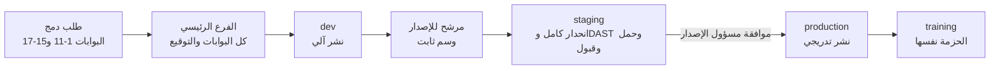

# 22 — العملية الهندسية والجودة

> تحدد هذه الوثيقة كيف تُبنى المنصة وتُختبر وتُنشر وتُشغَّل تقنياً: متى يدخل البند التطوير ومتى يُعدّ منجزاً، ومعايير الكود، والمستودع ومراجعة الكود، وبوابات الجودة في خط النشر بترتيبها، واستراتيجية الاختبار، وسياسة البيانات الاصطناعية، والبيئات والمحاكيات، وإدارة إصدارات التطبيق والويب، وتوافق الواجهة البرمجية، وأهداف مستوى الخدمة، والمراقبة، وإدارة الحوادث، والأداء والسعة، والتوثيق كرمز. وهي تصف **العملية وبواباتها فقط**. وتغلق البندين B-15 وB-16، وبنود الجودة والتشغيل والإصدارات في ملحق [مراجعة الجاهزية](16-readiness-review.md).

---

## 1. مبادئ حاكمة

| # | المبدأ | التطبيق |
|---|---|---|
| 1 | البوابة قبل كل شيء | لا ينتقل تغيير إلى الخطوة التالية إلا باجتياز بواباتها، ولا تُتجاوز بوابة لأي سبب. والاستثناء الوحيد هو الاستثناء الأمني الموقّع (القسم 5.1) |
| 2 | مصدر واحد لكل حقيقة | المتطلبات في [المتطلبات الوظيفية](04-functional-requirements.md)، والقواعد والإعدادات في [قواعد العمل](06-business-rules.md)، والنصوص في [كتالوج المحتوى](24-content-catalog.md)، ومعايير القبول في [معايير القبول](25-acceptance-criteria.md)، والعقد البرمجي في OpenAPI. والكود والاختبارات تشير إليها بمعرّفاتها (القسم 16) |
| 3 | قرارات الزبون قيود آلية | كل قرار في [سجل القرارات](02-decisions-log.md) يمس السلوك يتحول إلى اختبار أو قاعدة فحص في خط النشر (القسم 6.4) |
| 4 | بيانات الإنتاج لا تغادر الإنتاج | كل البيئات الأخرى تعمل ببيانات اصطناعية فقط (القسم 7، CT-88) |
| 5 | الخصوصية تشمل الأدوات | السجلات والمؤشرات والتتبّع وتقارير الأعطال خالية من البيانات الشخصية (القسم 3.6، CT-93) |
| 6 | منتج كامل خلف مفاتيح | كل الوحدات تُبنى كاملة، وتشغيلها بمفاتيح التشغيل (SMART-04، ROLLOUT) لا بإصدارات منفصلة (D-18، D-71). ويوم الإطلاق يبدأ بالأساس مفعّلاً وبالباقي مطفأً حتى يفتحه المدير العام (D-95، ROLLOUT-06) |
| 7 | الآلة أولاً | ما يمكن فحصه آلياً يُفحص في خط النشر، والمراجعة البشرية لما لا تراه الأداة |

## 2. شروط دخول التطوير وتعريف الإنجاز

### 2.1 شروط دخول التطوير (Definition of Ready)

لا يدخل البند (متطلب، أو جزء منه، أو إصلاح) التطوير إلا إذا تحققت الشروط التالية، وأقرّها المنتج والهندسة والجودة معاً في جلسة تهيئة البند:

| # | الشرط | المرجع |
|---|---|---|
| R-1 | للبند معرّف ثابت في 04، ومرتبط بالقرارات ذات الصلة في 02 | 04، 02 |
| R-2 | القواعد محددة، وكل قيمة ⚙️ لها افتراضي وحد أدنى وأعلى في فهرس الإعدادات | 06، 06 §15 |
| R-3 | معايير القبول مكتوبة بصيغة Given/When/Then وبمعرّفات `AC-<REQ-ID>-NN`، وتشمل المسارات السلبية والأخطاء والحدود | 25 |
| R-4 | الشاشات المعنية معرّفة (`S-<AREA>-NN`)، وتصاميمها جاهزة بالثيمين، ومعها الحالات: فارغة، وتحميل، وخطأ، ودون اتصال | [قائمة الشاشات](18-screen-inventory.md)، معرض التصاميم |
| R-5 | النصوص وقوالب الرسائل (`T-<CHANNEL>-NN`) ورموز الأخطاء الجديدة لها مفاتيح في كتالوج المحتوى | 24 |
| R-6 | الصلاحيات محددة لكل إجراء حسب الدور، ونطاق الأمن حسب D-80 | [الأدوار والصلاحيات](03-roles-and-permissions.md) |
| R-7 | أثر البيانات معروف: الجداول والحقول، وتصنيف الحساسية، وطريقة الترحيل (القسم 5.4) | [نموذج البيانات](09-data-model.md)، 07 §1 |
| R-8 | أثر الواجهة البرمجية معروف: المسارات، والأخطاء، ومفتاح عدم التكرار، وهل التغيير إضافي (القسم 11) | [التصميم التقني](19-technical-design.md) |
| R-9 | للوحدات الحساسة: التهديدات والضوابط (`TH-NN`، `CT-NN`). ولأي بيانات شخصية جديدة: نشاط المعالجة (`PA-NN`) | [نموذج التهديد](20-threat-model.md)، [الخصوصية](21-privacy-dpia.md) |
| R-10 | للتكاملات: سيناريوهات المحاكي المطلوبة متاحة، أو مدرجة ضمن البند (القسم 9) | — |
| R-11 | مفتاح التشغيل معروف: مفتاح وحدة في SMART-04 أو ROLLOUT، أو مفتاح إصدار مؤقت (القسم 5.5) | 04 §38، §41 |
| R-12 | القياس محدد: الأحداث والمؤشرات المطلوبة، وأثر البند على أهداف الخدمة (القسم 12) | — |
| R-13 | لا سؤال مفتوح ولا قرار زبون معلّق يغيّر سلوك البند. والاتفاقيات الخارجية غير الموقّعة لا تمنع البدء، لأن البند يُبنى خلف المحاكي والمفتاح | [المخاطر والأسئلة](12-risks-and-open-questions.md) |

### 2.2 تعريف الإنجاز للبند (Definition of Done)

| المجال | الشرط | التحقق |
|---|---|---|
| الكود | يلتزم بمعايير القسم 3، ويجتاز كل بوابات القسم 5.1 | آلي |
| الاختبارات | اختبارات وحدات وتكامل وعقد للبند، واختبار رجوع لكل خلل أُصلح، وتغطية الأسطر المعدّلة ≥ 80% | آلي |
| معايير القبول | كل `AC-<REQ-ID>-NN` الخاصة بالبند ناجحة: الآلية في خط النشر، واليدوية بدليل مسجّل (لقطة أو تسجيل) في نظام إدارة الاختبار | آلي + يدوي |
| المراجعة | موافقة مالك الكود، وموافقتان للمسارات الحساسة (القسم 4.4)، ولا تعليقات مفتوحة | المستودع |
| الأمن | لا نتائج حرجة أو عالية من SAST وSCA وفحص الأسرار، والضوابط `CT-NN` المرتبطة مختبرة، واختبارات رفض الوصول موجودة (دور غير مخوّل، ومحل آخر، ومحافظة أخرى) | آلي |
| الخصوصية | فحص السجلات الآلي يمر (القسم 3.6)، ولا حقل حساس جديد دون تصنيف وتشفير حسب 07 §1، وبطاقة الخصوصية في المتجرين محدّثة إن تغيّر ما يُجمع (القسم 10.6) | آلي + مراجعة |
| الوصولية | لا مخالفات جسيمة أو حرجة في فحص axe، والتسميات العربية لقارئات الشاشة موجودة، وأحجام اللمس صحيحة، والشاشة تعمل بتكبير الخط 200% | آلي + يدوي |
| العربية والاتجاه | الشاشات المعدّلة تمر بالمقارنة البصرية في الثيمين الفاتح والغامق ومن اليمين لليسار، والأرقام والنصوص اللاتينية معزولة الاتجاه، ولا نص عربي مكتوب في الكود | آلي + مراجعة بصرية |
| المحتوى | كل نص ورسالة خطأ وقالب من كتالوج المحتوى بمفتاحه | آلي |
| الأداء | ميزانيات القسم 3.12 غير متجاوزة | آلي |
| القياس | سجلات منظّمة ومؤشرات وتتبّع للمسار الجديد، وتنبيه ودليل تشغيل لأي نمط عطل جديد | مراجعة |
| مفتاح التشغيل | المفتاح موصول ومختبر بحالتيه: عند الإيقاف تختفي الواجهة ويرد الخادم بالرمز `FEATURE_DISABLED`، ولا تتأثر الوحدات الأخرى | آلي |
| الإعدادات | كل قيمة ⚙️ تُقرأ من الإعدادات لا من الكود، ومختبرة عند حدّيها الأدنى والأعلى | آلي |
| الترحيل | متوافق مع الإصدار السابق (القسم 5.4) | آلي |
| المال | لأي بند يمس المحفظة أو التعبئة أو التسوية أو الدفع (SHOPWALLET، وTOPUP، وSTORE-10، وPAY): كل اختبارات القسم 6.15 ناجحة، والمطابقة مختبرة بفروقات محقونة، وموافقتان | آلي + مراجعة |
| المحاسبة | لأي بند في SHOPPRO: اختبارات المزامنة (6.16) وعزل البيانات (6.17) ناجحة، وجولة الكناري نظيفة | آلي |
| التوثيق | OpenAPI محدّث، وADR عند قرار معماري، ودليل تشغيل عند سلوك تشغيلي جديد، واقتراح إضافة إلى 06 §15 عند إعداد جديد | مراجعة |
| العرض | البند منشور على بيئة dev، واختبار الدخان ناجح | آلي |

### 2.3 تعريف الإنجاز للإصدار

| # | الشرط |
|---|---|
| 1 | كل البنود المضمّنة منجزة حسب 2.2 |
| 2 | مجموعة الانحدار الشاملة (سيناريوهات القبول الشاملة الـ 24 `AC-E2E-01..24` في [معايير القبول §7](25-acceptance-criteria.md)) ناجحة على staging، بالثيمين وعلى مصفوفة الأجهزة (القسم 6.7) |
| 3 | لا خلل مفتوح من الدرجة S1 أو S2 (القسم 2.4) |
| 4 | فحص DAST على staging دون نتائج عالية أو حرجة |
| 5 | اختبار الحمل على المرشح للإصدار إذا مسّ مساراً ساخناً (الفحص، أو المعاملة، أو التنبيهات) أو ترحيلاً على جدول كبير (القسم 15) |
| 6 | قائمة الامتثال للمتجرين مكتملة لإصدارات التطبيق (القسم 10.6) |
| 7 | ملاحظات الإصدار بالعربية جاهزة (القسم 10.9) |
| 8 | طريقة التراجع مختبرة: الحزمة السابقة متاحة، والترحيلات متوافقة، ومفاتيح الإصدار قابلة للإيقاف |
| 9 | أدلة التشغيل المتأثرة محدّثة، والمناوبة التقنية على اطلاع بالتغييرات |
| 10 | موافقة مسؤول الإصدار ومسؤول الجودة مسجّلة في سجل التغيير |

### 2.4 درجات الخلل

| الدرجة | التعريف والأمثلة | أثرها على الإصدار |
|---|---|---|
| S1 حرج | نتيجة فحص خاطئة (جهاز عليه بلاغ نافذ يظهر دون بلاغات أو العكس)، أو تسرّب بيانات، أو تجاوز صلاحية أو نطاق محل أو محافظة، أو توقف رحلة حرجة، أو فقدان بيانات، أو كسر سجل التدقيق، أو خطأ في صيغة قانونية ثابتة (06 §14)، أو دعوة شراء داخل التطبيقين (PAY-08)، أو أي خلل مالي: خصم مكرر، أو استرداد لم يتم أو تم مرتين، أو رصيد معروض يخالف شام كاش، أو تجاوز حد سحب أو حد موظف | يمنع الإصدار، ويُعالج فوراً |
| S2 عالٍ | رحلة لا تكتمل إلا بالتفاف صعب، أو تكامل لا يتعافى تلقائياً، أو إشعار لا يصل، أو مخالفة وصولية تمنع إكمال مهمة، أو عرض عربي مكسور في شاشة أساسية | يمنع الإصدار |
| S3 متوسط | خلل له التفاف سهل، أو أداء خارج الميزانية دون كسر أهداف الخدمة | يُسمح بالإصدار بقرار مسؤول الجودة مع تذكرة مفتوحة |
| S4 منخفض | شكلي لا يؤثر على الفهم أو الاستخدام | لا يمنع |

## 3. معايير الكود

### 3.1 TypeScript

| القاعدة | التفصيل |
|---|---|
| الوضع الصارم | `strict: true` في كل الحزم، ومعه `noUncheckedIndexedAccess` و`exactOptionalPropertyTypes` و`noImplicitOverride` و`noFallthroughCasesInSwitch` |
| `any` | ممنوع (`no-explicit-any` خطأ)، ويُستخدم `unknown` مع تضييق النوع |
| تجاوز المترجم | `@ts-ignore` ممنوع. و`@ts-expect-error` مسموح في الاختبارات فقط مع سبب مكتوب |
| التأكيد القسري | `!` والتحويل غير الآمن بـ `as` ممنوعان في كود الإنتاج إلا بتعليق يشرح السبب |
| التحقق عند الحدود | كل ما يدخل من الخارج (طلبات HTTP، ورسائل الطوابير، وردود التكاملات، والإعدادات، وملفات الاستيراد) يُتحقق منه بمخطط تحقق مشترك (مثل zod) في `packages/shared`، ومنه تُشتق الأنواع ووصف OpenAPI |
| الأنواع المميّزة | المعرّفات الحساسة أنواع لا تختلط ببعضها: `Imei`، و`NationalId`، و`PhoneE164`، و`AccountNumber`، و`ShopId`. ولا تُنشأ إلا عبر دوال التحقق في `packages/shared` |
| آلات الحالة | تُمثَّل باتحادات مميّزة حسب [التصميم التقني](19-technical-design.md)، وكل `switch` عليها يُفحص للشمول (`assertNever`) |

### 3.2 التدقيق والتنسيق

| الأداة | القواعد الأساسية |
|---|---|
| Prettier | تنسيق موحّد من `packages/config`. ولا نقاش في الأسلوب أثناء المراجعة |
| ESLint | إعداد مشترك: قواعد `typescript-eslint` الصارمة المعتمدة على الأنواع، و`no-console`، و`eqeqeq`، ومنع الوعود العائمة (`no-floating-promises`)، وتعقيد دوري ≤ 15 لكل دالة، وقواعد React وHooks، وقواعد الوصولية (`jsx-a11y` للويب، وقواعد الوصولية لـ React Native) |
| قواعد الاتجاه | تمنع الخصائص المادية: `margin-left/right` و`padding-left/right` و`left/right` و`text-align: left/right` في CSS، وأصناف Tailwind مثل `ml-` و`mr-` و`pl-` و`pr-` و`left-` و`right-` و`text-left` و`rounded-l-` و`border-r-`، و`marginLeft` و`paddingRight` في React Native. والبديل المنطقي إلزامي (القسم 3.8) |
| منع النصوص الثابتة | قاعدة ترفض أي حرف عربي (`[\u0600-\u06FF]`) في كود الواجهات، خارج ملفات الاختبار والنسخة الاحتياطية المضمّنة لكتالوج المحتوى |
| حدود الوحدات | dependency-cruiser وقواعد `no-restricted-imports` (القسم 3.3) |
| رسائل الإيداع | commitlint (القسم 4.3) |
| إعدادات التطبيق الأصلية | فحص آلي لإعدادات Expo يرفض أي إذن خارج القائمة المسموحة (القسم 10.6) |
| قاعدة الصفر | لا أخطاء ولا تحذيرات في الملفات المعدّلة. وتعطيل قاعدة في سطر يتطلب تعليقاً بالسبب |

### 3.3 حدود الوحدات

الخادم أحادي معياري (modular monolith): وحدات NestJS داخل `apps/api`، **وأسماء الوحدات وما تملكه من جداول مرجعها الوحيد [التصميم التقني §2.2](19-technical-design.md)** (مثل `accounts`، و`access`، و`checks`، و`reports`، و`tenancy`، و`ownership`، و`devices`، و`telecom`، و`civil`، و`intl`، و`police`، و`billing`، و`wallet`، و`topup`، و`shoppro`، و`support`، و`rollout`، و`reversals`)، وطبقة الحافة (`http-public`، و`http-admin`، و`http-police`، و`http-partner`، و`http-biz`، و`ws`) بلا قواعد عمل.

| القاعدة | الفرض |
|---|---|
| لكل وحدة واجهة عامة واحدة (`index.ts`) فيها خدماتها المعلنة وأحداثها، والداخل (`internal/`) لا يُستورد من خارجها | dependency-cruiser يُفشل البناء |
| لكل جدول وحدة مالكة واحدة مسجّلة في خريطة الملكية، ولا تقرأ وحدة جدول غيرها ولا تكتب فيه مباشرة | فحص آلي لاستعلامات Drizzle حسب الوحدة |
| التواصل بين الوحدات باستدعاء الواجهة العامة، أو بالأحداث عبر outbox (`domain.entity.past_tense`) | قاعدة استيراد + مراجعة |
| محوّلات التكامل في `integrations/<partner>` داخل الوحدة المالكة، ولا تُستدعى إلا عبرها | dependency-cruiser |
| `packages/shared` لا تستورد من `apps/*`، و`packages/ui` بلا منطق عمل ولا استدعاء للواجهة البرمجية | dependency-cruiser |
| التطبيقات (`web`، و`admin`، و`police`، و`mobile`) لا يستورد بعضها من بعض | dependency-cruiser |
| `apps/police` لا يستورد `packages/commerce` ولا أي مكوّن تجاري (D-83، PAY-06) | dependency-cruiser + اختبار شامل (القسم 6.4) |
| `apps/mobile` لا يستورد مكوّنات الشراء أو زر «اطلب التفعيل» أو رابط رقم الإدارة التجاري من `packages/commerce` (D-86، PAY-08) | dependency-cruiser + فحص حزمة التطبيق (القسم 10.6) |
| **المال من باب واحد:** وحدة `wallet` وحدها تستدعي محوّل شام كاش، و`topup` وحدها تستدعي محوّلات التعبئة. وأي خصم من المحفظة (التعبئة، وطلبات المتجر، والخدمات) يمر عبر الواجهة العامة لـ `wallet` بمفتاح عدم تكرار، ولا تكتب وحدة أخرى في جداول المحفظة | dependency-cruiser + فحص ملكية الجداول |
| **بيانات المحاسبة للمحل وحده (D-92، D-101، SHOPPRO-14):** وحدة `shoppro` لا تُستورد من `http-admin` و`http-police` ولا من وحدات `compliance` و`ads` و`backoffice` و`police` و`support`، ومخططها لا يملك عليه أي دور في قاعدة البيانات صلاحية غير دور المحل نفسه. **ولا يوجد أي مسار بشري للاطلاع عليها**، ولا بإذن صاحب المحل | dependency-cruiser + فحص الصلاحيات في قاعدة البيانات (القسم 6.17) |
| لا دوائر استيراد بين الوحدات | dependency-cruiser |

### 3.4 التسمية

| العنصر | الصيغة | مثال |
|---|---|---|
| الملفات والمجلدات | kebab-case | `report-review.service.ts` |
| الأنواع والأصناف والمكوّنات | PascalCase | `ReportReviewService` |
| المتغيرات والدوال | camelCase، والدالة تبدأ بفعل | `calculateTrustLevel` |
| الثوابت | UPPER_SNAKE | `MAX_EVIDENCE_FILES` |
| الجداول والحقول | snake_case، والجداول بالجمع | `shop_transactions.created_at` |
| الأحداث | `domain.entity.past_tense` | `report.accepted` |
| رموز الأخطاء | UPPER_SNAKE ببادئة الوحدة | `CHECK_IMEI_INVALID`، `APPVER_UNSUPPORTED` |
| مفاتيح الإعدادات ⚙️ | `<module>.<setting>` بـ snake_case، ومربوطة بسطرها في 06 §15 | `checks.visitor_hourly_limit` |
| مفاتيح التشغيل | أسماؤها وحالاتها (`on`، و`off`، و`awaiting_agreement`) مرجعها الوحيد [التصميم التقني §14.3](19-technical-design.md): `module.*`، و`commerce.*`، و`integration.*`، و`portal.*`، و`rollout.*`، و`system.*`. ومفاتيح الإصدار الهندسية `release.<slug>` | `commerce.store`، `integration.gsma`، `release.bulk-transfer-scan` |
| متغيرات البيئة | UPPER_SNAKE، ولا تحمل قيم عمل (القسم 3.14) | `DATABASE_URL` |
| الفروع | `<type>/<module>-<short-desc>` | `feat/intl-gsma-timeout` |
| الاختبارات | يبدأ الاسم بمعرّف معيار القبول أو المتطلب | `[AC-CHECK-08-01] shows stolen status with international indicator` |

### 3.5 معالجة الأخطاء

1. كل خطأ يصل للعميل بصيغة RFC 9457 (`application/problem+json`)، **والشكل والرموز العامة مرجعها الوحيد [التصميم التقني §3.4](19-technical-design.md)**، وأسماء الرموز ونصوصها العربية مرجعها [كتالوج المحتوى §5](24-content-catalog.md).
2. الحقول: `type`، و`title` و`detail` (نصان عربيان من الكتالوج)، و`status`، و`instance` (مسار الطلب)، و`code`، و`requestId` (يظهر للمستخدم رقماً مرجعياً يذكره للدعم)، و`errors[]` لأخطاء الحقول بمؤشر JSON Pointer ورمز لكل حقل.
3. الخطأ لا يحمل تتبّع المكدّس، ولا نص استعلام، ولا اسم جدول، ولا أي بيانات شخصية. ولا يكشف وجود حساب أو جهاز أو بلاغ لغير المخوّل: المورد غير الموجود وغير المسموح يعطيان الرد نفسه (404 `NOT_FOUND`).
4. أخطاء العمل أصناف معرّفة داخل كل وحدة، وتتحول إلى problem+json في مرشح واحد. وأي خطأ غير متوقع يُسجَّل ويُرد بالرمز `INTERNAL_ERROR` (500) مع `requestId`.
5. `RATE_LIMITED` (429) والتوقف المؤقت (503) يحملان `Retry-After`.
6. لا يُبتلع خطأ: الالتقاط مسموح فقط لإضافة سياق أو للتحويل إلى خطأ عمل.
7. محوّلات التكامل تحوّل أخطاء الشريك إلى أنواع موحّدة: انتهاء المهلة، وعدم الإتاحة، والرفض، والرد غير الصالح. ولكل محوّل مهلة، وإعادة محاولة بتباعد متزايد، وقاطع دائرة (circuit breaker).
8. إعادة المحاولة فقط للعمليات المحمية بمفتاح عدم التكرار (`Idempotency-Key`) أو الآمنة بطبيعتها.
9. في الواجهات: حاجز أخطاء عام يعرض رسالة الكتالوج والرقم المرجعي، ويُبلغ أداة تتبّع الأعطال دون بيانات شخصية.

```json
{
  "type": "https://<domain>/problems/check-imei-invalid",
  "title": "رقم IMEI غير صالح",
  "status": 400,
  "detail": "تأكد من الخانات الخمس عشرة وأعد المحاولة.",
  "instance": "/v1/checks",
  "code": "CHECK_IMEI_INVALID",
  "requestId": "0192f3c4-7b1e-7c2a-9d55-1f0a2b3c4d5e",
  "errors": [{ "pointer": "/imei", "code": "CHECK_IMEI_INVALID" }]
}
```

### 3.6 السجلات

السجلات JSON منظّمة من مُسجِّل واحد في `packages/shared`، بالمستويات `error` و`warn` و`info` (و`debug` خارج الإنتاج فقط). **الحقول من قائمة مسموحة**، وأي حقل خارجها يُحذف ويُعدّ في مؤشر. ويُسجَّل قالب المسار فقط (`/v1/devices/{id}`)، ولا تُسجَّل سلاسل الاستعلام ولا أجسام الطلبات والردود.

**الحقول الممنوعة وبدائلها:**

| الممنوع | البديل في السجل |
|---|---|
| الرقم الوطني | `person_id` (UUID)، أو بصمة السجل `nid_h` |
| أرقام الموبايل كلها: رقم الحساب، والرقم البديل، ورقم واتساب الفاحص، ومرسل SMS، والجهات الموثوقة، والمحافظ | `user_id`، أو `phone_h` |
| IMSI وMSISDN وأي رقم شريحة | `telecom_event_id` |
| الإحداثيات الدقيقة: GPS، وموقع البرج، ونقطة الحادثة، ومواقع التتبّع | `governorate_id` فقط |
| الأسماء: المستخدم، والبائع، والمشتري، والموظف، وصاحب الهوية | المعرّف الداخلي للكيان |
| IMEI والرقم التسلسلي | `device_id`، أو `imei_h`، ومعه TAC (أول 8 خانات) عند الحاجة لتشخيص الموديل |
| صور الهويات والأدلة، ومفاتيح تخزينها، وروابطها الموقّعة | `file_id` |
| كلمات المرور، ورموز التحقق، ورموز الدخول والتجديد، ومفاتيح API، والتواقيع، والكوكيز، وترويسة `Authorization`، ورموز الإشعارات للأجهزة | لا شيء |
| عنوان IP الكامل | `ip_h` في سجلات التطبيق. والعنوان الكامل في سجل الأمن وسجل التدقيق فقط |
| البريد الإلكتروني | `user_id` |
| النصوص الحرة: وصف البلاغ، والمعلومات الواردة، وطلبات الدعم، والرسائل، والملاحظات | الطول فقط |
| ردود الأحوال المدنية وشركات الاتصالات وGSMA | رمز النتيجة ومعرّف الاستعلام |
| الأسعار ومبالغ المكافآت والمدفوعات، وأرصدة المحافظ ومبالغ التعبئة | معرّف المعاملة أو الدفعة أو عملية المحفظة |
| بيانات المحاسبة: الأصناف وأسعار الكلفة والأرباح، والمصاريف، والرواتب والعمولات، وأسماء زبائن الديون وأرقامهم ومبالغهم، والجرد | معرّف السجل المحاسبي فقط، ولا مؤشرات بقيمها حتى إجمالية (SHOPPRO-14) |
| أرقام حسابات شام كاش ومحافظ السحب، ورقم الزبون المعبَّأ له، ورمز المحفظة (PIN) | معرّف عملية المحفظة أو التعبئة. ورمز المحفظة لا يُسجَّل بأي صيغة أبداً |

**البصمات:** `*_h` تُحسب بـ HMAC-SHA256 بمفتاح سجلات مستقل في الخزنة، منفصل عن مفاتيح البصمة للبحث (CT-27)، ويُدوَّر، وتُقتطع النتيجة لـ 16 خانة ست عشرية. **والبصمة دون مفتاح (SHA-256 وحدها) ممنوعة**، لأن أرقام الموبايل والأرقام الوطنية محدودة العدد ويمكن استرجاعها بالتجريب.

**الفرض الآلي:**

| الآلية | ما تمنعه |
|---|---|
| القائمة المسموحة في المُسجِّل، ومسارات الحجب للترويسات والأجسام | الحقول الحساسة والأسرار |
| قاعدة تدقيق تمنع تمرير كائن كيان كامل للمُسجِّل، وتمنع الحقول بأسماء مثل `nationalId` و`phone` و`imsi` و`msisdn` و`lat` و`lng` و`fullName` و`password` و`otp` و`token` | التسرّب العرضي |
| «اختبار الكناري» في البوابة 6: تُجمع سجلات اختبارات التكامل والاختبارات الشاملة وتُفحص بأنماط وبقيم كناري فريدة يزرعها مولّد البيانات (القسم 7) | أي تسرّب يصل للسجل فعلاً |
| ضبط أداة تتبّع الأعطال: `sendDefaultPii` معطّل، وتنظيف قبل الإرسال، ولا إعادة تشغيل للجلسات ولا لقطات شاشة | التسرّب عبر تقارير الأعطال |

أنماط الكناري (أمثلة):

```text
national_id : \b\d{11}\b
sy_mobile   : (?:\+?963|\b0)9\d{8}\b
imei        : \b\d{15}\b            (ثم فحص Luhn لتقليل الإنذار الكاذب)
imsi        : \b(?:417|001)\d{12}\b
coordinates : \b3[2-7]\.\d{4,}\b.{0,40}\b(?:3[5-9]|4[0-2])\.\d{4,}\b
```

مثال سطر سجل مقبول:

```json
{"ts":"2026-10-12T09:41:07.218Z","level":"info","service":"api","env":"production","version":"a1b2c3d",
 "trace_id":"4bf92f3577b34da6","request_id":"0192f3c4-7b1e-7c2a-9d55-1f0a2b3c4d5e","route":"POST /v1/checks",
 "actor_type":"visitor","channel":"web","governorate_id":3,"imei_h":"9f2c41d07a6e88b1",
 "tac":"35693803","result":"reported_stolen","gsma":"pending","status":200,"duration_ms":142}
```

### 3.7 التعليقات

- التعليق يشرح «لماذا» لا «ماذا»، ويشير إلى المعرّفات: `// SHOP-14, 06 §6: distance threshold comes from settings`.
- `TODO` مسموح فقط مع رقم تذكرة: `TODO(#123)`. ولا كود معلّق في الفرع الرئيسي.
- توثيق TSDoc للواجهة العامة لكل وحدة وحزمة.
- المعرّفات والتعليقات بالإنكليزية. ولا تُنسخ نصوص الواجهة العربية في الكود ولا في التعليقات، بل يُشار إلى مفتاحها في الكتالوج.

### 3.8 العربية والاتجاه والنصوص

| المجال | القاعدة |
|---|---|
| مصدر النصوص | كل نص ظاهر من [كتالوج المحتوى](24-content-catalog.md) بمفتاحه، ويُقرأ من الخادم (SMART-01) مع نسخة احتياطية مضمّنة في التطبيق والويب للعمل دون اتصال وفي التشغيل الأول. والعربية هي اللغة الوحيدة (D-01، D-22)، والبنية تحفظ النصوص بمفاتيح |
| المتغيرات في النصوص | بصيغة ICU MessageFormat بأسماء معرّفة (`{deviceModel}`)، مع صيغ الجمع العربية الست (zero، وone، وtwo، وfew، وmany، وother) |
| الاتجاه | `<html lang="ar" dir="rtl">` في الويب. وفي التطبيق `I18nManager.forceRTL(true)` مع فحص عند الإقلاع يعيد التشغيل إن لم يُطبَّق |
| الخصائص المنطقية | فقط: `margin-inline-start` و`padding-inline-end` و`inset-inline-start` و`text-align: start` في CSS، و`ms-` و`me-` و`ps-` و`pe-` و`start-` و`end-` و`text-start` و`rounded-s-` في Tailwind، و`marginStart` و`paddingEnd` و`start` في React Native |
| الأيقونات | الأيقونات الدالة على اتجاه (الأسهم، والرجوع، والتقدّم، والسلاسل) تُعكس. وغير الاتجاهية (الشعار، والهاتف، وعلامة الصح، والتشغيل، والباركود) لا تُعكس. والقائمة في `packages/ui` |
| عزل الاتجاه | كل قيمة لاتينية أو رقمية داخل جملة عربية تُعزل: IMEI، وأرقام الموبايل، ورقم الحساب `SY-XXXXXX`، وكل المراجع بصيغها المعتمدة في [التصميم التقني §13.1](19-technical-design.md) (مثل `BL-` و`TX-` و`CR-` و`ST-` و`SH-` و`OR-` و`RN-` و`IN-` و`WL-` و`TP-`)، والبريد، والروابط، وأسماء الموديلات اللاتينية. في الويب وPDF بعنصر `<bdi>` أو `dir="ltr"` مع `unicode-bidi: isolate`، وفي التطبيق وواتساب بمحارف العزل (U+2066 إلى U+2069) من دالة التنسيق المشتركة. **وفي SMS** توضع القيمة في سطر مستقل دون محارف عزل، لأن بعض الأجهزة البسيطة لا تعرضها |
| الأرقام | العرض بالأرقام الغربية (0-9) حسب [الهوية البصرية §4](15-visual-identity.md). والإدخال يقبل الأرقام العربية (٠-٩) والفارسية (۰-۹) والغربية، ويحذف المسافات والشرطات ومحارف الاتجاه الخفية (U+200E وU+200F وU+2066 إلى U+2069) قبل التحقق، لأن الأرقام المنسوخة من واتساب تحملها غالباً |
| أرقام الموبايل | تُقبل `09XXXXXXXX` و`+9639XXXXXXXX` و`009639XXXXXXXX`، وتُخزَّن `+9639XXXXXXXX` (08 §5)، وتُعرض `09XX XXX XXX` معزولة |
| الخط | IBM Plex Sans Arabic مستضاف ذاتياً بصيغة WOFF2، مقسّماً لنطاقات الحروف المستخدمة، بوزنين محمّلين مسبقاً (400 و700) و`font-display: swap` |
| البحث | توحيد النص العربي للبحث بدالة مشتركة واحدة (الهمزات، والتاء المربوطة، والياء، وإزالة التشكيل والتطويل)، والتفاصيل في 19 |
| الطباعة | الوثائق المطبوعة بالثيم الفاتح دائماً (THEME-04)، ووصل الحروف واتجاهها مختبران في Chromium على الخادم |

### 3.9 التواريخ والتوقيت

| المجال | القاعدة |
|---|---|
| التخزين | `timestamptz` بتوقيت UTC، وفي الواجهة البرمجية بصيغة ISO 8601 مع `Z` |
| العرض | بتوقيت `Asia/Damascus` والتقويم الميلادي، عبر دالة تنسيق مشتركة واحدة بالإعداد المحلي `ar-SY` (أسماء الأشهر: كانون الثاني، وشباط، وآذار...) وأرقام غربية. والصيغ النهائية في كتالوج المحتوى |
| قواعد المناطق الزمنية | لا تُحسب الإزاحة يدوياً أبداً. وقواعد التوقيت في سوريا تغيّرت في السنوات الأخيرة، وأجهزة أندرويد القديمة قد تحمل قواعد قديمة، لذلك يرسل الخادم إزاحة دمشق الحالية ضمن إعدادات التطبيق، ويعتمدها التطبيق في العرض، ويُختبر ذلك على أندرويد 8 |
| الحسابات الزمنية | المهل (مثل ⚙️ 30 دقيقة للإلغاء الذاتي و⚙️ 72 ساعة لقبول النقل) وحساب ساعات الدوام (D-85، [إجراءات التشغيل §1.3](23-operations-sops.md)) تُحسب في الخادم فقط. ووقت الجهاز لا يدخل في أي قرار، لأنه قد يكون خاطئاً بعد انقطاع الكهرباء |
| الساعة في الكود | الوقت يُقرأ من خدمة ساعة قابلة للحقن (`Clock`) لا من `Date.now()` مباشرة، لتُختبر المهل بالتحكم بالوقت |
| التاريخ دون وقت | مثل تاريخ الحادثة (REPORT-02): تاريخ محلي مع نافذة وقت تقريبية، ويُخزَّن معه اسم المنطقة الزمنية صراحة |

### 3.10 المبالغ المالية

- المبلغ عدد صحيح (`bigint`) بأصغر وحدة للعملة، ومعه رمز العملة (`SYP`) في كل مكان. ولا أعداد عشرية عائمة أبداً.
- الحساب عبر وحدة مال مشتركة في `packages/shared`، وقواعد التقريب مكتوبة صراحة (مثل احتساب عمولة السوق ⚙️).
- العرض: أرقام غربية، وفاصل الآلاف، و«ل.س» بعد الرقم، والقيمة معزولة الاتجاه.
- وجود رمز العملة بجانب كل مبلغ يجعل أي تغيير رسمي في فئة العملة ترحيل بيانات وقاعدة عرض، لا تغييراً في البنية.
- سعر البيع اختياري ولا يظهر إلا للمشتري (D-17)، ولا يدخل السجلات ولا المؤشرات. ومبلغ المكافأة نص للعرض فقط، ولا مسار دفع له (D-50).
- كشوف تسوية المورّدين (STORE-10) تُحسب في الخادم من الطلبات المسلّمة والمدفوعة بالقواعد نفسها، ومجموعها يطابق مجموع بنودها دائماً، واختبارها ضمن الوحدات الحرجة.
- **محفظة المحل (D-89):** المال لدى شام كاش في حساب باسم المحل، والمنصة لا تمسك مالاً. لذلك الرصيد المرجعي هو رصيد شام كاش، وما تحفظه المنصة سجل عمليات مرآة بمراجع شام كاش ومراجع الشركات، يُطابق يومياً (SHOPWALLET-06، TOPUP-06). ولا يُعدَّل رصيد ولا سجل يدوياً أبداً، بل بعملية تصحيح موثّقة.
- كل عملية مال (شحن، وسحب، وخصم، وتعبئة، واسترداد) لها مفتاح عدم تكرار يُمرَّر للشريك نفسه، وحالة صريحة (معلّقة، أو ناجحة، أو فاشلة، أو مستردة)، ولا تنتقل من حالة نهائية أبداً.
- الدفع للخدمات التجارية برقم مرجعي يؤكده المشرف التجاري أو من محفظة المحل (PAY-01، PAY-07، SHOPWALLET-04)، **ولا دفع عبر آبل أو جوجل** (D-86)، فلا أسعار متاجر ولا مكتبات فوترة في الكود.

### 3.11 إمكانية الوصول (WCAG 2.2 AA)

المستوى المطلوب WCAG 2.2 AA لكل الواجهات: الموقع، والتطبيق، ولوحة الإدارة، وبوابة الأمن.

| المجال | القاعدة |
|---|---|
| التباين | 4.5:1 للنص، و3:1 للنص الكبير ولحدود عناصر الواجهة، في الثيمين. ورموز التصميم تُفحص آلياً (SMART-02) |
| اللون | لا يحمل المعنى وحده: لون وأيقونة ونص لكل حالة (THEME-03) |
| أهداف اللمس | 44×44 نقطة في iOS، و48×48 dp في أندرويد، وفي الويب 24×24 بكسل حداً أدنى (2.5.8) مع تباعد كافٍ |
| التركيز | ظاهر دائماً، لا يغطيه رأس ثابت أو شريط (2.4.11)، وترتيبه منطقي من اليمين لليسار |
| لوحة المفاتيح | كل وظائف لوحة الإدارة وبوابة الأمن تعمل بلوحة المفاتيح، ومنها الجداول والخريطة والنوافذ المنبثقة |
| السحب | لكل حركة سحب بديل بنقرة (2.5.7): دبوس الخريطة (SHOP-02) له زر «موقعي الحالي» وحقل عنوان، والمنزلق الزمني (TRACK-04) له حقلا تاريخ |
| المصادقة | لا اختبار ذهني (3.3.8): ALTCHA بإثبات العمل دون ألغاز، ولصق رمز التحقق وكلمة المرور مسموح، ومديرو كلمات المرور مدعومون، وحقل الرمز من نوع `one-time-code` |
| الإدخال المكرر | لا يُطلب من المستخدم إعادة ما أدخله في المسار نفسه (3.3.7)، والمسودات تحفظ ما سبق |
| المساعدة | مدخل «طلب دعم» في الموضع نفسه في كل الشاشات (3.2.6) |
| قارئ الشاشة | تسميات عربية لكل عنصر تفاعلي، والأرقام الطويلة (IMEI) تُقرأ خانةً خانة بتسمية مخصصة، وإعلانات حيّة (`aria-live`) لنتيجة الفحص وللتحديث اللحظي في البوابة واللوحة |
| التكبير | النص يكبر حتى 200% دون قص أو تداخل، ويحترم حجم الخط في إعدادات النظام |
| الحركة | احترام إعداد «تقليل الحركة»، ولا وميض |
| النماذج | لكل حقل تسمية ظاهرة، ورسالة الخطأ مرتبطة بالحقل وتقول ماذا حدث وماذا يفعل المستخدم (08 §7) |
| مهل الجلسات | تنبيه قبل انتهاء جلسة الإدارة والأمن مع إمكانية التمديد، دون فقدان العمل |

### 3.12 ميزانيات الأداء

**التطبيق** (القياس على جهاز حقيقي من مصفوفة القسم 6.7):

| المقياس | الجهاز الضعيف المرجعي (أندرويد 8، ذاكرة 2 غيغابايت) | جهاز متوسط |
|---|---|---|
| الإقلاع البارد حتى شاشة الفحص التفاعلية | ≤ 4 ثوانٍ | ≤ 2 ثانية |
| الانتقال بين الشاشات | ≤ 300 ملّي ثانية | ≤ 150 ملّي ثانية |
| فتح الماسح حتى قراءة باركود واضح | ≤ 2 ثانية | ≤ 1 ثانية |
| ضغط صورة 12 ميغابكسل إلى ⚙️ 2000 بكسل | ≤ 2 ثانية | ≤ 1 ثانية |
| نقطة البيع: من مسح الباركود حتى ظهور السطر في الفاتورة | ≤ 300 ملّي ثانية | ≤ 150 ملّي ثانية |
| نقطة البيع: حفظ بيع نقدي دون اتصال | ≤ 300 ملّي ثانية | ≤ 150 ملّي ثانية |
| الذاكرة في ذروة الاستخدام (الكاميرا مفتوحة) | ≤ 300 ميغابايت | ≤ 400 ميغابايت |
| سلاسة القوائم | ≥ 55 إطاراً في الثانية في المتوسط | ≥ 58 |
| البيانات المستهلكة لفحص واحد بعد التحميل الأول | ≤ 20 كيلوبايت | — |
| حجم التنزيل من المتجر | أندرويد ≤ 35 ميغابايت، وiOS ≤ 60 ميغابايت | — |
| الاستقرار | جلسات دون أعطال ≥ 99.5%، ومعدل الأعطال الملحوظة < 1.09%، ومعدل ANR < 0.47% (حدود Google Play) | — |

**الويب:**

| الواجهة | الميزانية |
|---|---|
| الموقع العام (صفحة الفحص) | الصفحة الأولى ≤ 200 كيلوبايت مضغوطة إجمالاً (08 §1)، منها JavaScript ≤ 90 كيلوبايت والخطوط ≤ 60 كيلوبايت. وLCP ≤ 3 ثوانٍ على ملف 3G المرجعي (08 §1) و≤ 2.5 ثانية على 4G، وINP ≤ 200 ملّي ثانية، وCLS ≤ 0.1، ودرجة Lighthouse للأداء ≥ 90 على الموبايل |
| صفحات التحقق العامة (PUB-02، PUB-03، PUB-06) | الميزانية نفسها، لأنها تُفتح غالباً من متصفح واتساب الداخلي |
| لوحة الإدارة وبوابة الأمن | JavaScript الأولي ≤ 300 كيلوبايت مضغوطة، وLCP ≤ 2.5 ثانية على اتصال مكتبي، وتحديث القوائم والخريطة لحظياً دون إعادة تحميل |

### 3.13 قواعد أمنية في الكود

تفصّل [نموذج التهديد](20-threat-model.md) متطلبات المطوّرين الأمنية (`SR-NN`)، وهذه أساسياتها التي تفحصها المراجعة والأدوات:

1. **المنع الافتراضي:** كل مسار في الواجهة البرمجية يحمل سياسة صلاحية صريحة، واختبار آلي يعدّد المسارات ويُفشل البناء إن وُجد مسار بلا سياسة.
2. **الاستعلامات:** عبر Drizzle بمعاملات فقط. والـ SQL الخام مسموح في قوالب `sql` ذات المعاملات، ولا دمج نصوص أبداً.
3. **لا معرّفات حساسة في الروابط:** الرقم الوطني ورقم الموبايل لا يظهران في مسار أو سلسلة استعلام أبداً، وIMEI في الفحص يُرسل في جسم الطلب (`POST /v1/checks`)، حتى لا يُسجَّل في الوسطاء والمتصفحات.
4. **العرض:** الترميز الافتراضي في React، و`dangerouslySetInnerHTML` ممنوع إلا في مكوّن عرض المحتوى المعقَّم.
5. **الملفات:** الرفع بروابط موقّعة إلى مخزن خاص، ثم تحقق الخادم من النوع الحقيقي وإعادة الترميز وحذف EXIF والفحص من البرمجيات الخبيثة (07 §6).
6. **التشفير:** عبر وحدة `packages/shared/crypto` فقط (AES-256-GCM، وHMAC)، ولا تشفير مكتوب يدوياً، ولا مفاتيح في الكود أو المتغيرات المرفوعة للمستودع.
7. **العشوائية:** مولّد آمن تشفيرياً لكل رمز تحقق ورقم حساب ومرجع `CR-` ورمز إكمال.
8. **التزامن:** `Idempotency-Key` لكل طلب إنشاء أو انتقال حالة، و`If-Match` لكل تعديل.
9. **التطبيق:** الرموز في Keychain وKeystore عبر `expo-secure-store`، ولا تُحفظ في `AsyncStorage` أبداً. والروابط العميقة يُتحقق منها قبل التنفيذ.

### 3.14 أنواع الإعدادات وأين تعيش

| النوع | أمثلة | المكان | من يغيّره |
|---|---|---|---|
| إعدادات البنية | عناوين الخدمات، وأحجام مجمّعات الاتصال، وعدد النسخ | البنية كرمز ومتغيرات البيئة | الهندسة عبر طلب دمج |
| الأسرار | مفاتيح التشفير، وشهادات mTLS، ومفاتيح الشركاء، ومفاتيح التوقيع | الخزنة وKMS فقط (CT-83) | الهندسة بإجراء الأسرار في 20 |
| إعدادات العمل ⚙️ | المهل، والحدود، والقوائم (06 §15) | جدول `settings` في قاعدة البيانات | المدير العام من اللوحة، مع سجل (ADMIN-16) |
| مفاتيح التشغيل | الوحدات، والتكاملات، والخدمات التجارية، ووضع الدعوات، والمحافظات (SMART-04، ROLLOUT) | قاعدة البيانات | المدير العام من اللوحة |
| مفاتيح الطوارئ | تعطيل وظيفة خطرة فوراً (القائمة الوحيدة في [نموذج التهديد §15.2](20-threat-model.md)) | قاعدة البيانات | التفعيل: المدير العام أو المناوبة التقنية دون موافقة ثانية مع إبلاغ المدير العام فوراً. والإيقاف بأربع عيون (20 §15.2) |
| مفاتيح الإصدار | إخفاء عمل غير مكتمل على الفرع الرئيسي | سجل المفاتيح في المستودع | الهندسة (القسم 5.5) |
| المحتوى | النصوص والقوالب والصفحات القانونية | كتالوج المحتوى (SMART-01) | من يملك صلاحية المحتوى في اللوحة |

**القاعدة:** لا قيمة عمل في متغيرات البيئة، ولا قيمة بنية في إعدادات اللوحة، ولا سر في أي منهما (06 §15.3).

## 4. المستودع والتفرّع ومراجعة الكود

### 4.1 هيكل المستودع

مستودع واحد (monorepo) بـ pnpm workspaces وTurborepo، وملف قفل واحد، وإصدار Node مثبّت (`.nvmrc` و`engines`). يوسّع الهيكل المقترح في [البنية التقنية §5](10-architecture-and-tech-stack.md):

```text
imei/
├── apps/
│   ├── api/          الخادم (NestJS) والعمّال (BullMQ) من الكود نفسه، ووحدة لكل بادئة متطلبات
│   ├── web/          الموقع العام وحسابات المستخدمين والمحلات (Next.js)
│   ├── admin/        لوحة الإدارة (Next.js، نطاق منفصل)
│   ├── police/       بوابة قوى الأمن (Next.js، نطاق منفصل)
│   └── mobile/       التطبيق الواحد حسب الدور (React Native + Expo)
├── packages/
│   ├── shared/       التحقق (IMEI، والرقم الوطني، والموبايل)، والأنواع، والمخططات، والتنسيق، والمال، والتشفير، والمُسجِّل
│   ├── api-client/   عميل مولَّد من OpenAPI تستخدمه كل الواجهات
│   ├── ui/           نظام التصميم ورموزه ومكوّناته (الوثيقة 15)
│   ├── content/      قراءة كتالوج المحتوى ونسخته الاحتياطية المضمّنة
│   ├── commerce/     واجهات الخدمات التجارية في الموقع وتطبيق المتجر المادي
│   ├── test-data/    مولّدات البيانات الاصطناعية وحزم السيناريوهات (القسم 7)
│   ├── simulators/   محاكيات التكاملات ولوحة سيناريوهاتها (القسم 9)
│   └── config/       إعدادات TypeScript وESLint وPrettier المشتركة
├── infra/            البنية كرمز، وصور الحاويات، وإعدادات النشر
├── docs/             الوثائق، وأدلة التشغيل (docs/runbooks)
└── .github/          خط النشر، وCODEOWNERS، وقالب طلب الدمج
```

تحديث المكتبات بطلبات دمج آلية مجمّعة (مثل Renovate) تمر بالبوابات نفسها، ولا تُدمج تحديثات رئيسية دون مراجعة ملاحظات الإصدار وأثرها على الحد الأدنى لأنظمة التشغيل (القسم 10.4).

### 4.2 التطوير على الفرع الرئيسي

| القاعدة | التفصيل |
|---|---|
| الفرع الرئيسي قابل للإصدار دائماً | `main` يجتاز كل البوابات في كل لحظة. والفشل فيه يوقف الدمج حتى يُصلح أو يُعاد التغيير |
| فروع قصيرة | كل فرع يحمل تغييراً منطقياً واحداً من `main`، ويُحدَّث عليه قبل الدمج، ويُحذف بعده |
| حجم صغير | ≤ 400 سطر معدّل، دون الملفات المولّدة وملف القفل واللقطات المرجعية. وما يزيد يُقسَّم |
| العمل غير المكتمل | يُدمج خلف مفتاح إصدار مغلق افتراضياً (القسم 5.5)، ولا فروع طويلة للميزات |
| الدمج | دمج مضغوط (squash) بسجل خطي، وإيداعات موقّعة |
| حماية الفرع | طلب دمج إلزامي، والبوابات المطلوبة، ومراجعة CODEOWNERS، وإسقاط الموافقات عند أي إيداع جديد، ومنع الدفع القسري، وتسري القواعد على المسؤولين أيضاً |
| فروع الإصدار | تُقتطع من `main` لإصدارات التطبيق فقط عند الحاجة لإصلاح عاجل في المتجر. والإصلاح يدخل `main` أولاً ثم يُنقل (cherry-pick) |
| الإصلاح العاجل | يمر بكل البوابات دون استثناء، ويتسارع فقط في خطوات النشر التدريجي (القسم 5.3) |

### 4.3 رسائل الإيداع

صيغة Conventional Commits، بالإنكليزية لتوافق الأدوات، ويفحصها commitlint:

| العنصر | القاعدة |
|---|---|
| الصيغة | `<type>(<scope>): <summary>`، مثل `fix(intl): cap gsma wait at configured timeout` |
| الأنواع | `feat`، و`fix`، و`perf`، و`refactor`، و`test`، و`docs`، و`build`، و`ci`، و`chore`، و`revert` |
| النطاق | اسم الوحدة حسب 19 §2.2 (`checks`، `reports`...) أو التطبيق (`mobile`، `police`...) أو الحزمة |
| التذييل | `Refs:` بمعرّفات المتطلبات ومعايير القبول والقرارات، مثل `Refs: CHECK-08, AC-CHECK-08-01, D-42` |
| التغيير الكاسر | `!` و`BREAKING CHANGE:` للحزم الداخلية فقط. والتغيير الكاسر في الواجهة البرمجية العامة ممنوع داخل `/v1` (القسم 11) |
| سجل التغييرات | يُولَّد منها آلياً لكل تطبيق عند الإصدار (القسم 16.3) |

### 4.4 قواعد المراجعة وCODEOWNERS

- كل تغيير بطلب دمج، ولا يوافق الكاتب على تغييره.
- **موافقة واحدة** من مالك الكود للمسارات العادية.
- **موافقتان للمسارات الحساسة**، إحداهما من مالك الأمن، كما في الجدول. والمالكون أدوار في ملف CODEOWNERS لا أسماء أشخاص.
- المراجعة تتبع قائمة تحقق: الصحة، والصلاحيات والنطاق، والبيانات الحساسة والسجلات، والاتجاه والعربية، والأداء، والاختبارات، والتوافق مع الإصدار السابق.

| المسار | المالك | موافقتان |
|---|---|---|
| `apps/api/src/modules/accounts/**` و`access/**`: الجلسات والرموز والتحقق الثنائي واستعادة الحساب وجلسة البلاغ فقط | الهوية + الأمن | ✅ |
| سياسات RLS، وأي ترحيل يمسّها أو يمس جداول المحلات والوكلاء | البيانات + الأمن | ✅ |
| سياسات الصلاحيات ونطاق الأمن (`police`، و`tracking`)، ووحدات `civil` و`telecom` و`intl` ومحوّلاتها | مالك الوحدة + الأمن | ✅ |
| مخطط سجل التدقيق | البيانات + الأمن | ✅ |
| `packages/shared/crypto`، وإعدادات المُسجِّل والحجب | الأمن | ✅ |
| رفع الملفات ومعالجة الصور | مالك الوحدة + الأمن | ✅ |
| `billing` وتفعيل الخدمات التجارية، وتسوية المورّدين (STORE-10)، وظهور الشراء في `apps/mobile` (PAY-08) | التجاري + الأمن | ✅ |
| `wallet` و`topup` ومحوّلاتهما ومهام المطابقة | المال + الأمن | ✅ |
| حدود العزل لبيانات المحاسبة (`shoppro` ومخططها وأدوار قاعدة البيانات)، ومزامنة نقطة البيع دون اتصال | المحاسبة + الأمن | ✅ |
| `infra/**` و`.github/workflows/**` وإعدادات الأسرار | المنصة + الأمن | ✅ |
| إعدادات التطبيق الأصلية (`app.config`، والأذونات، والصلاحيات الخاصة، وإعداد التحديث عبر الهواء) | التطبيق + الأمن | ✅ |
| `packages/ui/**` ورموز التصميم | نظام التصميم | — |
| `apps/web`، و`apps/admin`، و`apps/police` (خارج ما سبق) | مالك الواجهة | — |
| `docs/**` | المنتج | — |

### 4.5 قالب طلب الدمج

| القسم | المطلوب |
|---|---|
| الملخص | ماذا تغيّر ولماذا، في سطرين |
| المعرّفات | المتطلبات (04)، ومعايير القبول (25)، والقرارات (02)، وADR إن وُجد |
| الشاشات | معرّفات `S-...` المتأثرة، ولقطات قبل وبعد بالثيمين ومن اليمين لليسار |
| الواجهة البرمجية | فرق OpenAPI، وتأكيد أنه إضافي (القسم 11) |
| قاعدة البيانات | الترحيل وخطوته (توسيع، أو ترحيل بيانات، أو تقليص)، وتحليل الأقفال |
| الإعدادات والمفاتيح | قيم ⚙️ جديدة أو معدّلة، ومفتاح التشغيل أو الإصدار |
| الأمن والخصوصية | بيانات شخصية جديدة؟ حقول سجلات جديدة؟ ضوابط `CT-NN` المعنية؟ |
| الاختبارات | ما أُضيف، وأي اختبار يدوي ودليله |
| القياس | مؤشرات وتنبيهات جديدة، ودليل تشغيل إن لزم |
| التراجع | كيف يُعاد التغيير دون أثر جانبي |
| قائمة تعريف الإنجاز | مربعات تحقق القسم 2.2 |

## 5. خط التكامل والنشر وبوابات الجودة

### 5.1 البوابات بالترتيب

تعمل البوابات بالترتيب التالي، وتوقف أي بوابة فاشلة ما بعدها. الأعمدة: **طلب دمج** (PR)، و**الرئيسي** (بعد الدمج في `main`)، و**المرشح** (المرشح للإصدار على staging).

| # | البوابة | الأداة (مثال) | شرط النجاح | PR | الرئيسي | المرشح |
|---|---|---|---|---|---|---|
| 1 | التثبيت من ملف القفل | `pnpm install --frozen-lockfile` | لا تغيير في ملف القفل، وتحقق سلامة الحزم، ولا سكربتات تثبيت إلا لقائمة مسموحة | ✅ | ✅ | ✅ |
| 2 | فحص الأنواع | `tsc -b` | صفر أخطاء في كل الحزم | ✅ | ✅ | ✅ |
| 3 | التدقيق والتنسيق | ESLint، Prettier، dependency-cruiser، commitlint | صفر أخطاء، وقواعد الاتجاه والنصوص والحدود والأذونات ناجحة (القسم 3.2) | ✅ | ✅ | ✅ |
| 4 | اختبارات الوحدات | Vitest، fast-check | كلها ناجحة، وعتبات التغطية (القسم 6.1)، وتغطية الأسطر المعدّلة ≥ 80% | ✅ | ✅ | ✅ |
| 5 | اختبارات العقد مع OpenAPI | فحص الانحراف، وoasdiff، والتحقق من الردود | الوصف المولَّد يطابق الملف المحفوظ، ولا تغيير كاسر مقابل أي إصدار تطبيق مدعوم أو عقد ربط منشور (القسم 11) | ✅ | ✅ | ✅ |
| 6 | اختبارات التكامل مع المحاكيات | Testcontainers (PostgreSQL 16 + PostGIS، وRedis، ومخزن S3)، والمحاكيات | كلها ناجحة، واختبار كناري السجلات نظيف (القسم 3.6) | ✅ | ✅ | ✅ |
| 7 | اختبارات عزل RLS | فحص الفهرس + اختبارات العزل المولّدة | صفر جداول بلا RLS مفعّل ومفروض، وكل اختبارات العزل والنطاق ناجحة (القسم 6.3) | ✅ | ✅ | ✅ |
| 8 | فحص الترحيلات | التطبيق على قاعدة فارغة وعلى مخطط الإصدار السابق، وsquawk | لا عملية هدّامة خارج خطوة التقليص، وتوافق الإصدار السابق مع المخطط الجديد، وزمن الأقفال ضمن الحد على المجموعة L في المرشح (القسم 5.4) | ✅ | ✅ | ✅ + L |
| 9 | SAST | Semgrep، CodeQL، وقواعد مخصصة | لا نتائج جديدة عالية أو حرجة | ✅ | ✅ | ✅ |
| 10 | SCA وتدقيق المكتبات | osv-scanner، و`pnpm audit`، وفحص التراخيص | لا ثغرة حرجة أو عالية لها إصلاح في مكتبات التشغيل، والتراخيص من القائمة المسموحة (MIT، وApache-2.0، وBSD، وISC، وOFL للخطوط)، ولا GPL أو AGPL في ما يُوزَّع | ✅ | ✅ + يومياً | ✅ |
| 11 | فحص الأسرار | gitleaks (في جهاز المطوّر قبل الإيداع وفي الخادم) وحماية الدفع | صفر نتائج. والسر المكشوف يُبطل ويُدوَّر فوراً، ولا يكفي حذفه | ✅ | ✅ | ✅ |
| 12 | قائمة المكوّنات (SBOM) | CycloneDX (syft) | SBOM لكل صورة حاوية ولكل حزمة تطبيق، محفوظة مع الإصدار | — | ✅ | ✅ |
| 13 | فحص الحاويات | Trivy | صفر ثغرات حرجة، وصفر عالية لها إصلاح، وصورة أساس صغيرة مثبّتة بالبصمة، وتشغيل بمستخدم غير جذري | — | ✅ + يومياً للصور المنشورة | ✅ |
| 14 | توقيع البناء | cosign مع مفتاح في KMS، وشهادة منشأ SLSA | كل صورة وحزمة موقّعة بشهادة منشأ، والمنصة ترفض نشر أي صورة غير موقّعة (CT-86) | — | ✅ | ✅ |
| 15 | اختبار الدخان الشامل | Playwright للويب، وMaestro للتطبيق | المسارات الحرجة ناجحة (القسم 6.1). وفي المرشح: الانحدار الكامل | معاينة | dev | ✅ كامل |
| 16 | فحص الوصولية | axe-core مع Playwright، وقواعد الوصولية للتطبيق | صفر مخالفات جسيمة أو حرجة | المكوّنات والشاشات المعدّلة | ✅ | كل الشاشات |
| 17 | فحص ميزانية الأداء | Lighthouse CI، وsize-limit، وفحص حجم التطبيق، وقياس زمن الفحص في الخادم | ضمن ميزانيات القسم 3.12، ولا تراجع > 10% في زمن الفحص أو المعاملة | الحزم والأحجام | ✅ | ✅ |

- **الاختبارات المتذبذبة:** الاختبار المتذبذب يُعزل بمالك وتذكرة، ولا يُعزل اختبار في وحدة حرجة (القسم 6.1) أبداً، بل يُصلح قبل أي إصدار.
- **الاستثناء الأمني:** ثغرة حرجة في مكتبة دون إصلاح متاح تُقبل فقط باستثناء موقّع من مالك الأمن، مع تقييم قابلية الاستغلال وضابط بديل، ويُعاد تقييمه في كل إصدار. ولا استثناء لأي بوابة أخرى.
- **ما بعد البوابات في المرشح:** فحص DAST (OWASP ZAP) على staging، واختبار الحمل عند الحاجة (القسم 15)، والاختبارات اليدوية الاستكشافية، وقبول الجودة.

### 5.2 مسار الترقية

الحزمة نفسها (بصمة الصورة نفسها) تنتقل بين البيئات، والإعدادات وحدها تختلف. التفصيل في القسم 8.3.

### 5.3 استراتيجية النشر والتراجع الآلي

| الطبقة | الاستراتيجية | معيار التقدّم |
|---|---|---|
| الواجهة البرمجية (HTTP) | نشر كناري: 5% من الطلبات، ثم 25%، ثم 100% | كل خطوة ≥ 10 دقائق و≥ 2,000 طلب، ومقارنة آلية مع النسخة المستقرة: نسبة أخطاء الخادم، وزمن p95، وتوزيع رموز الأخطاء، والتشبّع |
| العمّال (BullMQ) | استبدال متدرّج مع تفريغ المهام الجارية | كل مهمة تحمل إصدار مخططها، والعامل الجديد يعالج إصدار المهام السابق |
| التحديث اللحظي (WebSocket) | استبدال متدرّج مع تفريغ الاتصالات | العميل يعيد الاتصال بتباعد عشوائي (من ثانية إلى 30 ثانية) ويستأنف من آخر حدث استلمه، فلا يضيع تنبيه |
| مواقع Next.js (الموقع، واللوحة، والبوابة) | أزرق/أخضر بتبديل فوري | الملفات الثابتة بأسماء مبصومة، وتبقى ملفات الإصدارين السابقين متاحة لتجنّب أخطاء تحميل الأجزاء، والعميل يحدّث نفسه عند الانتقال التالي |
| قاعدة البيانات | خطوة ترحيل منفصلة قبل النشر، توسيعية فقط (القسم 5.4) | نجاح الترحيل وفحص المخطط |

**التراجع الآلي** يحدث عند أي مما يلي أثناء الكناري أو خلال 30 دقيقة بعد اكتماله: نسبة أخطاء الخادم > 1% أو ضعف النسخة المستقرة، أو زمن p95 للفحص أو المعاملة > 1.25 ضعف المستقرة، أو فشل فحوص الجاهزية، أو إعادة تشغيل متكررة، أو استهلاك سريع لميزانية الخطأ (القسم 12.4)، أو فشل المسابير الاصطناعية (القسم 13.5). والتراجع: إعادة كل الطلبات للنسخة المستقرة خلال ≤ 5 دقائق، وإيقاف مفاتيح الإصدار المرتبطة، وفتح حادث تلقائياً في الإنتاج. والإيقاف الآمن لكل خدمة: إيقاف استقبال الجديد، وإكمال الجاري خلال ≤ 30 ثانية.

**الصيانة المخططة** التي تتطلب توقفاً (مثل ترقية رئيسية لقاعدة البيانات) استثناء نادر: في ساعات الليل المتأخرة (08 §2)، بإعلان مسبق عبر لافتة الصيانة (SMART-11)، وتُحسب من ميزانية الخطأ (القسم 12.2).

### 5.4 ترحيلات قاعدة البيانات

**القاعدة:** كل ترحيل متوافق مع الإصدار الجاري (N-1)، ولا شيء هدّام في خطوة واحدة.

| الخطوة | ما يحدث | الشرط للانتقال |
|---|---|---|
| 1. توسيع | إضافة جداول أو أعمدة تقبل القيمة الفارغة أو فهارس (`CREATE INDEX CONCURRENTLY`). والكود الجديد يكتب في القديم والجديد عند الحاجة | الإصدار السابق يعمل على المخطط الجديد (البوابة 8) |
| 2. ترحيل البيانات | ملء الجديد بمهمة خلفية على دفعات (≤ 1,000 صف للدفعة)، قابلة للاستئناف ولإعادة التنفيذ دون أثر مكرر، ومحدودة السرعة، ومراقبة | تقرير تحقق: عدد الصفوف وتطابق القيم |
| 3. تبديل القراءة | الكود يقرأ من البنية الجديدة، والقديمة باقية | إصدار كامل مستقر في الإنتاج |
| 4. تقليص | حذف القديم في إصدار تالٍ، بعد ألا يبقى أي إصدار يعمل يستخدمه: الخادم، والعمّال، وعملاء الواجهة البرمجية المدعومون (القسم 11) | فحص الاستخدام في الكود والمؤشرات، وموافقتان |

**قواعد:**

- لا إعادة تسمية ولا تغيير نوع في المكان: عمود جديد ثم تقليص.
- `NOT NULL` بإضافة `CHECK ... NOT VALID` ثم `VALIDATE`، والمفاتيح الأجنبية بـ `NOT VALID` ثم `VALIDATE`.
- كل ترحيل يضبط `lock_timeout` ≤ 2 ثانية و`statement_timeout`، ويُعاد تلقائياً عند انتهاء مهلة القفل.
- قيم التعداد تُضاف فقط ولا تُحذف ولا يُعاد ترتيبها.
- سياسات RLS تُنشأ في ترحيل إنشاء الجدول نفسه (القسم 6.3)، وتعديلات مخطط سجل التدقيق تتطلب موافقة الأمن.
- الترحيل المدموج لا يُعدَّل، والتصحيح بترحيل جديد.
- **لا ترحيلات عكسية في الإنتاج:** التراجع عن الكود ممكن دائماً لأن المخطط متوافق مع N-1، وأي خطأ يُصحَّح بترحيل أمامي. والاستعادة من النسخ الاحتياطي للكوارث فقط.
- **التجربة على حجم الإنتاج:** كل ترحيل في المرشح للإصدار يُجرَّب على المجموعة L (القسم 7.3): بيانات اصطناعية بحجم الإنتاج وبنيته وتوزيعه، دون أي بيانات حقيقية. ويُرفض أي ترحيل يأخذ قفلاً حصرياً (ACCESS EXCLUSIVE) أكثر من ثانية واحدة عليها.
- **البيانات المرجعية** (المحافظات والمناطق، والأدوار الخمسة الافتراضية، وافتراضيات 06 §15، والقوالب المعتمدة) ترحيلات ذات إصدار تُطبَّق في كل البيئات. أما البيانات الاصطناعية فلا تدخل الإنتاج أبداً (القسم 7.5).

### 5.5 مفاتيح التشغيل ومفاتيح الإصدار

| النوع | الغرض | من يغيّره | العمر | الاختبار |
|---|---|---|---|---|
| مفتاح وحدة أو تكامل أو خدمة تجارية (SMART-04) | تشغيل وحدة جاهزة عند قرار العمل أو توقيع الاتفاقية | المدير العام من اللوحة، بسبب مسجّل | دائم | الحالتان في التكامل والاختبار الشامل، وأثر الإيقاف على الوحدات الأخرى |
| مفاتيح الإطلاق المتدرّج (ROLLOUT-01، ROLLOUT-02) | وضع الدعوات وتفعيل المحافظات | المدير العام (ROLLOUT-05) | دائم | الحالتان، ودخول غير مدعو، ومحل في محافظة غير مفعّلة |
| مفاتيح الطوارئ (القائمة الوحيدة في [نموذج التهديد §15.2](20-threat-model.md)) | تعطيل وظيفة خطرة فوراً | التفعيل: المدير العام أو المناوبة التقنية مع إبلاغ المدير العام فوراً، والإيقاف بأربع عيون. وإيقاف السحب (D-100) بأربع عيون في الاتجاهين | دائم | تمرين دوري ضمن تمارين الحوادث، واختبار أن المناوب يستطيع التفعيل ولا يستطيع الإيقاف وحده |
| مفتاح إصدار (`release.<slug>`) | إخفاء عمل غير مكتمل مدموج في `main` | الهندسة عبر سجل المفاتيح | مؤقت | الحالتان، ومغلق في الإنتاج افتراضياً |

**اختبارات مفاتيح التشغيل:**

| الاختبار | المتوقع |
|---|---|
| حالة يوم الإطلاق (ROLLOUT-06، D-95) | الحالة الافتراضية للمفاتيح في البيانات المرجعية للإنتاج تطابق جدول ROLLOUT-06 حرفياً، وفحص آلي يُفشل البناء عند أي اختلاف. والانحدار الشامل يعمل مرتين على staging: بكل الوحدات مفعّلة، و**بملف يوم الإطلاق** (الأساس فقط مفعّل، والتكاملات «بانتظار اتفاقية»، والباقي مطفأ)، فيثبت أن الأساس يعمل كاملاً وحده |
| الوحدة المطفأة (ROLLOUT-07) | لا تظهر في أي واجهة (الموقع، والتطبيق، واللوحة، والبوابة، والبوت، والرسائل)، والخادم يرفض طلباتها بالرمز `FEATURE_DISABLED` |
| الفتح دون تحديث | انطلاقاً من ملف يوم الإطلاق، تُفتح كل وحدة مطفأة وحدها ثم تُطفأ، على الإصدار المنشور نفسه للتطبيق والموقع ودون أي تحديث لهما، وتعمل فوراً ثم تختفي فوراً |
| استثناء المحفظة (ROLLOUT-07، SHOPWALLET-01) | إطفاء `commerce.shop_wallet`، أو انتهاء اشتراك المحل، أو تجميد الإدارة للمحفظة، يوقف الشحن والتعبئة والدفع، **ويبقي السحب متاحاً لصاحب المحل** (`commerce.shop_wallet.withdraw`) بكل ضوابطه وعرض الرصيد وكشف الحساب له، وتستمر المطابقة وحسم التعبئات المعلّقة. **والاستثناء الوحيد** إيقاف السحب عند اختراق مؤكد (D-100): بموافقة شخصين من الإدارة، ولمدة ⚙️ 24 ساعة تُجدَّد بقرار مسجّل من المدير العام، مع إبلاغ صاحب المحل بالسبب، ويعود السحب تلقائياً عند انتهائه |
| شاشة المفاتيح (ROLLOUT-07) | كل تغيير يظهر بمن غيّره ومتى ولماذا، ويُسجَّل في سجل التدقيق |
| الباقات (D-93) | الباقة المجانية فيها كل وظائف الالتزام وطلب المتجر بالدفع عند الاستلام، وميزات باقة المشتركين (المحفظة، والتعبئة، والمحاسبة، والفروع) تُفحص في الخادم من استحقاق الباقة لا من الواجهة، وتغيير الباقات وميزاتها من اللوحة يسري دون تحديث |

**سجل مفاتيح الإصدار:** لكل مفتاح مالك، ومتطلب مرتبط، وشرط حذف مكتوب. والبناء يفشل إذا استُخدم مفتاح غير مسجّل، أو بقي مفتاح بعد إنجاز متطلبه. **وتُحذف كل مفاتيح الإصدار قبل الفتح العام**، فالمنتج كامل عند الإطلاق (D-18)، وما يبقى بعدها مفاتيح العمل الدائمة فقط، بحالات يوم الإطلاق في ROLLOUT-06.

### 5.6 البنية كرمز والأسرار في خط النشر

| البند | القاعدة |
|---|---|
| البنية كرمز | كل البنية وصف تصريحي في `infra/` بوحدات مشتركة لكل البيئات ومتغيرات لكل بيئة. والتغيير بطلب دمج يعرض ناتج `plan` (ما سيتغيّر فعلاً)، بموافقتين، والتطبيق من خط النشر فقط |
| الانحراف | فحص يومي يقارن البنية الفعلية بالرمز، وأي تعديل يدوي طارئ يُسجَّل ثم يُعاد إلى الرمز |
| صلاحيات خط النشر | هوية مؤقتة عبر OIDC بدل المفاتيح الدائمة، وصلاحيات منفصلة لكل بيئة، ونشر الإنتاج بموافقة مسؤول الإصدار |
| الأسرار | من الخزنة وقت التشغيل، ومفاتيح منفصلة لكل بيئة لا تُشارك أبداً، وتدوير حسب [نموذج التهديد](20-threat-model.md) |
| الشهادات | جرد لكل شهادات mTLS والنطاقات مع تنبيه قبل الانتهاء (القسم 12.4)، وتجديد آلي حيث يسمح الشريك |
| مفاتيح التوقيع | مفاتيح توقيع التطبيقين، ومفتاح توقيع التحديث عبر الهواء، ومفتاح cosign في KMS أو وحدة عتادية، واستخدامها بموافقة شخصين |
| الوصول للإنتاج | لا وصول بشري دائم. الوصول المؤقت عبر Bastion بجلسات مسجّلة وموافقة ثانية (CT-87) |

## 6. استراتيجية الاختبار

### 6.1 هرم الاختبارات والتغطية

| الطبقة | ما تغطيه | الأدوات (مثال) | الهدف |
|---|---|---|---|
| ساكنة | الأنواع، والتدقيق، والحدود، والأذونات | tsc، ESLint، dependency-cruiser | 100% من الكود |
| الوحدات | قواعد العمل (06)، والتحقق من المعرّفات، وآلات الحالة، ومستويات الموثوقية، والحدود، وتنسيق التاريخ والمال والاتجاه، وسياسات الصلاحيات | Vitest، fast-check | أسطر ≥ 85% وفروع ≥ 80%. **وللوحدات الحرجة** فروع ≥ 95% واختبار طفرات (Stryker) ≥ 70% |
| المكوّنات | مكوّنات `packages/ui` والشاشات | Testing Library، Storybook | أسطر ≥ 70%، ولكل مكوّن قصة بالثيمين ومن اليمين لليسار |
| التكامل | الخادم مع قاعدة البيانات وRedis والمخزن والمحاكيات، وoutbox والمهام، وRLS | Testcontainers | لكل مسار: النجاح، ورفض الوصول، والتحقق، وإعادة الطلب بمفتاح عدم التكرار، والتعارض بـ `If-Match`. وتغطية وحدات الخادم مجتمعة ≥ 85% |
| العقد | مطابقة OpenAPI، والمحوّلات مقابل المحاكيات، والإصدارات القديمة | oasdiff، Schemathesis، ملفات العقود | 100% من العمليات |
| الشاملة | سيناريوهات القبول الشاملة الـ 24 (`AC-E2E-01..24`) في [معايير القبول §7](25-acceptance-criteria.md) عبر كل الواجهات | Playwright، Maestro | 100% من السيناريوهات مؤتمتة في مسارها الرئيسي ومسار سلبي واحد على الأقل. ومجموعة دخان في كل نشر |
| غير الوظيفية | الأداء، والحمل، والتحمّل، والفوضى، والأمن، والوصولية، والمقارنة البصرية | k6، Toxiproxy، ZAP، axe، Playwright | الأهداف في الأقسام 6.5 إلى 6.12 و15 |
| يدوية | الاستكشاف، وقارئات الشاشة، ومختبر الأجهزة، وقبول الزبون | — | في كل مرشح للإصدار |

**الوحدات الحرجة:** توحيد IMEI والتحقق بـ Luhn، والتحقق من الرقم الوطني والموبايل، وتركيب نتيجة الفحص بكل تركيباتها (CHECK-08)، وآلة حالة البلاغ ومستويات الموثوقية (06 §3، §4)، ونقل الملكية وفترة انتظار التسجيل الذاتي، وحراسات معاملة المحل (الجهاز المبلّغ عنه، و⚙️ مسافة 500 متر، و⚙️ إلغاء خلال 30 دقيقة)، وسياسات الصلاحيات ونطاق الأمن (D-80)، وحدود الفحص (06 §8)، ورموز التحقق، وكشف إعادة استخدام رمز التجديد، ومنطق المراقبة والحظر لدى الاتصالات (06 §12)، وتجميع إشعار الفحص (D-42)، والأربع عيون في التصحيح (REVERSAL)، والمال وكشوف تسوية المورّدين (STORE-10)، وتوحيد الرقم التسلسلي والتحقق من صيغته لكل شركة مصنّعة (SERIAL-01). **ووحدات المال (SHOPWALLET وTOPUP) بعمق أعلى** في القسم 6.15، و**مزامنة نقطة البيع دون اتصال وعزل بيانات المحاسبة** في القسمين 6.16 و6.17.

**المسارات الحرجة لاختبار الدخان:** فحص من الموقع والتطبيق، والتسجيل برمز من المحاكي، وتقديم بلاغ، وبيع محل مع فاتورة، ووصول تنبيه إلى بوابة الأمن عبر WebSocket، ومراجعة إدارية، وفحص عبر بوت واتساب، وتعبئة رصيد من المحفظة عبر المحاكي. وفي الإنتاج يقتصر الدخان على الوحدات المفعّلة فعلاً.

**كل خلل يُصلح يُضاف له اختبار رجوع** في أدنى طبقة تكشفه.

### 6.2 اختبارات العقد

| النوع | ما يضمنه |
|---|---|
| مطابقة الخادم | كل رد في اختبارات التكامل يُتحقق منه مقابل OpenAPI، وSchemathesis يولّد طلبات من الوصف ويتأكد من عدم وجود أخطاء خادم أو ردود مخالفة |
| العملاء | كل الواجهات تستخدم `packages/api-client` المولَّد من OpenAPI، فأي اختلاف يُفشل فحص الأنواع |
| الإصدارات القديمة | لكل إصدار تطبيق ≥ أدنى إصدار مدعوم (APPVER) نسخة محفوظة من OpenAPI وملفات طلبات وردود حقيقية من اختباراته. وفي كل بناء: oasdiff ضد كل نسخة، وإعادة تشغيل الملفات ضد الخادم الجديد (القسم 11) |
| الربط للشركات | نسخة العقد المنشورة لعملاء BIZAPI تُعامل كإصدار مدعوم |
| المحوّلات | كل محوّل له مجموعة عقد تعمل ضد محاكيه، وتعمل المجموعة نفسها ضد بيئة اختبار الشريك عند توفرها («وضع الشريك»، القسم 8.4) |
| الأحداث | حمولات outbox وWebSocket لها مخططات بإصدارات، والتغيير إضافي فقط |

### 6.3 اختبارات العزل والنطاق (RLS)

| الاختبار | التفصيل |
|---|---|
| فحص الفهرس | استعلام على `pg_class` يُفشل البناء إذا وُجد جدول فيه `shop_id` أو `importer_id` أو `supplier_id` دون `relrowsecurity` و`relforcerowsecurity` وسياسة معرّفة |
| العزل المولَّد | لكل جدول معزول: محلان A وB، والاتصال بدور التطبيق الفعلي (لا مالك الجداول ولا المستخدم الأعلى) مع سياق المستأجر A: قراءة صفوف B تعطي صفراً، وتعديلها وحذفها لا يمس شيئاً، وإدراج صف بمعرّف B يُرفض |
| الفشل المغلق | دون سياق مستأجر: صفر صفوف، لا كل الصفوف |
| الفروع والموظفون | موظف المحل يرى ما سمح به صاحب المحل فقط (SHOP-05)، والموظف الموقوف لا يرى شيئاً |
| حالة الالتزام (COMPLIANCE-04) | المحل يرى حالته هو فقط، ولا يصل لتقرير الوزارة ولا لبيانات غيره |
| المحفظة (D-89) | لا يرى محل محفظة محل آخر ولا عملياته، والموظف لا يسحب ولا يرى كشف الحساب الكامل، ولا يتجاوز حده اليومي (SHOPWALLET-05) |
| المحاسبة (D-92) | لكل جدول محاسبة `shop_id` وRLS، والفرع يرى مخزونه وصندوقه فقط إلا لمن منحه صاحب المحل الكل (SHOPPRO-12)، والموظف لا يرى الأرباح والتكاليف ورواتب غيره افتراضياً (SHOPPRO-13). وعزل الإدارة والأمن عنها في القسم 6.17 |
| المورّد (D-87) | المورّد يرى منتجاته وطلباته وكشوف تسويته فقط، ومن المحل اسمه وعنوان التوصيل للطلبات المسندة إليه فقط (STORE-12) |
| نطاق الأمن (D-80) | عنصر محافظة يبحث بـ IMEI في كل المحافظات، ولا يبحث بالرقم الوطني ولا يقبل بلاغاً ولا يغلقه خارج محافظته، والبحث بالرقم الوطني دون رقم قضية بالصيغة المعتمدة ⚙️ يُرفض، والإدارة المركزية ترى الكل |
| مصفوفة الصلاحيات | اختبارات مولّدة من مصفوفة [الأدوار والصلاحيات §3](03-roles-and-permissions.md): كل صلاحية مع كل دور (الأدوار الخمسة الافتراضية، ودور ديناميكي اختباري) |
| الوصول غير المباشر | لكل مورد: محاولة الوصول بمعرّف يخص مستخدماً أو محلاً آخر تعطي 404 (IDOR) |

### 6.4 حراسة قرارات الزبون آلياً

| القرار | الحارس الآلي |
|---|---|
| D-09، D-46 | لا مسار ولا حقل يعيد موقعاً أو هوية فاحص لصاحب الجهاز (اختبار عقد على كل ردود حساب المستخدم)، وإعدادات التطبيق لا تحوي إذن الموقع في الخلفية |
| D-22 | لا ملفات لغة غير العربية، ولا مسارات إحصائيات عامة |
| D-42 | اختبار تجميع: فحوص متعددة خلال ⚙️ 6 ساعات تعطي رسالة واتساب واحدة وإشعاراً داخلياً لكل فحص |
| D-50 | لا مسار دفع مرتبط بالمكافأة |
| D-79 | اختبار شامل للإكمال بالتطبيق: رمز لمرة واحدة، و⚙️ 10 دقائق، ورفضه على حساب آخر |
| D-80 | اختبارات نطاق الأمن (القسم 6.3) |
| D-81 | مسارات استعادة الحساب ترفض الرقم البديل ورقم الجهة الموثوقة في كل خطوة |
| D-83 | اختبار شامل يجول كل شاشات بوابة الأمن ويتأكد من غياب أي عرض تجاري، مع قاعدة الحدود في القسم 3.3 |
| D-84 | مخطط رد الأحوال المدنية للمحل لا يحوي حقل صورة أصلاً، واختبار عقد يتأكد من ذلك |
| D-85، D-98 | التنبيهات العاجلة تصل لبوابة الأمن خارج الدوام، ومهل مراجعة الإدارة تُحسب بساعات الدوام ⚙️ وتتوقف خارجها وفي العطل ⚙️، باختبار يتحكم بالوقت عبر أيام خارج الدوام وعطلة رسمية |
| D-88، STORE-13 | الأجهزة (بـ IMEI أو رقم تسلسلي) لا تُعرض في المتجر إلا من وكيل، وعند تسليم الطلب تنتقل لمخزون المحل بأرقامها كنقل بالجملة، وسلسلة الملكية كاملة في اختبار شامل |
| D-89 | لا مسار لتحويل بين محلين ولا لفرد، والسحب يُرفض لأي محفظة ليست باسم صاحب المحل، والسحب يتطلب رمز المحفظة ورمز التحقق، ويُمنع خلال فترة التهدئة ⚙️ 72 ساعة بعد تغيير الرقم أو استعادة الحساب. ويبقى السحب متاحاً في كل الحالات (إطفاء الوحدة، وانتهاء الاشتراك، وتجميد الإدارة) عدا إيقاف D-100 (القسم 5.5) |
| D-93 | اختبارات الباقات في القسم 5.5 |
| D-94، REPORT-18 | بلاغ سرقة المحل يضم أجهزة بـ IMEI وبالرقم التسلسلي دفعة واحدة، بمستوى 🟢 ومراجعة بأولوية، ثم تدخل أجهزة IMEI وحدها قوائم المراقبة (D-91)، وأي فحص لأي منها من محل يصل بوابة الأمن لحظياً، ويتابع المحل حالة كل جهاز |
| D-95 | اختبار حالة يوم الإطلاق (القسم 5.5) |
| D-96 | شراء المحل لجهاز مسجّل باسم شخص غير البائع يُعلَّق لمراجعة الإدارة برسالة محايدة لا تكشف المالك، أو يكتمل بعد أن ينقل المالك المسجّل الملكية من حسابه |
| D-97، PRIV-09 | معاملة شخص دون 18 سنة تُسجَّل باسم وليّ أمره الحاضر وهويته، ويُضاف القاصر مستخدماً مفوّضاً، ولا يُنشأ حساب مستقل لمن دون 18، وقيود علم «قاصر بإدارة وليّ الأمر» مطبّقة |
| D-70، D-99 | الأصناف الممنوعة (ومنها اللوحات الأم المستعملة مجهولة المصدر، وأدوات التجسّس والتتبّع، وأجهزة التشويش، والبرامج غير المرخّصة) لا يمكن إدراجها في المتجر، والقائمة تقبل الإضافة فقط |
| D-90 | محل نشاطه «خدمات اتصالات وإكسسوارات» فقط لا يستطيع تسجيل شراء أو بيع جهاز، والخدمات التجارية متاحة لكل محل موثّق |
| D-91 | بلاغ جهاز بالرقم التسلسلي لا يُنشئ أبداً طلب مراقبة أو حظر أو تتبّع لدى الاتصالات، وفحصه من محل يُنشئ تنبيهاً أمنياً يصل لبوابة الأمن. وعند إيقاف مفتاح SERIAL لا يقبل الفحص رقماً تسلسلياً إلا لأجهزة آبل (SERIAL-07) |
| D-92 | (1) وظائف الالتزام (الفحص، والشراء، والبيع، والفواتير، والصيانة الأساسية) تعمل كاملة لمحل انتهى اشتراكه أو لم يشترك (SHOPPRO-01). (2) بعد الانتهاء تبقى بيانات المحاسبة للقراءة والتصدير ⚙️ 12 شهراً وتعود كاملة عند التجديد (SHOPPRO-15)، ثم تُحذف بعد إنذار ⚙️ 30 يوماً. (3) الاشتراك والتجربة المجانية بحالتهما فقط في التطبيق. (4) لا مسار بشري إليها (القسم 6.17) |
| D-100 | اختبارات إيقاف السحب في القسمين 5.5 و6.15 |
| D-101 | القسم 6.17: لا أحد من المنصة يرى بيانات المحاسبة، ولا توجد آلية إذن أصلاً |
| D-102 | إجراءات المدير العام الحساسة (حسابات الإدارة، والأدوار، وإعدادات الحماية، وجهات الأمن، والقوالب) تنفُذ دون موافقة ثانية، لكن كل منها يتطلب تحققاً متدرجاً (WebAuthn مفضّل)، ويصل إشعاره فوراً لوسائل المدير العام، ويُسجَّل في سجل التدقيق غير القابل للتعديل. وحساب الطوارئ المختوم لا يعمل إلا بإجرائه. والأربع عيون تبقى مختبرة حيث قُررت لغيره: التصحيح (REVERSAL)، وتسويات المورّدين، والاسترداد، وإيقاف السحب، والبلاغات ⛔ |
| D-86، PAY-08 | فحص حزمة التطبيق وجولة Maestro على كل الشاشات: لا زر شراء، ولا «اطلب التفعيل»، ولا رابط رقم الإدارة التجاري، ولا رابط صفحة شراء (القسم 10.6) |

### 6.5 الاختبارات الأمنية

| النوع | متى | المعيار |
|---|---|---|
| SAST وSCA والأسرار | كل طلب دمج (البوابات 9 إلى 11) | القسم 5.1 |
| DAST (OWASP ZAP) | كل مرشح للإصدار على staging، وفحص نشط كامل قبل الإطلاق | لا نتائج عالية أو حرجة |
| الصلاحيات وIDOR | كل طلب دمج (القسم 6.3) | 100% ناجحة |
| الحدود والتخمين | التكامل: حدود الطلبات حسب [التصميم التقني §3.8](19-technical-design.md)، ومحاولات رمز التحقق (⚙️ 5)، وقفل الدخول حسب [نموذج التهديد §6.4](20-threat-model.md) (لكل مصدر أولاً، وقفل الحساب كله بعد 20 فشلاً في 24 ساعة)، وإعادة استخدام رمز التجديد | السلوك حسب القواعد |
| جلسة «بلاغ السرقة فقط» | الضحية على جهاز جديد دون رمز التحقق: كلمة المرور مع ALTCHA وإثبات سلامة التطبيق (أو فحص الروبوت في الويب) تفتح جلسة مقيّدة تسمح فقط بتقديم بلاغ السرقة وحمايات لحظتها (إيقاف الرسائل، وإنهاء الجلسات الأخرى، وطلب إيقاف الخط). وكل مسار آخر يُرفض، والبلاغ يُعلَّم للمراجِع، والجلسة العادية لا تُفتح إلا بعد استعادة الرقم أو الاستعادة بالهوية. وفشل إثبات السلامة يمنعها |
| «نسيت كلمة المرور» للإدارة والأمن | لا مسار إعادة يقبل SMS أو واتساب وحدهما. الإعادة بطلب يعتمده المدير العام (للإدارة) أو مسؤول أمن الجهة (للعناصر)، مع تحقق من الهوية حضورياً أو بمكالمة فيديو، وإعادة ربط التحقق الثنائي، وإنهاء الجلسات والعوامل القديمة |
| رفع الملفات | ملفات متعددة الصيغ، وأحجام زائدة عن ⚙️ 10 ميغابايت، وEXIF، وأسماء خبيثة | الرفض أو التعقيم |
| التطبيق (MASVS) | كل إصدار تطبيق: تحليل ساكن (MobSF)، والتخزين الآمن للرموز، وعدم تسرّب البيانات في السجلات والحافظة ولقطات المهام | لا نتائج عالية |
| TLS والترويسات | عند أي تغيير في النطاقات أو الشهادات | إعداد حسب 20 |
| الضوابط وحالات الإساءة | كل `CT-NN` له مرجع اختبار، وكل `AB-NN` اختبار سلبي ([نموذج التهديد](20-threat-model.md)) | 100% مربوطة |
| اختبار الاختراق | من جهة مستقلة قبل الإطلاق ثم سنوياً (07 §6، 11 §4) | إصلاح كل الحرج والعالي قبل الإطلاق |

### 6.6 العربية والاتجاه والثيمان

| الاختبار | التفصيل |
|---|---|
| المقارنة البصرية للويب | كل شاشة في [قائمة الشاشات](18-screen-inventory.md) × الثيم الفاتح والغامق × العروض 360 و768 و1280 بكسل، بلقطات Playwright مقارنة بخط أساس معتمد. والفرق المقبول ≤ 0.1% من البكسلات |
| المقارنة البصرية للتطبيق | كل شاشة × الثيمين × حجم الخط 100% و200%، على جهازين مرجعيين (أندرويد ضعيف وآيفون قديم) |
| نصوص الإجهاد | أطول نص محتمل (+40%)، وأسماء عربية رباعية طويلة، وجمل تجمع العربية مع IMEI وأرقام ومراجع لاتينية، وتشكيل، وأرقام عربية في الإدخال |
| الاتجاه | لا أيقونة اتجاهية غير معكوسة، ولا شعار معكوس، والمحاذاة إلى البداية، وترتيب التركيز من اليمين |
| الأرقام المعزولة | لا تنقلب علامات الترقيم حول IMEI ورقم الحساب والمراجع في أي واجهة أو رسالة |
| الوثائق المطبوعة | الفاتورة والإيصال والشهادة والتقارير بمقاس A4 و80 مم: استخراج النص يعطي الترتيب الصحيح، ووصل الحروف صحيح، والمقارنة البصرية مع خط أساس، والثيم فاتح دائماً (THEME-04) |
| الرسائل | قوالب واتساب وSMS تُعرض في محاكي الهاتف (القسم 9) ويُراجع اتجاهها، وتقسيم SMS العربي (UCS-2، 70 حرفاً للجزء) |

### 6.7 مصفوفة الأجهزة والمتصفحات

مأخوذة من [المتطلبات غير الوظيفية §6](08-non-functional-requirements.md). الأجهزة المرجعية **حقيقية** لا محاكاة، لأن قياس الأداء على المحاكي لا يُعتمد.

| الفئة | المثال | النظام | لماذا |
|---|---|---|---|
| أندرويد ضعيف مرجعي | فئة Galaxy A10 أو J7، ذاكرة 2 غيغابايت | أندرويد 8 إلى 9 | الحد الأدنى في 08 §6، وقواعد التوقيت القديمة |
| أندرويد ضعيف أحدث | فئة Redmi 9A، ذاكرة 2 غيغابايت | أندرويد 10 إلى 12 | الأكثر انتشاراً في السوق المحلية |
| أندرويد متوسط | فئة Galaxy A3x أو A5x | أندرويد 13 إلى 14 | الاستخدام الغالب للمحلات |
| أندرويد دون خدمات جوجل | فئة Huawei الحديثة | — | لا إشعارات FCM: يُختبر الاعتماد على مركز الإشعارات وواتساب، والتثبيت من القناة البديلة (القسم 10.7) |
| أحدث أندرويد | جهاز رائد | الإصدار الأحدث | سلوك الأذونات الجديد ومستوى API المستهدف |
| آيفون قديم | iPhone 7 أو 6s | iOS 15 (آخر تحديث متاح له) | الحد الأدنى في 08 §6 |
| آيفون متوسط وحديث | جهازان | الإصداران الأحدث | الاستخدام الغالب |
| المتصفحات | آخر إصدارين من Chrome وSafari وFirefox وEdge ومتصفح سامسونغ | — | 08 §6 |
| المتصفحات الداخلية | متصفح واتساب الداخلي، ومتصفح فيسبوك الداخلي | أندرويد وiOS | الروابط تُفتح منها غالباً: صفحة الفحص، وصفحات التحقق (PUB-02، PUB-03، PUB-06)، وصفحة الإكمال بالتطبيق |
| الشاشات | من 360 بكسل إلى شاشات الكمبيوتر | — | 08 §6 |
| الطابعات | حرارية 80 مم، وA4 عادية | — | 08 §6، SHOP-10 |
| قارئات الشاشة | TalkBack وVoiceOver بالعربية، وNVDA على ويندوز | — | القسم 6.9 |

### 6.8 الشبكة الضعيفة وانقطاع الكهرباء

| الملف | التنزيل | الرفع | زمن الذهاب والإياب | الفقد | الاستخدام |
|---|---|---|---|---|---|
| 3G المرجعي | 750 كيلوبت/ث | 250 كيلوبت/ث | 300 ملّي ثانية | 1% | ميزانية الثواني الثلاث (08 §1) |
| ضعيف جداً | 250 كيلوبت/ث | 64 كيلوبت/ث | 800 ملّي ثانية | 3% | رسائل ضعف الاتصال والمهل |
| متقطع | 3G مع انقطاع من 5 إلى 20 ثانية كل 30 إلى 90 ثانية | | | | المسودات والاستئناف وعدم التكرار |
| دون اتصال | — | | | | فتح التطبيق، والمسودات (SHOP-17) |
| عنوان مشترك (CGNAT) | مئات المستخدمين خلف عنوان شبكة واحد | | | | سلوك حدود الفحص (06 §8) حسب الخوارزمية في [التصميم التقني](19-technical-design.md) |

الأدوات: Toxiproxy وnetem بين الواجهات والخادم، وNetwork Link Conditioner في iOS، وإعدادات الشبكة في أندرويد، وجهاز توجيه اختبار للأجهزة الحقيقية.

**السيناريوهات الإلزامية:**

1. انقطاع أثناء رفع صورة: يستأنف الرفع من آخر جزء مكتمل، دون إعادة الصورة كاملة (08 §4).
2. انقطاع بعد إرسال طلب إنشاء وقبل وصول الرد: إعادة الإرسال بالمفتاح نفسه `Idempotency-Key` تعطي نتيجة واحدة، لا معاملة مكررة ولا بلاغاً مكرراً.
3. إطفاء الجهاز فجأة (انقطاع الكهرباء) أثناء معاملة أو بلاغ: المسودة تعود عند الفتح التالي، ولا تكتمل المعاملة دون فحص فوري متصل (SHOP-17).
4. ساعة الجهاز خاطئة بعد انقطاع الكهرباء: الخادم مرجع الوقت، وإن فشل الاتصال الآمن بسبب الساعة تظهر رسالة واضحة تطلب تصحيحها.
5. عودة الاتصال: مزامنة المسودات والإشعارات دون تكرار، وإعادة اتصال WebSocket دون ضياع تنبيه.
6. انقطاع الطابعة الحرارية: إعادة الطباعة لا تكرر الفاتورة ولا تغيّر رقمها.
7. ضعف الاتصال أثناء انتظار GSMA: النتيجة تظهر خلال المهلة ⚙️ 800 ملّي ثانية مع «جارٍ التحقق الدولي» (GSMA-01).
8. تحميل بطيء: رسالة «الاتصال بطيء» بعد ⚙️ 8 ثوانٍ بدل الانتظار دون نهاية (08 §4).

### 6.9 الوصولية

| الاختبار | متى |
|---|---|
| axe آلياً على كل شاشات الويب بالثيمين | كل طلب دمج للشاشات المعدّلة، وكل مرشح لكل الشاشات |
| قواعد الوصولية للتطبيق وتأكيدات Maestro على التسميات | كل طلب دمج |
| جولة يدوية بـ TalkBack وVoiceOver بالعربية للرحلات الحرجة | كل مرشح لإصدار التطبيق |
| جولة لوحة المفاتيح وNVDA للوحة الإدارة وبوابة الأمن | كل مرشح |
| تكبير الخط 200%، ومحاكاة عمى الألوان لألوان الحالات (THEME-03)، وتقليل الحركة | كل مرشح |
| اختبار مع مستخدمين حقيقيين من الفئات الثلاث (08 §7) | قبل الإطلاق، وعند أي تغيير جوهري في رحلة |

### 6.10 الحمل والتحمّل

السيناريوهات والأهداف في القسم 15. وتُنفَّذ على staging بالمجموعة L، ومع محاكيات بزمن استجابة واقعي.

### 6.11 الفوضى في التكاملات

تُحقن الأعطال عبر المحاكيات (القسم 9) وToxiproxy، في التكامل والمرشح:

| العطل المحقون | السلوك المتوقع |
|---|---|
| GSMA أو الجمركة أبطأ من ⚙️ 800 ملّي ثانية | نتيجة المنصة فوراً مع «جارٍ التحقق الدولي»، ثم الاستكمال (GSMA-01) |
| GSMA أو الجمركة متوقفان | الفحص يكمل مع «تعذّر التحقق الدولي حالياً» (GSMA-05)، وقاطع الدائرة يفتح، وSMART-09 يُظهر الحالة |
| واتساب يرفض أو يتأخر أو يوقف قالباً | رمز التحقق يُرسل بـ SMS بعد 60 ثانية بالرمز نفسه، والرسائل الحرجة تُعاد بعد 1 ثم 5 ثم 15 دقيقة ثم تُرسل بـ SMS، والبقية تؤجَّل وتُعاد (08 §2، NOTIF-03) |
| شركة اتصالات متوقفة طويلاً | تراكم الطلبات في الطابور دون فقد، وتنبيه، ثم تفريغ مرتب عند العودة دون تكرار (TELCO-09)، ومطابقة تكشف أي فرق (TELCO-10) |
| أحداث مكررة أو خارج الترتيب أو بتوقيع خاطئ أو بطابع زمني قديم | التكرار يُتجاهل بمعرّفه، والترتيب يُصحَّح بالطابع الزمني، والتوقيع الخاطئ يُرفض ويُنبَّه عليه |
| الأحوال المدنية متوقفة | الانتقال للتوثيق اليدوي، وتعليم المعاملات لإعادة التحقق (06 §7.1) |
| رد غير صالح أو مقطوع | خطأ محوّل موحّد، ولا خطأ خادم يصل للمستخدم |
| انتهاء شهادة mTLS | رفض الاتصال، وتنبيه، ولا تجاوز للتحقق |
| شام كاش متوقفة أو بطيئة | الشحن والسحب والدفع من المحفظة تُرفض بوضوح أو تبقى معلّقة، ولا خصم دون تأكيد، ولا يتأثر باقي المنصة |
| شركة التعبئة لا ترد أو ترد متأخرة أو مرتين | العملية «معلّقة» دون خصم مكرر، ثم تُحسم بالرد المتأخر أو بالمطابقة، والفشل يُسترد مرة واحدة فقط (القسم 6.15) |
| فرق في ملف المطابقة | يظهر الفرق للمشرف التجاري، وتتوقف العمليات المعنية حتى حلّه (SHOPWALLET-06) |
| فقد Redis | الطوابير تُعاد بناؤها من outbox، والحدود تعمل بوضع آمن |
| فقد نسخة من الخادم أثناء الحمل | لا طلبات ضائعة خارج المهلة، والتنبيهات تصل |

### 6.12 استعادة النسخ الاحتياطي

| الاختبار | الدورية | المعيار |
|---|---|---|
| التحقق من النسخة اليومية | يومياً، آلياً | البصمة سليمة، واستعادتها في بيئة معزولة داخل حدود الإنتاج تنجح، واستعلامات فحص تعطي أعداداً متوقعة، ثم تُتلف البيئة |
| استعادة لنقطة زمنية (عطل عادي) | كل ربع سنة (07 §7) | الخدمة تعود ≤ ساعة، والفقد ≤ ساعة |
| التعافي الكامل من كارثة في موقع آخر | مرتين في السنة | من البنية كرمز والنسخ خارج الموقع: الخدمة تعود ≤ 4 ساعات، والفقد ≤ ساعة |
| المفاتيح مع البيانات | في كل تمرين | البيانات المستعادة تُفك بالمفاتيح المستعادة من الخزنة، وتُفحص عينة من الحقول المشفّرة |
| سجل التدقيق | في كل تمرين | سلسلة البصمات سليمة بعد الاستعادة، ومطابقة للنقاط المثبّتة خارجياً (CT-89) |
| مخزن الملفات | في كل تمرين | استعادة عينة من الملفات بإصداراتها |
| مخطط المحاسبة | في كل تمرين | يُتحقق منه بالعدّ والبصمات فقط، دون قراءة محتواه (D-101) |

نتائج كل تمرين تُسجَّل (الزمن الفعلي للاستعادة والفقد الفعلي) وتُعرض في مراجعة السعة والموثوقية، وأي فشل حادث من الدرجة الثانية (القسم 14.1).

### 6.13 قبول الزبون والتجريب

**قبول الزبون (UAT):**

1. على staging ببيانات اصطناعية وحسابات قبول لكل دور.
2. الزبون ينفّذ سيناريوهات القبول الشاملة الـ 24 ومعايير القبول في [معايير القبول](25-acceptance-criteria.md) على كل واجهة (08 §10).
3. كل ملاحظة تُسجَّل كخلل بدرجته (القسم 2.4) أو كطلب تغيير يمر بشروط دخول التطوير.
4. التوقيع لكل رحلة. وشرط الخروج: صفر S1 وS2 مفتوحة، وكل معايير القبول الحرجة ناجحة، وتقرير الحمل وتقرير اختبار الاختراق (مع إصلاح الحرج والعالي) مسلّمان.

**التجريب المغلق في الإنتاج (ROLLOUT-01، ROLLOUT-02):** يعمل التجريب في الإنتاج نفسه خلف وضع الدعوات وتفعيل المحافظات (القسم 8.5)، وبيانات المشاركين حقيقية وتبقى. وتُجمع ملاحظاتهم عبر «طلب دعم» بتصنيف التجريب (SUPPORT-01). والمدخلات التقنية لمعايير الخروج (ROLLOUT-03) تظهر في لوحة التجريب، والأهداف النهائية في [إجراءات التشغيل](23-operations-sops.md):

| المؤشر التقني | الهدف المقترح |
|---|---|
| توافر الفحص والمعاملات | ≥ 99.5% (القسم 12) |
| جلسات التطبيق دون أعطال | ≥ 99.5% |
| تسليم رموز التحقق | ≥ 98% |
| زمن خطوات المعاملة في الخادم | p95 ≤ 800 ملّي ثانية |
| زمن تسجيل المعاملة كاملة للموظف المتمرّس | أقل من دقيقتين (08 §1) |
| التعبئة والمحفظة (إن فُعّلتا) | SLO-19 إلى SLO-24، وصفر فرق مالي غير محلول |
| الحوادث | صفر حوادث SEV1 دون إغلاق إجراءات مراجعتها، وصفر خلل S1 أو S2 مفتوح |

**لا محاكيات في الإنتاج أبداً:** أي معيار تجريب يتطلب تكاملاً لم تُوقّع اتفاقيته (مثل تنبيهات الاتصالات) يُعدّ **غير منطبق (N/A)** على التجريب، ويُختبر ذلك التكامل في staging فقط حتى توقيعه.

### 6.14 إدارة الخلل

- كل خلل يُسجَّل بخطوات إعادة إنتاج **ببيانات اصطناعية**، والبيئة، والإصدار، والدرجة، والمتطلب المرتبط.
- لا لقطات شاشة فيها بيانات حقيقية في التذاكر: لقطات الإنتاج تُخفى قبل الإرفاق، أو يُعاد إنتاج الحالة اصطناعياً.
- الفرز يحدد الدرجة والمالك، وS1 يفتح حادثاً إن كان في الإنتاج (القسم 14).

### 6.15 اختبارات المال: المحفظة والتعبئة (SHOPWALLET، TOPUP)

المال لدى شام كاش لا لدى المنصة (D-89)، لكن أي خطأ في المنصة يخصم مال محل مرتين أو يضيّع استرداده. لذلك وحدتا `wallet` و`topup` (ومعهما كشوف تسوية المورّدين STORE-10) أعمق الوحدات اختباراً:

| الطبقة | الهدف |
|---|---|
| منطق المجال | فروع 100%، واختبار طفرات ≥ 85% |
| اختبار النموذج (property-based) | نموذج مرجعي للمحفظة تُولَّد له تسلسلات عشوائية من العمليات (شحن، وخصم، وتعبئة، ورد متأخر، ورد مكرر، وفشل، واسترداد، وسحب، وتجميد، ومطابقة)، وبعد كل تسلسل تُفحص الثوابت أدناه: ≥ 10,000 تسلسل في كل طلب دمج، ومليون تسلسل يومياً على الفرع الرئيسي |
| التزامن | على PostgreSQL حقيقي (Testcontainers) بمستوى العزل نفسه في الإنتاج، لا على محاكاة لقاعدة البيانات |
| التكامل والفوضى | ضد محاكيي شام كاش والتعبئة بكل القيم السحرية (القسم 9.1) |
| المطابقة | ملفات مطابقة بكل أنواع الفروق المحقونة، على المجموعتين M وL |

**الثوابت التي لا تُكسر أبداً:**

| # | الثابت |
|---|---|
| M-1 | لا خصم دون مرجع واحد مؤكَّد من شام كاش، ولا مرجع يُحسب مرتين |
| M-2 | كل تعبئة تنتهي بحالة نهائية واحدة: ناجحة بمرجع الشركة، أو فاشلة ومستردة مرة واحدة بالضبط. ولا تبقى معلّقة بعد ⚙️ 24 ساعة دون حسم أو تصعيد للمشرف التجاري |
| M-3 | لا رصيد سالب، ومجموع الخصومات المتزامنة لا يتجاوز الرصيد المتاح |
| M-4 | الحد اليومي لكل موظف (SHOPWALLET-05) وحد التعبئات للرقم ⚙️ 3 في الساعة (TOPUP-05) وحدود السحب ⚙️ (SHOPWALLET-03) لا تُتجاوز ولو بطلبات متزامنة |
| M-5 | الحالة النهائية لا تتغير: رد «ناجحة» بعد استرداد، أو رد «فاشلة» بعد نجاح، يصبح فرق مطابقة للمشرف ولا يحرّك المال آلياً |
| M-6 | بعد المطابقة اليومية: مجموع سجل المنصة لكل محفظة يساوي رصيد شام كاش، وكل تعبئة لها مقابل لدى الشركة، أو يظهر فرق مصنّف ويُجمَّد ما يتعلق به (SHOPWALLET-06) |
| M-7 | السحب لا يذهب إلا لمحفظة باسم صاحب المحل، ولا ينفّذه موظف، ولا يمر دون رمز المحفظة ورمز التحقق، ولا أثناء فترة التهدئة ولا أثناء إيقاف D-100. ولا يمنعه غير ذلك |
| M-8 | لا تحويل بين محلين ولا لفرد بأي مسار (D-89) |

**السيناريوهات الإلزامية:**

| السيناريو | المتوقع |
|---|---|
| **الإنفاق المزدوج:** 50 طلب تعبئة متزامن من أجهزة مختلفة للمحل نفسه، ورصيده يكفي 10 فقط | تنجح 10 بالضبط، وتُرفض البقية برمز الرصيد غير الكافي، والرصيد لا ينزل تحت الصفر |
| **عدم التكرار:** الطلب نفسه بمفتاح `Idempotency-Key` واحد يُرسل مرتين من جهازين أو بعد انقطاع الشبكة | خصم واحد، وتعبئة واحدة، والرد نفسه للمرتين. والمفتاح نفسه يُمرَّر للشريك فلا يكرر هو أيضاً |
| **الرد المكرر:** رد الشركة أو تأكيد شام كاش يصل مرتين أو أكثر | أثر واحد فقط |
| **السباق:** رد الشركة المتأخر يصل أثناء تشغيل المطابقة لنفس العملية | حسم واحد، لا استرداد بعد نجاح ولا نجاح بعد استرداد |
| **الانهيار في المنتصف:** إيقاف العامل بين حجز المبلغ وإرسال الطلب للشركة، أو بين رد الشركة وتسجيله | بعد الاستئناف من outbox: إما إرسال الطلب نفسه بالمفتاح نفسه، وإما الاسترداد، ولا الاثنان معاً، ولا ترك المال محجوزاً |
| **المعلّقة:** لا رد حتى انتهاء المهلة ⚙️ 24 ساعة (بالتحكم بالوقت) | الحسم من ملف المطابقة، وإن بقيت مجهولة تُصعَّد للمشرف التجاري والمبلغ محجوز لا مُسترد عشوائياً |
| **الفشل والاسترداد:** فشل فوري، وفشل بعد «معلّقة» | الاسترداد التلقائي مرة واحدة خلال SLO-22، وإشعار للمحل، وإيصال يوضح الحالة |
| **فرق المطابقة:** كل أنواع الفروق المحقونة (القسم 9.1) | كل فرق مكتشف ومصنّف، ويظهر للمشرف التجاري، وتتوقف العمليات المعنية، وإعادة تشغيل المطابقة مرتين تعطي النتيجة نفسها دون تصحيح مكرر |
| **حد الموظف:** طلبات متزامنة من موظف قريب من حده اليومي | لا تجاوز للحد، والرفض برمز الحد |
| **السحب:** لمحفظة باسم آخر، أو من موظف، أو بلا رمز، أو خلال التهدئة، أو فوق الحد | الرفض في كل حالة، وإشعار صاحب المحل بكل محاولة سحب |
| **التجميد:** تجميد الإدارة للمحفظة أثناء تعبئة جارية | العملية الجارية تُحسم، ولا تبدأ تعبئة ولا دفع جديد، ويبقى السحب. وتجميد شام كاش أو الجهات المختصة يظهر كتجميد خارجي |
| **إيقاف السحب (D-100):** طلب من مشرف واحد، ثم بموافقة ثانٍ، ثم انتهاء ⚙️ 24 ساعة، ثم التجديد | لا يسري بموافقة واحدة، ويُبلَّغ صاحب المحل بالسبب، وينتهي تلقائياً، والتجديد قرار مسجّل من المدير العام |
| **الدقة:** مبالغ عند الحدود (الحد الأدنى، والأعلى، والقيم الكبيرة) والعمولة (TOPUP-04) | حساب صحيح بالأعداد الصحيحة، ومجموع الكشف يساوي مجموع بنوده |


### 6.16 نقطة البيع دون اتصال والمزامنة (SHOPPRO-03)

بيع الإكسسوارات النقدي يستمر دون اتصال ويُزامَن عند عودة الشبكة، وبيع الأجهزة يمر دائماً بمعاملة السجل المتصلة (SHOP-17). **والمبدأ:** البيع النقدي دون اتصال حقيقة وقعت (قبض المحل المال)، فالمزامنة لا تحذفه ولا ترفضه بسبب المخزون أو السعر، بل تسجّله وتعلّم أي تعارض لصاحب المحل. وتفصيل آلية المزامنة في [التصميم التقني](19-technical-design.md).

| المجال | ما يُختبر | المتوقع |
|---|---|---|
| الحفظ المحلي | إطفاء الجهاز أو قتل التطبيق أثناء حفظ بيع، وامتلاء التخزين | البيع محفوظ كاملاً أو غير موجود، لا نصف بيع. والقائمة المحلية مشفّرة ومربوطة بالحساب، وتبقى بعد إعادة التشغيل |
| ما يُمنع دون اتصال | صنف بـ IMEI أو رقم تسلسلي، والدفع من المحفظة، والبيع بالدين | يُمنع ويظهر سبب واضح، ويبقى النقد فقط |
| عدم التكرار | لكل بيع معرّف يولّده الجهاز (UUIDv7) ومفتاح عدم تكرار، وإعادة المزامنة بعد انقطاع في منتصف الدفعة، وإرسال الدفعة نفسها من جديد | كل بيع يُسجَّل مرة واحدة، والدفعة تُستأنف بإقرار لكل بيع |
| الترتيب | مبيعات من عدة أجهزة وموظفين تصل بترتيب مختلف | الترتيب برقم تسلسلي لكل جهاز ووقت استلام الخادم، لا بساعة الجهاز |
| فرق الساعة | ساعة الجهاز متقدمة أو متأخرة ساعات أو أياماً (بعد انقطاع الكهرباء)، أو تغيّرت أثناء العمل دون اتصال | يُحفظ وقت الجهاز ووقت الاستلام معاً، ويُنسب البيع لجلسة الصندوق التي تم فيها لا لتاريخ الجهاز، والوقت الخارج عن نافذة الجلسة يُعلَّم ولا يُنقل البيع ليوم آخر في التقارير دون تنبيه |
| تعارض المخزون | جهازان دون اتصال يبيعان آخر قطعة من الصنف نفسه | يُقبل البيعان، ويصبح المخزون سالباً ويُعلَّم لصاحب المحل |
| تعارض السعر | تغيّر السعر من جهاز آخر أثناء الانقطاع | يبقى السعر الذي قُبض فعلاً |
| تعارض الصندوق | أُغلق الصندوق من جهاز آخر أثناء انقطاع موظف | تُنسب المبيعات لجلستها الأصلية، ويُعاد حساب فرق الإغلاق ويُعلَّم (SHOPPRO-05) |
| تعارض الصلاحية | أُوقف الموظف أو سُحبت صلاحيته أثناء الانقطاع | تُقبل المبيعات السابقة للمزامنة وتُعلَّم لصاحب المحل، ولا يُقبل أي بيع بعد أول اتصال |
| انتهاء الاشتراك | انتهى الاشتراك أثناء الانقطاع | لا يضيع أي بيع: يُزامَن ثم تصبح البيانات للقراءة (SHOPPRO-15) |
| الأجهزة المشتركة | جهاز واحد للمحل يتناوب عليه موظفان | كل بيع باسم الموظف الذي كان داخلاً وقتها |
| الخروج | محاولة تسجيل الخروج أو تبديل الحساب مع مبيعات غير مزامنة | تحذير ومنع حتى المزامنة، ولا تنتقل القائمة لحساب آخر |
| تحديث التطبيق | تحديث عبر المتجر والقائمة المحلية غير فارغة، أو جهاز بقي دون اتصال على إصدار قديم ثم زامن مع خادم أحدث | ترحيل القائمة المحلية دون فقد، والخادم يقبل حمولات المزامنة من كل إصدار مدعوم (القسم 11) |
| الحجم والشبكة | 1,000 بيع متراكم تُزامن على ملف 3G المرجعي والملف المتقطع (القسم 6.8) | تكتمل دون تكرار ولا فقد، وتُستأنف بعد كل انقطاع |
| عودة الكهرباء في مدينة | آلاف الأجهزة تزامن في الدقائق نفسها | تباعد عشوائي في إعادة المحاولة، ولا يتأثر الفحص ولا المعاملات (القسم 15.2) |

### 6.17 بيانات المحاسبة: لا مسار بشري إليها (SHOPPRO-14، D-101)

بيانات المحاسبة ملك المحل وحده، ولا يراها أحد من المنصة أبداً: لا الإدارة، ولا الدعم الفني، ولا المهندسون، ولا قوى الأمن، ولا الوزارة، **ولا حتى بإذن صاحب المحل** (D-101). ولا تدخل تقرير الالتزام، ولا تُستخدم للإعلانات (D-92). والدعم يساعد صاحب المحل بالشرح فقط. والاختبارات تثبت أنه **لا يوجد أي مسار بشري** إليها:

| الطبقة | الاختبار | المتوقع |
|---|---|---|
| قاعدة البيانات | الاتصال بكل أدوار قاعدة البيانات عدا دور المحل: مسارات الإدارة والأمن والدعم، ومهام التقارير والإعلانات، وأدوار القراءة في الوصول المؤقت للمهندسين (CT-87)، وأدوار تشغيل النسخ الاحتياطي، ومحاولة القراءة من مخطط المحاسبة | رفض الصلاحية، وفحص آلي للصلاحيات الممنوحة على المخطط يُفشل البناء إن ظهرت صلاحية جديدة |
| الصلاحيات | الأدوار الخمسة الافتراضية (ومنها الدعم الفني)، ودور ديناميكي يُنشأ بكل الصلاحيات المتاحة في SMART-03، ومسؤول الأمن والعنصر والإدارة المركزية | لا توجد صلاحية محاسبة في قائمة صلاحيات الإدارة أصلاً، فلا يمكن منحها، وكل محاولة تعطي 404 |
| غياب آلية الإذن | فحص العقد (OpenAPI) وقائمة الصلاحيات وفهرس الإعدادات وقائمة الشاشات | لا عملية ولا صلاحية ولا إعداد ولا شاشة لمنح اطلاع على بيانات المحاسبة لأي أحد، والبناء يفشل إن ظهرت |
| المسارات | تعداد آلي لكل مسارات `http-admin` و`http-police` والتقارير، ومنها شاشات الدعم: طلبها بمعرّفات سجلات محاسبة حقيقية في البيئة، وفحص مخطط كل رد | 404 لكل محاولة، ولا حقل محاسبي في أي رد |
| الكناري | تُزرع في بيانات المحاسبة الاصطناعية قيم كناري فريدة (اسم صنف، ومبلغ، واسم زبون دين)، ثم جولة آلية كاملة على لوحة الإدارة وبوابة الأمن: البحث الموحّد (SMART-07)، وسجل الجهاز (ADMIN-11)، وتقارير PDF، وتقرير الالتزام بصيغتيه (COMPLIANCE-02)، وتقرير المؤشرات الشهري للمدير العام والوزارة (SMART-15)، وملفات التصدير، ورسائل WebSocket، وإشعارات الإدارة، واستهداف الإعلانات، والسجلات والمؤشرات | لا تظهر أي قيمة كناري في أي مخرج |
| الوصول للإنتاج | أدوار إجراء الوصول المؤقت (CT-87) وأي دور طوارئ | لا يوجد دور يقرأ مخطط المحاسبة، ولا يُمنح لأي حادث. وتشخيص أعطال المحاسبة بالعدّادات التشغيلية للمزامنة وبإعادة الإنتاج ببيانات اصطناعية فقط |


### 6.18 اختبارات الخصوصية (PRIV)

| الاختبار | المتوقع |
|---|---|
| تنزيل نسخة البيانات (PRIV-01) | النسخة بصيغتي PDF وJSON تضم كل البيانات الشخصية لصاحبها، ولا شيء من بيانات غيره (جولة كناري ببيانات مستخدمين آخرين)، وبعد كلمة المرور ورمز التحقق، والرابط صالح ⚙️ 24 ساعة، وتنزيل واحد كل ⚙️ 24 ساعة |
| إغلاق الحساب (PRIV-02) | من التطبيق والموقع والرابط العام، والتراجع ممكن خلال ⚙️ 7 أيام، ثم يُنفَّذ بما يُبقيه القانون فقط |
| الموافقات والشروط (PRIV-03، PRIV-10) | سحب الموافقة يوقف ما يتبعها فوراً، وتغيير جوهري في الشروط يطلب إعادة القبول، والسجل يحفظ الإصدار المقبول |
| محرك الاحتفاظ (PRIV-04) | تشغيل تجريبي على المجموعة L بالتحكم بالوقت: يحذف أو يخفّض كل ما انتهت مدته فقط، ويُنتج تدقيق الحذف والتقرير، ولا يمس سجل التدقيق ولا ما عليه حجز |
| الحجز القانوني (PRIV-05، PP-14) | الحجز من اللوحة أو من بوابة الأمن برقم القضية يمنع الحذف بانتهاء المدة، ويمدد تأخير ظهور اطلاع الأمن في «من اطّلع على بياناتي» بسبب مسجّل، ورفعه يعيد الدورة العادية |
| طلبات أصحاب البيانات (PRIV-06) | المهل ⚙️ تُحسب ويُنبَّه قبل تجاوزها |
| حوادث الخصوصية والإفصاح (PRIV-07، PRIV-08) | مهل الإخطار تُحسب آلياً، وكل إفصاح خارج البوابة مسجّل |


## 7. سياسة البيانات الاصطناعية (B-16)

### 7.1 القاعدة

1. **بيانات الإنتاج لا تغادر الإنتاج أبداً:** لا نسخ لقاعدة البيانات، ولا تصدير، ولا عينات، ولا «إخفاء» لبيانات حقيقية لاستخدامها في بيئة أخرى. فالإخفاء لا يمنع إعادة التعرّف على الأشخاص.
2. كل البيئات غير الإنتاج (local وdev وstaging وtraining) تعمل ببيانات اصطناعية من المولّدات نفسها.
3. المسموح من الإنتاج هو **المؤشرات الإجمالية غير الشخصية** فقط (عدد الصفوف، وأحجام الجداول، وتوزيعات الأعداد)، وهي موجودة أصلاً في نظام المؤشرات، وتُستخدم لمعايرة أحجام المولّدات وتوزيعاتها.
4. تشخيص مشكلة في الإنتاج يتم بالمؤشرات والتتبّع والسجلات الخالية من البيانات الشخصية. وإن تعذّر ذلك فبالوصول المؤقت المسجّل (CT-87) داخل الإنتاج، والبيانات مخفية افتراضياً، ثم يُعاد إنتاج الحالة اصطناعياً.

### 7.2 المولّدات

في `packages/test-data`، حتمية ببذرة (seed) فتعطي البيانات نفسها في كل تشغيل، وتنشئ الكيانات عبر خدمات العمل لا بإدراج مباشر، فتبقى الحالات صحيحة حسب آلات الحالة. وكل قيمة حساسة من **نطاق محجوز** لا يمكن أن يخص شخصاً حقيقياً:

| النوع | القاعدة | مثال |
|---|---|---|
| IMEI | 15 خانة بخانة Luhn صحيحة، وTAC يبدأ بـ `00` (الرمز المخصص لأرقام الاختبار في نظام ترقيم IMEI). وجدول TAC في البيئات الاصطناعية يربط هذه البادئات بماركات وموديلات حقيقية الأسماء. والمولّد يصنع عمداً أرقاماً بخانة Luhn خاطئة، وTAC غير مخصص (FAKE-01)، وأزواجاً من IMEI1 وIMEI2 متطابقة الموديل وأخرى غير متطابقة (D-66) | `001234560000014` |
| الرقم التسلسلي لآبل | صيغة آبل ببادئة `ZZ` | `ZZ7K2M9QX1` |
| أجهزة الرقم التسلسلي (D-91) | حواسيب وأجهزة لوحية دون شريحة بشركات مصنّعة حقيقية الأسماء، ورقم تسلسلي يطابق صيغة الشركة المضبوطة ⚙️ ويبدأ بـ `ZZ` حيث تسمح الصيغة. ومعها عمداً: أرقام بصيغة خاطئة، ورقم مكرر لشركتين مختلفتين (يجب أن يُعامل كجهازين)، وأحرف ملتبسة (O و0، وI و1) لاختبار التوحيد. ولمسابير الإنتاج «شركة مصنّعة للاختبار» مخفية في القائمة | `ZZ4F7K21` |
| الرقم الوطني | 11 خانة من النطاق المحجوز الذي يبدأ بـ `000`، ويُؤكَّد مع الأحوال المدنية أنه غير مخصص لأحد. والإنتاج يرفض هذا النطاق في كل الإدخالات | `00012345678` |
| الموبايل | النطاق المحجوز `0900000000` إلى `0900099999`، ويُؤكَّد مع الهيئة الناظمة أنه غير مخصص. والإنتاج يرفضه في التسجيل، وطبقة الإرسال فيه ترفض الإرسال إليه | `0900000123` ← `+963900000123` |
| IMSI | شبكة الاختبار الدولية (MCC 001، وMNC 01) | `001010000000123` |
| MSISDN في أحداث الشبكة | من نطاق الموبايل المحجوز | `+963900004567` |
| أرقام التعبئة (TOPUP) | من نطاق الموبايل المحجوز: النصف الأول (`090000` إلى `090004`) للمشغّل الافتراضي الأول بدور سيريتل، والثاني (`090005` إلى `090009`) للثاني بدور MTN. وقائمة بادئات الشبكات في إعدادات البيئات غير الإنتاج تتضمن هذين النصفين، وقائمة الإنتاج لا تتضمنهما أبداً | `0900021400` |
| أصناف المحاسبة ونقطة البيع (D-92) | أصناف إكسسوارات وقطع بباركود EAN-13 من بادئات GS1 للتداول المحصور (`200` إلى `299`)، فلا تطابق منتجاً حقيقياً، ومبيعات ومشتريات ومصاريف ورواتب وديون وأقساط اصطناعية لزبائن من نطاق الموبايل المحجوز، مع قيم كناري للقسم 6.17 | `2001234567893` |
| محافظ شام كاش | حسابات محافظ اصطناعية في محاكي شام كاش أو في بيئة اختباره، باسم الشخص أو المحل الاصطناعي، ومنها محافظ باسم مخالف لصاحب المحل لاختبار رفض السحب | — |
| الأسماء والأعمار | تركيب عشوائي من قوائم أسماء عربية شائعة (الاسم، واسم الأب، والكنية، واسم الأم)، دون أسماء شخصيات عامة أو موظفين. وتواريخ ميلاد موزعة تشمل قاصرين مع أولياء أمورهم (D-97)، وحالات عند حد 18 سنة تماماً | — |
| المحلات والوكلاء والمورّدون | اسم ينتهي بـ «(تجريبي)»، ورقم سجل تجاري ببادئة `TEST-`، وعنوان من المحافظات والمناطق الحقيقية (بيانات مرجعية عامة، GEO-01)، وإحداثيات عشوائية داخل حدود المحافظة | «موبايلات النور (تجريبي)» |
| صور الهويات | بطاقة بتصميم عام لا ينسخ الشعار الرسمي ولا عناصر الأمان، وعلى الوجهين ختم قطري واضح «عيّنة — SPECIMEN — غير صالحة»، وصورة وجه مولّدة مرخّصة للاختبار لا تعود لشخص حقيقي، ونسخ عمداً ضبابية ومقصوصة وبانعكاس ضوء ومخالفة للاسم لتدريب المشرفين واختبار المراجعة | — |
| صور الكرتونة والصورة الحيّة | لصاقة اصطناعية بباركود Code 128 لرقم IMEI الاصطناعي، وورقة برقم الحساب بخط يشبه خط اليد، ونسخ لا يطابق باركودها الرقم (REPORT-05) ونسخ مكررة (REPORT-06) | — |
| الفواتير والأدلة | ملفات PDF عليها «عيّنة — SPECIMEN» | — |
| البريد | النطاقات المحجوزة `example.com` و`example.org` (RFC 2606) | `user42@example.com` |
| عناوين الشبكة | نطاقات التوثيق (RFC 5737 وRFC 3849) | `203.0.113.17` |
| أرقام القضايا | تطابق صيغة الوزارة المضبوطة ⚙️، مع بادئة تجريبية إن سمحت الصيغة | — |
| قيم الكناري | سلاسل فريدة مزروعة في حقول حساسة اصطناعية، يبحث عنها فحص السجلات (القسم 3.6) | — |

**حزم السيناريوهات:** بنّاؤون جاهزون لحالات كاملة، مثل «جهاز عليه بلاغ مسروق نافذ في قائمة المراقبة، ثم فحصه محل في محافظة أخرى»، و«تسجيل ذاتي في فترة الانتظار ثم بلاغ من شخص آخر»، و«سرقة مع الشريحة وجهة موثوقة تبدأ البلاغ». تستخدمها الاختبارات الشاملة وقبول الزبون والتدريب.

### 7.3 أحجام المجموعات

| المجموعة | الحجم | الاستخدام |
|---|---|---|
| S | 50 مستخدماً، و10 محلات، و500 جهاز، وسيناريو لكل رحلة | local واختبارات التكامل |
| M | 50 ألف شخص، و1,000 محل، و500 ألف جهاز، و5 ملايين فحص | dev وstaging وقبول الزبون |
| L (بحجم الإنتاج) | 5 ملايين شخص، و3 ملايين حساب، و15 ألف محل، و10 ملايين جهاز (منها مليون بالرقم التسلسلي)، و13 مليون معرّف، و25 مليون سجل ملكية، و30 مليون معاملة، و500 ألف بلاغ، و200 مليون فحص، و20 مليون إشعار، و15 ألف محفظة، و80 مليون عملية محفظة وتعبئة، و150 مليون سطر محاسبة (مبيعات نقطة البيع، والمشتريات، والمصاريف، والديون) | الأداء، وتجربة الترحيلات، والسعة. مشتقة من سقف النمو في 08 §3، والتوزيعات منحرفة كالواقع (محلات قليلة بمعاملات كثيرة، وتوزيع المحافظات تقريبياً حسب السكان) |
| T (تدريب) | حزم سيناريوهات لكل دور: مشرف البلاغات، ومشرف المحلات، والدعم الفني، والمشرف التجاري، والمدير العام، ومسؤول الأمن، وعنصر الأمن، وصاحب المحل، والموظف، والوكيل، والمورّد. ومنها سيناريوهات المحفظة والتعبئة (شحن، وتعبئة ناجحة، ومعلّقة، وفاشلة مستردة، وفرق مطابقة) ومحلات الحواسيب، وبرنامج المحاسبة (بيع دون اتصال ثم مزامنة، وإغلاق صندوق بفرق، وتقسيط وتذكير) | training |

### 7.4 البذر لكل بيئة

| البيئة | ما يُبذر | إعادة الضبط |
|---|---|---|
| local | البيانات المرجعية + S | عند الطلب |
| dev | البيانات المرجعية + M مصغّرة + حزم السيناريوهات | عند الطلب، وعند أي ترحيل غير متوافق مع البيانات القائمة |
| staging | البيانات المرجعية + M + حزم القبول، وL في خانة الأداء المعزولة | قبل كل دورة قبول، وL تُبنى مرة وتُحدَّث بالترحيلات |
| training | البيانات المرجعية + T + حسابات المتدرّبين | ليلياً، وعند طلب المدرّب لكل مجموعة تدريب |
| production | **البيانات المرجعية فقط** | — |

### 7.5 الحراسات

| الحارس | التفصيل |
|---|---|
| هوية البيئة | كل قاعدة بيانات تحمل سجلاً ثابتاً باسم بيئتها، ومولّد البيانات يرفض العمل إذا كانت البيئة production، من الإعداد ومن هذا السجل معاً، وصلاحيات الخزنة لا تعطيه مفاتيح الإنتاج |
| حارس الإرسال | في كل البيئات غير الإنتاج، طبقة الإرسال (واتساب، وSMS، وPush، والبريد) ومحوّلات الشركاء موصولة بالمحاكيات. و«وضع الشريك» في staging يرسل فقط لقائمة مسموحة من أجهزة الاختبار وبيئات اختبار الشركاء |
| رفض النطاقات المحجوزة | الإنتاج يرفض الأرقام الوطنية وأرقام الموبايل المحجوزة في كل إدخال، ويرفض تسجيل أجهزة بـ TAC يبدأ بـ `00`، ولا يرسل أي رسالة لنطاق محجوز |
| الاستثناءات الوحيدة في الإنتاج | (1) المسابير الاصطناعية (القسم 13.5) بأرقام IMEI محددة من النطاق المحجوز تعرفها المنصة، فلا تُطلق إشعارات ولا تدخل التقارير ولا المؤشرات ولا تقرير الالتزام. (2) حساب مراجعة المتجرين (القسم 10.6) بالضوابط نفسها |
| مفاتيح منفصلة | مفاتيح التشفير والبصمات والتوقيع مختلفة في كل بيئة، فلا يُفك في بيئة ما شُفّر في غيرها |
| بيئة التدريب | شريط ثابت «بيئة تدريب» في كل الواجهات (ROLLOUT-04)، وفي الوثائق المطبوعة منها ختم «عيّنة — تدريب»، والتطبيق نسخة منفصلة بأيقونة مميزة (القسم 8.2) |

## 8. البيئات

### 8.1 البيئات وأغراضها

| البيئة | الغرض | البيانات | التكاملات | الوصول | النشر إليها |
|---|---|---|---|---|---|
| local | تطوير وتشغيل الاختبارات على جهاز المطوّر بحاويات | S | كل المحاكيات محلياً | المطوّر | يدوي |
| dev | تكامل مستمر لكل دمج، ومعاينات مؤقتة للواجهات لكل طلب دمج | M مصغّرة | المحاكيات فقط | الهندسة والجودة بدخول موحّد وتحقق ثنائي | آلي عند كل دمج في `main` |
| staging | مطابقة للإنتاج في البنية والإعدادات والإصدارات: المرشح للإصدار، والانحدار الكامل، وDAST، والحمل، وقبول الزبون، واختبار الشركاء | M وحزم القبول، وL في خانة الأداء | المحاكيات افتراضياً، و«وضع الشريك» لكل تكامل (8.4) | الهندسة والجودة وحسابات قبول الزبون | المرشح للإصدار |
| training | تدريب المشرفين وعناصر الأمن والمحلات والوكلاء (ROLLOUT-04)، وتجربة الربط لعملاء BIZAPI | T | المحاكيات فقط، مع لوحة سيناريوهات للمدرّبين (القسم 9) | المتدرّبون بحسابات تدريب، والمدرّبون | الحزمة نفسها المنشورة في الإنتاج |
| production | المنصة الحقيقية، ومنها التجريب المغلق | حقيقية فقط (مع استثناءات 7.5) | الحقيقية، وكل تكامل يتفعّل بمفتاحه عند توقيع اتفاقيته | المستخدمون حسب أدوارهم، ولا وصول بشري مباشر للبيانات إلا بإجراء الوصول المؤقت (CT-87) | المرشح نفسه بعد staging، بموافقة مسؤول الإصدار وبالنشر التدريجي |

**التماثل:** البيئات كلها من وحدات البنية كرمز نفسها، وصور الحاويات نفسها، والإصدار الرئيسي نفسه لـ PostgreSQL وPostGIS وRedis. والفرق في الأحجام وقيم الإعدادات فقط. وstaging بحجم يسمح باختبار الحمل على المجموعة L.

### 8.2 الفروق في الإعدادات

| الإعداد | local | dev | staging | training | production |
|---|---|---|---|---|---|
| النطاقات | محلية | فرعية للتطوير | فرعية للاختبار | فرعية للتدريب | نطاقات رسمية منفصلة: الموقع والواجهة البرمجية، ولوحة الإدارة وبوابة الأمن **كل منهما على نطاق مسجّل مستقل** |
| حارس الإرسال | محاكيات | محاكيات | محاكيات أو قائمة مسموحة | محاكيات | حقيقي، مع رفض النطاقات المحجوزة |
| لافتة البيئة | «محلي» | «تطوير» | «اختبار» | «بيئة تدريب» ثابتة | لا شيء |
| مفاتيح التشغيل | كلها مفعّلة | كلها مفعّلة | كما في المرشح، وتُختبر بالحالتين | كلها مفعّلة للتدريب | تبدأ بحالة يوم الإطلاق (ROLLOUT-06)، ثم حسب قرار المدير العام والاتفاقيات |
| السجلات | `debug` | `debug` | `info` | `info` | `info`، دون `debug` |
| عيّنة التتبّع | 100% | 100% | 100% | 10% | 10% للطلبات الناجحة، و100% للأخطاء والبطيئة |
| التنبيه | لا | قناة الهندسة | قناة الهندسة | تذكرة | استدعاء المناوب (القسم 12.4) |
| النسخ الاحتياطي | لا | لا | للمجموعة L فقط | لقطة لإعادة الضبط | كامل (07 §7) |
| مفاتيح التشفير | محلية وهمية | خاصة بالبيئة | خاصة بالبيئة | خاصة بالبيئة | خزنة الإنتاج وKMS |
| نسخة التطبيق | تطوير | داخلية (dev) | داخلية (staging) | نسخة «تدريب» بمعرّف حزمة وأيقونة مختلفين، توزَّع عبر TestFlight ومسار الاختبار المغلق في Google Play | نسخة المتجرين |

### 8.3 مسار الترقية



- الحزمة لا تُعاد بناؤها بين البيئات: البصمة نفسها من الرئيسي إلى الإنتاج، والتوقيع يُتحقق منه عند كل نشر.
- **التغيير الذي يمس عمل المشرفين أو عناصر الأمن أو المحلات** يُعلَّم «يتطلب تدريباً»: يصل للإنتاج ومفتاحه مغلق، ويُفعَّل في training أولاً، ثم يُفعَّل في الإنتاج بعد التدريب حسب [إجراءات التشغيل](23-operations-sops.md).

### 8.4 وضع الشريك وبيئة تجربة الربط

| البند | التفصيل |
|---|---|
| وضع الشريك في staging | لكل تكامل مفتاح بيئي: «محاكٍ» أو «بيئة اختبار الشريك». ويعمل مع شهادات mTLS ومفاتيح اختبار منفصلة، ولا يُرسل إلا بيانات اصطناعية. ومجموعة عقد المحوّل نفسها تعمل في الوضعين (القسم 6.2) |
| شام كاش وشركات التعبئة | «وضع الشريك» يستخدم بيئات الاختبار لدى شام كاش وسيريتل وMTN عند توفرها بمحافظ وأرقام اختبار ومبالغ اختبارية، ولا تُستخدم محفظة أو رصيد حقيقي خارج الإنتاج أبداً |
| استقبال الشركاء | نقاط الاستقبال (أحداث الاتصالات، وواتساب، والرقم القصير، وردود شام كاش والتعبئة) لها نسخة في staging بعناوين وشهادات اختبار، ليختبر الشريك إرساله قبل التفعيل في الإنتاج |
| تجربة الربط لعملاء BIZAPI | في training: مفاتيح اختبار ببادئة مميزة لا يقبلها الإنتاج أبداً، وبيانات اصطناعية، وحدود أقل، ونسخة العقد المنشورة نفسها |

### 8.5 التجريب في الإنتاج خلف المفاتيح

التجريب المغلق ليس بيئة منفصلة، بل الإنتاج نفسه بمفاتيح التشغيل:

| المفتاح | الحالة أثناء التجريب |
|---|---|
| وضع الدعوات (ROLLOUT-01) | مفعّل: لا حساب إلا لرقم مدعو، و⚙️ الفحص العام مفتوح أو مغلق حسب الإعداد |
| المحافظات (ROLLOUT-02) | المحافظة التجريبية مفعّلة فقط، والبقية في قائمة انتظار المحلات |
| التكاملات | كل تكامل حسب اتفاقيته: مفعّل إن وُقّعت، وإلا مغلق (والمحاكاة عندها في staging فقط، فلا محاكيات في الإنتاج) |
| الوحدات المطفأة يوم الإطلاق (ROLLOUT-06) | مطفأة حتى يفتحها المدير العام واحدة واحدة (D-95) |
| الخدمات التجارية | ضمنها، حسب قرار الزبون (D-71، D-95) |
| المحفظة والتعبئة (SHOPWALLET، TOPUP) | مغلقة حتى توقيع P-9 وP-10 والمراجعة القانونية (R-30)، ثم تُفعَّل لمحلات التجريب أولاً |
| الحواسيب بالرقم التسلسلي (SERIAL-07) | مغلقة حتى إدراج محلات الحواسيب في الإلزام (P-11) |

- إصدارات التجريب تمر بالمسار نفسه والبوابات نفسها، ولا «نسخة تجريب» منفصلة.
- بيانات التجريب حقيقية وتبقى بعد الفتح العام، ولا يُعاد ضبط الإنتاج.
- قبل تفعيل كل محافظة تُجرى مراجعة سعة (القسم 15.3).

## 9. محاكيات التكاملات

### 9.1 متطلبات مشتركة

| المتطلب | التفصيل |
|---|---|
| المطابقة | المحاكي يطبق الواجهة نفسها التي يتعامل معها المحوّل الحقيقي، بالبروتوكول المعروف من الشريك: mTLS، والتوقيع، والطابع الزمني، ومعرّف عدم التكرار (CT-55). وعند تغيّر مواصفات الشريك يُحدَّث المحاكي في طلب الدمج نفسه |
| الحالة | محاكٍ ذو حالة (مثل قائمة المراقبة لدى كل شركة)، تُعاد ضبطها لكل اختبار أو مجموعة تدريب |
| القيم السحرية | سلوك افتراضي يتحدد من آخر خانات المعرّف الاصطناعي (الجدول أدناه)، فتعمل الاختبارات دون إعداد مسبق |
| واجهة التحكم | واجهة برمجية (`/__sim/...`) ولوحة ويب عربية لاختيار السيناريو، وإطلاق الأحداث، وحقن الأعطال، وعرض كل رسالة صادرة وواردة |
| حقن الأعطال | تأخير محدد أو عشوائي، ورموز خطأ، وإسقاط، وتكرار، وإعادة ترتيب، ورد مقطوع أو غير صالح، وتوقيع خاطئ، وانتهاء شهادة، وحد طلبات (429) |
| التحكم بالزمن | تسريع الأحداث الدورية (مثل تحديث الموقع ⚙️ كل 10 دقائق) لتُرى في دقائق أثناء الاختبار والتدريب |
| السجل | كل تبادل محفوظ للفحص في الاختبار، وبلا بيانات حقيقية |
| التشغيل | صورة حاوية واحدة لكل محاكٍ في `packages/simulators`، نفسها في local وdev وstaging وtraining |
| الحظر في الإنتاج | لا تُبنى المحاكيات في صور الإنتاج، وإعدادات الإنتاج ترفض أي عنوان محاكٍ، وفحص في خط النشر يتحقق من ذلك |
| لوحة المدرّب | في training: سيناريوهات جاهزة بأسماء مفهومة يطلقها المدرّب دون مهندس، مثل «تركيب شريحة في الجهاز المسروق في السيناريو 3» |

**القيم السحرية الافتراضية** (آخر خانتين قبل خانة Luhn في IMEI، وآخر خانتين في الرقم الوطني والموبايل):

| الخانتان | GSMA والجمركة (IMEI) | الأحوال المدنية (الرقم الوطني) | واتساب وSMS (الموبايل) |
|---|---|---|---|
| `00` | سليم دولياً، ومسجّل لدى الهيئة | مطابق، والبطاقة سارية | تسليم خلال ثانيتين |
| `11` | مُدرج في القائمة العالمية | غير مطابق | ليس على واتساب، فيُستخدم SMS |
| `12` | TAC غير مخصص (FAKE-01) | البطاقة مفقودة | تسليم بعد 90 ثانية |
| `13` | غير مسجّل لدى الهيئة | البطاقة ملغاة | فشل الإرسال |
| `14` | — | صاحب البطاقة متوفى | — |
| `90` | رد بعد 900 ملّي ثانية (بعد المهلة ⚙️) | رد بعد 5 ثوانٍ | قبول دون تقرير تسليم |
| `91` | رد بعد ثانيتين | خطأ خادم | خطأ خادم |
| `92` | توقف كامل | رد غير صالح | حد إرسال (429) |
| غيرها | السلوك الافتراضي (`00`) | السلوك الافتراضي (`00`) | السلوك الافتراضي (`00`) |

**القيم السحرية للمال** (آخر خانتين في رقم الزبون المعبَّأ له، وآخر خانتين في المبلغ بأصغر وحدة لعمليات شام كاش). والرموز `2x` لا تتداخل مع رموز الرسائل أعلاه:

| الخانتان | التعبئة (رقم الزبون) | شام كاش (المبلغ) |
|---|---|---|
| `00` | ناجحة فوراً | ناجحة فوراً |
| `21` | معلّقة، ثم ناجحة برد لاحق | معلّقة، ثم ناجحة |
| `22` | معلّقة، ثم فاشلة فيُسترد المبلغ | معلّقة، ثم فاشلة |
| `23` | فاشلة فوراً فيُسترد المبلغ | مرفوضة (رصيد غير كافٍ لدى المحفظة المصدر) |
| `24` | لا رد حتى المطابقة، والمطابقة تقول «نُفّذت» | لا رد حتى المطابقة |
| `25` | الرد نفسه مرتين | التأكيد نفسه مرتين |
| `26` | ناجحة لدى الشركة، والرد يضيع (فرق مطابقة) | منفّذة لدى شام كاش، والرد يضيع (فرق مطابقة) |
| `27` | فاشلة لدى الشركة بعد رد «ناجحة» (فرق مطابقة) | مبلغ في ملف المطابقة يخالف المسجّل |

### 9.2 متطلبات كل محاكٍ وأدوات السيناريو

| المحاكي | ما يحاكيه | أدوات السيناريو للمختبِر والمدرّب |
|---|---|---|
| شركات الاتصالات (TELCO، LINE) | شركتان افتراضيتان: إضافة وحذف من قوائم المراقبة والحظر مع إقرار متزامن أو لاحق (TELCO-01، TELCO-05، TELCO-07)، وأحداث الاستخدام بـ IMEI وMSISDN وIMSI من النطاقات المحجوزة وموقع تقريبي (TELCO-02)، وتكرار IMEI (TELCO-08)، وتحديثات الموقع لجلسة التتبّع (TELCO-13)، واستعلام سجل الشريحة بنعم أو لا وتاريخ أول استخدام (TELCO-12)، وإيقاف الخط (LINE-01)، وملف المطابقة اليومية (TELCO-10) | «أطلق حدث استخدام للجهاز X على الشركة A في محافظة Y»، و«أخّر الإقرار N ثانية»، و«ارفض بالرمز Z»، و«أرسل الحدث مرتين أو خارج الترتيب»، و«اجعل المطابقة تكشف فرقاً»، و«حرّك الجهاز على مسار» لتدريب خريطة التتبّع |
| الأحوال المدنية (CIVIL) | المطابقة بنعم أو لا (CIVIL-01)، وصورة السجل المدني للمشرف من صور «عيّنة» المولّدة (CIVIL-02)، وتعبئة الاسم (CIVIL-03)، وحالة البطاقة (CIVIL-05)، ولا صورة أبداً في رد المحل (D-84) | حالات البطاقة الأربع، وعدم المطابقة، والبطء، والتوقف للانتقال للتوثيق اليدوي (06 §7.1)، وحد الاستعلام |
| GSMA | حالة الجهاز دولياً، وتخصيص TAC (FAKE-01)، والمشاركة والحذف (GSMA-04) | زمن الرد حول المهلة ⚙️ 800 ملّي ثانية وحول ⚙️ ثانيتين للقنوات النصية، والتوقف، وتغيّر الحالة بين فحصين لاختبار الحفظ المؤقت ⚙️ 24 ساعة |
| الجمركة (CUSTOMS) | مسجّل أو غير مسجّل مع التاريخ (CUSTOMS-01)، والظهور الأول لجهاز (CUSTOMS-03)، والمقارنة مع بيانات الوكلاء (CUSTOMS-04) | الحالات، والبطء، والتوقف، ودفعة مقارنة بفروقات |
| واتساب (WhatsApp Business Platform) | إرسال القوالب مع التحقق من اسم القالب ومعاملاته مقابل القوالب المعتمدة في كتالوج المحتوى، وتقارير الحالة (أُرسلت، ووصلت، وقُرئت، وفشلت) عبر webhook موقّع، والرسائل الواردة للبوت (IMEI بأرقام عربية، ومشاركة الموقع، وطلب الدعم)، وقاعدة نافذة خدمة العملاء، وإيقاف قالب أو انخفاض جودة الرقم | «هاتف افتراضي» يعرض صندوق رسائل كل رقم اصطناعي (فيرى المتدرّب رمز التحقق والإشعارات)، وإرسال رسالة واردة كأنها من مستخدم، وحقن الفشل والتأخير، وإيقاف قالب |
| SMS (الرقم القصير والإرسال البديل) | إرسال رموز التحقق البديلة مع تقارير التسليم، واستقبال رسائل الفحص على الرقم القصير والرد عليها (SMS-01)، والتقسيم العربي (UCS-2) | الهاتف الافتراضي نفسه، والتأخير، والفشل، وحد الرسائل ⚙️ 10 لكل رقم في الساعة |
| المحافظ والبنوك (WALLET) | طلب التجميد مع بيانات صاحب الحساب الموثّقة، والحالة (مُرسل، ومنفّذ، ومرفوض، وفشل) عبر رد لاحق (WALLET-01، WALLET-02)، والإبلاغ عند إغلاق البلاغ (WALLET-03)، لثلاثة مزوّدين افتراضيين | «نفّذ» أو «ارفض» أو «لا ترد»، ورد مكرر، ومزوّد غير منضم |
| شام كاش: محفظة المحل (SHOPWALLET) | فتح حساب باسم المحل (SHOPWALLET-01)، والشحن من محفظة اصطناعية بالرقم أو QR مع تأكيد لاحق (SHOPWALLET-02)، والسحب لمحفظة باسم صاحب المحل مع التحقق من الاسم والحدود ⚙️ (SHOPWALLET-03)، والخصم للتعبئة والمتجر والخدمات بمفتاح عدم تكرار (SHOPWALLET-04)، والرصيد، والتجميد، وملف المطابقة اليومية (SHOPWALLET-06) | «اشحن X من محفظة اصطناعية»، والنتائج الأربع: نجاح، ومعلّقة ثم نجاح، وفشل، وفشل بعد خصم يتبعه استرداد، و«محفظة السحب باسم آخر»، و«تجاوز الحد»، ورد مكرر، وتأخر التأكيد، و«اجعل المطابقة تكشف فرقاً» (عملية ناقصة عندنا، أو ناقصة عندهم، أو مبلغ مختلف، أو حالة مختلفة، أو مكررة) |
| تعبئة الرصيد: سيريتل وMTN (TOPUP) | مشغّلان افتراضيان: قائمة القيم والباقات المتاحة، والتنفيذ مع رد فوري أو لاحق بمرجع الشركة، وحالات ناجحة ومعلّقة وفاشلة (TOPUP-02)، وحد التعبئات للرقم ⚙️ 3 في الساعة (TOPUP-05)، وعمولة المحل (TOPUP-04)، وملف المطابقة اليومية (TOPUP-06) | النجاح، والمعلّقة ثم الحسم نجاحاً أو فشلاً خلال المهلة ⚙️ 24 ساعة (مع تسريع الزمن)، والفشل مع الاسترداد التلقائي، و«نجحت لدى الشركة وسُجّلت فاشلة عندنا» و«العكس» كفروق مطابقة، ورد مكرر، ورد بعد انتهاء المهلة، وتوقف المشغّل |
| الإشعارات الفورية (FCM وAPNs) | قبول الإشعار، ورمز جهاز منتهٍ | عرض الإشعارات الملتقطة، وإبطال رمز |
| الشحن (STORE-09) | إن وفّرت شركة الشحن المتعاقدة ربطاً برمجياً: إنشاء الشحنة، وتحديثات الحالة (استُلمت من المورّد، ومع المندوب، وسُلّمت وقُبض الثمن، وتعذّر التسليم، ومرتجع برقم `RN-`)، وملف التسوية اليومية ⚙️. وإن لم توفّره فالحالات تُسجَّل يدوياً في اللوحة ولا محاكي | تسليم ناجح، وتعذّر، ومرتجع، ومبلغ مقبوض مختلف عن الفاتورة، وتسوية بفروقات |
| البريد | صندوق التقاط (مثل Mailpit) لفواتير البريد الاختيارية | عرض الرسائل |
| بلاطات الخرائط | خادم بلاطات محلي لـ OpenStreetMap بمنطقة سوريا | — |

**لا محاكي لفوترة المتاجر:** لا دفع عبر آبل أو جوجل في المنصة (D-86). والدفع للخدمات التجارية برقم مرجعي يؤكده المشرف التجاري ثم يفعّل الخدمة من اللوحة (PAY-01، PAY-07)، أو من محفظة المحل عبر محاكي شام كاش أعلاه (SHOPWALLET-04)، فلا تكامل مع فوترة المتاجر، ويُختبر المسار كله عبر لوحة الإدارة والموقع في الاختبارات الشاملة. وزر «اطلب التفعيل» في الموقع رابط محادثة برسالة جاهزة، يُختبر محتواه (رقم الحساب والخدمة) دون محاكٍ.

## 10. إدارة إصدارات التطبيق والويب

### 10.1 ترقيم الإصدارات

| العنصر | الصيغة | القاعدة |
|---|---|---|
| إصدار التطبيق الظاهر | `MAJOR.MINOR.PATCH` | PATCH للإصلاحات، وMINOR لتغيير ظاهر للمستخدم، وMAJOR لتغيير يتطلب موافقة جديدة على الشروط أو يرفع الحد الأدنى لنظام التشغيل |
| رقم البناء | عدد صحيح متزايد مشترك بين أندرويد وiOS | لا يُعاد استخدامه أبداً |
| إصدار وقت التشغيل (runtimeVersion) | بصمة الطبقة الأصلية (سياسة `fingerprint` في Expo) | التحديث عبر الهواء لا يصل إلا لنسخة بالطبقة الأصلية نفسها |
| الويب والخادم | بصمة الإيداع ورقم بناء متزايد | يظهر في تذييل لوحة الإدارة وبوابة الأمن وفي مسار الصحة، ليُذكر في طلبات الدعم |
| الواجهة البرمجية | `/v1` في المسار | القسم 11 |

### 10.2 مسار إصدار التطبيق

1. **قطع المرشح** من `main` بوسم `mobile/vX.Y.Z`، وفرع إصدار عند الحاجة فقط (القسم 4.2).
2. **البناء** على مشغّلات بناء نملكها أو خدمة بناء Expo، والبناءان موقّعان بمفاتيح المتجرين المحفوظة في الخزنة.
3. **الاختبار الداخلي** عبر TestFlight الداخلي ومسار الاختبار الداخلي في Google Play، وانحدار كامل على مصفوفة الأجهزة (القسم 6.7)، وجولة قارئات الشاشة، وفحص MASVS.
4. **قائمة الامتثال للمتجرين** (القسم 10.6) وبيانات المتجر بالعربية وملاحظات الإصدار (القسم 10.9).
5. **الإرسال للمراجعة** مع ملاحظات المراجِع وحساب المراجعة (القسم 10.6).
6. **الطرح التدريجي** (القسم 10.3)، ومراقبة لوحة الإصدار (القسم 13.4).
7. **بعد الوصول لـ 100% على المتجرين:** يُرفع «الإصدار الموصى به» في الإعدادات (APPVER-01، SMART-12)، ويُحدَّث خط الأساس لعقود الإصدارات القديمة (القسم 11).

### 10.3 الطرح التدريجي

| البند | القيمة |
|---|---|
| ⚙️ خطوات الطرح في Google Play والتحديث عبر الهواء | 1% ← 10% ← 50% ← 100% |
| iOS | الإطلاق التدريجي من آبل (Phased Release) بنسبه الثابتة، مع إمكانية الإيقاف المؤقت |
| شرط الانتقال للخطوة التالية | جلسات دون أعطال ≥ 99.5% للإصدار الجديد، ومعدل ANR < 0.47%، ولا خلل S1 أو S2 جديد، ونسبة أخطاء الواجهة البرمجية لهذا الإصدار لا تزيد عن السابق |
| الإيقاف | تجاوز أي شرط يوقف الطرح فوراً (إيقاف الطرح في Google Play، وإيقاف Phased Release في آبل) ويفتح حادثاً |
| الإصلاح | تحديث عبر الهواء إن كان الإصلاح مسموحاً به (القسم 10.5)، وإلا بناء جديد بالمسار نفسه. وللثغرة الأمنية يُرفع أدنى إصدار مدعوم بعد توفر الإصلاح على المتجرين (10.4) |

خطوات الطرح قيمة في إعدادات «التطبيق» في لوحة الإدارة بجانب أدنى إصدار مدعوم والإصدار الموصى به (SMART-12). ويقرؤها خط الإصدار ونظام التحديث عبر الهواء، ويطبّقها مسؤول الإصدار في لوحتي المتجرين بالقيم نفسها، وكل تغيير فيها يُسجَّل.

### 10.4 أدنى إصدار مدعوم (APPVER)

| القاعدة | التفصيل |
|---|---|
| المصدر | «أدنى إصدار مدعوم» و«الإصدار الموصى به» من الإعدادات (APPVER-01، SMART-12، 06 §15) |
| التحقق في الخادم | كل طلب من التطبيق يحمل ترويستي الإصدار والمنصة، والخادم يرفض الإصدار غير المدعوم بالرمز `APPVER_UNSUPPORTED` (426، [التصميم التقني §3.4](19-technical-design.md)) حتى لو تجاوز المستخدم الشاشة (APPVER-03) |
| متى يُرفع الأدنى | ثغرة أمنية، أو إزالة عقد قديم في الواجهة البرمجية (القسم 11)، أو اشتراط من المتجرين. ولا يُرفع أبداً إلى إصدار غير متاح بنسبة 100% على المتجرين معاً |
| القياس قبل الرفع | نسبة الجلسات النشطة على الإصدارات التي ستُمنع تظهر في لوحة الإصدار، وتُرفق بقرار الرفع |
| الإصدار الموصى به | يُرفع بعد اكتمال الطرح، فيظهر تنبيه قابل للتأجيل (APPVER-02) |
| نظام التشغيل | الحد الأدنى أندرويد 8 وiOS 15 (08 §6). وأي تحديث لإطار العمل يرفع هذا الحد يتطلب موافقة الزبون، لأنه يُخرج مستخدمين، ويُرفق به عدد المتأثرين |

### 10.5 التحديث عبر الهواء (OTA)

التحديث عبر Expo Updates موقّع بمفتاح المنصة (code signing)، ومرتبط بإصدار وقت التشغيل، ويُطرح بالخطوات ⚙️ نفسها، ويُتراجع عنه بإعادة نشر التحديث السابق. ويُطبَّق عند الإقلاع التالي، ولا يُعاد تحميل التطبيق أبداً أثناء مسودة أو معاملة مفتوحة.

| مسموح عبر الهواء | ممنوع عبر الهواء (بناء جديد عبر المتجر) |
|---|---|
| إصلاح خلل في JavaScript أو التنسيق | أي تغيير في الكود الأصلي أو المكتبات الأصلية، أو ترقية Expo أو React Native |
| إصلاح عطل أو بطء | إذن جديد، أو تغيير نص طلب إذن (Info.plist وAndroidManifest) |
| تعديل واجهة صغير لا يغيّر غرض التطبيق | ميزة جديدة أو تغيير جوهري في غرض التطبيق أو سلوكه المعلن للمراجعة |
| إصلاح أمني في JavaScript لا يغيّر ما يُجمع من بيانات | أي تغيير فيما يُجمع من بيانات أو يُشارك (يغيّر بطاقات الخصوصية) |
| — | أي تغيير في ظهور الخدمات التجارية أو مسار «إغلاق الحساب» أو الإعلانات داخل التطبيق |
| — | تعطيل الحد الأدنى للإصدار أو التحقق من التوقيع |
| — | تغيير بنية البيانات المحلية لنقطة البيع وقائمة المزامنة دون اتصال |

النصوص لا تحتاج تحديثاً عبر الهواء، لأنها تأتي من كتالوج المحتوى في الخادم (SMART-01).

### 10.6 الامتثال لسياسات المتجرين

قائمة تحقق إلزامية لكل إصدار تطبيق، يوقّعها مسؤول الإصدار:

| # | البند | التحقق |
|---|---|---|
| 1 | **الخدمات الرقمية بحالتها فقط (PAY-08، D-86):** أدوات المحل المدفوعة، والإعلانات، وتقرير تاريخ الجهاز، والربط البرمجي تظهر داخل التطبيق «مفعّلة حتى [التاريخ]» أو «غير مفعّلة»، **دون زر شراء، ودون «اطلب التفعيل»، ودون أي دعوة للتواصل من أجل الشراء، ودون رابط لصفحة شراء أو لرقم الإدارة التجاري**. وكذلك باقة المشتركين (D-93) وبرنامج المحاسبة وتجربته المجانية: «تجربة مجانية حتى [التاريخ]» دون زر «ابدأ التجربة» داخل التطبيق (SHOPPRO-01) | فحص حزمة التطبيق آلياً (مفاتيح الكتالوج التجارية الخاصة بالموقع، ورابط رقم الإدارة التجاري، ومسارات صفحات الشراء غير موجودة فيها)، وجولة Maestro على كل الشاشات، ومراجعة يدوية |
| 2 | تقرير تاريخ الجهاز في التطبيق: المجاني للمالك الحالي يظهر عادياً (HISTORY-03)، والمدفوع لغيره لا يظهر له مدخل في التطبيق إلا إذا كان مفعّلاً لحسابه | اختبار شامل |
| 3 | أماكن الإعلانات داخل التطبيق (ADS-01) لا تعرض حملات تروّج للخدمات الرقمية للمنصة، وتعرض فقط ما لا يخص شراء خدمة رقمية (المنتجات المادية، والمحلات الموثّقة) | فلتر حملات حسب المكان، واختبار شامل |
| 4 | إشعارات التطبيق ورسائله الداخلية عن الخدمات الرقمية تذكر الحالة فقط (التفعيل والانتهاء) دون دعوة للشراء أو التجديد | فحص قوالب `T-PUSH` و`T-INAPP` في كتالوج المحتوى |
| 5 | الصفحات التي يفتحها التطبيق من الموقع قائمة مسموحة (الصفحات القانونية وصفحات التحقق) خالية من أي دعوة شراء | اختبار شامل |
| 6 | المنتجات المادية في المتجر تُطلب من التطبيق عادياً، والدفع عند الاستلام لمندوب الشحن أو بالمحافظ أو التحويل برقم مرجعي (STORE-04، PAY-08، D-87) | اختبار شامل |
| 7 | لا قراءة من المعرض أبداً: الصور بالكاميرا فقط (D-32، وصور المرتجعات أيضاً). والإذن الوحيد للمعرض **إضافة فقط** لحفظ الإيصالات وملفات PDF: `NSPhotoLibraryAddUsageDescription` في iOS، والحفظ عبر MediaStore دون إذن قراءة في أندرويد 10 فما فوق، وإذن الكتابة لأندرويد 8 و9 فقط (`maxSdkVersion=28`) | فحص الأذونات |
| 8 | الموقع أثناء الاستخدام فقط، ولا إذن موقع في الخلفية أبداً (D-46) | فحص الأذونات |
| 9 | القائمة المسموحة للأذونات: الكاميرا، والموقع أثناء الاستخدام، والإشعارات، والقياسات الحيوية لقفل التطبيق، والشبكة، وإضافة الصور للمعرض (البند 7)، والبلوتوث في أندرويد فقط لطابعات ESC/POS الحرارية (وفي iOS الطباعة عبر AirPrint أو مشاركة PDF). **ولا يُطلب `QUERY_ALL_PACKAGES` أبداً**، وكشف الروت والتراكب ([نموذج التهديد](20-threat-model.md)) يعمل دونه. وأي إذن غير القائمة يُفشل البوابة 3 | آلي |
| 10 | نصوص طلب الأذونات بالعربية من كتالوج المحتوى، وصادقة في الغرض | مراجعة |
| 11 | **إغلاق الحساب من داخل التطبيق:** مسار «إغلاق الحساب» (AUTH-10) يبدأ من الإعدادات بخطوات قليلة، ويشرح ما يُحتفظ به قانوناً. ومعه رابط ويب لطلب الإغلاق دون تثبيت التطبيق (قسم في سياسة الخصوصية، PUB-04، يحيل لصفحة الحساب في الموقع ولرقم واتساب الدعم لمن لا يستطيع الدخول، D-82)، كما يشترط المتجران، ومهلة التراجع ⚙️ 7 أيام (PRIV-02) | اختبار شامل + مراجعة |
| 12 | **بطاقات الخصوصية:** App Privacy في آبل وData safety في جوجل مطابقة لما يُجمع فعلاً (الموبايل، والاسم، والرقم الوطني، وصور الهوية والأدلة، والموقع الدقيق لوظائف المحل وإيصال الفحص، ومعرّفات الجهاز، وبيانات الأعطال)، و«لا تتبّع عبر التطبيقات»، ولا مكتبات إعلانات أو تحليلات من طرف ثالث | مقارنة آلية مع سجل أنشطة المعالجة في [الخصوصية](21-privacy-dpia.md) + مراجعة |
| 13 | ملف الخصوصية في iOS (`PrivacyInfo.xcprivacy`) يذكر أسباب الواجهات ذات الأسباب المطلوبة | آلي |
| 14 | لا يُشترط «تسجيل الدخول بآبل»، لأن الدخول برقم الموبايل وكلمة المرور دون خدمات دخول خارجية | مراجعة |
| 15 | استبيان التصنيف العمري يُجاب بدقة، ويُراجع عند أي تغيير في المحتوى أو الإعلانات | مراجعة |
| 16 | إعلان التشفير: التطبيق يستخدم التشفير القياسي المعفى فقط | مراجعة |
| 17 | **ملاحظات المراجِع:** شرح أن التطبيق لفحص IMEI والبلاغات وتسجيل الملكية، **دون أي تتبّع للأجهزة** (D-46)، وأن الخدمات الرقمية تُدار خارج التطبيق ويعرض التطبيق حالتها فقط، وأن حساب المطوّر باسم الكيان القانوني للمنصة (P-1، P-6) مع كتاب الشراكة الرسمية عند طلبه | مراجعة |
| 18 | **حساب المراجعة:** حساب في الإنتاج برقم من النطاق المحجوز، ورمز تحقق ثابت يعمل لهذا الرقم وحده وفقط أثناء تفعيل مفتاح «مراجعة المتجر»، بدور مستخدم، وأجهزة اصطناعية بـ TAC محجوز، ولا تدخل طلباته قوائم العمل ولا التقارير. ويُغلق المفتاح بعد المراجعة، ويُقيَّم في [نموذج التهديد](20-threat-model.md) | اختبار + مراجعة الأمن |
| 19 | مستوى API المستهدف في أندرويد هو ما تفرضه Google Play عند الإصدار | آلي |
| 20 | **المحفظة والتعبئة داخل التطبيق (D-89):** التعبئة رصيد اتصالات يُستهلك خارج التطبيق، وطلبات المتجر سلع مادية، فيُسمح بدفعهما من المحفظة داخل التطبيق. **أما الخدمات الرقمية المدفوعة فلا تُدفع من المحفظة داخل التطبيق**، ويبقى الدفع لها من الموقع فقط (PAY-08) | اختبار شامل + فحص الحزمة |
| 21 | **دليل مراجعة المحفظة والتعبئة للمتجرين:** إعلان الميزات المالية في Google Play (Financial features)، وفي ملاحظات المراجِع لآبل وجوجل: أن المحفظة لدى شام كاش المرخّصة في حساب باسم المحل والمنصة واجهة لها، وأن التعبئة رصيد اتصالات يُستهلك خارج التطبيق بموجب اتفاقية توزيع، وأن الخدمات الرقمية لا تُدفع داخل التطبيق. ومع ذلك تسجيل شاشة كامل من staging (الشحن، والتعبئة الناجحة والفاشلة المستردة، والسحب) ببيانات اصطناعية، وكتابا الاتفاقيتين (P-9، P-10) عند الطلب. وفي حساب المراجعة تظهر المحفظة «غير مفعّلة» ما لم يوفّر شام كاش وضع اختبار في الإنتاج | مراجعة |

**الخطر المتبقي:** قرار المراجعة للمتجر. وبند الحالة فقط (البند 1) يتبع قاعدة التطبيقات المجانية المرافقة لخدمة مدفوعة خارجها، دون أي شراء أو دعوة للشراء داخلها. وأي رفض من المراجعة يُعامل كخلل S1 في هذه القائمة.

### 10.7 قناة التوزيع البديلة

إتاحة المتجرين لسوريا تبعية معروفة (P-6، Q-09). ولأندرويد قناة بديلة جاهزة: ملف APK شامل موقّع **بمفتاح توقيع التطبيق نفسه** في Google Play (يُنزَّل من مستكشف الحزم في Play Console)، ينشر على الموقع الرسمي مع بصمة SHA-256 للتحقق، فيمكن الانتقال بين القناتين دون حذف التطبيق. والقناة البديلة تخضع لـ APPVER نفسه، وتعرض الخدمات الرقمية بحالتها فقط كما في القسم 10.6. ولـ iOS لا قناة بديلة.

### 10.8 نشر الويب

| البند | القاعدة |
|---|---|
| الاستراتيجية | أزرق/أخضر لكل من الموقع ولوحة الإدارة وبوابة الأمن، كل على نطاقه (القسم 5.3) |
| الإصدار الجديد للمستخدم المفتوح | الموقع يحدّث نفسه عند الانتقال التالي. ولوحة الإدارة وبوابة الأمن تعرضان «يتوفر تحديث، احفظ عملك ثم حدّث الصفحة» دون إجبار، ولا تفقدان نموذجاً مفتوحاً |
| ذاكرة التخزين المؤقت | الملفات الثابتة بأسماء مبصومة وتخزين طويل، والصفحات بتخزين قصير، وأي محتوى خاص بالمستخدم لا يُخزَّن في الوسطاء |
| WebSocket | إعادة الاتصال والاستئناف من آخر حدث بعد النشر (القسم 5.3) |

### 10.9 ملاحظات الإصدار بالعربية

| النوع | القاعدة |
|---|---|
| المتجران («ما الجديد») | بالعربية، بنبرة [الهوية البصرية §8](15-visual-identity.md)، ≤ 500 حرف (حد Google Play)، ودون وعود أو مبالغة، ودون ذكر أي خدمة رقمية مدفوعة أو دعوة لها (PAY-08) |
| لوحة الإدارة وبوابة الأمن | إشعار «ما الجديد» داخلي عند كل تغيير يمس عملهم، مع رابط مادة التدريب إن وُجدت |
| سجل التغييرات الداخلي | مولّد من رسائل الإيداع لكل تطبيق، بالإنكليزية التقنية، للهندسة والجودة |
| المسؤول | المنتج يكتب، ومالك المحتوى يراجع الصياغة حسب [المسرد](17-glossary.md) والكلمات الممنوعة فيه |

## 11. سياسة توافق الواجهة البرمجية

**المبدأ:** داخل `/v1` كل تغيير إضافي، وكل عميل مدعوم يستمر بالعمل دون تحديث.

| التغيير | داخل `/v1` |
|---|---|
| إضافة مسار جديد | ✅ مسموح |
| إضافة حقل اختياري في الطلب | ✅ مسموح |
| إضافة حقل في الرد | ✅ مسموح، والعملاء يتجاهلون ما لا يعرفون |
| إضافة قيمة لتعداد في الرد | ✅ مسموح، بشرط أن يعرض العميل حالة عامة لأي قيمة مجهولة (القارئ المتسامح)، وهذا مختبر في كل عميل |
| إضافة رمز خطأ جديد | ✅ مسموح، والعميل يعرض نصاً عاماً حسب حالة HTTP إن لم يعرف الرمز |
| إضافة مفتاح محتوى أو إعداد | ✅ مسموح، مع افتراضي مضمّن في العميل الجديد، والعميل القديم يتجاهله |
| جعل حقل إلزامياً، أو حذفه، أو تغيير نوعه أو معناه، أو تغيير حالة HTTP لحالة قائمة | ❌ ممنوع: مسار جديد للمورد بإصدار أعلى، وفق الإيقاف أدناه |
| تشديد التحقق على حقل قائم | ❌ ممنوع، إلا لسبب أمني بموافقة الأمن، ومع رفع APPVER إن لزم |

**الإيقاف (deprecation):**

1. يُعلَّم المسار القديم `deprecated: true` في OpenAPI، ويحمل الرد ترويسة `Deprecation` (RFC 9745) و`Sunset` (RFC 8594) و`Link` للبديل، ويُسجَّل ADR.
2. يُقاس استخدامه لكل إصدار تطبيق ولكل عميل BIZAPI.
3. **لا يُحذف المسار إلا بعد:** أن يتجاوز «أدنى إصدار مدعوم» (APPVER) آخر إصدار تطبيق يستخدمه، وأن يصبح استخدامه من العملاء المدعومين صفراً في المؤشرات، وأن يُبلَّغ عملاء BIZAPI بالمدة المنصوص عليها في عقودهم.
4. الحذف نفسه خطوة تقليص بموافقتين (القسم 5.4).

**عقود الإصدارات القديمة:** لكل إصدار تطبيق ≥ أدنى إصدار مدعوم، ولكل نسخة عقد منشورة لـ BIZAPI، نسخة محفوظة من OpenAPI وملفات طلبات وردود تُعاد في كل بناء (البوابة 5). وتخرج نسخة الإصدار من المجموعة فقط عندما يتجاوزها APPVER.

**مزامنة نقطة البيع:** حمولات المزامنة من أي إصدار تطبيق مدعوم تُقبل دائماً، لأن الجهاز قد يبقى دون اتصال على إصدار قديم ثم يزامن مع خادم أحدث (القسم 6.16).

**الأحداث والتحديث اللحظي:** حمولات WebSocket والأحداث الداخلية تحمل `schema_version`، والتغيير فيها إضافي بالقواعد نفسها.

## 12. أهداف مستوى الخدمة

### 12.1 المؤشرات والأهداف لكل رحلة

النافذة شهر متحرك (30 يوماً). والأهداف قيم هندسية تُراجع في مراجعة السعة والموثوقية، وليست من إعدادات اللوحة. وما يعتمد على شريك يُقاس فيه **جزء المنصة**: تعطل GSMA مثلاً لا يُفشل هدف الفحص إذا أكمل الفحص بنتيجة المنصة كما هو محدد. وزمن شركات التعبئة يُعرض لكل شركة في لوحة التكاملات ويُراجع مقابل اتفاقية التوزيع (P-9). والفحص بالرقم التسلسلي (SERIAL-02) يخضع لـ SLO-01 وSLO-02، ولا ينطبق عليه SLO-03 لأنه لا استعلام دولياً له.

| الرقم | الرحلة | المؤشر (SLI) | الهدف (SLO) |
|---|---|---|---|
| SLO-01 | الفحص العام (الموقع، والتطبيق، وBIZAPI) | نسبة طلبات الفحص الصحيحة الصيغة التي تعيد نتيجة دون خطأ خادم أو انتهاء مهلة | ≥ 99.5% |
| SLO-02 | | زمن نتيجة المنصة في الخادم | p95 ≤ 300 ملّي ثانية (08 §1)، وp99 ≤ 1,000 ملّي ثانية |
| SLO-03 | | اكتمال الحالة الدولية والجمركة ضمن المهلة ⚙️ 800 ملّي ثانية (من الحفظ المؤقت أو مباشرة)، والباقي يُستكمل أو يُعلَّم «تعذّر» | ≥ 95% ضمن المهلة، و99% مستكملة أو معلَّمة خلال 10 ثوانٍ |
| SLO-04 | | ظهور صفحة الفحص على ملف 3G المرجعي (مسبار اصطناعي) | ≤ 3 ثوانٍ (08 §1) |
| SLO-05 | الفحص عبر واتساب والـ SMS (عند تفعيلهما) | زمن إرسال الرد من استلام الرسالة، شاملاً انتظار GSMA حتى ⚙️ ثانيتين | p95 ≤ 5 ثوانٍ، ونجاح ≥ 99% |
| SLO-06 | معاملة المحل (شراء، وبيع، واستلام صيانة) | نجاح طلبات المعاملة دون خطأ خادم | ≥ 99.5% |
| SLO-07 | | زمن كل خطوة في الخادم، دون انتظار الأحوال المدنية | p95 ≤ 800 ملّي ثانية |
| SLO-08 | | جاهزية الفاتورة PDF من تأكيد البيع، ثم قبول رسالة واتساب للمشتري | p95 ≤ 15 ثانية، ثم p95 ≤ 60 ثانية |
| SLO-09 | تقديم البلاغ | نجاح الإرسال (دون أخطاء التحقق)، ونجاح رفع الأدلة بعد الاستئناف | ≥ 99.5%، و≥ 99% |
| SLO-10 | | تطبيق حماية لحظة السرقة (إنهاء الجلسات، THEFT-04) من الإرسال | p99 ≤ 10 ثوانٍ |
| SLO-11 | وصول التنبيه لبوابة الأمن | من وقوع الحدث (فحص محل لجهاز مبلّغ عنه، أو استلام حدث الشبكة) حتى ظهوره لدى العنصر المتصل ضمن نطاقه، عبر WebSocket في التبويب المفتوح دون خدمات إشعارات المتصفح | **99% ≤ 30 ثانية** (القيمة المرجعية لكل الوثائق، 08 §1)، والوسيط ≤ 5 ثوانٍ |
| SLO-12 | | ظهوره في قائمة لوحة الإدارة، وإن انتظر قرار المشرف بداية الدوام (D-85) | 99% ≤ 30 ثانية |
| SLO-13 | | قبول رسالة واتساب لرقم الجهة الأمنية (PP-05) | p95 ≤ 60 ثانية |
| SLO-14 | الإشعارات | رمز التحقق: قبول المزوّد، ثم التسليم بواتساب أو SMS البديل (بعد 60 ثانية بالرمز نفسه)، ونسبة التسليم للأرقام الصالحة | p95 ≤ 10 ثوانٍ، و**تسليم الرمز p95 ≤ 60 ثانية** (القيمة المرجعية)، و≥ 98% |
| SLO-15 | | الإشعار داخل المنصة من وقوع الحدث، وقبول Push لدى FCM وAPNs | p99 ≤ 5 ثوانٍ، وp95 ≤ 60 ثانية |
| SLO-16 | | صحة التجميع: رسائل فحص على واتساب تخالف فاصل ⚙️ 6 ساعات (D-42) | صفر |
| SLO-17 | لوحة الإدارة وبوابة الأمن | نجاح الطلبات، والبوابة على مدار الساعة | ≥ 99.5% |
| SLO-18 | التكامل مع الاتصالات (عند تفعيله) | إرسال طلب المراقبة بعد قبول البلاغ، والإقرار بالأحداث الواردة | p99 ≤ 60 ثانية، وp99 ≤ 2 ثانية |
| SLO-19 | تعبئة الرصيد (عند تفعيلها) | من تأكيد الموظف حتى الحالة النهائية (ناجحة أو فاشلة) على الشاشة، شاملاً زمن الشركة | p95 ≤ 10 ثوانٍ، وp99 ≤ 30 ثانية، وما يتجاوزها يظهر «معلّقة» |
| SLO-20 | | جزء المنصة: من التأكيد حتى إرسال الطلب للشركة بعد حجز المبلغ | p95 ≤ 1 ثانية |
| SLO-21 | | نسبة المعلّقة من كل التعبئات، وحسم المعلّقة (نجاحاً أو استرداداً) | ≤ 1% معلّقة، و100% محسومة خلال ⚙️ 24 ساعة (TOPUP-02) |
| SLO-22 | | الاسترداد التلقائي للتعبئة الفاشلة إلى المحفظة من وصول الفشل | p99 ≤ 60 ثانية |
| SLO-23 | محفظة المحل (عند تفعيلها) | ظهور الشحن في الرصيد من تأكيد شام كاش (SHOPWALLET-02)، ونجاح عمليات المحفظة دون خطأ خادم | p95 ≤ 10 ثوانٍ، و≥ 99.5% |
| SLO-24 | | صحة المال: خصم مكرر، أو استرداد ناقص أو مكرر، أو فرق مطابقة غير مفسّر بعد المطابقة اليومية | صفر |
| SLO-25 | برنامج المحاسبة (عند الاشتراك) | زمن بيع نقطة البيع المتصل في الخادم، ونجاحه | p95 ≤ 500 ملّي ثانية، و≥ 99.5% |
| SLO-26 | | المزامنة بعد عودة الاتصال: اكتمال قائمة حتى 100 بيع | p95 ≤ 30 ثانية على ملف 3G المرجعي |
| SLO-27 | | صحة المزامنة: بيع دون اتصال ضاع أو تكرر | صفر |
| SLO-28 | | تقارير الأرباح (SHOPPRO-11) لشهر لمحل كبير | p95 ≤ 5 ثوانٍ، والتصدير الكبير مهمة خلفية |

### 12.2 ميزانية الخطأ والتوفيق مع زمن الاستعادة

هدف 99.5% يعني ميزانية 0.5% من الطلبات، أو **216 دقيقة** توقف كامل في 30 يوماً (نحو 3.6 ساعات، 08 §2). وهذا يتسق مع أهداف الاستعادة في [الأمان §7](07-security-privacy-legal.md) بعد فصل الحالات (C-13):

| الحالة | هدف الاستعادة | هل تُحسب من الميزانية؟ |
|---|---|---|
| عطل عادي (مكوّن، أو نشر سيئ، أو تحويل قاعدة البيانات للنسخة الاحتياطية) | الخدمة تعود ≤ ساعة، والفقد ≤ ساعة | نعم: العطل الكامل الواحد يستهلك حتى 60 من 216 دقيقة، فتستوعب الميزانية ثلاثة أعطال كاملة كحد أقصى |
| صيانة مخططة بتوقف | — | نعم، ولذلك النشر دون توقف هو القاعدة (القسم 5.3) |
| تعطل جهة خارجية | المنصة تتدهور بأمان (08 §2) | لا، إذا تدهورت المنصة كما هو محدد. ونعم إذا لم تفعل |
| كارثة معلنة (فقدان مركز البيانات) | الخدمة تعود ≤ 4 ساعات، والفقد ≤ ساعة | لا، مستثناة (08 §2). ويعلنها قائد الحادث مع ممثل الزبون، وتليها مراجعة إلزامية |

### 12.3 سياسة ميزانية الخطأ

| المستهلك من الميزانية | الإجراء |
|---|---|
| < 50% | عمل عادي |
| من 50% إلى 100% | كل نشر للإنتاج يحتاج مراجعة موثوقية من مسؤول الإصدار، وإصلاحات الموثوقية تتقدم على غيرها |
| مستنفدة | يتوقف نشر أي تغيير غير إصلاحي (يُسمح بالإصلاحات والأمن والموثوقية فقط) حتى تعود الميزانية في النافذة المتحركة، ومراجعة إلزامية للأسباب |

### 12.4 قواعد التنبيه

كل تنبيه قابل للتنفيذ، وله مالك ودليل تشغيل (القسم 14.6)، ومبني على العَرَض لا على السبب، إلا للأسباب التي تسبق العطل (الشهادات، والقرص، والنسخ).

| التنبيه | الشرط | المستوى |
|---|---|---|
| استهلاك سريع للميزانية | استهلاك 2% من الميزانية في ساعة (معدل 14.4، أي أخطاء ≥ 7.2% لساعة مع تأكيد في 5 دقائق) | استدعاء فوري |
| استهلاك متوسط | 5% في 6 ساعات (معدل 6) | استدعاء فوري |
| استهلاك بطيء | 10% في 3 أيام (معدل 1) | تذكرة |
| تأخر التنبيهات الأمنية | أي تنبيه لم يصل لعميل البوابة المتصل خلال 30 ثانية، أو فشل نبضات قناة WebSocket | استدعاء فوري |
| عمر الطوابير | أقدم مهمة في طابور رموز التحقق أو التنبيهات > دقيقتين، أو تأخر outbox > 60 ثانية | استدعاء فوري |
| تكامل متوقف | قاطع الدائرة مفتوح > 5 دقائق لواتساب أو SMS أو شركة اتصالات مفعّلة | استدعاء فوري |
| طلبات الاتصالات (TELCO-09) | طلب مراقبة أو حظر أو فك لم يُؤكَّد بعد 5 محاولات أو 60 دقيقة، والمحاولات تستمر حتى 24 ساعة | تنبيه في «صحة النظام» وتذكرة، واستدعاء إن تعددت الطلبات |
| تكامل متوقف (غير حرج) | GSMA أو الجمركة أو الأحوال المدنية أو المحافظ > 15 دقيقة | تذكرة، واستدعاء إن تجاوز ساعة |
| المال | أي خصم مكرر أو استرداد ناقص يكشفه فحص الثوابت الدوري، أو فرق مطابقة مع شام كاش أو شركة تعبئة | استدعاء فوري، وحادث، وإبلاغ المشرف التجاري |
| المحاسبة | فشل دفعات المزامنة > 2% خلال 15 دقيقة، أو أي تكرار أو فقد يكشفه فحص الثوابت، أو أي رفض صلاحية لمسار إدارة أو أمن على مخطط المحاسبة | استدعاء فوري، والأخير حادث أمني |
| التعبئة | نسبة الفشل > 5% أو المعلّقة > 2% خلال 15 دقيقة لشركة، أو معلّقة عمرها > ساعة، أو قاطع دائرة شام كاش أو شركة تعبئة مفتوح > 5 دقائق | استدعاء فوري |
| تأخر النسخ المتماثل | > 60 ثانية (يهدد هدف الفقد) | استدعاء فوري |
| فشل النسخ الاحتياطي أو التحقق منه | أي فشل | استدعاء فوري |
| الشهادات والنطاقات | انتهاء خلال 30 يوماً، ثم خلال 7 أيام | تذكرة، ثم استدعاء |
| القرص والذاكرة | > 85% | تذكرة، و> 95% استدعاء |
| أعطال التطبيق | جلسات دون أعطال < 99.5% لإصدار في الطرح | استدعاء وإيقاف الطرح |
| سلسلة سجل التدقيق | فشل التحقق من البصمات | استدعاء فوري وحادث أمني ([نموذج التهديد](20-threat-model.md)) |
| قواعد الكشف الأمني | حسب `DET-NN` في [نموذج التهديد §15.1](20-threat-model.md) | حسب القاعدة |

## 13. المراقبة والرصد

### 13.1 السجلات

حسب القسم 3.6: JSON منظّمة، ومعرّف الطلب ومعرّف التتبّع في كل سطر، ودون بيانات شخصية. وتُجمع مركزياً مع بحث حسب الخدمة والإصدار والمسار ورمز الخطأ.

### 13.2 المؤشرات

| الصنف | الأمثلة | قاعدة |
|---|---|---|
| الطلبات (RED) | المعدل، والأخطاء حسب الرمز، والزمن (p50 وp95 وp99) لكل مسار وقناة | — |
| الموارد (USE) | المعالج، والذاكرة، والاتصالات بقاعدة البيانات، وذاكرة Redis، والقرص، والشبكة | — |
| الرحلات | الفحوص حسب القناة وصنف النتيجة، والمعاملات، والبلاغات، ونسب أهداف القسم 12 | دون IMEI ولا أي معرّف شخصي |
| الطوابير وoutbox | العمق، وعمر أقدم مهمة، والفشل، وإعادة المحاولة لكل طابور | — |
| التكاملات | نسبة النجاح، والزمن، وحالة قاطع الدائرة، والطلبات المعلّقة لكل محوّل وشريك. وهي مصدر صفحة «صحة النظام» (SMART-09) | — |
| الإشعارات | مسار رمز التحقق (أُرسل، وقُبل، ووصل، وأُدخل)، والتسليم حسب القناة والقالب | — |
| التحديث اللحظي | الاتصالات النشطة، وزمن وصول التنبيه، والنبضات | — |
| التطبيق | الإقلاع، والأعطال، وANR حسب الإصدار والجهاز | — |
| المزامنة | دفعات المزامنة ونجاحها، وعمر أقدم بيع غير مزامن عند وصوله، وعدد التعارضات حسب النوع | عدّادات تشغيلية فقط، دون أي قيمة محاسبية (القسم 3.6) |
| المال | التعبئات حسب الشركة والحالة، وعمر المعلّقة، وزمن الاسترداد، وعمليات المحفظة حسب النوع والحالة، وفروق المطابقة اليومية حسب النوع، ومجاميع يومية إجمالية | دون معرّف محل أو رقم أو رصيد فردي |
| قاعدة **عدد القيم** | لا معرّف مستخدم أو جهاز أو محل كتسمية في المؤشرات، والتسميات من قيم محدودة (المسار، والقناة، والمحافظة، والإصدار) | تمنع الانفجار والتسرّب |

### 13.3 التتبّع الموزّع

OpenTelemetry من الواجهة البرمجية عبر الطوابير والعمّال حتى المحوّلات (10 §8)، مع نقل السياق في حمولات المهام. وسمات الامتدادات تخضع لقائمة السجلات المسموحة نفسها. والعيّنة في القسم 8.2.

### 13.4 اللوحات

| اللوحة | المحتوى |
|---|---|
| أهداف الخدمة | كل SLO وميزانيته المتبقية ومعدل استهلاكها |
| الرحلات | الفحص، والمعاملة، والبلاغ، والتنبيهات، والإشعارات، من الطرف للطرف |
| التكاملات | لكل شريك: الحالة والزمن والأخطاء والطلبات المعلّقة والمطابقة اليومية |
| الإصدار | مقارنة الكناري بالمستقر، والأعطال حسب إصدار التطبيق، ونسبة الجلسات على كل إصدار (لقرارات APPVER) |
| السعة | الاستخدام مقابل السعة المختبرة، ونمو الجداول والمخزن (القسم 15.3) |
| التجريب | المدخلات التقنية لمعايير الخروج (ROLLOUT-03، القسم 6.13) |
| الأمن | ما يحدده [نموذج التهديد](20-threat-model.md) |

### 13.5 المراقبة الاصطناعية

| المسبار | الدورية | من أين |
|---|---|---|
| الصفحة الرئيسية وصفحة الفحص بملف 3G | كل دقيقة | نقطتان على الأقل، **إحداهما داخل سوريا**، لأن الشبكات المحلية تختلف عن الخارجية |
| مسار الفحص في الواجهة البرمجية بـ IMEI مسبار من النطاق المحجوز | كل دقيقة | النقطتان نفسهما |
| الدخول إلى لوحة الإدارة وبوابة الأمن (صفحة الدخول فقط) | كل 5 دقائق | النقطتان |
| نبضات قناة WebSocket للبوابة | كل 30 ثانية | داخلي |
| بوت واتساب والرقم القصير (عند تفعيلهما) | كل 15 دقيقة، برسالة فحص لمسبار من رقم اختبار مسجّل | خارجي |
| صفحات التحقق (PUB-02، PUB-03، PUB-06) لوثيقة مسبار | كل 5 دقائق | خارجي |

المسابير معروفة للمنصة بأرقامها المحجوزة، فلا تُطلق إشعارات ولا تنبيهات أمنية ولا تدخل المؤشرات والتقارير (القسم 7.5). **ولا تُنشأ تنبيهات أمنية وهمية في بوابة الأمن أبداً**، وزمن وصول التنبيهات يُقاس من التنبيهات الحقيقية ومن النبضات.

### 13.6 تتبّع أعطال التطبيقات

أداة مستضافة ذاتياً (مثل Sentry، 10 §8) للخادم والويب والتطبيق: المستخدم بمعرّف UUID فقط، ودون قيم الحقول في مسار الأحداث، ودون إعادة تشغيل الجلسات أو لقطات الشاشة، وخرائط المصدر محفوظة لكل إصدار. والقياسات المجهولة في التطبيق تقتصر على الإصدار والنظام وفئة الجهاز ومؤشرات الأداء، ولا مكتبات تحليلات أو إعلانات من طرف ثالث. وأي موافقة أو إشعار مطلوب لذلك يحدده [تقييم الخصوصية](21-privacy-dpia.md).

### 13.7 الاحتفاظ

مقترحات تُعتمد في [الخصوصية وتقييم الأثر](21-privacy-dpia.md) مع مدد الاحتفاظ العامة (Q-07):

| النوع | الاحتفاظ المقترح |
|---|---|
| سجلات التطبيق | 30 يوماً قابلة للبحث، ثم 90 يوماً في أرشيف مشفّر، ثم حذف |
| التتبّع | 7 أيام |
| المؤشرات | 13 شهراً بدقة متناقصة |
| سجلات الأمن (الدخول، والوصول، والكشف) | 12 شهراً |
| تقارير أعطال التطبيقات | 90 يوماً |
| سجل التدقيق | ليس في نظام السجلات، بل في قاعدة البيانات بمدته القانونية (07 §4) |

## 14. إدارة الحوادث

### 14.1 مستويات الخطورة

| المستوى | التعريف والأمثلة | الاستجابة | التحديثات |
|---|---|---|---|
| SEV1 | توقف كامل، أو توقف الفحص العام أو معاملات المحلات أو وصول التنبيهات لبوابة الأمن، أو نتيجة فحص خاطئة على نطاق واسع، أو كشف مؤكد لبيانات حساسة جداً أو اشتباه به، أو اختراق حساب المدير العام أو مفتاح جوهري، أو كسر سجل التدقيق، أو تحريك أموال غير مشروع أو خلل مالي يتكرر (خصم مكرر، أو استرداد ناقص، أو فرق مطابقة غير مفسّر يمس أكثر من محل) | استدعاء فوري على مدار الساعة، وإقرار ≤ 5 دقائق، وقائد حادث، والاستعادة ≤ ساعة | داخلياً كل 30 دقيقة، وللجمهور كل ساعة |
| SEV2 | تدهور كبير: جزء من رحلة متوقف، أو توقف واتساب أو SMS (يمنع الدخول والتسجيل)، أو توقف تكامل مفعّل مع تراكم (ومنه شام كاش وشركات التعبئة)، أو استهلاك سريع للميزانية، أو لوحة الإدارة متوقفة، أو اختراق حساب موظف أو عنصر أمن، أو إساءة مؤكدة محدودة | استدعاء فوري، وإقرار ≤ 15 دقيقة | داخلياً وللجمهور كل ساعة |
| SEV3 | وظيفة غير حرجة معطلة (مثل خدمة تجارية)، أو أداء متدهور ضمن الأهداف، أو محاولة هجوم مكتشفة دون أثر مؤكد | في ساعات العمل الهندسية | عند التغيير |
| SEV4 | خلل شكلي أو خطر محتمل دون أثر | تذكرة | — |

**هذا السلّم هو المرجع الوحيد لدرجات الحوادث في كل الوثائق.** والحادث الأمني يُدار بالمستويات نفسها: خطط الاستجابة `PB-NN` وجدول الإبلاغ الداخلي في [نموذج التهديد §15.3 و§15.5](20-threat-model.md) مربوطة بهذا السلّم، ودرجة خرق البيانات الشخصية تُحدَّد بالتوازي بسلّم [الخصوصية](21-privacy-dpia.md) §12.2، والإبلاغ للجهات والمتأثرين حسب 07 §11.

### 14.2 المناوبة التقنية

- **لا مناوبة إدارية ليلية (D-85)**: مراجعات لوحة الإدارة تنتظر الدوام. **أما المناوبة التقنية للأعطال فقائمة على مدار الساعة، وهي منفصلة تماماً**: لا تراجع بلاغات، ولا تتخذ قرارات إدارية، ولا تطّلع على بيانات شخصية.
- يتكوّن جدول المناوبة من دور مناوب أساسي ودور احتياطي، مع سلسلة تصعيد: المناوب الأساسي ← الاحتياطي ← مسؤول الهندسة ← (لـ SEV1) ممثل الزبون.
- للمناوب في لوحة الإدارة **دور ديناميكي بأقل صلاحية** (SMART-03، [إجراءات التشغيل §1.2](23-operations-sops.md)): عرض «صحة النظام» وإعادة المحاولة للطلبات الفاشلة فيها (SMART-09)، ونشر لافتة الحوادث (SMART-11) **من القوالب الثابتة المعتمدة مسبقاً فقط وفي أي ساعة**، و**تفعيل مفاتيح الطوارئ** المدرجة في [نموذج التهديد §15.2](20-threat-model.md) دون موافقة ثانية مع إبلاغ المدير العام فوراً. أما إيقافها فبأربع عيون، وإيقاف السحب (D-100) ليس من صلاحيته. ولا صلاحية أخرى، ولا وصول لبيانات المحاسبة (D-101).
- عند بداية الدوام: ملخص مكتوب لمسؤول الإدارة بما حدث ليلاً وما ينتظر قراراً بشرياً (مثل تنبيهات تراكمت في اللوحة أثناء العطل).
- التصعيد من الإدارة للتقنية: المستوى «تقني» في [إجراءات التشغيل §1.5](23-operations-sops.md) لأي عطل لا يُحل من «صحة النظام».
- تمرين حوادث دوري، ومنه تمرين مفاتيح الطوارئ وتمرين الاستعادة (القسم 6.12).

### 14.3 الأدوار أثناء الحادث

| الدور | المسؤولية |
|---|---|
| قائد الحادث | يقرر ويوزّع ويعلن المستوى وإعلان الكارثة (مع ممثل الزبون)، ولا يعمل على الإصلاح بنفسه في SEV1 |
| المنفّذ التقني | التشخيص والإصلاح والتراجع |
| مسؤول التواصل | اللافتة والتحديثات الداخلية وإبلاغ الزبون والشركاء والجهة الأمنية |
| المدوّن | تسلسل الأحداث بأوقاتها، أساساً للمراجعة |

### 14.4 التواصل

| الجمهور | القناة | متى |
|---|---|---|
| المستخدمون والمحلات | لافتة الحوادث والصيانة (SMART-11) على الواجهات المتأثرة، من قوالب ثابتة معتمدة مسبقاً في [كتالوج المحتوى](24-content-catalog.md): «بعض الخدمات متوقفة مؤقتاً، ونعمل على إعادتها»، ثم «عادت الخدمة». **ينشرها المناوب في أي ساعة، وأي بيان غير هذه القوالب يحتاج موافقة المدير العام** | SEV1 وSEV2 الظاهران للمستخدم، وتُحدَّث كل ساعة |
| اللافتة الاحتياطية | ملف حالة ثابت على مضيف منفصل عن الواجهة البرمجية، يقرؤه الموقع والتطبيق عند تعذّر الوصول للخادم، فتظهر اللافتة حتى لو كان الخادم متوقفاً | عند توقف الخادم كلياً |
| بوت واتساب والرقم القصير | رد آلي من قالب معتمد عند تعطل الفحص | تلقائياً |
| بوابة الأمن | لافتة في البوابة، ورسالة لرقم كل جهة أمنية متأثرة إن تعطّل وصول التنبيهات، لتعرف أن عليها الاعتماد على القنوات البديلة المتفق عليها | SEV1 يمس التنبيهات |
| الزبون والإدارة | رسالة مباشرة لممثل الزبون والمدير العام | SEV1 فوراً، وSEV2 خلال ساعة |
| الشركاء | قنوات الدعم الفني لدى الشريك حسب الاتفاقية | عند كل عطل يمس تكاملاً |
| داخلياً | قناة حادث مخصصة لكل حادث | دائماً |

الرسائل محايدة وصادقة: لا وعود بزمن غير مؤكد، ولا تفاصيل تقنية أو أمنية للجمهور، ولا ذكر لبيانات متأثرة قبل التقييم (07 §11).

### 14.5 مراجعة ما بعد الحادث

- **إلزامية** لكل SEV1 وSEV2، ولكل حادث أمني، ولكل حدث يستنفد ميزانية الخطأ، ولكل كارثة معلنة. **ولا يُغلق الحادث قبل اعتمادها.**
- **بلا لوم:** تبحث في الأنظمة والعمليات لا في الأشخاص.
- المحتوى: الملخص، والأثر (الرحلات، والواجهات، والمحافظات، وعدد المتأثرين تقريباً، والمدة، والميزانية المستهلكة)، وتسلسل الأحداث، والسبب الجذري، وما نجح، وما يجب تحسينه، والإجراءات بمالك وأولوية.
- الإجراءات تُتابع حتى الإغلاق، وتُراجع في مراجعة الموثوقية. وللزبون نسخة من مراجعة كل SEV1.

### 14.6 أدلة التشغيل

في `docs/runbooks/`، وكل دليل بالبنية: الأعراض، والتأكد، والخطوات، والتراجع، والتصعيد. والحوادث الأمنية تحيل إلى خطط `PB-NN` في [نموذج التهديد](20-threat-model.md).

| الرقم | الدليل |
|---|---|
| RB-01 | ارتفاع أخطاء الواجهة البرمجية أو زمنها: التشخيص والتراجع عن النشر |
| RB-02 | التراجع عن نشر سيئ (الخادم، والعمّال، والويب) وإيقاف مفاتيح الإصدار |
| RB-03 | ترحيل فاشل أو بطيء: الإيقاف والتصحيح الأمامي |
| RB-04 | تحويل قاعدة البيانات للنسخة الاحتياطية |
| RB-05 | الاستعادة لنقطة زمنية (عطل عادي، ≤ ساعة) |
| RB-06 | التعافي الكامل في موقع آخر (كارثة، ≤ 4 ساعات) |
| RB-07 | فقد Redis وإعادة بناء الطوابير من outbox |
| RB-08 | تراكم الطوابير أو تأخر outbox |
| RB-09 | توقف واتساب: التحويل إلى SMS (NOTIF-03) والتحقق من القوالب |
| RB-10 | توقف بوابة SMS أو الرقم القصير |
| RB-11 | توقف شركة اتصالات، والتفريغ، والمطابقة بعد العودة |
| RB-12 | توقف الأحوال المدنية والانتقال للتوثيق اليدوي (06 §7.1) |
| RB-13 | توقف GSMA أو الجمركة |
| RB-14 | فشل وصول التنبيهات لبوابة الأمن (WebSocket) |
| RB-15 | توقف مزوّد محافظ عن استلام طلبات التجميد |
| RB-16 | انتهاء أو تجديد شهادات mTLS والنطاقات |
| RB-17 | تدوير سر أو مفتاح (الإجراء الأمني في [نموذج التهديد](20-threat-model.md)) |
| RB-18 | إيقاف طرح التطبيق، والتراجع عن تحديث عبر الهواء، ورفع أدنى إصدار مدعوم |
| RB-19 | توقف مخزن الملفات أو فشل الرفع |
| RB-20 | تراكم توليد PDF |
| RB-21 | امتلاء القرص أو تضخم الجداول |
| RB-22 | الصيانة المخططة بتوقف ولافتتها |
| RB-23 | تشغيل اللافتة الاحتياطية عند توقف الخادم كلياً |
| RB-24 | موجة طلبات أو هجوم إغراق (مع خطة `PB-NN` المختصة) |
| RB-25 | اشتباه بتسرّب بيانات أو وصول غير مشروع (خطة `PB-NN` المختصة) |
| RB-26 | فشل التحقق من سلسلة سجل التدقيق (خطة `PB-NN` المختصة) |
| RB-27 | فشل التحقق من النسخ الاحتياطي |
| RB-28 | إعادة ضبط بيئة التدريب وإصلاح سيناريوهاتها |
| RB-29 | توقف شام كاش: إيقاف عمليات المحفظة بأمان وإعلام المحلات |
| RB-30 | توقف شركة تعبئة أو تراكم المعلّقة: الحسم بالرد المتأخر أو بالمطابقة، دون استرداد يدوي مكرر |
| RB-31 | فرق مطابقة مالية: التجميد، والتحقيق مع الشريك، والتصحيح الموثّق (والإجراء التشغيلي في [إجراءات التشغيل](23-operations-sops.md)) |
| RB-32 | اشتباه باختراق محفظة محل: تجميد التعبئة والدفع فوراً (SHOPWALLET-07)، وطلب إيقاف السحب بأربع عيون إن تأكد الاختراق (D-100)، مع خطة `PB-NN` المختصة |
| RB-33 | تنبيه مزامنة نقطة البيع (فشل الدفعات، أو اشتباه بتكرار أو فقد): التشخيص بالعدّادات وحدها دون أي اطلاع على بيانات المحاسبة (D-101)، وإعادة المحاولة الآمنة، وإبلاغ المحلات المتأثرة |
| RB-34 | تفعيل مفتاح طوارئ من القائمة في [نموذج التهديد §15.2](20-threat-model.md): التحقق، والتفعيل، وإبلاغ المدير العام فوراً، والمتابعة، وطلب الإيقاف بأربع عيون |

## 15. الأداء والسعة

### 15.1 نموذج الحمل

مشتق من [المتطلبات غير الوظيفية §3 و§10](08-non-functional-requirements.md). والافتراضات (حصة ساعة الذروة، ونسب القنوات، ونسب العمليات) تُعاير من بيانات التجريب، فإذا تغيّرت قيم 08 يُعاد الحساب بالصيغة نفسها.

| البند | حمل الإطلاق | سقف النمو (08 §3) |
|---|---|---|
| الفحوص يومياً | 50 ألفاً | مليون |
| ساعة الذروة (افتراض: 12% من اليوم) | 6,000 فحص ≈ 1.7 في الثانية | 120,000 فحص ≈ 33 في الثانية |
| الاندفاع في الدقيقة (×3 من متوسط الذروة) | ≈ 5 في الثانية | ≈ 100 في الثانية |
| توزيع القنوات (افتراض) | التطبيق 45%، والموقع 40%، وواتساب 12%، وSMS والربط 3% | النسب نفسها |
| معاملات المحلات يومياً (افتراض: 20% من الفحوص) | 10,000 | 200,000 (نحو 13 معاملة يومياً لكل محل من 15 ألفاً) |
| كل معاملة | نحو 6 طلبات، وPDF، ورسالة واتساب، واستعلاما أحوال مدنية عند التفعيل | — |
| التنبيهات اللحظية | اتصالات WebSocket متزامنة: 2,000 للبوابة و200 للوحة | 5,000 |
| الاستيراد | ملف بلاغات قوى الأمن 200,000 سطر (POLICE-01)، وملف وكيل بالحد الأعلى المسموح (IMPORTER-03) | — |
| المطابقة اليومية | 500,000 سجل لكل شركة (TELCO-10) | — |
| التعبئات يومياً (افتراض: 30 لكل محل مفعّلة محفظته) | 60,000 (ألفا محفظة) ≈ 2 في الثانية في ساعة الذروة | 450,000 (15 ألف محفظة) ≈ 15 في الثانية، واندفاعات 45 |
| مطابقة المال اليومية | كل عمليات اليوم مع شام كاش ومع كل شركة تعبئة | — |
| مبيعات نقطة البيع (افتراض: 50 سطراً لكل محل مشترك يومياً) | 50,000 (ألف محل) | 750,000 (15 ألف محل) |

### 15.2 سيناريوهات الاختبار

بأداة k6 على staging بالمجموعة L، مع زمن واقعي في المحاكيات (GSMA: الوسيط 200 ملّي ثانية، وp95 700 ملّي ثانية، و5% تتجاوز المهلة):

| السيناريو | الحمل | المدة | معيار النجاح |
|---|---|---|---|
| حمل الإطلاق ×5 (08 §10) | فحوص مستمرة 10 في الثانية مع اندفاعات 25 في الثانية، ومزيج كامل من المعاملات والبلاغات والدخول والتنبيهات بالنسب أعلاه | ساعة | كل أهداف القسم 12، واستخدام المعالج ≤ 60% |
| سقف النمو | فحوص 35 في الثانية مع اندفاعات 100 في الثانية، والمزيج نفسه، مع زيادة عدد النسخ أفقياً | ساعة | الأهداف نفسها بزيادة النسخ فقط، دون تغيير في التصميم (08 §3) |
| الاندفاع | من صفر إلى 100 فحص في الثانية خلال دقيقة (حملة إعلامية) | 15 دقيقة | لا أخطاء خادم، والتوسع أو الامتصاص دون كسر p99 ≤ 1,000 ملّي ثانية، وحدود الفحص تعمل |
| التحمّل (soak) | حمل ذروة الإطلاق ×1 مع كل المهام الخلفية (المطابقة، وPDF، وتجميع الإشعارات) | 12 ساعة | نمو الذاكرة < 10%، ولا تسرّب اتصالات، وعمر الطوابير مستقر |
| الضغط | زيادة تدريجية حتى كسر الأهداف | حتى الكسر | تسجيل نقطة الانكسار وسعة النسخة الواحدة لنموذج السعة |
| العنوان المشترك | 500 مستخدم خلف عنوان شبكة واحد | 30 دقيقة | الحدود حسب [التصميم التقني §3.8](19-technical-design.md) (حد عام 600 طلب في الدقيقة لكل عنوان، والحدود الفعلية لكل هوية)، دون حجب جماعي غير مقصود |
| التنبيهات | 5,000 اتصال WebSocket، و50 تنبيهاً في الثانية موزعة على المحافظات | 30 دقيقة | 99% تصل ≤ 30 ثانية، والوسيط ≤ 5 ثوانٍ، وكل تنبيه يصل لنطاقه فقط |
| الاستيراد والمطابقة | ملف 200,000 سطر، ومطابقة 500,000 سجل، أثناء حمل الإطلاق | حتى الانتهاء | الاستيراد ≤ 30 دقيقة، والمطابقة ≤ ساعة، ودون كسر أهداف الفحص |
| التعبئة | 10 تعبئات في الثانية مستمرة مع اندفاعات 30، وزمن واقعي للشركات (الوسيط 1.5 ثانية، وp95 6 ثوانٍ، و1% معلّقة، و1% فاشلة)، مع خصومات متزامنة من المحفظة نفسها | ساعة | SLO-19 إلى SLO-24، وصفر خصم مكرر، وصفر رصيد سالب |
| عودة الكهرباء | 3,000 جهاز تزامن 200 بيع لكل منها خلال 5 دقائق، أثناء حمل الإطلاق | 15 دقيقة | SLO-26 وSLO-27، ولا كسر لأهداف الفحص والمعاملات |
| مطابقة المال | مطابقة يوم بحجم سقف النمو (450,000 تعبئة وعمليات المحفظة) مع فروق محقونة | حتى الانتهاء | ≤ ساعة، وكل فرق محقون مكتشف ومصنّف، وإعادة التشغيل لا تكرر شيئاً |

### 15.3 محفّزات مراجعة السعة

مراجعة السعة والموثوقية دورية، وتُعقد فوراً عند أي من:

| المحفّز | العتبة |
|---|---|
| ذروة فعلية تقترب من السعة المختبرة | ذروة الساعة الفعلية ≥ 40% من آخر حمل نجح في الاختبار |
| استخدام الموارد في الذروة | المعالج > 60%، أو اتصالات قاعدة البيانات > 70%، أو ذاكرة Redis > 70% |
| التخزين | قاعدة البيانات أو مخزن الملفات > 70% |
| انحراف الأداء | p95 للفحص أو المعاملة يزيد ≥ 20% عن خط الأساس |
| تفعيل محافظة جديدة (ROLLOUT-02) | قبل كل تفعيل |
| تفعيل تكامل (اتصالات، أو GSMA، أو أحوال مدنية، أو شام كاش، أو شركة تعبئة) أو وحدة (SERIAL) | قبل التفعيل، لأنه يضيف أحداثاً وزمناً |
| استيراد كبير أو حملة إعلامية معلنة | قبل الحدث |
| استنفاد ميزانية الخطأ | فوراً |

مخرجات المراجعة: تحديث نموذج الحمل، وقرار التوسع، وإعادة اختبار الحمل إن تغيّرت البنية.

## 16. التوثيق كرمز وقابلية التتبّع

### 16.1 سجلات القرارات المعمارية (ADR)

- مكانها [التصميم التقني](19-technical-design.md) بمعرّفات `ADR-NN`، على نمط [سجل القرارات](02-decisions-log.md): لا يُعدَّل قرار معتمد، بل يُضاف قرار يستبدله ويشير إليه.
- **متى تُكتب:** مكتبة أو إطار عمل جديد، أو تغيير يمس أكثر من وحدة في البيانات، أو آلية أمنية، أو بروتوكول تكامل، أو أي خروج عن معايير هذه الوثيقة، أو قرار استضافة.
- **الحقول:** المعرّف، والعنوان، والحالة (مقترح، أو معتمد، أو مستبدل بـ `ADR-NN`)، والسياق، والقرار، والبدائل، والعواقب، والمتطلبات والقرارات المرتبطة.
- تُضاف بطلب دمج، بموافقتين إن مسّت مساراً حساساً.

### 16.2 OpenAPI

- وصف OpenAPI 3.1 مولَّد من الكود ومخططات التحقق، ومحفوظ في المستودع (`apps/api/openapi.yaml`). والبوابة 5 تُفشل البناء إن اختلف المولَّد عن المحفوظ، فكل تغيير في العقد ظاهر في المراجعة.
- يُنشر داخلياً لكل بيئة، ويُنشر الجزء الخاص بـ BIZAPI لعملاء الربط بنسخته.
- الأوصاف والأمثلة فيه ببيانات اصطناعية فقط.

### 16.3 أدلة التشغيل وسجل التغييرات

- أدلة التشغيل في `docs/runbooks/` (القسم 14.6)، تُحدَّث في طلب الدمج نفسه الذي يغيّر السلوك التشغيلي، ويُراجعها المناوبون.
- سجل التغييرات لكل تطبيق مولّد من رسائل الإيداع، وملاحظات الإصدار العربية منفصلة عنه (القسم 10.9).

### 16.4 قابلية التتبّع

مصفوفة تتبّع تُولَّد آلياً في كل مرشح للإصدار: **المتطلب (04) ← معايير القبول (25) ← الاختبارات ← آخر نتيجة**، ومعها الشاشات والقوالب والإعدادات ورموز الأخطاء. وفحوص آلية في خط النشر:

| الفحص | يفشل البناء إذا |
|---|---|
| تغطية المتطلبات | متطلب في 04 بلا معيار قبول في 25 أو بلا اختبار يحمل معرّفه |
| المعرّفات المعلّقة | معرّف متطلب أو معيار أو قرار في الكود أو الاختبارات غير موجود في الوثائق |
| الإعدادات | قيمة ⚙️ في 06 §15 بلا مفتاح إعداد بحدّيه، أو افتراضي في الكود يخالف الوثيقة |
| رموز الأخطاء | رمز يعيده الخادم وليس له نص في كتالوج المحتوى |
| القوالب | قالب `T-...` مستخدم وغير موجود في الكتالوج، أو قالب واتساب غير معتمد من Meta |
| الشاشات | شاشة في 18 بلا خط أساس بصري بالثيمين |
| الضوابط | ضابط `CT-NN` بلا مرجع اختبار |
| صيغ المراجع | مرجع يولّده الكود ولا يطابق تعبيره في [التصميم التقني §13.1](19-technical-design.md) |
| مفاتيح يوم الإطلاق | حالة افتراضية لمفتاح تخالف ROLLOUT-06 |

## 17. تغطية بنود مراجعة الجاهزية

**البنود المانعة:**

| البند | ما أغلقه في هذه الوثيقة | الحالة |
|---|---|---|
| B-15 تعريف الإنجاز ومعايير الكود | شروط دخول التطوير، وتعريف الإنجاز للبند وللإصدار، ودرجات الخلل (القسم 2)، ومعايير الكود (القسم 3)، والمراجعة (القسم 4) | ✅ |
| B-16 سياسة البيانات الاصطناعية | القاعدة، والمولّدات والنطاقات المحجوزة، والأحجام، والبذر لكل بيئة، والحراسات (القسم 7) | ✅، مع تأكيد النطاقين المحجوزين للرقم الوطني والموبايل مع الأحوال المدنية والهيئة الناظمة |

**ملحق د. الجودة والتشغيل والإصدارات:**

| البند | الموضع | الحالة |
|---|---|---|
| د-1 استراتيجية الاختبار | 6 | ✅ |
| د-2 معايير القبول ومصفوفة التتبّع | 2.1، 16.4 (والمعايير نفسها في 25) | ✅ |
| د-3 تعريف الإنجاز ومعايير الكود | 2، 3 | ✅ |
| د-4 البيانات الاصطناعية | 7 | ✅ |
| د-5 البيئات وتماثلها وبيئة التدريب | 8 | ✅ |
| د-6 محاكيات كل التكاملات وحقن الأعطال | 9، 6.11 | ✅ |
| د-7 بيئة اختبار الشركاء | 8.4 | ✅ |
| د-8 خط النشر وبوابات الجودة | 5.1 | ✅ |
| د-9 التفرّع ومراجعة الكود | 4 | ✅ |
| د-10 البنية كرمز | 5.6 | ✅ |
| د-11 الأسرار والمفاتيح والشهادات | 5.6 (والضوابط في 20) | ✅ |
| د-12 فصل إعدادات البنية عن إعدادات العمل | 3.14 | ✅ |
| د-13 ترحيلات قاعدة البيانات والتراجع | 5.4 | ✅ |
| د-14 النسخ الاحتياطي والتعافي | 6.12، 12.2 | ✅ |
| د-15 أهداف الخدمة والتنبيهات وتعارض RTO مع التوافر | 12 | ✅ |
| د-16 سجلات بلا بيانات شخصية وتتبّع موزّع | 3.6، 13 | ✅ |
| د-17 التواصل أثناء الأعطال | 14.4 | ✅ |
| د-18 الحوادث والمناوبة وأدلة التشغيل | 14 | ✅ |
| د-19 السعة واختبار الحمل | 15 | ✅ |
| د-20 التحديث الإجباري | 10.4 | ✅ |
| د-21 إصدار تطبيق الموبايل | 10.1 إلى 10.3، 10.9 | ✅ |
| د-22 توافق الواجهة البرمجية مع الإصدارات القديمة | 11 | ✅ |
| د-23 النشر دون توقف | 5.3، 10.8 | ✅ |
| د-24 فحص الثغرات وقائمة المكوّنات | 5.1 (البوابات 9 إلى 14)، 6.5 | ✅ |
| د-25 الأداء على الأجهزة الضعيفة والشبكات البطيئة | 3.12، 6.7، 6.8 | ✅ |
| د-26 اختبار الوصولية | 3.11، 6.9 | ✅ |
| د-27 قبول الزبون ومعايير الخروج من التجريب | 6.13 (والأهداف النهائية في 23) | ✅ |
| د-28 التوطين وانقطاع الكهرباء والإنترنت | 3.8، 3.9، 6.8 | ✅ |

**ملحق ج. الويب والتطبيقات:**

| البند | الموضع | الحالة |
|---|---|---|
| ج-15 إتاحة المتجرين وقناة التوزيع البديلة | 10.7 | ✅ لأندرويد، وإتاحة المتجرين تبعية خارجية (Q-09) |
| ج-16 المدفوعات وسياسات المتجرين | 10.6 (بعد D-86: الحالة فقط، دون شراء أو دعوة) | ✅ |
| ج-17 حذف الحساب من التطبيق | 10.6 البند 11 | ✅ |
| ج-18 ملفات المتجرين (الخصوصية، والتصنيف العمري، وملاحظات المراجعة) | 10.6 | ✅ |
| ج-19 التحديث الإجباري وسياسة التحديث الفوري | 10.4، 10.5 | ✅ |
| ج-21 ميزانية أداء التطبيق وحجمه | 3.12 | ✅ |
| ج-22 الاتجاه والأرقام والخط | 3.8 | ✅ |
| ج-23 إمكانية الوصول | 3.11، 6.9 | ✅ |
| ج-26 تتبّع الأعطال والقياس المجهول | 13.6 (والكوكيز والموافقة في 21) | ⚠️ جزئي، يكمّله 21 |
| ج-28 متصفحات واتساب وفيسبوك الداخلية | 6.7، 3.12 | ✅ للاختبار والميزانية |

**ملحق ب. البنية والخادم والبيانات:**

| البند | الموضع | الحالة |
|---|---|---|
| ب-1 سجلات القرارات المعمارية | 16.1 (العملية)، والسجلات نفسها في 19 | ⚠️ جزئي، يكمّله 19 |
| ب-14 محوّلات التكامل ومحاكياتها | 9 (المحاكيات)، 3.5 (سلوك المحوّل)، والتصميم في 19 | ✅ للمحاكيات |
| ب-20 ترحيلات قاعدة البيانات والبيانات الأولية | 5.4، 7.4 | ✅ |
| ب-23 الإعدادات ومفاتيح التشغيل والأسرار | 3.14، 5.5 | ⚠️ جزئي، والتخزين المؤقت للإعدادات في 19 |
| ب-24 البيئات المتعددة | 8 | ✅ |
| ب-25 المراقبة | 13 | ✅ |
| ب-26 النسخ الاحتياطي | 6.12، 12.2 | ✅ |

**بنود أخرى مكمّلة:**

| البند | الموضع | الحالة |
|---|---|---|
| أ-20 إمكانية الوصول بالعربية | 3.11 | ✅ للمعايير والاختبار |
| أ-21 اتجاه النصوص اللاتينية وصيغ التاريخ والعملة | 3.8، 3.9، 3.10 | ✅ للقواعد، والصيغ النهائية في 24 |
| أ-24 ترتيب المعرّفات وتغطيتها | 16.4 | ⚠️ جزئي: التتبّع الآلي هنا |
| هـ-12 التطوير الآمن | 3.13، 5.1، 6.5 (والإفصاح عن الثغرات في 20) | ⚠️ جزئي، يكمّله 20 |
| هـ-23 الرصد والاستجابة للحوادث | 12.4، 14 (وقواعد الكشف والخطط في 20) | ⚠️ جزئي، يكمّله 20 |
| و-14 التحكم بالدفعات والتجريب بدعوة | 8.5 (الجانب التقني) | ⚠️ جزئي، الإجراء في 23 |
| و-15 معايير الخروج من التجريب | 6.13 (المدخلات التقنية) | ⚠️ جزئي، الأهداف في 23 |
| و-17 بيئة التدريب | 7.4، 7.5، 8، 9.1 | ✅ تقنياً، والمواد في 23 |
| و-19 التواصل مع الجمهور والأزمات | 14.4 (أثناء الأعطال) | ⚠️ جزئي |
