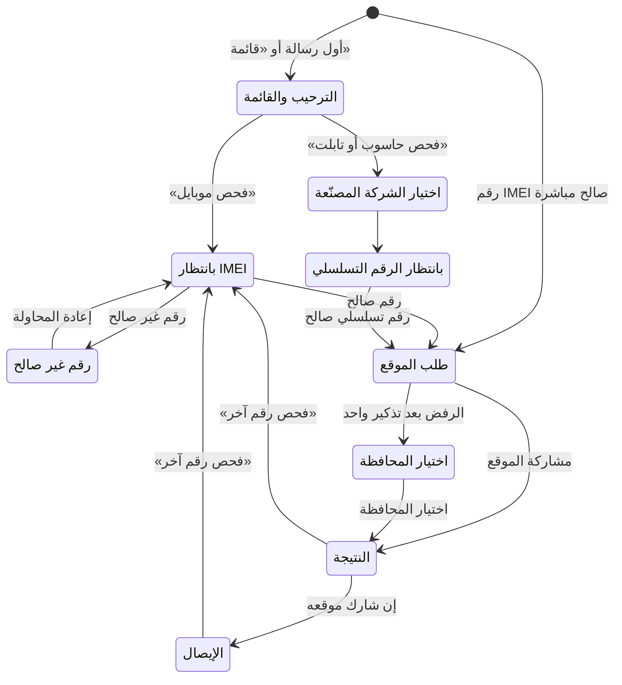

# 24 — كتالوج المحتوى

> المصدر الوحيد لكل نص يراه أي شخص في المنصة: نتائج الفحص في كل قناة، وقوالب الرسائل (واتساب، وSMS، والإشعارات، والإيميل، والوثائق المطبوعة)، وسيناريو بوت واتساب، ورسائل الأخطاء، ونصوص طلب الأذونات، وحالات الشاشات، ونصوص الأزمات والإخطار بالحوادث، والصيغ القانونية ونصوص الموافقة، وقواعد حوكمة المحتوى. **لا يكتب المطوّر أي نص من عنده:** كل نص له مفتاح هنا، ويُحمَّل من مخزن المحتوى في لوحة الإدارة (SMART-01)، والنصوص المكتوبة هنا هي القيم الافتراضية التي يُملأ بها المخزن قبل الإطلاق. الصيغ القانونية تخضع لمراجعة المحامي ([قواعد العمل §14](06-business-rules.md#14-الصيغ-القانونية-الثابتة)).

---

## 1. قواعد النبرة والصياغة

### 1.1 كيف يُقرأ هذا الكتالوج

| الرمز أو الصيغة | المعنى |
|---|---|
| `T-<القناة>-NN` | معرّف قالب رسالة. القنوات: `WA` واتساب، و`SMS`، و`PUSH` إشعار التطبيق، و`INAPP` مركز الإشعارات داخل المنصة، و`EMAIL`، و`PDF`. **الرقم NN هو رقم الحدث نفسه في كل القنوات** (مثلاً `T-WA-28` و`T-SMS-28` و`T-INAPP-28` كلها لحدث «قبول البلاغ»)، ويصبح من ثلاث خانات بعد 99. أما `T-PDF` و`T-EMAIL` فترقيمهما مستقل لأنها وثائق |
| `S-BOT-NN` | حالة في محادثة بوت واتساب (تتطابق مع [قائمة الشاشات](18-screen-inventory.md)) |
| `UPPER_SNAKE` | رمز خطأ يعود في الحقل `code` من جسم الخطأ بصيغة RFC 9457 ([التصميم التقني](19-technical-design.md) يحدد الصيغة، وهذا الكتالوج يحدد النص) |
| `{{اسم_المتغير}}` | قيمة تُملأ وقت الإرسال أو العرض. كل المتغيرات معرّفة في §3.2 مع صيغتها وحساسيتها |
| 🔒 | نص مقفل: صيغة قانونية أو أمنية لا تُعدَّل إلا بموافقة المحامي والمدير العام (§9) |
| ⚙️ | قيمة قابلة للتعديل من الإعدادات، وافتراضيها من [فهرس الإعدادات](06-business-rules.md#15-فهرس-الإعدادات) |
| «بصمة» | اسم عمل (Q-01). **كل ظهور له في النصوص يُعرض من إعداد اسم المنصة** (SMART-02) ولا يُكتب في الكود |
| مفتاح المحتوى | كل نص في الواجهات له مفتاح ثابت بصيغة `المجال.الشاشة_أو_الكيان.العنصر`، مثل `check.result.stolen.title`. المفاتيح بالإنكليزية، والقيم بالعربية |

### 1.2 مبادئ النبرة (من [الهوية البصرية §8](15-visual-identity.md#8-نبرة-الكتابة))

1. **فصحى مبسطة وجمل قصيرة:** جملة واحدة لفكرة واحدة، ولا تزيد الجملة عن نحو 20 كلمة.
2. **النتيجة أولاً ثم التفاصيل:** أول سطر يقول ما حدث، والثاني يقول ماذا تفعل.
3. **أفعال واضحة في الأزرار:** «افحص الآن»، «بلّغ عن جهازك»، «أرسل»، «تأكيد». الزر يصف ما سيحدث، لا «موافق» ولا «نعم» وحدها.
4. **لا لوم ولا تهويل:** لا نتهم أحداً، ولا نستخدم علامات التعجب ولا التكرار للتشديد.
5. **السلامة قبل كل شيء:** في حالات الخطر نذكّر بالسلامة: «لا تحاول مواجهة البائع»، و«لا تحاول استرداد جهازك بنفسك» (D-46).
6. **الصدق في حدود المنصة:** «النتيجة معلومة وليست ضماناً»، ولا نعد بما لا نملكه (لا نعد باسترداد الجهاز، ولا بزمن ثابت للتحقيق).
7. **تقليل البيانات في الرسائل:** الرسالة لا تحمل إلا ما يلزم لفهمها. التفاصيل تُعرض داخل الحساب بعد الدخول (§3.1.6).
8. **لا إعلانات ولا عروض** في نتائج الفحص والبلاغات والوثائق وردود البوت والـ SMS وبوابة الأمن ولوحة الإدارة (ADS-02).

### 1.3 كلمات ممنوعة وبدائلها المعتمدة

| ❌ ممنوع | ✅ البديل المعتمد | السبب |
|---|---|---|
| «الجهاز سليم»، «نظيف»، «آمن»، «يمكنك الشراء» | «لا توجد بلاغات فعّالة على هذا الرقم...» | النتيجة ليست ضماناً لمصدر الجهاز (06 §14) |
| «مضمون»، «مؤكَّد أنه غير مسروق»، «موثوق 100%» | «النتيجة معلومة وليست ضماناً» | حدود المسؤولية القانونية (07 §10.2) |
| «سارق»، «لص»، «حرامي» عن أي شخص (بائع، أو حائز، أو مسجِّل) | «الجهاز مبلّغ عنه» | نصف حالة الجهاز لا الأشخاص، ولا نتهم أحداً |
| «القبض عليه»، «ملاحقة»، «سنكشفه» | «الجهات المختصة تتابع» | لا تهويل، ولا وعود أمنية |
| «تتبّع جهازك»، «اعرف مكان جهازك»، «موقع جهازك الآن» (للمالك) | «المنصة تتابع أمر جهازك، وسنبلغك بأي مستجد» | لا تتبّع للمالك من تطبيقنا (D-46) |
| «موقعك لا يُكشف لأحد»، «موقعك سري تماماً» | «موقعك لا يظهر لصاحب الجهاز ولا لأي شخص، وتستخدمه الإدارة والجهات المختصة فقط» 🔒 | دقة ما يُقال للمستخدم (C-16، GEO-02) |
| «بياناتك لا يراها أحد»، «آمن تماماً»، «مشفّر بالكامل» عن بيانات تُعرض للإدارة | من يرى البيان فعلاً، مثل: «يراها المحل في هذه المعاملة، والإدارة وقوى الأمن عند الحاجة» | دقة عبارات الخصوصية ([الخصوصية §3.4](21-privacy-dpia.md)) |
| «نحذف كل بياناتك عند الطلب» | «إغلاق الحساب لا يحذف سجلات الملكية والمعاملات والبلاغات التي يجب الاحتفاظ بها» | 21 §3.4، AUTH-10 |
| «مكافأة من بصمة»، «تدفع المنصة»، «احصل على مكافأتك» | «مكافأة أعلنها صاحب الجهاز... والمنصة غير مسؤولة عنها» 🔒 | المنصة ليست طرفاً في المكافأة (D-50، TIP-05) |
| «مكافأة لمن يعيد الجهاز المسروق» | «مكافأة لمن يدلي بمعلومات تؤدي لاسترداده عبر الجهات المختصة» 🔒 | حتى لا تصبح المكافأة وسيلة ابتزاز (TIP-06) |
| «الرقم البديل لاستعادة حسابك» | «الرقم البديل للإشعارات فقط» | D-81 |
| «أرسل لنا كلمة المرور» أو «أرسل الرمز للدعم» | «فريق الدعم لا يطلب منك كلمة المرور أو رمز التحقق أبداً» 🔒 | SUPPORT-05 |
| «سيلفي»، «صورة وجهك» | «صوّر هويتك (الوجهين) بالكاميرا» | لا سيلفي (D-32) |
| «اختر صورة من المعرض» (للهوية والصورة الحيّة) | «صوّر الآن بالكاميرا» | التصوير من داخل المنصة فقط (AUTH-05، REPORT-04) |
| «مركز المساعدة»، «الأسئلة الشائعة» | «طلب دعم» | D-22، D-82 |
| «دليل المحلات»، «إحصائيات» | — (لا يُذكر) | D-22 |
| «اشترِ لتلتزم»، «باقة إلزامية» | «الشراء اختياري، ولا علاقة له بالتزامك بالتسجيل في المنصة» 🔒 | STORE-07، D-70 |
| «جرّب مجاناً لفترة محدودة» عن الخدمات الأساسية | «مجاني دائماً» | D-72 |
| «اشترِ الآن»، «اشترك»، «تواصل معنا للشراء»، «فعّل من الموقع» **داخل التطبيقين** للخدمات الرقمية | الحالة فقط: «مفعّلة حتى {{end_date}}» أو «غير مفعّلة» | سياسات آبل وجوجل (D-86، PAY-08) |
| «محظور» عن حساب في أول إجراء | «معلّق مؤقتاً» (التعليق)، و«موقوف نهائياً» (الحظر بعد بلاغ كاذب مثبت) | دقة الحالة ودرجتها |
| «الجهاز مراقَب على الشبكة» في نتيجة الفحص العامة | «قد يتوقف الجهاز عن العمل على شبكات الاتصالات السورية» | لا نكشف آلية التتبّع للحائز فيتجنّب تركيب الشريحة (D-27) |
| «خطأ 500»، «Exception»، «null»، «undefined»، رموز تقنية | «حدث خلل مؤقت من جهتنا. حاول بعد قليل» | لا مصطلحات تقنية للمستخدم (08 §7) |
| «أدخلت رقماً خاطئاً»، «فشلت» | «الرقم غير صالح. تأكد من الخانات الـ 15» | لا لوم |
| «الإيمي»، «الآي إم إي آي» | «رقم IMEI» | توحيد المصطلح |
| «كود»، «OTP»، «باسورد»، «لوغ إن» | «رمز التحقق»، «كلمة المرور»، «تسجيل الدخول» | عربية سليمة |
| «عزيزي»، «عزيزتي»، «سيدي» | «مرحباً» دون لقب | حياد الجنس (§1.5) |
| «الشرطة» في نصوص المواطن | «الجهات المختصة»، و«قوى الأمن الداخلي» حين يلزم التحديد (مثل البلاغ الرسمي) | دقة الجهة |

**المصطلحات الثابتة** (تُستخدم دائماً باللفظ نفسه): «فحص»، «بلاغ»، «نافذ»، «لا توجد بلاغات فعّالة»، «مبلّغ عنه: مسروق»، «مبلّغ عنه: مفقود»، «رقم غير صالح»، «رقم الحساب»، «رقم البلاغ»، «رمز التحقق»، «توثيق الهوية»، «موثّق الهوية» (للحساب)، «محل موثّق» (للمحل)، «أجهزتي»، «بلاغاتي»، «طلباتي»، «إيصالاتي»، «شهادة فحص»، «إيصال فحص»، «فاتورة»، «نقل الملكية»، «مستخدم مفوّض»، «جهة موثوقة»، «رقم بديل»، «إدارة المنصة» (وتُختصر «الإدارة» بعد أول ذكر)، «الجهات المختصة». ومستويات الموثوقية (🟢 موثّق...) **للمشرف فقط ولا تظهر للمستخدم**.

### 1.4 مخاطبة المستخدم

| القاعدة | التطبيق |
|---|---|
| المفرد المخاطَب | «حسابك»، «جهازك»، «يمكنك». لا «حضرتكم» ولا ضمير الجمع |
| التحية | «مرحباً،» دون اسم ولا لقب في واتساب وSMS. ويجوز الاسم الأول داخل الحساب فقط |
| المنصة تتكلم بصيغة «نحن» | «استلمنا بلاغك»، «سنبلغك». والإدارة تُذكر باسمها حين يكون القرار قرارها: «قبلت إدارة المنصة بلاغك» |
| الطرف الآخر | «صاحب الجهاز»، «المشتري»، «البائع»، «المالك». لا أسماء ولا أرقام للطرف الآخر أبداً (D-10) |
| الإنكار الآمن | كل رسالة أمنية تنتهي بما يفعله المستخدم إن لم يكن هو صاحب الإجراء: «إذا لم تطلب ذلك، افتح طلب دعم فوراً» |

### 1.5 الصياغة المحايدة للجنس

العربية تميّز المذكر والمؤنث في الأفعال والصفات. القواعد التالية تجعل النص صالحاً للجميع دون تكلّف:

| القاعدة | ❌ | ✅ |
|---|---|---|
| ضمير الكاف دون تشكيل يصلح للجنسين | «حسابكَ» | «حسابك» |
| الماضي المخاطَب دون تشكيل | «أرسلتَ» | «أرسلت» |
| «يمكنك» + مصدر بدل الأمر في نص الرسائل | «قدّمي اعتراضاً» | «يمكنك تقديم اعتراض» |
| الأمر بصيغته الشائعة مقبول في الأزرار فقط | — | «افحص الآن»، «بلّغ عن جهازك» |
| وصف الحساب لا الشخص | «أنت موثّق» | «حسابك موثّق الهوية» |
| المبني للمجهول أو المنصة فاعلاً | «أنت مقبول» | «قُبل طلبك»، «قبلنا طلبك» |
| لا صيغ مزدوجة بالشرطة | «عزيزي/عزيزتي»، «المستخدم/ة» | تُعاد صياغة الجملة |
| الأسماء العامة للأدوار بصيغتها المعجمية | — | «صاحب الجهاز»، «المشتري»، «الموظف» (صيغ عامة لا تدل على جنس بعينه) |

### 1.6 الأرقام والتواريخ والعملة والاتجاه

| البند | القاعدة | مثال |
|---|---|---|
| الأرقام | الأرقام الإنكليزية (0-9) في كل الواجهات والرسائل والوثائق. والأرقام العربية (٠-٩) مقبولة في الإدخال وتُحوَّل تلقائياً (CHECK-02) | `482193` |
| التاريخ | `DD/MM/YYYY` بالتقويم الميلادي | `12/10/2026` |
| التاريخ الطويل (الوثائق المطبوعة والصفحات القانونية) | اليوم ثم اسم الشهر ثم السنة، بأسماء الأشهر المعتمدة في سوريا: كانون الثاني، شباط، آذار، نيسان، أيار، حزيران، تموز، آب، أيلول، تشرين الأول، تشرين الثاني، كانون الأول (الإعداد المحلي `ar-SY`) | `12 تشرين الأول 2026` |
| الوقت | 24 ساعة `HH:mm` | `14:32` |
| التاريخ والوقت في الواجهات والوثائق | `DD/MM/YYYY — HH:mm` | `12/10/2026 — 14:32` |
| التاريخ والوقت في واتساب وSMS | `DD/MM/YYYY الساعة HH:mm` (الشرطة الطويلة تضطرب في بعض الهواتف) | `12/10/2026 الساعة 14:32` |
| المنطقة الزمنية | كل الأوقات المعروضة بتوقيت دمشق (Asia/Damascus)، والمخزّنة بالتوقيت العالمي. لا يُكتب اسم المنطقة الزمنية للمستخدم | — |
| الوقت النسبي في القوائم | «الآن» (أقل من دقيقة)، «منذ {{n}} دقيقة»، «منذ {{n}} ساعة»، «أمس 14:32»، ثم التاريخ الكامل بعد 7 أيام | «منذ 5 دقائق» |
| المدد والمهل | عدد + وحدة بالعربية حسب جدول الجمع (§1.7). لا اختصارات مثل «د» أو «س» | «خلال 72 ساعة» |
| العملة | المبلغ ثم «ل.س»، بفاصل الآلاف «,» ودون كسور | `500,000 ل.س` |
| الأعداد الكبيرة | فاصل الآلاف من 1,000 فما فوق في المبالغ والإحصاءات، ولا فاصل في المعرّفات والسنوات | `1,250` |
| رقم IMEI للعرض | مجموعات 2-6-6-1 في الواجهات، و15 خانة متصلة في واتساب وSMS (لسهولة النسخ) | `35 209871 457812 3` |
| IMEI مخفي جزئياً | أول 8 خانات (TAC) ثم نقاط ثم آخر 4 خانات ([نموذج التهديد §2.2](20-threat-model.md)، المرجع لكل صيغ الإخفاء) | `35209871•••8123` |
| آخر 4 خانات | في الرسائل التي تحتاج تمييز الجهاز دون كشف الرقم | «المنتهي بـ 8123» |
| رقم الموبايل | `09XX XXX XXX` للعرض، ويُخزَّن `+9639XXXXXXXX` (08 §5) | `0944 123 456` |
| موبايل مخفي جزئياً | رقم الحساب: أول 4 خانات وآخر خانتين. والرقم البديل: أول خانتين وآخر خانتين | `0944••••56` / `09••••••56` |
| الرقم الوطني مخفياً | آخر 3 خانات فقط | `••••••••123` |
| الاسم في الصفحات العامة | الاسم الأول وأول حرف من الكنية (صفحة التحقق من الفاتورة، PUB-02) | «أحمد م.» |
| مرجع الدفع خارج شاشة التأكيد | آخر 4 خانات | `••••7821` |
| المعرّفات المرجعية | تُكتب كما هي بالأحرف اللاتينية، وبالصيغ المعتمدة في [التصميم التقني §13.1](19-technical-design.md): الحساب `SY-4K7P92`، والبلاغ `BL-2026-000123`، والمحل `SH-01234`، والوكيل `IM-0123`، والمورّد `SP-0456`، والمعاملة وفاتورة الجهاز `TX-2026-0001234`، والفاتورة التجارية `IN-2026-000321`، والشهادة والإيصال وتقرير التاريخ `CR-7KQ2M9XA`، وطلب الدعم `ST-2026-000045`، ودفعة الوكيل `BT-2026-0012`، والنقل بالجملة `TR-2026-00034`، وطلب المتجر `OR-2026-000123`، والمرتجع `RN-2026-000045`، وكشف التسوية `SE-2026-00012`، وطلب الخدمة `SV-2026-000078`، وعملية المحفظة `WL-2026-00001234`، وإيصال التعبئة `TP-2026-0001234` | — |
| الاتجاه في الواجهات | كل قيمة لاتينية أو رقمية داخل نص عربي (IMEI، والموبايل، والمعرّفات، والموديل، والروابط) تُعزل باتجاه من اليسار لليمين (`<bdi dir="ltr">` في الويب، وما يقابلها في التطبيق) حتى لا تنقلب أجزاؤها | — |
| الاتجاه في واتساب وSMS | لا يمكن عزل الاتجاه، فتوضع القيمة اللاتينية **في آخر السطر بعد نقطتين** أو في سطر مستقل، ولا تُوضع قيمتان لاتينيتان متجاورتان في سطر واحد | `رقم البلاغ: BL-2026-000123` |
| أسماء الموديلات | كما تأتي من قاعدة TAC بالأحرف اللاتينية، وتُقص بعد ⚙️ 24 حرفاً في SMS مع «…» | `Samsung Galaxy A54` |
| المحافظات | بالأسماء المعتمدة في القائمة المرجعية (GEO-01) | «ريف دمشق» |

### 1.7 جدول الجمع (صيغ العدد والمعدود)

العربية لها ست صيغ للعدد (حسب CLDR: zero، one، two، few، many، other). المطوّر يستخدم مكتبة الجمع (ICU) مع هذا الجدول، ولا يكتب «دقيقة/دقائق» بنفسه. والقاعدة الصياغية: **يأتي العدد بعد حرف جر أو فعل** («خلال»، «بعد»، «لمدة»، «يوجد»)، فتصح صيغة المثنى بالياء.

| المعدود | zero: 0 | one: 1 | two: 2 | few: 3–10 (و103–110...) | many: 11–99 (و111–199...) | other: 100–102 (و200–202...) |
|---|---|---|---|---|---|---|
| دقيقة | لا دقائق | دقيقة واحدة | دقيقتين | {{n}} دقائق | {{n}} دقيقة | {{n}} دقيقة |
| ساعة | لا ساعات | ساعة واحدة | ساعتين | {{n}} ساعات | {{n}} ساعة | {{n}} ساعة |
| يوم | لا أيام | يوم واحد | يومين | {{n}} أيام | {{n}} يوماً | {{n}} يوم |
| جهاز | لا أجهزة | جهاز واحد | جهازين | {{n}} أجهزة | {{n}} جهازاً | {{n}} جهاز |
| فحص | لا فحوص | فحص واحد | فحصين | {{n}} فحوص | {{n}} فحصاً | {{n}} فحص |
| تنبيه | لا تنبيهات | تنبيه واحد | تنبيهين | {{n}} تنبيهات | {{n}} تنبيهاً | {{n}} تنبيه |
| محاولة | لا محاولات | محاولة واحدة | محاولتين | {{n}} محاولات | {{n}} محاولة | {{n}} محاولة |
| رسالة | لا رسائل | رسالة واحدة | رسالتين | {{n}} رسائل | {{n}} رسالة | {{n}} رسالة |
| طلب | لا طلبات | طلب واحد | طلبين | {{n}} طلبات | {{n}} طلباً | {{n}} طلب |
| سطر (في الملفات) | لا أسطر | سطر واحد | سطرين | {{n}} أسطر | {{n}} سطراً | {{n}} سطر |

### 1.8 علامات الترقيم والتنسيق

- الفاصلة العربية «،» والفاصلة المنقوطة «؛» وعلامة الاستفهام «؟». والنقطة في آخر كل جملة كاملة، ولا نقطة في آخر العناوين والأزرار.
- علامات التنصيص «» لأسماء الأزرار والشاشات داخل النص: «اضغط «بلّغ عنه»».
- لا رموز تعبيرية (Emoji) في أي نص يصل للمستخدم، بما فيه واتساب. والرموز ✅ ⚠️ ❌ 🔒 ⚙️ في هذه الوثيقة للتوثيق فقط.
- في واتساب: الخط العريض `*...*` لسطر الحالة فقط، ولا خط مائل ولا مشطوب.
- لا تشكيل إلا لرفع لبس حقيقي (مثل «تشترِ»).

### 1.9 حدود الطول لكل قناة

| القناة | الحد | ملاحظات |
|---|---|---|
| SMS | **70 حرفاً للرسالة الواحدة، و67 حرفاً لكل قطعة عند تجاوزها** (ترميز UCS-2 للعربية). الهدف قطعتان (134 حرفاً)، والحد الأقصى ثلاث قطع (201 حرف) لنتائج الفحص التي تحمل تحذيراً، ولإشعار الجهاز المضبوط (`T-SMS-140`) فقط | العدّ بعد ملء المتغيرات بأطول قيمها (§3.2). أداة المحرّر تعرض عدد القطع قبل الحفظ (§9) |
| واتساب (قالب) | النص حتى 1024 حرفاً، والرأس والتذييل حتى 60 حرفاً لكل منهما، ونص الزر حتى 25 حرفاً | نستهدف أقل من 400 حرف للنص |
| واتساب (رسائل البوت التفاعلية) | نص الزر حتى 20 حرفاً، وعنوان سطر القائمة حتى 24 حرفاً، ووصفه حتى 72 حرفاً، وحتى 10 أسطر في القائمة الواحدة، وحتى 3 أزرار رد | لذلك قائمة المحافظات على صفحتين (§4) |
| PUSH | العنوان حتى 40 حرفاً، والنص حتى 120 حرفاً | يظهر على شاشة القفل، فلا بيانات شخصية (§3.1.6) |
| INAPP | العنوان حتى 60 حرفاً، والنص حتى 300 حرف | التفاصيل في الشاشة التي يفتحها الإشعار |
| الأزرار في الواجهات | حتى 24 حرفاً، وفعل في أولها | — |
| رسائل الخطأ | جملتان كحد أقصى: ما حدث، وماذا تفعل | §5 |

## 2. مصفوفة نتائج الفحص

> تُطبّق CHECK-08 إلى CHECK-11، وGSMA-01 وGSMA-02 وGSMA-05، وCUSTOMS-02، وFAKE-01 إلى FAKE-03، وTIP-04 إلى TIP-06، وWABOT-01 وWABOT-04، وSMS-01 وSMS-02، وBIZAPI-02. النتيجة تُبنى من **نتيجة أساسية واحدة** ومعها **مؤشرات إضافية مستقلة** لا تغيّرها (06 §2). كل تركيبة ممكنة تُعرض بقواعد التركيب في §2.3، فلا توجد تركيبة دون نص.

### 2.1 النتيجة الأساسية

| الرمز | النص الثابت 🔒 | اللون والأيقونة (15 §3.3) | متى (06 §2) | قيمة `status` في الربط البرمجي |
|---|---|---|---|---|
| P1 | «لا توجد بلاغات فعّالة» | `clean`، درع بعلامة صح | لا بلاغ نافذ على أي معرّف للجهاز، **بما فيه وجود بلاغ قيد المراجعة** (CHECK-15) أو جهاز غير معروف للمنصة | `NO_ACTIVE_REPORTS` |
| P2 | «مبلّغ عنه: مسروق» | `stolen`، درع بعلامة تنبيه | بلاغ نافذ من نوع «مسروق» (بما فيه طلب إغلاق قيد المراجعة) | `REPORTED_STOLEN` |
| P3 | «مبلّغ عنه: مفقود» | `lost`، دائرة بعلامة استفهام | بلاغ نافذ من نوع «مفقود» | `REPORTED_LOST` |
| P4 | «رقم غير صالح» | `warn`، مثلث تنبيه | الرقم لا يطابق الصيغة أو يفشل في Luhn. **لا تُعرض معه أي مؤشرات، ولا يُستعلم عنه من GSMA ولا الهيئة** | `INVALID_NUMBER` |

### 2.2 المؤشرات الإضافية

**أ) الحالة الدولية (GSMA-01، GSMA-02، GSMA-05)** — عنوان السطر في الموقع والتطبيق: «القائمة الدولية (GSMA)».

| الحالة | الموقع والتطبيق | واتساب | SMS | الربط البرمجي `international.status` | الدرجة |
|---|---|---|---|---|---|
| غير مُدرج | «غير مُدرج» | «الحالة الدولية (GSMA): غير مُدرج» | لا يُكتب | `NOT_LISTED` | محايد |
| مُدرج | شريط أعلى النتيجة: «هذا الجهاز مُبلّغ عنه خارج سوريا (قاعدة GSMA العالمية). ننصح بعدم شرائه.» | «تنبيه: هذا الجهاز مُبلّغ عنه خارج سوريا (قاعدة GSMA العالمية). ننصح بعدم شرائه.» | «تنبيه: مُبلّغ عنه خارج سوريا (GSMA)، لا تشترِه.» | `LISTED` | `stolen` |
| ينتظر الرد (الموقع والتطبيق فقط، بعد ⚙️ 800 ملّي ثانية) | «جارٍ التحقق الدولي» مع مؤشر انتظار، ويُستبدل تلقائياً عند وصول الرد، ويُعلَن لقارئ الشاشة | لا ينطبق | لا ينطبق | `PENDING` (مع `retry_after_seconds`) | `info` |
| تعذّر (تجاوز ⚙️ ثانيتين في واتساب وSMS والربط البرمجي، أو تعطل الخدمة) | «تعذّر التحقق الدولي حالياً» | «تعذّر التحقق الدولي حالياً.» | «تعذّر التحقق الدولي حالياً.» | `UNAVAILABLE` | `info` |
| لا ينطبق (الفحص بالرقم التسلسلي) | «الفحص الدولي متاح برقم IMEI فقط» | «الفحص الدولي متاح برقم IMEI فقط.» | لا ينطبق | `NOT_APPLICABLE` | محايد |
| التكامل غير مفعّل | لا يُعرض السطر | لا يُعرض | لا يُعرض | `NOT_CONNECTED` | — |

**ب) التسجيل لدى الهيئة الناظمة (CUSTOMS-01، CUSTOMS-02)** — عنوان السطر: «التسجيل لدى الهيئة الناظمة».

| الحالة | الموقع والتطبيق | واتساب | SMS | `registration.status` | الدرجة |
|---|---|---|---|---|---|
| مسجّل | «مسجّل رسمياً لدى الهيئة»، وتحته «منذ {{customs_date}}» إن توفر التاريخ | «التسجيل لدى الهيئة: مسجّل رسمياً» | لا يُكتب | `REGISTERED` | `clean` |
| غير مسجّل | «غير مسجّل لدى الهيئة، وقد لا يعمل على الشبكة» | «غير مسجّل لدى الهيئة، وقد لا يعمل على الشبكة.» | «غير مسجّل لدى الهيئة، قد لا يعمل على الشبكة.» | `NOT_REGISTERED` | `warn` |
| ينتظر الرد | «جارٍ التحقق من التسجيل لدى الهيئة» | لا ينطبق | لا ينطبق | `PENDING` | `info` |
| تعذّر | «تعذّر التحقق من التسجيل لدى الهيئة حالياً» | «تعذّر التحقق من التسجيل لدى الهيئة حالياً.» | لا يُكتب | `UNAVAILABLE` | `info` |
| لا ينطبق | «التحقق من التسجيل متاح برقم IMEI فقط» | لا يُعرض | لا ينطبق | `NOT_APPLICABLE` | محايد |
| التكامل غير مفعّل | لا يُعرض | لا يُعرض | لا يُعرض | `NOT_CONNECTED` | — |

**ج) تحذير التقليد (FAKE-01)** — يظهر فقط عندما تكون أول 8 خانات (TAC) **غير مخصصة** لأي جهاز في قاعدة GSMA. أما الرقم المخصص الذي لا نعرف موديله فلا يُعدّ تقليداً، ويُكتب بدل الموديل: «الماركة والموديل غير معروفين لهذا الرقم».

| الحالة | الموقع والتطبيق | واتساب | SMS | `counterfeit.status` | الدرجة |
|---|---|---|---|---|---|
| غير مخصص | شريط أعلى النتيجة: «هذا الرقم غير مخصص لأي جهاز معروف عالمياً، وقد يكون الجهاز مقلّداً أو رقمه معدّلاً» 🔒 | «تحذير: هذا الرقم غير مخصص لأي جهاز معروف عالمياً، وقد يكون الجهاز مقلّداً أو رقمه معدّلاً.» | «تحذير: رقم غير مخصص لجهاز معروف، قد يكون مقلّداً.» | `TAC_UNALLOCATED` | `warn` |
| مخصص | لا يُعرض | لا يُعرض | لا يُعرض | `NONE` | — |
| تعذّر التحقق من TAC | لا يُعرض | لا يُعرض | لا يُعرض | `UNKNOWN` | — |

**د) تطابق رقمي IMEI (FAKE-02، D-66)** — يظهر فقط حين يتوفر الرقمان معاً: مسح شاشة `*#06#` بالكاميرا (يقرأ الرقمين)، أو إرسال رقمين في رسالة واتساب واحدة، أو جهاز مسجّل في المنصة برقمين. عنوان السطر: «الرقمان لنفس الموديل».

| الحالة | الموقع والتطبيق | واتساب | `pair.status` | الدرجة |
|---|---|---|---|---|
| متطابقان | «متطابقان» | «الرقمان لنفس الموديل.» | `MATCH` | `clean` |
| غير متطابقين | شريط أعلى النتيجة: «رقما IMEI في هذا الجهاز لا يعودان للموديل نفسه، وقد يكون أحدهما معدّلاً» | «تحذير: رقما IMEI لا يعودان للموديل نفسه، وقد يكون أحدهما معدّلاً.» | `MISMATCH` | `warn` |
| رقم واحد فقط | لا يُعرض | لا يُعرض | `NOT_CHECKED` | — |

في SMS لا ينطبق هذا المؤشر، لأن الرسالة تحمل رقماً واحداً.

**هـ) المكافأة (TIP-04 إلى TIP-06، D-50)** — مع P2 وP3 فقط، وحين أعلن صاحب البلاغ مكافأة.

| النتيجة | الموقع والتطبيق وواتساب 🔒 | SMS | الربط البرمجي |
|---|---|---|---|
| P3 مفقود | عنوان: «مكافأة أعلنها صاحب الجهاز»، والنص: «مكافأة {{reward_amount}} لمن يعيده عبر المنصة»، ثم: «المكافأة التزام شخصي من صاحب الجهاز، والمنصة غير مسؤولة عنها.» | لا تُكتب (حد الطول) | `reward.announced: true`، و`reward.amount_syp` |
| P2 مسروق | عنوان: «مكافأة أعلنها صاحب الجهاز»، والنص: «مكافأة {{reward_amount}} لمن يدلي بمعلومات تؤدي لاسترداده عبر الجهات المختصة»، ثم: «المكافأة التزام شخصي من صاحب الجهاز، والمنصة غير مسؤولة عنها.» | لا تُكتب | كما سبق |

### 2.3 قواعد التركيب

1. **P4 يقف وحده:** لا مؤشرات ولا مكافأة ولا إيصال.
2. **ترتيب العرض في الموقع والتطبيق:** شريط الخطر أو التحذير الأشد (إن وُجد) ← بطاقة النتيجة الأساسية ← المكافأة ← أسطر المؤشرات (الدولية، ثم الهيئة، ثم تطابق الرقمين) ← الصيغة القانونية ← الإجراءات ← النصائح.
3. **شريط واحد فقط** أعلى النتيجة، بأشد الحالات: الإدراج الدولي (`stolen`) ثم التقليد ثم عدم تطابق الرقمين (`warn`). وإذا اجتمع أكثر من تحذير تُكتب كلها في الشريط نفسه سطراً تحت سطر، بلون الأشد.
4. **ترتيب أسطر واتساب:** الحالة الأساسية ← الجهاز وتاريخ البلاغ ← الدولية ← التقليد ← تطابق الرقمين ← الهيئة ← المكافأة ← الإرشاد والرابط ← الصيغة القانونية ← وقت الفحص.
5. **SMS:** في P2 وP3 لا تُضاف أي أسطر. وفي P1 يُضاف **سطر واحد فقط** بالأولوية: مُدرج دولياً ← تقليد ← غير مسجّل لدى الهيئة ← تعذّر التحقق الدولي. بذلك لا تتجاوز أي رسالة ثلاث قطع.
6. **الأولوية الإجمالية** (لاختيار لون البطاقة والنصيحة): مسروق ← مفقود ← مُدرج دولياً ← تقليد أو عدم تطابق ← غير مسجّل لدى الهيئة ← ينتظر أو تعذّر.
7. **البلاغ قيد المراجعة** لا يظهر للفاحص بأي صيغة، ولا يختلف النص عن P1 بحرف.
8. **لا بيانات عن صاحب الجهاز** ولا مكان الحادثة ولا مصدر البلاغ ولا أصل تسجيل الجهاز في أي قناة (CHECK-11). أصل التسجيل يظهر فقط في الشهادة (OWN-14) وللمحل عند الشراء (SHOP-18) وفي تقرير تاريخ الجهاز (HISTORY-01).
9. **لا إعلانات ولا عروض** في أي نتيجة (ADS-02).
10. **وقت الفحص** يُعرض دائماً: «فُحص في {{checked_at}}».

### 2.4 مصفوفة التركيبات

كل صف يمثّل فئة تركيبات، وما بين قوسين هو ما يُضاف للنص الأساسي. «أي» تعني أي حالة لباقي المؤشرات.

| # | الأساسية | GSMA | التقليد | تطابق الرقمين | الهيئة | المكافأة | الشريط أعلى النتيجة | النصيحة تحت البطاقة | `advice` | أثرها في شراء المحل |
|---|---|---|---|---|---|---|---|---|---|---|
| C-01 | P1 | غير مُدرج أو غير مفعّل | مخصص | متطابق أو غير مفحوص | مسجّل أو غير مفعّل | — | لا يوجد | قائمة «نصائح قبل الشراء» | `NONE` | مسموح |
| C-02 | P1 | غير مُدرج | مخصص | أي | غير مسجّل | — | لا يوجد | (سطر الهيئة `warn`) + النصائح | `CAUTION` | مسموح، ويظهر للمحل تنبيه معلوماتي |
| C-03 | P1 | ينتظر أو تعذّر | مخصص | متطابق أو غير مفحوص | أي غير «غير مسجّل» | — | لا يوجد | (سطر «جارٍ التحقق الدولي» أو «تعذّر») + النصائح | `NONE` | مسموح، ويُعاد التحقق آلياً بعد وصول الرد، وإذا ظهر مُدرجاً يُنبَّه المشرف |
| C-04 | P1 | مُدرج | أي | أي | أي | — | الإدراج الدولي (`stolen`) | «ننصح بعدم شرائه.» | `DO_NOT_BUY` | **ممنوع**، وتنبيه عادي للإدارة (GSMA-03) |
| C-05 | P1 | غير مُدرج أو ينتظر أو تعذّر | غير مخصص | أي | أي | — | التقليد (`warn`) | «تحقق جيداً من الجهاز قبل شرائه، واطلب فاتورة أو شهادة فحص.» | `CAUTION` | مسموح بعد تأكيد صريح، ويُعلَّم للإدارة (FAKE-03) |
| C-06 | P1 | غير مُدرج أو ينتظر أو تعذّر | مخصص | غير متطابق | أي | — | عدم التطابق (`warn`) | «تحقق جيداً من الجهاز قبل شرائه، واطلب فاتورة أو شهادة فحص.» | `CAUTION` | يُحال للمراجعة ولا يُسجَّل آلياً (FAKE-02) |
| C-07 | P1 | غير مُدرج أو ينتظر أو تعذّر | غير مخصص | غير متطابق | أي | — | التقليد وعدم التطابق معاً (`warn`) | كما في C-05 | `CAUTION` | يُحال للمراجعة |
| C-08 | P2 | أي | أي | أي | أي | لا | لا يوجد (البطاقة نفسها بلون `stolen`) | «لا تشترِ هذا الجهاز.» + تحذير السلامة + نموذج «عندك معلومات؟» + (أسطر المؤشرات) | `DO_NOT_BUY` | **ممنوع**، وتنبيه أمني عاجل |
| C-09 | P2 | أي | أي | أي | أي | نعم | لا يوجد | كما في C-08 + صندوق المكافأة بصياغة المسروق | `DO_NOT_BUY` | ممنوع، وتنبيه أمني عاجل |
| C-10 | P3 | أي | أي | أي | أي | لا | لا يوجد (البطاقة بلون `lost`) | «لا تشترِ هذا الجهاز.» + «إذا وجدته تواصل معنا لنعيده لصاحبه.» + نموذج الإرجاع + (أسطر المؤشرات) | `DO_NOT_BUY` | ممنوع، وتنبيه أمني عاجل |
| C-11 | P3 | أي | أي | أي | أي | نعم | لا يوجد | كما في C-10 + صندوق المكافأة بصياغة المفقود | `DO_NOT_BUY` | ممنوع، وتنبيه أمني عاجل |
| C-12 | P1 أو P2 أو P3 بالرقم التسلسلي لجهاز آبل بشريحة | لا ينطبق | لا ينطبق | لا ينطبق | لا ينطبق | حسب البلاغ | لا يوجد | النص الأساسي + «الفحص الدولي متاح برقم IMEI فقط» | حسب الأساسية | لا ينطبق (المحل يسجّل الموبايل برقم IMEI دائماً) |
| C-13 | P4 | — | — | — | — | — | لا يوجد | نص «رقم غير صالح» وسببه | — | لا يمكن المتابعة |
| C-14 | P1 أو P2 أو P3 لجهاز دون شريحة (D-91) | لا يُعرض | لا يُعرض | لا يُعرض | لا يُعرض | حسب البلاغ | لا يوجد | النص الأساسي، وفي P2 وP3: «لا يوجد حظر من الشبكة لهذه الأجهزة» (§2.12) | حسب الأساسية | كالموبايل تماماً: ممنوع مع تنبيه أمني عاجل للمبلّغ عنه (SERIAL-05) |

في P2 وP3 تظهر أسطر المؤشرات تحت البطاقة دون شريط، لأن البطاقة نفسها أشد منها.

### 2.5 بطاقة النتيجة في الموقع والتطبيق

**عناصر مشتركة:**

| المفتاح | النص |
|---|---|
| `check.result.breadcrumb` | «نتيجة الفحص» |
| `check.result.imei_label` | «رقم IMEI المفحوص» |
| `check.result.device_line` | «{{device_model}} · فُحص في {{checked_at}}» |
| `check.result.device_unknown` | «الماركة والموديل غير معروفين لهذا الرقم» |
| `check.result.location_on` | «الموقع مفعّل» |
| `check.result.location_off` | «الموقع غير مفعّل، فلا يصدر إيصال فحص لهذا الفحص.» |
| `check.result.action.receipt` | «حفظ إيصال الفحص» |
| `check.result.action.share` | «مشاركة» |
| `check.result.action.again` | «فحص جهاز آخر» |
| `check.result.footer_legal` | «نتيجة الفحص معلومة وليست ضماناً لمصدر الجهاز.» 🔒 |

**P1 — لا توجد بلاغات فعّالة:**

| المفتاح | النص |
|---|---|
| `check.result.clean.title` | «لا توجد بلاغات فعّالة» 🔒 |
| `check.result.clean.body` | «لا توجد بلاغات فعّالة على هذا الرقم في قاعدة بيانات المنصة حتى تاريخه.» 🔒 |
| `check.result.clean.legal` | «هذه النتيجة لا تُعد ضماناً لمصدر الجهاز.» 🔒 |
| `check.result.clean.tips.title` | «نصائح قبل الشراء» |
| `check.result.clean.tips.1` | «طابق رقم IMEI مع شاشة ‎*#06#‎ على الجهاز نفسه» |
| `check.result.clean.tips.2` | «اطلب من البائع نقل الملكية عبر بصمة» |
| `check.result.clean.tips.3` | «اطلب الفاتورة أو شهادة الفحص» |
| `check.result.clean.tips.4` | «احتفظ بإيصال الفحص» (يظهر فقط عند صدور إيصال) |
| `check.result.clean.history` | (في الموقع فقط، وحين تكون الخدمة مفعّلة) العنوان: «تقرير تاريخ الجهاز»، والنص: «كم مرة انتقلت ملكيته، وهل فُتح للصيانة أو استُبدلت لوحته، دون أي بيانات شخصية.»، والزر: «اطلب التقرير» (§3.14). **في التطبيقين** يظهر للمالك الحالي فقط بزر «عرض التقرير» لأنه مجاني له (HISTORY-03)، ولا يظهر لغيره (PAY-08) |

**P2 — مبلّغ عنه: مسروق:**

| المفتاح | النص |
|---|---|
| `check.result.stolen.title` | «مبلّغ عنه: مسروق» 🔒 |
| `check.result.stolen.action` | «لا تشترِ هذا الجهاز» 🔒 |
| `check.result.reported.date` | «تاريخ نشر البلاغ: {{report_published_date}}» |
| `check.result.stolen.safety` | «لا تحاول مواجهة البائع أو احتجازه. سلامتك أولاً، وقدّم ما تعرفه عبر النموذج، والجهات المختصة تتابع.» 🔒 |
| `check.result.stolen.meaning.title` | «ماذا يعني هذا؟» |
| `check.result.stolen.meaning.1` | «هذا البلاغ نافذ بعد مراجعته من إدارة المنصة، أو صادر عن الجهات المختصة.» |
| `check.result.stolen.meaning.2` | «شراء الجهاز يعرّضك لخسارته وللمساءلة.» |
| `check.result.stolen.meaning.3` | «قد يتوقف الجهاز عن العمل على شبكات الاتصالات السورية.» (يظهر فقط عند تفعيل الربط مع شركات الاتصالات) |
| `tip.form.title` | «عندك معلومات عن هذا الجهاز؟» |
| `tip.form.subtitle` | «معلوماتك تصل للإدارة والجهات المختصة فقط، ولا تُكشف لأي شخص.» 🔒 |
| `tip.form.governorate` | «المحافظة التي رأيت فيها الجهاز» |
| `tip.form.area` | «المنطقة أو المكان» — مثال داخل الحقل: «مثال: سوق البحصة» |
| `tip.form.text` | «ماذا رأيت؟» — مثال داخل الحقل: «صف ما رأيت: أين عُرض الجهاز، ومتى، وأي تفاصيل مفيدة» |
| `tip.form.contact` | «وسيلة تواصل (اختياري)» — وتحته: «إذا كتبت وسيلة تواصل، قد تتواصل معك إدارة المنصة بخصوص هذه المعلومات فقط.» |
| `tip.form.photo` | «صورة (اختياري)» — الزر: «إرفاق صورة» |
| `tip.form.submit` | «إرسال المعلومات» |
| `tip.form.success` | «وصلت معلوماتك، شكراً لك. لن نكشف هويتك لأي شخص.» |
| `check.result.dispute.title` | «تعتقد أن البلاغ خاطئ؟» |
| `check.result.dispute.body` | «إذا اشتريت الجهاز بطريقة مشروعة، يمكنك تقديم اعتراض مع أدلتك.» — الزر: «تقديم اعتراض» |

**P3 — مبلّغ عنه: مفقود:**

| المفتاح | النص |
|---|---|
| `check.result.lost.title` | «مبلّغ عنه: مفقود» 🔒 |
| `check.result.lost.action` | «لا تشترِ هذا الجهاز» 🔒 |
| `found.form.title` | «وجدت هذا الجهاز؟» |
| `found.form.lead` | «إذا وجدته تواصل معنا لنعيده لصاحبه.» 🔒 |
| `found.form.subtitle` | «ننسّق الإرجاع بيننا، دون كشف رقمك لصاحب الجهاز أو رقمه لك.» |
| `found.form.phone` | «رقم موبايلك للتواصل» |
| `found.form.where` | «أين وجدته؟» — مثال: «حلب — الجميلية» |
| `found.form.notes` | «ملاحظات» — مثال: «أي تفاصيل تساعدنا» |
| `found.form.consent` | «أوافق على أن تتواصل معي إدارة المنصة عبر واتساب أو SMS لتنسيق إعادة الجهاز.» (مربع إلزامي غير معلَّم مسبقاً) |
| `found.form.submit` | «أرسل وسنتواصل معك» |
| `found.form.success` | «وصلت رسالتك. سيتواصل معك فريق المنصة لتنسيق إعادة الجهاز لصاحبه. لن نكشف رقمك لأي شخص.» |

**P4 — رقم غير صالح:** العنوان «رقم غير صالح» 🔒، ثم سبب واحد حسب نوع الخطأ (`CHECK_IMEI_INVALID` في §5.4)، ثم التلميح الثابت (CHECK-06): «اطلب ‎*#06#‎ على الجهاز لمعرفة رقم IMEI»، والزران: «تعديل الرقم»، و«امسح الرقم بالكاميرا».

### 2.6 رد بوت واتساب

الأسطر بين معقوفين `[...]` تُضاف حسب قواعد §2.3، والرد يُرسل بعد خطوة الموقع (§4).

**P1:**

```text
*لا توجد بلاغات فعّالة*
لا توجد بلاغات فعّالة على هذا الرقم في قاعدة بيانات المنصة حتى تاريخه.
الجهاز: {{device_model}}
[أسطر المؤشرات]
هذه النتيجة لا تُعد ضماناً لمصدر الجهاز.
قبل الشراء طابق الرقم مع شاشة *#06# على الجهاز، واطلب من البائع نقل الملكية عبر بصمة.
فُحص في {{checked_at}}
```

**P2:**

```text
*مبلّغ عنه: مسروق*
لا تشترِ هذا الجهاز.
الجهاز: {{device_model}}
تاريخ نشر البلاغ: {{report_published_date}}
[أسطر المؤشرات]
[مكافأة {{reward_amount}} لمن يدلي بمعلومات تؤدي لاسترداده عبر الجهات المختصة.
المكافأة التزام شخصي من صاحب الجهاز، والمنصة غير مسؤولة عنها.]
لا تحاول مواجهة البائع أو احتجازه، سلامتك أولاً.
عندك معلومات عن هذا الجهاز؟ أرسلها من الرابط، وتصل للإدارة والجهات المختصة فقط:
{{tip_link}}
فُحص في {{checked_at}}
```

**P3:**

```text
*مبلّغ عنه: مفقود*
لا تشترِ هذا الجهاز.
الجهاز: {{device_model}}
تاريخ نشر البلاغ: {{report_published_date}}
[أسطر المؤشرات]
[مكافأة {{reward_amount}} لمن يعيده عبر المنصة.
المكافأة التزام شخصي من صاحب الجهاز، والمنصة غير مسؤولة عنها.]
إذا وجدته تواصل معنا لنعيده لصاحبه، دون كشف رقمك لأحد:
{{found_link}}
فُحص في {{checked_at}}
```

**P4:**

```text
*رقم غير صالح*
{{invalid_reason}}
لمعرفة الرقم اطلب *#06# على الجهاز، ثم أرسله هنا.
```

- عند غياب الموديل يُكتب بدل سطر الجهاز: «الماركة والموديل غير معروفين لهذا الرقم.»
- `{{tip_link}}` و`{{found_link}}` روابط برمز مؤقت يربط النموذج بعملية الفحص وموقعها (TIP-01)، ولا تحمل الرقم المفحوص في الرابط.
- بعد الرد مباشرة يرسل البوت رسالة الإيصال إن شارك الفاحص موقعه (§4، `S-BOT-08`)، ثم أزرار المتابعة.

### 2.7 رد SMS على الرقم القصير

الأطوال محسوبة بأطول قيمة للمتغيرات (موديل 24 حرفاً). 70 حرفاً للقطعة الواحدة، و67 لكل قطعة بعدها (§1.9).

| الحالة | النص | الطول / القطع |
|---|---|---|
| P1 | «بصمة: لا توجد بلاغات فعّالة على هذا الرقم حتى {{date}}. {{device_model}}. النتيجة معلومة وليست ضماناً لمصدر الجهاز.» 🔒 | 125 / 2 |
| P1 دون موديل | «بصمة: لا توجد بلاغات فعّالة على هذا الرقم حتى {{date}}. النتيجة معلومة وليست ضماناً لمصدر الجهاز.» 🔒 | 99 / 2 |
| P1 + سطر إضافي واحد | النص السابق + سطر جديد بأحد الأسطر: «تنبيه: مُبلّغ عنه خارج سوريا (GSMA)، لا تشترِه.» (48)، أو «تحذير: رقم غير مخصص لجهاز معروف، قد يكون مقلّداً.» (50)، أو «غير مسجّل لدى الهيئة، قد لا يعمل على الشبكة.» (45)، أو «تعذّر التحقق الدولي حالياً.» (28) | حتى 175 / 3 |
| P2 | «بصمة: مبلّغ عنه: مسروق. لا تشترِ هذا الجهاز. {{device_model}}، نُشر البلاغ في {{date}}. لا تواجه البائع، سلامتك أولاً.» 🔒 | 128 / 2 |
| P3 | «بصمة: مبلّغ عنه: مفقود. لا تشترِ هذا الجهاز. {{device_model}}، نُشر البلاغ في {{date}}. وجدته؟ أرسل كلمة: وجدته» 🔒 | 121 / 2 |
| رد كلمة «وجدته» (بعد فحص جهاز مفقود من الرقم نفسه خلال ⚙️ 24 ساعة) | «بصمة: شكراً لك. سيتواصل معك فريق المنصة على هذا الرقم لتنسيق إعادة الجهاز لصاحبه، دون كشف رقمك له.» | 98 / 2 |
| «وجدته» دون فحص سابق | «بصمة: لم نجد فحصاً حديثاً لجهاز مفقود من رقمك. أرسل رقم IMEI أولاً، ثم أرسل كلمة: وجدته» | 87 / 2 |
| P4 | «بصمة: رقم غير صالح. أرسل رقم IMEI كاملاً (15 خانة) كما يظهر عند طلب *#06# على الجهاز.» | 85 / 2 |
| 16 خانة (IMEISV) | «بصمة: أرسلت 16 خانة. أرسل رقم IMEI المكوّن من 15 خانة كما يظهر عند طلب *#06#.» | 77 / 2 |
| رقم تسلسلي أو أحرف | «بصمة: الفحص بالرسائل برقم IMEI فقط. لمعرفته اطلب *#06# على الجهاز.» | 66 / 1 |
| أكثر من رقم | «بصمة: أرسل رقماً واحداً في كل رسالة.» | 36 / 1 |
| رسالة غير مفهومة | «بصمة: لفحص جهاز أرسل رقم IMEI فقط (15 خانة). لمعرفته اطلب *#06# على الجهاز.» | 75 / 2 |
| تجاوز الحد (SMS-04) | «بصمة: وصلت للحد الأقصى من الفحوص ({{limit}} رسائل في الساعة). حاول بعد {{retry_after_minutes}} دقيقة.» (صيغة العدد من §1.7) | 73 / 2 |
| الخدمة متوقفة أو صيانة | «بصمة: الفحص بالرسائل متوقف مؤقتاً للصيانة. حاول لاحقاً.» | 55 / 1 |
| عطل (SOP-55) | «بصمة: الفحص متوقف مؤقتاً بسبب عطل نعمل على إصلاحه. حاول بعد قليل.» | 65 / 1 |
| أول رسالة من كل رقم (21 §14.2) | تسبق الرد رسالة مستقلة: «بصمة: أهلاً بك في خدمة الفحص بالرسائل. سياسة الخصوصية: {{privacy_short_link}}» | 83 / 2 |

**قواعد SMS:** لا روابط في ردود الفحص (المرسل غالباً بلا إنترنت)، عدا رابط سياسة الخصوصية في رسالة الترحيب الأولى لكل رقم (21 §14.2)، ولا مكافأة، ولا أسماء أشخاص، ولا أي بيانات عن صاحب الجهاز (SMS-02). كلمة «وجدته» تفتح معلومة إرجاع (TIP-02) مرتبطة بآخر فحص لجهاز مفقود من الرقم نفسه، ورقم المرسل يصبح وسيلة التواصل، ولا يُكشف لصاحب الجهاز.

### 2.8 الربط البرمجي للشركات (BIZAPI-02)

| الحقل | القيم | ملاحظات |
|---|---|---|
| `status` | `NO_ACTIVE_REPORTS`، `REPORTED_STOLEN`، `REPORTED_LOST`، `INVALID_NUMBER` | `INVALID_NUMBER` يعود في الربط البرمجي كنتيجة (HTTP 200) لأنه نتيجة فحص، بينما يعود للواجهات العامة كخطأ `CHECK_IMEI_INVALID` (§5.4) |
| `advice` | `NONE`، `CAUTION`، `DO_NOT_BUY` | حسب المصفوفة §2.4 |
| `international.status` | `NOT_LISTED`، `LISTED`، `PENDING`، `UNAVAILABLE`، `NOT_APPLICABLE`، `NOT_CONNECTED` | `PENDING` مع `retry_after_seconds`، وإعادة الطلب نفسه تعيد النتيجة المحفوظة دون فحص جديد مدفوع |
| `registration.status` | `REGISTERED`، `NOT_REGISTERED`، `PENDING`، `UNAVAILABLE`، `NOT_APPLICABLE`، `NOT_CONNECTED` | ومعه `registered_on` إن توفر |
| `counterfeit.status` | `TAC_UNALLOCATED`، `NONE`، `UNKNOWN` | — |
| `pair.status` | `MATCH`، `MISMATCH`، `NOT_CHECKED` | حين يرسل الطلب رقمين |
| `reward` | `announced` و`amount_syp` | لـ P2 وP3 فقط |
| `report.published_on` | تاريخ | لـ P2 وP3 فقط |
| `device` | `brand`، `model` | أو `null` إن لم يُعرف |
| `message_ar` | نص النتيجة الأساسية كما في §2.5 (العنوان ثم النص) | للعرض كما هو لدى الشركة |
| `legal_notice_ar` | «لا توجد بلاغات فعّالة على هذا الرقم في قاعدة بيانات المنصة حتى تاريخه. هذه النتيجة لا تُعد ضماناً لمصدر الجهاز.» 🔒 | يُلزم العقد الشركةَ بعرضه مع أي نتيجة P1 |
| `checked_at` | وقت بصيغة ISO 8601 بتوقيت UTC | الشركة تعرضه بتوقيتها |

لا يعود أي حقل عن صاحب الجهاز أو مكان الحادثة أو مصدر البلاغ أو أصل التسجيل (BIZAPI-05).

### 2.9 رسائل معاملات المحل

تظهر لموظف المحل بعد الفحص التلقائي الإلزامي، **قبل** إدخال أي بيانات عن البائع أو المشتري (SHOP-06، SHOP-08، REPAIR-01، REPAIR-04). كل رسائل المنع تنتهي بالسطر: «سُجّلت هذه المحاولة في سجل المحل.»

| العملية والحالة | العنوان | النص | الأزرار | الأثر |
|---|---|---|---|---|
| شراء: مسروق أو مفقود | «لا تشترِ هذا الجهاز» 🔒 | «هذا الجهاز {{primary_label}}، ولا يمكن تسجيل شرائه. اعتذر عن الشراء بهدوء، ولا تحاول مواجهة البائع أو احتجازه. سلامتك وسلامة محلك أولاً.» | «إنهاء»، و«عندك معلومات؟ (اختياري)» (SHOP-16) | منع + تنبيه أمني عاجل (ADMIN-08، PP-05) |
| بيع: مسروق أو مفقود | «لا تبع هذا الجهاز» 🔒 | «هذا الجهاز {{primary_label}}، ولا يمكن تسجيل بيعه. لا تسلّم الجهاز لأحد، وتتواصل معك الإدارة أو الجهات المختصة إن لزم.» | «إنهاء» | منع + تنبيه أمني عاجل |
| استلام صيانة: مسروق أو مفقود | «لا تستلم هذا الجهاز» 🔒 | «هذا الجهاز {{primary_label}}، ولا يمكن استلامه للصيانة. اعتذر بهدوء، ولا تحاول مواجهة صاحبه أو احتجازه.» | «إنهاء» | منع + تنبيه أمني عاجل |
| استبدال اللوحة: الرقم الجديد مبلّغ عنه | «لا تركّب هذه اللوحة» 🔒 | «رقم IMEI الجديد يعود لجهاز {{primary_label}}، فاللوحة على الأغلب من جهاز مبلّغ عنه. لا يمكن تسجيل الاستبدال.» | «إنهاء» | منع + تنبيه أمني عاجل |
| شراء: مُدرج دولياً | «لا يمكن شراء هذا الجهاز» | «هذا الجهاز مُبلّغ عنه خارج سوريا (قاعدة GSMA العالمية)، ولا يُسمح للمحلات بشرائه.» | «إنهاء» | منع + تنبيه عادي للإدارة (GSMA-03) |
| شراء: تسجيل ذاتي في فترة الانتظار | «لا يمكن شراء هذا الجهاز الآن» | «الجهاز مسجّل تسجيلاً ذاتياً منذ {{self_registered_on}}، وما زال في فترة الانتظار، ولا يُسمح بشرائه أو نقل ملكيته خلالها.» | «إنهاء» | منع + تعليم للإدارة (SHOP-18) |
| شراء: تسجيل ذاتي نهائي | (وسم ظاهر) «تسجيل ذاتي منذ {{self_registered_on}}» | — | — | مسموح (OWN-14) |
| شراء: تقليد محتمل | «تحذير: قد يكون الجهاز مقلّداً» | «هذا الرقم غير مخصص لأي جهاز معروف عالمياً، وقد يكون الجهاز مقلّداً أو رقمه معدّلاً. إذا تابعت الشراء ستُعلَّم العملية لمراجعة الإدارة.» | «إلغاء الشراء» (أساسي)، و«متابعة رغم التحذير» | مسموح بعد التأكيد + تعليم (FAKE-03) |
| شراء أو بيع: عدم تطابق الرقمين | «رقما IMEI لا يعودان للموديل نفسه» | «لا يمكن تسجيل الجهاز آلياً. إذا تابعت تُسجَّل العملية بانتظار مراجعة الإدارة، ولا يمكن بيع الجهاز أو إصدار فاتورة قبل القرار.» | «إلغاء»، و«إرسال للمراجعة» | معلّقة للمراجعة (FAKE-02)، وبعد الإرسال تظهر الرسالة المحايدة أدناه |
| شراء أو بيع: غير مسجّل لدى الهيئة | «معلومة» | «الجهاز غير مسجّل لدى الهيئة، وقد لا يعمل على الشبكة. يمكنك المتابعة.» | «متابعة» | مسموح + تعليم للمحل (06 §8.1) |
| بيع أو صيانة: معاملة تحتاج مراجعة الإدارة لأي سبب (منها جهاز مسجّل لشخص آخر لم يمرّ بمخزون المحل، SHOP-08) | «العملية تحتاج مراجعة» | «هذه العملية تحتاج مراجعة، سنبلغك بالنتيجة.» 🔒 | «حسناً» | معلّقة. لا تصدر الفاتورة قبل القرار، والنتيجة بالحدث 90 |
| شراء: معاملة تحتاج مراجعة الإدارة لأي سبب (منها بائع ليس المالك المسجّل، D-96) | «العملية تحتاج مراجعة» | «هذه العملية تحتاج مراجعة، سنبلغك بالنتيجة.» 🔒 وتحتها بخط أصغر، لكل شراء معلّق أياً كان سببه: «إذا كان للجهاز مالك مسجّل في بصمة، يستطيع نقل ملكيته من حسابه أولاً، ثم تُكمل الشراء منه مباشرة.» | «حسناً» | معلّقة، ولا يدخل الجهاز المخزون قبل القرار. ويصل للمالك المسجّل `T-WA-182` |
| أي عملية: الطرف دون 18 سنة (D-97) | «سجّل المعاملة باسم وليّ الأمر» | «لا تُسجَّل المعاملة باسم من هو دون 18 سنة. سجّلها باسم وليّ أمره الحاضر وبهويته، ثم يستطيع وليّ الأمر إضافته مستخدماً مفوّضاً على الجهاز من حسابه.» | «تغيير الطرف» | منع حتى تغيير الطرف (`SHOP_PARTY_MINOR`) |
| أي عملية: لا بلاغ ولا تعارض | «لا توجد بلاغات فعّالة» | «يمكنك متابعة التسجيل.» | «متابعة» | مسموح |
| أي عملية: بطاقة هوية غير سارية (CIVIL-05) | «لا يمكن إكمال المعاملة» | «بطاقة الهوية لهذا الرقم الوطني {{card_status}}. اطلب من الشخص هوية سارية.» | «إنهاء» | منع + تنبيه للإدارة |

**الرسالة المحايدة للمعاملة المعلّقة (D-96، `RSN-CNF-06`)** واحدة لكل الأسباب: لا تذكر المالك المسجّل، ولا سبب التعليق، ولا وجود بلاغ قيد المراجعة (CHECK-15)، فلا يعرف البائع الحاضر سبب التعليق. والنتيجة تصل لاحقاً بنص `RSN-CNF-08` («اكتملت المراجعة، ويمكنك إكمال العملية.») أو `RSN-CNF-07` («تعذّر إكمال العملية بعد المراجعة.»). **وعند إدخال هوية الطرف** يظهر للموظف دائماً (`shop.party.age_hint`): «تحقق من العمر في بطاقة الشخص الحاضر: من هو دون 18 سنة تُسجَّل معاملته باسم وليّ أمره الحاضر وهويته (D-97).»

قيم `{{primary_label}}` هنا: «مبلّغ عنه كمسروق» أو «مبلّغ عنه كمفقود». وقيم `{{card_status}}`: «مفقودة»، أو «ملغاة»، أو «تعود لشخص متوفى». **لا يرى الموظف أي صورة من السجل المدني** (D-84)، ويرى فقط: «الاسم حسب السجل المدني: {{civil_full_name}}» و«حالة البطاقة: سارية»، ثم يؤكد: «طابقت الاسم مع هوية الشخص الحاضر» (§8.4).

### 2.10 تسميات بوابة الأمن

البوابة تعرض الحالة الأساسية بالتسميات نفسها (§2.1) مع تفاصيل التحقيق ضمن نطاق العنصر. وتسميات فحص المضبوطات (PP-10، PP-11):

| الحالة | التسمية |
|---|---|
| عليه بلاغ نافذ | «مبلّغ عنه: مسروق» أو «مبلّغ عنه: مفقود» |
| لا بلاغ، ومسجّل باسم شخص | «مسجّل باسم شخص» (ويظهر صاحبه ضمن النطاق فقط) |
| غير معروف للمنصة | «غير معروف للمنصة» |
| رقم غير صالح | «رقم غير صالح» |

### 2.11 الأسطر القانونية الثابتة لكل قناة 🔒

| القناة | السطر |
|---|---|
| الموقع والتطبيق (P1) | «لا توجد بلاغات فعّالة على هذا الرقم في قاعدة بيانات المنصة حتى تاريخه.» ثم «هذه النتيجة لا تُعد ضماناً لمصدر الجهاز.» |
| تذييل كل صفحات الموقع | «نتيجة الفحص معلومة وليست ضماناً لمصدر الجهاز.» |
| واتساب (P1) | مثل الموقع |
| SMS (P1) | «لا توجد بلاغات فعّالة على هذا الرقم حتى {{date}}... النتيجة معلومة وليست ضماناً لمصدر الجهاز.» (صيغة مختصرة تحتاج اعتماد المحامي كمكافئ للصيغة الكاملة) |
| الربط البرمجي | `legal_notice_ar` بالصيغة الكاملة |
| المكافأة (كل القنوات المرئية) | «المكافأة التزام شخصي من صاحب الجهاز، والمنصة غير مسؤولة عنها.» |
| إيصال الفحص | الصيغة القانونية للإيصال (§8.1) |

### 2.12 الحواسيب والأجهزة دون شريحة (D-91، SERIAL)

تظهر هذه النصوص فقط عند تشغيل الوحدة (SERIAL-07). وعند إيقافها لا يظهر خيار الرقم التسلسلي إلا لأجهزة آبل (CHECK-01).

**الإدخال (SERIAL-01، SERIAL-02):**

| المفتاح | النص |
|---|---|
| `check.serial.switch` | «جهاز دون شريحة؟ افحص بالرقم التسلسلي» |
| `check.serial.manufacturer` | «الشركة المصنّعة» — داخل الحقل: «اختر الشركة» |
| `check.serial.device_type` | «نوع الجهاز»: «حاسوب محمول»، «حاسوب مكتبي»، «جهاز لوحي»، «ساعة»، «أخرى» (إلزامي في البلاغ والتسجيل، واختياري في الفحص) |
| `check.serial.number` | «الرقم التسلسلي» — داخل الحقل: «كما يظهر على ملصق الجهاز» |
| `check.serial.hint` | «اكتب الرقم التسلسلي كما هو، حروفاً وأرقاماً دون مسافات. انتبه للفرق بين الحرف O والرقم 0، وبين الحرف I والرقم 1.» |
| `check.serial.where.title` | «أين أجد الرقم التسلسلي؟» |
| `check.serial.where.1` | «على ملصق أسفل الحاسوب المحمول أو خلف الجهاز، بجانب عبارة S/N أو Serial No.» |
| `check.serial.where.2` | «على ملصق الكرتونة الأصلية للجهاز، أو في فاتورة الشراء.» |
| `check.serial.where.3` | «في أجهزة ماك: قائمة آبل ← حول هذا الماك. وفي آيباد: الإعدادات ← عام ← حول.» |
| `check.serial.where.4` | «في الأجهزة اللوحية بنظام أندرويد: الإعدادات ← حول الجهاز (وقد يكون تحت «الحالة»).» |
| `check.serial.where.5` | «في حواسيب ويندوز: غالباً في تطبيق دعم الشركة المصنّعة المثبّت على الجهاز، أو في شاشة إعدادات BIOS عند التشغيل.» |

**النتيجة:** التسميات الأساسية نفسها (§2.1)، مع الفروق التالية:

| العنصر | النص أو القاعدة |
|---|---|
| سطر الجهاز | «{{manufacturer}} · {{device_type}} · فُحص في {{checked_at}}» |
| المؤشرات الدولية والهيئة والتقليد وتطابق الرقمين | لا تُعرض، لأنها تخص الأجهزة ذات الشريحة |
| P2 وP3: «ماذا يعني هذا؟» | يُستبدل سطر شبكات الاتصالات بـ: «لا يوجد حظر من الشبكة لهذه الأجهزة، والحماية بمنع بيعها عبر المحلات وإبلاغ الجهات المختصة.» (`check.result.serial.no_network`) |
| P4 — صيغة غير صالحة | «الرقم التسلسلي لا يطابق صيغة أرقام {{manufacturer}}. تأكد من الحروف والأرقام وأعد المحاولة.» (`SERIAL_FORMAT_INVALID`) |
| دون شركة مصنّعة | «اختر الشركة المصنّعة أولاً، فالرقم التسلسلي وحده لا يكفي لتمييز الجهاز.» (`SERIAL_MANUFACTURER_REQUIRED`) |
| واتساب | الردود نفسها في §2.6 دون أسطر المؤشرات، ويُضاف في P2 وP3 سطر: «لا يوجد حظر من الشبكة لهذه الأجهزة.» ومسار اختيار الشركة في §4 |
| SMS | غير متاح: الرد «الفحص بالرسائل برقم IMEI فقط...» (§2.7) |
| الربط البرمجي | `identifier.type`: `IMEI` أو `SERIAL`، و`identifier.manufacturer`، و`international.status` و`registration.status` = `NOT_APPLICABLE`، و`network_block_applicable: false` |

**البلاغ عن جهاز دون شريحة (SERIAL-03):**

| المفتاح | النص |
|---|---|
| `report.serial.notice` 🔒 | «لا يوجد حظر من الشبكة لهذه الأجهزة، لأنها تعمل دون شريحة. حماية جهازك تكون بمنع بيعه أو صيانته عبر المحلات، وتنبيه الجهات المختصة فور ظهوره في أي محل.» |
| `report.serial.evidence` | «صورة ملصق الرقم التسلسلي على الجهاز أو الكرتونة، أو فاتورة الشراء» |
| سؤال الشريحة وحماية لحظة السرقة | لا يظهر سؤال THEFT-01 ولا خيارا إيقاف الخط وتجميد المحافظ |

**المحلات (SERIAL-04، SERIAL-05):** رسائل §2.9 نفسها للبيع والشراء والصيانة، مع «الرقم التسلسلي» بدل «رقم IMEI». ورسالة استبدال اللوحة ورسائل الإدراج الدولي والتقليد والهيئة لا تنطبق.

## 3. قوالب الرسائل

### 3.1 قواعد عامة للقوالب

#### 3.1.1 القنوات وترتيب البدائل (NOTIF-01، NOTIF-03)

| القناة | متى تُستخدم | ملاحظات |
|---|---|---|
| `INAPP` | لكل حدث يخص صاحب حساب، دائماً | يُحفظ في مركز الإشعارات ويفتح الشاشة المعنية |
| `PUSH` | مع `INAPP` إذا كان التطبيق مثبتاً وإذن الإشعارات ممنوحاً | أفضل جهد، فقد لا تصل الإشعارات الفورية في سوريا دائماً، لذلك لا يُعتمد عليها وحدها في أي حدث حرج |
| `WA` | للأحداث المعلَّمة بواتساب، إذا كانت قناة واتساب مفعّلة والقالب معتمداً من Meta والمستلم موافقاً على رسائل الخدمة (§8.5) | الأساس للرسائل خارج المنصة |
| `SMS` | (1) بديل واتساب للأحداث **الحرجة** عند فشل الإرسال، أو عدم وجود واتساب على الرقم، أو عدم التسليم بعد إعادة المحاولة عبر واتساب ⚙️ بعد دقيقة ثم 5 ثم 15 دقيقة. (2) القناة الأساسية لأصحاب البلاغات بالنيابة (ONBEHALF-04). (3) بديل رمز التحقق (§3.1.3) | كل نص يبدأ بـ «بصمة:» ليعرف المستلم المرسل |
| `EMAIL` | للفواتير والإيصالات فقط، إذا أُدخل الإيميل (NOTIF-01، D-13) | لا عروض ولا تسويق بالإيميل |

**ترتيب الكتابة في جداول هذا القسم:** `INAPP، PUSH، WA›SMS` تعني: إشعار داخلي وإشعار فوري معاً، ثم واتساب، وSMS بديله عند فشله. والحدث **الحرج** معلَّم بكلمة «حرج».

**طبقة الإرسال قابلة للتبديل** (NOTIF-03): إذا تحوّلت القناة الأساسية من واتساب إلى SMS أو تلغرام من الإعدادات، تُستخدم نصوص SMS في هذا الكتالوج للأحداث الحرجة، ونص واتساب نفسه لتلغرام.

#### 3.1.2 فئات واتساب واعتماد Meta

| الفئة | تُستخدم في | القاعدة |
|---|---|---|
| `AUTHENTICATION` | رمز التحقق فقط (`T-WA-01`) | نص ثابت تولّده Meta، ولا يُضاف إليه أي نص أو رابط (§3.1.3) |
| `UTILITY` | كل الإشعارات المرتبطة بحساب المستلم أو معاملة يكون طرفاً فيها، وتنبيهات الإدارة وبوابة الأمن. تُرسل من رقم المنصة، عدا قالب الرد على طلب فُتح عبر رقم الدعم (`T-WA-72`) فمن رقم الدعم، وتذكيرات التجديد وتذكيرات ديون زبائن المحلات وأقساطهم فمن الرقم التجاري | بلا أي محتوى ترويجي. أي جملة ترويجية تجعل Meta تعيد تصنيف القالب تسويقياً، فيُعاد صياغته ولا يُقبل التصنيف الجديد |
| `MARKETING` | العروض التجارية فقط (`T-WA-150`، `T-WA-151`)، **لمن وافق صراحة على استلامها** (§8.5)، ومن **رقم الإدارة التجاري** وحده | زر «إيقاف العروض» إلزامي، ولا تُرسل أبداً لعناصر الأمن ولا للإدارة ولا لمن لم يوافق، ولا من رقم المنصة |

**أرقام واتساب الثلاثة** (SOP-34 في [إجراءات التشغيل](23-operations-sops.md)): **رقم المنصة** يرسل رموز التحقق وقوالب `UTILITY` للحساب والبلاغات والمعاملات ويستقبل بوت الفحص، و**رقم الدعم** لمحادثات الدعم (D-82) وقالب «لديك رد جديد على طلبك» لطلب فُتح عليه، و**رقم الإدارة التجاري** لمحادثات المبيعات (D-86)، والقوالب التسويقية، وتذكيرات التجديد لمن وافق (`RSN-COM-10`: 102، 103، 167)، وتذكيرات ديون زبائن المحلات وأقساطهم (126، 170 إلى 172). **لا يُرسل من رقم المنصة أي قالب تسويقي، ولا تذكير تجديد، ولا تذكير دين أو قسط**، حفاظاً على تقييم جودته الذي تعتمد عليه رموز التحقق.

قواعد إضافية لقوالب واتساب:

1. **لا يُستخدم أي قالب قبل اعتماده من Meta.** والقالب المرفوض أو الموقوف لتدني الجودة يُعالَج من لوحة الإدارة (§9)، وتُرسل الأحداث الحرجة بالـ SMS حتى عودته.
2. **اسم القالب في Meta** بصيغة `t<الرقم>_<الوصف>_v<الإصدار>` بأحرف لاتينية صغيرة (مثل `t28_report_accepted_v1`)، ولغته `ar`. تعديل نص قالب معتمد = إصدار جديد يُرسل للاعتماد، ويبقى الإصدار السابق عاملاً حتى اعتماد الجديد.
3. **المتغيرات** مسمّاة (`{{report_number}}`) ولكل منها قيمة مثال عند الإرسال للاعتماد. لا يبدأ نص القالب بمتغير ولا ينتهي به، ولا يتجاور متغيران دون نص بينهما.
4. **الأزرار:** زر رابط واحد على الأكثر بعنوان ثابت وجزء متغير في آخر الرابط فقط (`https://{{web_domain}}/n/{{token}}`)، وزر رد سريع حين يلزم (مثل «لم أكن أنا»).
5. **التذييل:** القوالب الأمنية وقوالب الدعم تحمل التذييل 🔒: «فريق الدعم لا يطلب منك كلمة المرور أو رمز التحقق أبداً» (SUPPORT-05، 52 حرفاً).
6. **نافذة 24 ساعة:** ردود البوت ورسائل الدعم داخل محادثة بدأها الشخص خلال 24 ساعة تُرسل نصاً حراً من هذا الكتالوج. وخارجها لا يُرسل إلا قالب معتمد.

#### 3.1.3 رمز التحقق (`T-WA-01` و`T-SMS-01`)

| البند | القاعدة |
|---|---|
| القالب في واتساب | فئة `AUTHENTICATION` بالنص الذي تولّده Meta للعربية، مع تفعيل «توصية الأمان» و«مدة الصلاحية» وزر «نسخ الرمز». النص المتوقع للمرجع فقط (لا يُكتب ولا يُعدَّل): «‏{{otp}} هو رمز التحقق الخاص بك. للحفاظ على أمانك، لا تشارك هذا الرمز.» والتذييل: «تنتهي صلاحية هذا الرمز خلال 5 دقائق.» |
| لماذا لا يحمل سطر SUPPORT-05 | قوالب `AUTHENTICATION` لا تقبل نصاً مخصصاً، ورموز التحقق ممنوعة في الفئات الأخرى. لذلك يُعرض سطر SUPPORT-05 🔒 **في شاشة إدخال الرمز نفسها** في كل الواجهات، ويُكتب كاملاً في نص SMS |
| مدة الصلاحية في القالب | تُضبط في القالب عند إنشائه، فتغيير ⚙️ صلاحية الرمز (5 دقائق) يتطلب إصداراً جديداً من القالب، وتنبّه أداة الإعدادات إلى ذلك |
| البديل | إذا فشل الإرسال بواتساب أو لم يُسلَّم خلال ⚙️ 60 ثانية، يُرسل **الرمز نفسه** بالـ SMS تلقائياً (لا رمز جديد، فلا يُحتسب من حد 5 رموز في الساعة)، ويظهر في شاشة إدخال الرمز: «أرسلنا الرمز نفسه برسالة SMS أيضاً.» |
| نص SMS 🔒 | «بصمة: رمز {{otp_purpose}}: {{otp}}، صالح {{otp_minutes}} دقائق. لا تشاركه؛ فريق الدعم لا يطلب منك كلمة المرور أو رمز التحقق أبداً.» ثم سطر أخير: «@{{web_domain}} #{{otp}}» (صيغة تعبئة الرمز تلقائياً في المتصفح وآيفون). وصيغة «دقائق» تتبع جدول الجمع (§1.7) إن تغيّرت المدة. الطول حتى 133 حرفاً بنطاق من 8 أحرف. وإذا تجاوز النص 134 حرفاً بسبب طول النطاق يُحذف السطر الأخير |
| التعبئة التلقائية | أندرويد: واجهة موافقة المستخدم على قراءة الرسالة (لا تحتاج بصمة التطبيق في النص). آيفون: اقتراح الرمز من الرسالة. الويب: السطر الأخير |
| شاشة إدخال الرمز | العنوان: «أدخل رمز التحقق». النص: «أرسلنا رمزاً من 6 أرقام إلى {{masked_phone}} على واتساب لـ{{otp_purpose}}.» ثم 🔒 «فريق الدعم لا يطلب منك كلمة المرور أو رمز التحقق أبداً. لا تشارك الرمز مع أي شخص.» والعداد: «إعادة الإرسال بعد {{mm:ss}}»، والروابط: «أرسل الرمز برسالة SMS»، و«تغيير الرقم» |

**أغراض الرمز** (`{{otp_purpose}}`، 15 حرفاً كحد أقصى):

| الغرض | النص | المرجع |
|---|---|---|
| `register` | «تأكيد رقمك» | AUTH-01 |
| `password_reset` | «استعادة الدخول» | AUTH-03 |
| `phone_change` | «تغيير رقمك» (للرقمين القديم والجديد) | AUTH-09 |
| `alternate_number` | «تأكيد رقم بديل» (الحالة الوحيدة التي يُرسل فيها رمز للرقم البديل) | THEFT-02 |
| `transfer_confirm` | «نقل ملكية جهاز» | OWN-04 |
| `device_binding` | «ربط جهاز بالمحل» | 07 §5 |
| `member_activation` | «تفعيل حسابك» | SHOP-05، IMPORTER-02 |
| `account_closure` | «إغلاق حسابك» | AUTH-10 |
| `sensitive_action` | «تأكيد طلبك» | THEFT-07، ويُرسل **للرقم الأصلي فقط بعد التحقق من استعادته**، وإلا يتم الإجراء عبر الدعم بالهوية (CT-08 في [نموذج التهديد](20-threat-model.md)) |

#### 3.1.4 تحديد المستلم

| الحالة | المستلم |
|---|---|
| الحالة العادية | رقم الحساب المؤكَّد |
| بلاغ نافذ والشريحة كانت في الجهاز المسروق (THEFT-03) | **تتوقف كل الرسائل للرقم الأصلي**، وتذهب إشعارات الحساب والبلاغ إلى الرقم البديل المؤكَّد حتى يؤكد المستخدم استعادة رقمه (`T-WA-61`). لا يُرسل للرقم البديل أي رمز تحقق إلا لتأكيده هو (D-81). **ورسائل الرقم البديل بلا أي رابط يُدخل الحساب** (CT-32): لكل قالب قد يصل إليه إصدار توأم دون زر الرابط، اسمه ينتهي بـ `_alt` (مثل `t28_report_accepted_alt_v1`) |
| بلاغ بالنيابة (ONBEHALF-04) | SMS أولاً، وواتساب إن ذكر الشخص أنه يستخدمه |
| أشخاص بلا حساب (المشتري، ومستلم نقل الملكية، وزبون الصيانة، ومن وجد جهازاً، والجهة الموثوقة المدعوّة، والموظف المدعوّ) | واتساب ثم SMS، بشرط موافقة مسجّلة في المعاملة نفسها (§8.5) |
| تنبيهات الإدارة | أرقام واتساب الإدارة المحددة في الإعدادات (06 §15.3) |
| تنبيهات بوابة الأمن | رقم الجهة المحدد في البوابة (PP-05) |

#### 3.1.5 الروابط

- كل رابط في رسالة يأخذ الصيغة `https://{{web_domain}}/n/{{token}}` (للإشعارات) أو `https://{{web_domain}}/v/{{token}}` (للتحقق من وثيقة)، والمسارات وجدول الرموز معتمدة في [التصميم التقني §13.3](19-technical-design.md). والرمز عشوائي بطول 128 بت (22 حرفاً) غير قابل للتخمين.
- **الرابط لا يسجّل الدخول أبداً:** يفتح التطبيق إن كان مثبتاً (روابط عامة) وإلا الموقع، ثم يطلب الدخول إن لزم.
- لا يحمل الرابط أي معرّف قابل للقراءة: لا IMEI ولا رقم بلاغ ولا رقم وطني.
- **تنبيهات الإدارة وبوابة الأمن بلا روابط إطلاقاً:** يفتح المشرف أو العنصر اللوحة من الرابط المحفوظ لديه، حتى لا تتعود الفرق على فتح روابط تصل في رسائل.

#### 3.1.6 البيانات المسموحة في كل قناة

| البيان | INAPP | PUSH | WA | SMS | EMAIL |
|---|---|---|---|---|---|
| الماركة والموديل | ✅ | ✅ | ✅ | ✅ | ✅ |
| رقم البلاغ، والفاتورة، والطلب، والإيصال | ✅ | ❌ | ✅ | ✅ | ✅ |
| آخر 4 خانات من IMEI | ✅ | ❌ | ✅ | ❌ | ✅ |
| IMEI كاملاً | ✅ (داخل الحساب) | ❌ | ❌ | ❌ | ✅ (الفاتورة فقط) |
| السبب من قائمة الأسباب الجاهزة | ✅ | ❌ | ✅ | ❌ (يُحال للحساب) | — |
| اسم المحل | ✅ | ❌ | ✅ (لطرف المعاملة) | ✅ | ✅ |
| السعر والمبالغ | ✅ | ❌ | ✅ (لصاحبها فقط) | ✅ (لصاحبها فقط) | ✅ |
| أسماء أو أرقام أشخاص آخرين | ❌ | ❌ | ❌ | ❌ | ❌ |
| الرقم الوطني، وأرقام الشرائح، وصور الهوية | ❌ | ❌ | ❌ | ❌ | ❌ |
| أي موقع للجهاز أو للفاحص أو للشبكة | ❌ | ❌ | ❌ | ❌ | ❌ |
| أي معلومة عن الفاحص | ❌ | ❌ | ❌ | ❌ | ❌ |

الاستثناءات المحددة: اسم الجهة الموثوقة لصاحب الحساب الذي اختارها، واسم المستخدم المفوّض كما أدخله المالك، واسم صاحب الدعوة للمدعوّ، واسم الموظف لصاحب المحل. وفي بوابة الأمن ولوحة الإدارة تظهر التفاصيل داخل الواجهة فقط، أما رسائل واتساب لهما فعامة تماماً (§3.21، §3.22).

#### 3.1.7 أوقات الإرسال

- الأحداث الأمنية والحرجة وقرارات البلاغات تُرسل فوراً في أي وقت.
- التذكيرات والعروض التسويقية وتذكير الديون لا تُرسل في ⚙️ ساعات الهدوء (22:00 إلى 08:00 بتوقيت دمشق)، وتُؤجَّل لبدايتها.
- إشعار فحص الجهاز (`T-WA-18`) وإشعار المستجد (`T-WA-19`) يشتركان في حد واحد: ⚙️ رسالة واتساب واحدة كل 6 ساعات لكل جهاز (D-42).
- تنبيهات الإدارة على واتساب تُرسل في ⚙️ ساعات الدوام فقط (الأحد إلى الخميس، 08:00 إلى 16:00، كما في [إجراءات التشغيل §1.3](23-operations-sops.md))، وما يصل خارجها يُجمع في رسالة واحدة عند بداية الدوام (`T-WA-142`، D-85). وتنبيهات بوابة الأمن تُرسل لحظياً في كل الأوقات.

#### 3.1.8 الوحدات المطفأة (D-95، ROLLOUT-06، ROLLOUT-07)

- الوحدة المطفأة **لا يظهر أي نص من نصوصها** في أي واجهة، ولا يُرسل أي قالب من قوالبها، ولا تُذكر في القوائم أو الإشعارات أو ردود البوت.
- **لا نعلن عن ميزة مطفأة** بعبارات مثل «قريباً» أو «انتظرونا»، حتى لا نعد بما لم يُقرر تشغيله بعد.
- الطلب الذي يصل لوحدة مطفأة (من إصدار قديم أو رابط محفوظ) يعيد `FEATURE_DISABLED` بنصه العام (§5.2).
- **إيقاف الخط وتجميد المحافظ** (`module.line_suspension` و`module.wallet_freeze`): كل عبارة تذكرهما تظهر فقط حين تكون الوحدة مفعّلة، ولكل نص يذكرهما صيغة بديلة دونهما (مثل `{{protections_clause}}` في `RSN-TKT-03`، و`{{trusted_powers}}` في `consent.trusted.owner`).
- إذا أُطفئت وحدة المحفظة يبقى السحب متاحاً لأصحاب المحلات، وتبقى نصوص السحب وإشعاره (`T-WA-154`) فعّالة (ROLLOUT-07).
- قوالب واتساب للوحدات المطفأة يجوز اعتمادها من Meta مسبقاً، لكنها لا تُرسل قبل تشغيل الوحدة.

### 3.2 المتغيرات

| المتغير | الصيغة | أطول قيمة للعدّ | ملاحظات |
|---|---|---|---|
| `{{platform_name}}` | اسم المنصة من الإعدادات | 10 | يُعرض «بصمة» في هذا الكتالوج |
| `{{web_domain}}` | نطاق الموقع | 20 | — |
| `{{link}}` | `https://{{web_domain}}/n/{{token}}` | 53 | رابط إشعار (§3.1.5، 19 §13.3) |
| `{{short_link}}` / `{{short_link_verify}}` | `{{web_domain}}/n/{{token}}` أو `/v/{{token}}` دون البادئة | 45 | للـ SMS فقط، والرمز 22 حرفاً |
| `{{otp}}` | 6 أرقام | 6 | — |
| `{{otp_purpose}}` | §3.1.3 | 15 | — |
| `{{otp_minutes}}` | عدد | 2 | ⚙️ 5 |
| `{{masked_phone}}` | `0944••••56` | 10 | §1.6 |
| `{{device_model}}` | الماركة والموديل، أو «جهازك» إن لم يُعرف | 24 (SMS) | يُقص في SMS مع «…» |
| `{{imei_last4}}` | 4 أرقام | 4 | — |
| `{{new_imei_last4}}` | 4 أرقام | 4 | — |
| `{{report_number}}` | `BL-YYYY-NNNNNN` | 14 | — |
| `{{invoice_number}}` / `{{tx_number}}` | `TX-YYYY-NNNNNNN` | 15 | — |
| `{{receipt_number}}` / `{{certificate_number}}` | `CR-XXXXXXXX` | 11 | — |
| `{{ticket_number}}` | `ST-YYYY-NNNNNN` | 14 | — |
| `{{account_number}}` | `SY-XXXXXX` | 9 | — |
| `{{shop_code}}` | `SH-NNNNN` | 8 | — |
| `{{order_number}}` | `OR-YYYY-NNNNNN` | 14 | طلب المتجر |
| `{{return_number}}` | `RN-YYYY-NNNNNN` | 14 | مرتجع المتجر (STORE-11) |
| `{{statement_number}}` | `SE-YYYY-NNNNN` | 13 | كشف تسوية المورّد (STORE-10) |
| `{{commercial_invoice_number}}` | `IN-YYYY-NNNNNN` | 14 | الفاتورة التجارية لطلب المتجر أو الاشتراك أو الخدمة (STORE-08، PAY-02) |
| `{{service_request_number}}` | `SV-YYYY-NNNNNN` | 14 | طلب الخدمة الرقمية من زر «اطلب التفعيل» (§3.14) |
| `{{wallet_ref}}` | `WL-YYYY-NNNNNNNN` | 16 | عملية المحفظة (SHOPWALLET-06) |
| `{{topup_ref}}` | `TP-YYYY-NNNNNNN` | 15 | إيصال التعبئة (TOPUP-03) |
| `{{batch_ref}}` | `BT-YYYY-NNNN` | 12 | دفعة الوكيل (IMPORTER-03) |
| `{{wholesale_ref}}` | `TR-YYYY-NNNNN` | 13 | النقل بالجملة (IMPORTER-05) |
| `{{report_ref}}` | `CR-XXXXXXXX` | 11 | تقرير تاريخ الجهاز (HISTORY-01) |
| `{{transfer_ref}}` | رقم التحويل المرجعي للتسوية كما أصدره البنك أو المحفظة | 24 | — |
| `{{delivery_area}}` | المنطقة والمحافظة لعنوان التوصيل | 30 | للمورّد، دون الهاتف |
| `{{return_days}}` | عدد ومعدوده | — | ⚙️ 7 أيام (STORE-11) |
| `{{payment_ref}}` | رقم العملية المرجعي كما أرسله الدافع | 24 | — |
| `{{date}}` / `{{deadline_date}}` / `{{end_date}}` / `{{cooldown_end_date}}` | `DD/MM/YYYY` | 10 | — |
| `{{datetime}}` / `{{deadline_datetime}}` / `{{checked_at}}` | §1.6 حسب القناة | 23 | — |
| `{{report_published_date}}` | `DD/MM/YYYY` | 10 | تاريخ قبول البلاغ |
| `{{reward_amount}}` | `500,000 ل.س` | 16 | — |
| `{{amount_syp}}` / `{{net_amount_syp}}` | `1,250,000 ل.س` | 16 | — |
| `{{reason}}` | **جملة كاملة تنتهي بنقطة** من قوائم الأسباب `RSN-*` (§3.28)، وتوضع في القالب بعد جملة الحالة وقبل جملة ختامية ثابتة، ولا تُسبق بكلمة «السبب:» | 160 | لا يُرسل نص حر إلا السبب `RSN-…-99` بعد مراجعته |
| `{{info_request}}` | جملة كاملة من قائمة `RSN-NFO` | 160 | REPORT-10 |
| `{{decided_by}}` | «إدارة المنصة» أو «قوى الأمن الداخلي» | 18 | — |
| `{{shop_name}}` / `{{org_name}}` / `{{importer_name}}` | الاسم الموثّق | 40 | — |
| `{{governorate}}` | من GEO-01 | 12 | — |
| `{{police_unit_name}}` / `{{police_unit_address}}` | كما في بيانات الجهة الأمنية | 40 / 60 | — |
| `{{trusted_name}}` / `{{inviter_name}}` / `{{delegate_name}}` / `{{employee_name}}` | الاسم كما أدخله صاحب الحساب أو حسب الهوية | 30 | استثناءات §3.1.6 |
| `{{telco_name}}` / `{{provider_name}}` / `{{providers_list}}` | أسماء المزوّدين | 40 | — |
| `{{service_name}}` / `{{plan_label}}` / `{{subject_label}}` | §3.14 | 40 | — |
| `{{count}}` و`{{days}}` و`{{hours}}` وما يشبهها | عدد مع معدوده من §1.7، أو صيغة «العدد: n» | — | — |
| `{{platform_wa_number}}` / `{{support_wa_number}}` / `{{commercial_wa_number}}` | `09XX XXX XXX` | 12 | أرقام واتساب الثلاثة من الإعدادات (SOP-34) |
| `{{web_link}}` / `{{support_wa_link}}` / `{{commercial_wa_link}}` | رابط الموقع، ورابط `wa.me` لرقمي الدعم والمبيعات | 40 | الروابط الوحيدة المسموحة في ردود البوت، مع `{{privacy_link}}` في إشعار Meta |
| `{{tip_link}}` / `{{found_link}}` / `{{receipt_link}}` / `{{short_link_verify}}` | روابط برمز مؤقت (§3.1.5) | 40 | لا تحمل الرقم المفحوص |
| `{{confirm_link}}` | رابط صفحة تأكيد البلاغ العاجل، لمرة واحدة (`T-WA-68`) | 40 | لا يُصدر جلسة (19 §4.2.10) |
| `{{privacy_link}}` / `{{privacy_short_link}}` | رابط سياسة الخصوصية، والكامل في واتساب والقصير في SMS | 40 / 28 | 21 §14.2 |
| `{{retry_after}}` / `{{retry_after_minutes}}` | مدة بصيغة «بعد 25 دقيقة» (§1.7) | 14 | — |
| `{{attempts_left}}` / `{{limit}}` / `{{devices_count}}` / `{{checks_count}}` | عدد مع معدوده (§1.7)، أو صيغة «العدد: n» | 14 | — |
| `{{cooldown_ends_at}}` / `{{waiting_until}}` / `{{grace_end_date}}` / `{{retention_end_date}}` / `{{execute_at}}` | تاريخ ووقت أو تاريخ (§1.6) | 23 | ⚙️ مدة التهدئة 72 ساعة، والانتظار 30 يوماً، وانتظار تنفيذ الاستعادة 24 ساعة |
| متغيرات الأزمات والحوادث (`{{start_time}}`، `{{status_line}}`، `{{what_happened}}`، `{{advice}}`...) | جمل كاملة تكتبها وظيفة التواصل لكل حالة وتُعتمد قبل النشر (§3.30) | — | لا تُنشر دون اعتماد (SOP-55، SOP-63) |
| `{{manufacturer}}` / `{{device_type}}` | الشركة المصنّعة ونوع الجهاز دون شريحة (SERIAL-01) | 30 | §2.12 |
| `{{outcome}}` وما يشبهه من متغيرات النتيجة | قيم ثابتة مذكورة بجانب كل قالب | — | لا نص حر |
| `{{balance_syp}}` / `{{remaining_syp}}` / `{{commission_syp}}` / `{{difference_syp}}` | مبالغ بصيغة §1.6 | 16 | لصاحب المحل وحده، ولا تظهر على شاشة القفل |
| `{{trace_id}}` | رمز قصير لتتبّع الخلل (8 أحرف) | 8 | يظهر في `INTERNAL_ERROR` فقط |

المتغيرات الخاصة بقالب واحد (مثل `{{cert_change}}` و`{{return_outcome}}` و`{{key_event}}`) تُعرَّف بقيمها الثابتة في جدول نصوص القالب نفسه.

### 3.3 الحساب والهوية والتجريب

| # | الحدث (المحفّز) | المستلم | القنوات | واتساب | المتغيرات |
|---|---|---|---|---|---|
| 01 | طلب رمز تحقق `auth.otp.requested` | الرقم المطلوب تأكيده | WA›SMS، حرج | AUTHENTICATION، `t01_otp` | otp، otp_purpose، otp_minutes |
| 02 | تغيير كلمة المرور أو استعادتها `auth.password.changed` | صاحب الحساب | INAPP، PUSH، WA›SMS، حرج | UTILITY، `t02_password_changed` | datetime |
| 03 | تغيير رقم الموبايل `auth.phone.changed` | **الرقم القديم** (والحساب داخلياً) | INAPP، WA›SMS، حرج | UTILITY، `t03_phone_changed` | datetime، cooldown_ends_at |
| 04 | دخول من جهاز جديد `auth.session.created` | صاحب الحساب | INAPP، PUSH (للأجهزة الأخرى)، WA | UTILITY، `t04_new_signin` | device_label، datetime |
| 05 | توثيق الهوية `identity.verification.approved` | صاحب الحساب | INAPP، PUSH، WA | UTILITY، `t05_identity_approved` | — |
| 06 | رفض التوثيق مع بقاء محاولات `identity.verification.rejected` | صاحب الحساب | INAPP، PUSH، WA | UTILITY، `t06_identity_rejected` | reason، attempts_left |
| 07 | استنفاد محاولات التوثيق (06 §7) `identity.verification.escalated` | صاحب الحساب | INAPP، WA | UTILITY، `t07_identity_escalated` | ticket_number |
| 08 | تعليق الحساب `account.suspended` | صاحب الحساب | INAPP، WA›SMS، حرج | UTILITY، `t08_account_suspended` | reason |
| 09 | رفع التعليق `account.reinstated` | صاحب الحساب | INAPP، PUSH، WA | UTILITY، `t09_account_reinstated` | — |
| 10 | الإيقاف النهائي `account.banned` | صاحب الحساب | WA›SMS | UTILITY، `t10_account_banned` | reason |
| 11 | طلب استعادة الحساب بالهوية `account.recovery.requested` | **الرقم القديم وكل الجلسات** | INAPP، WA›SMS، حرج | UTILITY، `t11_recovery_requested` | — |
| 12 | تنفيذ الاستعادة بعد مهلة الانتظار `account.recovery.executed` | الرقم الجديد | WA›SMS، حرج | UTILITY، `t12_recovery_executed` | cooldown_ends_at |
| 13 | رفض الاستعادة `account.recovery.rejected` | الرقم الذي قدّم الطلب | WA›SMS | UTILITY، `t13_recovery_rejected` | reason |
| 14 | إغلاق الحساب `account.closed` | صاحب الحساب | WA | UTILITY، `t14_account_closed` | — |
| 15 | ربط أجهزة تلقائياً `ownership.auto_linked` | صاحب الحساب | INAPP، PUSH | — | devices_count |
| 16 | دعوة للتجريب المغلق `rollout.invitation.created` | الرقم المدعو | WA›SMS | UTILITY، `t16_pilot_invitation` | link |
| 17 | تفعيل محافظة لتسجيل المحلات `rollout.governorate.activated` | المسجّلون في قائمة الانتظار | INAPP، WA | UTILITY، `t17_governorate_open` | governorate |
| 183 | محاولة إنشاء حساب برقم له حساب `auth.sign_up.existing_account` (19 §4.2.1، CT-13) | الرقم نفسه (بدل رمز التحقق) | WA›SMS | UTILITY، `t183_signup_existing` | — |
| 184 | الموافقة على الاستعادة وبدء ⚙️ 24 ساعة انتظار قبل التنفيذ `account.recovery.approved` (THEFT-06، 19 §4.2.10) | (أ) الرقم الأساسي وكل الجلسات، إلا إن كان الرقم معلَّماً مسروقاً، ولا يُرسل للرقم البديل (D-81). (ب) الرقم الذي قدّم الطلب | INAPP، WA›SMS، حرج | UTILITY، `t184_recovery_pending` | execute_at |

| # | العنوان | النص (التطبيق وواتساب) | الأزرار |
|---|---|---|---|
| 02 | تم تغيير كلمة المرور | «تم تغيير كلمة مرور حسابك في {{datetime}}، وأنهينا الجلسات الأخرى. إذا لم تفعل ذلك، افتح طلب دعم فوراً.» + التذييل 🔒 | «لم أكن أنا» (§3.3، 19 §4.2.4)، و«طلب دعم» |
| 03 | تغيّر رقم موبايل حسابك | «تم تغيير رقم الموبايل المرتبط بحسابك في بصمة في {{datetime}}، وأنهينا كل الجلسات. الإجراءات الحساسة متوقفة حتى {{cooldown_ends_at}}. إذا لم تفعل ذلك، اضغط «لم أكن أنا» فوراً.» + التذييل 🔒 | «لم أكن أنا» (رابط لمرة واحدة صالح ⚙️ 7 أيام في الرسالة إلى الرقم القديم) |
| 04 | دخول جديد إلى حسابك | «تم الدخول إلى حسابك من {{device_label}} في {{datetime}}. إذا لم تكن أنت، غيّر كلمة المرور وأنهِ الجلسات من «الأجهزة المتصلة» فوراً.» — وللدخول المقيّد بالتبليغ عن السرقة: «تم دخول مقيّد إلى حسابك للتبليغ عن سرقة من {{device_label}} في {{datetime}}. إذا لم تكن أنت، غيّر كلمة المرور وراسل دعم بصمة فوراً.» + التذييل 🔒 | «لم أكن أنا»، «الأجهزة المتصلة» |
| 05 | تم توثيق هويتك | «تم توثيق هويتك. يمكنك الآن تقديم البلاغات والاعتراضات، وتسجيل أجهزتك ذاتياً، وتسجيل محل.» | «حسابي» |
| 06 | لم نتمكن من توثيق هويتك | «لم نتمكن من توثيق هويتك. {{reason}} وبقي لك {{attempts_left}} قبل تحويل طلبك للدعم الفني.» | «إعادة التصوير» |
| 07 | حوّلنا طلب التوثيق للدعم | «لم نتمكن من توثيق هويتك بعد عدة محاولات، فحوّلنا طلبك للدعم الفني برقم {{ticket_number}}. سيتواصل معك الفريق داخل «طلباتي».» | «طلباتي» |
| 08 | تم تعليق حسابك | «حسابك في بصمة: {{reason}} خلال التعليق لا يمكنك تقديم بلاغات أو طلبات جديدة. للاستفسار راسل دعم بصمة على واتساب.» | — |
| 09 | رُفع التعليق عن حسابك | «رُفع التعليق عن حسابك، ويمكنك استخدامه كالمعتاد.» | «حسابي» |
| 10 | تم إيقاف حسابك نهائياً | «حسابك في بصمة: {{reason}} تبقى سجلاتك محفوظة كما يفرض القانون. للاعتراض على القرار راسل دعم بصمة على واتساب.» | — |
| 11 | طلب استعادة حسابك | «وصلنا طلب لاستعادة حسابك في بصمة بإثبات الهوية. إذا كان الطلب منك فلا تفعل شيئاً. وإذا لم تطلبه، اضغط «لم أكن أنا» أو راسل دعم بصمة فوراً.» + التذييل 🔒 | «لم أكن أنا» (رد سريع في واتساب، وزر في التطبيق والموقع) |
| 12 | استُعيد حسابك | «استُعيد حسابك بعد انتهاء مهلة الانتظار، ويمكنك الدخول الآن بكلمة مرور جديدة. لحمايتك تبقى الإجراءات الحساسة متوقفة حتى {{cooldown_ends_at}}: نقل الملكية، وإغلاق البلاغ، وتغيير الجهات الموثوقة والرقم البديل، والتسجيل الذاتي.» + التذييل 🔒 | «تسجيل الدخول» |
| 13 | لم نتمكن من استعادة حسابك | «لم نتمكن من استعادة حسابك. {{reason}} للاستفسار راسل دعم بصمة على واتساب.» | — |
| 14 | تم إغلاق حسابك | «تم إغلاق حسابك في بصمة بناءً على طلبك. احتفظنا فقط بالسجلات التي يفرض القانون الاحتفاظ بها.» | — |
| 15 | أضفنا أجهزتك إلى «أجهزتي» | «أضفنا إلى «أجهزتي» الأجهزة المسجّلة باسمك من مشتريات المحلات (العدد: {{devices_count}}).» | «أجهزتي» |
| 16 | دعوة لتجربة بصمة | «أنت مدعو لتجربة بصمة قبل إطلاقها العام. أنشئ حسابك برقم الموبايل هذا من الرابط، وسيصلك رمز التحقق على واتساب.» | «إنشاء الحساب» |
| 17 | التسجيل متاح في محافظتك | «أصبح تسجيل المحلات متاحاً في محافظة {{governorate}}. أكمل طلب تسجيل محلك من حسابك.» | «تسجيل المحل» |
| 183 | لديك حساب بهذا الرقم | «طُلب إنشاء حساب جديد في بصمة برقمك، ولديك حساب بهذا الرقم. سجّل الدخول أو استعد كلمة المرور. وإن لم تطلب ذلك فتجاهل هذه الرسالة.» + التذييل 🔒 | «تسجيل الدخول» |
| 184 | (أ) طلب استعادة حسابك سيُنفَّذ | (أ) «تمت الموافقة على طلب استعادة حسابك في بصمة بإثبات الهوية، وسيُنفَّذ في {{execute_at}}. إذا لم تكن أنت من طلبه، اضغط «لم أكن أنا» أو راسل دعم بصمة قبل هذا الموعد لإيقافه.» + التذييل 🔒 — (ب) «تمت الموافقة على طلب استعادة حسابك، ويُنفَّذ في {{execute_at}} بعد مهلة الانتظار لحمايتك. يصلك إشعار عند التنفيذ لتدخل بكلمة مرور جديدة.» | (أ) «لم أكن أنا»: يوقف التنفيذ ويُحيل الطلب للدعم |

| # | نص SMS (حرج) | الطول / القطع |
|---|---|---|
| 01 | §3.1.3 | حتى 133 / 2 |
| 02 | «بصمة: تم تغيير كلمة مرور حسابك وإنهاء الجلسات الأخرى. إن لم تفعل ذلك راسل دعم بصمة على واتساب {{support_wa_number}}» | 106 / 2 |
| 03 | «بصمة: تم تغيير رقم الموبايل المرتبط بحسابك وإنهاء كل الجلسات. إن لم تفعل ذلك راسل دعم بصمة على واتساب {{support_wa_number}}» | 114 / 2 |
| 08 | «بصمة: تم تعليق حسابك مؤقتاً. لمعرفة السبب والاستفسار راسل دعم بصمة على واتساب {{support_wa_number}}» | 90 / 2 |
| 10 | «بصمة: تم إيقاف حسابك نهائياً. للاستفسار راسل دعم بصمة على واتساب {{support_wa_number}}» | 77 / 2 |
| 11 | «بصمة: وصلنا طلب لاستعادة حسابك بالهوية. إن لم تطلبه راسل دعم بصمة على واتساب {{support_wa_number}} فوراً.» | 96 / 2 |
| 12 | «بصمة: استُعيد حسابك، ويمكنك الدخول الآن. الإجراءات الحساسة متوقفة حتى {{cooldown_end_date}}.» | 81 / 2 |
| 13 | «بصمة: لم نتمكن من استعادة حسابك. للاستفسار راسل دعم بصمة على واتساب {{support_wa_number}}» | 80 / 2 |
| 16 | «بصمة: أنت مدعو لتجربة بصمة. أنشئ حسابك برقمك: {{short_link}}» | 91 / 2 |
| 183 | «بصمة: لديك حساب بهذا الرقم. سجّل الدخول أو استعد كلمة المرور، وإن لم تطلب إنشاء حساب فتجاهل الرسالة.» | 100 / 2 |
| 184 (أ) | «بصمة: وافقنا على طلب استعادة حسابك بالهوية، ويُنفَّذ بعد 24 ساعة. إن لم تطلبه راسل دعم بصمة على واتساب {{support_wa_number}} فوراً.» | 122 / 2 |

**PUSH:** العنوان كما في الجدول، والنص هو الجملة الأولى فقط بعد حذف التاريخ والوقت. ولا يُرسل PUSH للحدث 03 والحدث 11 والحدث 184 (قد يكون الجهاز في يد غير صاحبه). والحدث 183 يُرسل بدل رمز التحقق دون أي اختلاف ظاهر في شاشة التسجيل، فلا تكشف الواجهة وجود الحساب (§5.3). وقيمة `{{execute_at}}` تاريخ ووقت (§1.6).

**«لم أكن أنا»** (19 §4.2.4، CT-12): زر في إشعارات 02 و03 و04 و11 و184 وإشعار فترة التهدئة.

| المفتاح | النص |
|---|---|
| `auth.not_me.confirm` | «سنجمّد حسابك فوراً: تُنهى كل الجلسات، وتتوقف الإجراءات الحساسة، وتُلغى طلبات النقل المعلّقة، ويُفتح لك طلب دعم عاجل. هل تريد المتابعة؟» — الزران: «تجميد حسابي»، «إلغاء» |
| `auth.not_me.done` | «جمّدنا حسابك، وفتحنا لك طلب دعم عاجلاً برقم {{ticket_number}}. لفك التجميد أعد تعيين كلمة المرور من جهاز كنت تستخدمه قبل ذلك، أو تحقق من هويتك عبر الدعم. لا تشارك رمز التحقق أو كلمة المرور مع أحد.» 🔒 |
| `auth.cooldown.banner` | «حسابك في فترة حماية حتى {{cooldown_ends_at}}، فالإجراءات الحساسة متوقفة. إذا لم تكن أنت من غيّر رقمك أو استعاد حسابك، اضغط «لم أكن أنا».» |

**استعادة الحساب بالهوية** (THEFT-06، 19 §4.2.10): يبدأها الشخص بنفسه دون دخول، من «استعادة الحساب بالهوية» في التطبيق أو الموقع، أو عبر رقم الدعم. ويراجعها الدعم الفني ويوافق عليها مشرف ثانٍ، ثم يصل إشعار 184 قبل التنفيذ بـ ⚙️ 24 ساعة مع «لم أكن أنا»، ثم تبدأ بعد التنفيذ فترة تهدئة ⚙️ 72 ساعة (الحدث 12).

| المفتاح | النص |
|---|---|
| `recovery.entry` | «استعادة الحساب بالهوية» (رابط في شاشة الدخول) |
| `recovery.intro` | «إذا فقدت رقمك ونسيت كلمة المرور، تستطيع استعادة حسابك بإثبات هويتك. ستصوّر هويتك بالكاميرا من تطبيق بصمة، ويراجع الفريق طلبك. الرقم البديل والجهات الموثوقة لا تُستخدم للاستعادة أبداً.» |
| `recovery.steps` | «1. أدخل رقم الموبايل القديم ورقمك الوطني، ورقم موبايل جديد تستطيع استلام الرسائل عليه. 2. صوّر هويتك بالكاميرا من التطبيق (في الموقع يظهر رمز تكمل به في التطبيق). 3. ينتظر طلبك المراجعة، وتصلك النتيجة على الرقم الجديد.» |
| `recovery.submitted` | «استلمنا طلب الاستعادة. إن قُبل يصلك إشعار على رقمك الجديد، ويُنفَّذ بعد 24 ساعة من القبول لحمايتك، ثم تبقى الإجراءات الحساسة متوقفة 72 ساعة.» |
| `recovery.web_handoff` | «تصوير الهوية يتم من تطبيق بصمة فقط. افتح التطبيق واختر «مسح رمز من الموقع»، ثم امسح هذا الرمز. الرمز مرتبط بطلب الاستعادة هذا وحده.» |

**الدخول المقيّد للتبليغ عن السرقة** (19 §4.2، [نموذج التهديد](20-threat-model.md)): لمن سُرق موبايله ويدخل من جهاز جديد ولا يصله رمز التحقق. يتم بكلمة المرور مع التحقق من أنه ليس روبوتاً وسلامة التطبيق، ولا يسمح إلا بالتبليغ وتطبيق حماية لحظة السرقة، ويُعلَّم البلاغ للمراجع.

| المفتاح | النص |
|---|---|
| `auth.theft_session.entry` | «سُرق موبايلي ولا يصلني رمز التحقق» (رابط في شاشة إدخال الرمز) |
| `auth.theft_session.intro` | «إذا سُرق موبايلك ولا يصلك رمز التحقق، ادخل بكلمة المرور لتبلّغ عن جهازك وتحمي حسابك فوراً. هذا الدخول مقيّد: تستطيع فيه تقديم بلاغ سرقة، وإيقاف الرسائل إلى رقمك المسروق، وإنهاء جلساتك الأخرى{{line_option}}. ولا تستطيع فيه أي شيء آخر.» — `line_option` حين تكون `module.line_suspension` مفعّلة: «، وطلب إيقاف خطك» |
| `auth.theft_session.banner` | «دخول مقيّد للتبليغ عن السرقة فقط» (شريط ثابت في كل شاشات هذا الدخول) |
| `auth.theft_session.flag_note` | «يظهر لفريق المراجعة أن البلاغ قُدّم من دخول مقيّد، وقد يطلب منك معلومات إضافية.» |
| `auth.theft_session.next_steps` | «تم البلاغ وطُبّقت الحماية. الخطوة التالية: استخرج شريحة بدل ضائع لرقمك، ثم ادخل دخولاً عادياً واستعد رقمك من حسابك. وإن تعذّر ذلك، استعد حسابك بإثبات الهوية.» — الأزرار: «استعادة الحساب بالهوية»، «إنهاء» |
| `auth.theft_session.ended` | «انتهى الدخول المقيّد. للدخول العادي استعد رقمك أو حسابك أولاً.» |

### 3.4 متابعة الجهاز المبلّغ عنه

| # | الحدث | المستلم | القنوات | واتساب | المتغيرات |
|---|---|---|---|---|---|
| 18 | فحص جهاز عليه بلاغ نافذ `device.checked` (CHECK-14، NOTIF-04) | صاحب البلاغ (والرقم البديل عند THEFT-03) | INAPP لكل فحص، PUSH لكل فحص (يحل الأحدث محل الأقدم على الشاشة)، WA مجمّعة ⚙️ كل 6 ساعات، SMS مجمّعة لأصحاب البلاغات بالنيابة | UTILITY، `t18_device_checked` | device_model، date، checks_count |
| 19 | حدث شبكة على جهاز مبلّغ عنه `telecom.usage.detected` (TELCO-04) | صاحب البلاغ | INAPP، PUSH، WA (الحد نفسه مع 18) | UTILITY، `t19_report_update` | device_model |

| # | العنوان | النص | الأزرار |
|---|---|---|---|
| 18 (داخل المنصة، لكل فحص) | تم فحص جهازك | «تم فحص جهازك {{device_model}} بتاريخ {{date}}. المنصة تتابع الأمر وستبلغك بأي مستجد.» 🔒 (NOTIF-04) | «عرض البلاغ» |
| 18 (واتساب، مجمّعة) | — | «تم فحص جهازك {{device_model}} عبر المنصة، وعدد مرات الفحص منذ رسالتنا السابقة: {{checks_count}}. المنصة تتابع الأمر وستبلغك بأي مستجد. لا تحاول استرداد جهازك بنفسك.» | «عرض البلاغ» |
| 19 | مستجد على بلاغك | «يوجد مستجد على بلاغك عن جهازك {{device_model}}. المنصة والجهات المختصة تتابع الأمر، وسنبلغك بأي مستجد آخر. لا تحاول استرداد جهازك بنفسك.» | «عرض البلاغ» |

| # | نص SMS | الطول / القطع |
|---|---|---|
| 18 | «بصمة: تم فحص جهازك {{device_model}}. المنصة تتابع الأمر وستبلغك بأي مستجد.» | 82 / 2 |
| 19 | «بصمة: يوجد مستجد على بلاغك عن {{device_model}}. المنصة والجهات المختصة تتابع، وسنبلغك بأي مستجد.» | 104 / 2 |

**ممنوع في 18 و19 مهما كان المصدر:** هوية الفاحص أو نوعه (محل أو فرد)، وموقع الفحص، والمحافظة، ورقم الشريحة، واسم شركة الاتصالات، وموقع الشبكة، وحالة الحظر أو التتبّع (D-09، D-46، TELCO-04). ولا يُرسل الإشعار إذا كان الفاحص هو صاحب البلاغ نفسه.

### 3.5 البلاغات

| # | الحدث | المستلم | القنوات | واتساب | المتغيرات |
|---|---|---|---|---|---|
| 20 | مسودة لم تُرسل خلال ⚙️ 24 ساعة `report.draft.stale` (مرة واحدة) | المبلّغ | INAPP، PUSH | — | device_model |
| 21 | إرسال البلاغ `report.submitted` | المبلّغ | INAPP، WA | UTILITY، `t21_report_submitted` | report_number، device_model |
| 22 | بلاغ مفوّض بانتظار المالك `report.owner_confirmation.requested` (OWN-08) | المالك | INAPP، PUSH، WA›SMS، حرج | UTILITY، `t22_owner_confirm` | delegate_name، device_model، deadline_datetime، link |
| 23 | تأكيد المالك `report.owner_confirmation.confirmed` | المفوّض | INAPP، WA | UTILITY، `t23_owner_confirmed` | report_number |
| 24 | رفض المالك أو انتهاء المهلة ⚙️ 48 ساعة `report.owner_confirmation.declined` | المفوّض | INAPP، WA | UTILITY، `t24_owner_declined` | device_model، outcome |
| 25 | طلب معلومات `report.info.requested` (REPORT-10) | المبلّغ | INAPP، PUSH، WA›SMS، حرج | UTILITY، `t25_info_requested` | report_number، info_request، deadline_date |
| 26 | تذكير قبل ⚙️ 3 أيام من نهاية مهلة الرد `report.info.reminder` | المبلّغ | INAPP، PUSH، WA | UTILITY، `t26_info_reminder` | report_number، deadline_date |
| 27 | رفض تلقائي لعدم الرد `report.rejected` (السبب `RSN-REP-07`، 06 §3) | المبلّغ | INAPP، WA | UTILITY، `t27_report_expired` | report_number |
| 28 | قبول البلاغ `report.accepted` | المبلّغ | INAPP، PUSH، WA›SMS، حرج | UTILITY، `t28_report_accepted` | decided_by، report_number، device_model |
| 29 | رفض البلاغ `report.rejected` | المبلّغ | INAPP، PUSH، WA›SMS | UTILITY، `t29_report_rejected` | report_number، reason |
| 30 | طلب إغلاق `report.closure.requested` | المبلّغ | INAPP، WA | UTILITY، `t30_closure_received` | report_number |
| 31 | الموافقة على الإغلاق `report.closed` | المبلّغ | INAPP، PUSH، WA›SMS | UTILITY، `t31_report_closed` | report_number، device_model |
| 32 | رفض طلب الإغلاق `report.closure.rejected` | المبلّغ | INAPP، WA›SMS | UTILITY، `t32_closure_rejected` | report_number، reason |
| 33 | إغلاق بقرار (بعد اعتراض، أو من بوابة الأمن) `report.closed` | المبلّغ | INAPP، WA›SMS | UTILITY، `t33_report_closed_decision` | report_number، decided_by، reason |
| 34 | ربط بلاغ رسمي برقمك الوطني `report.official.linked` (POLICE-03) | صاحب الجهاز | INAPP، WA | UTILITY، `t34_official_report_linked` | device_model |
| 35 | بلاغ بالنيابة `report.onbehalf.created` (ONBEHALF-04، ONBEHALF-05) | صاحب الجهاز | SMS، وWA إن توفر | UTILITY، `t35_onbehalf_created` | report_number، device_model، link |
| 36 | تجميد تسجيل ذاتي بسبب بلاغ `self_registration.frozen` (REPORT-15) | صاحب التسجيل الذاتي | INAPP، WA | UTILITY، `t36_self_reg_frozen` | device_model |
| 178 | إرسال بلاغ سرقة المحل `report.shop_theft.submitted` (REPORT-18، D-94) | صاحب المحل | INAPP، WA | UTILITY، `t178_shop_theft_submitted` | report_number، devices_count |
| 179 | قرار بلاغ سرقة المحل `report.shop_theft.decided` | صاحب المحل | INAPP، PUSH، WA›SMS، حرج | UTILITY، `t179_shop_theft_decided` | report_number، accepted_count، decided_by |

| # | العنوان | النص | الأزرار |
|---|---|---|---|
| 20 | بلاغك ما زال مسودة | «بلاغك عن {{device_model}} ما زال مسودة ولم يُرسل للمراجعة. أكمله متى توفرت لديك الكرتونة أو الأدلة.» | «إكمال البلاغ» |
| 21 | استلمنا بلاغك | «استلمنا بلاغك رقم {{report_number}} عن {{device_model}}، وهو الآن قيد المراجعة. يراجع فريق المنصة البلاغات في أوقات الدوام، وسنبلغك بالقرار.» | «عرض البلاغ» |
| 22 | بلاغ ينتظر تأكيدك | «بدأ المستخدم المفوّض {{delegate_name}} بلاغاً عن جهازك {{device_model}}، ولن يُرسل للمراجعة قبل تأكيدك. أكّده أو ارفضه قبل {{deadline_datetime}}، فالمسؤولية القانونية عن البلاغ على المالك.» | «مراجعة البلاغ» |
| 23 | أكّد المالك البلاغ | «أكّد المالك البلاغ رقم {{report_number}}، وأُرسل للمراجعة. سنبلغك بالقرار.» | «عرض البلاغ» |
| 24 | لم يُرسل البلاغ | «لم يُرسل بلاغك عن {{device_model}} للمراجعة {{outcome}}. يمكنك التواصل مع المالك وبدء بلاغ جديد.» — قيم `outcome`: «لأن المالك رفضه» أو «لانتهاء مهلة تأكيد المالك» | — |
| 25 | مطلوب معلومات إضافية | «طلبت إدارة المنصة معلومات إضافية عن بلاغك رقم {{report_number}}. {{info_request}} أرسل ردك من صفحة البلاغ قبل {{deadline_date}}، وإلا يُرفض البلاغ تلقائياً.» | «الرد على الطلب» |
| 26 | تذكير: بلاغك ينتظر ردك | «تذكير: بلاغك رقم {{report_number}} ينتظر ردك على طلب المعلومات. آخر موعد للرد {{deadline_date}}، وبعده يُرفض البلاغ تلقائياً.» | «الرد على الطلب» |
| 27 | رُفض بلاغك لعدم الرد | «رُفض بلاغك رقم {{report_number}} تلقائياً لعدم الرد على طلب المعلومات خلال المهلة. يمكنك تقديم بلاغ جديد في أي وقت.» | «بلاغ جديد» |
| 28 | قُبل بلاغك | «قبلت {{decided_by}} بلاغك رقم {{report_number}} عن {{device_model}}، وأصبح نافذاً، فأي فحص للجهاز يُظهر الآن أنه مبلّغ عنه. لا تحاول استرداد جهازك بنفسك، والجهات المختصة تتابع.» 🔒 (السطر الأخير من PROTECT-03) | «عرض البلاغ» |
| 29 | لم يُقبل بلاغك | «لم يُقبل بلاغك رقم {{report_number}}. {{reason}} للاستفسار افتح طلب دعم من حسابك.» | «بلاغ جديد» |
| 30 | استلمنا طلب الإغلاق | «استلمنا طلب إغلاق بلاغك رقم {{report_number}}. يبقى الجهاز مبلّغاً عنه حتى تراجع الإدارة أو الجهات المختصة الطلب.» | «عرض البلاغ» |
| 31 | أُغلق بلاغك | «أُغلق بلاغك رقم {{report_number}}، والجهاز {{device_model}} يظهر الآن في الفحص «لا توجد بلاغات فعّالة». أبلغنا الجهات المعنية بالإغلاق.» | «عرض البلاغ» |
| 32 | تحديث على طلب الإغلاق | «بخصوص طلب إغلاق بلاغك رقم {{report_number}}: {{reason}} ويبقى البلاغ نافذاً في الفحص.» | «عرض البلاغ» |
| 33 | أُغلق بلاغك بقرار | «أُغلق بلاغك رقم {{report_number}} بقرار من {{decided_by}} بعد المراجعة. {{reason}} للاستفسار افتح طلب دعم من حسابك.» | «طلب دعم» |
| 34 | بلاغ رسمي على جهاز باسمك | «يوجد بلاغ رسمي من قوى الأمن الداخلي عن جهاز مسجّل باسمك ({{device_model}})، وأضفناه إلى «بلاغاتي». ستصلك إشعاراته من الآن.» | «بلاغاتي» |
| 35 | سُجّل بلاغك بالنيابة | «سجّل الدعم الفني بلاغاً عن جهازك {{device_model}} برقم {{report_number}}، وهو قيد المراجعة. سنرسل لك القرار برسالة. ولك حساب في بصمة يمكنك تفعيله متى أردت من الرابط.» | «تفعيل الحساب» |
| 36 | جُمّد تسجيل جهازك | «جُمّد تسجيل جهازك {{device_model}} مؤقتاً لوجود بلاغ عليه من شخص آخر، وتراجع إدارة المنصة الملف وقد تطلب منك معلومات. لا يمكن نقل الجهاز أو إصدار شهادة له حتى القرار.» | «أجهزتي» |
| 178 | استلمنا بلاغ سرقة محلك | «استلمنا بلاغ سرقة محلك رقم {{report_number}} (عدد الأجهزة: {{devices_count}})، ويُراجع بأولوية. لا تحاول ملاحقة أحد بنفسك، والجهات المختصة تتابع.» | «عرض البلاغ» |
| 179 | قُبل بلاغ سرقة محلك | «قبلت {{decided_by}} بلاغ سرقة محلك رقم {{report_number}}، وأصبحت الأجهزة المقبولة نافذة في كل فحص (العدد: {{accepted_count}}). تابع حالة كل جهاز من صفحة البلاغ.» — وإذا رُفض البلاغ يُستخدم `T-WA-29` | «عرض البلاغ» |

| # | نص SMS | الطول / القطع |
|---|---|---|
| 21 (بالنيابة) | «بصمة: استلمنا بلاغك {{report_number}} وهو قيد المراجعة. سنرسل لك القرار برسالة.» | 76 / 2 |
| 22 | «بصمة: بلاغ من مستخدم مفوّض عن جهازك ينتظر تأكيدك حتى {{deadline_datetime}}: {{short_link}}» | 123 / 2 |
| 25 | «بصمة: نحتاج معلومات إضافية عن بلاغك {{report_number}} قبل {{deadline_date}}. للرد ادخل حسابك أو راسل الدعم على واتساب.» | 108 / 2 |
| 28 | «بصمة: قُبل بلاغك {{report_number}} وأصبح نافذاً. لا تحاول استرداد جهازك بنفسك، والجهات المختصة تتابع.» | 98 / 2 |
| 29 | «بصمة: لم يُقبل بلاغك {{report_number}}. السبب في حسابك، أو راسل دعم بصمة على واتساب {{support_wa_number}}» | 93 / 2 |
| 31 | «بصمة: أُغلق بلاغك {{report_number}}، والجهاز يظهر الآن «لا توجد بلاغات فعّالة».» | 76 / 2 |
| 32 | «بصمة: لم يُقبل طلب إغلاق بلاغك {{report_number}}، ويبقى البلاغ نافذاً.» | 67 / 1 |
| 33 | «بصمة: أُغلق بلاغك {{report_number}} بقرار من {{decided_by}} بعد المراجعة. للاستفسار راسل الدعم على واتساب.» | 106 / 2 |
| 35 | «بصمة: سجّل الدعم الفني بلاغاً عن جهازك برقم {{report_number}}، وهو قيد المراجعة. سنرسل لك القرار برسالة.» | 101 / 2 |

لصاحب البلاغ بالنيابة يُرسل SMS للأحداث 18 و21 و25 و28 و29 و31 إلى 33 و140 دائماً، لأنه قد لا يملك موبايلاً ذكياً، ويُستبدل فيها «ادخل حسابك» بـ«راسل الدعم».

**شاشة بلاغ سرقة المحل** (REPORT-18، D-94، لصاحب المحل فقط):

| المفتاح | النص |
|---|---|
| `shop_theft.title` | «بلاغ سرقة المحل» |
| `shop_theft.intro` | «إذا سُرقت أجهزة من مخزون محلك، بلّغ عنها كلها هنا دفعة واحدة. يُراجع البلاغ بأولوية، ولا تحاول ملاحقة أحد بنفسك.» |
| `shop_theft.select` | «اختر الأجهزة المسروقة من مخزونك» — العداد: «المختارة: {{count}}»، والزر: «تحديد الكل» |
| `shop_theft.incident` | «متى وأين حدثت السرقة؟» — الحقلان: «تاريخ السرقة ووقتها التقريبي»، «المحافظة والمنطقة» |
| `shop_theft.police_ref` | «رقم الضبط لدى قوى الأمن الداخلي (إن وُجد)» — وتحته: «إذا كان عدد الأجهزة أكثر من 5 دون رقم ضبط، يُراجع البلاغ مراجعة مشدّدة قد تأخذ وقتاً أطول.» (⚙️ العدد من الإعدادات) |
| `shop_theft.evidence` | «أرفق ما لديك: صور المحل بعد السرقة، أو تسجيل الكاميرات، أو ورقة الضبط.» |
| `shop_theft.declaration` | نص `declaration.report` (§8.2) |
| `shop_theft.submit` | «إرسال البلاغ» — والتأكيد: «سيُرسل بلاغ عن {{count}} للمراجعة. تأكد أن كل الأجهزة المختارة سُرقت فعلاً.» |

### 3.6 المعلومات الواردة والاعتراضات

| # | الحدث | المستلم | القنوات | واتساب | المتغيرات |
|---|---|---|---|---|---|
| 37 | معلومة عثور على جهاز مفقود `tip.found_device.received` (TIP-02) | صاحب البلاغ | INAPP، PUSH، WA | UTILITY، `t37_found_device` | device_model |
| 38 | إقرار استلام لمن وجد الجهاز `tip.found_device.acknowledged` | من وجد الجهاز | WA›SMS | UTILITY، `t38_finder_ack` | — |
| 39 | اعتراض على بلاغ `dispute.opened` (DISPUTE-03) | المبلّغ | INAPP، PUSH، WA›SMS، حرج | UTILITY، `t39_dispute_opened` | report_number، deadline_date |
| 40 | تذكير بالرد على الاعتراض قبل ⚙️ يومين من المهلة `dispute.reply.reminder` | المبلّغ | INAPP، PUSH، WA | UTILITY، `t40_dispute_reminder` | report_number، deadline_date |
| 41 | قرار الاعتراض `dispute.decided` | المبلّغ | INAPP، PUSH، WA | UTILITY، `t41_dispute_decided_reporter` | report_number، dispute_outcome |
| 42 | قرار الاعتراض `dispute.decided` | المعترض | INAPP، PUSH، WA | UTILITY، `t42_dispute_decided_disputer` | device_model، dispute_outcome |
| 43 | استلام الاعتراض `dispute.opened` | المعترض | INAPP، WA | UTILITY، `t43_dispute_received` | device_model |

| # | العنوان | النص | الأزرار |
|---|---|---|---|
| 37 | معلومة عن جهازك المفقود | «وصلتنا معلومة من شخص وجد جهازك المفقود {{device_model}}. تنسّق إدارة المنصة الإرجاع وستتواصل معك، دون كشف بيانات أي طرف للآخر.» | «عرض البلاغ» |
| 38 | — | «شكراً لك. وصلتنا رسالتك عن الجهاز الذي وجدته. سيتواصل معك فريق المنصة على هذا الرقم لتنسيق إعادته لصاحبه، دون كشف رقمك له.» | — |
| 39 | اعتراض على بلاغك | «قدّم شخص اعتراضاً على بلاغك رقم {{report_number}}، ويقول إنه حصل على الجهاز بطريقة مشروعة. أرسل ردك مع أدلتك قبل {{deadline_date}}، فعدم الرد يُؤخذ بعين الاعتبار في القرار.» | «الرد على الاعتراض» |
| 40 | تذكير: اعتراض ينتظر ردك | «تذكير: الاعتراض على بلاغك رقم {{report_number}} ينتظر ردك وأدلتك. آخر موعد للرد {{deadline_date}}، وعدم الرد يُؤخذ بعين الاعتبار.» | «الرد على الاعتراض» |
| 41 | صدر قرار الاعتراض | «صدر قرار إدارة المنصة في الاعتراض على بلاغك رقم {{report_number}}: {{dispute_outcome}}. التفاصيل في صفحة البلاغ.» | «عرض البلاغ» |
| 42 | صدر قرار اعتراضك | «صدر قرار إدارة المنصة في اعتراضك على البلاغ عن الجهاز {{device_model}}: {{dispute_outcome}}. التفاصيل في صفحة الاعتراض.» | «عرض الاعتراض» |
| 43 | استلمنا اعتراضك | «استلمنا اعتراضك على البلاغ عن الجهاز {{device_model}}، وطلبنا رد صاحب البلاغ وأدلته. سنبلغك بالقرار.» | «عرض الاعتراض» |

قيم `{{dispute_outcome}}`: «إبقاء البلاغ نافذاً»، أو «إلغاء البلاغ»، أو «إحالة الملف للجهات المختصة». ولا يذكر أي نص هوية الطرف الآخر ولا أدلته.

| # | نص SMS | الطول / القطع |
|---|---|---|
| 38 | «بصمة: شكراً لك. سيتواصل معك فريق المنصة على هذا الرقم لتنسيق إعادة الجهاز لصاحبه، دون كشف رقمك له.» | 98 / 2 |
| 39 | «بصمة: يوجد اعتراض على بلاغك {{report_number}}. أرسل ردك وأدلتك قبل {{deadline_date}} من حسابك أو عبر دعم واتساب.» | 102 / 2 |

### 3.7 الملكية والفواتير والشهادات

| # | الحدث | المستلم | القنوات | واتساب | المتغيرات |
|---|---|---|---|---|---|
| 44 | طلب نقل ملكية `ownership_transfer.requested` (OWN-04) | المستلم | INAPP (إن كان له حساب)، WA›SMS، حرج | UTILITY، `t44_transfer_request` | device_model، imei_last4، deadline_datetime، link |
| 45 | اكتمال النقل `ownership_transfer.accepted` | الطرفان | INAPP، PUSH، WA | UTILITY، `t45_transfer_completed` | device_model، receipt_number |
| 46 | إلغاء الطلب من المالك `ownership_transfer.cancelled` | المستلم | INAPP، WA | UTILITY، `t46_transfer_cancelled` | device_model |
| 47 | انتهاء مهلة القبول ⚙️ 72 ساعة `ownership_transfer.expired` | الطرفان | INAPP، WA | UTILITY، `t47_transfer_expired` | device_model |
| 48 | إلغاء الطلب لتغيّر حالة الجهاز `ownership_transfer.voided` (06 §3) | الطرفان | INAPP، WA | UTILITY، `t48_transfer_voided` | device_model |
| 49 | إضافة مستخدم مفوّض `authorized_user.added` | المفوّض | INAPP، WA›SMS | UTILITY، `t49_delegate_added` | device_model، link |
| 50 | إلغاء التفويض `authorized_user.revoked` | المفوّض | INAPP، WA | UTILITY، `t50_delegate_revoked` | device_model |
| 51 | إرسال طلب تسجيل ذاتي `self_registration.submitted` | المسجِّل | INAPP | — | device_model |
| 52 | قبول التسجيل الذاتي `self_registration.approved` | المسجِّل | INAPP، PUSH، WA | UTILITY، `t52_self_reg_approved` | device_model، waiting_until |
| 53 | رفض التسجيل الذاتي `self_registration.rejected` | المسجِّل | INAPP، PUSH، WA | UTILITY، `t53_self_reg_rejected` | device_model، reason |
| 54 | انتهاء فترة الانتظار `self_registration.finalized` | المالك | INAPP، PUSH، WA | UTILITY، `t54_self_reg_final` | device_model |
| 55 | محاولة تسجيل جهازك باسم غيرك `registration_attempt.detected` (OWN-13) | المالك | INAPP، PUSH، WA›SMS، حرج | UTILITY، `t55_registration_attempt` | device_model، link |
| 56 | تغيّر حالة شهادة `certificate.revoked` أو `certificate.expired` | المالك | INAPP، WA | UTILITY، `t56_certificate_status` | device_model، cert_change |
| 57 | فاتورة جديدة `invoice.issued` (SHOP-11) | المشتري | INAPP (إن كان له حساب)، WA›SMS، EMAIL (`T-EMAIL-01`) | UTILITY، `t57_invoice_issued` | shop_name، device_model، invoice_number، link |
| 58 | إلغاء فاتورة `invoice.cancelled` (SHOP-15) | المشتري | INAPP، WA›SMS | UTILITY، `t58_invoice_cancelled` | invoice_number، shop_name، cancel_context |
| 59 | تصحيح ملكية `ownership.corrected` (REVERSAL-03) | الطرفان | INAPP، WA›SMS، حرج | UTILITY، `t59_ownership_corrected` | device_model، correction_effect |
| 182 | محاولة بيع جهاز لمحل من غير مالكه المسجّل `shop_transaction.owner_notice` (D-96) | المالك المسجّل | INAPP، PUSH، WA | UTILITY، `t182_sale_attempt_owner` | device_model |

| # | العنوان | النص | الأزرار |
|---|---|---|---|
| 44 | طلب نقل ملكية إليك | «يريد مالك جهاز {{device_model}} (المنتهي بـ {{imei_last4}}) نقل ملكيته إليك عبر بصمة. قبل القبول طابق آخر أرقام IMEI مع شاشة *#06# على الجهاز. للقبول ادخل حسابك برقم الموبايل هذا قبل {{deadline_datetime}}، وإذا لم تكن تنتظر هذا الطلب فتجاهله.» + التذييل 🔒 | «عرض الطلب» |
| 45 | اكتمل نقل الملكية | «اكتمل نقل ملكية الجهاز {{device_model}} عبر بصمة. إيصال النقل رقم {{receipt_number}} محفوظ في حسابك.» — وفي التطبيق يُضاف للمشتري: «أصبح الجهاز في «أجهزتي».»، وللبائع: «لم تعد لك أي صلاحية على الجهاز.» | «عرض الإيصال» |
| 46 | أُلغي طلب نقل الملكية | «ألغى المالك طلب نقل ملكية الجهاز {{device_model}} إليك، فلم يعد الطلب صالحاً.» | — |
| 47 | انتهت مهلة نقل الملكية | «انتهت مهلة طلب نقل ملكية الجهاز {{device_model}} دون قبول، فأُلغي الطلب. يمكن للمالك إرسال طلب جديد.» | — |
| 48 | أُلغي طلب نقل الملكية | «أُلغي طلب نقل ملكية الجهاز {{device_model}} لأن حالة الجهاز في المنصة تغيّرت، فلا يمكن نقل ملكيته الآن.» | — |
| 49 | أصبحت مستخدماً مفوّضاً | «أضافك مالك الجهاز {{device_model}} مستخدماً مفوّضاً عليه. إذا سُرق الجهاز أو فُقد وهو معك، تستطيع بدء بلاغ من حسابك، ويُرسل للمراجعة بعد تأكيد المالك.» | «فتح بصمة» |
| 50 | أُلغي تفويضك | «أُلغي تفويضك على الجهاز {{device_model}}، فلم يعد بإمكانك بدء بلاغ عنه.» | — |
| 51 | استلمنا طلب التسجيل | «استلمنا طلب تسجيل الجهاز {{device_model}} باسمك، وهو قيد المراجعة.» | «أجهزتي» |
| 52 | قُبل تسجيل جهازك | «قُبل تسجيل جهازك {{device_model}} باسمك. يبقى «قيد الانتظار» حتى {{waiting_until}}، فلا نقل ملكية ولا شهادة فحص خلالها، ويمكنك التبليغ عنه إن سُرق أو فُقد.» | «أجهزتي» |
| 53 | لم يُقبل تسجيل الجهاز | «لم يُقبل طلب تسجيل الجهاز {{device_model}}. {{reason}} للاستفسار افتح طلب دعم من حسابك.» | — |
| 54 | أصبح تسجيل جهازك نهائياً | «انتهت فترة الانتظار، وأصبح تسجيل جهازك {{device_model}} نهائياً. يمكنك الآن نقل ملكيته وإصدار شهادة فحص له.» | «أجهزتي» |
| 55 | هل جهازك معك؟ | «حاول شخص تسجيل جهازك {{device_model}} باسمه. هل جهازك معك؟ إذا لم يكن معك، بلّغ عنه الآن.» 🔒 (OWN-13) | «بلّغ عنه»، ورد سريع «الجهاز معي» |
| 56 | تغيّرت حالة شهادة الفحص | «شهادة الفحص للجهاز {{device_model}} {{cert_change}}، ولم تعد صالحة للمشاركة. يمكنك إصدار شهادة جديدة متى سمحت حالة الجهاز.» — قيم `cert_change`: «انتهت صلاحيتها»، «أُلغيت بسبب نقل الملكية»، «أُلغيت بسبب تقديم بلاغ على الجهاز» | «أجهزتي» |
| 57 | فاتورتك الموثّقة | «اشتريت جهاز {{device_model}} من محل {{shop_name}}، والجهاز مسجّل الآن باسمك. فاتورتك الموثّقة رقم {{invoice_number}}، احتفظ بها فهي إثبات ملكيتك. إذا لم يكن لك حساب، أنشئه بالرقم الوطني ورقم الموبايل نفسيهما لتجد الجهاز في «أجهزتي».» | «عرض الفاتورة» |
| 58 | أُلغيت فاتورة | «أُلغيت الفاتورة رقم {{invoice_number}} من محل {{shop_name}} {{cancel_context}}، ولم يعد الجهاز مسجّلاً باسمك. للاستفسار افتح طلب دعم.» — قيم `cancel_context`: «بطلب من المحل خلال مهلة الإلغاء» أو «بعد مراجعة إدارة المنصة» | «طلب دعم» |
| 59 | تصحيح سجل الملكية | «صحّحت إدارة المنصة سجل ملكية الجهاز {{device_model}} بعد مراجعة أدلة الطرفين، و{{correction_effect}}. للاستفسار افتح طلب دعم.» — قيم `correction_effect`: «أصبح الجهاز مسجّلاً باسمك» أو «لم يعد الجهاز مسجّلاً باسمك» | «طلب دعم» |
| 182 | محاولة بيع جهازك | «حاول شخص بيع جهازك {{device_model}} لأحد المحلات. إذا كنت تبيعه فانقل ملكيته من حسابك، وإن لم يكن معك فبلّغ عنه من حسابك.» (دون أي معلومة عن البائع أو المحل أو مكانه، D-46، SOP-22) | «نقل الملكية»، «تقديم بلاغ» |

| # | نص SMS | الطول / القطع |
|---|---|---|
| 44 | «بصمة: طلب نقل ملكية جهاز {{device_model}} إليك حتى {{deadline_date}}. للقبول: {{short_link}}» | 124 / 2 |
| 55 | «بصمة: حاول شخص تسجيل جهازك {{device_model}} باسمه. إن لم يكن معك بلّغ عنه: {{short_link}}» | 128 / 2 |
| 57 | «بصمة: فاتورتك {{invoice_number}} لجهاز {{device_model}} محفوظة باسمك: {{short_link_verify}}» | 120 / 2 |
| 49، 58، 59 | «بصمة: يوجد تحديث على جهاز {{device_model}} يخصك. التفاصيل في حسابك أو عبر دعم واتساب.» | 93 / 2 |

### 3.8 حماية لحظة السرقة والخط والمحافظ والجهات الموثوقة

| # | الحدث | المستلم | القنوات | واتساب | المتغيرات |
|---|---|---|---|---|---|
| 60 | تفعيل حماية لحظة السرقة `theft.protections.applied` (THEFT-02 إلى THEFT-05) | صاحب الحساب: الجلسة الحالية والرقم البديل | INAPP، WA›SMS (للرقم البديل)، حرج | UTILITY، `t60_theft_protection` | — |
| 61 | تأكيد استعادة الرقم الأصلي `theft.original_number.restored` | الرقم الأصلي | INAPP، WA›SMS | UTILITY، `t61_number_restored` | — |
| 62 | نتيجة طلب إيقاف الخط `line_suspension.executed` أو `.failed` (LINE-01) | صاحب الجهاز (الرقم البديل عند THEFT-03) | INAPP، WA | UTILITY، `t62_line_status` | telco_name، request_status |
| 63 | نتيجة طلب تجميد المحفظة `wallet_freeze.executed` أو `.failed` (WALLET-02) | صاحب الجهاز | INAPP، WA | UTILITY، `t63_wallet_status` | provider_name، request_status |
| 64 | إبلاغ المزوّدين بإغلاق البلاغ `provider.release.notified` (LINE-02، WALLET-03) | صاحب الجهاز | INAPP، WA | UTILITY، `t64_providers_notified` | report_number، providers_list |
| 65 | دعوة جهة موثوقة `trusted_contact.invited` (TRUSTED-01) | المدعوّ | INAPP (إن كان له حساب)، WA›SMS | UTILITY، `t65_trusted_invite` | inviter_name، deadline_date، link |
| 66 | قبول الدعوة `trusted_contact.accepted` | صاحب الدعوة | INAPP، PUSH، WA | UTILITY، `t66_trusted_accepted` | trusted_name |
| 67 | رفض الدعوة أو انتهاء مهلتها ⚙️ 7 أيام `trusted_contact.declined` أو `.expired` | صاحب الدعوة | INAPP، WA | UTILITY، `t67_trusted_declined` | trusted_name، outcome |
| 68 | بلاغ عاجل من جهة موثوقة `report.urgent.created` (TRUSTED-02 إلى TRUSTED-04) | صاحب الجهاز: INAPP والرقم البديل | INAPP، WA›SMS، حرج | UTILITY، `t68_urgent_report` | trusted_name، device_model، confirm_link |
| 69 | إزالة جهة موثوقة `trusted_contact.removed` | الجهة التي أُزيلت | INAPP | — | inviter_name |

| # | العنوان | النص | الأزرار |
|---|---|---|---|
| 60 | فعّلنا حماية لحظة السرقة | «فعّلنا حماية لحظة السرقة لحسابك: أنهينا الجلسات الأخرى، وأوقفنا الرسائل إلى رقمك المسروق، وستصل إشعاراتك إلى هذا الرقم البديل. هذا الرقم للإشعارات فقط، ولا يُستخدم أبداً لاستعادة الحساب. استخرج شريحة بدل ضائع، وغيّر كلمات مرور حساباتك المهمة، ولا تحاول استرداد جهازك بنفسك.» 🔒 | «عرض البلاغ» |
| 61 | عادت الرسائل إلى رقمك | «عادت رسائل بصمة إلى رقمك الأصلي بعد تأكيد استعادته، وتوقفت الإشعارات إلى الرقم البديل.» | — |
| 62 | حالة إيقاف خطك | «حالة طلب إيقاف خطك لدى {{telco_name}}: {{request_status}}. إعادة تشغيل الخط تتم لدى الشركة نفسها بشريحة بدل ضائع.» — قيم `request_status`: «نُفّذ الإيقاف»، أو «تعذّر التنفيذ، راجع الشركة مباشرة» | «عرض البلاغ» |
| 63 | حالة تجميد محفظتك | «حالة طلب تجميد حسابك لدى {{provider_name}}: {{request_status}}. فك التجميد يتم لدى المزوّد نفسه.» — القيم: «نُفّذ التجميد»، أو «تعذّر التنفيذ، راجع المزوّد مباشرة» | «عرض البلاغ» |
| 64 | أبلغنا المزوّدين بإغلاق بلاغك | «بعد إغلاق بلاغك رقم {{report_number}} أبلغنا {{providers_list}} بذلك. لإعادة تشغيل خطك أو فك تجميد محفظتك راجع المزوّد مباشرة.» | — |
| 65 | دعوة لتكون جهة موثوقة | «اختارك {{inviter_name}} جهة موثوقة في بصمة. إذا سُرق موبايله تستطيع بدء بلاغ عاجل عنه وطلب حمايته. هذا لا يمنحك أي اطلاع على بياناته ولا أي قدرة على استعادة حسابه. للقبول أو الرفض ادخل حسابك قبل {{deadline_date}}، أو أنشئ حساباً برقم الموبايل هذا.» | «عرض الدعوة» |
| 66 | قُبلت دعوتك | «قبل {{trusted_name}} أن يكون جهة موثوقة لك في بصمة.» | «الجهات الموثوقة» |
| 67 | لم تُقبل دعوتك | «دعوتك لـ {{trusted_name}} ليكون جهة موثوقة {{outcome}}. يمكنك دعوة شخص آخر.» — القيم: «رُفضت» أو «انتهت مهلتها دون قبول» | «الجهات الموثوقة» |
| 68 | بلاغ عاجل عن جهازك | «بدأ {{trusted_name}} (جهة موثوقة لك) بلاغاً عاجلاً عن جهازك {{device_model}}، وطُبّقت حماية لحظة السرقة فوراً. لا يصبح البلاغ نافذاً إلا بعد تأكيدك خلال 72 ساعة ومراجعة الإدارة، وإن لم تؤكده يُرفض تلقائياً (`RSN-REP-12`). للتأكيد افتح الرابط وأدخل كلمة مرور حسابك، أو ادخل حسابك من أي جهاز، أو راسل دعم بصمة على واتساب. الرابط لمرة واحدة، ولا يفتح حسابك ولا يغيّر أي بيان فيه. وإذا لم تطلب ذلك، أبلغ الدعم للتراجع عن الإجراءات.» + التذييل 🔒 | «تأكيد البلاغ» (رابط `{{confirm_link}}` لمرة واحدة، الاستثناء الوحيد من قاعدة قوالب `_alt`، CT-08) |
| 69 | أُزلت من الجهات الموثوقة | «أزالك {{inviter_name}} من جهاته الموثوقة، فلم يعد بإمكانك بدء بلاغ عاجل عنه.» | — |

| # | نص SMS | الطول / القطع |
|---|---|---|
| 60 | «بصمة: فعّلنا حماية السرقة لحسابك وأوقفنا الرسائل لرقمك المسروق. هذا الرقم للإشعارات فقط ولا يُستخدم لاستعادة الحساب.» | 116 / 2 |
| 61 | «بصمة: عادت رسائل بصمة إلى رقمك الأصلي، وتوقفت الإشعارات إلى الرقم البديل.» | 73 / 2 |
| 65 | «بصمة: اختارك أحد مستخدمي بصمة جهة موثوقة له. التفاصيل والقبول من حسابك: {{short_link}}» | 117 / 2 |
| 68 | «بصمة: بلاغ عاجل عن جهازك من جهة موثوقة، وطُبّقت الحماية. للتأكيد أدخل كلمة مرورك هنا: {{short_link}}» | 131 / 2 |

**صفحة تأكيد البلاغ العاجل** (TRUSTED-03، 19 §4.2.10):

| المفتاح | النص |
|---|---|
| `urgent.confirm.title` | «تأكيد بلاغ عاجل عن جهازك» |
| `urgent.confirm.body` | «بدأت جهة موثوقة لك بلاغاً عاجلاً عن جهازك {{device_model}}. أدخل كلمة مرور حسابك لتأكيد البلاغ. هذه الصفحة لتأكيد البلاغ فقط: لا تفتح حسابك، ولا تغيّر أي بيان فيه.» |
| `urgent.confirm.declaration` | نص `declaration.report` (§8.2) |
| `urgent.confirm.done` | «أكّدت البلاغ، وأُرسل لمراجعة الإدارة. لإدارة حسابك ادخل إليه من التطبيق أو الموقع.» |
| `urgent.confirm.wrong_password` | «كلمة المرور غير صحيحة. بقي لك {{attempts_left}}.» |
| `urgent.confirm.locked` | «تعذّر التأكيد بعد محاولات خاطئة متكررة. أكّد البلاغ بالدخول إلى حسابك، أو عبر دعم بصمة بإثبات الهوية.» |
| `urgent.confirm.expired` | «انتهت صلاحية هذا الرابط أو استُخدم من قبل.» |
| `urgent.confirm.not_owner` | «إن لم تكن صاحب الحساب فلا تُدخل أي كلمة مرور هنا، وأغلق الصفحة.» |

### 3.9 من اطّلع على بياناتي والدعم الفني

| # | الحدث | المستلم | القنوات | واتساب | المتغيرات |
|---|---|---|---|---|---|
| 70 | بلاغ «اطلاع مشبوه» `data_access.suspicious_reported` (DATAACCESS-03) | صاحب الحساب | INAPP، WA | UTILITY، `t70_suspicious_access` | ticket_number |
| 71 | فتح طلب دعم `support_ticket.created` (SUPPORT-01، SUPPORT-03) | صاحب الطلب | INAPP، WA›SMS | UTILITY، `t71_ticket_created` | ticket_number |
| 72 | رد من الدعم `support_ticket.replied` (SUPPORT-02) | صاحب الطلب | INAPP، PUSH، WA (من رقم الدعم لطلب فُتح عليه، ومن رقم المنصة لغيره) | UTILITY، `t72_ticket_replied` و`t72_ticket_replied_support` | ticket_number |
| 73 | تذكير قبل الإغلاق التلقائي بـ ⚙️ يومين `support_ticket.reminder` | صاحب الطلب | INAPP، WA | UTILITY، `t73_ticket_reminder` | ticket_number، days_left |
| 74 | حل الطلب `support_ticket.resolved` | صاحب الطلب | INAPP، PUSH، WA | UTILITY، `t74_ticket_resolved` | ticket_number |
| 75 | إغلاق الطلب `support_ticket.closed` (SUPPORT-06) | صاحب الطلب | INAPP، WA | UTILITY، `t75_ticket_closed` | ticket_number |

| # | العنوان | النص | الأزرار |
|---|---|---|---|
| 70 | استلمنا بلاغ الاطلاع المشبوه | «استلمنا بلاغك عن اطلاع مشبوه على بياناتك، وفتحنا طلب دعم برقم {{ticket_number}}. سيحقق فريق المنصة في الأمر ويبلغك بالنتيجة.» + التذييل 🔒 | «طلباتي» |
| 71 | استلمنا طلب الدعم | «استلمنا طلب الدعم رقم {{ticket_number}}، وسنرد عليك هنا وفي «طلباتي».» + التذييل 🔒 | «طلباتي» |
| 72 | رد جديد على طلبك | «لديك رد جديد على طلبك رقم {{ticket_number}}. اقرأه وأجب عليه من «طلباتي».» — ومن رقم الدعم لطلب فُتح عليه: «لديك رد جديد على طلبك رقم {{ticket_number}}. أرسل أي رسالة هنا لنعرض لك الرد.» + التذييل 🔒 | «طلباتي» |
| 73 | طلبك ينتظر ردك | «طلب الدعم رقم {{ticket_number}} ينتظر ردك. إذا لم يصلنا رد خلال {{days_left}} يُغلق الطلب تلقائياً.» | «طلباتي» |
| 74 | حُلّ طلبك | «حلّ فريق الدعم طلبك رقم {{ticket_number}}. إذا انحلت مشكلتك أكّد ذلك من «طلباتي»، وإن لم تنحل فاكتب لنا قبل إغلاق الطلب.» | «تأكيد الحل»، «لم تنحل» |
| 75 | أُغلق طلبك | «أُغلق طلب الدعم رقم {{ticket_number}}. يمكنك تقييم الخدمة من 1 إلى 5 من «طلباتي».» | «تقييم الخدمة» |

| # | نص SMS | الطول / القطع |
|---|---|---|
| 71 | «بصمة: استلمنا طلب الدعم {{ticket_number}}. فريق الدعم لا يطلب منك كلمة المرور أو رمز التحقق أبداً.» 🔒 | 95 / 2 |
| 72 (طلب فُتح عبر واتساب ولا يصل واتساب) | «بصمة: لديك رد جديد على طلبك رقم {{ticket_number}}. أرسل أي رسالة لدعم بصمة على واتساب لقراءته.» | 91 / 2 |

**رسائل الدعم الحرة داخل محادثة واتساب** (ضمن نافذة 24 ساعة) تُكتب من الردود الجاهزة (§3.28)، وكل رسالة دعم تنتهي بسطر SUPPORT-05 🔒.

### 3.10 إكمال الخطوة بالتطبيق (HANDOFF)

| # | الحدث | المستلم | القنوات | المتغيرات |
|---|---|---|---|---|
| 76 | اكتمال الخطوة على التطبيق `handoff.completed` (HANDOFF-02) | صفحة الموقع المفتوحة | INAPP (تنبيه داخل الصفحة لحظياً) | step_name |

| المفتاح | النص |
|---|---|
| `handoff.web.title` | «أكمل هذه الخطوة بتطبيق بصمة» |
| `handoff.web.body.camera` | «تحتاج خطوة «{{step_name}}» إلى كاميرا الموبايل. افتح تطبيق بصمة على موبايلك وأنت داخل الحساب نفسه، واختر «مسح رمز من الموقع»، ثم امسح هذا الرمز.» |
| `handoff.web.body.location` | «تحتاج خطوة «{{step_name}}» إلى موقعك الدقيق. افتح تطبيق بصمة على موبايلك وأنت داخل الحساب نفسه، واختر «مسح رمز من الموقع»، ثم امسح هذا الرمز.» |
| `handoff.web.code` | «أو أدخل هذا الرمز في التطبيق: {{handoff_code}}» |
| `handoff.web.validity` | «الرمز صالح لمرة واحدة حتى الساعة {{expires_time}}.» |
| `handoff.web.waiting` | «بانتظار إكمال الخطوة على التطبيق…» |
| `handoff.web.done` (`T-INAPP-76`) | «اكتملت خطوة «{{step_name}}» على التطبيق. أكمل باقي الطلب هنا.» |
| `handoff.web.expired` | «انتهت صلاحية الرمز. أنشئ رمزاً جديداً للمتابعة.» — الزر: «رمز جديد» |
| `handoff.web.cancelled` | «أُلغي الرمز لأنك أغلقت الخطوة. افتحها من جديد عند الحاجة.» |
| `handoff.app.no_app` | (صفحة تفتح عند مسح الرمز دون تطبيق) «لإكمال الخطوة نزّل تطبيق بصمة، ثم ادخل بالحساب نفسه وامسح الرمز مرة أخرى قبل الساعة {{expires_time}}.» — الزران: «Google Play»، «App Store» |
| `handoff.app.confirm` | «سيكمل التطبيق خطوة «{{step_name}}» لطلبك المفتوح على الموقع.» — الزران: «متابعة»، «إلغاء» |
| `handoff.app.done` | «تمت الخطوة. عد إلى الموقع لإكمال الطلب.» |

قيم `{{step_name}}`: «تصوير الهوية»، «الصورة الحيّة للكرتونة»، «صور التسجيل الذاتي»، «تسجيل شراء»، «تسجيل بيع»، «استلام جهاز للصيانة»، «تصوير دليل». والأخطاء: `HANDOFF_CODE_EXPIRED`، و`HANDOFF_CODE_USED`، و`HANDOFF_ACCOUNT_MISMATCH` (§5.10).

### 3.11 المحلات

| # | الحدث | المستلم | القنوات | واتساب | المتغيرات |
|---|---|---|---|---|---|
| 77 | طلب تسجيل محل `shop.application.submitted` | صاحب الطلب | INAPP، WA | UTILITY، `t77_shop_received` | shop_name |
| 78 | توثيق المحل `shop.approved` | صاحب المحل | INAPP، PUSH، WA | UTILITY، `t78_shop_approved` | shop_name، shop_code |
| 79 | رفض الطلب `shop.rejected` | صاحب الطلب | INAPP، PUSH، WA | UTILITY، `t79_shop_rejected` | shop_name، reason |
| 80 | طلب تعديل `shop.changes_requested` | صاحب الطلب | INAPP، PUSH، WA | UTILITY، `t80_shop_changes` | shop_name، reason |
| 81 | اعتماد تعديل البيانات `shop.update.approved` (SHOP-04) | صاحب المحل | INAPP، WA | UTILITY، `t81_shop_update_ok` | shop_name |
| 82 | رفض تعديل البيانات `shop.update.rejected` | صاحب المحل | INAPP، WA | UTILITY، `t82_shop_update_rejected` | shop_name، reason |
| 83 | تعليق المحل `shop.suspended` | صاحب المحل والموظفون (داخلياً) | INAPP، PUSH، WA›SMS، حرج | UTILITY، `t83_shop_suspended` | shop_name، reason |
| 84 | رفع التعليق `shop.reinstated` | صاحب المحل | INAPP، PUSH، WA | UTILITY، `t84_shop_reinstated` | shop_name |
| 85 | إلغاء التوثيق نهائياً `shop.revoked` | صاحب المحل | INAPP، WA›SMS | UTILITY، `t85_shop_revoked` | shop_name، reason |
| 86 | دعوة موظف `shop_member.invited` (SHOP-05، IMPORTER-02) | الموظف | WA›SMS، حرج | UTILITY، `t86_member_invite` | org_name، link |
| 87 | تفعيل الموظف وتوثيقه `shop_member.activated` | صاحب المحل أو الوكيل | INAPP، PUSH | — | employee_name |
| 88 | إيقاف الموظف `shop_member.suspended` | الموظف | INAPP، WA | UTILITY، `t88_member_suspended` | org_name |
| 89 | تعليق معاملة للمراجعة `shop_transaction.held` (SHOP-08، FAKE-02، D-96) | الموظف المنفّذ وصاحب المحل | INAPP، PUSH | — | tx_type، device_model |
| 90 | نتيجة مراجعة معاملة معلّقة `shop_transaction.review.decided`، أو قرار طلب إلغاء أو تصحيح `shop_transaction.correction.decided` (SHOP-15) | صاحب الطلب وصاحب المحل | INAPP، PUSH | — | tx_type، device_model، reason، أو request_type، tx_number، decision |

| # | العنوان | النص | الأزرار |
|---|---|---|---|
| 77 | استلمنا طلب تسجيل محلك | «استلمنا طلب تسجيل محلك «{{shop_name}}»، ويراجعه مشرف المحلات. سنبلغك بالقرار.» | «عرض الطلب» |
| 78 | تم توثيق محلك | «تم توثيق محلك «{{shop_name}}» برقم {{shop_code}}. يمكنك الآن تسجيل البيع والشراء وإضافة موظفيك. تذكّر أن تفعيل الموقع إلزامي لاستخدام وظائف المحل.» | «لوحة المحل» |
| 79 | لم يُقبل طلب محلك | «لم يُقبل طلب تسجيل محلك «{{shop_name}}». {{reason}} يمكنك تقديم طلب جديد بعد معالجة السبب.» | — |
| 80 | طلب محلك يحتاج تعديلاً | «يحتاج طلب تسجيل محلك «{{shop_name}}» إلى تعديل. {{reason}} عدّل الطلب وأعد إرساله من حسابك.» | «تعديل الطلب» |
| 81 | اعتُمدت بيانات محلك الجديدة | «اعتُمدت البيانات الجديدة لمحلك «{{shop_name}}»، وأصبحت ظاهرة في فواتيرك.» | — |
| 82 | لم يُعتمد تعديل بيانات محلك | «لم يُعتمد تعديل بيانات محلك «{{shop_name}}». {{reason}} يبقى محلك عاملاً ببياناته السابقة.» | — |
| 83 | تم تعليق محلك | «محلك «{{shop_name}}»: {{reason}} خلال التعليق لا يمكن تسجيل معاملات، وتبقى سجلاتك محفوظة. للاستفسار افتح طلب دعم.» | «طلب دعم» |
| 84 | رُفع التعليق عن محلك | «رُفع التعليق عن محلك «{{shop_name}}»، ويمكنك تسجيل المعاملات من جديد.» | «لوحة المحل» |
| 85 | أُلغي توثيق محلك | «أُلغي توثيق محلك «{{shop_name}}» نهائياً. {{reason}} تبقى سجلات معاملاتك محفوظة كما يفرض القانون.» | — |
| 86 | دعوة للعمل في محل | «أضافك {{org_name}} موظفاً في بصمة. لتفعيل حسابك افتح الرابط، وضع كلمة مرورك، ووثّق هويتك بتصويرها. لا يمكنك العمل قبل التوثيق.» + التذييل 🔒 | «تفعيل الحساب» |
| 87 | موظف جاهز للعمل | «أكمل {{employee_name}} تفعيل حسابه وتوثيق هويته، وأصبح يعمل لديك بالصلاحيات التي حددتها.» | «الموظفون» |
| 88 | أُوقف حسابك كموظف | «أوقف {{org_name}} حسابك كموظف لديه. حسابك الشخصي في بصمة يبقى كما هو.» | — |
| 89 | عملية تحتاج مراجعة | «عملية {{tx_type}} للجهاز {{device_model}}: هذه العملية تحتاج مراجعة، سنبلغك بالنتيجة.» 🔒 (دون أي سبب، D-96) | «سجل المعاملات» |
| 90 | نتيجة المراجعة أو قرار الطلب | للمعاملة المعلّقة: «نتيجة مراجعة عملية {{tx_type}} للجهاز {{device_model}}: {{reason}} التفاصيل في سجل المعاملات.» — `reason`: `RSN-CNF-08` أو `RSN-CNF-07` فقط. ولطلب الإلغاء أو التصحيح: «طلب {{request_type}} المعاملة رقم {{tx_number}}: {{decision}}. التفاصيل في سجل المعاملات.» — `request_type`: «إلغاء» أو «تصحيح»، و`decision`: «قُبل» أو «رُفض» | «سجل المعاملات» |

| # | نص SMS | الطول / القطع |
|---|---|---|
| 83 | «بصمة: تم تعليق محلك ولا يمكن تسجيل معاملات حالياً. السبب في حسابك، أو راسل دعم بصمة على واتساب {{support_wa_number}}» | 107 / 2 |
| 85 | «بصمة: أُلغي توثيق محلك نهائياً. للاستفسار راسل دعم بصمة على واتساب {{support_wa_number}}» | 79 / 2 |
| 86 | «بصمة: أضافك {{org_name}} موظفاً. لتفعيل حسابك: {{short_link}}» | 120 / 2 |

### 3.12 الصيانة

| # | الحدث | المستلم | القنوات | واتساب | المتغيرات |
|---|---|---|---|---|---|
| 91 | استلام جهاز للصيانة `repair_job.received` (REPAIR-02) | صاحب الجهاز الحاضر | WA›SMS، حرج | UTILITY، `t91_repair_received` | shop_name، device_model، receipt_number، link |
| 92 | استبدال اللوحة الأم `repair_job.board_replaced` (REPAIR-04) | صاحب الجهاز الحاضر | WA›SMS | UTILITY، `t92_board_replaced` | shop_name، device_model، new_imei_last4 |
| 93 | تسليم الجهاز `repair_job.delivered` (REPAIR-03) | صاحب الجهاز الحاضر | WA›SMS | UTILITY، `t93_repair_delivered` | shop_name، device_model، datetime، receipt_number |
| 94 | تأخر التسليم ⚙️ 90 يوماً `repair_job.overdue` | المحل | INAPP، PUSH | — | device_model، receipt_number، days |

| # | العنوان | النص | الأزرار |
|---|---|---|---|
| 91 | — | «استلم محل «{{shop_name}}» جهازك {{device_model}} للصيانة. إيصال الاستلام رقم {{receipt_number}}، احتفظ به لاستلام جهازك. الاستلام للصيانة لا ينقل الملكية.» | «عرض الإيصال» |
| 92 | — | «سجّل محل «{{shop_name}}» استبدال اللوحة الأم في جهازك {{device_model}}، فتغيّر رقم IMEI إلى رقم ينتهي بـ {{new_imei_last4}}. ارتبط الرقم الجديد بسجل الجهاز نفسه في المنصة.» | — |
| 93 | — | «سلّم محل «{{shop_name}}» جهازك {{device_model}} في {{datetime}}، وأُغلق أمر الصيانة رقم {{receipt_number}}. إذا لم تستلمه أنت أو من فوّضته، افتح طلب دعم.» | — |
| 94 | جهاز صيانة لم يُسلَّم | «جهاز {{device_model}} (أمر الصيانة {{receipt_number}}) لم يُسلَّم منذ {{days}}. سلّمه لصاحبه أو حدّث حالته.» | «أوامر الصيانة» |

| # | نص SMS | الطول / القطع |
|---|---|---|
| 91 | «بصمة: استلم محل {{shop_name}} جهازك للصيانة. إيصال الاستلام: {{short_link_verify}}» | 133 / 2 |
| 93 | «بصمة: سُلّم جهازك {{device_model}} من محل الصيانة وأُغلق أمر الصيانة. إن لم تستلمه راسل الدعم على واتساب.» | 113 / 2 |

### 3.13 الوكلاء والمستوردون

| # | الحدث | المستلم | القنوات | واتساب | المتغيرات |
|---|---|---|---|---|---|
| 95 | توثيق الوكيل `importer.approved` (IMPORTER-01) | مسؤول الوكيل | INAPP، WA | UTILITY، `t95_importer_approved` | importer_name |
| 96 | رفض أو طلب تعديل `importer.rejected` أو `importer.changes_requested` | مسؤول الوكيل | INAPP، WA | UTILITY، `t96_importer_decision` | importer_name، outcome، reason |
| 97 | اكتمال معالجة دفعة `import_batch.processed` (IMPORTER-03) | من رفع الدفعة | INAPP، PUSH | — | batch_ref، accepted_count، rejected_count |
| 98 | طلب استلام أجهزة بالجملة `wholesale_transfer.sent` (IMPORTER-05) | صاحب المحل | INAPP، PUSH، WA | UTILITY، `t98_wholesale_incoming` | importer_name، wholesale_ref، devices_count |
| 99 | طلب لم يُؤكَّد خلال ⚙️ 7 أيام `wholesale_transfer.stale` | صاحب المحل | INAPP، WA | UTILITY، `t99_wholesale_reminder` | importer_name، days |
| 100 | تأكيد المحل أو رفضه `wholesale_transfer.confirmed` أو `.rejected` | الوكيل | INAPP، PUSH | — | shop_name، devices_count، outcome |

| # | العنوان | النص | الأزرار |
|---|---|---|---|
| 95 | تم توثيقكم وكيلاً أو مستورداً | «تم توثيق {{importer_name}} وكيلاً أو مستورداً في بصمة. يمكنك الآن تسجيل الأجهزة الجديدة بالجملة ونقلها للمحلات.» | «لوحة الوكيل» |
| 96 | قرار طلب التوثيق | «طلب توثيق {{importer_name}}: {{outcome}}. {{reason}} التفاصيل في حسابك.» — `outcome`: «يحتاج إلى تعديل» أو «لم يُقبل» | «عرض الطلب» |
| 97 | اكتملت معالجة الدفعة | «اكتمل تسجيل الدفعة {{batch_ref}}: الأسطر المقبولة {{accepted_count}}، والمرفوضة {{rejected_count}}. نزّل تقرير الأسطر المرفوضة وأسبابها من صفحة الدفعة.» | «عرض الدفعة» |
| 98 | أجهزة بانتظار استلامك | «طلب استلام الأجهزة رقم {{wholesale_ref}} من {{importer_name}} (عدد الأجهزة: {{devices_count}}). أكّد الاستلام بعد مطابقة الأجهزة لتدخل مخزون محلك.» | «مراجعة الطلب» |
| 99 | تذكير: طلب استلام معلّق | «طلب استلام الأجهزة من {{importer_name}} ما زال بانتظار تأكيدك منذ {{days}}. أكّد الاستلام أو ارفضه.» | «مراجعة الطلب» |
| 100 | قرار المحل في النقل | «طلب النقل إلى محل «{{shop_name}}» (عدد الأجهزة: {{devices_count}}): {{outcome}}. التفاصيل في سجل النقل.» — `outcome`: «أكّد المحل الاستلام» أو «رفض المحل الاستلام» | «سجل النقل» |

### 3.14 المدفوعات والتفعيل عبر رقم الإدارة (D-86)

> **القاعدة:** كل الخدمات المدفوعة (باقة المشتركين للمحلات، والإعلانات، وتقرير تاريخ الجهاز لغير مالكه، والربط البرمجي) تُطلب بمراسلة **رقم واتساب الإدارة التجاري** (`{{commercial_wa_number}}`)، أو من زر «اطلب التفعيل» **في الموقع فقط**، ويفعّلها المشرف التجاري بعد تأكيد الدفع (PAY-01، PAY-07). **داخل تطبيقي آيفون وأندرويد** تظهر الخدمات الرقمية بحالتها فقط، دون زر شراء، ودون أي دعوة للتواصل من أجل الشراء، ودون رابط لصفحة شراء أو لرقم المبيعات (PAY-08). المنتجات المادية في المتجر تُطلب من التطبيق عادياً (§3.15).

**أسماء الخدمات** (`{{service_name}}`): «باقة المشتركين» (§3.17)، «إعلان: {{campaign_name}}»، «تقرير تاريخ الجهاز»، «الربط البرمجي للشركات». و`{{plan_label}}`: «اشتراك شهري»، «اشتراك سنوي»، «فترة تجربة مجانية»، «تقرير واحد»، «حسب العقد». و`{{subject_label}}`: «حسابك» أو «محلك «{{shop_name}}»» أو «شركتك».

**نصوص بطاقة الخدمة:**

| المفتاح | الموقع | تطبيقا آيفون وأندرويد |
|---|---|---|
| `paid.status.active` | «{{service_name}}: مفعّلة حتى {{end_date}}» | النص نفسه |
| `paid.status.grace` | «{{service_name}}: انتهت في {{end_date}}، ومتاحة خلال مهلة السماح حتى {{grace_end_date}}» | النص نفسه |
| `paid.status.inactive` | «{{service_name}}: غير مفعّلة» | النص نفسه |
| `paid.locked_feature` | لميزات المحل: نص `package.locked.web` (§3.17). ولغيرها: «هذه الخدمة غير مفعّلة لحسابك.» ثم الزر «اطلب التفعيل» | «هذه الميزة غير مفعّلة لمحلك.» أو «هذه الخدمة غير مفعّلة لحسابك.» **فقط، دون أي زر أو رابط أو إشارة لطريقة التفعيل** |
| `paid.request.button` | «اطلب التفعيل» | لا يظهر |
| `paid.request.note` | «يفتح الزر محادثة واتساب مع فريق المبيعات برسالة جاهزة فيها رقم حسابك والخدمة. تدفع بالمحافظ الإلكترونية أو بالتحويل البنكي، وتتفعّل الخدمة بعد تأكيد الدفع.» | لا يظهر |
| `paid.request.login_first` | «سجّل الدخول أولاً ليتضمن طلبك رقم حسابك.» | لا يظهر |
| `paid.core_free` | «الفحص والبلاغ وكل التزامات المحل مجانية دائماً، ولا تحتاج أي اشتراك.» 🔒 | النص نفسه |

**الرسالة الجاهزة** التي يفتحها زر «اطلب التفعيل» (رابط `https://wa.me/{{commercial_wa_number_intl}}?text=...` بترميز URL):

```text
مرحباً، أرغب بتفعيل خدمة: {{service_name}}
الباقة: {{plan_label}}
رقم الطلب: {{service_request_number}}
رقم الحساب: {{account_number}}
رقم المحل: {{shop_code}}
رقم IMEI للتقرير: {{imei}}
```

- يُنشأ طلب الخدمة برقمه (`SV-`) لحظة الضغط على الزر، فيجده المشرف التجاري في اللوحة ويطابقه مع الرسالة، ويكتبه الدافع في ملاحظة التحويل إن أتاحت المحفظة ذلك (SOP-38).
- يُحذف سطر «رقم المحل» إذا لم يكن الطلب لمحل، وسطر «رقم IMEI» إلا لتقرير تاريخ الجهاز.
- **لا تتضمن الرسالة أبداً** رقماً وطنياً، ولا رقم موبايل، ولا اسماً، ولا أي بيان آخر من الحساب.
- يستطيع المستخدم تعديل الرسالة قبل إرسالها، لذلك يتحقق المشرف التجاري من رقم الحساب وصلاحيته على المحل قبل التفعيل (الرد الجاهز `com.account_mismatch`، §3.28).
- لتقرير تاريخ الجهاز لغير المالك: الزر نفسه في نتيجة الفحص على الموقع (§2.5).

| # | الحدث | المستلم | القنوات | واتساب | المتغيرات |
|---|---|---|---|---|---|
| 101 | تفعيل خدمة `entitlement.activated` (PAY-07) | صاحب الحساب أو المحل | INAPP، PUSH، WA | UTILITY، `t101_service_activated` | service_name، subject_label، end_date، payment_ref |
| 102 | قرب الانتهاء قبل ⚙️ 7 أيام وقبل يوم واحد `entitlement.expiring` (PAY-03) | صاحب الخدمة | INAPP، PUSH، WA | UTILITY من **الرقم التجاري** لمن وافق (`CN-MKT`)، `t102_service_expiring` | service_name، subject_label، end_date |
| 103 | الانتهاء وبدء مهلة السماح ⚙️ `entitlement.expired` | صاحب الخدمة | INAPP، WA | UTILITY من **الرقم التجاري** لمن وافق (`CN-MKT`)، `t103_service_expired` | service_name، subject_label، end_date، grace_end_date |
| 104 | التوقف بانتهاء مهلة السماح `entitlement.deactivated` (لغير باقة المشتركين، فلها `T-WA-168`) | صاحب الخدمة | INAPP، WA | UTILITY، `t104_service_deactivated` | service_name، subject_label |
| 105 | تأكيد دفعة `payment.confirmed` (PAY-02) | الدافع | INAPP، WA، EMAIL (`T-EMAIL-03`) | UTILITY، `t105_payment_receipt` | service_name، amount_syp، commercial_invoice_number |
| 106 | استرداد مبلغ `payment.refunded` (PAY-04) | الدافع | INAPP، WA | UTILITY، `t106_refund` | amount_syp، service_name، payment_ref |

| # | التطبيق والموقع (INAPP وPUSH) | واتساب |
|---|---|---|
| 101 | «تم تفعيل {{service_name}} على {{subject_label}} حتى {{end_date}}. الإيصال محفوظ في حسابك.» | «تم تفعيل {{service_name}} على {{subject_label}} حتى {{end_date}}. رقم الدفعة المرجعي: {{payment_ref}}، والإيصال محفوظ في حسابك.» |
| 102 | «ينتهي {{service_name}} على {{subject_label}} في {{end_date}}.» (في الموقع فقط يُضاف الزر «اطلب التجديد») | من الرقم التجاري: «ينتهي {{service_name}} على {{subject_label}} في {{end_date}}. للتجديد راسلنا هنا، أو اطلب التجديد من الموقع.» |
| 103 | «انتهى {{service_name}} في {{end_date}}، ويبقى متاحاً خلال مهلة السماح حتى {{grace_end_date}}.» (في الموقع فقط: «اطلب التجديد») | من الرقم التجاري: «انتهى {{service_name}} على {{subject_label}} في {{end_date}}، ويبقى متاحاً خلال مهلة السماح حتى {{grace_end_date}}. للتجديد راسلنا هنا.» |
| 104 | «توقف {{service_name}} بانتهاء مهلة السماح. بياناتك فيه محفوظة، والخدمات الأساسية والتزامات المحل مجانية دائماً ولم تتأثر.» | النص نفسه من رقم المنصة، دون أي دعوة للتجديد |
| 105 | «استلمنا دفعتك لـ {{service_name}} بمبلغ {{amount_syp}}. رقم الفاتورة: {{commercial_invoice_number}}، والفاتورة محفوظة في حسابك.» | النص نفسه |
| 106 | «أعدنا مبلغ {{amount_syp}} عن {{service_name}} (رقم الدفعة {{payment_ref}}) بقرار من فريق المنصة، وتصلك الإعادة بالطريقة التي دفعت بها.» | النص نفسه |

**قاعدة المنصة في مركز الإشعارات:** الإشعار نفسه يُعرض في الموقع بزر «اطلب التجديد»، وفي التطبيقين **دون أي زر** ودون ذكر رقم المبيعات. والإشعارات الفورية (PUSH) لهذه الأحداث تحمل النص الحالي فقط.

**تذكيرات التجديد على واتساب** (102، 103، 167) تُرسل من **الرقم التجاري وحده**، ولمن فعّل موافقة الرسائل التجارية (`CN-MKT`، §8.5) فقط، بالقالب الخدمي المقابل لـ `RSN-COM-10` في [إجراءات التشغيل](23-operations-sops.md) (SOP-49). ومن لم يوافق يرى الحالة في حسابه فقط. ولا تُرسل لحساب يحمل علم «قاصر بإدارة وليّ الأمر» (D-97). وما يُرسل من رقم المنصة عن الخدمات المدفوعة (101، 104، 105، 106، 166، 168، 169) خبر عن الحالة فقط، دون أي دعوة للشراء أو التجديد.

### 3.15 متجر المحلات وسوق المورّدين (D-87)

> **القاعدة:** المنصة هي البائع: تصدر الفاتورة باسمها وفيها اسم المورّد، وتشحن عبر شركة شحن متعاقدة أو مندوبها، وتقبض الثمن، ثم تحاسب المورّد بكشف تسوية دوري (STORE-03، STORE-08 إلى STORE-12). المنتجات المادية تُطلب من سلة المتجر في الموقع **والتطبيق** (PAY-08)، أو بمراسلة رقم الإدارة التجاري. ونص ثابت أعلى المتجر في كل الواجهات: «الشراء اختياري، ولا علاقة له بالتزامك بالتسجيل في المنصة.» 🔒 (STORE-07). **المورّد لا يرى من المحل إلا اسمه وعنوان التوصيل** لطلباته، فلا تحمل رسائله رقم هاتف المحل ولا اسم صاحبه (STORE-12).

**حالات الطلب كما يراها المحل** (STORE-05): «جديد»، «مؤكَّد»، «قيد التجهيز»، «مع الشحن»، «مسلَّم ومدفوع»، «ملغى»، «مرتجع». **وطرق الدفع** (`{{payment_method}}`): «الدفع عند الاستلام»، «سيريتل كاش»، «MTN كاش»، «شام كاش»، «تحويل بنكي».

**المورّد ومندوب الشحن يعملان من الموقع فقط** (لا وضع لهما في التطبيقين)، فلا تصلهما إشعارات PUSH.

**إلغاء الطلب** (`store.order.cancel`): زر «إلغاء الطلب» يظهر للمحل قبل «قيد التجهيز» فقط. وبعدها يظهر «طلب إلغاء»، ونصه: «سيُرسل طلب الإلغاء لفريق المتجر ليقرره، وقد يكون الطلب خرج للتجهيز. سنبلغك بالقرار.»

**قائمة الممنوعات** (`store.prohibited.list`، تظهر للمورّد في نموذج إضافة المنتج، D-70، D-99، و`RSN-PRD-01` عند الرفض): «لا تُقبل في المتجر: أدوات تغيير رقم IMEI أو إصلاحه، وأدوات تجاوز أقفال iCloud وحسابات جوجل، وأدوات فك أقفال الأجهزة، واللوحات الأم المستعملة مجهولة المصدر، وأدوات التجسّس والتتبّع، وأجهزة التشويش على الشبكات، والبرامج غير المرخّصة. والأجهزة نفسها يعرضها الوكلاء المعتمدون فقط.»

| # | الحدث | المستلم | القنوات | واتساب | المتغيرات |
|---|---|---|---|---|---|
| 107 | طلب جديد `store_order.placed` (STORE-04) | المحل | INAPP، PUSH، WA | UTILITY، `t107_order_placed` | order_number، payment_method |
| 108 | تأكيد الطلب `store_order.confirmed` | المحل | INAPP، PUSH، WA | UTILITY، `t108_order_confirmed` | order_number، amount_syp، payment_method |
| 109 | التجهيز عند المورّد `store_order.preparing` | المحل | INAPP، PUSH | — | order_number |
| 110 | الطلب مع الشحن `store_order.shipped` (STORE-09) | المحل | INAPP، PUSH، WA›SMS | UTILITY، `t110_order_shipped` | order_number، cod_line |
| 111 | التسليم والدفع `store_order.delivered` | المحل | INAPP، PUSH، WA، EMAIL (`T-EMAIL-02`) | UTILITY، `t111_order_delivered` | order_number، amount_syp، return_days، link |
| 112 | إلغاء الطلب `store_order.cancelled` | المحل | INAPP، PUSH، WA | UTILITY، `t112_order_cancelled` | order_number، reason |
| 113 | رفض رقم الدفع المرجعي `store_order.payment_rejected` | المحل | INAPP، PUSH، WA | UTILITY، `t113_order_payment_rejected` | order_number، reason |
| 114 | استلام طلب إرجاع `store_return.requested` (STORE-11) | المحل | INAPP، WA | UTILITY، `t114_return_received` | order_number، return_number |
| 115 | قرار طلب الإرجاع `store_return.decided` | المحل | INAPP، PUSH، WA | UTILITY، `t115_return_decided` | return_number، return_outcome |
| 116 | اكتمال الإرجاع وإعادة المبلغ `store_return.completed` | المحل | INAPP، WA | UTILITY، `t116_return_completed` | return_number، amount_syp |
| 117 | طلب جديد للتجهيز `store_order.assigned` (STORE-12) | المورّد | INAPP (الموقع)، WA | UTILITY، `t117_supplier_new_order` | order_number، shop_name، delivery_area |
| 118 | إلغاء طلب مسند `store_order.cancelled` | المورّد | INAPP (الموقع)، WA | UTILITY، `t118_supplier_order_cancelled` | order_number |
| 119 | كشف تسوية جاهز `settlement.statement.issued` (STORE-10) | المورّد | INAPP، WA | UTILITY، `t119_settlement_ready` | statement_number، period، net_amount_syp |
| 120 | تحويل صافي التسوية `settlement.transfer.sent` | المورّد | INAPP، WA | UTILITY، `t120_settlement_paid` | statement_number، net_amount_syp، transfer_ref |
| 121 | نتيجة مراجعة منتج `product.reviewed` (STORE-06) | المورّد | INAPP، WA | UTILITY، `t121_product_review` | product_name، outcome |
| 122 | قيد عيب على المورّد `store_return.charged_to_supplier` (STORE-11) | المورّد | INAPP، WA | UTILITY، `t122_supplier_defect` | order_number، amount_syp، statement_period |

| # | العنوان | النص (التطبيق والموقع وواتساب) | الأزرار |
|---|---|---|---|
| 107 | استلمنا طلبك | «استلمنا طلبك رقم {{order_number}} من متجر بصمة، وطريقة الدفع: {{payment_method}}. سنبلغك عند تأكيده.» | «عرض الطلب» |
| 108 | تأكّد طلبك | «تأكّد طلبك رقم {{order_number}} بقيمة {{amount_syp}}، وطريقة الدفع: {{payment_method}}. يُجهَّز الآن، وسنبلغك عند خروجه مع الشحن.» | «عرض الطلب» |
| 109 | طلبك قيد التجهيز | «طلبك رقم {{order_number}} قيد التجهيز.» | «عرض الطلب» |
| 110 | طلبك مع الشحن | «خرج طلبك رقم {{order_number}} مع الشحن إلى عنوان محلك. {{cod_line}} استلم الطلب وتأكد من سلامته قبل التوقيع.» — `cod_line` للدفع عند الاستلام: «جهّز مبلغ {{amount_syp}} للدفع لمندوب الشحن عند الاستلام، واطلب منه إيصال القبض.»، وللمدفوع مسبقاً: «الطلب مدفوع، فلا تدفع شيئاً للمندوب.» | «عرض الطلب» |
| 111 | استلمت طلبك | «سُلّم طلبك رقم {{order_number}} ودُفع مبلغ {{amount_syp}}. فاتورتك محفوظة في صفحة الطلب. إذا وجدت عيباً يمكنك طلب الإرجاع خلال {{return_days}} من الاستلام.» | «عرض الفاتورة»، «طلب إرجاع» |
| 112 | أُلغي طلبك | «أُلغي طلبك رقم {{order_number}}. {{reason}} إذا كنت دفعت مسبقاً يُعاد المبلغ بالطريقة التي دفعت بها.» | «عرض الطلب» |
| 113 | لم نتمكن من تأكيد الدفع | «طلبك رقم {{order_number}}: {{reason}} راجع رقم العملية وأعد إدخاله من صفحة الطلب، أو اختر الدفع عند الاستلام.» | «عرض الطلب» |
| 114 | استلمنا طلب الإرجاع | «استلمنا طلب الإرجاع رقم {{return_number}} للطلب {{order_number}}، ويراجعه فريق المتجر مع الصور المرفقة. سنبلغك بالقرار.» | «عرض الطلب» |
| 115 | قرار طلب الإرجاع | «قرار طلب الإرجاع رقم {{return_number}}: {{return_outcome}} التفاصيل في صفحة الطلب.» — قيم `return_outcome` (`RSN-RET`، §3.28): «قُبل الإرجاع، وسيستلم مندوب الشحن المنتج من محلك ويُعاد إليك المبلغ.»، أو «قُبل الاستبدال، وسيصلك منتج بديل مع الشحن.»، أو رفض بأحد أسباب `RSN-RET` | «عرض الطلب» |
| 116 | اكتمل الإرجاع | «اكتمل الإرجاع رقم {{return_number}}، وأُعيد إليك مبلغ {{amount_syp}} بالطريقة التي دفعت بها، أو يُسلَّم لك نقداً مع مندوب الشحن إن دفعت عند الاستلام.» | «عرض الطلب» |
| 117 | طلب جديد للتجهيز | «طلب جديد رقم {{order_number}} مسند إليك من متجر بصمة لمحل «{{shop_name}}» في {{delivery_area}}. جهّزه وسلّمه لمندوب الشحن عند حضوره، وحدّث حالته من لوحتك.» | «عرض الطلب» |
| 118 | أُلغي طلب مسند إليك | «أُلغي الطلب رقم {{order_number}}، فلا تجهّزه ولا تسلّمه للشحن. وإذا كان مع الشحن يُعاد إليك.» | «عرض الطلب» |
| 119 | كشف تسويتك جاهز | «كشف التسوية رقم {{statement_number}} لفترة {{period}} جاهز في لوحتك، وصافي المستحق لك: {{net_amount_syp}}. يُحوَّل المبلغ بعد اعتماده، وتصلك رسالة بالتحويل.» | «عرض الكشف» |
| 120 | حوّلنا مستحقاتك | «حوّلنا لك صافي كشف التسوية رقم {{statement_number}} بمبلغ {{net_amount_syp}}، ورقم التحويل المرجعي: {{transfer_ref}}. إذا لم يصلك خلال يومي عمل، راسل فريق المبيعات.» | «عرض الكشف» |
| 121 | نتيجة مراجعة منتجك | «نتيجة مراجعة منتجك «{{product_name}}»: {{outcome}} التفاصيل في لوحتك.» — `outcome`: «نُشر في المتجر.» أو أحد أسباب `RSN-PRD` | «المنتجات» |
| 122 | قيد عيب على منتجك | «سُجّل عيب في منتج من الطلب رقم {{order_number}} بعد مراجعة صوره، وتُخصم قيمته {{amount_syp}} من تسوية فترة {{statement_period}}. للاعتراض على القيد راسل فريق المبيعات قبل اعتماد الكشف.» | «عرض الطلب» |

| # | نص SMS | الطول / القطع |
|---|---|---|
| 110 (دفع عند الاستلام) | «بصمة: طلبك {{order_number}} مع الشحن إلى محلك. جهّز {{amount_syp}} للمندوب واطلب إيصال القبض.» | 93 / 2 |

**قاعدة الطلب عبر رقم الإدارة التجاري:** إذا طلب المحل منتجاً مادياً بمراسلة الرقم التجاري، ينشئ المشرف التجاري الطلب باسم المحل، فيصل الإشعار 107 كالمعتاد، ويرد على المحادثة بالرد الجاهز `com.store_order` (§3.28).

### 3.16 الإعلانات

| # | الحدث | المستلم | القنوات | واتساب | المتغيرات |
|---|---|---|---|---|---|
| 123 | اعتماد إعلان `ad_campaign.approved` (ADS-05) | المعلن | INAPP، WA | UTILITY، `t123_ad_approved` | campaign_name، start_date، end_date |
| 124 | رفض إعلان `ad_campaign.rejected` | المعلن | INAPP، WA | UTILITY، `t124_ad_rejected` | campaign_name، reason |
| 125 | انتهاء الحملة `ad_campaign.ended` (ADS-07) | المعلن | INAPP، WA | UTILITY، `t125_ad_ended` | campaign_name، views، clicks |

| # | النص | الأزرار |
|---|---|---|
| 123 | «اعتُمد إعلانك «{{campaign_name}}»، ويُعرض من {{start_date}} إلى {{end_date}} في الأماكن المتفق عليها.» | «عرض الحملة» |
| 124 | «لم يُعتمد إعلانك «{{campaign_name}}». {{reason}} يمكنك تعديله وإعادة إرساله للمراجعة.» | «تعديل الإعلان» |
| 125 | «انتهى عرض إعلانك «{{campaign_name}}». المشاهدات: {{views}}، والضغطات: {{clicks}}. التفاصيل في صفحة الحملة.» | «عرض الحملة» |

كل إعلان معروض يحمل الوسم الثابت «إعلان» 🔒 (ADS-05) في زاويته، ولا يظهر في الأماكن الممنوعة (ADS-02).

### 3.17 برنامج المحاسبة وإدارة المحل والباقات (D-92، D-93)

> **القاعدة:** للمحلات **باقتان افتراضيتان** تُداران من اللوحة (PAY-09): **الباقة المجانية** لكل المحلات ولا تتوقف أبداً، و**باقة المشتركين** بالاشتراك. بيانات المحاسبة **ملك المحل وحده**: لا تراها الإدارة ولا قوى الأمن ولا الوزارة، ولا تدخل تقرير الالتزام، ولا تُستخدم للإعلانات. **ولا يراها أحد من المنصة أبداً، ولا حتى بإذن صاحب المحل** (D-101): والدعم يساعد بالشرح فقط، فلا يوجد في هذا الكتالوج أي نص لطلب إذن أو منحه. وفي التطبيقين تظهر الباقة بحالتها فقط (PAY-08).

**نصوص الباقات** (الأسماء والأوصاف افتراضية، وتُعدَّل مع الباقة من اللوحة، PAY-09):

| المفتاح | النص |
|---|---|
| `package.free.name` | «الباقة المجانية» |
| `package.free.description` | «لكل المحلات، ودائماً: فحص الأجهزة، وتسجيل الشراء والبيع والصيانة، والفواتير، والموظفون، وطلب المتجر بالدفع عند الاستلام. لا تتوقف أبداً.» 🔒 (جملة «لا تتوقف أبداً» مقفلة) |
| `package.subscribers.name` | «باقة المشتركين» |
| `package.subscribers.description` | «برنامج المحاسبة وإدارة المحل كاملاً: نقطة البيع، والمخزون والأسعار، والمشتريات والمورّدون، والصندوق والمصاريف، والرواتب والعمولات، والديون والتقسيط، والكفالات، والصيانة المتقدمة، والرصيد والخطوط، والتقارير والأرباح، والفروع، ومعها محفظة المحل وتعبئة الرصيد. اشتراك شهري أو سنوي، مع فترة تجربة مجانية.» (يظهر **في الموقع فقط**) |
| `package.status.free` | «الباقة الحالية: المجانية» |
| `package.status.trial` | «باقة المشتركين: فترة تجربة مجانية حتى {{end_date}}» |
| `package.status.active` | «باقة المشتركين: مفعّلة حتى {{end_date}}» |
| `package.status.grace` | «باقة المشتركين: انتهت في {{end_date}}، ومتاحة خلال مهلة السماح حتى {{grace_end_date}}» |
| `package.status.expired` | «باقة المشتركين: منتهية. بيانات المحاسبة للقراءة والتصدير حتى {{retention_end_date}}، وبعدها تُحذف نهائياً. ويمكنك سحب رصيد المحفظة في أي وقت.» |
| `package.locked.web` | «هذه الميزة ضمن باقة المشتركين. جرّبها مجاناً، أو اشترك شهرياً أو سنوياً عبر فريق المبيعات على واتساب.» — الزر: «اطلب الاشتراك» (يفتح الرسالة الجاهزة في §3.14 بالخدمة «باقة المشتركين») |
| `package.locked.app` | «هذه الميزة غير مفعّلة لمحلك.» **فقط** (`PACKAGE_FEATURE_REQUIRED`) |
| `package.readonly.banner` | «اشتراك محلك منتهٍ، فبيانات المحاسبة للقراءة والتصدير فقط حتى {{retention_end_date}}، وبعدها تُحذف نهائياً.» (وفي الموقع يُضاف الزر «اطلب التجديد») |
| `package.wallet_after_expiry` 🔒 | «التعبئة والدفع من المحفظة متوقفان لانتهاء الاشتراك، ويمكنك سحب رصيدك إلى شام كاش في أي وقت.» |
| `package.privacy` 🔒 | §8.6 |

**نصوص نقطة البيع دون اتصال (SHOPPRO-03):**

| المفتاح | النص |
|---|---|
| `pos.offline.banner` | «أنت دون اتصال. مبيعات الإكسسوارات والقطع النقدية تُحفظ على هذا الجهاز وتُزامَن تلقائياً عند عودة الشبكة.» |
| `pos.offline.pending` | «بانتظار المزامنة: {{count}}.» (مثل «3 عمليات») |
| `pos.offline.device_sale` | «بيع الأجهزة يحتاج اتصالاً بالإنترنت للفحص الفوري وتسجيل المعاملة، فلا يتم دون اتصال.» |
| `pos.offline.payment` | «دون اتصال يُقبل الدفع النقدي فقط. الدفع من المحفظة أو بالدين يحتاج اتصالاً.» |
| `pos.offline.receipt` | «فاتورة مؤقتة دون اتصال. تصدر الفاتورة النهائية برقمها بعد المزامنة.» |
| `pos.sync.running` | «جارٍ مزامنة المبيعات…» |
| `pos.sync.done` | «تمت مزامنة {{count}} بنجاح.» |
| `pos.sync.with_notes` | «تمت المزامنة مع ملاحظات تحتاج مراجعتك: {{notes}}.» — أمثلة الملاحظات: «كمية «{{item_name}}» في المخزون أصبحت أقل من صفر، فصحّح الجرد»، «تغيّر سعر «{{item_name}}» أثناء انقطاع الاتصال، وسُجّل البيع بالسعر الذي بعت به» |
| `pos.sync.failed` | «تعذّرت المزامنة الآن، وعملياتك محفوظة على الجهاز. سنعيد المحاولة تلقائياً.» |
| `pos.sync.logout_blocked` | «توجد عمليات لم تُزامَن بعد. اتصل بالإنترنت قبل تسجيل الخروج حتى لا تضيع.» |

| # | الحدث | المستلم | القنوات | واتساب | المتغيرات |
|---|---|---|---|---|---|
| 126 | تذكير بدين `shoppro.debt.reminder` (SHOPPRO-08) | زبون المحل (بموافقة مسجّلة عند تسجيل الدين، §8.5) | WA | UTILITY من الرقم التجاري، `t126_debt_reminder` | shop_name، amount_syp |
| 127 | نفاد الكمية `shoppro.stock.low` (SHOPPRO-02) | المحل | INAPP، PUSH | — | item_name، qty |
| 128 | جهاز الصيانة جاهز `repair_job.ready` (SHOPPRO-10) | صاحب الجهاز | WA›SMS | UTILITY، `t128_repair_ready` | device_model، shop_name، receipt_number |
| 166 | بدء الفترة التجريبية `subscription.trial.started` | صاحب المحل | INAPP، PUSH، WA | UTILITY، `t166_trial_started` | end_date |
| 167 | قرب نهاية التجربة قبل ⚙️ 3 أيام `subscription.trial.ending` | صاحب المحل | INAPP، WA | UTILITY من **الرقم التجاري** لمن وافق (`CN-MKT`)، `t167_trial_ending` | end_date |
| 168 | توقف باقة المشتركين بعد مهلة السماح `subscription.deactivated` (SHOPPRO-15، SHOPWALLET-01) | صاحب المحل | INAPP، PUSH، WA | UTILITY، `t168_package_stopped` | retention_end_date |
| 169 | قرب انتهاء مدة الاحتفاظ ببيانات المحاسبة قبل ⚙️ 30 يوماً `shoppro.retention.ending` | صاحب المحل | INAPP، WA | UTILITY، `t169_retention_ending` | retention_end_date |
| 170 | قرب موعد دفعة تقسيط قبل ⚙️ يوم `shoppro.installment.due` (SHOPPRO-08) | زبون المحل (بموافقة) | WA | UTILITY من الرقم التجاري، `t170_installment_due` | shop_name، installment_no، amount_syp، due_date |
| 171 | فوات موعد دفعة بعد ⚙️ 3 أيام، مرة واحدة `shoppro.installment.overdue` | زبون المحل (بموافقة) | WA | UTILITY من الرقم التجاري، `t171_installment_overdue` | shop_name، installment_no، amount_syp، due_date |
| 172 | استلام دفعة من الزبون `shoppro.debt.payment_received` | زبون المحل (بموافقة) | WA | UTILITY من الرقم التجاري، `t172_debt_payment_receipt` | shop_name، amount_syp، remaining_syp |
| 173–175 | أُلغيت بقرار D-101 (كانت لإذن الدعم المؤقت). الأرقام محجوزة ولا يُعاد استخدامها | — | — | — | — |
| 176 | قرب انتهاء كفالة قبل ⚙️ 7 أيام `shoppro.warranty.ending` (SHOPPRO-09) | المحل | INAPP | — | item_name، customer_label، end_date |
| 177 | إغلاق صندوق بفرق `shoppro.cash_register.discrepancy` (SHOPPRO-05) | صاحب المحل | INAPP، PUSH | — | employee_name، difference_syp |

| # | النص | الأزرار |
|---|---|---|
| 126 | «تذكير من محل «{{shop_name}}» عبر بصمة: عليك للمحل مبلغ {{amount_syp}}. للاستفسار تواصل مع المحل مباشرة.» والتذييل: «هذه رسالة من المحل، وبصمة ليست طرفاً في الدين.» | رد سريع «إيقاف تذكيرات المحل» |
| 127 | «الكمية المتبقية من «{{item_name}}» وصلت إلى {{qty}} فقط.» | «المخزون» |
| 128 | «جهازك {{device_model}} جاهز للاستلام من محل «{{shop_name}}». أحضر معك إيصال الاستلام رقم {{receipt_number}}.» | — |
| 166 | «بدأت الفترة التجريبية المجانية لباقة المشتركين لمحلك، وتستمر حتى {{end_date}}. برنامج المحاسبة وإدارة المحل والمحفظة وتعبئة الرصيد متاحة لك كاملة.» | «لوحة المحل» |
| 167 | التطبيق: «تنتهي الفترة التجريبية لباقة المشتركين في {{end_date}}.» — واتساب من الرقم التجاري: النص نفسه، ثم: «للاشتراك شهرياً أو سنوياً راسلنا هنا، أو اطلب الاشتراك من الموقع. وظائف الالتزام مجانية دائماً ولن تتأثر.» | — |
| 168 | «توقفت باقة المشتركين لمحلك. وظائف الالتزام مجانية وتعمل كالمعتاد، ويمكنك سحب رصيد المحفظة إلى شام كاش في أي وقت، أما التعبئة والدفع من المحفظة فمتوقفان. وتبقى بيانات المحاسبة للقراءة والتصدير حتى {{retention_end_date}}، وبعدها تُحذف نهائياً، ونذكّرك قبل ذلك بـ 30 يوماً.» (النص نفسه في واتساب من رقم المنصة، دون دعوة للتجديد) | «المحفظة» |
| 169 | «تنتهي مدة الاحتفاظ ببيانات المحاسبة لمحلك في {{retention_end_date}}، وبعدها تُحذف نهائياً ولا يمكن استرجاعها. صدّر بياناتك قبل ذلك.» (النص نفسه في التطبيق وواتساب، وفي الموقع فقط يُضاف الزر «اطلب التجديد») | «تصدير البيانات» |
| 170 | «تذكير من محل «{{shop_name}}» عبر بصمة: موعد دفعة التقسيط رقم {{installment_no}} بمبلغ {{amount_syp}} هو {{due_date}}. للاستفسار تواصل مع المحل مباشرة.» والتذييل: «هذه رسالة من المحل، وبصمة ليست طرفاً في الدين.» | رد سريع «إيقاف تذكيرات المحل» |
| 171 | «تذكير من محل «{{shop_name}}» عبر بصمة: فات موعد دفعة التقسيط رقم {{installment_no}} بمبلغ {{amount_syp}}، وكان موعدها {{due_date}}. للاستفسار أو الاتفاق على موعد جديد تواصل مع المحل مباشرة.» والتذييل نفسه | رد سريع «إيقاف تذكيرات المحل» |
| 172 | «استلم محل «{{shop_name}}» دفعتك بمبلغ {{amount_syp}}، والمتبقي عليك للمحل: {{remaining_syp}}. للاستفسار تواصل مع المحل مباشرة.» والتذييل نفسه | — |
| 176 | «تنتهي كفالة «{{item_name}}» للزبون {{customer_label}} في {{end_date}}.» | «الكفالات» |
| 177 | «أغلق {{employee_name}} الصندوق بفرق {{difference_syp}} عن الجرد المتوقع.» | «الصندوق» |
| `shoppro.support.explain_only` | «فريق الدعم لا يرى بيانات برنامج محلك أبداً، ولا حتى بإذنك. يساعدك بالشرح خطوة بخطوة، وأنت تنفّذ من حسابك.» (في صفحة طلب الدعم بتصنيف «برنامج المحاسبة»، D-101) | — |

**قواعد رسائل زبائن المحل (126، 170 إلى 172):** تُرسل من **رقم الإدارة التجاري** نيابة عن المحل بقالب `UTILITY`، لا من رقم المنصة حفاظاً على تقييم جودته (SOP-34)، وفقط لزبون وافق عند تسجيل الدين أو خطة التقسيط (§8.5)، وتحمل اسم المحل والتذييل الثابت، ولا تُرسل في ساعات الهدوء، وبحد ⚙️ رسالة واحدة في اليوم لكل زبون من كل محل. زر «إيقاف تذكيرات المحل» يوقفها لذلك المحل فوراً (`S-BOT-53`). ولا تحمل أي رابط، ولا أي عرض.

### 3.18 تقرير تاريخ الجهاز والربط البرمجي

| # | الحدث | المستلم | القنوات | واتساب | المتغيرات |
|---|---|---|---|---|---|
| 129 | صدور تقرير `history_report.issued` (HISTORY-04) | طالب التقرير | INAPP، WA | UTILITY، `t129_history_ready` | report_ref، device_model، link |
| 130 | اقتراب استهلاك الحصة من ⚙️ 80% `api_client.quota.warning` (BIZAPI-03) | جهة اتصال الشركة | WA، EMAIL | UTILITY، `t130_api_quota` | usage_percent |
| 131 | إنشاء مفتاح أو إلغاؤه أو تجديده `api_client.key.changed` | جهة اتصال الشركة | WA، EMAIL | UTILITY، `t131_api_key_changed` | key_event، datetime |

| # | النص | الأزرار |
|---|---|---|
| 129 | «صدر تقرير تاريخ الجهاز رقم {{report_ref}} عن {{device_model}}. التقرير لقطة بتاريخ إصداره، ولا يتضمن أي بيانات شخصية.» | «عرض التقرير» |
| 130 | «استهلكت شركتك {{usage_percent}}% من حصة الربط البرمجي لهذه الفترة. عند بلوغ الحد تُرفض الطلبات حتى بداية الفترة التالية.» | — |
| 131 | «تنبيه أمني: {{key_event}} مفتاح ربط لشركتك في {{datetime}}. إذا لم يكن ذلك بعلم فريقك، تواصل مع فريق المنصة فوراً.» — `key_event`: «أُنشئ»، «أُلغي»، «جُدّد» | — |

### 3.19 تحديث التطبيق والتجريب

| # | الحدث | المستلم | القنوات | المتغيرات |
|---|---|---|---|---|
| 132 | إصدار موصى به `app.version.recommended` (APPVER-02) | مستخدم التطبيق | INAPP (شريط يمكن تأجيله) | — |

| المفتاح | النص |
|---|---|
| `appver.recommended` (`T-INAPP-132`) | «يتوفر إصدار أحدث من تطبيق بصمة. حدّثه للحصول على آخر التحسينات والحماية.» — الزران: «تحديث»، «لاحقاً» |
| `appver.required.title` | «يلزم تحديث التطبيق» |
| `appver.required.body` | «هذا الإصدار من التطبيق لم يعد مدعوماً لحماية حسابك وبياناتك. حدّثه من المتجر للمتابعة.» — الزر: «تحديث الآن». ولا زر للتجاوز |
| `appver.required.no_store` | «إذا لم يظهر التحديث في المتجر، افتح بصمة من الموقع على المتصفح حتى يتوفر.» |
| `rollout.banner.pilot` | «بصمة الآن في التجريب المغلق، والحسابات الجديدة بالدعوة فقط.» |
| `rollout.banner.training` | «بيئة تدريب — لا تحتوي أي بيانات حقيقية» 🔒 (ROLLOUT-04، شريط ثابت لا يُغلق في كل الشاشات والوثائق المولّدة) |
| `rollout.signup.invite_only` | «التسجيل حالياً بالدعوة فقط أثناء التجريب المغلق. الفحص متاح للجميع.» (أو دون الجملة الأخيرة إذا كان الفحص العام مغلقاً ⚙️) |
| `rollout.shop.waitlist` | «تسجيل المحلات غير متاح بعد في محافظة {{governorate}}. سجّل اهتمامك وسنبلغك فور إتاحته.» — الزر: «سجّل اهتمامي» |
| `rollout.shop.waitlist_done` | «سجّلنا اهتمامك، وسنبلغك فور إتاحة التسجيل في محافظتك.» |
| `smart.maintenance.banner` | «صيانة مجدولة: قد تتوقف بعض الخدمات من {{start_datetime}} إلى {{end_datetime}}. الفحص يعود فور انتهاء الصيانة.» (SMART-11) |
| `smart.maintenance.page` | العنوان: «بصمة في صيانة الآن»، والنص: «نعمل على تحسين الخدمة، ونعود خلال وقت قصير. يمكنك المحاولة بعد {{retry_after_text}}.» |
| `smart.incident.banner` | «بعض الخدمات متوقفة مؤقتاً، ونعمل على إعادتها. بياناتك محفوظة.» (الصيغة المعتمدة في [العملية الهندسية](22-engineering-process.md)) |
| `smart.incident.resolved` | «عادت الخدمة. شكراً لصبرك.» |
| `smart.banner.otp_sms` | «رموز التحقق تصل حالياً برسائل SMS بدل واتساب.» (SOP-34) |
| `smart.banner.wa_number_changed` | «تغيّر رقم واتساب بصمة الرسمي إلى {{new_number}}. لا تتعامل مع أي رقم آخر يدّعي أنه لبصمة.» (SOP-34) |

### 3.20 تصحيح القرارات الإدارية

| # | الحدث | المستلم | القنوات | واتساب | المتغيرات |
|---|---|---|---|---|---|
| 133 | تصحيح قرار `decision.reversed` (REVERSAL-04) | كل طرف تأثر بالقرار | INAPP، PUSH، WA | UTILITY، `t133_decision_corrected` | subject، new_status |

النص: «راجعت إدارة المنصة قراراً سابقاً بخصوص {{subject}} وصحّحته، فأصبحت الحالة الآن: {{new_status}}. نعتذر عن أي إزعاج، وللاستفسار افتح طلب دعم.» — قيم `subject`: «بلاغك رقم {{report_number}}»، «توثيق هويتك»، «محلك «{{shop_name}}»»، «تسجيل جهازك {{device_model}}»، «الاعتراض على الجهاز {{device_model}}»، «حسابك». والصياغة محايدة دائماً، فلا تذكر خطأ مشرف بعينه ولا الطرف الآخر. وتصحيح الملكية له قالبه الخاص (`T-WA-59`).

### 3.21 بوابة قوى الأمن وإرجاع المضبوطات

| # | الحدث | المستلم | القنوات | واتساب | المتغيرات |
|---|---|---|---|---|---|
| 134 | تنبيه أمني في النطاق `security_alert.created` (PP-05) | عناصر الجهة ضمن النطاق | INAPP البوابة (لحظي مع تنبيه صوتي) | — | alert_type، report_type، shop_name، governorate، datetime |
| 135 | تنبيه شبكة في النطاق `telecom.usage.detected` | عناصر الجهة ضمن النطاق | INAPP البوابة (لحظي مع تنبيه صوتي) | — | device_model، telco_name، area، datetime |
| 136 | قرب انتهاء جلسة تتبّع بـ ⚙️ ساعة `tracking_session.expiring` | فاتح الجلسة وعناصر النطاق | INAPP البوابة | — | report_number، minutes_left |
| 137 | قرب انتهاء تأجيل الحظر بـ ⚙️ ساعة `telecom.block_hold.expiring` | طالب التأجيل | INAPP البوابة ولوحة الإدارة | — | report_number، datetime |
| 138 | تنبيه لرقم الجهة `security_alert.created` | رقم الجهة الأمنية | WA›SMS | UTILITY، `t138_police_alert` | — |
| 139 | قرار طلب تعليق محل `shop.suspension_request.decided` (PP-09) | العنصر الطالب | INAPP البوابة | — | shop_name، outcome |
| 140 | تسجيل جهاز مضبوط `seized_device.registered` (PP-10) | صاحب الجهاز | INAPP، PUSH، WA›SMS، حرج | UTILITY، `t140_device_seized` | police_unit_name، police_unit_address، device_model، report_number |

| # | العنوان | النص |
|---|---|---|
| 134 | «تنبيه أمني عاجل: {{alert_type}}» | «{{alert_type}} لجهاز مبلّغ عنه ({{report_type}}) في {{shop_name}}، {{governorate}}، {{datetime}}. افتح التنبيه للتفاصيل والخريطة.» — `alert_type`: «فحص في محل»، «محاولة شراء»، «محاولة بيع»، «محاولة استلام صيانة»، «لوحة من جهاز مبلّغ عنه» |
| 135 | «تنبيه شبكة» | «ظهر الجهاز المبلّغ عنه {{device_model}} على شبكة {{telco_name}} قرب {{area}} في {{datetime}}. افتح التنبيه للتفاصيل.» |
| 136 | «جلسة تتبّع تنتهي قريباً» | «تنتهي جلسة التتبّع للبلاغ {{report_number}} خلال {{minutes_left}}. مدّدها مع ذكر السبب، أو تنتهي ويُطلب الحظر تلقائياً.» |
| 137 | «ينتهي تأجيل الحظر» | «ينتهي تأجيل حظر الجهاز للبلاغ {{report_number}} في {{datetime}}، وبعده يُطلب الحظر تلقائياً.» |
| 138 | — | «بوابة الأمن: يوجد تنبيه جديد في نطاقكم يحتاج الاطلاع. افتحوا البوابة من الرابط المحفوظ لديكم.» (بلا أي بيانات ولا رابط، ويُرسل في كل الأوقات) |
| 139 | «قرار طلب التعليق» | «طلبك تعليق محل «{{shop_name}}»: {{outcome}}. التفاصيل في صفحة الطلب.» — `outcome`: «نُفّذ التعليق» أو «لم يُنفَّذ، مع السبب» |
| 140 | «جهازك موجود لدى الجهات المختصة» | «جهازك موجود لدى {{police_unit_name}}، راجعه ومعك هويتك.» 🔒 (PP-10) «الجهاز: {{device_model}}. العنوان: {{police_unit_address}}. اذكر رقم البلاغ {{report_number}} عند المراجعة.» |

| # | نص SMS | الطول / القطع |
|---|---|---|
| 138 | «بصمة: يوجد تنبيه جديد في نطاقكم. افتحوا بوابة الأمن.» | 52 / 1 |
| 140 | «بصمة: جهازك موجود لدى {{police_unit_name}}، راجعه ومعك هويتك. العنوان: {{police_unit_address}}. رقم البلاغ: {{report_number}}» | حتى 201 / 3 (الاستثناء الوحيد لحد القطعتين، لأن العنوان لا يُختصر) |

**قاعدة البوابة:** إشعارات البوابة لا تُرسل خارجها بأي تفصيل، ولا تظهر فيها أي عروض تجارية (D-83). وأرقام الشرائح والمواقع تُعرض في شاشة التنبيه فقط ضمن النطاق.

### 3.22 لوحة الإدارة (NOTIF-06، D-85)

| # | الحدث | المستلم | القنوات | واتساب | المتغيرات |
|---|---|---|---|---|---|
| 141 | تنبيه عاجل جديد (أمني أو شبكة) `security_alert.created` | أرقام واتساب الإدارة | WA (في أوقات الدوام فقط) | UTILITY، `t141_admin_urgent` | count |
| 142 | ملخص بداية الدوام `admin.alerts.digest` | أرقام واتساب الإدارة | WA (مرة عند بداية الدوام إن وصلت تنبيهات خارجه) | UTILITY، `t142_admin_digest` | count |
| 143 | خلل حرج في تكامل أو خدمة `integration.health.critical` (SMART-09، TELCO-09) | ⚙️ أرقام فريق التشغيل التقني | WA›SMS (في كل الأوقات) | UTILITY، `t143_ops_alert` | — |
| 144 | تنبيه عاجل داخل اللوحة `security_alert.created` | المشرفون المخوّلون | INAPP اللوحة (لحظي مع تنبيه صوتي) | — | alert_type، device_model، report_number، shop_name، governorate، datetime |
| 145 | قرب تجاوز المهلة `queue.sla.warning` (SMART-05) | مشرفو القائمة | INAPP اللوحة | — | queue_name، count |
| 146 | سلوك غير معتاد `anomaly.detected` (SMART-06) | المدير العام والمشرف المختص | INAPP اللوحة | — | anomaly_summary |
| 147 | طلب موافقة ثانية `approval.requested` (REVERSAL-02، THEFT-06، 03 §3.3.1) | المخوّلون بالموافقة | INAPP اللوحة | — | approval_type، reference، requester_name |
| 148 | عناصر تجارية بانتظار المراجعة `commercial.review.pending` | المشرف التجاري | INAPP اللوحة | — | item_type، count |
| 149 | اكتمال مهمة طويلة `job.completed` (POLICE-01، COMPLIANCE-02) | من بدأها | INAPP اللوحة | — | job_name، summary |
| 185 | إجراء حساس نفّذه المدير العام `admin.gm.sensitive_action` (D-102): حسابات الإدارة، والأدوار، وإعدادات الحماية، وجهات الأمن، والقوالب | المدير العام نفسه | INAPP اللوحة، WA›SMS (في كل الأوقات) | UTILITY، `t185_gm_action` | datetime |
| 186 | إعادة ضبط كلمة مرور حساب إدارة أو أمن `staff.credentials.reset` | صاحب الحساب، والمدير العام (للإدارة) أو مسؤول أمن الجهة (للعناصر) | INAPP اللوحة أو البوابة، WA | UTILITY، `t186_staff_reset` | portal_name، datetime |

| # | النص |
|---|---|
| 141 | «بصمة، تنبيه للإدارة: توجد تنبيهات عاجلة جديدة (العدد: {{count}}). افتح لوحة الإدارة من الرابط المحفوظ لديك للاطلاع عليها.» |
| 142 | «بصمة، بداية الدوام: وصلت تنبيهات عاجلة خارج الدوام (العدد: {{count}})، وهي بانتظارك في لوحة الإدارة. افتح اللوحة من الرابط المحفوظ لديك.» |
| 143 | «بصمة، تنبيه تشغيلي: يوجد خلل حرج في إحدى الخدمات أو التكاملات. افتح صفحة صحة النظام من الرابط المحفوظ لديك.» — وSMS: «بصمة: خلل تشغيلي حرج. افتح صفحة صحة النظام.» (43 / 1) |
| 144 | العنوان: «تنبيه أمني عاجل»، والنص: «{{alert_type}}: جهاز {{device_model}} (بلاغ {{report_number}}) في {{shop_name}}، {{governorate}}، {{datetime}}.» |
| 145 | «{{queue_name}}: عناصر تقترب من تجاوز المهلة (العدد: {{count}}).» |
| 146 | «سلوك غير معتاد: {{anomaly_summary}}. راجعه من قائمة التنبيهات.» — القيم: «محل يفحص أجهزة مبلّغاً عنها بكثرة»، «حساب يقدّم بلاغات متكررة»، «موظف يستعلم عن هويات دون معاملات»، «ارتفاع مفاجئ في الفحص من مصدر واحد» |
| 147 | «طلب موافقة ثانية: {{approval_type}} ({{reference}}) من {{requester_name}}. لا يجوز أن يوافق عليه صاحب القرار الأصلي ولا طالبه.» — القيم: «تصحيح قرار»، «استعادة حساب»، «استرداد مبلغ»، «تصحيح ملكية»، «مراجعة بلاغ بالنيابة»، «اعتماد تحويل تسوية مورّد» (المشرف التجاري يعدّه، والمدير العام يعتمده، STORE-10)، «إيقاف السحب من محفظة محل» (D-100). ولا تمر إجراءات المدير العام نفسه بهذه الموافقة (D-102) |
| 148 | «بانتظار المراجعة: {{item_type}} (العدد: {{count}}).» — القيم: «إعلانات»، «منتجات»، «طلبات متجر بانتظار تأكيد الدفع»، «طلبات إرجاع»، «فروق تسوية نقد الشحن» (STORE-09)، «فروق مطابقة المحافظ والتعبئة» (SHOPWALLET-06، TOPUP-06) |
| 149 | «اكتمل {{job_name}}: {{summary}}.» — مثال: «اكتمل استيراد بلاغات قوى الأمن: 950 سطراً مقبولاً و50 سطراً مرفوضاً.» |
| 185 | «بصمة: نُفّذ من حسابك إجراء حساس في لوحة الإدارة في {{datetime}}. التفاصيل في سجل التدقيق. إذا لم تكن أنت، ادخل بحساب الطوارئ المختوم فوراً.» (دون نوع الإجراء أو تفاصيله، §3.1.5) — وSMS: «بصمة: إجراء حساس من حسابك في لوحة الإدارة الآن. إن لم تكن أنت استخدم حساب الطوارئ فوراً.» |
| 186 | «بصمة: أُعيد ضبط كلمة مرور حسابك في {{portal_name}} وتسجيل وسيلة التحقق الثنائي في {{datetime}}، وأُنهيت كل جلساتك السابقة. إذا لم تكن أنت، أبلغ من وافق على الطلب فوراً.» — `portal_name`: «لوحة الإدارة» أو «بوابة الأمن» |

**نسيت كلمة المرور لحسابات الإدارة والأمن** (لا استعادة ذاتية ولا برسالة أبداً):

| المفتاح | النص |
|---|---|
| `staff.forgot.link` | «نسيت كلمة المرور؟» |
| `staff.forgot.admin` | «لا تُستعاد كلمة مرور حسابات الإدارة برسالة واتساب أو SMS. اطلب إعادة الضبط من المدير العام: يتحقق من هويتك حضورياً أو باتصال فيديو، ثم يصلك رابط لمرة واحدة لضبط كلمة مرور جديدة وتسجيل وسيلة التحقق الثنائي من جديد.» |
| `staff.forgot.police` | «لا تُستعاد كلمة مرور حسابات بوابة الأمن برسالة واتساب أو SMS. اطلب إعادة الضبط من مسؤول الأمن في جهتك: يتحقق من هويتك حضورياً أو باتصال فيديو، ثم يصلك رابط لمرة واحدة لضبط كلمة مرور جديدة وتسجيل وسيلة التحقق الثنائي من جديد.» |
| `staff.reset.page` | «اضبط كلمة مرور جديدة، ثم سجّل وسيلة التحقق الثنائي (مفتاح أمان أو تطبيق مصادقة). الرابط صالح لمرة واحدة حتى الساعة {{expires_time}}.» |
| `staff.reset.done` | «تم ضبط كلمة المرور وتسجيل وسيلة التحقق، وأُنهيت كل جلساتك السابقة.» |
| `staff.reset.expired` | «انتهت صلاحية رابط إعادة الضبط أو استُخدم من قبل. اطلب رابطاً جديداً ممن وافق على طلبك.» |
| `staff.reset.request_form` (للمدير العام ومسؤول أمن الجهة) | «إعادة ضبط حساب {{staff_name}}: أكّد أنك تحققت من هويته حضورياً أو باتصال فيديو.» — الحقلان: «طريقة التحقق»، «ملاحظة» — والزر: «إصدار رابط إعادة الضبط» |

**تنبيهات المتصفح في لوحة الإدارة وبوابة الأمن** (داخل الصفحة المفتوحة فقط عبر الاتصال اللحظي القائم، دون أي خدمة إشعارات خارجية):

| المفتاح | النص |
|---|---|
| `portal.notify.title` | «تنبيه جديد في نطاقك» (دون أي تفاصيل عن الجهاز أو البلاغ، والتفاصيل داخل الصفحة) |
| `portal.notify.tab_title` | «({{count}}) {{portal_name}}» |
| `portal.notify.keep_open` | «تظهر التنبيهات فقط وهذه الصفحة مفتوحة في المتصفح. أبقِها مفتوحة أثناء المناوبة، فلا يصل أي تنبيه بعد إغلاقها.» |
| `portal.notify.denied` | «تنبيهات المتصفح متوقفة، فلن تظهر التنبيهات الجديدة إلا داخل هذه الصفحة وبالتنبيه الصوتي.» |

**قاعدة رسائل واتساب للإدارة 🔒** (D-85، NOTIF-06، 07 §8): لا تحمل أي بيان عن الجهاز أو البلاغ أو المحل أو المحافظة، ولا أي ربط بين IMEI وشخص، ولا رقم شريحة، ولا رقماً وطنياً، ولا موقعاً، ولا رابطاً. **المتغير الوحيد المسموح هو العدد.** وتفرض أداة المحتوى ذلك آلياً (§9).

### 3.23 الرسائل التسويقية (لمن وافق فقط)

| # | الحدث | المستلم | القنوات | واتساب | المتغيرات |
|---|---|---|---|---|---|
| 150 | عرض من المتجر `marketing.store_offer.sent` | أصحاب المحلات الموافقون على العروض (§8.5) | WA من رقم الإدارة التجاري | **MARKETING**، `t150_store_offer` | offer_title، offer_end_date، link (للموقع) |
| 151 | عرض باقة المشتركين `marketing.package_offer.sent` | أصحاب المحلات الموافقون على العروض | WA من رقم الإدارة التجاري | **MARKETING**، `t151_shoppro_offer` | offer_line، link (للموقع) |

| # | النص | الأزرار |
|---|---|---|
| 150 | «عرض من متجر بصمة لمحلك: {{offer_title}}، حتى {{offer_end_date}}. الشراء اختياري، ولا علاقة له بالتزامك بالتسجيل في المنصة.» | «عرض العرض»، ورد سريع «إيقاف العروض» |
| 151 | «تعرّف على باقة المشتركين في بصمة: برنامج المحاسبة وإدارة المحل، والمخزون، ودفتر الديون والتقسيط، والمحفظة وتعبئة الرصيد. {{offer_line}}. الشراء اختياري، ولا علاقة له بالتزامك بالتسجيل في المنصة.» | «التفاصيل في الموقع»، ورد سريع «إيقاف العروض» |

رد «إيقاف العروض» يلغي الموافقة فوراً، ويرد البوت: «أوقفنا رسائل العروض. ستصلك رسائل الخدمة المتعلقة بحسابك فقط، ويمكنك إعادة التفعيل من إعدادات حسابك.» الروابط في هذه الرسائل تفتح **الموقع** وليس التطبيق. ولا تُرسل في ساعات الهدوء، وبحد ⚙️ رسالتين في الشهر لكل محل.

### 3.24 محفظة المحل وتعبئة الرصيد (D-89)

> **القاعدة:** للمحلات الموثّقة المشتركة في باقة المشتركين (D-93). **المال محفوظ لدى شام كاش في حساب باسم المحل، والمنصة واجهة له** (SHOPWALLET). وعند انتهاء الاشتراك تتوقف التعبئة والدفع، **ويبقى السحب متاحاً لصاحب المحل دائماً** (SHOPWALLET-01)، في كل الحالات ومنها تجميد المنصة للمحفظة، عدا الإيقاف المؤقت عند اختراق مؤكد بموافقة شخصين من الإدارة (D-100، الحدث 187). وتجميد المنصة يوقف التعبئة والدفع فقط، أما تجميد شام كاش أو جهة مختصة فخارجي ويُعرض بمصدره. السحب لصاحب المحل وحده إلى محفظة شام كاش باسمه، برمز المحفظة ورمز تحقق. والموظف يعبّئ ويدفع ضمن حده ولا يسحب ولا يرى كشف الحساب. **داخل التطبيقين** تُستخدم المحفظة لتعبئة الرصيد ودفع طلبات المتجر المادية فقط، ولا يظهر فيها خيار دفع الخدمات الرقمية (PAY-08)؛ هذا الخيار في الموقع فقط.

**نصوص شاشة المحفظة:**

| المفتاح | النص |
|---|---|
| `wallet.title` | «محفظة المحل» |
| `wallet.legal` 🔒 | «أموال محفظة محلك محفوظة لدى شام كاش في حساب باسم المحل. بصمة واجهة تعرض الرصيد وتنفّذ العمليات عبر الربط، ولا تحتفظ بأموال المحلات.» |
| `wallet.activate.title` | «فعّل محفظة محلك» |
| `wallet.activate.body` | «اشحن المحفظة من أي محفظة شام كاش، وعبّئ منها رصيد أرقام سيريتل وMTN لزبائنك، وادفع منها طلبات المتجر. يُفتح الحساب لدى شام كاش باسم محلك.» — الزر: «تفعيل المحفظة» |
| `wallet.balance` | «الرصيد المتاح: {{balance_syp}}» |
| `wallet.fund.title` | «شحن المحفظة» |
| `wallet.fund.body` | «حوّل من أي محفظة شام كاش إلى رقم محفظة محلك {{wallet_number}}، أو امسح رمز QR. يظهر المبلغ هنا فور تأكيد شام كاش.» |
| `wallet.withdraw.title` | «سحب إلى شام كاش» (لصاحب المحل فقط) |
| `wallet.withdraw.body` | «يُحوَّل المبلغ إلى محفظة شام كاش المسجّلة باسمك فقط. المتاح للسحب اليوم: {{daily_remaining_syp}}، وهذا الشهر: {{monthly_remaining_syp}}.» |
| `wallet.withdraw.confirm` | «أدخل رمز المحفظة، ثم رمز التحقق المرسل إلى رقمك، لتأكيد سحب {{amount_syp}}.» ثم 🔒 سطر SUPPORT-05 |
| `wallet.pin.hint` | «رمز المحفظة 6 أرقام، ويختلف عن كلمة المرور. لا تخبر به أحداً، حتى موظفيك.» |
| `wallet.freeze.button` | «تجميد المحفظة الآن» — والتأكيد: «ستتوقف التعبئة والدفع من المحفظة فوراً لكل الموظفين حتى ترفع التجميد. ويبقى السحب إلى محفظتك في شام كاش متاحاً لك. هل تريد المتابعة؟» |
| `wallet.statement.title` | «كشف الحساب» (لصاحب المحل فقط) |
| `wallet.employee.limit` | «حدّك اليومي للتعبئة والدفع: {{employee_daily_limit_syp}}، والمتبقي اليوم: {{employee_remaining_syp}}.» |
| `wallet.no_transfers` | «لا يمكن التحويل من المحفظة إلى محلات أخرى أو إلى أفراد.» |

**نصوص شاشة تعبئة الرصيد (TOPUP-01 إلى TOPUP-03):**

| المفتاح | النص |
|---|---|
| `topup.title` | «تعبئة رصيد» |
| `topup.number` | «رقم الزبون» — مثال: «09XX XXX XXX» |
| `topup.operator_detected` | «الشبكة: {{operator_name}}» (تُحدَّد تلقائياً من بادئة الرقم) |
| `topup.amount` | «القيمة أو الباقة» |
| `topup.confirm.title` | «تأكد من الرقم قبل التعبئة» |
| `topup.confirm.body` | الرقم بخط كبير `{{customer_phone}}`، ثم: «الشبكة: {{operator_name}} · القيمة: {{amount_syp}} · عمولة المحل: {{commission_syp}}». والتنبيه: «التعبئة لرقم خاطئ لا يمكن استرجاعها.» — الزران: «تعبئة»، «تعديل» |
| `topup.success` | «تمت التعبئة بنجاح. رقم العملية: {{topup_ref}}.» — الأزرار: «طباعة الإيصال»، «تعبئة جديدة» |
| `topup.pending` | «العملية معلّقة لدى {{operator_name}}. لا تعِد التعبئة للرقم نفسه الآن. تُحسم خلال {{pending_hours}} كحد أقصى، وإن فشلت يعود المبلغ للمحفظة تلقائياً.» |
| `topup.failed` | «لم تتم التعبئة، وأُعيد المبلغ {{amount_syp}} إلى المحفظة. يمكنك المحاولة مرة أخرى.» |
| `topup.history.title` | «سجل التعبئات» — البحث: «برقم الهاتف أو التاريخ أو الموظف» |
| `topup.commission.title` | «أرباح التعبئة» — «أرباحك من التعبئة هذا الشهر: {{commission_total_syp}}» |

| # | الحدث | المستلم | القنوات | واتساب | المتغيرات |
|---|---|---|---|---|---|
| 152 | تفعيل المحفظة `shop_wallet.activated` (SHOPWALLET-01) | صاحب المحل | INAPP، WA | UTILITY، `t152_wallet_activated` | shop_name |
| 153 | وصول مبلغ للمحفظة `shop_wallet.funded` (SHOPWALLET-02) | صاحب المحل | INAPP، PUSH (دون مبلغ)، WA | UTILITY، `t153_wallet_funded` | amount_syp، balance_syp، wallet_ref |
| 154 | سحب إلى شام كاش `shop_wallet.withdrawal.completed` (SHOPWALLET-03) | صاحب المحل | INAPP، PUSH، WA›SMS، حرج | UTILITY، `t154_wallet_withdrawal` | amount_syp، wallet_last4، wallet_ref |
| 155 | تعذّر السحب `shop_wallet.withdrawal.failed` | صاحب المحل | INAPP، WA | UTILITY، `t155_withdrawal_failed` | amount_syp |
| 156 | عملية فوق ⚙️ حد التنبيه `shop_wallet.large_operation` (SHOPWALLET-07) | صاحب المحل | INAPP، PUSH، WA›SMS، حرج | UTILITY، `t156_wallet_large_op` | operation_type، amount_syp، performer_name |
| 157 | تجميد المحفظة `shop_wallet.frozen` | صاحب المحل | INAPP، PUSH، WA›SMS، حرج | UTILITY، `t157_wallet_frozen` | frozen_by |
| 158 | رفع التجميد `shop_wallet.unfrozen` | صاحب المحل | INAPP، WA | UTILITY، `t158_wallet_unfrozen` | — |
| 159 | قفل رمز المحفظة بعد ⚙️ 5 محاولات `shop_wallet.pin.locked` | صاحب المحل | INAPP، PUSH، WA›SMS، حرج | UTILITY، `t159_wallet_pin_locked` | — |
| 160 | تغيير رمز المحفظة أو إعادة تعيينه `shop_wallet.pin.changed` | صاحب المحل | INAPP، WA، حرج | UTILITY، `t160_wallet_pin_changed` | datetime |
| 161 | إيقاف عمليات لحين المطابقة `shop_wallet.reconciliation.hold` (SHOPWALLET-06) | صاحب المحل | INAPP، WA | UTILITY، `t161_wallet_hold` | — |
| 162 | حسم تعبئة معلّقة بالنجاح `topup.settled` | منفّذ العملية وصاحب المحل | INAPP، PUSH | — | customer_phone_masked، amount_syp، topup_ref |
| 163 | فشل تعبئة وإعادة المبلغ `topup.refunded` (TOPUP-02) | منفّذ العملية وصاحب المحل | INAPP، PUSH | — | customer_phone_masked، amount_syp، topup_ref |
| 164 | كشف أرباح التعبئة الشهري `topup.commission.statement` (TOPUP-04) | صاحب المحل | INAPP، WA | UTILITY، `t164_topup_commission` | month_label، commission_total_syp |
| 165 | دخول أجهزة طلب المتجر إلى مخزون المحل `store_order.devices_received` (STORE-13) | صاحب المحل | INAPP، PUSH | — | order_number، devices_count |
| 187 | إيقاف السحب مؤقتاً عند اختراق مؤكد `shop_wallet.withdrawal.stopped` (D-100) | صاحب المحل | INAPP، PUSH، WA›SMS، حرج | UTILITY، `t187_withdrawal_stopped` | stop_reason، until |
| 188 | انتهاء إيقاف السحب `shop_wallet.withdrawal.resumed` | صاحب المحل | INAPP، WA | UTILITY، `t188_withdrawal_resumed` | — |

| # | العنوان | النص | الأزرار |
|---|---|---|---|
| 152 | فُعّلت محفظة محلك | «فُعّلت محفظة محلك «{{shop_name}}» لدى شام كاش. يمكنك شحنها من أي محفظة شام كاش، والتعبئة والدفع منها. أموالك محفوظة لدى شام كاش في حساب باسم المحل.» | «المحفظة» |
| 153 | وصل مبلغ إلى محفظتك | «وصل إلى محفظة محلك مبلغ {{amount_syp}} من شام كاش، والرصيد الآن {{balance_syp}}. رقم العملية: {{wallet_ref}}، والتفاصيل في كشف الحساب.» — وفي PUSH: «وصل مبلغ جديد إلى محفظة محلك.» | «المحفظة» |
| 154 | سحب من محفظتك | «سُحب مبلغ {{amount_syp}} من محفظة محلك إلى محفظة شام كاش المنتهية بـ {{wallet_last4}}. رقم العملية: {{wallet_ref}}. إذا لم تفعل ذلك، راسل دعم بصمة فوراً وغيّر كلمة المرور ورمز المحفظة.» + التذييل 🔒 | «طلب دعم» |
| 155 | تعذّر السحب | «تعذّر سحب {{amount_syp}} من محفظة محلك، ولم يُخصم أي مبلغ. حاول لاحقاً، وإن تكرر الخطأ افتح طلب دعم.» | «المحفظة» |
| 156 | عملية كبيرة على محفظتك | «نُفّذت على محفظة محلك عملية {{operation_type}} بمبلغ {{amount_syp}} بواسطة {{performer_name}}. إذا لم تكن بعلمك، جمّد المحفظة فوراً لإيقاف التعبئة والدفع، وراسل دعم بصمة.» + التذييل 🔒 | «تجميد المحفظة» |
| 157 | جُمّدت محفظتك | تجميد من المنصة: «جُمّدت محفظة محلك {{frozen_by}}، فتوقفت التعبئة والدفع منها حتى رفع التجميد، ويبقى السحب إلى محفظتك في شام كاش متاحاً لك. رصيدك محفوظ لدى شام كاش.» — `frozen_by`: «بطلبك»، أو «بقرار من إدارة المنصة لحمايتها، وللاستفسار افتح طلب دعم». وتجميد خارجي: «جُمّد حساب محفظة محلك لدى شام كاش {{external_by}}، فكل العمليات عليها متوقفة من جهة شام كاش. للاستفسار تواصل مع شام كاش.» — `external_by` (`RSN-WFZ-04`، `RSN-WFZ-05`): «بطلب من شام كاش»، أو «بطلب من جهة مختصة» | «المحفظة» |
| 158 | رُفع التجميد عن محفظتك | «رُفع التجميد عن محفظة محلك، ويمكنك استخدامها من جديد.» | «المحفظة» |
| 159 | قُفل رمز المحفظة | «قُفل رمز محفظة محلك بعد 5 محاولات خاطئة. أعد تعيين الرمز من إعدادات المحفظة بكلمة مرورك ورمز تحقق. إذا لم تكن أنت من حاول، غيّر كلمة المرور وراسل دعم بصمة فوراً.» + التذييل 🔒 | «إعادة تعيين الرمز» |
| 160 | تغيّر رمز المحفظة | «تم تغيير رمز محفظة محلك في {{datetime}}. إذا لم تفعل ذلك، راسل دعم بصمة فوراً وغيّر كلمة المرور.» + التذييل 🔒 | «طلب دعم» |
| 161 | عمليات موقوفة مؤقتاً | «أوقفنا مؤقتاً بعض عمليات محفظة محلك لحين مطابقتها مع شام كاش أو شركة الاتصالات. رصيدك محفوظ، وسنبلغك فور انتهاء المطابقة.» | «المحفظة» |
| 162 | نجحت تعبئة معلّقة | «تمت تعبئة الرقم {{customer_phone_masked}} بقيمة {{amount_syp}} بعد أن كانت معلّقة. رقم العملية: {{topup_ref}}.» | «سجل التعبئات» |
| 163 | فشلت التعبئة وأُعيد المبلغ | «لم تتم تعبئة الرقم {{customer_phone_masked}} بقيمة {{amount_syp}}، وأُعيد المبلغ إلى المحفظة. رقم العملية: {{topup_ref}}.» | «سجل التعبئات» |
| 164 | أرباح التعبئة لشهر {{month_label}} | «كشف أرباح التعبئة لشهر {{month_label}} جاهز، ومجموع أرباحك: {{commission_total_syp}}. التفاصيل في لوحة المحل.» | «أرباح التعبئة» |
| 165 | أجهزة جديدة في مخزونك | «دخلت الأجهزة من طلب المتجر رقم {{order_number}} مخزون محلك بأرقامها (عدد الأجهزة: {{devices_count}})، وأصبحت جاهزة للبيع.» | «المخزون» |
| 187 | أوقفنا السحب مؤقتاً | «أوقفنا السحب من محفظة محلك مؤقتاً حتى {{until}} {{stop_reason}}، لحماية رصيدك. رصيدك محفوظ لدى شام كاش، وسنبلغك عند رفع الإيقاف. للاستفسار راسل دعم بصمة.» + التذييل 🔒 — `stop_reason`: «لاختراق مؤكد لحساب محلك»، أو «لخلل مؤكد في الربط مع شام كاش». وعند التجديد يُرسل النص نفسه بالموعد الجديد | «طلب دعم» |
| 188 | عاد السحب متاحاً | «رُفع إيقاف السحب عن محفظة محلك، ويمكنك السحب إلى محفظتك في شام كاش كالمعتاد.» | «المحفظة» |

| # | نص SMS (حرج) | الطول / القطع |
|---|---|---|
| 154 | «بصمة: سُحب {{amount_syp}} من محفظة محلك إلى شام كاش. إن لم تفعل ذلك راسل دعم بصمة فوراً.» | 90 / 2 |
| 156 | «بصمة: عملية بمبلغ {{amount_syp}} على محفظة محلك. إن لم تكن بعلمك جمّد المحفظة فوراً وراسل الدعم.» | 98 / 2 |
| 157 | «بصمة: جُمّدت محفظة محلك فتوقفت التعبئة والدفع منها، ويبقى السحب متاحاً لك. التفاصيل في لوحة المحل.» | 100 / 2 |
| 159 | «بصمة: قُفل رمز محفظة محلك بعد 5 محاولات خاطئة. إن لم تكن أنت راسل دعم بصمة فوراً.» | 81 / 2 |
| 187 | «بصمة: أوقفنا السحب من محفظة محلك مؤقتاً لحماية رصيدك. التفاصيل في لوحة المحل، أو راسل دعم بصمة.» | 94 / 2 |

**قواعد خاصة بالمحفظة:** لا يحمل أي إشعار رصيد المحفظة على شاشة القفل، ولا رقم محفظة شام كاش كاملاً (آخر 4 خانات فقط)، ولا يُرسل أي شيء عن المحفظة إلى الموظفين إلا عملياتهم هم. وتنبيهات فروق المطابقة للمشرف التجاري داخل اللوحة (`T-INAPP-148`، القيمة «فروق مطابقة المحافظ والتعبئة»).

### 3.25 الحواسيب والأجهزة دون شريحة في الرسائل (D-91)

- كل القوالب السابقة تخدم الأجهزة دون شريحة كما هي، و`{{device_model}}` لها هو «الشركة المصنّعة + الموديل» أو «الشركة المصنّعة + نوع الجهاز» (مثل «Lenovo ThinkPad E14» أو «Dell حاسوب محمول»)، و`{{imei_last4}}` يصبح آخر 4 خانات من الرقم التسلسلي.
- **لا تُرسل لها أبداً** قوالب الشبكة والحماية المرتبطة بالشريحة: 19، و60 إلى 64 (لأنه لا شريحة في الجهاز)، ولا تنبيهات الشبكة 135 و137.
- في قبول البلاغ (`T-WA-28`) لجهاز دون شريحة يُضاف قبل الجملة الأخيرة: «لا يوجد حظر من الشبكة لهذه الأجهزة، والحماية بمنع بيعها عبر المحلات وإبلاغ الجهات المختصة.» (SERIAL-03) — قالب مستقل `t28s_report_accepted_serial_v1`.
- نصوص الفحص والبلاغ والمحلات لهذه الأجهزة في §2.12.

### 3.26 قوالب الإيميل

| المعرّف | الاستخدام | الموضوع | النص |
|---|---|---|---|
| `T-EMAIL-01` | فاتورة جهاز (SHOP-11) | «فاتورتك رقم {{invoice_number}} من محل {{shop_name}}» | «مرحباً، مرفقة فاتورتك الموثّقة لشراء {{device_model}} من محل {{shop_name}} بتاريخ {{date}}. الجهاز مسجّل الآن باسمك في بصمة. تحقّق من صحة الفاتورة بمسح رمز QR فيها. وإذا أنشأت حساباً بالرقم الوطني ورقم الموبايل نفسيهما تجد الجهاز في «أجهزتي».» |
| `T-EMAIL-02` | فاتورة طلب متجر (STORE-08) | «فاتورة طلبك رقم {{order_number}} من متجر بصمة» | «مرحباً، مرفقة الفاتورة رقم {{commercial_invoice_number}} لطلبك رقم {{order_number}}. سياسة الإرجاع والكفالة مذكورة في الفاتورة وفي صفحة الطلب.» |
| `T-EMAIL-03` | فاتورة اشتراك أو خدمة أو فاتورة دورية للربط البرمجي (PAY-02، BIZAPI-04) | «فاتورتك رقم {{commercial_invoice_number}} من بصمة» أو «فاتورة {{service_name}} لفترة {{period}}» | «مرحباً، مرفقة الفاتورة رقم {{commercial_invoice_number}} لـ {{service_name}} بمبلغ {{amount_syp}}. رقم الدفعة المرجعي: {{payment_ref}}.» |

التذييل الثابت لكل إيميل 🔒: «وصلتك هذه الرسالة لأن بريدك أُدخل عند المعاملة، ولا ترسل لك بصمة رسائل أخرى على البريد. لا ترد على هذه الرسالة. فريق الدعم لا يطلب منك كلمة المرور أو رمز التحقق أبداً.» المرسل: «بصمة»، ولا صور تتبّع في الرسائل.

### 3.27 الوثائق المطبوعة (PDF)

كل الوثائق بالثيم الفاتح دائماً (THEME-04)، والتواريخ بصيغة §1.6، ومع رمز QR للتحقق. **لا إعلانات في أي وثيقة** (ADS-02).

| المعرّف | الوثيقة | العنوان والحقول الثابتة | السطر القانوني |
|---|---|---|---|
| `T-PDF-01` | فاتورة جهاز A4 (SHOP-10) | «فاتورة بيع جهاز» · «رقم الفاتورة» · «التاريخ والوقت» · «المحل» (الاسم، ورقم المحل، والعنوان، والهاتف) · «الموظف» · «المشتري» (الاسم، والرقم الوطني مخفياً جزئياً) · «الجهاز» (الماركة والموديل، واللون، وIMEI الأول والثاني) · «الحالة» (جديد أو مستعمل) · «السعر» (يظهر في نسخة المشتري فقط إن أُدخل، D-17) | «فاتورة موثّقة عبر المنصة. تحقّق من صحتها بمسح رمز QR.» 🔒 |
| `T-PDF-02` | فاتورة حرارية 80 مم | الحقول نفسها مختصرة: رقم الفاتورة، والتاريخ، والمحل، والجهاز، وIMEI، واسم المشتري | السطر نفسه 🔒 |
| `T-PDF-03` | إيصال فحص (CHECK-16) | «إيصال فحص» · «رقم الإيصال» · «رقم IMEI» · «الجهاز» · «النتيجة» · «الفحص الدولي» (إن توفر) · «التاريخ والوقت» · «المحافظة». دون أي إحداثيات أو بيانات عن الفاحص | §8.1 🔒 |
| `T-PDF-04` | شهادة فحص (OWN-09) | «شهادة فحص» · «رقم الشهادة» · «الجهاز» · «رقم IMEI» (مخفياً جزئياً) · «أصل التسجيل» («وكيل»، أو «جمركة»، أو «محل»، أو «تسجيل ذاتي») · «تاريخ الإصدار» · «تنتهي في» · «الحالة عند إصدار هذه النسخة» | §8.1 🔒 |
| `T-PDF-05` | إيصال نقل ملكية (OWN-04) | «إيصال نقل ملكية» · «رقم الإيصال» · «الجهاز» · «IMEI» (مخفياً جزئياً) · «التاريخ والوقت» · «المالك السابق» و«المالك الجديد» (الاسم فقط، ولكل طرف نسخته) | §8.1 🔒 |
| `T-PDF-06` | إيصال استلام صيانة (REPAIR-02) | «إيصال استلام للصيانة» · «رقم الإيصال» · «المحل» · «الجهاز» · «IMEI» · «وصف العطل» · «حالة الجهاز عند الاستلام» · «التاريخ والوقت» · «الموظف المستلم» | §8.1 🔒 |
| `T-PDF-07` | إيصال تسليم صيانة (REPAIR-03) | «إيصال تسليم بعد الصيانة» · «رقم أمر الصيانة» · «المحل» · «الجهاز» · «IMEI» (والجديد إن استُبدلت اللوحة) · «تاريخ التسليم» · «سُلّم إلى» | «يثبت هذا الإيصال تسليم الجهاز المذكور بعد الصيانة بالتاريخ المذكور.» |
| `T-PDF-08` | تقرير تاريخ الجهاز (HISTORY-01) | «تقرير تاريخ الجهاز» · «رقم التقرير» · «تاريخ الإصدار» · «أصل التسجيل وتاريخه» · «عدد مرات انتقال الملكية» · «عدد المعاملات في المحلات ومحافظاتها» · «تواريخ الصيانة واستبدال اللوحة» · «حالة الجمركة» · «الحالة الدولية» · «الحالة الحالية» · «تواريخ البلاغات السابقة المغلقة» | §8.1 🔒 |
| `T-PDF-09` | تقرير لقوى الأمن (ADMIN-10، TRACK-07، PP-12) | ترويسة «سري — للاستخدام الرسمي» · «رقم التقرير» · «أُعدّ بواسطة» · «لصالح» · بيانات الجهاز والبلاغ · التنبيهات · الخريطة وخط السير وجدول النقاط · سجل الجهاز | «وثيقة سرية صادرة عن المنصة للجهة المذكورة فقط. يُمنع تداولها خارج القناة الرسمية، وكل نسخة مسجّلة باسم من أصدرها.» |
| `T-PDF-10` | تقرير التزام المحلات (COMPLIANCE-01) | «تقرير التزام المحلات» · «المحافظة» · «الفترة» · الأقسام الخمسة في COMPLIANCE-01 | «تقرير متابعة للإلزام، وليس إحصائيات عامة.» (COMPLIANCE-03) |
| `T-PDF-11` | فاتورة طلب متجر (STORE-08) | «فاتورة طلب» · «رقم الفاتورة» (`IN-`) · «رقم الطلب» (`OR-`) · «المورّد» · «الأصناف والكميات والأسعار» · «طريقة الدفع» · «سياسة الإرجاع والكفالة» | «فاتورة موثّقة عبر المنصة. تحقّق من صحتها بمسح رمز QR.» |
| `T-PDF-12` | فاتورة اشتراك أو خدمة (PAY-02) | «فاتورة» · «رقم الفاتورة» (`IN-`) · «رقم طلب الخدمة» (`SV-`) · «رقم الدفعة المرجعي» (كما أرسله الدافع) · «الخدمة» · «المدة» · «المبلغ» · «طريقة الدفع» · «أكّدها» (المشرف التجاري) | «إيصال صادر عن المنصة. الخدمات الأساسية والتزامات المحلات مجانية دائماً.» |
| `T-PDF-13` | كشف تسوية مورّد (STORE-10) | «كشف تسوية» · «رقم الكشف» (`SE-`) · «المورّد» · «الفترة» · «الطلبات المسلّمة والمدفوعة» (رقم الطلب، والتاريخ، والقيمة) · «حصة المنصة» · «المرتجعات والعيوب» (رقم المرتجع `RN-`) · «الصافي المستحق» · «رقم التحويل المرجعي» · «أعدّه» (المشرف التجاري) · «اعتمده» (المدير العام) | «كشف صادر عن المنصة. لا يتضمن بيانات المحلات إلا أسماءها.» |
| `T-PDF-14` | إيصال تعبئة رصيد حراري أو A4 (TOPUP-03) | «إيصال تعبئة رصيد» · «المحل» · «رقم الإيصال» (`TP-`) · «رقم العملية لدى الشركة» · «الرقم المعبَّأ» (مخفياً جزئياً) · «الشبكة» · «القيمة» · «الحالة» · «التاريخ والوقت» · «الموظف» | «التعبئة لرقم خاطئ لا يمكن استرجاعها. احتفظ بالإيصال للمراجعة. يُرسل رقمك لشركة الاتصالات لتعبئة الرصيد فقط.» 🔒 |
| `T-PDF-15` | إخطار الوزارة والشركاء بحادث بيانات (21 §12.3، SOP-63) | ترويسة «سري — للاستخدام الرسمي» · «إخطار بحادث بيانات» · «رقم الحادث» · «المستوى» (حرج، أو عالٍ، أو متوسط) · «الجهة المخطَرة» · «تاريخ الاكتشاف ووقته» · «تاريخ التأكد ووقته» · «ماذا حدث» · «فئات البيانات المتأثرة» · «عدد الأشخاص تقريباً» · «الأنظمة أو الربط المتأثر» · «العواقب المحتملة» · «إجراءات الاحتواء والمعالجة» · «إخطار المتأثرين» (تم في تاريخ، أو مؤجل وسببه ومدته) · «موعد التحديث التالي» · «مسؤول التواصل» | «وثيقة سرية صادرة عن المنصة للجهة المذكورة فقط، وتُحدَّث حتى إغلاق الحادث. المعلومات فيها هي المؤكدة حتى تاريخ إصدارها.» |

### 3.28 الأسباب الجاهزة والردود الجاهزة

**المصدر:** قوائم الأسباب برموز `RSN-<القائمة>-NN` معرّفة في [إجراءات التشغيل](23-operations-sops.md) (القسم 1.6 وجداول كل إجراء)، ونصوصها في عمود «النص الذي يصل» هي **النص المعتمد للمستخدم**، ويُستورد كل منها إلى مخزن المحتوى بالمفتاح `reason.<الرمز>` (مثل `reason.RSN-REP-02`). هذا الكتالوج لا يكرر تلك النصوص، ويضيف فقط:

| القاعدة | التفصيل |
|---|---|
| موضع السبب في القالب | جملة الحالة، ثم نص السبب كاملاً، ثم جملة ختامية ثابتة (§3.2). مثال `T-WA-29`: «لم يُقبل بلاغك رقم BL-2026-000123. رقم IMEI الظاهر على الكرتونة لا يطابق الرقم المُدخل في البلاغ. للاستفسار افتح طلب دعم من حسابك.» |
| القوائم الداخلية | `RSN-TIP`، و`RSN-RTN`، و`RSN-REV`، و`RSN-RPR`، و`RSN-ALR`، و`RSN-TEL`، و`RSN-CSH`، و`RSN-WSU`، و`RSN-INV`، و`RSN-GOV`، و`RSN-CHG`، و`RSN-ADM`، و`RSN-FTR`، وكل ما يُعلَّم «داخلية» في فهرس [إجراءات التشغيل](23-operations-sops.md) (القسم 12)، لا تصل لأحد خارج الإدارة، ولا تُستخدم في أي قالب. و`RSN-POL` و`RSN-PIM` للجهة الأمنية داخل بوابتها فقط، و`RSN-CMP` للوزارة في تقرير الالتزام |
| السبب «99» | نص حر يكتبه المشرف، ويظهر في المعاينة قبل الإرسال، ويمر بفحص الكلمات الممنوعة (§9) |
| القوالب ومصادر أسبابها | 06 ← `RSN-IDV`، و08 و10 ← `RSN-ACC`، و13 ← `RSN-REC`، و25 ← `RSN-NFO`، و27 و29 ← `RSN-REP`، و32 ← `RSN-CLS`، و33 و41 و42 ← `RSN-DSP` (أو سبب الأمن)، و53 ← `RSN-SRG`، و79 و80 و82 ← `RSN-SHP`، و83 و85 ← `RSN-SUS`، و84 ← `RSN-RIN`، و90 ← `RSN-CNF`، و96 ← `RSN-IMP`، و106 ← `RSN-RFD`، و112 ← `RSN-ORD`، و113 ← `RSN-PAY`، و115 ← `RSN-RET`، و121 ← `RSN-PRD`، و124 ← `RSN-ADS`، و152 ← `RSN-WLT`، و157 ← `RSN-WFZ`، و158 ← `RSN-WUF`، و163 ← `RSN-TUP`، و166 و168 ← `RSN-SUB`، وبنود `T-PDF-13` ← `RSN-STL`. ورسائل المعاملات المعلّقة (89) لا تحمل سبباً أبداً (D-96) |

**قوائم الخدمات التجارية:** نصوص `RSN-ORD`، و`RSN-PAY`، و`RSN-RET`، و`RSN-PRD` (ومنها `RSN-PRD-01` للأصناف الممنوعة بعد D-99)، و`RSN-ADS`، و`RSN-SUP`، و`RSN-RFD`، و`RSN-STL`، و`RSN-WLT`، و`RSN-WFZ`، و`RSN-WUF`، و`RSN-TUP`، و`RSN-SUB`، و`RSN-COM` معرّفة في [إجراءات التشغيل](23-operations-sops.md) (SOP-36 إلى SOP-49، والفهرس في القسم 12؛ و`RSN-GRT` أُلغيت بقرار D-101) وتُستورد كما هي، ولا يكررها هذا الكتالوج.

**الصياغة النهائية لردود الدعم الجاهزة `RSN-TKT`** (SUPPORT-04؛ الرموز والمواضيع من SOP-13 في [إجراءات التشغيل](23-operations-sops.md)). كل رد يُرسل في محادثة واتساب ينتهي بسطر SUPPORT-05 🔒:

| الرمز | الموضوع | النص النهائي |
|---|---|---|
| RSN-TKT-01 | استلام | «استلمنا طلبك برقم {{ticket_number}}، وسنرد عليك خلال أيام العمل. فريق الدعم لا يطلب منك كلمة المرور أو رمز التحقق أبداً.» 🔒 |
| RSN-TKT-02 | خارج الدوام | «وصل طلبك خارج ساعات الدوام، وسنتابعه مع بداية الدوام التالي.» |
| RSN-TKT-03 | سرقة الآن | «إن كنت تتذكر كلمة المرور، ادخل حسابك من أي جهاز وبلّغ عن جهازك، فتُطبَّق الحماية فوراً. وإن لم يصلك رمز التحقق على الجهاز الجديد، اختر «سُرق موبايلي ولا يصلني الرمز» في شاشة الدخول. {{protections_clause}}ويمكنك تقديم بلاغ رسمي في أقرب مركز لقوى الأمن الداخلي، فيصبح نافذاً فوراً.» — قيم `protections_clause` حسب الوحدات المفعّلة: كلتاهما: «ويمكنك طلب إيقاف خطك وتجميد محافظك من صفحة البلاغ. » · الخط فقط: «ويمكنك طلب إيقاف خطك من صفحة البلاغ، ولمحافظك تواصل مع مزوّدها مباشرة. » · المحافظ فقط: «ويمكنك طلب تجميد محافظك من صفحة البلاغ، ولإيقاف خطك تواصل مع شركة الاتصالات مباشرة. » · لا شيء منهما: «ولإيقاف خطك وتجميد محافظك تواصل مع شركة الاتصالات ومزوّد المحفظة مباشرة. » |
| RSN-TKT-04 | رمز التحقق لا يصل | «تأكد من أن واتساب يعمل على رقمك نفسه، وانتظر انتهاء عداد إعادة الإرسال، ثم اختر «أرسل الرمز برسالة SMS». لا تشارك الرمز مع أي شخص، حتى معنا.» |
| RSN-TKT-05 | نسيت كلمة المرور والرقم معي | «استخدم «نسيت كلمة المرور» في شاشة الدخول، وسيصلك رمز على رقمك.» |
| RSN-TKT-06 | لا أستطيع الدخول والرقم ليس معي | «إن استطعت استخراج شريحة بدل ضائع لرقمك، استعد كلمة المرور بالطريقة العادية. وإن تعذّر ذلك، اختر «استعادة الحساب بالهوية» من شاشة الدخول في التطبيق، وأدخل رقم طلبك {{ticket_number}}، ثم صوّر هويتك بالكاميرا. نتحقق من هويتك فقط، ولا نستخدم أي رقم بديل للاستعادة.» |
| RSN-TKT-07 | لا بيانات عبر واتساب | «حفاظاً على أمان الحسابات، لا نناقش بيانات أي حساب عبر واتساب. ادخل حسابك وقدّم طلب دعم من داخله.» |
| RSN-TKT-08 | أُحيل للمختص | «أحلنا طلبك للمشرف المختص، وسنرد عليك هنا فور صدور القرار.» |
| RSN-TKT-09 | بانتظار ردّك | «نحتاج منك {{needed_info}} لإكمال طلبك. أرسلها ردّاً على هذا الطلب.» |
| RSN-TKT-10 | محلول | «نعتقد أن طلبك حُلّ. أكّد لنا، أو أخبرنا إن بقيت المشكلة قبل إغلاق الطلب.» |
| RSN-TKT-11 | محافظة غير مفعّلة | «تسجيل المحلات في محافظتك لم يُفتح بعد. سجّلنا اهتمامك، وسنبلغك عند فتحه.» |
| RSN-TKT-12 | «أجهزتي» فارغة | «يظهر الجهاز في «أجهزتي» تلقائياً إذا طابق رقمك الوطني ورقم موبايلك بيانات الفاتورة. تأكد من رقمك الوطني في ملفك، أو سجّل الجهاز ذاتياً من «أجهزتي».» |
| RSN-TKT-13 | حالة البلاغ | «حالات البلاغ: «قيد المراجعة» يعني أن الفريق لم يقرر بعد، و«بحاجة لمعلومات» يعني أننا ننتظر ردك، و«نافذ» يعني أنه يظهر في كل فحص. ويراجع الفريق البلاغات حسب الأولوية خلال أيام العمل.» |
| RSN-TKT-14 | الخدمات المدفوعة (طلب من التطبيق) | «تظهر حالة الخدمات المفعّلة على حسابك في صفحة الحساب.» (دون أي إضافة، PAY-08) |
| RSN-TKT-15 | الخدمات المدفوعة (في محادثة رقم الدعم على واتساب فقط) | «يمكنك طلب الخدمة من زر «اطلب التفعيل» في الموقع، فيفتح محادثة مع فريق المبيعات برسالة جاهزة.» **لا يُستخدم أبداً في رد على طلب يظهر في «طلباتي»**، لأن الرد يظهر في التطبيقين أيضاً، فيُستخدم هناك `RSN-TKT-14` دائماً (PAY-08). |
| RSN-TKT-16 | اطلاع مشبوه | «نراجع ما أبلغت عنه، وسنتخذ الإجراء المناسب إن ثبتت مخالفة.» |
| RSN-TKT-17 | طلب بيانات بصفة رسمية | «لا تُقدَّم أي بيانات إلا عبر القنوات الرسمية المعتمدة مع الجهات المختصة.» |
| RSN-TKT-18 | تحويل للدفع | «أحلنا طلبك للمشرف التجاري المختص بالمدفوعات، وسنرد عليك هنا.» |
| RSN-TKT-19 | طلب معرفة مكان الجهاز | «لا نستطيع تحديد مكان الجهاز لك، فالمنصة لا تتتبّع الأجهزة لأصحابها. بلاغك يصل للجهات المختصة وهي تتابع، ولا تحاول استرداد جهازك بنفسك.» |
| RSN-TKT-20 | سؤال عن المكافأة | «المكافأة التزام شخصي من صاحب الجهاز، والمنصة لا تتدخل في استحقاقها أو دفعها.» |
| RSN-TKT-21 | طلب بيانات الطرف الآخر | «لا نكشف بيانات أي طرف للآخر، والتواصل يتم عبر المنصة والإدارة فقط.» |
| RSN-TKT-22 | الموقع في وظائف المحل | «وظائف المحل تحتاج تفعيل الموقع الدقيق. فعّله لتطبيق بصمة من إعدادات الموبايل، ثم أعد المحاولة.» |

**ردود المبيعات الجاهزة** (محادثة رقم الإدارة التجاري، D-86، D-87): الرموز والمعاني من `RSN-COM` في SOP-38، وهذه صياغتها النهائية. هذه المحادثة خارج التطبيقين، فيُسمح فيها بالحديث عن الشراء. وأول رسالة فيها تحمل إشعار Meta (`S-BOT-50`).

| الرمز | الحالة | النص النهائي |
|---|---|---|
| RSN-COM-01 | استلام طلب تفعيل | «أهلاً بك، معك فريق المبيعات في بصمة. وصلنا طلبك رقم {{service_request_number}} لتفعيل {{service_name}} للحساب {{account_number}}. نتحقق من البيانات ونرسل لك السعر وطريقة الدفع.» |
| RSN-COM-02 | الدفع | «المبلغ {{amount_syp}} عن {{plan_label}}. ادفع فقط إلى حسابات التحصيل الرسمية المنشورة في موقعنا: {{payment_destination}}، واكتب رقم الطلب في ملاحظة التحويل إن أمكن، ثم أرسل لنا هنا رقم العملية المرجعي. لا نطلب الدفع لأرقام شخصية أبداً.» |
| RSN-COM-03 | طلب الرقم المرجعي | «أرسل لنا رقم العملية المرجعي كما يظهر في محفظتك أو إشعار التحويل.» |
| RSN-COM-04 | تم التفعيل | «تأكدت الدفعة، وفُعّلت الخدمة حتى {{end_date}}. تصلك الفاتورة وإشعار التفعيل في حسابك.» |
| RSN-COM-05 | لم تظهر الدفعة | «لم تظهر العملية بعد في كشف الحساب. تأكد من الرقم المرجعي، وسنعيد التحقق.» |
| RSN-COM-06 | غير مؤهل | «هذه الخدمة متاحة لـ{{eligible_label}} فقط.» — القيم: «المحلات الموثّقة»، أو «الجهات المتعاقدة»، أو «المورّدين المعتمدين» |
| RSN-COM-07 | خارج الدوام | «وصلت رسالتك خارج ساعات الدوام، وسنرد عليك مع بداية الدوام.» |
| RSN-COM-08 | خصوصية | «لا نناقش بيانات الحسابات في هذه المحادثة. لن نطلب منك كلمة المرور أو رمز التحقق أبداً.» |
| RSN-COM-09 | الإعلان قيد المراجعة | «يُراجع إعلانك قبل الدفع، وسنبلغك بالنتيجة.» |
| RSN-COM-10 | تذكير تجديد | قالب `UTILITY` من الرقم التجاري لمن وافق (`CN-MKT`): نصوص 102 و103 و167 (§3.14، §3.17) |

**ردود إضافية في المحادثة التجارية** (يضيفها هذا الكتالوج ويقترح إضافتها إلى `RSN-COM`، §10):

| الرمز | الحالة | النص |
|---|---|---|
| `com.account_mismatch` | رقم حساب غير مطابق | «رقم الحساب في رسالتك لا يطابق أي حساب، أو لا يملك صلاحية على المحل. أرسل رقم الحساب كما يظهر في ملفك الشخصي.» |
| `com.core_free` | المجانية | «الفحص والبلاغ وكل التزامات المحل مجانية دائماً، ولا تحتاج أي اشتراك.» |
| `com.store_order` | طلب منتجات مادية عبر المحادثة | «أنشأنا طلبك رقم {{order_number}} في متجر بصمة باسم محلك، وطريقة الدفع: {{payment_method}}. تابعه من صفحة الطلبات في لوحة المحل.» |
| `com.minor` | الطلب من رقم يعود لحساب قاصر | «نعتذر، الخدمات التجارية متاحة لمن بلغ 18 سنة فقط.» (D-97) |
| `com.outside_window` | رد خارج نافذة 24 ساعة | قالب `UTILITY` من الرقم التجاري: «لديك رد جديد من فريق المبيعات في بصمة على طلبك. أرسل أي رسالة هنا لنعرضه لك.» |

### 3.29 ما لا يُرسل أبداً

| ما لا يُرسل | لمن | السبب |
|---|---|---|
| هوية الفاحص أو نوعه أو موقعه أو محافظته | صاحب البلاغ | D-09 |
| رقم الشريحة، واسم شركة الاتصالات، وموقع الشبكة، وحالة الحظر أو جلسة التتبّع | صاحب البلاغ | TELCO-04، D-46 |
| أي موقع للجهاز، أو عرض «اعرف مكان جهازك» | صاحب الجهاز | D-46 |
| اسم أو رقم صاحب الجهاز أو المبلّغ أو المعترض | أي طرف آخر | D-10، CHECK-11 |
| صورة من السجل المدني | موظف المحل | D-84 |
| تفاصيل التنبيهات | أرقام واتساب الإدارة والجهات الأمنية | D-85، NOTIF-06 |
| رمز تحقق لاستعادة الحساب أو لتأكيد إجراء حساس | الرقم البديل | D-81 |
| عروض تجارية | من لم يوافق، وعناصر الأمن، والإدارة | D-83، PAY-06 |
| دعوة للشراء أو رابط لصفحة شراء أو رقم المبيعات | داخل تطبيقي آيفون وأندرويد | D-86، PAY-08 |
| إشعار بوجود بلاغ قيد المراجعة | الفاحص | CHECK-15 |
| أي رسالة | الرقم الأصلي المسروق أثناء THEFT-03 | THEFT-03 |
| بيانات المحاسبة أو أرباح المحل أو رصيد محفظته | الإدارة، وقوى الأمن، والموظفون (إلا عملياتهم هم) | SHOPPRO-14، SHOPWALLET-05 |
| أي رسالة تسويقية، أو تذكير تجديد، أو تذكير دين أو قسط | من رقم المنصة | SOP-34 |

### 3.30 الأزمات والأعطال والشائعات والإخطار بخرق البيانات (SOP-55، SOP-63)

> **القاعدة:** في الأزمة يُكتب النص من قوالب هذا القسم وحدها، وتُملأ متغيراته بحقائق مؤكدة فقط. **القوالب الثابتة المعتمدة مسبقاً** (الأشرطة، والردود الآلية، و`crisis.banner.*`) ينشرها المناوب التقني في أي ساعة. وأي بيان آخر يعتمده المدير العام قبل النشر، والوزارة والمحامي حين يلزم، وحادثة البيانات تُبلَّغ للوزارة قبل أي بيان ([إجراءات التشغيل](23-operations-sops.md) SOP-55، SOP-63). لا تكهنات، ولا مواعيد غير مؤكدة، ولا لوم علني للشركاء، ولا تفاصيل عن حالة فرد حتى لو نشرها صاحبها. وكل متغير نصي هنا **جملة كاملة بلغة بسيطة تنتهي بنقطة**.

#### 3.30.1 البيانات والشريط العام (SMART-11)

| المفتاح | الموضع | النص |
|---|---|---|
| `crisis.statement.initial` | الصفحات الرسمية وقناة واتساب الرسمية | «نعلم أن بعض خدمات بصمة لا تعمل كما يجب منذ {{start_time}}، ونعمل على إصلاحها الآن. {{status_line}} بياناتك محفوظة، وسننشر التحديث التالي خلال ساعة.» |
| `crisis.statement.update` | القنوات نفسها، كل ساعة حتى الحل في الحوادث من الدرجتين الأولى والثانية (22 §14.1) | «تحديث الساعة {{update_time}}: {{progress}} {{status_line}} التحديث التالي خلال ساعة.» |
| `crisis.statement.resolved` | القنوات نفسها | «عادت خدمات بصمة للعمل كالمعتاد منذ الساعة {{end_time}}. {{cause_summary}} {{prevention_summary}} نعتذر عن الانقطاع، وشكراً لصبركم.» (السبب بلغة بسيطة دون تسمية أي شريك) |
| `crisis.banner.partial` | الشريط العام على الواجهات المعنية | «الفحص يعمل، و{{stopped_label}}. نعمل على الإصلاح، وبياناتك محفوظة.» |
| `crisis.banner.check_down` | الشريط العام حين يتوقف الفحص نفسه | «الفحص متوقف مؤقتاً، ونعمل على إعادته. بياناتك محفوظة، وسنعلن هنا فور عودته.» |
| `crisis.banner.general` | الشريط العام | نص `smart.incident.banner` (§3.19) |
| `crisis.banner.resolved` | الشريط العام، يبقى ⚙️ ساعة ثم يختفي | «عادت الخدمة للعمل كالمعتاد. شكراً لصبرك.» |
| `crisis.banner.otp_sms` | تقييد رقم واتساب (SOP-34) | نص `smart.banner.otp_sms` (§3.19) |
| `crisis.banner.wa_number_changed` | تفعيل رقم بديل (SOP-34) | نص `smart.banner.wa_number_changed` (§3.19) |
| `crisis.shop.topup_down` | لوحة المحل وشاشة التعبئة | «تعبئة {{operator_name}} متوقفة مؤقتاً. لم يُخصم أي مبلغ، وتعود التعبئة فور عودة الخدمة لدى الشركة.» |
| `crisis.shop.wallet_down` | لوحة المحل وشاشة المحفظة | «المحفظة متوقفة مؤقتاً. رصيدك محفوظ لدى شام كاش، وسنعلن هنا فور عودتها.» |
| `crisis.shop.civil_down` | شاشة المعاملة | «التحقق من السجل المدني غير متاح الآن. أكمل المعاملة بصورة الهوية، وستُراجع لاحقاً.» (`CIVIL_UNAVAILABLE`) |
| `crisis.public.dispute` | جدل علني حول بلاغ أو حظر | «يراجع فريق مختص كل بلاغ في بصمة قبل نشره، ولكل حائز جهاز حق الاعتراض من حسابه، ويُفك الحظر آلياً عند إلغاء البلاغ. لا نتحدث علناً عن تفاصيل أي حالة حفاظاً على أصحابها. وإن كان الأمر يخصك فقدّم اعتراضاً من حسابك أو راسل دعم بصمة.» (وإن أخطأت المنصة يصل للشخص قالب التصحيح 133 واعتذار محايد مباشر) |

قيم `{{stopped_label}}` (جمل ثابتة لا نص حر): «تسجيل الحسابات متوقف مؤقتاً»، «تقديم البلاغات متوقف مؤقتاً»، «إرسال رموز التحقق عبر واتساب متوقف مؤقتاً، وتصل الرموز برسائل SMS»، «تسجيل معاملات المحلات متوقف مؤقتاً»، «الفحص عبر واتساب متوقف مؤقتاً»، «الفحص بالرسائل القصيرة متوقف مؤقتاً»، «المتجر متوقف مؤقتاً»، «تعبئة الرصيد متوقفة مؤقتاً»، «المحفظة متوقفة مؤقتاً». و`{{status_line}}` جملة بالصيغة نفسها، مثل: «الفحص يعمل، والمتجر متوقف مؤقتاً.»

#### 3.30.2 الردود الآلية أثناء العطل

| الرقم أو القناة | الرد |
|---|---|
| رقم المنصة (بوت الفحص) | `S-BOT-20` بصيغة العطل (§4.1) |
| رقم الدعم | `S-BOT-41` (§4.2) |
| الرقم التجاري | `S-BOT-54` (§4.3) |
| الرقم القصير للرسائل | صف «عطل» في §2.7 |
| رد الإيميل الآلي | لا يُستخدم: البريد لا يستقبل رسائل (§3.26) |

#### 3.30.3 الردود المعتمدة على الشائعات (SOP-55)

تُنشر على القناة التي انتشرت فيها الشائعة، ويُستخدم النص كما هو، ويجوز أن يتبعه سطر: «للتفاصيل: سياسة الخصوصية على {{web_domain}}».

| المفتاح | الشائعة | الرد |
|---|---|---|
| `rumour.tracking` | «التطبيق يتتبّع موقعك» | «بصمة لا تتتبّع أحداً. يُطلب الموقع عند الفحص فقط وبإذنك، ولا يظهر لصاحب الجهاز ولا لأي شخص، وتستخدمه الإدارة والجهات المختصة فقط.» |
| `rumour.selling_data` | «المنصة تبيع البيانات» | «بصمة لا تبيع أي بيانات أبداً، لا كاملة ولا مجمّعة.» |
| `rumour.shop_photo` | «المحل يرى صورتك ويحتفظ ببياناتك» | «لا يرى المحل أي صورة من السجل المدني، بل الاسم وحالة البطاقة فقط أثناء المعاملة. وتُحفظ بيانات المعاملة في السجل الوطني لملكية الأجهزة، لا لدى المحل.» |
| `rumour.paid_registration` | «التسجيل مدفوع» | «الفحص والبلاغ وكل التزامات المحلات مجانية دائماً، ولا تحتاج أي اشتراك.» |
| `rumour.line_cut` | «البلاغ يقطع خطك» | «البلاغ لا يقطع أي خط. يُوقف الخط فقط بطلب صاحبه حين تُسرق شريحته، وحظر الجهاز المسروق أمر منفصل عن الخط.» |
| `rumour.anyone_reports` | «أي شخص يستطيع التبليغ عن جهازك» | «يراجع فريق مختص كل بلاغ قبل نشره، ولا يُقبل إلا من صاحب هوية موثّقة، والبلاغ الكاذب يعرّض صاحبه للمساءلة القانونية. ولكل حائز جهاز حق الاعتراض من حسابه.» |
| `rumour.police_sees_all` | «الشرطة ترى كل شيء عنك» | «وصول قوى الأمن محدد بنطاق عملها، والبحث بالرقم الوطني يتطلب رقم قضية، وكل اطلاع مسجّل ويُراجع.» |

#### 3.30.4 الإخطار بخرق البيانات ([الخصوصية §12](21-privacy-dpia.md)، SOP-63، PRIV-07)

| # | الحدث | المستلم | القنوات | واتساب | المتغيرات |
|---|---|---|---|---|---|
| 180 | إخطار المتأثرين بحادث بيانات `privacy.incident.subject_notified` (حرج، أو عالٍ مع خطر عليهم، 21 §12.3) | كل شخص متأثر له حساب أو رقم معروف | INAPP (الإخطار المفصّل)، PUSH، WA›SMS (رسالة عامة)، حرج | UTILITY، `t180_security_notice` | المفصّل: incident_date، what_happened، data_categories، consequences، actions_taken، advice. والعامة: لا متغيرات |
| 181 | إخطار صاحب المحل بحادث يمس بيانات برنامج محله `privacy.incident.shop_notified` (21 §12.3) | صاحب المحل بصفته المتحكم | INAPP (لوحة المحل)، WA | UTILITY، `t181_shop_data_notice` | المفصّل: incident_date، what_happened، affected_sections، actions_taken، advice. وواتساب: لا متغيرات |

| # | القناة | النص |
|---|---|---|
| 180 | INAPP (العنوان: «إشعار مهم عن بياناتك») | «في {{incident_date}} وقع حادث أمني مسّ بعض بياناتك في بصمة. {{what_happened}}<br>البيانات التي تأثرت: {{data_categories}}<br>ما قد يترتب على ذلك: {{consequences}}<br>ما فعلناه: {{actions_taken}}<br>ما ننصحك به: {{advice}} واحذر من أي رسالة أو اتصال يدّعي أنه من بصمة ويطلب كلمة المرور أو رمز التحقق، فنحن لا نطلبهما أبداً.<br>للاستفسار افتح طلب دعم بتصنيف «الخصوصية وبياناتي».» 🔒 (البنية مقفلة، والمتغيرات تُكتب لكل حادث وتُعتمد في SOP-63) |
| 180 | WA (دون أي زر أو رابط) | «لديك إشعار مهم عن أمان بياناتك في بصمة. افتح التطبيق أو الموقع بنفسك، واقرأه من مركز الإشعارات. لن نطلب منك كلمة المرور أو رمز التحقق أبداً.» 🔒 |
| 180 | PUSH | «لديك إشعار مهم عن أمان بياناتك. اقرأه من مركز الإشعارات.» |
| 180 | SMS | «بصمة: لديك إشعار مهم عن أمان بياناتك. افتح التطبيق أو الموقع بنفسك واقرأه. لا نطلب كلمة المرور أو رمز التحقق أبداً.» 🔒 — 115 / 2 |
| 181 | INAPP (العنوان: «حادث يمس بيانات برنامج محلك») | «في {{incident_date}} وقع حادث أمني مسّ بيانات برنامج المحاسبة في محلك. {{what_happened}}<br>الأقسام التي تأثرت: {{affected_sections}}<br>ما فعلناه: {{actions_taken}}<br>ما ننصحك به: {{advice}}<br>بيانات زبائنك وموظفيك في البرنامج تحت مسؤوليتك، فقرّر إن كان عليك إبلاغهم، ونساعدك بنص جاهز إن طلبته.<br>للاستفسار افتح طلب دعم بتصنيف «الخصوصية وبياناتي».» 🔒 |
| 181 | WA (دون أي زر أو رابط) | «لديك إشعار مهم في لوحة محلك عن حادث يمس بيانات برنامج المحاسبة. افتح لوحة المحل بنفسك واقرأه. لن نطلب منك كلمة المرور أو رمز التحقق أو رمز المحفظة أبداً.» 🔒 |

| المفتاح | الموضع | النص |
|---|---|---|
| `privacy.incident.banner` | الشريط العام، بعد موافقة الوزارة (SOP-55) | «تعرّضت بعض بيانات مستخدمي بصمة لحادث أمني في {{incident_date}}، وأبلغنا الجهات المختصة والمتأثرين مباشرة. إن كنت متأثراً تجد إشعاراً في حسابك. لن نطلب منك كلمة المرور أو رمز التحقق أبداً.» |
| `privacy.incident.advice.*` | قيم ثابتة لـ `{{advice}}` | «غيّر كلمة مرور حسابك في بصمة.» · «راجع «الأجهزة المتصلة» وأنهِ أي جلسة لا تعرفها.» · «راجع موظفي محلك وصلاحياتهم، وغيّر رمز المحفظة.» · «لا ترد على أي اتصال يطلب بياناتك باسم بصمة.» |
| الإخطار الرسمي للوزارة والشركاء | PDF | `T-PDF-15` (§3.27) |

**قواعد الإخطار:** لا تذكر الرسالة العامة (WA وSMS وPUSH) أي تفصيل عن البيانات المتأثرة (21 §12.4)، ولا تحمل رابطاً، حتى لا يقلّدها منتحل. ولا يُرسل الإخطار للأشخاص حين تكون البيانات مشفّرة ومفاتيحها سليمة، أو حين تطلب الوزارة كتابياً تأجيله لمدة محددة (21 §12.3). ويُرسل 180 من رقم المنصة، وتنطبق عليه قاعدة الرقم البديل (§3.1.4).

## 4. سيناريو بوت واتساب

> يُطبّق WABOT-01 إلى WABOT-07، وSUPPORT-03 وSUPPORT-05، وSERIAL-02، وD-47، وD-82، وD-86. للمنصة ثلاثة أرقام واتساب (SOP-34): **رقم المنصة** وعليه بوت الفحص (§4.1)، و**رقم الدعم** وعليه بوت فتح الطلبات ثم موظف الدعم (§4.2)، و**رقم الإدارة التجاري** ويرد عليه المشرف التجاري بالردود الجاهزة `RSN-COM` (§4.3). وأول رسالة من كل رقم يراسل أياً من الأرقام الثلاثة يسبقها إشعار Meta 🔒 (`legal.whatsapp.meta`، 21 §3.4). كل الردود هنا رسائل حرة داخل نافذة 24 ساعة التي يفتحها الشخص برسالته، فلا تحتاج قوالب Meta.

### 4.1 بوت الفحص (رقم المنصة)



**قواعد عامة:** أي رسالة فيها رقم IMEI صالح تبدأ الفحص من أي حالة. والحالة تُنسى بعد ⚙️ 10 دقائق دون رد، فتبدأ الرسالة التالية من جديد. والأرقام العربية والمسافات والشرطات مقبولة (WABOT-02).

| الحالة | متى | الرد | الأزرار أو القائمة |
|---|---|---|---|
| `S-BOT-01` الترحيب | أول رسالة، أو «قائمة»، أو «مرحبا»، أو «0» | «مرحباً، أنا بوت فحص الأجهزة في بصمة. أرسل رقم IMEI مباشرة لتعرف حالة الجهاز، أو اختر من القائمة.» وفي أول رسالة من كل رقم تسبقه رسالة مستقلة بإشعار Meta 🔒: «تمر رسائل واتساب عبر خوادم شركة Meta. لا ترسل هنا رقمك الوطني أو صورة هويتك أو كلمة المرور. سياسة الخصوصية: {{privacy_link}}» (`legal.whatsapp.meta`، §8.6) | قائمة بعنوان «القائمة»: «فحص موبايل» (برقم IMEI من 15 خانة) · «فحص حاسوب أو تابلت» (بالرقم التسلسلي، يظهر فقط عند تشغيل SERIAL) · «كيف أعرف رقم IMEI؟» · «بلاغ أو حساب» · «الدعم الفني» |
| `S-BOT-02` بانتظار IMEI | اختيار «فحص موبايل» | «أرسل رقم IMEI المكوّن من 15 خانة. ويمكنك إرسال الرقمين معاً (IMEI الأول والثاني) في رسالة واحدة لنتحقق من تطابقهما.» | — |
| `S-BOT-03` رقم غير صالح | فشل التحقق | حسب السبب: أقل من 15 خانة: «الرقم أقصر من 15 خانة. تأكد من كتابته كاملاً وأرسله مرة أخرى.» · أكثر من 15: «الرقم أطول من 15 خانة. أرسل رقم IMEI كما يظهر عند طلب *#06# دون أرقام إضافية.» · 16 خانة: «يبدو أن هذا رقم IMEISV من 16 خانة. أرسل رقم IMEI المكوّن من 15 خانة.» · فشل خانة التحقق: «الرقم غير صالح، وغالباً هناك خطأ في كتابة إحدى الخانات. تأكد منه وأرسله مرة أخرى.» · أحرف: «رقم IMEI أرقام فقط. لفحص حاسوب أو تابلت دون شريحة اختر «فحص حاسوب أو تابلت» من القائمة.» · أكثر من رقمين: «أرسل رقماً أو رقمين في كل رسالة.» | «كيف أعرف رقم IMEI؟» |
| `S-BOT-04` طلب الموقع (WABOT-03، GEO-02) | رقم صالح | رسالة طلب موقع تفاعلية: «قبل النتيجة: شارك موقعك لتحصل على إيصال فحص يثبت أنك فحصت الجهاز قبل شرائه، إذا تبيّن لاحقاً أنه مسروق، ولتساعد أصحاب الأجهزة المسروقة. موقعك لا يظهر لصاحب الجهاز ولا لأي شخص، وتستخدمه الإدارة والجهات المختصة فقط.» 🔒 | زر واتساب «إرسال الموقع»، ورسالة تليها بزر «اختيار المحافظة» |
| `S-BOT-04` تذكير واحد | أول ضغط على «اختيار المحافظة» | «دون الموقع لن يصدر لك إيصال فحص، والإيصال يحميك إذا تبيّن لاحقاً أن الجهاز مسروق. هل تشارك موقعك؟» | «إرسال الموقع»، «اختيار المحافظة» |
| `S-BOT-05` اختيار المحافظة | الرفض بعد التذكير | «اختر المحافظة التي أنت فيها الآن، أو اكتب اسمها.» | قائمة الصفحة الأولى: دمشق، ريف دمشق، حلب، حمص، حماة، اللاذقية، طرطوس، درعا، السويداء، «محافظات أخرى». والثانية: القنيطرة، إدلب، الحسكة، دير الزور، الرقة، «رجوع». ويُقبل الاسم مكتوباً أو رقمه من 1 إلى 14 |
| `S-BOT-06` النتيجة | بعد الموقع أو المحافظة | نص §2.6 حسب الحالة، بعد انتظار الفحص الدولي حتى ⚙️ ثانيتين. وإذا تجاوزت المعالجة ⚙️ 3 ثوانٍ تسبقه رسالة: «جارٍ الفحص…» | «فحص رقم آخر»، «القائمة» |
| `S-BOT-07` موقع غير صالح | موقع مباشر أو مكان مختار بعيد عن الموقع الحالي حسب ما يرسله واتساب | يُقبل كموقع مشارَك، ويُعلَّم مصدره «واتساب» في سجل الفحص، ولا رد خاص | — |
| `S-BOT-08` الإيصال (CHECK-16) | بعد النتيجة لمن شارك موقعه | «إيصال فحصك جاهز، احتفظ به: {{receipt_link}} . يثبت الإيصال أن الرقم فُحص عبر المنصة بالتاريخ والوقت المذكورين، ولا يُعد إثباتاً للملكية.» | «فحص رقم آخر» |
| `S-BOT-09` كيف أعرف رقم IMEI؟ | من القائمة أو «مساعدة» | «اطلب *#06# من شاشة الاتصال على الجهاز، فيظهر رقم IMEI (ورقمان إن كان الجهاز بشريحتين). ويوجد الرقم أيضاً على ملصق الكرتونة، وفي الإعدادات: في آيفون «الإعدادات ← عام ← حول»، وفي أندرويد «الإعدادات ← حول الهاتف». اطلب الرقم من الجهاز نفسه أمامك، ولا تعتمد على رقم مكتوب يعطيك إياه البائع.» | «فحص موبايل» |
| `S-BOT-10` بلاغ أو حساب (WABOT-07) | من القائمة، أو كلمات مثل «بلاغ» و«سرقة» و«حساب» | «البوت للفحص فقط. لتقديم بلاغ أو إدارة حسابك استخدم الموقع أو التطبيق: {{web_link}} . وإذا سُرق موبايلك الآن ولا تستطيع الدخول، راسل رقم الدعم: {{support_wa_link}}» | «فحص موبايل» |
| `S-BOT-11` الشركة المصنّعة (SERIAL-02) | «فحص حاسوب أو تابلت» | «اختر الشركة المصنّعة للجهاز:» | قائمة بأكثر 9 شركات استخداماً ⚙️ و«شركة أخرى» (فتُكتب باسمها وتُطابق مع القائمة) |
| `S-BOT-12` الرقم التسلسلي | بعد اختيار الشركة | «أرسل الرقم التسلسلي كما يظهر على ملصق الجهاز أو الكرتونة، حروفاً وأرقاماً دون مسافات. تجده غالباً أسفل الحاسوب المحمول بجانب S/N، أو في إعدادات الجهاز اللوحي تحت «حول».» | «القائمة» |
| `S-BOT-12` صيغة غير صالحة | فشل صيغة الشركة | «الرقم التسلسلي لا يطابق صيغة أرقام {{manufacturer}}. تأكد من الحروف والأرقام (مثل O و0، وI و1) وأرسله مرة أخرى.» | «شركة أخرى» |
| `S-BOT-13` تجاوز الحد (WABOT-06) | أكثر من ⚙️ 20 فحصاً في الساعة | «وصلت إلى الحد الأقصى للفحص عبر واتساب ({{limit}} فحصاً في الساعة). حاول بعد {{retry_after_minutes}}، أو افحص من الموقع: {{web_link}}» | — |
| `S-BOT-14` رسالة غير مفهومة | نص لا يحتوي رقماً | «لم أفهم رسالتك. أرسل رقم IMEI للفحص، أو اكتب «قائمة».» وفي المرة الثانية المتتالية تُرسل القائمة | — |
| `S-BOT-15` وسائط غير مدعومة | صورة، أو صوت، أو ملف، أو ملصق، أو جهة اتصال | «لا أستطيع قراءة الصور أو الرسائل الصوتية أو الملفات. اكتب رقم IMEI بالأرقام.» | — |
| `S-BOT-16` رمز تحقق مرسَل بالخطأ | رسالة من 4 إلى 6 أرقام فقط، أو كلمة «كلمة المرور» | «يبدو أنك أرسلت رمز تحقق أو بيانات دخول. لا ترسلها لأي أحد، حتى لنا، ففريق الدعم لا يطلب منك كلمة المرور أو رمز التحقق أبداً. وإذا وصلك رمز لم تطلبه فتجاهله.» 🔒 | — |
| `S-BOT-17` لغة أخرى | رسالة بغير العربية دون أرقام | «الخدمة بالعربية فقط. أرسل رقم IMEI للفحص، أو اكتب «قائمة».» (D-22) | — |
| `S-BOT-18` رد على إشعار | ضغط زر رد سريع في قالب، أو رد نصي على إشعار | «لم أكن أنا» ← يُجمَّد الحساب ويُفتح طلب دعم عاجل (19 §4.2.4)، والرد نص `auth.not_me.done` (§3.3) 🔒 · «الجهاز معي» (`T-WA-55`) ← «شكراً لتأكيدك. رُفض طلب التسجيل، والجهاز ما زال مسجّلاً باسمك.» · أي رد نصي آخر ← «هذا الرقم لا يستقبل ردوداً على الإشعارات. لمتابعة بلاغك أو طلبك ادخل حسابك، أو راسل رقم الدعم: {{support_wa_link}}» | — |
| `S-BOT-19` طلب إيقاف الرسائل | «إيقاف» أو «STOP» | «رقم المنصة لا يرسل عروضاً. تصلك منه رسائل الخدمة المتعلقة بحسابك فقط، ويمكنك اختيار قنوات الإشعارات من إعدادات حسابك. ورموز التحقق تصلك فقط حين تطلبها.» | — |
| `S-BOT-20` الخدمة متوقفة | البوت موقوف من الإعدادات، أو صيانة (SMART-11)، أو عطل (SOP-55) | «الفحص عبر واتساب متوقف مؤقتاً. يمكنك الفحص من الموقع: {{web_link}}» — وعند عطل: «الفحص عبر واتساب متوقف مؤقتاً بسبب عطل نعمل على إصلاحه. يمكنك الفحص من الموقع: {{web_link}} ، وإن كان متوقفاً أيضاً فحاول بعد قليل.» | — |
| `S-BOT-21` الدعم الفني | من القائمة | «للدعم الفني، وخاصة إذا لم تستطع الدخول إلى حسابك، راسل رقم الدعم الرسمي: {{support_wa_link}} . فريق الدعم لا يطلب منك كلمة المرور أو رمز التحقق أبداً.» 🔒 | — |

### 4.2 بوت الدعم الفني (رقم الدعم، SUPPORT-03)

| الحالة | متى | الرد | الأزرار أو القائمة |
|---|---|---|---|
| `S-BOT-30` الترحيب | أول رسالة ولا طلب مفتوح للرقم | «مرحباً، هذا رقم الدعم الفني في بصمة. لن نطلب منك كلمة المرور أو رمز التحقق أبداً، ولا ننفّذ أي إجراء حساس عبر واتساب. اختر موضوع طلبك:» 🔒 وفي أول رسالة من كل رقم تسبقه رسالة إشعار Meta 🔒 (`legal.whatsapp.meta`) | قائمة: «لا أستطيع الدخول إلى حسابي» · «سُرق موبايلي الآن» · «تغيّر رقمي» · «مشكلة في بلاغ» · «مشكلة في محل» · «الدفع والخدمات» · «أخرى» |
| `S-BOT-31` سرقة الآن | «سُرق موبايلي الآن» | نص `RSN-TKT-03` (§3.28)، ثم يكمل إلى `S-BOT-32` بوسم «عاجل» | — |
| `S-BOT-32` رقم الحساب | بعد اختيار الموضوع | «هل تعرف رقم حسابك؟ يبدأ بـ SY- ويظهر في ملفك الشخصي. اكتبه هنا، أو اختر «لا أعرفه».» — وإن كانت الصيغة خاطئة: «رقم الحساب يبدأ بـ SY- ثم 6 حروف وأرقام، مثل SY-4K7P92. أعد كتابته أو اختر «لا أعرفه».» (لا يؤكد البوت وجود الحساب ولا ينفيه أبداً) | «لا أعرفه» |
| `S-BOT-33` الوصف | بعد رقم الحساب | «اكتب وصفاً مختصراً لمشكلتك في رسالة واحدة. لا تكتب كلمة المرور ولا رمز التحقق ولا رقمك الوطني، ولا ترسل صورة هويتك هنا؛ إن احتجنا إليها نطلب تصويرها من داخل التطبيق.» | — |
| `S-BOT-34` فتح الطلب | بعد الوصف | نص `RSN-TKT-01`، ويُضاف خارج الدوام نص `RSN-TKT-02`. ولموضوع «لا أستطيع الدخول»: نص `RSN-TKT-06`. ولموضوع «الدفع والخدمات»: «للاستفسار عن خدمة مدفوعة أو طلبها راسل فريق المبيعات على {{commercial_wa_link}} ، وطلبك هنا يبقى مفتوحاً لأي مشكلة أخرى.» | — |
| `S-BOT-35` رسائل لاحقة | رسالة جديدة والطلب مفتوح | «أضفنا رسالتك إلى طلبك رقم {{ticket_number}}.» (مرة واحدة لكل مجموعة رسائل خلال ⚙️ 5 دقائق) | — |
| `S-BOT-36` طلب مفتوح سابق | أول رسالة ويوجد طلب مفتوح للرقم | «لديك طلب مفتوح برقم {{ticket_number}}، وحالته: {{ticket_status}}. اكتب رسالتك لنضيفها إليه، أو اختر «طلب جديد».» | «طلب جديد» |
| `S-BOT-37` طلب مغلق | رسالة بعد إغلاق الطلب | يُفتح طلب جديد مرتبط بالسابق (SOP-13)، والرد: «أُغلق طلبك السابق، وفتحنا طلباً جديداً برقم {{ticket_number}} مرتبطاً به.» | — |
| `S-BOT-38` التقييم | بعد الإغلاق (SUPPORT-06) | «كيف تقيّم خدمة الدعم في طلبك رقم {{ticket_number}}؟ اختر من 1 (ضعيفة) إلى 5 (ممتازة).» | قائمة من 1 إلى 5 |
| `S-BOT-39` حد الطلبات | أكثر من ⚙️ 3 طلبات جديدة من الرقم في اليوم | «لديك طلبات مفتوحة، وسنرد عليها بالترتيب. اكتب رسالتك في طلبك الحالي رقم {{ticket_number}}.» | — |
| `S-BOT-40` بيانات حساسة مرسلة | رسالة تشبه رمز تحقق أو رقماً وطنياً من 11 خانة أو صورة بطاقة | «أرسلت بيانات حساسة لا نحتاجها هنا، وأخفيناها من طلبك. لا ترسل كلمة المرور أو رمز التحقق أو رقمك الوطني أو صورة هويتك عبر واتساب.» (ويُخفى المحتوى من الطلب آلياً) 🔒 | — |
| `S-BOT-41` رد آلي أثناء عطل (SOP-55) | أي رسالة أثناء عطل معلن | «نواجه عطلاً مؤقتاً في بعض خدمات بصمة ونعمل على إصلاحه. وصلت رسالتك وسنرد عليك بالترتيب، فلا داعي لإرسالها مرة أخرى. لن نطلب منك كلمة المرور أو رمز التحقق أبداً.» 🔒 (مرة واحدة لكل رقم خلال العطل) | — |

بعد فتح الطلب يتولى موظف الدعم المحادثة بالردود الجاهزة `RSN-TKT` (§3.28)، وكل رد ينتهي بسطر SUPPORT-05. وخارج نافذة 24 ساعة يُرسل القالب `T-WA-72` بصيغة الطلب المفتوح عبر واتساب.

### 4.3 رقم الإدارة التجاري (D-86، D-87)

| الحالة | الرد |
|---|---|
| `S-BOT-50` أول رسالة من الرقم | رسالة إشعار Meta 🔒 (`legal.whatsapp.meta`)، ثم: «مرحباً، هذا رقم فريق المبيعات في بصمة للخدمات المدفوعة والمتجر. اكتب طلبك، وسنرد عليك في ساعات الدوام. لن نطلب منك كلمة المرور أو رمز التحقق أبداً.» |
| `S-BOT-51` الرسالة الجاهزة من زر «اطلب التفعيل» | لا رد آلي سوى الإقرار: «وصلنا طلبك، وسيتحقق فريق المبيعات منه ويرسل لك طريقة الدفع.» ثم يكمل المشرف التجاري بالردود `RSN-COM` (§3.28) |
| `S-BOT-52` «إيقاف العروض» أو «إيقاف» | «أوقفنا رسائل العروض وتذكيرات التجديد. ستصلك رسائل الخدمة المتعلقة بحسابك فقط، ويمكنك إعادة التفعيل من إعدادات حسابك.» وإن كان الرقم يتلقى تذكيرات من محلات تُوقف معها ويُضاف: «وأوقفنا كذلك تذكيرات المحلات لرقمك.» |
| `S-BOT-53` زر «إيقاف تذكيرات المحل» في `T-WA-126` أو 170 أو 171 | «أوقفنا تذكيرات محل «{{shop_name}}» لرقمك. للاستفسار عن حسابك لدى المحل تواصل معه مباشرة.» |
| `S-BOT-54` رد آلي أثناء عطل (SOP-55) | «نواجه عطلاً مؤقتاً يؤخر التفعيل والطلبات. وصلت رسالتك، وسنكمل طلبك فور الإصلاح. لا ترسل أي دفعة جديدة للطلب نفسه.» (مرة واحدة لكل رقم خلال العطل) |
| `S-BOT-55` رسالة خارج الدوام | نص `RSN-COM-07`: «وصلت رسالتك خارج ساعات الدوام، وسنرد عليك مع بداية الدوام.» ثم: «لن نطلب منك كلمة المرور أو رمز التحقق أبداً.» |

### 4.4 ما لا يفعله أي بوت أبداً

| ❌ ممنوع | السبب |
|---|---|
| كشف أي بيان عن صاحب الجهاز، أو المبلّغ، أو مكان الحادثة، أو مصدر البلاغ، أو أصل التسجيل | CHECK-11، D-10 |
| ذكر وجود بلاغ قيد المراجعة، أو حالة الحظر أو التتبّع | CHECK-15، D-46 |
| تأكيد أو نفي وجود حساب لرقم موبايل أو رقم وطني | منع التعداد (CT-13، SOP-13) |
| طلب كلمة المرور، أو رمز التحقق، أو الرقم الوطني، أو صورة الهوية | SUPPORT-05، 07 §8 |
| تنفيذ أي إجراء حساس: استعادة حساب، أو تغيير رقم، أو إغلاق بلاغ، أو نقل ملكية، أو سحب من محفظة | SUPPORT-03، D-81 |
| استقبال بلاغ أو فتح حساب داخل المحادثة | WABOT-07 |
| إرسال إعلانات أو عروض في ردود الفحص، أو أي رسالة تسويقية من رقم المنصة | ADS-02، SOP-34 |
| التفاوض أو الوساطة في مكافأة، أو نقل رسائل بين الفاحص وصاحب الجهاز | D-50، D-10 |
| تقديم نصيحة قانونية أو اتهام البائع | 15 §8 |
| الرد بلغة غير العربية | D-22 |
| إرسال رسالة خارج نافذة 24 ساعة إلا بقالب معتمد | سياسة Meta |
| حفظ الصور أو الملفات المرسلة خطأً خارج الطلب، أو إعادة عرض بيانات حساسة أُرسلت إليه | 07 §8 |

## 5. كتالوج رسائل الأخطاء

### 5.1 القواعد

1. **الرمز ثابت والنص من هنا:** كل خطأ يعود بصيغة RFC 9457 وفيه `code`، والواجهة تعرض نص هذا الكتالوج المقابل للرمز بمفتاح `error.<CODE>` (`title` هو الجملة الأولى، و`detail` الثانية)، لا نصاً من الخادم ([العملية الهندسية](22-engineering-process.md)). والرمز الذي لا نص له يُعرض بنص `INTERNAL_ERROR` ويُسجَّل كخلل.
2. **هذا الكتالوج مرجع أسماء الرموز ونصوصها:** سجل الرموز في [التصميم التقني §3.4](19-technical-design.md) و[معايير القبول §9](25-acceptance-criteria.md) يُزامَن مع هذا القسم (مثل `PACKAGE_FEATURE_REQUIRED`). وما أضافه هذا الكتالوج على العقد معلَّم «جديد» ليُضاف إلى `x-error-codes`.
3. **جملتان كحد أقصى:** ماذا حدث، ثم ماذا تفعل. والعمود الأخير يحدد الزر أو الإجراء المقترح.
4. **أخطاء الحقول:** تعود في `errors[]` لكل حقل برمزه، وتظهر تحت الحقل نفسه، ومعها في أعلى النموذج نص `VALIDATION_FAILED`.
5. **التحذيرات غير المانعة** (`REPORT_BOX_MISMATCH`، و`SHOP_OUT_OF_RANGE`، و`FAKE_TAC_UNALLOCATED`...) تظهر في نافذة تأكيد، ويُعاد الطلب بعد التأكيد بإقرار صريح.
6. **لا كشف للوجود ولا للبيانات:** المورد خارج صلاحية الطالب أو نطاقه يرد بـ `NOT_FOUND` (19 §3.4). ولا يقول أي خطأ إن رقماً ما له حساب (`AUTH_PHONE_TAKEN` لتغيير الرقم من داخل الحساب فقط)، ولا من يملك جهازاً، ولا أي بيان عن طرف آخر.
7. **المتغيرات** (`{{retry_after}}`، و`{{limit}}`...) تُصاغ بجدول الجمع (§1.7)، و`{{retry_after}}` تُكتب مدة: «بعد 25 دقيقة».
8. **داخل التطبيقين** لا يحمل أي خطأ يخص خدمة رقمية مدفوعة دعوة للشراء أو التفعيل (PAY-08).

### 5.2 أخطاء عامة

| الرمز | HTTP | الرسالة | الإجراء المقترح |
|---|---|---|---|
| `REQUEST_MALFORMED` | 400 | «تعذّر قراءة الطلب. حدّث الصفحة أو التطبيق وأعد المحاولة.» | «إعادة المحاولة» |
| `VALIDATION_FAILED` | 400 | «بعض الحقول تحتاج تصحيحاً. راجع الحقول المعلَّمة.» | التمرير لأول حقل خاطئ |
| `FIELD_REQUIRED` | 400 | «هذا الحقل مطلوب.» (جديد) | — |
| `FIELD_TOO_LONG` | 400 | «النص أطول من المسموح ({{max}}).» (جديد) | — |
| `FIELD_EMAIL_INVALID` | 400 | «صيغة البريد الإلكتروني غير صحيحة.» (جديد) | — |
| `FIELD_DATE_IN_FUTURE` | 400 | «لا يمكن أن يكون التاريخ في المستقبل.» (جديد) | — |
| `UNAUTHENTICATED` | 401 | «سجّل الدخول للمتابعة.» | «تسجيل الدخول» |
| `AUTH_TOKEN_EXPIRED` | 401 | لا يُعرض عادة لأن التطبيق يجدّد الجلسة بصمت. وإن تعذّر التجديد: «انتهت جلستك لحمايتك. سجّل الدخول من جديد.» | «تسجيل الدخول» |
| `PERMISSION_DENIED` | 403 | «لا تملك صلاحية لهذا الإجراء.» | — |
| `NOT_FOUND` | 404 | «لم نجد ما تبحث عنه. ربما انتهت صلاحية الرابط.» (ويُعاد أيضاً لما هو خارج صلاحيتك أو نطاقك) | «الرئيسية» |
| `FEATURE_DISABLED` | 403 | «هذه الخدمة غير متاحة حالياً.» (D-95: الوحدة المطفأة لا تظهر أصلاً، وهذا النص لطلب من إصدار قديم أو رابط محفوظ) | — |
| `INVALID_STATE` | 409 | «لا تسمح الحالة الحالية بهذا الإجراء. حدّث الصفحة لترى آخر حالة.» | «تحديث» |
| `RATE_LIMITED` | 429 | «طلبات كثيرة خلال وقت قصير. حاول {{retry_after}}.» | — |
| `CAPTCHA_REQUIRED` | 403 | «أكّد أنك لست روبوتاً للمتابعة.» | مربع التحقق |
| `CAPTCHA_FAILED` | 403 | «لم يكتمل التحقق. أعد المحاولة.» (جديد) | — |
| `IDEMPOTENCY_KEY_REQUIRED` | 400 | «تعذّر إرسال الطلب. أعد المحاولة.» | «إعادة المحاولة» |
| `IDEMPOTENCY_IN_PROGRESS` | 409 | «طلبك السابق قيد التنفيذ. انتظر لحظة قبل إعادة الإرسال.» | — |
| `IDEMPOTENCY_KEY_REUSED` | 422 | «يبدو أن هذا الطلب أُرسل من قبل ببيانات مختلفة. تحقق من النتيجة قبل إعادة الإرسال.» | «عرض النتيجة» |
| `VERSION_CONFLICT` | 412 | «تغيّرت هذه البيانات منذ فتحتها. حدّث الصفحة وأعد المحاولة.» | «تحديث» |
| `PRECONDITION_REQUIRED` | 428 | «تعذّر حفظ التعديل. حدّث الصفحة وأعد المحاولة.» | «تحديث» |
| `PAYLOAD_TOO_LARGE` | 413 | «حجم الملف أكبر من {{max_mb}} ميغابايت.» | — |
| `UNSUPPORTED_MEDIA_TYPE` | 415 | «نوع الملف غير مدعوم. استخدم JPG أو PNG أو HEIC للصور، أو PDF للمستندات.» | — |
| `FILE_TYPE_NOT_ALLOWED` | 415 | «لا يُقبل هذا النوع من الملفات هنا.» | — |
| `FILE_INFECTED` | 422 | «تعذّر قبول الملف لأسباب أمنية. أرسل ملفاً آخر.» | — |
| `FILE_IMAGE_UNCLEAR` | 400 | «الصورة صغيرة أو غير واضحة. صوّرها من مسافة أقرب وفي إضاءة جيدة.» (جديد) | «إعادة التصوير» |
| `ROLLOUT_INVITE_REQUIRED` | 403 | «التسجيل حالياً بالدعوة فقط أثناء التجريب المغلق.» | — |
| `APPVER_UNSUPPORTED` | 426 | «هذا الإصدار من التطبيق لم يعد مدعوماً. حدّثه من المتجر للمتابعة.» | «تحديث الآن» |
| `MAINTENANCE_MODE` | 503 | «بصمة في صيانة الآن. حاول {{retry_after}}.» | — |
| `UPSTREAM_UNAVAILABLE` | 503 | «إحدى الجهات المرتبطة لا تستجيب الآن، فتعذّر إكمال العملية. حاول بعد قليل.» | «إعادة المحاولة» |
| `INTERNAL_ERROR` | 500 | «حدث خلل مؤقت من جهتنا. حاول بعد قليل، وإن تكرر افتح طلب دعم واذكر الرمز {{trace_id}}.» | «إعادة المحاولة»، «طلب دعم» |

**أخطاء من جهة الجهاز** (لا يعيدها الخادم، ويعرضها التطبيق أو المتصفح):

| الرمز | الرسالة | الإجراء |
|---|---|---|
| `NETWORK_OFFLINE` | «لا يوجد اتصال بالإنترنت. حفظنا عملك كمسودة، وأكمله عند عودة الاتصال.» (وفي الشاشات دون مسودة: «لا يوجد اتصال بالإنترنت. تحقق من الاتصال وأعد المحاولة.») | «إعادة المحاولة» |
| `NETWORK_TIMEOUT` | «الاتصال بطيء ولم يكتمل الطلب. تحقق من الاتصال وأعد المحاولة.» | «إعادة المحاولة» |
| `UPLOAD_INTERRUPTED` | «انقطع الرفع، وسيُستأنف تلقائياً من حيث توقف عند عودة الاتصال.» | — |
| `STORAGE_FULL` | «مساحة الموبايل ممتلئة، فتعذّر حفظ الصورة. احذف بعض الملفات وأعد المحاولة.» | — |
| `CLOCK_SKEW` | «تاريخ موبايلك أو وقته غير صحيح، وهذا قد يمنع الدخول. اضبطهما تلقائياً من الإعدادات.» | «الإعدادات» |
| `CAMERA_PERMISSION_DENIED` | §6.2 | «فتح الإعدادات» |
| `CAMERA_UNAVAILABLE` | «تعذّر تشغيل الكاميرا. أغلق التطبيقات الأخرى التي تستخدمها وأعد المحاولة.» | «إعادة المحاولة» |
| `LOCATION_PERMISSION_DENIED` | §6.3 | «فتح الإعدادات» |
| `LOCATION_UNAVAILABLE` | «تعذّر تحديد موقعك الآن. تأكد من تشغيل خدمة الموقع، أو انتقل لمكان مفتوح وأعد المحاولة.» | «إعادة المحاولة» |
| `SCAN_NO_IMEI` | «لم نجد رقم IMEI في الصورة. قرّب الكاميرا من شاشة *#06# أو من الباركود، وتأكد من الإضاءة.» | «إدخال يدوي» |
| `SCAN_MULTIPLE_FOUND` | «وجدنا أكثر من رقم. اختر الرقم الذي تريده.» | — |
| `POS_OFFLINE_DEVICE_SALE` | «بيع الأجهزة يحتاج اتصالاً بالإنترنت للفحص الفوري. يمكنك الآن بيع الإكسسوارات والقطع نقداً فقط.» | — |
| `POS_OFFLINE_PAYMENT_METHOD` | «دون اتصال يُقبل الدفع النقدي فقط.» | — |

### 5.3 الحسابات والدخول (AUTH)

**إنشاء الحساب بمسار محايد (CT-13، 19 §4.2.1):** لا يعيد التسجيل أي خطأ يكشف وجود حساب. الرد واحد دائماً، والشاشة التالية: «إذا كان يمكن استخدام هذا الرقم لإنشاء حساب، يصلك رمز التحقق على واتساب خلال لحظات. وإن كان لك حساب بهذا الرقم تصلك رسالة بذلك بدل الرمز.» ويصل لصاحب الرقم المسجّل القالب `T-WA-183` (§3.3).

| الرمز | HTTP | الرسالة | الإجراء المقترح |
|---|---|---|---|
| `AUTH_PHONE_INVALID` | 400 | «أدخل رقم موبايل سورياً من 10 خانات يبدأ بـ 09.» | — |
| `AUTH_NATIONAL_ID_INVALID` | 400 | «الرقم الوطني 11 خانة رقمية.» | — |
| `AUTH_PHONE_TAKEN` | 409 | **في تغيير الرقم من داخل الحساب فقط:** «لا يمكن نقل حسابك إلى هذا الرقم لأنه مستخدم في حساب آخر.» | «طلب دعم» |
| `AUTH_PHONE_COMPROMISED` | 403 | «هذا الرقم معلَّم كمسروق في بصمة، فلا نرسل إليه أي رمز. استخرج شريحة بدل ضائع ثم أكّد استعادة رقمك، أو استعد حسابك بالهوية.» | «استعادة الحساب بالهوية» |
| `AUTH_PHONE_RESTORE_PROOF_REQUIRED` | 403 | «لاستعادة رقمك الأصلي نحتاج ما يثبت أن الشريحة عادت إليك: إعادة إصدارها لدى الشركة بعد البلاغ، أو إعادة تشغيل الخط بشريحة بدل ضائع. وإن تعذّر ذلك، أكمل بالتحقق من هويتك عبر الدعم.» (THEFT-07) | «التحقق عبر الدعم» |
| `AUTH_THEFT_SESSION_RESTRICTED` | 403 | «هذا الدخول مقيّد بالتبليغ عن السرقة وحماية حسابك. لغير ذلك استعد رقمك أو حسابك أولاً.» (جديد) | «استعادة الحساب بالهوية» |
| `AUTH_ATTESTATION_FAILED` | 403 | «تعذّر التحقق من سلامة التطبيق على هذا الجهاز. ثبّت التطبيق من المتجر الرسمي، أو استخدم موقع بصمة.» (جديد) | — |
| `AUTH_NATIONAL_ID_TAKEN` | 409 | «الرقم الوطني مرتبط بحساب آخر. أحلنا طلبك للدعم الفني وسيتواصل معك.» (06 §7) | «طلباتي» |
| `AUTH_PASSWORD_WEAK` | 400 | «كلمة المرور قصيرة أو سهلة التخمين. استخدم {{min_length}} على الأقل، وتجنّب الأرقام المتسلسلة.» | — |
| `AUTH_PASSWORD_BREACHED` | 400 | «ظهرت كلمة المرور هذه في تسريبات سابقة. اختر كلمة مرور أخرى.» | — |
| `AUTH_PASSWORD_MISMATCH` | 400 | «كلمتا المرور غير متطابقتين.» (جديد) | — |
| `AUTH_INVALID_CREDENTIALS` | 401 | «رقم الموبايل أو كلمة المرور غير صحيح.» (نص موحّد لا يحدد أيهما) | «نسيت كلمة المرور؟» |
| `AUTH_ACCOUNT_LOCKED` | 423 | حسب نوع القفل ([نموذج التهديد §6.4](20-threat-model.md)): من هذا المصدر: «أُقفل الدخول إلى هذا الحساب من هذا الجهاز مؤقتاً بعد محاولات خاطئة متكررة. حاول {{retry_after}}، أو استعد كلمة المرور.» · قفل الحساب كله: «أُقفل الحساب لحمايته بعد محاولات دخول خاطئة كثيرة. استعد كلمة المرور برمز التحقق لفتحه.» · حسابات الإدارة والأمن: «عُطّل حسابك بعد محاولات خاطئة كثيرة. اطلب فكّه من المدير العام أو من مسؤول الأمن في جهتك.» (والنص نفسه لحساب غير موجود، فلا يكشف القفل وجود الحساب) | «نسيت كلمة المرور؟» |
| `AUTH_OTP_INVALID` | 400 | «رمز التحقق غير صحيح. بقي لك {{attempts_left}}.» | — |
| `AUTH_OTP_EXPIRED` | 400 | «انتهت صلاحية الرمز. اطلب رمزاً جديداً.» | «إرسال رمز جديد» |
| `AUTH_OTP_ATTEMPTS_EXCEEDED` | 400 | «تجاوزت عدد المحاولات لهذا الرمز. اطلب رمزاً جديداً.» | «إرسال رمز جديد» |
| `AUTH_OTP_RESEND_TOO_SOON` | 429 | «يمكنك طلب رمز جديد بعد {{mm:ss}}.» | — |
| `AUTH_OTP_RATE_LIMITED` | 429 | «طلبت رموزاً كثيرة خلال ساعة. حاول {{retry_after}}.» (جديد) | — |
| `AUTH_OTP_DELIVERY_FAILED` | 503 | «تعذّر إرسال الرمز الآن. حاول بعد قليل.» (وإذا نجح البديل: «تعذّر الإرسال عبر واتساب، فأرسلنا الرمز برسالة SMS.») (جديد) | — |
| `AUTH_PHONE_NOT_VERIFIED` | 403 | «أكّد رقم موبايلك أولاً.» (جديد) | «تأكيد الرقم» |
| `AUTH_IDENTITY_REQUIRED` | 403 | «هذا الإجراء يتطلب توثيق هويتك بتصويرها، ويتم مرة واحدة فقط.» | «توثيق الهوية» |
| `AUTH_IDENTITY_PENDING` | 409 | «طلب توثيق هويتك قيد المراجعة، وسنبلغك بالنتيجة.» (جديد) | — |
| `AUTH_IDENTITY_ATTEMPTS_EXCEEDED` | 403 | «استنفدت محاولات التوثيق، وطلبك لدى الدعم الفني.» | «طلباتي» |
| `AUTH_CAMERA_CAPTURE_REQUIRED` | 400 | «يجب التقاط هذه الصورة بالكاميرا من داخل بصمة، لا من معرض الصور.» | «فتح الكاميرا» |
| `AUTH_REFRESH_REUSED` | 401 | «لحماية حسابك أنهينا كل الجلسات. سجّل الدخول من جديد، وغيّر كلمة المرور إن لم تكن أنت.» | «تسجيل الدخول» |
| `AUTH_SESSION_REVOKED` | 401 | «أُنهيت هذه الجلسة من جهاز آخر أو لحماية حسابك. سجّل الدخول من جديد.» (جديد) | «تسجيل الدخول» |
| `AUTH_STEP_UP_REQUIRED` | 403 | «لحماية حسابك يحتاج هذا الإجراء تأكيداً إضافياً.» وأثناء بلاغ نافذ برقم مسروق (THEFT-07): «يحتاج هذا الإجراء كلمة المرور ورمزاً على رقمك الأصلي بعد استعادته، أو التحقق عبر الدعم الفني.» | «تأكيد» |
| `AUTH_COOLDOWN_ACTIVE` | 403 | «لحماية حسابك بعد تغيير الرقم أو استعادة الحساب، هذا الإجراء متوقف حتى {{cooldown_ends_at}}.» | — |
| `AUTH_ACCOUNT_SUSPENDED` | 403 | «حسابك معلّق مؤقتاً، ولا يمكن تنفيذ هذا الإجراء. للاستفسار راسل دعم بصمة.» (جديد) | «الدعم الفني» |
| `AUTH_ACCOUNT_BANNED` | 403 | «حسابك موقوف نهائياً.» (جديد) | «الدعم الفني» |
| `AUTH_ACCOUNT_CLOSED` | 410 | «هذا الحساب مغلق بطلب صاحبه.» (جديد) | — |
| `AUTH_ALTERNATE_NOT_FOR_RECOVERY` | 403 | «الرقم البديل للإشعارات فقط، ولا يُستخدم لاستعادة الحساب. استعد حسابك بإثبات الهوية.» (جديد، D-81) | «استعادة الحساب بالهوية» |
| `AUTH_RECOVERY_IN_PROGRESS` | 409 | «يوجد طلب استعادة قيد المراجعة لهذا الحساب.» (جديد) | — |
| `AUTH_UNDERAGE` | 403 | «الحساب المستقل لمن بلغ 18 سنة. يمكن لوليّ أمرك إضافتك مستخدماً مفوّضاً على جهازه.» (جديد، D-97) | — |
| `AUTH_ACCOUNT_NUMBER_INVALID` | 400 | «رقم الحساب يبدأ بـ SY- ثم 6 حروف وأرقام، مثل SY-4K7P92.» (جديد) | — |
| `AUTH_DEVICE_CONFIRMATION_REQUIRED` | 403 | «هذا جهاز جديد لحساب المحل. أكّده برمز التحقق المرسل إلى رقمك.» (جديد، 07 §5) | «إدخال الرمز» |
| `AUTH_2FA_REQUIRED` | 401 | «أدخل الرمز من تطبيق المصادقة.» (الإدارة والأمن، جديد) | — |
| `AUTH_2FA_INVALID` | 400 | «رمز المصادقة غير صحيح. تأكد من أن وقت جهازك مضبوط تلقائياً.» (جديد) | — |
| `ADMIN_IP_NOT_ALLOWED` | 403 | «لا يُسمح بالدخول إلى لوحة الإدارة من هذه الشبكة.» | — |
| `PP_IP_NOT_ALLOWED` | 403 | «لا يُسمح بالدخول إلى بوابة الأمن من هذه الشبكة.» | — |

### 5.4 الفحص (CHECK) والتقليد (FAKE)

| الرمز | HTTP | الرسالة | الإجراء المقترح |
|---|---|---|---|
| `CHECK_IMEI_INVALID` | 400 | حسب `reason`: `length`: «رقم IMEI يتكون من 15 خانة، والرقم المُدخل من {{length}}.» · `luhn`: «الرقم غير صالح، وغالباً هناك خطأ في كتابة إحدى الخانات.» · `chars`: «رقم IMEI أرقام فقط.» · `imeisv`: «يبدو أن هذا رقم IMEISV من 16 خانة. أدخل رقم IMEI المكوّن من 15 خانة.» | «تعديل الرقم»، «امسح بالكاميرا» |
| `CHECK_APPLE_SERIAL_INVALID` | 400 | «الرقم التسلسلي لأجهزة آبل من 10 إلى 12 حرفاً ورقماً، دون مسافات.» (جديد) | — |
| `CHECK_RATE_LIMITED` | 429 | «وصلت إلى الحد الأقصى للفحص ({{limit}} في الساعة). حاول {{retry_after}}.» وللزائر يُضاف: «سجّل الدخول ليرتفع الحد.» (جديد) | «تسجيل الدخول» |
| `CHECK_SCAN_BLOCKED` | 429 | «أُوقف الفحص مؤقتاً من هذا المصدر بسبب نمط فحص غير معتاد. حاول لاحقاً.» (06 §8) | — |
| `CHECK_GOVERNORATE_REQUIRED` | 400 | «اختر المحافظة التي أنت فيها للمتابعة.» (جديد) | — |
| `CHECK_RECEIPT_UNAVAILABLE` | 409 | «لا يصدر إيصال لهذا الفحص لأن الموقع الدقيق لم يكن مفعّلاً.» (جديد) | «فعّل الموقع وافحص مجدداً» |
| `FAKE_TAC_UNALLOCATED` | 409 تحذير | «هذا الرقم غير مخصص لأي جهاز معروف عالمياً، وقد يكون الجهاز مقلّداً أو رقمه معدّلاً. إذا تابعت ستُعلَّم العملية لمراجعة الإدارة.» (FAKE-03) | «إلغاء»، «متابعة رغم التحذير» |
| `FAKE_IMEI_PAIR_MISMATCH` | 409 تحذير | «رقما IMEI لا يعودان للموديل نفسه، فيُحال التسجيل لمراجعة الإدارة.» (FAKE-02، جديد) | «إلغاء»، «إرسال للمراجعة» |

### 5.5 البلاغات (REPORT) والمعلومات والاعتراضات

| الرمز | HTTP | الرسالة | الإجراء المقترح |
|---|---|---|---|
| `REPORT_IDENTITY_REQUIRED` | 403 | «تقديم البلاغ يتطلب توثيق هويتك بتصويرها، ويتم مرة واحدة فقط.» | «توثيق الهوية» |
| `REPORT_DUPLICATE_ACTIVE` | 409 | «يوجد على هذا الجهاز بلاغ نافذ أو قيد المراجعة، فلا يمكن تقديم بلاغ آخر الآن.» (REPORT-12) | «بلاغاتي»، «طلب دعم» |
| `REPORT_INVALID_STATE` | 409 | «لا تسمح حالة البلاغ الحالية بهذا الإجراء.» وللحالات الشائعة: «يمكن طلب الإغلاق للبلاغ النافذ فقط.» أو «يوجد طلب إغلاق سابق قيد المراجعة.» أو «انتهت مهلة الرد على طلب المعلومات، ورُفض البلاغ تلقائياً. يمكنك تقديم بلاغ جديد.» | «بلاغاتي» |
| `REPORT_OWNERSHIP_TRANSFERRED` | 403 | «انتقلت ملكية هذا الجهاز منك، فلا يمكنك التبليغ عنه.» (OWN-07، جديد) | — |
| `REPORT_BOX_MISMATCH` | 409 تحذير | «رقم IMEI على ملصق الكرتونة لا يطابق الرقم الذي أدخلته. تأكد من الرقم أو من الكرتونة قبل الإرسال.» (REPORT-05، جديد) | «تعديل»، «إرسال رغم ذلك» |
| `REPORT_BARCODE_UNREADABLE` | 400 تحذير | «لم نتمكن من قراءة باركود الكرتونة. صوّر الملصق بوضوح أكبر وفي إضاءة جيدة.» (جديد) | «إعادة التصوير»، «متابعة» |
| `REPORT_LIVE_PHOTO_REQUIRED` | 400 | «الصورة الحيّة مطلوبة: صوّر الكرتونة وبجانبها ورقة كتبت عليها رقم حسابك {{account_number}}.» (REPORT-04) | «فتح الكاميرا» |
| `REPORT_DECLARATION_REQUIRED` | 400 | «وافق على الإقرار قبل الإرسال.» | — |
| `REPORT_INCIDENT_DATE_INVALID` | 400 | «لا يمكن أن يكون تاريخ الحادثة في المستقبل.» | — |
| `REPORT_INCIDENT_LOCATION_REQUIRED` | 400 | «اختر المحافظة والمنطقة التي حدث فيها ذلك.» (GEO-05، جديد) | — |
| `REPORT_REWARD_INVALID` | 400 | «اكتب مبلغ المكافأة بالليرة السورية أرقاماً صحيحة، أو اتركه فارغاً.» (جديد) | — |
| `REPORT_REWARD_ACK_REQUIRED` | 400 | «وافق على أن المكافأة التزام شخصي منك، والمنصة غير مسؤولة عنها.» (§8.2، جديد) | — |
| `REPORT_OWNER_CONFIRMATION_EXPIRED` | 409 | «انتهت مهلة تأكيد بلاغ المستخدم المفوّض.» (جديد) | — |
| `REPORT_OWNER_IDENTITY_REQUIRED` | 403 | «لتأكيد البلاغ يجب توثيق هويتك بتصويرها أولاً.» (06 §5، جديد) | «توثيق الهوية» |
| `REPORT_URGENT_NOT_TRUSTED` | 403 | «لست جهة موثوقة لصاحب هذا الحساب.» (جديد) | — |
| `REPORT_SHOP_THEFT_NO_DEVICES` | 400 | «اختر جهازاً واحداً على الأقل من مخزون محلك.» (REPORT-18، جديد) | — |
| `REPORT_SHOP_THEFT_NOT_IN_STOCK` | 409 | «بعض الأجهزة المختارة لم تعد في مخزون محلك (العدد: {{count}}).» (جديد) | «تحديث القائمة» |
| `REPORT_SHOP_THEFT_OWNER_ONLY` | 403 | «بلاغ سرقة المحل لصاحب المحل فقط.» (جديد) | — |
| `TIP_TEXT_REQUIRED` | 400 | «اكتب ما رأيت.» (جديد) | — |
| `TIP_RATE_LIMITED` | 429 | «أرسلت معلومات كثيرة خلال وقت قصير. حاول {{retry_after}}.» (جديد) | — |
| `TIP_LINK_EXPIRED` | 410 | «انتهت صلاحية رابط النموذج. افحص الجهاز من جديد لإرسال معلوماتك.» (جديد) | «فحص» |
| `DISPUTE_NOT_ALLOWED` | 409 | «يمكن الاعتراض على البلاغ النافذ فقط.» (جديد) | — |
| `DISPUTE_EVIDENCE_REQUIRED` | 400 | «أرفق دليلاً واحداً على الأقل، مثل محادثة البيع أو إيصال التحويل.» (جديد) | — |
| `DISPUTE_ALREADY_OPEN` | 409 | «يوجد اعتراض قيد المعالجة على هذا البلاغ.» (جديد) | — |
| `DISPUTE_OWN_REPORT` | 400 | «لا يمكنك الاعتراض على بلاغك.» (جديد) | — |

### 5.6 الملكية (OWN)

| الرمز | HTTP | الرسالة | الإجراء المقترح |
|---|---|---|---|
| `OWN_NOT_OWNER` | 403 | «هذا الجهاز ليس مسجّلاً باسمك.» | — |
| `OWN_TRANSFER_MISMATCH` | 403 | «لا يمكنك قبول هذا الطلب، لأن رقم موبايلك أو رقمك الوطني لا يطابق بيانات طلب النقل. اطلب من المالك التحقق من بياناتك وإرسال طلب جديد.» | — |
| `OWN_TRANSFER_EXPIRED` | 409 | «انتهت مهلة طلب نقل الملكية. اطلب من المالك إرسال طلب جديد.» | — |
| `OWN_TRANSFER_CANCELLED` | 409 | «ألغى المالك طلب نقل الملكية.» (جديد) | — |
| `OWN_TRANSFER_PENDING_EXISTS` | 409 | «يوجد طلب نقل معلّق لهذا الجهاز. ألغِه أولاً أو انتظر انتهاءه.» (جديد) | «إلغاء الطلب» |
| `OWN_TRANSFER_TO_SELF` | 400 | «لا يمكنك نقل ملكية الجهاز إلى نفسك.» (جديد) | — |
| `OWN_DEVICE_REPORTED` | 409 | «لا يمكن نقل ملكية جهاز عليه بلاغ نافذ أو قيد المراجعة.» (OWN-06) | — |
| `OWN_DEVICE_IN_WAITING` | 409 | «الجهاز في فترة انتظار التسجيل الذاتي حتى {{waiting_until}}، فلا يمكن نقل ملكيته أو إصدار شهادة له.» (OWN-12) | — |
| `OWN_SELF_REG_ALREADY_REGISTERED` | 409 | «لا يمكن تسجيل هذا الجهاز ذاتياً لأنه مسجّل في المنصة.» (`RSN-SRG-02`، جديد) | — |
| `OWN_SELF_REG_LIMIT` | 202 تحذير | «تجاوزت الحد السنوي للتسجيل الذاتي ({{limit}})، وسيخضع طلبك لمراجعة إضافية.» (OWN-15، جديد) | «متابعة» |
| `OWN_SELF_REG_DECLARATION_REQUIRED` | 400 | «وافق على الإقرار القانوني قبل الإرسال.» (§8.3، جديد) | — |
| `OWN_DELEGATES_LIMIT` | 409 | «وصلت إلى الحد الأقصى للمستخدمين المفوّضين على هذا الجهاز ({{limit}}).» | — |
| `OWN_GUARDIAN_DECLARATION_REQUIRED` | 400 | «وافق على إقرار وليّ الأمر قبل إضافة القاصر.» (§8.2، جديد) | — |
| `OWN_CERT_NOT_ALLOWED` | 409 | «لا يمكن إصدار شهادة فحص لهذا الجهاز بسبب حالته الحالية.» | — |
| `OWN_CERT_ACTIVE_EXISTS` | 409 | «للجهاز شهادة فعّالة حتى {{expires_on}}. شارك الشهادة الحالية أو ألغِها أولاً.» (جديد) | «عرض الشهادة» |

### 5.7 حماية لحظة السرقة والجهات الموثوقة (THEFT، LINE، WALLET، TRUSTED)

| الرمز | HTTP | الرسالة | الإجراء المقترح |
|---|---|---|---|
| `THEFT_ALTERNATE_SAME_AS_PRIMARY` | 400 | «الرقم البديل يجب أن يختلف عن رقم حسابك.» (جديد) | — |
| `THEFT_ALTERNATE_NOT_VERIFIED` | 403 | «أكّد الرقم البديل بالرمز المرسل إليه أولاً.» (جديد) | «إدخال الرمز» |
| `LINE_PROVIDER_UNAVAILABLE` | 409 | «طلب إيقاف الخط غير متاح مع {{telco_name}} حالياً. تواصل مع الشركة مباشرة.» (جديد) | — |
| `FREEZE_PROVIDER_UNAVAILABLE` | 409 | «طلب التجميد غير متاح مع {{provider_name}} حالياً. تواصل مع المزوّد مباشرة.» (جديد) | — |
| `TRUSTED_LIMIT_REACHED` | 409 | «وصلت إلى الحد الأقصى للجهات الموثوقة ({{limit}}).» | — |
| `TRUSTED_SELF` | 400 | «لا يمكنك اختيار رقمك جهة موثوقة.» (جديد) | — |
| `TRUSTED_ALREADY_ADDED` | 409 | «هذا الرقم مدعو أو مضاف من قبل.» (جديد) | — |

### 5.8 المحلات (SHOP) والأحوال المدنية (CIVIL) والصيانة (REPAIR)

| الرمز | HTTP | الرسالة | الإجراء المقترح |
|---|---|---|---|
| `SHOP_NOT_VERIFIED` | 403 | «لا يمكن تسجيل معاملات قبل توثيق المحل.» | — |
| `SHOP_SUSPENDED` | 403 | «المحل معلّق، ولا يمكن تسجيل معاملات حتى رفع التعليق.» | «طلب دعم» |
| `SHOP_EMPLOYEE_NOT_VERIFIED` | 403 | «وثّق هويتك بتصويرها قبل العمل في المحل.» | «توثيق الهوية» |
| `SHOP_EMPLOYEE_NOT_ACTIVE` | 403 | «حسابك كموظف غير مفعّل بعد أو موقوف.» (جديد) | — |
| `SHOP_PERMISSION_DENIED` | 403 | «لا تملك صلاحية «{{permission_label}}» في هذا المحل. اطلبها من صاحب المحل.» أو حين لا يسمح نوع النشاط: «نوع نشاط محلك لا يشمل هذه العملية.» (D-90) | — |
| `SHOP_LOCATION_REQUIRED` | 400 | «فعّل الموقع الدقيق لاستخدام وظائف المحل.» (D-41) | «تفعيل الموقع» |
| `SHOP_OUT_OF_RANGE` | 409 تحذير | «أنت بعيد عن موقع المحل الموثّق (المسافة: {{distance_m}} متر). يمكنك المتابعة مع ذكر السبب، وستُعلَّم العملية لمراجعة الإدارة.» (SHOP-14) | «إلغاء»، «متابعة مع السبب» |
| `SHOP_CHECK_REQUIRED` | 409 | «يجب فحص الجهاز فحصاً فورياً متصلاً بالإنترنت قبل إكمال العملية.» (SHOP-17) | «فحص الآن» |
| `SHOP_DEVICE_REPORTED` | 409 | نص المنع حسب العملية (§2.9): «لا تشترِ هذا الجهاز» أو «لا تبع هذا الجهاز». والنص: «هذا الجهاز مبلّغ عنه، ولا يمكن تسجيل العملية. لا تحاول مواجهة أحد، واعتذر بهدوء.» (جديد) | «إنهاء» |
| `SHOP_GSMA_LISTED` | 409 | «هذا الجهاز مُبلّغ عنه خارج سوريا (قاعدة GSMA العالمية)، ولا يُسمح للمحلات بشرائه.» (GSMA-03) | «إنهاء» |
| `SHOP_DEVICE_IN_WAITING` | 409 | «الجهاز في فترة انتظار التسجيل الذاتي، ولا يُسمح بشرائه الآن.» (SHOP-18) | «إنهاء» |
| `SHOP_DEVICE_ALREADY_SOLD` | 409 | «سُجّلت للتو عملية أخرى على هذا الجهاز. حدّث الشاشة لترى حالته.» | «تحديث» |
| `SHOP_TRANSACTION_HELD` | 202 | «هذه العملية تحتاج مراجعة، سنبلغك بالنتيجة.» 🔒 (رسالة محايدة لكل عملية معلّقة، D-96) (جديد) | «حسناً» |
| `SHOP_SELLER_ID_REQUIRED` | 400 | «الرقم الوطني وصورة هوية البائع إلزاميان عند الشراء من الأفراد.» (D-31) | «تصوير الهوية» |
| `SHOP_PARTY_MINOR` | 400 | «الطرف دون 18 سنة. سجّل المعاملة باسم وليّ أمره الحاضر وهويته، ثم يضيف وليّ الأمر القاصر مستخدماً مفوّضاً على الجهاز.» (D-97، جديد) | — |
| `SHOP_ID_CARD_INVALID` | 403 | «بطاقة الهوية لهذا الرقم الوطني {{card_status}}، فلا يمكن إكمال المعاملة.» (CIVIL-05) | «إنهاء» |
| `SHOP_CIVIL_NAME_CONFIRM_REQUIRED` | 400 | «أكّد أنك طابقت الاسم مع هوية الشخص الحاضر.» (جديد) | — |
| `SHOP_CANCEL_WINDOW_PASSED` | 409 | «انتهت مهلة الإلغاء الذاتي ({{minutes}}). قدّم طلب تصحيح أو إلغاء لمراجعة مشرف المحلات.» (SHOP-15، جديد) | «طلب تصحيح» |
| `SHOP_GOVERNORATE_NOT_ACTIVE` | 409 | «تسجيل المحلات غير متاح بعد في محافظتك. سجّل اهتمامك وسنبلغك فور إتاحته.» (ROLLOUT-02، جديد) | «سجّل اهتمامي» |
| `SHOP_ALREADY_EXISTS` | 409 | «يوجد محل موثّق مسجّل بالترخيص نفسه.» (جديد) | «طلب دعم» |
| `SHOP_INVENTORY_DEVICE_NOT_FOUND` | 404 | «الجهاز غير موجود في مخزون محلك.» (جديد) | — |
| `CIVIL_NO_ACTIVE_TRANSACTION` | 403 | «يُستعلم عن الهوية داخل معاملة جارية بعد فحص الجهاز فقط.» | — |
| `CIVIL_QUERY_LIMIT` | 429 | «وصلت إلى الحد الأقصى للتحقق من الهويات في هذه الساعة. أكمل المعاملات الجارية أولاً.» (CIVIL-08) | — |
| `CIVIL_UNAVAILABLE` | 503 تحذير | «التحقق من السجل المدني غير متاح الآن. أكمل بصورة الهوية، وستُراجع المعاملة لاحقاً.» (06 §7.1، جديد) | «متابعة» |
| `CIVIL_NO_MATCH` | 400 | «البيانات المدخلة لا تطابق السجل المدني. تأكد من كتابة الاسم والبيان الإضافي كما في الهوية.» (جديد) | — |
| `REPAIR_DEVICE_REPORTED` | 409 | «لا تستلم هذا الجهاز: هو مبلّغ عنه. اعتذر بهدوء، ولا تحاول مواجهة صاحبه.» (REPAIR-01، جديد) | «إنهاء» |
| `REPAIR_BOARD_IMEI_REPORTED` | 409 | «لا تركّب هذه اللوحة: رقمها الجديد يعود لجهاز مبلّغ عنه.» (REPAIR-04، جديد) | «إنهاء» |
| `REPAIR_NEW_IMEI_SAME` | 400 | «الرقم الجديد مطابق للرقم القديم.» (جديد) | — |
| `REPAIR_INVALID_STATE` | 409 | «أمر الصيانة مغلق بعد التسليم.» (جديد) | — |

### 5.9 الوكلاء والاستيراد (IMPORTER، POLICE-01)

| الرمز | HTTP | الرسالة | الإجراء المقترح |
|---|---|---|---|
| `IMPORT_FILE_UNREADABLE` | 400 | «الملف غير مقروء. استخدم قالب Excel أو CSV المعتمد.» (جديد) | «تنزيل القالب» |
| `IMPORT_COLUMNS_MISSING` | 400 | «أعمدة مطلوبة ناقصة في الملف: {{columns}}.» (جديد) | «تنزيل القالب» |
| `IMPORT_FILE_TOO_LARGE` | 413 | «الملف كبير. قسّمه إلى ملفات لا يزيد كل منها عن {{max_rows}} سطر.» (جديد) | — |
| `IMPORTER_SHOP_NOT_VERIFIED` | 409 | «لا يمكن النقل إلا لمحل موثّق.» (جديد) | — |
| `IMPORTER_DEVICE_NOT_IN_STOCK` | 409 | «بعض الأجهزة المختارة ليست في مخزونك (العدد: {{count}}).» (جديد) | «عرض الأجهزة» |

**رموز أسطر الملف** (تظهر في تقرير الأسطر المرفوضة، IMPORTER-03 وPOLICE-01، وتقابل `RSN-IMP` و`RSN-PIM` في [إجراءات التشغيل](23-operations-sops.md)):

| الرمز | النص |
|---|---|
| `ROW_IMEI_INVALID` | «رقم IMEI غير صالح (يجب أن يكون 15 خانة بخانة تحقق صحيحة).» |
| `ROW_DUPLICATE_IN_FILE` | «الرقم مكرر داخل الملف.» |
| `ROW_ALREADY_REGISTERED` | «الرقم مسجّل مسبقاً في المنصة، وأُحيل لمراجعة مشرف المحلات.» (IMPORTER-07) |
| `ROW_PAIR_MISMATCH` | «IMEI الأول والثاني لا يعودان للموديل نفسه.» |
| `ROW_MODEL_MISMATCH` | «الماركة أو الموديل لا يطابق أول 8 خانات من الرقم.» |
| `ROW_FIELD_MISSING` | «حقل إلزامي فارغ: {{field}}.» |
| `ROW_SERIAL_INVALID` | «الرقم التسلسلي لا يطابق صيغة الشركة المصنّعة.» |
| `ROW_REPORTED` | «على الرقم بلاغ نافذ في المنصة.» |
| `ROW_REFERENCE_MISSING` | «رقم الضبط أو المرجع فارغ.» (استيراد بلاغات قوى الأمن) |

### 5.10 الدعم الفني وإكمال الخطوة بالتطبيق (SUPPORT، HANDOFF، DATAACCESS)

| الرمز | HTTP | الرسالة | الإجراء المقترح |
|---|---|---|---|
| `SUPPORT_TICKET_CLOSED` | 409 | «هذا الطلب مغلق. افتح طلباً جديداً وسنربطه به.» (جديد) | «طلب جديد» |
| `SUPPORT_RATE_LIMITED` | 429 | «لديك طلبات مفتوحة كثيرة. أضف رسالتك إلى طلبك الحالي.» (جديد) | «طلباتي» |
| `DATAACCESS_ALREADY_REPORTED` | 409 | «أبلغت عن هذا الاطلاع من قبل، ونراجعه الآن.» (جديد) | — |
| `HANDOFF_CODE_EXPIRED` | 410 | «انتهت صلاحية الرمز أو أُلغي. أنشئ رمزاً جديداً من صفحة الموقع.» (HANDOFF-03) | — |
| `HANDOFF_CODE_USED` | 410 | «استُخدم هذا الرمز من قبل. أنشئ رمزاً جديداً من صفحة الموقع.» | — |
| `HANDOFF_ACCOUNT_MISMATCH` | 403 | «التطبيق مسجّل الدخول بحساب غير حساب الموقع. ادخل بالحساب نفسه ثم امسح الرمز.» | «تبديل الحساب» |
| `HANDOFF_CODE_INVALID` | 404 | «الرمز غير صحيح. تأكد من الخانات الست وأعد إدخاله.» (جديد) | — |

### 5.11 بوابة قوى الأمن ولوحة الإدارة (PP، TRACK، ADMIN، SMART، REVERSAL)

| الرمز | HTTP | الرسالة | الإجراء المقترح |
|---|---|---|---|
| `PP_CASE_NUMBER_INVALID` | 400 | «رقم القضية أو الضبط مفقود أو لا يطابق الصيغة المعتمدة. مثال صحيح: {{case_format_example}}.» (PP-04، PP-07) | — |
| `PP_REASON_REQUIRED` | 400 | «اذكر سبب البحث أو القرار.» | — |
| `PP_OUT_OF_SCOPE` | 404 | «هذا العنصر خارج نطاق محافظتك. البحث برقم IMEI متاح في كل المحافظات، ويعرض خارج نطاقك ملخصاً فقط: الحالة، والماركة والموديل، ومحافظة البلاغ، دون أي بيانات عن الأشخاص.» (D-80، 19 §5.6) | — |
| `PP_SEARCH_LIMIT` | 429 | «تجاوزت الحد المسموح للبحث بالرقم الوطني في هذه الفترة. راجع مسؤول جهتك.» (جديد) | — |
| `PP_SEIZED_ALREADY_REGISTERED` | 409 | «هذا الجهاز مسجّل كمضبوط من قبل.» (جديد) | «عرض السجل» |
| `TRACK_BLOCK_NOT_DEFERRED` | 409 | «جلسة التتبّع تُفتح فقط أثناء تأجيل الحظر.» (06 §12) | — |
| `ADMIN_REASON_REQUIRED` | 400 | «اختر سبباً من القائمة، واكتب نصاً إن اخترت «سبب آخر».» (ولتغيير الإعدادات: «اذكر سبب التغيير، فكل تغيير يُسجَّل.») | — |
| `ADMIN_REVEAL_REASON_REQUIRED` | 400 | «اذكر سبب كشف البيانات، فكل كشف يُسجَّل.» (ADMIN-17، جديد) | — |
| `ADMIN_CONFLICT_OF_INTEREST` | 403 | «لا يمكنك مراجعة طلب يخصك أو يخص قريباً معلناً.» (03 §4، جديد) | «إعادة للقائمة» |
| `ADMIN_SAME_REVIEWER` | 403 | «لا يجوز أن تراجع بلاغاً أنشأته بالنيابة.» (ONBEHALF-03، جديد) | — |
| `REVERSAL_SAME_PERSON` | 403 | «لا يجوز أن يوافق على التصحيح صاحب القرار الأصلي أو طالب التصحيح.» (REVERSAL-02) | — |
| `REVERSAL_ROLE_INSUFFICIENT` | 403 | «الموافقة على هذا التصحيح تحتاج دوراً مساوياً أو أعلى.» | — |
| `ADMIN_DECISION_NOT_REVERSIBLE` | 409 | «هذا القرار لا يُصحَّح من هذه الشاشة.» (جديد) | — |
| `ROLE_ESCALATION_FORBIDDEN` | 403 | «لا يمكنك منح صلاحيات لا تملكها.» (SMART-03، جديد) | — |
| `ADMIN_SETTING_OUT_OF_RANGE` | 400 | «القيمة خارج الحد المسموح (من {{min}} إلى {{max}}).» (ADMIN-16) | — |
| `CONTENT_RULES_VIOLATION` | 400 | «النص يخالف قواعد المحتوى: {{violations}}.» (§9.3، جديد) | — |
| `CONTENT_LOCKED` | 403 | «هذا نص مقفل، ويحتاج موافقة قانونية واعتماد المدير العام.» (جديد) | «طلب تعديل» |
| `CONTENT_TEMPLATE_PENDING_META` | 409 | «القالب بانتظار اعتماد Meta، ويبقى الإصدار السابق عاملاً حتى ذلك.» (جديد) | — |
| `NETWORK_ACTION_NOT_APPLICABLE` | 409 | «لا يوجد حظر أو تتبّع من الشبكة للأجهزة دون شريحة.» (D-91، جديد) | — |

### 5.12 المدفوعات والباقات والربط البرمجي (PAY، PACKAGE، BIZAPI، ADS)

| الرمز | HTTP | الرسالة | الإجراء المقترح |
|---|---|---|---|
| `PACKAGE_FEATURE_REQUIRED` | 403 | التطبيقان: «هذه الميزة غير مفعّلة لمحلك.» فقط (PAY-08). الموقع: «هذه الميزة ضمن باقة المشتركين. جرّبها مجاناً أو اشترك عبر فريق المبيعات على واتساب.» (ويعيده الخادم أيضاً لأي ميزة بعد انتهاء الاشتراك) | الموقع فقط: «اطلب الاشتراك» |
| `PACKAGE_COMPLIANCE_FEATURE_FORBIDDEN` | 400 | «لا يمكن إدخال أي وظيفة من وظائف الالتزام في باقة مدفوعة.» (PAY-09) | — |
| `PACKAGE_LIMIT_REACHED` | 409 | «وصلت إلى حد باقتك في هذا البند ({{limit}})، مثل عدد الفروع.» | — |
| `PACKAGE_CHANGE_APPROVAL_REQUIRED` | 403 | «تغيير الباقات يحتاج موافقة المدير العام.» (PAY-09، جديد) | — |
| `PACKAGE_TRIAL_USED` | 409 | «فترة التجربة متاحة مرة واحدة لكل محل.» (`RSN-SUB-03`، جديد) | — |
| `PAY_NOT_AVAILABLE_IN_APP` | 403 | «هذه العملية غير متاحة هنا.» (دون أي إضافة، PAY-08) | — |
| `PAY_REFERENCE_REQUIRED` | 400 | «أدخل رقم العملية المرجعي المؤكَّد قبل التفعيل أو التحويل.» | — |
| `PAY_REFERENCE_INVALID` | 400 | «رقم العملية المرجعي غير صالح. انسخه كما ظهر في إشعار الدفع.» (جديد) | — |
| `PAY_REFERENCE_DUPLICATE` | 409 | «رقم العملية مستخدم لطلب سابق.» | — |
| `PAYMENT_FAILED` | 402 | «تعذّر إتمام الدفع، ولم يُخصم أي مبلغ. حاول مرة أخرى أو اختر طريقة دفع أخرى.» (جديد) | «إعادة المحاولة» |
| `PAY_REFUND_SECOND_APPROVAL` | 403 | «الاسترداد يحتاج موافقة المدير العام.» (03 §3.3.1، جديد) | — |
| `ADS_CREATIVE_INVALID` | 400 | «صورة الإعلان يجب أن تكون بالأبعاد {{dimensions}} وبحجم أقل من {{max_mb}} ميغابايت.» (جديد) | — |
| `BIZAPI_KEY_INVALID` | 401 | «مفتاح الربط غير صالح أو ملغى.» (جديد) | — |
| `BIZAPI_SIGNATURE_INVALID` | 401 | «توقيع الطلب غير صحيح. راجع طريقة التوقيع ووقت الطلب.» | — |
| `BIZAPI_QUOTA_EXCEEDED` | 429 | «استُهلكت حصة الربط لهذه الفترة، وتُستأنف الطلبات في {{reset_at}}.» | — |
| `BIZAPI_SUBSCRIPTION_INACTIVE` | 403 | «اشتراك الربط البرمجي لشركتك غير فعّال.» (جديد) | — |

### 5.13 المتجر وسوق المورّدين (STORE، D-87، D-88، D-99)

| الرمز | HTTP | الرسالة | الإجراء المقترح |
|---|---|---|---|
| `STORE_VERIFIED_SHOPS_ONLY` | 403 | «المتجر متاح للمحلات والوكلاء الموثّقين فقط.» (STORE-01، جديد) | — |
| `STORE_OUT_OF_STOCK` | 409 | «نفدت الكمية المطلوبة. المتوفر الآن: {{available}}.» | «تعديل الكمية» |
| `STORE_ITEM_UNAVAILABLE` | 409 | «هذا المنتج لم يعد معروضاً. احذفه من السلة أو اختر بديلاً.» (جديد) | «تعديل السلة» |
| `STORE_CART_CHANGED` | 409 | «تغيّر سعر بعض المنتجات أو توفرها منذ أضفتها. راجع السلة قبل الطلب.» (جديد) | «مراجعة السلة» |
| `STORE_ADDRESS_REQUIRED` | 400 | «أدخل عنوان التوصيل كاملاً.» (جديد) | — |
| `STORE_DELIVERY_AREA_UNSUPPORTED` | 400 | «التوصيل غير متاح بعد إلى منطقتك.» (جديد، `RSN-ORD-06`) | — |
| `STORE_INVALID_STATE` | 409 | «لا تسمح حالة الطلب الحالية بهذا الإجراء.» وللإلغاء بعد بدء التجهيز: «يُلغى الطلب من صفحته قبل «قيد التجهيز» فقط. بعدها قدّم طلب إلغاء يقرره فريق المتجر، أو اطلب الإرجاع بعد الاستلام.» ولكشف محوَّل: «حُوّل هذا الكشف من قبل.» | «تحديث» |
| `STORE_RETURN_WINDOW_EXPIRED` | 409 | «انتهت مهلة الإرجاع ({{return_days}} من الاستلام).» (STORE-11) | «طلب دعم» |
| `STORE_RETURN_NOT_DELIVERED` | 409 | «يمكن طلب الإرجاع بعد استلام الطلب فقط.» (جديد) | — |
| `STORE_RETURN_PHOTOS_REQUIRED` | 400 | «صوّر العيب بالكاميرا الآن، صورة واحدة على الأقل.» (جديد) | «فتح الكاميرا» |
| `STORE_RETURN_ALREADY_REQUESTED` | 409 | «يوجد طلب إرجاع سابق لهذا المنتج.» (جديد) | «عرض الطلب» |
| `STORE_PROHIBITED_ITEM` | 400 | «هذا الصنف ممنوع في المتجر ولا يمكن إدراجه. الممنوعات: أدوات تغيير IMEI أو إصلاحه، وتجاوز أقفال iCloud وحسابات جوجل، وفك أقفال الأجهزة، واللوحات الأم المستعملة مجهولة المصدر، وأدوات التجسّس والتتبّع، وأجهزة التشويش على الشبكات، والبرامج غير المرخّصة.» (D-70، D-99، جديد) | — |
| `STORE_DEVICE_IMPORTER_ONLY` | 403 | «الأجهزة نفسها لا يعرضها في المتجر إلا وكيل معتمد.» (D-88، STORE-13) | — |
| `STORE_PRODUCT_UNDER_REVIEW` | 409 | «المنتج قيد المراجعة، ولا يظهر في المتجر قبل اعتماده.» (جديد) | — |
| `STORE_SUPPLIER_SUSPENDED` | 403 | «حساب المورّد معلّق، ولا يمكن تعديل المنتجات أو الطلبات.» (جديد) | «طلب دعم» |
| `STORE_COD_AMOUNT_MISMATCH` | 409 | «المبلغ المقبوض لا يطابق قيمة الطلب ({{amount_syp}}).» (شاشة المندوب، STORE-09، جديد) | — |
| `STORE_SETTLEMENT_SAME_PERSON` | 403 | «لا يجوز أن يعتمد التحويل من أعدّ كشف التسوية.» (STORE-10) | — |

### 5.14 محفظة المحل وتعبئة الرصيد (SHOPWALLET، TOPUP، D-89)

| الرمز | HTTP | الرسالة | الإجراء المقترح |
|---|---|---|---|
| `SHOPWALLET_SHOP_NOT_ELIGIBLE` | 403 | «المحفظة متاحة للمحلات الموثّقة فقط.» (SHOPWALLET-08، جديد) | — |
| `SHOPWALLET_NOT_ACTIVATED` | 409 | «محفظة محلك غير مفعّلة.» (وفي الموقع يُضاف: «فعّلها من لوحة المحل.») (جديد) | — |
| `SHOPWALLET_PACKAGE_INACTIVE` | 403 | «التعبئة والدفع من المحفظة متوقفان لانتهاء الاشتراك، ويمكنك سحب رصيدك إلى شام كاش في أي وقت.» 🔒 (جديد) | «سحب الرصيد» |
| `SHOPWALLET_PIN_INVALID` | 400 | «رمز المحفظة غير صحيح. بقي لك {{attempts_left}} قبل قفل المحفظة.» | — |
| `SHOPWALLET_LOCKED` | 423 | «قُفلت المحفظة بعد محاولات خاطئة لرمزها. أعد ضبط الرمز من إعدادات المحفظة بكلمة المرور ورمز التحقق.» | «إعادة تعيين الرمز» |
| `SHOPWALLET_PIN_WEAK` | 400 | «اختر رمزاً من 6 أرقام غير متسلسلة ولا متكررة، ومختلفاً عن كلمة المرور.» (جديد) | — |
| `SHOPWALLET_INSUFFICIENT_BALANCE` | 409 | «الرصيد غير كافٍ. الرصيد المتاح: {{balance_syp}}.» | «شحن المحفظة» |
| `SHOPWALLET_LIMIT_EXCEEDED` | 409 | «المبلغ يتجاوز حد السحب {{limit_period}}، والمتاح الآن: {{remaining_syp}}.» — `limit_period`: «اليومي» أو «الشهري» | — |
| `SHOPWALLET_FROZEN` | 423 | «المحفظة مجمّدة، فالتعبئة والدفع منها متوقفان حتى رفع التجميد. ويبقى السحب متاحاً لصاحب المحل.» | — |
| `SHOPWALLET_EXTERNAL_FREEZE` | 423 | «حساب المحفظة مجمّد لدى شام كاش، فكل العمليات عليه متوقفة من جهتها. للاستفسار تواصل مع شام كاش.» (جديد) | — |
| `SHOPWALLET_WITHDRAWAL_STOPPED` | 423 | «السحب من محفظة محلك موقوف مؤقتاً حتى {{until}} لحماية رصيدك. رصيدك محفوظ، وللاستفسار راسل دعم بصمة.» (D-100، جديد) | «طلب دعم» |
| `SHOPWALLET_WITHDRAW_OWNER_ONLY` | 403 | «السحب من المحفظة لصاحب المحل فقط.» (جديد) | — |
| `SHOPWALLET_DESTINATION_NOT_OWNER` | 403 | «محفظة شام كاش المختارة ليست باسم صاحب المحل. السحب مسموح إلى محفظتك الشخصية فقط.» | — |
| `SHOPWALLET_TRANSFER_NOT_ALLOWED` | 403 | «لا يمكن التحويل من المحفظة إلى محلات أخرى أو إلى أفراد.» (جديد) | — |
| `SHOPWALLET_PROVIDER_UNAVAILABLE` | 503 | «تعذّر الوصول إلى شام كاش الآن. رصيدك محفوظ، حاول بعد قليل.» (جديد) | «إعادة المحاولة» |
| `SHOPWALLET_RECONCILIATION_HOLD` | 423 | «هذه العملية موقوفة مؤقتاً لحين المطابقة مع شام كاش. رصيدك محفوظ.» (جديد) | — |
| `TOPUP_NUMBER_INVALID` | 400 | «رقم الموبايل غير صحيح أو بادئته غير مدعومة. أدخل رقماً سورياً من 10 خانات لسيريتل أو MTN.» | — |
| `TOPUP_EMPLOYEE_LIMIT` | 409 | «وصلت إلى حدك اليومي للتعبئة والدفع ({{employee_daily_limit_syp}}). اطلب من صاحب المحل رفع الحد.» (SHOPWALLET-05) | — |
| `TOPUP_PENDING` | 409 | «توجد تعبئة معلّقة لهذا الرقم لدى الشركة، وتُحسم خلال {{pending_hours}} كحد أقصى. لا تعِد التعبئة الآن.» | «سجل التعبئات» |
| `TOPUP_OPERATOR_UNAVAILABLE` | 503 | «التعبئة لشبكة {{operator_name}} غير متاحة الآن، ولم يُخصم أي مبلغ. حاول بعد قليل.» (جديد) | «إعادة المحاولة» |
| `TOPUP_AMOUNT_INVALID` | 400 | «اختر قيمة أو باقة من القائمة المتاحة.» (جديد) | — |
| `TOPUP_NUMBER_RATE_LIMITED` | 429 | «وصل هذا الرقم إلى الحد المسموح من التعبئات خلال ساعة ({{limit}}). حاول {{retry_after}}.» (TOPUP-05، جديد) | — |
| `TOPUP_FAILED_REFUNDED` | 502 | «لم تتم التعبئة، وأُعيد المبلغ إلى المحفظة.» (جديد) | «إعادة المحاولة» |

### 5.15 الأجهزة دون شريحة (SERIAL، D-91)

| الرمز | HTTP | الرسالة | الإجراء المقترح |
|---|---|---|---|
| `SERIAL_MANUFACTURER_REQUIRED` | 400 | «اختر الشركة المصنّعة أولاً، فالرقم التسلسلي وحده لا يكفي لتمييز الجهاز.» (جديد) | — |
| `SERIAL_MANUFACTURER_UNKNOWN` | 400 | «الشركة غير موجودة في القائمة. اختر «أخرى» واكتب اسمها.» (جديد) | — |
| `SERIAL_FORMAT_INVALID` | 400 | «الرقم التسلسلي لا يطابق صيغة أرقام {{manufacturer}}. تأكد من الحروف والأرقام (مثل O و0، وI و1).» | «أين أجد الرقم؟» |
| `SERIAL_DEVICE_TYPE_REQUIRED` | 400 | «اختر نوع الجهاز.» (جديد) | — |
| `SERIAL_ALREADY_REGISTERED` | 409 | «هذا الرقم التسلسلي مسجّل لجهاز آخر من الشركة نفسها، وأُحيل للمراجعة.» (جديد) | — |

### 5.16 برنامج المحاسبة ونقطة البيع (SHOPPRO، D-92)

| الرمز | HTTP | الرسالة | الإجراء المقترح |
|---|---|---|---|
| `SHOPPRO_READ_ONLY` | 403 | «اشتراك محلك منتهٍ، فبيانات المحاسبة للقراءة والتصدير فقط.» | «تصدير» (والموقع: «اطلب التجديد») |
| `SHOPPRO_SUBSCRIPTION_INACTIVE` | 403 | «باقة المشتركين غير فعّالة لمحلك، فهذه الوظيفة غير متاحة الآن.» (في التطبيقين النص وحده، PAY-08) | الموقع فقط: «اطلب التجديد» |
| `POS_DEVICE_REQUIRES_REGISTRY` | 409 | «بيع الأجهزة يتم عبر معاملة البيع في السجل، لا من نقطة البيع.» (SHOPPRO-03) | «تسجيل بيع جهاز» |
| `POS_BARCODE_UNKNOWN` | 404 | «الباركود غير معروف في أصناف محلك. أضف الصنف أو اختره يدوياً.» (جديد) | «إضافة صنف» |
| `POS_STOCK_INSUFFICIENT` | 409 تحذير | «الكمية المسجّلة في المخزون {{available}} فقط. يمكنك متابعة البيع وتصحيح الجرد لاحقاً.» (جديد) | «متابعة»، «إلغاء» |
| `POS_SYNC_CONFLICT` | 409 | «تمت مزامنة المبيعات مع ملاحظات تحتاج مراجعتك في سجل المزامنة.» (جديد) | «سجل المزامنة» |
| `POS_SYNC_REJECTED` | 400 | «رُفضت عملية محفوظة دون اتصال أثناء المزامنة: {{reason}}» (جديد) | «سجل المزامنة» |
| `CASH_REGISTER_CLOSED` | 409 | «افتح الصندوق قبل تسجيل المبيعات.» (SHOPPRO-05، جديد) | «فتح الصندوق» |
| `CASH_REGISTER_ALREADY_OPEN` | 409 | «لديك صندوق مفتوح. أغلقه قبل فتح صندوق جديد.» (جديد) | — |
| `CASH_REGISTER_COUNT_REQUIRED` | 400 | «أدخل النقد الموجود فعلاً لإغلاق الصندوق.» (جديد) | — |
| `INSTALLMENT_PLAN_INVALID` | 400 | «مجموع الدفعات لا يساوي المبلغ المقسّط.» (جديد) | — |
| `CUSTOMER_REMINDER_CONSENT_REQUIRED` | 400 | «أكّد أن الزبون موافق على تذكيره على واتساب، أو أوقف التذكير لهذا الدين.» (§8.5، جديد) | — |
| `CUSTOMER_REMINDERS_STOPPED` | 409 | «أوقف الزبون تذكيرات محلك على واتساب.» (جديد) | — |

**ملاحظة:** لا يوجد أي مسار اطلاع بشري على بيانات المحاسبة (D-101): أي طلب لها من حسابات الإدارة أو الدعم أو قوى الأمن يُرد بـ `NOT_FOUND` كأي مورد خارج الصلاحية (19 §3.4)، فلا رمز خاصاً له ولا نص لطلب إذن.

## 6. نصوص طلب الأذونات

### 6.1 القواعد

1. **نطلب الإذن عند الحاجة إليه فقط،** لا عند فتح التطبيق أول مرة: الكاميرا عند أول مسح أو تصوير، والموقع عند أول فحص أو أول عملية محل، والإشعارات بعد أول إجراء ينتظر المستخدم نتيجته.
2. **شاشة توضيح قبل نافذة النظام** بعنوان ونص قصير وزرين: «متابعة» (يفتح نافذة النظام) و«ليس الآن». ولا نستخدم في التطبيق كلمة «سماح» أو «موافق» على زر الشاشة التمهيدية حتى لا تشبه نافذة النظام (إرشادات آبل). وفي الموقع يجوز «تفعيل الموقع» كما في التصميم.
3. **الصدق في الغرض:** نذكر ما نفعله بالإذن ومن يرى النتيجة. ونص الخصوصية في الموقع 🔒: «موقعك لا يظهر لصاحب الجهاز ولا لأي شخص، وتستخدمه الإدارة والجهات المختصة فقط» (GEO-02، C-16).
4. **الإيصال فائدة حقيقية لا رشوة:** نقول إن الإيصال **يحتاج** الموقع ليثبت مكان الفحص، فهو سبب وظيفي للإذن، لا مكافأة على الموافقة.
5. **الرفض لا يعطّل ما لا يحتاج الإذن:** الفحص يكمل باختيار المحافظة، والإدخال اليدوي متاح بدل الكاميرا. والاستثناء الوحيد وظائف المحل التي تتطلب الموقع (D-41).
6. **تذكير واحد فقط** بعد الرفض (GEO-02)، ثم لا نعيد السؤال في الجلسة نفسها.

### 6.2 الكاميرا

| المفتاح | النص |
|---|---|
| `perm.camera.prime.title` | «نحتاج الكاميرا» |
| `perm.camera.prime.body` | «لقراءة رقم IMEI من شاشة *#06# أو من باركود الكرتونة دون كتابة، ولتصوير الهوية والصورة الحيّة بنفسك داخل بصمة. لا نلتقط أي صورة إلا حين تضغط زر التصوير، ولا نصل إلى معرض صورك.» |
| iOS `NSCameraUsageDescription` | «تستخدم بصمة الكاميرا لقراءة رقم IMEI والباركود، ولتصوير الهوية والكرتونة والأدلة بنفسك داخل التطبيق.» |
| أندرويد (شرح السبب بعد رفض أول) | نص `perm.camera.prime.body` نفسه |
| `perm.camera.denied` | «لم تسمح باستخدام الكاميرا. يمكنك كتابة رقم IMEI يدوياً، أما تصوير الهوية والصورة الحيّة فيحتاجان الكاميرا.» — الزر: «فتح الإعدادات». ومسار الإعداد: آيفون «الإعدادات ← بصمة ← الكاميرا»، وأندرويد «الإعدادات ← التطبيقات ← بصمة ← الأذونات ← الكاميرا» |
| `perm.camera.web.denied` | «اسمح للموقع باستخدام الكاميرا من رمز القفل بجانب العنوان في المتصفح، أو أكمل هذه الخطوة بتطبيق بصمة.» — الزر: «أكمل بالتطبيق» (HANDOFF) |
| `perm.camera.desktop` | «لا توجد كاميرا مناسبة على هذا الجهاز. أكمل هذه الخطوة بتطبيق بصمة على موبايلك.» (D-79) |

### 6.3 الموقع الدقيق

**للفاحص (GEO-02، CHECK-17، D-35، D-37):**

| المفتاح | النص |
|---|---|
| `perm.location.check.title` | «فعّل موقعك واحصل على إيصال فحص» |
| `perm.location.check.lead` | «خطوة واحدة قبل النتيجة. موقعك يحميك ويساعد غيرك.» |
| `perm.location.check.point1` | «إيصال فحص موثّق يثبت أنك فحصت الجهاز قبل شرائه، إذا تبيّن لاحقاً أنه مسروق. والإيصال يحتاج موقعك ليثبت مكان الفحص.» |
| `perm.location.check.point2` | «تساعد أصحاب الأجهزة المسروقة على استعادتها عبر الجهات المختصة.» |
| `perm.location.check.privacy` 🔒 | «موقعك لا يظهر لصاحب الجهاز ولا لأي شخص، وتستخدمه الإدارة والجهات المختصة فقط.» |
| الأزرار | التطبيق: «متابعة»، «ليس الآن». الموقع: «تفعيل الموقع»، «ليس الآن» |
| `perm.location.check.reminder` (مرة واحدة بعد الرفض) | «دون الموقع لن يصدر إيصال الفحص، وهو ما يحميك إذا تبيّن لاحقاً أن الجهاز مسروق. هل تفعّل الموقع؟» — الزران: «تفعيل الموقع»، «اختيار المحافظة» |
| `perm.location.check.governorate` | «اختر المحافظة التي أنت فيها الآن لإكمال الفحص.» |
| `perm.location.approximate` | «سمحت بموقع تقريبي فقط، والإيصال يحتاج الموقع الدقيق لحظة الفحص. يمكنك الإكمال دون إيصال.» — الزران: «استخدام الموقع الدقيق مرة واحدة»، «إكمال دون إيصال» |

**لوظائف المحل (D-41، GEO-04، SHOP-14):**

| المفتاح | النص |
|---|---|
| `perm.location.shop.title` | «وظائف المحل تحتاج موقعك الدقيق» |
| `perm.location.shop.body` | «تسجّل المنصة موقع كل عملية فحص وشراء وبيع وصيانة، وتطابقه مع موقع محلك الموثّق، حسب اتفاقية المحلات. نستخدم الموقع أثناء استخدامك وظائف المحل فقط، ولا يظهر لزبائنك، ويصل للإدارة والجهات المختصة فقط.» |
| `perm.location.shop.denied` | «لا يمكن استخدام وظائف المحل دون الموقع الدقيق. فعّله من الإعدادات، وتبقى ميزات حسابك الشخصي متاحة.» — الزر: «فتح الإعدادات» |
| `perm.location.shop.pin` | «لتحديد موقع المحل على الخريطة بدقة، افتح هذه الشاشة وأنت داخل المحل، أو حرّك الدبوس يدوياً.» (SHOP-02) |

**نصوص النظام:**

| المفتاح | النص |
|---|---|
| iOS `NSLocationWhenInUseUsageDescription` | «تستخدم بصمة موقعك أثناء الفحص لإصدار إيصال فحص يحميك، وأثناء عمليات المحل لمطابقتها مع موقع المحل الموثّق. موقعك لا يظهر لصاحب الجهاز ولا لأي شخص، وتستخدمه الإدارة والجهات المختصة فقط.» |
| iOS الدقة الكاملة المؤقتة، المفتاح `CheckReceipt` | «يحتاج إيصال الفحص موقعك الدقيق لحظة الفحص فقط، ولا يظهر لصاحب الجهاز ولا لأي شخص.» |
| iOS الدقة الكاملة المؤقتة، المفتاح `ShopOperation` | «تحتاج عمليات المحل موقعك الدقيق لمطابقتها مع موقع المحل الموثّق.» |
| أندرويد (شرح السبب بعد رفض أول) | نص الشاشة التمهيدية للحالة نفسها |
| `perm.location.web.denied` | «رُفض الوصول إلى موقعك في المتصفح. فعّله من رمز القفل بجانب العنوان، أو اختر المحافظة وأكمل.» |
| `perm.location.never_background` | لا نطلب الموقع «دائماً» ولا في الخلفية أبداً، فلا يوجد أي تتبّع من التطبيق (D-46) |

### 6.4 الإشعارات

| المفتاح | النص |
|---|---|
| `perm.push.prime.title` | «اعرف كل جديد فوراً» |
| `perm.push.prime.body` | «فعّل الإشعارات لتعرف فوراً بقرار بلاغك، وبأي فحص لجهازك المبلّغ عنه، وبطلبات نقل الملكية والفواتير. لا نرسل إعلانات في الإشعارات.» |
| `perm.push.prime.shop` | «فعّل الإشعارات لتصلك قرارات المحل وطلبات الاستلام والطلبات من المتجر فور حدوثها.» |
| `perm.push.denied` | «الإشعارات متوقفة. تجد كل التحديثات في مركز الإشعارات داخل التطبيق، وتصلك الرسائل المهمة على واتساب.» — الزر: «فتح الإعدادات» |
| `perm.push.portal` (بوابة الأمن ولوحة الإدارة، إشعارات المتصفح داخل الصفحة المفتوحة فقط) | «فعّل تنبيهات المتصفح لتظهر لك التنبيهات اللحظية في نطاقك وهذه الصفحة مفتوحة، حتى لو كانت في الخلفية. لا يصل أي تنبيه بعد إغلاق الصفحة، فأبقِها مفتوحة أثناء المناوبة.» (§3.22) |

### 6.5 الصور والملفات

| المفتاح | النص |
|---|---|
| القاعدة | الأدلة الاختيارية (الفاتورة، والصور القديمة، ولقطة Find My، وصور الإعلان) تُختار **بأداة اختيار الصور في النظام** التي لا تحتاج أي إذن. **صورة الهوية والصورة الحيّة وصور التسجيل الذاتي وصور طلب الإرجاع تُلتقط بالكاميرا مباشرة ولا تُختار من المعرض أبداً** (AUTH-05، REPORT-04، STORE-11). **ولا نطلب إذن قراءة مكتبة الصور أبداً**، بل إذن الإضافة وحده لحفظ الإيصالات والوثائق ([العملية الهندسية §10.6](22-engineering-process.md)) |
| iOS `NSPhotoLibraryAddUsageDescription` (إذن الإضافة فقط) | «لحفظ إيصال الفحص وشهادة الفحص والفواتير في صورك عندما تطلب ذلك. لا تقرأ بصمة صورك.» |
| أندرويد | لا إذن: الحفظ في مجلد التنزيلات أو الصور عبر واجهة النظام |
| `perm.photos.gallery_blocked` | «هذه الصورة تُلتقط بالكاميرا مباشرة من داخل بصمة، ولا تُقبل من معرض الصور.» |

### 6.6 أذونات المحل الإضافية

| المفتاح | النص |
|---|---|
| آيفون (طباعة الفواتير) | لا إذن: الطباعة عبر AirPrint أو مشاركة ملف PDF، فلا يُطلب البلوتوث |
| أندرويد (البحث والاتصال بأجهزة البلوتوث) | «للاتصال بطابعة الفواتير الحرارية في محلك.» (طابعات ESC/POS، ويُطلب الإذن عند أول طباعة فقط) |
| iOS `NSFaceIDUsageDescription` | «لفتح بصمة بوجهك بدل كلمة المرور على هذا الموبايل، إذا فعّلت ذلك.» |

### 6.7 أذونات لا نطلبها أبداً

جهات الاتصال، والميكروفون، وقراءة مكتبة الصور، والموقع في الخلفية أو «دائماً»، وقراءة الرسائل النصية (نستخدم واجهة الموافقة على رسالة واحدة)، وسجل المكالمات، وحالة الهاتف ومعرّفاته. يُكتب ذلك في ملاحظات المراجعة لمتجري التطبيقات.

## 7. حالات الشاشات

### 7.1 نصوص عامة لكل القوائم

| الحالة | النص | الإجراء |
|---|---|---|
| تحميل | هياكل رمادية دون نص، وبعد ⚙️ 8 ثوانٍ: «الاتصال بطيء، ما زلنا نحاول…» | — |
| خطأ | «تعذّر تحميل {{list_name}}. حاول مرة أخرى.» | «إعادة المحاولة» |
| دون اتصال، مع نسخة محفوظة | «أنت دون اتصال. تعرض الصفحة آخر نسخة محفوظة ({{last_synced_at}}).» | — |
| دون اتصال، دون نسخة | «أنت دون اتصال، ولا توجد نسخة محفوظة من هذه الصفحة. اتصل بالإنترنت وأعد المحاولة.» | «إعادة المحاولة» |
| فارغ بسبب التصفية | «لا نتائج مطابقة للتصفية. جرّب تغييرها.» | «مسح التصفية» |
| دون صلاحية | «لا تملك صلاحية عرض هذه الصفحة.» (ولموظف المحل: «اطلبها من صاحب المحل.») | — |
| انقطاع الاتصال اللحظي (لوحة الإدارة وبوابة الأمن) | «انقطع الاتصال اللحظي ونحاول إعادته. قد تتأخر التنبيهات الجديدة حتى يعود.» ثم: «عاد الاتصال، وحُدّثت القائمة.» | — |
| قرب انتهاء الجلسة (الإدارة والأمن) | «ستنتهي جلستك خلال دقيقتين لعدم النشاط.» | «متابعة العمل» |
| التنبيه الصوتي (بوابة الأمن) | «التنبيه الصوتي مفعّل» / «التنبيه الصوتي متوقف. لن تسمع التنبيهات الجديدة.» | «تشغيل الصوت» |

### 7.2 الحالات الفارغة لكل شاشة

| الشاشة | فارغة لأول مرة | إجراء | دون صلاحية أو قيد |
|---|---|---|---|
| «أجهزتي» | «لا توجد أجهزة مسجّلة باسمك بعد. تظهر هنا تلقائياً الأجهزة التي تشتريها من محل موثّق، ويمكنك تسجيل جهازك القديم بنفسك.» | «سجّل جهازاً» | للحساب غير المرتبط وغير الموثّق: «تظهر أجهزتك هنا بعد أول شراء من محل موثّق برقمك الوطني وموبايلك، أو بعد توثيق هويتك وتسجيل جهازك ذاتياً.» |
| «بلاغاتي» | «لا توجد بلاغات. نتمنى ألا تحتاجها، وإن سُرق جهازك أو ضاع بلّغ عنه من هنا.» | «بلّغ عن جهاز» | — |
| مركز الإشعارات | «لا إشعارات جديدة.» | — | — |
| «إيصالاتي» | «لا إيصالات فحص بعد. يصدر الإيصال عند الفحص مع تفعيل الموقع الدقيق.» | «افحص جهازاً» | — |
| «طلباتي» (الدعم) | «لا طلبات دعم. إن واجهتك مشكلة افتح طلباً، وستحصل على رقم مرجعي تتابعه.» + سطر SUPPORT-05 🔒 | «طلب دعم جديد» | — |
| الجهات الموثوقة | «لم تضف جهات موثوقة بعد. أضف أشخاصاً تثق بهم يستطيعون التبليغ عنك فوراً إذا سُرق موبايلك.» | «إضافة جهة موثوقة» | — |
| «من اطّلع على بياناتي» | «لم يطّلع أحد على بياناتك الشخصية حتى الآن.» | — | — |
| معاملات المحل | «لا معاملات مسجّلة بعد. ابدأ بفحص جهاز ثم سجّل الشراء أو البيع.» | «تسجيل شراء»، «تسجيل بيع» | للموظف دون «عرض المعاملات»: «تظهر هنا المعاملات التي سجّلتها أنت فقط.» |
| مخزون المحل | «المخزون فارغ. يدخله كل جهاز تشتريه أو تستلمه من وكيل.» | — | — |
| الموظفون | «لا موظفين بعد. أنشئ حساباً لكل موظف، فتُسجَّل كل عملية باسم منفّذها.» | «إضافة موظف» | — |
| أوامر الصيانة | «لا أجهزة قيد الصيانة.» | «استلام جهاز» | للمحل غير المسجّل نشاطه صيانة: «أضف نشاط «صيانة» لمحلك لاستخدام هذه الصفحة.» |
| قوائم الإدارة | «لا عناصر بانتظارك في هذه القائمة.» | — | «هذه القائمة خارج صلاحيات دورك.» |
| تنبيهات بوابة الأمن | «لا تنبيهات جديدة في نطاقك. تصلك التنبيهات هنا لحظياً.» | — | «هذا التنبيه خارج نطاق محافظتك.» |
| نتائج البحث (الإدارة والأمن) | «لا نتائج لهذا البحث.» | — | — |
| المتجر | «لا منتجات في هذا القسم حالياً.» | «كل الأقسام» | للمحل غير الموثّق: «المتجر متاح للمحلات والوكلاء الموثّقين.» |
| طلبات المتجر | «لم تطلب من المتجر بعد.» | «تصفّح المتجر» | — |
| لوحة المورّد: الطلبات / الكشوف | «لا طلبات مسندة إليك الآن.» / «لا كشوف تسوية بعد. يصدر الكشف دورياً بعد أول طلب مسلَّم ومدفوع.» | — | — |
| المحفظة: كشف الحساب | «لا عمليات بعد. اشحن المحفظة من أي محفظة شام كاش لتبدأ.» | «شحن المحفظة» | للموظف: «كشف الحساب لصاحب المحل فقط.» |
| سجل التعبئات | «لا تعبئات بعد.» | «تعبئة رصيد» | للموظف دون صلاحية: «لا تملك صلاحية تعبئة الرصيد.» |
| برنامج المحاسبة (الباقة المجانية) | الموقع: `package.locked.web`. التطبيق: «هذه الميزة غير مفعّلة لمحلك.» | الموقع فقط: «اطلب الاشتراك» | — |
| سجل المزامنة (نقطة البيع) | «كل المبيعات متزامنة.» | — | — |

### 7.3 تسميات الحالات

| الكيان | التسميات كما يراها المستخدم |
|---|---|
| البلاغ (06 §3) | «مسودة»، «قيد المراجعة»، «بحاجة لمعلومات»، «مرفوض»، «نافذ»، «طلب إغلاق قيد المراجعة»، «مغلق»، و«بانتظار تأكيد المالك» (بلاغ المفوّض) |
| توثيق الهوية | «غير موثّق»، «قيد المراجعة»، «موثّق»، «مرفوض» |
| استعادة الحساب بالهوية | «قيد المراجعة»، «بانتظار التنفيذ حتى {{date}}»، «مكتملة»، «مرفوضة»، «ملغاة» |
| نقل الملكية | «بانتظار القبول»، «مكتمل»، «ملغى»، «منتهٍ» |
| التسجيل الذاتي | «قيد المراجعة»، «مرفوض»، «قيد الانتظار حتى {{date}}»، «نهائي»، «مجمّد لوجود بلاغ»، «ملغى» |
| شهادة الفحص | «فعّالة حتى {{date}}»، «ملغاة»، «منتهية» |
| المحل | «قيد المراجعة»، «بحاجة لتعديل»، «موثّق»، «معلّق»، «ملغى» |
| الموظف | «بانتظار التفعيل»، «بانتظار توثيق الهوية»، «نشط»، «موقوف» |
| معاملة المحل | «مكتملة»، «ملغاة»، «معلّقة للمراجعة» |
| أمر الصيانة | «مستلم»، «قيد الصيانة»، «جاهز»، «مسلَّم»، «متأخر» |
| النقل بالجملة | «بانتظار تأكيد المحل»، «مؤكَّد»، «مرفوض»، «ملغى» |
| طلب الدعم (SUPPORT-02) | «جديد»، «قيد المعالجة»، «بانتظار ردّك»، «محلول»، «مغلق» |
| طلب المتجر (STORE-05) | «جديد»، «مؤكَّد»، «قيد التجهيز»، «مع الشحن»، «مسلَّم ومدفوع»، «ملغى»، «مرتجع» |
| طلب الإرجاع | «قيد المراجعة»، «مقبول»، «مرفوض»، «مكتمل» |
| التعبئة (TOPUP-02) | «ناجحة»، «معلّقة»، «فاشلة وأُعيد المبلغ» |
| المحفظة | «غير مفعّلة»، «مفعّلة»، «مجمّدة: التعبئة والدفع متوقفان»، «مجمّدة لدى شام كاش»، «السحب موقوف مؤقتاً حتى {{date}}»، «السحب فقط» (بعد انتهاء الاشتراك) |
| الباقة | §3.17 (`package.status.*`) |
| طلب الخدمة المدفوعة (`SV-`، في الموقع فقط) | «بانتظار الدفع»، «قيد التحقق من الدفع»، «مفعّل»، «مرفوض»، «ملغى» |
| طلب إيقاف الخط أو تجميد المحفظة | «مُرسل»، «نُفّذ»، «تعذّر» |
| التنبيه (الإدارة والأمن) | «جديد»، «قيد المعالجة»، «أُحيل»، «مغلق» |
| جهاز في بلاغ سرقة المحل (REPORT-18) | «ما زال مفقوداً»، «ظهر»، «مضبوط لدى الجهات المختصة»، «أُعيد» |

## 8. النصوص القانونية الثابتة 🔒

> كل نصوص هذا القسم مقفلة (§9): لا تُعدَّل إلا بموافقة المحامي واعتماد المدير العام، وتخضع كلها لمراجعة محامٍ سوري قبل الإطلاق ([قواعد العمل §14](06-business-rules.md#14-الصيغ-القانونية-الثابتة)، [الإطار القانوني](07-security-privacy-legal.md#10-الإطار-القانوني)). وما نُقل حرفياً من قواعد العمل معلَّم «منقول»، وما يضيفه هذا الكتالوج معلَّم «جديد» ويحتاج اعتماد المحامي.

### 8.1 صيغ النتائج والوثائق

| المفتاح | النص | المصدر |
|---|---|---|
| `legal.check.clean` | «لا توجد بلاغات فعّالة على هذا الرقم في قاعدة بيانات المنصة حتى تاريخه. هذه النتيجة لا تُعد ضماناً لمصدر الجهاز.» | منقول (06 §14) |
| `legal.check.footer` | «نتيجة الفحص معلومة وليست ضماناً لمصدر الجهاز.» | منقول بمعناه (07 §10.2) |
| `legal.check.sms` | «النتيجة معلومة وليست ضماناً لمصدر الجهاز.» (المكافئ المختصر في SMS، §2.7) | جديد |
| `legal.invoice.footer` | «فاتورة موثّقة عبر المنصة. تحقّق من صحتها بمسح رمز QR.» | منقول (06 §14) |
| `legal.receipt.check` | «يثبت هذا الإيصال أن الرقم المذكور فُحص عبر المنصة بالتاريخ والوقت المذكورين، وكانت النتيجة كما هو مبيّن. لا يُعد الإيصال إثباتاً للملكية.» | منقول (06 §10.1) |
| `legal.certificate` | «تعرض هذه الشهادة حالة الجهاز وأصل تسجيله في قاعدة بيانات المنصة. الشهادة ليست إثباتاً للملكية ولا ضماناً لمصدر الجهاز، وتنتهي صلاحيتها في التاريخ المذكور، أو عند نقل الملكية، أو عند تقديم بلاغ على الجهاز. للحالة الحالية امسح رمز QR.» (في نسخة PDF تُضاف: «الحالة المذكورة هي حالة الجهاز لحظة إصدار هذه النسخة.») | جديد |
| `legal.certificate.page_live` | «تتحدث هذه الحالة تلقائياً، فإذا صار على الجهاز بلاغ بعد الإصدار يظهر هنا تحذير.» (OWN-10) | جديد (من التصميم) |
| `legal.certificate.warning` | «تحذير: صار على هذا الجهاز بلاغ بعد إصدار الشهادة. لا تشترِه، والشهادة لم تعد صالحة.» | جديد |
| `legal.transfer.receipt` | «يثبت هذا الإيصال انتقال ملكية الجهاز المذكور عبر المنصة بالتاريخ والوقت المذكورين، بعد تأكيد المالك السابق وقبول المالك الجديد المطابقة بياناته لطلب النقل.» | جديد |
| `legal.repair.receipt` | «يثبت هذا الإيصال استلام المحل للجهاز المذكور للصيانة بالتاريخ والوقت المذكورين. الاستلام للصيانة لا ينقل الملكية.» | جديد (REPAIR-06) |
| `legal.history.report` | «تقرير تاريخ الجهاز لقطة ثابتة بتاريخ إصداره من سجلات المنصة ومصادرها في ذلك الوقت، ولا يتضمن أي بيانات شخصية. المعلومات الواردة فيه ليست ضماناً لمصدر الجهاز.» | جديد (HISTORY-02، HISTORY-04) |
| `legal.reward` | «المكافأة التزام شخصي من صاحب الجهاز، والمنصة غير مسؤولة عنها.» | منقول (TIP-05) |
| `legal.verify.invoice_public` | «فاتورة صحيحة صادرة عبر المنصة.» / «هذه الفاتورة ملغاة.» (صفحة التحقق PUB-02، والاسم وIMEI مخفيان جزئياً، ولا سعر أبداً) | جديد |

### 8.2 الإقرارات قبل الإرسال

كل إقرار مربع **غير معلَّم مسبقاً**، والزر معطّل حتى تعليمه، ويُحفظ نص الإقرار بإصداره مع الطلب.

| المفتاح | الموضع | النص | المصدر |
|---|---|---|---|
| `declaration.report` | إرسال البلاغ (REPORT-08) | «أُقرّ بأن المعلومات والأدلة المقدّمة صحيحة، وبأنني أتحمّل المسؤولية القانونية الكاملة عن أي بلاغ كاذب.» | منقول (06 §14) |
| `declaration.report.safety` | صفحة البلاغ (PROTECT-03) | «لا تحاول استرداد جهازك بنفسك. بلّغ عبر المنصة، والجهات المختصة تتابع.» | منقول (PROTECT-03) |
| `declaration.reward` | إعلان المكافأة (REPORT-17) | «أفهم أن المكافأة التزام شخصي مني، وأن المنصة تعرضها فقط ولا تتدخل في استحقاقها أو دفعها. وأفهم أن مكافأة الجهاز المسروق تُعرض مقابل المعلومات التي تؤدي لاسترداده عبر الجهات المختصة، لا مقابل إعادته بمال.» | جديد (D-50، TIP-06) |
| `declaration.delegate_owner` | تأكيد المالك لبلاغ المفوّض (OWN-08) | «أؤكد هذا البلاغ الذي بدأه المستخدم المفوّض على جهازي، وأُقرّ بأن معلوماته صحيحة، وبأنني أتحمّل المسؤولية القانونية الكاملة عنه.» | جديد (D-33) |
| `declaration.guardian` | إضافة قاصر مستخدماً مفوّضاً بتعليم «قاصر» (PRIV-09، D-97)، ويُسجَّل `CN-GUARDIAN` | «أُقرّ بأنني وليّ أمر هذا القاصر أو المسؤول عنه، وأوافق على إضافته مستخدماً مفوّضاً على جهازي، وأتحمّل المسؤولية عن بلاغه» | منقول حرفياً ([الخصوصية §10.2](21-privacy-dpia.md)) |
| `declaration.trusted_urgent` | البلاغ العاجل من جهة موثوقة (TRUSTED-02) | «أُقرّ بأنني أبلّغ عن جهاز صاحب الحساب لأن موبايله سُرق أو فُقد فعلاً، وأنني أتصرف لمصلحته، وأتحمّل المسؤولية القانونية عن أي بلاغ كاذب. وأفهم أن البلاغ لا يصبح نافذاً إلا بعد تأكيده ومراجعة الإدارة، وأن هذا لا يمنحني أي قدرة على استعادة حسابه أو الاطلاع على بياناته.» | جديد (D-81) |
| `declaration.dispute` | تقديم اعتراض (DISPUTE-01) | «أُقرّ بأنني حصلت على الجهاز بطريقة مشروعة، وبأن الأدلة المقدّمة صحيحة، وأتحمّل المسؤولية القانونية عن أي ادعاء كاذب.» | جديد |
| `declaration.theft_protections` | طلب إيقاف الخط وتجميد المحافظ (LINE-01، WALLET-01) | «أطلب إرسال بياناتي الموثّقة إلى المزوّدين الذين اخترتهم لإيقاف خطي أو تجميد حساباتي مؤقتاً. وأفهم أن إعادة التشغيل وفك التجميد تتم لدى كل مزوّد بإجراءاته.» | جديد |
| `declaration.onbehalf` | إنشاء بلاغ بالنيابة (ONBEHALF-02)، يوقّعه موظف الدعم | «أُقرّ بأنني تحققت من هوية صاحب البلاغ وفق الإجراء المعتمد، وبأن البيانات المسجّلة نقلتها عنه كما أدلى بها.» | جديد |
| `declaration.police_search` | البحث بالرقم الوطني في بوابة الأمن (PP-07) | «أُقرّ بأن هذا البحث ضمن القضية المذكورة ولغرضها فقط، وأعلم أن كل بحث يُسجَّل باسمي ويراجعه مسؤول جهتي.» | جديد |
| `declaration.admin_pledge` | إنشاء حساب في لوحة الإدارة (03 §4) | «أتعهد بألا أراجع أي طلب يخصني أو يخص أحد أقاربي، وبأن أعلن عن ذلك فور ظهوره، وبألا أكشف أي بيانات إلا لحاجة العمل مع ذكر السبب، وأعلم أن كل إجراء أتخذه مسجّل باسمي.» | جديد |

### 8.3 إقرار التسجيل الذاتي (OWN-03، D-36)

| المفتاح | النص | المصدر |
|---|---|---|
| `declaration.self_registration.warning` | «تسجيل جهاز ليس ملكك يعرّضك للملاحقة القانونية، وتُحال بياناتك لقوى الأمن.» (يظهر في صندوق تحذير بلون `warn` قبل الإقرار) | منقول (OWN-03) |
| `declaration.self_registration` | «أُقرّ بأن الجهاز المذكور ملكي وفي حيازتي بطريقة مشروعة، وبأن الصور والأدلة التي قدّمتها صحيحة، وأعلم أن تسجيل جهاز ليس ملكي يعرّضني للملاحقة القانونية وتُحال بياناتي لقوى الأمن.» | جديد يجمع 06 §5.1 |
| `self_registration.waiting_note` | «بعد قبول الطلب يبقى الجهاز «قيد الانتظار» 30 يوماً: لا نقل ملكية ولا شهادة فحص خلالها، ويظهر وسم «تسجيل ذاتي» في الشهادة وللمحلات دائماً.» (⚙️ المدة من الإعدادات) | جديد (OWN-12، OWN-14) |

### 8.4 إقرارات المحل والموظف

| المفتاح | الموضع | النص |
|---|---|---|
| `shop.civil.confirm` | معاملة مع الأحوال المدنية (SHOP-19، CIVIL-04) | «طابقتُ الاسم وحالة البطاقة الظاهرين مع هوية الشخص الحاضر أمامي.» ومعها ثابتاً: «تظهر هذه المعلومات لهذه المعاملة فقط، ولا تُحفظ لدى المحل، وكل استعلام مسجّل باسمك.» |
| `shop.seller.declaration` | شراء جهاز مستعمل (SHOP-06)، يقرؤه الموظف على البائع أو يطّلع عليه البائع | «يُقرّ البائع بأن الجهاز ملكه وفي حيازته بطريقة مشروعة، وبأن بياناته وهويته المقدّمة صحيحة.» |
| `shop.out_of_range.reason` | العملية خارج نطاق المحل (`SHOP_OUT_OF_RANGE`) | «أُقرّ بأن العملية تتم لصالح المحل الموثّق، والسبب: {{reason}}.» |
| `shop.agreement.accept` | تقديم طلب تسجيل المحل (SHOP-01) | «قرأت اتفاقية المحلات وأوافق عليها، وألتزم بتسجيل كل عملية شراء وبيع وصيانة بالبيانات الصحيحة، وبحماية بيانات الزبائن.» — رابط: «اتفاقية المحلات» |
| `shop.employee.accept` | تفعيل حساب الموظف (SHOP-05) | «أتعهد باستخدام حسابي بنفسي فقط وعدم مشاركته، وأعلم أن كل عملية أنفّذها تُسجَّل باسمي.» |

### 8.5 نصوص الموافقة وسجلها

**القاعدة:** كل موافقة تُسجَّل مع: معرّف النص وإصداره، والوقت، والقناة (موقع، أو تطبيق، أو محل)، والحساب أو الرقم، ومن جمعها إن جمعها محل. والموافقات الاختيارية مربعات غير معلَّمة مسبقاً، ويمكن سحبها من إعدادات الحساب في أي وقت.

| المفتاح | الرمز ([الخصوصية §9](21-privacy-dpia.md)) | الموضع | النص | إلزامية؟ |
|---|---|---|---|---|
| `consent.terms` | — (عقد) | إنشاء الحساب | «بإنشاء الحساب أنت توافق على «الشروط والأحكام» و«سياسة الخصوصية».» (بزر «إنشاء الحساب»، والرابطان يفتحان الإصدار الحالي) | نعم |
| `consent.age` | — (بوابة العمر، 19 §4.2.1) | إنشاء الحساب | مربع: «عمري 18 سنة أو أكثر.» وتحته: «من هو دون 18 سنة يستطيع وليّ أمره إضافته مستخدماً مفوّضاً على جهازه.» (لا يُطلب تاريخ الميلاد) | نعم |
| `consent.terms.updated` | — | أول دخول بعد تعديل جوهري في الشروط | «حدّثنا الشروط والأحكام في {{date}}. اطّلع على أهم التغييرات ثم وافق للمتابعة.» — الزران: «عرض التغييرات»، «أوافق» | نعم |
| `consent.whatsapp.service` | — (إخطار ضمن الخدمة) | إنشاء الحساب | «تصلك رموز التحقق وإشعارات حسابك وبلاغاتك على واتساب، وبرسالة SMS عند تعذّره.» (ويمكن اختيار قنوات الإشعار من الإعدادات عدا رموز التحقق) | نعم |
| `consent.whatsapp.marketing` | `CN-MKT` | إعدادات الحساب أو المحل («الخصوصية والموافقات») | «أرغب باستلام عروض المتجر والخدمات المدفوعة وتذكيرات تجديد خدماتي على واتساب من رقم المبيعات في بصمة. يمكنني إيقافها في أي وقت.» (معطّل افتراضياً، ولا يظهر لحساب يحمل علم «قاصر») | لا |
| `consent.location.check` | `CN-LOC` | شاشة الإقناع قبل الفحص (GEO-02) | نص §6.3 بأكمله، ويُحفظ إصداره مع الفحص الذي فُعّل فيه الموقع | — |
| `consent.location.shop` | — (شرط لوظائف المحل، D-41) | تفعيل وظائف المحل | نص `perm.location.shop.body` (§6.3) | نعم لوظائف المحل |
| `consent.buyer.whatsapp` | — (إخطار المعاملة) | بيانات المشتري في البيع (SHOP-07، SHOP-11) | «المشتري موافق على استلام فاتورته وإشعارات جهازه على واتساب أو برسالة SMS.» (يعلّمه الموظف بعد سؤال المشتري) | لا، وإن لم يُعلَّم تُطبع الفاتورة ويُكتفى بها |
| `consent.buyer.email` | `CN-EMAIL` | بيانات المشتري (SHOP-07) | «طلب المشتري إرسال فاتورته إلى بريده هذا، ولا تُرسل إليه رسائل أخرى.» | لا |
| `consent.transfer.recipient` | — | طلب نقل الملكية (OWN-04) | «المستلم يعرف بهذا النقل وينتظر رسالة القبول على رقمه.» | نعم |
| `consent.repair.customer` | — | استلام جهاز للصيانة (REPAIR-02) | «صاحب الجهاز موافق على استلام إيصال الصيانة وإشعار الجاهزية على واتساب أو برسالة SMS.» | لا |
| `consent.debt.reminders` | — (المحل متحكم، SHOPPRO-14) | تسجيل دين أو خطة تقسيط (SHOPPRO-08) | «الزبون موافق على تذكيره بمواعيد الدفع على واتساب باسم المحل، من رقم المبيعات في بصمة.» ومعه زر «نص للزبون» يعرض `privacy.debt.customer_notice` (§8.6) | لا |
| `consent.finder.contact` | `CN-TIP` | نموذج إرجاع المفقود (TIP-02) | «أوافق على أن تتواصل معي إدارة المنصة عبر واتساب أو SMS لتنسيق إعادة الجهاز.» | نعم للنموذج |
| `consent.tip.contact` | `CN-TIP` | نموذج «عندك معلومات؟» (TIP-01) | «وسيلة التواصل اختيارية. إذا كتبتها، قد تتواصل معك إدارة المنصة بخصوص هذه المعلومات فقط.» | لا |
| `consent.findmy` | `CN-FINDMY` | حقل آخر موقع في البلاغ (REPORT-16) | «اختياري: إن أضفت آخر موقع ظهر لجهازك في Find My أو «العثور على جهازي»، يصل للإدارة والجهات المختصة فقط لمتابعة البلاغ، ولا يظهر لأي شخص آخر. تستطيع حذفه ما دام البلاغ مفتوحاً.» | لا |
| `consent.trusted.owner` | `CN-TRUSTED` | إضافة جهة موثوقة (TRUSTED-01) | «أفوّض {{trusted_name}} بأن يبدأ بلاغاً عاجلاً عن جهازي إذا سُرق موبايلي{{trusted_powers}}. ولا يستطيع الاطلاع على بياناتي، ولا استعادة حسابي، ولا تأكيد البلاغ بدلاً مني.» — `trusted_powers` حسب الوحدات المفعّلة: «، وبأن يطلب باسمي إيقاف خطي وتجميد محافظي لدى المزوّدين الذين أحددهم»، أو أحدهما وحده، أو لا شيء | نعم للإضافة |
| `consent.trusted.accept` | `CN-TRUSTED` | قبول الدعوة (TRUSTED-01) | «أقبل أن أكون جهة موثوقة لـ {{inviter_name}}: أستطيع بدء بلاغ عاجل عن جهازه وطلب حمايته إذا سُرق موبايله، وأتحمّل المسؤولية القانونية عن أي بلاغ كاذب. ولا يمنحني ذلك أي اطلاع على بياناته ولا أي قدرة على حسابه.» | نعم للقبول |
| `consent.alternate` | `CN-ALT` | إدخال رمز تأكيد الرقم البديل (THEFT-02) | «بإدخال الرمز توافق على أن تصل إلى هذا الرقم إشعارات بلاغ صاحب الحساب فقط. هذا الرقم للإشعارات فقط، ولا يُستخدم أبداً لاستعادة الحساب.» | نعم |
| `consent.guardian` | `CN-GUARDIAN` | إضافة قاصر مستخدماً مفوّضاً (D-97) | نص `declaration.guardian` (§8.2) حرفياً | نعم لإضافة القاصر |

**حساب القاصر** (علم «قاصر بإدارة وليّ الأمر»، D-97): لا يُعرض عليه أي طلب موافقة تجارية، ولا سلايدر إعلانات، ولا متجر، ولا باقات، ولا يُرسل إليه أي قالب تسويقي أو تذكير تجديد. والطلب الذي يصل منه إلى الرقم التجاري يُرد عليه بـ `com.minor` (§3.28).

### 8.6 نصوص ثابتة أخرى وعبارات الخصوصية

| المفتاح | النص | المصدر |
|---|---|---|
| `legal.shoppro.privacy` | «بيانات برنامجك ملك محلك وحده. لا يراها أحد من المنصة أبداً: لا الإدارة، ولا الدعم الفني، ولا المبرمجون، ولا قوى الأمن، ولا الوزارة، ولا حتى بإذنك. ولا تدخل تقرير الالتزام، ولا تُستخدم للإعلانات أو لأي غرض آخر. والدعم يساعدك بالشرح فقط.» | جديد (SHOPPRO-14، D-101) |
| `legal.wallet` | «أموال محفظة محلك محفوظة لدى شام كاش في حساب باسم المحل. بصمة واجهة تعرض الرصيد وتنفّذ العمليات عبر الربط، ولا تحتفظ بأموال المحلات.» | جديد (D-89) |
| `legal.store.optional` | «الشراء اختياري، ولا علاقة له بالتزامك بالتسجيل في المنصة.» | منقول (STORE-07) |
| `legal.store.seller` | «البائع في متجر بصمة هو المنصة، والمنتج من المورّد المذكور في الفاتورة. سياسة الإرجاع: خلال {{return_days}} من الاستلام.» | جديد (D-87، STORE-08) |
| `legal.core_free` | «الفحص والبلاغ وكل التزامات المحل مجانية دائماً، ولا تحتاج أي اشتراك.» | جديد (D-72، PAY-05) |
| `legal.ads.label` | «إعلان» | منقول (ADS-05) |
| `legal.protect` | «لا تحاول استرداد جهازك بنفسك. بلّغ عبر المنصة، والجهات المختصة تتابع. حقك يعود بالقانون.» | منقول (PROTECT-03) مع جملة من التصميم |
| `legal.training` | «بيئة تدريب — لا تحتوي أي بيانات حقيقية» | جديد (ROLLOUT-04) |
| `legal.serial.no_network` | «لا يوجد حظر من الشبكة لهذه الأجهزة، والحماية بمنع بيعها عبر المحلات وإبلاغ الجهات المختصة.» | جديد (SERIAL-03) |
| `legal.support.antiphishing` | «فريق الدعم لا يطلب منك كلمة المرور أو رمز التحقق أبداً.» | منقول (SUPPORT-05) |
| `legal.alternate_number` | «يصل إلى هذا الرقم إشعارات بلاغك فقط، ولا يُستخدم أبداً لاستعادة حسابك.» | منقول (21 §3.4، D-81) |
| `legal.whatsapp.meta` | «تمر رسائل واتساب عبر خوادم شركة Meta. لا ترسل هنا رقمك الوطني أو صورة هويتك أو كلمة المرور.» (أول رسالة من كل رقم على أرقام واتساب الثلاثة، §4) | منقول (21 §3.4) |
| `privacy.shop.parties` | «تُحفظ بياناتك في السجل الوطني لملكية الأجهزة. يراها المحل في هذه المعاملة، والإدارة وقوى الأمن عند الحاجة.» (شاشة البائع والمشتري، وتذييل الفاتورة، وملصق المحل) | منقول (21 §3.4) |
| `privacy.account.closure` | «إغلاق الحساب لا يحذف سجلات الملكية والمعاملات والبلاغات التي يجب الاحتفاظ بها.» (شاشة إغلاق الحساب، AUTH-10) | منقول (21 §3.4) |
| `privacy.data_access.delay` | «قد يتأخر ظهور اطلاع الجهات المختصة حفاظاً على سرية التحقيق.» (صفحة «من اطّلع على بياناتي»، DATAACCESS-02) | منقول (21 §3.4) |
| `privacy.owner.check_notice` | «المنصة تتابع الأمر» دون أي وعد بتتبّع أو بإعادة الجهاز (إشعار الفحص `T-WA-18`) | منقول (21 §3.4، D-46) |
| `legal.serial.report` | «لا يوجد حظر ولا تتبّع من الشبكة لهذا الجهاز. الحماية بمنع بيعه عبر المحلات وإبلاغ الجهات المختصة.» (قبل إرسال بلاغ جهاز دون شريحة) | منقول (21 §3.4، SERIAL-03) |
| `legal.wallet.activation` | «أموال المحفظة محفوظة لدى شام كاش في حساب باسم محلك، والمنصة واجهة لها. وتُرسل بيانات محلك وهويتك لشام كاش لفتح الحساب.» (شاشة تفعيل المحفظة) | منقول (21 §3.4، D-89) |
| `privacy.topup.receipt` | «يُرسل رقمك لشركة الاتصالات لتعبئة الرصيد فقط.» (إيصال التعبئة `T-PDF-14`) | منقول (21 §3.4) |
| `privacy.debt.customer_notice` | «اسمك ورقمك ودينك محفوظة في برنامج محل «{{shop_name}}» في بصمة، والمحل مسؤول عنها. يصلك التذكير على واتساب من رقم المبيعات في بصمة باسم المحل، وتستطيع إيقافه بزر «إيقاف تذكيرات المحل» أو بإرسال كلمة «إيقاف».» (نص يقدّمه المحل لزبونه) | جديد (21 §14.2) |

**ملصق المحل** (`poster.shop`، A4 ثابت توفره المنصة ضمن اتفاقية المحلات، 21 §14.2) 🔒:

| الموضع | النص |
|---|---|
| العنوان | «هذا المحل مسجّل في بصمة» |
| السطر الأول | «كل جهاز يُشترى أو يُباع هنا يُفحص أولاً، والجهاز المبلّغ عنه لا يُشترى ولا يُباع.» |
| بياناتك | «عند البيع أو الشراء تُطلب هويتك. تُحفظ بياناتك في السجل الوطني لملكية الأجهزة. يراها المحل في هذه المعاملة، والإدارة وقوى الأمن عند الحاجة. ولا يرى المحل أي صورة من السجل المدني.» |
| تعبئة الرصيد (للمحلات التي تقدّمها) | «يُرسل رقمك لشركة الاتصالات لتعبئة الرصيد فقط.» |
| الفحص | «افحص أي جهاز مجاناً من الموقع {{web_domain}} أو على واتساب {{platform_wa_number}}.» |
| التذييل | رمز QR لسياسة الخصوصية، و«رقم المحل: {{shop_code}}» |

## 9. حوكمة المحتوى

### 9.1 أين يعيش المحتوى

| النوع | المخزن | ملاحظات |
|---|---|---|
| نصوص الواجهات ورسائل الأخطاء ونصوص الأذونات والحالات | مخزن المحتوى (SMART-01) بمفاتيح هذا الكتالوج | الواجهات تقرؤه من الخادم، ومعها نسخة احتياطية مضمّنة للعمل دون اتصال وفي التشغيل الأول ([العملية الهندسية](22-engineering-process.md)) |
| قوالب الرسائل (`T-…`) | جدول القوالب (`message_templates`) مع إصدار كل قالب، واسمه في Meta وحالة اعتماده | سجل كل رسالة يحفظ معرّف القالب وإصداره (NOTIF-07) |
| نصوص iOS وأندرويد للأذونات | ملفات التطبيق عند البناء، من هذا الكتالوج | تغييرها يحتاج إصدار تطبيق |
| الصيغ القانونية والموافقات | مخزن المحتوى، بإصدارات لا تُحذف | كل موافقة تشير لإصدار النص الذي وافق عليه صاحبها (§8.5) |
| قوائم الأسباب | قوائم `RSN-*` في الإعدادات (06 §15.2، [إجراءات التشغيل](23-operations-sops.md)) | — |
| الصفحات القانونية (الشروط، والخصوصية، واتفاقية المحلات) | مخزن المحتوى، صفحات كاملة بإصدارات | يكتبها المحامي (P-8)، وليست في هذا الكتالوج |

### 9.2 من يكتب ومن يعتمد

| النوع | يكتب المسودة | يعتمد | اعتماد إضافي | النشر |
|---|---|---|---|---|
| نصوص الواجهات العادية والحالات والأخطاء | دور «محرّر المحتوى» (دور ديناميكي، SMART-03) | المدير العام | — | فوري بعد الاعتماد |
| نتائج الفحص (§2) والنصوص المقفلة 🔒 | محرّر المحتوى | المدير العام | **مرجع موافقة المحامي** يُرفق بالتغيير | بعد الاعتمادين |
| قوالب واتساب | محرّر المحتوى | المدير العام | **اعتماد Meta** | عند اعتماد Meta، ويبقى الإصدار السابق عاملاً حتى ذلك |
| قوالب SMS والإشعارات والإيميل | محرّر المحتوى | المدير العام | — | فوري |
| النصوص التجارية (المتجر، والباقات، والعروض، والردود `RSN-COM` وما يتبعها) | المشرف التجاري | المدير العام | — | فوري |
| نصوص بوابة الأمن | محرّر المحتوى | المدير العام | تنسيق مع مسؤول الأمن المركزي عند تغيير المعنى | فوري |
| لافتة الصيانة والحوادث (SMART-11) | من القوالب المعتمدة مسبقاً فقط (§3.19، §3.30) | المدير العام أو المناوب التقني لنص معتمد | — | فوري، ويُسجَّل |
| بيانات الأزمات وردود الشائعات وإخطار خرق البيانات (§3.30) | وظيفة التواصل | المدير العام | المحامي حين يلزم، **والوزارة قبل أي بيان عن حادثة بيانات أو ما يمس الأمن** (SOP-55، SOP-63) | بعد الاعتمادات |
| أي نص أو قالب ينشره المدير العام بنفسه (D-102) | المدير العام | **وحده، دون موافقة ثانية** | للنص المقفل 🔒 مرجع موافقة المحامي، وللقالب اعتماد Meta | فوري، مع خطوة تأكيد وتحقق ثنائي، وإشعار فوري له (`T-WA-185`)، وسجل تدقيق لا يُعدَّل |

القاعدة: **لا يعتمد أحد نصاً كتبه بنفسه** (أربع عيون)، **عدا المدير العام** الذي ينشر وحده بضوابطه (D-102). وكل اعتماد يُسجَّل في سجل التدقيق مع السبب (SMART-14)، وسبب التغيير من قائمة `RSN-CHG`. والإجراء التشغيلي لتغيير المحتوى في SOP-58 ([إجراءات التشغيل](23-operations-sops.md)).

### 9.3 الفحوص الآلية عند الحفظ

ترفض أداة المحتوى الحفظ (`CONTENT_RULES_VIOLATION`) أو تحذّر عند:

| الفحص | النتيجة |
|---|---|
| ورود كلمة من قائمة الممنوعات (§1.3)، والقائمة نفسها قابلة للتعديل | رفض أو تحذير حسب الكلمة |
| طول SMS بعد ملء المتغيرات بأطول قيمها يتجاوز قطعتين، أو ثلاثاً للمسموح لها | رفض، مع عرض عدد الأحرف والقطع أثناء الكتابة |
| قالب واتساب: يبدأ بمتغير أو ينتهي به، أو متغيران متجاوران، أو التذييل فوق 60 حرفاً، أو زر فوق 25 حرفاً، أو النص فوق 1024 حرفاً | رفض |
| متغير غير مسموح للقالب (قائمة مسموحة لكل قالب). قوالب الإدارة وبوابة الأمن: لا متغير إلا العدد، ولا رابط | رفض |
| قوالب الرقم البديل (`_alt`) ورسائل الإدارة والأمن تحمل رابطاً، عدا رابط صفحة تأكيد البلاغ العاجل في `T-WA-68` (§3.8) | رفض |
| قالب تسويقي، أو تذكير تجديد، أو تذكير دين أو قسط، مربوط بإرساله من رقم المنصة أو رقم الدعم | رفض (SOP-34) |
| رسالة معاملة معلّقة (89، `SHOP_TRANSACTION_HELD`) تحمل سبب التعليق أو اسماً | رفض (D-96) |
| رسالة عامة لحادث بيانات (180، 181) تحمل رابطاً أو تفصيلاً عن البيانات المتأثرة | رفض (21 §12.4) |
| نص يظهر داخل التطبيقين (INAPP، PUSH، نصوص التطبيق) لخدمة رقمية فيه دعوة للشراء: «اشترك»، «اشترِ»، «اطلب التفعيل»، «جدّد»، «رقم المبيعات»، أو رابط | رفض (PAY-08) |
| نص SMS لرمز التحقق دون سطر SUPPORT-05، أو قالب دعم دون تذييله | رفض |
| أرقام عربية (٠-٩) في نص معروض | تحويل آلي إلى 0-9 |
| قيمة لاتينية في وسط سطر واتساب أو SMS | تحذير اتجاه (§1.6) |
| متغير عددي دون صيغ الجمع | رفض |
| تعديل نص مقفل 🔒 دون مرجع موافقة المحامي | رفض (`CONTENT_LOCKED`) |
| تغيير صلاحية رمز التحقق في الإعدادات دون إصدار جديد لقالب `t01_otp` | تحذير (§3.1.3) |

### 9.4 الإصدارات والمعاينة والرجوع

1. **دورة الحياة:** مسودة ← بانتظار الاعتماد ← معتمد ← (بانتظار Meta لقوالب واتساب) ← منشور ← مؤرشف. ولكل إصدار: من كتبه، ومن اعتمده، ومتى، ولماذا.
2. **المعاينة قبل النشر** في كل قناة: الموقع، والتطبيق بالثيمين الفاتح والغامق، وفقاعة واتساب، وSMS مع عدد القطع، وPDF، وبقيم مثال لأطول المتغيرات.
3. **الرجوع بضغطة** إلى أي إصدار سابق (SMART-01، SMART-14)، ويُسجَّل الرجوع كتغيير جديد.
4. **الشروط والأحكام:** التعديل الجوهري يطلب موافقة جديدة عند الدخول (`consent.terms.updated`)، والتعديل اللغوي لا يطلبها، ويحدد المحامي نوع التعديل.
5. **المراجعة الدورية:** مراجعة شاملة للمحتوى كل ⚙️ 3 أشهر، ومراجعة أسبوعية لأسباب «99» ([إجراءات التشغيل](23-operations-sops.md))، ومراجعة بعد كل حادثة أو شكوى متكررة من نص.
6. **بيئة التدريب** تقرأ المحتوى المنشور نفسه مع شريطها الثابت، ولا تُرسل منها أي رسالة حقيقية.

## 10. تغطية بنود مراجعة الجاهزية

### 10.1 البنود المغلقة

| البند في [مراجعة الجاهزية](16-readiness-review.md) | ما أغلقه هذا الكتالوج | الحالة |
|---|---|---|
| أ-9 جدول تركيبات نتائج الفحص لكل قناة | §2 كاملاً: النتيجة الأساسية والمؤشرات وقواعد التركيب ومصفوفة التركيبات، والنص لكل قناة (الموقع والتطبيق، وواتساب، وSMS، والربط البرمجي، ومعاملات المحل)، والأجهزة دون شريحة | ✅ |
| أ-11 حالات الشاشة | §7: التحميل والخطأ ودون اتصال ودون صلاحية والفارغ لكل شاشة رئيسية، وتسميات الحالات | ✅ |
| أ-12 كتالوج رسائل الخطأ | §5: رموز كل الوحدات بأسماء العقد وحالاته ([التصميم التقني §3.4](19-technical-design.md)، [معايير القبول §9](25-acceptance-criteria.md))، مع النص والإجراء، والإضافات معلَّمة «جديد» | ✅ |
| أ-13 قوالب الإشعارات وسيناريو البوت | §3 (الأحداث 01 إلى 188 بقنواتها، و173 إلى 175 ملغاة بقرار D-101، وبدائلها وفئات Meta والرقم المرسل) و§4 (بوت الفحص، وبوت الدعم، والرقم التجاري، وإشعار Meta، والردود أثناء العطل) | ✅ |
| أ-14 نصوص طلب الأذونات | §6 لآيفون وأندرويد والويب | ✅ |
| أ-21 اتجاه النصوص اللاتينية وصيغ التاريخ والعملة | §1.6 و§1.7 | ✅ |
| أ-19 تخطيط الوثائق المطبوعة | §3.27 (الحقول والعناوين والأسطر القانونية)، ويبقى التخطيط البصري للتصاميم | ◐ |
| أ-22 محتوى الصفحات القانونية وسجل قبول الشروط | §8.5 (نصوص الموافقة وسجلها وإصداراتها)، والصفحات نفسها للمحامي | ◐ |
| ج-4 توصيل النصوص والإعدادات للواجهات | §9.1 | ◐ |
| ج-5 الإشعارات الفورية وإتاحتها في سوريا | §3.1.1: لا يُعتمد على PUSH وحده لأي حدث حرج | ◐ |
| ج-9 أذونات الموقع والموقع التقريبي | §6.3 (ومنها الدقة الكاملة المؤقتة في آيفون) | ◐ |
| ج-16 المدفوعات وسياسات المتجرين | §3.14 و§3.17 و§9.3: الحالة فقط داخل التطبيقين | ◐ |
| ج-27 صفحات الأخطاء والحالات | §5 و§7 | ✅ |
| ج-29 تفاصيل لوحة الإدارة وبوابة الأمن (إعادة الاتصال، والتنبيه الصوتي) | §7.1 | ◐ |
| هـ-3 تبديل الشريحة واختطاف واتساب | رسائل التهدئة والإنكار الآمن ورموز التحقق، ومهلة انتظار الاستعادة (184)، وصفحة تأكيد البلاغ العاجل بكلمة المرور (§3.1.3، §3.3، §3.8) | ◐ |
| هـ-4 الهندسة الاجتماعية على الدعم | §4.2 و§4.4 والردود `RSN-TKT` | ◐ |
| هـ-13 محتوى التنبيهات عبر واتساب | §3.22 وقاعدة «العدد فقط» المفروضة آلياً (§9.3) | ✅ |
| هـ-14 تقليل البيانات ودقة ما يُقال للمستخدم | §1.3 و§3.1.6 و§3.29، وعبارات [الخصوصية §3.4](21-privacy-dpia.md) بنصها النهائي (§8.6)، والتسجيل بمسار محايد لا يكشف الحسابات (§5.3، 183) | ✅ |
| هـ-17 الأساس القانوني وسجلات الموافقة | §8.5: نص كل موافقة مربوطاً برمزها `CN-*` في [الخصوصية §9](21-privacy-dpia.md)، والسجل والإصدارات | ✅ |
| هـ-19 بيانات القاصرين | بوابة العمر، وإقرار وليّ الأمر حرفياً (`CN-GUARDIAN`)، ونص المحل للقاصر (D-97)، ومنع المحتوى التجاري (§2.9، §5، §8.2، §8.5) | ✅ |
| هـ-23 الرصد والاستجابة للحوادث | قوالب الإخطار بخرق البيانات للمتأثرين وللمحل وللوزارة والشركاء والشريط العام (§3.30.4، `T-PDF-15`) | ◐ |
| هـ-25 إخلاء المسؤولية | §2.11 و§8 | ✅ |
| و-1 قناة الدعم واستقبال طلباته (B-17) | سيناريو بوت الدعم §4.2 ونصوص الطلبات §3.9، والإجراء في [إجراءات التشغيل](23-operations-sops.md) | ◐ |
| و-3 أسباب الرفض والردود الجاهزة | §3.28: الصياغة النهائية لـ `RSN-TKT` و`RSN-COM`، وربط كل قالب بقائمته في [إجراءات التشغيل](23-operations-sops.md) دون تكرار نصوصها | ✅ |
| و-11 قوالب رسائل واتساب | §3 بأسماء Meta وفئاتها | ✅ |
| و-12 حوكمة المحتوى (مسودة ثم اعتماد) | §9 | ✅ |
| و-19 التواصل مع الجمهور والأزمات | §3.30: البيان الأولي والتحديث وإعلان العودة، والشريط الجزئي، وردود الشائعات السبعة، وجدل البلاغات، ولافتات §3.19 | ✅ |
| د-17 التواصل أثناء الأعطال | §3.19 و§3.30، والردود الآلية للأرقام الثلاثة والرقم القصير، ولافتات التعبئة والمحفظة في لوحة المحل | ✅ |

### 10.2 مقترحات هذا الكتالوج على الوثائق الأخرى

| المقترح | الوثيقة المعنية |
|---|---|
| رموز أخطاء يضيفها هذا الكتالوج (المعلَّمة «جديد» في §5، ومنها `SHOP_PARTY_MINOR`، و`SHOP_TRANSACTION_HELD`، و`AUTH_UNDERAGE`، و`OWN_GUARDIAN_DECLARATION_REQUIRED`، و`REPORT_SHOP_THEFT_*`) تُضاف إلى `x-error-codes` | التصميم التقني §3.4، ومعايير القبول §9 |
| توحيد رمز الميزة المدفوعة: `PACKAGE_FEATURE_REQUIRED` (كما في معايير القبول) بدل `PAY_FEATURE_NOT_IN_PACKAGE` | التصميم التقني (قسم المدفوعات) |
| الأحداث الجديدة: 180 و181 (الإخطار بخرق البيانات)، و182 (إشعار المالك المسجّل بمحاولة بيع، D-96)، و183 (التسجيل برقم له حساب)، و184 (مهلة انتظار الاستعادة)، و185 (إجراء حساس للمدير العام، D-102)، و186 (إعادة ضبط حساب إدارة أو أمن)، و187 و188 (إيقاف السحب ورفعه، D-100). وإلغاء 173 إلى 175 (D-101) | التصميم التقني (أحداث الإشعارات) |
| الرسالة المحايدة للشراء المعلّق تذكر طريق نقل الملكية بصيغة عامة تظهر لكل شراء معلّق أياً كان سببه (§2.9)، توفيقاً بين «تذكر الطريق الثاني» و«لا تذكر المالك ولا السبب» | التصميم التقني (D-96)، وإجراءات التشغيل (SOP-22) |
| رموز الدخول المقيّد للتبليغ عن السرقة (`AUTH_THEFT_SESSION_RESTRICTED`، `AUTH_ATTESTATION_FAILED`) ورموز المحفظة (`SHOPWALLET_EXTERNAL_FREEZE`، `SHOPWALLET_WITHDRAWAL_STOPPED`) | التصميم التقني §3.4 |
| ردود المحادثة التجارية `com.account_mismatch`، و`com.core_free`، و`com.store_order`، و`com.minor`، و`com.outside_window` تُضاف إلى `RSN-COM` | إجراءات التشغيل (SOP-38) |
| موافقة `CN-MKT` تشمل تذكيرات التجديد من الرقم التجاري (§8.5)، كما يفترض `RSN-COM-10` | الخصوصية §9 |
| كلمة «وجدته» على الرقم القصير لتسجيل معلومة إرجاع مفقود من مرسل الفحص (SMS) | المتطلبات الوظيفية (SMS) |
| مربعات الموافقة على رسائل واتساب في البيع والصيانة والديون (§8.5) | المتطلبات الوظيفية (SHOP-07، REPAIR-02، SHOPPRO-08) |
