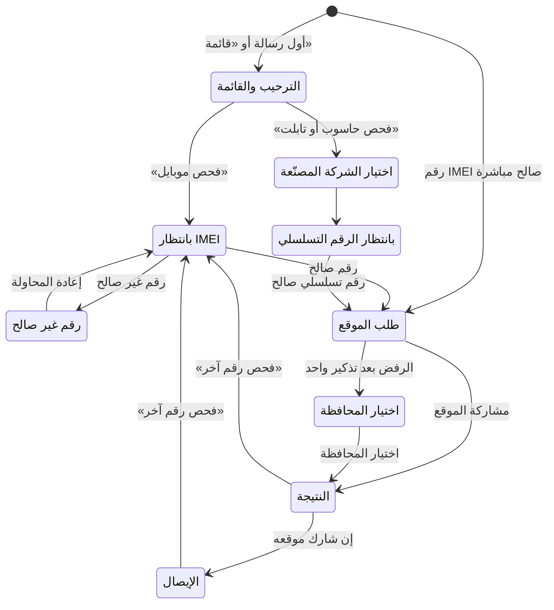

# 24 — كتالوج المحتوى

> المصدر الوحيد لكل نص يراه أي شخص في المنصة: نتائج الفحص في كل قناة، وقوالب الرسائل (واتساب، وSMS، والإشعارات، والإيميل، والوثائق المطبوعة)، و**جدول كل حدث بقاعدة إشعاره ومستلمه وقالبه والشاشة التي يفتحها** (§3.31)، ونصوص الصفحات العامة (§2.13)، وسيناريو بوت واتساب، ورسائل الأخطاء، ونصوص طلب الأذونات، وحالات الشاشات و**سجل الحالات لكل جمهور** ولافتاتها وتأكيداتها (§7)، ونصوص الأزمات والإخطار بالحوادث، والصيغ القانونية ونصوص الموافقة، وقواعد حوكمة المحتوى. **لا يكتب المطوّر أي نص من عنده:** كل نص له مفتاح هنا، ويُحمَّل من مخزن المحتوى في لوحة الإدارة (SMART-01)، والنصوص المكتوبة هنا هي القيم الافتراضية التي يُملأ بها المخزن قبل الإطلاق. الصيغ القانونية تخضع لمراجعة المحامي ([قواعد العمل §14](06-business-rules.md#14-الصيغ-القانونية-الثابتة)).

---

## 1. قواعد النبرة والصياغة

### 1.1 كيف يُقرأ هذا الكتالوج

| الرمز أو الصيغة | المعنى |
|---|---|
| `T-<القناة>-NN` | معرّف قالب رسالة. القنوات: `WA` واتساب، و`SMS`، و`PUSH` إشعار التطبيق، و`INAPP` مركز الإشعارات داخل المنصة، و`EMAIL`، و`PDF`. **الرقم NN هو رقم الحدث نفسه في كل القنوات** (مثلاً `T-WA-28` و`T-SMS-28` و`T-INAPP-28` كلها لحدث «قبول البلاغ»)، ويصبح من ثلاث خانات بعد 99. والأرقام من 190 فما فوق من المراجعة الثالثة (§3.32)، ولا يُعاد استخدام رقم ملغى. أما `T-PDF` و`T-EMAIL` فترقيمهما مستقل لأنها وثائق |
| `S-BOT-NN` | حالة في محادثة بوت واتساب (تتطابق مع [قائمة الشاشات](18-screen-inventory.md)) |
| `UPPER_SNAKE` | رمز خطأ يعود في الحقل `code` من جسم الخطأ بصيغة RFC 9457 ([التصميم التقني](19-technical-design.md) يحدد الصيغة، وهذا الكتالوج يحدد النص) |
| `{{اسم_المتغير}}` | قيمة تُملأ وقت الإرسال أو العرض. كل المتغيرات معرّفة في §3.2 مع صيغتها وحساسيتها |
| 🔒 | نص مقفل: صيغة قانونية أو أمنية لا تُعدَّل إلا بموافقة المحامي والمدير العام (§9) |
| ⚙️ | قيمة قابلة للتعديل من الإعدادات، وافتراضيها من [فهرس الإعدادات](06-business-rules.md#15-فهرس-الإعدادات) |
| «بصمة» | اسم عمل (Q-01). **كل ظهور له في النصوص يُعرض من إعداد اسم المنصة** (SMART-02) ولا يُكتب في الكود |
| مفتاح المحتوى | كل نص في الواجهات له مفتاح ثابت بصيغة `المجال.الشاشة_أو_الكيان.العنصر`، مثل `check.result.stolen.title`. المفاتيح بالإنكليزية، والقيم بالعربية |
| المحفّز | اسم الحدث في [التصميم التقني §9.5](19-technical-design.md) أو المهمة في §10.2 منه **حرفياً**، وجدول الربط الكامل في §3.31. ولا يحمل قالب محفّزاً لا يُحل (FF-26) |
| قاعدة الإشعار (`rule_id`) | رقم القالب ثم `/` ثم المحلّل، مثل `28/reporter` (§3.31.1). والحدث الذي لا يُرسل شيئاً يحمل «لا إشعار» مع سببه (`none:<سبب>`) |
| «يفتح» | الشاشة التي يفتحها الضغط على الإشعار أو زر رابطه، بمعرّفها في [قائمة الشاشات](18-screen-inventory.md)، وقواعدها في §3.1.10 |
| نوع الرمز في §5 | `error` (خطأ HTTP)، أو `warning` (تحذير غير مانع في `warnings[]`، ومعلَّم «تحذير»)، أو `row` (سطر في تقرير ملف)، أو `client` (لا يعيده الخادم أبداً) (K-21، §5.1) |
| مساحات المفاتيح | `pub.*` الصفحات العامة، و`app.*` التطبيق خارج الحساب (§2.13، §6.8)، و`status.*` تسميات الحالات (§7.4)، و`confirm.*` التأكيدات (§7.5)، و`banner.*` اللافتات (§7.6)، و`notify.*` فتح الإشعارات (§3.1.10)، و`a11y.*` الأسماء التي يقرؤها قارئ الشاشة لعناصر بلا نص ظاهر، و`error.*` (§5)، و`RSN-*` الأسباب (§3.28) |
| نصوص الشاشات | النص المقتبس بين «» في [قائمة الشاشات](18-screen-inventory.md) قيمة افتراضية لمفتاح هنا. وكل نص شاشة آخر يُكتب في هذا الكتالوج ويُعتمد (§9) **قبل** بناء الشاشة، فهو من شروط جاهزية العمل ([العملية الهندسية](22-engineering-process.md)) (J-12) |
| `ER-XXXXXXXX` | رقم مرجع الخطأ الذي يظهر للمستخدم مع `INTERNAL_ERROR` وما يشبهه، ويبحث به الدعم (N-09، 19 §13.1) |

### 1.2 مبادئ النبرة (من [الهوية البصرية §8](15-visual-identity.md#8-نبرة-الكتابة))

1. **فصحى مبسطة وجمل قصيرة:** جملة واحدة لفكرة واحدة، ولا تزيد الجملة عن نحو 20 كلمة.
2. **النتيجة أولاً ثم التفاصيل:** أول سطر يقول ما حدث، والثاني يقول ماذا تفعل.
3. **أفعال واضحة في الأزرار:** «افحص الآن»، «بلّغ عن جهازك»، «أرسل»، «تأكيد». الزر يصف ما سيحدث، لا «موافق» ولا «نعم» وحدها.
4. **لا لوم ولا تهويل:** لا نتهم أحداً، ولا نستخدم علامات التعجب ولا التكرار للتشديد.
5. **السلامة قبل كل شيء:** في حالات الخطر نذكّر بالسلامة: «لا تحاول مواجهة البائع»، و«لا تحاول استرداد جهازك بنفسك» (D-46).
6. **الصدق في حدود المنصة:** «النتيجة معلومة وليست ضماناً»، ولا نعد بما لا نملكه (لا نعد باسترداد الجهاز، ولا بزمن ثابت للتحقيق).
7. **تقليل البيانات في الرسائل:** الرسالة لا تحمل إلا ما يلزم لفهمها. التفاصيل تُعرض داخل الحساب بعد الدخول (§3.1.6).
8. **لا إعلانات ولا عروض** في نتائج الفحص والبلاغات والوثائق وردود البوت والـ SMS وبوابة الأمن ولوحة الإدارة (ADS-02).

### 1.3 كلمات ممنوعة وبدائلها المعتمدة

| ❌ ممنوع | ✅ البديل المعتمد | السبب |
|---|---|---|
| «الجهاز سليم»، «نظيف»، «آمن»، «يمكنك الشراء» | «لا توجد بلاغات فعّالة على هذا الرقم...» | النتيجة ليست ضماناً لمصدر الجهاز (06 §14)، وفئة `clean` للون هذه النتيجة وحدها ([الهوية البصرية §3.4](15-visual-identity.md)) |
| «تأكد أن الجهاز غير مسروق»، «تأكّد أنه ليس مسروقاً»، «اعرف إن كان مسروقاً»، «جهاز سليم»، «سليماً»، «جهاز نظيف» عن أي جهاز، في أي صفحة أو عنوان أو مخطط | «افحص رقم IMEI مجاناً، واعرف إن كان عليه بلاغ سرقة أو فقدان»، و«عودة الجهاز لصاحبه» | الفحص يقول ما في المنصة لا حقيقة الجهاز (J-01، J-23، 06 §14) |
| «توفي فلان»، «ميت»، «المرحوم» في إشعارات انتقال أجهزة المتوفى، و«حصر الإرث» أو «قرار المحكمة» شرطاً لها | «بعد الإبلاغ بوفاة صاحب الحساب»، و«شهادة الوفاة مع تطابق الكنية أو وثيقة الوصاية» | الطلب قد يكون مزوّراً وصاحب الحساب حياً، والشرط هو D-103 (§3.32.2) |
| «احتيال»، «مزوّر»، «منتحل» في رسالة لطرف أو بشأنه | «لم يُقبل»، «أُوقف بعد اعتراض»، «يحتاج مراجعة» | لا نتهم أحداً (§1.2)، والتهمة تقررها الجهات المختصة |
| «رابط تسجيل الدخول»، «ادخل من هنا»، أو أي رمز، في رسالة البريد الأمني | «لم أكن أنا» زراً وحيداً | البريد الأمني للتنبيه فقط (D-126) |
| «مضمون»، «مؤكَّد أنه غير مسروق»، «موثوق 100%» | «النتيجة معلومة وليست ضماناً» | حدود المسؤولية القانونية (07 §10.2) |
| «سارق»، «للسارق»، «لص»، «حرامي» عن أي شخص (بائع، أو حائز، أو مسجِّل، أو من يحمل الموبايل المسروق) | «الجهاز مبلّغ عنه» | نصف حالة الجهاز لا الأشخاص، ولا نتهم أحداً |
| «القبض عليه»، «ملاحقة»، «سنكشفه» | «الجهات المختصة تتابع» | لا تهويل، ولا وعود أمنية |
| «تتبّع جهازك»، «اعرف مكان جهازك»، «موقع جهازك الآن» (للمالك) | «المنصة تتابع أمر جهازك، وسنبلغك بأي مستجد» | لا تتبّع للمالك من تطبيقنا (D-46) |
| «موقعك لا يُكشف لأحد»، «موقعك سري تماماً» | «موقعك لا يظهر لصاحب الجهاز ولا لأي شخص، وتستخدمه الإدارة والجهات المختصة فقط» 🔒 | دقة ما يُقال للمستخدم (C-16، GEO-02) |
| «بياناتك لا يراها أحد»، «آمن تماماً»، «مشفّر بالكامل» عن بيانات تُعرض للإدارة | من يرى البيان فعلاً، مثل: «يراها المحل في هذه المعاملة، والإدارة وقوى الأمن عند الحاجة» | دقة عبارات الخصوصية ([الخصوصية §3.4](21-privacy-dpia.md)) |
| «نحذف كل بياناتك عند الطلب» | «إغلاق الحساب لا يحذف سجلات الملكية والمعاملات والبلاغات التي يجب الاحتفاظ بها» | 21 §3.4، AUTH-10 |
| «مكافأة من بصمة»، «تدفع المنصة»، «احصل على مكافأتك» | «مكافأة أعلنها صاحب الجهاز... والمنصة غير مسؤولة عنها» 🔒 | المنصة ليست طرفاً في المكافأة (D-50، TIP-05) |
| «مكافأة لمن يعيد الجهاز المسروق» | «مكافأة لمن يدلي بمعلومات تؤدي لاسترداده عبر الجهات المختصة» 🔒 | حتى لا تصبح المكافأة وسيلة ابتزاز (TIP-06) |
| «الرقم البديل لاستعادة حسابك» | «الرقم البديل للإشعارات فقط» | D-81 |
| «أرسل لنا كلمة المرور» أو «أرسل الرمز للدعم» | «فريق الدعم لا يطلب منك كلمة المرور أو رمز التحقق أبداً» 🔒 | SUPPORT-05 |
| «سيلفي»، «صورة وجهك» | «صوّر هويتك (الوجهين) بالكاميرا» | لا سيلفي (D-32) |
| «اختر صورة من المعرض» (للهوية والصورة الحيّة) | «صوّر الآن بالكاميرا» | التصوير من داخل المنصة فقط (AUTH-05، REPORT-04) |
| «مركز المساعدة»، «الأسئلة الشائعة» | «طلب دعم» | D-22، D-82 |
| «دليل المحلات»، «إحصائيات» | — (لا يُذكر) | D-22 |
| «اشترِ لتلتزم»، «باقة إلزامية» | «الشراء اختياري، ولا علاقة له بالتزامك بالتسجيل في المنصة» 🔒 | STORE-07، D-70 |
| «جرّب مجاناً لفترة محدودة» عن الخدمات الأساسية | «مجاني دائماً» | D-72 |
| «اشترِ الآن»، «اشترك»، «تواصل معنا للشراء»، «فعّل من الموقع» **داخل التطبيقين** للخدمات الرقمية | الحالة فقط: «مفعّلة حتى {{end_date}}» أو «غير مفعّلة» | سياسات آبل وجوجل (D-86، PAY-08) |
| «محظور» عن حساب في أول إجراء | «معلّق مؤقتاً» (التعليق)، و«موقوف نهائياً» (الحظر بعد بلاغ كاذب مثبت) | دقة الحالة ودرجتها |
| «الجهاز مراقَب على الشبكة» في نتيجة الفحص العامة | «قد يتوقف الجهاز عن العمل على شبكات الاتصالات السورية» | لا نكشف آلية التتبّع للحائز فيتجنّب تركيب الشريحة (D-27) |
| «خطأ 500»، «Exception»، «null»، «undefined»، رموز تقنية | «حدث خلل مؤقت من جهتنا. حاول بعد قليل» | لا مصطلحات تقنية للمستخدم (08 §7) |
| «أدخلت رقماً خاطئاً»، «فشلت» | «الرقم غير صالح. تأكد من الخانات الـ 15» | لا لوم |
| «الإيمي»، «الآي إم إي آي» | «رقم IMEI» | توحيد المصطلح |
| «كود»، «OTP»، «باسورد»، «لوغ إن» | «رمز التحقق»، «كلمة المرور»، «تسجيل الدخول» | عربية سليمة |
| «عزيزي»، «عزيزتي»، «سيدي» | «مرحباً» دون لقب | حياد الجنس (§1.5) |
| «الشرطة» في نصوص المواطن | «الجهات المختصة»، و«قوى الأمن الداخلي» حين يلزم التحديد (مثل البلاغ الرسمي) | دقة الجهة |

**المصطلحات الثابتة** (تُستخدم دائماً باللفظ نفسه): «فحص»، «بلاغ»، «نافذ»، «لا توجد بلاغات فعّالة»، «مبلّغ عنه: مسروق»، «مبلّغ عنه: مفقود»، «رقم غير صالح»، «رقم الحساب»، «رقم البلاغ»، «رمز التحقق»، «توثيق الهوية»، «موثّق الهوية» (للحساب)، «محل موثّق» (للمحل)، «أجهزتي»، «بلاغاتي»، «طلباتي»، «إيصالاتي»، «شهادة فحص»، «إيصال فحص»، «فاتورة»، «نقل الملكية»، «مستخدم مفوّض»، «جهة موثوقة»، «رقم بديل»، «إدارة المنصة» (وتُختصر «الإدارة» بعد أول ذكر)، «الجهات المختصة». ومستويات الموثوقية (🟢 موثّق...) **للمشرف فقط ولا تظهر للمستخدم**.

### 1.4 مخاطبة المستخدم

| القاعدة | التطبيق |
|---|---|
| المفرد المخاطَب | «حسابك»، «جهازك»، «يمكنك». لا «حضرتكم» ولا ضمير الجمع |
| التحية | «مرحباً،» دون اسم ولا لقب في واتساب وSMS. ويجوز الاسم الأول داخل الحساب فقط |
| المنصة تتكلم بصيغة «نحن» | «استلمنا بلاغك»، «سنبلغك». والإدارة تُذكر باسمها حين يكون القرار قرارها: «قبلت إدارة المنصة بلاغك» |
| الطرف الآخر | «صاحب الجهاز»، «المشتري»، «البائع»، «المالك». لا أسماء ولا أرقام للطرف الآخر أبداً (D-10) |
| الإنكار الآمن | كل رسالة أمنية تنتهي بما يفعله المستخدم إن لم يكن هو صاحب الإجراء: «إذا لم تطلب ذلك، افتح طلب دعم فوراً» |

### 1.5 الصياغة المحايدة للجنس

العربية تميّز المذكر والمؤنث في الأفعال والصفات. القواعد التالية تجعل النص صالحاً للجميع دون تكلّف:

| القاعدة | ❌ | ✅ |
|---|---|---|
| ضمير الكاف دون تشكيل يصلح للجنسين | «حسابكَ» | «حسابك» |
| الماضي المخاطَب دون تشكيل | «أرسلتَ» | «أرسلت» |
| «يمكنك» + مصدر بدل الأمر في نص الرسائل | «قدّمي اعتراضاً» | «يمكنك تقديم اعتراض» |
| الأمر بصيغته الشائعة مقبول في الأزرار فقط | — | «افحص الآن»، «بلّغ عن جهازك» |
| وصف الحساب لا الشخص | «أنت موثّق» | «حسابك موثّق الهوية» |
| المبني للمجهول أو المنصة فاعلاً | «أنت مقبول» | «قُبل طلبك»، «قبلنا طلبك» |
| لا صيغ مزدوجة بالشرطة | «عزيزي/عزيزتي»، «المستخدم/ة» | تُعاد صياغة الجملة |
| الأسماء العامة للأدوار بصيغتها المعجمية | — | «صاحب الجهاز»، «المشتري»، «الموظف» (صيغ عامة لا تدل على جنس بعينه) |

### 1.6 الأرقام والتواريخ والعملة والاتجاه

| البند | القاعدة | مثال |
|---|---|---|
| الأرقام | الأرقام الإنكليزية (0-9) في كل الواجهات والرسائل والوثائق. والأرقام العربية (٠-٩) مقبولة في الإدخال وتُحوَّل تلقائياً (CHECK-02) | `482193` |
| التاريخ | `DD/MM/YYYY` بالتقويم الميلادي | `12/10/2026` |
| التاريخ الطويل (الوثائق المطبوعة والصفحات القانونية) | اليوم ثم اسم الشهر ثم السنة، بأسماء الأشهر المعتمدة في سوريا: كانون الثاني، شباط، آذار، نيسان، أيار، حزيران، تموز، آب، أيلول، تشرين الأول، تشرين الثاني، كانون الأول. **وهذا الجدول مصدر المنسّق** في كل الواجهات والوثائق، فلا يُعتمد على أسماء الأشهر في الإعداد المحلي للجهاز أو المتصفح لأنها تختلف بينها | `12 تشرين الأول 2026` |
| الوقت | 24 ساعة `HH:mm` | `14:32` |
| التاريخ والوقت في الواجهات والوثائق | `DD/MM/YYYY — HH:mm` | `12/10/2026 — 14:32` |
| التاريخ والوقت في واتساب وSMS | `DD/MM/YYYY الساعة HH:mm` (الشرطة الطويلة تضطرب في بعض الهواتف) | `12/10/2026 الساعة 14:32` |
| المنطقة الزمنية | كل الأوقات المعروضة بتوقيت دمشق (Asia/Damascus)، والمخزّنة بالتوقيت العالمي. لا يُكتب اسم المنطقة الزمنية للمستخدم | — |
| الوقت النسبي في القوائم | «الآن» (أقل من دقيقة)، «منذ {{n}} دقيقة»، «منذ {{n}} ساعة»، «أمس 14:32»، ثم التاريخ الكامل بعد 7 أيام | «منذ 5 دقائق» |
| المدد والمهل | عدد + وحدة بالعربية حسب جدول الجمع (§1.7). لا اختصارات مثل «د» أو «س» | «خلال 72 ساعة» |
| العملة | المبلغ ثم «ل.س»، بفاصل الآلاف «,» ودون كسور. ويُخزَّن بالوحدة الصغرى ويُقرَّب للعرض إلى أقرب ليرة (19 §11.5) | `500,000 ل.س` |
| تبديل العملة (D-118) | خلال الفترة الانتقالية الرسمية ⚙️ يظهر تحت كل مبلغ في شاشات الإدخال والإيصالات والفواتير سطر صغير `money.old_unit_equivalent`: «تعادل {{amount_old}} ل.س قديمة». وعند إدخال مبلغ يبدو أكبر بمئة مرة من المعتاد ⚙️ تحذير غير مانع `money.hundredfold_warning`: «المبلغ يبدو أكبر بمئة مرة من المعتاد. هل كتبته بالعملة القديمة؟» — الزران: «تعديل المبلغ»، «المبلغ صحيح» ([الهوية البصرية §15](15-visual-identity.md)) | «150,000 ل.س» وتحته «تعادل 15,000,000 ل.س قديمة» |
| الأعداد الكبيرة | فاصل الآلاف من 1,000 فما فوق في المبالغ والإحصاءات، ولا فاصل في المعرّفات والسنوات | `1,250` |
| رقم IMEI للعرض | مجموعات 2-6-6-1 في الواجهات، و15 خانة متصلة في واتساب وSMS (لسهولة النسخ) | `35 209871 457812 3` |
| IMEI مخفي جزئياً | أول 8 خانات (TAC) ثم نقاط ثم آخر 4 خانات ([نموذج التهديد §2.2](20-threat-model.md)، المرجع لكل صيغ الإخفاء). وفي الواجهات بالمجموعات نفسها، وعلى كل وثيقة قابلة للمشاركة (الشهادة، والإيصال، وصفحة التحقق) | `35209871•••8123`، ومجمّعاً: `35 209871 •••8123` |
| IMEI لدى الجهة الموثوقة | آخر 4 خانات فقط، وكل نقطة مكان خانة (20 §2.2) | `•••••••••••8123` |
| آخر 4 خانات | في الرسائل التي تحتاج تمييز الجهاز دون كشف الرقم | «المنتهي بـ 8123» |
| رقم الموبايل | `09XX XXX XXX` للعرض، ويُخزَّن `+9639XXXXXXXX` (08 §5) | `0944 123 456` |
| موبايل مخفي جزئياً | أول 4 خانات وآخر خانتين **لكل رقم** يظهر لغير صاحبه، ومنه الرقم البديل ورقم الزبون في سجل التعبئة (J-22، [الهوية البصرية §19](15-visual-identity.md)) | `0933••••12` |
| الرقم الوطني مخفياً | آخر 3 خانات فقط | `••••••••123` |
| رقم الشريحة وIMSI | آخر رقمين، للإدارة والأمن ضمن نطاقه فقط، ولا يُرسل في واتساب أبداً | `•••••••••••••47` |
| رقم الفاحص وعنوان شبكته | مخفي كلياً حتى الكشف المسجّل | `••••` |
| الوثيقة البديلة مخفية (D-104) | آخر 3 خانات من رقمها. ولغير صاحبها (سجل المحل، وإيصالات الأطراف) تُسمّى «وثيقة بديلة» دون نوعها ولا بلدها، لأنها تكشف صفة اللجوء أو الجنسية (20 §2.2). ولصاحبها والمشرف المختص يظهر نوعها | `•••••417`، ولغير صاحبها: «وثيقة بديلة •••••417» |
| البريد الأمني مخفياً | أول حرف ثم نقاط ثم النطاق كاملاً | `a•••••@example.com` |
| الاسم في الصفحات العامة ولغير صاحبه | الاسم الأول وأول حرف من الكنية كما في الهوية الموثّقة، في الصفحات العامة (PUB-02) وفي كل رسالة تصل للغير (§3.1.4). والاسم المركّب يُعرض أول جزأين («عبدالله خ.»، «أبو بكر س.»)، وأول حرف الكنية بعد حذف «ال» منها، ومن حقلي الاسم والكنية لا بتقسيم الاسم الكامل، ولغير الموثّق: «أحد مستخدمي بصمة» (L-10، G-05) | «أحمد م.» |
| مرجع الدفع خارج شاشة التأكيد | آخر 4 خانات | `••••7821` |
| مرجع صيغ الإخفاء | جدول [نموذج التهديد §2.2](20-threat-model.md) «صيغ الإخفاء المعتمدة» هو المرجع الوحيد، والإخفاء يُطبَّق في الخادم، وما يخالفه هنا يُصحَّح إليه | — |
| المعرّفات المرجعية | تُكتب كما هي بالأحرف اللاتينية، وبالصيغ المعتمدة في [التصميم التقني §13.1](19-technical-design.md): الحساب `SY-4K7P92`، والبلاغ `BL-2026-000123`، والمحل `SH-01234`، والوكيل `IM-0123`، والمورّد `SP-0456`، والمعاملة وفاتورة الجهاز `TX-2026-0001234`، والفاتورة التجارية `IN-2026-000321`، والشهادة والإيصال وتقرير التاريخ `CR-7KQ2M9XA`، وطلب الدعم `ST-2026-000045`، ودفعة الوكيل `BT-2026-0012`، والنقل بالجملة `TR-2026-00034`، وطلب المتجر `OR-2026-000123`، والمرتجع `RN-2026-000045`، وكشف التسوية `SE-2026-00012`، وطلب الخدمة `SV-2026-000078`، وعملية المحفظة `WL-2026-00001234`، وإيصال التعبئة `TP-2026-0001234`، والتنبيه `AL-2026-000731`، وطلب التصحيح `RV-2026-000027`، وطلب انتقال أجهزة المتوفى `SU-2026-00012`، وبلاغ سرقة المحل لكل جهاز `BL-2026-000123/3`، ومرجع الخطأ `ER-7KQ2M9XA`، وفاتورة نقطة البيع قبل المزامنة «مؤقت-{{terminal}}-{{local_seq}}» ثم رقمها النهائي | — |
| الاتجاه في الواجهات | كل قيمة لاتينية أو رقمية داخل نص عربي (IMEI، والموبايل، والمعرّفات، والموديل، والروابط) تُعزل باتجاه من اليسار لليمين (`<bdi dir="ltr">` في الويب، وما يقابلها في التطبيق) حتى لا تنقلب أجزاؤها | — |
| الاتجاه في واتساب وSMS | لا تُستخدم محارف العزل غير المرئية (ينسخ المستلم المعرّفات إلى أنظمة أخرى)، فتوضع القيمة اللاتينية **في آخر السطر بعد نقطتين** أو في سطر مستقل، ولا تُوضع قيمتان لاتينيتان متجاورتان في سطر واحد (L-11) | `رقم البلاغ: BL-2026-000123` |
| تنظيف قيم المتغيرات (L-11) | كل قيمة تُملأ في قالب واتساب أو SMS تُنظَّف قبل الإرسال: تُحذف أسطرها الجديدة ومحارف التحكم والعزل، وتُضغط المسافات المتتالية، وتُحذف رموز تنسيق واتساب (النجمة والشرطة السفلية والمدّة وعلامة الكود)، ويُقص الطول حسب §3.2. والأسماء التي يكتبها المستخدم لا تحمل رابطاً ولا رقم هاتف | — |
| أسماء الموديلات | كما تأتي من قاعدة TAC بالأحرف اللاتينية، وتُقص بعد ⚙️ 24 حرفاً في SMS مع «…» | `Samsung Galaxy A54` |
| المحافظات | بالأسماء المعتمدة في القائمة المرجعية (GEO-01) | «ريف دمشق» |

### 1.7 جدول الجمع (صيغ العدد والمعدود)

العربية لها ست صيغ للعدد (حسب CLDR: zero، one، two، few، many، other). المطوّر يستخدم مكتبة الجمع (ICU) مع هذا الجدول، ولا يكتب «دقيقة/دقائق» بنفسه. والقاعدة الصياغية: **يأتي العدد بعد حرف جر أو فعل** («خلال»، «بعد»، «لمدة»، «يوجد»)، فتصح صيغة المثنى بالياء.

| المعدود | zero: 0 | one: 1 | two: 2 | few: 3–10 (و103–110...) | many: 11–99 (و111–199...) | other: 100–102 (و200–202...) |
|---|---|---|---|---|---|---|
| دقيقة | لا دقائق | دقيقة واحدة | دقيقتين | {{n}} دقائق | {{n}} دقيقة | {{n}} دقيقة |
| ساعة | لا ساعات | ساعة واحدة | ساعتين | {{n}} ساعات | {{n}} ساعة | {{n}} ساعة |
| يوم | لا أيام | يوم واحد | يومين | {{n}} أيام | {{n}} يوماً | {{n}} يوم |
| جهاز | لا أجهزة | جهاز واحد | جهازين | {{n}} أجهزة | {{n}} جهازاً | {{n}} جهاز |
| فحص | لا فحوص | فحص واحد | فحصين | {{n}} فحوص | {{n}} فحصاً | {{n}} فحص |
| تنبيه | لا تنبيهات | تنبيه واحد | تنبيهين | {{n}} تنبيهات | {{n}} تنبيهاً | {{n}} تنبيه |
| محاولة | لا محاولات | محاولة واحدة | محاولتين | {{n}} محاولات | {{n}} محاولة | {{n}} محاولة |
| رسالة | لا رسائل | رسالة واحدة | رسالتين | {{n}} رسائل | {{n}} رسالة | {{n}} رسالة |
| طلب | لا طلبات | طلب واحد | طلبين | {{n}} طلبات | {{n}} طلباً | {{n}} طلب |
| سطر (في الملفات) | لا أسطر | سطر واحد | سطرين | {{n}} أسطر | {{n}} سطراً | {{n}} سطر |

### 1.8 علامات الترقيم والتنسيق

- الفاصلة العربية «،» والفاصلة المنقوطة «؛» وعلامة الاستفهام «؟». والنقطة في آخر كل جملة كاملة، ولا نقطة في آخر العناوين والأزرار.
- علامات التنصيص «» لأسماء الأزرار والشاشات داخل النص: «اضغط «بلّغ عنه»».
- لا رموز تعبيرية (Emoji) في أي نص يصل للمستخدم، بما فيه واتساب. والرموز ✅ ⚠️ ❌ 🔒 ⚙️ في هذه الوثيقة للتوثيق فقط.
- في واتساب: الخط العريض `*...*` لسطر الحالة فقط، ولا خط مائل ولا مشطوب.
- لا تشكيل إلا لرفع لبس حقيقي (مثل «تشترِ»).

### 1.9 حدود الطول لكل قناة

| القناة | الحد | ملاحظات |
|---|---|---|
| SMS | **70 حرفاً للرسالة الواحدة، و67 حرفاً لكل قطعة عند تجاوزها** (ترميز UCS-2 للعربية). الهدف قطعتان (134 حرفاً)، والحد الأقصى ثلاث قطع (201 حرف) لنتائج الفحص التي تحمل تحذيراً، ولإشعارات الجهاز المضبوط التي تحمل عنوان الجهة (`T-SMS-140` و246 و249) فقط | العدّ بعد ملء المتغيرات بأطول قيمها (§3.2). أداة المحرّر تعرض عدد القطع قبل الحفظ (§9) |
| واتساب (قالب) | النص حتى 1024 حرفاً، والرأس والتذييل حتى 60 حرفاً لكل منهما، ونص الزر حتى 25 حرفاً | نستهدف أقل من 400 حرف للنص |
| واتساب (رسائل البوت التفاعلية) | نص الزر حتى 20 حرفاً، وعنوان سطر القائمة حتى 24 حرفاً، ووصفه حتى 72 حرفاً، وحتى 10 أسطر في القائمة الواحدة، وحتى 3 أزرار رد | لذلك قائمة المحافظات على صفحتين (§4) |
| PUSH | العنوان حتى 40 حرفاً، والنص حتى 120 حرفاً | يظهر على شاشة القفل، فلا بيانات شخصية (§3.1.6) |
| INAPP | العنوان حتى 60 حرفاً، والنص حتى 300 حرف | التفاصيل في الشاشة التي يفتحها الإشعار |
| الأزرار في الواجهات | حتى 24 حرفاً، وفعل في أولها | — |
| رسائل الخطأ | جملتان كحد أقصى: ما حدث، وماذا تفعل | §5 |

## 2. مصفوفة نتائج الفحص

> تُطبّق CHECK-08 إلى CHECK-11، وGSMA-01 وGSMA-02 وGSMA-05، وCUSTOMS-02، وFAKE-01 إلى FAKE-03، وTIP-04 إلى TIP-06، وWABOT-01 وWABOT-04، وSMS-01 وSMS-02، وBIZAPI-02. النتيجة تُبنى من **نتيجة أساسية واحدة** ومعها **مؤشرات إضافية مستقلة** لا تغيّرها (06 §2). كل تركيبة ممكنة تُعرض بقواعد التركيب في §2.3، فلا توجد تركيبة دون نص.

### 2.1 النتيجة الأساسية

| الرمز | النص الثابت 🔒 | اللون والأيقونة (15 §3.3) | متى (06 §2) | قيمة `status` في الربط البرمجي |
|---|---|---|---|---|
| P1 | «لا توجد بلاغات فعّالة» | `clean`، درع بعلامة صح | لا بلاغ نافذ على أي معرّف للجهاز، **بما فيه وجود بلاغ قيد المراجعة** (CHECK-15) أو جهاز غير معروف للمنصة | `NO_ACTIVE_REPORTS` |
| P2 | «مبلّغ عنه: مسروق» | `stolen`، درع بعلامة تنبيه | بلاغ نافذ من نوع «مسروق» (بما فيه طلب إغلاق قيد المراجعة) | `REPORTED_STOLEN` |
| P3 | «مبلّغ عنه: مفقود» | `lost`، دائرة بعلامة استفهام | بلاغ نافذ من نوع «مفقود» | `REPORTED_LOST` |
| P4 | «رقم غير صالح» | `warn`، مثلث تنبيه | الرقم لا يطابق الصيغة أو يفشل في Luhn. **لا تُعرض معه أي مؤشرات، ولا يُستعلم عنه من GSMA ولا الهيئة** | `INVALID_NUMBER` |

### 2.2 المؤشرات الإضافية

**أ) الحالة الدولية (GSMA-01، GSMA-02، GSMA-05)** — عنوان السطر في الموقع والتطبيق: «القائمة الدولية (GSMA)».

| الحالة | الموقع والتطبيق | واتساب | SMS | الربط البرمجي `international.status` | الدرجة |
|---|---|---|---|---|---|
| غير مُدرج | «غير مُدرج» | «الحالة الدولية (GSMA): غير مُدرج» | لا يُكتب | `NOT_LISTED` | محايد |
| مُدرج | شريط أعلى النتيجة: «هذا الجهاز مُبلّغ عنه خارج سوريا (قاعدة GSMA العالمية). ننصح بعدم شرائه.» | «تنبيه: هذا الجهاز مُبلّغ عنه خارج سوريا (قاعدة GSMA العالمية). ننصح بعدم شرائه.» | «تنبيه: مُبلّغ عنه خارج سوريا (GSMA)، لا تشترِه.» | `LISTED` | `stolen` |
| ينتظر الرد (الموقع والتطبيق فقط، بعد ⚙️ 800 ملّي ثانية) | «جارٍ التحقق الدولي» مع مؤشر انتظار، ويُستبدل تلقائياً عند وصول الرد، ويُعلَن لقارئ الشاشة | لا ينطبق | لا ينطبق | `PENDING` (مع `retry_after_seconds`) | `info` |
| تعذّر (تجاوز ⚙️ ثانيتين في واتساب وSMS والربط البرمجي، أو تعطل الخدمة) | «تعذّر التحقق الدولي حالياً» | «تعذّر التحقق الدولي حالياً.» | «تعذّر التحقق الدولي حالياً.» | `UNAVAILABLE` | `info` |
| لا ينطبق (الفحص بالرقم التسلسلي) | «الفحص الدولي متاح برقم IMEI فقط» | «الفحص الدولي متاح برقم IMEI فقط.» | لا ينطبق | `NOT_APPLICABLE` | محايد |
| التكامل غير مفعّل | لا يُعرض السطر | لا يُعرض | لا يُعرض | `NOT_CONNECTED` | — |

**ب) التسجيل لدى الهيئة الناظمة (CUSTOMS-01، CUSTOMS-02)** — عنوان السطر: «التسجيل لدى الهيئة الناظمة».

| الحالة | الموقع والتطبيق | واتساب | SMS | `registration.status` | الدرجة |
|---|---|---|---|---|---|
| مسجّل | «مسجّل رسمياً لدى الهيئة»، وتحته «منذ {{customs_date}}» إن توفر التاريخ | «التسجيل لدى الهيئة: مسجّل رسمياً» | لا يُكتب | `REGISTERED` | `clean` |
| غير مسجّل | «غير مسجّل لدى الهيئة، وقد لا يعمل على الشبكة» | «غير مسجّل لدى الهيئة، وقد لا يعمل على الشبكة.» | «غير مسجّل لدى الهيئة، قد لا يعمل على الشبكة.» | `NOT_REGISTERED` | `warn` |
| ينتظر الرد | «جارٍ التحقق من التسجيل لدى الهيئة» | لا ينطبق | لا ينطبق | `PENDING` | `info` |
| تعذّر | «تعذّر التحقق من التسجيل لدى الهيئة حالياً» | «تعذّر التحقق من التسجيل لدى الهيئة حالياً.» | لا يُكتب | `UNAVAILABLE` | `info` |
| لا ينطبق | «التحقق من التسجيل متاح برقم IMEI فقط» | لا يُعرض | لا ينطبق | `NOT_APPLICABLE` | محايد |
| التكامل غير مفعّل | لا يُعرض | لا يُعرض | لا يُعرض | `NOT_CONNECTED` | — |

**ج) تحذير التقليد (FAKE-01)** — يظهر فقط عندما تكون أول 8 خانات (TAC) **غير مخصصة** لأي جهاز في قاعدة GSMA، ومنها نطاق الاختبار الذي يبدأ بـ `00` في بيئة الإنتاج (L-09): يُعرض للفاحص سطر التقليد نفسه، وتسجيله في محل أو تسجيلاً ذاتياً يُحال للمراجعة بالرسالة المحايدة `OPERATION_HELD_FOR_REVIEW` (§5.2) لا بالرفض. أما الرقم المخصص الذي لا نعرف موديله فلا يُعدّ تقليداً، ويُكتب بدل الموديل: «الماركة والموديل غير معروفين لهذا الرقم».

| الحالة | الموقع والتطبيق | واتساب | SMS | `counterfeit.status` | الدرجة |
|---|---|---|---|---|---|
| غير مخصص | شريط أعلى النتيجة: «هذا الرقم غير مخصص لأي جهاز معروف عالمياً، وقد يكون الجهاز مقلّداً أو رقمه معدّلاً» 🔒 | «تحذير: هذا الرقم غير مخصص لأي جهاز معروف عالمياً، وقد يكون الجهاز مقلّداً أو رقمه معدّلاً.» | «تحذير: رقم غير مخصص لجهاز معروف، قد يكون مقلّداً.» | `TAC_UNALLOCATED` | `warn` |
| مخصص | لا يُعرض | لا يُعرض | لا يُعرض | `NONE` | — |
| تعذّر التحقق من TAC | لا يُعرض | لا يُعرض | لا يُعرض | `UNKNOWN` | — |

**د) تطابق رقمي IMEI (FAKE-02، D-66)** — يظهر فقط حين يتوفر الرقمان معاً: مسح شاشة `*#06#` بالكاميرا (يقرأ الرقمين)، أو إرسال رقمين في رسالة واتساب واحدة، أو جهاز مسجّل في المنصة برقمين. عنوان السطر: «الرقمان لنفس الموديل».

| الحالة | الموقع والتطبيق | واتساب | `pair.status` | الدرجة |
|---|---|---|---|---|
| متطابقان | «متطابقان» | «الرقمان لنفس الموديل.» | `MATCH` | `clean` |
| غير متطابقين | شريط أعلى النتيجة: «رقما IMEI في هذا الجهاز لا يعودان للموديل نفسه، وقد يكون أحدهما معدّلاً» | «تحذير: رقما IMEI لا يعودان للموديل نفسه، وقد يكون أحدهما معدّلاً.» | `MISMATCH` | `warn` |
| رقم واحد فقط | لا يُعرض | لا يُعرض | `NOT_CHECKED` | — |

في SMS لا ينطبق هذا المؤشر، لأن الرسالة تحمل رقماً واحداً.

**هـ) المكافأة (TIP-04 إلى TIP-06، D-50)** — مع P2 وP3 فقط، وحين أعلن صاحب البلاغ مكافأة.

| النتيجة | الموقع والتطبيق وواتساب 🔒 | SMS | الربط البرمجي |
|---|---|---|---|
| P3 مفقود | عنوان: «مكافأة أعلنها صاحب الجهاز»، والنص: «مكافأة {{reward_amount}} لمن يعيده عبر المنصة»، ثم: «المكافأة التزام شخصي من صاحب الجهاز، والمنصة غير مسؤولة عنها.» | لا تُكتب (حد الطول) | `reward.announced: true`، و`reward.amount_syp` |
| P2 مسروق | عنوان: «مكافأة أعلنها صاحب الجهاز»، والنص: «مكافأة {{reward_amount}} لمن يدلي بمعلومات تؤدي لاسترداده عبر الجهات المختصة»، ثم: «المكافأة التزام شخصي من صاحب الجهاز، والمنصة غير مسؤولة عنها.» | لا تُكتب | كما سبق |

يُعرض `{{reward_amount}}` في الواجهات وواتساب بالكلمات المختصرة («500 ألف ل.س»، «2 مليون ل.س») لا بالأرقام الطويلة، ومبلغه من مضاعفات ⚙️ `report.reward.step` (100 ل.س بالوحدة الجديدة، D-118) بين ⚙️ `report.reward.min` و`report.reward.max`، فلا يصلح قناةً لرقم هاتف (G-07).

**و) «قد يكون منسوخاً» (D-120، 06 §1)** — يظهر حين يحمل المعرّف علامة «معرّف مشترك»: ظهر بـ ⚙️ 5 شرائح مختلفة أو أكثر خلال ⚙️ 30 يوماً، أو أُدرج في قائمة الأرقام المنسوخة المعروفة. سطر لا يغيّر النتيجة الأساسية، ويظهر مع P1 وP2 وP3. عنوان السطر: «الرقم على أكثر من جهاز».

| الحالة | الموقع والتطبيق | واتساب | SMS | `identifier.shared` | الدرجة |
|---|---|---|---|---|---|
| معلَّم | «هذا الرقم يظهر على أكثر من جهاز، فقد يكون منسوخاً. طابقه مع شاشة ‎*#06#‎ وتحقق من الجهاز جيداً قبل شرائه.» 🔒 | «تنبيه: هذا الرقم يظهر على أكثر من جهاز، فقد يكون منسوخاً.» | «تنبيه: الرقم يظهر على أكثر من جهاز، قد يكون منسوخاً.» (52) | `true` | `warn` |
| غير معلَّم | لا يُعرض | لا يُعرض | لا يُعرض | `false` | — |

لا يقول السطر إن الجهاز مقلّد أو مسروق، ولا يذكر عدد الأجهزة ولا الشبكات. وفي P2 وP3 يبقى البلاغ نافذاً كما هو، ولا يظهر للفاحص أن الحظر لدى الشبكات ينتظر قرار قوى الأمن.

### 2.3 قواعد التركيب

1. **P4 يقف وحده:** لا مؤشرات ولا مكافأة ولا إيصال.
2. **ترتيب العرض في الموقع والتطبيق:** شريط الخطر أو التحذير الأشد (إن وُجد) ← بطاقة النتيجة الأساسية ← المكافأة ← أسطر المؤشرات (الدولية، ثم الهيئة، ثم تطابق الرقمين) ← الصيغة القانونية ← الإجراءات ← النصائح.
3. **شريط واحد فقط** أعلى النتيجة، بأشد الحالات: الإدراج الدولي (`stolen`) ثم التقليد ثم «قد يكون منسوخاً» ثم عدم تطابق الرقمين (`warn`). وإذا اجتمع أكثر من تحذير تُكتب كلها في الشريط نفسه سطراً تحت سطر، بلون الأشد.
4. **ترتيب أسطر واتساب:** الحالة الأساسية ← الجهاز وتاريخ البلاغ ← الدولية ← التقليد ← «قد يكون منسوخاً» ← تطابق الرقمين ← الهيئة ← المكافأة ← الإرشاد والرابط ← الصيغة القانونية ← وقت الفحص.
5. **SMS:** في P2 وP3 لا تُضاف أي أسطر. وفي P1 يُضاف **سطر واحد فقط** بالأولوية: مُدرج دولياً ← تقليد ← «قد يكون منسوخاً» ← غير مسجّل لدى الهيئة ← تعذّر التحقق الدولي. بذلك لا تتجاوز أي رسالة ثلاث قطع.
6. **الأولوية الإجمالية** (لاختيار لون البطاقة والنصيحة): مسروق ← مفقود ← مُدرج دولياً ← تقليد أو «قد يكون منسوخاً» أو عدم تطابق ← غير مسجّل لدى الهيئة ← ينتظر أو تعذّر.
7. **البلاغ قيد المراجعة** لا يظهر للفاحص بأي صيغة، ولا يختلف النص عن P1 بحرف.
8. **لا بيانات عن صاحب الجهاز** ولا مكان الحادثة ولا مصدر البلاغ ولا أصل تسجيل الجهاز في أي قناة (CHECK-11). أصل التسجيل يظهر فقط في الشهادة (OWN-14) وللمحل عند الشراء (SHOP-18) وفي تقرير تاريخ الجهاز (HISTORY-01).
9. **لا إعلانات ولا عروض** في أي نتيجة (ADS-02).
10. **وقت الفحص** يُعرض دائماً: «فُحص في {{checked_at}}».
11. **نموذج «وجدت هذا الجهاز؟»** يظهر بعد كل نتيجة P1 أيضاً (لا P3 وحدها)، بالمفاتيح `found.unreported.*` (§2.5): إن كان للجهاز مالك مسجّل يصله القالب 243 دون أي بيان عن الواجد، وإلا يُنصح الواجد بتسليمه لأقرب قسم شرطة (C-16، 19 §8.15).

### 2.4 مصفوفة التركيبات

كل صف يمثّل فئة تركيبات، وما بين قوسين هو ما يُضاف للنص الأساسي. «أي» تعني أي حالة لباقي المؤشرات.

| # | الأساسية | GSMA | التقليد | تطابق الرقمين | الهيئة | المكافأة | الشريط أعلى النتيجة | النصيحة تحت البطاقة | `advice` | أثرها في شراء المحل |
|---|---|---|---|---|---|---|---|---|---|---|
| C-01 | P1 | غير مُدرج أو غير مفعّل | مخصص | متطابق أو غير مفحوص | مسجّل أو غير مفعّل | — | لا يوجد | قائمة «نصائح قبل الشراء» | `NONE` | مسموح |
| C-02 | P1 | غير مُدرج | مخصص | أي | غير مسجّل | — | لا يوجد | (سطر الهيئة `warn`) + النصائح | `CAUTION` | مسموح، ويظهر للمحل تنبيه معلوماتي |
| C-03 | P1 | ينتظر أو تعذّر | مخصص | متطابق أو غير مفحوص | أي غير «غير مسجّل» | — | لا يوجد | (سطر «جارٍ التحقق الدولي» أو «تعذّر») + النصائح | `NONE` | مسموح، ويُعاد التحقق آلياً بعد وصول الرد، وإذا ظهر مُدرجاً يُنبَّه المشرف |
| C-04 | P1 | مُدرج | أي | أي | أي | — | الإدراج الدولي (`stolen`) | «ننصح بعدم شرائه.» | `DO_NOT_BUY` | **ممنوع**، وتنبيه عادي للإدارة (GSMA-03) |
| C-05 | P1 | غير مُدرج أو ينتظر أو تعذّر | غير مخصص | أي | أي | — | التقليد (`warn`) | «تحقق جيداً من الجهاز قبل شرائه، واطلب فاتورة أو شهادة فحص.» | `CAUTION` | مسموح بعد تأكيد صريح، ويُعلَّم للإدارة (FAKE-03) |
| C-06 | P1 | غير مُدرج أو ينتظر أو تعذّر | مخصص | غير متطابق | أي | — | عدم التطابق (`warn`) | «تحقق جيداً من الجهاز قبل شرائه، واطلب فاتورة أو شهادة فحص.» | `CAUTION` | يُحال للمراجعة ولا يُسجَّل آلياً (FAKE-02) |
| C-07 | P1 | غير مُدرج أو ينتظر أو تعذّر | غير مخصص | غير متطابق | أي | — | التقليد وعدم التطابق معاً (`warn`) | كما في C-05 | `CAUTION` | يُحال للمراجعة |
| C-08 | P2 | أي | أي | أي | أي | لا | لا يوجد (البطاقة نفسها بلون `stolen`) | «لا تشترِ هذا الجهاز.» + تحذير السلامة + نموذج «عندك معلومات؟» + (أسطر المؤشرات) | `DO_NOT_BUY` | **ممنوع**، وتنبيه أمني عاجل |
| C-09 | P2 | أي | أي | أي | أي | نعم | لا يوجد | كما في C-08 + صندوق المكافأة بصياغة المسروق | `DO_NOT_BUY` | ممنوع، وتنبيه أمني عاجل |
| C-10 | P3 | أي | أي | أي | أي | لا | لا يوجد (البطاقة بلون `lost`) | «لا تشترِ هذا الجهاز.» + «إذا وجدته تواصل معنا لنعيده لصاحبه.» + نموذج الإرجاع + (أسطر المؤشرات) | `DO_NOT_BUY` | ممنوع، وتنبيه أمني عاجل |
| C-11 | P3 | أي | أي | أي | أي | نعم | لا يوجد | كما في C-10 + صندوق المكافأة بصياغة المفقود | `DO_NOT_BUY` | ممنوع، وتنبيه أمني عاجل |
| C-12 | P1 أو P2 أو P3 بالرقم التسلسلي لجهاز آبل بشريحة | لا ينطبق | لا ينطبق | لا ينطبق | لا ينطبق | حسب البلاغ | لا يوجد | النص الأساسي + «الفحص الدولي متاح برقم IMEI فقط» | حسب الأساسية | لا ينطبق (المحل يسجّل الموبايل برقم IMEI دائماً) |
| C-13 | P4 | — | — | — | — | — | لا يوجد | نص «رقم غير صالح» وسببه | — | لا يمكن المتابعة |
| C-14 | P1 أو P2 أو P3 لجهاز دون شريحة (D-91) | لا يُعرض | لا يُعرض | لا يُعرض | لا يُعرض | حسب البلاغ | لا يوجد | النص الأساسي، وفي P2 وP3: «لا يوجد حظر من الشبكة لهذه الأجهزة» (§2.12) | حسب الأساسية | كالموبايل تماماً: ممنوع مع تنبيه أمني عاجل للمبلّغ عنه (SERIAL-05) |
| C-15 | P1 | أي | أي | أي | أي | — | «قد يكون منسوخاً» (`warn`) | «طابق الرقم مع شاشة ‎*#06#‎ وتحقق من الجهاز جيداً، واطلب فاتورة أو شهادة فحص.» | `CAUTION` | يحتاج رقماً ثانياً للجهاز ويُحال للمراجعة (`CHECK_IDENTIFIER_SHARED`، §2.9) |
| C-16 | P1 بتحقق دولي «ينتظر» أو «تعذّر» عند **شراء المحل** | ينتظر أو تعذّر | مخصص | أي | أي | — | لا يوجد | للمحل: «تعذّر التحقق الدولي الآن. يمكنك المتابعة، وإن ظهر الجهاز مُدرجاً بعد الشراء يُعلَّم للإدارة.» | `NONE` | مسموح بتحذير `SHOP_GSMA_UNVERIFIED` (§5.8)، والنتيجة المتأخرة «مُدرج» تُنبّه المشرف ولا تلغي الشراء آلياً (E-13) |

في P2 وP3 تظهر أسطر المؤشرات تحت البطاقة دون شريط، لأن البطاقة نفسها أشد منها.

### 2.5 بطاقة النتيجة في الموقع والتطبيق

**عناصر مشتركة:**

| المفتاح | النص |
|---|---|
| `check.result.breadcrumb` | «نتيجة الفحص» |
| `check.result.imei_label` | «رقم IMEI المفحوص» |
| `check.result.device_line` | «{{device_model}} · فُحص في {{checked_at}}» |
| `check.result.device_unknown` | «الماركة والموديل غير معروفين لهذا الرقم» |
| `check.result.location_on` | «الموقع مفعّل» |
| `check.result.location_off` | «الموقع غير مفعّل، فلا يصدر إيصال فحص لهذا الفحص.» |
| `check.result.action.receipt` | «حفظ إيصال الفحص» |
| `check.result.action.share` | «مشاركة» |
| `check.result.action.again` | «فحص جهاز آخر» |
| `check.result.footer_legal` | «نتيجة الفحص معلومة وليست ضماناً لمصدر الجهاز.» 🔒 |

**P1 — لا توجد بلاغات فعّالة:**

| المفتاح | النص |
|---|---|
| `check.result.clean.title` | «لا توجد بلاغات فعّالة» 🔒 |
| `check.result.clean.body` | «لا توجد بلاغات فعّالة على هذا الرقم في قاعدة بيانات المنصة حتى تاريخه.» 🔒 |
| `check.result.clean.legal` | «هذه النتيجة لا تُعد ضماناً لمصدر الجهاز.» 🔒 |
| `check.result.clean.tips.title` | «نصائح قبل الشراء» |
| `check.result.clean.tips.1` | «طابق رقم IMEI مع شاشة ‎*#06#‎ على الجهاز نفسه» |
| `check.result.clean.tips.2` | «اطلب من البائع نقل الملكية عبر بصمة» |
| `check.result.clean.tips.3` | «اطلب الفاتورة أو شهادة الفحص» |
| `check.result.clean.tips.4` | «احتفظ بإيصال الفحص» (يظهر فقط عند صدور إيصال) |
| `check.result.clean.history` | (في الموقع فقط، وحين تكون الخدمة مفعّلة) العنوان: «تقرير تاريخ الجهاز»، والنص: «كم مرة انتقلت ملكيته، وهل فُتح للصيانة أو استُبدلت لوحته، دون أي بيانات شخصية.»، والزر: «اطلب التقرير» (§3.14). **في التطبيقين** يظهر للمالك الحالي فقط بزر «عرض التقرير» لأنه مجاني له (HISTORY-03)، ولا يظهر لغيره (PAY-08) |

**P2 — مبلّغ عنه: مسروق:**

| المفتاح | النص |
|---|---|
| `check.result.stolen.title` | «مبلّغ عنه: مسروق» 🔒 |
| `check.result.stolen.action` | «لا تشترِ هذا الجهاز» 🔒 |
| `check.result.reported.date` | «تاريخ نشر البلاغ: {{report_published_date}}» |
| `check.result.stolen.safety` | «لا تحاول مواجهة البائع أو احتجازه. سلامتك أولاً، وقدّم ما تعرفه عبر النموذج، والجهات المختصة تتابع.» 🔒 |
| `check.result.stolen.meaning.title` | «ماذا يعني هذا؟» |
| `check.result.stolen.meaning.1` | «هذا البلاغ نافذ بعد مراجعته من إدارة المنصة، أو صادر عن الجهات المختصة.» |
| `check.result.stolen.meaning.2` | «شراء الجهاز يعرّضك لخسارته وللمساءلة.» |
| `check.result.stolen.meaning.3` | «قد يتوقف الجهاز عن العمل على شبكات الاتصالات السورية.» (يظهر فقط عند تفعيل الربط مع شركات الاتصالات) |
| `tip.form.title` | «عندك معلومات عن هذا الجهاز؟» |
| `tip.form.subtitle` | «معلوماتك تصل للإدارة والجهات المختصة فقط، ولا تُكشف لأي شخص.» 🔒 |
| `tip.form.governorate` | «المحافظة التي رأيت فيها الجهاز» |
| `tip.form.area` | «المنطقة أو المكان» — مثال داخل الحقل: «مثال: سوق البحصة» |
| `tip.form.text` | «ماذا رأيت؟» — مثال داخل الحقل: «صف ما رأيت: أين عُرض الجهاز، ومتى، وأي تفاصيل مفيدة» |
| `tip.form.contact` | «وسيلة تواصل (اختياري)» — وتحته: «إذا كتبت وسيلة تواصل، قد تتواصل معك إدارة المنصة بخصوص هذه المعلومات فقط.» |
| `tip.form.photo` | «صورة (اختياري)» — الزر: «إرفاق صورة» |
| `tip.form.submit` | «إرسال المعلومات» |
| `tip.form.success` | «وصلت معلوماتك، شكراً لك. لن نكشف هويتك لأي شخص.» |
| `check.result.dispute.title` | «تعتقد أن البلاغ خاطئ؟» |
| `check.result.dispute.body` | «إذا اشتريت الجهاز بطريقة مشروعة، يمكنك تقديم اعتراض مع أدلتك.» — الزر: «تقديم اعتراض» |

**P3 — مبلّغ عنه: مفقود:**

| المفتاح | النص |
|---|---|
| `check.result.lost.title` | «مبلّغ عنه: مفقود» 🔒 |
| `check.result.lost.action` | «لا تشترِ هذا الجهاز» 🔒 |
| `found.form.title` | «وجدت هذا الجهاز؟» |
| `found.form.lead` | «إذا وجدته تواصل معنا لنعيده لصاحبه.» 🔒 |
| `found.form.subtitle` | «ننسّق الإرجاع بيننا، دون كشف رقمك لصاحب الجهاز أو رقمه لك.» |
| `found.form.phone` | «رقم موبايلك للتواصل» |
| `found.form.where` | «أين وجدته؟» — مثال: «حلب — الجميلية» |
| `found.form.notes` | «ملاحظات» — مثال: «أي تفاصيل تساعدنا» |
| `found.form.consent` | «أوافق على أن تتواصل معي إدارة المنصة عبر واتساب أو SMS لتنسيق إعادة الجهاز.» (مربع إلزامي غير معلَّم مسبقاً) |
| `found.form.submit` | «أرسل وسنتواصل معك» |
| `found.form.success` | «وصلت رسالتك. سيتواصل معك فريق المنصة لتنسيق إعادة الجهاز لصاحبه. لن نكشف رقمك لأي شخص.» |

**«وجدت هذا الجهاز؟» بعد P1** (C-16، 19 §8.15، TIP-07):

| المفتاح | النص |
|---|---|
| `found.unreported.link` | «وجدت هذا الجهاز؟» (رابط صغير تحت النتيجة) |
| `found.unreported.lead` | «إن وجدت جهازاً ضائعاً، أخبرنا لنحاول إيصال الخبر لصاحبه المسجّل، دون كشف رقمك له.» |
| `found.unreported.phone` | «رقم موبايلك للتواصل» |
| `found.unreported.consent` | نص `found.form.consent` نفسه (مربع إلزامي غير معلَّم مسبقاً) |
| `found.unreported.submit` | «أرسل» |
| `found.unreported.success` | «شكراً، وصلت معلومتك. إن كان للجهاز مالك مسجّل نبلغه بوجوده دون أي بيان عنك. وإن لم يتواصل معك فريق المنصة خلال أيام، فسلّم الجهاز لأقرب مركز لقوى الأمن الداخلي.» — **الرد نفسه في كل الحالات** (S-PUB-24، P-4)، فلا يدل على وجود مالك أو بلاغ |

**إضافة معلومة من صاحب البلاغ** (C-17، صفحة البلاغ النافذ):

| المفتاح | النص |
|---|---|
| `report.add_info.button` | «أضف معلومة» |
| `report.add_info.lead` | «رأيت جهازك معروضاً في محل أو على الإنترنت؟ أخبرنا بما رأيت، فتصل المعلومة للإدارة والجهات المختصة.» |
| `report.add_info.safety` | «لا تواجه أحداً، ولا تحاول الشراء أو الاسترداد بنفسك.» 🔒 (D-46) |
| `report.add_info.success` | «أضفنا معلومتك إلى بلاغك.» |
| `report.incident_place.outside` | «خارج سوريا» — وبعدها حقل «الدولة» (C-29: يُقبل البلاغ، ويُتابع مركزياً، ويُشارك مع GSMA كالمعتاد) |

**P4 — رقم غير صالح:** العنوان «رقم غير صالح» 🔒، ثم سبب واحد حسب نوع الخطأ (`CHECK_IMEI_INVALID` في §5.4)، ثم التلميح الثابت (CHECK-06): «اطلب ‎*#06#‎ على الجهاز لمعرفة رقم IMEI»، والزران: «تعديل الرقم»، و«امسح الرقم بالكاميرا».

### 2.6 رد بوت واتساب

الأسطر بين معقوفين `[...]` تُضاف حسب قواعد §2.3، والرد يُرسل بعد خطوة الموقع (§4).

**P1:**

```text
*لا توجد بلاغات فعّالة*
لا توجد بلاغات فعّالة على هذا الرقم في قاعدة بيانات المنصة حتى تاريخه.
الجهاز: {{device_model}}
[أسطر المؤشرات]
هذه النتيجة لا تُعد ضماناً لمصدر الجهاز.
قبل الشراء طابق الرقم مع شاشة *#06# على الجهاز، واطلب من البائع نقل الملكية عبر بصمة.
فُحص في {{checked_at}}
```

**P2:**

```text
*مبلّغ عنه: مسروق*
لا تشترِ هذا الجهاز.
الجهاز: {{device_model}}
تاريخ نشر البلاغ: {{report_published_date}}
[أسطر المؤشرات]
[مكافأة {{reward_amount}} لمن يدلي بمعلومات تؤدي لاسترداده عبر الجهات المختصة.
المكافأة التزام شخصي من صاحب الجهاز، والمنصة غير مسؤولة عنها.]
لا تحاول مواجهة البائع أو احتجازه، سلامتك أولاً.
عندك معلومات عن هذا الجهاز؟ أرسلها من الرابط، وتصل للإدارة والجهات المختصة فقط:
{{tip_link}}
فُحص في {{checked_at}}
```

**P3:**

```text
*مبلّغ عنه: مفقود*
لا تشترِ هذا الجهاز.
الجهاز: {{device_model}}
تاريخ نشر البلاغ: {{report_published_date}}
[أسطر المؤشرات]
[مكافأة {{reward_amount}} لمن يعيده عبر المنصة.
المكافأة التزام شخصي من صاحب الجهاز، والمنصة غير مسؤولة عنها.]
إذا وجدته تواصل معنا لنعيده لصاحبه، دون كشف رقمك لأحد:
{{found_link}}
فُحص في {{checked_at}}
```

**P4:**

```text
*رقم غير صالح*
{{invalid_reason}}
لمعرفة الرقم اطلب *#06# على الجهاز، ثم أرسله هنا.
```

- عند غياب الموديل يُكتب بدل سطر الجهاز: «الماركة والموديل غير معروفين لهذا الرقم.»
- `{{tip_link}}` و`{{found_link}}` روابط برمز مؤقت يربط النموذج بعملية الفحص وموقعها (TIP-01)، ولا تحمل الرقم المفحوص في الرابط.
- بعد الرد مباشرة يرسل البوت رسالة الإيصال إن شارك الفاحص موقعه (§4، `S-BOT-08`)، ثم أزرار المتابعة.

### 2.7 رد SMS على الرقم القصير

الأطوال محسوبة بأطول قيمة للمتغيرات (موديل 24 حرفاً). 70 حرفاً للقطعة الواحدة، و67 لكل قطعة بعدها (§1.9).

| الحالة | النص | الطول / القطع |
|---|---|---|
| P1 | «بصمة: لا توجد بلاغات فعّالة على هذا الرقم حتى {{date}}. {{device_model}}. النتيجة معلومة وليست ضماناً لمصدر الجهاز.» 🔒 | 125 / 2 |
| P1 دون موديل | «بصمة: لا توجد بلاغات فعّالة على هذا الرقم حتى {{date}}. النتيجة معلومة وليست ضماناً لمصدر الجهاز.» 🔒 | 99 / 2 |
| P1 + سطر إضافي واحد | النص السابق + سطر جديد بأحد الأسطر: «تنبيه: مُبلّغ عنه خارج سوريا (GSMA)، لا تشترِه.» (48)، أو «تحذير: رقم غير مخصص لجهاز معروف، قد يكون مقلّداً.» (50)، أو «غير مسجّل لدى الهيئة، قد لا يعمل على الشبكة.» (45)، أو «تعذّر التحقق الدولي حالياً.» (28) | حتى 175 / 3 |
| P2 | «بصمة: مبلّغ عنه: مسروق. لا تشترِ هذا الجهاز. {{device_model}}، نُشر البلاغ في {{date}}. لا تواجه البائع، سلامتك أولاً.» 🔒 | 128 / 2 |
| P3 | «بصمة: مبلّغ عنه: مفقود. لا تشترِ هذا الجهاز. {{device_model}}، نُشر البلاغ في {{date}}. وجدته؟ أرسل كلمة: وجدته» 🔒 | 121 / 2 |
| رد كلمة «وجدته» (بعد فحص جهاز من الرقم نفسه خلال ⚙️ 24 ساعة: مفقود، أو دون بلاغ وله مالك مسجّل) | «بصمة: شكراً لك. سيتواصل معك فريق المنصة على هذا الرقم لتنسيق إعادة الجهاز لصاحبه، دون كشف رقمك له.» | 98 / 2 |
| «وجدته» دون فحص سابق | «بصمة: لم نجد فحصاً حديثاً من رقمك. أرسل رقم IMEI أولاً، ثم أرسل كلمة: وجدته» | 75 / 2 |
| «وجدته» لجهاز دون بلاغ ودون مالك مسجّل | «بصمة: شكراً لك. هذا الجهاز غير مسجّل لدينا، فسلّمه لأقرب قسم شرطة لإعادته لصاحبه.» | 81 / 2 |
| P4 | «بصمة: رقم غير صالح. أرسل رقم IMEI كاملاً (15 خانة) كما يظهر عند طلب *#06# على الجهاز.» | 85 / 2 |
| 16 خانة (IMEISV) | «بصمة: أرسلت 16 خانة. أرسل رقم IMEI المكوّن من 15 خانة كما يظهر عند طلب *#06#.» | 77 / 2 |
| رقم تسلسلي أو أحرف | «بصمة: الفحص بالرسائل برقم IMEI فقط. لمعرفته اطلب *#06# على الجهاز.» | 66 / 1 |
| أكثر من رقم | «بصمة: أرسل رقماً واحداً في كل رسالة.» | 36 / 1 |
| رسالة غير مفهومة | «بصمة: لفحص جهاز أرسل رقم IMEI فقط (15 خانة). لمعرفته اطلب *#06# على الجهاز.» | 75 / 2 |
| تجاوز الحد (SMS-04) | «بصمة: وصلت للحد الأقصى من الفحوص ({{limit}} رسائل في الساعة). حاول بعد {{retry_after_minutes}} دقيقة.» (صيغة العدد من §1.7) | 73 / 2 |
| الخدمة متوقفة أو صيانة | «بصمة: الفحص بالرسائل متوقف مؤقتاً للصيانة. حاول لاحقاً.» | 55 / 1 |
| عطل (SOP-55) | «بصمة: الفحص متوقف مؤقتاً بسبب عطل نعمل على إصلاحه. حاول بعد قليل.» | 65 / 1 |
| أول رسالة من كل رقم (21 §14.2) | تسبق الرد رسالة مستقلة: «بصمة: أهلاً بك في خدمة الفحص بالرسائل. سياسة الخصوصية: {{privacy_short_link}}» | 83 / 2 |

**قواعد SMS:** لا روابط في ردود الفحص (المرسل غالباً بلا إنترنت)، عدا رابط سياسة الخصوصية في رسالة الترحيب الأولى لكل رقم (21 §14.2)، ولا مكافأة، ولا أسماء أشخاص، ولا أي بيانات عن صاحب الجهاز (SMS-02). كلمة «وجدته» تفتح معلومة إرجاع (TIP-02) مرتبطة بآخر فحص من الرقم نفسه (لجهاز مفقود، أو دون بلاغ وله مالك مسجّل فيصله القالب 243)، ورقم المرسل يصبح وسيلة التواصل، ولا يُكشف لصاحب الجهاز.

### 2.8 الربط البرمجي للشركات (BIZAPI-02)

| الحقل | القيم | ملاحظات |
|---|---|---|
| `status` | `NO_ACTIVE_REPORTS`، `REPORTED_STOLEN`، `REPORTED_LOST`، `INVALID_NUMBER` | `INVALID_NUMBER` يعود في الربط البرمجي كنتيجة (HTTP 200) لأنه نتيجة فحص، بينما يعود للواجهات العامة كخطأ `CHECK_IMEI_INVALID` (§5.4) |
| `advice` | `NONE`، `CAUTION`، `DO_NOT_BUY` | حسب المصفوفة §2.4 |
| `international.status` | `NOT_LISTED`، `LISTED`، `PENDING`، `UNAVAILABLE`، `NOT_APPLICABLE`، `NOT_CONNECTED` | `PENDING` مع `retry_after_seconds`، وإعادة الطلب نفسه تعيد النتيجة المحفوظة دون فحص جديد مدفوع |
| `registration.status` | `REGISTERED`، `NOT_REGISTERED`، `PENDING`، `UNAVAILABLE`، `NOT_APPLICABLE`، `NOT_CONNECTED` | ومعه `registered_on` إن توفر |
| `counterfeit.status` | `TAC_UNALLOCATED`، `NONE`، `UNKNOWN` | — |
| `pair.status` | `MATCH`، `MISMATCH`، `NOT_CHECKED` | حين يرسل الطلب رقمين |
| `identifier.shared` | `true`، `false` | «قد يكون منسوخاً» (§2.2 و، D-120). ولا يعود عدد الأجهزة ولا حالة الحظر |
| `reward` | `announced` و`amount_syp` | لـ P2 وP3 فقط |
| `report.published_on` | تاريخ | لـ P2 وP3 فقط |
| `device` | `brand`، `model` | أو `null` إن لم يُعرف |
| `message_ar` | نص النتيجة الأساسية كما في §2.5 (العنوان ثم النص) | للعرض كما هو لدى الشركة |
| `legal_notice_ar` | «لا توجد بلاغات فعّالة على هذا الرقم في قاعدة بيانات المنصة حتى تاريخه. هذه النتيجة لا تُعد ضماناً لمصدر الجهاز.» 🔒 | يُلزم العقد الشركةَ بعرضه مع أي نتيجة P1 |
| `checked_at` | وقت بصيغة ISO 8601 بتوقيت UTC | الشركة تعرضه بتوقيتها |

لا يعود أي حقل عن صاحب الجهاز أو مكان الحادثة أو مصدر البلاغ أو أصل التسجيل (BIZAPI-05).

### 2.9 رسائل معاملات المحل

تظهر لموظف المحل بعد الفحص التلقائي الإلزامي، **قبل** إدخال أي بيانات عن البائع أو المشتري (SHOP-06، SHOP-08، REPAIR-01، REPAIR-04). كل رسائل المنع تنتهي بالسطر: «سُجّلت هذه المحاولة في سجل المحل.»

| العملية والحالة | العنوان | النص | الأزرار | الأثر |
|---|---|---|---|---|
| شراء: مسروق أو مفقود | «لا تشترِ هذا الجهاز» 🔒 | «هذا الجهاز {{primary_label}}، ولا يمكن تسجيل شرائه. اعتذر عن الشراء بهدوء، ولا تحاول مواجهة البائع أو احتجازه. سلامتك وسلامة محلك أولاً.» | «إنهاء»، و«عندك معلومات؟ (اختياري)» (SHOP-16) | منع + تنبيه أمني عاجل (ADMIN-08، PP-05) |
| بيع: مسروق أو مفقود | «لا تبع هذا الجهاز» 🔒 | «هذا الجهاز {{primary_label}}، ولا يمكن تسجيل بيعه. لا تسلّم الجهاز لأحد، وتتواصل معك الإدارة أو الجهات المختصة إن لزم.» | «إنهاء» | منع + تنبيه أمني عاجل |
| استلام صيانة: مسروق أو مفقود | «لا تستلم هذا الجهاز» 🔒 | «هذا الجهاز {{primary_label}}، ولا يمكن استلامه للصيانة. اعتذر بهدوء، ولا تحاول مواجهة صاحبه أو احتجازه.» | «إنهاء» | منع + تنبيه أمني عاجل |
| استبدال اللوحة: الرقم الجديد مبلّغ عنه | «لا تركّب هذه اللوحة» 🔒 | «رقم IMEI الجديد يعود لجهاز {{primary_label}}، فاللوحة على الأغلب من جهاز مبلّغ عنه. لا يمكن تسجيل الاستبدال.» | «إنهاء» | منع + تنبيه أمني عاجل |
| شراء: مُدرج دولياً | «لا يمكن شراء هذا الجهاز» | «هذا الجهاز مُبلّغ عنه خارج سوريا (قاعدة GSMA العالمية)، ولا يُسمح للمحلات بشرائه.» | «إنهاء» | منع + تنبيه عادي للإدارة (GSMA-03) |
| شراء: تسجيل ذاتي في فترة الانتظار | «لا يمكن شراء هذا الجهاز الآن» | «الجهاز مسجّل تسجيلاً ذاتياً منذ {{self_registered_on}}، وما زال في فترة الانتظار، ولا يُسمح بشرائه أو نقل ملكيته خلالها.» | «إنهاء» | منع + تعليم للإدارة (SHOP-18) |
| شراء: تسجيل ذاتي نهائي | (وسم ظاهر) «تسجيل ذاتي منذ {{self_registered_on}}» | — | — | مسموح (OWN-14) |
| شراء أو تسجيل: الرقم «قد يكون منسوخاً» (D-120) | «الرقم يظهر على أكثر من جهاز» | «هذا الرقم يظهر على أكثر من جهاز، فقد يكون منسوخاً. أدخل رقماً ثانياً للجهاز (IMEI الثاني أو الرقم التسلسلي) لإكمال التسجيل، وتُراجع العملية قبل اكتمالها.» | «إدخال الرقم الثاني»، «إلغاء» | معلّقة للمراجعة (`CHECK_IDENTIFIER_SHARED`) |
| شراء: التحقق الدولي «ينتظر» أو «تعذّر» (E-13) | «تعذّر التحقق الدولي الآن» | «لم يصل رد القائمة الدولية بعد. يمكنك المتابعة، وإن ظهر الجهاز مُدرجاً لاحقاً تُعلَّم العملية لمراجعة الإدارة.» | «متابعة»، «انتظار الرد» | مسموح بتحذير (`SHOP_GSMA_UNVERIFIED`) |
| شراء أو صيانة: الجهاز مقفل بحساب (iCloud أو حساب جوجل) ولم يُفتح أمام الموظف (C-19) | «العملية تحتاج مراجعة» | الرسالة المحايدة نفسها: «هذه العملية تحتاج مراجعة، سنبلغك بالنتيجة.» 🔒 وللصيانة يُستلم الجهاز ويُرفض أي طلب «فك قفل حساب» (D-70) | «حسناً» | الشراء معلّق (`hold_reason = account_locked`) |
| شراء: طرف بوثيقة بديلة (D-104) | «وثيقة بديلة» | «صوّر الوثيقة البديلة (بطاقة اللاجئ الفلسطيني السوري، أو جواز السفر مع الإقامة السورية السارية) بالكاميرا كالهوية. تُراجع المعاملة يدوياً قبل اكتمالها.» | «تصوير الوثيقة» | معلّقة للمراجعة |
| شراء: جهاز تحت إجراء الجهات المختصة أو في عملية أخرى | «لا يمكن تسجيل هذا الجهاز الآن» | `DEVICE_HELD_BY_AUTHORITY` أو `DEVICE_RESERVED` (§5.6) | «إنهاء» | منع |
| استبدال اللوحة: الرقم الجديد مسجّل لجهاز آخر في المنصة (لوحة من جهاز آخر، C-06) | «العملية تحتاج مراجعة» | «رقم IMEI الجديد مسجّل لجهاز آخر في المنصة، فلا يُسجَّل الاستبدال آلياً، ويُحال للمراجعة.» | «إرسال للمراجعة»، «إلغاء» | تعارض يراجعه المشرف |
| تسليم أمر صيانة: الجهاز صار مبلّغاً عنه (`reported_hold`) | «لا تسلّم هذا الجهاز» 🔒 | «لا يمكن تسليم هذا الجهاز الآن. احتفظ به في المحل، ولا تواجه من سلّمه، فقد تتواصل معك الجهات المختصة.» | «إنهاء» | منع + تنبيه أمني (القالب 227) |
| استرجاع محل لجهاز باعه (إرجاع زبون بعد البيع، C-07) | «استرجاع جهاز» | «يُسجَّل الاسترجاع معاملة شراء من الزبون نفسه، ويعود الجهاز لمخزونك. ويصل للزبون إشعار بخروج الجهاز من ملكيته (231).» | «متابعة» | مسموح |
| شراء: تقليد محتمل | «تحذير: قد يكون الجهاز مقلّداً» | «هذا الرقم غير مخصص لأي جهاز معروف عالمياً، وقد يكون الجهاز مقلّداً أو رقمه معدّلاً. إذا تابعت الشراء ستُعلَّم العملية لمراجعة الإدارة.» | «إلغاء الشراء» (أساسي)، و«متابعة رغم التحذير» | مسموح بعد التأكيد + تعليم (FAKE-03) |
| شراء أو بيع: عدم تطابق الرقمين | «رقما IMEI لا يعودان للموديل نفسه» | «لا يمكن تسجيل الجهاز آلياً. إذا تابعت تُسجَّل العملية بانتظار مراجعة الإدارة، ولا يمكن بيع الجهاز أو إصدار فاتورة قبل القرار.» | «إلغاء»، و«إرسال للمراجعة» | معلّقة للمراجعة (FAKE-02)، وبعد الإرسال تظهر الرسالة المحايدة أدناه |
| شراء أو بيع: غير مسجّل لدى الهيئة | «معلومة» | «الجهاز غير مسجّل لدى الهيئة، وقد لا يعمل على الشبكة. يمكنك المتابعة.» | «متابعة» | مسموح + تعليم للمحل (06 §8.1) |
| بيع أو صيانة: معاملة تحتاج مراجعة الإدارة لأي سبب (منها جهاز مسجّل لشخص آخر لم يمرّ بمخزون المحل، SHOP-08) | «العملية تحتاج مراجعة» | «هذه العملية تحتاج مراجعة، سنبلغك بالنتيجة.» 🔒 | «حسناً» | معلّقة. لا تصدر الفاتورة قبل القرار، والنتيجة بالحدث 90 |
| شراء: معاملة تحتاج مراجعة الإدارة لأي سبب (منها بائع ليس المالك المسجّل، D-96) | «العملية تحتاج مراجعة» | «هذه العملية تحتاج مراجعة، سنبلغك بالنتيجة.» 🔒 وتحتها بخط أصغر، لكل شراء معلّق أياً كان سببه: «إذا كان للجهاز مالك مسجّل في بصمة، يستطيع نقله إلى محلك من حسابه («نقل لمحل» برقم محلك {{shop_code}})، فتقبله أنت ويصبح القبول نفسه الشراء.» (D-121) | «حسناً» | معلّقة، ولا يدخل الجهاز المخزون قبل القرار. ويصل للمالك المسجّل `T-WA-182` |
| أي عملية: الطرف دون 18 سنة (D-97) | «سجّل المعاملة باسم وليّ الأمر» | «لا تُسجَّل المعاملة باسم من هو دون 18 سنة. سجّلها باسم وليّ أمره الحاضر وبهويته، ثم يستطيع وليّ الأمر إضافته مستخدماً مفوّضاً على الجهاز من حسابه.» | «تغيير الطرف» | منع حتى تغيير الطرف (`SHOP_PARTY_MINOR`) |
| أي عملية: لا بلاغ ولا تعارض | «لا توجد بلاغات فعّالة» | «يمكنك متابعة التسجيل.» | «متابعة» | مسموح |
| أي عملية: بطاقة هوية غير سارية (CIVIL-05) | «لا يمكن إكمال المعاملة» | «بطاقة الهوية لهذا الرقم الوطني {{card_status}}. اطلب من الشخص هوية سارية.» | «إنهاء» | منع + تنبيه للإدارة |

**الرسالة المحايدة للمعاملة المعلّقة (D-96، `RSN-CNF-06`)** واحدة لكل الأسباب: لا تذكر المالك المسجّل، ولا سبب التعليق، ولا وجود بلاغ قيد المراجعة (CHECK-15)، فلا يعرف البائع الحاضر سبب التعليق. والنتيجة تصل لاحقاً بنص `RSN-CNF-08` («اكتملت المراجعة واكتملت العملية.»، لأن الاعتماد يُكمل المعاملة نفسها ولا يطلب من المحل خطوة أخرى) أو `RSN-CNF-07` («تعذّر إكمال العملية بعد المراجعة.»). **وعند إدخال هوية الطرف** يظهر للموظف دائماً (`shop.party.age_hint`): «تحقق من العمر في بطاقة الشخص الحاضر: من هو دون 18 سنة تُسجَّل معاملته باسم وليّ أمره الحاضر وهويته (D-97).»

قيم `{{primary_label}}` هنا: «مبلّغ عنه كمسروق» أو «مبلّغ عنه كمفقود». وقيم `{{card_status}}`: «مفقودة»، أو «ملغاة»، أو «تعود لشخص متوفى». **لا يرى الموظف أي صورة من السجل المدني** (D-84)، ويرى فقط: «الاسم حسب السجل المدني: {{civil_full_name}}» و«حالة البطاقة: سارية»، ثم يؤكد: «طابقت الاسم مع هوية الشخص الحاضر» (§8.4).

### 2.10 تسميات بوابة الأمن

البوابة تعرض الحالة الأساسية بالتسميات نفسها (§2.1) مع تفاصيل التحقيق ضمن نطاق العنصر. وتسميات فحص المضبوطات (PP-10، PP-11):

| الحالة | التسمية |
|---|---|
| عليه بلاغ نافذ | «مبلّغ عنه: مسروق» أو «مبلّغ عنه: مفقود» |
| لا بلاغ، ومسجّل باسم شخص | «مسجّل باسم شخص» (ويظهر صاحبه ضمن النطاق فقط) |
| غير معروف للمنصة | «غير معروف للمنصة» |
| رقم غير صالح | «رقم غير صالح» |
| أكثر من ادعاء على الجهاز نفسه (G-03) | «ادعاءات متعددة» (يظهر للمشرف والجهة المختصة فقط، ولا يظهر لأي طرف) |
| معرّف مشترك (D-120) | «قد يكون منسوخاً: طلب الحظر ينتظر قرار جهتكم» |
| بلاغ انتهى بعد تنبيه سابق (B-11) | «البلاغ لم يعد نافذاً» (القالب 240) |
| جهاز مضبوط | «محتجز»، «أُبلغ مالكه»، «أُعيد لمالكه»، «أُفرج عنه بقرار»، و«لم يُستلم منذ {{days}}» (§7.4) |

### 2.11 الأسطر القانونية الثابتة لكل قناة 🔒

| القناة | السطر |
|---|---|
| الموقع والتطبيق (P1) | «لا توجد بلاغات فعّالة على هذا الرقم في قاعدة بيانات المنصة حتى تاريخه.» ثم «هذه النتيجة لا تُعد ضماناً لمصدر الجهاز.» |
| تذييل كل صفحات الموقع | «نتيجة الفحص معلومة وليست ضماناً لمصدر الجهاز.» |
| واتساب (P1) | مثل الموقع |
| SMS (P1) | «لا توجد بلاغات فعّالة على هذا الرقم حتى {{date}}... النتيجة معلومة وليست ضماناً لمصدر الجهاز.» (صيغة مختصرة تحتاج اعتماد المحامي كمكافئ للصيغة الكاملة) |
| الربط البرمجي | `legal_notice_ar` بالصيغة الكاملة |
| المكافأة (كل القنوات المرئية) | «المكافأة التزام شخصي من صاحب الجهاز، والمنصة غير مسؤولة عنها.» |
| إيصال الفحص | الصيغة القانونية للإيصال (§8.1) |

### 2.12 الحواسيب والأجهزة دون شريحة (D-91، SERIAL)

تظهر هذه النصوص فقط عند تشغيل الوحدة (SERIAL-07). وعند إيقافها لا يظهر خيار الرقم التسلسلي إلا لأجهزة آبل (CHECK-01).

**الإدخال (SERIAL-01، SERIAL-02):**

| المفتاح | النص |
|---|---|
| `check.serial.switch` | «جهاز دون شريحة؟ افحص بالرقم التسلسلي» |
| `check.serial.manufacturer` | «الشركة المصنّعة» — داخل الحقل: «اختر الشركة» |
| `check.serial.device_type` | «نوع الجهاز»: «حاسوب محمول»، «حاسوب مكتبي»، «جهاز لوحي»، «ساعة»، «أخرى» (إلزامي في البلاغ والتسجيل، واختياري في الفحص) |
| `check.serial.number` | «الرقم التسلسلي» — داخل الحقل: «كما يظهر على ملصق الجهاز» |
| `check.serial.hint` | «اكتب الرقم التسلسلي كما هو، حروفاً وأرقاماً دون مسافات. انتبه للفرق بين الحرف O والرقم 0، وبين الحرف I والرقم 1.» |
| `check.serial.where.title` | «أين أجد الرقم التسلسلي؟» |
| `check.serial.where.1` | «على ملصق أسفل الحاسوب المحمول أو خلف الجهاز، بجانب عبارة S/N أو Serial No.» |
| `check.serial.where.2` | «على ملصق الكرتونة الأصلية للجهاز، أو في فاتورة الشراء.» |
| `check.serial.where.3` | «في أجهزة ماك: قائمة آبل ← حول هذا الماك. وفي آيباد: الإعدادات ← عام ← حول.» |
| `check.serial.where.4` | «في الأجهزة اللوحية بنظام أندرويد: الإعدادات ← حول الجهاز (وقد يكون تحت «الحالة»).» |
| `check.serial.where.5` | «في حواسيب ويندوز: غالباً في تطبيق دعم الشركة المصنّعة المثبّت على الجهاز، أو في شاشة إعدادات BIOS عند التشغيل.» |

**النتيجة:** التسميات الأساسية نفسها (§2.1)، مع الفروق التالية:

| العنصر | النص أو القاعدة |
|---|---|
| سطر الجهاز | «{{manufacturer}} · {{device_type}} · فُحص في {{checked_at}}» |
| المؤشرات الدولية والهيئة والتقليد وتطابق الرقمين | لا تُعرض، لأنها تخص الأجهزة ذات الشريحة |
| P2 وP3: «ماذا يعني هذا؟» | يُستبدل سطر شبكات الاتصالات بـ: «لا يوجد حظر من الشبكة لهذه الأجهزة، والحماية بمنع بيعها عبر المحلات وإبلاغ الجهات المختصة.» (`check.result.serial.no_network`) |
| P4 — صيغة غير صالحة | «الرقم التسلسلي لا يطابق صيغة أرقام {{manufacturer}}. تأكد من الحروف والأرقام وأعد المحاولة.» (`SERIAL_FORMAT_INVALID`) |
| دون شركة مصنّعة | «اختر الشركة المصنّعة أولاً، فالرقم التسلسلي وحده لا يكفي لتمييز الجهاز.» (`SERIAL_MANUFACTURER_REQUIRED`) |
| واتساب | الردود نفسها في §2.6 دون أسطر المؤشرات، ويُضاف في P2 وP3 سطر: «لا يوجد حظر من الشبكة لهذه الأجهزة.» ومسار اختيار الشركة في §4 |
| SMS | غير متاح: الرد «الفحص بالرسائل برقم IMEI فقط...» (§2.7) |
| الربط البرمجي | `identifier.type`: `IMEI` أو `SERIAL`، و`identifier.manufacturer`، و`international.status` و`registration.status` = `NOT_APPLICABLE`، و`network_block_applicable: false` |

**البلاغ عن جهاز دون شريحة (SERIAL-03):**

| المفتاح | النص |
|---|---|
| `report.serial.notice` 🔒 | «لا يوجد حظر من الشبكة لهذه الأجهزة، لأنها تعمل دون شريحة. حماية جهازك تكون بمنع بيعه أو صيانته عبر المحلات، وتنبيه الجهات المختصة فور ظهوره في أي محل.» |
| `report.serial.evidence` | «صورة ملصق الرقم التسلسلي على الجهاز أو الكرتونة، أو فاتورة الشراء» |
| سؤال الشريحة وحماية لحظة السرقة | لا يظهر سؤال THEFT-01 ولا خيارا إيقاف الخط وتجميد المحافظ |

**المحلات (SERIAL-04، SERIAL-05):** رسائل §2.9 نفسها للبيع والشراء والصيانة، مع «الرقم التسلسلي» بدل «رقم IMEI». ورسالة استبدال اللوحة ورسائل الإدراج الدولي والتقليد والهيئة لا تنطبق.

### 2.13 نصوص الصفحات العامة وشاشة الترحيب (J-01)

> **القواعد:** (1) لا تعد أي صفحة بحقيقة الجهاز: الفحص يقول هل على الرقم بلاغ فعّال في بصمة حتى لحظته، وكل صفحة تعرض فحصاً أو تدعو إليه تحمل `legal.check.footer` (§8.1)، والعبارات الممنوعة في §1.3 يرفضها الحفظ (§9.3). (2) سطر أي وحدة مطفأة لا يظهر (§3.1.8)، ومنها سطر واتساب أو SMS في قنوات الفحص، وسطر القائمة الدولية في العنوان الفرعي. (3) التطبيقان لا يعرضان باقة ولا سعراً ولا زر شراء (D-86). (4) المفاتيح بمساحة `pub.*` للموقع و`app.welcome.*` لشاشة الترحيب في التطبيق.

**الصفحة الرئيسية** (`pub.home.*`):

| المفتاح | النص |
|---|---|
| `pub.home.meta.title` | «بصمة — افحص رقم IMEI مجاناً قبل أن تشتري» |
| `pub.home.meta.description` | «افحص رقم IMEI لأي موبايل مجاناً، واعرف إن كان عليه بلاغ سرقة أو فقدان في بصمة. النتيجة معلومة وليست ضماناً.» |
| `pub.home.hero.title` | «افحص أي موبايل قبل أن تشتريه» |
| `pub.home.hero.subtitle` | «افحص رقم IMEI مجاناً خلال ثوانٍ، واعرف إن كان عليه بلاغ سرقة أو فقدان في بصمة.» 🔒 — وحين يكون التحقق الدولي مفعّلاً: «… في بصمة أو في القائمة الدولية.» |
| `pub.home.hero.input_label` | «رقم IMEI (15 خانة)» |
| `pub.home.hero.input_hint` | «اطلب ‎*#06#‎ على الموبايل لمعرفة رقمه» |
| `pub.home.hero.cta` | «افحص الآن» |
| `pub.home.hero.scan` | «امسح الرقم بالكاميرا» |
| `pub.home.how.title` | «كيف يعمل الفحص؟» |
| `pub.home.how.1` | «اطلب ‎*#06#‎ على الموبايل لتظهر أرقام IMEI.» |
| `pub.home.how.2` | «أدخل الرقم هنا، أو أرسله على واتساب أو برسالة SMS.» |
| `pub.home.how.3` | «تظهر النتيجة فوراً: هل على الرقم بلاغ فعّال في بصمة، ومعلومات إضافية حين تتوفر.» |
| `pub.home.channels.title` | «افحص من حيث تشاء» |
| `pub.home.channels.web` | «من هذا الموقع، دون حساب» |
| `pub.home.channels.wa` | «على واتساب: أرسل الرقم إلى {{platform_wa_number}}» |
| `pub.home.channels.sms` | «برسالة SMS: أرسل الرقم إلى {{sms_short_code}}، حتى دون إنترنت» |
| `pub.home.trust.title` | «ماذا تعني النتيجة؟» |
| `pub.home.trust.body` | «تقول النتيجة إن كان على الرقم بلاغ فعّال في قاعدة بيانات بصمة حتى لحظة الفحص. هي معلومة وليست ضماناً لمصدر الجهاز، فاطلب دائماً فاتورة، أو نقل الملكية عبر بصمة.» 🔒 |
| `pub.home.protect.title` | «احمِ موبايلك قبل أن تحتاج» |
| `pub.home.protect.body` | «سجّل أجهزتك، وأضف جهات موثوقة ورقماً بديلاً، فإن سُرق موبايلك تبلّغ عنه في دقائق.» |
| `pub.home.protect.cta` | «احمِ أجهزتي» |
| `pub.home.shops.title` | «لأصحاب المحلات» |
| `pub.home.shops.body` | «سجّل محلك مجاناً: فحص تلقائي لكل جهاز تشتريه أو تبيعه، وفواتير موثّقة يتحقق منها زبونك، ومنع شراء الأجهزة المبلّغ عنها.» |
| `pub.home.shops.cta` | «سجّل محلك» |
| `pub.home.importers.title` | «للوكلاء والمستوردين» |
| `pub.home.importers.body` | «أدخل شحنات أجهزتك بملف واحد، وانقلها للمحلات بالجملة، فتدخل السجل قبل بيعها.» |

**صفحات الموقع الأخرى:**

| المفتاح | النص |
|---|---|
| `pub.location.*` | نصوص §6.3 (صفحة الإقناع قبل الفحص) |
| `pub.result.*` | نصوص §2.5 (بطاقة النتيجة) |
| `pub.verify.title` | «التحقق من وثيقة» |
| `pub.verify.lead` | «امسح رمز QR في الوثيقة، أو أدخل بياناتها.» |
| `pub.verify.invoice.number.label` | «رقم الفاتورة» — مثال: «TX-2026-0001234» |
| `verify.invoice.imei_last4.label` | «آخر 4 خانات من رقم IMEI» (J-13) |
| `verify.invoice.imei_last4.hint` | «تجدها في الفاتورة بجانب اسم الجهاز.» |
| `pub.verify.not_found` | «لم نجد وثيقة بهذه البيانات. تأكد من الرقم والخانات، أو امسح رمز QR في الوثيقة.» (النص نفسه لأي حقل خاطئ، فلا يدل على الصحيح منهما) |
| `pub.verify.restore_unknown` | «لم نجد هذه الوثيقة. إن صدرت بين {{t0}} و{{t1}} فربما تأثرت بعطل فني، فاطلب من مصدرها التحقق منها في حسابه.» (E-02، يظهر فقط لرقم ضمن فترة الاستعادة) |
| `pub.protect.title` | «احمِ أجهزتك» |
| `pub.protect.steps` | «1. سجّل أجهزتك في «أجهزتي». 2. أضف رقماً بديلاً للإشعارات. 3. أضف جهات موثوقة تستطيع التبليغ عنك. 4. احفظ كرتونة الموبايل أو فاتورته.» |
| `pub.protect.stolen` | «إن سُرق موبايلك: بلّغ عنه من أي جهاز فوراً، أو اطلب من جهة موثوقة أن تبلّغ عنك. لا تحاول استرداده بنفسك.» 🔒 |
| `pub.shops.title` | «بصمة لأصحاب المحلات» |
| `pub.shops.free` | نص `legal.core_free` (§8.6) |
| `pub.shops.packages` | `package.free.description` و`package.subscribers.description` (§3.17)، للوحدات المفعّلة فقط |
| `pub.shops.cta` | «سجّل محلك» |
| `pub.importers.title` | «بصمة للوكلاء والمستوردين» |
| `pub.importers.body` | «سجّل أجهزتك قبل دخولها السوق، وتابع نقلها للمحلات، وأظهر للمشتري أن جهازه دخل من مصدر مسجّل.» |
| `pub.about.title` | «عن بصمة» |
| `pub.about.body` | «بصمة سجل لملكية الموبايلات والأجهزة في سوريا، يربط المواطنين والمحلات والجهات المختصة، ليصعب بيع الجهاز المسروق ويسهل إثبات ملكية الجهاز المشترى.» |
| `pub.contact.title` | «تواصل معنا» |
| `pub.contact.lines` | «الدعم الفني على واتساب: {{support_wa_number}}» · «المبيعات للمحلات: {{commercial_wa_number}}» · ثم `legal.support.antiphishing` 🔒 |
| `pub.channels.change_scheduled` | «يتغيّر رقم واتساب بصمة الرسمي إلى {{new_number}} من {{date}}. لا تتعامل مع أي رقم آخر يدّعي أنه لبصمة.» (يُنشر حين يُجدول تغيير رقم رسمي، §3.32.8) |

**شاشة الترحيب في التطبيق** (`app.welcome.*`، بلا أي سعر أو باقة):

| المفتاح | النص |
|---|---|
| `app.welcome.1.title` | «افحص أي موبايل قبل أن تشتريه» |
| `app.welcome.1.body` | «أدخل رقم IMEI أو امسحه بالكاميرا، واعرف إن كان عليه بلاغ سرقة أو فقدان في بصمة.» |
| `app.welcome.2.title` | «أجهزتك في مكان واحد» |
| `app.welcome.2.body` | «الأجهزة التي تشتريها من محل موثّق تظهر في «أجهزتي» تلقائياً، وتنقل ملكيتها بأمان عند بيعها.» |
| `app.welcome.3.title` | «إن سُرق موبايلك» |
| `app.welcome.3.body` | «بلّغ عنه في دقائق من أي جهاز، وتُطبَّق الحمايات المتاحة فوراً.» |
| `app.welcome.cta` | «ابدأ» |
| `app.welcome.skip` | «تخطٍّ» |

**دليل الألوان في لوحة الهوية** (`brand.status_legend.*`، [الهوية البصرية §3.3](15-visual-identity.md)): `clean` «لا توجد بلاغات فعّالة — معلومة وليست ضماناً»، و`stolen` «مبلّغ عنه: مسروق»، و`lost` «مبلّغ عنه: مفقود»، و`warn` «انتباه»، و`info` «معلومة»، و`pending` «بانتظار»، و`success` «تم»، و`danger` «مرفوض»، و`neutral` «منتهٍ».

### 2.14 نصوص شاشات المراجعة الثالثة (J-12)

**القاعدة:** لكل شاشة أضافتها [قائمة الشاشات](18-screen-inventory.md) في المراجعة الثالثة مفاتيحها هنا. والنص المقتبس بين «» في صف الشاشة في 18 هو قيمة المفتاح الافتراضية ولا يُكرر، وما يلي يضيف ما لم تقتبسه 18، ويحيل إلى ما كُتب في مواضع أخرى من هذا الكتالوج (التأكيدات §7.5، واللافتات §7.6، والإقرارات §8.2، والموافقات §8.5). وكل نص هنا يمر بفحوص §9.3 قبل اعتماده، وكل شاشة لا تُبنى قبل اعتماد مفاتيحها.

#### 2.14.1 الصفحات العامة دون دخول (`S-PUB`)

كل صفحة من صفحات الرابط لمرة واحدة (`/n/{token}`) لا تعرض أي بيان عن الحساب أو الطالب أو الأجهزة، ولا تفتح جلسة، وتعرض عند انتهاء الرابط أو استعماله `notify.link_expired` (§3.1.10).

| الشاشة | المفتاح | النص |
|---|---|---|
| S-PUB-24 | `found.unreported.*` | §2.5 (الرد نفسه في كل الحالات) |
| S-PUB-25 | `pub.channels.title` | «قنوات بصمة الرسمية» |
| S-PUB-25 | `pub.channels.lead` | «تحقق من الرقم أو الحساب قبل أن تتعامل معه. أي رقم أو حساب غير مذكور هنا لا يعود لبصمة.» |
| S-PUB-25 | `pub.channels.numbers` | «أرقام واتساب: الفحص {{platform_wa_number}}، والدعم الفني {{support_wa_number}}، والمبيعات {{commercial_wa_number}}. والرقم القصير للفحص بالرسائل النصية معروض في الصفحة نفسها.» |
| S-PUB-25 | `pub.channels.payments` | «حسابات الدفع الرسمية للخدمات المدفوعة» (في الموقع فقط، PAY-08) |
| S-PUB-25 | `pub.channels.change_scheduled` | §2.13 |
| S-PUB-25 | `pub.channels.warning` | «لا يطلب منك أحد من بصمة كلمة المرور أو رمز التحقق أو الدفع لرقم شخصي، أبداً.» 🔒 |
| S-PUB-26 | `succession.alive.title` | «طلب نقل أجهزة هذا الحساب» |
| S-PUB-26 | `succession.alive.body` | «طُلب نقل أجهزة صاحب هذا الحساب بعد الإبلاغ بوفاته. إن كنت صاحب الحساب فأوقف الطلب الآن.» |
| S-PUB-26 | `succession.alive.cta` | «أنا حي، أوقف هذا» (ثم `confirm.succession_object`) |
| S-PUB-26 | `succession.alive.done` | «أوقفنا الطلب، وحسابك وأجهزتك كما هي. سيتواصل معك فريق الدعم، ويمكنك مراسلته على {{support_wa_number}}.» |
| S-PUB-27 | `urgent.confirm.*` | §3.8 (68) |
| S-PUB-28 | `security_email.confirm.title` | «تأكيد بريدك الأمني» |
| S-PUB-28 | `security_email.confirm.cta` | «أؤكد أن هذا العنوان لي» |
| S-PUB-28 | `security_email.confirm.note` | «لن يصلك على هذا البريد أي رمز أو رابط دخول، بل تنبيهات أمنية فقط.» 🔒 |
| S-PUB-28 | `security_email.confirm.done` | «أُكّد العنوان، ويبدأ وصول التنبيهات إليه في {{execute_at}}.» (أو «من الآن» عند الإضافة الأولى) |
| S-PUB-29 | `freeze.page.title` | «لم تكن أنت؟ جمّد حسابك» |
| S-PUB-29 | `freeze.page.body` | «إن لم تكن أنت من قام بهذا فجمّد حسابك الآن. تتوقف كل الجلسات والإجراءات الجارية، وبلاغاتك وحماياتك تبقى كما هي.» |
| S-PUB-29 | `freeze.page.cta` | «جمّد حسابي» |
| S-PUB-29 | `freeze.page.done` | «جُمّد حسابك وفتحنا لك طلب دعم عاجلاً برقم {{ticket_number}}. لفك التجميد تواصل مع الدعم بهويتك، أو ادخل بكلمة المرور ورمز التحقق ثم تبدأ فترة حماية مؤقتة.» |
| S-PUB-30 | `phone_detach.object.title` | «هل ما زال هذا الرقم لك؟» |
| S-PUB-30 | `phone_detach.object.body` | «طلب شخص آخر ربط رقم الموبايل المسجّل في حسابك بحساب جديد، ويُفصل الرقم عن حسابك في {{deadline_datetime}}. إن كان الرقم ما زال معك فأوقف الطلب.» |
| S-PUB-30 | `phone_detach.object.cta` | «هذا رقمي، أوقف» |
| S-PUB-30 | `phone_detach.object.done` | «أوقفنا طلب فصل الرقم، وأحلناه لفريق الدعم. سيتواصل معك قبل أي إجراء.» |

#### 2.14.2 الدخول بنطاق مقيّد وحساب المواطن (`S-AUT`، `S-USR`)

| الشاشة | المفتاح | النص |
|---|---|---|
| S-AUT-16 | `exit_only.login.title` | «الدخول لسحب الرصيد وتصدير البيانات» |
| S-AUT-16 | `exit_only.login.lead` | «محلك لا يعمل الآن، لكن مالك وبياناتك لك: اسحب رصيد المحفظة، وصدّر محاسبتك، وسلّم أجهزة الصيانة لأصحابها.» |
| S-AUT-16 | `exit_only.login.no_phone` | «لا يصلك الرمز؟ استعد حسابك بهويتك، أو تواصل مع الدعم الفني بهويتك.» |
| S-AUT-16، S-SHP-64 | `banner.exit_only` | §7.6 |
| S-USR-04 | `self_reg.source.label` | «من أين حصلت على الجهاز؟» (OWN-24، 06 §5.1) |
| S-USR-04 | `self_reg.source.options` | «من محل» (ثم «اسم المحل» و«المحافظة»)، «من شخص»، «من خارج سوريا» (ثم «أرفق الفاتورة أو إيصال الجمركة»)، «لا أذكر» |
| S-USR-04 | `self_reg.source.hint` | «جوابك لا يُعرض لأحد، ويساعدنا على معرفة من يبيع الأجهزة دون تسجيل.» |
| S-USR-04 | `self_reg.resubmit_limit` | نص `OWN_SELF_REG_LIMIT` (§5.6) |
| S-USR-47 | `security_email.title` | «البريد الإلكتروني للتنبيهات الأمنية» |
| S-USR-47 | `security_email.lead` | «اختياري. يصلك عليه تنبيه عند الدخول من جهاز جديد، أو بدء فترة الحماية، أو استعادة الحساب، أو تغيير رقمك أو بريدك، ومعه زر «لم أكن أنا» فقط.» |
| S-USR-47 | `security_email.status` | «غير مضاف» · «بانتظار التأكيد» · «يسري في {{execute_at}}» · «مفعّل» |
| S-USR-47 | `security_email.add` · `security_email.change` · `security_email.remove` | «إضافة بريد» · «تغيير البريد» · «حذف البريد» (بإعادة تحقق، `confirm.security_change`) |
| S-USR-47 | `security_email.pending_note` | «أرسلنا رابط تأكيد إلى {{masked_email}}. لا يسري العنوان قبل تأكيده.» |
| S-USR-49 | `report.type_change.title` | «تغيير نوع البلاغ» |
| S-USR-49 | `report.type_change.options` | «من مفقود إلى مسروق» · «من مسروق إلى مفقود» |
| S-USR-49 | `report.type_change.note` | «يعود البلاغ للمراجعة، والحماية قائمة أثناءها، وتتغير صياغة المكافأة تلقائياً.» |
| S-USR-50 | `holder_notice.title` | «بلاغ على جهاز مسجّل باسمك» |
| S-USR-50 | `holder_notice.meaning` | «ما دام البلاغ نافذاً لا يمكن نقل الجهاز أو بيعه أو إصدار شهادة له.» |
| S-USR-50 | `holder_notice.advice` | «احتفظ بفاتورتك أو إيصال فحصك. وإن كان الجهاز لك فقدّم اعتراضاً بأدلتك.» |
| S-USR-50 | `holder_notice.cta` | «قدّم اعتراضاً» |
| S-USR-51 | `transfer_to_shop.title` | «نقل لمحل» |
| S-USR-51 | `transfer_to_shop.shop_code` | «رقم المحل (يبدأ بـ SH-)» — وبعد الإدخال: «المحل: {{shop_name}} — {{governorate}}. هل هو المحل الذي تقصده؟» |
| S-USR-51 | `transfer_to_shop.presenter_note` | «من يحضر الجهاز إلى المحل لا يحتاج حساباً، ويصوّر المحل هويته.» |
| S-USR-51 | `transfer_to_shop.effects` | «عند قبول المحل تُلغى شهادة الجهاز وتفويضاته، ويصلك إيصال بالبيع.» |
| S-USR-51 | `transfer_to_shop.pending` | «بانتظار قبول المحل حتى {{deadline_datetime}}» و«إلغاء الطلب» |
| S-USR-51 | `declaration.transfer_to_shop`، `confirm.transfer_to_shop` | §8.2، §7.5 |
| S-USR-52 | `remote_sale.accept.title` | «استلام جهاز اشتريته بالتوصيل» |
| S-USR-52 | `remote_sale.accept.body` | «باعك محل «{{shop_name}}» الجهاز {{device_model}} بالتوصيل. لا تقبل الملكية قبل أن يصلك الجهاز وتفحصه.» |
| S-USR-52 | `remote_sale.accept.cta` | «استلمت الجهاز، أقبل الملكية» |
| S-USR-52 | `remote_sale.accept.decline` | «لم أستلمه» — وبعده: «أبلغنا المحل بأنك لم تستلم الجهاز، ولم تنتقل الملكية.» |
| S-USR-52 | `remote_sale.accept.expired` | «انتهت مهلة القبول، ولم تنتقل الملكية. إن استلمت الجهاز فتواصل مع المحل ليعيد إرسال الرابط.» |
| S-USR-53 | `ownership_exit.title` | «خرج جهاز من ملكيتك» |
| S-USR-53 | `ownership_exit.cta` | «لم أفعل ذلك» |
| S-USR-53 | `ownership_exit.window` | «خلال {{dispute_window}} تستطيع أيضاً التبليغ عن الجهاز، ويُراجع بلاغك بعناية.» |
| S-USR-53 | `ownership_exit.done` | نص 232 (§3.32) |
| S-USR-54 | `relinquish.title` | «لم يعد الجهاز معي» |
| S-USR-54 | `relinquish.reasons` | «أُتلف» · «بيع أو أُهدي خارج سوريا» · «سُلّم لإعادة التدوير» · «أُرسل للكفالة خارج سوريا» |
| S-USR-54 | `declaration.relinquish`، `confirm.relinquish` | §8.2، §7.5 |
| S-USR-55 | `found_notice.title` | «يقول شخص إنه وجد جهازك» |
| S-USR-55 | `found_notice.report` | «بلّغ عنه كمفقود» |
| S-USR-55 | `found_notice.with_me` | «الجهاز معي» — وبعده: «شكراً، أغلقنا المعلومة.» |
| S-USR-55 | `found_notice.privacy` | «إن أبلغت تنسّق الإدارة الإرجاع دون كشف رقمك لمن وجده أو رقمه لك.» |
| S-USR-56 | `compensation.title` | «تعويض عن خدمة توقفت» |
| S-USR-56 | `compensation.lead` | «توقفت {{service_name}} من {{date}} لسبب من جهتنا، وفاتك منها {{days}}. اختر تعويضك.» |
| S-USR-56 | `compensation.extend` | «تمديد اشتراكي بعدد الأيام عند عودة الخدمة» |
| S-USR-56 | `compensation.refund` | «استرجاع {{amount_syp}} إلى المصدر الذي دفعت منه» |
| S-USR-56 | `compensation.default_note` | «إن لم تختر خلال {{days}} نمدّد اشتراكك تلقائياً، ويبقى خيار الاسترجاع متاحاً إن لم تعد الخدمة.» (SOP-87) |
| S-USR-57 | `succession.request.title` | «نقل أجهزة مالك متوفى» |
| S-USR-57 | `succession.request.capacity` | «صفتك: «أحمل الكنية نفسها» · «وصي اختاره صاحب الأجهزة» · «وصي قانوني بوثيقة وصاية»» |
| S-USR-57 | `succession.request.certificate` | «صوّر شهادة الوفاة كاملة بالكاميرا.» |
| S-USR-57 | `succession.request.devices_note` | «اكتب أرقام IMEI التي تعرفها. تظهر لك أجهزة صاحب الحساب بعد التحقق من الطلب فقط.» |
| S-USR-57 | `succession.request.done` | «استلمنا طلبك برقم {{succession_number}}.» (`declaration.succession` §8.2) |
| S-USR-58 | `succession.status.*` | تسميات `status.succession_requests.*` (§7.4)، ومعها: «أُرسل إشعار إلى كل وسائل حساب صاحب الأجهزة» و«يُنفَّذ في {{execute_at}} إن لم يعترض أحد» و«سحب الطلب» |
| S-USR-59 | `executor.title` | «الوصي على أجهزتي» |
| S-USR-59 | `executor.lead` | «اختر من تنتقل إليه أجهزتك بعد وفاتك. لا يملك الوصي أي صلاحية على حسابك أو أجهزتك في حياتك، ولا يستعيد حسابك.» |
| S-USR-59 | `executor.add` · `executor.remove` | «تعيين وصي» · «إزالة الوصي» (`consent.executor.owner` §8.5، `confirm.relation_end`) |
| S-USR-60 | `executor.of.title` | «أنا وصي لـ» |
| S-USR-60 | `executor.of.invite` | «اختارك {{inviter_name}} وصياً على أجهزته» و«قبول» (بعد توثيق هويتك) و«رفض» (`declaration.executor.accept` §8.2) |
| S-USR-60 | `executor.of.transfer` | «نقل أجهزة {{inviter_name}} بعد وفاته» |
| S-USR-61 | `restrictions.title` | «القيود على حسابي» |
| S-USR-61 | `restrictions.row` | «{{restriction_label}} حتى {{until_text}}» ثم السبب العام، ثم «ما يبقى متاحاً لك»، و«اعتراض» |
| S-USR-61 | `restrictions.appeal_once` | «يمكنك الاعتراض مرة واحدة على كل قرار، برسالة وأدلتك.» |
| S-USR-61 | `restrictions.empty` | «لا قيود على حسابك.» |
| S-USR-62 | `telegram.title` · `telegram.link` · `telegram.unlink` | «إشعارات تلغرام» · «ربط تلغرام» · «فك الربط» (`consent.telegram` §8.5) |
| S-USR-62 | `telegram.note` | «لا تصلك على تلغرام رموز تحقق أبداً.» 🔒 |

#### 2.14.3 المحل والوكيل والمورّد والشحن والربط (`S-SHP`، `S-RPR`، `S-IMP`، `S-SUP`، `S-CUR`، `S-BIZ`)

| الشاشة | المفتاح | النص |
|---|---|---|
| S-SHP-53 | `transfer_to_shop.incoming.title` | «نقل وارد من مالك» |
| S-SHP-53 | `transfer_to_shop.incoming.lead` | «مالك الجهاز طلب نقله لمحلك. حين يحضر الشخص الجهاز: افحصه، وصوّر هوية الحاضر، ثم اقبل فتُسجَّل معاملة شراء.» |
| S-SHP-53 | `transfer_to_shop.incoming.cta` | «قبول وتسجيل الشراء» (`confirm.accept_transfer_to_shop` §7.5) |
| S-SHP-54 | `shop.return.title` · `shop.return.search` · `shop.return.done` | «استرجاع أو استبدال» · «ابحث برقم فاتورة البيع أو IMEI» · «سُجّل الاسترجاع، ودخل الجهاز مخزونك بوسم «مرتجع».» (`pos.return.*` §3.17) |
| S-SHP-55 | `b2b.transfer.title` | «نقل لمنشأة أو إرجاع للوكيل» |
| S-SHP-55 | `b2b.transfer.reserved` | «الأجهزة المختارة محجوزة حتى يقبلها المستلم أو يُلغى النقل.» |
| S-SHP-56 | `remote_sale.sell.title` | «بيع بالتوصيل» |
| S-SHP-56 | `remote_sale.sell.lead` | «للمشتري غير الحاضر: يصله رابط القبول، ولا تنتقل الملكية ولا تصدر الفاتورة حتى يقبل خلال {{hours}}.» |
| S-SHP-56 | `remote_sale.sell.cta` | «إرسال رابط القبول» |
| S-SHP-56 | `remote_sale.sell.pending` | «قيد التسليم: بانتظار قبول المشتري حتى {{deadline_datetime}}» |
| S-SHP-57 | `printer.*` | §6.6 |
| S-SHP-58 | `poster.title` · `poster.download` · `poster.confirm` | «ملصق إشعار الخصوصية» · «تنزيل PDF للطباعة» · «علّقت الملصق» (`declaration.poster` §8.2، ونص الملصق `poster.shop` §8.6) |
| S-SHP-58 | `poster.confirmed` | «أكّدت تعليق الملصق في {{date}}.» |
| S-SHP-59 | `owner_change.title` | «تغيير مالك المحل» |
| S-SHP-59 | `owner_change.lead` | «يبقى المحل برقمه وتاريخه ومخزونه، ويتغير مالكه بعد اكتمال الشروط خلال {{days}}.» |
| S-SHP-59 | `owner_change.wallet` | «اسحب رصيد المحفظة كاملاً، فتُغلق ويُفتح للمالك الجديد حساب محفظة باسمه.» |
| S-SHP-59 | `owner_change.accounting` | «بيانات المحاسبة: «أحتفظ بها لنفسي» (للتصدير حتى {{retention_end_date}}) أو «أسلّمها للمالك الجديد». لا يطّلع عليها أحد من المنصة في الحالتين.» |
| S-SHP-59 | `declaration.owner_change`، `confirm.shop_owner_change` | §8.2، §7.5 |
| S-SHP-60 | `owner_change.accept.title` | «قبول ملكية المحل» |
| S-SHP-60 | `owner_change.accept.moves` | «ينتقل إليك: رقم المحل وتاريخه ومخزونه واشتراكه بمدته.» |
| S-SHP-60 | `owner_change.accept.not_moves` | «لا ينتقل إليك: المحفظة (تفعّل محفظة جديدة باسمك)، والمحاسبة إلا إن سلّمها المالك الحالي.» |
| S-SHP-61 | `owner_change.permissions.title` · `owner_change.permissions.grant_all` · `owner_change.permissions.staff_wait` | «صلاحيات الموظفين» · «منح الصلاحيات السابقة للجميع» · للموظف: «صلاحياتك بانتظار ضبط المالك الجديد.» |
| S-SHP-62 | `shop_closure.title` | «إغلاق المحل نهائياً» |
| S-SHP-62 | `shop_closure.lead` | «يُغلق المحل تلقائياً حين تكتمل كل بنود القائمة. ولا يُحبس مال أحد ولا جهازه.» |
| S-SHP-62 | `shop_closure.item_done` · `shop_closure.item_pending` | «مكتمل» · «باقٍ: {{count}}» |
| S-SHP-62 | `shop_closure.withdraw` | «تراجع عن الإغلاق» |
| S-SHP-62 | `declaration.shop_closure`، `confirm.shop_close`، `banner.shop_closing` | §8.2، §7.5، §7.6 |
| S-SHP-63 | `closure_handover.title` · `closure_handover.to_self` · `closure_handover.to_tenant` | «تسليم مخزون الإغلاق» · «إلى اسمي الشخصي (فاتورة لكل جهاز)» · «إلى محل أو وكيل موثّق» |
| S-SHP-64 | `exit_only.home.title` | «الخروج المالي» |
| S-SHP-64 | `exit_only.home.actions` | «سحب الرصيد» · «تصدير المحاسبة حتى {{retention_end_date}}» · «الفواتير» · «تسليم أجهزة الصيانة» · «تسليم مخزون الإغلاق» · «طلب دعم» |
| S-SHP-65 | `branches.title` · `branches.add` · `branches.free_note` | «الفروع» · «+ فرع» · «تسجيل الفروع ومواقعها مجاني ودون حد. ومحاسبة الفروع من أدوات الباقة.» |
| S-SHP-65 | `branches.status` | «قيد التوثيق» · «موثّق» · «مغلق» |
| S-SHP-65 | `branches.pin_note` | «ثبّت الموقع وأنت داخل الفرع.» |
| S-SHP-66 | `package.downgrade.title` · `package.downgrade.choose` | «التجديد إلى باقة أدنى» · «اختر ما يبقى قابلاً للكتابة. والباقي يبقى للقراءة ولا يُحذف.» |
| S-RPR-08 | `repair.handed.title` · `repair.handed.cta` | «سُلّم للجهات المختصة» · «تسجيل التسليم» |
| S-RPR-08 | `repair.handed.note` | «تسليم الجهاز للجهات المختصة لا ينقل ملكيته لأحد، ويُبلَّغ صاحبه.» |
| S-IMP-14 | `shop_theft.*` | §3.5 (بصيغة الوكيل: «المستودع» بدل «المحل»، و«الأجهزة المسروقة من مخزونك أو من نقل لم يُقبل») |
| S-IMP-15 | `warranty_exchange.title` · `warranty_exchange.done` | «الاستبدال بالكفالة» · «سُجّل الاستبدال: عاد الجهاز القديم لمخزونك، وانتقل البديل للزبون بإيصال يذكر الفاتورة الأصلية.» |
| S-SUP-12، S-SUP-13 | `supplier.staff.title` · `supplier.staff.add` · `supplier.staff.no_payout` | «موظفو المورّد» · «+ موظف» · «لا يملك أي موظف صلاحية على حساب التسوية.» |
| S-CUR-04 | `courier.members.title` · `courier.members.request` | «مندوبو الشركة» · «طلب حساب مندوب» (يفعّله فريق المنصة) |
| S-BIZ-01 | `bizapi.portal.title` · `bizapi.portal.quota` · `bizapi.portal.quota_warn` | «لوحة الربط البرمجي» · «المتبقي من حصة الشهر: {{count}}» · «بلغ استهلاك حصة هذا الشهر حد التنبيه. المتبقي: {{count}}.» |
| S-BIZ-02 | `bizapi.keys.title` · `bizapi.keys.new` | «المفاتيح» · «مفتاح جديد» (بإعادة تحقق) |
| S-BIZ-02 | `bizapi.keys.secret_once` | «هذا السر يظهر الآن فقط ولن يظهر لأحد بعدها، ولا لفريق بصمة. انسخه أو نزّله واحفظه في مكان آمن.» 🔒 |
| S-BIZ-02 | `bizapi.keys.revoke` | «إلغاء المفتاح» — والتأكيد: «يتوقف المفتاح فوراً في كل الأنظمة التي تستخدمه.» |
| S-BIZ-03 | `bizapi.members.title` · `bizapi.members.invite` · `bizapi.members.developer_note` | «الأعضاء» · «دعوة مطوّر» · «المطوّر يرى الاستخدام والمفاتيح بمعرّفاتها، ولا ينشئ مفتاحاً.» |
| S-BIZ-04 | `bizapi.usage.title` · `bizapi.usage.renew` | «الاستخدام والفواتير» · «اطلب التجديد» (في الموقع فقط) |

#### 2.14.4 لوحة الإدارة وبوابة الأمن والوثائق (`S-ADM`، `S-POL`، `S-PRN`)

نصوص الموظفين قصيرة ومحايدة، ولا تحمل بيانات شخصية في العناوين، وتعرض السبب من قوائم `RSN-*` (§3.28).

| الشاشة | المفتاح | النص |
|---|---|---|
| S-ADM-66، S-POL-26 | `staff.auth.webauthn.*` | §3.32 (D-125) |
| S-ADM-67 | `stepup.title` · `stepup.gm_note` | «تأكيد إجراء حساس» · «سيصلك إشعار فوري بهذا الإجراء على وسائلك.» (`confirm.gm_action` §7.5) |
| S-ADM-68 | `competing.title` · `competing.decide` | «ادعاءات متنافسة على جهاز واحد» · «إبقاء البلاغ القائم» · «قبول الادعاء المنافس» (بمبرر مكتوب وموافقة ثانية) |
| S-ADM-69 | `onbehalf.verify_each_time` | «تحقق من هوية الشخص في كل مرة قبل أي إجراء.» |
| S-ADM-69 | `onbehalf.transfer_accept` | «قبول نقل ملكية نيابة عن مستلم دون موبايل ذكي: أدخل الرمز الذي أعطاه المالك للمستلم، بعد التحقق من هوية المستلم.» (C-26، SOP-15) |
| S-ADM-70 | `impact.title` · `impact.protected` | «أثر القرار قبل تنفيذه» · «يبقى متاحاً: سحب الرصيد، وتسليم أجهزة الصيانة، والبلاغات وحمايتها.» |
| S-ADM-71 | `unforeseen.title` · `unforeseen.decide` | «حالات غير متوقعة» · «قرار المدير العام» |
| S-ADM-72 | `calendar.title` · `calendar.tentative` · `calendar.emergency` | «تقويم الدوام» · «مبدئي» · «إغلاق طارئ اليوم» |
| S-ADM-73 | `scheduled.title` · `scheduled.cancel` | «التغييرات المجدولة» · «إلغاء التغيير» |
| S-ADM-74 | `succession.review.title` · `succession.review.surname_match` | «طلبات نقل أجهزة المتوفين» · «تطابق الكنية بعد التطبيع: نعم/لا» |
| S-ADM-75 | `lists.title` · `lists.rollback` | «القوائم المدارة» · «الرجوع إلى هذه النسخة» |
| S-ADM-76 | `owner_change.review.title` · `owner_change.review.no_access_note` | «طلبات تغيير مالك المحل» · «اختيار مصير المحاسبة يظهر هنا دون أي اطلاع على محتواها.» |
| S-ADM-77 | `restrictions.admin.title` · `restrictions.admin.ladder` | «القيود والعقوبات» · «الدرجة المقترحة من السلّم: {{restriction_label}}» |
| S-ADM-78 | `corrections.title` · `corrections.no_sql` | «مهام تصحيح البيانات» · «لا تعديل يدوي هنا: كل تصحيح مهمة مراجعة في المستودع.» |
| S-POL-23 | `pp.cases.title` · `pp.cases.close` | «قضايا الجهة» · «إغلاق القضية» (بسبب) |
| S-POL-24 | `pp.pending.title` · `pp.pending.shared_tab` · `pp.pending.fraud_stock_tab` | «قرارات بانتظار الجهة» · «معرّف قد يكون منسوخاً» · «مخزون محل أُلغي لاحتيال» |
| S-POL-24 | `pp.network_request.decide` | «طلب المراقبة والحظر» · «عدم الطلب» (بسبب، D-120) |
| S-POL-25 | `pp.seized.pending.title` · `pp.seized.pending.release` | «المضبوطات بانتظار الاستلام» · «إفراج بقرار جهة مختصة» |
| S-PRN-21 | `poster.shop` | §8.6 |
| S-PRN-22 | `print.transfer_memo.title` · `print.transfer_memo.accepted` · `print.transfer_memo.rejected` | «مذكرة نقل أجهزة» · «مقبول» · «مرفوض» |

## 3. قوالب الرسائل

### 3.1 قواعد عامة للقوالب

#### 3.1.1 القنوات وترتيب البدائل (NOTIF-01، NOTIF-03)

| القناة | متى تُستخدم | ملاحظات |
|---|---|---|
| `INAPP` | لكل حدث يخص صاحب حساب، دائماً | يُحفظ في مركز الإشعارات ويفتح الشاشة المعنية |
| `PUSH` | مع `INAPP` إذا كان التطبيق مثبتاً وإذن الإشعارات ممنوحاً | أفضل جهد، فقد لا تصل الإشعارات الفورية في سوريا دائماً، لذلك لا يُعتمد عليها وحدها في أي حدث حرج |
| `WA` | للأحداث المعلَّمة بواتساب، إذا كانت قناة واتساب مفعّلة والقالب معتمداً من Meta والمستلم موافقاً على رسائل الخدمة (§8.5) | الأساس للرسائل خارج المنصة |
| `SMS` | (1) بديل واتساب للأحداث **الحرجة** عند فشل الإرسال، أو عدم وجود واتساب على الرقم، أو عدم التسليم بعد إعادة المحاولة عبر واتساب ⚙️ بعد دقيقة ثم 5 ثم 15 دقيقة. (2) القناة الأساسية لأصحاب البلاغات بالنيابة (ONBEHALF-04). (3) بديل رمز التحقق (§3.1.3) | كل نص يبدأ بـ «بصمة:» ليعرف المستلم المرسل |
| `EMAIL` | (1) الفواتير والإيصالات، إذا أُدخل الإيميل في المعاملة (NOTIF-01، D-13). (2) **البريد الأمني** الاختياري المؤكَّد لصاحب الحساب (D-126): التنبيهات الأمنية المعلَّمة «EMAIL الأمني» فقط، بالقالب `T-EMAIL-05` | لا عروض ولا تسويق بالإيميل، ولا رمز تحقق ولا رابط دخول أبداً، والرابط الوحيد المسموح في البريد الأمني «لم أكن أنا» (§3.26) |
| `TELEGRAM` | لمن ربط حسابه ببوت بصمة على تلغرام من إعداداته («ربط تلغرام» برابط لمرة واحدة، ويُفك في أي وقت)، حين يحوّل المدير العام القناة الأساسية إليه (NOTIF-03، E-09) | نص واتساب نفسه، **إشعارات فقط ولا رمز تحقق أبداً**، ومن لم يربط تصله SMS |

**ترتيب الكتابة في جداول هذا القسم:** `INAPP، PUSH، WA›SMS` تعني: إشعار داخلي وإشعار فوري معاً، ثم واتساب، وSMS بديله عند فشله. والحدث **الحرج** معلَّم بكلمة «حرج».

**طبقة الإرسال قابلة للتبديل** (NOTIF-03): إذا تحوّلت القناة الأساسية من واتساب إلى SMS أو تلغرام من الإعدادات، تُستخدم نصوص SMS في هذا الكتالوج للأحداث الحرجة، ونص واتساب نفسه لتلغرام لمن ربطه.

**القنوات الإلزامية والقابلة للإيقاف** (N-21): قنوات رمز التحقق، وقوالب لحظة السرقة وحمايتها (60 إلى 64، 241)، وتنبيهات قوى الأمن (134 إلى 140، 240، 294، 295)، والإشعارات ذات الأثر القانوني (180، 181، 209، 231، 236)، **إلزامية لا تُوقف**. ولغيرها يستطيع المدير العام إيقاف قناة واحدة لحدث بعينه بأرشفة قالب تلك القناة، فتتخطاها خطوة الإرسال إلى التالي في الترتيب أعلاه.

#### 3.1.2 فئات واتساب واعتماد Meta

| الفئة | تُستخدم في | القاعدة |
|---|---|---|
| `AUTHENTICATION` | رمز التحقق فقط (`T-WA-01`) | نص ثابت تولّده Meta، ولا يُضاف إليه أي نص أو رابط (§3.1.3) |
| `UTILITY` | كل الإشعارات المرتبطة بحساب المستلم أو معاملة يكون طرفاً فيها، وتنبيهات الإدارة وبوابة الأمن. تُرسل من رقم المنصة، عدا قالب الرد على طلب فُتح عبر رقم الدعم (`T-WA-72`) فمن رقم الدعم، وتذكيرات التجديد وتذكيرات ديون زبائن المحلات وأقساطهم فمن الرقم التجاري | بلا أي محتوى ترويجي. أي جملة ترويجية تجعل Meta تعيد تصنيف القالب تسويقياً، فيُعاد صياغته ولا يُقبل التصنيف الجديد |
| `MARKETING` | العروض التجارية فقط (`T-WA-150`، `T-WA-151`)، **لمن وافق صراحة على استلامها** (§8.5)، ومن **رقم الإدارة التجاري** وحده | زر «إيقاف العروض» إلزامي، ولا تُرسل أبداً لعناصر الأمن ولا للإدارة ولا لمن لم يوافق، ولا من رقم المنصة |

**أرقام واتساب الثلاثة** (SOP-34 في [إجراءات التشغيل](23-operations-sops.md)): **رقم المنصة** يرسل رموز التحقق وقوالب `UTILITY` للحساب والبلاغات والمعاملات ويستقبل بوت الفحص، و**رقم الدعم** لمحادثات الدعم (D-82) وقالب «لديك رد جديد على طلبك» لطلب فُتح عليه، و**رقم الإدارة التجاري** لمحادثات المبيعات (D-86)، والقوالب التسويقية، وتذكيرات التجديد لمن وافق (`RSN-COM-10`: 102، 103، 167)، وتذكيرات ديون زبائن المحلات وأقساطهم (126، 170 إلى 172). **لا يُرسل من رقم المنصة أي قالب تسويقي، ولا تذكير تجديد، ولا تذكير دين أو قسط**، حفاظاً على تقييم جودته الذي تعتمد عليه رموز التحقق.

قواعد إضافية لقوالب واتساب:

1. **لا يُستخدم أي قالب قبل اعتماده من Meta.** والقالب المرفوض أو الموقوف لتدني الجودة يُعالَج من لوحة الإدارة (§9)، وتُرسل الأحداث الحرجة بالـ SMS حتى عودته.
2. **اسم القالب في Meta** بصيغة `t<الرقم>_<الوصف>_v<الإصدار>` بأحرف لاتينية صغيرة (مثل `t28_report_accepted_v1`)، ولغته `ar`. تعديل نص قالب معتمد = إصدار جديد يُرسل للاعتماد، ويبقى الإصدار السابق عاملاً حتى اعتماد الجديد.
3. **المتغيرات** مسمّاة (`{{report_number}}`) ولكل منها قيمة مثال عند الإرسال للاعتماد. لا يبدأ نص القالب بمتغير ولا ينتهي به، ولا يتجاور متغيران دون نص بينهما.
4. **الأزرار:** زر رابط واحد على الأكثر بعنوان ثابت وجزء متغير في آخر الرابط فقط (`https://{{web_domain}}/n/{{token}}`)، وزر رد سريع حين يلزم (مثل «لم أكن أنا»).
5. **التذييل:** القوالب الأمنية وقوالب الدعم تحمل التذييل 🔒: «فريق الدعم لا يطلب منك كلمة المرور أو رمز التحقق أبداً» (SUPPORT-05، 52 حرفاً).
6. **نافذة 24 ساعة:** ردود البوت ورسائل الدعم داخل محادثة بدأها الشخص خلال 24 ساعة تُرسل نصاً حراً من هذا الكتالوج. وخارجها لا يُرسل إلا قالب معتمد.

#### 3.1.3 رمز التحقق (`T-WA-01` و`T-SMS-01`)

| البند | القاعدة |
|---|---|
| القالب في واتساب | فئة `AUTHENTICATION` بالنص الذي تولّده Meta للعربية، مع تفعيل «توصية الأمان» و«مدة الصلاحية» وزر «نسخ الرمز». النص المتوقع للمرجع فقط (لا يُكتب ولا يُعدَّل): «‏{{otp}} هو رمز التحقق الخاص بك. للحفاظ على أمانك، لا تشارك هذا الرمز.» والتذييل: «تنتهي صلاحية هذا الرمز خلال 5 دقائق.» |
| لماذا لا يحمل سطر SUPPORT-05 | قوالب `AUTHENTICATION` لا تقبل نصاً مخصصاً، ورموز التحقق ممنوعة في الفئات الأخرى. لذلك يُعرض سطر SUPPORT-05 🔒 **في شاشة إدخال الرمز نفسها** في كل الواجهات، ويُكتب كاملاً في نص SMS |
| لا يُخزَّن الرمز (H-01) | لا يدخل الرمز أي مخزن: لا صف الإشعار، ولا السجلات، ولا قائمة انتظار دائمة، ولا أداة تتبّع الأخطاء. يُمرَّر للمزوّد في الطلب نفسه، ويُحفظ للتحقق بصمته فقط (19 §4.2.2، وهنا §3.1.9، FF-27) |
| مدة الصلاحية في القالب | تُضبط في القالب عند إنشائه، فتغيير ⚙️ صلاحية الرمز (5 دقائق) يتطلب إصداراً جديداً من القالب، وتنبّه أداة الإعدادات إلى ذلك |
| البديل | إذا فشل الإرسال بواتساب أو لم يُسلَّم خلال ⚙️ 60 ثانية، يُرسل **الرمز نفسه** بالـ SMS تلقائياً (لا رمز جديد، فلا يُحتسب من حد 5 رموز في الساعة)، ويظهر في شاشة إدخال الرمز: «أرسلنا الرمز نفسه برسالة SMS أيضاً.» |
| نص SMS 🔒 | «بصمة: رمز {{otp_purpose}}: {{otp}}، صالح {{otp_minutes}} دقائق. لا تشاركه؛ فريق الدعم لا يطلب منك كلمة المرور أو رمز التحقق أبداً.» ثم سطر أخير: «@{{web_domain}} #{{otp}}» (صيغة تعبئة الرمز تلقائياً في المتصفح وآيفون). وصيغة «دقائق» تتبع جدول الجمع (§1.7) إن تغيّرت المدة. الطول حتى 133 حرفاً بنطاق من 8 أحرف. وإذا تجاوز النص 134 حرفاً بسبب طول النطاق يُحذف السطر الأخير |
| التعبئة التلقائية | أندرويد: واجهة موافقة المستخدم على قراءة الرسالة (لا تحتاج بصمة التطبيق في النص). آيفون: اقتراح الرمز من الرسالة. الويب: السطر الأخير |
| سحب المحفظة (`wallet_withdraw`، H-21) | قالب `AUTHENTICATION` لا يحمل المبلغ، فتسبقه رسالة `UTILITY` بالقالب 297 تذكر المبلغ وآخر 4 خانات من محفظة الوجهة، ثم الرمز. ونص SMS لهذا الغرض وحده 🔒: «بصمة: رمز سحب {{amount_syp}} إلى محفظة تنتهي بـ {{wallet_last4}}: {{otp}}. لا تشاركه؛ فريق الدعم لا يطلب منك كلمة المرور أو رمز التحقق أبداً.» (130 / 2، دون سطر التعبئة التلقائية) |
| تعذّر إرسال الرموز (E-08) | حين يتوقف واتساب وSMS معاً (آلياً بعد ⚙️ 5 دقائق أو بقرار المناوب) يظهر الشريط العام بقيمة «إرسال رموز التحقق متوقف مؤقتاً» (§3.30.1)، ويعود `AUTH_OTP_DELIVERY_FAILED` لكل ما يحتاج رمزاً (التسجيل، والدخول من جهاز جديد، واستعادة كلمة المرور، والإجراءات بتأكيد إضافي). **ولا بديل**: لا رمز للرقم البديل ولا للبريد (D-81، D-126). وما يبقى يعمل: الفحص، والجلسات القائمة، ومعاملات المحل على أجهزته المربوطة، والتبليغ عن السرقة. والرقم الذي لا واتساب عليه حين لا تتوفر SMS يرى: «رقمك غير مسجّل على واتساب، والرسائل القصيرة غير متاحة حالياً. سجّل رقمك على واتساب أو حاول لاحقاً.» (`notify.no_channel`) |
| شاشة إدخال الرمز | العنوان: «أدخل رمز التحقق». النص: «أرسلنا رمزاً من 6 أرقام إلى {{masked_phone}} على واتساب لـ{{otp_purpose}}.» ثم 🔒 «فريق الدعم لا يطلب منك كلمة المرور أو رمز التحقق أبداً. لا تشارك الرمز مع أي شخص.» والعداد: «إعادة الإرسال بعد {{mm:ss}}»، والروابط: «أرسل الرمز برسالة SMS»، و«تغيير الرقم» |

**أغراض الرمز** (`{{otp_purpose}}`، 15 حرفاً كحد أقصى):

| الغرض | النص | المرجع |
|---|---|---|
| `sign_up` | «تأكيد رقمك» | AUTH-01 |
| `login_new_device` | «دخول جهاز جديد» (ومنه ربط جهاز بالمحل وتفعيل حساب الموظف) | 07 §5، SHOP-05 |
| `password_reset` | «استعادة الدخول» | AUTH-03 |
| `phone_change_old` | «تغيير رقمك» (للرقم القديم) | AUTH-09 |
| `phone_change_new` | «رقمك الجديد» | AUTH-09 |
| `transfer_confirm` | «نقل ملكية جهاز» | OWN-04 |
| `step_up` | «تأكيد طلبك» (إغلاق الحساب، والإجراءات الحساسة، وتغيير البريد الأمني) | THEFT-07، AUTH-10، ويُرسل **للرقم الأصلي فقط بعد التحقق من استعادته**، وإلا يتم الإجراء عبر الدعم بالهوية (CT-08 في [نموذج التهديد](20-threat-model.md)) |
| `phone_restore` | «استعادة رقمك» | THEFT-07 |
| `alternate_verify` | «تأكيد رقم بديل» (الحالة الوحيدة التي يُرسل فيها رمز للرقم البديل) | THEFT-02 |
| `trusted_invite` | «قبول دعوة» | TRUSTED-01 |
| `wallet_withdraw` | «سحب من المحفظة» (وتسبقه الرسالة 297) | SHOPWALLET-03، H-21 |
| `recovery_new_phone` | «استعادة حسابك» (للرقم الجديد عند بدء الاستعادة بالهوية فقط) | THEFT-06 |

الأسماء كما في [التصميم التقني §4.2.2](19-technical-design.md) حرفياً.

#### 3.1.4 تحديد المستلم

| الحالة | المستلم |
|---|---|
| الحالة العادية | رقم الحساب المؤكَّد |
| بلاغ نافذ والشريحة كانت في الجهاز المسروق (THEFT-03) | **تتوقف كل الرسائل للرقم الأصلي**، وتذهب إشعارات الحساب والبلاغ إلى الرقم البديل المؤكَّد حتى يؤكد المستخدم استعادة رقمه (`T-WA-61`). لا يُرسل للرقم البديل أي رمز تحقق إلا لتأكيده هو (D-81). **ورسائل الرقم البديل بلا أي رابط يُدخل الحساب** (CT-32): لكل قالب قد يصل إليه إصدار توأم دون زر الرابط، اسمه ينتهي بـ `_alt` (مثل `t28_report_accepted_alt_v1`). **واستثناءان فقط** يبقى فيهما الرابط لأنه لا يُدخل الحساب ولا يُصدر جلسة ويعمل مرة واحدة: رابط صفحة تأكيد البلاغ العاجل (68)، ورابط «أنا حي، أوقف هذا» (209) (F-10، 19 §4.2.10) |
| بلاغ بالنيابة (ONBEHALF-04) | SMS أولاً، وواتساب إن ذكر الشخص أنه يستخدمه |
| أشخاص بلا حساب (المشتري، ومستلم نقل الملكية، وزبون الصيانة، ومن وجد جهازاً، والجهة الموثوقة المدعوّة، والموظف المدعوّ، والوصي المدعوّ، والمالك الجديد لمحل) | واتساب ثم SMS، بشرط موافقة مسجّلة في المعاملة نفسها (§8.5) |
| مالك مسجّل بلا حساب (C-28) | فقط على رقم ظهر في معاملة له خلال ⚙️ 12 شهراً، وإلا تُحفظ الرسالة داخل المنصة وتظهر له حين ينشئ حساباً. ولا يُذكر موديل الجهاز لرقم لم يُؤكَّد |
| **رسالة للغير** (رقم أدخله شخص آخر: دعوة جهة موثوقة أو وصي أو موظف أو مستخدم مفوّض، وطلب نقل ملكية، وطلب نقل ملكية محل) | (1) لا تحمل أي نص حر من المرسل، والاسم الظاهر بقاعدة §1.6 (الاسم الأول وأول حرف من الكنية من الهوية الموثّقة، أو «أحد مستخدمي بصمة»). (2) تحمل رداً سريعاً «لا أعرف هذا الشخص — أوقف» يوقف كل رسائل هذا المرسل إلى هذا الرقم فوراً، ويُعلَّم المرسل للمراجعة. (3) لكل مستلم حصة ⚙️ من الرسائل من أشخاص مختلفين، ولكل مرسل حصة ⚙️ من الأرقام الجديدة، وما يتجاوزها لا يُرسل ويُعلَّم (06 §13، G-05، NOTIF-08، FF-44) |
| طلب انتقال أجهزة متوفى (D-103) | **كل وسائل الحساب** (`deceased_account_channels`): الرقم الأساسي ما لم تكن رسائله موقوفة، والرقم البديل، والأجهزة المربوطة، والبريد الأمني، والجهات الموثوقة والوصي بنصهم (209) |
| الحائز المسجّل لجهاز صار عليه بلاغ من غيره (D-119) | كل وسائله، بعد ⚙️ مهلة سرية التحقيق (06 §3.3)، دون هوية المبلّغ (236) |
| زبون المحل في برنامج المحاسبة | مسار `shoppro_system` وحده بقواعد §3.1.9 |
| البريد الأمني | القوالب المعلَّمة «EMAIL الأمني» وحدها، بالقالب `T-EMAIL-05` |
| تنبيهات الإدارة | أرقام واتساب الإدارة المحددة في الإعدادات (06 §15.3) |
| تنبيهات بوابة الأمن | رقم الجهة المحدد في البوابة (PP-05) |

#### 3.1.5 الروابط

- كل رابط في رسالة يأخذ الصيغة `https://{{web_domain}}/n/{{token}}` (للإشعارات) أو `https://{{web_domain}}/v/{{token}}` (للتحقق من وثيقة)، والمسارات وجدول الرموز معتمدة في [التصميم التقني §13.3](19-technical-design.md). والرمز عشوائي بطول 128 بت (22 حرفاً) غير قابل للتخمين.
- **الرابط لا يسجّل الدخول أبداً:** يفتح التطبيق إن كان مثبتاً (روابط عامة) وإلا الموقع، ثم يطلب الدخول إن لزم.
- لا يحمل الرابط أي معرّف قابل للقراءة: لا IMEI ولا رقم بلاغ ولا رقم وطني.
- **تنبيهات الإدارة وبوابة الأمن بلا روابط إطلاقاً:** يفتح المشرف أو العنصر اللوحة من الرابط المحفوظ لديه، حتى لا تتعود الفرق على فتح روابط تصل في رسائل.

#### 3.1.6 البيانات المسموحة في كل قناة

| البيان | INAPP | PUSH | WA | SMS | EMAIL |
|---|---|---|---|---|---|
| الماركة والموديل | ✅ | ✅ | ✅ | ✅ | ✅ |
| رقم البلاغ، والفاتورة، والطلب، والإيصال | ✅ | ❌ | ✅ | ✅ | ✅ |
| آخر 4 خانات من IMEI | ✅ | ❌ | ✅ | ❌ | ✅ |
| IMEI كاملاً | ✅ (داخل الحساب) | ❌ | ❌ | ❌ | ✅ (الفاتورة فقط) |
| السبب من قائمة الأسباب الجاهزة | ✅ | ❌ | ✅ | ❌ (يُحال للحساب) | — |
| اسم المحل | ✅ | ❌ | ✅ (لطرف المعاملة) | ✅ | ✅ |
| السعر والمبالغ | ✅ | ❌ | ✅ (لصاحبها فقط) | ✅ (لصاحبها فقط) | ✅ |
| أسماء أو أرقام أشخاص آخرين | ❌ | ❌ | ❌ | ❌ | ❌ |
| الرقم الوطني، وأرقام الشرائح، وصور الهوية | ❌ | ❌ | ❌ | ❌ | ❌ |
| أي موقع للجهاز أو للفاحص أو للشبكة | ❌ | ❌ | ❌ | ❌ | ❌ |
| أي معلومة عن الفاحص | ❌ | ❌ | ❌ | ❌ | ❌ |

الاستثناءات المحددة: اسم الجهة الموثوقة لصاحب الحساب الذي اختارها، واسم المستخدم المفوّض كما أدخله المالك، واسم صاحب الدعوة للمدعوّ (بقاعدة §1.6)، واسم الموظف لصاحب المحل، واسم المحل للبائع الذي خرج جهازه من ملكيته (231، 234)، واسم الجهة الأمنية وعنوانها لصاحب الجهاز المضبوط (140، 246، 249). ولا يُذكر اسم المحل للمالك المسجّل حين يستلم غيره جهازه للصيانة (230، D-46). وفي بوابة الأمن ولوحة الإدارة تظهر التفاصيل داخل الواجهة فقط، أما رسائل واتساب لهما فعامة تماماً (§3.21، §3.22).

#### 3.1.7 أوقات الإرسال

- الأحداث الأمنية والحرجة وقرارات البلاغات تُرسل فوراً في أي وقت.
- التذكيرات والعروض التسويقية وتذكير الديون لا تُرسل في ⚙️ ساعات الهدوء (22:00 إلى 08:00 بتوقيت دمشق)، وتُؤجَّل لبدايتها.
- إشعار فحص الجهاز (`T-WA-18`) وإشعار المستجد (`T-WA-19`) يشتركان في حد واحد: ⚙️ رسالة واتساب واحدة كل 6 ساعات لكل جهاز (D-42).
- تنبيهات الإدارة على واتساب تتبع **تقويم الدوام** (D-123: عطلة الجمعة والسبت، والأعياد والعطل الرسمية كما تُعلن، ودوام رمضان المخفّض، ويحدّثه المدير العام، [إجراءات التشغيل §1.3](23-operations-sops.md)). وخارج الدوام يحدد الإعداد ⚙️ `notifications.admin_after_hours_mode` السلوك، وافتراضه `digest`: يُجمع ما وصل في رسالة واحدة عند بداية يوم الدوام التالي (`T-WA-142`)، ولا مناوبة ليلية للإدارة (D-85). وتُرسل في أي وقت: 185 و282 و283 للمدير العام والرقابة، وتنبيهات المناوب التقني. **وتنبيهات بوابة الأمن لحظية في كل أيام السنة وكل ساعاتها** (D-123)، ومنها 240 و294 و295.

#### 3.1.8 الوحدات المطفأة (D-95، ROLLOUT-06، ROLLOUT-07)

- الوحدة المطفأة **لا يظهر أي نص من نصوصها** في أي واجهة، ولا يُرسل أي قالب من قوالبها، ولا تُذكر في القوائم أو الإشعارات أو ردود البوت.
- **لا نعلن عن ميزة مطفأة** بعبارات مثل «قريباً» أو «انتظرونا»، حتى لا نعد بما لم يُقرر تشغيله بعد.
- الطلب الذي يصل لوحدة مطفأة (من إصدار قديم أو رابط محفوظ) يعيد `FEATURE_DISABLED` بنصه العام (§5.2).
- **إيقاف الخط وتجميد المحافظ** (`module.line_suspension` و`module.wallet_freeze`): كل عبارة تذكرهما تظهر فقط حين تكون الوحدة مفعّلة، ولكل نص يذكرهما صيغة بديلة دونهما (مثل `{{protections_clause}}` في `RSN-TKT-03`، و`{{trusted_powers}}` في `consent.trusted.owner`).
- إذا أُطفئت وحدة المحفظة يبقى السحب متاحاً لأصحاب المحلات، وتبقى نصوص السحب وإشعاره (`T-WA-154`) فعّالة (ROLLOUT-07).
- قوالب واتساب للوحدات المطفأة يجوز اعتمادها من Meta مسبقاً، لكنها لا تُرسل قبل تشغيل الوحدة.
- **التصفية** (`draining`، M-6): لا يُرسل أي قالب يدعو لبدء شيء جديد في الوحدة (العروض، وتذكيرات التجديد، ودعوة الاشتراك)، ويستمر كل قالب لما بدأ قبلها حتى نهايته، ويصل المتأثرين 276 مرة واحدة. وعند الإطفاء الطارئ (`hard_off`) يصل المتأثرين 276 (ب) ثم 275 إن طال.
- **قوالب محمية لا يوقفها إطفاء ولا تصفية ولا تقييد:** سحب المحفظة وإشعاره (154، 297)، والإعادة والاسترداد (106، 267، 268)، ورفع الحماية وإبلاغ المزوّدين (64)، وإشعار الجهات والمالك بانتهاء البلاغ والمضبوطات (240، 247، 248)، وتذكيرات جلسة التتبّع وتأجيل الحظر (136، 137)، وخيار التعويض (275)، وإنهاء التكامل (277).

#### 3.1.9 حمولة الرسالة وتخزينها (H-01، MC-02)

| البند | القاعدة |
|---|---|
| رمز التحقق | لا يدخل أي مخزن (§3.1.3): يُحفظ صف الإرسال بمعرّف القالب وحالته دون المتغيرات (FF-27) |
| متغيرات القوالب الأخرى | تُحفظ مع الإشعار لعرضه في مركز الإشعارات، وتُقنَّع في السجلات حسب [نموذج التهديد §2.2](20-threat-model.md) |
| رسائل المحل لزبائنه (126، 170 إلى 172، وفاتورة نقطة البيع) | ترسلها `shoppro_system` بمسار مستقل: المتغيرات مشفّرة بمفتاح بيانات المحل، وتُمحى حين يصل الإرسال لحالة نهائية، ويبقى في الصف معرّف القالب وحالته وبصمة المستلم فقط. وتظهر في لوحة الإدارة أعداداً وحالات دون محتوى ولا مستلم ولا إعادة إرسال (D-101) |
| الردود على رسائل المحل | رد آلي ثابت `shoppro.reply.auto`: «هذه رسالة من محل «{{shop_name}}»، تواصل مع المحل مباشرة.» ولا تظهر الردود في أي صندوق رسائل لموظفي المنصة، وتُحذف |
| النص الحر من مرسل | لا يُضمَّن في أي رسالة لطرف آخر (§3.1.4) |

#### 3.1.10 ما يفتحه الإشعار (J-10)

| الحالة | السلوك |
|---|---|
| الشاشة | لكل قاعدة شاشة في عمود «يفتح» (§3.31)، ومعها السياق (الحساب الشخصي، أو محل بعينه، أو الوكيل، أو المورّد) |
| غير مسجّل الدخول | يفتح «الدخول مطلوب لإكمال الإجراء» (S-AUT-12)، ثم الشاشة المقصودة بعد الدخول |
| سياق آخر | يبدّل التطبيق السياق آلياً (S-USR-43) إن كان المستخدم عضواً فيه، مع لافتة `notify.context_switched`: «انتقلت إلى {{org_name}}.» |
| لم يعد متاحاً | `notify.target_unavailable`: «لم يعد هذا متاحاً لك.» ويفتح مركز الإشعارات (S-USR-36)، مثل عضو أُزيل أو عنصر انتقل لغيره |
| رابط منتهٍ أو مستخدم | `notify.link_expired`: «انتهت صلاحية هذا الرابط أو استُخدم من قبل. افتح حسابك لترى آخر حالة.» |
| حساب آخر | `notify.wrong_account`: «هذا الإشعار لحساب آخر. سجّل الخروج وادخل بالحساب الصحيح.» |
| صفحات لمرة واحدة دون حساب | «لم أكن أنا» (التجميد، S-PUB-29)، وتأكيد البلاغ العاجل (S-PUB-27)، و«أنا حي، أوقف هذا» (S-PUB-26)، و«هذا رقمي، أوقف» (S-PUB-30)، و«أؤكد هذا العنوان» (S-PUB-28)، و«الجهاز معي». لا تُصدر جلسة ولا تعرض أي بيان من الحساب، وتعرض نتيجتها فقط |
| الإدارة والأمن | لا روابط إطلاقاً (§3.1.5)، ويفتح الموظف أو العنصر اللوحة أو البوابة بنفسه |

### 3.2 المتغيرات

| المتغير | الصيغة | أطول قيمة للعدّ | ملاحظات |
|---|---|---|---|
| `{{platform_name}}` | اسم المنصة من الإعدادات | 10 | يُعرض «بصمة» في هذا الكتالوج |
| `{{web_domain}}` | نطاق الموقع | 20 | — |
| `{{link}}` | `https://{{web_domain}}/n/{{token}}` | 53 | رابط إشعار (§3.1.5، 19 §13.3) |
| `{{short_link}}` / `{{short_link_verify}}` | `{{web_domain}}/n/{{token}}` أو `/v/{{token}}` دون البادئة | 45 | للـ SMS فقط، والرمز 22 حرفاً |
| `{{otp}}` | 6 أرقام | 6 | — |
| `{{otp_purpose}}` | §3.1.3 | 15 | — |
| `{{otp_minutes}}` | عدد | 2 | ⚙️ 5 |
| `{{masked_phone}}` / `{{customer_phone_masked}}` | `0933••••12` | 10 | §1.6 |
| `{{masked_email}}` | `a•••••@example.com` | 30 | §1.6 |
| `{{succession_number}}` | `SU-YYYY-NNNNN` | 13 | طلب انتقال أجهزة المتوفى (D-103) |
| `{{wallet_last4}}` / `{{account_last4}}` / `{{payment_ref_last4}}` | 4 أرقام | 4 | — |
| `{{dispute_window}}` | مدة مع معدودها (§1.7) | 10 | ⚙️ 14 يوماً لخروج الملكية (231، 232) |
| `{{restriction_label}}` / `{{until_text}}` | §3.32.1 | 140 / 23 | قيم ثابتة لكل نوع قيد |
| `{{setting_label}}` | §3.32.8 | 26 | — |
| `{{t0}}` / `{{t1}}` | `DD/MM الساعة HH:mm` | 18 | 284 |
| `{{amount_old}}` | مبلغ بالوحدة القديمة (§1.6) | 20 | D-118 |
| `{{device_model}}` | الماركة والموديل، أو «جهازك» إن لم يُعرف | 24 (SMS) | يُقص في SMS مع «…» |
| `{{imei_last4}}` | 4 أرقام | 4 | — |
| `{{new_imei_last4}}` | 4 أرقام | 4 | — |
| `{{report_number}}` | `BL-YYYY-NNNNNN` | 14 | — |
| `{{invoice_number}}` / `{{tx_number}}` | `TX-YYYY-NNNNNNN` | 15 | — |
| `{{receipt_number}}` / `{{certificate_number}}` | `CR-XXXXXXXX` | 11 | — |
| `{{ticket_number}}` | `ST-YYYY-NNNNNN` | 14 | — |
| `{{account_number}}` | `SY-XXXXXX` | 9 | — |
| `{{shop_code}}` | `SH-NNNNN` | 8 | — |
| `{{order_number}}` | `OR-YYYY-NNNNNN` | 14 | طلب المتجر |
| `{{return_number}}` | `RN-YYYY-NNNNNN` | 14 | مرتجع المتجر (STORE-11) |
| `{{statement_number}}` | `SE-YYYY-NNNNN` | 13 | كشف تسوية المورّد (STORE-10) |
| `{{commercial_invoice_number}}` | `IN-YYYY-NNNNNN` | 14 | الفاتورة التجارية لطلب المتجر أو الاشتراك أو الخدمة (STORE-08، PAY-02) |
| `{{service_request_number}}` | `SV-YYYY-NNNNNN` | 14 | طلب الخدمة الرقمية من زر «اطلب التفعيل» (§3.14) |
| `{{wallet_ref}}` | `WL-YYYY-NNNNNNNN` | 16 | عملية المحفظة (SHOPWALLET-06) |
| `{{topup_ref}}` | `TP-YYYY-NNNNNNN` | 15 | إيصال التعبئة (TOPUP-03) |
| `{{batch_ref}}` | `BT-YYYY-NNNN` | 12 | دفعة الوكيل (IMPORTER-03) |
| `{{wholesale_ref}}` | `TR-YYYY-NNNNN` | 13 | النقل بالجملة (IMPORTER-05) |
| `{{report_ref}}` | `CR-XXXXXXXX` | 11 | تقرير تاريخ الجهاز (HISTORY-01) |
| `{{transfer_ref}}` | رقم التحويل المرجعي للتسوية كما أصدره البنك أو المحفظة | 24 | — |
| `{{delivery_area}}` | المنطقة والمحافظة لعنوان التوصيل | 30 | للمورّد، دون الهاتف |
| `{{return_days}}` | عدد ومعدوده | — | ⚙️ 7 أيام (STORE-11) |
| `{{payment_ref}}` | رقم العملية المرجعي كما أرسله الدافع | 24 | — |
| `{{date}}` / `{{deadline_date}}` / `{{end_date}}` / `{{cooldown_end_date}}` | `DD/MM/YYYY` | 10 | — |
| `{{datetime}}` / `{{deadline_datetime}}` / `{{checked_at}}` | §1.6 حسب القناة | 23 | — |
| `{{report_published_date}}` | `DD/MM/YYYY` | 10 | تاريخ قبول البلاغ |
| `{{reward_amount}}` | `500,000 ل.س` | 16 | — |
| `{{amount_syp}}` / `{{net_amount_syp}}` | `1,250,000 ل.س` | 16 | — |
| `{{reason}}` | **جملة كاملة تنتهي بنقطة** من قوائم الأسباب `RSN-*` (§3.28)، وتوضع في القالب بعد جملة الحالة وقبل جملة ختامية ثابتة، ولا تُسبق بكلمة «السبب:» | 160 | لا يُرسل نص حر إلا السبب `RSN-…-99` بعد مراجعته |
| `{{info_request}}` | جملة كاملة من قائمة `RSN-NFO` | 160 | REPORT-10 |
| `{{decided_by}}` | «إدارة المنصة» أو «قوى الأمن الداخلي» | 18 | — |
| `{{shop_name}}` / `{{org_name}}` / `{{importer_name}}` | الاسم الموثّق | 40 | — |
| `{{governorate}}` | من GEO-01 | 12 | — |
| `{{police_unit_name}}` / `{{police_unit_address}}` | كما في بيانات الجهة الأمنية | 40 / 60 | — |
| `{{trusted_name}}` / `{{inviter_name}}` / `{{delegate_name}}` / `{{employee_name}}` / `{{executor_name}}` | الاسم كما أدخله صاحب الحساب أو حسب الهوية | 30 | استثناءات §3.1.6. وفي رسالة للغير (§3.1.4) يُستخدم `{{inviter_name}}` دائماً بقاعدة §1.6: الاسم الأول وأول حرف من الكنية من الهوية الموثّقة، أو «أحد مستخدمي بصمة» (NOTIF-09) |
| `{{telco_name}}` / `{{provider_name}}` / `{{providers_list}}` | أسماء المزوّدين | 40 | — |
| `{{service_name}}` / `{{plan_label}}` / `{{subject_label}}` | §3.14 | 40 | — |
| `{{count}}` و`{{days}}` و`{{hours}}` وما يشبهها | عدد مع معدوده من §1.7، أو صيغة «العدد: n» | — | — |
| `{{platform_wa_number}}` / `{{support_wa_number}}` / `{{commercial_wa_number}}` | `09XX XXX XXX` | 12 | أرقام واتساب الثلاثة من الإعدادات (SOP-34) |
| `{{web_link}}` / `{{support_wa_link}}` / `{{commercial_wa_link}}` | رابط الموقع، ورابط `wa.me` لرقمي الدعم والمبيعات | 40 | الروابط الوحيدة المسموحة في ردود البوت، مع `{{privacy_link}}` في إشعار Meta |
| `{{tip_link}}` / `{{found_link}}` / `{{receipt_link}}` / `{{short_link_verify}}` | روابط برمز مؤقت (§3.1.5) | 40 | لا تحمل الرقم المفحوص |
| `{{confirm_link}}` | رابط صفحة تأكيد البلاغ العاجل، لمرة واحدة (`T-WA-68`) | 40 | لا يُصدر جلسة (19 §4.2.10) |
| `{{privacy_link}}` / `{{privacy_short_link}}` | رابط سياسة الخصوصية، والكامل في واتساب والقصير في SMS | 40 / 28 | 21 §14.2 |
| `{{retry_after}}` / `{{retry_after_minutes}}` | مدة بصيغة «بعد 25 دقيقة» (§1.7) | 14 | — |
| `{{attempts_left}}` / `{{limit}}` / `{{devices_count}}` / `{{checks_count}}` | عدد مع معدوده (§1.7)، أو صيغة «العدد: n» | 14 | — |
| `{{cooldown_ends_at}}` / `{{waiting_until}}` / `{{grace_end_date}}` / `{{retention_end_date}}` / `{{execute_at}}` | تاريخ ووقت أو تاريخ (§1.6) | 23 | ⚙️ مدة التهدئة 72 ساعة، والانتظار 30 يوماً، وانتظار تنفيذ الاستعادة 24 ساعة |
| متغيرات الأزمات والحوادث (`{{start_time}}`، `{{status_line}}`، `{{what_happened}}`، `{{advice}}`...) | جمل كاملة تكتبها وظيفة التواصل لكل حالة وتُعتمد قبل النشر (§3.30) | — | لا تُنشر دون اعتماد (SOP-55، SOP-63) |
| `{{manufacturer}}` / `{{device_type}}` | الشركة المصنّعة ونوع الجهاز دون شريحة (SERIAL-01) | 30 | §2.12 |
| `{{outcome}}` وما يشبهه من متغيرات النتيجة | قيم ثابتة مذكورة بجانب كل قالب | — | لا نص حر |
| `{{balance_syp}}` / `{{remaining_syp}}` / `{{commission_syp}}` / `{{difference_syp}}` | مبالغ بصيغة §1.6 | 16 | لصاحب المحل وحده، ولا تظهر على شاشة القفل |
| `{{error_ref}}` | `ER-XXXXXXXX` من معرّف الطلب بأبجدية آمنة | 11 | يظهر مع `INTERNAL_ERROR` وأخطاء 5xx، ويبحث به الدعم (N-09). ويحل محل `{{trace_id}}` |

المتغيرات الخاصة بقالب واحد (مثل `{{cert_change}}` و`{{return_outcome}}` و`{{key_event}}`) تُعرَّف بقيمها الثابتة في جدول نصوص القالب نفسه.

### 3.3 الحساب والهوية والتجريب

| # | الحدث (المحفّز) | المستلم | القنوات | واتساب | المتغيرات |
|---|---|---|---|---|---|
| 01 | رمز تحقق: مسار مباشر بلا حدث (19 §4.2.2) | الرقم المطلوب تأكيده | WA›SMS، حرج | AUTHENTICATION، `t01_otp` | otp، otp_purpose، otp_minutes |
| 02 | تغيير كلمة المرور أو استعادتها `account.password.changed` | صاحب الحساب | INAPP، PUSH، WA›SMS، حرج | UTILITY، `t02_password_changed` | datetime |
| 03 | تغيير رقم الموبايل `account.phone.changed` | **الرقم القديم** (والحساب داخلياً) | INAPP، WA›SMS، حرج | UTILITY، `t03_phone_changed` | datetime، cooldown_ends_at |
| 04 | دخول من جهاز جديد `account.session.created`، و`account.theft_session.opened` | صاحب الحساب | INAPP، PUSH (للأجهزة الأخرى)، WA | UTILITY، `t04_new_signin` | device_label، datetime |
| 05 | توثيق الهوية `account.identity.verified` | صاحب الحساب | INAPP، PUSH، WA | UTILITY، `t05_identity_approved` | — |
| 06 | رفض التوثيق مع بقاء محاولات `account.identity.rejected` | صاحب الحساب | INAPP، PUSH، WA | UTILITY، `t06_identity_rejected` | reason، attempts_left |
| 07 | استنفاد محاولات التوثيق (06 §7) `account.identity.escalated` | صاحب الحساب | INAPP، WA | UTILITY، `t07_identity_escalated` | ticket_number |
| 08 | تعليق الحساب `account.user.suspended` | صاحب الحساب | INAPP، WA›SMS، حرج | UTILITY، `t08_account_suspended` | reason |
| 09 | رفع التعليق `account.user.reinstated` | صاحب الحساب | INAPP، PUSH، WA | UTILITY، `t09_account_reinstated` | — |
| 10 | الإيقاف النهائي `account.user.banned` | صاحب الحساب | WA›SMS | UTILITY، `t10_account_banned` | reason |
| 11 | طلب استعادة الحساب بالهوية `account.recovery.requested` | **الرقم القديم وكل الجلسات** | INAPP، WA›SMS، حرج | UTILITY، `t11_recovery_requested` | — |
| 12 | تنفيذ الاستعادة بعد مهلة الانتظار `account.recovery.executed` | الرقم الجديد | WA›SMS، حرج | UTILITY، `t12_recovery_executed` | cooldown_ends_at |
| 13 | رفض الاستعادة `account.recovery.rejected` | الرقم الذي قدّم الطلب | WA›SMS | UTILITY، `t13_recovery_rejected` | reason |
| 14 | إغلاق الحساب `account.user.closed` | صاحب الحساب | WA | UTILITY، `t14_account_closed` | — |
| 15 | ربط أجهزة تلقائياً `ownership.auto_link.completed` | صاحب الحساب | INAPP، PUSH | — | devices_count |
| 16 | دعوة للتجريب المغلق `rollout.invite.created` | الرقم المدعو | WA›SMS | UTILITY، `t16_pilot_invitation` | link |
| 17 | تفعيل محافظة لتسجيل المحلات `rollout.governorate.activated` | المسجّلون في قائمة الانتظار | INAPP، WA | UTILITY، `t17_governorate_open` | governorate |
| 183 | محاولة إنشاء حساب برقم له حساب `account.signup.existing_attempted` (19 §4.2.1، CT-13) | الرقم نفسه (بدل رمز التحقق) | WA›SMS | UTILITY، `t183_signup_existing` | — |
| 184 | الموافقة على الاستعادة وبدء ⚙️ 24 ساعة انتظار قبل التنفيذ `account.recovery.approved` (THEFT-06، 19 §4.2.10) | (أ) الرقم الأساسي وكل الجلسات، إلا إن كان الرقم معلَّماً مسروقاً، ولا يُرسل للرقم البديل (D-81). (ب) الرقم الذي قدّم الطلب | INAPP، WA›SMS، حرج | UTILITY، `t184_recovery_pending` | execute_at |

| # | العنوان | النص (التطبيق وواتساب) | الأزرار |
|---|---|---|---|
| 02 | تم تغيير كلمة المرور | «تم تغيير كلمة مرور حسابك في {{datetime}}، وأنهينا الجلسات الأخرى. إذا لم تفعل ذلك، افتح طلب دعم فوراً.» + التذييل 🔒 | «لم أكن أنا» (§3.3، 19 §4.2.4)، و«طلب دعم» |
| 03 | تغيّر رقم موبايل حسابك | «تم تغيير رقم الموبايل المرتبط بحسابك في بصمة في {{datetime}}، وأنهينا كل الجلسات. الإجراءات الحساسة متوقفة حتى {{cooldown_ends_at}}. إذا لم تفعل ذلك، اضغط «لم أكن أنا» فوراً.» + التذييل 🔒 | «لم أكن أنا» (رابط لمرة واحدة صالح ⚙️ 7 أيام في الرسالة إلى الرقم القديم) |
| 04 | دخول جديد إلى حسابك | «تم الدخول إلى حسابك من {{device_label}} في {{datetime}}. إذا لم تكن أنت، غيّر كلمة المرور وأنهِ الجلسات من «الأجهزة المتصلة» فوراً.» — وللدخول المقيّد بالتبليغ عن السرقة: «تم دخول مقيّد إلى حسابك للتبليغ عن سرقة من {{device_label}} في {{datetime}}. إذا لم تكن أنت، غيّر كلمة المرور وراسل دعم بصمة فوراً.» + التذييل 🔒 | «لم أكن أنا»، «الأجهزة المتصلة» |
| 05 | تم توثيق هويتك | «تم توثيق هويتك. يمكنك الآن تقديم البلاغات والاعتراضات، وتسجيل أجهزتك ذاتياً، وتسجيل محل.» | «حسابي» |
| 06 | لم نتمكن من توثيق هويتك | «لم نتمكن من توثيق هويتك. {{reason}} وبقي لك {{attempts_left}} قبل تحويل طلبك للدعم الفني.» | «إعادة التصوير» |
| 07 | حوّلنا طلب التوثيق للدعم | «لم نتمكن من توثيق هويتك بعد عدة محاولات، فحوّلنا طلبك للدعم الفني برقم {{ticket_number}}. سيتواصل معك الفريق داخل «طلباتي».» | «طلباتي» |
| 08 | تم تعليق حسابك | «حسابك في بصمة: {{reason}} خلال التعليق لا يمكنك تقديم بلاغات أو طلبات جديدة. للاستفسار راسل دعم بصمة على واتساب.» | — |
| 09 | رُفع التعليق عن حسابك | «رُفع التعليق عن حسابك، ويمكنك استخدامه كالمعتاد.» | «حسابي» |
| 10 | تم إيقاف حسابك نهائياً | «حسابك في بصمة: {{reason}} تبقى سجلاتك محفوظة كما يفرض القانون. للاعتراض على القرار راسل دعم بصمة على واتساب.» | — |
| 11 | طلب استعادة حسابك | «وصلنا طلب لاستعادة حسابك في بصمة بإثبات الهوية. إذا كان الطلب منك فلا تفعل شيئاً. وإذا لم تطلبه، اضغط «لم أكن أنا» أو راسل دعم بصمة فوراً.» + التذييل 🔒 | «لم أكن أنا» (رد سريع في واتساب، وزر في التطبيق والموقع) |
| 12 | استُعيد حسابك | «استُعيد حسابك بعد انتهاء مهلة الانتظار، ويمكنك الدخول الآن بكلمة مرور جديدة. لحمايتك تبقى الإجراءات الحساسة متوقفة حتى {{cooldown_ends_at}}: نقل الملكية، وإغلاق البلاغ، وتغيير الجهات الموثوقة والرقم البديل، والتسجيل الذاتي.» + التذييل 🔒 | «تسجيل الدخول» |
| 13 | لم نتمكن من استعادة حسابك | «لم نتمكن من استعادة حسابك. {{reason}} للاستفسار راسل دعم بصمة على واتساب.» | — |
| 14 | تم إغلاق حسابك | «تم إغلاق حسابك في بصمة بناءً على طلبك. احتفظنا فقط بالسجلات التي يفرض القانون الاحتفاظ بها.» | — |
| 15 | أضفنا أجهزتك إلى «أجهزتي» | «أضفنا إلى «أجهزتي» الأجهزة المسجّلة باسمك من مشتريات المحلات (العدد: {{devices_count}}).» | «أجهزتي» |
| 16 | دعوة لتجربة بصمة | «أنت مدعو لتجربة بصمة قبل إطلاقها العام. أنشئ حسابك برقم الموبايل هذا من الرابط، وسيصلك رمز التحقق على واتساب.» | «إنشاء الحساب» |
| 17 | التسجيل متاح في محافظتك | «أصبح تسجيل المحلات متاحاً في محافظة {{governorate}}. أكمل طلب تسجيل محلك من حسابك.» | «تسجيل المحل» |
| 183 | لديك حساب بهذا الرقم | «طُلب إنشاء حساب جديد في بصمة برقمك، ولديك حساب بهذا الرقم. سجّل الدخول أو استعد كلمة المرور. وإن لم تطلب ذلك فتجاهل هذه الرسالة.» + التذييل 🔒 | «تسجيل الدخول» |
| 184 | (أ) طلب استعادة حسابك سيُنفَّذ | (أ) «تمت الموافقة على طلب استعادة حسابك في بصمة بإثبات الهوية، وسيُنفَّذ في {{execute_at}}. إذا لم تكن أنت من طلبه، اضغط «لم أكن أنا» أو راسل دعم بصمة قبل هذا الموعد لإيقافه.» + التذييل 🔒 — (ب) «تمت الموافقة على طلب استعادة حسابك، ويُنفَّذ في {{execute_at}} بعد مهلة الانتظار لحمايتك. يصلك إشعار عند التنفيذ لتدخل بكلمة مرور جديدة.» | (أ) «لم أكن أنا»: يوقف التنفيذ ويُحيل الطلب للدعم |

| # | نص SMS (حرج) | الطول / القطع |
|---|---|---|
| 01 | §3.1.3 | حتى 133 / 2 |
| 02 | «بصمة: تم تغيير كلمة مرور حسابك وإنهاء الجلسات الأخرى. إن لم تفعل ذلك راسل دعم بصمة على واتساب {{support_wa_number}}» | 106 / 2 |
| 03 | «بصمة: تم تغيير رقم الموبايل المرتبط بحسابك وإنهاء كل الجلسات. إن لم تفعل ذلك راسل دعم بصمة على واتساب {{support_wa_number}}» | 114 / 2 |
| 08 | «بصمة: تم تعليق حسابك مؤقتاً. لمعرفة السبب والاستفسار راسل دعم بصمة على واتساب {{support_wa_number}}» | 90 / 2 |
| 10 | «بصمة: تم إيقاف حسابك نهائياً. للاستفسار راسل دعم بصمة على واتساب {{support_wa_number}}» | 77 / 2 |
| 11 | «بصمة: وصلنا طلب لاستعادة حسابك بالهوية. إن لم تطلبه راسل دعم بصمة على واتساب {{support_wa_number}} فوراً.» | 96 / 2 |
| 12 | «بصمة: استُعيد حسابك، ويمكنك الدخول الآن. الإجراءات الحساسة متوقفة حتى {{cooldown_end_date}}.» | 81 / 2 |
| 13 | «بصمة: لم نتمكن من استعادة حسابك. للاستفسار راسل دعم بصمة على واتساب {{support_wa_number}}» | 80 / 2 |
| 16 | «بصمة: أنت مدعو لتجربة بصمة. أنشئ حسابك برقمك: {{short_link}}» | 91 / 2 |
| 183 | «بصمة: لديك حساب بهذا الرقم. سجّل الدخول أو استعد كلمة المرور، وإن لم تطلب إنشاء حساب فتجاهل الرسالة.» | 100 / 2 |
| 184 (أ) | «بصمة: وافقنا على طلب استعادة حسابك بالهوية، ويُنفَّذ بعد 24 ساعة. إن لم تطلبه راسل دعم بصمة على واتساب {{support_wa_number}} فوراً.» | 122 / 2 |

**PUSH:** العنوان كما في الجدول، والنص هو الجملة الأولى فقط بعد حذف التاريخ والوقت. ولا يُرسل PUSH للحدث 03 والحدث 11 والحدث 184 (قد يكون الجهاز في يد غير صاحبه). والحدث 183 يُرسل بدل رمز التحقق دون أي اختلاف ظاهر في شاشة التسجيل، فلا تكشف الواجهة وجود الحساب (§5.3). وقيمة `{{execute_at}}` تاريخ ووقت (§1.6).

**«لم أكن أنا»** (19 §4.2.4، CT-12): زر في إشعارات 02 و03 و04 و11 و184 وإشعار فترة التهدئة.

| المفتاح | النص |
|---|---|
| `auth.not_me.confirm` | «سنجمّد حسابك فوراً: تُنهى كل الجلسات، وتتوقف الإجراءات الحساسة، وتُلغى طلبات النقل المعلّقة، ويُفتح لك طلب دعم عاجل. هل تريد المتابعة؟» — الزران: «تجميد حسابي»، «إلغاء» |
| `auth.not_me.done` | «جمّدنا حسابك، وفتحنا لك طلب دعم عاجلاً برقم {{ticket_number}}. لفك التجميد أعد تعيين كلمة المرور من جهاز كنت تستخدمه قبل ذلك، أو تحقق من هويتك عبر الدعم. لا تشارك رمز التحقق أو كلمة المرور مع أحد.» 🔒 |
| `auth.cooldown.banner` | «حسابك في فترة حماية حتى {{cooldown_ends_at}}، فالإجراءات الحساسة متوقفة. إذا لم تكن أنت من غيّر رقمك أو استعاد حسابك، اضغط «لم أكن أنا».» |

**استعادة الحساب بالهوية** (THEFT-06، 19 §4.2.10): يبدأها الشخص بنفسه دون دخول، من «استعادة الحساب بالهوية» في التطبيق أو الموقع، أو عبر رقم الدعم. ويراجعها الدعم الفني ويوافق عليها مشرف ثانٍ، ثم يصل إشعار 184 قبل التنفيذ بـ ⚙️ 24 ساعة مع «لم أكن أنا»، ثم تبدأ بعد التنفيذ فترة تهدئة ⚙️ 72 ساعة (الحدث 12).

| المفتاح | النص |
|---|---|
| `recovery.entry` | «استعادة الحساب بالهوية» (رابط في شاشة الدخول) |
| `recovery.intro` | «إذا فقدت رقمك ونسيت كلمة المرور، تستطيع استعادة حسابك بإثبات هويتك. ستصوّر هويتك بالكاميرا من تطبيق بصمة، ويراجع الفريق طلبك. الرقم البديل والجهات الموثوقة لا تُستخدم للاستعادة أبداً.» |
| `recovery.steps` | «1. أدخل رقم الموبايل القديم ورقمك الوطني، ورقم موبايل جديد تستطيع استلام الرسائل عليه. 2. صوّر هويتك بالكاميرا من التطبيق (في الموقع يظهر رمز تكمل به في التطبيق). 3. ينتظر طلبك المراجعة، وتصلك النتيجة على الرقم الجديد.» |
| `recovery.submitted` | «استلمنا طلب الاستعادة. إن قُبل يصلك إشعار على رقمك الجديد، ويُنفَّذ بعد 24 ساعة من القبول لحمايتك، ثم تبقى الإجراءات الحساسة متوقفة 72 ساعة.» |
| `recovery.web_handoff` | «تصوير الهوية يتم من تطبيق بصمة فقط. افتح التطبيق واختر «مسح رمز من الموقع»، ثم امسح هذا الرمز. الرمز مرتبط بطلب الاستعادة هذا وحده.» |

**الدخول المقيّد للتبليغ عن السرقة** (19 §4.2، [نموذج التهديد](20-threat-model.md)): لمن سُرق موبايله ويدخل من جهاز جديد ولا يصله رمز التحقق. يتم بكلمة المرور مع التحقق من أنه ليس روبوتاً وسلامة التطبيق، ولا يسمح إلا بالتبليغ وتطبيق حماية لحظة السرقة، ويُعلَّم البلاغ للمراجع.

| المفتاح | النص |
|---|---|
| `auth.theft_session.entry` | «سُرق موبايلي ولا يصلني رمز التحقق» (رابط في شاشة إدخال الرمز) |
| `auth.theft_session.intro` | «إذا سُرق موبايلك ولا يصلك رمز التحقق، ادخل بكلمة المرور لتبلّغ عن جهازك وتحمي حسابك فوراً. هذا الدخول مقيّد: تستطيع فيه تقديم بلاغ سرقة، وإيقاف الرسائل إلى رقمك المسروق، وإنهاء جلساتك الأخرى{{line_option}}. ولا تستطيع فيه أي شيء آخر.» — `line_option` حين تكون `module.line_suspension` مفعّلة: «، وطلب إيقاف خطك» |
| `auth.theft_session.banner` | «دخول مقيّد للتبليغ عن السرقة فقط» (شريط ثابت في كل شاشات هذا الدخول) |
| `auth.theft_session.flag_note` | «يظهر لفريق المراجعة أن البلاغ قُدّم من دخول مقيّد، وقد يطلب منك معلومات إضافية.» |
| `auth.theft_session.next_steps` | «تم البلاغ وطُبّقت الحماية. الخطوة التالية: استخرج شريحة بدل ضائع لرقمك، ثم ادخل دخولاً عادياً واستعد رقمك من حسابك. وإن تعذّر ذلك، استعد حسابك بإثبات الهوية.» — الأزرار: «استعادة الحساب بالهوية»، «إنهاء» |
| `auth.theft_session.ended` | «انتهى الدخول المقيّد. للدخول العادي استعد رقمك أو حسابك أولاً.» |

### 3.4 متابعة الجهاز المبلّغ عنه

| # | الحدث | المستلم | القنوات | واتساب | المتغيرات |
|---|---|---|---|---|---|
| 18 | فحص جهاز عليه بلاغ نافذ `check.reported_device_hit`، و`shop.transaction.blocked` (وواتساب المجمّع من المهمة `notifications.check_digest.flush`) (CHECK-14، NOTIF-04) | صاحب البلاغ (والرقم البديل عند THEFT-03) | INAPP لكل فحص، PUSH لكل فحص (يحل الأحدث محل الأقدم على الشاشة)، WA مجمّعة ⚙️ كل 6 ساعات، SMS مجمّعة لأصحاب البلاغات بالنيابة | UTILITY، `t18_device_checked` | device_model، date، checks_count |
| 19 | حدث شبكة على جهاز مبلّغ عنه `device.sim_inserted` (TELCO-04) | صاحب البلاغ | INAPP، PUSH، WA (الحد نفسه مع 18) | UTILITY، `t19_report_update` | device_model |

| # | العنوان | النص | الأزرار |
|---|---|---|---|
| 18 (داخل المنصة، لكل فحص) | تم فحص جهازك | «تم فحص جهازك {{device_model}} بتاريخ {{date}}. المنصة تتابع الأمر وستبلغك بأي مستجد.» 🔒 (NOTIF-04) | «عرض البلاغ» |
| 18 (واتساب، مجمّعة) | — | «تم فحص جهازك {{device_model}} عبر المنصة، وعدد مرات الفحص منذ رسالتنا السابقة: {{checks_count}}. المنصة تتابع الأمر وستبلغك بأي مستجد. لا تحاول استرداد جهازك بنفسك.» | «عرض البلاغ» |
| 19 | مستجد على بلاغك | «يوجد مستجد على بلاغك عن جهازك {{device_model}}. المنصة والجهات المختصة تتابع الأمر، وسنبلغك بأي مستجد آخر. لا تحاول استرداد جهازك بنفسك.» | «عرض البلاغ» |

| # | نص SMS | الطول / القطع |
|---|---|---|
| 18 | «بصمة: تم فحص جهازك {{device_model}}. المنصة تتابع الأمر وستبلغك بأي مستجد.» | 82 / 2 |
| 19 | «بصمة: يوجد مستجد على بلاغك عن {{device_model}}. المنصة والجهات المختصة تتابع، وسنبلغك بأي مستجد.» | 104 / 2 |

**ممنوع في 18 و19 مهما كان المصدر:** هوية الفاحص أو نوعه (محل أو فرد)، وموقع الفحص، والمحافظة، ورقم الشريحة، واسم شركة الاتصالات، وموقع الشبكة، وحالة الحظر أو التتبّع (D-09، D-46، TELCO-04). ولا يُرسل الإشعار إذا كان الفاحص هو صاحب البلاغ نفسه.

### 3.5 البلاغات

| # | الحدث | المستلم | القنوات | واتساب | المتغيرات |
|---|---|---|---|---|---|
| 20 | مسودة لم تُرسل خلال ⚙️ 24 ساعة المهمة `report.draft.stale_notify` (مرة واحدة) | المبلّغ | INAPP، PUSH | — | device_model |
| 21 | إرسال البلاغ `report.submitted` | المبلّغ | INAPP، WA | UTILITY، `t21_report_submitted` | report_number، device_model |
| 22 | بلاغ مفوّض بانتظار المالك `report.owner_confirmation.requested` (OWN-08) | المالك | INAPP، PUSH، WA›SMS، حرج | UTILITY، `t22_owner_confirm` | delegate_name، device_model، deadline_datetime، link |
| 23 | تأكيد المالك `report.owner_confirmed` | المفوّض | INAPP، WA | UTILITY، `t23_owner_confirmed` | report_number |
| 24 | رفض المالك أو انتهاء المهلة ⚙️ 48 ساعة `report.owner_confirmation.declined` أو `report.owner_confirmation.expired` | المفوّض | INAPP، WA | UTILITY، `t24_owner_declined` | device_model، outcome |
| 25 | طلب معلومات `report.info_requested` (REPORT-10) | المبلّغ | INAPP، PUSH، WA›SMS، حرج | UTILITY، `t25_info_requested` | report_number، info_request، deadline_date |
| 26 | تذكير قبل ⚙️ 3 أيام من نهاية مهلة الرد المهمة `report.needs_info.remind` | المبلّغ | INAPP، PUSH، WA | UTILITY، `t26_info_reminder` | report_number، deadline_date |
| 27 | رفض تلقائي لعدم الرد `report.rejected` من المهمة `report.needs_info.auto_reject` (السبب `RSN-REP-07`، 06 §3) | المبلّغ | INAPP، WA | UTILITY، `t27_report_expired` | report_number |
| 28 | قبول البلاغ `report.accepted` | المبلّغ | INAPP، PUSH، WA›SMS، حرج | UTILITY، `t28_report_accepted` | decided_by، report_number، device_model |
| 29 | رفض البلاغ `report.rejected` | المبلّغ | INAPP، PUSH، WA›SMS | UTILITY، `t29_report_rejected` | report_number، reason |
| 30 | طلب إغلاق `report.closure.requested` | المبلّغ | INAPP، WA | UTILITY، `t30_closure_received` | report_number |
| 31 | الموافقة على الإغلاق `report.closed` | المبلّغ | INAPP، PUSH، WA›SMS | UTILITY، `t31_report_closed` | report_number، device_model |
| 32 | رفض طلب الإغلاق `report.closure.rejected` | المبلّغ | INAPP، WA›SMS | UTILITY، `t32_closure_rejected` | report_number، reason |
| 33 | إغلاق بقرار (بعد اعتراض، أو من بوابة الأمن) `report.closed` | المبلّغ | INAPP، WA›SMS | UTILITY، `t33_report_closed_decision` | report_number، decided_by، reason |
| 34 | ربط بلاغ رسمي برقمك الوطني `report.police_reference.linked` (POLICE-03) | صاحب الجهاز | INAPP، WA | UTILITY، `t34_official_report_linked` | device_model |
| 35 | بلاغ بالنيابة `report.submitted` (`source = on_behalf`) (ONBEHALF-04، ONBEHALF-05) | صاحب الجهاز | SMS، وWA إن توفر | UTILITY، `t35_onbehalf_created` | report_number، device_model، link |
| 36 | تجميد تسجيل ذاتي بسبب بلاغ `ownership.self_registration.frozen` (REPORT-15) | صاحب التسجيل الذاتي | INAPP، WA | UTILITY، `t36_self_reg_frozen` | device_model |
| 178 | إرسال بلاغ سرقة المحل أو الوكيل `report.batch.submitted` (REPORT-18، D-94) | صاحب المحل أو الوكيل | INAPP، WA | UTILITY، `t178_shop_theft_submitted` | report_number، devices_count |
| 179 | قرار بلاغ سرقة المحل أو الوكيل `report.batch.decided` | صاحب المحل أو الوكيل | INAPP، PUSH، WA›SMS، حرج | UTILITY، `t179_shop_theft_decided` | report_number، accepted_count، decided_by |

| # | العنوان | النص | الأزرار |
|---|---|---|---|
| 20 | بلاغك ما زال مسودة | «بلاغك عن {{device_model}} ما زال مسودة ولم يُرسل للمراجعة. أكمله متى توفرت لديك الكرتونة أو الأدلة.» | «إكمال البلاغ» |
| 21 | استلمنا بلاغك | «استلمنا بلاغك رقم {{report_number}} عن {{device_model}}، وهو الآن قيد المراجعة. يراجع فريق المنصة البلاغات في أوقات الدوام، وسنبلغك بالقرار.» | «عرض البلاغ» |
| 22 | بلاغ ينتظر تأكيدك | «بدأ المستخدم المفوّض {{delegate_name}} بلاغاً عن جهازك {{device_model}}، ولن يُرسل للمراجعة قبل تأكيدك. أكّده أو ارفضه قبل {{deadline_datetime}}، فالمسؤولية القانونية عن البلاغ على المالك.» | «مراجعة البلاغ» |
| 23 | أكّد المالك البلاغ | «أكّد المالك البلاغ رقم {{report_number}}، وأُرسل للمراجعة. سنبلغك بالقرار.» | «عرض البلاغ» |
| 24 | لم يُرسل البلاغ | «لم يُرسل بلاغك عن {{device_model}} للمراجعة {{outcome}}. يمكنك التواصل مع المالك وبدء بلاغ جديد.» — قيم `outcome`: «لأن المالك رفضه» أو «لانتهاء مهلة تأكيد المالك» | — |
| 25 | مطلوب معلومات إضافية | «طلبت إدارة المنصة معلومات إضافية عن بلاغك رقم {{report_number}}. {{info_request}} أرسل ردك من صفحة البلاغ قبل {{deadline_date}}، وإلا يُرفض البلاغ تلقائياً.» | «الرد على الطلب» |
| 26 | تذكير: بلاغك ينتظر ردك | «تذكير: بلاغك رقم {{report_number}} ينتظر ردك على طلب المعلومات. آخر موعد للرد {{deadline_date}}، وبعده يُرفض البلاغ تلقائياً.» | «الرد على الطلب» |
| 27 | رُفض بلاغك لعدم الرد | «رُفض بلاغك رقم {{report_number}} تلقائياً لعدم الرد على طلب المعلومات خلال المهلة. يمكنك تقديم بلاغ جديد في أي وقت.» | «بلاغ جديد» |
| 28 | قُبل بلاغك | «قبلت {{decided_by}} بلاغك رقم {{report_number}} عن {{device_model}}، وأصبح نافذاً، فأي فحص للجهاز يُظهر الآن أنه مبلّغ عنه. لا تحاول استرداد جهازك بنفسك، والجهات المختصة تتابع.» 🔒 (السطر الأخير من PROTECT-03) | «عرض البلاغ» |
| 29 | لم يُقبل بلاغك | «لم يُقبل بلاغك رقم {{report_number}}. {{reason}} للاستفسار افتح طلب دعم من حسابك.» | «بلاغ جديد» |
| 30 | استلمنا طلب الإغلاق | «استلمنا طلب إغلاق بلاغك رقم {{report_number}}. يبقى الجهاز مبلّغاً عنه حتى تراجع الإدارة أو الجهات المختصة الطلب.» | «عرض البلاغ» |
| 31 | أُغلق بلاغك | «أُغلق بلاغك رقم {{report_number}}، والجهاز {{device_model}} يظهر الآن في الفحص «لا توجد بلاغات فعّالة». أبلغنا الجهات المعنية بالإغلاق.» | «عرض البلاغ» |
| 32 | تحديث على طلب الإغلاق | «بخصوص طلب إغلاق بلاغك رقم {{report_number}}: {{reason}} ويبقى البلاغ نافذاً في الفحص.» | «عرض البلاغ» |
| 33 | أُغلق بلاغك بقرار | «أُغلق بلاغك رقم {{report_number}} بقرار من {{decided_by}} بعد المراجعة. {{reason}} للاستفسار افتح طلب دعم من حسابك.» | «طلب دعم» |
| 34 | بلاغ رسمي على جهاز باسمك | «يوجد بلاغ رسمي من قوى الأمن الداخلي عن جهاز مسجّل باسمك ({{device_model}})، وأضفناه إلى «بلاغاتي». ستصلك إشعاراته من الآن.» | «بلاغاتي» |
| 35 | سُجّل بلاغك بالنيابة | «سجّل الدعم الفني بلاغاً عن جهازك {{device_model}} برقم {{report_number}}، وهو قيد المراجعة. سنرسل لك القرار برسالة. ولك حساب في بصمة يمكنك تفعيله متى أردت من الرابط.» | «تفعيل الحساب» |
| 36 | جُمّد تسجيل جهازك | «جُمّد تسجيل جهازك {{device_model}} مؤقتاً لوجود بلاغ عليه من شخص آخر، وتراجع إدارة المنصة الملف وقد تطلب منك معلومات. لا يمكن نقل الجهاز أو إصدار شهادة له حتى القرار.» | «أجهزتي» |
| 178 | استلمنا بلاغ سرقة محلك | «استلمنا بلاغ سرقة محلك رقم {{report_number}} (عدد الأجهزة: {{devices_count}})، ويُراجع بأولوية. لا تحاول ملاحقة أحد بنفسك، والجهات المختصة تتابع.» | «عرض البلاغ» |
| 179 | قُبل بلاغ سرقة محلك | «قبلت {{decided_by}} بلاغ سرقة محلك رقم {{report_number}}، وأصبحت الأجهزة المقبولة نافذة في كل فحص (العدد: {{accepted_count}}). تابع حالة كل جهاز من صفحة البلاغ.» — وإذا رُفض البلاغ يُستخدم `T-WA-29` | «عرض البلاغ» |

| # | نص SMS | الطول / القطع |
|---|---|---|
| 21 (بالنيابة) | «بصمة: استلمنا بلاغك {{report_number}} وهو قيد المراجعة. سنرسل لك القرار برسالة.» | 76 / 2 |
| 22 | «بصمة: بلاغ من مستخدم مفوّض عن جهازك ينتظر تأكيدك حتى {{deadline_datetime}}: {{short_link}}» | 123 / 2 |
| 25 | «بصمة: نحتاج معلومات إضافية عن بلاغك {{report_number}} قبل {{deadline_date}}. للرد ادخل حسابك أو راسل الدعم على واتساب.» | 108 / 2 |
| 28 | «بصمة: قُبل بلاغك {{report_number}} وأصبح نافذاً. لا تحاول استرداد جهازك بنفسك، والجهات المختصة تتابع.» | 98 / 2 |
| 29 | «بصمة: لم يُقبل بلاغك {{report_number}}. السبب في حسابك، أو راسل دعم بصمة على واتساب {{support_wa_number}}» | 93 / 2 |
| 31 | «بصمة: أُغلق بلاغك {{report_number}}، والجهاز يظهر الآن «لا توجد بلاغات فعّالة».» | 76 / 2 |
| 32 | «بصمة: لم يُقبل طلب إغلاق بلاغك {{report_number}}، ويبقى البلاغ نافذاً.» | 67 / 1 |
| 33 | «بصمة: أُغلق بلاغك {{report_number}} بقرار من {{decided_by}} بعد المراجعة. للاستفسار راسل الدعم على واتساب.» | 106 / 2 |
| 35 | «بصمة: سجّل الدعم الفني بلاغاً عن جهازك برقم {{report_number}}، وهو قيد المراجعة. سنرسل لك القرار برسالة.» | 101 / 2 |

لصاحب البلاغ بالنيابة يُرسل SMS للأحداث 18 و21 و25 و28 و29 و31 إلى 33 و140 دائماً، لأنه قد لا يملك موبايلاً ذكياً، ويُستبدل فيها «ادخل حسابك» بـ«راسل الدعم».

**شاشة بلاغ سرقة المحل** (REPORT-18، D-94، لصاحب المحل أو الوكيل فقط، وتشمل الأجهزة في نقل بالجملة مُرسل لم يُؤكَّد، A-F18):

| المفتاح | النص |
|---|---|
| `shop_theft.title` | «بلاغ سرقة المحل» |
| `shop_theft.intro` | «إذا سُرقت أجهزة من مخزون محلك، بلّغ عنها كلها هنا دفعة واحدة. يُراجع البلاغ بأولوية، ولا تحاول ملاحقة أحد بنفسك.» |
| `shop_theft.select` | «اختر الأجهزة المسروقة من مخزونك» — العداد: «المختارة: {{count}}»، والزر: «تحديد الكل» |
| `shop_theft.incident` | «متى وأين حدثت السرقة؟» — الحقلان: «تاريخ السرقة ووقتها التقريبي»، «المحافظة والمنطقة» |
| `shop_theft.police_ref` | «رقم الضبط لدى قوى الأمن الداخلي (إن وُجد)» — وتحته: «إذا كان عدد الأجهزة أكثر من 5 دون رقم ضبط، يُراجع البلاغ مراجعة مشدّدة قد تأخذ وقتاً أطول.» (⚙️ العدد من الإعدادات) |
| `shop_theft.evidence` | «أرفق ما لديك: صور المحل بعد السرقة، أو تسجيل الكاميرات، أو ورقة الضبط.» |
| `shop_theft.declaration` | نص `declaration.report` (§8.2) |
| `shop_theft.submit` | «إرسال البلاغ» — والتأكيد: «سيُرسل بلاغ عن {{count}} للمراجعة. تأكد أن كل الأجهزة المختارة سُرقت فعلاً.» |

### 3.6 المعلومات الواردة والاعتراضات

| # | الحدث | المستلم | القنوات | واتساب | المتغيرات |
|---|---|---|---|---|---|
| 37 | معلومة عثور على جهاز مفقود `tip.received` (`type = found`) (TIP-02) | صاحب البلاغ | INAPP، PUSH، WA | UTILITY، `t37_found_device` | device_model |
| 38 | إقرار استلام لمن وجد الجهاز `tip.received` | من وجد الجهاز | WA›SMS | UTILITY، `t38_finder_ack` | — |
| 39 | اعتراض على بلاغ `report.dispute.submitted` (DISPUTE-03) | المبلّغ | INAPP، PUSH، WA›SMS، حرج | UTILITY، `t39_dispute_opened` | report_number، deadline_date |
| 40 | تذكير بالرد على الاعتراض قبل ⚙️ يومين من المهلة المهمة `report.dispute.remind` | المبلّغ | INAPP، PUSH، WA | UTILITY، `t40_dispute_reminder` | report_number، deadline_date |
| 41 | قرار الاعتراض `report.dispute.decided` | المبلّغ | INAPP، PUSH، WA | UTILITY، `t41_dispute_decided_reporter` | report_number، dispute_outcome |
| 42 | قرار الاعتراض `report.dispute.decided` | المعترض | INAPP، PUSH، WA | UTILITY، `t42_dispute_decided_disputer` | device_model، dispute_outcome |
| 43 | استلام الاعتراض `report.dispute.submitted` | المعترض | INAPP، WA | UTILITY، `t43_dispute_received` | device_model |

| # | العنوان | النص | الأزرار |
|---|---|---|---|
| 37 | معلومة عن جهازك المفقود | «وصلتنا معلومة من شخص وجد جهازك المفقود {{device_model}}. تنسّق إدارة المنصة الإرجاع وستتواصل معك، دون كشف بيانات أي طرف للآخر.» | «عرض البلاغ» |
| 38 | — | «شكراً لك. وصلتنا رسالتك عن الجهاز الذي وجدته. سيتواصل معك فريق المنصة على هذا الرقم لتنسيق إعادته لصاحبه، دون كشف رقمك له.» | — |
| 39 | اعتراض على بلاغك | «قدّم شخص اعتراضاً على بلاغك رقم {{report_number}}، ويقول إنه حصل على الجهاز بطريقة مشروعة. أرسل ردك مع أدلتك قبل {{deadline_date}}، فعدم الرد يُؤخذ بعين الاعتبار في القرار.» | «الرد على الاعتراض» |
| 40 | تذكير: اعتراض ينتظر ردك | «تذكير: الاعتراض على بلاغك رقم {{report_number}} ينتظر ردك وأدلتك. آخر موعد للرد {{deadline_date}}، وعدم الرد يُؤخذ بعين الاعتبار.» | «الرد على الاعتراض» |
| 41 | صدر قرار الاعتراض | «صدر قرار إدارة المنصة في الاعتراض على بلاغك رقم {{report_number}}: {{dispute_outcome}}. التفاصيل في صفحة البلاغ.» | «عرض البلاغ» |
| 42 | صدر قرار اعتراضك | «صدر قرار إدارة المنصة في اعتراضك على البلاغ عن الجهاز {{device_model}}: {{dispute_outcome}}. التفاصيل في صفحة الاعتراض.» | «عرض الاعتراض» |
| 43 | استلمنا اعتراضك | «استلمنا اعتراضك على البلاغ عن الجهاز {{device_model}}، وطلبنا رد صاحب البلاغ وأدلته. سنبلغك بالقرار.» | «عرض الاعتراض» |

قيم `{{dispute_outcome}}`: «إبقاء البلاغ نافذاً»، أو «إلغاء البلاغ»، أو «إحالة الملف للجهات المختصة». ولا يذكر أي نص هوية الطرف الآخر ولا أدلته.

| # | نص SMS | الطول / القطع |
|---|---|---|
| 38 | «بصمة: شكراً لك. سيتواصل معك فريق المنصة على هذا الرقم لتنسيق إعادة الجهاز لصاحبه، دون كشف رقمك له.» | 98 / 2 |
| 39 | «بصمة: يوجد اعتراض على بلاغك {{report_number}}. أرسل ردك وأدلتك قبل {{deadline_date}} من حسابك أو عبر دعم واتساب.» | 102 / 2 |

### 3.7 الملكية والفواتير والشهادات

| # | الحدث | المستلم | القنوات | واتساب | المتغيرات |
|---|---|---|---|---|---|
| 44 | طلب نقل ملكية `ownership.transfer.requested` (OWN-04) | المستلم | INAPP (إن كان له حساب)، WA›SMS، حرج | UTILITY، `t44_transfer_request` | device_model، imei_last4، deadline_datetime، link |
| 45 | اكتمال النقل `ownership.transfer.accepted` | الطرفان | INAPP، PUSH، WA | UTILITY، `t45_transfer_completed` | device_model، receipt_number |
| 46 | إلغاء الطلب من المالك `ownership.transfer.cancelled` (`cancel_reason = owner`) | المستلم | INAPP، WA | UTILITY، `t46_transfer_cancelled` | device_model |
| 47 | انتهاء مهلة القبول ⚙️ 72 ساعة `ownership.transfer.expired` (المهمة `ownership.transfer.expire`) | الطرفان | INAPP، WA | UTILITY، `t47_transfer_expired` | device_model |
| 48 | إلغاء الطلب لتغيّر حالة الجهاز `ownership.transfer.cancelled` (سبب غير المالك) (06 §3) | الطرفان | INAPP، WA | UTILITY، `t48_transfer_voided` | device_model |
| 49 | إضافة مستخدم مفوّض `ownership.authorized_user.added` | المفوّض | INAPP، WA›SMS | UTILITY، `t49_delegate_added` | device_model، link |
| 50 | إلغاء التفويض `ownership.authorized_user.removed` | المفوّض | INAPP، WA | UTILITY، `t50_delegate_revoked` | device_model |
| 51 | إرسال طلب تسجيل ذاتي `ownership.self_registration.submitted` | المسجِّل | INAPP | — | device_model |
| 52 | قبول التسجيل الذاتي `ownership.self_registration.approved` | المسجِّل | INAPP، PUSH، WA | UTILITY، `t52_self_reg_approved` | device_model، waiting_until |
| 53 | رفض التسجيل الذاتي `ownership.self_registration.rejected` | المسجِّل | INAPP، PUSH، WA | UTILITY، `t53_self_reg_rejected` | device_model، reason |
| 54 | انتهاء فترة الانتظار `ownership.self_registration.finalized` | المالك | INAPP، PUSH، WA | UTILITY، `t54_self_reg_final` | device_model |
| 55 | محاولة تسجيل جهازك باسم غيرك `ownership.registration_attempt.blocked` (OWN-13) | المالك | INAPP، PUSH، WA›SMS، حرج | UTILITY، `t55_registration_attempt` | device_model، link |
| 56 | تغيّر حالة شهادة `ownership.certificate.cancelled` أو `ownership.certificate.expired` | المالك | INAPP، WA | UTILITY، `t56_certificate_status` | device_model، cert_change |
| 57 | فاتورة جديدة `shop.invoice.issued` (SHOP-11) | المشتري | INAPP (إن كان له حساب)، WA›SMS، EMAIL (`T-EMAIL-01`) | UTILITY، `t57_invoice_issued` | shop_name، device_model، invoice_number، link |
| 58 | إلغاء فاتورة `shop.invoice.cancelled` (SHOP-15) | المشتري | INAPP، WA›SMS | UTILITY، `t58_invoice_cancelled` | invoice_number، shop_name، cancel_context |
| 59 | تصحيح ملكية `reversal.request.executed` مع `ownership.owner.changed` (`source = correction`) (REVERSAL-03) | الطرفان | INAPP، WA›SMS، حرج | UTILITY، `t59_ownership_corrected` | device_model، correction_effect |
| 182 | محاولة بيع جهاز لمحل من غير مالكه المسجّل `shop.transaction.held` (`hold_reason = purchase_from_non_owner`) (D-96) | المالك المسجّل | INAPP، PUSH، WA | UTILITY، `t182_sale_attempt_owner` | device_model |
| 189 | توحيد سجلّي جهاز واحد `device.merged` (ADMIN-18، SOP-68) | المالك الحالي للسجل الباقي، ومالك السجل المدموج إن اختلف حسابه | INAPP، WA | UTILITY، `t189_device_merged` | device_model |

| # | العنوان | النص | الأزرار |
|---|---|---|---|
| 44 | طلب نقل ملكية إليك | «يريد مالك جهاز {{device_model}} (المنتهي بـ {{imei_last4}}) نقل ملكيته إليك عبر بصمة. قبل القبول طابق آخر أرقام IMEI مع شاشة *#06# على الجهاز. للقبول ادخل حسابك برقم الموبايل هذا قبل {{deadline_datetime}}، وإذا لم تكن تنتظر هذا الطلب فتجاهله.» + التذييل 🔒 | «عرض الطلب» |
| 45 | اكتمل نقل الملكية | «اكتمل نقل ملكية الجهاز {{device_model}} عبر بصمة. إيصال النقل رقم {{receipt_number}} محفوظ في حسابك.» — وفي التطبيق يُضاف للمشتري: «أصبح الجهاز في «أجهزتي».»، وللبائع: «لم تعد لك أي صلاحية على الجهاز.» | «عرض الإيصال» |
| 46 | أُلغي طلب نقل الملكية | «ألغى المالك طلب نقل ملكية الجهاز {{device_model}} إليك، فلم يعد الطلب صالحاً.» | — |
| 47 | انتهت مهلة نقل الملكية | «انتهت مهلة طلب نقل ملكية الجهاز {{device_model}} دون قبول، فأُلغي الطلب. يمكن للمالك إرسال طلب جديد.» | — |
| 48 | أُلغي طلب نقل الملكية | «أُلغي طلب نقل ملكية الجهاز {{device_model}} لأن حالة الجهاز في المنصة تغيّرت، فلا يمكن نقل ملكيته الآن.» | — |
| 49 | أصبحت مستخدماً مفوّضاً | «أضافك مالك الجهاز {{device_model}} مستخدماً مفوّضاً عليه. إذا سُرق الجهاز أو فُقد وهو معك، تستطيع بدء بلاغ من حسابك، ويُرسل للمراجعة بعد تأكيد المالك.» | «فتح بصمة» |
| 50 | أُلغي تفويضك | «أُلغي تفويضك على الجهاز {{device_model}}، فلم يعد بإمكانك بدء بلاغ عنه.» | — |
| 51 | استلمنا طلب التسجيل | «استلمنا طلب تسجيل الجهاز {{device_model}} باسمك، وهو قيد المراجعة.» | «أجهزتي» |
| 52 | قُبل تسجيل جهازك | «قُبل تسجيل جهازك {{device_model}} باسمك. يبقى «قيد الانتظار» حتى {{waiting_until}}، فلا نقل ملكية ولا شهادة فحص خلالها، ويمكنك التبليغ عنه إن سُرق أو فُقد.» | «أجهزتي» |
| 53 | لم يُقبل تسجيل الجهاز | «لم يُقبل طلب تسجيل الجهاز {{device_model}}. {{reason}} للاستفسار افتح طلب دعم من حسابك.» | — |
| 54 | أصبح تسجيل جهازك نهائياً | «انتهت فترة الانتظار، وأصبح تسجيل جهازك {{device_model}} نهائياً. يمكنك الآن نقل ملكيته وإصدار شهادة فحص له.» | «أجهزتي» |
| 55 | هل جهازك معك؟ | «حاول شخص تسجيل جهازك {{device_model}} باسمه. هل جهازك معك؟ إذا لم يكن معك، بلّغ عنه الآن.» 🔒 (OWN-13) | «بلّغ عنه»، ورد سريع «الجهاز معي» |
| 56 | تغيّرت حالة شهادة الفحص | «شهادة الفحص للجهاز {{device_model}} {{cert_change}}، ولم تعد صالحة للمشاركة. يمكنك إصدار شهادة جديدة متى سمحت حالة الجهاز.» — قيم `cert_change`: «انتهت صلاحيتها»، «أُلغيت بسبب نقل الملكية»، «أُلغيت بسبب تقديم بلاغ على الجهاز» | «أجهزتي» |
| 57 | فاتورتك الموثّقة | «اشتريت جهاز {{device_model}} من محل {{shop_name}}، والجهاز مسجّل الآن باسمك. فاتورتك الموثّقة رقم {{invoice_number}}، احتفظ بها فهي إثبات ملكيتك. إذا لم يكن لك حساب، أنشئه بالرقم الوطني ورقم الموبايل نفسيهما لتجد الجهاز في «أجهزتي».» | «عرض الفاتورة» |
| 58 | أُلغيت فاتورة | «أُلغيت الفاتورة رقم {{invoice_number}} من محل {{shop_name}} {{cancel_context}}، ولم يعد الجهاز مسجّلاً باسمك. للاستفسار افتح طلب دعم.» — قيم `cancel_context`: «بطلب من المحل خلال مهلة الإلغاء» أو «بعد مراجعة إدارة المنصة» | «طلب دعم» |
| 59 | تصحيح سجل الملكية | «صحّحت إدارة المنصة سجل ملكية الجهاز {{device_model}} بعد مراجعة أدلة الطرفين، و{{correction_effect}}. للاستفسار افتح طلب دعم.» — قيم `correction_effect`: «أصبح الجهاز مسجّلاً باسمك» أو «لم يعد الجهاز مسجّلاً باسمك» | «طلب دعم» |
| 182 | محاولة بيع جهازك | «حاول شخص بيع جهازك {{device_model}} لأحد المحلات. إذا كنت تبيعه فانقل ملكيته من حسابك، وإن لم يكن معك فبلّغ عنه من حسابك.» (دون أي معلومة عن البائع أو المحل أو مكانه، D-46، SOP-22) | «نقل الملكية»، «تقديم بلاغ» |
| 189 | وحّدنا سجلّي جهازك | «وُحّد رقما جهازك {{device_model}} في سجل واحد بعد مراجعة الإدارة، فيظهر الجهاز في «أجهزتي» مرة واحدة بالرقمين، وسجله الكامل محفوظ. وأُلغيت شهادات الفحص السابقة لهذا الجهاز، ويمكنك إصدار شهادة جديدة. للاستفسار افتح طلب دعم.» (نص محايد: لا يذكر سبب الدمج ولا أي شبهة، ولا يُرسل عند رفض الاقتراح) | «أجهزتي» |

| # | نص SMS | الطول / القطع |
|---|---|---|
| 44 | «بصمة: طلب نقل ملكية جهاز {{device_model}} إليك حتى {{deadline_date}}. للقبول: {{short_link}}» | 124 / 2 |
| 55 | «بصمة: حاول شخص تسجيل جهازك {{device_model}} باسمه. إن لم يكن معك بلّغ عنه: {{short_link}}» | 128 / 2 |
| 57 | «بصمة: فاتورتك {{invoice_number}} لجهاز {{device_model}} محفوظة باسمك: {{short_link_verify}}» | 120 / 2 |
| 49، 58، 59 | «بصمة: يوجد تحديث على جهاز {{device_model}} يخصك. التفاصيل في حسابك أو عبر دعم واتساب.» | 93 / 2 |

### 3.8 حماية لحظة السرقة والخط والمحافظ والجهات الموثوقة

| # | الحدث | المستلم | القنوات | واتساب | المتغيرات |
|---|---|---|---|---|---|
| 60 | تفعيل حماية لحظة السرقة `report.theft_protection.activated` (THEFT-02 إلى THEFT-05) | صاحب الحساب: الجلسة الحالية والرقم البديل | INAPP، WA›SMS (للرقم البديل)، حرج | UTILITY، `t60_theft_protection` | — |
| 61 | تأكيد استعادة الرقم الأصلي `account.phone.restored` | الرقم الأصلي | INAPP، WA›SMS | UTILITY، `t61_number_restored` | — |
| 62 | نتيجة طلب إيقاف الخط `telecom.line_suspension.executed` أو `telecom.line_suspension.failed` (LINE-01) | صاحب الجهاز (الرقم البديل عند THEFT-03) | INAPP، WA | UTILITY، `t62_line_status` | telco_name، request_status |
| 63 | نتيجة طلب تجميد المحفظة `wallet.freeze.executed` أو `wallet.freeze.failed` (WALLET-02) | صاحب الجهاز | INAPP، WA | UTILITY، `t63_wallet_status` | provider_name، request_status |
| 64 | إبلاغ المزوّدين بإغلاق البلاغ `report.theft_protection.released` (LINE-02، WALLET-03) | صاحب الجهاز | INAPP، WA | UTILITY، `t64_providers_notified` | report_number، providers_list |
| 65 | دعوة جهة موثوقة `account.trusted_contact.invited` (TRUSTED-01) | المدعوّ | INAPP (إن كان له حساب)، WA›SMS | UTILITY، `t65_trusted_invite` | inviter_name، deadline_date، link |
| 66 | قبول الدعوة `account.trusted_contact.accepted` | صاحب الدعوة | INAPP، PUSH، WA | UTILITY، `t66_trusted_accepted` | trusted_name |
| 67 | رفض الدعوة أو انتهاء مهلتها ⚙️ 7 أيام المهمة `account.trusted_invite.expire`، و`account.trusted_contact.declined` | صاحب الدعوة | INAPP، WA | UTILITY، `t67_trusted_declined` | trusted_name، outcome |
| 68 | بلاغ عاجل من جهة موثوقة `report.submitted` (`source = trusted_contact`) و`report.owner_confirmation.requested` (TRUSTED-02 إلى TRUSTED-04) | صاحب الجهاز: INAPP والرقم البديل | INAPP، WA›SMS، حرج | UTILITY، `t68_urgent_report` | trusted_name، device_model، confirm_link |
| 69 | إزالة جهة موثوقة `account.trusted_contact.removed` | الجهة التي أُزيلت | INAPP | — | inviter_name |

| # | العنوان | النص | الأزرار |
|---|---|---|---|
| 60 | فعّلنا حماية لحظة السرقة | «فعّلنا حماية لحظة السرقة لحسابك: أنهينا الجلسات الأخرى، وأوقفنا الرسائل إلى رقمك المسروق، وستصل إشعاراتك إلى هذا الرقم البديل. هذا الرقم للإشعارات فقط، ولا يُستخدم أبداً لاستعادة الحساب. استخرج شريحة بدل ضائع، وغيّر كلمات مرور حساباتك المهمة، ولا تحاول استرداد جهازك بنفسك.» 🔒 | «عرض البلاغ» |
| 61 | عادت الرسائل إلى رقمك | «عادت رسائل بصمة إلى رقمك الأصلي بعد تأكيد استعادته، وتوقفت الإشعارات إلى الرقم البديل.» | — |
| 62 | حالة إيقاف خطك | «حالة طلب إيقاف خطك لدى {{telco_name}}: {{request_status}}. إعادة تشغيل الخط تتم لدى الشركة نفسها بشريحة بدل ضائع.» — قيم `request_status`: «نُفّذ الإيقاف»، أو «تعذّر التنفيذ، راجع الشركة مباشرة» | «عرض البلاغ» |
| 63 | حالة تجميد محفظتك | «حالة طلب تجميد حسابك لدى {{provider_name}}: {{request_status}}. فك التجميد يتم لدى المزوّد نفسه.» — القيم: «نُفّذ التجميد»، أو «تعذّر التنفيذ، راجع المزوّد مباشرة» | «عرض البلاغ» |
| 64 | أبلغنا المزوّدين بإغلاق بلاغك | «بعد إغلاق بلاغك رقم {{report_number}} أبلغنا {{providers_list}} بذلك. لإعادة تشغيل خطك أو فك تجميد محفظتك راجع المزوّد مباشرة.» | — |
| 65 | دعوة لتكون جهة موثوقة | «اختارك {{inviter_name}} جهة موثوقة في بصمة. إذا سُرق موبايله تستطيع بدء بلاغ عاجل عنه وطلب حمايته. هذا لا يمنحك أي اطلاع على بياناته ولا أي قدرة على استعادة حسابه. للقبول أو الرفض ادخل حسابك قبل {{deadline_date}}، أو أنشئ حساباً برقم الموبايل هذا.» | «عرض الدعوة» |
| 66 | قُبلت دعوتك | «قبل {{trusted_name}} أن يكون جهة موثوقة لك في بصمة.» | «الجهات الموثوقة» |
| 67 | لم تُقبل دعوتك | «دعوتك لـ {{trusted_name}} ليكون جهة موثوقة {{outcome}}. يمكنك دعوة شخص آخر.» — القيم: «رُفضت» أو «انتهت مهلتها دون قبول» | «الجهات الموثوقة» |
| 68 | بلاغ عاجل عن جهازك | «بدأ {{trusted_name}} (جهة موثوقة لك) بلاغاً عاجلاً عن جهازك {{device_model}}، وطُبّقت حماية لحظة السرقة فوراً. لا يصبح البلاغ نافذاً إلا بعد تأكيدك خلال 72 ساعة ومراجعة الإدارة، وإن لم تؤكده يُرفض تلقائياً (`RSN-REP-12`). للتأكيد افتح الرابط وأدخل كلمة مرور حسابك، أو ادخل حسابك من أي جهاز، أو راسل دعم بصمة على واتساب. الرابط لمرة واحدة، ولا يفتح حسابك ولا يغيّر أي بيان فيه. وإذا لم تطلب ذلك، أبلغ الدعم للتراجع عن الإجراءات.» + التذييل 🔒 | «تأكيد البلاغ» (رابط `{{confirm_link}}` لمرة واحدة، الاستثناء الوحيد من قاعدة قوالب `_alt`، CT-08) |
| 69 | أُزلت من الجهات الموثوقة | «أزالك {{inviter_name}} من جهاته الموثوقة، فلم يعد بإمكانك بدء بلاغ عاجل عنه.» | — |

| # | نص SMS | الطول / القطع |
|---|---|---|
| 60 | «بصمة: فعّلنا حماية السرقة لحسابك وأوقفنا الرسائل لرقمك المسروق. هذا الرقم للإشعارات فقط ولا يُستخدم لاستعادة الحساب.» | 116 / 2 |
| 61 | «بصمة: عادت رسائل بصمة إلى رقمك الأصلي، وتوقفت الإشعارات إلى الرقم البديل.» | 73 / 2 |
| 65 | «بصمة: اختارك أحد مستخدمي بصمة جهة موثوقة له. التفاصيل والقبول من حسابك: {{short_link}}» | 117 / 2 |
| 68 | «بصمة: بلاغ عاجل عن جهازك من جهة موثوقة، وطُبّقت الحماية. للتأكيد أدخل كلمة مرورك هنا: {{short_link}}» | 131 / 2 |

**صفحة تأكيد البلاغ العاجل** (TRUSTED-03، 19 §4.2.10):

| المفتاح | النص |
|---|---|
| `urgent.confirm.title` | «تأكيد بلاغ عاجل عن جهازك» |
| `urgent.confirm.body` | «بدأت جهة موثوقة لك بلاغاً عاجلاً عن جهازك {{device_model}}. أدخل كلمة مرور حسابك لتأكيد البلاغ. هذه الصفحة لتأكيد البلاغ فقط: لا تفتح حسابك، ولا تغيّر أي بيان فيه.» |
| `urgent.confirm.declaration` | نص `declaration.report` (§8.2) |
| `urgent.confirm.done` | «أكّدت البلاغ، وأُرسل لمراجعة الإدارة. لإدارة حسابك ادخل إليه من التطبيق أو الموقع.» |
| `urgent.confirm.wrong_password` | «كلمة المرور غير صحيحة. بقي لك {{attempts_left}}.» |
| `urgent.confirm.locked` | «تعذّر التأكيد بعد محاولات خاطئة متكررة. أكّد البلاغ بالدخول إلى حسابك، أو عبر دعم بصمة بإثبات الهوية.» |
| `urgent.confirm.expired` | «انتهت صلاحية هذا الرابط أو استُخدم من قبل.» |
| `urgent.confirm.not_owner` | «إن لم تكن صاحب الحساب فلا تُدخل أي كلمة مرور هنا، وأغلق الصفحة.» |

### 3.9 من اطّلع على بياناتي والدعم الفني

| # | الحدث | المستلم | القنوات | واتساب | المتغيرات |
|---|---|---|---|---|---|
| 70 | بلاغ «اطلاع مشبوه» `privacy.suspicious_access.reported` (DATAACCESS-03) | صاحب الحساب | INAPP، WA | UTILITY، `t70_suspicious_access` | ticket_number |
| 71 | فتح طلب دعم `support.ticket.created` (SUPPORT-01، SUPPORT-03) | صاحب الطلب | INAPP، WA›SMS | UTILITY، `t71_ticket_created` | ticket_number |
| 72 | رد من الدعم `support.ticket.replied` (SUPPORT-02) | صاحب الطلب | INAPP، PUSH، WA (من رقم الدعم لطلب فُتح عليه، ومن رقم المنصة لغيره) | UTILITY، `t72_ticket_replied` و`t72_ticket_replied_support` | ticket_number |
| 73 | تذكير قبل الإغلاق التلقائي بـ ⚙️ يومين المهمة `support.ticket.remind` | صاحب الطلب | INAPP، WA | UTILITY، `t73_ticket_reminder` | ticket_number، days_left |
| 74 | حل الطلب `support.ticket.resolved` | صاحب الطلب | INAPP، PUSH، WA | UTILITY، `t74_ticket_resolved` | ticket_number |
| 75 | إغلاق الطلب `support.ticket.closed` (ومنه المهمة `support.ticket.autoclose`) (SUPPORT-06) | صاحب الطلب | INAPP، WA | UTILITY، `t75_ticket_closed` | ticket_number |

| # | العنوان | النص | الأزرار |
|---|---|---|---|
| 70 | استلمنا بلاغ الاطلاع المشبوه | «استلمنا بلاغك عن اطلاع مشبوه على بياناتك، وفتحنا طلب دعم برقم {{ticket_number}}. سيحقق فريق المنصة في الأمر ويبلغك بالنتيجة.» + التذييل 🔒 | «طلباتي» |
| 71 | استلمنا طلب الدعم | «استلمنا طلب الدعم رقم {{ticket_number}}، وسنرد عليك هنا وفي «طلباتي».» + التذييل 🔒 | «طلباتي» |
| 72 | رد جديد على طلبك | «لديك رد جديد على طلبك رقم {{ticket_number}}. اقرأه وأجب عليه من «طلباتي».» — ومن رقم الدعم لطلب فُتح عليه: «لديك رد جديد على طلبك رقم {{ticket_number}}. أرسل أي رسالة هنا لنعرض لك الرد.» + التذييل 🔒 | «طلباتي» |
| 73 | طلبك ينتظر ردك | «طلب الدعم رقم {{ticket_number}} ينتظر ردك. إذا لم يصلنا رد خلال {{days_left}} يُغلق الطلب تلقائياً.» | «طلباتي» |
| 74 | حُلّ طلبك | «حلّ فريق الدعم طلبك رقم {{ticket_number}}. إذا انحلت مشكلتك أكّد ذلك من «طلباتي»، وإن لم تنحل فاكتب لنا قبل إغلاق الطلب.» | «تأكيد الحل»، «لم تنحل» |
| 75 | أُغلق طلبك | «أُغلق طلب الدعم رقم {{ticket_number}}. يمكنك تقييم الخدمة من 1 إلى 5 من «طلباتي».» | «تقييم الخدمة» |

| # | نص SMS | الطول / القطع |
|---|---|---|
| 71 | «بصمة: استلمنا طلب الدعم {{ticket_number}}. فريق الدعم لا يطلب منك كلمة المرور أو رمز التحقق أبداً.» 🔒 | 95 / 2 |
| 72 (طلب فُتح عبر واتساب ولا يصل واتساب) | «بصمة: لديك رد جديد على طلبك رقم {{ticket_number}}. أرسل أي رسالة لدعم بصمة على واتساب لقراءته.» | 91 / 2 |

**رسائل الدعم الحرة داخل محادثة واتساب** (ضمن نافذة 24 ساعة) تُكتب من الردود الجاهزة (§3.28)، وكل رسالة دعم تنتهي بسطر SUPPORT-05 🔒.

### 3.10 إكمال الخطوة بالتطبيق (HANDOFF)

| # | الحدث | المستلم | القنوات | المتغيرات |
|---|---|---|---|---|
| 76 | اكتمال الخطوة على التطبيق `handoff.token.completed` (HANDOFF-02) | صفحة الموقع المفتوحة | INAPP (تنبيه داخل الصفحة لحظياً) | step_name |

| المفتاح | النص |
|---|---|
| `handoff.web.title` | «أكمل هذه الخطوة بتطبيق بصمة» |
| `handoff.web.body.camera` | «تحتاج خطوة «{{step_name}}» إلى كاميرا الموبايل. افتح تطبيق بصمة على موبايلك وأنت داخل الحساب نفسه، واختر «مسح رمز من الموقع»، ثم امسح هذا الرمز.» |
| `handoff.web.body.location` | «تحتاج خطوة «{{step_name}}» إلى موقعك الدقيق. افتح تطبيق بصمة على موبايلك وأنت داخل الحساب نفسه، واختر «مسح رمز من الموقع»، ثم امسح هذا الرمز.» |
| `handoff.web.code` | «أو أدخل هذا الرمز في التطبيق: {{handoff_code}}» |
| `handoff.web.validity` | «الرمز صالح لمرة واحدة حتى الساعة {{expires_time}}.» |
| `handoff.web.waiting` | «بانتظار إكمال الخطوة على التطبيق…» |
| `handoff.web.done` (`T-INAPP-76`) | «اكتملت خطوة «{{step_name}}» على التطبيق. أكمل باقي الطلب هنا.» |
| `handoff.web.expired` | «انتهت صلاحية الرمز. أنشئ رمزاً جديداً للمتابعة.» — الزر: «رمز جديد» |
| `handoff.web.cancelled` | «أُلغي الرمز لأنك أغلقت الخطوة. افتحها من جديد عند الحاجة.» |
| `handoff.app.no_app` | (صفحة تفتح عند مسح الرمز دون تطبيق) «لإكمال الخطوة نزّل تطبيق بصمة، ثم ادخل بالحساب نفسه وامسح الرمز مرة أخرى قبل الساعة {{expires_time}}.» — الزران: «Google Play»، «App Store» |
| `handoff.app.confirm` | «سيكمل التطبيق خطوة «{{step_name}}» لطلبك المفتوح على الموقع.» — الزران: «متابعة»، «إلغاء» |
| `handoff.app.done` | «تمت الخطوة. عد إلى الموقع لإكمال الطلب.» |

قيم `{{step_name}}`: «تصوير الهوية»، «الصورة الحيّة للكرتونة»، «صور التسجيل الذاتي»، «تسجيل شراء»، «تسجيل بيع»، «استلام جهاز للصيانة»، «تصوير دليل». والأخطاء: `HANDOFF_CODE_EXPIRED`، و`HANDOFF_CODE_USED`، و`HANDOFF_ACCOUNT_MISMATCH` (§5.10).

### 3.11 المحلات

| # | الحدث | المستلم | القنوات | واتساب | المتغيرات |
|---|---|---|---|---|---|
| 77 | طلب تسجيل محل `tenant.application.submitted` | صاحب الطلب | INAPP، WA | UTILITY، `t77_shop_received` | shop_name |
| 78 | توثيق المحل `tenant.verified` | صاحب المحل | INAPP، PUSH، WA | UTILITY، `t78_shop_approved` | shop_name، shop_code |
| 79 | رفض الطلب `tenant.rejected` | صاحب الطلب | INAPP، PUSH، WA | UTILITY، `t79_shop_rejected` | shop_name، reason |
| 80 | طلب تعديل `tenant.application.changes_requested` | صاحب الطلب | INAPP، PUSH، WA | UTILITY، `t80_shop_changes` | shop_name، reason |
| 81 | اعتماد تعديل البيانات `tenant.change.decided` (اعتماد) (SHOP-04) | صاحب المحل | INAPP، WA | UTILITY، `t81_shop_update_ok` | shop_name |
| 82 | رفض تعديل البيانات `tenant.change.decided` (رفض) | صاحب المحل | INAPP، WA | UTILITY، `t82_shop_update_rejected` | shop_name، reason |
| 83 | تعليق المحل `tenant.suspended` | صاحب المحل والموظفون (داخلياً) | INAPP، PUSH، WA›SMS، حرج | UTILITY، `t83_shop_suspended` | shop_name، reason |
| 84 | رفع التعليق `tenant.reinstated` | صاحب المحل | INAPP، PUSH، WA | UTILITY، `t84_shop_reinstated` | shop_name |
| 85 | إلغاء التوثيق نهائياً `tenant.revoked` | صاحب المحل | INAPP، WA›SMS | UTILITY، `t85_shop_revoked` | shop_name، reason |
| 86 | دعوة موظف `tenant.member_invite.sent` (SHOP-05، IMPORTER-02) | الموظف | WA›SMS، حرج | UTILITY، `t86_member_invite` | org_name، link |
| 87 | تفعيل الموظف وتوثيقه `tenant.member.activated` | صاحب المحل أو الوكيل | INAPP، PUSH | — | employee_name |
| 88 | إيقاف الموظف `tenant.member.suspended` | الموظف | INAPP، WA | UTILITY، `t88_member_suspended` | org_name |
| 89 | تعليق معاملة للمراجعة `shop.transaction.held` (SHOP-08، FAKE-02، D-96) | الموظف المنفّذ وصاحب المحل | INAPP، PUSH | — | tx_type، device_model |
| 90 | نتيجة مراجعة معاملة معلّقة `shop.transaction.completed` أو `shop.transaction.rejected`، أو قرار طلب إلغاء أو تصحيح `shop.tx_correction.decided` (SHOP-15) | صاحب الطلب وصاحب المحل | INAPP، PUSH | — | tx_type، device_model، reason، أو request_type، tx_number، decision |

| # | العنوان | النص | الأزرار |
|---|---|---|---|
| 77 | استلمنا طلب تسجيل محلك | «استلمنا طلب تسجيل محلك «{{shop_name}}»، ويراجعه مشرف المحلات. سنبلغك بالقرار.» | «عرض الطلب» |
| 78 | تم توثيق محلك | «تم توثيق محلك «{{shop_name}}» برقم {{shop_code}}. يمكنك الآن تسجيل البيع والشراء وإضافة موظفيك. تذكّر أن تفعيل الموقع إلزامي لاستخدام وظائف المحل.» | «لوحة المحل» |
| 79 | لم يُقبل طلب محلك | «لم يُقبل طلب تسجيل محلك «{{shop_name}}». {{reason}} يمكنك تقديم طلب جديد بعد معالجة السبب.» | — |
| 80 | طلب محلك يحتاج تعديلاً | «يحتاج طلب تسجيل محلك «{{shop_name}}» إلى تعديل. {{reason}} عدّل الطلب وأعد إرساله من حسابك.» | «تعديل الطلب» |
| 81 | اعتُمدت بيانات محلك الجديدة | «اعتُمدت البيانات الجديدة لمحلك «{{shop_name}}»، وأصبحت ظاهرة في فواتيرك.» | — |
| 82 | لم يُعتمد تعديل بيانات محلك | «لم يُعتمد تعديل بيانات محلك «{{shop_name}}». {{reason}} يبقى محلك عاملاً ببياناته السابقة.» | — |
| 83 | تم تعليق محلك | «محلك «{{shop_name}}»: {{reason}} خلال التعليق لا يمكن تسجيل معاملات، وتبقى سجلاتك محفوظة. للاستفسار افتح طلب دعم.» | «طلب دعم» |
| 84 | رُفع التعليق عن محلك | «رُفع التعليق عن محلك «{{shop_name}}»، ويمكنك تسجيل المعاملات من جديد.» | «لوحة المحل» |
| 85 | أُلغي توثيق محلك | «أُلغي توثيق محلك «{{shop_name}}» نهائياً. {{reason}} تبقى سجلات معاملاتك محفوظة كما يفرض القانون.» | — |
| 86 | دعوة للعمل في محل | «أضافك {{org_name}} موظفاً في بصمة. لتفعيل حسابك افتح الرابط، وضع كلمة مرورك، ووثّق هويتك بتصويرها. لا يمكنك العمل قبل التوثيق.» + التذييل 🔒 | «تفعيل الحساب» |
| 87 | موظف جاهز للعمل | «أكمل {{employee_name}} تفعيل حسابه وتوثيق هويته، وأصبح يعمل لديك بالصلاحيات التي حددتها.» | «الموظفون» |
| 88 | أُوقف حسابك كموظف | «أوقف {{org_name}} حسابك كموظف لديه. حسابك الشخصي في بصمة يبقى كما هو.» | — |
| 89 | عملية تحتاج مراجعة | «عملية {{tx_type}} للجهاز {{device_model}}: هذه العملية تحتاج مراجعة، سنبلغك بالنتيجة.» 🔒 (دون أي سبب، D-96) | «سجل المعاملات» |
| 90 | نتيجة المراجعة أو قرار الطلب | للمعاملة المعلّقة: «نتيجة مراجعة عملية {{tx_type}} للجهاز {{device_model}}: {{reason}} التفاصيل في سجل المعاملات.» — `reason`: `RSN-CNF-08` أو `RSN-CNF-07` فقط. ولطلب الإلغاء أو التصحيح: «طلب {{request_type}} المعاملة رقم {{tx_number}}: {{decision}}. التفاصيل في سجل المعاملات.» — `request_type`: «إلغاء» أو «تصحيح»، و`decision`: «قُبل» أو «رُفض» | «سجل المعاملات» |

| # | نص SMS | الطول / القطع |
|---|---|---|
| 83 | «بصمة: تم تعليق محلك ولا يمكن تسجيل معاملات حالياً. السبب في حسابك، أو راسل دعم بصمة على واتساب {{support_wa_number}}» | 107 / 2 |
| 85 | «بصمة: أُلغي توثيق محلك نهائياً. للاستفسار راسل دعم بصمة على واتساب {{support_wa_number}}» | 79 / 2 |
| 86 | «بصمة: أضافك {{org_name}} موظفاً. لتفعيل حسابك: {{short_link}}» | 120 / 2 |

### 3.12 الصيانة

| # | الحدث | المستلم | القنوات | واتساب | المتغيرات |
|---|---|---|---|---|---|
| 91 | استلام جهاز للصيانة `repair.job.received` (REPAIR-02) | صاحب الجهاز الحاضر | WA›SMS، حرج | UTILITY، `t91_repair_received` | shop_name، device_model، receipt_number، link |
| 92 | استبدال اللوحة الأم `repair.board.replaced` (REPAIR-04) | صاحب الجهاز الحاضر | WA›SMS | UTILITY، `t92_board_replaced` | shop_name، device_model، new_imei_last4 |
| 93 | تسليم الجهاز `repair.job.delivered` (REPAIR-03) | صاحب الجهاز الحاضر | WA›SMS | UTILITY، `t93_repair_delivered` | shop_name، device_model، datetime، receipt_number |
| 94 | تأخر التسليم ⚙️ 90 يوماً `repair.job.overdue` (المهمة `repair.job.flag_overdue`) | المحل | INAPP، PUSH | — | device_model، receipt_number، days |

| # | العنوان | النص | الأزرار |
|---|---|---|---|
| 91 | — | «استلم محل «{{shop_name}}» جهازك {{device_model}} للصيانة. إيصال الاستلام رقم {{receipt_number}}، احتفظ به لاستلام جهازك. الاستلام للصيانة لا ينقل الملكية.» | «عرض الإيصال» |
| 92 | — | «سجّل محل «{{shop_name}}» استبدال اللوحة الأم في جهازك {{device_model}}، فتغيّر رقم IMEI إلى رقم ينتهي بـ {{new_imei_last4}}. ارتبط الرقم الجديد بسجل الجهاز نفسه في المنصة.» | — |
| 93 | — | «سلّم محل «{{shop_name}}» جهازك {{device_model}} في {{datetime}}، وأُغلق أمر الصيانة رقم {{receipt_number}}. إذا لم تستلمه أنت أو من فوّضته، افتح طلب دعم.» | — |
| 94 | جهاز صيانة لم يُسلَّم | «جهاز {{device_model}} (أمر الصيانة {{receipt_number}}) لم يُسلَّم منذ {{days}}. سلّمه لصاحبه أو حدّث حالته.» | «أوامر الصيانة» |

| # | نص SMS | الطول / القطع |
|---|---|---|
| 91 | «بصمة: استلم محل {{shop_name}} جهازك للصيانة. إيصال الاستلام: {{short_link_verify}}» | 133 / 2 |
| 93 | «بصمة: سُلّم جهازك {{device_model}} من محل الصيانة وأُغلق أمر الصيانة. إن لم تستلمه راسل الدعم على واتساب.» | 113 / 2 |

### 3.13 الوكلاء والمستوردون

| # | الحدث | المستلم | القنوات | واتساب | المتغيرات |
|---|---|---|---|---|---|
| 95 | توثيق الوكيل `tenant.verified` (IMPORTER-01) | مسؤول الوكيل | INAPP، WA | UTILITY، `t95_importer_approved` | importer_name |
| 96 | رفض أو طلب تعديل `tenant.rejected` أو `tenant.application.changes_requested` | مسؤول الوكيل | INAPP، WA | UTILITY، `t96_importer_decision` | importer_name، outcome، reason |
| 97 | اكتمال معالجة دفعة `importer.batch.processed` (IMPORTER-03) | من رفع الدفعة | INAPP، PUSH | — | batch_ref، accepted_count، rejected_count |
| 98 | طلب استلام أجهزة بالجملة `importer.transfer.sent` (IMPORTER-05) | صاحب المحل | INAPP، PUSH، WA | UTILITY، `t98_wholesale_incoming` | importer_name، wholesale_ref، devices_count |
| 99 | طلب لم يُؤكَّد خلال ⚙️ 7 أيام `importer.transfer.overdue` (المهمة `importer.transfer.flag_overdue`) | صاحب المحل | INAPP، WA | UTILITY، `t99_wholesale_reminder` | importer_name، days |
| 100 | تأكيد المحل أو رفضه `importer.transfer.accepted` أو `importer.transfer.partially_accepted` أو `importer.transfer.rejected` | الوكيل | INAPP، PUSH | — | shop_name، devices_count، outcome |

| # | العنوان | النص | الأزرار |
|---|---|---|---|
| 95 | تم توثيقكم وكيلاً أو مستورداً | «تم توثيق {{importer_name}} وكيلاً أو مستورداً في بصمة. يمكنك الآن تسجيل الأجهزة الجديدة بالجملة ونقلها للمحلات.» | «لوحة الوكيل» |
| 96 | قرار طلب التوثيق | «طلب توثيق {{importer_name}}: {{outcome}}. {{reason}} التفاصيل في حسابك.» — `outcome`: «يحتاج إلى تعديل» أو «لم يُقبل» | «عرض الطلب» |
| 97 | اكتملت معالجة الدفعة | «اكتمل تسجيل الدفعة {{batch_ref}}: الأسطر المقبولة {{accepted_count}}، والمرفوضة {{rejected_count}}. نزّل تقرير الأسطر المرفوضة وأسبابها من صفحة الدفعة.» | «عرض الدفعة» |
| 98 | أجهزة بانتظار استلامك | «طلب استلام الأجهزة رقم {{wholesale_ref}} من {{importer_name}} (عدد الأجهزة: {{devices_count}}). أكّد الاستلام بعد مطابقة الأجهزة لتدخل مخزون محلك.» | «مراجعة الطلب» |
| 99 | تذكير: طلب استلام معلّق | «طلب استلام الأجهزة من {{importer_name}} ما زال بانتظار تأكيدك منذ {{days}}. أكّد الاستلام أو ارفضه.» | «مراجعة الطلب» |
| 100 | قرار المحل في النقل | «طلب النقل إلى محل «{{shop_name}}» (عدد الأجهزة: {{devices_count}}): {{outcome}}. التفاصيل في سجل النقل.» — `outcome`: «أكّد المحل الاستلام» أو «رفض المحل الاستلام» | «سجل النقل» |

### 3.14 المدفوعات والتفعيل عبر رقم الإدارة (D-86)

> **القاعدة:** كل الخدمات المدفوعة (باقة المشتركين للمحلات، والإعلانات، وتقرير تاريخ الجهاز لغير مالكه، والربط البرمجي) تُطلب بمراسلة **رقم واتساب الإدارة التجاري** (`{{commercial_wa_number}}`)، أو من زر «اطلب التفعيل» **في الموقع فقط**، ويفعّلها المشرف التجاري بعد تأكيد الدفع (PAY-01، PAY-07). **داخل تطبيقي آيفون وأندرويد** تظهر الخدمات الرقمية بحالتها فقط، دون زر شراء، ودون أي دعوة للتواصل من أجل الشراء، ودون رابط لصفحة شراء أو لرقم المبيعات (PAY-08). المنتجات المادية في المتجر تُطلب من التطبيق عادياً (§3.15).

**أسماء الخدمات** (`{{service_name}}`): «باقة المشتركين» (§3.17)، «إعلان: {{campaign_name}}»، «تقرير تاريخ الجهاز»، «الربط البرمجي للشركات». و`{{plan_label}}`: «اشتراك شهري»، «اشتراك سنوي»، «فترة تجربة مجانية»، «تقرير واحد»، «حسب العقد». و`{{subject_label}}`: «حسابك» أو «محلك «{{shop_name}}»» أو «شركتك».

**نصوص بطاقة الخدمة:**

| المفتاح | الموقع | تطبيقا آيفون وأندرويد |
|---|---|---|
| `paid.status.active` | «{{service_name}}: مفعّلة حتى {{end_date}}» | النص نفسه |
| `paid.status.grace` | «{{service_name}}: انتهت في {{end_date}}، ومتاحة خلال مهلة السماح حتى {{grace_end_date}}» | النص نفسه |
| `paid.status.inactive` | «{{service_name}}: غير مفعّلة» | النص نفسه |
| `paid.locked_feature` | لميزات المحل: نص `package.locked.web` (§3.17). ولغيرها: «هذه الخدمة غير مفعّلة لحسابك.» ثم الزر «اطلب التفعيل» | «هذه الميزة غير مفعّلة لمحلك.» أو «هذه الخدمة غير مفعّلة لحسابك.» **فقط، دون أي زر أو رابط أو إشارة لطريقة التفعيل** |
| `paid.request.button` | «اطلب التفعيل» | لا يظهر |
| `paid.request.note` | «يفتح الزر محادثة واتساب مع فريق المبيعات برسالة جاهزة فيها رقم حسابك والخدمة. تدفع بالمحافظ الإلكترونية أو بالتحويل البنكي، وتتفعّل الخدمة بعد تأكيد الدفع.» | لا يظهر |
| `paid.request.login_first` | «سجّل الدخول أولاً ليتضمن طلبك رقم حسابك.» | لا يظهر |
| `paid.core_free` | «الفحص والبلاغ وكل التزامات المحل مجانية دائماً، ولا تحتاج أي اشتراك.» 🔒 | النص نفسه |

**الرسالة الجاهزة** التي يفتحها زر «اطلب التفعيل» (رابط `https://wa.me/{{commercial_wa_number_intl}}?text=...` بترميز URL):

```text
مرحباً، أرغب بتفعيل خدمة: {{service_name}}
الباقة: {{plan_label}}
رقم الطلب: {{service_request_number}}
رقم الحساب: {{account_number}}
رقم المحل: {{shop_code}}
رقم IMEI للتقرير: {{imei}}
```

- يُنشأ طلب الخدمة برقمه (`SV-`) لحظة الضغط على الزر، فيجده المشرف التجاري في اللوحة ويطابقه مع الرسالة، ويكتبه الدافع في ملاحظة التحويل إن أتاحت المحفظة ذلك (SOP-38).
- يُحذف سطر «رقم المحل» إذا لم يكن الطلب لمحل، وسطر «رقم IMEI» إلا لتقرير تاريخ الجهاز.
- **لا تتضمن الرسالة أبداً** رقماً وطنياً، ولا رقم موبايل، ولا اسماً، ولا أي بيان آخر من الحساب.
- يستطيع المستخدم تعديل الرسالة قبل إرسالها، لذلك يتحقق المشرف التجاري من رقم الحساب وصلاحيته على المحل قبل التفعيل (الرد الجاهز `com.account_mismatch`، §3.28).
- لتقرير تاريخ الجهاز لغير المالك: الزر نفسه في نتيجة الفحص على الموقع (§2.5).

| # | الحدث | المستلم | القنوات | واتساب | المتغيرات |
|---|---|---|---|---|---|
| 101 | تفعيل خدمة `billing.service.activated` (PAY-07) | صاحب الحساب أو المحل | INAPP، PUSH، WA | UTILITY، `t101_service_activated` | service_name، subject_label، end_date، payment_ref |
| 102 | قرب الانتهاء قبل ⚙️ 7 أيام وقبل يوم واحد `billing.subscription.expiring` (المهمة `billing.subscription.remind`) (PAY-03) | صاحب الخدمة | INAPP، PUSH، WA | UTILITY من **الرقم التجاري** لمن وافق (`CN-MKT`)، `t102_service_expiring` | service_name، subject_label، end_date |
| 103 | الانتهاء وبدء مهلة السماح ⚙️ `billing.subscription.grace_started` | صاحب الخدمة | INAPP، WA | UTILITY من **الرقم التجاري** لمن وافق (`CN-MKT`)، `t103_service_expired` | service_name، subject_label، end_date، grace_end_date |
| 104 | التوقف بانتهاء مهلة السماح `billing.subscription.expired` (لغير باقة المشتركين، فلها `T-WA-168`) | صاحب الخدمة | INAPP، WA | UTILITY، `t104_service_deactivated` | service_name، subject_label |
| 105 | تأكيد دفعة `billing.payment.confirmed` (PAY-02) | الدافع | INAPP، WA، EMAIL (`T-EMAIL-03`) | UTILITY، `t105_payment_receipt` | service_name، amount_syp، commercial_invoice_number |
| 106 | استرداد مبلغ `billing.refund.paid` و`billing.refund.completed` (PAY-04) | الدافع | INAPP، WA | UTILITY، `t106_refund` | amount_syp، service_name، payment_ref |

| # | التطبيق والموقع (INAPP وPUSH) | واتساب |
|---|---|---|
| 101 | «تم تفعيل {{service_name}} على {{subject_label}} حتى {{end_date}}. الإيصال محفوظ في حسابك.» | «تم تفعيل {{service_name}} على {{subject_label}} حتى {{end_date}}. رقم الدفعة المرجعي: {{payment_ref}}، والإيصال محفوظ في حسابك.» |
| 102 | «ينتهي {{service_name}} على {{subject_label}} في {{end_date}}.» (في الموقع فقط يُضاف الزر «اطلب التجديد») | من الرقم التجاري: «ينتهي {{service_name}} على {{subject_label}} في {{end_date}}. للتجديد راسلنا هنا، أو اطلب التجديد من الموقع.» |
| 103 | «انتهى {{service_name}} في {{end_date}}، ويبقى متاحاً خلال مهلة السماح حتى {{grace_end_date}}.» (في الموقع فقط: «اطلب التجديد») | من الرقم التجاري: «انتهى {{service_name}} على {{subject_label}} في {{end_date}}، ويبقى متاحاً خلال مهلة السماح حتى {{grace_end_date}}. للتجديد راسلنا هنا.» |
| 104 | «توقف {{service_name}} بانتهاء مهلة السماح. بياناتك فيه محفوظة، والخدمات الأساسية والتزامات المحل مجانية دائماً ولم تتأثر.» | النص نفسه من رقم المنصة، دون أي دعوة للتجديد |
| 105 | «استلمنا دفعتك لـ {{service_name}} بمبلغ {{amount_syp}}. رقم الفاتورة: {{commercial_invoice_number}}، والفاتورة محفوظة في حسابك.» | النص نفسه |
| 106 | «أعدنا مبلغ {{amount_syp}} عن {{service_name}} (رقم الدفعة {{payment_ref}}) بقرار من فريق المنصة، وتصلك الإعادة بالطريقة التي دفعت بها.» | النص نفسه |

**قاعدة المنصة في مركز الإشعارات:** الإشعار نفسه يُعرض في الموقع بزر «اطلب التجديد»، وفي التطبيقين **دون أي زر** ودون ذكر رقم المبيعات. والإشعارات الفورية (PUSH) لهذه الأحداث تحمل النص الحالي فقط.

**تذكيرات التجديد على واتساب** (102، 103، 167) تُرسل من **الرقم التجاري وحده**، ولمن فعّل موافقة الرسائل التجارية (`CN-MKT`، §8.5) فقط، بالقالب الخدمي المقابل لـ `RSN-COM-10` في [إجراءات التشغيل](23-operations-sops.md) (SOP-49). ومن لم يوافق يرى الحالة في حسابه فقط. ولا تُرسل لحساب يحمل علم «قاصر بإدارة وليّ الأمر» (D-97). وما يُرسل من رقم المنصة عن الخدمات المدفوعة (101، 104، 105، 106، 166، 168، 169) خبر عن الحالة فقط، دون أي دعوة للشراء أو التجديد.

### 3.15 متجر المحلات وسوق المورّدين (D-87)

> **القاعدة:** المنصة هي البائع: تصدر الفاتورة باسمها وفيها اسم المورّد، وتشحن عبر شركة شحن متعاقدة أو مندوبها، وتقبض الثمن، ثم تحاسب المورّد بكشف تسوية دوري (STORE-03، STORE-08 إلى STORE-12). المنتجات المادية تُطلب من سلة المتجر في الموقع **والتطبيق** (PAY-08)، أو بمراسلة رقم الإدارة التجاري. ونص ثابت أعلى المتجر في كل الواجهات: «الشراء اختياري، ولا علاقة له بالتزامك بالتسجيل في المنصة.» 🔒 (STORE-07). **المورّد لا يرى من المحل إلا اسمه وعنوان التوصيل** لطلباته، فلا تحمل رسائله رقم هاتف المحل ولا اسم صاحبه (STORE-12).

**حالات الطلب كما يراها المحل** (STORE-05): «جديد»، «مؤكَّد»، «قيد التجهيز»، «مع الشحن»، «مسلَّم ومدفوع»، «ملغى»، «مرتجع». **وطرق الدفع** (`{{payment_method}}`): «الدفع عند الاستلام»، «سيريتل كاش»، «MTN كاش»، «شام كاش»، «تحويل بنكي».

**المورّد ومندوب الشحن يعملان من الموقع فقط** (لا وضع لهما في التطبيقين)، فلا تصلهما إشعارات PUSH.

**إلغاء الطلب** (`store.order.cancel`): زر «إلغاء الطلب» يظهر للمحل قبل «قيد التجهيز» فقط. وبعدها يظهر «طلب إلغاء»، ونصه: «سيُرسل طلب الإلغاء لفريق المتجر ليقرره، وقد يكون الطلب خرج للتجهيز. سنبلغك بالقرار.»

**قائمة الممنوعات** (`store.prohibited.list`، تظهر للمورّد في نموذج إضافة المنتج، D-70، D-99، و`RSN-PRD-01` عند الرفض): «لا تُقبل في المتجر: أدوات تغيير رقم IMEI أو إصلاحه، وأدوات تجاوز أقفال iCloud وحسابات جوجل، وأدوات فك أقفال الأجهزة، واللوحات الأم المستعملة مجهولة المصدر، وأدوات التجسّس والتتبّع، وأجهزة التشويش على الشبكات، والبرامج غير المرخّصة. والأجهزة نفسها يعرضها الوكلاء المعتمدون فقط.»

| # | الحدث | المستلم | القنوات | واتساب | المتغيرات |
|---|---|---|---|---|---|
| 107 | طلب جديد `store.order.placed` (STORE-04) | المحل | INAPP، PUSH، WA | UTILITY، `t107_order_placed` | order_number، payment_method |
| 108 | تأكيد الطلب `store.order.confirmed` | المحل | INAPP، PUSH، WA | UTILITY، `t108_order_confirmed` | order_number، amount_syp، payment_method |
| 109 | التجهيز عند المورّد `store.order.preparing` | المحل | INAPP، PUSH | — | order_number |
| 110 | الطلب مع الشحن `store.shipment.picked_up` (STORE-09) | المحل | INAPP، PUSH، WA›SMS | UTILITY، `t110_order_shipped` | order_number، cod_line |
| 111 | التسليم والدفع `store.order.delivered` | المحل | INAPP، PUSH، WA، EMAIL (`T-EMAIL-02`) | UTILITY، `t111_order_delivered` | order_number، amount_syp، return_days، link |
| 112 | إلغاء الطلب `store.order.cancelled` | المحل | INAPP، PUSH، WA | UTILITY، `t112_order_cancelled` | order_number، reason |
| 113 | رفض رقم الدفع المرجعي `billing.payment.rejected` | المحل | INAPP، PUSH، WA | UTILITY، `t113_order_payment_rejected` | order_number، reason |
| 114 | استلام طلب إرجاع `store.return.requested` (STORE-11) | المحل | INAPP، WA | UTILITY، `t114_return_received` | order_number، return_number |
| 115 | قرار طلب الإرجاع `store.return.approved` أو `store.return.rejected` أو `store.return.replaced` | المحل | INAPP، PUSH، WA | UTILITY، `t115_return_decided` | return_number، return_outcome |
| 116 | اكتمال الإرجاع وإعادة المبلغ `store.return.refunded` | المحل | INAPP، WA | UTILITY، `t116_return_completed` | return_number، amount_syp |
| 117 | طلب جديد للتجهيز `store.order.assigned` (STORE-12) | المورّد | INAPP (الموقع)، WA | UTILITY، `t117_supplier_new_order` | order_number، shop_name، delivery_area |
| 118 | إلغاء طلب مسند `store.order.cancelled` | المورّد | INAPP (الموقع)، WA | UTILITY، `t118_supplier_order_cancelled` | order_number |
| 119 | كشف تسوية جاهز `store.settlement.prepared` (STORE-10) | المورّد | INAPP، WA | UTILITY، `t119_settlement_ready` | statement_number، period، net_amount_syp |
| 120 | تحويل صافي التسوية `store.settlement.paid` | المورّد | INAPP، WA | UTILITY، `t120_settlement_paid` | statement_number، net_amount_syp، transfer_ref |
| 121 | نتيجة مراجعة منتج `store.product.published` أو `store.product.rejected` (STORE-06) | المورّد | INAPP، WA | UTILITY، `t121_product_review` | product_name، outcome |
| 122 | قيد عيب على المورّد `store.return.refunded` (العيب على المورّد) (STORE-11) | المورّد | INAPP، WA | UTILITY، `t122_supplier_defect` | order_number، amount_syp، statement_period |

| # | العنوان | النص (التطبيق والموقع وواتساب) | الأزرار |
|---|---|---|---|
| 107 | استلمنا طلبك | «استلمنا طلبك رقم {{order_number}} من متجر بصمة، وطريقة الدفع: {{payment_method}}. سنبلغك عند تأكيده.» | «عرض الطلب» |
| 108 | تأكّد طلبك | «تأكّد طلبك رقم {{order_number}} بقيمة {{amount_syp}}، وطريقة الدفع: {{payment_method}}. يُجهَّز الآن، وسنبلغك عند خروجه مع الشحن.» | «عرض الطلب» |
| 109 | طلبك قيد التجهيز | «طلبك رقم {{order_number}} قيد التجهيز.» | «عرض الطلب» |
| 110 | طلبك مع الشحن | «خرج طلبك رقم {{order_number}} مع الشحن إلى عنوان محلك. {{cod_line}} استلم الطلب وتأكد من سلامته قبل التوقيع.» — `cod_line` للدفع عند الاستلام: «جهّز مبلغ {{amount_syp}} للدفع لمندوب الشحن عند الاستلام، واطلب منه إيصال القبض.»، وللمدفوع مسبقاً: «الطلب مدفوع، فلا تدفع شيئاً للمندوب.» | «عرض الطلب» |
| 111 | استلمت طلبك | «سُلّم طلبك رقم {{order_number}} ودُفع مبلغ {{amount_syp}}. فاتورتك محفوظة في صفحة الطلب. إذا وجدت عيباً يمكنك طلب الإرجاع خلال {{return_days}} من الاستلام.» | «عرض الفاتورة»، «طلب إرجاع» |
| 112 | أُلغي طلبك | «أُلغي طلبك رقم {{order_number}}. {{reason}} إذا كنت دفعت مسبقاً يُعاد المبلغ بالطريقة التي دفعت بها.» | «عرض الطلب» |
| 113 | لم نتمكن من تأكيد الدفع | «طلبك رقم {{order_number}}: {{reason}} راجع رقم العملية وأعد إدخاله من صفحة الطلب، أو اختر الدفع عند الاستلام.» | «عرض الطلب» |
| 114 | استلمنا طلب الإرجاع | «استلمنا طلب الإرجاع رقم {{return_number}} للطلب {{order_number}}، ويراجعه فريق المتجر مع الصور المرفقة. سنبلغك بالقرار.» | «عرض الطلب» |
| 115 | قرار طلب الإرجاع | «قرار طلب الإرجاع رقم {{return_number}}: {{return_outcome}} التفاصيل في صفحة الطلب.» — قيم `return_outcome` (`RSN-RET`، §3.28): «قُبل الإرجاع، وسيستلم مندوب الشحن المنتج من محلك ويُعاد إليك المبلغ.»، أو «قُبل الاستبدال، وسيصلك منتج بديل مع الشحن.»، أو رفض بأحد أسباب `RSN-RET` | «عرض الطلب» |
| 116 | اكتمل الإرجاع | «اكتمل الإرجاع رقم {{return_number}}، وأُعيد إليك مبلغ {{amount_syp}} بالطريقة التي دفعت بها، أو يُسلَّم لك نقداً مع مندوب الشحن إن دفعت عند الاستلام.» | «عرض الطلب» |
| 117 | طلب جديد للتجهيز | «طلب جديد رقم {{order_number}} مسند إليك من متجر بصمة لمحل «{{shop_name}}» في {{delivery_area}}. جهّزه وسلّمه لمندوب الشحن عند حضوره، وحدّث حالته من لوحتك.» | «عرض الطلب» |
| 118 | أُلغي طلب مسند إليك | «أُلغي الطلب رقم {{order_number}}، فلا تجهّزه ولا تسلّمه للشحن. وإذا كان مع الشحن يُعاد إليك.» | «عرض الطلب» |
| 119 | كشف تسويتك جاهز | «كشف التسوية رقم {{statement_number}} لفترة {{period}} جاهز في لوحتك، وصافي المستحق لك: {{net_amount_syp}}. يُحوَّل المبلغ بعد اعتماده، وتصلك رسالة بالتحويل.» | «عرض الكشف» |
| 120 | حوّلنا مستحقاتك | «حوّلنا لك صافي كشف التسوية رقم {{statement_number}} بمبلغ {{net_amount_syp}}، ورقم التحويل المرجعي: {{transfer_ref}}. إذا لم يصلك خلال يومي عمل، راسل فريق المبيعات.» | «عرض الكشف» |
| 121 | نتيجة مراجعة منتجك | «نتيجة مراجعة منتجك «{{product_name}}»: {{outcome}} التفاصيل في لوحتك.» — `outcome`: «نُشر في المتجر.» أو أحد أسباب `RSN-PRD` | «المنتجات» |
| 122 | قيد عيب على منتجك | «سُجّل عيب في منتج من الطلب رقم {{order_number}} بعد مراجعة صوره، وتُخصم قيمته {{amount_syp}} من تسوية فترة {{statement_period}}. للاعتراض على القيد راسل فريق المبيعات قبل اعتماد الكشف.» | «عرض الطلب» |

| # | نص SMS | الطول / القطع |
|---|---|---|
| 110 (دفع عند الاستلام) | «بصمة: طلبك {{order_number}} مع الشحن إلى محلك. جهّز {{amount_syp}} للمندوب واطلب إيصال القبض.» | 93 / 2 |

**قاعدة الطلب عبر رقم الإدارة التجاري:** إذا طلب المحل منتجاً مادياً بمراسلة الرقم التجاري، ينشئ المشرف التجاري الطلب باسم المحل، فيصل الإشعار 107 كالمعتاد، ويرد على المحادثة بالرد الجاهز `com.store_order` (§3.28).

### 3.16 الإعلانات

| # | الحدث | المستلم | القنوات | واتساب | المتغيرات |
|---|---|---|---|---|---|
| 123 | اعتماد إعلان `ads.campaign.approved` (ADS-05) | المعلن | INAPP، WA | UTILITY، `t123_ad_approved` | campaign_name، start_date، end_date |
| 124 | رفض إعلان `ads.campaign.rejected` | المعلن | INAPP، WA | UTILITY، `t124_ad_rejected` | campaign_name، reason |
| 125 | انتهاء الحملة `ads.campaign.ended` (ADS-07) | المعلن | INAPP، WA | UTILITY، `t125_ad_ended` | campaign_name، views، clicks |

| # | النص | الأزرار |
|---|---|---|
| 123 | «اعتُمد إعلانك «{{campaign_name}}»، ويُعرض من {{start_date}} إلى {{end_date}} في الأماكن المتفق عليها.» | «عرض الحملة» |
| 124 | «لم يُعتمد إعلانك «{{campaign_name}}». {{reason}} يمكنك تعديله وإعادة إرساله للمراجعة.» | «تعديل الإعلان» |
| 125 | «انتهى عرض إعلانك «{{campaign_name}}». المشاهدات: {{views}}، والضغطات: {{clicks}}. التفاصيل في صفحة الحملة.» | «عرض الحملة» |

كل إعلان معروض يحمل الوسم الثابت «إعلان» 🔒 (ADS-05) في زاويته، ولا يظهر في الأماكن الممنوعة (ADS-02).

### 3.17 برنامج المحاسبة وإدارة المحل والباقات (D-92، D-93)

> **القاعدة:** للمحلات **باقتان افتراضيتان** تُداران من اللوحة (PAY-09): **الباقة المجانية** لكل المحلات ولا تتوقف أبداً، و**باقة المشتركين** بالاشتراك. بيانات المحاسبة **ملك المحل وحده**: لا تراها الإدارة ولا قوى الأمن ولا الوزارة، ولا تدخل تقرير الالتزام، ولا تُستخدم للإعلانات. **ولا يراها أحد من المنصة أبداً، ولا حتى بإذن صاحب المحل** (D-101): والدعم يساعد بالشرح فقط، فلا يوجد في هذا الكتالوج أي نص لطلب إذن أو منحه. وفي التطبيقين تظهر الباقة بحالتها فقط (PAY-08).

**نصوص الباقات** (الأسماء والأوصاف افتراضية، وتُعدَّل مع الباقة من اللوحة، PAY-09):

| المفتاح | النص |
|---|---|
| `package.free.name` | «الباقة المجانية» |
| `package.free.description` | «لكل المحلات، ودائماً: فحص الأجهزة، وتسجيل الشراء والبيع والصيانة، والفواتير، والموظفون، وطلب المتجر بالدفع عند الاستلام. لا تتوقف أبداً.» 🔒 (جملة «لا تتوقف أبداً» مقفلة) |
| `package.subscribers.name` | «باقة المشتركين» |
| `package.subscribers.description` | «برنامج المحاسبة وإدارة المحل كاملاً: نقطة البيع، والمخزون والأسعار، والمشتريات والمورّدون، والصندوق والمصاريف، والرواتب والعمولات، والديون والتقسيط، والكفالات، والصيانة المتقدمة، والرصيد والخطوط، والتقارير والأرباح، والفروع، ومعها محفظة المحل وتعبئة الرصيد. اشتراك شهري أو سنوي، مع فترة تجربة مجانية.» (يظهر **في الموقع فقط**) |
| `package.status.free` | «الباقة الحالية: المجانية» |
| `package.status.trial` | «باقة المشتركين: فترة تجربة مجانية حتى {{end_date}}» |
| `package.status.active` | «باقة المشتركين: مفعّلة حتى {{end_date}}» |
| `package.status.grace` | «باقة المشتركين: انتهت في {{end_date}}، ومتاحة خلال مهلة السماح حتى {{grace_end_date}}» |
| `package.status.expired` | «باقة المشتركين: منتهية. بيانات المحاسبة للقراءة والتصدير حتى {{retention_end_date}}، وبعدها تُحذف نهائياً. ويمكنك سحب رصيد المحفظة في أي وقت.» |
| `package.locked.web` | «هذه الميزة ضمن باقة المشتركين. جرّبها مجاناً، أو اشترك شهرياً أو سنوياً عبر فريق المبيعات على واتساب.» — الزر: «اطلب الاشتراك» (يفتح الرسالة الجاهزة في §3.14 بالخدمة «باقة المشتركين») |
| `package.locked.app` | «هذه الميزة غير مفعّلة لمحلك.» **فقط** (`PACKAGE_FEATURE_REQUIRED`) |
| `package.readonly.banner` | «اشتراك محلك منتهٍ، فبيانات المحاسبة للقراءة والتصدير فقط حتى {{retention_end_date}}، وبعدها تُحذف نهائياً. وتوقفت تذكيرات زبائنك بالأقساط والديون حتى التجديد.» (وفي الموقع يُضاف الزر «اطلب التجديد») (I-07) |
| `package.locked.employee` | «هذه الميزة غير مفعّلة لمحلك. اطلب من صاحب المحل.» (للموظف في الموقع والتطبيقين، I-16) |
| `package.locked.web.trial_used` | «هذه الميزة ضمن باقة المشتركين. اشترك شهرياً أو سنوياً عبر فريق المبيعات على واتساب.» (الموقع، لمن استخدم التجربة) |
| `package.trial.once` | «التجربة المجانية مرة واحدة لكل محل، ولكل صاحب محل، ولكل رخصة.» (الموقع، D-113) |
| `package.upgrade.note` | «عند الانتقال إلى باقة أعلى تتحوّل أيامك المدفوعة الباقية إلى أيام في الباقة الجديدة بنسبة السعرين، دون دفع أو استرجاع.» (الموقع، D-114) |
| `package.refund.note` | `legal.refund_policy` (§8.6، D-111) |
| `package.wallet_after_expiry` 🔒 | «التعبئة والدفع من المحفظة متوقفان لانتهاء الاشتراك، ويمكنك سحب رصيدك إلى شام كاش في أي وقت.» |
| `package.privacy` 🔒 | §8.6 |

**وصف الباقات ومقارنتها** يعرض الميزات التي وحداتها مفعّلة فقط، ويُحذف من النصين أعلاه ما تخص وحدة مطفأة (I-25، §3.1.8). ولا تُحذف ميزة من الباقة المجانية ولا يُخفض حدها (`PACKAGE_FREE_CANNOT_SHRINK`، I-29).

**نصوص نقطة البيع دون اتصال (SHOPPRO-03):**

| المفتاح | النص |
|---|---|
| `pos.offline.banner` | «أنت دون اتصال. مبيعات الإكسسوارات والقطع النقدية تُحفظ على هذا الجهاز وتُزامَن تلقائياً عند عودة الشبكة.» |
| `pos.offline.pending` | «بانتظار المزامنة: {{count}}.» (مثل «3 عمليات») |
| `pos.offline.device_sale` | «بيع الأجهزة يحتاج اتصالاً بالإنترنت للفحص الفوري وتسجيل المعاملة، فلا يتم دون اتصال.» |
| `pos.offline.payment` | «دون اتصال يُقبل الدفع النقدي فقط. الدفع من المحفظة أو بالدين يحتاج اتصالاً.» |
| `pos.offline.receipt` | «فاتورة مؤقتة دون اتصال. تصدر الفاتورة النهائية برقمها بعد المزامنة.» |
| `pos.sync.running` | «جارٍ مزامنة المبيعات…» |
| `pos.sync.done` | «تمت مزامنة {{count}} بنجاح.» |
| `pos.sync.with_notes` | «تمت المزامنة مع ملاحظات تحتاج مراجعتك: {{notes}}.» — أمثلة الملاحظات: «كمية «{{item_name}}» في المخزون أصبحت أقل من صفر، فصحّح الجرد»، «تغيّر سعر «{{item_name}}» أثناء انقطاع الاتصال، وسُجّل البيع بالسعر الذي بعت به» |
| `pos.sync.failed` | «تعذّرت المزامنة الآن، وعملياتك محفوظة على الجهاز. سنعيد المحاولة تلقائياً.» |
| `pos.sync.logout_blocked` | «توجد عمليات لم تُزامَن بعد. اتصل بالإنترنت قبل تسجيل الخروج حتى لا تضيع.» |
| `pos.offline.token_expiring` | «ينتهي إذن البيع دون اتصال على هذا الجهاز في {{datetime}}. اتصل بالإنترنت قبل ذلك ليتجدد.» (قبل ⚙️ 24 ساعة، I-22) |
| `pos.offline.token_expired` | «انتهى إذن البيع دون اتصال على هذا الجهاز. اتصل بالإنترنت لمتابعة البيع.» |
| `pos.update.unsynced` | «لديك {{n}} عملية بيع غير مزامنة. نزامنها الآن قبل التحديث، ولا تحذف التطبيق.» (شاشة التحديث الإلزامي، E-16) |
| `pos.wallet.awaiting` | «بانتظار دفع {{amount_syp}} إلى محفظة المحل بمرجع البيع {{sale_ref}}. اعرض للزبون رمز QR أو رقم المحفظة.» (MC-20) |
| `pos.wallet.timeout` | «لم تصل الدفعة بعد. يمكنك تحويل البيع إلى نقدي، أو إلغاؤه، أو ربطه بدفعة واردة مطابقة.» — الأزرار: «تحويل إلى نقدي»، «إلغاء البيع»، «ربط دفعة واردة» |
| `pos.return.title` | «إرجاع أو استبدال» (MC-09) |
| `pos.return.method` | «طريقة الإرجاع: نقداً من الصندوق، أو خصماً من دين الزبون.» |
| `pos.return.device_note` | «إرجاع جهاز بعد مهلة الإلغاء يُسجَّل شراءً من مالكه المسجّل (الزبون نفسه)، ويعود الجهاز لمخزونك.» |
| `pos.receipt.number` | «فاتورة رقم {{sale_number}}» (`PS-YYYY-NNNNNN`)، والإرجاع «إشعار إرجاع رقم {{return_number}}» (`PR-YYYY-NNNNNN`)، وقبل المزامنة «مؤقت-{{terminal}}-{{local_seq}}» (MC-27) |

| # | الحدث | المستلم | القنوات | واتساب | المتغيرات |
|---|---|---|---|---|---|
| 126 | تذكير بدين المهمة `shoppro.installment.remind` (للدين) (SHOPPRO-08) | زبون المحل (بموافقة مسجّلة عند تسجيل الدين، §8.5) | WA | UTILITY من الرقم التجاري، `t126_debt_reminder` | shop_name، amount_syp |
| 127 | نفاد الكمية `shoppro.stock.low` (SHOPPRO-02) | المحل | INAPP، PUSH | — | item_name، qty |
| 128 | جهاز الصيانة جاهز `repair.job.ready` (SHOPPRO-10) | صاحب الجهاز | WA›SMS | UTILITY، `t128_repair_ready` | device_model، shop_name، receipt_number |
| 166 | بدء الفترة التجريبية `billing.subscription.trial_started` | صاحب المحل | INAPP، PUSH، WA | UTILITY، `t166_trial_started` | end_date |
| 167 | قرب نهاية التجربة قبل ⚙️ 3 أيام `billing.subscription.trial_ending` (المهمة `billing.subscription.remind`) | صاحب المحل | INAPP، WA | UTILITY من **الرقم التجاري** لمن وافق (`CN-MKT`)، `t167_trial_ending` | end_date |
| 168 | توقف باقة المشتركين بعد مهلة السماح `billing.subscription.expired` (لباقة المشتركين) (SHOPPRO-15، SHOPWALLET-01) | صاحب المحل | INAPP، PUSH، WA | UTILITY، `t168_package_stopped` | retention_end_date |
| 169 | قرب انتهاء مدة الاحتفاظ ببيانات المحاسبة قبل ⚙️ 30 يوماً المهمة `shoppro.retention.warn` | صاحب المحل | INAPP، WA | UTILITY، `t169_retention_ending` | retention_end_date |
| 170 | قرب موعد دفعة تقسيط قبل ⚙️ يوم المهمة `shoppro.installment.remind` (SHOPPRO-08) | زبون المحل (بموافقة) | WA | UTILITY من الرقم التجاري، `t170_installment_due` | shop_name، installment_no، amount_syp، due_date |
| 171 | فوات موعد دفعة بعد ⚙️ 3 أيام، مرة واحدة المهمة `shoppro.installment.overdue` | زبون المحل (بموافقة) | WA | UTILITY من الرقم التجاري، `t171_installment_overdue` | shop_name، installment_no، amount_syp، due_date |
| 172 | استلام دفعة من الزبون `shoppro.debt.payment_received` | زبون المحل (بموافقة) | WA | UTILITY من الرقم التجاري، `t172_debt_payment_receipt` | shop_name، amount_syp، remaining_syp |
| 173–175 | أُلغيت بقرار D-101 (كانت لإذن الدعم المؤقت). الأرقام محجوزة ولا يُعاد استخدامها | — | — | — | — |
| 176 | قرب انتهاء كفالة قبل ⚙️ 7 أيام المهمة `shoppro.warranty.remind` (SHOPPRO-09) | المحل | INAPP | — | item_name، customer_label، end_date |
| 177 | إغلاق صندوق بفرق `shoppro.cash_session.discrepancy` (SHOPPRO-05) | صاحب المحل | INAPP، PUSH | — | employee_name، difference_syp |

| # | النص | الأزرار |
|---|---|---|
| 126 | «تذكير من محل «{{shop_name}}» عبر بصمة: عليك للمحل مبلغ {{amount_syp}}. للاستفسار تواصل مع المحل مباشرة.» والتذييل: «هذه رسالة من المحل، وبصمة ليست طرفاً في الدين.» | رد سريع «إيقاف تذكيرات المحل» |
| 127 | «الكمية المتبقية من «{{item_name}}» وصلت إلى {{qty}} فقط.» | «المخزون» |
| 128 | «جهازك {{device_model}} جاهز للاستلام من محل «{{shop_name}}». أحضر معك إيصال الاستلام رقم {{receipt_number}}.» | — |
| 166 | «بدأت الفترة التجريبية المجانية لباقة المشتركين لمحلك، وتستمر حتى {{end_date}}. برنامج المحاسبة وإدارة المحل والمحفظة وتعبئة الرصيد متاحة لك كاملة.» | «لوحة المحل» |
| 167 | التطبيق: «تنتهي الفترة التجريبية لباقة المشتركين في {{end_date}}.» — واتساب من الرقم التجاري: النص نفسه، ثم: «للاشتراك شهرياً أو سنوياً راسلنا هنا، أو اطلب الاشتراك من الموقع. وظائف الالتزام مجانية دائماً ولن تتأثر.» | — |
| 168 | «توقفت باقة المشتركين لمحلك. وظائف الالتزام مجانية وتعمل كالمعتاد، ويمكنك سحب رصيد المحفظة إلى شام كاش في أي وقت، أما التعبئة والدفع من المحفظة فمتوقفان. وتبقى بيانات المحاسبة للقراءة والتصدير حتى {{retention_end_date}}، وبعدها تُحذف نهائياً، ونذكّرك قبل ذلك بـ 30 يوماً.» (النص نفسه في واتساب من رقم المنصة، دون دعوة للتجديد) | «المحفظة» |
| 169 | «تنتهي مدة الاحتفاظ ببيانات المحاسبة لمحلك في {{retention_end_date}}، وبعدها تُحذف نهائياً ولا يمكن استرجاعها. صدّر بياناتك قبل ذلك.» (النص نفسه في التطبيق وواتساب، وفي الموقع فقط يُضاف الزر «اطلب التجديد») | «تصدير البيانات» |
| 170 | «تذكير من محل «{{shop_name}}» عبر بصمة: موعد دفعة التقسيط رقم {{installment_no}} بمبلغ {{amount_syp}} هو {{due_date}}. للاستفسار تواصل مع المحل مباشرة.» والتذييل: «هذه رسالة من المحل، وبصمة ليست طرفاً في الدين.» | رد سريع «إيقاف تذكيرات المحل» |
| 171 | «تذكير من محل «{{shop_name}}» عبر بصمة: فات موعد دفعة التقسيط رقم {{installment_no}} بمبلغ {{amount_syp}}، وكان موعدها {{due_date}}. للاستفسار أو الاتفاق على موعد جديد تواصل مع المحل مباشرة.» والتذييل نفسه | رد سريع «إيقاف تذكيرات المحل» |
| 172 | «استلم محل «{{shop_name}}» دفعتك بمبلغ {{amount_syp}}، والمتبقي عليك للمحل: {{remaining_syp}}. للاستفسار تواصل مع المحل مباشرة.» والتذييل نفسه | — |
| 176 | «تنتهي كفالة «{{item_name}}» للزبون {{customer_label}} في {{end_date}}.» | «الكفالات» |
| 177 | «أغلق {{employee_name}} الصندوق بفرق {{difference_syp}} عن الجرد المتوقع.» | «الصندوق» |
| `shoppro.support.explain_only` | «فريق الدعم لا يرى بيانات برنامج محلك أبداً، ولا حتى بإذنك. يساعدك بالشرح خطوة بخطوة، وأنت تنفّذ من حسابك.» (في صفحة طلب الدعم بتصنيف «برنامج المحاسبة»، D-101) | — |

**قواعد رسائل زبائن المحل (126، 170 إلى 172):** تُرسل من **رقم الإدارة التجاري** نيابة عن المحل بقالب `UTILITY`، لا من رقم المنصة حفاظاً على تقييم جودته (SOP-34)، وفقط لزبون وافق عند تسجيل الدين أو خطة التقسيط (§8.5)، وتحمل اسم المحل والتذييل الثابت، ولا تُرسل في ساعات الهدوء، وبحد ⚙️ رسالة واحدة في اليوم لكل زبون من كل محل. زر «إيقاف تذكيرات المحل» يوقفها لذلك المحل فوراً (`S-BOT-53`). ولا تحمل أي رابط، ولا أي عرض. **ومحتواها وردودها لا يراها أحد في المنصة** (§3.1.9، D-101). وتتوقف عند انتهاء الاشتراك وتُستأنف للمواعيد القادمة عند التجديد (I-07).

### 3.18 تقرير تاريخ الجهاز والربط البرمجي

| # | الحدث | المستلم | القنوات | واتساب | المتغيرات |
|---|---|---|---|---|---|
| 129 | صدور تقرير `billing.history_report.issued` (HISTORY-04) | طالب التقرير | INAPP، WA | UTILITY، `t129_history_ready` | report_ref، device_model، link |
| 130 | اقتراب استهلاك الحصة من ⚙️ 80% `bizapi.quota.warning` (BIZAPI-03) | جهة اتصال الشركة | WA، EMAIL | UTILITY، `t130_api_quota` | usage_percent |
| 131 | إنشاء مفتاح أو إلغاؤه أو تجديده `bizapi.key.created` أو `bizapi.key.revoked` أو `bizapi.key.rotated` | جهة اتصال الشركة | WA، EMAIL | UTILITY، `t131_api_key_changed` | key_event، datetime |

| # | النص | الأزرار |
|---|---|---|
| 129 | «صدر تقرير تاريخ الجهاز رقم {{report_ref}} عن {{device_model}}. التقرير لقطة بتاريخ إصداره، ولا يتضمن أي بيانات شخصية.» | «عرض التقرير» |
| 130 | «استهلكت شركتك {{usage_percent}}% من حصة الربط البرمجي لهذه الفترة. عند بلوغ الحد تُرفض الطلبات حتى بداية الفترة التالية.» | — |
| 131 | «تنبيه أمني: {{key_event}} مفتاح ربط لشركتك في {{datetime}}. إذا لم يكن ذلك بعلم فريقك، تواصل مع فريق المنصة فوراً.» — `key_event`: «أُنشئ»، «أُلغي»، «جُدّد» | — |

### 3.19 تحديث التطبيق والتجريب

| # | الحدث | المستلم | القنوات | المتغيرات |
|---|---|---|---|---|
| 132 | إصدار موصى به: لا حدث، بل الإقلاع وترويسة `X-App-Update` (19 §3.2، §14.5، APPVER-02) | مستخدم التطبيق | INAPP (شريط يمكن تأجيله) | — |

| المفتاح | النص |
|---|---|
| `appver.recommended` (`T-INAPP-132`) | «يتوفر إصدار أحدث من تطبيق بصمة. حدّثه للحصول على آخر التحسينات والحماية.» — الزران: «تحديث»، «لاحقاً» |
| `appver.required.title` | «يلزم تحديث التطبيق» |
| `appver.required.body` | «هذا الإصدار من التطبيق لم يعد مدعوماً لحماية حسابك وبياناتك. حدّثه من المتجر للمتابعة.» — الزر: «تحديث الآن». ولا زر للتجاوز |
| `appver.required.no_store` | «إذا لم يظهر التحديث في المتجر، افتح بصمة من الموقع على المتصفح حتى يتوفر.» |
| `appver.required.unsynced` | نص `pos.update.unsynced` (§3.17)، ويظهر قبل زر «تحديث الآن» حين يحمل الجهاز مبيعات غير مزامنة، وتتم المزامنة أولاً (E-16) |
| `smart.deadlines_moved` | «مدّدنا مهلك التي كانت تنتهي أثناء العطل أو الصيانة حتى {{datetime}}، فلا يفوتك شيء بسببه.» (E-04: لا يُمدَّد رمز التحقق ولا فترات التهدئة ولا إيقاف السحب ولا جلسة التتبّع ولا تأجيل الحظر) |
| `rollout.banner.pilot` | «بصمة الآن في التجريب المغلق، والحسابات الجديدة بالدعوة فقط.» |
| `rollout.banner.training` | «بيئة تدريب — لا تحتوي أي بيانات حقيقية» 🔒 (ROLLOUT-04، شريط ثابت لا يُغلق في كل الشاشات والوثائق المولّدة) |
| `rollout.signup.invite_only` | «التسجيل حالياً بالدعوة فقط أثناء التجريب المغلق. الفحص متاح للجميع.» (أو دون الجملة الأخيرة إذا كان الفحص العام مغلقاً ⚙️) |
| `rollout.shop.waitlist` | «تسجيل المحلات غير متاح بعد في محافظة {{governorate}}. سجّل اهتمامك وسنبلغك فور إتاحته.» — الزر: «سجّل اهتمامي» |
| `rollout.shop.waitlist_done` | «سجّلنا اهتمامك، وسنبلغك فور إتاحة التسجيل في محافظتك.» |
| `smart.maintenance.banner` | «صيانة مجدولة: قد تتوقف بعض الخدمات من {{start_datetime}} إلى {{end_datetime}}. الفحص يعود فور انتهاء الصيانة.» (SMART-11) |
| `smart.maintenance.page` | العنوان: «بصمة في صيانة الآن»، والنص: «نعمل على تحسين الخدمة، ونعود خلال وقت قصير. يمكنك المحاولة بعد {{retry_after_text}}.» |
| `smart.incident.banner` | «بعض الخدمات متوقفة مؤقتاً، ونعمل على إعادتها. بياناتك محفوظة.» (الصيغة المعتمدة في [العملية الهندسية](22-engineering-process.md)) |
| `smart.incident.resolved` | «عادت الخدمة. شكراً لصبرك.» |
| `smart.banner.otp_sms` | «رموز التحقق تصل حالياً برسائل SMS بدل واتساب.» (SOP-34) |
| `smart.banner.wa_number_changed` | «تغيّر رقم واتساب بصمة الرسمي إلى {{new_number}}. لا تتعامل مع أي رقم آخر يدّعي أنه لبصمة.» (SOP-34) |

### 3.20 تصحيح القرارات الإدارية

| # | الحدث | المستلم | القنوات | واتساب | المتغيرات |
|---|---|---|---|---|---|
| 133 | تصحيح قرار `reversal.request.executed` وأحداث `*.decision_reversed` (REVERSAL-04) | كل طرف تأثر بالقرار | INAPP، PUSH، WA | UTILITY، `t133_decision_corrected` | subject، new_status |

النص: «راجعت إدارة المنصة قراراً سابقاً بخصوص {{subject}} وصحّحته، فأصبحت الحالة الآن: {{new_status}}. نعتذر عن أي إزعاج، وللاستفسار افتح طلب دعم.» — قيم `subject`: «بلاغك رقم {{report_number}}»، «توثيق هويتك»، «محلك «{{shop_name}}»»، «تسجيل جهازك {{device_model}}»، «الاعتراض على الجهاز {{device_model}}»، «حسابك». والصياغة محايدة دائماً، فلا تذكر خطأ مشرف بعينه ولا الطرف الآخر. وتصحيح الملكية له قالبه الخاص (`T-WA-59`).

### 3.21 بوابة قوى الأمن وإرجاع المضبوطات

| # | الحدث | المستلم | القنوات | واتساب | المتغيرات |
|---|---|---|---|---|---|
| 134 | تنبيه أمني في النطاق `alert.created` (PP-05) | عناصر الجهة ضمن النطاق | INAPP البوابة (لحظي مع تنبيه صوتي) | — | alert_type، report_type، shop_name، governorate، datetime |
| 135 | تنبيه شبكة في النطاق `device.sim_inserted` (عبر `alert.created`) | عناصر الجهة ضمن النطاق | INAPP البوابة (لحظي مع تنبيه صوتي) | — | device_model، telco_name، area، datetime |
| 136 | قرب انتهاء جلسة تتبّع بـ ⚙️ ساعة المهمة `tracking.session.expiring` | فاتح الجلسة وعناصر النطاق | INAPP البوابة | — | report_number، minutes_left |
| 137 | قرب انتهاء تأجيل الحظر بـ ⚙️ ساعة المهمة `telecom.block_hold.expiring` | طالب التأجيل | INAPP البوابة ولوحة الإدارة | — | report_number، datetime |
| 138 | تنبيه لرقم الجهة `alert.created` | رقم الجهة الأمنية | WA›SMS | UTILITY، `t138_police_alert` | — |
| 139 | قرار طلب تعليق محل `police.shop_suspension.decided` (PP-09) | العنصر الطالب | INAPP البوابة | — | shop_name، outcome |
| 140 | تسجيل جهاز مضبوط `police.seizure.owner_notified` (PP-10) | صاحب الجهاز | INAPP، PUSH، WA›SMS، حرج | UTILITY، `t140_device_seized` | police_unit_name، police_unit_address، device_model، report_number |

| # | العنوان | النص |
|---|---|---|
| 134 | «تنبيه أمني عاجل: {{alert_type}}» | «{{alert_type}} لجهاز مبلّغ عنه ({{report_type}}) في {{shop_name}}، {{governorate}}، {{datetime}}. افتح التنبيه للتفاصيل والخريطة.» — `alert_type`: «فحص في محل»، «محاولة شراء»، «محاولة بيع»، «محاولة استلام صيانة»، «لوحة من جهاز مبلّغ عنه» |
| 135 | «تنبيه شبكة» | «ظهر الجهاز المبلّغ عنه {{device_model}} على شبكة {{telco_name}} قرب {{area}} في {{datetime}}. افتح التنبيه للتفاصيل.» |
| 136 | «جلسة تتبّع تنتهي قريباً» | «تنتهي جلسة التتبّع للبلاغ {{report_number}} خلال {{minutes_left}}. مدّدها مع ذكر السبب، أو تنتهي ويُطلب الحظر تلقائياً.» |
| 137 | «ينتهي تأجيل الحظر» | «ينتهي تأجيل حظر الجهاز للبلاغ {{report_number}} في {{datetime}}، وبعده يُطلب الحظر تلقائياً.» |
| 138 | — | «بوابة الأمن: يوجد تنبيه جديد في نطاقكم يحتاج الاطلاع. افتحوا البوابة من الرابط المحفوظ لديكم.» (بلا أي بيانات ولا رابط، ويُرسل في كل الأوقات) |
| 139 | «قرار طلب التعليق» | «طلبك تعليق محل «{{shop_name}}»: {{outcome}}. التفاصيل في صفحة الطلب.» — `outcome`: «نُفّذ التعليق» أو «لم يُنفَّذ، مع السبب» |
| 140 | «جهازك موجود لدى الجهات المختصة» | «جهازك موجود لدى {{police_unit_name}}، راجعه ومعك هويتك.» 🔒 (PP-10) «الجهاز: {{device_model}}. العنوان: {{police_unit_address}}. اذكر رقم البلاغ {{report_number}} عند المراجعة.» |

| # | نص SMS | الطول / القطع |
|---|---|---|
| 138 | «بصمة: يوجد تنبيه جديد في نطاقكم. افتحوا بوابة الأمن.» | 52 / 1 |
| 140 | «بصمة: جهازك موجود لدى {{police_unit_name}}، راجعه ومعك هويتك. العنوان: {{police_unit_address}}. رقم البلاغ: {{report_number}}» | حتى 201 / 3 (الاستثناء الوحيد لحد القطعتين، لأن العنوان لا يُختصر) |

**قاعدة البوابة:** إشعارات البوابة لا تُرسل خارجها بأي تفصيل، ولا تظهر فيها أي عروض تجارية (D-83). وأرقام الشرائح والمواقع تُعرض في شاشة التنبيه فقط ضمن النطاق.

### 3.22 لوحة الإدارة (NOTIF-06، D-85)

| # | الحدث | المستلم | القنوات | واتساب | المتغيرات |
|---|---|---|---|---|---|
| 141 | تنبيه عاجل جديد (أمني أو شبكة) `alert.created` | أرقام واتساب الإدارة | WA (في أوقات الدوام فقط) | UTILITY، `t141_admin_urgent` | count |
| 142 | ملخص بداية الدوام المهمة `notifications.admin_whatsapp.release` | أرقام واتساب الإدارة | WA (مرة عند بداية الدوام إن وصلت تنبيهات خارجه) | UTILITY، `t142_admin_digest` | count |
| 143 | خلل حرج في تكامل أو خدمة `platform.dependency.mode_changed` (والمهمة `platform.job_runs.catch_up`) (SMART-09، TELCO-09) | ⚙️ أرقام فريق التشغيل التقني | WA›SMS (في كل الأوقات) | UTILITY، `t143_ops_alert` | — |
| 144 | تنبيه عاجل داخل اللوحة `alert.created` | المشرفون المخوّلون | INAPP اللوحة (لحظي مع تنبيه صوتي) | — | alert_type، device_model، report_number، shop_name، governorate، datetime |
| 145 | قرب تجاوز المهلة المهمة `backoffice.sla.scan` (SMART-05) | مشرفو القائمة | INAPP اللوحة | — | queue_name، count |
| 146 | سلوك غير معتاد `alert.anomaly.detected` (SMART-06) | المدير العام والمشرف المختص | INAPP اللوحة | — | anomaly_summary |
| 147 | طلب موافقة ثانية `backoffice.approval.requested` (REVERSAL-02، THEFT-06، 03 §3.3.1) | المخوّلون بالموافقة | INAPP اللوحة | — | approval_type، reference، requester_name |
| 148 | عناصر تجارية بانتظار المراجعة `store.product.submitted`، و`ads.campaign.submitted`، و`tenant.change.requested`، و`reconciliation.diff.found` (ملخص من المهمة `backoffice.sla.scan`) | المشرف التجاري | INAPP اللوحة | — | item_type، count |
| 149 | اكتمال مهمة طويلة `platform.job.completed` (POLICE-01، COMPLIANCE-02) | من بدأها | INAPP اللوحة | — | job_name، summary |
| 185 | إجراء حساس نفّذه المدير العام `admin.gm.sensitive_action` (D-102): حسابات الإدارة، والأدوار، وإعدادات الحماية، وجهات الأمن، والقوالب | المدير العام نفسه | INAPP اللوحة، WA›SMS (في كل الأوقات) | UTILITY، `t185_gm_action` | datetime |
| 186 | إعادة ضبط كلمة مرور حساب إدارة أو أمن `staff.credentials.reset` | صاحب الحساب، والمدير العام (للإدارة) أو مسؤول أمن الجهة (للعناصر) | INAPP اللوحة أو البوابة، WA | UTILITY، `t186_staff_reset` | portal_name، datetime |

| # | النص |
|---|---|
| 141 | «بصمة، تنبيه للإدارة: توجد تنبيهات عاجلة جديدة (العدد: {{count}}). افتح لوحة الإدارة من الرابط المحفوظ لديك للاطلاع عليها.» |
| 142 | «بصمة، بداية الدوام: وصلت تنبيهات عاجلة خارج الدوام (العدد: {{count}})، وهي بانتظارك في لوحة الإدارة. افتح اللوحة من الرابط المحفوظ لديك.» |
| 143 | «بصمة، تنبيه تشغيلي: يوجد خلل حرج في إحدى الخدمات أو التكاملات. افتح صفحة صحة النظام من الرابط المحفوظ لديك.» — وSMS: «بصمة: خلل تشغيلي حرج. افتح صفحة صحة النظام.» (43 / 1) |
| 144 | العنوان: «تنبيه أمني عاجل»، والنص: «{{alert_type}}: جهاز {{device_model}} (بلاغ {{report_number}}) في {{shop_name}}، {{governorate}}، {{datetime}}.» |
| 145 | «{{queue_name}}: عناصر تقترب من تجاوز المهلة (العدد: {{count}}).» |
| 146 | «سلوك غير معتاد: {{anomaly_summary}}. راجعه من قائمة التنبيهات.» — القيم: «محل يفحص أجهزة مبلّغاً عنها بكثرة»، «حساب يقدّم بلاغات متكررة»، «موظف يستعلم عن هويات دون معاملات»، «ارتفاع مفاجئ في الفحص من مصدر واحد» |
| 147 | «طلب موافقة ثانية: {{approval_type}} ({{reference}}) من {{requester_name}}. لا يجوز أن يوافق عليه صاحب القرار الأصلي ولا طالبه.» — القيم: «تصحيح قرار»، «استعادة حساب»، «استرداد مبلغ»، «تصحيح ملكية»، «مراجعة بلاغ بالنيابة»، «اعتماد تحويل تسوية مورّد» (المشرف التجاري يعدّه، والمدير العام يعتمده، STORE-10)، «إيقاف السحب من محفظة محل» (D-100). ولا تمر إجراءات المدير العام نفسه بهذه الموافقة (D-102) |
| 148 | «بانتظار المراجعة: {{item_type}} (العدد: {{count}}).» — القيم: «إعلانات»، «منتجات»، «طلبات متجر بانتظار تأكيد الدفع»، «طلبات إرجاع»، «فروق تسوية نقد الشحن» (STORE-09)، «فروق مطابقة المحافظ والتعبئة» (SHOPWALLET-06، TOPUP-06) |
| 149 | «اكتمل {{job_name}}: {{summary}}.» — مثال: «اكتمل استيراد بلاغات قوى الأمن: 950 سطراً مقبولاً و50 سطراً مرفوضاً.» |
| 185 | «بصمة: نُفّذ من حسابك إجراء حساس في لوحة الإدارة في {{datetime}}. التفاصيل في سجل التدقيق. إذا لم تكن أنت، ادخل بحساب الطوارئ المختوم فوراً.» (دون نوع الإجراء أو تفاصيله، §3.1.5) — وSMS: «بصمة: إجراء حساس من حسابك في لوحة الإدارة الآن. إن لم تكن أنت استخدم حساب الطوارئ فوراً.» |
| 186 | «بصمة: أُعيد ضبط كلمة مرور حسابك في {{portal_name}} وتسجيل وسيلة التحقق الثنائي في {{datetime}}، وأُنهيت كل جلساتك السابقة. إذا لم تكن أنت، أبلغ من وافق على الطلب فوراً.» — `portal_name`: «لوحة الإدارة» أو «بوابة الأمن» |

**نسيت كلمة المرور لحسابات الإدارة والأمن** (لا استعادة ذاتية ولا برسالة أبداً):

| المفتاح | النص |
|---|---|
| `staff.forgot.link` | «نسيت كلمة المرور؟» |
| `staff.forgot.admin` | «لا تُستعاد كلمة مرور حسابات الإدارة برسالة واتساب أو SMS. اطلب إعادة الضبط من المدير العام: يتحقق من هويتك حضورياً أو باتصال فيديو، ثم يصلك رابط لمرة واحدة لضبط كلمة مرور جديدة وتسجيل وسيلة التحقق الثنائي من جديد.» |
| `staff.forgot.police` | «لا تُستعاد كلمة مرور حسابات بوابة الأمن برسالة واتساب أو SMS. اطلب إعادة الضبط من مسؤول الأمن في جهتك: يتحقق من هويتك حضورياً أو باتصال فيديو، ثم يصلك رابط لمرة واحدة لضبط كلمة مرور جديدة وتسجيل وسيلة التحقق الثنائي من جديد.» |
| `staff.reset.page` | «اضبط كلمة مرور جديدة، ثم سجّل وسيلة التحقق الثنائي (مفتاح أمان أو تطبيق مصادقة). الرابط صالح لمرة واحدة حتى الساعة {{expires_time}}.» |
| `staff.reset.done` | «تم ضبط كلمة المرور وتسجيل وسيلة التحقق، وأُنهيت كل جلساتك السابقة.» |
| `staff.reset.expired` | «انتهت صلاحية رابط إعادة الضبط أو استُخدم من قبل. اطلب رابطاً جديداً ممن وافق على طلبك.» |
| `staff.reset.request_form` (للمدير العام ومسؤول أمن الجهة) | «إعادة ضبط حساب {{staff_name}}: أكّد أنك تحققت من هويته حضورياً أو باتصال فيديو.» — الحقلان: «طريقة التحقق»، «ملاحظة» — والزر: «إصدار رابط إعادة الضبط» |

**تنبيهات المتصفح في لوحة الإدارة وبوابة الأمن** (داخل الصفحة المفتوحة فقط عبر الاتصال اللحظي القائم، دون أي خدمة إشعارات خارجية):

| المفتاح | النص |
|---|---|
| `portal.notify.title` | «تنبيه جديد في نطاقك» (دون أي تفاصيل عن الجهاز أو البلاغ، والتفاصيل داخل الصفحة) |
| `portal.notify.tab_title` | «({{count}}) {{portal_name}}» |
| `portal.notify.keep_open` | «تظهر التنبيهات فقط وهذه الصفحة مفتوحة في المتصفح. أبقِها مفتوحة أثناء المناوبة، فلا يصل أي تنبيه بعد إغلاقها.» |
| `portal.notify.denied` | «تنبيهات المتصفح متوقفة، فلن تظهر التنبيهات الجديدة إلا داخل هذه الصفحة وبالتنبيه الصوتي.» |

**قاعدة رسائل واتساب للإدارة 🔒** (D-85، NOTIF-06، 07 §8): لا تحمل أي بيان عن الجهاز أو البلاغ أو المحل أو المحافظة، ولا أي ربط بين IMEI وشخص، ولا رقم شريحة، ولا رقماً وطنياً، ولا موقعاً، ولا رابطاً. **المتغير الوحيد المسموح هو العدد.** وتفرض أداة المحتوى ذلك آلياً (§9).

### 3.23 الرسائل التسويقية (لمن وافق فقط)

| # | الحدث | المستلم | القنوات | واتساب | المتغيرات |
|---|---|---|---|---|---|
| 150 | عرض من المتجر `marketing.campaign.sent` | أصحاب المحلات الموافقون على العروض (§8.5) | WA من رقم الإدارة التجاري | **MARKETING**، `t150_store_offer` | offer_title، offer_end_date، link (للموقع) |
| 151 | عرض باقة المشتركين `marketing.campaign.sent` | أصحاب المحلات الموافقون على العروض | WA من رقم الإدارة التجاري | **MARKETING**، `t151_shoppro_offer` | offer_line، link (للموقع) |

| # | النص | الأزرار |
|---|---|---|
| 150 | «عرض من متجر بصمة لمحلك: {{offer_title}}، حتى {{offer_end_date}}. الشراء اختياري، ولا علاقة له بالتزامك بالتسجيل في المنصة.» | «عرض العرض»، ورد سريع «إيقاف العروض» |
| 151 | «تعرّف على باقة المشتركين في بصمة: برنامج المحاسبة وإدارة المحل، والمخزون، ودفتر الديون والتقسيط، والمحفظة وتعبئة الرصيد. {{offer_line}}. الشراء اختياري، ولا علاقة له بالتزامك بالتسجيل في المنصة.» | «التفاصيل في الموقع»، ورد سريع «إيقاف العروض» |

رد «إيقاف العروض» يلغي الموافقة فوراً، ويرد البوت: «أوقفنا رسائل العروض. ستصلك رسائل الخدمة المتعلقة بحسابك فقط، ويمكنك إعادة التفعيل من إعدادات حسابك.» الروابط في هذه الرسائل تفتح **الموقع** وليس التطبيق. ولا تُرسل في ساعات الهدوء، وبحد ⚙️ رسالتين في الشهر لكل محل.

### 3.24 محفظة المحل وتعبئة الرصيد (D-89)

> **القاعدة:** للمحلات الموثّقة المشتركة في باقة المشتركين (D-93). **المال محفوظ لدى شام كاش في حساب باسم المحل، والمنصة واجهة له** (SHOPWALLET). وعند انتهاء الاشتراك تتوقف التعبئة والدفع، **ويبقى السحب متاحاً لصاحب المحل دائماً** (SHOPWALLET-01)، في كل الحالات ومنها تجميد المنصة للمحفظة، عدا الإيقاف المؤقت عند اختراق مؤكد بموافقة شخصين من الإدارة (D-100، الحدث 187). وتجميد المنصة يوقف التعبئة والدفع فقط، أما تجميد شام كاش أو جهة مختصة فخارجي ويُعرض بمصدره. السحب لصاحب المحل وحده إلى محفظة شام كاش باسمه، برمز المحفظة ورمز تحقق. والموظف يعبّئ ويدفع ضمن حده ولا يسحب ولا يرى كشف الحساب. **داخل التطبيقين** تُستخدم المحفظة لتعبئة الرصيد ودفع طلبات المتجر المادية فقط، ولا يظهر فيها خيار دفع الخدمات الرقمية (PAY-08)؛ هذا الخيار في الموقع فقط.

**نصوص شاشة المحفظة:**

| المفتاح | النص |
|---|---|
| `wallet.title` | «محفظة المحل» |
| `wallet.legal` 🔒 | «أموال محفظة محلك محفوظة لدى شام كاش في حساب باسم المحل. بصمة واجهة تعرض الرصيد وتنفّذ العمليات عبر الربط، ولا تحتفظ بأموال المحلات.» |
| `wallet.activate.title` | «فعّل محفظة محلك» |
| `wallet.activate.body` | «اشحن المحفظة من أي محفظة شام كاش، وعبّئ منها رصيد أرقام سيريتل وMTN لزبائنك، وادفع منها طلبات المتجر. يُفتح الحساب لدى شام كاش باسم محلك.» — الزر: «تفعيل المحفظة» |
| `wallet.balance` | «الرصيد المتاح: {{balance_syp}}» |
| `wallet.fund.title` | «شحن المحفظة» |
| `wallet.fund.body` | «حوّل من أي محفظة شام كاش إلى رقم محفظة محلك {{wallet_number}}، أو امسح رمز QR. يظهر المبلغ هنا فور تأكيد شام كاش.» |
| `wallet.withdraw.title` | «سحب إلى شام كاش» (لصاحب المحل فقط) |
| `wallet.withdraw.body` | «يُحوَّل المبلغ إلى محفظة شام كاش المسجّلة باسمك فقط. المتاح للسحب اليوم: {{daily_remaining_syp}}، وهذا الشهر: {{monthly_remaining_syp}}.» |
| `wallet.withdraw.confirm` | «أدخل رمز المحفظة، ثم رمز التحقق المرسل إلى رقمك، لتأكيد سحب {{amount_syp}}.» ثم 🔒 سطر SUPPORT-05 |
| `wallet.pin.hint` | «رمز المحفظة 6 أرقام، ويختلف عن كلمة المرور. لا تخبر به أحداً، حتى موظفيك.» |
| `wallet.freeze.button` | «تجميد المحفظة الآن» — والتأكيد: «ستتوقف التعبئة والدفع من المحفظة فوراً لكل الموظفين حتى ترفع التجميد. ويبقى السحب إلى محفظتك في شام كاش متاحاً لك. هل تريد المتابعة؟» |
| `wallet.statement.title` | «كشف الحساب» (لصاحب المحل فقط) |
| `wallet.employee.limit` | «حدّك اليومي للتعبئة والدفع: {{employee_daily_limit_syp}}، والمتبقي اليوم: {{employee_remaining_syp}}.» |
| `wallet.no_transfers` | «لا يمكن التحويل من المحفظة إلى محلات أخرى أو إلى أفراد.» |

**نصوص شاشة تعبئة الرصيد (TOPUP-01 إلى TOPUP-03):**

| المفتاح | النص |
|---|---|
| `topup.title` | «تعبئة رصيد» |
| `topup.number` | «رقم الزبون» — مثال: «09XX XXX XXX» |
| `topup.operator_detected` | «الشبكة: {{operator_name}}» (تُحدَّد تلقائياً من بادئة الرقم) |
| `topup.amount` | «القيمة أو الباقة» |
| `topup.confirm.title` | «تأكد من الرقم قبل التعبئة» |
| `topup.confirm.body` | الرقم بخط كبير `{{customer_phone}}`، ثم: «الشبكة: {{operator_name}} · القيمة: {{amount_syp}} · عمولة المحل: {{commission_syp}}». والتنبيه: «التعبئة لرقم خاطئ لا يمكن استرجاعها.» — الزران: «تعبئة»، «تعديل» |
| `topup.success` | «تمت التعبئة بنجاح. رقم العملية: {{topup_ref}}.» — الأزرار: «طباعة الإيصال»، «تعبئة جديدة» |
| `topup.pending` | «العملية معلّقة لدى {{operator_name}}. لا تعِد التعبئة للرقم نفسه الآن. تُحسم خلال {{pending_hours}} كحد أقصى، وإن فشلت يعود المبلغ للمحفظة تلقائياً.» |
| `topup.failed` | «لم تتم التعبئة، وأُعيد المبلغ {{amount_syp}} إلى المحفظة. يمكنك المحاولة مرة أخرى.» |
| `topup.history.title` | «سجل التعبئات» — البحث: «برقم الهاتف أو التاريخ أو الموظف» |
| `topup.commission.title` | «أرباح التعبئة» — «أرباحك من التعبئة هذا الشهر: {{commission_total_syp}}» |

| # | الحدث | المستلم | القنوات | واتساب | المتغيرات |
|---|---|---|---|---|---|
| 152 | تفعيل المحفظة `wallet.opened` (SHOPWALLET-01) | صاحب المحل | INAPP، WA | UTILITY، `t152_wallet_activated` | shop_name |
| 153 | وصول مبلغ للمحفظة `wallet.operation.succeeded` (`fund_in`) (SHOPWALLET-02) | صاحب المحل | INAPP، PUSH (دون مبلغ)، WA | UTILITY، `t153_wallet_funded` | amount_syp، balance_syp، wallet_ref |
| 154 | سحب إلى شام كاش `wallet.operation.succeeded` (`withdraw`) (SHOPWALLET-03) | صاحب المحل | INAPP، PUSH، WA›SMS، حرج | UTILITY، `t154_wallet_withdrawal` | amount_syp، wallet_last4، wallet_ref |
| 155 | تعذّر السحب `wallet.operation.failed` (`withdraw`) | صاحب المحل | INAPP، WA | UTILITY، `t155_withdrawal_failed` | amount_syp |
| 156 | عملية فوق ⚙️ حد التنبيه `wallet.operation.succeeded` (فوق حد التنبيه) (SHOPWALLET-07) | صاحب المحل | INAPP، PUSH، WA›SMS، حرج | UTILITY، `t156_wallet_large_op` | operation_type، amount_syp، performer_name |
| 157 | تجميد المحفظة `wallet.frozen` أو `wallet.external_frozen` | صاحب المحل | INAPP، PUSH، WA›SMS، حرج | UTILITY، `t157_wallet_frozen` | frozen_by |
| 158 | رفع التجميد `wallet.unfrozen` | صاحب المحل | INAPP، WA | UTILITY، `t158_wallet_unfrozen` | — |
| 159 | قفل رمز المحفظة بعد ⚙️ 5 محاولات `wallet.pin.locked` | صاحب المحل | INAPP، PUSH، WA›SMS، حرج | UTILITY، `t159_wallet_pin_locked` | — |
| 160 | تغيير رمز المحفظة أو إعادة تعيينه `restriction.applied` (`type = pin_reset_delay`) | صاحب المحل | INAPP، WA، حرج | UTILITY، `t160_wallet_pin_changed` | datetime |
| 161 | إيقاف عمليات لحين المطابقة `wallet.held` (SHOPWALLET-06) | صاحب المحل | INAPP، WA | UTILITY، `t161_wallet_hold` | — |
| 162 | حسم تعبئة معلّقة بالنجاح `topup.order.succeeded` | منفّذ العملية وصاحب المحل | INAPP، PUSH | — | customer_phone_masked، amount_syp، topup_ref |
| 163 | فشل تعبئة وإعادة المبلغ `topup.order.refunded` (TOPUP-02) | منفّذ العملية وصاحب المحل | INAPP، PUSH | — | customer_phone_masked، amount_syp، topup_ref |
| 164 | كشف أرباح التعبئة الشهري المهمة `topup.profit.monthly` (TOPUP-04) | صاحب المحل | INAPP، WA | UTILITY، `t164_topup_commission` | month_label، commission_total_syp |
| 165 | دخول أجهزة طلب المتجر إلى مخزون المحل `store.order.delivered` (أسطر الأجهزة) (STORE-13) | صاحب المحل | INAPP، PUSH | — | order_number، devices_count |
| 187 | إيقاف السحب مؤقتاً عند اختراق مؤكد `shop_wallet.withdrawal.stopped` (D-100) | صاحب المحل | INAPP، PUSH، WA›SMS، حرج | UTILITY، `t187_withdrawal_stopped` | stop_reason، until |
| 188 | انتهاء إيقاف السحب `shop_wallet.withdrawal.resumed` (والمهمة `wallet.withdrawal_stop.expire`) | صاحب المحل | INAPP، WA | UTILITY، `t188_withdrawal_resumed` | — |

| # | العنوان | النص | الأزرار |
|---|---|---|---|
| 152 | فُعّلت محفظة محلك | «فُعّلت محفظة محلك «{{shop_name}}» لدى شام كاش. يمكنك شحنها من أي محفظة شام كاش، والتعبئة والدفع منها. أموالك محفوظة لدى شام كاش في حساب باسم المحل.» | «المحفظة» |
| 153 | وصل مبلغ إلى محفظتك | «وصل إلى محفظة محلك مبلغ {{amount_syp}} من شام كاش، والرصيد الآن {{balance_syp}}. رقم العملية: {{wallet_ref}}، والتفاصيل في كشف الحساب.» — وفي PUSH: «وصل مبلغ جديد إلى محفظة محلك.» | «المحفظة» |
| 154 | سحب من محفظتك | «سُحب مبلغ {{amount_syp}} من محفظة محلك إلى محفظة شام كاش المنتهية بـ {{wallet_last4}}. رقم العملية: {{wallet_ref}}. إذا لم تفعل ذلك، راسل دعم بصمة فوراً وغيّر كلمة المرور ورمز المحفظة.» + التذييل 🔒 | «طلب دعم» |
| 155 | تعذّر السحب | «تعذّر سحب {{amount_syp}} من محفظة محلك، ولم يُخصم أي مبلغ. حاول لاحقاً، وإن تكرر الخطأ افتح طلب دعم.» | «المحفظة» |
| 156 | عملية كبيرة على محفظتك | «نُفّذت على محفظة محلك عملية {{operation_type}} بمبلغ {{amount_syp}} بواسطة {{performer_name}}. إذا لم تكن بعلمك، جمّد المحفظة فوراً لإيقاف التعبئة والدفع، وراسل دعم بصمة.» + التذييل 🔒 | «تجميد المحفظة» |
| 157 | جُمّدت محفظتك | تجميد من المنصة: «جُمّدت محفظة محلك {{frozen_by}}، فتوقفت التعبئة والدفع منها حتى رفع التجميد، ويبقى السحب إلى محفظتك في شام كاش متاحاً لك. رصيدك محفوظ لدى شام كاش.» — `frozen_by`: «بطلبك»، أو «بقرار من إدارة المنصة لحمايتها، وللاستفسار افتح طلب دعم». وتجميد خارجي: «جُمّد حساب محفظة محلك لدى شام كاش {{external_by}}، فكل العمليات عليها متوقفة من جهة شام كاش. للاستفسار تواصل مع شام كاش.» — `external_by` (`RSN-WFZ-04`، `RSN-WFZ-05`): «بطلب من شام كاش»، أو «بطلب من جهة مختصة» | «المحفظة» |
| 158 | رُفع التجميد عن محفظتك | «رُفع التجميد عن محفظة محلك، ويمكنك استخدامها من جديد.» | «المحفظة» |
| 159 | قُفل رمز المحفظة | «قُفل رمز محفظة محلك بعد 5 محاولات خاطئة. أعد تعيين الرمز من إعدادات المحفظة بكلمة مرورك ورمز تحقق. إذا لم تكن أنت من حاول، غيّر كلمة المرور وراسل دعم بصمة فوراً.» + التذييل 🔒 | «إعادة تعيين الرمز» |
| 160 | تغيّر رمز المحفظة | «تم تغيير رمز محفظة محلك في {{datetime}}. إذا لم تفعل ذلك، راسل دعم بصمة فوراً وغيّر كلمة المرور.» + التذييل 🔒 | «طلب دعم» |
| 161 | عمليات موقوفة مؤقتاً | «أوقفنا مؤقتاً بعض عمليات محفظة محلك لحين مطابقتها مع شام كاش أو شركة الاتصالات. رصيدك محفوظ، وسنبلغك فور انتهاء المطابقة.» | «المحفظة» |
| 162 | نجحت تعبئة معلّقة | «تمت تعبئة الرقم {{customer_phone_masked}} بقيمة {{amount_syp}} بعد أن كانت معلّقة. رقم العملية: {{topup_ref}}.» | «سجل التعبئات» |
| 163 | فشلت التعبئة وأُعيد المبلغ | «لم تتم تعبئة الرقم {{customer_phone_masked}} بقيمة {{amount_syp}}، وأُعيد المبلغ إلى المحفظة. رقم العملية: {{topup_ref}}.» | «سجل التعبئات» |
| 164 | أرباح التعبئة لشهر {{month_label}} | «كشف أرباح التعبئة لشهر {{month_label}} جاهز، ومجموع أرباحك: {{commission_total_syp}}. التفاصيل في لوحة المحل.» | «أرباح التعبئة» |
| 165 | أجهزة جديدة في مخزونك | «دخلت الأجهزة من طلب المتجر رقم {{order_number}} مخزون محلك بأرقامها (عدد الأجهزة: {{devices_count}})، وأصبحت جاهزة للبيع.» | «المخزون» |
| 187 | أوقفنا السحب مؤقتاً | «أوقفنا السحب من محفظة محلك مؤقتاً حتى {{until}} {{stop_reason}}، لحماية رصيدك. رصيدك محفوظ لدى شام كاش، وسنبلغك عند رفع الإيقاف. للاستفسار راسل دعم بصمة.» + التذييل 🔒 — `stop_reason`: «لأننا رصدنا دخولاً غير مشروع إلى حسابك» (`RSN-WFZ-07`)، أو «لخلل مؤكد في الربط مع شام كاش». وعند التجديد يُرسل النص نفسه بالموعد الجديد | «طلب دعم» |
| 188 | عاد السحب متاحاً | «أُعيد السحب من محفظتك بعد تأمين الحساب، ويمكنك السحب إلى محفظتك في شام كاش كالمعتاد.» (`RSN-WUF-04`) | «المحفظة» |

| # | نص SMS (حرج) | الطول / القطع |
|---|---|---|
| 154 | «بصمة: سُحب {{amount_syp}} من محفظة محلك إلى شام كاش. إن لم تفعل ذلك راسل دعم بصمة فوراً.» | 90 / 2 |
| 156 | «بصمة: عملية بمبلغ {{amount_syp}} على محفظة محلك. إن لم تكن بعلمك جمّد المحفظة فوراً وراسل الدعم.» | 98 / 2 |
| 157 | «بصمة: جُمّدت محفظة محلك فتوقفت التعبئة والدفع منها، ويبقى السحب متاحاً لك. التفاصيل في لوحة المحل.» | 100 / 2 |
| 159 | «بصمة: قُفل رمز محفظة محلك بعد 5 محاولات خاطئة. إن لم تكن أنت راسل دعم بصمة فوراً.» | 81 / 2 |
| 187 | «بصمة: أوقفنا السحب من محفظة محلك مؤقتاً لحماية رصيدك. التفاصيل في لوحة المحل، أو راسل دعم بصمة.» | 94 / 2 |

**قواعد خاصة بالمحفظة:** لا يحمل أي إشعار رصيد المحفظة على شاشة القفل، ولا رقم محفظة شام كاش كاملاً (آخر 4 خانات فقط)، ولا يُرسل أي شيء عن المحفظة إلى الموظفين إلا عملياتهم هم. وتنبيهات فروق المطابقة للمشرف التجاري داخل اللوحة (`T-INAPP-148`، القيمة «فروق مطابقة المحافظ والتعبئة»).

### 3.25 الحواسيب والأجهزة دون شريحة في الرسائل (D-91)

- كل القوالب السابقة تخدم الأجهزة دون شريحة كما هي، و`{{device_model}}` لها هو «الشركة المصنّعة + الموديل» أو «الشركة المصنّعة + نوع الجهاز» (مثل «Lenovo ThinkPad E14» أو «Dell حاسوب محمول»)، و`{{imei_last4}}` يصبح آخر 4 خانات من الرقم التسلسلي.
- **لا تُرسل لها أبداً** قوالب الشبكة والحماية المرتبطة بالشريحة: 19، و60 إلى 64 (لأنه لا شريحة في الجهاز)، ولا تنبيهات الشبكة 135 و137.
- في قبول البلاغ (`T-WA-28`) لجهاز دون شريحة يُضاف قبل الجملة الأخيرة: «لا يوجد حظر من الشبكة لهذه الأجهزة، والحماية بمنع بيعها عبر المحلات وإبلاغ الجهات المختصة.» (SERIAL-03) — قالب مستقل `t28s_report_accepted_serial_v1`.
- نصوص الفحص والبلاغ والمحلات لهذه الأجهزة في §2.12.

### 3.26 قوالب الإيميل

| المعرّف | الاستخدام | الموضوع | النص |
|---|---|---|---|
| `T-EMAIL-01` | فاتورة جهاز (SHOP-11) | «فاتورتك رقم {{invoice_number}} من محل {{shop_name}}» | «مرحباً، مرفقة فاتورتك الموثّقة لشراء {{device_model}} من محل {{shop_name}} بتاريخ {{date}}. الجهاز مسجّل الآن باسمك في بصمة. تحقّق من صحة الفاتورة بمسح رمز QR فيها. وإذا أنشأت حساباً بالرقم الوطني ورقم الموبايل نفسيهما تجد الجهاز في «أجهزتي».» |
| `T-EMAIL-02` | فاتورة طلب متجر (STORE-08) | «فاتورة طلبك رقم {{order_number}} من متجر بصمة» | «مرحباً، مرفقة الفاتورة رقم {{commercial_invoice_number}} لطلبك رقم {{order_number}}. سياسة الإرجاع والكفالة مذكورة في الفاتورة وفي صفحة الطلب.» |
| `T-EMAIL-03` | فاتورة اشتراك أو خدمة أو فاتورة دورية للربط البرمجي (PAY-02، BIZAPI-04) | «فاتورتك رقم {{commercial_invoice_number}} من بصمة» أو «فاتورة {{service_name}} لفترة {{period}}» | «مرحباً، مرفقة الفاتورة رقم {{commercial_invoice_number}} لـ {{service_name}} بمبلغ {{amount_syp}}. رقم الدفعة المرجعي: {{payment_ref}}.» |

| `T-EMAIL-04` | تأكيد البريد الأمني (D-126، 19 §4.2.15) | «أكّد بريدك الأمني في بصمة» | «مرحباً، طُلب استخدام هذا العنوان بريداً أمنياً لحساب في بصمة. إن كنت أنت فاضغط «أؤكد هذا العنوان» خلال ⚙️ 24 ساعة، ويصبح فعّالاً بعد 72 ساعة. وإن لم تطلب ذلك فتجاهل هذه الرسالة.» — الرابط الوحيد «أؤكد هذا العنوان»، يفتح صفحة لمرة واحدة تؤكد العنوان فقط ولا تُدخل أي حساب |
| `T-EMAIL-05` | التنبيه الأمني: 195 إلى 197، و203 إلى 206، ونسخ البريد من 02 و03 و04 و11 و184 و190 و193 و209 و212 | «تنبيه أمني من بصمة: {{title}}» | «مرحباً، {{body}}» بنص الإشعار الداخلي للقالب نفسه، ثم زر «لم أكن أنا» حين يحمله القالب، **ولا شيء غيره**: لا رمز، ولا رابط دخول، ولا مرفق |

التذييل الثابت لإيميل الفواتير 🔒: «وصلتك هذه الرسالة لأن بريدك أُدخل عند المعاملة، ولا ترسل لك بصمة رسائل أخرى على هذا البريد. لا ترد على هذه الرسالة. فريق الدعم لا يطلب منك كلمة المرور أو رمز التحقق أبداً.» وتذييل البريد الأمني 🔒: «وصلتك هذه الرسالة لأن هذا العنوان بريد أمني لحسابك في بصمة. لن نرسل إليه أي رمز تحقق أو رابط دخول، ولن نطلب منك كلمة المرور أبداً. لا ترد على هذه الرسالة.» المرسل: «بصمة»، ولا صور تتبّع في الرسائل.

### 3.27 الوثائق المطبوعة (PDF)

كل الوثائق بالثيم الفاتح دائماً (THEME-04)، والتواريخ بصيغة §1.6، ومع رمز QR للتحقق. **لا إعلانات في أي وثيقة** (ADS-02).

| المعرّف | الوثيقة | العنوان والحقول الثابتة | السطر القانوني |
|---|---|---|---|
| `T-PDF-01` | فاتورة جهاز A4 (SHOP-10) | «فاتورة بيع جهاز» · «رقم الفاتورة» · «التاريخ والوقت» · «المحل» (الاسم، ورقم المحل، والعنوان، والهاتف) · «الموظف» · «المشتري» (الاسم، والرقم الوطني مخفياً جزئياً) · «الجهاز» (الماركة والموديل، واللون، وIMEI الأول والثاني) · «الحالة» (جديد أو مستعمل) · «السعر» (يظهر في نسخة المشتري فقط إن أُدخل، D-17) | «فاتورة موثّقة عبر المنصة. تحقّق من صحتها بمسح رمز QR.» 🔒 |
| `T-PDF-02` | فاتورة حرارية 80 مم | الحقول نفسها مختصرة: رقم الفاتورة، والتاريخ، والمحل، والجهاز، وIMEI، واسم المشتري | السطر نفسه 🔒 |
| `T-PDF-03` | إيصال فحص (CHECK-16) | «إيصال فحص» · «رقم الإيصال» · «رقم IMEI» · «الجهاز» · «النتيجة» · «الفحص الدولي» (إن توفر) · «التاريخ والوقت» · «المحافظة». دون أي إحداثيات أو بيانات عن الفاحص | §8.1 🔒 |
| `T-PDF-04` | شهادة فحص (OWN-09) | «شهادة فحص» · «رقم الشهادة» · «الجهاز» · «رقم IMEI» (مخفياً جزئياً) · «أصل التسجيل» («وكيل»، أو «جمركة»، أو «محل»، أو «تسجيل ذاتي») · «تاريخ الإصدار» · «تنتهي في» · «الحالة عند إصدار هذه النسخة» | §8.1 🔒 |
| `T-PDF-05` | إيصال نقل ملكية (OWN-04) | «إيصال نقل ملكية» · «رقم الإيصال» · «الجهاز» · «IMEI» (مخفياً جزئياً) · «التاريخ والوقت» · «المالك السابق» و«المالك الجديد» (الاسم فقط، ولكل طرف نسخته) | §8.1 🔒 |
| `T-PDF-06` | إيصال استلام صيانة (REPAIR-02) | «إيصال استلام للصيانة» · «رقم الإيصال» · «المحل» · «الجهاز» · «IMEI» · «وصف العطل» · «حالة الجهاز عند الاستلام» · «التاريخ والوقت» · «الموظف المستلم» | §8.1 🔒 |
| `T-PDF-07` | إيصال تسليم صيانة (REPAIR-03) | «إيصال تسليم بعد الصيانة» · «رقم أمر الصيانة» · «المحل» · «الجهاز» · «IMEI» (والجديد إن استُبدلت اللوحة) · «تاريخ التسليم» · «سُلّم إلى» | «يثبت هذا الإيصال تسليم الجهاز المذكور بعد الصيانة بالتاريخ المذكور.» |
| `T-PDF-08` | تقرير تاريخ الجهاز (HISTORY-01) | «تقرير تاريخ الجهاز» · «رقم التقرير» · «تاريخ الإصدار» · «أصل التسجيل وتاريخه» · «عدد مرات انتقال الملكية» · «عدد المعاملات في المحلات ومحافظاتها» · «تواريخ الصيانة واستبدال اللوحة» · «حالة الجمركة» · «الحالة الدولية» · «الحالة الحالية» · «تواريخ البلاغات السابقة المغلقة» | §8.1 🔒 |
| `T-PDF-09` | تقرير لقوى الأمن (ADMIN-10، TRACK-07، PP-12) | ترويسة «سري — للاستخدام الرسمي» · «رقم التقرير» · «أُعدّ بواسطة» · «لصالح» · بيانات الجهاز والبلاغ · التنبيهات · الخريطة وخط السير وجدول النقاط · سجل الجهاز | «وثيقة سرية صادرة عن المنصة للجهة المذكورة فقط. يُمنع تداولها خارج القناة الرسمية، وكل نسخة مسجّلة باسم من أصدرها.» |
| `T-PDF-10` | تقرير التزام المحلات (COMPLIANCE-01) | «تقرير التزام المحلات» · «المحافظة» · «الفترة» · الأقسام الخمسة في COMPLIANCE-01 | «تقرير متابعة للإلزام، وليس إحصائيات عامة.» (COMPLIANCE-03) |
| `T-PDF-11` | فاتورة طلب متجر (STORE-08) | «فاتورة طلب» · «رقم الفاتورة» (`IN-`) · «رقم الطلب» (`OR-`) · «المورّد» · «الأصناف والكميات والأسعار» · «طريقة الدفع» · «سياسة الإرجاع والكفالة» | «فاتورة موثّقة عبر المنصة. تحقّق من صحتها بمسح رمز QR.» |
| `T-PDF-12` | فاتورة اشتراك أو خدمة (PAY-02) | «فاتورة» · «رقم الفاتورة» (`IN-`) · «رقم طلب الخدمة» (`SV-`) · «رقم الدفعة المرجعي» (كما أرسله الدافع) · «الخدمة» · «المدة» · «المبلغ» · «طريقة الدفع» · «أكّدها» (المشرف التجاري) | «إيصال صادر عن المنصة. الخدمات الأساسية والتزامات المحلات مجانية دائماً.» |
| `T-PDF-13` | كشف تسوية مورّد (STORE-10) | «كشف تسوية» · «رقم الكشف» (`SE-`) · «المورّد» · «الفترة» · «الطلبات المسلّمة والمدفوعة» (رقم الطلب، والتاريخ، والقيمة) · «حصة المنصة» · «المرتجعات والعيوب» (رقم المرتجع `RN-`) · «الصافي المستحق» · «رقم التحويل المرجعي» · «أعدّه» (المشرف التجاري) · «اعتمده» (المدير العام) | «كشف صادر عن المنصة. لا يتضمن بيانات المحلات إلا أسماءها.» |
| `T-PDF-14` | إيصال تعبئة رصيد حراري أو A4 (TOPUP-03) | «إيصال تعبئة رصيد» · «المحل» · «رقم الإيصال» (`TP-`) · «رقم العملية لدى الشركة» · «الرقم المعبَّأ» (مخفياً جزئياً) · «الشبكة» · «القيمة» · «الحالة» · «التاريخ والوقت» · «الموظف» | «التعبئة لرقم خاطئ لا يمكن استرجاعها. احتفظ بالإيصال للمراجعة. يُرسل رقمك لشركة الاتصالات لتعبئة الرصيد فقط.» 🔒 |
| `T-PDF-15` | إخطار الوزارة والشركاء بحادث بيانات (21 §12.3، SOP-63) | ترويسة «سري — للاستخدام الرسمي» · «إخطار بحادث بيانات» · «رقم الحادث» · «المستوى» (حرج، أو عالٍ، أو متوسط) · «الجهة المخطَرة» · «تاريخ الاكتشاف ووقته» · «تاريخ التأكد ووقته» · «ماذا حدث» · «فئات البيانات المتأثرة» · «عدد الأشخاص تقريباً» · «الأنظمة أو الربط المتأثر» · «العواقب المحتملة» · «إجراءات الاحتواء والمعالجة» · «إخطار المتأثرين» (تم في تاريخ، أو مؤجل وسببه ومدته) · «موعد التحديث التالي» · «مسؤول التواصل» | «وثيقة سرية صادرة عن المنصة للجهة المذكورة فقط، وتُحدَّث حتى إغلاق الحادث. المعلومات فيها هي المؤكدة حتى تاريخ إصدارها.» |

### 3.28 الأسباب الجاهزة والردود الجاهزة

**المصدر:** قوائم الأسباب برموز `RSN-<القائمة>-NN` معرّفة في [إجراءات التشغيل](23-operations-sops.md) (القسم 1.6 وجداول كل إجراء)، ونصوصها في عمود «النص الذي يصل» هي **النص المعتمد للمستخدم**، ويُستورد كل منها إلى مخزن المحتوى بالمفتاح `reason.<الرمز>` (مثل `reason.RSN-REP-02`). هذا الكتالوج لا يكرر تلك النصوص، ويضيف فقط:

| القاعدة | التفصيل |
|---|---|
| موضع السبب في القالب | جملة الحالة، ثم نص السبب كاملاً، ثم جملة ختامية ثابتة (§3.2). مثال `T-WA-29`: «لم يُقبل بلاغك رقم BL-2026-000123. رقم IMEI الظاهر على الكرتونة لا يطابق الرقم المُدخل في البلاغ. للاستفسار افتح طلب دعم من حسابك.» |
| القوائم الداخلية | `RSN-TIP`، و`RSN-RTN`، و`RSN-REV`، و`RSN-RPR`، و`RSN-ALR`، و`RSN-TEL`، و`RSN-CSH`، و`RSN-WSU`، و`RSN-INV`، و`RSN-GOV`، و`RSN-CHG`، و`RSN-ADM`، و`RSN-FTR`، و`RSN-MRG`، و`RSN-HLN`، و`RSN-SHR`، و`RSN-PST`، و`RSN-SZD`، و`RSN-CAL`، و`RSN-KEY`، و`RSN-UNF`، و`RSN-COR`، و`RSN-DLQ`، و`RSN-RTE`، و`RSN-RES-03`، وكل ما يُعلَّم «داخلية» في فهرس [إجراءات التشغيل](23-operations-sops.md) (القسم 12)، لا تصل لأحد خارج الإدارة، ولا تُستخدم في أي قالب. و`RSN-POL` و`RSN-PIM` للجهة الأمنية داخل بوابتها فقط، و`RSN-CMP` للوزارة في تقرير الالتزام |
| السبب «99» | نص حر يكتبه المشرف، ويظهر في المعاينة قبل الإرسال، ويمر بفحص الكلمات الممنوعة (§9) |
| القوالب ومصادر أسبابها | 06 ← `RSN-IDV`، و08 و10 ← `RSN-ACC`، و13 ← `RSN-REC`، و25 ← `RSN-NFO`، و27 و29 ← `RSN-REP`، و32 ← `RSN-CLS`، و33 و41 و42 ← `RSN-DSP` (أو سبب الأمن)، و53 ← `RSN-SRG`، و79 و80 و82 ← `RSN-SHP`، و83 و85 ← `RSN-SUS`، و84 ← `RSN-RIN`، و90 ← `RSN-CNF`، و96 ← `RSN-IMP`، و106 ← `RSN-RFD`، و112 ← `RSN-ORD`، و113 ← `RSN-PAY`، و115 ← `RSN-RET`، و121 ← `RSN-PRD`، و124 ← `RSN-ADS`، و152 ← `RSN-WLT`، و157 ← `RSN-WFZ`، و158 ← `RSN-WUF`، و163 ← `RSN-TUP`، و166 و168 ← `RSN-SUB`، و187 ← `RSN-WFZ-07`، و188 ← `RSN-WUF-04`، وبنود `T-PDF-13` ← `RSN-STL`. وقوالب المراجعة الثالثة في الجدول التالي. ورسائل المعاملات المعلّقة (89) لا تحمل سبباً أبداً (D-96) |

**قوائم الخدمات التجارية:** نصوص `RSN-ORD`، و`RSN-PAY`، و`RSN-RET`، و`RSN-PRD` (ومنها `RSN-PRD-01` للأصناف الممنوعة بعد D-99)، و`RSN-ADS`، و`RSN-SUP`، و`RSN-RFD`، و`RSN-STL`، و`RSN-WLT`، و`RSN-WFZ`، و`RSN-WUF`، و`RSN-TUP`، و`RSN-SUB`، و`RSN-COM` معرّفة في [إجراءات التشغيل](23-operations-sops.md) (SOP-36 إلى SOP-49، والفهرس في القسم 12؛ و`RSN-GRT` أُلغيت بقرار D-101) وتُستورد كما هي، ولا يكررها هذا الكتالوج.

**قوائم أضافتها إجراءات التشغيل حديثاً** (الرموز والمعاني من [إجراءات التشغيل](23-operations-sops.md)، وهذه صياغتها النهائية):

| الرمز | الظهور | النص النهائي |
|---|---|---|
| RSN-ACT-01 | لصاحب المحل (SOP-50، D-101) | «إليك خطوات الحل: {{steps}} بيانات محاسبتك لا يطّلع عليها أحد من المنصة.» |
| RSN-ACT-02 | لصاحب المحل | «لا ترسل لنا صوراً فيها بيانات محلك المالية. صف المشكلة فقط، وسنرشدك للحل.» |
| RSN-ACT-03 | لصاحب المحل | «أحلنا العطل للفريق التقني، وسنبلغك عند إصلاحه، دون أي اطلاع على بياناتك.» |
| RSN-ACT-04 | لصاحب المحل | «حُلّت المشكلة. أخبرنا إن احتجت مساعدة أخرى.» |
| RSN-WFZ-07 | لصاحب المحل (D-100، الحدث 187) | «أوقفنا السحب من محفظتك مؤقتاً لأننا رصدنا دخولاً غير مشروع إلى حسابك. سنعيده فور تأمين الحساب، ورصيدك محفوظ لدى شام كاش.» |
| RSN-WUF-04 | لصاحب المحل (الحدث 188) | «أُعيد السحب من محفظتك بعد تأمين الحساب.» |
| RSN-CUR-01 | لشركة الشحن (SOP-69، في لوحتها على الموقع) | «لم يُوقّع عقد الشحن بعد.» |
| RSN-CUR-02 | لشركة الشحن | «تعذّر التحقق من بيانات الشركة أو مسؤولها.» |
| RSN-CUR-03 | لشركة الشحن | «بيانات المندوب ناقصة أو لم يُرفق تعهّده.» |
| RSN-CUR-04 | لشركة الشحن | «أُوقف حساب المندوب بطلبكم.» |
| RSN-CUR-05 | لشركة الشحن | «أُوقف إسناد الطلبات للمندوب مؤقتاً لمراجعة تسليم أو تحصيل.» |
| RSN-CUR-06 | لشركة الشحن | «أُوقف حساب المندوب لعدم تأكيده في المراجعة الدورية.» |
| RSN-CUR-99 | لشركة الشحن | سبب آخر (نص حر) |
| RSN-API-01 | للشركة العميلة (SOP-70، بالإيميل أو واتساب لجهة اتصالها) | «الاستخدام المطلوب لا يناسب شروط الربط البرمجي.» |
| RSN-API-02 | للشركة العميلة | «الوثائق ناقصة، أو تعذّر التحقق من الشركة أو مسؤوليها.» |
| RSN-API-03 | للشركة العميلة | «لم يُوقّع العقد أو لم تُؤكد الدفعة بعد.» |
| RSN-API-04 | للشركة العميلة | «أُوقف مفتاح الربط مؤقتاً لمراجعة استخدام يخالف الشروط.» |
| RSN-API-05 | للشركة العميلة (مع الحدث 131) | «أُلغي مفتاح الربط لاحتمال تسرّبه، وأُصدر لكم مفتاح بديل.» |
| RSN-API-06 | للشركة العميلة | «انتهى العقد أو الباقة، وأُوقف المفتاح.» |
| RSN-API-99 | للشركة العميلة | سبب آخر (نص حر) |
| RSN-MRG-01 إلى 05، و99 | داخلية (SOP-68) | «الرقمان لجهاز واحد بدليل»، «TAC أو الموديل مختلف»، «مالكان حاليان مختلفان، تصحيح الملكية أولاً»، «شبهة رقم مستنسخ، أُحيل»، «لا دليل يربط الرقمين»، وسبب آخر. ولا يصل أي منها للمالك، ويصله بعد الدمج الحدث 189 وحده |

**الصياغة النهائية لردود الدعم الجاهزة `RSN-TKT`** (SUPPORT-04؛ الرموز والمواضيع من SOP-13 في [إجراءات التشغيل](23-operations-sops.md)). كل رد يُرسل في محادثة واتساب ينتهي بسطر SUPPORT-05 🔒:

| الرمز | الموضوع | النص النهائي |
|---|---|---|
| RSN-TKT-01 | استلام | «استلمنا طلبك برقم {{ticket_number}}، وسنرد عليك خلال أيام العمل. فريق الدعم لا يطلب منك كلمة المرور أو رمز التحقق أبداً.» 🔒 |
| RSN-TKT-02 | خارج الدوام | «وصل طلبك خارج ساعات الدوام، وسنتابعه مع بداية الدوام التالي.» |
| RSN-TKT-03 | سرقة الآن | «إن كنت تتذكر كلمة المرور، ادخل حسابك من أي جهاز وبلّغ عن جهازك، فتُطبَّق الحماية فوراً. وإن لم يصلك رمز التحقق على الجهاز الجديد، اختر «سُرق موبايلي ولا يصلني الرمز» في شاشة الدخول. {{protections_clause}}ويمكنك تقديم بلاغ رسمي في أقرب مركز لقوى الأمن الداخلي، فيصبح نافذاً فوراً.» — قيم `protections_clause` حسب الوحدات المفعّلة: كلتاهما: «ويمكنك طلب إيقاف خطك وتجميد محافظك من صفحة البلاغ. » · الخط فقط: «ويمكنك طلب إيقاف خطك من صفحة البلاغ، ولمحافظك تواصل مع مزوّدها مباشرة. » · المحافظ فقط: «ويمكنك طلب تجميد محافظك من صفحة البلاغ، ولإيقاف خطك تواصل مع شركة الاتصالات مباشرة. » · لا شيء منهما: «ولإيقاف خطك وتجميد محافظك تواصل مع شركة الاتصالات ومزوّد المحفظة مباشرة. » |
| RSN-TKT-04 | رمز التحقق لا يصل | «تأكد من أن واتساب يعمل على رقمك نفسه، وانتظر انتهاء عداد إعادة الإرسال، ثم اختر «أرسل الرمز برسالة SMS». لا تشارك الرمز مع أي شخص، حتى معنا.» |
| RSN-TKT-05 | نسيت كلمة المرور والرقم معي | «استخدم «نسيت كلمة المرور» في شاشة الدخول، وسيصلك رمز على رقمك.» |
| RSN-TKT-06 | لا أستطيع الدخول والرقم ليس معي | «إن استطعت استخراج شريحة بدل ضائع لرقمك، استعد كلمة المرور بالطريقة العادية. وإن تعذّر ذلك، اختر «استعادة الحساب بالهوية» من شاشة الدخول في التطبيق، وأدخل رقم طلبك {{ticket_number}}، ثم صوّر هويتك بالكاميرا. نتحقق من هويتك فقط، ولا نستخدم أي رقم بديل للاستعادة.» |
| RSN-TKT-07 | لا بيانات عبر واتساب | «حفاظاً على أمان الحسابات، لا نناقش بيانات أي حساب عبر واتساب. ادخل حسابك وقدّم طلب دعم من داخله.» |
| RSN-TKT-08 | أُحيل للمختص | «أحلنا طلبك للمشرف المختص، وسنرد عليك هنا فور صدور القرار.» |
| RSN-TKT-09 | بانتظار ردّك | «نحتاج منك {{needed_info}} لإكمال طلبك. أرسلها ردّاً على هذا الطلب.» |
| RSN-TKT-10 | محلول | «نعتقد أن طلبك حُلّ. أكّد لنا، أو أخبرنا إن بقيت المشكلة قبل إغلاق الطلب.» |
| RSN-TKT-11 | محافظة غير مفعّلة | «تسجيل المحلات في محافظتك لم يُفتح بعد. سجّلنا اهتمامك، وسنبلغك عند فتحه.» |
| RSN-TKT-12 | «أجهزتي» فارغة | «يظهر الجهاز في «أجهزتي» تلقائياً إذا طابق رقمك الوطني ورقم موبايلك بيانات الفاتورة. تأكد من رقمك الوطني في ملفك، أو سجّل الجهاز ذاتياً من «أجهزتي».» |
| RSN-TKT-13 | حالة البلاغ | «حالات البلاغ: «قيد المراجعة» يعني أن الفريق لم يقرر بعد، و«بحاجة لمعلومات» يعني أننا ننتظر ردك، و«نافذ» يعني أنه يظهر في كل فحص. ويراجع الفريق البلاغات حسب الأولوية خلال أيام العمل.» |
| RSN-TKT-14 | الخدمات المدفوعة (طلب من التطبيق) | «تظهر حالة الخدمات المفعّلة على حسابك في صفحة الحساب.» (دون أي إضافة، PAY-08) |
| RSN-TKT-15 | الخدمات المدفوعة (في محادثة رقم الدعم على واتساب فقط) | «يمكنك طلب الخدمة من زر «اطلب التفعيل» في الموقع، فيفتح محادثة مع فريق المبيعات برسالة جاهزة.» **لا يُستخدم أبداً في رد على طلب يظهر في «طلباتي»**، لأن الرد يظهر في التطبيقين أيضاً، فيُستخدم هناك `RSN-TKT-14` دائماً (PAY-08). |
| RSN-TKT-16 | اطلاع مشبوه | «نراجع ما أبلغت عنه، وسنتخذ الإجراء المناسب إن ثبتت مخالفة.» |
| RSN-TKT-17 | طلب بيانات بصفة رسمية | «لا تُقدَّم أي بيانات إلا عبر القنوات الرسمية المعتمدة مع الجهات المختصة.» |
| RSN-TKT-18 | تحويل للدفع | «أحلنا طلبك للمشرف التجاري المختص بالمدفوعات، وسنرد عليك هنا.» |
| RSN-TKT-19 | طلب معرفة مكان الجهاز | «لا نستطيع تحديد مكان الجهاز لك، فالمنصة لا تتتبّع الأجهزة لأصحابها. بلاغك يصل للجهات المختصة وهي تتابع، ولا تحاول استرداد جهازك بنفسك.» |
| RSN-TKT-20 | سؤال عن المكافأة | «المكافأة التزام شخصي من صاحب الجهاز، والمنصة لا تتدخل في استحقاقها أو دفعها.» |
| RSN-TKT-21 | طلب بيانات الطرف الآخر | «لا نكشف بيانات أي طرف للآخر، والتواصل يتم عبر المنصة والإدارة فقط.» |
| RSN-TKT-22 | الموقع في وظائف المحل | «وظائف المحل تحتاج تفعيل الموقع الدقيق. فعّله لتطبيق بصمة من إعدادات الموبايل، ثم أعد المحاولة.» |
| RSN-TKT-23 | طلب مكرر دون جديد (G-11، SOP-06، SOP-13) | «راجعنا هذا القرار من قبل، ولا تُفتح مراجعة جديدة دون دليل جديد. إن توفر لديك دليل جديد فأرفقه بطلب جديد.» |
| RSN-TKT-24 | تحذير من الإساءة (G-17، SOP-13 #13) | «نرجو الالتزام بلغة محترمة مع فريق الدعم. تكرار ذلك يحدّ مؤقتاً من فتح طلبات جديدة من حسابك، ويبقى بلاغ السرقة العاجل متاحاً دائماً.» |
| RSN-TKT-25 | انتحال صفة (G-18، SOP-13 #14) | «شكراً لإبلاغك. بصمة وقوى الأمن لا تطلب منك بالهاتف أي رمز أو كلمة مرور أو مالاً أبداً، وطلبات الجهات الرسمية تصل عبر المنصة أو بكتاب رسمي. لا تعطِ أي بيانات لمتصل.» |
| RSN-TKT-26 | طلب رفع حد المحل (ADMIN-25، SOP-20) | «أحلنا طلب رفع الحد لمشرف المحلات، وسنبلغك بالقرار ومدته.» |

**قوائم المراجعة الثالثة** (SOP-71 إلى SOP-98؛ الرموز ونصوصها في [إجراءات التشغيل](23-operations-sops.md)، وتُستورد كما هي بالمفتاح `reason.<الرمز>`، ولا يكررها هذا الكتالوج). وعلامة `[…]` في نص الإجراء تقابل متغيراً من §3.2 يُملأ من الحدث: `[الموعد]` و`[التاريخ]` ← `{{deadline_datetime}}` أو `{{date}}`، و`[الاسم]` يُحذف من رسائل المالك القديم ويبقى `{{shop_name}}` (لا اسم شخص في رسالة لغيره، §1.6)، و`[الخدمة]` ← `{{service_name}}`، و`[العدد]` ← `{{days}}`، و`[المبلغ]` ← `{{amount_syp}}`، و`[البنود الباقية]` ← `{{pending_items_count}}` مع رابط القائمة، و`[الموديل]` ← `{{device_model}}`، و`[الوقت]` ← `{{t0}}` و`{{t1}}` (284):

| القائمة | الإجراء | الظهور | القالب الذي يحمل السبب (`{{reason}}` أو `{{outcome}}`) |
|---|---|---|---|
| `RSN-SUC` | SOP-71 | للطالب والورثة | 210 (01)، و211 (05، 06)، و213 (07)، و214 (02، 03، 04، 08، 09، 99) |
| `RSN-EXT` | SOP-73 | للمعني | 90 بقيمة `outcome` لقرار `shop.tx_correction.decided`، ورد الطلب العاجل 72 |
| `RSN-HLN` | SOP-74 | داخلية | لا قالب: سجل تأخير إشعار الحائز (236) وسببه |
| `RSN-SHR` | SOP-75 | داخلية | لا قالب: الإشعار المحايد 237 للجهة وحدها |
| `RSN-TSH` | SOP-76 | للمعني | 47 (01)، و48 (02)، و46 (03) لطلب «نقل لمحل» |
| `RSN-LGL` | SOP-77 | للمعني | رد الدعم 72 على طلب الوصي القانوني أو حامل الوكالة |
| `RSN-DOC` | SOP-78 | للمعني | 05 (01)، و06 و07 (02 إلى 06، 99) |
| `RSN-ORG` | SOP-79 | للمعني | رد الدعم 72، ونقل الملكية العادي (43، 44) عند 02 |
| `RSN-RST` | SOP-80 | للمعني، و07 محجوز داخلياً | 201 (01 إلى 08، 99)، و202 (10). ولا يُرسل سبب قيد شخص لغيره (§5.1 القاعدة 11) |
| `RSN-EML` | SOP-81 | للمعني | 195 (01)، و197 (02)، ونص `AUTH_EMAIL_CHANGE_PENDING` (03) |
| `RSN-OWC` | SOP-82 | للمالكين | 224 (01 إلى 06، 99)، و221 (01) |
| `RSN-CLO` | SOP-83 | للمعني | 216 (01، 06)، و219 (02)، و218 (03)، و85 (04، 05)، و253 أو 291 (07) |
| `RSN-PST` | SOP-84 | داخلية | لا قالب: التذكير 300 بنصه الثابت |
| `RSN-SZD` | SOP-86 | داخلية | لا قالب: 248 بنصه المحايد |
| `RSN-CPN` | SOP-87 | للمعني | 275 (01، 04)، و274 (02)، و267 أو 268 (03) |
| `RSN-CAL`، `RSN-KEY`، `RSN-UNF`، `RSN-COR`، `RSN-DLQ`، `RSN-RTE` | SOP-88، SOP-89، SOP-91، SOP-93، SOP-94، SOP-95 | داخلية | لا قالب. وما يصل الناس من تغيير وجهات المال هو 282 و283 وصفحة القنوات الرسمية (S-PUB-25) |
| `RSN-RES` | SOP-92 | 01 و02 للمعني، و03 داخلية | 284 (01 للمستخدم، 02 للمحل) |

**رموز جديدة في قوائم قائمة** (تُستورد بالمفتاح نفسه): `RSN-REP-16` إلى `19`، و`RSN-CLS-06`، و`RSN-DSP-06` و`07`، و`RSN-RTN-06` و`07`، و`RSN-TKT-23` إلى `26`، و`RSN-ACC-07` إلى `12`، و`RSN-REV-08` إلى `11`، و`RSN-SHP-11` إلى `13`، و`RSN-CNF-10` إلى `13`، و`RSN-SUS-08` و`09`، و`RSN-RIN-05`، و`RSN-CMP-07` إلى `11`، و`RSN-RPR-05` إلى `09`، و`RSN-ALR-08` إلى `11`، و`RSN-POL-07` و`08`، و`RSN-PIM-07`، و`RSN-TEL-05` إلى `08`، و`RSN-SUP-06` إلى `10`، و`RSN-ADS-12` و`13`، و`RSN-PAY-06` إلى `08`، و`RSN-RFD-08` إلى `10`، و`RSN-ORD-07` إلى `09`، و`RSN-RET-07` إلى `10`، و`RSN-STL-07` إلى `09`، و`RSN-WFZ-08` إلى `10`، و`RSN-TUP-05` و`06`، و`RSN-SUB-07` إلى `10`، و`RSN-DSR-08`، و`RSN-CHG-06` و`07`، و`RSN-ADM-06` و`07`، و`RSN-FTR-06` إلى `08`. **ونصوص عُدّلت** في المصدر فتُعاد استيرادها: `RSN-WFZ-01` (السحب يبقى متاحاً)، و`RSN-WLT-04`، و`RSN-TUP-03` (لا وعد بمدة)، و`RSN-SUB-03` (التجربة مرة للمحل وللرقم الوطني لصاحبه وللترخيص)، و`RSN-SUB-04`، و`RSN-ORD-04` (إلغاء آلي وإعادة)، و`RSN-STL-06`، و`RSN-CNF-08`، و`RSN-ACC-01`، و`RSN-PIM-05`.

**رموز متقاعدة** (تبقى في السجل التاريخي ولا تظهر في أي قائمة اختيار ولا قالب، ونصها القديم لا يُعرض لأحد): `RSN-REP-08` (كان يكشف وجود بلاغ قائم لشخص آخر، P-4: البلاغ الثاني على الجهاز ادعاء منافس SOP-72، والخاسر يُرفض بـ `RSN-REP-05`)، و`RSN-PIM-03` (سطر استيراد الأمن على جهاز عليه بلاغ لا يُرفض، بل يُربط بالرمز `RSN-PIM-07`). وفحص الحفظ (§9.3) يرفض قالباً أو رداً يذكر رمزاً متقاعداً.

**ردود المبيعات الجاهزة** (محادثة رقم الإدارة التجاري، D-86، D-87): الرموز والمعاني من `RSN-COM` في SOP-38، وهذه صياغتها النهائية. هذه المحادثة خارج التطبيقين، فيُسمح فيها بالحديث عن الشراء. وأول رسالة فيها تحمل إشعار Meta (`S-BOT-50`).

| الرمز | الحالة | النص النهائي |
|---|---|---|
| RSN-COM-01 | استلام طلب تفعيل | «أهلاً بك، معك فريق المبيعات في بصمة. وصلنا طلبك رقم {{service_request_number}} لتفعيل {{service_name}} للحساب {{account_number}}. نتحقق من البيانات ونرسل لك السعر وطريقة الدفع.» |
| RSN-COM-02 | الدفع | «المبلغ {{amount_syp}} عن {{plan_label}}. ادفع فقط إلى حسابات التحصيل الرسمية المنشورة في موقعنا: {{payment_destination}}، واكتب رقم الطلب في ملاحظة التحويل إن أمكن، ثم أرسل لنا هنا رقم العملية المرجعي. لا نطلب الدفع لأرقام شخصية أبداً.» |
| RSN-COM-03 | طلب الرقم المرجعي | «أرسل لنا رقم العملية المرجعي كما يظهر في محفظتك أو إشعار التحويل.» |
| RSN-COM-04 | تم التفعيل | «تأكدت الدفعة، وفُعّلت الخدمة حتى {{end_date}}. تصلك الفاتورة وإشعار التفعيل في حسابك.» |
| RSN-COM-05 | لم تظهر الدفعة | «لم تظهر العملية بعد في كشف الحساب. تأكد من الرقم المرجعي، وسنعيد التحقق.» |
| RSN-COM-06 | غير مؤهل | «هذه الخدمة متاحة لـ{{eligible_label}} فقط.» — القيم: «المحلات الموثّقة»، أو «الجهات المتعاقدة»، أو «المورّدين المعتمدين» |
| RSN-COM-07 | خارج الدوام | «وصلت رسالتك خارج ساعات الدوام، وسنرد عليك مع بداية الدوام.» |
| RSN-COM-08 | خصوصية | «لا نناقش بيانات الحسابات في هذه المحادثة. لن نطلب منك كلمة المرور أو رمز التحقق أبداً.» |
| RSN-COM-09 | الإعلان قيد المراجعة | «يُراجع إعلانك قبل الدفع، وسنبلغك بالنتيجة.» |
| RSN-COM-10 | تذكير تجديد | قالب `UTILITY` من الرقم التجاري لمن وافق (`CN-MKT`): نصوص 102 و103 و167 (§3.14، §3.17) |

**ردود إضافية في المحادثة التجارية** (يضيفها هذا الكتالوج ويقترح إضافتها إلى `RSN-COM`، §10):

| الرمز | الحالة | النص |
|---|---|---|
| `com.account_mismatch` | رقم حساب غير مطابق | «رقم الحساب في رسالتك لا يطابق أي حساب، أو لا يملك صلاحية على المحل. أرسل رقم الحساب كما يظهر في ملفك الشخصي.» |
| `com.core_free` | المجانية | «الفحص والبلاغ وكل التزامات المحل مجانية دائماً، ولا تحتاج أي اشتراك.» |
| `com.store_order` | طلب منتجات مادية عبر المحادثة | «أنشأنا طلبك رقم {{order_number}} في متجر بصمة باسم محلك، وطريقة الدفع: {{payment_method}}. تابعه من صفحة الطلبات في لوحة المحل.» |
| `com.minor` | الطلب من رقم يعود لحساب قاصر | «نعتذر، الخدمات التجارية متاحة لمن بلغ 18 سنة فقط.» (D-97) |
| `com.outside_window` | رد خارج نافذة 24 ساعة | قالب `UTILITY` من الرقم التجاري: «لديك رد جديد من فريق المبيعات في بصمة على طلبك. أرسل أي رسالة هنا لنعرضه لك.» |

### 3.29 ما لا يُرسل أبداً

| ما لا يُرسل | لمن | السبب |
|---|---|---|
| هوية الفاحص أو نوعه أو موقعه أو محافظته | صاحب البلاغ | D-09 |
| رقم الشريحة، واسم شركة الاتصالات، وموقع الشبكة، وحالة الحظر أو جلسة التتبّع | صاحب البلاغ | TELCO-04، D-46 |
| أي موقع للجهاز، أو عرض «اعرف مكان جهازك» | صاحب الجهاز | D-46 |
| اسم أو رقم صاحب الجهاز أو المبلّغ أو المعترض | أي طرف آخر | D-10، CHECK-11 |
| صورة من السجل المدني | موظف المحل | D-84 |
| تفاصيل التنبيهات | أرقام واتساب الإدارة والجهات الأمنية | D-85، NOTIF-06 |
| رمز تحقق لاستعادة الحساب أو لتأكيد إجراء حساس | الرقم البديل | D-81 |
| عروض تجارية | من لم يوافق، وعناصر الأمن، والإدارة | D-83، PAY-06 |
| دعوة للشراء أو رابط لصفحة شراء أو رقم المبيعات | داخل تطبيقي آيفون وأندرويد | D-86، PAY-08 |
| إشعار بوجود بلاغ قيد المراجعة | الفاحص | CHECK-15 |
| أي رسالة | الرقم الأصلي المسروق أثناء THEFT-03 | THEFT-03 |
| بيانات المحاسبة أو أرباح المحل أو رصيد محفظته | الإدارة، وقوى الأمن، والموظفون (إلا عملياتهم هم) | SHOPPRO-14، SHOPWALLET-05 |
| أي رسالة تسويقية، أو تذكير تجديد، أو تذكير دين أو قسط | من رقم المنصة | SOP-34 |
| رمز التحقق | أي سجل، أو صف إشعار، أو قائمة انتظار دائمة، أو أداة تتبّع أخطاء (§3.1.9) | H-01، FF-27 |
| هوية المبلّغ أو صلته بالجهاز | الحائز المسجّل (236)، والمعترض | D-119، D-10 |
| سبب قيد أو تعليق أو إزالة عضوية | أي طرف غير صاحبه، ومنه صاحب المحل عن موظفه | 06 §13 |
| محتوى رسائل المحل لزبائنه وردودهم | موظفو المنصة ولوحة الإدارة | D-101، MC-02 |
| نص حر يكتبه مرسل | مستلم دعوة أو طلب أو بلاغ عاجل | G-05 |
| ضبط الجهاز بغرض حفظ الدليل (`evidence_hold`) | صاحب الجهاز | C-05، 19 §8.18 |
| اسم المحل الذي استلم الجهاز للصيانة | المالك المسجّل حين يختلف عن الحاضر (230) | D-46 |
| القيمة الجديدة لتغيير مجدول على توجيه المال أو هوية المنصة | أي رسالة خارج اللوحة (282) | 06 §14.3 |
| رمز تسليم طلب المتجر | أي رسالة (256)، فهو في صفحة الطلب وحدها | STORE-09 |

### 3.30 الأزمات والأعطال والشائعات والإخطار بخرق البيانات (SOP-55، SOP-63)

> **القاعدة:** في الأزمة يُكتب النص من قوالب هذا القسم وحدها، وتُملأ متغيراته بحقائق مؤكدة فقط. **القوالب الثابتة المعتمدة مسبقاً** (الأشرطة، والردود الآلية، و`crisis.banner.*`) ينشرها المناوب التقني في أي ساعة. وأي بيان آخر يعتمده المدير العام قبل النشر، والوزارة والمحامي حين يلزم، وحادثة البيانات تُبلَّغ للوزارة قبل أي بيان ([إجراءات التشغيل](23-operations-sops.md) SOP-55، SOP-63). لا تكهنات، ولا مواعيد غير مؤكدة، ولا لوم علني للشركاء، ولا تفاصيل عن حالة فرد حتى لو نشرها صاحبها. وكل متغير نصي هنا **جملة كاملة بلغة بسيطة تنتهي بنقطة**.

#### 3.30.1 البيانات والشريط العام (SMART-11)

| المفتاح | الموضع | النص |
|---|---|---|
| `crisis.statement.initial` | الصفحات الرسمية وقناة واتساب الرسمية | «نعلم أن بعض خدمات بصمة لا تعمل كما يجب منذ {{start_time}}، ونعمل على إصلاحها الآن. {{status_line}} بياناتك محفوظة، وسننشر التحديث التالي خلال ساعة.» |
| `crisis.statement.update` | القنوات نفسها، كل ساعة حتى الحل في الحوادث من الدرجتين الأولى والثانية (22 §14.1) | «تحديث الساعة {{update_time}}: {{progress}} {{status_line}} التحديث التالي خلال ساعة.» |
| `crisis.statement.resolved` | القنوات نفسها | «عادت خدمات بصمة للعمل كالمعتاد منذ الساعة {{end_time}}. {{cause_summary}} {{prevention_summary}} نعتذر عن الانقطاع، وشكراً لصبركم.» (السبب بلغة بسيطة دون تسمية أي شريك) |
| `crisis.banner.partial` | الشريط العام على الواجهات المعنية | «الفحص يعمل، و{{stopped_label}}. نعمل على الإصلاح، وبياناتك محفوظة.» |
| `crisis.banner.check_down` | الشريط العام حين يتوقف الفحص نفسه | «الفحص متوقف مؤقتاً، ونعمل على إعادته. بياناتك محفوظة، وسنعلن هنا فور عودته.» |
| `crisis.banner.general` | الشريط العام | نص `smart.incident.banner` (§3.19) |
| `crisis.banner.resolved` | الشريط العام، يبقى ⚙️ ساعة ثم يختفي | «عادت الخدمة للعمل كالمعتاد. شكراً لصبرك.» |
| `crisis.banner.otp_sms` | تقييد رقم واتساب (SOP-34) | نص `smart.banner.otp_sms` (§3.19) |
| `crisis.banner.wa_number_changed` | تفعيل رقم بديل (SOP-34) | نص `smart.banner.wa_number_changed` (§3.19) |
| `crisis.shop.topup_down` | لوحة المحل وشاشة التعبئة | «تعبئة {{operator_name}} متوقفة مؤقتاً. لم يُخصم أي مبلغ، وتعود التعبئة فور عودة الخدمة لدى الشركة.» |
| `crisis.shop.wallet_down` | لوحة المحل وشاشة المحفظة | «المحفظة متوقفة مؤقتاً. رصيدك محفوظ لدى شام كاش، وسنعلن هنا فور عودتها.» |
| `crisis.shop.civil_down` | شاشة المعاملة | «التحقق من السجل المدني غير متاح الآن. أكمل المعاملة بصورة الهوية، وستُراجع لاحقاً.» (`CIVIL_UNAVAILABLE`) |
| `crisis.public.dispute` | جدل علني حول بلاغ أو حظر | «يراجع فريق مختص كل بلاغ في بصمة قبل نشره، ولكل حائز جهاز حق الاعتراض من حسابه، ويُفك الحظر آلياً عند إلغاء البلاغ. لا نتحدث علناً عن تفاصيل أي حالة حفاظاً على أصحابها. وإن كان الأمر يخصك فقدّم اعتراضاً من حسابك أو راسل دعم بصمة.» (وإن أخطأت المنصة يصل للشخص قالب التصحيح 133 واعتذار محايد مباشر) |

قيم `{{stopped_label}}` (جمل ثابتة لا نص حر): «تسجيل الحسابات متوقف مؤقتاً»، «تقديم البلاغات متوقف مؤقتاً»، «إرسال رموز التحقق عبر واتساب متوقف مؤقتاً، وتصل الرموز برسائل SMS»، «تسجيل معاملات المحلات متوقف مؤقتاً»، «الفحص عبر واتساب متوقف مؤقتاً»، «الفحص بالرسائل القصيرة متوقف مؤقتاً»، «المتجر متوقف مؤقتاً»، «تعبئة الرصيد متوقفة مؤقتاً»، «المحفظة متوقفة مؤقتاً»، «إرسال رموز التحقق متوقف مؤقتاً، فإنشاء الحسابات والدخول من جهاز جديد واستعادة كلمة المرور غير متاحة الآن، ويعمل الفحص والدخول من أجهزتك المعتادة والتبليغ عن السرقة» (E-08)، «رفع الصور متوقف مؤقتاً، فاحفظ مسودتك وأكمل بعد قليل» (E-15). و`{{status_line}}` جملة بالصيغة نفسها، مثل: «الفحص يعمل، والمتجر متوقف مؤقتاً.»

#### 3.30.2 الردود الآلية أثناء العطل

| الرقم أو القناة | الرد |
|---|---|
| رقم المنصة (بوت الفحص) | `S-BOT-20` بصيغة العطل (§4.1) |
| رقم الدعم | `S-BOT-41` (§4.2) |
| الرقم التجاري | `S-BOT-54` (§4.3) |
| الرقم القصير للرسائل | صف «عطل» في §2.7 |
| رد الإيميل الآلي | لا يُستخدم: البريد لا يستقبل رسائل (§3.26) |

#### 3.30.3 الردود المعتمدة على الشائعات (SOP-55)

تُنشر على القناة التي انتشرت فيها الشائعة، ويُستخدم النص كما هو، ويجوز أن يتبعه سطر: «للتفاصيل: سياسة الخصوصية على {{web_domain}}».

| المفتاح | الشائعة | الرد |
|---|---|---|
| `rumour.tracking` | «التطبيق يتتبّع موقعك» | «بصمة لا تتتبّع أحداً. يُطلب الموقع عند الفحص فقط وبإذنك، ولا يظهر لصاحب الجهاز ولا لأي شخص، وتستخدمه الإدارة والجهات المختصة فقط.» |
| `rumour.selling_data` | «المنصة تبيع البيانات» | «بصمة لا تبيع أي بيانات أبداً، لا كاملة ولا مجمّعة.» |
| `rumour.shop_photo` | «المحل يرى صورتك ويحتفظ ببياناتك» | «لا يرى المحل أي صورة من السجل المدني، بل الاسم وحالة البطاقة فقط أثناء المعاملة. وتُحفظ بيانات المعاملة في السجل الوطني لملكية الأجهزة، لا لدى المحل.» |
| `rumour.paid_registration` | «التسجيل مدفوع» | «الفحص والبلاغ وكل التزامات المحلات مجانية دائماً، ولا تحتاج أي اشتراك.» |
| `rumour.line_cut` | «البلاغ يقطع خطك» | «البلاغ لا يقطع أي خط. يُوقف الخط فقط بطلب صاحبه حين تُسرق شريحته، وحظر الجهاز المسروق أمر منفصل عن الخط.» |
| `rumour.anyone_reports` | «أي شخص يستطيع التبليغ عن جهازك» | «يراجع فريق مختص كل بلاغ قبل نشره، ولا يُقبل إلا من صاحب هوية موثّقة، والبلاغ الكاذب يعرّض صاحبه للمساءلة القانونية. ولكل حائز جهاز حق الاعتراض من حسابه.» |
| `rumour.police_sees_all` | «الشرطة ترى كل شيء عنك» | «وصول قوى الأمن محدد بنطاق عملها، والبحث بالرقم الوطني يتطلب رقم قضية، وكل اطلاع مسجّل ويُراجع.» |

#### 3.30.4 الإخطار بخرق البيانات ([الخصوصية §12](21-privacy-dpia.md)، SOP-63، PRIV-07)

| # | الحدث | المستلم | القنوات | واتساب | المتغيرات |
|---|---|---|---|---|---|
| 180 | إخطار المتأثرين بحادث بيانات `privacy.incident.notified` (أمر النشر من S-ADM-61) (حرج، أو عالٍ مع خطر عليهم، 21 §12.3) | كل شخص متأثر له حساب أو رقم معروف | INAPP (الإخطار المفصّل)، PUSH، WA›SMS (رسالة عامة)، حرج | UTILITY، `t180_security_notice` | المفصّل: incident_date، what_happened، data_categories، consequences، actions_taken، advice. والعامة: لا متغيرات |
| 181 | إخطار صاحب المحل بحادث يمس بيانات برنامج محله `privacy.incident.notified` (أمر النشر من S-ADM-61) (21 §12.3) | صاحب المحل بصفته المتحكم | INAPP (لوحة المحل)، WA | UTILITY، `t181_shop_data_notice` | المفصّل: incident_date، what_happened، affected_sections، actions_taken، advice. وواتساب: لا متغيرات |

| # | القناة | النص |
|---|---|---|
| 180 | INAPP (العنوان: «إشعار مهم عن بياناتك») | «في {{incident_date}} وقع حادث أمني مسّ بعض بياناتك في بصمة. {{what_happened}}<br>البيانات التي تأثرت: {{data_categories}}<br>ما قد يترتب على ذلك: {{consequences}}<br>ما فعلناه: {{actions_taken}}<br>ما ننصحك به: {{advice}} واحذر من أي رسالة أو اتصال يدّعي أنه من بصمة ويطلب كلمة المرور أو رمز التحقق، فنحن لا نطلبهما أبداً.<br>للاستفسار افتح طلب دعم بتصنيف «الخصوصية وبياناتي».» 🔒 (البنية مقفلة، والمتغيرات تُكتب لكل حادث وتُعتمد في SOP-63) |
| 180 | WA (دون أي زر أو رابط) | «لديك إشعار مهم عن أمان بياناتك في بصمة. افتح التطبيق أو الموقع بنفسك، واقرأه من مركز الإشعارات. لن نطلب منك كلمة المرور أو رمز التحقق أبداً.» 🔒 |
| 180 | PUSH | «لديك إشعار مهم عن أمان بياناتك. اقرأه من مركز الإشعارات.» |
| 180 | SMS | «بصمة: لديك إشعار مهم عن أمان بياناتك. افتح التطبيق أو الموقع بنفسك واقرأه. لا نطلب كلمة المرور أو رمز التحقق أبداً.» 🔒 — 115 / 2 |
| 181 | INAPP (العنوان: «حادث يمس بيانات برنامج محلك») | «في {{incident_date}} وقع حادث أمني مسّ بيانات برنامج المحاسبة في محلك. {{what_happened}}<br>الأقسام التي تأثرت: {{affected_sections}}<br>ما فعلناه: {{actions_taken}}<br>ما ننصحك به: {{advice}}<br>بيانات زبائنك وموظفيك في البرنامج تحت مسؤوليتك، فقرّر إن كان عليك إبلاغهم، ونساعدك بنص جاهز إن طلبته.<br>للاستفسار افتح طلب دعم بتصنيف «الخصوصية وبياناتي».» 🔒 |
| 181 | WA (دون أي زر أو رابط) | «لديك إشعار مهم في لوحة محلك عن حادث يمس بيانات برنامج المحاسبة. افتح لوحة المحل بنفسك واقرأه. لن نطلب منك كلمة المرور أو رمز التحقق أو رمز المحفظة أبداً.» 🔒 |

| المفتاح | الموضع | النص |
|---|---|---|
| `privacy.incident.banner` | الشريط العام، بعد موافقة الوزارة (SOP-55) | «تعرّضت بعض بيانات مستخدمي بصمة لحادث أمني في {{incident_date}}، وأبلغنا الجهات المختصة والمتأثرين مباشرة. إن كنت متأثراً تجد إشعاراً في حسابك. لن نطلب منك كلمة المرور أو رمز التحقق أبداً.» |
| `privacy.incident.advice.*` | قيم ثابتة لـ `{{advice}}` | «غيّر كلمة مرور حسابك في بصمة.» · «راجع «الأجهزة المتصلة» وأنهِ أي جلسة لا تعرفها.» · «راجع موظفي محلك وصلاحياتهم، وغيّر رمز المحفظة.» · «لا ترد على أي اتصال يطلب بياناتك باسم بصمة.» |
| الإخطار الرسمي للوزارة والشركاء | PDF | `T-PDF-15` (§3.27) |

**قواعد الإخطار:** لا تذكر الرسالة العامة (WA وSMS وPUSH) أي تفصيل عن البيانات المتأثرة (21 §12.4)، ولا تحمل رابطاً، حتى لا يقلّدها منتحل. ولا يُرسل الإخطار للأشخاص حين تكون البيانات مشفّرة ومفاتيحها سليمة، أو حين تطلب الوزارة كتابياً تأجيله لمدة محددة (21 §12.3). ويُرسل 180 من رقم المنصة، وتنطبق عليه قاعدة الرقم البديل (§3.1.4).

### 3.31 جدول الأحداث والقوالب (موجّه الإشعارات، M-8)

> **هذا الجدول هو المرجع الوحيد** لما يُرسل عند كل حدث في [التصميم التقني §9.5](19-technical-design.md) وكل مهمة أو مؤقّت ينبّه أحداً في §10.2 ([التصميم التقني](19-technical-design.md)). لكل حدث **قاعدة إشعار** واحدة أو أكثر، أو تصريح «لا إشعار» بسببه (NOTIF-10، P-8). والتقنية في 19 §9.6، وهذا القسم يحدد لكل قاعدة: الشرط، والمستلم، والقالب، والشاشة التي يفتحها. ونصوص القوالب وقنواتها في صفوفها (§3.3 إلى §3.30، و§3.32). وأي حدث يُضاف إلى 19 §9.5 يُضاف هنا في الطلب نفسه، ويرفض البناء حدثاً بلا قاعدة ولا «لا إشعار» (FF-25)، وقالباً محفّزه لا يُحل (FF-26)، وقالباً بفارق زمني بلا مهمة (FF-22).

#### 3.31.1 كيف يُقرأ الجدول

| العمود | المعنى |
|---|---|
| المحفّز | اسم الحدث في 19 §9.5 حرفياً، أو «المهمة» باسمها في 19 §10.2. و«حدث مطلوب» يعني اسماً لم يُضف بعد إلى 19 §9.5 (مُدرج في §10.4)، ويُرسل قالبه حين يُضاف |
| الشرط | ما يميّز القاعدة عن غيرها للحدث نفسه: المصدر، أو النوع، أو السبب، أو حالة المستلم. وفارغ يعني «دائماً» |
| المستلم | محلّل مسمّى من §3.31.2. ولا يُرسل لمستلم تمنعه §3.29 ولا لمستلم انتهت صلاحيته (§3.1.4) |
| القالب | رقم القالب، والقنوات في صفه. و«لا إشعار: …» تصريح مسبّب |
| يفتح | الشاشة التي يفتحها الضغط على الإشعار أو زر رابطه (`/n/{token}`)، بمعرّفها في [قائمة الشاشات](18-screen-inventory.md). وقواعد الفتح في §3.1.10 |

**معرّف القاعدة** (`rule_id`) = رقم القالب ثم `/` ثم المحلّل، مثل `28/reporter` و`231/previous_owner`، ويُحفظ في صف `notifications` مع إصدار القالب (19 §9.6).

#### 3.31.2 المحلّلات (من يستلم)

| المحلّل | من هو | ملاحظات |
|---|---|---|
| `account_holder` | صاحب الحساب المعني | على قنواته حسب صف القالب، والرقم البديل عند THEFT-03 |
| `reporter` | صاحب البلاغ، ومعه `linked_reporter_ids` حين يُضم بلاغ | للبلاغ بالنيابة: SMS أولاً (§3.1.4) |
| `registered_owner` | المالك المسجّل الحالي للجهاز | — |
| `registered_holder` | المسجّل باسمه جهاز صار عليه بلاغ من غيره (D-119) | يتأخر لسرية التحقيق ⚙️ (06 §3.3) |
| `previous_owner` | من خرجت الملكية من اسمه | على كل وسائله (06 §5) |
| `requester` | مقدّم الطلب (استعادة، أو انتقال، أو تغيير مالك، أو طلب خدمة) | — |
| `invitee` | رقم أدخله شخص آخر (دعوة، أو طلب، أو فاتورة) | **رسالة للغير**: حصة وردّ «أوقف» (§3.1.4) |
| `delegate`، `trusted_contacts`، `executor` | المستخدم المفوّض، والجهات الموثوقة، والوصي | — |
| `counterpart` | الطرف الآخر في علاقة أو نقل | دون اسم صاحب الطلب إلا ما تسمح به §3.1.6 |
| `presenter` | الحاضر المسجّل في أمر الصيانة | بموافقته (REPAIR-02، §8.5) |
| `finder`، `disputer`، `buyer`، `payer` | من وجد الجهاز، والمعترض، والمشتري، والدافع | — |
| `tenant_owner` | صاحب المحل أو الوكيل أو المورّد، ومسؤول شركة الشحن | — |
| `members_with(perm)` | أعضاء المستأجر الذين يملكون صلاحية بعينها | داخل المنصة فقط |
| `customer` | زبون المحل في برنامج المحاسبة | مسار `shoppro_system` وحده (§3.1.9) |
| `deceased_account_channels` | كل وسائل حساب من طُلب نقل أجهزته بعد الإبلاغ بوفاته | §3.1.4 |
| `police_scope_units` | جهات الأمن التي لها رابط نطاق بالعنصر | داخل البوابة، ورقم الجهة بنص عام |
| `police_unit_number` | رقم واتساب الجهة الأمنية المحدد في البوابة | بلا بيانات ولا رابط |
| `central_police_admin` | الإدارة المركزية لقوى الأمن في الوزارة | إشعار معلوماتي |
| `admin_numbers` | أرقام واتساب الإدارة (06 §15.3) | في الدوام فقط، والعدد وحده |
| `queue_role` | مشرفو القائمة المعنية في اللوحة | داخل اللوحة |
| `approver` | الموافق الثاني المختار | داخل اللوحة |
| `gm_channels` | المدير العام على اللوحة ووسائله | D-102 |
| `oversight` | جهة الرقابة وممثل مالك المنصة | لتغيير توجيه المال وهوية المنصة (06 §14.3) |
| `ops_oncall` | ⚙️ أرقام فريق التشغيل التقني | في كل الأوقات |
| `job_requester` | من بدأ مهمة طويلة | داخل اللوحة |
| `security_email` | البريد الأمني المؤكَّد لصاحب الحساب (D-126) | فئة `security` فقط |
| `affected_numbers` | كل رقم ظهر في سجلات المزوّد خلال فترة محددة | لمرة واحدة لكل رقم |

#### 3.31.3 الحساب والهوية والأمن

| المحفّز | الشرط | المستلم | القالب | يفتح |
|---|---|---|---|---|
| مسار رمز التحقق المباشر (19 §4.2.2، لا حدث) | كل غرض | الرقم المطلوب تأكيده | 01، ويسبقه 297 للغرض `wallet_withdraw` | لا يفتح شيئاً: شاشة إدخال الرمز مفتوحة أصلاً |
| `account.user.registered`، `account.phone.verified`، `account.profile.completed` | — | — | لا إشعار: صاحب الحساب في الجلسة، والنتيجة على الشاشة (S-AUT-04) | — |
| `account.password.changed` | — | `account_holder`، و`security_email` | 02 | S-USR-32 |
| `account.phone.changed` | — | الرقم القديم، و`account_holder` داخلياً، و`security_email` | 03 | زر «لم أكن أنا»: S-PUB-29 (صفحة تجميد الحساب دون دخول). وداخل المنصة: S-USR-32 |
| `account.cooldown.started` | — | — | لا إشعار مستقل: التهدئة مذكورة في 03 و12 و206 | — |
| `account.sim_swap.signaled` | — | `account_holder` على الأجهزة المربوطة، و`security_email` (لا الرقم نفسه) | 206 | S-USR-32 |
| `account.session.created` | دخول من جهاز جديد | `account_holder` على الأجهزة الأخرى والرقم، و`security_email` | 04 | S-USR-32 |
| `account.theft_session.opened` | — | كالسابق | 04 (نص الدخول المقيّد) | S-USR-32 |
| `account.frozen_by_owner` | «لم أكن أنا» من أي وسيلة | كل وسائل الحساب | 203 | S-USR-39 (طلب الدعم العاجل) |
| `account.unfrozen` | — | كل وسائل الحساب | 204 | S-USR-31 |
| `account.refresh_token.reuse_detected` | — | `account_holder`، و`security_email` | 205 | S-AUT-05 |
| `account.session.revoked`، `account.sessions.revoked_all` | — | — | لا إشعار: فعل صاحب الحساب نفسه، أو أثر حدث له قالبه (02، 203، 205) | — |
| `account.signup.existing_attempted` | مرة يومياً كحد للرقم (H-10) | الرقم نفسه | 183 | S-AUT-05 |
| `account.identity.submitted` | — | — | لا إشعار: التأكيد على الشاشة (S-USR-30) | — |
| `account.identity.verified` | — | `account_holder` | 05 | S-USR-31 |
| `account.identity.rejected` | بقيت محاولات | `account_holder` | 06 | S-USR-30 |
| `account.identity.escalated` | — | `account_holder` | 07 | S-USR-39 |
| `account.identity.decision_reversed` | — | `account_holder` | 133 | S-USR-31 |
| `account.identity.detached` | — | الحساب الذي فُصل عنه الرقم، والحساب الذي ارتبط به | 192 | S-USR-31 |
| `account.user.suspended` | — | `account_holder` | 08 | S-USR-31 |
| `account.user.reinstated` | — | `account_holder` | 09 | S-USR-01 |
| `account.user.banned` | — | `account_holder` | 10 | S-USR-31 (للقراءة) |
| `account.user.closure_requested` | — | `account_holder` | 190 | S-USR-34 |
| `account.user.closure_halted` | — | `account_holder` | 191 | S-USR-34 |
| `account.user.closed` | بطلب صاحبه | الرقم قبل تحريره | 14 | لا يفتح شيئاً |
| `account.user.closed` | `closure_reason = deceased` | — | لا إشعار: أُبلغت كل وسائل الحساب عند 209 | — |
| `account.recovery.requested` | — | الرقم القديم ما لم تكن رسائله موقوفة، وكل الجلسات، و`security_email` | 11 | زر «لم أكن أنا»: S-PUB-29 |
| `account.recovery.approved` | — | (أ) الوسائل القائمة، (ب) الرقم الذي قدّم الطلب | 184 | (أ) S-PUB-29، (ب) S-AUT-10 |
| `account.recovery.executed` | — | الرقم الجديد | 12 | S-AUT-05 |
| `account.recovery.rejected` | — | الرقم الذي قدّم الطلب | 13 | S-AUT-10 |
| `account.recovery.cancelled`، و`account.recovery.expired` (من المهمة `account.recovery.token_expire`) | — | الرقم الذي قدّم الطلب | 207 | S-AUT-10 |
| `account.phone.restored` | — | الرقم الأصلي | 61 | S-USR-29 |
| `account.phone.detach_requested` | — | الحساب القديم على أجهزته المربوطة و`security_email` (لا الرقم) | 193 | S-PUB-30 («هذا رقمي، أوقف» دون دخول) |
| `account.phone.detached`، `account.phone.detach_objected` | — | حامل الرقم الجديد (`requester`)، والحساب القديم | 194 | الطالب: S-AUT-01 أو S-USR-39. والحساب القديم: S-AUT-09 |
| `account.security_email.change_requested` | — | `security_email` القديم، وكل الأجهزة المربوطة، والرقم | 195 | الإيميل: «لم أكن أنا» وحده. وداخل المنصة: S-USR-47 |
| `account.security_email.activated`، والمهمة `account.security_email.activate` | — | العنوان الجديد، والقديم | 196 | لا يفتح شيئاً (بريد بلا رابط) |
| `account.security_email.change_cancelled` | — | العنوانان، وكل الأجهزة | 197 | S-USR-47 |
| رابط تأكيد البريد الأمني (19 §4.2.15، لا حدث) | الإضافة أو التغيير | العنوان المُدخل | `T-EMAIL-04` | S-PUB-28 |
| `account.trusted_contact.invited` | — | `invitee` | 65 | S-USR-27 |
| `account.trusted_contact.accepted` | — | `account_holder` | 66 | S-USR-26 |
| `account.trusted_contact.removed` | إزالة صاحب الحساب | الجهة التي أُزيلت | 69 | S-USR-27 |
| `account.trusted_contact.removed` | إغلاق حساب الجهة أو حظرها | صاحب الحساب | 69 (النص ب) | S-USR-26 |
| المهمة `account.trusted_invite.expire`، و`account.trusted_contact.declined` | — | صاحب الدعوة | 67 | S-USR-26 |
| `account.executor.invited` | — | `invitee` | 198 | S-USR-60 |
| `account.executor.accepted`، و`account.executor.declined`، و`account.executor.expired` (المهمة `account.executor_invite.expire`) | — | `account_holder` | 199 | S-USR-59 |
| `account.executor.removed` | — | الوصي، وصاحب الحساب إن أزاله النظام | 200 | S-USR-59 |
| `restriction.applied` | قيد يراه صاحبه (06 §13.1)، عدا ما له قالبه | صاحب الموضوع | 201. وقالب النوع: `pin_reset_delay` ← 160، و`phone_compromised` ← 60، و`tenant_suspended` ← 83، و`withdrawal_stop` ← 187، و`held_by_authority` ← 140، و`succession_pending` ← 209، و`wallet_*` ← 157 و161 | S-USR-61 أو الشاشة المقيّدة بلافتتها (§7.6) |
| `restriction.applied` | `se_flag_l3`، و`recipient_block` | — | لا إشعار: علامة داخلية، والمنع الصامت جزء من الحماية (06 §9) | — |
| `restriction.lifted`، `restriction.expired` | كالسابق | صاحب الموضوع | 202 | الشاشة التي رُفع قيدها |
| `person.deceased_confirmed` | — | — | لا إشعار: أُبلغت كل وسائل الحساب عند 209، والمحل يصله 83 | — |
| `person.merged` | — | — | لا إشعار: تصحيح بيانات داخلي، وما يمس الملكية له 59 | — |
| `rollout.invite.created` | — | `invitee` | 16 | S-AUT-01 |
| `rollout.governorate.activated` | — | المسجّلون في قائمة الانتظار | 17 | S-SHP-02 |
| `rollout.governorate.deactivated`، `rollout.invite.consumed` | — | — | لا إشعار: لا يمس طلباً قائماً ولا محلاً موثّقاً (19 §8.4) | — |
| `ownership.auto_link.completed` | — | `account_holder` | 15 | S-USR-02 |
| `privacy.suspicious_access.reported` | — | `account_holder` | 70 | S-USR-39 |
| `privacy.data_subject_request.created` | — | `requester` | 292 | S-USR-45 |
| `privacy.purge.completed` | — | — | لا إشعار: تشغيل داخلي مسجّل | — |
| `privacy.incident.notified` (أمر النشر من S-ADM-61 بعد SOP-63) | — | المتأثرون، أو صاحب المحل | 180، 181 | مركز الإشعارات S-USR-36، أو لوحة المحل S-SHP-03 |

#### 3.31.4 الفحص والبلاغات والجهاز

| المحفّز | الشرط | المستلم | القالب | يفتح |
|---|---|---|---|---|
| `check.performed`، `check.indicators.completed`، `check.receipt.issued` | — | — | لا إشعار: النتيجة والإيصال على الشاشة | — |
| `check.reported_device_hit` | الفاحص ليس صاحب البلاغ | `reporter` | 18 (داخل المنصة لكل فحص، وواتساب مجمّعاً بالمهمة `notifications.check_digest.flush`) | S-USR-20 |
| `check.pending_report_hit` | — | — | لا إشعار: لا يُكشف بلاغ قيد المراجعة (CHECK-15، P-4) | — |
| `shop.transaction.blocked` | — | `reporter` | 18 | S-USR-20 |
| `device.sim_inserted` | — | `reporter` | 19 (ونصه ب حين `owner_sim`) | S-USR-20 |
| `alert.created` | — | `police_scope_units`، و`police_unit_number`، و`queue_role`، و`admin_numbers` | 134 أو 135، و138، و144، و141 في الدوام | البوابة S-POL-04، واللوحة S-ADM-13. وواتساب بلا رابط |
| المهمة `notifications.admin_whatsapp.release` | تنبيهات وصلت خارج الدوام | `admin_numbers` | 142 | بلا رابط |
| `alert.anomaly.detected` | — | المدير العام والمشرف المختص | 146 | S-ADM-12 |
| `alert.assigned`، `alert.referred`، `alert.closed` | — | — | لا إشعار: قوائم العمل لحظياً (ws) | — |
| `report.submitted` | `source = self`، وليس ادعاءً منافساً | `reporter` | 21 | S-USR-20 |
| `report.submitted` | ادعاء منافس (`competing_claim_of`) | المدّعي الثاني | 21 (النص ب). وصاحب البلاغ الأول: لا إشعار (P-4) | S-USR-20 |
| `report.submitted` | `source = on_behalf` | صاحب الجهاز | 35 | S-USR-20 بعد تفعيل الحساب |
| `report.submitted`، `report.owner_confirmation.requested` | `source = trusted_contact` | صاحب الجهاز داخل المنصة وعلى الرقم البديل | 68 | S-PUB-27، أو S-USR-25 من الحساب |
| `report.owner_confirmation.requested` | `source = delegate` | `registered_owner` | 22 | S-USR-25 |
| `report.owner_confirmed` | `delegate` | المفوّض | 23 | S-USR-20 |
| `report.owner_confirmation.declined`، `report.owner_confirmation.expired` | `delegate` | المفوّض | 24 | S-USR-14 |
| `report.owner_confirmation.declined`، `report.owner_confirmation.expired` | `trusted_contact` | — | لا إشعار مستقل: يتبعهما `report.rejected` بقالبيه 241 و242 | — |
| `report.theft_protection.activated` | — | `account_holder`: الجلسة الحالية والرقم البديل | 60 | S-USR-20 |
| `report.theft_protection.released` | — | صاحب الجهاز | 64 | S-USR-20 |
| `report.info_requested` | — | `reporter` | 25 | S-USR-21 |
| `report.info_provided` | — | — | لا إشعار: فعل المبلّغ نفسه | — |
| `report.accepted` | — | `reporter` | 28، و28s للجهاز دون شريحة | S-USR-20 |
| `report.accepted` | الجهاز مسجّل لغير المبلّغ ولغير محله أو وكيله | `registered_holder` | 236 | S-USR-03 بزر «تقديم اعتراض» (S-USR-24) |
| `report.accepted` | الجهاز في مخزون محل أو وكيل (`custody.locate`)، ولا يخص بلاغ سرقته | `tenant_owner`، و`members_with(shop.inventory.view)` | 226 | S-SHP-13 أو S-IMP-06 |
| `report.accepted` | الجهاز في أمر صيانة مفتوح | — | لا إشعار مستقل: يتبعه `repair.job.reported_hold` بقالبه 227 | — |
| `report.accepted` | معاملة معلّقة رُفضت آلياً | المنفّذ وصاحب المحل | 90 (`RSN-CNF-07`) | S-SHP-15 |
| `report.accepted` | بند نقل بالجملة أو سطر متجر استُبعد | المستلم والمرسل | 100 أو 253 | S-SHP-19، أو S-SHP-23 |
| `report.rejected` | `source` غير `trusted_contact`، وليس لعدم الرد | `reporter` | 29 | S-USR-20 |
| `report.rejected` | لعدم الرد (المهمة `report.needs_info.auto_reject`) | `reporter` | 27 | S-USR-14 |
| `report.rejected` | `source = trusted_contact` (رفض المشرف، أو رفض المالك، أو المهمة `report.trusted_confirmation.expire`) | صاحب الجهاز، و`trusted_contacts` (من بدأه) | 241، 242 | S-USR-20، وS-USR-27 |
| `report.cancelled` | `cancel_reason = superseded` | المفوّض | 24 (القيمة «حلّ محله بلاغ عاجل») | S-USR-14 |
| `report.cancelled` | `cancel_reason = recovered` | — | لا إشعار مستقل: يكفي 247 | — |
| `report.cancelled` | بلاغ عاجل ألغاه المالك بعد تأكيده | الجهة الموثوقة | 242 | S-USR-27 |
| `report.cancelled` | سحب المبلّغ | — | لا إشعار: فعل صاحبه | — |
| `report.closure.requested` | — | `reporter` | 30 | S-USR-20 |
| `report.closure.rejected` | — | `reporter` | 32 | S-USR-20 |
| `report.closure.withdrawn` | — | — | لا إشعار: يكفي قالب الإغلاق 31 أو 33 | — |
| `report.closed` | بطلب المبلّغ | `reporter` | 31 | S-USR-20 |
| `report.closed` | بقرار، أو `seizure_returned`، أو `released_by_authority`، أو `merged_duplicate`، أو `dispute_decision` | `reporter` | 33 (بنص السبب) | S-USR-20 |
| `report.closed`، و`report.decision_reversed` من نافذ، ودمج الجهاز | للجهاز رابط نطاق | `police_scope_units`، و`police_unit_number` | 240 | S-POL-11. وواتساب بلا رابط |
| `report.decision_reversed` | — | كل طرف تأثر | 133 | S-USR-20 |
| `report.police_reference.linked` | — | `reporter`، وصاحب الجهاز برقمه الوطني (POLICE-03) | 34 (النص ب للمبلّغ) | S-USR-14 |
| `report.dispute.submitted` | — | `reporter`، و`disputer` | 39، 43 | S-USR-23، وصفحة الاعتراض S-USR-24 |
| المهمة `report.dispute.remind` | — | `reporter` | 40 | S-USR-23 |
| `report.dispute.responded` | — | — | لا إشعار: المعترض ينتظر القرار، والمبلّغ فاعله | — |
| `report.dispute.decided` | — | `reporter`، و`disputer` | 41، 42 | S-USR-20، وS-USR-24 |
| `report.dispute.dismissed` | — | `disputer` | 238 | S-USR-24 |
| `report.dispute.mooted` | — | `reporter`، و`disputer` | 239 | S-USR-20، وS-USR-24 |
| `report.batch.submitted`، `report.batch.decided` | — | `tenant_owner` | 178، 179 | S-SHP-50 |
| `report.reward.updated` | — | — | لا إشعار: تعديل صاحب البلاغ | — |
| `report.police_import.completed` | — | `job_requester` | 149 | S-ADM-19 |
| `tip.received` | `type = found` لجهاز مفقود مبلّغ عنه | `reporter`، و`finder` | 37، 38 | S-USR-20. وللواجد: لا يفتح شيئاً |
| `tip.received` | `type = found` لجهاز مسجّل دون بلاغ نافذ | `registered_owner` | 243 | S-USR-03 |
| `tip.received` | غير ذلك | — | لا إشعار للمرسل (TIP-01)، وللإدارة والأمن قوائم العمل | — |
| `device.identifier.flagged_shared` | على المعرّف بلاغ نافذ | الوحدة المختصة من `police_scope_units` | 237 | S-POL-11 |
| `device.identifier.flagged_shared` | للمبلّغ | — | لا إشعار: حالة الشبكة لا تُرسل لصاحب البلاغ (§3.29) | — |
| `device.custody.changed` | خروج من ملكية شخص بنوع `shop_purchase` أو `shop_buyback`، أو اعتماد شراء معلّق | `previous_owner` | 231 | S-USR-09 أو إيصال المعاملة، وزر «لم أبِع هذا الجهاز» يفتح S-USR-39 |
| `device.custody.changed` | `transfer_accept`، أو `transfer_to_tenant`، أو `correction`، أو `succession`، أو `relinquish` | — | لا إشعار مكرر: قالب المصدر يكفي (45، 234، 59، 213، 235) | — |
| `device.custody.changed` | حيازة مؤقتة أو بين منشأتين | — | لا إشعار للأفراد: قوالب الصيانة والنقل تكفي | — |
| `device.relinquished` | — | صاحب الجهاز السابق | 235 | S-USR-02 |
| `device.merged` | — | المالك الحالي للسجل الباقي، ومالك المدموج إن اختلف | 189 | S-USR-02 |
| `device.merge.unmerged` | — | المالكان | 133 | S-USR-02 |
| `device.merge.proposed`، `device.conflict.opened`، `device.conflict.referred`، `device.conflict.resolved` | — | — | لا إشعار: مراجعة داخلية، وما يمس الملكية له 59 أو 189 | — |
| `device.registered`، `device.identifier.added`، `device.identifier.retired`، `device.status.changed`، `device.network_status.changed`، `device.imei_duplicated`، `device.block.requested`، `device.block.deferred`، `device.dismantled_reappeared` | — | — | لا إشعار: حالة الشبكة والحظر لا تُرسل لأحد خارج الإدارة والأمن (§3.29)، والتنبيه للأمن يمر بـ `alert.created` | — |

#### 3.31.5 الملكية وانتقال جهاز المتوفى

| المحفّز | الشرط | المستلم | القالب | يفتح |
|---|---|---|---|---|
| `ownership.transfer.requested` | إلى شخص | `invitee` | 44 | `/t/{token}` ← S-USR-08 |
| `ownership.transfer.requested` | إلى محل برقم `SH-` (D-121) | `members_with(shop.tx.purchase)` | 233 | S-SHP-53 |
| `ownership.transfer.accepted` | إلى شخص | الطرفان | 45 | S-USR-09 |
| `ownership.transfer.accepted` | إلى محل | المالك السابق | 234 | S-USR-09 |
| `ownership.transfer.cancelled` | `cancel_reason = owner` | المستلم | 46 | لا يفتح شيئاً |
| `ownership.transfer.cancelled` | سبب غير `owner` | الطرفان | 48 | S-USR-03 |
| `ownership.transfer.expired` (المهمة `ownership.transfer.expire`) | — | الطرفان | 47 | S-USR-03 |
| `ownership.owner.changed` | — | — | لا إشعار مستقل: قالب المصدر (45، 57، 59، 213، 231، 234) | — |
| `ownership.authorized_user.added` | — | `invitee` (المفوّض) | 49 | S-USR-03 |
| `ownership.authorized_user.removed` | إلغاء المالك | المفوّض | 50 | لا يفتح شيئاً |
| `ownership.authorized_user.removed` | إغلاق حساب المفوّض أو حظره | المالك | 50 (النص ب) | S-USR-11 |
| `ownership.self_registration.submitted` | — | `requester` | 51 | S-USR-05 |
| `ownership.self_registration.approved` | — | `requester` | 52 | S-USR-05 |
| `ownership.self_registration.rejected` | — | `requester` | 53 | S-USR-05 |
| `ownership.self_registration.frozen` | `freeze_reason = report` | `requester` | 36 | S-USR-05 |
| `ownership.self_registration.frozen` | `account_suspended` أو `identity_review` | — | لا إشعار مستقل: يكفي 08 أو 133 | — |
| `ownership.self_registration.rereview` | حظر صاحب الطلب أعاده من `waiting` إلى المراجعة | — | لا إشعار مستقل: يكفي 10 (الحظر)، والقرار بعد المراجعة يصل بـ 52 أو 53 | — |
| `ownership.self_registration.unfrozen` | — | `requester` | 244 | S-USR-05 |
| `ownership.self_registration.finalized` (المهمة `ownership.self_registration.finalize`) | — | المالك | 54 | S-USR-03 |
| `ownership.self_registration.cancelled` | — | `requester` | 245 | S-USR-05 |
| `ownership.registration_attempt.blocked` | مرة كل ⚙️ 7 أيام للجهاز نفسه (OWN-23) | `registered_owner` | 55 | S-USR-03 بزرّي «بلّغ عنه» و«الجهاز معي» |
| `ownership.certificate.issued` | — | — | لا إشعار: إصدار صاحب الجهاز على الشاشة | — |
| `ownership.certificate.cancelled`، `ownership.certificate.expired` (المهمة `ownership.certificate.expire`) | — | المالك | 56 | S-USR-10 |
| `reversal.request.executed` مع `ownership.owner.changed` (`source = correction`) | — | الطرفان | 59 | S-USR-39 |
| `succession.requested` | — | `requester` | 208 | S-USR-58 |
| `succession.verified` | — | `deceased_account_channels` | 209 | S-PUB-26، أو S-USR-39 |
| `succession.verified` | — | `requester` | 210 | S-USR-58 |
| `succession.objected` | — | `requester` | 211 | S-USR-58 |
| `succession.objected` | بنقرة «أنا حي» من وسيلة الحساب | `deceased_account_channels` | 212 | S-USR-32 |
| `succession.executed` (المهمة `succession.execute`) | — | المالك الجديد | 213 | S-USR-02 |
| `succession.rejected` | — | `requester` | 214 | S-USR-58 |

#### 3.31.6 المحلات والوكلاء والمورّدون وموظفوهم

| المحفّز | الشرط | المستلم | القالب | يفتح |
|---|---|---|---|---|
| `tenant.application.submitted` | — | `requester` | 77 (والقيم للوكيل والمورّد) | S-SHP-02، أو S-IMP-02، أو S-SUP-02 |
| `tenant.application.waitlisted` | — | `requester` | 215 | S-SHP-02 |
| `tenant.application.changes_requested` | — | `requester` | 80 (و96 للوكيل) | S-SHP-02، أو S-IMP-02، أو S-SUP-02 |
| المهمة `tenant.application.changes_expire` | تذكير قبل ⚙️ 7 أيام | `requester` | 80 (النص ب) | كالسابق |
| `tenant.application.withdrawn` | — | — | لا إشعار: فعل صاحب الطلب | — |
| `tenant.verified` | محل | `tenant_owner` | 78 | S-SHP-03 |
| `tenant.verified` | وكيل | `tenant_owner` | 95 | S-IMP-03 |
| `tenant.verified` | مورّد أو شركة شحن | `tenant_owner` | 78 (النص ب) | S-SUP-03، أو S-CUR-01 |
| `tenant.rejected` | — | `requester` | 79 (و96 للوكيل) | S-SHP-02، أو S-IMP-02، أو S-SUP-02 |
| `tenant.suspended` | — | `tenant_owner`، و`members_with(*)` داخلياً | 83 (بنص نوع المستأجر) | لوحة المستأجر بلافتة التعليق (§7.6) |
| `tenant.reinstated` | — | `tenant_owner` | 84 | لوحة المستأجر |
| `tenant.closing_started` | — | `tenant_owner` | 216 | S-SHP-62 |
| `tenant.closing_started` | — | `members_with(*)` | 217 | لوحة المحل بلافتة «قيد الإغلاق» |
| المهمة `tenant.closing.watch` (تذكير كل ⚙️ 7 أيام `tenant.closing.reminder`، 06 §6.3) | المحل `closing` ولم تكتمل قائمته | `tenant_owner` | 216 (النص ب) | S-SHP-62 |
| المهمة `tenant.closing.watch` (بعد ⚙️ 90 يوماً دون تقدّم `tenant.closing.escalate`) | — | `tenant_owner`، و`queue_role` (مشرفو المحلات) | 216 (النص ج: `RSN-CLO-06`)، وعنصر عمل للمشرف | S-SHP-62 |
| `tenant.closure_withdrawn` | — | `tenant_owner`، و`members_with(*)` | 218، و217 (النص ب) | لوحة المحل |
| `tenant.closed` | `closure_reason = owner_request` | `tenant_owner` | 219 | S-SHP-64 (بالدخول S-AUT-16) |
| `tenant.closed` | بعد الإلغاء | — | لا إشعار مستقل: أُبلغ عند 85 بما يبقى | — |
| `tenant.revoked` | — | `tenant_owner` | 85 | S-SHP-64 (بالدخول S-AUT-16) |
| `tenant.revoked` | أوامر صيانة مفتوحة | `presenter` لكل أمر | 299 | لا يفتح شيئاً |
| `tenant.owner_changed` | — | المالك القديم، والمالك الجديد، و`members_with(*)` | 220، 221، 222 | القديم: S-SHP-64 أو لا شيء. والجديد: S-SHP-16. والموظفون: S-SHP-03 |
| `tenant.change.requested` | `type = owner_change` | المالك الجديد (`invitee`) | 223 | S-SHP-60 |
| `tenant.change.requested` | غير ذلك | — | لا إشعار لصاحبه (التأكيد على الشاشة)، وللمشرف قائمته | — |
| `tenant.change.decided` | بيانات المحل | `tenant_owner` | 81 أو 82 | S-SHP-18 |
| `tenant.change.decided` | `owner_change` | `requester`، والمالك الجديد | 224 | S-SHP-59 |
| المهمة `tenant.owner_change.expire` (تذكير قبل ⚙️ 7 أيام من نهاية `tenant.owner_change.complete_within`) | الشروط لم تكتمل | `requester`، والمالك الجديد | 224 (النص ب) | S-SHP-59 |
| المهمة `tenant.owner_change.expire` (انتهاء المهلة) | — | — | لا إشعار مستقل: يصدر `tenant.change.decided` بقيمة «انتهى لعدم اكتمال شروطه» و`RSN-OWC-04` (224) | — |
| المهمة `tenant.poster.remind` (كل ⚙️ 7 أيام `tenant.poster.reminder`، D-110) | محل موثّق لم يؤكد «علّقت الملصق» | `tenant_owner` | 300 | S-SHP-58 |
| `tenant.branch.verified`، `tenant.branch.closed` | — | `tenant_owner` | 225 | S-SHP-29 |
| `tenant.decision_reversed` | — | `tenant_owner` | 133 | لوحة المستأجر |
| `tenant.member_invite.sent` | — | `invitee` | 86 | S-AUT-11 |
| `tenant.member_invite.accepted` | — | — | لا إشعار مستقل: يكفي 87 عند اكتمال التوثيق | — |
| `tenant.member_invite.expired` (المهمة `tenancy.member_invite.expire`) | — | من أرسل الدعوة | 290 | S-SHP-16 أو S-IMP-10 |
| `tenant.member.invited` | — | — | لا إشعار: الرسالة بالحدث `tenant.member_invite.sent` | — |
| `tenant.member.activated` | — | `tenant_owner` | 87 | S-SHP-16 |
| `tenant.member.permissions_changed` | — | العضو | 287 | S-USR-43 ثم لوحة المستأجر |
| `tenant.member.suspended` | — | العضو | 88 | لا يفتح شيئاً |
| `tenant.member.removed` | — | العضو | 288 | لا يفتح شيئاً |
| `tenant.member.reactivated` | — | العضو | 289 | لوحة المستأجر |
| `police.shop_suspension.requested` | — | — | لا إشعار: قائمة مشرف المحلات | — |

#### 3.31.7 معاملات المحل والصيانة والوكلاء

| المحفّز | الشرط | المستلم | القالب | يفتح |
|---|---|---|---|---|
| `shop.transaction.held` | — | المنفّذ وصاحب المحل | 89 | S-SHP-15 |
| `shop.transaction.held` | `hold_reason = purchase_from_non_owner` | `registered_owner` | 182 | S-USR-03 |
| `shop.transaction.completed` | بيع لشخص | `buyer` | 57 | `/v/{token}` ← S-PUB-09، وللمالك بعد الدخول S-USR-12 |
| `shop.transaction.completed` | اعتماد معاملة معلّقة | المنفّذ وصاحب المحل | 90 | S-SHP-15 |
| `shop.transaction.completed` | شراء من شخص | — | لا إشعار مستقل: يمر بـ `device.custody.changed` (231) | — |
| `shop.transaction.rejected` | — | المنفّذ وصاحب المحل | 90 | S-SHP-15 |
| `shop.transaction.cancelled` | بيع | `buyer` | 58 | S-USR-12 |
| `shop.transaction.expired` | — | — | لا إشعار: معاملة لم تكتمل | — |
| `shop.invoice.issued`، `shop.invoice.cancelled` | — | `buyer` | 57، 58 | كالسابق |
| `shop.transaction.disputed_by_party` | — | الطرف المنكِر | 232 | S-USR-39 |
| `shop.transaction.disputed_by_party` | — | — | لا إشعار للمحل قبل المراجعة (P-4) | — |
| `shop.tx_correction.requested` | — | — | لا إشعار: قائمة مشرف المحلات | — |
| `shop.tx_correction.decided` | — | `requester` وصاحب المحل | 90 | S-SHP-15 |
| `shop.remote_sale.offered` (خلف `module.remote_sale`) | — | المشتري (`invitee`) | 301 | S-USR-52 |
| `shop.remote_sale.decided` | — | `members_with(shop.tx.sale)` | 302 | S-SHP-56 |
| `repair.job.received` | — | `presenter` | 91 | `/v/{token}` ← S-PUB-13 |
| `repair.job.received` | الجهاز مسجّل لغير الحاضر (REPAIR-08) | `registered_owner` | 230 | S-USR-03 بزر «بلّغ عنه» |
| `repair.intake.blocked` | — | — | لا إشعار: الرسالة على شاشة المحل (§2.9) والتنبيه للأمن | — |
| `repair.board.replaced` | — | `presenter` | 92 | لا يفتح شيئاً |
| `repair.job.ready` | — | `presenter` | 128 | لا يفتح شيئاً |
| `repair.job.delivered` | — | `presenter` | 93 | لا يفتح شيئاً |
| `repair.job.overdue` (المهمة `repair.job.flag_overdue`) | 90 أو 180 يوماً ⚙️ | `tenant_owner` | 94 | S-RPR-05 |
| المهمة `repair.job.remind_customer` | 90 و120 و150 يوماً ⚙️ | `presenter` | 229 | لا يفتح شيئاً |
| `repair.job.reported_hold` | — | `tenant_owner`، و`members_with(repair.deliver)` | 227 | S-RPR-05 |
| `repair.job.handed_to_authority` | — | `presenter` | 228 | لا يفتح شيئاً |
| `importer.batch.processed` | — | `job_requester` | 97 | S-IMP-05 |
| `importer.transfer.sent` | — | المستلم | 98 | S-SHP-19 |
| `importer.transfer.overdue` (المهمة `importer.transfer.flag_overdue`) | — | المستلم، والمرسل | 99 | S-SHP-19، وS-IMP-08 |
| `importer.transfer.accepted`، `importer.transfer.partially_accepted`، `importer.transfer.rejected` | — | المرسل | 100 | S-IMP-08 |
| `importer.transfer.cancelled` (ومنه المهمة `importer.transfer.auto_cancel`) | — | الطرفان | 291 | S-SHP-19، وS-IMP-08 |

#### 3.31.8 المدفوعات والباقات والمتجر والإعلانات والمحفظة

| المحفّز | الشرط | المستلم | القالب | يفتح |
|---|---|---|---|---|
| `billing.service_order.requested` | — | — | لا إشعار: الطلب والرسالة الجاهزة على الشاشة (§3.14) | — |
| `billing.payment.recorded` | — | `payer` | 265 | S-USR-42 أو S-SHP-24 (الموقع) |
| `billing.payment.confirmed`، `billing.service_order.paid`، `billing.payment.allocated` | — | `payer` | 105 | S-USR-42 أو S-SHP-24 |
| `billing.payment.rejected` | طلب متجر | المحل | 113 | S-SHP-23 |
| `billing.payment.rejected` | طلب خدمة | `payer` | 266 | S-USR-44 (الموقع) |
| `billing.payment.unallocated` | — | — | لا إشعار: الدافع غير معروف حتى التخصيص، ثم 105 أو 267 | — |
| `billing.void.completed` (ومنه المهمة `billing.partial_payment.expire`) | — | `payer` | 267 | S-USR-42 أو S-SHP-23 |
| `billing.refund.requested` | — | `approver` (المدير العام) | 147 | S-ADM-39 |
| `billing.refund.approved`، `billing.refund.rejected` | — | `payer` | 268 | S-USR-42 أو S-SHP-23 |
| `billing.refund.paid`، `billing.refund.completed` | — | `payer` | 106 | S-USR-42 أو S-SHP-23 |
| المهمتان `billing.refund.escalate`، `billing.unallocated.escalate` | — | `gm_channels` (والمحاسب للثانية) | 293 | S-ADM-39 |
| `billing.invoice.issued` | — | — | لا إشعار مستقل: الفاتورة ترافق 105 و108 و111 وقوالب الإيميل | — |
| `billing.invoice.voided`، `billing.credit_note.issued` | — | `payer` | 269 | صفحة الطلب أو S-USR-42 |
| `billing.service_order.cancelled` (ومنه المهمة `billing.service_order.expire`) | — | `requester` | 270 | S-USR-44 (الموقع) |
| `billing.service.activated` | — | صاحب الخدمة | 101 | S-USR-42 أو S-SHP-24 |
| `billing.subscription.trial_started` | — | `tenant_owner` | 166 | S-SHP-24 |
| `billing.subscription.trial_ending` (المهمة `billing.subscription.remind`) | — | `tenant_owner` | 167 | S-SHP-24 |
| `billing.subscription.queued` | — | `tenant_owner` | 271 | S-SHP-24 |
| `billing.subscription.activated` | بعد التجربة أو بالتجديد | `tenant_owner` | 101 | S-SHP-24 |
| `billing.subscription.upgraded` | — | `tenant_owner` | 272 | S-SHP-24 |
| `billing.subscription.expiring` (المهمة `billing.subscription.remind`) | — | صاحب الخدمة | 102 | S-SHP-24 |
| `billing.subscription.grace_started` | — | صاحب الخدمة | 103 | S-SHP-24 |
| `billing.subscription.expired` | باقة المشتركين | `tenant_owner` | 168 | S-SHP-33 |
| `billing.subscription.expired` | خدمة أخرى | صاحب الخدمة | 104 | S-USR-42 |
| `billing.subscription.cancelled` | — | صاحب الخدمة | 273 | S-SHP-24 |
| `billing.subscription.days_restored` | — | `tenant_owner` | 274 | S-SHP-24 |
| `billing.history_report.issued` | — | المشتري | 129 | S-USR-41 |
| `bizapi.quota.warning` | — | جهة اتصال الشركة | 130 | S-BIZ-04 |
| `bizapi.key.created`، `bizapi.key.revoked`، `bizapi.key.rotated` | — | جهة اتصال الشركة | 131 | S-BIZ-02 |
| `store.order.placed` | — | المحل | 107 | S-SHP-23 |
| `store.order.confirmed` | — | المحل | 108 | S-SHP-23 |
| `store.order.assigned` | — | المورّد | 117 | S-SUP-07 |
| `store.order.preparing` | — | المحل | 109 | S-SHP-23 |
| `store.order.line_cancelled` | — | المحل | 253 | S-SHP-23 |
| `store.shipment.picked_up` | — | المحل | 110 | S-SHP-23 |
| `store.shipment.out_for_delivery` | — | المحل | 256 | S-SHP-23 |
| `store.shipment.delivery_failed` | — | المحل | 257 | S-SHP-23 |
| `store.delivery_code.locked`، `store.delivery_code.regenerated` | — | المحل (صاحبه ومن يملك `shop.store.order`) | 258 | S-SHP-23 |
| `store.order.delivered` | — | المحل | 111، و165 لأسطر الأجهزة | S-SHP-23، وS-SHP-13 |
| `store.cod.collected` | — | — | لا إشعار مستقل: يكفي 111 | — |
| `store.order.cancelled` (ومنه المهمة `store.order.auto_cancel`) | — | المحل، والمورّد إن كان مسنداً | 112، 118 | S-SHP-23، وS-SUP-06 |
| `store.return.requested` | — | المحل | 114 | S-SHP-32 |
| `store.return.approved`، `store.return.rejected`، `store.return.replaced`، `store.return.decided` | — | المحل | 115 | S-SHP-32 |
| `store.return.received` | — | المحل | 254 | S-SHP-32 |
| `store.return.expired` (المهمة `store.return.pickup_expire`، وتذكيرها قبلها) | — | المحل | 255 | S-SHP-32 |
| `store.return.refunded` | — | المحل، والمورّد إن حُمّل العيب عليه | 116، 122 | S-SHP-32، وS-SUP-08 |
| `store.product.submitted`، `ads.campaign.submitted`، `reconciliation.diff.found` | — | `queue_role` (المشرف التجاري) | 148 بالمهمة `backoffice.sla.scan` | S-ADM-32، وS-ADM-38، وS-ADM-55 |
| `store.product.published`، `store.product.rejected` | — | المورّد | 121 | S-SUP-04 |
| `store.product.recalled` | — | المحلات المشترية | 252 | S-SHP-32 |
| `store.settlement.prepared` | — | المورّد | 119 | S-SUP-09 |
| `store.settlement.approved` | — | — | لا إشعار: يتبعه التحويل بقالبه 120 | — |
| `store.settlement.paid` | — | المورّد | 120 | S-SUP-09 |
| `store.settlement.held` | — | المورّد | 260 | S-SUP-09 |
| `store.settlement.remark_added` | — | — | لا إشعار: يظهر للمشرف التجاري في S-ADM-37 | — |
| `store.payout_account.requested`، `store.payout_account.prepared`، `store.payout_account.approved`، `store.payout_account.activated`، `store.payout_account.objected` (والمهمة `store.payout_account.activate`) | — | `tenant_owner` للمورّد على كل قنواته | 259 | S-SUP-10. و«لم أكن أنا» يجمّد التغيير |
| `ads.campaign.approved` | — | المعلن | 123 | S-SHP-31 أو S-SUP-11 |
| `ads.campaign.rejected` | — | المعلن | 124 | كالسابق |
| `ads.campaign.started` | — | المعلن | 261 | كالسابق |
| `ads.campaign.paused` | — | المعلن | 262 | كالسابق |
| `ads.campaign.resumed` | — | المعلن | 263 | كالسابق |
| `ads.campaign.ended` | — | المعلن | 125 | كالسابق |
| `ads.campaign.expired` | — | المعلن | 264 | كالسابق |
| `marketing.campaign.sent` | — | الموافقون على العروض | 150، 151 | الموقع وحده (D-86) |
| `wallet.opened` | — | `tenant_owner` | 152 | S-SHP-33 |
| `wallet.operation.succeeded` | `fund_in` | `tenant_owner` | 153 | S-SHP-36 |
| `wallet.operation.succeeded` | `withdraw` | `tenant_owner` | 154 | S-SHP-36 |
| `wallet.operation.succeeded` | أي عملية فوق ⚙️ حد التنبيه | `tenant_owner` | 156 | S-SHP-36 |
| `wallet.operation.failed` | `withdraw` | `tenant_owner` | 155 | S-SHP-33 |
| `wallet.operation.failed`، `wallet.operation.refunded` | غير السحب | — | لا إشعار مستقل: قوالب التعبئة والدفع (163، 113) | — |
| `wallet.operation.under_investigation` | — | `tenant_owner` | 278 | S-SHP-36 |
| `wallet.correction.created` | — | `tenant_owner` | 279 | S-SHP-36 |
| `wallet.frozen`، `wallet.external_frozen` | — | `tenant_owner` | 157 | S-SHP-33 |
| `wallet.unfrozen` | — | `tenant_owner` | 158 | S-SHP-33 |
| `wallet.held` | — | `tenant_owner` | 161 | S-SHP-33 |
| `wallet.closed` | — | `tenant_owner` | 280 | لا يفتح شيئاً |
| `wallet.pin.locked` | — | `tenant_owner` | 159 | S-SHP-51 |
| `restriction.applied` | `type = pin_reset_delay` | `tenant_owner` | 160 | S-SHP-37 |
| `shop_wallet.withdrawal.stopped` | — | `tenant_owner` | 187 | S-SHP-33 |
| `shop_wallet.withdrawal.resumed` (والمهمة `wallet.withdrawal_stop.expire`) | — | `tenant_owner` | 188 | S-SHP-35 |
| `topup.order.submitted`، `topup.order.failed` | — | — | لا إشعار: النتيجة على شاشة التعبئة (S-SHP-39) | — |
| `topup.order.succeeded` | بعد أن كانت معلّقة | المنفّذ وصاحب المحل | 162 | S-SHP-40 |
| `topup.order.refunded` | — | المنفّذ وصاحب المحل | 163 | S-SHP-40 |
| `topup.order.under_investigation` | — | المنفّذ وصاحب المحل | 281 | S-SHP-40 |
| `topup.order.late_result` | — | — | لا إشعار: فرق مطابقة للمشرف، ثم 279 إن صُحّح | — |
| المهمة `topup.profit.monthly` | — | `tenant_owner` | 164 | S-SHP-40 |
| `shoppro.stock.low` | — | `tenant_owner` | 127 | S-SHP-25 |
| `shoppro.cash_session.discrepancy` | — | `tenant_owner` | 177 | S-SHP-26 |
| `shoppro.debt.payment_received` | زبون وافق (§8.5) | `customer` | 172 | لا يفتح شيئاً |
| المهمة `shoppro.installment.remind` | دين أو قسط، وزبون وافق | `customer` | 126، 170 | لا يفتح شيئاً |
| المهمة `shoppro.installment.overdue` | مرة واحدة لكل دفعة | `customer` | 171 | لا يفتح شيئاً |
| المهمة `shoppro.warranty.remind` | — | المحل | 176 | S-SHP-28 |
| المهمة `shoppro.retention.warn` | — | `tenant_owner` | 169 | S-SHP-30 |

#### 3.31.9 قوى الأمن والإدارة والمنصة

| المحفّز | الشرط | المستلم | القالب | يفتح |
|---|---|---|---|---|
| `police.seizure.recorded` | — | — | لا إشعار للمالك عند التسجيل وحده: الإشعار عند `owner_notified` | — |
| `police.seizure.owner_notified` | الغرض `return_to_owner` أو `unclaimed_deposit` | المالك المسجّل، وإلا المبلّغ، وإلا الرقم الوطني المربوط، ولمخزون محل صاحب المحل | 140 | S-USR-20 أو S-USR-03 |
| `police.seizure.owner_notified` | الغرض `evidence_hold` | — | لا إشعار: سرية التحقيق (19 §9.6) | — |
| المهمة `police.seizure.remind_owner` | بعد ⚙️ 7 و30 يوماً | من أُبلغ | 246 | S-USR-03 |
| المهمة `police.seizure.remind_owner` | بعد ⚙️ 90 يوماً | الجهة الضابطة | 250 | S-POL-25 |
| `police.seizure.returned` | — | من استلم | 247 | S-USR-03 |
| `police.seizure.released` | — | `registered_owner` | 248 | S-USR-03 |
| `police.seizure.station_changed` | — | من أُبلغ | 249 | S-USR-03 |
| `police.shop_suspension.decided` | — | العنصر الطالب | 139 | S-POL-16 |
| `police.case_lookup.performed`، `police.case.closed` | — | — | لا إشعار: يظهر لصاحب البيانات في «من اطّلع على بياناتي» حسب `visible_from` | — |
| `police.unit.created`، `police.officer.created` | — | `central_police_admin` | 251 | S-POL-18 |
| `tracking.session.ended` | `end_reason = integration_off` | الفاتح و`police_scope_units` | 298 | S-POL-09 |
| `tracking.session.requested`، `tracking.session.started`، `tracking.session.extended`، `tracking.session.ended` (غير ذلك)، `tracking.point.recorded` | — | — | لا إشعار: البوابة لحظياً | — |
| المهمة `tracking.session.expiring` | — | الفاتح و`police_scope_units` | 136 | S-POL-09 |
| المهمة `telecom.block_hold.expiring` | — | طالب التأجيل | 137 | S-POL-09 أو S-ADM-18 |
| `telecom.line_suspension.executed`، `telecom.line_suspension.failed` | — | صاحب الجهاز | 62 | S-USR-20 |
| `wallet.freeze.executed`، `wallet.freeze.failed` | — | صاحب الجهاز | 63 | S-USR-20 |
| `telecom.list_entry.confirmed`، `telecom.list_entry.failed`، `telecom.sim_history.answered` | — | — | لا إشعار: صحة النظام والمراجعة | — |
| `civil.query.performed` | — | — | لا إشعار: يظهر لصاحب البيانات في «من اطّلع على بياناتي» | — |
| `support.ticket.created` | — | `requester` | 71 | S-USR-39 |
| `support.ticket.replied` | — | `requester` | 72 | S-USR-39 |
| المهمة `support.ticket.remind` | — | `requester` | 73 | S-USR-39 |
| `support.ticket.resolved` | — | `requester` | 74 | S-USR-39 |
| `support.ticket.closed` (ومنه المهمة `support.ticket.autoclose`) | — | `requester` | 75 | S-USR-39 |
| `handoff.token.completed` | — | صفحة الموقع المفتوحة | 76 | الصفحة نفسها |
| `handoff.token.claimed` | — | — | لا إشعار: تحديث لحظي للصفحة | — |
| `reversal.request.created` | — | `approver` | 147 | S-ADM-53 |
| `reversal.request.approved` | — | — | لا إشعار: يتبعه التنفيذ | — |
| `reversal.request.rejected` | `target_changed` | الطالب | 147 (النص ب) | S-ADM-53 |
| `reversal.request.executed` | — | كل طرف تأثر | 133 (و59 للملكية) | الشاشة المعنية |
| `backoffice.approval.requested` | — | `approver` | 147 | العنصر في اللوحة |
| المهمة `backoffice.sla.scan` | 80% و100% وتجاوز يومي، وعنصر أربع عيون بلا موافق عند 50% | المسند إليه، و`queue_role`، و`gm_channels` | 145 | القائمة في اللوحة |
| `backoffice.unforeseen.parked` | — | `gm_channels` | 285 | S-ADM-71 |
| `access.staff.status_changed` (ومنه المهمة `access.staff.inactivity_disable`) | — | الموظف، والمدير العام أو مسؤول أمن الجهة | 286 | لا يفتح شيئاً |
| `admin.gm.sensitive_action` | — | `gm_channels` | 185 | S-ADM-52 |
| `staff.credentials.reset` | — | صاحب الحساب، والمدير العام أو مسؤول أمن الجهة | 186 | لا يفتح شيئاً |
| `compliance.report.generated` | — | مشرف المحلات | 149 | S-ADM-25 |
| `compliance.report.sent` | — | — | لا إشعار: إجراء مسجّل | — |
| `platform.job.completed` | — | `job_requester` | 149 | العنصر في اللوحة |
| `config.setting.scheduled` | إعداد توجيه المال أو هوية المنصة (06 §14.3) | `gm_channels`، و`oversight` | 282 | S-ADM-44 |
| `config.setting.scheduled` | بداية الفترة الانتقالية للعملة (D-118) | `tenant_owner` لكل محل موثّق | 296 | S-SHP-03 |
| `config.setting.applied` (المهمة `config.setting.apply_scheduled`) | كالسابق | `gm_channels`، و`oversight` | 283 | S-ADM-44 |
| `config.setting.changed`، `config.toggle.changed`، `config.content.published`، `access.role.changed`، `access.authz.changed`، `catalog.changed`، `config.calendar.changed` | — | — | لا إشعار: إجراءات المدير العام تُبلَّغ بـ 185، والباقي إبطال ذاكرة داخلي. ولا إعلان عن ميزة مطفأة (D-95) | — |
| `config.toggle.draining` | الوحدة فيها عناصر جارية لمشتركين أو أصحاب طلبات | المتأثرون | 276 | الشاشة المعنية بلافتة «قيد الإطفاء» (§7.6) |
| المهمة `config.toggle.hard_off_compensate` | وحدة `extend_or_refund` | كل مشترك متضرر | 275 | S-SHP-24 أو S-USR-42 |
| `config.toggle.drained` | — | — | لا إشعار: يظهر في شاشة المفاتيح | — |
| `config.integration.terminated` | شام كاش | `tenant_owner` لكل محفظة | 277 (أ) | S-SHP-35 |
| `config.integration.terminated` | شركة اتصالات، وبلاغ مغلق جهازه ما زال مدرجاً لديها | صاحب البلاغ | 277 (ب) | S-USR-20 |
| `platform.dependency.mode_changed` | اعتمادية تقنية | `ops_oncall` | 143 | صحة النظام S-ADM-49 |
| `platform.dependency.mode_changed` | مسار تنبيهات بوابة الأمن متوقف، ثم عائد | `police_unit_number` لكل جهة متأثرة | 294، ثم 295 | بلا رابط |
| `platform.dependency.mode_changed` | انقطاع إيصال الرموز، أو الملفات، أو GSMA، أو الأحوال المدنية، أو شام كاش، أو التعبئة | — | لا رسالة: لافتة على الواجهات المتأثرة (§7.6، §3.30.1) | — |
| `platform.restore.reopened` | — | `affected_numbers` للفترة بين نقطة الاستعادة وإعادة الفتح | 284 | لا يفتح شيئاً |
| المهام `platform.job_runs.catch_up` (فترة لم تنجح) | — | `ops_oncall` | 143 | S-ADM-49 |
| المهام `config.calendar.check`، `ops.rate_limit_overrides.remind`، `privacy.holds.review_due`، `privacy.dsr.deadline` | — | صاحب المسؤولية في اللوحة | 293 | الشاشة المعنية في اللوحة |
| `notification.delivery.failed` | — | — | لا إشعار: صحة النظام، والبديل حسب §3.1.1 | — |
| `file.ready`، `file.rejected`، `file.duplicate.detected`، `reconciliation.run.completed` | — | — | لا إشعار: تحديث لحظي أو صحة النظام | — |

#### 3.31.10 المهام والمؤقّتات التي تذكّر أحداً

كل قالب بفارق زمني («قبل…»، «بعد…»، «تذكير») تطلقه مهمة في 19 §10.2، ولا يُرسل بغيرها. والجدول أعلاه يربط كل مهمة بقالبها، وهذه خلاصتها:

| المهمة | القالب | المهمة | القالب |
|---|---|---|---|
| `report.draft.stale_notify` | 20 | `report.needs_info.remind` | 26 |
| `report.needs_info.auto_reject` | 27 | `report.dispute.remind` | 40 |
| `report.owner_confirmation.expire` | 24 | `report.trusted_confirmation.expire` | 241، 242 |
| `ownership.transfer.expire` | 47 | `ownership.self_registration.finalize` | 54 |
| `ownership.certificate.expire` | 56 | `account.trusted_invite.expire` | 67 |
| `tenancy.member_invite.expire` | 290 | `account.recovery.execute` | 12 |
| `account.recovery.token_expire` | 207 | `account.closure.execute` | 14 |
| `account.phone_detach.execute` | 194 | `account.security_email.activate` | 196 |
| `succession.execute` | 213 | `support.ticket.remind`، `support.ticket.autoclose` | 73، 75 |
| `notifications.check_digest.flush` | 18 (واتساب) | `notifications.admin_whatsapp.release` | 142 |
| `tracking.session.expiring` | 136 | `telecom.block_hold.expiring` | 137 |
| `backoffice.sla.scan` | 145، 148 | `billing.subscription.remind` | 102، 167 |
| `billing.subscription.lifecycle` | 101، 103، 104، 168 | `billing.service_order.expire` | 270 |
| `billing.partial_payment.expire` | 267 | `billing.refund.escalate`، `billing.unallocated.escalate` | 293 |
| `store.order.auto_cancel` | 112 | `store.return.pickup_expire` | 255 |
| `store.payout_account.activate` | 259 | `wallet.withdrawal_stop.expire` | 188 |
| `topup.profit.monthly` | 164 | `shoppro.installment.remind` | 126، 170 |
| `shoppro.installment.overdue` | 171 | `shoppro.warranty.remind` | 176 |
| `shoppro.retention.warn` | 169 | `importer.transfer.flag_overdue` | 99 |
| `importer.transfer.auto_cancel` | 291 | `tenant.application.changes_expire` | 80 (ب)، 79 |
| `repair.job.flag_overdue` | 94 | `repair.job.remind_customer` | 229 |
| `police.seizure.remind_owner` | 246، 250 | `config.setting.apply_scheduled` | 283 |
| `config.toggle.hard_off_compensate` | 275 | `access.staff.inactivity_disable` | 286 |
| `platform.job_runs.catch_up` | 143 | `config.calendar.check`، `ops.rate_limit_overrides.remind`، `privacy.holds.review_due`، `privacy.dsr.deadline` | 293 |
| `tenant.closing.watch` | 216 (ب، ج) | `tenant.owner_change.expire` | 224 (ب) |
| `tenant.poster.remind` | 300 | `account.executor_invite.expire` | 199 |

**وكل مهمة أخرى في 19 §10.2 لا تُرسل شيئاً بنفسها**: أثرها يصل لمن يعنيه عبر الحدث الذي تُصدره وقاعدته في الجداول أعلاه (مثل `restrictions.expire` ← `restriction.expired` ← 202، و`tracking.session.expire` ← `tracking.session.ended`)، أو لا يصل لأحد لأنها صيانة داخلية (الكنس، والمطابقة، والتجميع، والختم).

### 3.32 قوالب المراجعة الثالثة (190 فما فوق)

> قوالب الأحداث التي أضافتها المراجعة الثالثة وقرارات D-103 إلى D-126. تتبع قواعد §3.1 كلها، والمحفّز والمستلم والشاشة في §3.31. والرقم يستمر من 190، وقوالب واتساب بأسماء Meta `t<الرقم>_<الوصف>_v1` وتوائم `_alt` حيث ينطبق (§3.1.4). وما يُرسل لرقم أدخله غير صاحبه معلَّم «للغير» فيحمل رد «لا أعرف هذا الشخص — أوقف» ويخضع لحصة المستلم (§3.1.4).

#### 3.32.1 الحساب والهوية والأمن

| # | المحفّز | المستلم | القنوات | واتساب | المتغيرات |
|---|---|---|---|---|---|
| 190 | `account.user.closure_requested` | صاحب الحساب | INAPP، PUSH، WA›SMS، حرج | UTILITY، `t190_closure_requested` | date |
| 191 | `account.user.closure_halted` | صاحب الحساب | INAPP، WA | UTILITY، `t191_closure_halted` | halt_reason |
| 192 | `account.identity.detached` | الحسابان | INAPP، WA | UTILITY، `t192_identity_detached` | — |
| 193 | `account.phone.detach_requested` | الحساب القديم على أجهزته المربوطة | INAPP، PUSH، EMAIL الأمني | — | deadline_datetime |
| 194 | `account.phone.detached`، `account.phone.detach_objected` | (أ) حامل الرقم الجديد، (ب) الحساب القديم | (أ) WA›SMS، (ب) INAPP، PUSH، EMAIL الأمني | UTILITY، `t194_number_detach_outcome` | detach_outcome |
| 195 | `account.security_email.change_requested` | البريد الأمني القديم، وكل الأجهزة، والرقم | INAPP، PUSH، WA، EMAIL، حرج | UTILITY، `t195_email_change` | masked_email، execute_at |
| 196 | `account.security_email.activated` | العنوانان | EMAIL، INAPP | — | — |
| 197 | `account.security_email.change_cancelled` | العنوانان، وكل الأجهزة | INAPP، WA، EMAIL | UTILITY، `t197_email_change_cancelled` | — |
| 198 | `account.executor.invited` (للغير) | المدعوّ | INAPP (إن كان له حساب)، WA›SMS | UTILITY، `t198_executor_invite` | inviter_name، deadline_date، link |
| 199 | `account.executor.accepted`، و`account.executor.declined`، و`account.executor.expired` (المهمة `account.executor_invite.expire`) | صاحب الحساب | INAPP، WA | UTILITY، `t199_executor_outcome` | executor_name، outcome |
| 200 | `account.executor.removed` | الوصي، وصاحب الحساب إن أزاله النظام | INAPP، WA | UTILITY، `t200_executor_removed` | inviter_name أو executor_name |
| 201 | `restriction.applied` | صاحب الموضوع | INAPP، WA | UTILITY، `t201_restriction` | restriction_label، until_text، reason |
| 202 | `restriction.lifted`، `restriction.expired` | صاحب الموضوع | INAPP، WA | UTILITY، `t202_restriction_lifted` | restriction_label |
| 203 | `account.frozen_by_owner` | كل وسائل الحساب | INAPP، WA›SMS، EMAIL الأمني، حرج | UTILITY، `t203_account_frozen` | datetime، ticket_number |
| 204 | `account.unfrozen` | كل وسائل الحساب | INAPP، WA، EMAIL الأمني | UTILITY، `t204_account_unfrozen` | cooldown_ends_at |
| 205 | `account.refresh_token.reuse_detected` | صاحب الحساب | INAPP، WA›SMS، EMAIL الأمني، حرج | UTILITY، `t205_sessions_revoked` | — |
| 206 | `account.sim_swap.signaled` | الأجهزة المربوطة، والبريد الأمني (لا الرقم نفسه) | INAPP، PUSH، EMAIL | — | cooldown_ends_at |
| 207 | `account.recovery.cancelled`، و`account.recovery.expired` (من المهمة `account.recovery.token_expire`) | الرقم الذي قدّم الطلب | WA›SMS | UTILITY، `t207_recovery_stopped` | recovery_outcome |

| # | العنوان | النص (التطبيق وواتساب) | الأزرار |
|---|---|---|---|
| 190 | طلبت إغلاق حسابك | «طلبت إغلاق حسابك في بصمة، ويُغلق في {{date}} بعد مهلة التراجع. حتى ذلك الحين تستطيع التراجع من «حسابي»، ولا يُقبل خلالها أي نقل ملكية إليك. وإغلاق الحساب لا يحذف السجلات التي يجب الاحتفاظ بها. إن لم تطلب ذلك فاضغط «لم أكن أنا».» + التذييل 🔒 | «تراجع»، «لم أكن أنا» |
| 191 | توقّف إغلاق حسابك | «توقّف إغلاق حسابك في بصمة {{halt_reason}}، وبقي حسابك نشطاً. يمكنك طلب الإغلاق من جديد بعد انتهاء ذلك.» — قيم `halt_reason`: «بطلبك»، «لوجود بلاغ عاجل على جهازك»، «لوجود اعتراض على بلاغك»، «لظهور التزام آخر على حسابك» (لا يُذكر الحجز القانوني بلفظه) | «حسابي» |
| 192 | (أ) تغيّر توثيق حسابك، (ب) رُبط رقمك الوطني بحسابك | (أ) «بعد مراجعة فريق المنصة لم يعد رقمك الوطني مرتبطاً بحسابك في بصمة، وعاد حسابك غير موثّق الهوية. إن كان الرقم الوطني رقمك فوثّق هويتك من جديد أو افتح طلب دعم.» — (ب) «رُبط رقمك الوطني بحسابك في بصمة بعد مراجعة فريق المنصة، فظهرت أجهزتك وطلباتك المرتبطة به.» | (أ) «توثيق الهوية»، (ب) «أجهزتي» |
| 193 | هل ما زال رقمك معك؟ | «طلب شخص يحمل رقم الموبايل المرتبط بحسابك في بصمة فصله عن الحساب، لأن الرقم صار له. إن كان الرقم ما زال رقمك فاضغط «هذا رقمي، أوقف» قبل {{deadline_datetime}}. وإلا يُفصل الرقم، ويبقى حسابك وأجهزتك كما هي، وتستعيده برقم جديد بإثبات هويتك.» + التذييل 🔒 | «هذا رقمي، أوقف» |
| 194 | نتيجة طلب فصل الرقم | (أ) لحامل الرقم: «فُصل الرقم عن الحساب السابق، ويمكنك الآن إنشاء حساب به.» أو «لم يُفصل الرقم لأن صاحب الحساب اعترض، وأحلنا الأمر للدعم الفني للتحقق.» — (ب) للحساب القديم: «فُصل رقم الموبايل القديم عن حسابك. لاستعادة حسابك برقم جديد استخدم «استعادة الحساب بالهوية».» أو «أوقفنا فصل رقمك بناء على اعتراضك، وفتحنا طلب دعم للتحقق.» | (ب) «استعادة الحساب بالهوية» |
| 195 | طلب تغيير بريدك الأمني | «طُلب تغيير البريد الأمني لحسابك في بصمة إلى {{masked_email}}، ويسري في {{execute_at}}. إن لم تطلب ذلك فاضغط «لم أكن أنا» لإلغائه وتجميد الحساب.» + التذييل 🔒 | «لم أكن أنا» |
| 196 | بريدك الأمني | للعنوان الجديد: «أصبح هذا العنوان البريد الأمني لحسابك في بصمة. تصلك عليه التنبيهات الأمنية فقط، ولن يحمل أي رمز تحقق أو رابط دخول، ولا يصلح لاستعادة الحساب.» — وللقديم: «لم يعد هذا العنوان البريد الأمني لحسابك في بصمة.» | — |
| 197 | أُلغي تغيير بريدك الأمني | «أُلغي تغيير البريد الأمني لحسابك في بصمة، ويبقى العنوان السابق.» | — |
| 198 | دعوة لتكون وصياً | «اختارك {{inviter_name}} وصياً على أجهزته في بصمة. لا يمنحك ذلك أي صلاحية على حسابه أو أجهزته في حياته، ويسمح لك فقط بطلب نقل أجهزته إليك بعد الإبلاغ بوفاته وفق إجراءات المنصة. للقبول أو الرفض ادخل حسابك الموثّق برقم الموبايل هذا قبل {{deadline_date}}.» | «عرض الدعوة»، ورد سريع «لا أعرف هذا الشخص — أوقف» |
| 199 | الوصي على أجهزتك | «دعوتك لـ {{executor_name}} ليكون وصياً على أجهزتك {{outcome}}.» — القيم: «قُبلت»، «رُفضت، ويمكنك دعوة شخص آخر»، «انتهت مهلتها دون قبول، ويمكنك دعوة شخص آخر» | «الوصي على أجهزتي» |
| 200 | انتهت الوصاية | للوصي: «أزالك {{inviter_name}} من الوصاية على أجهزته، فلم يعد لك أي دور فيها.» أو «انتهت وصايتك على أجهزة {{inviter_name}} في بصمة.» — ولصاحب الحساب حين يزيله النظام: «لم يعد {{executor_name}} وصياً على أجهزتك. يمكنك اختيار وصي آخر.» | — |
| 201 | قيد على حسابك | «{{restriction_label}} حتى {{until_text}}. {{reason}} وللاعتراض على هذا القرار مرة واحدة افتح طلب دعم.» — قيم `restriction_label` لكل نوع يراه صاحبه (06 §13.3): `invites` «أوقفنا إرسال الدعوات والطلبات منك لأرقام الآخرين»، `uploads_gallery` «أوقفنا إرفاق الصور من معرض الصور في حسابك، ويبقى التصوير بالكاميرا متاحاً»، `self_registration` «أوقفنا التسجيل الذاتي للأجهزة من حسابك»، `tips` «أوقفنا استقبال المعلومات الواردة منك»، `support_new_tickets` «يمكنك فتح طلب دعم جديد واحد يومياً، وتُضاف رسائلك لطلبك الحالي»، `staff_bar` «لا يمكنك العمل موظفاً في أي محل أو وكيل أو مورّد»، `cod_blocked` «الدفع عند الاستلام في متجر بصمة متوقف لمحلك، ويمكنك الطلب بالدفع المسبق»، `password_reset_hold` «بعد استعادة كلمة المرور أوقفنا الإجراءات الحساسة مؤقتاً لحماية حسابك». و`until_text`: تاريخ ووقت (§1.6)، أو «يرفعه قرار لاحق». ولا يُذكر أبداً أي بلاغ أو طرف آخر | «طلب دعم» |
| 202 | رُفع القيد | «انتهى القيد على حسابك: {{restriction_label}}. يمكنك استخدام حسابك كالمعتاد.» | — |
| 203 | جُمّد حسابك | «جُمّد حسابك في بصمة في {{datetime}} بطلب «لم أكن أنا»: أُنهيت كل الجلسات، وتوقفت الإجراءات الحساسة، وأُلغيت طلبات النقل المعلّقة، وفُتح لك طلب دعم عاجل برقم {{ticket_number}}. لفك التجميد أعد تعيين كلمة المرور من جهاز كنت تستخدمه قبل ذلك، أو تحقق من هويتك عبر الدعم.» + التذييل 🔒 | «طلباتي» |
| 204 | فُكّ تجميد حسابك | «فُكّ تجميد حسابك في بصمة، ويمكنك الدخول كالمعتاد. لحمايتك تبقى الإجراءات الحساسة متوقفة حتى {{cooldown_ends_at}}.» | «حسابي» |
| 205 | أنهينا جلساتك لحمايتك | «لاحظنا استخداماً غير معتاد لجلسة دخول إلى حسابك في بصمة، فأنهينا كل جلساتك لحمايته. سجّل الدخول من جديد، وغيّر كلمة المرور إن لم تكن أنت.» + التذييل 🔒 | «تسجيل الدخول» |
| 206 | تغيّرت شريحة رقمك | «أبلغتنا شركة الاتصالات بتغيير الشريحة على رقم حسابك في بصمة، فأوقفنا الإجراءات الحساسة حتى {{cooldown_ends_at}} لحمايتك. إن لم تغيّر شريحتك فاضغط «لم أكن أنا».» + التذييل 🔒 | «لم أكن أنا» |
| 207 | طلب استعادة الحساب | «{{recovery_outcome}} للاستفسار راسل دعم بصمة على واتساب.» — القيم: «أُوقف طلب استعادة الحساب وأُحيل للدعم الفني للتحقق.»، «انتهى طلب استعادة الحساب لأن صور الهوية لم تُرفع خلال المهلة، ويمكنك البدء من جديد.» | — |

| # | نص SMS | الطول / القطع |
|---|---|---|
| 190 | «بصمة: طلبت إغلاق حسابك ويُغلق في {{date}}. إن لم تطلبه راسل دعم بصمة على واتساب {{support_wa_number}}» | 94 / 2 |
| 194 (أ) | «بصمة: فُصل الرقم عن الحساب السابق، ويمكنك إنشاء حساب به الآن.» أو «بصمة: لم يُفصل الرقم لاعتراض صاحب الحساب. راسل دعم بصمة على واتساب.» | 67 / 1 |
| 198 | «بصمة: اختارك أحد مستخدمي بصمة وصياً على أجهزته. التفاصيل والقبول من حسابك: {{short_link}}» | 120 / 2 |
| 203 | «بصمة: جُمّد حسابك وأُنهيت كل الجلسات وفُتح لك طلب دعم عاجل. لا تشارك رمز التحقق أو كلمة المرور مع أحد.» | 102 / 2 |
| 205 | «بصمة: أنهينا كل جلسات حسابك لاستخدام غير معتاد. سجّل الدخول من جديد وغيّر كلمة المرور إن لم تكن أنت.» | 100 / 2 |
| 207 | «بصمة: أُوقف طلب استعادة حسابك وأُحيل للدعم.» أو «بصمة: انتهى طلب استعادة حسابك دون رفع الهوية. يمكنك البدء من جديد.» | 66 / 1 |

**البريد الأمني** (`T-EMAIL-04` و`T-EMAIL-05`، §3.26): رسائل 195 إلى 197 و203 إلى 206، ونسخ البريد من 02 و03 و04 و11 و184، تُرسل بالقالب العام `T-EMAIL-05` بنص الإشعار الداخلي نفسه، **دون أي رمز ودون أي رابط إلا «لم أكن أنا»** (D-126، 19 §4.2.15).

#### 3.32.2 انتقال جهاز المتوفى (D-103)

> النصوص لا تقول «توفي فلان»، بل «بعد الإبلاغ بوفاة»، لأن الطلب قد يكون مزوّراً وصاحب الحساب حياً. ولا تذكر اسم الطالب ولا صلته لأحد. ولا تتهم أحداً بالتزوير (§1.2).

| # | المحفّز | المستلم | القنوات | واتساب | المتغيرات |
|---|---|---|---|---|---|
| 208 | `succession.requested` | الطالب | INAPP، WA | UTILITY، `t208_succession_received` | succession_number |
| 209 | `succession.verified` | كل وسائل حساب صاحب الأجهزة: الرقم الأساسي (ما لم تكن رسائله موقوفة)، والرقم البديل، والأجهزة المربوطة، والبريد الأمني، والجهات الموثوقة والوصي بالنص (ب) | INAPP، PUSH، WA›SMS، EMAIL الأمني، حرج | UTILITY، `t209_succession_notice` (والتوأم `_alt` يحمل زر «أنا حي» وحده، §3.1.4) | execute_at، inviter_name (للنص ب) |
| 210 | `succession.verified` | الطالب | INAPP، WA | UTILITY، `t210_succession_verified` | succession_number، execute_at |
| 211 | `succession.objected` | الطالب | INAPP، WA›SMS | UTILITY، `t211_succession_stopped` | succession_number |
| 212 | `succession.objected` (بـ «أنا حي») | كل وسائل الحساب | INAPP، WA›SMS، EMAIL الأمني، حرج | UTILITY، `t212_succession_alive` | — |
| 213 | `succession.executed` | المالك الجديد | INAPP، PUSH، WA | UTILITY، `t213_succession_done` | succession_number، devices_count |
| 214 | `succession.rejected` | الطالب | INAPP، WA | UTILITY، `t214_succession_rejected` | succession_number، reason |

| # | العنوان | النص | الأزرار |
|---|---|---|---|
| 208 | استلمنا طلبك | «استلمنا طلب نقل الأجهزة برقم {{succession_number}}، وهو قيد المراجعة. لا تظهر لك أجهزة صاحب الحساب قبل التحقق، وسنبلغك بالنتيجة.» | «عرض الطلب» |
| 209 | طلب نقل أجهزة هذا الحساب | (أ) «طُلب نقل أجهزة مسجّلة باسم صاحب هذا الحساب في بصمة بعد الإبلاغ بوفاته، ويُنفَّذ في {{execute_at}}. إن كان صاحب الحساب حياً فاضغط «أنا حي، أوقف هذا» الآن، فيتوقف الطلب فوراً. وإن كان لديك اعتراض آخر فراسل دعم بصمة قبل هذا الموعد.» + التذييل 🔒 — (ب) للجهات الموثوقة والوصي: «طُلب نقل أجهزة {{inviter_name}} في بصمة بعد الإبلاغ بوفاته، ويُنفَّذ في {{execute_at}}. إن كان حياً أو كان لديك اعتراض فراسل دعم بصمة قبل هذا الموعد.» | (أ) «أنا حي، أوقف هذا» (رابط لمرة واحدة يوقف الطلب فقط ولا يفتح الحساب، §3.1.4)، «طلب دعم» |
| 210 | اكتمل التحقق من طلبك | «اكتمل التحقق من طلبك رقم {{succession_number}}. أرسلنا إشعاراً لكل وسائل حساب صاحب الأجهزة، ويُنفَّذ النقل في {{execute_at}} إن لم يعترض أحد. ويمكنك الآن إضافة أجهزة أخرى مسجّلة باسمه إلى الطلب.» | «عرض الطلب» |
| 211 | أُوقف طلبك | «أُوقف طلبك رقم {{succession_number}} بعد اعتراض، ولن يُنفَّذ النقل. أي خلاف على الأجهزة يُحسم عبر الجهات المختصة، والمنصة تنفّذ ما يصدر عنها بوثيقة رسمية.» | «طلب دعم» |
| 212 | أوقفنا الطلب، وحسابك كما هو | «أوقفنا طلب نقل أجهزتك بعد ضغطك «أنا حي»، وحسابك وأجهزتك كما هي، ويراجع فريق المنصة الطلب. لحماية حسابك غيّر كلمة المرور وراجع «الأجهزة المتصلة».» + التذييل 🔒 | «الأجهزة المتصلة» |
| 213 | انتقلت الأجهزة إلى اسمك | «انتقلت إلى اسمك ملكية الأجهزة في الطلب رقم {{succession_number}} (العدد: {{devices_count}})، وتجدها في «أجهزتي» مع إيصال الانتقال. والبلاغات النافذة على هذه الأجهزة تبقى، وتصلك إشعاراتها من الآن.» | «أجهزتي» |
| 214 | لم يُقبل طلبك | «لم يُقبل طلبك رقم {{succession_number}}. {{reason}} للاستفسار افتح طلب دعم.» (الأسباب `RSN-SUC`، ومنها عدم تطابق الكنية مع إرشاد للوصاية القانونية) | «طلب دعم» |

| # | نص SMS | الطول / القطع |
|---|---|---|
| 209 | «بصمة: طُلب نقل أجهزة صاحب الحساب بعد الإبلاغ بوفاته. إن كان حياً فأوقفه قبل {{date}}: {{short_link}}» | 133 / 2 |
| 211 | «بصمة: أُوقف طلبك {{succession_number}} بعد اعتراض، ولن يُنفَّذ النقل.» | 61 / 1 |
| 212 | «بصمة: أوقفنا طلب نقل أجهزتك، وحسابك كما هو. غيّر كلمة المرور لحمايته.» | 69 / 1 |

#### 3.32.3 المحلات والوكلاء والمورّدون وموظفوهم

| # | المحفّز | المستلم | القنوات | واتساب | المتغيرات |
|---|---|---|---|---|---|
| 215 | `tenant.application.waitlisted` | صاحب الطلب | INAPP، WA | UTILITY، `t215_shop_waitlisted` | shop_name، governorate |
| 216 | `tenant.closing_started`، والمهمة `tenant.closing.watch` (التذكير والتصعيد) | صاحب المحل | INAPP، WA | UTILITY، `t216_closing_started` | shop_name، pending_items_count |
| 217 | `tenant.closing_started`، `tenant.closure_withdrawn` | الموظفون | INAPP | — | shop_name |
| 218 | `tenant.closure_withdrawn` | صاحب المحل | INAPP، WA | UTILITY، `t218_closure_withdrawn` | shop_name |
| 219 | `tenant.closed` (بطلب صاحبه) | صاحب المحل | INAPP، WA | UTILITY، `t219_shop_closed` | shop_name، retention_end_date |
| 220 | `tenant.owner_changed` | المالك القديم | INAPP، WA›SMS، حرج | UTILITY، `t220_owner_changed_old` | shop_name، accounting_line |
| 221 | `tenant.owner_changed` | المالك الجديد | INAPP، PUSH، WA | UTILITY، `t221_owner_changed_new` | shop_name، shop_code، wallet_line |
| 222 | `tenant.owner_changed` | الموظفون | INAPP، PUSH | — | shop_name |
| 223 | `tenant.change.requested` (`owner_change`، للغير) | المالك الجديد | INAPP (إن كان له حساب)، WA›SMS | UTILITY، `t223_owner_change_invite` | shop_name، shop_code، deadline_date، link |
| 224 | `tenant.change.decided` (`owner_change`)، والمهمة `tenant.owner_change.expire` (التذكير) | الطالب، والمالك الجديد | INAPP، WA | UTILITY، `t224_owner_change_decided` | shop_name، outcome، reason |
| 225 | `tenant.branch.verified`، `tenant.branch.closed` | صاحب المحل | INAPP، WA | UTILITY، `t225_branch_status` | branch_name، branch_outcome |
| 287 | `tenant.member.permissions_changed` | العضو | INAPP، PUSH | — | org_name |
| 288 | `tenant.member.removed` | العضو | INAPP، WA | UTILITY، `t288_member_removed` | org_name |
| 289 | `tenant.member.reactivated` | العضو | INAPP، WA | UTILITY، `t289_member_reactivated` | org_name |
| 290 | `tenant.member_invite.expired` | من أرسل الدعوة | INAPP | — | employee_name |
| 299 | `tenant.revoked` (أمر صيانة مفتوح) | الحاضر المسجّل في الأمر (بموافقته) | WA›SMS | UTILITY، `t299_repair_shop_ended` | device_model، receipt_number، shop_name |
| 300 | المهمة `tenant.poster.remind` | صاحب المحل | INAPP | — | shop_name |

| # | العنوان | النص | الأزرار |
|---|---|---|---|
| 215 | طلبك في قائمة الانتظار | «استلمنا طلب تسجيل محلك «{{shop_name}}»، وتسجيل المحلات غير متاح بعد في محافظة {{governorate}}. طلبك في قائمة الانتظار، وننقله للمراجعة فور إتاحة التسجيل ونبلغك.» | «عرض الطلب» |
| 216 | بدأ إغلاق محلك | «بدأ إغلاق محلك «{{shop_name}}»: لا شراء ولا بيع ولا استلام جديد. ويبقى متاحاً: بيع المخزون أو تسليمه، وتسليم أجهزة الصيانة لأصحابها، وسحب رصيد المحفظة، وتصدير المحاسبة. يُغلق المحل تلقائياً حين تكتمل قائمة الإغلاق (الباقي: {{pending_items_count}})، ويمكنك التراجع قبل ذلك.» — (ب) التذكير: «تذكير: إغلاق محلك «{{shop_name}}» ينتظر بنوداً في قائمة الإغلاق (الباقي: {{pending_items_count}}).» — (ج) بعد التصعيد: نص `RSN-CLO-06` «ما زال إغلاق محلك غير مكتمل: {{pending_items_count}} بنداً باقياً. سيتواصل معك مشرف المحلات للمساعدة.» | «قائمة الإغلاق»، «تراجع عن الإغلاق» |
| 217 | المحل قيد الإغلاق | «محل «{{shop_name}}» قيد الإغلاق، فلا شراء ولا بيع ولا استلام جديد.» — (ب) «تراجع صاحب المحل عن إغلاق «{{shop_name}}»، ويعمل المحل كالمعتاد.» | — |
| 218 | تراجعت عن الإغلاق | «تراجعت عن إغلاق محلك «{{shop_name}}»، وعاد يعمل كالمعتاد.» | «لوحة المحل» |
| 219 | أُغلق محلك | «أُغلق محلك «{{shop_name}}» بعد اكتمال قائمة الإغلاق. انتهت عضويات الموظفين، وتبقى فواتيرك قابلة للتحقق، ويبقى لك تصدير بيانات المحاسبة حتى {{retention_end_date}}. ويمكنك الآن إغلاق حسابك الشخصي إن أردت.» | «تصدير البيانات» |
| 220 | نُقلت ملكية المحل | «نُقلت ملكية محل «{{shop_name}}» إلى مالكه الجديد على السجل نفسه، ولم يعد لك وصول إليه{{accounting_line}}. إن لم يكن ذلك بعلمك فراسل دعم بصمة فوراً.» — `accounting_line`: «، ويبقى لك تصدير بيانات المحاسبة التي احتفظت بها حتى {{retention_end_date}}» أو فارغ | «طلب دعم» |
| 221 | أصبحت مالك المحل | «أصبحت مالك محل «{{shop_name}}» ({{shop_code}}) في بصمة. صلاحيات الموظفين أُعيدت للضبط الافتراضي حتى تمنحها من جديد{{wallet_line}}.» — `wallet_line`: «، وفعّل محفظة المحل باسمك من لوحة المحل» للمشتركين، أو فارغ | «الموظفون» |
| 222 | تغيّر مالك المحل | «تغيّر مالك محل «{{shop_name}}»، وصلاحياتك بانتظار ضبطها من المالك الجديد.» | — |
| 223 | طلب نقل ملكية محل إليك | «طُلب نقل ملكية محل «{{shop_name}}» ({{shop_code}}) إليك في بصمة. للمتابعة ادخل حسابك الموثّق الهوية برقم الموبايل هذا وراجع الطلب قبل {{deadline_date}}. وإن لم تكن تنتظر ذلك فتجاهل الرسالة.» | «عرض الطلب»، ورد سريع «لا أعرف هذا الشخص — أوقف» |
| 224 | طلب نقل ملكية المحل | «طلب نقل ملكية محل «{{shop_name}}»: {{outcome}} {{reason}}» — `outcome`: «اعتُمد، ويُنفَّذ حين تكتمل شروطه (سحب الرصيد وإغلاق المحفظة واختيار مصير المحاسبة).»، أو «لم يُعتمد.»، أو «انتهى لعدم اكتمال شروطه خلال المهلة.»، أو «نُفّذ.» — (ب) التذكير: «باقٍ {{days}} على نهاية مهلة نقل ملكية محل «{{shop_name}}». أكمل الشروط الباقية، وإلا ينتهي الطلب.» | «عرض الطلب» |
| 225 | فرع محلك | «فرع «{{branch_name}}» لمحلك: {{branch_outcome}}» — القيم: «وُثّق موقعه، ويمكن تسجيل معاملات الأجهزة فيه.»، «أُغلق، ولم يعد يُسجَّل فيه شيء.» | «الفروع» |
| 287 | تغيّرت صلاحياتك | «تغيّرت صلاحياتك في {{org_name}}. تجد صلاحياتك الحالية في حسابك.» | «حسابي» |
| 288 | انتهت عضويتك | «انتهت عضويتك في {{org_name}}، فلم يعد بإمكانك العمل باسمه. حسابك الشخصي في بصمة يبقى كما هو.» (دون سبب أبداً، 06 §13.2) | — |
| 289 | أُعيد تفعيل عضويتك | «أُعيد تفعيل عضويتك في {{org_name}} بالصلاحيات التي يحددها صاحبه.» | «لوحة المحل» |
| 290 | انتهت دعوة موظف | «انتهت دعوة {{employee_name}} للعمل لديك دون تفعيل. يمكنك إرسال دعوة جديدة.» | «الموظفون» |
| 299 | جهازك لدى محل توقف | «جهازك {{device_model}} في أمر الصيانة رقم {{receipt_number}} لدى محل «{{shop_name}}» الذي لم يعد يعمل عبر بصمة. يمكنك استلامه بإيصال الاستلام، وإن تعذّر ذلك فراسل دعم بصمة لنساعدك.» | — |
| 300 | علّق ملصق الخصوصية | «لم تؤكد بعد تعليق ملصق إشعار الخصوصية في محلك «{{shop_name}}». نزّله من لوحة المحل واطبعه وعلّقه في مكان ظاهر، ثم اضغط «علّقت الملصق».» — (ب) عند تغيّر النص: «تحدّث نص ملصق إشعار الخصوصية لمحلك. نزّل النسخة الجديدة وعلّقها، ثم أكّد من جديد.» | «ملصق الخصوصية» |

| # | نص SMS | الطول / القطع |
|---|---|---|
| 220 | «بصمة: نُقلت ملكية محلك إلى مالكه الجديد. إن لم يكن ذلك بعلمك راسل دعم بصمة على واتساب {{support_wa_number}}» | 98 / 2 |
| 223 | «بصمة: طُلب نقل ملكية محل إليك. للمتابعة ادخل حسابك الموثّق: {{short_link}}» | 105 / 2 |
| 299 | «بصمة: جهازك {{device_model}} لدى محل صيانة لم يعد يعمل عبر بصمة. استلمه بإيصالك، أو راسل الدعم على واتساب.» | 114 / 2 |

#### 3.32.4 الأجهزة والبلاغات والملكية والصيانة

| # | المحفّز | المستلم | القنوات | واتساب | المتغيرات |
|---|---|---|---|---|---|
| 226 | `report.accepted` (جهاز في المخزون) | صاحب المحل أو الوكيل، ومن يرى المخزون | INAPP، PUSH، WA | UTILITY، `t226_stock_device_reported` | device_model، imei_last4 |
| 227 | `repair.job.reported_hold` | صاحب المحل، ومن يملك التسليم | INAPP، PUSH، WA | UTILITY، `t227_repair_hold` | device_model، receipt_number |
| 228 | `repair.job.handed_to_authority` | الحاضر المسجّل (بموافقته) | WA›SMS | UTILITY، `t228_repair_handed` | shop_name، device_model، receipt_number، police_unit_line |
| 229 | المهمة `repair.job.remind_customer` | الحاضر المسجّل (بموافقته) | WA›SMS | UTILITY، `t229_repair_reminder` | shop_name، device_model، receipt_number، days |
| 230 | `repair.job.received` (المسجّل غير الحاضر) | المالك المسجّل | INAPP، WA | UTILITY، `t230_repair_owner_notice` | device_model |
| 231 | `device.custody.changed` (خروج من ملكية شخص) | المالك السابق على كل وسائله | INAPP، PUSH، WA›SMS، حرج | UTILITY، `t231_ownership_exit` | exit_label، date، device_model، dispute_window |
| 232 | `shop.transaction.disputed_by_party` | الطرف المنكِر | INAPP، WA | UTILITY، `t232_dispute_ticket` | ticket_number، device_model، dispute_window |
| 233 | `ownership.transfer.requested` (إلى محل) | من يملك الشراء في المحل | INAPP، PUSH، WA | UTILITY، `t233_transfer_to_shop` | device_model، imei_last4، deadline_datetime |
| 234 | `ownership.transfer.accepted` (إلى محل) | المالك السابق | INAPP، PUSH، WA›SMS، حرج | UTILITY، `t234_transfer_to_shop_done` | shop_name، device_model، receipt_number |
| 235 | `device.relinquished` | المالك السابق | INAPP، WA | UTILITY، `t235_relinquished` | device_model، relinquish_reason |
| 236 | `report.accepted` (الحائز المسجّل، D-119) | الحائز المسجّل على كل وسائله | INAPP، PUSH، WA›SMS، حرج | UTILITY، `t236_holder_notice` | device_model |
| 237 | `device.identifier.flagged_shared` | الوحدة المختصة | INAPP البوابة | — | report_number |
| 238 | `report.dispute.dismissed` | المعترض | INAPP، WA | UTILITY، `t238_dispute_dismissed` | device_model، days |
| 239 | `report.dispute.mooted` | المبلّغ والمعترض | INAPP، WA | UTILITY، `t239_dispute_moot` | device_model |
| 240 | `report.closed`، `report.decision_reversed`، والدمج | جهات النطاق ورقمها | INAPP البوابة (لحظي مع تنبيه صوتي)، WA›SMS لرقم الجهة | UTILITY، `t240_police_standdown` | report_number، close_reason (البوابة فقط) |
| 241 | `report.rejected` (`source = trusted_contact`) | صاحب الجهاز | INAPP، PUSH، WA›SMS، حرج | UTILITY، `t241_urgent_not_effective` | device_model، urgent_outcome |
| 242 | `report.rejected` أو `report.cancelled` (`source = trusted_contact`) | الجهة الموثوقة التي بدأته | INAPP، WA | UTILITY، `t242_urgent_outcome_contact` | inviter_name، urgent_outcome |
| 243 | `tip.received` (`found`، جهاز مسجّل دون بلاغ) | المالك المسجّل | INAPP، PUSH، WA | UTILITY، `t243_found_unreported` | device_model |
| 244 | `ownership.self_registration.unfrozen` | صاحب الطلب | INAPP، WA | UTILITY، `t244_self_reg_resumed` | device_model، remaining_line |
| 245 | `ownership.self_registration.cancelled` | صاحب الطلب | INAPP، WA | UTILITY، `t245_self_reg_cancelled` | device_model |
| 291 | `importer.transfer.cancelled` | المرسل والمستلم | INAPP، WA | UTILITY، `t291_transfer_cancelled` | wholesale_ref، cancel_context |

| # | العنوان | النص | الأزرار |
|---|---|---|---|
| 226 | جهاز في مخزونك صار مبلّغاً عنه | «صار الجهاز {{device_model}} (المنتهي بـ {{imei_last4}}) في مخزون محلك مبلّغاً عنه. لا تبعه ولا تسلّمه لأحد، وأبقه متاحاً في المحل، فقد تتواصل معك الجهات المختصة. ولا تواجه أحداً.» 🔒 | «المخزون» |
| 227 | لا تسلّم هذا الجهاز | «لا تسلّم الجهاز {{device_model}} في أمر الصيانة رقم {{receipt_number}}، فقد صار مبلّغاً عنه. احتفظ به في المحل، ولا تواجه من سلّمه، فقد تتواصل معك الجهات المختصة.» 🔒 | «أوامر الصيانة» |
| 228 | جهازك لدى الجهات المختصة | «سلّم محل «{{shop_name}}» جهازك {{device_model}} (أمر الصيانة {{receipt_number}}) للجهات المختصة بعد مدة طويلة دون استلامه.{{police_unit_line}} ولاستلامه أحضر هويتك وإيصال الاستلام.» — `police_unit_line`: « وهو لدى {{police_unit_name}}.» حين تسجّله الجهة، أو « وللاستفسار عن مكانه راسل دعم بصمة.» | — |
| 229 | جهازك ينتظر استلامه | «تذكير من محل «{{shop_name}}» عبر بصمة: جهازك {{device_model}} في أمر الصيانة رقم {{receipt_number}} ينتظر استلامك منذ {{days}}. أحضر معك إيصال الاستلام.» | — |
| 230 | استُلم جهازك للصيانة | «استُلم جهازك {{device_model}} للصيانة في أحد المحلات. إن كان ذلك بعلمك فلا تفعل شيئاً، وإن لم يكن جهازك معك فبلّغ عنه من حسابك.» (دون اسم المحل أو مكانه، D-46) | «بلّغ عنه» |
| 231 | خرج جهازك من ملكيتك | «سُجّل {{exit_label}} في {{date}}، فلم يعد الجهاز {{device_model}} مسجّلاً باسمك. إن لم يكن ذلك بعلمك فاضغط «لم أبِع هذا الجهاز» خلال {{dispute_window}}، فنفتح لك طلب دعم عاجلاً.» — قيم `exit_label`: «شراء محل «{{shop_name}}» جهازك»، «اعتماد شراء محل «{{shop_name}}» جهازك بعد المراجعة»، «استرجاع محل «{{shop_name}}» الجهاز منك». والرسالة إيصال للبائع الأمين أيضاً (06 §5) | «لم أبِع هذا الجهاز»، «عرض الإيصال» |
| 232 | فتحنا لك طلباً عاجلاً | «فتحنا لك طلب دعم عاجلاً برقم {{ticket_number}} بخصوص الجهاز {{device_model}}، وعلّمنا المعاملة للمراجعة. إن لم يكن الجهاز معك فبلّغ عنه الآن، فبلاغك خلال {{dispute_window}} لا يمنعه خروج الملكية.» | «بلّغ عنه»، «طلباتي» |
| 233 | جهاز بانتظار قبولك | «طلب مالك جهاز {{device_model}} (المنتهي بـ {{imei_last4}}) نقله إلى محلك عبر بصمة، بانتظار قبولك قبل {{deadline_datetime}}. اقبله في المحل بعد فحص الجهاز وتصوير هوية الشخص الحاضر، فيصبح القبول نفسه عملية الشراء.» | «مراجعة الطلب» |
| 234 | سُجّل شراء المحل لجهازك | «قبل محل «{{shop_name}}» نقل جهازك {{device_model}}، وسُجّل شراؤه منك. إيصال النقل رقم {{receipt_number}} محفوظ في حسابك، ولم تعد لك أي صلاحية على الجهاز. إن لم تطلب ذلك فاضغط «لم أبِع هذا الجهاز».» + التذييل 🔒 | «لم أبِع هذا الجهاز»، «عرض الإيصال» |
| 235 | لم يعد الجهاز معك | «سجّلنا أن جهازك {{device_model}} لم يعد معك ({{relinquish_reason}})، فانتهت ملكيته وشهاداته وتفويضاته. وإن ظهر الجهاز لاحقاً في أي محل يُنبَّه فريق المنصة.» — القيم: «أُتلف»، «بيع أو أُهدي خارج سوريا»، «سُلّم لإعادة التدوير»، «أُرسل للكفالة خارج سوريا» | «أجهزتي» |
| 236 | على جهاز مسجّل باسمك بلاغ | «يوجد بلاغ نافذ على الجهاز {{device_model}} المسجّل باسمك، فتوقف نقل ملكيته وبيعه وإصدار شهادة له. احتفظ بفاتورتك أو إيصال فحصك. إن كان الجهاز معك بطريقة مشروعة فقدّم اعتراضاً من حسابك، والحقوق تُطلب عبر الجهات المختصة. لا تحاول التواصل مع أي طرف بنفسك.» 🔒 (دون هوية المبلّغ أبداً) | «تقديم اعتراض» |
| 237 | معرّف قد يكون منسوخاً | «بلاغ نافذ على رقم IMEI يظهر على أكثر من جهاز ({{report_number}}): طلب المراقبة والحظر لدى الشبكات ينتظر قرار جهتكم.» | — |
| 238 | لم يُقبل اعتراضك | «لم يُقبل اعتراضك على البلاغ عن الجهاز {{device_model}} لعدم إرفاق دليل يدعمه. يمكنك تقديم اعتراض جديد بدليل جديد بعد {{days}}.» (`RSN-DSP-05`) | «عرض الاعتراض» |
| 239 | انتهى الاعتراض | «انتهى الاعتراض على البلاغ عن الجهاز {{device_model}} دون قرار، لأن البلاغ لم يعد نافذاً.» | — |
| 240 | البلاغ لم يعد نافذاً | البوابة: «البلاغ {{report_number}} لم يعد نافذاً ({{close_reason}}). لا تتخذوا أي إجراء بناء على تنبيهاته السابقة، والجهاز المضبوط لديكم يبقى بقراركم.» — `close_reason`: «أُغلق»، «صُحّح قبوله»، «ضُم لبلاغ آخر». ورقم الجهة: «بصمة: يوجد تحديث على بلاغ في نطاقكم يحتاج الاطلاع. افتحوا بوابة الأمن من الرابط المحفوظ لديكم.» (بلا بيانات ولا رابط، في كل الأوقات، PP-17) | — |
| 241 | لم يصبح البلاغ العاجل نافذاً | «لم يصبح البلاغ العاجل عن جهازك {{device_model}} نافذاً {{urgent_outcome}}. أعدنا الرسائل إلى رقمك وأبلغنا المزوّدين برفع ما طُلب، إلا إن كان على رقمك بلاغ آخر. وإن سُرق جهازك فعلاً فبلّغ عنه من حسابك.» — القيم: «لأنه لم يُؤكَّد خلال المهلة»، «لأنك رفضته»، «بعد مراجعة فريق المنصة» | «بلاغاتي» |
| 242 | نتيجة البلاغ العاجل الذي بدأته | «البلاغ العاجل الذي بدأته عن جهاز {{inviter_name}} {{urgent_outcome}}.» — القيم: «لم يصبح نافذاً لأنه لم يُؤكَّد خلال المهلة»، «لم يصبح نافذاً لأن صاحب الجهاز رفضه»، «لم يصبح نافذاً بعد مراجعة فريق المنصة»، «أُلغي بطلب صاحب الجهاز» | — |
| 243 | يقول شخص إنه وجد جهازك | «يقول شخص إنه وجد جهازاً مسجّلاً باسمك ({{device_model}}). إن كان جهازك مفقوداً فبلّغ عنه كمفقود، فتنسّق إدارة المنصة الإرجاع دون كشف بيانات أي طرف. وإن كان معك فاضغط «الجهاز معي».» | «بلّغ عنه كمفقود»، ورد سريع «الجهاز معي» |
| 244 | استُؤنف تسجيل جهازك | «استُؤنف تسجيل جهازك {{device_model}} بعد انتهاء سبب التجميد{{remaining_line}}.» — القيم: «، والأيام الباقية من فترة الانتظار: {{days}}»، «، وعاد طلبك للمراجعة»، «، وعاد تسجيلك نهائياً» | «أجهزتي» |
| 245 | أُلغي تسجيل الجهاز | «أُلغي تسجيل الجهاز {{device_model}} باسمك بعد مراجعة البلاغ عليه، ولم يعد مسجّلاً لك. للاستفسار افتح طلب دعم.» | «طلب دعم» |
| 291 | أُلغي طلب نقل | «أُلغي طلب نقل الأجهزة رقم {{wholesale_ref}} {{cancel_context}}، وبقيت الأجهزة في مخزون المرسل.» — القيم: «من المرسل»، «لعدم تأكيده خلال المهلة»، «لتعليق المحل المستلم» | «سجل النقل» |

| # | نص SMS | الطول / القطع |
|---|---|---|
| 228 | «بصمة: سلّم محل الصيانة جهازك {{device_model}} للجهات المختصة. للاستفسار راسل دعم بصمة على واتساب.» | 105 / 2 |
| 229 | «بصمة: جهازك {{device_model}} ينتظر استلامك من محل الصيانة. أحضر إيصال الاستلام.» | 87 / 2 |
| 231 | «بصمة: سُجّل خروج جهازك {{device_model}} من ملكيتك. إن لم يكن بعلمك: {{short_link}}» | 121 / 2 |
| 234 | «بصمة: سُجّل شراء محل لجهازك {{device_model}}. إن لم تطلب ذلك راسل دعم بصمة فوراً.» | 89 / 2 |
| 236 | «بصمة: على الجهاز {{device_model}} المسجّل باسمك بلاغ نافذ. التفاصيل والاعتراض من حسابك.» | 95 / 2 |
| 240 | «بصمة: تحديث على بلاغ في نطاقكم. افتحوا بوابة الأمن.» | 51 / 1 |
| 241 | «بصمة: لم يصبح البلاغ العاجل عن جهازك نافذاً، وعادت الرسائل لرقمك. التفاصيل في حسابك.» | 84 / 2 |

#### 3.32.5 قوى الأمن والمضبوطات

| # | المحفّز | المستلم | القنوات | واتساب | المتغيرات |
|---|---|---|---|---|---|
| 246 | المهمة `police.seizure.remind_owner` (7 و30 يوماً) | من أُبلغ | INAPP، WA›SMS | UTILITY، `t246_seized_reminder` | device_model، police_unit_name، police_unit_address |
| 247 | `police.seizure.returned` | من استلم | INAPP، WA | UTILITY، `t247_seized_returned` | device_model، police_unit_name |
| 248 | `police.seizure.released` | المالك المسجّل | INAPP، WA›SMS | UTILITY، `t248_seized_released` | device_model |
| 249 | `police.seizure.station_changed` | من أُبلغ | INAPP، WA›SMS | UTILITY، `t249_seized_moved` | device_model، police_unit_name، police_unit_address |
| 250 | المهمة `police.seizure.remind_owner` (90 يوماً) | الجهة الضابطة | INAPP البوابة | — | seizure_ref، days |
| 251 | `police.unit.created`، `police.officer.created` | الإدارة المركزية في الوزارة | INAPP البوابة، WA لرقمها | UTILITY، `t251_police_directory_change` | unit_or_officer_label، datetime (البوابة فقط) |
| 294 | `platform.dependency.mode_changed` (مسار تنبيهات البوابة متوقف) | رقم كل جهة متأثرة | WA›SMS، ولافتة البوابة | UTILITY، `t294_alerts_delayed` | — |
| 295 | عودة مسار التنبيهات | رقم كل جهة متأثرة | WA›SMS | UTILITY، `t295_alerts_restored` | — |
| 298 | `tracking.session.ended` (`integration_off`) | الفاتح وجهات النطاق | INAPP البوابة | — | report_number، telco_name |

| # | العنوان | النص |
|---|---|---|
| 246 | جهازك ما زال بانتظارك | «تذكير: جهازك {{device_model}} ما زال لدى {{police_unit_name}} بانتظار استلامك. راجعه ومعك هويتك. العنوان: {{police_unit_address}}.» |
| 247 | استلمت جهازك | «استلمت جهازك {{device_model}} من {{police_unit_name}}، وأُغلق ما كان عليه من بلاغ، فيظهر الآن في الفحص «لا توجد بلاغات فعّالة».» |
| 248 | قرار الجهات المختصة بشأن جهازك | «صدر قرار من الجهات المختصة بشأن جهازك {{device_model}} الموجود لديها، وأُغلق البلاغ عليه. لا تتغير ملكية الجهاز في المنصة إلا بوثيقة رسمية، وللاستفسار راجع الجهة المختصة أو افتح طلب دعم.» |
| 249 | تغيّر مكان استلام جهازك | «تغيّر مكان استلام جهازك {{device_model}}: راجع {{police_unit_name}} ومعك هويتك. العنوان: {{police_unit_address}}.» |
| 250 | جهاز مضبوط لم يُستلم | «جهاز مضبوط لم يستلمه صاحبه منذ {{days}} ({{seizure_ref}}). قرّروا مصيره حسب الإجراءات.» |
| 251 | تغيير في جهات البوابة | البوابة: «أُضيفت إلى بوابة الأمن {{unit_or_officer_label}} في {{datetime}}. التفاصيل في سجل الجهات.» — ورقم الإدارة المركزية: «بصمة: أُضيفت جهة أو عنصر إلى بوابة الأمن. التفاصيل في البوابة.» (D-102، H-23) |
| 294 | تنبيهات البوابة قد تتأخر | «بصمة: قد تتأخر تنبيهات بوابة الأمن حالياً بسبب عطل فني. اعتمدوا القنوات المتفق عليها حتى إشعار آخر.» ولافتة البوابة `pp.banner.alerts_delayed` بالنص نفسه (قالب ثابت ينشره المناوب التقني في أي ساعة، §3.30) |
| 295 | عادت التنبيهات | «بصمة: عادت تنبيهات بوابة الأمن للعمل. راجعوا التنبيهات التي وصلت أثناء العطل في البوابة.» |
| 298 | انتهت جلسة تتبّع | «انتهت جلسة التتبّع للبلاغ {{report_number}} لتوقف الربط مع {{telco_name}}، ويبقى تأجيل الحظر قائماً.» |

| # | نص SMS | الطول / القطع |
|---|---|---|
| 246 | «بصمة: جهازك ما زال لدى {{police_unit_name}} بانتظار استلامك، راجعه ومعك هويتك. العنوان: {{police_unit_address}}» | 168 / 3 (الاستثناء نفسه لـ 140) |
| 248 | «بصمة: صدر قرار من الجهات المختصة بشأن جهازك {{device_model}} وأُغلق البلاغ عليه. التفاصيل في حسابك.» | 107 / 2 |
| 249 | «بصمة: تغيّر مكان استلام جهازك: {{police_unit_name}}. العنوان: {{police_unit_address}}» | 142 / 3 (الاستثناء نفسه لـ 140) |
| 294 | «بصمة: قد تتأخر تنبيهات بوابة الأمن لعطل فني. اعتمدوا القنوات المتفق عليها.» | 74 / 2 |
| 295 | «بصمة: عادت تنبيهات بوابة الأمن للعمل.» | 37 / 1 |

#### 3.32.6 المتجر والإعلانات

| # | المحفّز | المستلم | القنوات | واتساب | المتغيرات |
|---|---|---|---|---|---|
| 252 | `store.product.recalled` | المحلات المشترية | INAPP، PUSH، WA | UTILITY، `t252_product_recalled` | product_name |
| 253 | `store.order.line_cancelled` | المحل | INAPP، PUSH، WA | UTILITY، `t253_order_line_changed` | order_number، line_change، money_line |
| 254 | `store.return.received` | المحل | INAPP | — | return_number |
| 255 | `store.return.expired`، وتذكيره قبلها | المحل | INAPP، WA | UTILITY، `t255_return_pickup` | return_number، deadline_date |
| 256 | `store.shipment.out_for_delivery` | المحل | INAPP، PUSH، WA | UTILITY، `t256_out_for_delivery` | order_number |
| 257 | `store.shipment.delivery_failed` | المحل | INAPP، WA | UTILITY، `t257_delivery_failed` | order_number، retry_line |
| 258 | `store.delivery_code.locked`، `store.delivery_code.regenerated` | المحل | INAPP، PUSH، WA (للقفل) | UTILITY، `t258_delivery_code_locked` | order_number |
| 259 | `store.payout_account.requested`، `store.payout_account.prepared`، `store.payout_account.approved`، `store.payout_account.activated`، `store.payout_account.objected` | صاحب المورّد على كل قنواته | INAPP، WA›SMS، حرج | UTILITY، `t259_payout_account` | org_name، payout_step، account_last4 |
| 260 | `store.settlement.held` | المورّد | INAPP، WA | UTILITY، `t260_settlement_held` | statement_number |
| 261 | `ads.campaign.started` | المعلن | INAPP | — | campaign_name، end_date |
| 262 | `ads.campaign.paused` | المعلن | INAPP، WA | UTILITY، `t262_ad_paused` | campaign_name، pause_reason |
| 263 | `ads.campaign.resumed` | المعلن | INAPP، WA | UTILITY، `t263_ad_resumed` | campaign_name، end_date |
| 264 | `ads.campaign.expired` | المعلن | INAPP، WA | UTILITY، `t264_ad_expired` | campaign_name |

| # | العنوان | النص | الأزرار |
|---|---|---|---|
| 252 | سُحب منتج اشتريته | «سُحب المنتج «{{product_name}}» من متجر بصمة. إن اشتريته يمكنك طلب إرجاعه دون التقيد بمهلة الإرجاع.» | «طلب إرجاع» |
| 253 | عُدّل طلبك | «عُدّل طلبك رقم {{order_number}}: {{line_change}}. صدرت فاتورة معدّلة، و{{money_line}}.» — `line_change`: «أُلغي سطر لنقص لدى المورّد بموافقتك»، أو «استُبعد جهاز عند التسليم لتغيّر حالته في المنصة». و`money_line`: «خُفض مبلغ الدفع عند الاستلام إلى {{amount_syp}}»، أو «يُعاد ما دفعته عنه آلياً إلى مصدره» | «عرض الطلب» |
| 254 | وصل المرتجع | «وصل المرتجع رقم {{return_number}} إلى فريق المتجر، ويُفحص الآن. سنبلغك بالنتيجة.» | «عرض الطلب» |
| 255 | المرتجع ينتظر التسليم | التذكير: «تذكير: سلّم المرتجع رقم {{return_number}} لمندوب الشحن قبل {{deadline_date}}، وإلا يُلغى طلب الإرجاع.» — والانتهاء: «أُلغي طلب الإرجاع رقم {{return_number}} لأن المنتج لم يُسلَّم لمندوب الشحن خلال المهلة.» | «عرض الطلب» |
| 256 | طلبك يصل اليوم | «طلبك رقم {{order_number}} خرج للتسليم اليوم. عند وصول المندوب واستلامك الطلب أعطه رمز التسليم الظاهر في صفحة الطلب في لوحة المحل، ولا تعطه الرمز قبل الاستلام.» (لا يحمل الرمز أبداً) | «عرض الطلب» |
| 257 | تعذّر التسليم | «تعذّر تسليم طلبك رقم {{order_number}} اليوم. {{retry_line}}» — القيم: «سيحاول المندوب مرة أخرى، وتصلك رسالة قبلها.»، «أُلغي الطلب بعد تعذّر التسليم، ويُعاد ما دفعته مسبقاً آلياً إلى مصدره.» | «عرض الطلب» |
| 258 | رمز التسليم | القفل: «قُفل رمز تسليم الطلب رقم {{order_number}} بعد محاولات خاطئة. أنشئ رمزاً جديداً من صفحة الطلب بعد التحقق من هويتك، ولا تعطِ الرمز إلا عند استلام الطلب.» — والإنشاء (داخل المنصة فقط): «أنشأت رمز تسليم جديداً للطلب رقم {{order_number}}، وأُلغي الرمز السابق.» | «عرض الطلب» |
| 259 | حساب استلام تسوياتك | «حساب استلام تسويات «{{org_name}}» في بصمة: {{payout_step}} الحساب الجديد ينتهي بـ {{account_last4}}. إن لم تطلب ذلك فاضغط «لم أكن أنا» فوراً، فيتجمّد التغيير والتسويات حتى المراجعة.» + التذييل 🔒 — `payout_step`: «طلبت تغييره، ونتحقق منه بتحويل اختباري.»، «تحقّقنا منه وأعددناه للاعتماد.»، «اعتُمد، ويسري في {{active_from}}.»، «أصبح فعّالاً، والتسويات تُحوَّل إليه من الآن.»، «أوقفنا التغيير بناء على «لم أكن أنا»، والتسويات معلّقة حتى المراجعة.» | «لم أكن أنا» |
| 260 | كشف تسوية معلّق | «كشف التسوية رقم {{statement_number}} معلّق، ولن يُحوَّل لأي حساب حتى يسري تغيير حساب الاستلام، ثم يُحوَّل تلقائياً.» | «عرض الكشف» |
| 261 | بدأ إعلانك | «بدأ عرض إعلانك «{{campaign_name}}» حتى {{end_date}}.» | «عرض الحملة» |
| 262 | توقف إعلانك | «توقف عرض إعلانك «{{campaign_name}}» مؤقتاً {{pause_reason}}.» — القيم: «بطلبك»، «لتعليق حسابك أو محلك، ويُستأنف بأيامه الباقية عند رفعه»، «لإيقاف مكان العرض من المنصة، وتُضاف أيام التوقف إلى نهاية الحملة»، «لمخالفة شروط الإعلانات» مع سبب `RSN-ADS` | «عرض الحملة» |
| 263 | استُؤنف إعلانك | «استُؤنف عرض إعلانك «{{campaign_name}}»، وينتهي في {{end_date}}.» | «عرض الحملة» |
| 264 | انتهت صلاحية اعتماد إعلانك | «انتهت صلاحية اعتماد إعلانك «{{campaign_name}}» لأن الدفع لم يكتمل خلال المهلة. يمكنك إرساله للمراجعة من جديد.» | «تعديل الإعلان» |

| # | نص SMS | الطول / القطع |
|---|---|---|
| 259 | «بصمة: طلب على حساب استلام تسوياتك ينتهي بـ {{account_last4}}. إن لم يكن منك راسل فريق المبيعات فوراً.» | 88 / 2 |

#### 3.32.7 المدفوعات والباقات والإطفاء والمحفظة والتعبئة

> كل ما يُرسل هنا من رقم المنصة **خبر عن الحالة فقط**، دون دعوة للشراء أو التجديد (§3.14، PAY-08). وفي التطبيقين لا زر ولا رابط شراء.

| # | المحفّز | المستلم | القنوات | واتساب | المتغيرات |
|---|---|---|---|---|---|
| 265 | `billing.payment.recorded` | الدافع | INAPP، WA | UTILITY، `t265_payment_recorded` | amount_syp، payment_ref_last4، paid_line |
| 266 | `billing.payment.rejected` (طلب خدمة) | الدافع | INAPP، WA | UTILITY، `t266_payment_rejected` | service_request_number، reason |
| 267 | `billing.void.completed` | الدافع | INAPP، PUSH، WA | UTILITY، `t267_void` | amount_syp، void_reason |
| 268 | `billing.refund.approved`، `billing.refund.rejected` | الدافع | INAPP، WA | UTILITY، `t268_refund_decision` | amount_syp، subject_label، reason |
| 269 | `billing.invoice.voided`، `billing.credit_note.issued` | الدافع | INAPP، EMAIL (`T-EMAIL-03`) | — | commercial_invoice_number، amount_syp، subject_label |
| 270 | `billing.service_order.cancelled` | الطالب | INAPP، WA | UTILITY، `t270_service_order_cancelled` | service_request_number، cancel_context |
| 271 | `billing.subscription.queued` | صاحب المحل | INAPP، WA | UTILITY، `t271_subscription_queued` | service_name، start_date |
| 272 | `billing.subscription.upgraded` | صاحب المحل | INAPP، WA | UTILITY، `t272_subscription_upgraded` | service_name، days، end_date |
| 273 | `billing.subscription.cancelled` | صاحب الخدمة | INAPP، WA | UTILITY، `t273_subscription_cancelled` | service_name، cancel_context، retention_end_date، refund_line |
| 274 | `billing.subscription.days_restored` | صاحب المحل | INAPP، WA | UTILITY، `t274_days_restored` | days، end_date |
| 275 | المهمة `config.toggle.hard_off_compensate` | المشترك المتضرر | INAPP، WA | UTILITY، `t275_compensation_choice` | service_name، days، amount_syp، deadline_date |
| 276 | `config.toggle.draining` | المتأثرون | INAPP، WA | UTILITY، `t276_service_winding_down` | service_name، date، entitlement_line |
| 277 | `config.integration.terminated` | (أ) أصحاب المحافظ، (ب) صاحب بلاغ مغلق | INAPP، WA›SMS | UTILITY، `t277_integration_ended` | end_date، أو device_model، telco_name، report_number |
| 278 | `wallet.operation.under_investigation` | صاحب المحل | INAPP، WA | UTILITY، `t278_wallet_op_followup` | wallet_ref، amount_syp |
| 279 | `wallet.correction.created` | صاحب المحل | INAPP، WA›SMS | UTILITY، `t279_wallet_correction` | wallet_ref، amount_syp، settlement_line |
| 280 | `wallet.closed` | صاحب المحل | INAPP، WA | UTILITY، `t280_wallet_closed` | shop_name، close_context |
| 281 | `topup.order.under_investigation` | المنفّذ وصاحب المحل | INAPP، PUSH | — | customer_phone_masked، amount_syp |
| 296 | `config.setting.scheduled` (الفترة الانتقالية للعملة، D-118) | أصحاب المحلات الموثّقة | INAPP، WA | UTILITY، `t296_currency_transition` | start_date، end_date |
| 297 | مسار رمز التحقق بالغرض `wallet_withdraw` (قبل الرمز) | صاحب المحل | WA | UTILITY، `t297_withdraw_context` | amount_syp، wallet_last4 |

| # | العنوان | النص | الأزرار |
|---|---|---|---|
| 265 | سجّلنا دفعتك | «سجّلنا دفعتك (رقم العملية المنتهي بـ {{payment_ref_last4}}) بمبلغ {{amount_syp}}، وهي قيد التحقق، وسنبلغك فور تأكيدها.{{paid_line}}» — `paid_line` للدفع الناقص: « والمدفوع حتى الآن {{paid_syp}} من {{total_syp}}. أكمل الباقي قبل {{deadline_date}}، وإلا يُعاد ما دفعته إلى مصدره.» | — |
| 266 | لم نتمكن من تأكيد دفعتك | «لم نتمكن من تأكيد دفعتك لطلب التفعيل رقم {{service_request_number}}. {{reason}} راجع رقم العملية وأرسله من جديد.» | — |
| 267 | أُعيد مبلغ إلى مصدره | «أُعيد مبلغ {{amount_syp}} آلياً إلى مصدر الدفع نفسه، لأن {{void_reason}}.» — القيم: «الطلب أُلغي قبل بدء الخدمة»، «طلب المتجر أُلغي قبل تجهيزه» (ومنه المؤكَّد)، «الدفع لم يكتمل خلال المهلة»، «سطراً استُبعد من الطلب» (D-116) | — |
| 268 | قرار طلب الاسترداد | الموافقة: «وافقنا على استرداد مبلغ {{amount_syp}} عن {{subject_label}}، ويصلك بالطريقة التي دفعت بها، وتصلك رسالة عند التحويل.» — والرفض: «لم نتمكن من الموافقة على استرداد مبلغ عن {{subject_label}}. {{reason}}» (`RSN-RFD`) | — |
| 269 | تعديل على فاتورتك | الإلغاء: «أُلغيت الفاتورة التجارية رقم {{commercial_invoice_number}}، وصدرت فاتورة بديلة في صفحة الطلب.» — والإشعار الدائن: «صدر إشعار دائن رقم {{commercial_invoice_number}} بمبلغ {{amount_syp}} عن {{subject_label}}، ويُحفظ مع فاتورتك.» | «عرض الفاتورة» |
| 270 | أُلغي طلب التفعيل | «أُلغي طلب التفعيل رقم {{service_request_number}} {{cancel_context}}، وأي مبلغ دفعته يُعاد آلياً إلى مصدره.» — القيم: «بطلبك»، «لعدم التواصل خلال المهلة»، «بقرار من فريق المبيعات» | — |
| 271 | سجّلنا اشتراكك | «سجّلنا اشتراكك في {{service_name}}، ويبدأ في {{start_date}} عند انتهاء الفترة التجريبية دون انقطاع.» | — |
| 272 | انتقل محلك إلى باقة أعلى | «انتقل محلك إلى {{service_name}}، وتحوّلت أيامك المدفوعة الباقية إلى أيام في الباقة الجديدة (العدد: {{days}})، فتنتهي في {{end_date}}.» (D-114) | — |
| 273 | أُلغي الاشتراك | «أُلغي اشتراك {{service_name}} {{cancel_context}}، فتوقفت ميزاته من اليوم. بيانات المحاسبة للقراءة والتصدير حتى {{retention_end_date}}، ويمكنك سحب رصيد المحفظة في أي وقت.{{refund_line}}» — `cancel_context`: «بطلبك»، «لإغلاق المحل»، «لمخالفة» (مع سبب). و`refund_line` (D-111): « ويُسترجع لك ما يقابل الأشهر الكاملة الباقية من الاشتراك السنوي.»، أو « ولا استرجاع للاشتراك الشهري.»، أو « ولا استرجاع عند الإلغاء لمخالفة.» | — |
| 274 | أعدنا أيام اشتراكك | «أعدنا إلى اشتراك محلك الأيام التي توقف فيها المحل خطأً (العدد: {{days}})، فينتهي الآن في {{end_date}}.» (D-112) | — |
| 275 | اختر تعويضك | «توقفت {{service_name}} لديك قبل نهاية مدتها بسبب من جهة المنصة. اختر تمديداً بالأيام التي فقدتها ({{days}})، أو استرجاعاً نسبياً بمبلغ {{amount_syp}}. ويبقى الخيار متاحاً حتى {{deadline_date}}، وإن لم تختر نمدّد اشتراكك تلقائياً.» (D-111، SOP-87: التمديد هو الافتراضي) | «تمديد»، «استرجاع» |
| 276 | تغيير في {{service_name}} | (أ) التصفية: «{{service_name}}: لا نقبل طلبات جديدة من {{date}}، وما بدأته يكمل حتى نهايته كالمعتاد{{entitlement_line}}.» — `entitlement_line`: «، واشتراكك الحالي يعمل حتى {{end_date}}» أو فارغ. (ب) الإطفاء الطارئ: «{{service_name}} متوقفة مؤقتاً لسبب فني، وكل ما يخصك محفوظ. نبلغك بخيار التعويض إن طال التوقف.» (دون سبب ودون وعد بموعد) | — |
| 277 | انتهاء خدمة مرتبطة | (أ) «تنتهي خدمة محفظة المحل عبر بصمة في {{end_date}}. اسحب رصيدك قبل ذلك من المحفظة كالمعتاد. وبعده يبقى حساب محفظة محلك لدى شام كاش باسم المحل، وتتعامل معه مباشرة.» — (ب) «قد يبقى جهازك {{device_model}} محظوراً لدى {{telco_name}} رغم إغلاق بلاغك. راجع الشركة ومعك رقم البلاغ {{report_number}} وإيصال إغلاقه.» | (أ) «سحب الرصيد» |
| 278 | عملية قيد المتابعة | «العملية رقم {{wallet_ref}} بمبلغ {{amount_syp}} قيد المتابعة مع شام كاش. رصيدك محفوظ، وسنبلغك فور حسمها.» | «كشف الحساب» |
| 279 | تصحيح على محفظتك | «سُجّل على محفظة محلك تصحيح مرتبط بالعملية {{wallet_ref}} بمبلغ {{amount_syp}} بعد المطابقة مع شام كاش.{{settlement_line}} التفاصيل في كشف الحساب.» — `settlement_line`: « ويبقى منه مبلغ قيد التسوية {{remaining_syp}}، فالتعبئة والدفع من المحفظة متوقفان حتى تسويته، والسحب متاح.» أو فارغ | «كشف الحساب» |
| 280 | أُغلق حساب المحفظة | «أُغلق حساب محفظة محلك «{{shop_name}}» بعد سحب رصيدها كاملاً {{close_context}}.» — القيم: «لإغلاق المحل»، «لتغيير مالكه» | — |
| 281 | تعبئة قيد المتابعة | «تعبئة الرقم {{customer_phone_masked}} بقيمة {{amount_syp}} قيد المتابعة مع الشركة. لا تعِد التعبئة للرقم نفسه، وسنبلغك بالنتيجة.» | «سجل التعبئات» |
| 296 | الفترة الانتقالية للعملة | «تبدأ الفترة الانتقالية للعملة الجديدة في {{start_date}}: تُدخل المبالغ وتظهر بالوحدة الجديدة، ويظهر مقابلها بالوحدة القديمة بخط صغير حتى {{end_date}}. راجع أسعار أصنافك بعد الترحيل.» (D-118) | «لوحة المحل» |
| 297 | طلب سحب من محفظتك | «طلب سحب {{amount_syp}} من محفظة محلك إلى محفظة شام كاش المنتهية بـ {{wallet_last4}}. يصلك رمز التأكيد في الرسالة التالية. إن لم تطلب ذلك فلا تُدخل الرمز، وراسل دعم بصمة فوراً.» + التذييل 🔒 (H-21: يرى صاحب المحل ما يؤكده) | — |

| # | نص SMS | الطول / القطع |
|---|---|---|
| 277 (ب) | «بصمة: قد يبقى جهازك محظوراً لدى {{telco_name}} رغم إغلاق بلاغك. راجع الشركة ومعك رقم البلاغ {{report_number}}» | 132 / 2 |
| 279 | «بصمة: سُجّل تصحيح بمبلغ {{amount_syp}} على محفظة محلك بعد المطابقة. التفاصيل في كشف الحساب.» | 93 / 2 |

#### 3.32.8 الإدارة والمنصة

| # | المحفّز | المستلم | القنوات | واتساب | المتغيرات |
|---|---|---|---|---|---|
| 282 | `config.setting.scheduled` (توجيه المال وهوية المنصة) | المدير العام، وجهة الرقابة، وممثل مالك المنصة | INAPP اللوحة، WA›SMS (في كل الأوقات) | UTILITY، `t282_setting_scheduled` | setting_label، execute_at |
| 283 | `config.setting.applied` | كالسابق | INAPP اللوحة، WA | UTILITY، `t283_setting_applied` | setting_label، datetime |
| 284 | `platform.restore.reopened` | كل رقم في سجلات المزوّد للفترة، مرة واحدة | WA›SMS | UTILITY، `t284_restore_notice` | t0، t1 |
| 285 | `backoffice.unforeseen.parked` | المدير العام | INAPP اللوحة | — | unforeseen_summary |
| 286 | `access.staff.status_changed` | الموظف، والمدير العام أو مسؤول أمن الجهة | INAPP اللوحة أو البوابة، WA (للموظف بلا تفاصيل) | UTILITY، `t286_staff_status` | portal_name، staff_status |
| 292 | `privacy.data_subject_request.created` | صاحب الطلب | INAPP، WA | UTILITY، `t292_dsr_received` | ticket_number، deadline_date |
| 293 | مهام التذكير الإدارية (§3.31.10) | صاحب المسؤولية في اللوحة | INAPP اللوحة | — | reminder_line |

| # | النص |
|---|---|
| 282 | «بصمة: جُدول تغيير على {{setting_label}} يسري في {{execute_at}}. إن لم يكن بعلمك فألغِه من اللوحة أو بحساب الطوارئ قبل هذا الموعد.» (دون القيمة الجديدة، 06 §14.3) — `setting_label`: «حسابات الدفع الرسمية»، «أرقام واتساب الرسمية»، «حسابات التسوية»، «وجهات الربط مع الشركاء» |
| 283 | «بصمة: سرى التغيير المجدول على {{setting_label}} في {{datetime}}.» |
| 284 | «بصمة: حدث عطل فني بين {{t0}} و{{t1}}. إن قدّمت بلاغاً أو أجريت معاملة أو نقل ملكية في هذه الفترة فتحقق منه في حسابك، وأعده إن لم يظهر.» (بلا رابط، E-02) |
| 285 | «حالة غير متوقعة بانتظار قرارك في قائمة «حالات غير متوقعة»: {{unforeseen_summary}}.» |
| 286 | للموظف: «تغيّرت حالة حسابك في {{portal_name}}: {{staff_status}}.» — القيم: «عُطّل لعدم الدخول مدة طويلة، ويعيد تفعيله المدير العام أو مسؤول أمن جهتك»، «عُلّق»، «أُعيد تفعيله»، «سُجّل غيابك من {{date}} إلى {{date2}}». وللمدير العام أو مسؤول أمن الجهة داخل اللوحة: الحالة نفسها مع اسم الموظف وعدد عناصره التي أُعيدت للقائمة |
| 292 | «استلمنا طلبك بخصوص بياناتك برقم {{ticket_number}}، ونرد عليه قبل {{deadline_date}}.» |
| 293 | «{{reminder_line}}» — القيم حسب المهمة: `config.calendar.check` «لم تُدخل عطل السنة القادمة في تقويم الدوام بعد.»، `ops.rate_limit_overrides.remind` «ينتهي رفع حد الطلبات لـ {{subject}} في {{date}}.»، `privacy.holds.review_due` «موعد مراجعة الحجز القانوني {{hold_ref}} في {{date}}.»، `privacy.dsr.deadline` «طلب صاحب بيانات يقترب من مهلته: {{ticket_number}}.»، `billing.refund.escalate` «استرداد معتمد لم يُدفع منذ {{days}}: {{reference}}.»، `billing.unallocated.escalate` «مبالغ غير مخصّصة أقدم من {{days}} (العدد: {{count}}).» |

| # | نص SMS | الطول / القطع |
|---|---|---|
| 282 | «بصمة: جُدول تغيير على {{setting_label}} يسري في {{date}}. إن لم يكن بعلمك ألغِه فوراً.» | 97 / 2 |
| 284 | «بصمة: عطل فني بين {{t0}} و{{t1}}. إن أجريت عملية فيها فتحقق منها في حسابك.» | 98 / 2 |

**دخول موظفي الإدارة والأمن بمفتاح الأمان** (D-125، 19 §4.3):

| المفتاح | النص |
|---|---|
| `staff.auth.webauthn.prompt` | «أكّد دخولك بمفتاح الأمان أو بمفتاح المرور على جهازك المعتمد.» |
| `staff.auth.webauthn.enroll_required` | «صلاحياتك تتطلب مفتاح أمان. سجّل مفتاحك مع المدير العام أو مسؤول الأمن في جهتك قبل استخدامها.» |
| `staff.auth.webauthn.failed` | «تعذّر التحقق بمفتاح الأمان. تأكد من أنك على جهازك المعتمد، وأعد المحاولة.» |
| `staff.auth.device_not_approved` | «هذا الجهاز غير معتمد للدخول إلى {{portal_name}}.» |
| `staff.auth.totp.prompt` | «أدخل الرمز من تطبيق المصادقة.» (`AUTH_2FA_REQUIRED`) |

#### 3.32.9 نصوص إضافية لقوالب سابقة

تضيف المراجعة الثالثة صيغاً لقوالب قائمة دون تغيير أرقامها، والمحفّز والشرط في §3.31:

| # | الصيغة المضافة | السبب |
|---|---|---|
| 08 | يُضاف قبل الجملة الأخيرة: «ويبقى متاحاً لك: بلاغ سرقة جهازك وحماياته، والدخول لعرض بياناتك.» | B-06، F-19، P-1 |
| 10 | يُضاف: «وخلال مدة الحظر لا يمكنك فتح حساب آخر ولا العمل في محل ولا أن تكون جهة موثوقة أو وصياً، ويبقى لك فحص أجهزتك وبيع جهازك في محل والتواصل مع الدعم.» | D-106 |
| 19 (ب) | حين `owner_sim`: «ظهر جهازك {{device_model}} على الشبكة بشريحة رقمك. إن استعدت جهازك فاطلب إغلاق البلاغ من صفحته، وإلا فالمنصة والجهات المختصة تتابع.» | F-18 |
| 21 (ب) | للادعاء المنافس: «تلقّينا بلاغك رقم {{report_number}} عن {{device_model}}، وسيُراجع مع المعلومات المتوفرة عن الجهاز. سنبلغك بالقرار.» (لا يُذكر وجود بلاغ آخر) | G-03، P-4 |
| 24 | قيمة `outcome` جديدة: «لأن بلاغاً عاجلاً من جهة موثوقة حلّ محله» | 19 §8.1 |
| 33 | قيم جديدة لـ `{{reason}}`: «ضُم بلاغك إلى بلاغ قائم على الجهاز نفسه، وستُبلَّغ بنتيجته.» (`merged_duplicate`)، «أُعيد الجهاز لصاحبه لدى الجهات المختصة.» (`seizure_returned`)، «صدر قرار من الجهات المختصة بشأن الجهاز.» (`released_by_authority`) | F-29، F-07 |
| 34 (ب) | للمبلّغ حين يُربط بلاغه برسمي: «رُبط بلاغك رقم {{report_number}} ببلاغ رسمي من قوى الأمن الداخلي عن الجهاز نفسه، ويستمر بالرقم نفسه.» | F-06 |
| 44، 49، 65، 86، 198، 223 | رسائل للغير: يُضاف رد سريع «لا أعرف هذا الشخص — أوقف»، والاسم الظاهر حسب §3.2 | G-05، NOTIF-08 |
| 50 (ب) | للمالك: «لم يعد {{delegate_name}} مستخدماً مفوّضاً على جهازك {{device_model}}.» | F-20 |
| 55 | يُرسل مرة واحدة على الأكثر كل ⚙️ 7 أيام للجهاز نفسه، وما بعدها يصل للإدارة وحدها. ورد «الجهاز معي» يُسجَّل ويرفع علامة المحاوِل | G-12 |
| 57 | زر جديد «لم أشترِ هذا الجهاز» (رد سريع في واتساب وزر داخل المنصة) يفتح طلب دعم عاجلاً مرتبطاً بالمعاملة | G-02، OWN-17 |
| 64 | النص العام لكل خروج غير نافذ: «بعد انتهاء بلاغك رقم {{report_number}} أبلغنا {{providers_list}} بذلك. لإعادة تشغيل خطك (بشريحة بدل ضائع أو إعادة إصدار الشريحة الإلكترونية eSIM) أو فك تجميد محفظتك راجع المزوّد مباشرة.» | F-12، C-30 |
| 69 (ب) | لصاحب الحساب: «لم يعد {{trusted_name}} جهة موثوقة لك في بصمة. يمكنك إضافة جهة أخرى.» | F-20 |
| 78 | يُضاف للمحل: «نزّل ملصق إشعار الخصوصية من لوحة المحل واطبعه وعلّقه، ثم اضغط «علّقت الملصق».» — والنص (ب) للمورّد وشركة الشحن: «تم اعتماد {{org_name}} في بصمة برقم {{org_code}}. يمكنك الآن العمل من لوحتك على الموقع.» | D-110، F-23 |
| 79 | قيمة سبب جديدة للرفض الآلي: «لم يُستكمل الطلب خلال المهلة.» | A-F24 |
| 80 (ب) | التذكير: «تذكير: طلب تسجيل {{org_name}} ينتظر تعديلك قبل {{deadline_date}}، وإلا يُرفض تلقائياً.» | A-F24 |
| 83 | يُضاف: «ويبقى متاحاً: تسليم أجهزة الصيانة لأصحابها، وبلاغ سرقة المحل، وسحب رصيد المحفظة، وقراءة المحاسبة وتصديرها، والفواتير للقراءة.» والنص نفسه للوكيل والمورّد وشركة الشحن بـ `{{org_name}}` | I-02، B-01، F-02 |
| 85 | يُضاف: «ويبقى لك حتى إغلاق الحساب نهائياً: سحب رصيد المحفظة حتى الصفر، وتصدير المحاسبة حتى {{retention_end_date}}، والفواتير للقراءة، وتسليم أجهزة الصيانة المفتوحة لأصحابها.» وللإلغاء بسبب احتيال: «وأجهزة المخزون محجوزة حتى قرار الجهات المختصة.» | I-04، F-01، D-108 |
| 94 | الصيغة الثانية بعد ⚙️ 180 يوماً: «… لم يُسلَّم منذ {{days}}. سلّمه لصاحبه، أو سجّل «سُلّم للجهات المختصة» إن تعذّر الوصول إليه. والمنصة لا تنقل ملكيته للمحل.» | REPAIR-07، P-2 |
| 99 | للوكيل: «طلب النقل رقم {{wholesale_ref}} إلى محل «{{shop_name}}» ما زال بانتظار تأكيده منذ {{days}}، ويُلغى تلقائياً بعد {{auto_cancel_days}}.» | A-F21 |
| 100 | قيم `outcome` جديدة: «أكّد المحل استلام بعض الأجهزة (المقبولة: {{accepted_count}})»، «استُبعد جهاز لتغيّر حالته في المنصة» | A-F21، B-10 |
| 102 | حين تُؤرشف الباقة: «… وعند التجديد تنتقل إلى {{successor_service_name}} لأن الباقة الحالية لم تعد متاحة.» | I-11 |
| 112 | تُستبدل جملة الإعادة: «إن دفعت مسبقاً: يُعاد المبلغ آلياً إلى مصدره إن أُلغي الطلب قبل «قيد التجهيز»، وإلا بطلب استرداد يُعتمد خلال ⚙️ يومي دوام، ويصلك بالطريقة التي دفعت بها.» | MC-18، D-116 |
| 115 | قيم `return_outcome` جديدة: «قُبل الإرجاع مبدئياً: سلّم المنتج لمندوب الشحن خلال {{return_days}}، ويُفحص عند وصوله ثم يُعاد المبلغ.»، «قُبل الاستبدال بعد الفحص، ويصلك منتج بديل.»، «لم يُقبل بعد الفحص» مع سبب `RSN-RET` | A-F06، F-26 |
| 119 | يُستبدل النص: «كشف التسوية رقم {{statement_number}} لفترة {{period}} جاهز للمراجعة في لوحتك، وصافي المستحق: {{net_amount_syp}}. أضف ملاحظتك قبل اعتماده إن وجدت فرقاً، ويُحوَّل بعد الاعتماد.» | MC-17 |
| 140 | لا يُرسل لغرض `evidence_hold`، وللغرض `unclaimed_deposit` يُستبدل العنوان: «جهاز مسجّل باسمك لدى الجهات المختصة» | C-05، 19 §8.18 |
| 145 | صيغ جديدة: عند 100%: «{{queue_name}}: عناصر تجاوزت المهلة (العدد: {{count}}).» لمجموعة القائمة والمدير العام، وملخص يومي للمدير العام في بداية الدوام، و«عنصر موافقة ثانية بلا موافق مؤهل: {{reference}}.» عند 50% | E-17 |
| 147 | قيم `approval_type` جديدة: «اعتماد تغيير حساب استلام مورّد»، «تصحيح عملية مالية». والنص (ب) للطالب: «سقط طلب التصحيح {{reference}} لأن الحالة تغيّرت منذ تقديمه. قدّمه من جديد إن لزم.» | F-09، A-F08، 19 §8.12 |
| 148 | قيم `item_type` جديدة: «ملاحظات المورّدين على الكشوف»، «مبالغ غير مخصّصة» | MC-17، MC-03 |
| 168 | يُضاف: «وتوقفت تذكيرات زبائنك بالأقساط والديون، وتُستأنف للمواعيد القادمة عند التجديد.» | I-07 |
| 171 | يُرسل من المهمة `shoppro.installment.overdue` بعد ⚙️ 3 أيام من الموعد مرة واحدة، بينما تصبح الدفعة «فات موعدها» بعد ⚙️ يوم (19 §8.19) | M-RC-07 |
| 186 | «وسيلة التحقق الثنائي» تشمل مفتاح الأمان أو مفتاح المرور على الجهاز المعتمد، والنص نفسه عند تسجيل مفتاح جديد أو استبداله | D-125 |
| 182 | يُضاف: «ويمكنك أيضاً نقله إلى المحل مباشرة من حسابك («نقل لمحل»).» | D-121 |

#### 3.32.10 البيع بالتوصيل (C-18، SHOP-24، خلف `module.remote_sale` المطفأ)

تُبنى هذه القوالب مع الوحدة ولا تُرسل قبل فتح مفتاحها (UC-05). والمشتري **رسالة للغير** (§3.1.4): حصة ورد «لا أعرف هذا الشخص — أوقف»، ولا نص حر من المحل.

| # | المحفّز | المستلم | القنوات | واتساب | المتغيرات |
|---|---|---|---|---|---|
| 301 | `shop.remote_sale.offered` (تسجيل بيع بالتوصيل في S-SHP-56) | المشتري (`invitee`، برقمه المطابق لرقمه الوطني) | INAPP (إن كان له حساب)، WA›SMS | UTILITY، `t301_remote_sale_offer` | shop_name، device_model، deadline_datetime، link |
| 302 | `shop.remote_sale.decided` (قبول، أو «لم أستلمه»، أو انتهاء المهلة ⚙️ `shop.remote_sale.accept_window`) | المحل (`members_with(shop.tx.sale)`) | INAPP، PUSH | — | device_model، outcome |

| # | العنوان | النص | الزر |
|---|---|---|---|
| 301 | جهاز اشتريته بالتوصيل | «سجّل محل «{{shop_name}}» بيعك الجهاز {{device_model}} بالتوصيل. حين يصلك الجهاز افحصه، ثم اقبل الملكية قبل {{deadline_datetime}}. لا تقبل قبل الاستلام.» | «فتح الطلب» |
| 302 | البيع بالتوصيل | «الجهاز {{device_model}}: {{outcome}}» — القيم: «قبل المشتري الملكية وصدرت الفاتورة.»، «أبلغ المشتري أنه لم يستلم الجهاز، فعاد لمخزونك.»، «انتهت مهلة القبول، فعاد الجهاز لمخزونك.» | «عرض» |

| # | نص SMS | الطول / القطع |
|---|---|---|
| 301 | «بصمة: سجّل محل بيعك جهازاً بالتوصيل. اقبل الملكية بعد استلامه من حسابك قبل {{deadline_datetime}}.» | 96 / 2 |

## 4. سيناريو بوت واتساب

> يُطبّق WABOT-01 إلى WABOT-07، وSUPPORT-03 وSUPPORT-05، وSERIAL-02، وD-47، وD-82، وD-86. للمنصة ثلاثة أرقام واتساب (SOP-34): **رقم المنصة** وعليه بوت الفحص (§4.1)، و**رقم الدعم** وعليه بوت فتح الطلبات ثم موظف الدعم (§4.2)، و**رقم الإدارة التجاري** ويرد عليه المشرف التجاري بالردود الجاهزة `RSN-COM` (§4.3). وأول رسالة من كل رقم يراسل أياً من الأرقام الثلاثة يسبقها إشعار Meta 🔒 (`legal.whatsapp.meta`، 21 §3.4). كل الردود هنا رسائل حرة داخل نافذة 24 ساعة التي يفتحها الشخص برسالته، فلا تحتاج قوالب Meta.

### 4.1 بوت الفحص (رقم المنصة)



**قواعد عامة:** أي رسالة فيها رقم IMEI صالح تبدأ الفحص من أي حالة. والحالة تُنسى بعد ⚙️ 10 دقائق دون رد، فتبدأ الرسالة التالية من جديد. والأرقام العربية والمسافات والشرطات مقبولة (WABOT-02).

| الحالة | متى | الرد | الأزرار أو القائمة |
|---|---|---|---|
| `S-BOT-01` الترحيب | أول رسالة، أو «قائمة»، أو «مرحبا»، أو «0» | «مرحباً، أنا بوت فحص الأجهزة في بصمة. أرسل رقم IMEI مباشرة لتعرف حالة الجهاز، أو اختر من القائمة.» وفي أول رسالة من كل رقم تسبقه رسالة مستقلة بإشعار Meta 🔒: «تمر رسائل واتساب عبر خوادم شركة Meta. لا ترسل هنا رقمك الوطني أو صورة هويتك أو كلمة المرور. سياسة الخصوصية: {{privacy_link}}» (`legal.whatsapp.meta`، §8.6) | قائمة بعنوان «القائمة»: «فحص موبايل» (برقم IMEI من 15 خانة) · «فحص حاسوب أو تابلت» (بالرقم التسلسلي، يظهر فقط عند تشغيل SERIAL) · «كيف أعرف رقم IMEI؟» · «بلاغ أو حساب» · «الدعم الفني» |
| `S-BOT-02` بانتظار IMEI | اختيار «فحص موبايل» | «أرسل رقم IMEI المكوّن من 15 خانة. ويمكنك إرسال الرقمين معاً (IMEI الأول والثاني) في رسالة واحدة لنتحقق من تطابقهما.» | — |
| `S-BOT-03` رقم غير صالح | فشل التحقق | حسب السبب: أقل من 15 خانة: «الرقم أقصر من 15 خانة. تأكد من كتابته كاملاً وأرسله مرة أخرى.» · أكثر من 15: «الرقم أطول من 15 خانة. أرسل رقم IMEI كما يظهر عند طلب *#06# دون أرقام إضافية.» · 16 خانة: «يبدو أن هذا رقم IMEISV من 16 خانة. أرسل رقم IMEI المكوّن من 15 خانة.» · فشل خانة التحقق: «الرقم غير صالح، وغالباً هناك خطأ في كتابة إحدى الخانات. تأكد منه وأرسله مرة أخرى.» · أحرف: «رقم IMEI أرقام فقط. لفحص حاسوب أو تابلت دون شريحة اختر «فحص حاسوب أو تابلت» من القائمة.» · أكثر من رقمين: «أرسل رقماً أو رقمين في كل رسالة.» | «كيف أعرف رقم IMEI؟» |
| `S-BOT-04` طلب الموقع (WABOT-03، GEO-02) | رقم صالح | رسالة طلب موقع تفاعلية: «قبل النتيجة: شارك موقعك لتحصل على إيصال فحص يثبت أنك فحصت الجهاز قبل شرائه، إذا تبيّن لاحقاً أنه مسروق، ولتساعد أصحاب الأجهزة المسروقة. موقعك لا يظهر لصاحب الجهاز ولا لأي شخص، وتستخدمه الإدارة والجهات المختصة فقط.» 🔒 | زر واتساب «إرسال الموقع»، ورسالة تليها بزر «اختيار المحافظة» |
| `S-BOT-04` تذكير واحد | أول ضغط على «اختيار المحافظة» | «دون الموقع لن يصدر لك إيصال فحص، والإيصال يحميك إذا تبيّن لاحقاً أن الجهاز مسروق. هل تشارك موقعك؟» | «إرسال الموقع»، «اختيار المحافظة» |
| `S-BOT-05` اختيار المحافظة | الرفض بعد التذكير | «اختر المحافظة التي أنت فيها الآن، أو اكتب اسمها.» | قائمة الصفحة الأولى: دمشق، ريف دمشق، حلب، حمص، حماة، اللاذقية، طرطوس، درعا، السويداء، «محافظات أخرى». والثانية: القنيطرة، إدلب، الحسكة، دير الزور، الرقة، «رجوع». ويُقبل الاسم مكتوباً أو رقمه من 1 إلى 14 |
| `S-BOT-06` النتيجة | بعد الموقع أو المحافظة | نص §2.6 حسب الحالة، بعد انتظار الفحص الدولي حتى ⚙️ ثانيتين. وإذا تجاوزت المعالجة ⚙️ 3 ثوانٍ تسبقه رسالة: «جارٍ الفحص…» | «فحص رقم آخر»، «القائمة» |
| `S-BOT-07` موقع غير صالح | موقع مباشر أو مكان مختار بعيد عن الموقع الحالي حسب ما يرسله واتساب | يُقبل كموقع مشارَك، ويُعلَّم مصدره «واتساب» في سجل الفحص، ولا رد خاص | — |
| `S-BOT-08` الإيصال (CHECK-16) | بعد النتيجة لمن شارك موقعه | «إيصال فحصك جاهز، احتفظ به: {{receipt_link}} . يثبت الإيصال أن الرقم فُحص عبر المنصة بالتاريخ والوقت المذكورين، ولا يُعد إثباتاً للملكية.» | «فحص رقم آخر» |
| `S-BOT-09` كيف أعرف رقم IMEI؟ | من القائمة أو «مساعدة» | «اطلب *#06# من شاشة الاتصال على الجهاز، فيظهر رقم IMEI (ورقمان إن كان الجهاز بشريحتين). ويوجد الرقم أيضاً على ملصق الكرتونة، وفي الإعدادات: في آيفون «الإعدادات ← عام ← حول»، وفي أندرويد «الإعدادات ← حول الهاتف». اطلب الرقم من الجهاز نفسه أمامك، ولا تعتمد على رقم مكتوب يعطيك إياه البائع.» | «فحص موبايل» |
| `S-BOT-10` بلاغ أو حساب (WABOT-07) | من القائمة، أو كلمات مثل «بلاغ» و«سرقة» و«حساب» | «البوت للفحص فقط. لتقديم بلاغ أو إدارة حسابك استخدم الموقع أو التطبيق: {{web_link}} . وإذا سُرق موبايلك الآن ولا تستطيع الدخول، راسل رقم الدعم: {{support_wa_link}}» | «فحص موبايل» |
| `S-BOT-11` الشركة المصنّعة (SERIAL-02) | «فحص حاسوب أو تابلت» | «اختر الشركة المصنّعة للجهاز:» | قائمة بأكثر 9 شركات استخداماً ⚙️ و«شركة أخرى» (فتُكتب باسمها وتُطابق مع القائمة) |
| `S-BOT-12` الرقم التسلسلي | بعد اختيار الشركة | «أرسل الرقم التسلسلي كما يظهر على ملصق الجهاز أو الكرتونة، حروفاً وأرقاماً دون مسافات. تجده غالباً أسفل الحاسوب المحمول بجانب S/N، أو في إعدادات الجهاز اللوحي تحت «حول».» | «القائمة» |
| `S-BOT-12` صيغة غير صالحة | فشل صيغة الشركة | «الرقم التسلسلي لا يطابق صيغة أرقام {{manufacturer}}. تأكد من الحروف والأرقام (مثل O و0، وI و1) وأرسله مرة أخرى.» | «شركة أخرى» |
| `S-BOT-13` تجاوز الحد (WABOT-06) | أكثر من ⚙️ 20 فحصاً في الساعة | «وصلت إلى الحد الأقصى للفحص عبر واتساب ({{limit}} فحصاً في الساعة). حاول بعد {{retry_after_minutes}}، أو افحص من الموقع: {{web_link}}» | — |
| `S-BOT-14` رسالة غير مفهومة | نص لا يحتوي رقماً | «لم أفهم رسالتك. أرسل رقم IMEI للفحص، أو اكتب «قائمة».» وفي المرة الثانية المتتالية تُرسل القائمة | — |
| `S-BOT-15` وسائط غير مدعومة | صورة، أو صوت، أو ملف، أو ملصق، أو جهة اتصال | «لا أستطيع قراءة الصور أو الرسائل الصوتية أو الملفات. اكتب رقم IMEI بالأرقام.» | — |
| `S-BOT-16` رمز تحقق مرسَل بالخطأ | رسالة من 4 إلى 6 أرقام فقط، أو كلمة «كلمة المرور» | «يبدو أنك أرسلت رمز تحقق أو بيانات دخول. لا ترسلها لأي أحد، حتى لنا، ففريق الدعم لا يطلب منك كلمة المرور أو رمز التحقق أبداً. وإذا وصلك رمز لم تطلبه فتجاهله.» 🔒 | — |
| `S-BOT-17` لغة أخرى | رسالة بغير العربية دون أرقام | «الخدمة بالعربية فقط. أرسل رقم IMEI للفحص، أو اكتب «قائمة».» (D-22) | — |
| `S-BOT-18` رد على إشعار | ضغط زر رد سريع في قالب، أو رد نصي على إشعار | «لم أكن أنا» ← يُجمَّد الحساب ويُفتح طلب دعم عاجل (19 §4.2.4)، والرد نص `auth.not_me.done` (§3.3) 🔒 · «الجهاز معي» (`T-WA-55`) ← «شكراً لتأكيدك. رُفض طلب التسجيل، والجهاز ما زال مسجّلاً باسمك.» · أي رد نصي آخر ← «هذا الرقم لا يستقبل ردوداً على الإشعارات. لمتابعة بلاغك أو طلبك ادخل حسابك، أو راسل رقم الدعم: {{support_wa_link}}» | — |
| `S-BOT-19` طلب إيقاف الرسائل | «إيقاف» أو «STOP» | «رقم المنصة لا يرسل عروضاً. تصلك منه رسائل الخدمة المتعلقة بحسابك فقط، ويمكنك اختيار قنوات الإشعارات من إعدادات حسابك. ورموز التحقق تصلك فقط حين تطلبها.» | — |
| `S-BOT-20` الخدمة متوقفة | البوت موقوف من الإعدادات، أو صيانة (SMART-11)، أو عطل (SOP-55) | «الفحص عبر واتساب متوقف مؤقتاً. يمكنك الفحص من الموقع: {{web_link}}» — وعند عطل: «الفحص عبر واتساب متوقف مؤقتاً بسبب عطل نعمل على إصلاحه. يمكنك الفحص من الموقع: {{web_link}} ، وإن كان متوقفاً أيضاً فحاول بعد قليل.» | — |
| `S-BOT-21` الدعم الفني | من القائمة | «للدعم الفني، وخاصة إذا لم تستطع الدخول إلى حسابك، راسل رقم الدعم الرسمي: {{support_wa_link}} . فريق الدعم لا يطلب منك كلمة المرور أو رمز التحقق أبداً.» 🔒 | — |

### 4.2 بوت الدعم الفني (رقم الدعم، SUPPORT-03)

| الحالة | متى | الرد | الأزرار أو القائمة |
|---|---|---|---|
| `S-BOT-30` الترحيب | أول رسالة ولا طلب مفتوح للرقم | «مرحباً، هذا رقم الدعم الفني في بصمة. لن نطلب منك كلمة المرور أو رمز التحقق أبداً، ولا ننفّذ أي إجراء حساس عبر واتساب. اختر موضوع طلبك:» 🔒 وفي أول رسالة من كل رقم تسبقه رسالة إشعار Meta 🔒 (`legal.whatsapp.meta`) | قائمة: «لا أستطيع الدخول إلى حسابي» · «سُرق موبايلي الآن» · «تغيّر رقمي» · «مشكلة في بلاغ» · «مشكلة في محل» · «الدفع والخدمات» · «أخرى» |
| `S-BOT-31` سرقة الآن | «سُرق موبايلي الآن» | نص `RSN-TKT-03` (§3.28)، ثم يكمل إلى `S-BOT-32` بوسم «عاجل» | — |
| `S-BOT-32` رقم الحساب | بعد اختيار الموضوع | «هل تعرف رقم حسابك؟ يبدأ بـ SY- ويظهر في ملفك الشخصي. اكتبه هنا، أو اختر «لا أعرفه».» — وإن كانت الصيغة خاطئة: «رقم الحساب يبدأ بـ SY- ثم 6 حروف وأرقام، مثل SY-4K7P92. أعد كتابته أو اختر «لا أعرفه».» (لا يؤكد البوت وجود الحساب ولا ينفيه أبداً) | «لا أعرفه» |
| `S-BOT-33` الوصف | بعد رقم الحساب | «اكتب وصفاً مختصراً لمشكلتك في رسالة واحدة. لا تكتب كلمة المرور ولا رمز التحقق ولا رقمك الوطني، ولا ترسل صورة هويتك هنا؛ إن احتجنا إليها نطلب تصويرها من داخل التطبيق.» | — |
| `S-BOT-34` فتح الطلب | بعد الوصف | نص `RSN-TKT-01`، ويُضاف خارج الدوام نص `RSN-TKT-02`. ولموضوع «لا أستطيع الدخول»: نص `RSN-TKT-06`. ولموضوع «الدفع والخدمات»: «للاستفسار عن خدمة مدفوعة أو طلبها راسل فريق المبيعات على {{commercial_wa_link}} ، وطلبك هنا يبقى مفتوحاً لأي مشكلة أخرى.» | — |
| `S-BOT-35` رسائل لاحقة | رسالة جديدة والطلب مفتوح | «أضفنا رسالتك إلى طلبك رقم {{ticket_number}}.» (مرة واحدة لكل مجموعة رسائل خلال ⚙️ 5 دقائق) | — |
| `S-BOT-36` طلب مفتوح سابق | أول رسالة ويوجد طلب مفتوح للرقم | «لديك طلب مفتوح برقم {{ticket_number}}، وحالته: {{ticket_status}}. اكتب رسالتك لنضيفها إليه، أو اختر «طلب جديد».» | «طلب جديد» |
| `S-BOT-37` طلب مغلق | رسالة بعد إغلاق الطلب | يُفتح طلب جديد مرتبط بالسابق (SOP-13)، والرد: «أُغلق طلبك السابق، وفتحنا طلباً جديداً برقم {{ticket_number}} مرتبطاً به.» | — |
| `S-BOT-38` التقييم | بعد الإغلاق (SUPPORT-06) | «كيف تقيّم خدمة الدعم في طلبك رقم {{ticket_number}}؟ اختر من 1 (ضعيفة) إلى 5 (ممتازة).» | قائمة من 1 إلى 5 |
| `S-BOT-39` حد الطلبات | أكثر من ⚙️ 3 طلبات جديدة من الرقم في اليوم | «لديك طلبات مفتوحة، وسنرد عليها بالترتيب. اكتب رسالتك في طلبك الحالي رقم {{ticket_number}}.» | — |
| `S-BOT-40` بيانات حساسة مرسلة | رسالة تشبه رمز تحقق أو رقماً وطنياً من 11 خانة أو صورة بطاقة | «أرسلت بيانات حساسة لا نحتاجها هنا، وأخفيناها من طلبك. لا ترسل كلمة المرور أو رمز التحقق أو رقمك الوطني أو صورة هويتك عبر واتساب.» (ويُخفى المحتوى من الطلب آلياً) 🔒 | — |
| `S-BOT-41` رد آلي أثناء عطل (SOP-55) | أي رسالة أثناء عطل معلن | «نواجه عطلاً مؤقتاً في بعض خدمات بصمة ونعمل على إصلاحه. وصلت رسالتك وسنرد عليك بالترتيب، فلا داعي لإرسالها مرة أخرى. لن نطلب منك كلمة المرور أو رمز التحقق أبداً.» 🔒 (مرة واحدة لكل رقم خلال العطل) | — |

بعد فتح الطلب يتولى موظف الدعم المحادثة بالردود الجاهزة `RSN-TKT` (§3.28)، وكل رد ينتهي بسطر SUPPORT-05. وخارج نافذة 24 ساعة يُرسل القالب `T-WA-72` بصيغة الطلب المفتوح عبر واتساب.

### 4.3 رقم الإدارة التجاري (D-86، D-87)

| الحالة | الرد |
|---|---|
| `S-BOT-50` أول رسالة من الرقم | رسالة إشعار Meta 🔒 (`legal.whatsapp.meta`)، ثم: «مرحباً، هذا رقم فريق المبيعات في بصمة للخدمات المدفوعة والمتجر. اكتب طلبك، وسنرد عليك في ساعات الدوام. لن نطلب منك كلمة المرور أو رمز التحقق أبداً.» |
| `S-BOT-51` الرسالة الجاهزة من زر «اطلب التفعيل» | لا رد آلي سوى الإقرار: «وصلنا طلبك، وسيتحقق فريق المبيعات منه ويرسل لك طريقة الدفع.» ثم يكمل المشرف التجاري بالردود `RSN-COM` (§3.28) |
| `S-BOT-52` «إيقاف العروض» أو «إيقاف» | «أوقفنا رسائل العروض وتذكيرات التجديد. ستصلك رسائل الخدمة المتعلقة بحسابك فقط، ويمكنك إعادة التفعيل من إعدادات حسابك.» وإن كان الرقم يتلقى تذكيرات من محلات تُوقف معها ويُضاف: «وأوقفنا كذلك تذكيرات المحلات لرقمك.» |
| `S-BOT-53` زر «إيقاف تذكيرات المحل» في `T-WA-126` أو 170 أو 171 | «أوقفنا تذكيرات محل «{{shop_name}}» لرقمك. للاستفسار عن حسابك لدى المحل تواصل معه مباشرة.» |
| `S-BOT-54` رد آلي أثناء عطل (SOP-55) | «نواجه عطلاً مؤقتاً يؤخر التفعيل والطلبات. وصلت رسالتك، وسنكمل طلبك فور الإصلاح. لا ترسل أي دفعة جديدة للطلب نفسه.» (مرة واحدة لكل رقم خلال العطل) |
| `S-BOT-55` رسالة خارج الدوام | نص `RSN-COM-07`: «وصلت رسالتك خارج ساعات الدوام، وسنرد عليك مع بداية الدوام.» ثم: «لن نطلب منك كلمة المرور أو رمز التحقق أبداً.» |
| `S-BOT-56` رد زبون على رسالة أرسلها محل (تذكير، أو إيصال، أو فاتورة نقطة بيع) | النص الثابت `shoppro.reply.auto` (§3.1.9): «هذه رسالة من محل «{{shop_name}}»، تواصل مع المحل مباشرة.» مرة واحدة لكل رقم ولكل محل خلال 24 ساعة. ولا يدخل الرد أي صندوق لموظفي المنصة ويُحذف (D-101)، ولا يحمل البوت أي بيان عن المحل غير اسمه |

### 4.4 ما لا يفعله أي بوت أبداً

| ❌ ممنوع | السبب |
|---|---|
| كشف أي بيان عن صاحب الجهاز، أو المبلّغ، أو مكان الحادثة، أو مصدر البلاغ، أو أصل التسجيل | CHECK-11، D-10 |
| ذكر وجود بلاغ قيد المراجعة، أو حالة الحظر أو التتبّع | CHECK-15، D-46 |
| تأكيد أو نفي وجود حساب لرقم موبايل أو رقم وطني | منع التعداد (CT-13، SOP-13) |
| طلب كلمة المرور، أو رمز التحقق، أو الرقم الوطني، أو صورة الهوية | SUPPORT-05، 07 §8 |
| تنفيذ أي إجراء حساس: استعادة حساب، أو تغيير رقم، أو إغلاق بلاغ، أو نقل ملكية، أو سحب من محفظة | SUPPORT-03، D-81 |
| استقبال بلاغ أو فتح حساب داخل المحادثة | WABOT-07 |
| إرسال إعلانات أو عروض في ردود الفحص، أو أي رسالة تسويقية من رقم المنصة | ADS-02، SOP-34 |
| التفاوض أو الوساطة في مكافأة، أو نقل رسائل بين الفاحص وصاحب الجهاز | D-50، D-10 |
| تقديم نصيحة قانونية أو اتهام البائع | 15 §8 |
| الرد بلغة غير العربية | D-22 |
| إرسال رسالة خارج نافذة 24 ساعة إلا بقالب معتمد | سياسة Meta |
| حفظ الصور أو الملفات المرسلة خطأً خارج الطلب، أو إعادة عرض بيانات حساسة أُرسلت إليه | 07 §8 |

## 5. كتالوج رسائل الأخطاء

### 5.1 القواعد

1. **الرمز ثابت والنص من هنا:** كل خطأ يعود بصيغة RFC 9457 وفيه `code`، والواجهة تعرض نص هذا الكتالوج المقابل للرمز بمفتاح `error.<CODE>` (`title` هو الجملة الأولى، و`detail` الثانية)، لا نصاً من الخادم ([العملية الهندسية](22-engineering-process.md)). والرمز الذي لا نص له يُعرض بنص `INTERNAL_ERROR` ويُسجَّل كخلل.
2. **هذا الكتالوج مرجع أسماء الرموز ونصوصها:** سجل الرموز في [التصميم التقني §3.4](19-technical-design.md) و[معايير القبول §9](25-acceptance-criteria.md) يُزامَن مع هذا القسم (مثل `PACKAGE_FEATURE_REQUIRED`). وما أضافه هذا الكتالوج على العقد معلَّم «جديد» ليُضاف إلى `x-error-codes`.
3. **جملتان كحد أقصى:** ماذا حدث، ثم ماذا تفعل. والعمود الأخير يحدد الزر أو الإجراء المقترح.
4. **أخطاء الحقول:** تعود في `errors[]` لكل حقل برمزه، وتظهر تحت الحقل نفسه، ومعها في أعلى النموذج نص `VALIDATION_FAILED`.
5. **التحذيرات غير المانعة** (`REPORT_BOX_MISMATCH`، و`SHOP_OUT_OF_RANGE`، و`FAKE_TAC_UNALLOCATED`...) تظهر في نافذة تأكيد، ويُعاد الطلب بعد التأكيد بإقرار صريح.
6. **لا كشف للوجود ولا للبيانات:** المورد خارج صلاحية الطالب أو نطاقه يرد بـ `NOT_FOUND` (19 §3.4). ولا يقول أي خطأ إن رقماً ما له حساب (`AUTH_PHONE_TAKEN` لتغيير الرقم من داخل الحساب فقط، وبعد تأكيد الرمز على الرقم الجديد، G-14)، ولا من يملك جهازاً، ولا أي بيان عن طرف آخر.
7. **المتغيرات** (`{{retry_after}}`، و`{{limit}}`...) تُصاغ بجدول الجمع (§1.7)، و`{{retry_after}}` تُكتب مدة: «بعد 25 دقيقة».
8. **داخل التطبيقين** لا يحمل أي خطأ يخص خدمة رقمية مدفوعة دعوة للشراء أو التفعيل (PAY-08).
9. **نوع الرمز** (K-21): `error` هو الافتراضي في الجداول، و`warning` معلَّم «تحذير» في عمود HTTP ويعود في `warnings[]` مع نجاح أو بانتظار تأكيد، و`row` لأسطر تقارير الملفات (§5.9)، و`client` لما يعرضه التطبيق أو المتصفح ولا يعيده الخادم أبداً («أخطاء من جهة الجهاز» في §5.2، و`SCAN_*` و`POS_OFFLINE_*`). وسجل [التصميم التقني §3.4](19-technical-design.md) يحمل الأنواع نفسها.
10. **الأسبقية** (I-16): حين ينطبق أكثر من رمز يُعاد أقربها لما يستطيع المستخدم فعله: القيد على الشخص أو الحساب (`AUTH_PERSON_BANNED`، `AUTH_ACCOUNT_SUSPENDED`، `ACCOUNT_RESTRICTED`) ← حالة المستأجر (`TENANT_CLOSED`، `TENANT_CLOSING`، `SHOP_SUSPENDED`) ← الوحدة (`FEATURE_DISABLED`) ← الاستحقاق (`PACKAGE_FEATURE_REQUIRED` لمن لم يملك الميزة، و`SHOPPRO_READ_ONLY` للكتابة في فترة القراءة، و`SHOPWALLET_PACKAGE_INACTIVE` للخصم من المحفظة) ← الصلاحية ← حالة المورد.
11. **لا يكشف الخطأ حقيقة مخفية** (P-4): لا يقول أي نص إن على الجهاز بلاغاً قيد المراجعة، أو إن شخصاً آخر يدّعيه، أو إن الجهاز مضبوط لحفظ الدليل، أو إن مالكه أُبلغ بوفاته، ولا سبب قيد على شخص آخر. والرموز التي قد تكشف ذلك تعود بنصها المحايد هنا.
12. **رقم مرجع الخطأ** (N-09): أخطاء 5xx تعرض `{{error_ref}}` (`ER-XXXXXXXX`)، ويبحث به الدعم فيرى الوقت والإجراء والرمز ونصه والإجراء المقترح وأي لافتة حادثة قائمة، دون أي بيانات أخرى.

### 5.2 أخطاء عامة

| الرمز | HTTP | الرسالة | الإجراء المقترح |
|---|---|---|---|
| `REQUEST_MALFORMED` | 400 | «تعذّر قراءة الطلب. حدّث الصفحة أو التطبيق وأعد المحاولة.» | «إعادة المحاولة» |
| `VALIDATION_FAILED` | 400 | «بعض الحقول تحتاج تصحيحاً. راجع الحقول المعلَّمة.» | التمرير لأول حقل خاطئ |
| `FIELD_REQUIRED` | 400 | «هذا الحقل مطلوب.» (جديد) | — |
| `FIELD_TOO_LONG` | 400 | «النص أطول من المسموح ({{max}}).» (جديد) | — |
| `FIELD_EMAIL_INVALID` | 400 | «صيغة البريد الإلكتروني غير صحيحة.» (جديد) | — |
| `FIELD_DATE_IN_FUTURE` | 400 | «لا يمكن أن يكون التاريخ في المستقبل.» (جديد) | — |
| `FIELD_OUT_OF_RANGE` | 400 | «القيمة خارج الحد المسموح (من {{min}} إلى {{max}}).» (جديد، 06 §16) | — |
| `FIELD_TOO_SHORT` | 400 | «النص أقصر من المطلوب ({{min}}).» (جديد) | — |
| `FIELD_FORMAT_INVALID` | 400 | «الصيغة غير صحيحة. مثال صحيح: {{example}}.» (جديد) | — |
| `FIELD_DATE_TOO_OLD` | 400 | «التاريخ أقدم من المسموح.» (جديد) | — |
| `FIELD_RESERVED_VALUE` | 400 | «هذا الرقم من نطاق محجوز لا يعود لشخص حقيقي. تأكد منه وأعد إدخاله.» (جديد: أنماط الرقم الوطني والموبايل المحجوزة، L-09) | — |
| `NAME_NOT_ALLOWED` | 400 | «هذا الاسم غير مقبول. اكتب الاسم كما في الهوية، دون أرقام أو رموز أو كلمات مسيئة.» | — |
| `MEDIA_UNAVAILABLE` | 503 | «رفع الصور متوقف مؤقتاً. احفظ المسودة وأكمل بعد قليل.» (E-15) | «حفظ المسودة» |
| `OPERATION_HELD_FOR_REVIEW` | 202 | «سُجّلت العملية وتحتاج مراجعة قبل اكتمالها، وسنبلغك بالنتيجة.» (رسالة محايدة لكل عملية تُحال للمراجعة، ومنها رقم IMEI من نطاق محجوز في الإنتاج، L-09) | «حسناً» |
| `AUTH_SESSION_SCOPE_RESTRICTED` | 403 | «هذا الدخول مقيّد بـ{{scope_label}}، ولغير ذلك ادخل دخولاً كاملاً.» — `scope_label`: «التبليغ عن السرقة وحماية حسابك» (`theft_only`)، «سحب الرصيد وتصدير البيانات وتسليم أجهزة الصيانة» (`exit_only`)، «القراءة فقط» (`read_only`) | — |
| `ACCOUNT_RESTRICTED` | 403 | «{{restriction_label}} حتى {{until_text}}.» (قيم القيد في §3.32.1، 201، ولا يذكر سببه لغير صاحبه) | «طلب دعم» |
| `UNAUTHENTICATED` | 401 | «سجّل الدخول للمتابعة.» | «تسجيل الدخول» |
| `AUTH_TOKEN_EXPIRED` | 401 | لا يُعرض عادة لأن التطبيق يجدّد الجلسة بصمت. وإن تعذّر التجديد: «انتهت جلستك لحمايتك. سجّل الدخول من جديد.» | «تسجيل الدخول» |
| `PERMISSION_DENIED` | 403 | «لا تملك صلاحية لهذا الإجراء.» | — |
| `NOT_FOUND` | 404 | «لم نجد ما تبحث عنه. ربما انتهت صلاحية الرابط.» (ويُعاد أيضاً لما هو خارج صلاحيتك أو نطاقك) | «الرئيسية» |
| `FEATURE_DISABLED` | 403 | «هذه الخدمة غير متاحة حالياً.» (D-95: الوحدة المطفأة لا تظهر أصلاً، وهذا النص لطلب من إصدار قديم أو رابط محفوظ) | — |
| `INVALID_STATE` | 409 | «لا تسمح الحالة الحالية بهذا الإجراء. حدّث الصفحة لترى آخر حالة.» | «تحديث» |
| `RATE_LIMITED` | 429 | «طلبات كثيرة خلال وقت قصير. حاول {{retry_after}}.» | — |
| `CAPTCHA_REQUIRED` | 403 | «أكّد أنك لست روبوتاً للمتابعة.» | مربع التحقق |
| `CAPTCHA_FAILED` | 403 | «لم يكتمل التحقق. أعد المحاولة.» (جديد) | — |
| `IDEMPOTENCY_KEY_REQUIRED` | 400 | «تعذّر إرسال الطلب. أعد المحاولة.» | «إعادة المحاولة» |
| `IDEMPOTENCY_IN_PROGRESS` | 409 | «طلبك السابق قيد التنفيذ. انتظر لحظة قبل إعادة الإرسال.» | — |
| `IDEMPOTENCY_KEY_REUSED` | 422 | «يبدو أن هذا الطلب أُرسل من قبل ببيانات مختلفة. تحقق من النتيجة قبل إعادة الإرسال.» | «عرض النتيجة» |
| `VERSION_CONFLICT` | 412 | «تغيّرت هذه البيانات منذ فتحتها. حدّث الصفحة وأعد المحاولة.» | «تحديث» |
| `PRECONDITION_REQUIRED` | 428 | «تعذّر حفظ التعديل. حدّث الصفحة وأعد المحاولة.» | «تحديث» |
| `PAYLOAD_TOO_LARGE` | 413 | «حجم الملف أكبر من {{max_mb}} ميغابايت.» | — |
| `UNSUPPORTED_MEDIA_TYPE` | 415 | «نوع الملف غير مدعوم. استخدم JPG أو PNG أو HEIC للصور، أو PDF للمستندات.» | — |
| `FILE_TYPE_NOT_ALLOWED` | 415 | «لا يُقبل هذا النوع من الملفات هنا.» | — |
| `FILE_INFECTED` | 422 | «تعذّر قبول الملف لأسباب أمنية. أرسل ملفاً آخر.» | — |
| `FILE_IMAGE_UNCLEAR` | 400 | «الصورة صغيرة أو غير واضحة. صوّرها من مسافة أقرب وفي إضاءة جيدة.» (جديد) | «إعادة التصوير» |
| `ROLLOUT_INVITE_REQUIRED` | 403 | «التسجيل حالياً بالدعوة فقط أثناء التجريب المغلق.» | — |
| `APPVER_UNSUPPORTED` | 426 | «هذا الإصدار من التطبيق لم يعد مدعوماً. حدّثه من المتجر للمتابعة.» | «تحديث الآن» |
| `MAINTENANCE_MODE` | 503 | «بصمة في صيانة الآن. حاول {{retry_after}}.» | — |
| `UPSTREAM_UNAVAILABLE` | 503 | «إحدى الجهات المرتبطة لا تستجيب الآن، فتعذّر إكمال العملية. حاول بعد قليل.» | «إعادة المحاولة» |
| `INTERNAL_ERROR` | 500 | «حدث خلل مؤقت من جهتنا. حاول بعد قليل، وإن تكرر افتح طلب دعم واذكر الرقم: {{error_ref}}» | «إعادة المحاولة»، «طلب دعم» |

**أخطاء من جهة الجهاز** (لا يعيدها الخادم، ويعرضها التطبيق أو المتصفح):

| الرمز | الرسالة | الإجراء |
|---|---|---|
| `NETWORK_OFFLINE` | «لا يوجد اتصال بالإنترنت. حفظنا عملك كمسودة، وأكمله عند عودة الاتصال.» (وفي الشاشات دون مسودة: «لا يوجد اتصال بالإنترنت. تحقق من الاتصال وأعد المحاولة.») | «إعادة المحاولة» |
| `NETWORK_TIMEOUT` | «الاتصال بطيء ولم يكتمل الطلب. تحقق من الاتصال وأعد المحاولة.» | «إعادة المحاولة» |
| `UPLOAD_INTERRUPTED` | «انقطع الرفع، وسيُستأنف تلقائياً من حيث توقف عند عودة الاتصال.» | — |
| `STORAGE_FULL` | «مساحة الموبايل ممتلئة، فتعذّر حفظ الصورة. احذف بعض الملفات وأعد المحاولة.» | — |
| `CLOCK_SKEW` | «تاريخ موبايلك أو وقته غير صحيح، وهذا قد يمنع الدخول. اضبطهما تلقائياً من الإعدادات.» | «الإعدادات» |
| `CAMERA_PERMISSION_DENIED` | §6.2 | «فتح الإعدادات» |
| `CAMERA_UNAVAILABLE` | «تعذّر تشغيل الكاميرا. أغلق التطبيقات الأخرى التي تستخدمها وأعد المحاولة.» | «إعادة المحاولة» |
| `LOCATION_PERMISSION_DENIED` | §6.3 | «فتح الإعدادات» |
| `LOCATION_UNAVAILABLE` | «تعذّر تحديد موقعك الآن. تأكد من تشغيل خدمة الموقع، أو انتقل لمكان مفتوح وأعد المحاولة.» | «إعادة المحاولة» |
| `SCAN_NO_IMEI` | «لم نجد رقم IMEI في الصورة. قرّب الكاميرا من شاشة *#06# أو من الباركود، وتأكد من الإضاءة.» | «إدخال يدوي» |
| `SCAN_MULTIPLE_FOUND` | «وجدنا أكثر من رقم. اختر الرقم الذي تريده.» | — |
| `POS_OFFLINE_DEVICE_SALE` | «بيع الأجهزة يحتاج اتصالاً بالإنترنت للفحص الفوري. يمكنك الآن بيع الإكسسوارات والقطع نقداً فقط.» | — |
| `POS_OFFLINE_PAYMENT_METHOD` | «دون اتصال يُقبل الدفع النقدي فقط.» | — |

### 5.3 الحسابات والدخول (AUTH)

**إنشاء الحساب بمسار محايد (CT-13، 19 §4.2.1):** لا يعيد التسجيل أي خطأ يكشف وجود حساب. الرد واحد دائماً، والشاشة التالية: «إذا كان يمكن استخدام هذا الرقم لإنشاء حساب، يصلك رمز التحقق على واتساب خلال لحظات. وإن كان لك حساب بهذا الرقم تصلك رسالة بذلك بدل الرمز.» ويصل لصاحب الرقم المسجّل القالب `T-WA-183` (§3.3) مرة واحدة يومياً على الأكثر. **واستعادة كلمة المرور بالرد الموحّد نفسه** (H-10): «إذا كان الرقم مسجّلاً يصلك رمز التحقق خلال لحظات. وإن لم يصلك فاستعد حسابك بإثبات الهوية.» والحدود والتوقيت واحدة للرقم الموجود وغير الموجود، ولا يُظهر أي مسار دون دخول نتيجة الإرسال.

| الرمز | HTTP | الرسالة | الإجراء المقترح |
|---|---|---|---|
| `AUTH_PHONE_INVALID` | 400 | «أدخل رقم موبايل سورياً من 10 خانات يبدأ بـ 09.» | — |
| `AUTH_NATIONAL_ID_INVALID` | 400 | «الرقم الوطني 11 خانة رقمية.» | — |
| `AUTH_PHONE_TAKEN` | 409 | **في تغيير الرقم من داخل الحساب فقط:** «لا يمكن نقل حسابك إلى هذا الرقم لأنه مستخدم في حساب آخر.» | «طلب دعم» |
| `AUTH_PHONE_COMPROMISED` | 403 | «هذا الرقم معلَّم كمسروق في بصمة، فلا نرسل إليه أي رمز. استخرج شريحة بدل ضائع ثم أكّد استعادة رقمك، أو استعد حسابك بالهوية.» (داخل الحساب فقط. والمسارات دون دخول ترد بالنص الموحّد أعلاه، H-10) | «استعادة الحساب بالهوية» |
| `AUTH_PHONE_RESTORE_PROOF_REQUIRED` | 403 | «لاستعادة رقمك الأصلي نحتاج ما يثبت أن الشريحة عادت إليك: إعادة إصدارها لدى الشركة بعد البلاغ، أو إعادة تشغيل الخط بشريحة بدل ضائع. وإن تعذّر ذلك، أكمل بالتحقق من هويتك عبر الدعم.» (THEFT-07) | «التحقق عبر الدعم» |
| `AUTH_THEFT_SESSION_RESTRICTED` | 403 | «هذا الدخول مقيّد بالتبليغ عن السرقة وحماية حسابك. لغير ذلك استعد رقمك أو حسابك أولاً.» (جديد) | «استعادة الحساب بالهوية» |
| `AUTH_ATTESTATION_FAILED` | 403 | «تعذّر التحقق من سلامة التطبيق على هذا الجهاز. ثبّت التطبيق من المتجر الرسمي، أو استخدم موقع بصمة.» ولوظائف المحل والمحفظة ونقطة البيع (H-20): «وظائف المحل والمحفظة تحتاج جهازاً يمكن التحقق من سلامته. استخدم جهازاً آخر مدعوماً، أو موقع بصمة لما يتيحه.» (جديد) | — |
| `AUTH_NATIONAL_ID_TAKEN` | 409 | «الرقم الوطني مرتبط بحساب آخر. أحلنا طلبك للدعم الفني وسيتواصل معك.» (06 §7) | «طلباتي» |
| `AUTH_PASSWORD_WEAK` | 400 | «كلمة المرور قصيرة أو سهلة التخمين. استخدم {{min_length}} على الأقل، وتجنّب الأرقام المتسلسلة.» | — |
| `AUTH_PASSWORD_BREACHED` | 400 | «ظهرت كلمة المرور هذه في تسريبات سابقة. اختر كلمة مرور أخرى.» | — |
| `AUTH_PASSWORD_MISMATCH` | 400 | «كلمتا المرور غير متطابقتين.» (جديد) | — |
| `AUTH_INVALID_CREDENTIALS` | 401 | «رقم الموبايل أو كلمة المرور غير صحيح.» (نص موحّد لا يحدد أيهما) | «نسيت كلمة المرور؟» |
| `AUTH_ACCOUNT_LOCKED` | 423 | حسب نوع القفل ([نموذج التهديد §6.4](20-threat-model.md)): من هذا المصدر: «أُقفل الدخول إلى هذا الحساب من هذا الجهاز مؤقتاً بعد محاولات خاطئة متكررة. حاول {{retry_after}}، أو استعد كلمة المرور.» · قفل الحساب كله: «أُقفل الحساب لحمايته بعد محاولات دخول خاطئة كثيرة. استعد كلمة المرور برمز التحقق لفتحه.» · حسابات الإدارة والأمن: «عُطّل حسابك بعد محاولات خاطئة كثيرة. اطلب فكّه من المدير العام أو من مسؤول الأمن في جهتك.» (والنص نفسه لحساب غير موجود، فلا يكشف القفل وجود الحساب) | «نسيت كلمة المرور؟» |
| `AUTH_OTP_INVALID` | 400 | «رمز التحقق غير صحيح. بقي لك {{attempts_left}}.» | — |
| `AUTH_OTP_EXPIRED` | 400 | «انتهت صلاحية الرمز. اطلب رمزاً جديداً.» | «إرسال رمز جديد» |
| `AUTH_OTP_ATTEMPTS_EXCEEDED` | 400 | «تجاوزت عدد المحاولات لهذا الرمز. اطلب رمزاً جديداً.» | «إرسال رمز جديد» |
| `AUTH_OTP_RESEND_TOO_SOON` | 429 | «يمكنك طلب رمز جديد بعد {{mm:ss}}.» | — |
| `AUTH_OTP_RATE_LIMITED` | 429 | «طلبت رموزاً كثيرة خلال ساعة. حاول {{retry_after}}.» (جديد) | — |
| `AUTH_OTP_DELIVERY_FAILED` | 503 | «تعذّر إرسال الرمز الآن. حاول بعد قليل.» (وإذا نجح البديل: «تعذّر الإرسال عبر واتساب، فأرسلنا الرمز برسالة SMS.») وأثناء توقف إرسال الرموز (E-08): «إرسال رموز التحقق متوقف مؤقتاً. يعمل الفحص والدخول من أجهزتك المعتادة والتبليغ عن السرقة، وحاول هذا الإجراء بعد قليل.» (جديد) | — |
| `AUTH_PHONE_NOT_VERIFIED` | 403 | «أكّد رقم موبايلك أولاً.» (جديد) | «تأكيد الرقم» |
| `AUTH_IDENTITY_REQUIRED` | 403 | «هذا الإجراء يتطلب توثيق هويتك بتصويرها، ويتم مرة واحدة فقط.» | «توثيق الهوية» |
| `AUTH_IDENTITY_PENDING` | 409 | «طلب توثيق هويتك قيد المراجعة، وسنبلغك بالنتيجة.» (جديد) | — |
| `AUTH_IDENTITY_ATTEMPTS_EXCEEDED` | 403 | «استنفدت محاولات التوثيق، وطلبك لدى الدعم الفني.» | «طلباتي» |
| `AUTH_CAMERA_CAPTURE_REQUIRED` | 400 | «يجب التقاط هذه الصورة بالكاميرا من داخل بصمة، لا من معرض الصور.» | «فتح الكاميرا» |
| `AUTH_REFRESH_REUSED` | 401 | «لحماية حسابك أنهينا كل الجلسات. سجّل الدخول من جديد، وغيّر كلمة المرور إن لم تكن أنت.» | «تسجيل الدخول» |
| `AUTH_SESSION_REVOKED` | 401 | «أُنهيت هذه الجلسة من جهاز آخر أو لحماية حسابك. سجّل الدخول من جديد.» (جديد) | «تسجيل الدخول» |
| `AUTH_STEP_UP_REQUIRED` | 403 | «لحماية حسابك يحتاج هذا الإجراء تأكيداً إضافياً.» وأثناء بلاغ نافذ برقم مسروق (THEFT-07): «يحتاج هذا الإجراء كلمة المرور ورمزاً على رقمك الأصلي بعد استعادته، أو التحقق عبر الدعم الفني.» | «تأكيد» |
| `AUTH_COOLDOWN_ACTIVE` | 403 | «لحماية حسابك بعد تغيير الرقم أو استعادة الحساب، هذا الإجراء متوقف حتى {{cooldown_ends_at}}.» وبعد استعادة كلمة المرور بالرمز (G-01): «لحماية حسابك بعد استعادة كلمة المرور، هذا الإجراء متوقف حتى {{cooldown_ends_at}}.» | — |
| `AUTH_ACCOUNT_SUSPENDED` | 403 | «حسابك معلّق مؤقتاً، ولا يمكن تنفيذ هذا الإجراء. للاستفسار راسل دعم بصمة.» (جديد) | «الدعم الفني» |
| `AUTH_ACCOUNT_BANNED` | 403 | «حسابك موقوف نهائياً.» (جديد) | «الدعم الفني» |
| `AUTH_ACCOUNT_CLOSED` | 410 | «هذا الحساب مغلق بطلب صاحبه.» (جديد) | — |
| `AUTH_ALTERNATE_NOT_FOR_RECOVERY` | 403 | «الرقم البديل للإشعارات فقط، ولا يُستخدم لاستعادة الحساب. استعد حسابك بإثبات الهوية.» (جديد، D-81) | «استعادة الحساب بالهوية» |
| `AUTH_RECOVERY_IN_PROGRESS` | 409 | «يوجد طلب استعادة قيد المراجعة لهذا الحساب.» (جديد) | — |
| `AUTH_CLOSURE_BLOCKED` | 409 | «لا يمكن إغلاق حسابك الآن. أنهِ أولاً: {{blockers}}.» — قيم البنود: «بلاغ نافذ أو قيد المراجعة»، «اعتراض مفتوح»، «طلب نقل ملكية معلّق»، «محل تملكه لم يُغلق»، «رصيد في محفظة محلك»، «طلب انتقال أجهزة قيد التنفيذ» (A-F25، 21 §8.1) | «عرض البنود» |
| `AUTH_EMAIL_CHANGE_PENDING` | 409 | «يوجد تغيير قيد التنفيذ على بريدك الأمني حتى {{execute_at}}. ألغِه أولاً إن أردت تغييراً آخر.» (D-126) | «إلغاء التغيير» |
| `AUTH_PERSON_BANNED` | 403 | «تعذّر إنشاء الحساب، تواصل مع الدعم الفني.» (D-106: لا يذكر الحظر لأن الطلب قد يأتي من غير صاحب الرقم الوطني) | «الدعم الفني» |
| `AUTH_UNDERAGE` | 403 | «الحساب المستقل لمن بلغ 18 سنة. يمكن لوليّ أمرك إضافتك مستخدماً مفوّضاً على جهازه.» (جديد، D-97) | — |
| `AUTH_ACCOUNT_NUMBER_INVALID` | 400 | «رقم الحساب يبدأ بـ SY- ثم 6 حروف وأرقام، مثل SY-4K7P92.» (جديد) | — |
| `AUTH_DEVICE_CONFIRMATION_REQUIRED` | 403 | «هذا جهاز جديد لحساب المحل. أكّده برمز التحقق المرسل إلى رقمك.» (جديد، 07 §5) | «إدخال الرمز» |
| `AUTH_2FA_REQUIRED` | 401 | «أدخل الرمز من تطبيق المصادقة.» (الإدارة والأمن، جديد) | — |
| `AUTH_2FA_INVALID` | 400 | «رمز المصادقة غير صحيح. تأكد من أن وقت جهازك مضبوط تلقائياً.» (جديد) | — |
| `ADMIN_IP_NOT_ALLOWED` | 403 | «لا يُسمح بالدخول إلى لوحة الإدارة من هذه الشبكة.» | — |
| `PP_IP_NOT_ALLOWED` | 403 | «لا يُسمح بالدخول إلى بوابة الأمن من هذه الشبكة.» | — |

### 5.4 الفحص (CHECK) والتقليد (FAKE)

| الرمز | HTTP | الرسالة | الإجراء المقترح |
|---|---|---|---|
| `CHECK_IMEI_INVALID` | 400 | حسب `reason`: `length`: «رقم IMEI يتكون من 15 خانة، والرقم المُدخل من {{length}}.» · `luhn`: «الرقم غير صالح، وغالباً هناك خطأ في كتابة إحدى الخانات.» · `chars`: «رقم IMEI أرقام فقط.» · `imeisv`: «يبدو أن هذا رقم IMEISV من 16 خانة. أدخل رقم IMEI المكوّن من 15 خانة.» · `reserved`: «هذا الرقم من نطاق محجوز لا تحمله الأجهزة الحقيقية، مثل الأصفار أو الخانات المكررة. تأكد منه من شاشة ‎*#06#‎.» (K-10) | «تعديل الرقم»، «امسح بالكاميرا» |
| `CHECK_IMEI_PAIR_IDENTICAL` | 400 | «أدخلت الرقم نفسه مرتين. رقم IMEI الثاني يختلف عن الأول، وتجده في شاشة ‎*#06#‎.» (K-10) | «تعديل» |
| `CHECK_IDENTIFIER_SHARED` | 200 تحذير | «هذا الرقم يظهر على أكثر من جهاز، فقد يكون منسوخاً. أدخل رقماً ثانياً للجهاز لإكمال التسجيل، وتُراجع العملية.» (D-120، §2.2 و) | «إدخال الرقم الثاني»، «إلغاء» |
| `CHECK_APPLE_SERIAL_INVALID` | 400 | «الرقم التسلسلي لأجهزة آبل من 10 إلى 12 حرفاً ورقماً، دون مسافات.» (جديد) | — |
| `CHECK_RATE_LIMITED` | 429 | «وصلت إلى الحد الأقصى للفحص ({{limit}} في الساعة). حاول {{retry_after}}.» وللزائر يُضاف: «سجّل الدخول ليرتفع الحد.» (جديد) | «تسجيل الدخول» |
| `CHECK_SCAN_BLOCKED` | 429 | «أُوقف الفحص مؤقتاً من هذا المصدر بسبب نمط فحص غير معتاد. حاول لاحقاً.» (06 §8) | — |
| `CHECK_GOVERNORATE_REQUIRED` | 400 | «اختر المحافظة التي أنت فيها للمتابعة.» (جديد) | — |
| `CHECK_RECEIPT_UNAVAILABLE` | 409 | «لا يصدر إيصال لهذا الفحص لأن الموقع الدقيق لم يكن مفعّلاً.» (جديد) | «فعّل الموقع وافحص مجدداً» |
| `FAKE_TAC_UNALLOCATED` | 409 تحذير | «هذا الرقم غير مخصص لأي جهاز معروف عالمياً، وقد يكون الجهاز مقلّداً أو رقمه معدّلاً. إذا تابعت ستُعلَّم العملية لمراجعة الإدارة.» (FAKE-03) | «إلغاء»، «متابعة رغم التحذير» |
| `FAKE_IMEI_PAIR_MISMATCH` | 409 تحذير | «رقما IMEI لا يعودان للموديل نفسه، فيُحال التسجيل لمراجعة الإدارة.» (FAKE-02، جديد) | «إلغاء»، «إرسال للمراجعة» |

### 5.5 البلاغات (REPORT) والمعلومات والاعتراضات

| الرمز | HTTP | الرسالة | الإجراء المقترح |
|---|---|---|---|
| `REPORT_IDENTITY_REQUIRED` | 403 | «تقديم البلاغ يتطلب توثيق هويتك بتصويرها، ويتم مرة واحدة فقط.» | «توثيق الهوية» |
| `REPORT_DUPLICATE_ACTIVE` | 409 | «لديك بلاغ نافذ أو قيد المراجعة على هذا الجهاز، فلا يمكن تقديم بلاغ آخر عليه الآن.» (REPORT-12). **لصاحب البلاغ نفسه فقط**: بلاغ شخص آخر على الجهاز نفسه يُقبل للمراجعة دون أي إشارة لبلاغ قائم، ويصله 21 (ب) (G-03، P-4) | «بلاغاتي»، «طلب دعم» |
| `REPORT_INVALID_STATE` | 409 | «لا تسمح حالة البلاغ الحالية بهذا الإجراء.» وللحالات الشائعة: «يمكن طلب الإغلاق للبلاغ النافذ فقط.» أو «يوجد طلب إغلاق سابق قيد المراجعة.» أو «انتهت مهلة الرد على طلب المعلومات، ورُفض البلاغ تلقائياً. يمكنك تقديم بلاغ جديد.» أو بعد رفض طلب إغلاق (G-11): «يمكنك طلب الإغلاق من جديد بعد {{days}} من الرفض.» | «بلاغاتي» |
| `REPORT_OWNERSHIP_TRANSFERRED` | 403 | «انتقلت ملكية هذا الجهاز منك، فلا يمكنك التبليغ عنه.» (OWN-07، جديد) | — |
| `REPORT_BOX_MISMATCH` | 409 تحذير | «رقم IMEI على ملصق الكرتونة لا يطابق الرقم الذي أدخلته. تأكد من الرقم أو من الكرتونة قبل الإرسال.» (REPORT-05، جديد) | «تعديل»، «إرسال رغم ذلك» |
| `REPORT_BARCODE_UNREADABLE` | 400 تحذير | «لم نتمكن من قراءة باركود الكرتونة. صوّر الملصق بوضوح أكبر وفي إضاءة جيدة.» (جديد) | «إعادة التصوير»، «متابعة» |
| `REPORT_LIVE_PHOTO_REQUIRED` | 400 | «الصورة الحيّة مطلوبة: صوّر الكرتونة وبجانبها ورقة كتبت عليها رقم حسابك {{account_number}}.» (REPORT-04) | «فتح الكاميرا» |
| `REPORT_DECLARATION_REQUIRED` | 400 | «وافق على الإقرار قبل الإرسال.» | — |
| `REPORT_INCIDENT_DATE_INVALID` | 400 | «لا يمكن أن يكون تاريخ الحادثة في المستقبل.» | — |
| `REPORT_INCIDENT_LOCATION_REQUIRED` | 400 | «اختر المحافظة والمنطقة التي حدث فيها ذلك.» (GEO-05، جديد) | — |
| `REPORT_REWARD_INVALID` | 400 | «اكتب مبلغ المكافأة بالليرة السورية من مضاعفات {{step}} بين {{min}} و{{max}}، أو اتركه فارغاً.» ولتجاوز عدد التعديلات: «وصلت إلى الحد المسموح لتعديل المكافأة ({{limit}}).» (G-07، جديد) | — |
| `REPORT_REWARD_ACK_REQUIRED` | 400 | «وافق على أن المكافأة التزام شخصي منك، والمنصة غير مسؤولة عنها.» (§8.2، جديد) | — |
| `REPORT_OWNER_CONFIRMATION_EXPIRED` | 409 | «انتهت مهلة تأكيد بلاغ المستخدم المفوّض.» (جديد) | — |
| `REPORT_OWNER_IDENTITY_REQUIRED` | 403 | «لتأكيد البلاغ يجب توثيق هويتك بتصويرها أولاً.» (06 §5، جديد) | «توثيق الهوية» |
| `REPORT_URGENT_NOT_TRUSTED` | 403 | «لست جهة موثوقة لصاحب هذا الحساب.» (جديد) | — |
| `REPORT_SHOP_THEFT_NO_DEVICES` | 400 | «اختر جهازاً واحداً على الأقل من مخزونك.» (REPORT-18، جديد) | — |
| `REPORT_SHOP_THEFT_NOT_IN_STOCK` | 409 | «بعض الأجهزة المختارة لم تعد في مخزونك (العدد: {{count}}).» (جديد) | «تحديث القائمة» |
| `REPORT_SHOP_THEFT_OWNER_ONLY` | 403 | «بلاغ سرقة المخزون لصاحب المحل أو الوكيل فقط.» (جديد) | — |
| `TIP_TEXT_REQUIRED` | 400 | «اكتب ما رأيت.» (جديد) | — |
| `TIP_RATE_LIMITED` | 429 | «أرسلت معلومات كثيرة خلال وقت قصير. حاول {{retry_after}}.» (جديد) | — |
| `TIP_LINK_EXPIRED` | 410 | «انتهت صلاحية رابط النموذج. افحص الجهاز من جديد لإرسال معلوماتك.» (جديد) | «فحص» |
| `DISPUTE_NOT_ALLOWED` | 409 | «يمكن الاعتراض على البلاغ النافذ فقط.» وبعد قرار سابق (G-11): «يمكنك تقديم اعتراض جديد بدليل جديد بعد {{days}} من القرار السابق.» (جديد) | — |
| `DISPUTE_EVIDENCE_REQUIRED` | 400 | «أرفق دليلاً واحداً على الأقل، مثل محادثة البيع أو إيصال التحويل.» (جديد) | — |
| `DISPUTE_ALREADY_OPEN` | 409 | «يوجد اعتراض قيد المعالجة على هذا البلاغ.» (جديد) | — |
| `DISPUTE_OWN_REPORT` | 400 | «لا يمكنك الاعتراض على بلاغك.» (جديد) | — |

### 5.6 الملكية (OWN)

| الرمز | HTTP | الرسالة | الإجراء المقترح |
|---|---|---|---|
| `OWN_NOT_OWNER` | 403 | «هذا الجهاز ليس مسجّلاً باسمك.» | — |
| `OWN_TRANSFER_MISMATCH` | 403 | «لا يمكنك قبول هذا الطلب، لأن رقم موبايلك أو رقمك الوطني لا يطابق بيانات طلب النقل. اطلب من المالك التحقق من بياناتك وإرسال طلب جديد.» | — |
| `OWN_TRANSFER_EXPIRED` | 409 | «انتهت مهلة طلب نقل الملكية. اطلب من المالك إرسال طلب جديد.» | — |
| `OWN_TRANSFER_CANCELLED` | 409 | «ألغى المالك طلب نقل الملكية.» (جديد) | — |
| `OWN_TRANSFER_PENDING_EXISTS` | 409 | «يوجد طلب نقل معلّق لهذا الجهاز. ألغِه أولاً أو انتظر انتهاءه.» (جديد) | «إلغاء الطلب» |
| `OWN_TRANSFER_TO_SELF` | 400 | «لا يمكنك نقل ملكية الجهاز إلى نفسك.» (جديد) | — |
| `OWN_DEVICE_REPORTED` | 409 | «لا يمكن نقل ملكية هذا الجهاز الآن بسبب حالته. للاستفسار افتح طلب دعم.» (OWN-06، بصيغة محايدة لا تكشف بلاغاً قيد المراجعة من شخص آخر، P-4) | «طلب دعم» |
| `OWN_DEVICE_IN_WAITING` | 409 | «الجهاز في فترة انتظار التسجيل الذاتي حتى {{waiting_until}}، فلا يمكن نقل ملكيته أو إصدار شهادة له.» (OWN-12) | — |
| `OWN_SELF_REG_ALREADY_REGISTERED` | 409 | «لا يمكن تسجيل هذا الجهاز ذاتياً لأنه مسجّل في المنصة.» (`RSN-SRG-02`، جديد) | — |
| `OWN_SELF_REG_LIMIT` | 409 | «قدّمت {{limit}} لتسجيل هذا الجهاز خلال {{days}}. يمكنك التقديم من جديد {{retry_after}}، أو عبر الدعم الفني بدليل جديد.» (OWN-24، `RSN-TKT-23`) | «طلب دعم» |
| `OWN_SELF_REG_ANNUAL_REVIEW` | تحذير | «تجاوزت الحد السنوي للتسجيل الذاتي ({{limit}})، وسيخضع طلبك لمراجعة إضافية.» (OWN-15، يُنشأ الطلب ويُعلَّم للمراجعة) | «متابعة» |
| `OWN_SELF_REG_DECLARATION_REQUIRED` | 400 | «وافق على الإقرار القانوني قبل الإرسال.» (§8.3، جديد) | — |
| `OWN_DELEGATES_LIMIT` | 409 | «وصلت إلى الحد الأقصى للمستخدمين المفوّضين على هذا الجهاز ({{limit}}).» | — |
| `OWN_GUARDIAN_DECLARATION_REQUIRED` | 400 | «وافق على إقرار وليّ الأمر قبل إضافة القاصر.» (§8.2، جديد) | — |
| `OWN_CERT_NOT_ALLOWED` | 409 | «لا يمكن إصدار شهادة فحص لهذا الجهاز بسبب حالته الحالية.» | — |
| `OWN_CERT_ACTIVE_EXISTS` | 409 | «للجهاز شهادة فعّالة حتى {{expires_on}}. شارك الشهادة الحالية أو ألغِها أولاً.» (جديد) | «عرض الشهادة» |
| `OWN_TRANSFER_RECIPIENT_INVALID` | 400 | «رقم المحل غير صحيح أو المحل غير موثّق. خذ رقم المحل (يبدأ بـ SH-) من المحل نفسه.» (D-121) | — |
| `OWN_OWNER_DECEASED` | 409 | «لا يمكن إجراء هذه العملية على هذا الجهاز الآن. للاستفسار افتح طلب دعم.» (محايد، P-4) | «طلب دعم» |
| `DEVICE_HELD_BY_AUTHORITY` | 409 | «الجهاز لدى الجهات المختصة، فلا يمكن إجراء أي عملية عليه حتى تقرر بشأنه.» | — |
| `DEVICE_RESERVED` | 409 | «الجهاز في عملية أخرى قائمة (نقل، أو طلب، أو صيانة). انتظر انتهاءها أو ألغِها أولاً.» | — |
| `SUCCESSION_NOT_ELIGIBLE` | 403 | «لا يمكن تقديم الطلب بهذا الحساب. يحتاج حساباً موثّق الهوية، مع شهادة وفاة المالك المسجّل، وأن تحمل كنيته أو تكون الوصي الذي اختاره أو تحمل وثيقة وصاية رسمية.» (D-103) | «طلب دعم» |
| `SUCCESSION_ALREADY_OPEN` | 409 | «يوجد طلب قائم لنقل أجهزة هذا الحساب.» | — |
| `SUCCESSION_OBJECTED` | 409 | «أُوقف هذا الطلب بعد اعتراض، ولا يُنفَّذ. أي خلاف على الأجهزة يُحسم عبر الجهات المختصة.» | — |

### 5.7 حماية لحظة السرقة والجهات الموثوقة (THEFT، LINE، WALLET، TRUSTED)

| الرمز | HTTP | الرسالة | الإجراء المقترح |
|---|---|---|---|
| `THEFT_ALTERNATE_SAME_AS_PRIMARY` | 400 | «الرقم البديل يجب أن يختلف عن رقم حسابك.» (جديد) | — |
| `THEFT_ALTERNATE_NOT_VERIFIED` | 403 | «أكّد الرقم البديل بالرمز المرسل إليه أولاً.» (جديد) | «إدخال الرمز» |
| `LINE_PROVIDER_UNAVAILABLE` | 409 | «طلب إيقاف الخط غير متاح مع {{telco_name}} حالياً. تواصل مع الشركة مباشرة.» (جديد) | — |
| `FREEZE_PROVIDER_UNAVAILABLE` | 409 | «طلب التجميد غير متاح مع {{provider_name}} حالياً. تواصل مع المزوّد مباشرة.» (جديد) | — |
| `TRUSTED_LIMIT_REACHED` | 409 | «وصلت إلى الحد الأقصى للجهات الموثوقة ({{limit}}).» | — |
| `TRUSTED_SELF` | 400 | «لا يمكنك اختيار رقمك جهة موثوقة.» (جديد) | — |
| `TRUSTED_ALREADY_ADDED` | 409 | «هذا الرقم مدعو أو مضاف من قبل.» (جديد) | — |

### 5.8 المحلات (SHOP) والأحوال المدنية (CIVIL) والصيانة (REPAIR)

| الرمز | HTTP | الرسالة | الإجراء المقترح |
|---|---|---|---|
| `SHOP_NOT_VERIFIED` | 403 | «لا يمكن تسجيل معاملات قبل توثيق المحل.» | — |
| `SHOP_SUSPENDED` | 403 | «المحل معلّق، فلا شراء ولا بيع ولا استلام جديد حتى رفع التعليق. ويبقى متاحاً: تسليم أجهزة الصيانة لأصحابها، وبلاغ سرقة المحل، وسحب رصيد المحفظة، وقراءة المحاسبة وتصديرها.» (I-02، B-01) | «طلب دعم» |
| `SHOP_EMPLOYEE_NOT_VERIFIED` | 403 | «وثّق هويتك بتصويرها قبل العمل في المحل.» | «توثيق الهوية» |
| `SHOP_EMPLOYEE_NOT_ACTIVE` | 403 | «حسابك كموظف غير مفعّل بعد أو موقوف.» (جديد) | — |
| `SHOP_PERMISSION_DENIED` | 403 | «لا تملك صلاحية «{{permission_label}}» في هذا المحل. اطلبها من صاحب المحل.» أو حين لا يسمح نوع النشاط: «نوع نشاط محلك لا يشمل هذه العملية.» (D-90) | — |
| `SHOP_LOCATION_REQUIRED` | 400 | «فعّل الموقع الدقيق لاستخدام وظائف المحل.» (D-41) | «تفعيل الموقع» |
| `SHOP_OUT_OF_RANGE` | 409 تحذير | «أنت بعيد عن موقع المحل الموثّق (المسافة: {{distance_m}} متر). يمكنك المتابعة مع ذكر السبب، وستُعلَّم العملية لمراجعة الإدارة.» (SHOP-14) | «إلغاء»، «متابعة مع السبب» |
| `SHOP_CHECK_REQUIRED` | 409 | «يجب فحص الجهاز فحصاً فورياً متصلاً بالإنترنت قبل إكمال العملية.» (SHOP-17) | «فحص الآن» |
| `SHOP_DEVICE_REPORTED` | 409 | نص المنع حسب العملية (§2.9): «لا تشترِ هذا الجهاز» أو «لا تبع هذا الجهاز». والنص: «هذا الجهاز مبلّغ عنه، ولا يمكن تسجيل العملية. لا تحاول مواجهة أحد، واعتذر بهدوء.» (جديد) | «إنهاء» |
| `SHOP_GSMA_LISTED` | 409 | «هذا الجهاز مُبلّغ عنه خارج سوريا (قاعدة GSMA العالمية)، ولا يُسمح للمحلات بشرائه.» (GSMA-03) | «إنهاء» |
| `SHOP_DEVICE_IN_WAITING` | 409 | «الجهاز في فترة انتظار التسجيل الذاتي، ولا يُسمح بشرائه الآن.» (SHOP-18) | «إنهاء» |
| `SHOP_DEVICE_ALREADY_SOLD` | 409 | «سُجّلت للتو عملية أخرى على هذا الجهاز. حدّث الشاشة لترى حالته.» | «تحديث» |
| `SHOP_TRANSACTION_HELD` | 202 | «هذه العملية تحتاج مراجعة، سنبلغك بالنتيجة.» 🔒 (رسالة محايدة لكل عملية معلّقة، D-96) (جديد) | «حسناً» |
| `SHOP_SELLER_ID_REQUIRED` | 400 | «الرقم الوطني وصورة هوية البائع إلزاميان عند الشراء من الأفراد.» (D-31) | «تصوير الهوية» |
| `SHOP_PARTY_MINOR` | 400 | «الطرف دون 18 سنة. سجّل المعاملة باسم وليّ أمره الحاضر وهويته، ثم يضيف وليّ الأمر القاصر مستخدماً مفوّضاً على الجهاز.» (D-97، جديد) | — |
| `SHOP_ID_CARD_INVALID` | 403 | «بطاقة الهوية لهذا الرقم الوطني {{card_status}}، فلا يمكن إكمال المعاملة.» (CIVIL-05) | «إنهاء» |
| `SHOP_CIVIL_NAME_CONFIRM_REQUIRED` | 400 | «أكّد أنك طابقت الاسم مع هوية الشخص الحاضر.» (جديد) | — |
| `SHOP_CANCEL_WINDOW_PASSED` | 409 | «انتهت مهلة الإلغاء الذاتي ({{minutes}}). قدّم طلب تصحيح أو إلغاء لمراجعة مشرف المحلات.» (SHOP-15، جديد) | «طلب تصحيح» |
| `SHOP_GOVERNORATE_NOT_ACTIVE` | 409 | «تسجيل المحلات غير متاح بعد في محافظتك. سجّل اهتمامك وسنبلغك فور إتاحته.» (ROLLOUT-02، جديد) | «سجّل اهتمامي» |
| `SHOP_ALREADY_EXISTS` | 409 | «يوجد محل موثّق مسجّل بالترخيص نفسه.» (جديد) | «طلب دعم» |
| `SHOP_INVENTORY_DEVICE_NOT_FOUND` | 404 | «الجهاز غير موجود في مخزون محلك.» (جديد) | — |
| `SHOP_INVITE_IDENTITY_MISMATCH` | 409 | «لا يمكن قبول الدعوة بهذا الحساب. اطلب من صاحب الدعوة التحقق من بياناتك وإرسال دعوة جديدة.» (لا يذكر أي بيان، K-04، G-14) | — |
| `SHOP_BRANCH_LOCATION_UNVERIFIED` | 409 | «موقع هذا الفرع لم يُوثّق بعد، فلا تُسجَّل فيه معاملات حتى توثيقه.» | «الفروع» |
| `SHOP_GSMA_UNVERIFIED` | 200 تحذير | «تعذّر التحقق الدولي الآن. يمكنك المتابعة، وإن ظهر الجهاز مُدرجاً لاحقاً تُعلَّم العملية لمراجعة الإدارة.» (E-13) | «متابعة»، «انتظار الرد» |
| `TENANT_CLOSING` | 403 | «{{org_name}} قيد الإغلاق، فلا شراء ولا بيع ولا استلام جديد. أكمل قائمة الإغلاق أو تراجع عنه.» | «قائمة الإغلاق» |
| `TENANT_CLOSED` | 410 | «{{org_name}} مغلق. تبقى فواتيره قابلة للتحقق، ويبقى لصاحبه تصدير المحاسبة حتى نهاية مدة الاحتفاظ.» | — |
| `TENANT_CLOSURE_BLOCKED` | 409 | «لا يمكن إكمال الإغلاق بعد. بقي: {{blockers}}.» — القيم: «بيع أجهزة المخزون أو نقلها (العدد: {{count}})»، «تسليم أجهزة الصيانة المفتوحة»، «حسم المعاملات قيد المراجعة»، «استلام طلبات المتجر أو إلغاؤها»، «قرار النقل بالجملة المرسل»، «سحب رصيد المحفظة» (A-F01، D-108) | «قائمة الإغلاق» |
| `TENANT_OWNER_CHANGE_PENDING` | 409 | «يوجد طلب نقل ملكية قائم لهذا المحل، فلا تُقبل تغييرات على المالك أو المحفظة حتى البت فيه.» (D-107) | «عرض الطلب» |
| `CIVIL_NO_ACTIVE_TRANSACTION` | 403 | «يُستعلم عن الهوية داخل معاملة جارية بعد فحص الجهاز فقط.» | — |
| `CIVIL_QUERY_LIMIT` | 429 | «وصلت إلى الحد الأقصى للتحقق من الهويات في هذه الساعة. أكمل المعاملات الجارية أولاً.» (CIVIL-08) | — |
| `CIVIL_UNAVAILABLE` | 503 تحذير | «التحقق من السجل المدني غير متاح الآن. أكمل بصورة الهوية، وستُراجع المعاملة لاحقاً.» (06 §7.1، جديد) | «متابعة» |
| `CIVIL_NO_MATCH` | 400 | «البيانات المدخلة لا تطابق السجل المدني. تأكد من كتابة الاسم والبيان الإضافي كما في الهوية.» (جديد) | — |
| `REPAIR_DEVICE_REPORTED` | 409 | «لا تستلم هذا الجهاز: هو مبلّغ عنه. اعتذر بهدوء، ولا تحاول مواجهة صاحبه.» (REPAIR-01، جديد) | «إنهاء» |
| `REPAIR_BOARD_IMEI_REPORTED` | 409 | «لا تركّب هذه اللوحة: رقمها الجديد يعود لجهاز مبلّغ عنه.» (REPAIR-04، جديد) | «إنهاء» |
| `REPAIR_NEW_IMEI_SAME` | 400 | «الرقم الجديد مطابق للرقم القديم.» (جديد) | — |
| `REPAIR_INVALID_STATE` | 409 | «أمر الصيانة مغلق بعد التسليم.» (جديد) | — |

### 5.9 الوكلاء والاستيراد (IMPORTER، POLICE-01)

| الرمز | HTTP | الرسالة | الإجراء المقترح |
|---|---|---|---|
| `IMPORT_FILE_UNREADABLE` | 400 | «الملف غير مقروء. استخدم قالب Excel أو CSV المعتمد.» (جديد) | «تنزيل القالب» |
| `IMPORT_ENCODING_UNSUPPORTED` | 400 | «ترميز الملف غير مدعوم. احفظه من Excel بصيغة «CSV UTF-8»، أو استخدم قالب Excel المعتمد.» (L-16) | «تنزيل القالب» |
| `IMPORT_COLUMNS_MISSING` | 400 | «أعمدة مطلوبة ناقصة في الملف: {{columns}}.» (جديد) | «تنزيل القالب» |
| `IMPORT_FILE_TOO_LARGE` | 413 | «الملف كبير. قسّمه إلى ملفات لا يزيد كل منها عن {{max_rows}} سطر.» (جديد) | — |
| `IMPORTER_SHOP_NOT_VERIFIED` | 409 | «لا يمكن النقل إلا لمحل موثّق.» (جديد) | — |
| `IMPORTER_DEVICE_NOT_IN_STOCK` | 409 | «بعض الأجهزة المختارة ليست في مخزونك (العدد: {{count}}).» (جديد) | «عرض الأجهزة» |

**رموز أسطر الملف** (تظهر في تقرير الأسطر المرفوضة، IMPORTER-03 وPOLICE-01، وتقابل `RSN-IMP` و`RSN-PIM` في [إجراءات التشغيل](23-operations-sops.md)):

| الرمز | النص |
|---|---|
| `ROW_IMEI_INVALID` | «رقم IMEI غير صالح (يجب أن يكون 15 خانة بخانة تحقق صحيحة).» |
| `ROW_DUPLICATE_IN_FILE` | «الرقم مكرر داخل الملف.» |
| `ROW_ALREADY_REGISTERED` | «الرقم مسجّل مسبقاً في المنصة، وأُحيل لمراجعة مشرف المحلات.» (IMPORTER-07) |
| `ROW_PAIR_MISMATCH` | «IMEI الأول والثاني لا يعودان للموديل نفسه.» |
| `ROW_MODEL_MISMATCH` | «الماركة أو الموديل لا يطابق أول 8 خانات من الرقم.» |
| `ROW_FIELD_MISSING` | «حقل إلزامي فارغ: {{field}}.» |
| `ROW_SERIAL_INVALID` | «الرقم التسلسلي لا يطابق صيغة الشركة المصنّعة.» |
| `ROW_REPORTED` | «على الرقم بلاغ نافذ في المنصة.» |
| `ROW_REFERENCE_MISSING` | «رقم الضبط أو المرجع فارغ.» (استيراد بلاغات قوى الأمن) |
| `ROW_IDENTIFIER_EXCEL_FORMAT` | «غيّر Excel صيغة الرقم (مثل 3.54882E+14). اجعل العمود من نوع «نص» وأعد نسخ الأرقام من مصدرها.» (L-16) |

### 5.10 الدعم الفني وإكمال الخطوة بالتطبيق (SUPPORT، HANDOFF، DATAACCESS)

| الرمز | HTTP | الرسالة | الإجراء المقترح |
|---|---|---|---|
| `SUPPORT_TICKET_CLOSED` | 409 | «هذا الطلب مغلق. افتح طلباً جديداً وسنربطه به.» (جديد) | «طلب جديد» |
| `SUPPORT_RATE_LIMITED` | 429 | «لديك طلبات مفتوحة كثيرة. أضف رسالتك إلى طلبك الحالي.» (جديد) | «طلباتي» |
| `DATAACCESS_ALREADY_REPORTED` | 409 | «أبلغت عن هذا الاطلاع من قبل، ونراجعه الآن.» (جديد) | — |
| `HANDOFF_CODE_EXPIRED` | 410 | «انتهت صلاحية الرمز أو أُلغي. أنشئ رمزاً جديداً من صفحة الموقع.» (HANDOFF-03) | — |
| `HANDOFF_CODE_USED` | 410 | «استُخدم هذا الرمز من قبل. أنشئ رمزاً جديداً من صفحة الموقع.» | — |
| `HANDOFF_ACCOUNT_MISMATCH` | 403 | «التطبيق مسجّل الدخول بحساب غير حساب الموقع. ادخل بالحساب نفسه ثم امسح الرمز.» | «تبديل الحساب» |
| `HANDOFF_CODE_INVALID` | 404 | «الرمز غير صحيح. تأكد من الخانات الست وأعد إدخاله.» (جديد) | — |

### 5.11 بوابة قوى الأمن ولوحة الإدارة (PP، TRACK، ADMIN، SMART، REVERSAL)

| الرمز | HTTP | الرسالة | الإجراء المقترح |
|---|---|---|---|
| `PP_CASE_NUMBER_INVALID` | 400 | «رقم القضية أو الضبط مفقود أو لا يطابق الصيغة المعتمدة. مثال صحيح: {{case_format_example}}.» (PP-04، PP-07) | — |
| `PP_REASON_REQUIRED` | 400 | «اذكر سبب البحث أو القرار.» | — |
| `PP_OUT_OF_SCOPE` | 404 | «هذا العنصر خارج نطاق محافظتك. البحث برقم IMEI متاح في كل المحافظات، ويعرض خارج نطاقك ملخصاً فقط: الحالة، والماركة والموديل، ومحافظة البلاغ، دون أي بيانات عن الأشخاص.» (D-80، 19 §5.6) | — |
| `PP_SEARCH_LIMIT` | 429 | «تجاوزت الحد المسموح للبحث بالرقم الوطني في هذه الفترة. راجع مسؤول جهتك.» (جديد) | — |
| `PP_SEIZED_ALREADY_REGISTERED` | 409 | «هذا الجهاز مسجّل كمضبوط من قبل.» (جديد) | «عرض السجل» |
| `TRACK_BLOCK_NOT_DEFERRED` | 409 | «جلسة التتبّع تُفتح فقط أثناء تأجيل الحظر.» (06 §12) | — |
| `ADMIN_REASON_REQUIRED` | 400 | «اختر سبباً من القائمة، واكتب نصاً إن اخترت «سبب آخر».» (ولتغيير الإعدادات: «اذكر سبب التغيير، فكل تغيير يُسجَّل.») | — |
| `ADMIN_REVEAL_REASON_REQUIRED` | 400 | «اذكر سبب كشف البيانات، فكل كشف يُسجَّل.» (ADMIN-17، جديد) | — |
| `ADMIN_CONFLICT_OF_INTEREST` | 403 | «لا يمكنك مراجعة طلب يخصك أو يخص قريباً معلناً.» (03 §4، جديد) | «إعادة للقائمة» |
| `ADMIN_SAME_REVIEWER` | 403 | «لا يجوز أن تراجع بلاغاً أنشأته بالنيابة.» (ONBEHALF-03، جديد) | — |
| `REVERSAL_SAME_PERSON` | 403 | «لا يجوز أن يوافق على التصحيح صاحب القرار الأصلي أو طالب التصحيح.» (REVERSAL-02) | — |
| `REVERSAL_ROLE_INSUFFICIENT` | 403 | «الموافقة على هذا التصحيح تحتاج دوراً مساوياً أو أعلى.» | — |
| `ADMIN_DECISION_NOT_REVERSIBLE` | 409 | «هذا القرار لا يُصحَّح من هذه الشاشة.» (جديد) | — |
| `ROLE_ESCALATION_FORBIDDEN` | 403 | «لا يمكنك منح صلاحيات لا تملكها.» (SMART-03، جديد) | — |
| `ADMIN_SETTING_OUT_OF_RANGE` | 400 | «القيمة خارج الحد المسموح (من {{min}} إلى {{max}}).» (ADMIN-16) | — |
| `CONTENT_RULES_VIOLATION` | 400 | «النص يخالف قواعد المحتوى: {{violations}}.» (§9.3، جديد) | — |
| `CONTENT_LOCKED` | 403 | «هذا نص مقفل، ويحتاج موافقة قانونية واعتماد المدير العام.» (جديد) | «طلب تعديل» |
| `CONTENT_TEMPLATE_PENDING_META` | 409 | «القالب بانتظار اعتماد Meta، ويبقى الإصدار السابق عاملاً حتى ذلك.» (جديد) | — |
| `NETWORK_ACTION_NOT_APPLICABLE` | 409 | «لا يوجد حظر أو تتبّع من الشبكة للأجهزة دون شريحة.» (D-91، جديد) | — |

### 5.12 المدفوعات والباقات والربط البرمجي (PAY، PACKAGE، BIZAPI، ADS)

| الرمز | HTTP | الرسالة | الإجراء المقترح |
|---|---|---|---|
| `PACKAGE_FEATURE_REQUIRED` | 403 | لمن لم يملك الميزة قط أو حُذفت بياناته (I-16). التطبيقان: «هذه الميزة غير مفعّلة لمحلك.» فقط (PAY-08). الموقع: «هذه الميزة ضمن باقة المشتركين. جرّبها مجاناً أو اشترك عبر فريق المبيعات على واتساب.»، ولمن استخدم التجربة `package.locked.web.trial_used`. وللموظف في كل المنصات: «هذه الميزة غير مفعّلة لمحلك. اطلب من صاحب المحل.» (والكتابة في فترة القراءة تعيد `SHOPPRO_READ_ONLY`) | الموقع فقط ولصاحب المحل: «اطلب الاشتراك» |
| `PACKAGE_COMPLIANCE_FEATURE_FORBIDDEN` | 400 | «لا يمكن إدخال أي وظيفة من وظائف الالتزام في باقة مدفوعة.» (PAY-09) | — |
| `PACKAGE_LIMIT_REACHED` | 409 | «وصلت إلى حد باقتك في هذا البند ({{limit}})، مثل عدد الفروع.» | — |
| `PACKAGE_CHANGE_APPROVAL_REQUIRED` | 403 | «تغيير الباقات يحتاج موافقة المدير العام.» (PAY-09، جديد) | — |
| `PACKAGE_TRIAL_USED` | 409 | «فترة التجربة متاحة مرة واحدة لكل محل، ولكل صاحب محل، ولكل رخصة.» (`RSN-SUB-03`، D-113، جديد) | — |
| `PACKAGE_FREE_CANNOT_SHRINK` | 409 | «لا يمكن حذف ميزة من الباقة المجانية أو خفض حدودها، ويمكن إضافة ميزات إليها.» (I-29) | — |
| `PAY_NOT_AVAILABLE_IN_APP` | 403 | «هذه العملية غير متاحة هنا.» (دون أي إضافة، PAY-08) | — |
| `PAY_REFERENCE_REQUIRED` | 400 | «أدخل رقم العملية المرجعي المؤكَّد قبل التفعيل أو التحويل.» | — |
| `PAY_REFERENCE_INVALID` | 400 | «رقم العملية المرجعي غير صالح. انسخه كما ظهر في إشعار الدفع.» (جديد) | — |
| `PAY_REFERENCE_DUPLICATE` | 409 | «رقم العملية مستخدم لطلب سابق.» | — |
| `PAYMENT_FAILED` | 402 | «تعذّر إتمام الدفع، ولم يُخصم أي مبلغ. حاول مرة أخرى أو اختر طريقة دفع أخرى.» (جديد) | «إعادة المحاولة» |
| `PAY_REFUND_SECOND_APPROVAL` | 403 | «الاسترداد يحتاج موافقة المدير العام.» (03 §3.3.1، جديد) | — |
| `ADS_CREATIVE_INVALID` | 400 | «صورة الإعلان يجب أن تكون بالأبعاد {{dimensions}} المحددة لمكانها، بخلفية غير شفافة، وبحجم أقل من {{max_mb}} ميغابايت.» (الأبعاد لكل مكان في [الهوية البصرية §18](15-visual-identity.md)، J-31، جديد) | — |
| `BIZAPI_KEY_INVALID` | 401 | «مفتاح الربط غير صالح أو ملغى.» (جديد) | — |
| `BIZAPI_SIGNATURE_INVALID` | 401 | «توقيع الطلب غير صحيح. راجع طريقة التوقيع ووقت الطلب.» | — |
| `BIZAPI_QUOTA_EXCEEDED` | 429 | «استُهلكت حصة الربط لهذه الفترة، وتُستأنف الطلبات في {{reset_at}}.» | — |
| `BIZAPI_SUBSCRIPTION_INACTIVE` | 403 | «اشتراك الربط البرمجي لشركتك غير فعّال.» (جديد) | — |

### 5.13 المتجر وسوق المورّدين (STORE، D-87، D-88، D-99)

| الرمز | HTTP | الرسالة | الإجراء المقترح |
|---|---|---|---|
| `STORE_VERIFIED_SHOPS_ONLY` | 403 | «المتجر متاح للمحلات والوكلاء الموثّقين فقط.» (STORE-01، جديد) | — |
| `STORE_OUT_OF_STOCK` | 409 | «نفدت الكمية المطلوبة. المتوفر الآن: {{available}}.» | «تعديل الكمية» |
| `STORE_ITEM_UNAVAILABLE` | 409 | «هذا المنتج لم يعد معروضاً. احذفه من السلة أو اختر بديلاً.» (جديد) | «تعديل السلة» |
| `STORE_CART_CHANGED` | 409 | «تغيّر سعر بعض المنتجات أو توفرها منذ أضفتها. راجع السلة قبل الطلب.» (جديد) | «مراجعة السلة» |
| `STORE_ADDRESS_REQUIRED` | 400 | «أدخل عنوان التوصيل كاملاً.» (جديد) | — |
| `STORE_DELIVERY_AREA_UNSUPPORTED` | 400 | «التوصيل غير متاح بعد إلى منطقتك.» (جديد، `RSN-ORD-06`) | — |
| `STORE_INVALID_STATE` | 409 | «لا تسمح حالة الطلب الحالية بهذا الإجراء.» وللإلغاء بعد بدء التجهيز: «يُلغى الطلب من صفحته قبل «قيد التجهيز» فقط. بعدها قدّم طلب إلغاء يقرره فريق المتجر، أو اطلب الإرجاع بعد الاستلام.» ولكشف محوَّل: «حُوّل هذا الكشف من قبل.» | «تحديث» |
| `STORE_RETURN_WINDOW_EXPIRED` | 409 | «انتهت مهلة الإرجاع ({{return_days}} من الاستلام).» (STORE-11) | «طلب دعم» |
| `STORE_RETURN_NOT_DELIVERED` | 409 | «يمكن طلب الإرجاع بعد استلام الطلب فقط.» (جديد) | — |
| `STORE_RETURN_PHOTOS_REQUIRED` | 400 | «صوّر العيب بالكاميرا الآن، صورة واحدة على الأقل.» (جديد) | «فتح الكاميرا» |
| `STORE_RETURN_ALREADY_REQUESTED` | 409 | «يوجد طلب إرجاع سابق لهذا المنتج.» (جديد) | «عرض الطلب» |
| `STORE_PROHIBITED_ITEM` | 400 | «هذا الصنف ممنوع في المتجر ولا يمكن إدراجه. الممنوعات: أدوات تغيير IMEI أو إصلاحه، وتجاوز أقفال iCloud وحسابات جوجل، وفك أقفال الأجهزة، واللوحات الأم المستعملة مجهولة المصدر، وأدوات التجسّس والتتبّع، وأجهزة التشويش على الشبكات، والبرامج غير المرخّصة.» (D-70، D-99، جديد) | — |
| `STORE_DEVICE_IMPORTER_ONLY` | 403 | «الأجهزة نفسها لا يعرضها في المتجر إلا وكيل معتمد.» (D-88، STORE-13) | — |
| `STORE_PRODUCT_UNDER_REVIEW` | 409 | «المنتج قيد المراجعة، ولا يظهر في المتجر قبل اعتماده.» (جديد) | — |
| `STORE_SUPPLIER_SUSPENDED` | 403 | «حساب المورّد معلّق، ولا يمكن تعديل المنتجات أو الطلبات.» (جديد) | «طلب دعم» |
| `STORE_COD_AMOUNT_MISMATCH` | 409 | «المبلغ المقبوض لا يطابق قيمة الطلب ({{amount_syp}}).» (شاشة المندوب، STORE-09، جديد) | — |
| `STORE_SETTLEMENT_SAME_PERSON` | 403 | «لا يجوز أن يعتمد التحويل من أعدّ كشف التسوية.» (STORE-10) | — |
| `STORE_DELIVERY_CODE_INVALID` | 400 | «رمز التسليم غير صحيح. اطلب من المحل قراءته من صفحة الطلب.» (شاشة المندوب) | — |
| `STORE_DELIVERY_CODE_LOCKED` | 423 | «قُفل رمز التسليم بعد محاولات خاطئة. اتصل بالدعم، وينشئ المحل رمزاً جديداً.» (شاشة المندوب، والمحل يصله 258) | «اتصل بالدعم» |
| `STORE_RETURN_DEVICE_SOLD` | 409 | «لا يمكن إرجاع جهاز بعته أو نقلته بعد استلامه.» | — |
| `STORE_PAYOUT_CHANGE_PENDING` | 409 | «يوجد تغيير قيد التنفيذ على حساب استلام التسويات. انتظر سريانه أو ألغِه أولاً.» | «عرض التغيير» |
| `STORE_COD_NOT_AVAILABLE` | 403 | «الدفع عند الاستلام متوقف لمحلك مؤقتاً حتى {{until}} بسبب طلبات لم تُستلم، ويمكنك الطلب بالدفع المسبق.» (قيد `cod_blocked`، I-17) | «الدفع المسبق» |

### 5.14 محفظة المحل وتعبئة الرصيد (SHOPWALLET، TOPUP، D-89)

| الرمز | HTTP | الرسالة | الإجراء المقترح |
|---|---|---|---|
| `SHOPWALLET_SHOP_NOT_ELIGIBLE` | 403 | «المحفظة متاحة للمحلات الموثّقة فقط.» (SHOPWALLET-08، جديد) | — |
| `SHOPWALLET_NOT_ACTIVATED` | 409 | «محفظة محلك غير مفعّلة.» (وفي الموقع يُضاف: «فعّلها من لوحة المحل.») (جديد) | — |
| `SHOPWALLET_PACKAGE_INACTIVE` | 403 | «التعبئة والدفع من المحفظة متوقفان لانتهاء الاشتراك، ويمكنك سحب رصيدك إلى شام كاش في أي وقت.» 🔒 (جديد) | «سحب الرصيد» |
| `SHOPWALLET_PIN_INVALID` | 400 | «رمز المحفظة غير صحيح. بقي لك {{attempts_left}} قبل قفل المحفظة.» | — |
| `SHOPWALLET_LOCKED` | 423 | «قُفلت المحفظة بعد محاولات خاطئة لرمزها. أعد ضبط الرمز من إعدادات المحفظة بكلمة المرور ورمز التحقق.» | «إعادة تعيين الرمز» |
| `SHOPWALLET_PIN_WEAK` | 400 | «اختر رمزاً من 6 أرقام غير متسلسلة ولا متكررة، ومختلفاً عن كلمة المرور.» (جديد) | — |
| `SHOPWALLET_INSUFFICIENT_BALANCE` | 409 | «الرصيد غير كافٍ. الرصيد المتاح: {{balance_syp}}.» | «شحن المحفظة» |
| `SHOPWALLET_LIMIT_EXCEEDED` | 409 | «المبلغ يتجاوز حد السحب {{limit_period}}، والمتاح الآن: {{remaining_syp}}.» — `limit_period`: «اليومي» أو «الشهري» | — |
| `SHOPWALLET_FROZEN` | 423 | «المحفظة مجمّدة، فالتعبئة والدفع منها متوقفان حتى رفع التجميد. ويبقى السحب متاحاً لصاحب المحل.» | — |
| `SHOPWALLET_EXTERNAL_FREEZE` | 423 | «حساب المحفظة مجمّد لدى شام كاش، فكل العمليات عليه متوقفة من جهتها. للاستفسار تواصل مع شام كاش.» (جديد) | — |
| `SHOPWALLET_WITHDRAWAL_STOPPED` | 423 | «السحب من محفظة محلك موقوف مؤقتاً حتى {{until}} لحماية رصيدك. رصيدك محفوظ، وللاستفسار راسل دعم بصمة.» (D-100، جديد) | «طلب دعم» |
| `SHOPWALLET_WITHDRAW_OWNER_ONLY` | 403 | «السحب من المحفظة لصاحب المحل فقط.» (جديد) | — |
| `SHOPWALLET_DESTINATION_NOT_OWNER` | 403 | «محفظة شام كاش المختارة ليست باسم صاحب المحل. السحب مسموح إلى محفظتك الشخصية فقط.» | — |
| `SHOPWALLET_TRANSFER_NOT_ALLOWED` | 403 | «لا يمكن التحويل من المحفظة إلى محلات أخرى أو إلى أفراد.» (جديد) | — |
| `SHOPWALLET_PROVIDER_UNAVAILABLE` | 503 | «تعذّر الوصول إلى شام كاش الآن. رصيدك محفوظ، حاول بعد قليل.» (جديد) | «إعادة المحاولة» |
| `SHOPWALLET_RECONCILIATION_HOLD` | 423 | «هذه العملية موقوفة مؤقتاً لحين المطابقة مع شام كاش. رصيدك محفوظ.» (جديد) | — |
| `SHOPWALLET_DEVICE_RISK` | 403 | «لحماية رصيدك لا يتم السحب من هذا الجهاز الآن. استخدم جهازاً مربوطاً بحسابك منذ مدة، أو حاول لاحقاً.» | — |
| `SHOPWALLET_SECURITY_DELAY` | 423 | «لحماية رصيدك بعد {{delay_reason}}، السحب متوقف حتى {{until}}. رصيدك محفوظ.» — `delay_reason`: «تغيير رقم الموبايل»، «استعادة الحساب»، «تغيير رمز المحفظة» (D-115) | — |
| `TOPUP_NUMBER_INVALID` | 400 | «رقم الموبايل غير صحيح أو بادئته غير مدعومة. أدخل رقماً سورياً من 10 خانات لسيريتل أو MTN.» | — |
| `TOPUP_EMPLOYEE_LIMIT` | 409 | «وصلت إلى حدك اليومي للتعبئة والدفع ({{employee_daily_limit_syp}}). اطلب من صاحب المحل رفع الحد.» (SHOPWALLET-05) | — |
| `TOPUP_PENDING` | 409 | «توجد تعبئة معلّقة لهذا الرقم لدى الشركة، وتُحسم خلال {{pending_hours}} كحد أقصى. لا تعِد التعبئة الآن.» | «سجل التعبئات» |
| `TOPUP_OPERATOR_UNAVAILABLE` | 503 | «التعبئة لشبكة {{operator_name}} غير متاحة الآن، ولم يُخصم أي مبلغ. حاول بعد قليل.» (جديد) | «إعادة المحاولة» |
| `TOPUP_AMOUNT_INVALID` | 400 | «اختر قيمة أو باقة من القائمة المتاحة.» (جديد) | — |
| `TOPUP_NUMBER_RATE_LIMITED` | 429 | «وصل هذا الرقم إلى الحد المسموح من التعبئات خلال ساعة ({{limit}}). حاول {{retry_after}}.» (TOPUP-05، جديد) | — |
| `TOPUP_FAILED_REFUNDED` | 502 | «لم تتم التعبئة، وأُعيد المبلغ إلى المحفظة.» (جديد) | «إعادة المحاولة» |

### 5.15 الأجهزة دون شريحة (SERIAL، D-91)

| الرمز | HTTP | الرسالة | الإجراء المقترح |
|---|---|---|---|
| `SERIAL_MANUFACTURER_REQUIRED` | 400 | «اختر الشركة المصنّعة أولاً، فالرقم التسلسلي وحده لا يكفي لتمييز الجهاز.» (جديد) | — |
| `SERIAL_MANUFACTURER_UNKNOWN` | 400 | «الشركة غير موجودة في القائمة. اختر «أخرى» واكتب اسمها.» (جديد) | — |
| `SERIAL_FORMAT_INVALID` | 400 | «الرقم التسلسلي لا يطابق صيغة أرقام {{manufacturer}}. تأكد من الحروف والأرقام (مثل O و0، وI و1).» | «أين أجد الرقم؟» |
| `SERIAL_DEVICE_TYPE_REQUIRED` | 400 | «اختر نوع الجهاز.» (جديد) | — |
| `SERIAL_AMBIGUOUS_CHARS` | 200 تحذير | «الرقم يحتوي حروفاً تشبه أرقاماً (مثل O و0، وI و1). طابقه مع ملصق الجهاز قبل المتابعة.» (K-11) | «تعديل»، «الرقم صحيح» |
| `SERIAL_ALREADY_REGISTERED` | 409 | «هذا الرقم التسلسلي مسجّل لجهاز آخر من الشركة نفسها، وأُحيل للمراجعة.» (جديد) | — |

### 5.16 برنامج المحاسبة ونقطة البيع (SHOPPRO، D-92)

| الرمز | HTTP | الرسالة | الإجراء المقترح |
|---|---|---|---|
| `SHOPPRO_READ_ONLY` | 403 | «اشتراك محلك منتهٍ، فبيانات المحاسبة للقراءة والتصدير فقط.» وللمحل المعلّق أو قيد الإغلاق: «بيانات المحاسبة للقراءة والتصدير فقط الآن.» (للكتابة في فترة القراءة، I-16) | «تصدير» (والموقع لصاحب المحل: «اطلب التجديد») |
| `SHOPPRO_SUBSCRIPTION_INACTIVE` | 403 | «هذه الوظيفة متوقفة مؤقتاً لسبب فني، وكل بياناتك محفوظة.» (لمشترك فعّال حين تُطفأ الوحدة طارئاً، I-01، I-16. وانتهاء الاشتراك يعيد `SHOPPRO_READ_ONLY`) | — |
| `POS_DEVICE_REQUIRES_REGISTRY` | 409 | «بيع الأجهزة يتم عبر معاملة البيع في السجل، لا من نقطة البيع.» (SHOPPRO-03) | «تسجيل بيع جهاز» |
| `POS_BARCODE_UNKNOWN` | 404 | «الباركود غير معروف في أصناف محلك. أضف الصنف أو اختره يدوياً.» (جديد) | «إضافة صنف» |
| `POS_STOCK_INSUFFICIENT` | 409 تحذير | «الكمية المسجّلة في المخزون {{available}} فقط. يمكنك متابعة البيع وتصحيح الجرد لاحقاً.» (جديد) | «متابعة»، «إلغاء» |
| `POS_SYNC_CONFLICT` | 409 | «تمت مزامنة المبيعات مع ملاحظات تحتاج مراجعتك في سجل المزامنة.» (جديد) | «سجل المزامنة» |
| `POS_SYNC_REJECTED` | 400 | «رُفضت عملية محفوظة دون اتصال أثناء المزامنة: {{reason}}» (جديد) | «سجل المزامنة» |
| `CASH_REGISTER_CLOSED` | 409 | «افتح الصندوق قبل تسجيل المبيعات.» (SHOPPRO-05، جديد) | «فتح الصندوق» |
| `CASH_REGISTER_ALREADY_OPEN` | 409 | «لديك صندوق مفتوح. أغلقه قبل فتح صندوق جديد.» (جديد) | — |
| `CASH_REGISTER_COUNT_REQUIRED` | 400 | «أدخل النقد الموجود فعلاً لإغلاق الصندوق.» (جديد) | — |
| `INSTALLMENT_PLAN_INVALID` | 400 | «مجموع الدفعات لا يساوي المبلغ المقسّط.» (جديد) | — |
| `CUSTOMER_REMINDER_CONSENT_REQUIRED` | 400 | «أكّد أن الزبون موافق على تذكيره على واتساب، أو أوقف التذكير لهذا الدين.» (§8.5، جديد) | — |
| `CUSTOMER_REMINDERS_STOPPED` | 409 | «أوقف الزبون تذكيرات محلك على واتساب.» (جديد) | — |

**ملاحظة:** لا يوجد أي مسار اطلاع بشري على بيانات المحاسبة (D-101): أي طلب لها من حسابات الإدارة أو الدعم أو قوى الأمن يُرد بـ `NOT_FOUND` كأي مورد خارج الصلاحية (19 §3.4)، فلا رمز خاصاً له ولا نص لطلب إذن.

## 6. نصوص طلب الأذونات

### 6.1 القواعد

1. **نطلب الإذن عند الحاجة إليه فقط،** لا عند فتح التطبيق أول مرة: الكاميرا عند أول مسح أو تصوير، والموقع عند أول فحص أو أول عملية محل، والإشعارات بعد أول إجراء ينتظر المستخدم نتيجته.
2. **شاشة توضيح قبل نافذة النظام** بعنوان ونص قصير وزرين: «متابعة» (يفتح نافذة النظام) و«ليس الآن». ولا نستخدم في التطبيق كلمة «سماح» أو «موافق» على زر الشاشة التمهيدية حتى لا تشبه نافذة النظام (إرشادات آبل). وفي الموقع يجوز «تفعيل الموقع» كما في التصميم.
3. **الصدق في الغرض:** نذكر ما نفعله بالإذن ومن يرى النتيجة. ونص الخصوصية في الموقع 🔒: «موقعك لا يظهر لصاحب الجهاز ولا لأي شخص، وتستخدمه الإدارة والجهات المختصة فقط» (GEO-02، C-16).
4. **الإيصال فائدة حقيقية لا رشوة:** نقول إن الإيصال **يحتاج** الموقع ليثبت مكان الفحص، فهو سبب وظيفي للإذن، لا مكافأة على الموافقة.
5. **الرفض لا يعطّل ما لا يحتاج الإذن:** الفحص يكمل باختيار المحافظة، والإدخال اليدوي متاح بدل الكاميرا. والاستثناء الوحيد وظائف المحل التي تتطلب الموقع (D-41).
6. **تذكير واحد فقط** بعد الرفض (GEO-02)، ثم لا نعيد السؤال في الجلسة نفسها.

### 6.2 الكاميرا

| المفتاح | النص |
|---|---|
| `perm.camera.prime.title` | «نحتاج الكاميرا» |
| `perm.camera.prime.body` | «لقراءة رقم IMEI من شاشة *#06# أو من باركود الكرتونة دون كتابة، ولتصوير الهوية والصورة الحيّة بنفسك داخل بصمة. لا نلتقط أي صورة إلا حين تضغط زر التصوير، ولا نصل إلى معرض صورك.» |
| iOS `NSCameraUsageDescription` | «تستخدم بصمة الكاميرا لقراءة رقم IMEI والباركود، ولتصوير الهوية والكرتونة والأدلة بنفسك داخل التطبيق.» |
| أندرويد (شرح السبب بعد رفض أول) | نص `perm.camera.prime.body` نفسه |
| `perm.camera.denied` | «لم تسمح باستخدام الكاميرا. يمكنك كتابة رقم IMEI يدوياً، أما تصوير الهوية والصورة الحيّة فيحتاجان الكاميرا.» — الزر: «فتح الإعدادات». ومسار الإعداد: آيفون «الإعدادات ← بصمة ← الكاميرا»، وأندرويد «الإعدادات ← التطبيقات ← بصمة ← الأذونات ← الكاميرا» |
| `perm.camera.web.denied` | «اسمح للموقع باستخدام الكاميرا من رمز القفل بجانب العنوان في المتصفح، أو أكمل هذه الخطوة بتطبيق بصمة.» — الزر: «أكمل بالتطبيق» (HANDOFF) |
| `perm.camera.desktop` | «لا توجد كاميرا مناسبة على هذا الجهاز. أكمل هذه الخطوة بتطبيق بصمة على موبايلك.» (D-79) |

### 6.3 الموقع الدقيق

**للفاحص (GEO-02، CHECK-17، D-35، D-37):**

| المفتاح | النص |
|---|---|
| `perm.location.check.title` | «فعّل موقعك واحصل على إيصال فحص» |
| `perm.location.check.lead` | «خطوة واحدة قبل النتيجة. موقعك يحميك ويساعد غيرك.» |
| `perm.location.check.point1` | «إيصال فحص موثّق يثبت أنك فحصت الجهاز قبل شرائه، إذا تبيّن لاحقاً أنه مسروق. والإيصال يحتاج موقعك ليثبت مكان الفحص.» |
| `perm.location.check.point2` | «تساعد أصحاب الأجهزة المسروقة على استعادتها عبر الجهات المختصة.» |
| `perm.location.check.privacy` 🔒 | «موقعك لا يظهر لصاحب الجهاز ولا لأي شخص، وتستخدمه الإدارة والجهات المختصة فقط.» |
| الأزرار | التطبيق: «متابعة»، «ليس الآن». الموقع: «تفعيل الموقع»، «ليس الآن» |
| `perm.location.check.reminder` (مرة واحدة بعد الرفض) | «دون الموقع لن يصدر إيصال الفحص، وهو ما يحميك إذا تبيّن لاحقاً أن الجهاز مسروق. هل تفعّل الموقع؟» — الزران: «تفعيل الموقع»، «اختيار المحافظة» |
| `perm.location.check.governorate` | «اختر المحافظة التي أنت فيها الآن لإكمال الفحص.» |
| `perm.location.approximate` | «سمحت بموقع تقريبي فقط، والإيصال يحتاج الموقع الدقيق لحظة الفحص. يمكنك الإكمال دون إيصال.» — الزران: «استخدام الموقع الدقيق مرة واحدة»، «إكمال دون إيصال» |

**لوظائف المحل (D-41، GEO-04، SHOP-14):**

| المفتاح | النص |
|---|---|
| `perm.location.shop.title` | «وظائف المحل تحتاج موقعك الدقيق» |
| `perm.location.shop.body` | «تسجّل المنصة موقع كل عملية فحص وشراء وبيع وصيانة، وتطابقه مع موقع محلك الموثّق، حسب اتفاقية المحلات. نستخدم الموقع أثناء استخدامك وظائف المحل فقط، ولا يظهر لزبائنك، ويصل للإدارة والجهات المختصة فقط.» |
| `perm.location.shop.denied` | «لا يمكن استخدام وظائف المحل دون الموقع الدقيق. فعّله من الإعدادات، وتبقى ميزات حسابك الشخصي متاحة.» — الزر: «فتح الإعدادات» |
| `perm.location.shop.pin` | «لتحديد موقع المحل على الخريطة بدقة، افتح هذه الشاشة وأنت داخل المحل، أو حرّك الدبوس يدوياً.» (SHOP-02) |

**نصوص النظام:**

| المفتاح | النص |
|---|---|
| iOS `NSLocationWhenInUseUsageDescription` | «تستخدم بصمة موقعك أثناء الفحص لإصدار إيصال فحص يحميك، وأثناء عمليات المحل لمطابقتها مع موقع المحل الموثّق. موقعك لا يظهر لصاحب الجهاز ولا لأي شخص، وتستخدمه الإدارة والجهات المختصة فقط.» |
| iOS الدقة الكاملة المؤقتة، المفتاح `CheckReceipt` | «يحتاج إيصال الفحص موقعك الدقيق لحظة الفحص فقط، ولا يظهر لصاحب الجهاز ولا لأي شخص.» |
| iOS الدقة الكاملة المؤقتة، المفتاح `ShopOperation` | «تحتاج عمليات المحل موقعك الدقيق لمطابقتها مع موقع المحل الموثّق.» |
| أندرويد (شرح السبب بعد رفض أول) | نص الشاشة التمهيدية للحالة نفسها |
| `perm.location.web.denied` | «رُفض الوصول إلى موقعك في المتصفح. فعّله من رمز القفل بجانب العنوان، أو اختر المحافظة وأكمل.» |
| `perm.location.never_background` | لا نطلب الموقع «دائماً» ولا في الخلفية أبداً، فلا يوجد أي تتبّع من التطبيق (D-46) |

### 6.4 الإشعارات

| المفتاح | النص |
|---|---|
| `perm.push.prime.title` | «اعرف كل جديد فوراً» |
| `perm.push.prime.body` | «فعّل الإشعارات لتعرف فوراً بقرار بلاغك، وبأي فحص لجهازك المبلّغ عنه، وبطلبات نقل الملكية والفواتير. لا نرسل إعلانات في الإشعارات.» |
| `perm.push.prime.shop` | «فعّل الإشعارات لتصلك قرارات المحل وطلبات الاستلام والطلبات من المتجر فور حدوثها.» |
| `perm.push.denied` | «الإشعارات متوقفة. تجد كل التحديثات في مركز الإشعارات داخل التطبيق، وتصلك الرسائل المهمة على واتساب.» — الزر: «فتح الإعدادات» |
| `perm.push.portal` (بوابة الأمن ولوحة الإدارة، إشعارات المتصفح داخل الصفحة المفتوحة فقط) | «فعّل تنبيهات المتصفح لتظهر لك التنبيهات اللحظية في نطاقك وهذه الصفحة مفتوحة، حتى لو كانت في الخلفية. لا يصل أي تنبيه بعد إغلاق الصفحة، فأبقِها مفتوحة أثناء المناوبة.» (§3.22) |

### 6.5 الصور والملفات

| المفتاح | النص |
|---|---|
| القاعدة | الأدلة الاختيارية (الفاتورة، والصور القديمة، ولقطة Find My، وصور الإعلان) تُختار **بأداة اختيار الصور في النظام** التي لا تحتاج أي إذن. **صورة الهوية والصورة الحيّة وصور التسجيل الذاتي وصور طلب الإرجاع تُلتقط بالكاميرا مباشرة ولا تُختار من المعرض أبداً** (AUTH-05، REPORT-04، STORE-11). **ولا نطلب إذن قراءة مكتبة الصور أبداً**، بل إذن الإضافة وحده لحفظ الإيصالات والوثائق ([العملية الهندسية §10.6](22-engineering-process.md)) |
| iOS `NSPhotoLibraryAddUsageDescription` (إذن الإضافة فقط) | «لحفظ إيصال الفحص وشهادة الفحص والفواتير في صورك عندما تطلب ذلك. لا تقرأ بصمة صورك.» |
| أندرويد | لا إذن: الحفظ في مجلد التنزيلات أو الصور عبر واجهة النظام |
| `perm.photos.gallery_blocked` | «هذه الصورة تُلتقط بالكاميرا مباشرة من داخل بصمة، ولا تُقبل من معرض الصور.» |

### 6.6 أذونات المحل الإضافية

| المفتاح | النص |
|---|---|
| آيفون (طباعة الفواتير) | لا إذن: الطباعة عبر AirPrint أو مشاركة ملف PDF، فلا يُطلب البلوتوث |
| أندرويد (البحث والاتصال بأجهزة البلوتوث) | «للاتصال بطابعة الفواتير الحرارية في محلك.» (طابعات ESC/POS، ويُطلب الإذن عند أول طباعة فقط) |
| iOS `NSFaceIDUsageDescription` | «لفتح بصمة بوجهك بدل كلمة المرور على هذا الموبايل، إذا فعّلت ذلك.» |
| مقاس الطابعة الحرارية (D-122) | `printer.paper_size`: «اختر مقاس ورق الطابعة: 58 مم أو 80 مم.» و`printer.tested_list`: «طابعات جرّبناها» (قائمة اختيارية) |
| طابعة غير مدعومة | `printer.unsupported`: «هذه الطابعة غير مدعومة. اطبع الفاتورة ملف PDF، أو اختر طابعة من قائمة الطابعات المجرّبة.» |
| طابعة خارج قائمة الموديلات المجرّبة | `printer.untested`: «طابعة غير مجرّبة. تعمل الطباعة، فتأكد من وضوح رمز QR في أول فاتورة.» (تنبيه لا يمنع، AC-SHOP-28-02) |
| طباعة تجريبية (S-SHP-57) | `printer.test.cta`: «طباعة تجريبية»، و`printer.test.check`: «هل ظهر رمز QR واضحاً وبعرض الورقة كاملاً؟» بزرّي «نعم» و«لا، غيّر المقاس» |

### 6.7 أذونات لا نطلبها أبداً

جهات الاتصال، والميكروفون، وقراءة مكتبة الصور، والموقع في الخلفية أو «دائماً»، وقراءة الرسائل النصية (نستخدم واجهة الموافقة على رسالة واحدة)، وسجل المكالمات، وحالة الهاتف ومعرّفاته. يُكتب ذلك في ملاحظات المراجعة لمتجري التطبيقات.

### 6.8 قفل التطبيق بالبصمة أو الوجه (J-09، [الهوية البصرية §17](15-visual-identity.md))

| المفتاح | النص |
|---|---|
| `app.lock.title` | «بصمة مقفل» |
| `app.lock.context` | لحساب المحل: «حساب {{org_name}}»، ولغيره لا شيء |
| `app.lock.saved` | «عملك محفوظ: السلة والمسودات والمبيعات غير المزامنة.» |
| `app.lock.unlock_face` | «افتح بالوجه» |
| `app.lock.unlock_finger` | «افتح بالبصمة» |
| `app.lock.use_device_code` | «استخدم رمز قفل الموبايل» |
| `app.lock.attempts_left` | «لم يتعرّف الموبايل عليك. بقي لك {{attempts_left}}.» |
| `app.lock.password_title` | «أدخل كلمة المرور» |
| `app.lock.password_lead` | «بعد محاولات متكررة نحتاج كلمة مرور حسابك لفتح التطبيق.» |
| `app.lock.no_biometrics` | «لم تُفعّل البصمة أو الوجه على هذا الموبايل. افتح برمز قفل الموبايل أو بكلمة المرور.» |
| `app.lock.forced_reason` | «قفل التطبيق إلزامي لحسابات المحلات بعد {{minutes}} دون استخدام، لحماية الزبائن والمحفظة.» |
| `app.lock.settings.title` | «قفل التطبيق» |
| `app.lock.settings.idle` | «اقفل بعد: فوراً، دقيقة، 5 دقائق، 10 دقائق» |
| `app.lock.settings.optional` | «اختياري لحسابك الشخصي، ويُطلب عند فتح التطبيق بعد المدة التي تختارها.» |

## 7. حالات الشاشات

### 7.1 نصوص عامة لكل القوائم

| الحالة | النص | الإجراء |
|---|---|---|
| تحميل | هياكل رمادية دون نص، وبعد ⚙️ 8 ثوانٍ: «الاتصال بطيء، ما زلنا نحاول…» | — |
| خطأ | «تعذّر تحميل {{list_name}}. حاول مرة أخرى.» | «إعادة المحاولة» |
| دون اتصال، مع نسخة محفوظة | «أنت دون اتصال. تعرض الصفحة آخر نسخة محفوظة ({{last_synced_at}}).» | — |
| دون اتصال، دون نسخة | «أنت دون اتصال، ولا توجد نسخة محفوظة من هذه الصفحة. اتصل بالإنترنت وأعد المحاولة.» | «إعادة المحاولة» |
| فارغ بسبب التصفية | «لا نتائج مطابقة للتصفية. جرّب تغييرها.» | «مسح التصفية» |
| دون صلاحية | «لا تملك صلاحية عرض هذه الصفحة.» (ولموظف المحل: «اطلبها من صاحب المحل.») | — |
| انقطاع الاتصال اللحظي (لوحة الإدارة وبوابة الأمن) | «انقطع الاتصال اللحظي ونحاول إعادته. قد تتأخر التنبيهات الجديدة حتى يعود.» ثم: «عاد الاتصال، وحُدّثت القائمة.» | — |
| قرب انتهاء الجلسة (الإدارة والأمن) | «ستنتهي جلستك خلال دقيقتين لعدم النشاط.» | «متابعة العمل» |
| التنبيه الصوتي (بوابة الأمن) | «التنبيه الصوتي مفعّل» / «التنبيه الصوتي متوقف. لن تسمع التنبيهات الجديدة.» (نغمة قصيرة أقل من ثانية غير مزعجة، ويُفعَّل الصوت بضغطة عند بدء المناوبة لأن المتصفح يمنعه قبلها، J-28) | «تشغيل الصوت» |
| العدّاد التنازلي (رمز التحقق، ورمز الإكمال، والمهل) | يعلنه قارئ الشاشة عند البدء وعند بقاء دقيقة وعند الانتهاء فقط: `a11y.countdown.start` «بقي {{time}}»، و`a11y.countdown.last_minute` «بقيت دقيقة واحدة»، و`a11y.countdown.expired` «انتهت المهلة» (J-28) | — |
| حالة غير معروفة | «حالة غير معروفة» (`status.unknown`، §7.4) | «تحديث» |
| جزء لم يُحمَّل | «تعذّر تحميل هذا الجزء.» (`ui.partial_failure`) | «إعادة المحاولة» |

**الأزرار بأيقونة وحدها** ([المتطلبات غير الوظيفية](08-non-functional-requirements.md) §7): ستة فقط، ولكل منها اسم وصول يقرؤه قارئ الشاشة، وتلميح ظاهر بالنص نفسه عند المرور أو التركيز. وكل زر غيرها يحمل نصاً ظاهراً، ولا يُضاف زر سابع بأيقونة وحدها دون تعديل 08 §7:

| المفتاح | اسم الوصول والتلميح |
|---|---|
| `a11y.back` | «رجوع» |
| `a11y.close` | «إغلاق» |
| `a11y.search` | «بحث» |
| `a11y.menu` | «القائمة» |
| `a11y.notifications` | «الإشعارات» — ومع عدد غير مقروء: «الإشعارات، {{count}} غير مقروءة» |
| `a11y.theme_toggle` | «تبديل المظهر: فاتح أو داكن» — ويقرأ الحالة الحالية: «المظهر الحالي: داكن» |

### 7.2 الحالات الفارغة لكل شاشة

| الشاشة | فارغة لأول مرة | إجراء | دون صلاحية أو قيد |
|---|---|---|---|
| «أجهزتي» | «لا توجد أجهزة مسجّلة باسمك بعد. تظهر هنا تلقائياً الأجهزة التي تشتريها من محل موثّق، ويمكنك تسجيل جهازك القديم بنفسك.» | «سجّل جهازاً» | للحساب غير المرتبط وغير الموثّق: «تظهر أجهزتك هنا بعد أول شراء من محل موثّق برقمك الوطني وموبايلك، أو بعد توثيق هويتك وتسجيل جهازك ذاتياً.» |
| «بلاغاتي» | «لا توجد بلاغات. نتمنى ألا تحتاجها، وإن سُرق جهازك أو ضاع بلّغ عنه من هنا.» | «بلّغ عن جهاز» | — |
| مركز الإشعارات | «لا إشعارات جديدة.» | — | — |
| «إيصالاتي» | «لا إيصالات فحص بعد. يصدر الإيصال عند الفحص مع تفعيل الموقع الدقيق.» | «افحص جهازاً» | — |
| «طلباتي» (الدعم) | «لا طلبات دعم. إن واجهتك مشكلة افتح طلباً، وستحصل على رقم مرجعي تتابعه.» + سطر SUPPORT-05 🔒 | «طلب دعم جديد» | — |
| الجهات الموثوقة | «لم تضف جهات موثوقة بعد. أضف أشخاصاً تثق بهم يستطيعون التبليغ عنك فوراً إذا سُرق موبايلك.» | «إضافة جهة موثوقة» | — |
| «من اطّلع على بياناتي» | «لم يطّلع أحد على بياناتك الشخصية حتى الآن.» | — | — |
| معاملات المحل | «لا معاملات مسجّلة بعد. ابدأ بفحص جهاز ثم سجّل الشراء أو البيع.» | «تسجيل شراء»، «تسجيل بيع» | للموظف دون «عرض المعاملات»: «تظهر هنا المعاملات التي سجّلتها أنت فقط.» |
| مخزون المحل | «المخزون فارغ. يدخله كل جهاز تشتريه أو تستلمه من وكيل.» | — | — |
| الموظفون | «لا موظفين بعد. أنشئ حساباً لكل موظف، فتُسجَّل كل عملية باسم منفّذها.» | «إضافة موظف» | — |
| أوامر الصيانة | «لا أجهزة قيد الصيانة.» | «استلام جهاز» | للمحل غير المسجّل نشاطه صيانة: «أضف نشاط «صيانة» لمحلك لاستخدام هذه الصفحة.» |
| قوائم الإدارة | «لا عناصر بانتظارك في هذه القائمة.» | — | «هذه القائمة خارج صلاحيات دورك.» |
| تنبيهات بوابة الأمن | «لا تنبيهات جديدة في نطاقك. تصلك التنبيهات هنا لحظياً.» | — | «هذا التنبيه خارج نطاق محافظتك.» |
| نتائج البحث (الإدارة والأمن) | «لا نتائج لهذا البحث.» | — | — |
| المتجر | «لا منتجات في هذا القسم حالياً.» | «كل الأقسام» | للمحل غير الموثّق: «المتجر متاح للمحلات والوكلاء الموثّقين.» |
| طلبات المتجر | «لم تطلب من المتجر بعد.» | «تصفّح المتجر» | — |
| لوحة المورّد: الطلبات / الكشوف | «لا طلبات مسندة إليك الآن.» / «لا كشوف تسوية بعد. يصدر الكشف دورياً بعد أول طلب مسلَّم ومدفوع.» | — | — |
| المحفظة: كشف الحساب | «لا عمليات بعد. اشحن المحفظة من أي محفظة شام كاش لتبدأ.» | «شحن المحفظة» | للموظف: «كشف الحساب لصاحب المحل فقط.» |
| سجل التعبئات | «لا تعبئات بعد.» | «تعبئة رصيد» | للموظف دون صلاحية: «لا تملك صلاحية تعبئة الرصيد.» |
| برنامج المحاسبة (الباقة المجانية) | الموقع: `package.locked.web`. التطبيق: «هذه الميزة غير مفعّلة لمحلك.» | الموقع فقط: «اطلب الاشتراك» | — |
| سجل المزامنة (نقطة البيع) | «كل المبيعات متزامنة.» | — | — |
| «القيود على حسابي» | «لا قيود على حسابك.» | — | — |
| «الوصي على أجهزتي» | «لم تختر وصياً بعد. يستطيع الوصي بعد الإبلاغ بوفاتك طلب نقل أجهزتك إليه، ولا يملك أي صلاحية في حياتك.» | «اختيار وصي» | للحساب غير الموثّق: «اختيار الوصي يتطلب توثيق هويتك.» |
| «أنا وصي لـ» | «لست وصياً لأحد.» | — | — |
| قائمة إغلاق المحل | «اكتملت قائمة الإغلاق، ويُغلق المحل الآن.» | — | — |
| «نقل وارد من مالك» (المحل) | «لا أجهزة بانتظار قبولك.» | — | للموظف دون صلاحية الشراء: «قبول الأجهزة الواردة لمن يملك صلاحية الشراء.» |
| بوابة الأمن: «بانتظار الاستلام» | «لا أجهزة مضبوطة بانتظار أصحابها.» | — | — |

### 7.3 تسميات الحالات

انتقلت تسميات الحالات كلها إلى **سجل الحالات** (§7.4): صف لكل حالة في كل آلة، بتسميتها لكل جمهور وفئتها اللونية. ونصوص الباقة في التطبيق `package.status.*` (§3.17).

### 7.4 سجل الحالات (J-04، A-F22، FF-08)

> لكل حالة في كل آلة في [التصميم التقني §8](19-technical-design.md) يراها أحد خارج الكود: **الرمز** كما في 19 حرفياً، و**التسمية** ومفتاحها `status.<الآلة>.<الرمز>`، و**الفئة** من [الهوية البصرية §3.4](15-visual-identity.md) التي تحدد اللون والأيقونة وشكل الشارة، و**من يراها**: م (صاحب الشأن من الأفراد: المالك، والمبلّغ، والمعترض، والطالب، والمستلم)، ن (المستأجر وأعضاؤه: المحل، والوكيل، والمورّد، وجهة الشحن، والمعلِن، وعميل الربط)، إ (الإدارة)، أ (قوى الأمن). والتسمية واحدة لكل من يراها إلا ما يذكره العمود الأخير بمفتاح `status.<الآلة>.<الرمز>.<الجمهور>`.
>
> **القواعد:** (1) الفئة الافتراضية من نوع الحالة كما في 15 §3.4، وما يخالفها هنا استثناء مقصود. (2) `clean` لنتيجة الفحص «لا توجد بلاغات فعّالة» و«مسجّل لدى الهيئة» **فقط**، و`stolen` و`lost` لحقائق الجهاز فقط. (3) الحالة التي لا تعرفها الواجهة (إصدار أقدم) تظهر «حالة غير معروفة» (`status.unknown`) بفئة `neutral`. (4) حالة بلا تسمية لجمهور يراها، أو بلا فئة، يرفضها البناء (FF-08). (5) ما ينتظر مهلة يُعرض مع عدّاده أو تاريخه («حتى {{date}}»). (6) لا تظهر لأي فرد حالة تكشف ما تمنعه §3.29 (مثل حالة الحظر على الشبكة لصاحب البلاغ، أو البلاغ قيد المراجعة للفاحص).

#### 7.4.1 البلاغ والجهاز

**البلاغ** (`reports.status`، 19 §8.1):

| الرمز | التسمية | الفئة | يراها | ملاحظة أو تسمية مختلفة |
|---|---|---|---|---|
| `draft` | «مسودة» | `neutral` (محدّدة) | م، ن | — |
| `awaiting_owner` | «بانتظار تأكيد المالك» | `pending` | م، إ | للمالك نفسه: «بانتظار تأكيدك» |
| `pending_review` | «قيد المراجعة» | `pending` | م، ن، إ، أ | لا يظهر للفاحص بأي صيغة (CHECK-15) |
| `needs_info` | «بحاجة لمعلومات» | `warn` | م، إ | للإدارة: «بانتظار رد المبلّغ» |
| `rejected` | «مرفوض» | `danger` | م، ن، إ | — |
| `active` | «نافذ» | `stolen` أو `lost` حسب نوع البلاغ | م، ن، إ، أ | للفاحص §2.1: «مبلّغ عنه: مسروق» أو «مبلّغ عنه: مفقود» |
| `closure_requested` | «طلب إغلاق قيد المراجعة» | `pending` | م، إ، أ | — |
| `closed` | «مغلق» | `neutral` | م، ن، إ، أ | للأمن بعد تنبيه سابق: «البلاغ لم يعد نافذاً» |
| `cancelled` | «ملغى» | `neutral` | م، إ | — |

**ما يتبع البلاغ** (19 §8.15):

| الآلة | الرمز | التسمية | الفئة | يراها |
|---|---|---|---|---|
| طلب الإغلاق `closure_requests` | `pending` · `approved` · `rejected` · `withdrawn` | «قيد المراجعة» · «مقبول» · «مرفوض» · «مسحوب» | `pending` · `success` · `danger` · `neutral` | م، إ |
| تأكيد المالك `report_owner_confirmations` | `pending` · `paused` · `confirmed` · `declined` · `expired` | «بانتظار تأكيدك» · «موقوف حتى التحقق من هويتك» · «مؤكَّد» · «رفضته» · «انتهت المهلة» | `pending` · `info` · `success` · `neutral` · `neutral` | م، إ |
| بلاغ سرقة المحل `report_batches` | `submitted` · `partially_decided` · `decided` | «مُرسل» · «قُرر بعضه» · «اكتمل القرار» | `pending` · `pending` · `success` | ن، إ، أ |
| جهاز في بلاغ سرقة المحل (حالة مشتقة) | — | «ما زال مفقوداً» · «ظهر» · «مضبوط لدى الجهات المختصة» · «أُعيد» | `stolen` · `warn` · `info` · `success` | ن، إ، أ |
| المعلومة الواردة `tips` | `new` · `in_review` · `actioned` · `closed` | «جديدة» · «قيد المراجعة» · «اتُّخذ إجراء» · «مغلقة» | `pending` · `pending` · `success` · `neutral` | إ، أ (والمرسل لا يرى حالتها، TIP) |

**الجهاز** (19 §8.2):

| البُعد | الرمز | التسمية | الفئة | يراها |
|---|---|---|---|---|
| الشبكة `network_status` | `none` | «خارج القوائم» | `neutral` | إ، أ |
| | `watch` | «قائمة المراقبة» | `info` | إ، أ |
| | `block_delayed` | «حظر مؤجل حتى {{date}}» | `warn` | إ، أ |
| | `blocked` | «محظور على الشبكة» | `stolen` | إ، أ |
| الحيازة `custody_state` | `owned` | «مسجّل باسم شخص» | `neutral` | م («مسجّل باسمك»)، ن، إ، أ |
| | `shop_stock` | «في مخزون محل» | `neutral` | ن («في مخزونك»)، إ، أ |
| | `importer_stock` | «في مخزون وكيل» | `neutral` | ن، إ، أ |
| | `self_reg_waiting` | «تسجيل ذاتي قيد الانتظار حتى {{date}}» | `pending` | م، ن، إ، أ |
| | `dismantled` | «مفكّك للقطع» | `neutral` | ن، إ، أ |
| | `retired` | «خرج من الخدمة» | `neutral` | م، إ، أ |
| | `unknown` | «غير معروف للمنصة» | `neutral` | إ، أ |
| قيود الجهاز (§5.11) | `held_by_authority` | «لدى الجهات المختصة» | `info` | م، ن، إ، أ |
| | `fraud_freeze` | «مجمّد بقرار الجهات المختصة» | `warn` | ن، إ، أ |
| | `succession_pending` | «قيد الانتقال» | `pending` | م (الطالب)، إ |
| | `owner_deceased` | «مالكه أُبلغ بوفاته» | `neutral` | إ، أ |
| علامة | `has_pending_report` | «بلاغ قيد المراجعة» | `pending` | إ، أ |
| | `shared_identifier` | «قد يكون منسوخاً» | `warn` | الكل في الفحص (§2.2 و) |
| السجل `record_status` | `active` · `merged` | لا يُعرض · «دُمج مع سجل آخر» | — · `neutral` | إ |
| الشهادة `certificates` | `active` · `cancelled` · `expired` | «فعّالة حتى {{date}}» · «ملغاة» · «منتهية» | `success` · `neutral` · `neutral` | م، ن، الصفحة العامة |
| دمج الأجهزة `device_merges` | `proposed` · `approved` · `executed` · `rejected` · `failed` · `unmerged` | «مقترح» · «موافَق عليه» · «منفّذ» · «مرفوض» · «فشل» · «أُلغي الدمج» | `pending` · `pending` · `success` · `danger` · `danger` · `neutral` | إ |
| تعارض الجهاز `device_conflicts` | `open` · `referred` · `resolved` | «مفتوح» · «محال للأمن» · «محسوم» | `pending` · `info` · `success` | إ، أ |

#### 7.4.2 الملكية والانتقال

| الآلة | الرمز | التسمية | الفئة | يراها | ملاحظة |
|---|---|---|---|---|---|
| نقل الملكية `ownership_transfers` (8.3) | `pending` | «بانتظار القبول حتى {{datetime}}» | `pending` | م، ن، إ | للمستلم: «بانتظار قبولك» |
| | `accepted` | «مكتمل» | `success` | م، ن، إ | — |
| | `cancelled` | «ملغى» | `neutral` | م، ن، إ | — |
| | `expired` | «منتهٍ» | `neutral` | م، ن، إ | — |
| التسجيل الذاتي `self_registrations` (8.6) | `pending_review` | «قيد المراجعة» | `pending` | م، إ | — |
| | `waiting` | «قيد الانتظار حتى {{date}}» | `pending` | م، ن، إ | — |
| | `final` | «نهائي» | `success` | م، إ | للمحل: وسم «تسجيل ذاتي منذ {{date}}» |
| | `frozen` | «مجمّد لوجود بلاغ» | `warn` | م، إ | — |
| | `rejected` | «مرفوض» | `danger` | م، إ | — |
| | `cancelled` | «ملغى» | `neutral` | م، إ | — |
| انتقال أجهزة المتوفى `succession_requests` (8.17) | `submitted` | «مقدّم» | `neutral` (محدّدة) | م، إ | — |
| | `under_review` | «قيد التحقق» | `pending` | م، إ | — |
| | `notice_period` | «مهلة الاعتراض حتى {{datetime}}» | `pending` | م، إ | لوسائل حساب صاحب الأجهزة: «طلب نقل أجهزة هذا الحساب قيد المهلة» (209) |
| | `executed` | «منفّذ» | `success` | م، إ | — |
| | `objected` | «أُوقف بالاعتراض» | `danger` | م، إ | — |
| | `rejected` | «مرفوض» | `danger` | م، إ | — |
| | `withdrawn` | «مسحوب» | `neutral` | م، إ | — |
| المستخدم المفوّض، والجهة الموثوقة، والوصي (RELATION) | `invited` · `active` · `suspended` · `removed` · `declined` · `expired` | «مدعو» · «فعّال» · «موقوف مؤقتاً» · «أُزيل» · «رفض الدعوة» · «انتهت الدعوة» | `pending` · `success` · `warn` · `neutral` · `neutral` · `neutral` | م، إ | الجهة الموثوقة المقبولة قبل ⚙️ 72 ساعة: «تُفعَّل في {{datetime}}» (`pending`) |
| النقل بالجملة وبين المحلات `wholesale_transfers` (8.15) | `sent` | «بانتظار تأكيد المستلم» | `pending` | ن، إ | للمستلم: «بانتظار تأكيدك»، وبعد ⚙️ 7 أيام: «متأخر عن التأكيد» (`warn`) |
| | `accepted` · `partially_accepted` · `rejected` · `cancelled` | «مؤكَّد» · «مؤكَّد جزئياً» · «مرفوض» · «ملغى» | `success` · `success` · `danger` · `neutral` | ن، إ | — |
| دفعة الوكيل `import_batches` | `uploaded` · `validating` · `processed` · `failed` | «مرفوعة» · «قيد الفحص» · «معالجة» · «تعذّرت معالجتها» | `pending` · `pending` · `success` · `danger` | ن، إ | — |
| سطر نقل `wholesale_transfer_items` | `pending` · `accepted` · `rejected` · `withdrawn` | «بانتظار التأكيد» · «مقبول» · «مرفوض» · «سُحب من النقل» | `pending` · `success` · `danger` · `neutral` | ن، إ | السحب لبلاغ أو لسرقة المخزون: «سُحب من النقل» دون سبب للمستلم |
| سطر دفعة الوكيل `import_batch_rows` | `accepted` · `rejected` · `conflict` | «مقبول» · «مرفوض» · «يحتاج مراجعة» | `success` · `danger` · `pending` | ن، إ | سبب الرفض برمز `ROW_*` (§5.9) |

#### 7.4.3 الحسابات والمستأجرون

| الآلة | الرمز | التسمية | الفئة | يراها | ملاحظة |
|---|---|---|---|---|---|
| حساب المستخدم `users.status` (8.5) | `pending_phone` | «بانتظار تأكيد الرقم» | `pending` | م | — |
| | `active` | «فعّال» | `success` | م، إ | — |
| | `suspended` | «معلّق مؤقتاً» | `warn` | م، ن (للعضو: «حسابه معلّق»)، إ | — |
| | `banned` | «موقوف نهائياً» | `danger` | م، إ | — |
| | `closing` | «قيد الإغلاق حتى {{date}}» | `warn` | م، إ | مع لافتة `banner.account_closing` وزر «تراجع» (J-30) |
| | `closed` | «مغلق» | `neutral` | إ | — |
| | مجمّد بـ «لم أكن أنا» | «مجمّد لحمايتك» | `warn` | م، إ | — |
| توثيق الهوية `users.identity_status` | `none` · `pending` · `verified` · `rejected` | «غير موثّق» · «قيد المراجعة» · «موثّق الهوية» · «مرفوض» | `neutral` · `pending` · `success` · `danger` | م، إ | المرتبط تلقائياً: «مرتبط برقمك الوطني» (`info`) |
| استعادة الحساب `account_recoveries` (8.14) | `requested` · `under_review` · `approved` · `waiting` · `executed` · `rejected` · `cancelled` · `expired` | «مقدّم» · «قيد المراجعة» · «مقبول» · «بانتظار التنفيذ حتى {{datetime}}» · «مكتمل» · «مرفوض» · «ملغى» · «منتهٍ» | `pending` · `pending` · `pending` · `pending` · `success` · `danger` · `neutral` · `neutral` | م، إ | فصل الرقم (`number_detach`): «بانتظار مهلة الاعتراض حتى {{datetime}}» |
| البريد الأمني `security_emails` | `pending_verification` · `pending_activation` · `active` · `replaced` · `removed` | «بانتظار التأكيد» · «يسري في {{datetime}}» · «فعّال» · «استُبدل» · «أُزيل» | `pending` · `pending` · `success` · `neutral` · `neutral` | م | — |
| القيد `restrictions` | نافذ · مرفوع · منتهٍ | «{{restriction_label}} حتى {{until_text}}» · «رُفع» · «انتهى» | `warn` · `neutral` · `neutral` | م (قيوده)، إ | لا يراه غير صاحبه |
| المستأجر `shops`، `importers`، `suppliers` (8.4) | `pending_review` | «قيد المراجعة» | `pending` | م، إ | — |
| | `waitlisted` | «في قائمة انتظار المحافظة» | `pending` | م، إ | — |
| | `needs_changes` | «بحاجة لتعديل حتى {{date}}» | `warn` | م، إ | — |
| | `verified` | «موثّق» | `success` | م، ن، إ، أ | — |
| | `rejected` | «مرفوض» | `danger` | م، إ | — |
| | `withdrawn` | «مسحوب» | `neutral` | م، إ | — |
| | `suspended` | «معلّق» | `warn` | ن، إ، أ | — |
| | `closing` | «قيد الإغلاق» | `warn` | ن، إ، أ | — |
| | `closed` | «مغلق» | `neutral` | ن، إ، أ، والتحقق العام من الفاتورة | — |
| | `revoked` | «ملغى الترخيص» | `danger` | ن، إ، أ | لصاحب المحل بعد الإلغاء: «ملغى — الخروج المالي فقط» |
| عضو المستأجر `shop_members`، `importer_members`، `supplier_users`، `courier_users` | `invited` · `pending_identity` · `active` · `suspended` · `removed` · `exit_only` | «بانتظار التفعيل» · «بانتظار توثيق الهوية» · «نشط» · «موقوف» · «أُزيل» · «الخروج المالي فقط» | `pending` · `pending` · `success` · `warn` · `neutral` · `warn` | ن، إ | صلاحيات أُعيد ضبطها بعد تغيير المالك: «بانتظار ضبط الصلاحيات» (`pending`) |
| دعوة العضو `tenant_member_invites` | `sent` · `accepted` · `expired` · `revoked` | «مُرسلة» · «مقبولة» · «منتهية» · «ملغاة» | `pending` · `success` · `neutral` · `neutral` | ن | — |
| طلب تعديل المستأجر `tenant_change_requests` | `pending` · `approved` · `rejected` · `withdrawn` · `executed` | «قيد المراجعة» · «معتمد» · «مرفوض» · «مسحوب» · «منفّذ» | `pending` · `success` · `danger` · `neutral` · `success` | ن، إ | نقل ملكية المحل المعتمد قبل تنفيذه: «معتمد، بانتظار شروط التنفيذ» (`pending`) |
| الفرع | بانتظار التوثيق · موثّق · مغلق | «موقعه بانتظار التوثيق» · «موثّق» · «مغلق» | `pending` · `success` · `neutral` | ن، إ، أ | — |
| الشخص `persons.lifecycle` | `active` · `deceased` · `merged_into` | لا يُعرض · «أُبلغ بوفاته» · «دُمج مع سجل آخر» | — · `neutral` · `neutral` | إ | لا يُقال لأي طرف آخر إن صاحب جهاز متوفى (§5.1 القاعدة 11) |
| طلب توثيق الهوية `identity_verifications` | `pending` · `approved` · `rejected` · `cancelled` · `reversed` | «قيد المراجعة» · «مقبول» · «مرفوض» · «ملغى» · «عُكس القرار» | `pending` · `success` · `danger` · `neutral` · `warn` | م، إ | `reversed` لصاحبه بنص 133 |
| شركة الشحن `couriers` | `verified` · `suspended` · `revoked` | «متعاقدة» · «معلّقة» · «ملغى عقدها» | `success` · `warn` · `danger` | الشركة، إ | — |
| عميل الربط `api_clients`، وعضوه `api_client_users` | `pending` · `active` · `suspended` · `revoked`؛ و`invited` · `active` · `removed` | «قيد الاعتماد» · «فعّال» · «موقوف» · «ملغى»؛ و«مدعو» · «فعّال» · «أُزيل» | `pending` · `success` · `warn` · `danger`؛ و`pending` · `success` · `neutral` | العميل، إ | — |
| مفتاح الربط `api_keys` | `active` · `revoked` · `expired` | «فعّال» · «ملغى» · «منتهٍ» | `success` · `neutral` · `neutral` | العميل، إ | السر لا يظهر في أي حالة (S-BIZ-02) |
| إعادة تعيين بيانات دخول موظف `staff_credential_resets` | `requested` · `approved` · `rejected` · `completed` · `expired` | «مطلوبة» · «موافَق عليها» · «مرفوضة» · «مكتملة» · «منتهية» | `pending` · `info` · `danger` · `success` · `neutral` | الموظف، إ، أ | — |
| دعوة التجريب `rollout_invites` | `active` · `consumed` · `revoked` · `expired` | «فعّالة» · «استُخدمت» · «ملغاة» · «منتهية» | `info` · `success` · `neutral` · `neutral` | إ | — |

#### 7.4.4 معاملات المحل والصيانة والمضبوطات

| الآلة | الرمز | التسمية | الفئة | يراها | ملاحظة |
|---|---|---|---|---|---|
| معاملة المحل `shop_transactions` (8.7) | `checked` | «مفحوص» | `pending` | ن | — |
| | `blocked` | «ممنوع» | `stolen` | ن، إ، أ | — |
| | `under_review` | «معلّقة للمراجعة» | `pending` | م، ن، إ | للبائع والمشتري: «تحتاج مراجعة» دون سبب (D-96) |
| | `completed` | «مكتملة» | `success` | م، ن، إ، أ | — |
| | `rejected` | «مرفوضة» | `danger` | ن، إ | للطرف: «تعذّر إكمالها بعد المراجعة» |
| | `cancelled` | «ملغاة» | `neutral` | م، ن، إ | — |
| | `expired` | «منتهية» | `neutral` | ن، إ | — |
| | علامة `disputed_by_party` | «طرف أنكرها — قيد المراجعة» | `warn` | ن، إ | للطرف المنكِر: «طلبك العاجل قيد المراجعة» |
| أمر الصيانة `repair_jobs` (8.15) | `received` | «مستلم» | `pending` | م (الحاضر)، ن، إ | — |
| | `in_repair` | «قيد الصيانة» | `pending` | م، ن | — |
| | `ready` | «جاهز للاستلام» | `success` | م، ن | — |
| | `delivered` | «مسلَّم» | `success` | م، ن، إ | — |
| | `handed_to_authority` | «سُلّم للجهات المختصة» | `neutral` | م، ن، إ، أ | — |
| | علامة `overdue` | «متأخر عن الاستلام» | `warn` | ن، إ | بعد ⚙️ 180 يوماً: «متأخر عن الاستلام منذ {{days}}» |
| | علامة `reported_hold` | «لا تسلّمه — مبلّغ عنه» | `stolen` | ن، إ، أ | لا يظهر للحاضر |
| الجهاز المضبوط `seized_devices` (8.18) | `held` | «محتجز» | `pending` | أ، إ | — |
| | `owner_notified` | «أُبلغ مالكه» | `info` | أ، إ | للمالك: «لدى {{police_unit_name}} بانتظار استلامك» |
| | `returned` | «أُعيد لمالكه» | `success` | م، أ، إ | — |
| | `released` | «أُفرج عنه بقرار» | `neutral` | م، أ، إ | للمالك: «صدر قرار من الجهات المختصة» |
| | دون استلام بعد ⚙️ 90 يوماً | «لم يُستلم منذ {{days}}» | `warn` | أ | — |
| جلسة التتبّع `tracking_sessions` (8.9) | `pending_start` · `active` · `ended` · `failed` | «بانتظار البدء» · «نشطة» · «منتهية» · «فشلت» | `pending` · `stolen` · `neutral` · `danger` | أ، إ | لا تظهر لأي فرد (D-46) |
| تأجيل الحظر `block_holds` | نافذ · منتهٍ | «تأجيل الحظر حتى {{datetime}}» · «انتهى التأجيل» | `warn` · `neutral` | أ، إ | — |
| طلب قائمة لدى شركة `telecom_list_entries` | `pending` · `held` · `sent` · `confirmed` · `failed` · `superseded` | «معلّق» · «محتجز بانتظار الشركة» · «مُرسل» · «مؤكَّد» · «فشل» · «استُبدل» | `pending` · `warn` · `info` · `success` · `danger` · `neutral` | إ، أ | — |
| إيقاف الخط وتجميد المحفظة | `requested` · `held` · `sent` · `executed` · `rejected` · `failed` · `reinstated` | «مطلوب» · «بانتظار المزوّد» · «مُرسل» · «نُفّذ» · «رُفض» · «تعذّر» · «أُعيد التشغيل» | `pending` · `warn` · `info` · `success` · `danger` · `danger` · `success` | م، إ | — |
| القضية `police_case_refs` | `open` · `closed` | «مفتوحة» · «مغلقة» | `pending` · `neutral` | أ | — |
| فاتورة الجهاز `invoices` | `valid` · `cancelled` | «صالحة» · «ملغاة» | `success` · `neutral` | م، ن، إ، وصفحة التحقق العامة | — |
| سطر استيراد بلاغات الأمن `police_import_rows` | `accepted` · `rejected` · `conflict` · `linked` | «أُنشئ بلاغ» · «مرفوض» · «أُنشئ مع تعارض» · «رُبط ببلاغ قائم» | `success` · `danger` · `warn` · `info` | أ، إ | السبب من `RSN-PIM` (§3.28) |
| طلب تعليق محل من الأمن `police_shop_suspension_requests` | `pending` · `executed` · `rejected` | «قيد الحسم» · «نُفّذ» · «مرفوض» | `pending` · `success` · `danger` | أ، إ | — |
| التزام المحل لنفسه `shop_compliance_status` | `all_recorded` · `gaps` · `under_review` | «كل المعاملات مسجّلة» · «فجوات تحتاج تسجيلاً» · «قيد المراجعة» | `success` · `warn` · `pending` | ن، إ | — |
| استبدال اللوحة الأم `board_replacements` | `completed` · `blocked` | «مكتمل» · «ممنوع» | `success` · `stolen` | ن، إ | — |

#### 7.4.5 العمل الداخلي والدعم

| الآلة | الرمز | التسمية | الفئة | يراها |
|---|---|---|---|---|
| طلب الدعم `support_tickets` (8.8) | `new` · `in_progress` · `awaiting_user` · `resolved` · `closed` | «جديد» · «قيد المعالجة» · «بانتظار ردّك» · «محلول» · «مغلق» | `pending` · `pending` · `warn` · `success` · `neutral` | م، ن، إ (للإدارة `awaiting_user`: «بانتظار رد صاحب الطلب») |
| الاعتراض `disputes` (8.10) | `submitted` · `awaiting_response` · `under_review` · `upheld` · `report_closed` · `referred` · `withdrawn` · `dismissed` · `moot` | «مقدّم» · «بانتظار رد المبلّغ» · «قيد المراجعة» · «أُبقي البلاغ» · «أُغلق البلاغ» · «أُحيل للجهات المختصة» · «مسحوب» · «مردود لعدم الدليل» · «انتهى دون قرار» | `pending` · `warn` · `pending` · `danger` · `success` · `info` · `neutral` · `danger` · `neutral` | م (للمبلّغ `awaiting_response`: «بانتظار ردّك»، و`upheld`: «أُبقي بلاغك» بفئة `success`)، إ، أ |
| التنبيه `security_alerts` (WORK) | `new` · `in_progress` · `referred` · `closed` | «جديد» · «قيد المعالجة» · «أُحيل» · «مغلق» | `pending` (والعاجل `stolen`) · `pending` · `info` · `neutral` | إ، أ |
| طلب تصحيح القرار `reversal_requests` (8.12) | `requested` · `approved` · `rejected` · `withdrawn` · `executed` · `failed` | «مطلوب» · «موافَق عليه» · «مرفوض» · «مسحوب» · «منفّذ» · «فشل التنفيذ» | `pending` · `pending` · `danger` · `neutral` · `success` · `danger` | إ (وللطالب الذي سقط طلبه لتغيّر الحالة: «سقط لتغيّر الحالة» `neutral`) |
| رمز الإكمال بالتطبيق `handoff_tokens` (8.13) | `issued` · `claimed` · `completed` · `expired` · `cancelled` | «بانتظار المسح» · «مستلَم في التطبيق» · «مكتمل» · «منتهٍ» · «ملغى» | `pending` · `pending` · `success` · `neutral` · `neutral` | م، ن |
| تقرير الالتزام `compliance_reports` | `generated` · `under_review` · `approved` · `sent` | «مولَّد» · «قيد المراجعة» · «معتمد» · «مُرسل» | `pending` · `pending` · `success` · `success` | إ |
| تسليم الإشعار `notification_deliveries` | `queued` · `sent` · `delivered` · `read` · `failed` | «في الانتظار» · «أُرسل» · «سُلّم» · «قُرئ» · «تعذّر» | `pending` · `info` · `success` · `success` · `danger` | إ (ورسائل المحل لزبائنه أعداداً فقط، §3.1.9) |
| الملف `files` | `pending_upload` · `uploaded` · `processing` · `ready` · `rejected` · `purged` | «بانتظار الرفع» · «مرفوع» · «قيد المعالجة» · «جاهز» · «مرفوض» · «محذوف» | `pending` · `pending` · `pending` · `success` · `danger` · `neutral` | م، ن، إ |
| حالة غير متوقعة `unforeseen` | مركونة · محسومة | «بانتظار قرار المدير العام» · «حُسمت» | `pending` · `neutral` | إ |
| تغيير إعداد بمهلة `scheduled_setting_changes` | `scheduled` · `applied` · `cancelled` | «مجدول حتى {{datetime}}» · «سرى» · «أُلغي» | `pending` · `success` · `neutral` | إ |
| حساب موظف الإدارة أو الأمن `admin_users`، `police_users` | `invited` · `active` · `suspended` · `disabled`، والغياب بتاريخ | «مدعو» · «فعّال» · «معلّق» · «معطّل» (ولعدم الدخول: «معطّل لعدم الدخول») · «غائب حتى {{date}}» | `pending` · `success` · `warn` · `warn` · `info` | إ، أ |
| عنصر العمل `admin_work_items` | `open` · `done` | «مفتوح» · «منجز» | `pending` · `success` | إ |
| طلب صاحب البيانات `data_subject_requests` | `received` · `in_progress` · `completed` · `rejected` | «مستلم» · «قيد المعالجة» · «مكتمل» · «مرفوض» | `pending` · `pending` · `success` · `danger` | م، إ |
| حادث البيانات `privacy_incidents` | `open` · `contained` · `notified` · `closed` | «مفتوح» · «احتُوي» · «أُبلغ المتأثرون» · «مغلق» | `danger` · `warn` · `info` · `neutral` | إ |
| نسخة قالب أو محتوى `message_template_versions`، `content_versions` | `draft` · `published` · `archived` | «مسودة» · «منشورة» · «مؤرشفة» | `neutral` · `success` · `neutral` | إ |
| الباقة `packages` | `draft` · `active` · `archived` | «مسودة» · «فعّالة» · «مؤرشفة» | `neutral` · `success` · `neutral` | إ |

#### 7.4.6 المال والباقات والمتجر

| الآلة | الرمز | التسمية | الفئة | يراها | ملاحظة |
|---|---|---|---|---|---|
| طلب الخدمة `service_orders` (8.11 أ، الموقع فقط) | `requested` · `awaiting_payment` · `paid` · `activated` · `expired` · `cancelled` · `refunded` | «مطلوب» · «بانتظار الدفع» · «قيد التحقق من الدفع» · «مفعّل» · «منتهٍ» · «ملغى» · «مسترد» | `pending` · `pending` · `pending` · `success` · `neutral` · `neutral` · `neutral` | م، ن، إ | — |
| الدفعة `payments` (ب) | `initiated` · `pending_confirmation` · `confirmed` · `rejected` · `expired` · `pending_collection` · `collected` · `failed` · `cancelled` · `disputed` · `unallocated` · `allocated` · `partially_refunded` · `refunded` · `written_off` | «بدأت» · «قيد التحقق» · «مؤكَّدة» · «مرفوضة» · «منتهية» · «تُحصَّل عند الاستلام» · «حُصّلت» · «فشلت» · «ملغاة» · «قيد التدقيق» · «غير مخصّصة» · «مخصّصة» · «مستردة جزئياً» · «مستردة» · «مشطوبة» | `pending` · `pending` · `success` · `danger` · `neutral` · `pending` · `success` · `danger` · `neutral` · `warn` · `warn` · `success` · `neutral` · `neutral` · `neutral` | م، ن، إ | للدافع: «مدفوع {{paid_syp}} من {{total_syp}}» للناقص؛ و`unallocated` و`written_off` للإدارة وحدها |
| الاشتراك `shop_subscriptions`، `api_subscriptions` (ج) | `trial` · `queued` · `active` · `grace` · `expired` · `cancelled` | «تجربة حتى {{date}}» · «يبدأ في {{date}}» · «مفعّل حتى {{date}}» · «مهلة سماح حتى {{date}}» · «منتهٍ» · «ملغى» | `info` · `pending` · `success` · `warn` · `neutral` · `neutral` | ن، إ | نصوص الباقة في التطبيق `package.status.*` (§3.17) |
| طلب المتجر `store_orders` (د) | `new` · `confirmed` · `preparing` · `shipped` · `delivered` · `cancelled` · `returned` | «جديد» · «مؤكَّد» · «قيد التجهيز» · «مع الشحن» · «مسلَّم ومدفوع» · «ملغى» · «مرتجع» | `pending` · `pending` · `pending` · `info` · `success` · `neutral` · `neutral` | ن، إ | للمورّد `preparing`: «بانتظار تجهيزك» |
| الشحنة `shipments` | `created` · `ready_for_pickup` · `picked_up` · `out_for_delivery` · `delivered` · `delivery_failed` · `returned_to_supplier` | «أُنشئت» · «جاهزة للاستلام» · «استُلمت» · «خرجت للتسليم» · «سُلّمت» · «تعذّر التسليم» · «أُعيدت للمورّد» | `pending` · `pending` · `info` · `info` · `success` · `warn` · `neutral` | ن، إ، جهة الشحن | — |
| الإرجاع `returns` (هـ) | `requested` · `approved_in_principle` · `rejected` · `awaiting_pickup` · `received` · `inspected` · `refunded` · `replaced` · `rejected_after_inspection` · `expired` | «قيد المراجعة» · «مقبول مبدئياً» · «مرفوض» · «بانتظار تسليمه للمندوب» · «وصل للفحص» · «فُحص» · «أُعيد المبلغ» · «استُبدل» · «لم يُقبل بعد الفحص» · «انتهى دون تسليم» | `pending` · `pending` · `danger` · `warn` · `pending` · `pending` · `success` · `success` · `danger` · `neutral` | ن، إ | — |
| الاسترداد `refunds` | `requested` · `approved` · `rejected` · `paid` | «قيد المراجعة» · «معتمد» · «مرفوض» · «حُوّل» | `pending` · `pending` · `danger` · `success` | م، ن، إ | الإعادة الآلية (D-116) ليست استرداداً: «أُعيد آلياً إلى مصدره» (`success`) |
| كشف التسوية `supplier_settlements` | `draft` · `prepared` · `approved` · `paid` · `held` · `carried_forward` · `cancelled` | «مسودة» · «جاهز للمراجعة» · «معتمد» · «حُوّل» · «معلّق حتى سريان حساب الاستلام» · «رُحّل للكشف التالي» · «ملغى» | `neutral` · `pending` · `pending` · `success` · `warn` · `neutral` · `neutral` | ن (من `prepared`)، إ | ملاحظة المورّد على الكشف: «ملاحظتك قيد المراجعة» (`pending`) |
| حساب استلام المورّد `supplier_payout_accounts` | `pending_verification` · `prepared` · `approved` · `active` · `retired` · `objected` | «قيد التحقق» · «جاهز للاعتماد» · «معتمد، يسري في {{datetime}}» · «فعّال» · «سابق» · «موقوف بـ «لم أكن أنا»» | `pending` · `pending` · `pending` · `success` · `neutral` · `danger` | ن، إ | — |
| المنتج `products` وتعديلاته | `draft` · `pending_review` · `published` · `rejected` · `removed` · مسحوب | «مسودة» · «قيد المراجعة» · «منشور» · «مرفوض» · «محذوف» · «مسحوب من المتجر» | `neutral` · `pending` · `success` · `danger` · `neutral` · `warn` | ن، إ | — |
| تعديل منتج منشور `product_revisions` | `pending_review` · `approved` · `rejected` | «تعديل قيد المراجعة» · «اعتُمد التعديل» · «رُفض التعديل» | `pending` · `success` · `danger` | ن (المورّد)، إ | النسخة المنشورة باقية حتى الاعتماد |
| الإعادة الآلية `payment_voids`، وتوريد المندوب `courier_remittances` (نمط MONEY_OP) | `initiated` · `pending` · `succeeded` · `failed` · `under_investigation` | «بدأت» · «قيد التنفيذ» · «تمت» · «تعذّرت» · «قيد المتابعة» | `pending` · `pending` · `success` · `danger` · `warn` | م، ن، الشركة، إ (كلٌ لما يخصه) | للإعادة الآلية بعد نجاحها: «أُعيد المبلغ تلقائياً إلى مصدره» (267) |
| ذمة المورّد `supplier_receivables` | `open` · `claimed` · `settled` · `written_off` | «ذمة مسجّلة» · «مُطالب بها» · «سُدّدت» · «شُطبت» | `pending` · `warn` · `success` · `neutral` | ن (المورّد)، إ | — |
| الفاتورة التجارية `commercial_invoices` | `issued` · `voided` | «صادرة» · «ملغاة بإشعار دائن» | `success` · `neutral` | م، ن، إ | — |
| تحصيل المندوب `courier_collections` | `collected` · `remitted` · `reconciled` · `disputed` | «حُصّل» · «وُرّد» · «طوبق» · «قيد النزاع» | `pending` · `info` · `success` · `warn` | الشركة، إ | — |
| الحملة الإعلانية `ad_campaigns` | `draft` · `submitted` · `approved` · `rejected` · `scheduled` · `running` · `paused` · `ended` · `expired` | «مسودة» · «قيد المراجعة» · «معتمدة، بانتظار الدفع» · «مرفوضة» · «مجدولة» · «تُعرض» · «متوقفة مؤقتاً» · «انتهت» · «انتهى الاعتماد» | `neutral` · `pending` · `pending` · `danger` · `pending` · `success` · `warn` · `neutral` · `neutral` | ن، إ | — |
| عملية المحفظة `wallet_operations` (و) | `pending` · `succeeded` · `failed` · `refunded` · `under_investigation` | «معلّقة» · «ناجحة» · «فاشلة» · «مستردّة» · «قيد المتابعة» | `pending` · `success` · `danger` · `neutral` · `info` | ن، إ | تصحيح مرتبط: «تصحيح بعد المطابقة» (`info`) |
| طلب التعبئة `topup_orders` (ز) | `pending` · `succeeded` · `failed` · `refunded` · `under_investigation` | «معلّقة» · «ناجحة» · «فاشلة» · «فاشلة وأُعيد المبلغ» · «قيد المتابعة» | `pending` · `success` · `danger` · `neutral` · `info` | ن، إ | — |
| محفظة المحل `shop_wallets` (ح) | `pending_activation` · `active` · `closed` | «بانتظار التفعيل لدى شام كاش» · «مفعّلة» · «مغلقة» | `info` · `success` · `neutral` | ن، إ | والقيود فوقها بالأولوية (06 §14.3): «مجمّدة لدى شام كاش» (`warn`)، «السحب موقوف مؤقتاً حتى {{date}}» (`warn`)، «السحب متوقف لحمايتك حتى {{date}}» (`warn`)، «مجمّدة: التعبئة والدفع متوقفان» (`warn`)، «عمليات موقوفة لحين المطابقة» (`info`)، «السحب فقط» (`neutral`) |
| إيقاف السحب `withdrawal_stop` (D-100) | نافذ · مرفوع · منتهٍ | «السحب موقوف مؤقتاً حتى {{date}}» · «رُفع» · «انتهى» | `warn` · `neutral` · `neutral` | ن، إ | — |

#### 7.4.7 برنامج المحاسبة (19 §8.19، للمحل وحده)

| الآلة | الرمز | التسمية | الفئة |
|---|---|---|---|
| بيع نقطة البيع `pos_sales` | `awaiting_wallet` · `completed` · `cancelled` · `voided` | «بانتظار دفع المحفظة» · «مكتمل» · «ملغى» · «مُبطل» | `pending` · `success` · `neutral` · `neutral` |
| جلسة الصندوق `cash_sessions` | `open` · `closed` · `closed_by_system` · `correction` | «مفتوح» · «مغلق» · «أغلقه النظام دون عدّ» · «مصحَّح» | `info` · `neutral` · `warn` · `neutral` |
| خطة التقسيط `installment_plans` | `active` · `completed` · `defaulted` · `cancelled` | «جارية» · «مكتملة» · «متعثرة» · «ملغاة» | `success` · `success` · `warn` · `neutral` |
| دفعة التقسيط `installments` | `due` · `overdue` · `paid` | «مستحقة في {{date}}» · «فات موعدها» · «مدفوعة» | `pending` · `warn` · `success` |
| الذمة `receivables` | `open` · `settled` · `written_off` | «مفتوحة» · «مسدّدة» · «مشطوبة» | `pending` · `success` · `neutral` |
| كشف الراتب `payslips` | `draft` · `approved` · `paid` | «مسودة» · «معتمد» · «مدفوع» | `neutral` · `pending` · `success` |
| نقل بين الفروع `branch_transfers` | `sent` · `received` · `rejected` · `cancelled` | «مُرسل» · «مستلم» · «مرفوض» · «ملغى» | `pending` · `success` · `danger` · `neutral` |
| فاتورة شراء `purchase_invoices` | `open` · `paid` | «مفتوحة» · «مدفوعة» | `pending` · `success` |
| مهمة صيانة `repair_tasks` | `assigned` · `in_progress` · `done` | «مسندة» · «قيد العمل» · «منجزة» | `pending` · `pending` · `success` |

#### 7.4.8 التشغيل والتكاملات

| الآلة | الرمز | التسمية | الفئة | يراها |
|---|---|---|---|---|
| مفتاح التشغيل `feature_toggles` (19 §14.3) | `on` · `draining` · `off` · `hard_off` · `awaiting_agreement` · `terminated` | «يعمل» · «قيد التصفية» · «مطفأ» · «موقوف طارئاً» · «بانتظار اتفاقية» · «انتهى» | `success` · `warn` · `neutral` · `danger` · `neutral` · `neutral` | إ |
| صحة التكامل (J-23) | — | «يعمل» · «بطيء» · «متوقف» · «بانتظار اتفاقية» · «مطفأ» | `success` · `warn` · `danger` · `neutral` · `neutral` | إ |
| المهمة الخلفية | تعمل · نجحت · فشلت · لم تعمل في فترة | «تعمل» · «نجحت» · «فشلت» · «فاتتها فترة» | `info` · `success` · `danger` · `warn` | إ |
| الرسالة الميتة `ops.dead_letters` | `open` · `retried` · `resolved` · `discarded` | «مفتوحة» · «أُعيدت» · «حُسمت» · «أُهملت» | `danger` · `pending` · `success` · `neutral` | إ (S-ADM-49) |
| صحة الخدمة `ops.health_status` | `green` · `amber` · `red` | «يعمل» · «بطيء» · «متوقف» | `success` · `warn` · `danger` | إ |
| تشغيل دوري `ops.reconciliation_runs`، `customs_feed_runs`، `purge_runs` | `running` · `completed` · `failed` · `halted` | «يعمل» · «اكتمل» · «فشل» · «أُوقف» | `info` · `success` · `danger` · `warn` | إ |
| فرق المطابقة `ops.reconciliation_diffs` | `open` · `auto_fixed` · `resolved` | «فرق مفتوح» · «صُحّح آلياً» · «حُسم» | `warn` · `success` · `success` | إ |
| مشاركة GSMA `gsma_shares` | `pending` · `sent` · `confirmed` · `failed` | «معلّقة» · «أُرسلت» · «مؤكَّدة» · «فشلت» | `pending` · `info` · `success` · `danger` | إ |

**أسماء مفاتيح التشغيل في اللوحة** (S-ADM-45): المفتاح `toggle.<key>.label`، وقيمته الافتراضية عمود الوصف في [التصميم التقني §14.3](19-technical-design.md)، ومنها مفاتيح المراجعة الثالثة: `toggle.module.remote_sale.label` «البيع بالتوصيل»، و`toggle.module.security_email.label` «البريد الإلكتروني للتنبيهات الأمنية»، و`toggle.integration.telegram.label` «إشعارات تلغرام»، و`toggle.registry.device_kind.label` «إلزام المحلات بتسجيل {{device_type}}»، و`toggle.integration.gsma_tac.label` «قاعدة TAC الدولية»، و`toggle.integration.sms.label` «بوابة الرسائل النصية: {{provider_name}}». وما يراه المستخدم عند إطفاء خدمة هو اسمها التجاري `{{service_name}}` (§3.17) لا اسم المفتاح.

**حالات لا يراها أي جمهور** (فلا تسمية لها، وفحص FF-08 يستثنيها بالاسم): `shoppro.tenant_data_keys` (`active`، `retired`، `destroyed`)، و`shoppro.pending_postings` (`pending`، `posted`، `discarded`)، و`device_reservations`، و`notification_recipient_blocks`، و`ops.parked_events`، و`ops.reference_keys`. وأي جدول جديد في [نموذج البيانات](09-data-model.md) فيه عمود حالة يُضاف هنا أو إلى هذه القائمة في الطلب نفسه.

### 7.5 نصوص التأكيد (J-11)

> صنف كل زر (أ إلى و) وشكل نافذته في [الهوية البصرية §13](15-visual-identity.md)، وصنف كل زر في [قائمة الشاشات](18-screen-inventory.md). وهنا النصوص بمفاتيح `confirm.<الفعل>.title` (سؤال عن الفعل)، و`.body` (العاقبة: ما يتغير، وهل يُعاد)، و`.cta` (الزر بالفعل نفسه)، والزر الثاني دائماً «تراجع» وعليه التركيز الأول. وما بين `{{}}` يُملأ من الشاشة، والأرقام والمعرّفات مخفية حسب §1.6.

| المفتاح | الصنف | العنوان | النص | الزر |
|---|---|---|---|---|
| `confirm.undo_toast` | ب | — | «{{action_done}}.» مع «تراجع» ⚙️ 5 ثوانٍ | «تراجع» |
| `confirm.shop_sale` | و | «إصدار فاتورة البيع؟» | «الجهاز {{device_model}} (المنتهي بـ {{imei_last4}}) إلى {{buyer_name}} بسعر {{amount_syp}}. تنتقل الملكية فور الإصدار، والإلغاء بعده خلال ⚙️ 30 دقيقة فقط، ثم بطلب تصحيح. لا رجعة فيه بعد ذلك.» | «أصدر الفاتورة» |
| `confirm.shop_purchase` | و | «تسجيل الشراء؟» | «الجهاز {{device_model}} (المنتهي بـ {{imei_last4}}) من {{seller_name}} بسعر {{amount_syp}}. يدخل الجهاز مخزونك باسم المحل، وتُحفظ هوية البائع في السجل.» | «سجّل الشراء» |
| `confirm.accept_transfer_to_shop` | و | «قبول الجهاز وتسجيل شرائه؟» | «القبول هو الشراء نفسه: الجهاز {{device_model}} من مالكه المسجّل، بحضور {{presenter_name}} الذي صوّرت هويته. يدخل الجهاز مخزونك فور القبول.» (D-121) | «اقبل وسجّل الشراء» |
| `confirm.transfer_request` | د | «إرسال طلب نقل الملكية؟» | «إلى {{recipient_masked}}، للجهاز {{device_model}}. يبقى الجهاز باسمك حتى يقبله خلال {{hours}}، وتستطيع إلغاء الطلب قبل ذلك.» | «أرسل الطلب» |
| `confirm.transfer_accept` | ج | «قبول نقل الملكية؟» | «يصبح الجهاز {{device_model}} مسجّلاً باسمك، ولا يعود للمالك السابق أي صلاحية عليه.» | «اقبل النقل» |
| `confirm.transfer_to_shop` | د | «نقل الجهاز إلى محل؟» | «إلى محل «{{shop_name}}» ({{shop_code}}). ينتقل الجهاز حين يقبله المحل بحضور من يسلّمه، وتستطيع الإلغاء قبل ذلك.» (D-121) | «انقل إلى المحل» |
| `confirm.report_submit` | ج | «إرسال البلاغ؟» | «يُراجع بلاغك عن {{device_model}}، وتُطبَّق الحمايات التي اخترتها فوراً. البلاغ الكاذب يعرّضك للمساءلة القانونية.» ومعه الإقرار `declaration.report` (§8.2) | «أرسل البلاغ» |
| `confirm.report_withdraw` | ج | «سحب البلاغ؟» | «يتوقف البلاغ قبل قراره، وتُرفع الحمايات المرتبطة به.» | «اسحب البلاغ» |
| `confirm.report_closure` | ج | «طلب إغلاق البلاغ؟» | «تراجع الإدارة الطلب، وعند قبوله تُرفع الحمايات ويُبلَّغ المزوّدون.» | «اطلب الإغلاق» |
| `confirm.wallet_withdraw` | د | «سحب من محفظة المحل؟» | «{{amount_syp}} إلى محفظة شام كاش باسمك المنتهية بـ {{wallet_last4}}. يُطلب رمز المحفظة ثم رمز التحقق.» (المبلغ بخط كبير) | «تابع السحب» |
| `confirm.topup` | و | «تأكيد التعبئة؟» | «الرقم {{customer_phone}} ({{operator_name}}) بقيمة {{amount_syp}}. تأكد من الرقم مع الزبون، فالتعبئة لا رجعة فيها بعد التأكيد.» (الرقم بخط كبير، `topup.confirm.irreversible`) | «تأكيد التعبئة» |
| `confirm.store_wallet_pay` | د | «الدفع من المحفظة؟» | «{{amount_syp}} للطلب رقم {{order_number}}. يُطلب رمز المحفظة.» | «ادفع» |
| `confirm.account_close` | د | «إغلاق حسابك؟» | «يُغلق حسابك بعد ⚙️ 7 أيام، وتستطيع التراجع خلالها. تبقى السجلات التي يجب الاحتفاظ بها، ولا يُقبل خلال المهلة أي نقل ملكية إليك.» | «أغلق حسابي» |
| `confirm.shop_close` | د | «إغلاق المحل نهائياً؟» | «يتوقف الشراء والبيع والاستلام الجديد فوراً، ويُغلق المحل حين تكتمل قائمة الإغلاق: المخزون ({{stock_count}})، وأجهزة الصيانة ({{repair_count}})، والطلبات، والرصيد. تستطيع التراجع قبل ذلك.» (D-108) | «ابدأ الإغلاق» |
| `confirm.shop_owner_change` | د | «طلب نقل ملكية المحل؟» | «يبقى رقم المحل وتاريخه ومخزونه، وتُغلق محفظتك بعد سحب رصيدها، وتقرر مصير بيانات المحاسبة. ويُنفَّذ بعد توثيق المالك الجديد ومراجعة الإدارة.» (D-107) | «أرسل الطلب» |
| `confirm.security_change` | د | «تأكيد التغيير؟» | «{{change_label}}. بعده تتوقف الإجراءات الحساسة حتى {{cooldown_ends_at}}{{withdraw_delay_line}}.» — `change_label`: «تغيير رقم الموبايل»، «تغيير الرقم البديل»، «تغيير البريد الأمني (يسري بعد 72 ساعة)»، «تغيير رمز المحفظة». و`withdraw_delay_line`: «، ويتأخر السحب من المحفظة حتى {{until}}» أو فارغ (D-115، D-126) | «تأكيد» |
| `confirm.relation_end` | ج | «{{relation_action}}؟» | «{{relation_effect}}» — للأفعال: إلغاء شهادة، وإلغاء تفويض، وإزالة جهة موثوقة أو وصي، وإنهاء الجلسات، وإيقاف موظف أو إزالته، وإلغاء طلب متجر قبل التجهيز. ولكل منها جملة عاقبة واحدة في مفتاحها، مثل `confirm.relation_end.trusted`: «لن يستطيع {{trusted_name}} التبليغ عنك بعد الآن، ويصله إشعار بذلك.» | الفعل نفسه |
| `confirm.repair_deliver` | ج | «تسليم الجهاز؟» | «أُعيد فحص الجهاز ({{check_result}})، والمستلم {{receiver_name}}. يُغلق أمر الصيانة بعد التسليم.» | «سلّم الجهاز» |
| `confirm.wallet_owner_freeze` | ج | «تجميد محفظة المحل؟» | «تتوقف التعبئة والدفع من المحفظة، ويبقى السحب متاحاً لك إلى محفظتك. ترفع التجميد بكلمة المرور ورمز التحقق.» | «جمّد المحفظة» |
| `confirm.relinquish` | ج | «تسجيل أن الجهاز لم يعد معك؟» | «تنتهي ملكيتك للجهاز {{device_model}} وشهاداته وتفويضاته، ولا تعود إلا بتسجيل جديد يُراجع. وإن ظهر في محل يُنبَّه فريق المنصة.» | «سجّل ذلك» |
| `confirm.succession_object` | ج | «إيقاف طلب نقل الأجهزة؟» | «يتوقف الطلب فوراً، وتبقى الحسابات والأجهزة كما هي، ويراجع فريق المنصة الطلب.» (صفحة «أنا حي، أوقف هذا») | «أوقف الطلب» |
| `confirm.staff_decision` | هـ | «{{decision_label}}؟» | «سيتأثر: {{impact_preview}}. اختر السبب، ثم أكّد بمفتاح الأمان أو رمز التطبيق.» (D-125) | الفعل نفسه |
| `confirm.police_decision` | هـ | «{{decision_label}}؟» | «الأثر: {{impact_preview}}. اذكر السبب ورقم القضية.» | الفعل نفسه |
| `confirm.second_approval` | هـ | «الموافقة على {{approval_type}}؟» | «طلبه {{requester_name}}. لا يجوز أن توافق على طلب قدّمته أو قرار اتخذته.» | «وافق» |
| `confirm.gm_action` | هـ | «تنفيذ الإجراء؟» | «يُنفَّذ فوراً دون موافقة ثانية، ويُسجَّل في التدقيق، ويصلك إشعار على وسائلك.» (D-102) | الفعل نفسه |

### 7.6 الأشرطة الثابتة (`banner.*`)

> شريط واحد في أعلى المحتوى بالأولوية في [الهوية البصرية §11.3](15-visual-identity.md)، ومعه «وغيره ({{n}})» إن اجتمع أكثر من سبب، ويفتح الضغط عليه القائمة كاملة. ونصوص الأعطال العامة في §3.30.1.

| المفتاح | متى | النص | الزر |
|---|---|---|---|
| `banner.theft_only` | جلسة «بلاغ السرقة فقط» | نص `auth.theft_session.banner` (§3.3) | — |
| `banner.withdraw_stop` | إيقاف السحب (D-100) | «السحب من محفظة المحل موقوف مؤقتاً حتى {{date}}. رصيدك محفوظ.» | «طلب دعم» |
| `banner.suspended` | حساب أو محل معلّق | «{{subject_label}} معلّق، فلا {{blocked_actions}}. ويبقى متاحاً: {{allowed_actions}}.» (القوائم من 08 و83) | «طلب دعم» |
| `banner.restricted` | قيد مؤقت أو تهدئة أو تأخير سحب | «{{restriction_label}} حتى {{until_text}}.» | «القيود على حسابي» |
| `banner.account_closing` | الحساب قيد الإغلاق (J-30) | «يُغلق حسابك في {{date}}. حتى ذلك يمكنك استخدامه كالمعتاد، عدا استقبال أي نقل ملكية.» | «تراجع» |
| `banner.shop_closing` | المحل قيد الإغلاق | «{{org_name}} قيد الإغلاق. بقي في قائمة الإغلاق: {{pending_items_count}}.» | «قائمة الإغلاق» |
| `banner.exit_only` | محل مغلق أو ملغى الترخيص | «{{org_name}} لم يعد يعمل. يبقى لك: سحب رصيد المحفظة حتى الصفر، وتصدير المحاسبة حتى {{retention_end_date}}، والفواتير للقراءة، وتسليم أجهزة الصيانة المفتوحة.» | — |
| `banner.held_by_authority` | جهاز لدى جهة رسمية أو في عملية قائمة | «هذا الجهاز {{hold_label}}، فلا تُجرى عليه أي عملية الآن.» — `hold_label`: «لدى الجهات المختصة»، «في عملية أخرى قائمة»، «قيد الانتقال» | — |
| `banner.offline` | لا اتصال | نص §7.1 «دون اتصال» | — |
| `banner.draining` | ميزة في التصفية | «{{service_name}}: لا طلبات جديدة من {{date}}، وما بدأته يكمل حتى نهايته.» | — |
| `banner.degraded` | تبعية متعطلة | «{{stopped_label}}.» بقيم §3.30.1 (رموز التحقق، ورفع الصور، والتحقق الدولي) | — |
| `banner.unforeseen_hold` | عملية متوقفة بانتظار قرار حالة غير متوقعة | «عمليتك متوقفة بانتظار مراجعة إدارية، وسنبلغك بالنتيجة.» | — |
| `banner.read_only` | فترة القراءة فقط | نص `package.readonly.banner` (§3.17)، أو «بيانات المحاسبة للقراءة والتصدير فقط الآن.» | — |
| `banner.computers_paused` | إيقاف خدمة الحواسيب والأجهزة دون شريحة | «تسجيل الحواسيب والأجهزة دون شريحة متوقف مؤقتاً، وما سُجّل منها محفوظ.» | — |
| `banner.pos_unsynced` | مبيعات غير مزامنة مع اقتراب تحديث أو انتهاء إذن البيع دون اتصال | نص `pos.update.unsynced` أو `pos.offline.token_expiring` (§3.17) | «زامن الآن» |
| `banner.currency_transition` | الفترة الانتقالية للعملة (D-118) | «الفترة الانتقالية للعملة الجديدة حتى {{end_date}}: المبالغ بالوحدة الجديدة، ومقابلها بالقديمة بخط صغير.» | — |
| `banner.review_backlog` | لوحة الإدارة: قائمة تجاوزت مهلتها (E-17) | «{{queue_name}}: عناصر تجاوزت المهلة (العدد: {{count}}).» | «فتح القائمة» |
| `pp.banner.alerts_delayed` | بوابة الأمن: مسار التنبيهات متوقف (E-20) | نص 294 | — |
| `banner.training` | بيئة التدريب | نص `rollout.banner.training` (§3.19) | — |
| `banner.maintenance` | صيانة مجدولة | نص `smart.maintenance.banner` (§3.19) | — |

## 8. النصوص القانونية الثابتة 🔒

> كل نصوص هذا القسم مقفلة (§9): لا تُعدَّل إلا بموافقة المحامي واعتماد المدير العام، وتخضع كلها لمراجعة محامٍ سوري قبل الإطلاق ([قواعد العمل §14](06-business-rules.md#14-الصيغ-القانونية-الثابتة)، [الإطار القانوني](07-security-privacy-legal.md#10-الإطار-القانوني)). وما نُقل حرفياً من قواعد العمل معلَّم «منقول»، وما يضيفه هذا الكتالوج معلَّم «جديد» ويحتاج اعتماد المحامي.

### 8.1 صيغ النتائج والوثائق

| المفتاح | النص | المصدر |
|---|---|---|
| `legal.check.clean` | «لا توجد بلاغات فعّالة على هذا الرقم في قاعدة بيانات المنصة حتى تاريخه. هذه النتيجة لا تُعد ضماناً لمصدر الجهاز.» | منقول (06 §14) |
| `legal.check.footer` | «نتيجة الفحص معلومة وليست ضماناً لمصدر الجهاز.» | منقول بمعناه (07 §10.2) |
| `legal.check.sms` | «النتيجة معلومة وليست ضماناً لمصدر الجهاز.» (المكافئ المختصر في SMS، §2.7) | جديد |
| `legal.invoice.footer` | «فاتورة موثّقة عبر المنصة. تحقّق من صحتها بمسح رمز QR.» | منقول (06 §14) |
| `legal.receipt.check` | «يثبت هذا الإيصال أن الرقم المذكور فُحص عبر المنصة بالتاريخ والوقت المذكورين، وكانت النتيجة كما هو مبيّن. لا يُعد الإيصال إثباتاً للملكية.» | منقول (06 §10.1) |
| `legal.certificate` | «تعرض هذه الشهادة حالة الجهاز وأصل تسجيله في قاعدة بيانات المنصة. الشهادة ليست إثباتاً للملكية ولا ضماناً لمصدر الجهاز، وتنتهي صلاحيتها في التاريخ المذكور، أو عند نقل الملكية، أو عند تقديم بلاغ على الجهاز. للحالة الحالية امسح رمز QR.» (في نسخة PDF تُضاف: «الحالة المذكورة هي حالة الجهاز لحظة إصدار هذه النسخة.») | جديد |
| `legal.certificate.page_live` | «تتحدث هذه الحالة تلقائياً، فإذا صار على الجهاز بلاغ بعد الإصدار يظهر هنا تحذير.» (OWN-10) | جديد (من التصميم) |
| `legal.certificate.warning` | «تحذير: صار على هذا الجهاز بلاغ بعد إصدار الشهادة. لا تشترِه، والشهادة لم تعد صالحة.» | جديد |
| `legal.transfer.receipt` | «يثبت هذا الإيصال انتقال ملكية الجهاز المذكور عبر المنصة بالتاريخ والوقت المذكورين، بعد تأكيد المالك السابق وقبول المالك الجديد المطابقة بياناته لطلب النقل.» | جديد |
| `legal.repair.receipt` | «يثبت هذا الإيصال استلام المحل للجهاز المذكور للصيانة بالتاريخ والوقت المذكورين. الاستلام للصيانة لا ينقل الملكية.» | جديد (REPAIR-06) |
| `legal.history.report` | «تقرير تاريخ الجهاز لقطة ثابتة بتاريخ إصداره من سجلات المنصة ومصادرها في ذلك الوقت، ولا يتضمن أي بيانات شخصية. المعلومات الواردة فيه ليست ضماناً لمصدر الجهاز.» | جديد (HISTORY-02، HISTORY-04) |
| `legal.reward` | «المكافأة التزام شخصي من صاحب الجهاز، والمنصة غير مسؤولة عنها.» | منقول (TIP-05) |
| `legal.verify.invoice_public` | «فاتورة صحيحة صادرة عبر المنصة.» / «هذه الفاتورة ملغاة.» (صفحة التحقق PUB-02، والاسم وIMEI مخفيان جزئياً، ولا سعر أبداً. والتحقق اليدوي يطلب رقم الفاتورة وآخر 4 خانات من IMEI معاً، J-13، §2.13) | جديد |

### 8.2 الإقرارات قبل الإرسال

كل إقرار مربع **غير معلَّم مسبقاً**، والزر معطّل حتى تعليمه، ويُحفظ نص الإقرار بإصداره مع الطلب.

| المفتاح | الموضع | النص | المصدر |
|---|---|---|---|
| `declaration.report` | إرسال البلاغ (REPORT-08) | «أُقرّ بأن المعلومات والأدلة المقدّمة صحيحة، وبأنني أتحمّل المسؤولية القانونية الكاملة عن أي بلاغ كاذب.» | منقول (06 §14) |
| `declaration.report.safety` | صفحة البلاغ (PROTECT-03) | «لا تحاول استرداد جهازك بنفسك. بلّغ عبر المنصة، والجهات المختصة تتابع.» | منقول (PROTECT-03) |
| `declaration.reward` | إعلان المكافأة (REPORT-17) | «أفهم أن المكافأة التزام شخصي مني، وأن المنصة تعرضها فقط ولا تتدخل في استحقاقها أو دفعها. وأفهم أن مكافأة الجهاز المسروق تُعرض مقابل المعلومات التي تؤدي لاسترداده عبر الجهات المختصة، لا مقابل إعادته بمال.» | جديد (D-50، TIP-06) |
| `declaration.delegate_owner` | تأكيد المالك لبلاغ المفوّض (OWN-08) | «أؤكد هذا البلاغ الذي بدأه المستخدم المفوّض على جهازي، وأُقرّ بأن معلوماته صحيحة، وبأنني أتحمّل المسؤولية القانونية الكاملة عنه.» | جديد (D-33) |
| `declaration.guardian` | إضافة قاصر مستخدماً مفوّضاً بتعليم «قاصر» (PRIV-09، D-97)، ويُسجَّل `CN-GUARDIAN` | «أُقرّ بأنني وليّ أمر هذا القاصر أو المسؤول عنه، وأوافق على إضافته مستخدماً مفوّضاً على جهازي، وأتحمّل المسؤولية عن بلاغه» | منقول حرفياً ([الخصوصية §10.2](21-privacy-dpia.md)) |
| `declaration.trusted_urgent` | البلاغ العاجل من جهة موثوقة (TRUSTED-02) | «أُقرّ بأنني أبلّغ عن جهاز صاحب الحساب لأن موبايله سُرق أو فُقد فعلاً، وأنني أتصرف لمصلحته، وأتحمّل المسؤولية القانونية عن أي بلاغ كاذب. وأفهم أن البلاغ لا يصبح نافذاً إلا بعد تأكيده ومراجعة الإدارة، وأن هذا لا يمنحني أي قدرة على استعادة حسابه أو الاطلاع على بياناته.» | جديد (D-81) |
| `declaration.dispute` | تقديم اعتراض (DISPUTE-01) | «أُقرّ بأنني حصلت على الجهاز بطريقة مشروعة، وبأن الأدلة المقدّمة صحيحة، وأتحمّل المسؤولية القانونية عن أي ادعاء كاذب.» | جديد |
| `declaration.theft_protections` | طلب إيقاف الخط وتجميد المحافظ (LINE-01، WALLET-01) | «أطلب إرسال بياناتي الموثّقة إلى المزوّدين الذين اخترتهم لإيقاف خطي أو تجميد حساباتي مؤقتاً. وأفهم أن إعادة التشغيل وفك التجميد تتم لدى كل مزوّد بإجراءاته.» | جديد |
| `declaration.onbehalf` | إنشاء بلاغ بالنيابة (ONBEHALF-02)، يوقّعه موظف الدعم | «أُقرّ بأنني تحققت من هوية صاحب البلاغ وفق الإجراء المعتمد، وبأن البيانات المسجّلة نقلتها عنه كما أدلى بها.» | جديد |
| `declaration.police_search` | البحث بالرقم الوطني في بوابة الأمن (PP-07) | «أُقرّ بأن هذا البحث ضمن القضية المذكورة ولغرضها فقط، وأعلم أن كل بحث يُسجَّل باسمي ويراجعه مسؤول جهتي.» | جديد |
| `declaration.succession` | طلب انتقال أجهزة المتوفى (D-103) | «أُقرّ بأن صاحب الأجهزة المذكور متوفى، وبأن شهادة الوفاة ووثيقة الصلة أو الوصاية التي قدّمتها صحيحة، وأتحمّل المسؤولية القانونية الكاملة عن أي بيان كاذب. وأعلم أن الطلب يُبلَّغ لكل وسائل حساب صاحب الأجهزة، ويتوقف فوراً إن اعترض أحد.» | جديد (D-103) |
| `declaration.executor.accept` | قبول الوصاية (D-103) | «أقبل أن أكون وصياً على أجهزة {{inviter_name}}. لا أملك أي صلاحية على حسابه أو أجهزته في حياته، وأستطيع بعد الإبلاغ بوفاته طلب نقل أجهزته إليّ وفق إجراءات المنصة.» | جديد (D-103) |
| `declaration.relinquish` | «الجهاز لم يعد معي» (C-10) | «أُقرّ بأن الجهاز {{device_model}} لم يعد في حيازتي للسبب المذكور، وأعلم أن ملكيته تنتهي في المنصة، ولا تعود إلا بتسجيل جديد يُراجع.» | جديد |
| `declaration.shop_closure` | إغلاق المحل الطوعي (D-108) | «أطلب إغلاق محلي نهائياً، وألتزم قبل الإغلاق ببيع أجهزة المخزون أو نقلها، وتسليم أجهزة الصيانة لأصحابها، وتسوية الطلبات والرصيد.» | جديد (D-108) |
| `declaration.owner_change` | طلب نقل ملكية المحل (D-107) | «أُقرّ بأنني أنقل ملكية محلي إلى المالك الجديد المذكور بعلمه، وبأن بيانات الطلب صحيحة.» ثم خيار إلزامي: «أسلّم بيانات المحاسبة للمالك الجديد» أو «أحتفظ بها لنفسي» (D-101) | جديد (D-107) |
| `declaration.transfer_to_shop` | «نقل لمحل» من تطبيق المالك (D-121) | «أوافق على بيع جهازي {{device_model}} لمحل «{{shop_name}}» عن طريق الشخص الذي يسلّمه، وأعلم أن ملكيته تنتقل للمحل حين يقبله.» | جديد (D-121) |
| `declaration.alt_document` | تسجيل طرف بوثيقة بديلة في المحل (D-104) | «طابقتُ الوثيقة البديلة مع الشخص الحاضر، وصوّرتها كاملة بالكاميرا.» | جديد (D-104) |
| `declaration.poster` | تأكيد تعليق الملصق (D-110) | «علّقت ملصق إشعار الخصوصية بنسخته الحالية في مكان ظاهر داخل المحل.» — الزر: «علّقت الملصق» | جديد (D-110) |
| `declaration.agent` | إجراء بموجب وكالة عبر الدعم (C-11) | «أُقرّ بأن الوكالة المرفوعة صادرة عن صاحب الجهاز ومصدّقة، وتنص على هذا الإجراء، وأتحمّل المسؤولية القانونية عن صحتها.» | جديد |
| `declaration.admin_pledge` | إنشاء حساب في لوحة الإدارة (03 §4) | «أتعهد بألا أراجع أي طلب يخصني أو يخص أحد أقاربي، وبأن أعلن عن ذلك فور ظهوره، وبألا أكشف أي بيانات إلا لحاجة العمل مع ذكر السبب، وأعلم أن كل إجراء أتخذه مسجّل باسمي.» | جديد |

### 8.3 إقرار التسجيل الذاتي (OWN-03، D-36)

| المفتاح | النص | المصدر |
|---|---|---|
| `declaration.self_registration.warning` | «تسجيل جهاز ليس ملكك يعرّضك للملاحقة القانونية، وتُحال بياناتك لقوى الأمن.» (يظهر في صندوق تحذير بلون `warn` قبل الإقرار) | منقول (OWN-03) |
| `declaration.self_registration` | «أُقرّ بأن الجهاز المذكور ملكي وفي حيازتي بطريقة مشروعة، وبأن الصور والأدلة التي قدّمتها صحيحة، وأعلم أن تسجيل جهاز ليس ملكي يعرّضني للملاحقة القانونية وتُحال بياناتي لقوى الأمن.» | جديد يجمع 06 §5.1 |
| `self_registration.waiting_note` | «بعد قبول الطلب يبقى الجهاز «قيد الانتظار» 30 يوماً: لا نقل ملكية ولا شهادة فحص خلالها، ويظهر وسم «تسجيل ذاتي» في الشهادة وللمحلات دائماً.» (⚙️ المدة من الإعدادات) | جديد (OWN-12، OWN-14) |

### 8.4 إقرارات المحل والموظف

| المفتاح | الموضع | النص |
|---|---|---|
| `shop.civil.confirm` | معاملة مع الأحوال المدنية (SHOP-19، CIVIL-04) | «طابقتُ الاسم وحالة البطاقة الظاهرين مع هوية الشخص الحاضر أمامي.» ومعها ثابتاً: «تظهر هذه المعلومات لهذه المعاملة فقط، ولا تُحفظ لدى المحل، وكل استعلام مسجّل باسمك.» |
| `shop.seller.declaration` | شراء جهاز مستعمل (SHOP-06)، يقرؤه الموظف على البائع أو يطّلع عليه البائع | «يُقرّ البائع بأن الجهاز ملكه وفي حيازته بطريقة مشروعة، وبأن بياناته وهويته المقدّمة صحيحة.» |
| `shop.out_of_range.reason` | العملية خارج نطاق المحل (`SHOP_OUT_OF_RANGE`) | «أُقرّ بأن العملية تتم لصالح المحل الموثّق، والسبب: {{reason}}.» |
| `shop.agreement.accept` | تقديم طلب تسجيل المحل (SHOP-01) | «قرأت اتفاقية المحلات وأوافق عليها، وألتزم بتسجيل كل عملية شراء وبيع وصيانة بالبيانات الصحيحة، وبحماية بيانات الزبائن.» — رابط: «اتفاقية المحلات» |
| `shop.employee.accept` | تفعيل حساب الموظف (SHOP-05) | «أتعهد باستخدام حسابي بنفسي فقط وعدم مشاركته، وأعلم أن كل عملية أنفّذها تُسجَّل باسمي.» |

### 8.5 نصوص الموافقة وسجلها

**القاعدة:** كل موافقة تُسجَّل مع: معرّف النص وإصداره، والوقت، والقناة (موقع، أو تطبيق، أو محل)، والحساب أو الرقم، ومن جمعها إن جمعها محل. والموافقات الاختيارية مربعات غير معلَّمة مسبقاً، ويمكن سحبها من إعدادات الحساب في أي وقت.

| المفتاح | الرمز ([الخصوصية §9](21-privacy-dpia.md)) | الموضع | النص | إلزامية؟ |
|---|---|---|---|---|
| `consent.terms` | — (عقد) | إنشاء الحساب | «بإنشاء الحساب أنت توافق على «الشروط والأحكام» و«سياسة الخصوصية».» (بزر «إنشاء الحساب»، والرابطان يفتحان الإصدار الحالي) | نعم |
| `consent.age` | — (بوابة العمر، 19 §4.2.1) | إنشاء الحساب | مربع: «عمري 18 سنة أو أكثر.» وتحته: «من هو دون 18 سنة يستطيع وليّ أمره إضافته مستخدماً مفوّضاً على جهازه.» (لا يُطلب تاريخ الميلاد) | نعم |
| `consent.terms.updated` | — | أول دخول بعد تعديل جوهري في الشروط | «حدّثنا الشروط والأحكام في {{date}}. اطّلع على أهم التغييرات ثم وافق للمتابعة.» — الزران: «عرض التغييرات»، «أوافق» | نعم |
| `consent.whatsapp.service` | — (إخطار ضمن الخدمة) | إنشاء الحساب | «تصلك رموز التحقق وإشعارات حسابك وبلاغاتك على واتساب، وبرسالة SMS عند تعذّره.» (ويمكن اختيار قنوات الإشعار من الإعدادات عدا رموز التحقق) | نعم |
| `consent.whatsapp.marketing` | `CN-MKT` | إعدادات الحساب أو المحل («الخصوصية والموافقات») | «أرغب باستلام عروض المتجر والخدمات المدفوعة وتذكيرات تجديد خدماتي على واتساب من رقم المبيعات في بصمة. يمكنني إيقافها في أي وقت.» (معطّل افتراضياً، ولا يظهر لحساب يحمل علم «قاصر») | لا |
| `consent.location.check` | `CN-LOC` | شاشة الإقناع قبل الفحص (GEO-02) | نص §6.3 بأكمله، ويُحفظ إصداره مع الفحص الذي فُعّل فيه الموقع | — |
| `consent.location.shop` | — (شرط لوظائف المحل، D-41) | تفعيل وظائف المحل | نص `perm.location.shop.body` (§6.3) | نعم لوظائف المحل |
| `consent.buyer.whatsapp` | — (إخطار المعاملة) | بيانات المشتري في البيع (SHOP-07، SHOP-11) | «المشتري موافق على استلام فاتورته وإشعارات جهازه على واتساب أو برسالة SMS.» (يعلّمه الموظف بعد سؤال المشتري) | لا، وإن لم يُعلَّم تُطبع الفاتورة ويُكتفى بها |
| `consent.buyer.email` | `CN-EMAIL` | بيانات المشتري (SHOP-07) | «طلب المشتري إرسال فاتورته إلى بريده هذا، ولا تُرسل إليه رسائل أخرى.» | لا |
| `consent.transfer.recipient` | — | طلب نقل الملكية (OWN-04) | «المستلم يعرف بهذا النقل وينتظر رسالة القبول على رقمه.» | نعم |
| `consent.repair.customer` | — | استلام جهاز للصيانة (REPAIR-02) | «صاحب الجهاز موافق على استلام إيصال الصيانة وإشعار الجاهزية على واتساب أو برسالة SMS.» | لا |
| `consent.debt.reminders` | — (المحل متحكم، SHOPPRO-14) | تسجيل دين أو خطة تقسيط (SHOPPRO-08) | «الزبون موافق على تذكيره بمواعيد الدفع على واتساب باسم المحل، من رقم المبيعات في بصمة.» ومعه زر «نص للزبون» يعرض `privacy.debt.customer_notice` (§8.6) | لا |
| `consent.finder.contact` | `CN-TIP` | نموذج إرجاع المفقود (TIP-02) | «أوافق على أن تتواصل معي إدارة المنصة عبر واتساب أو SMS لتنسيق إعادة الجهاز.» | نعم للنموذج |
| `consent.tip.contact` | `CN-TIP` | نموذج «عندك معلومات؟» (TIP-01) | «وسيلة التواصل اختيارية. إذا كتبتها، قد تتواصل معك إدارة المنصة بخصوص هذه المعلومات فقط.» | لا |
| `consent.findmy` | `CN-FINDMY` | حقل آخر موقع في البلاغ (REPORT-16) | «اختياري: إن أضفت آخر موقع ظهر لجهازك في Find My أو «العثور على جهازي»، يصل للإدارة والجهات المختصة فقط لمتابعة البلاغ، ولا يظهر لأي شخص آخر. تستطيع حذفه ما دام البلاغ مفتوحاً.» | لا |
| `consent.trusted.owner` | `CN-TRUSTED` | إضافة جهة موثوقة (TRUSTED-01) | «أفوّض {{trusted_name}} بأن يبدأ بلاغاً عاجلاً عن جهازي إذا سُرق موبايلي{{trusted_powers}}. ولا يستطيع الاطلاع على بياناتي، ولا استعادة حسابي، ولا تأكيد البلاغ بدلاً مني.» — `trusted_powers` حسب الوحدات المفعّلة: «، وبأن يطلب باسمي إيقاف خطي وتجميد محافظي لدى المزوّدين الذين أحددهم»، أو أحدهما وحده، أو لا شيء | نعم للإضافة |
| `consent.trusted.accept` | `CN-TRUSTED` | قبول الدعوة (TRUSTED-01) | «أقبل أن أكون جهة موثوقة لـ {{inviter_name}}: أستطيع بدء بلاغ عاجل عن جهازه وطلب حمايته إذا سُرق موبايله، وأتحمّل المسؤولية القانونية عن أي بلاغ كاذب. ولا يمنحني ذلك أي اطلاع على بياناته ولا أي قدرة على حسابه.» | نعم للقبول |
| `consent.alternate` | `CN-ALT` | إدخال رمز تأكيد الرقم البديل (THEFT-02) | «بإدخال الرمز توافق على أن تصل إلى هذا الرقم إشعارات بلاغ صاحب الحساب فقط. هذا الرقم للإشعارات فقط، ولا يُستخدم أبداً لاستعادة الحساب.» | نعم |
| `consent.guardian` | `CN-GUARDIAN` | إضافة قاصر مستخدماً مفوّضاً (D-97) | نص `declaration.guardian` (§8.2) حرفياً | نعم لإضافة القاصر |
| `consent.security_email` | `CN-EMAIL` | إضافة البريد الأمني (D-126) | «أوافق على أن تصل إلى هذا العنوان التنبيهات الأمنية لحسابي فقط. لن يحمل أي رمز تحقق أو رابط دخول، ولا يصلح لاستعادة الحساب.» | لا |
| `consent.executor.owner` | — | اختيار الوصي (D-103) | «أختار {{executor_name}} وصياً على أجهزتي. لا يملك أي صلاحية على حسابي أو أجهزتي في حياتي، ويستطيع بعد الإبلاغ بوفاتي طلب نقل أجهزتي إليه، ويُبلَّغ حسابي بكل وسائله قبل التنفيذ.» | نعم للاختيار |
| `consent.telegram` | — | ربط تلغرام (E-09) | «أوافق على استلام إشعارات حسابي على تلغرام حين تُحوَّل القناة إليه. لا يصل إليه أي رمز تحقق، وأستطيع فك الربط في أي وقت.» | لا |

**حساب القاصر** (علم «قاصر بإدارة وليّ الأمر»، D-97): لا يُعرض عليه أي طلب موافقة تجارية، ولا سلايدر إعلانات، ولا متجر، ولا باقات، ولا يُرسل إليه أي قالب تسويقي أو تذكير تجديد. والطلب الذي يصل منه إلى الرقم التجاري يُرد عليه بـ `com.minor` (§3.28).

### 8.6 نصوص ثابتة أخرى وعبارات الخصوصية

| المفتاح | النص | المصدر |
|---|---|---|
| `legal.shoppro.privacy` | «بيانات برنامجك ملك محلك وحده. لا يراها أحد من المنصة أبداً: لا الإدارة، ولا الدعم الفني، ولا المبرمجون، ولا قوى الأمن، ولا الوزارة، ولا حتى بإذنك. ولا تدخل تقرير الالتزام، ولا تُستخدم للإعلانات أو لأي غرض آخر. والدعم يساعدك بالشرح فقط.» | جديد (SHOPPRO-14، D-101) |
| `legal.wallet` | «أموال محفظة محلك محفوظة لدى شام كاش في حساب باسم المحل. بصمة واجهة تعرض الرصيد وتنفّذ العمليات عبر الربط، ولا تحتفظ بأموال المحلات.» | جديد (D-89) |
| `legal.store.optional` | «الشراء اختياري، ولا علاقة له بالتزامك بالتسجيل في المنصة.» | منقول (STORE-07) |
| `legal.store.seller` | «البائع في متجر بصمة هو المنصة، والمنتج من المورّد المذكور في الفاتورة. سياسة الإرجاع: خلال {{return_days}} من الاستلام.» | جديد (D-87، STORE-08) |
| `legal.core_free` | «الفحص والبلاغ وكل التزامات المحل مجانية دائماً، ولا تحتاج أي اشتراك.» | جديد (D-72، PAY-05) |
| `legal.ads.label` | «إعلان» | منقول (ADS-05) |
| `legal.protect` | «لا تحاول استرداد جهازك بنفسك. بلّغ عبر المنصة، والجهات المختصة تتابع. حقك يعود بالقانون.» | منقول (PROTECT-03) مع جملة من التصميم |
| `legal.training` | «بيئة تدريب — لا تحتوي أي بيانات حقيقية» | جديد (ROLLOUT-04) |
| `legal.serial.no_network` | «لا يوجد حظر من الشبكة لهذه الأجهزة، والحماية بمنع بيعها عبر المحلات وإبلاغ الجهات المختصة.» | جديد (SERIAL-03) |
| `legal.support.antiphishing` | «فريق الدعم لا يطلب منك كلمة المرور أو رمز التحقق أبداً.» | منقول (SUPPORT-05) |
| `legal.alternate_number` | «يصل إلى هذا الرقم إشعارات بلاغك فقط، ولا يُستخدم أبداً لاستعادة حسابك.» | منقول (21 §3.4، D-81) |
| `legal.whatsapp.meta` | «تمر رسائل واتساب عبر خوادم شركة Meta. لا ترسل هنا رقمك الوطني أو صورة هويتك أو كلمة المرور.» (أول رسالة من كل رقم على أرقام واتساب الثلاثة، §4) | منقول (21 §3.4) |
| `privacy.shop.parties` | «تُحفظ بياناتك في السجل الوطني لملكية الأجهزة. يراها المحل في هذه المعاملة، والإدارة وقوى الأمن عند الحاجة.» (شاشة البائع والمشتري، وتذييل الفاتورة، وملصق المحل) | منقول (21 §3.4) |
| `privacy.account.closure` | «إغلاق الحساب لا يحذف سجلات الملكية والمعاملات والبلاغات التي يجب الاحتفاظ بها.» (شاشة إغلاق الحساب، AUTH-10) | منقول (21 §3.4) |
| `privacy.data_access.delay` | «قد يتأخر ظهور اطلاع الجهات المختصة حفاظاً على سرية التحقيق.» (صفحة «من اطّلع على بياناتي»، DATAACCESS-02) | منقول (21 §3.4) |
| `privacy.owner.check_notice` | «المنصة تتابع الأمر» دون أي وعد بتتبّع أو بإعادة الجهاز (إشعار الفحص `T-WA-18`) | منقول (21 §3.4، D-46) |
| `legal.serial.report` | «لا يوجد حظر ولا تتبّع من الشبكة لهذا الجهاز. الحماية بمنع بيعه عبر المحلات وإبلاغ الجهات المختصة.» (قبل إرسال بلاغ جهاز دون شريحة) | منقول (21 §3.4، SERIAL-03) |
| `legal.wallet.activation` | «أموال المحفظة محفوظة لدى شام كاش في حساب باسم محلك، والمنصة واجهة لها. وتُرسل بيانات محلك وهويتك لشام كاش لفتح الحساب.» (شاشة تفعيل المحفظة) | منقول (21 §3.4، D-89) |
| `privacy.topup.receipt` | «يُرسل رقمك لشركة الاتصالات لتعبئة الرصيد فقط.» (إيصال التعبئة `T-PDF-14`) | منقول (21 §3.4) |
| `legal.refund_policy` | «إذا انتهت خدمة مدفوعة قبل وقتها بسبب من المنصة (إطفاء، أو عطل طويل، أو خطأ) فلك تمديد أو استرجاع نسبي باختيارك. ولا استرجاع عند الإيقاف لمخالفة. وعند إلغائك أو إغلاق محلك: لا استرجاع للاشتراك الشهري، ويُسترجع للسنوي ما بقي من أشهر كاملة. والإلغاء قبل بدء الخدمة أو قبل تأكيد الطلب يعيد المبلغ نفسه إلى مصدره آلياً.» | جديد (D-111، D-116) |
| `legal.installment.ownership` | «تنتقل ملكية الجهاز المبيع بالتقسيط أو بالدين إلى المشتري عند تسجيل البيع، أياً كان ما بقي عليه. والدين بين المحل والزبون شأن مدني لا يغيّر الملكية في المنصة، ولا يجيز التبليغ عن الجهاز.» (شاشة البيع بالتقسيط وإيصاله) | جديد (MC-31، C-25) |
| `legal.store.no_delivery_fee` | «لا أجور توصيل منفصلة على طلبات المتجر.» | جديد (D-117) |
| `shop.tip.impersonation` 🔒 | «لا تعطِ بيانات أي زبون ولا أي جهاز لمن يتصل بك بصفة رسمية أو باسم بصمة. طلبات قوى الأمن تصلك عبر لوحة المحل أو بأمر رسمي مكتوب، وبصمة لا تطلب منك رمزاً أو كلمة مرور أو مالاً بالهاتف أبداً.» (نصيحة ثابتة في لوحة المحل، G-18) | جديد |
| `privacy.debt.customer_notice` | «اسمك ورقمك ودينك محفوظة في برنامج محل «{{shop_name}}» في بصمة، والمحل مسؤول عنها. يصلك التذكير على واتساب من رقم المبيعات في بصمة باسم المحل، وتستطيع إيقافه بزر «إيقاف تذكيرات المحل» أو بإرسال كلمة «إيقاف».» (نص يقدّمه المحل لزبونه) | جديد (21 §14.2) |

**ملصق المحل** (`poster.shop`، ملف PDF بقياس A4 باسم المحل يتولّد آلياً عند التوثيق ويتحدث مع كل تغيير في نصه أو في وحدات المحل، يطبعه المحل ويؤكد صاحبه «علّقت الملصق»، ويُذكَّر به حتى يؤكد (300)، D-110، J-19، 21 §14.2) 🔒. **والأسطر الخاصة بوحدة مطفأة أو بخدمة لا يقدّمها المحل لا تُطبع:**

| الموضع | النص |
|---|---|
| العنوان | «هذا المحل مسجّل في بصمة» |
| السطر الأول | «كل جهاز يُشترى أو يُباع هنا يُفحص أولاً، والجهاز المبلّغ عنه لا يُشترى ولا يُباع.» |
| بياناتك | «عند البيع أو الشراء تُطلب هويتك. تُحفظ بياناتك في السجل الوطني لملكية الأجهزة. يراها المحل في هذه المعاملة، والإدارة وقوى الأمن عند الحاجة. ولا يرى المحل أي صورة من السجل المدني.» |
| تعبئة الرصيد (حين تكون الوحدة مفعّلة والمحل يقدّمها) | «يُرسل رقمك لشركة الاتصالات لتعبئة الرصيد فقط.» |
| الفحص | «افحص أي جهاز مجاناً من الموقع {{web_domain}} أو على واتساب {{platform_wa_number}}.» (وجزء واتساب حين يكون بوت الفحص مفعّلاً) |
| التذييل | رمز QR لسياسة الخصوصية، و«رقم المحل: {{shop_code}}»، و«إصدار الملصق: {{poster_version}} — {{date}}» |

## 9. حوكمة المحتوى

### 9.1 أين يعيش المحتوى

| النوع | المخزن | ملاحظات |
|---|---|---|
| نصوص الواجهات ورسائل الأخطاء ونصوص الأذونات والحالات | مخزن المحتوى (SMART-01) بمفاتيح هذا الكتالوج | الواجهات تقرؤه من الخادم، ومعها نسخة احتياطية مضمّنة للعمل دون اتصال وفي التشغيل الأول ([العملية الهندسية](22-engineering-process.md)) |
| قوالب الرسائل (`T-…`) | جدول القوالب (`message_templates`) مع إصدار كل قالب، واسمه في Meta وحالة اعتماده | سجل كل رسالة يحفظ معرّف القالب وإصداره (NOTIF-07) |
| نصوص iOS وأندرويد للأذونات | ملفات التطبيق عند البناء، من هذا الكتالوج | تغييرها يحتاج إصدار تطبيق |
| الصيغ القانونية والموافقات | مخزن المحتوى، بإصدارات لا تُحذف | كل موافقة تشير لإصدار النص الذي وافق عليه صاحبها (§8.5) |
| قوائم الأسباب | قوائم `RSN-*` في الإعدادات (06 §15.2، [إجراءات التشغيل](23-operations-sops.md)) | — |
| الصفحات القانونية (الشروط، والخصوصية، واتفاقية المحلات) | مخزن المحتوى، صفحات كاملة بإصدارات | يكتبها المحامي (P-8)، وليست في هذا الكتالوج |
| قواعد الإشعار (§3.31) | سجل القواعد في الكود يُولَّد من هذا الجدول، ويُفحص عند البناء (FF-25، FF-26، FF-22) | تغيير قاعدة = تغيير هنا وفي السجل في الطلب نفسه |
| تسميات الحالات وفئاتها (§7.4) | تولّدها أداة البناء لكل واجهة مع رموز الفئة من [الهوية البصرية §3.4](15-visual-identity.md) | FF-08 |
| تصنيفات طلبات الدعم | كتالوج في الإعدادات: الاسم، والدور المحوَّل إليه، والمهلة، والتفعيل (N-21) | يعدّله المدير العام |

### 9.2 من يكتب ومن يعتمد

| النوع | يكتب المسودة | يعتمد | اعتماد إضافي | النشر |
|---|---|---|---|---|
| نصوص الواجهات العادية والحالات والأخطاء | دور «محرّر المحتوى» (دور ديناميكي، SMART-03) | المدير العام | — | فوري بعد الاعتماد |
| نتائج الفحص (§2) والنصوص المقفلة 🔒 | محرّر المحتوى | المدير العام | **مرجع موافقة المحامي** يُرفق بالتغيير | بعد الاعتمادين |
| قوالب واتساب | محرّر المحتوى | المدير العام | **اعتماد Meta** | عند اعتماد Meta، ويبقى الإصدار السابق عاملاً حتى ذلك |
| قوالب SMS والإشعارات والإيميل | محرّر المحتوى | المدير العام | — | فوري |
| النصوص التجارية (المتجر، والباقات، والعروض، والردود `RSN-COM` وما يتبعها) | المشرف التجاري | المدير العام | — | فوري |
| نصوص بوابة الأمن | محرّر المحتوى | المدير العام | تنسيق مع مسؤول الأمن المركزي عند تغيير المعنى | فوري |
| لافتة الصيانة والحوادث (SMART-11) | من القوالب المعتمدة مسبقاً فقط (§3.19، §3.30) | المدير العام أو المناوب التقني لنص معتمد | — | فوري، ويُسجَّل |
| بيانات الأزمات وردود الشائعات وإخطار خرق البيانات (§3.30) | وظيفة التواصل | المدير العام | المحامي حين يلزم، **والوزارة قبل أي بيان عن حادثة بيانات أو ما يمس الأمن** (SOP-55، SOP-63) | بعد الاعتمادات |
| أي نص أو قالب ينشره المدير العام بنفسه (D-102) | المدير العام | **وحده، دون موافقة ثانية** | للنص المقفل 🔒 مرجع موافقة المحامي، وللقالب اعتماد Meta | فوري، مع خطوة تأكيد وتحقق ثنائي، وإشعار فوري له (`T-WA-185`)، وسجل تدقيق لا يُعدَّل |

**ما يملكه الكود وما تملكه البيانات** (N-01، N-06): النصوص في هذا الكتالوج **قيم افتراضية ليوم الإطلاق**، يملأ بها ترحيل البذور المخزن مرة واحدة. وبعدها المخزن هو المصدر: الإصدار الجديد يضيف المفاتيح الجديدة فقط ولا يكتب فوق نص عدّله المدير العام، ويعرض الفرق للمراجعة، وتغيير معنى مفتاح يكون بمفتاح جديد. ولكل تعديل في المخزن صاحب ومراجِع وسجل ورجوع (§9.4).

القاعدة: **لا يعتمد أحد نصاً كتبه بنفسه** (أربع عيون)، **عدا المدير العام** الذي ينشر وحده بضوابطه (D-102). وكل اعتماد يُسجَّل في سجل التدقيق مع السبب (SMART-14)، وسبب التغيير من قائمة `RSN-CHG`. والإجراء التشغيلي لتغيير المحتوى في SOP-58 ([إجراءات التشغيل](23-operations-sops.md)).

### 9.3 الفحوص الآلية عند الحفظ

ترفض أداة المحتوى الحفظ (`CONTENT_RULES_VIOLATION`) أو تحذّر عند:

| الفحص | النتيجة |
|---|---|
| ورود كلمة من قائمة الممنوعات (§1.3)، والقائمة نفسها قابلة للتعديل | رفض أو تحذير حسب الكلمة |
| طول SMS بعد ملء المتغيرات بأطول قيمها يتجاوز قطعتين، أو ثلاثاً للمسموح لها | رفض، مع عرض عدد الأحرف والقطع أثناء الكتابة |
| قالب واتساب: يبدأ بمتغير أو ينتهي به، أو متغيران متجاوران، أو التذييل فوق 60 حرفاً، أو زر فوق 25 حرفاً، أو النص فوق 1024 حرفاً | رفض |
| متغير غير مسموح للقالب (قائمة مسموحة لكل قالب). قوالب الإدارة وبوابة الأمن: لا متغير إلا العدد، ولا رابط | رفض |
| قوالب الرقم البديل (`_alt`) ورسائل الإدارة والأمن تحمل رابطاً، عدا رابط صفحة تأكيد البلاغ العاجل (68) ورابط «أنا حي، أوقف هذا» (209) (§3.1.4) | رفض |
| حدث في 19 §9.5 بلا قاعدة ولا «لا إشعار»، أو قالب محفّزه لا يُحل، أو قالب بفارق زمني بلا مهمة تطلقه (§3.31) | رفض البناء (FF-25، FF-26، FF-22) |
| رسالة للغير بلا رد «لا أعرف هذا الشخص — أوقف»، أو تحمل نصاً حراً من المرسل، أو دون حصة (§3.1.4) | رفض (FF-44) |
| رمز التحقق في متغير لقالب غير `AUTHENTICATION`، أو في أي مخزن (§3.1.9) | رفض (FF-27) |
| حالة يراها جمهور بلا تسمية أو بلا فئة، أو `clean` لغير نتيجة الفحص (§7.4) | رفض (FF-08) |
| رسالة البريد الأمني تحمل رمزاً، أو رابطاً غير «لم أكن أنا» | رفض (D-126) |
| قالب أو رد جاهز يذكر رمز سبب متقاعد (`RSN-REP-08`، `RSN-PIM-03`، §3.28)، أو قائمة اختيار تعرضه | رفض |
| قالب تسويقي، أو تذكير تجديد، أو تذكير دين أو قسط، مربوط بإرساله من رقم المنصة أو رقم الدعم | رفض (SOP-34) |
| رسالة معاملة معلّقة (89، `SHOP_TRANSACTION_HELD`) تحمل سبب التعليق أو اسماً | رفض (D-96) |
| رسالة عامة لحادث بيانات (180، 181) تحمل رابطاً أو تفصيلاً عن البيانات المتأثرة | رفض (21 §12.4) |
| نص يظهر داخل التطبيقين (INAPP، PUSH، نصوص التطبيق) لخدمة رقمية فيه دعوة للشراء: «اشترك»، «اشترِ»، «اطلب التفعيل»، «جدّد»، «رقم المبيعات»، أو رابط | رفض (PAY-08) |
| نص SMS لرمز التحقق دون سطر SUPPORT-05، أو قالب دعم دون تذييله | رفض |
| أرقام عربية (٠-٩) في نص معروض | تحويل آلي إلى 0-9 |
| قيمة لاتينية في وسط سطر واتساب أو SMS | تحذير اتجاه (§1.6) |
| متغير عددي دون صيغ الجمع | رفض |
| تعديل نص مقفل 🔒 دون مرجع موافقة المحامي | رفض (`CONTENT_LOCKED`) |
| تغيير صلاحية رمز التحقق في الإعدادات دون إصدار جديد لقالب `t01_otp` | تحذير (§3.1.3) |

### 9.4 الإصدارات والمعاينة والرجوع

1. **دورة الحياة:** مسودة ← بانتظار الاعتماد ← معتمد ← (بانتظار Meta لقوالب واتساب) ← منشور ← مؤرشف. ولكل إصدار: من كتبه، ومن اعتمده، ومتى، ولماذا.
2. **المعاينة قبل النشر** في كل قناة: الموقع، والتطبيق بالثيمين الفاتح والغامق، وفقاعة واتساب، وSMS مع عدد القطع، وPDF، وبقيم مثال لأطول المتغيرات.
3. **الرجوع بضغطة** إلى أي إصدار سابق (SMART-01، SMART-14)، ويُسجَّل الرجوع كتغيير جديد.
4. **الشروط والأحكام:** التعديل الجوهري يطلب موافقة جديدة عند الدخول (`consent.terms.updated`)، والتعديل اللغوي لا يطلبها، ويحدد المحامي نوع التعديل.
5. **المراجعة الدورية:** مراجعة شاملة للمحتوى كل ⚙️ 3 أشهر، ومراجعة أسبوعية لأسباب «99» ([إجراءات التشغيل](23-operations-sops.md))، ومراجعة بعد كل حادثة أو شكوى متكررة من نص.
6. **بيئة التدريب** تقرأ المحتوى المنشور نفسه مع شريطها الثابت، ولا تُرسل منها أي رسالة حقيقية.

## 10. تغطية بنود مراجعة الجاهزية

### 10.1 البنود المغلقة

| البند في [مراجعة الجاهزية](16-readiness-review.md) | ما أغلقه هذا الكتالوج | الحالة |
|---|---|---|
| أ-9 جدول تركيبات نتائج الفحص لكل قناة | §2 كاملاً: النتيجة الأساسية والمؤشرات وقواعد التركيب ومصفوفة التركيبات، والنص لكل قناة (الموقع والتطبيق، وواتساب، وSMS، والربط البرمجي، ومعاملات المحل)، والأجهزة دون شريحة | ✅ |
| أ-11 حالات الشاشة | §7: التحميل والخطأ ودون اتصال ودون صلاحية والفارغ لكل شاشة رئيسية، وتسميات الحالات | ✅ |
| أ-12 كتالوج رسائل الخطأ | §5: رموز كل الوحدات بأسماء العقد وحالاته ([التصميم التقني §3.4](19-technical-design.md)، [معايير القبول §9](25-acceptance-criteria.md))، مع النص والإجراء، والإضافات معلَّمة «جديد» | ✅ |
| أ-13 قوالب الإشعارات وسيناريو البوت | §3 (الأحداث 01 إلى 300 بقنواتها، وجدول ربط كل حدث بقاعدته ومستلمه وشاشته في §3.31، و173 إلى 175 ملغاة بقرار D-101، وبدائلها وفئات Meta والرقم المرسل) و§4 (بوت الفحص، وبوت الدعم، والرقم التجاري، وإشعار Meta، والردود أثناء العطل) | ✅ |
| أ-14 نصوص طلب الأذونات | §6 لآيفون وأندرويد والويب | ✅ |
| أ-21 اتجاه النصوص اللاتينية وصيغ التاريخ والعملة | §1.6 و§1.7 | ✅ |
| أ-19 تخطيط الوثائق المطبوعة | §3.27 (الحقول والعناوين والأسطر القانونية)، ويبقى التخطيط البصري للتصاميم | ◐ |
| أ-22 محتوى الصفحات القانونية وسجل قبول الشروط | §8.5 (نصوص الموافقة وسجلها وإصداراتها)، والصفحات نفسها للمحامي | ◐ |
| ج-4 توصيل النصوص والإعدادات للواجهات | §9.1 | ◐ |
| ج-5 الإشعارات الفورية وإتاحتها في سوريا | §3.1.1: لا يُعتمد على PUSH وحده لأي حدث حرج | ◐ |
| ج-9 أذونات الموقع والموقع التقريبي | §6.3 (ومنها الدقة الكاملة المؤقتة في آيفون) | ◐ |
| ج-16 المدفوعات وسياسات المتجرين | §3.14 و§3.17 و§9.3: الحالة فقط داخل التطبيقين | ◐ |
| ج-27 صفحات الأخطاء والحالات | §5 و§7 | ✅ |
| ج-29 تفاصيل لوحة الإدارة وبوابة الأمن (إعادة الاتصال، والتنبيه الصوتي) | §7.1 | ◐ |
| هـ-3 تبديل الشريحة واختطاف واتساب | رسائل التهدئة والإنكار الآمن ورموز التحقق، ومهلة انتظار الاستعادة (184)، وصفحة تأكيد البلاغ العاجل بكلمة المرور (§3.1.3، §3.3، §3.8) | ◐ |
| هـ-4 الهندسة الاجتماعية على الدعم | §4.2 و§4.4 والردود `RSN-TKT` | ◐ |
| هـ-13 محتوى التنبيهات عبر واتساب | §3.22 وقاعدة «العدد فقط» المفروضة آلياً (§9.3) | ✅ |
| هـ-14 تقليل البيانات ودقة ما يُقال للمستخدم | §1.3 و§3.1.6 و§3.29، وعبارات [الخصوصية §3.4](21-privacy-dpia.md) بنصها النهائي (§8.6)، والتسجيل بمسار محايد لا يكشف الحسابات (§5.3، 183) | ✅ |
| هـ-17 الأساس القانوني وسجلات الموافقة | §8.5: نص كل موافقة مربوطاً برمزها `CN-*` في [الخصوصية §9](21-privacy-dpia.md)، والسجل والإصدارات | ✅ |
| هـ-19 بيانات القاصرين | بوابة العمر، وإقرار وليّ الأمر حرفياً (`CN-GUARDIAN`)، ونص المحل للقاصر (D-97)، ومنع المحتوى التجاري (§2.9، §5، §8.2، §8.5) | ✅ |
| هـ-23 الرصد والاستجابة للحوادث | قوالب الإخطار بخرق البيانات للمتأثرين وللمحل وللوزارة والشركاء والشريط العام (§3.30.4، `T-PDF-15`) | ◐ |
| هـ-25 إخلاء المسؤولية | §2.11 و§8 | ✅ |
| و-1 قناة الدعم واستقبال طلباته (B-17) | سيناريو بوت الدعم §4.2 ونصوص الطلبات §3.9، والإجراء في [إجراءات التشغيل](23-operations-sops.md) | ◐ |
| و-3 أسباب الرفض والردود الجاهزة | §3.28: الصياغة النهائية لـ `RSN-TKT` و`RSN-COM`، وربط كل قالب بقائمته في [إجراءات التشغيل](23-operations-sops.md) دون تكرار نصوصها | ✅ |
| و-11 قوالب رسائل واتساب | §3 بأسماء Meta وفئاتها | ✅ |
| و-12 حوكمة المحتوى (مسودة ثم اعتماد) | §9 | ✅ |
| و-19 التواصل مع الجمهور والأزمات | §3.30: البيان الأولي والتحديث وإعلان العودة، والشريط الجزئي، وردود الشائعات السبعة، وجدل البلاغات، ولافتات §3.19 | ✅ |
| د-17 التواصل أثناء الأعطال | §3.19 و§3.30، والردود الآلية للأرقام الثلاثة والرقم القصير، ولافتات التعبئة والمحفظة في لوحة المحل | ✅ |

### 10.2 مقترحات هذا الكتالوج على الوثائق الأخرى

| المقترح | الوثيقة المعنية |
|---|---|
| رموز أخطاء يضيفها هذا الكتالوج (المعلَّمة «جديد» في §5، ومنها `SHOP_PARTY_MINOR`، و`SHOP_TRANSACTION_HELD`، و`AUTH_UNDERAGE`، و`OWN_GUARDIAN_DECLARATION_REQUIRED`، و`REPORT_SHOP_THEFT_*`) تُضاف إلى `x-error-codes` | التصميم التقني §3.4، ومعايير القبول §9 |
| توحيد رمز الميزة المدفوعة: `PACKAGE_FEATURE_REQUIRED` (كما في معايير القبول) بدل `PAY_FEATURE_NOT_IN_PACKAGE` | التصميم التقني (قسم المدفوعات) |
| الأحداث الجديدة: 180 و181 (الإخطار بخرق البيانات)، و182 (إشعار المالك المسجّل بمحاولة بيع، D-96)، و183 (التسجيل برقم له حساب)، و184 (مهلة انتظار الاستعادة)، و185 (إجراء حساس للمدير العام، D-102)، و186 (إعادة ضبط حساب إدارة أو أمن)، و187 و188 (إيقاف السحب ورفعه، D-100)، و189 (إشعار المالك بتوحيد سجلّي جهازه، SOP-68). وإلغاء 173 إلى 175 (D-101) | التصميم التقني (أحداث الإشعارات) |
| الرسالة المحايدة للشراء المعلّق تذكر طريق نقل الملكية بصيغة عامة تظهر لكل شراء معلّق أياً كان سببه (§2.9)، توفيقاً بين «تذكر الطريق الثاني» و«لا تذكر المالك ولا السبب» | التصميم التقني (D-96)، وإجراءات التشغيل (SOP-22) |
| رموز الدخول المقيّد للتبليغ عن السرقة (`AUTH_THEFT_SESSION_RESTRICTED`، `AUTH_ATTESTATION_FAILED`) ورموز المحفظة (`SHOPWALLET_EXTERNAL_FREEZE`، `SHOPWALLET_WITHDRAWAL_STOPPED`) | التصميم التقني §3.4 |
| ردود المحادثة التجارية `com.account_mismatch`، و`com.core_free`، و`com.store_order`، و`com.minor`، و`com.outside_window` تُضاف إلى `RSN-COM` | إجراءات التشغيل (SOP-38) |
| موافقة `CN-MKT` تشمل تذكيرات التجديد من الرقم التجاري (§8.5)، كما يفترض `RSN-COM-10` | الخصوصية §9 |
| كلمة «وجدته» على الرقم القصير لتسجيل معلومة إرجاع مفقود من مرسل الفحص (SMS) | المتطلبات الوظيفية (SMS) |
| مربعات الموافقة على رسائل واتساب في البيع والصيانة والديون (§8.5) | المتطلبات الوظيفية (SHOP-07، REPAIR-02، SHOPPRO-08) |

### 10.3 تغطية المراجعة الثالثة

| البنود | ما أغلقه هذا الكتالوج |
|---|---|
| ربط القوالب بالأحداث وما يفتحه كل إشعار (M-8، A-F15، M-RC-08، J-10، P-8، A-F23، FF-25، FF-26، FF-22) | جدول الأحداث والقوالب §3.31 بقاعدة لكل حدث في 19 §9.5 أو «لا إشعار» بسببها، والمحلّلات، والمهام §3.31.10، وقواعد الفتح §3.1.10، وكل محفّز في §3.3 إلى §3.30 باسمه في 19 حرفياً |
| انتقال أجهزة المتوفى والوصي (D-103، C-01، F-08) | §3.32.2 (208 إلى 214)، والوصي (198 إلى 200)، و`declaration.succession` و`consent.executor.owner`، و`SUCCESSION_*`، و§7.4.2 |
| إغلاق المحل وتغيير مالكه وإلغاؤه وتعليقه (A-F01، A-F02، B-01، B-03، C-03، F-01، F-02، I-02، I-04 إلى I-06، MC-04 إلى MC-07، D-107، D-108) | 83 و85 بما يبقى متاحاً، و215 إلى 225 و287 إلى 290 و299، و`TENANT_*` و`SHOP_SUSPENDED`، والإقرارات، و`banner.exit_only` و`banner.shop_closing` |
| بلاغ يصبح نافذاً والجهاز في عملية، وإبلاغ الحائز، وانتهاء البلاغ (A-F03، B-10، B-11، F-05، F-17، C-04، D-119) | 226 و227 و236 و240، وصفوف §2.9، و§2.10 |
| الحساب: الإغلاق، والتعليق، والحظر على الشخص، والفصل، والبريد الأمني، والقيود (A-F25، B-05، B-06، F-19، F-20، G-04، H-25، K-01، D-106، D-126) | 190 إلى 207 و08 و10، و`AUTH_CLOSURE_BLOCKED` و`AUTH_PERSON_BANNED` و`ACCOUNT_RESTRICTED`، و`T-EMAIL-04` و`T-EMAIL-05`، و§3.1.1 |
| الملكية: خروجها من اسم صاحبها، والنقل لمحل، والتخلي، والوكالة، والاسترجاع (G-02، F-04، A-F05، C-07، C-10، C-11، C-26، D-121) | 231 إلى 235، و57 بزر «لم أشترِ هذا الجهاز»، و182، و§2.9، والإقرارات في §8.2 |
| البلاغات والاعتراضات وسوء الاستخدام (G-03، G-05، G-06، G-07، G-11، G-12، G-14، G-17، F-06، F-10، F-11، F-12، F-18، F-29، A-F11، C-17، C-29، C-30) | 21 (ب)، 33، 34 (ب)، 64، 19 (ب)، 238 إلى 243، و§3.1.4 للرسائل للغير، و§5.5، و`report.add_info.*` |
| المضبوطات والمحتجز والصيانة المتروكة (A-F12، C-05، C-14، C-15، F-07، F-21) | 140، و246 إلى 250، و94، و228 و229، و§7.4.4 |
| المدفوعات والاشتراكات والمتجر والمحفظة والإطفاء (A-F06، A-F08، A-F10، A-F19، A-F21، A-F29، I-01، I-07، I-09، I-11، I-12، I-16، I-17، I-22، I-23، I-25، I-28، I-29، MC-01 إلى MC-03، MC-08 إلى MC-31، E-01، D-111 إلى D-118) | 252 إلى 281 و296 و297، والصيغ المعدّلة في §3.32.9، و§3.17، و§5.12 إلى §5.16، و`legal.refund_policy` و`legal.installment.ownership` |
| الأعطال والاستعادة والتقويم (E-02، E-04، E-06، E-08، E-09، E-13، E-15، E-16، E-17، E-20، D-123) | 284، 294، 295، 145، و§3.1.1، و§3.1.3، و§3.1.7، و§3.30.1، و`smart.deadlines_moved`، و`pos.update.unsynced` |
| الواجهة والصياغة (J-01، J-03، J-04، J-09، J-11، J-12، J-13، J-19، J-22، J-23، J-24، J-28، J-30، J-31، L-06، L-09، L-10، L-11، L-16، K-10، K-11، K-21، N-01، N-06، N-09، N-21، H-01، H-10، H-20، H-21، MC-02) | §1.1، §1.3، §1.6، §2.13، §3.1.9، §5.1، §6.6، §6.8، §7.4 إلى §7.6، §8.6، §9.1، §9.3 |
| بعد تعريف الشاشات والتدفقات في 18 و19 (C-18، C-23، C-26، K-02، J-12، وطلبات قائمة الشاشات) | نصوص الشاشات الجديدة §2.14 (S-PUB-24 إلى S-PUB-30، وS-USR-47 إلى S-USR-62، وS-SHP-53 إلى S-SHP-66، وS-BIZ-01 إلى S-BIZ-04، وشاشات الإدارة والأمن)، والبيع بالتوصيل (301، 302، §3.32.10)، و«من أين حصلت عليه؟» (`self_reg.source.*`)، والقبول بالنيابة (`onbehalf.transfer_accept`)، وS-BOT-56، وقوائم أسباب المراجعة الثالثة والمتقاعد منها (§3.28)، وسجل الحالات لكل جداول 09 (§7.4)، وأسماء الوصول للأزرار الستة (§7.1)، وكل «يفتح» بمعرّف شاشة موجود |

### 10.4 طلبات هذا الكتالوج من الوثائق الأخرى (المراجعة الثالثة)

| المطلوب | الوثيقة | الحالة |
|---|---|---|
| أحداث لها قوالب جاهزة: `account.trusted_contact.declined` (67)، و`account.executor.declined` و`account.executor.expired` (199)، و`wallet.pin.locked` (159)، و`privacy.incident.notified` (180، 181)، و`reversal.request.rejected` (147 ب)، و`ownership.self_registration.rereview` («لا إشعار») | التصميم التقني §9.5 | **أُضيفت إلى 19**، ومعها `shop.remote_sale.offered` و`shop.remote_sale.decided` (301، 302) |
| مهمة انتهاء دعوة الوصي (199) | التصميم التقني §10.2 | **أُضيفت:** `account.executor_invite.expire`، ومعها `tenant.closing.watch` و`tenant.owner_change.expire` و`tenant.poster.remind` (§3.31.10) |
| مسار `/n/{token}` بفعل الاعتراض على فصل الرقم «هذا رقمي، أوقف» (S-PUB-30) كاستثناء رابع دون دخول، مثل S-PUB-26 | التصميم التقني §13.3، و§8.14 | **أُضيف** في التصميم التقني §13.3 (`phone_detach_object`)، ومسارات S-PUB-26 وS-PUB-27 وS-PUB-29 وتأكيد البريد موجودة |
| رموز يضيفها هذا الكتالوج: `FIELD_OUT_OF_RANGE`، و`FIELD_TOO_SHORT`، و`FIELD_FORMAT_INVALID`، و`FIELD_DATE_TOO_OLD`، و`FIELD_RESERVED_VALUE`، و`ROW_*` في السجل | التصميم التقني §3.4، ومعايير القبول §9 | **أُضيفت** إلى التصميم التقني §3.4 |
| `OWN_SELF_REG_LIMIT` و`OWN_SELF_REG_ANNUAL_REVIEW` | التصميم التقني §3.4 | **حُسم:** 409 لحد إعادة التقديم للجهاز الواحد (OWN-24)، وتحذير للحد السنوي (OWN-15)، وهذا الكتالوج مطابق |
| المحلّلات المضافة في §3.31.2 (`registered_holder`، و`previous_owner`، و`deceased_account_channels`، و`affected_numbers`، و`oversight`، و`security_email`) | التصميم التقني §9.6 | 19 §9.6 يستعمل صيغة `rule_id` نفسها |
| الشاشات التي يفتحها إشعار | قائمة الشاشات | **حُسم:** كل «يفتح» في §3.31 معرّف شاشة موجود في 18 (S-PUB-24 إلى S-PUB-30، وS-USR-47 إلى S-USR-62، وS-SHP-53 إلى S-SHP-66، وS-BIZ-01 إلى S-BIZ-04، وS-POL-25، وS-ADM-71) |
| فئات الحالات المستخدمة في §7.4، و`status.unknown` | الهوية البصرية §3.4، والتصميم التقني §8.0 | مطابق |
| الإعدادات `notifications.admin_after_hours_mode`، و`notifications.third_party.*`، و`notifications.accountless_recipient.validity`، و`ownership.exit_contest_window`، و`shop.remote_sale.accept_window` | قواعد العمل §15 | موجودة |
| ردود ثابتة: `shoppro.reply.auto` (S-BOT-56)، و«لا أعرف هذا الشخص — أوقف»، و«الجهاز معي»، و`RSN-TKT-23` إلى `26` (§3.28) | إجراءات التشغيل (SOP-13، SOP-34، SOP-38) | موجودة في 23 |
| معايير قبول: كل حدث له قاعدة أو «لا إشعار»، وكل قالب للغير يحمل «أوقف»، ولا رمز تحقق في أي مخزن، وكل حالة لها تسمية وفئة، والبريد الأمني بلا رابط إلا «لم أكن أنا» | معايير القبول | موجودة في 25 §6.16 |
