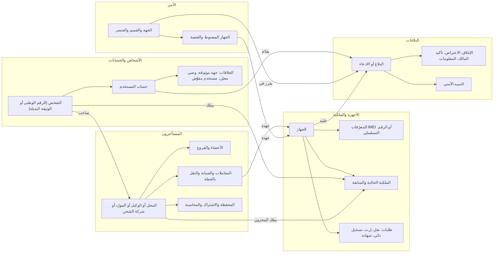

# 26 — الترابط والسيناريوهات

> هذه الوثيقة هي **مواصفة السلوك على مستوى العمل** التي تربط وحدات «بصمة» بعضها ببعض. تحدد كيف ترتبط الكيانات، وماذا يحدث لكل ما يرتبط بكيان حين تتغير حالته، ومن يستطيع ماذا في كل حالة، وكيف تجري كل دورة تشغيلية من أولها إلى آخرها، وماذا يجب أن يحدث في كل ظرف غير عادي. والغاية أن يعرف المطوّر ما يجب أن يحدث في كل سيناريو **دون أن يسأل**. وما لم تذكره هذه الوثيقة صراحة يُحسم بمبادئ القسم 1، ويُسجَّل في سجل القسم 13.

## موقع الوثيقة بين الوثائق

| الموضوع | موطنه | علاقته بهذه الوثيقة |
|---|---|---|
| قرارات الزبون | [سجل القرارات](02-decisions-log.md) | تعلو على كل ما هنا، وأي تعارض يُحسم لصالح القرار |
| المتطلبات بمعرّفاتها | [المتطلبات الوظيفية](04-functional-requirements.md) | تُذكر هنا بمعرّفاتها ولا تُعاد كتابتها |
| القواعد والقيم ⚙️ وفئة كل مؤقّت | [قواعد العمل](06-business-rules.md) §15 | **كل قيمة ⚙️ هنا استشهاد**، وقيمتها المعتمدة وحدودها الدنيا والعليا هناك |
| الأدوار وصفات التصرّف عن الغير | [الأدوار والصلاحيات](03-roles-and-permissions.md) | — |
| الآليات التقنية: آلات الحالة، والآثار المتسلسلة، وحارس الحيازة، والقيود، والقدرات، ومفاتيح التشغيل، والمؤقّتات، ونمط المال، والأوضاع المتدهورة، والأقفال | [التصميم التقني](19-technical-design.md) | هذه الوثيقة تحدد **ماذا** يحدث، و19 تحدد **كيف** يُبنى. ورموز الحالات المعتمدة في 19 §8 |
| الجداول والأعمدة | [نموذج البيانات](09-data-model.md) | — |
| النصوص والقوالب وأسماء الحالات للجمهور ورموز الأخطاء | [كتالوج المحتوى](24-content-catalog.md) | الأحداث هنا تُربط بقوالبها هناك |
| الإجراءات اليومية | [إجراءات التشغيل](23-operations-sops.md) | كل «عنصر عمل» هنا يقابله إجراء هناك |
| معايير القبول | [معايير القبول](25-acceptance-criteria.md) | كل صف في جداول هذه الوثيقة يقابله اختبار منصة مولَّد |
| الأمثلة المرئية | [رحلات المستخدمين](05-user-journeys.md)، [الدورة التشغيلية](14-operational-lifecycle.md) | تجسّد ما تحدده هذه الوثيقة |

## المحتويات

| § | القسم | ما يجيب عنه |
|---|---|---|
| 1 | مبادئ الحسم الافتراضية | ماذا أفعل حين تسكت الوثائق؟ |
| 2 | خريطة الكيانات والعلاقات | ما الكيانات، ومن أبوها، وما ثوابتها؟ |
| 3 | مصفوفة الآثار المتسلسلة | ماذا يحدث لكل ابن حين تتغير حالة أبيه؟ |
| 4 | القدرات حسب الحالة | من يستطيع ماذا في كل حالة، وما المسموح دائماً؟ |
| 5 | الاستحقاق | ماذا تفتح كل باقة في كل حالة ولكل نوع حساب؟ |
| 6 | خطوات الحيازة وإعادة الفحص | كيف يتحرك الجهاز بين الأيدي دون أن تضيع ملكيته؟ |
| 7 | أحداث الحياة | الوفاة، والقاصر، والهوية، والمؤسسات، والحظر، والمحل، وبقية الحالات |
| 8 | الدورات التشغيلية | كل دورة قفزةً قفزة |
| 9 | التعارضات والتزامن | حدثان في الوقت نفسه، أو ادعاءان على الجهاز نفسه |
| 10 | الأعطال والأوضاع المتدهورة | ماذا يحدث حين تتعطل تبعية؟ |
| 11 | إطفاء الميزات والتصفية | ماذا يبقى حين تُطفأ ميزة؟ |
| 12 | الوقت والمهل والتقويم | أي مهلة مطلقة، وأيها بالدوام، وأيها تتوقف؟ |
| 13 | سجل الحالات غير المتوقعة | كيف تُسجَّل الحالة الجديدة حتى تصبح قراراً؟ |
| 14 | تغطية مراجعة السيناريوهات | أين أُغلقت كل عائلة ملاحظات؟ |

## كيف تُقرأ

- الجداول أولاً. كل صف قاعدة ملزمة، وكل خلية فارغة خطأ في الوثيقة يُبلَّغ عنه.
- «عنصر عمل» يعني عنصراً في قائمة عمل لموظف بمهلة (19 §5.4، [إجراءات التشغيل](23-operations-sops.md) §1.3).
- «إشعار محايد» يعني نصاً لا يذكر طرفاً آخر ولا بلاغاً قيد المراجعة ولا تفاصيل تحقيق (P-4، [كتالوج المحتوى](24-content-catalog.md) §3.29).
- الأنماط والسياسات والقيود والنطاقات والفئات تُكتب بأسمائها التقنية كما هي في 19، مع معناها العربي:

**سياسات الأثر المتسلسل** (19 §8.16):

| الكلمة | المعنى | الرمز |
|---|---|---|
| يستمر | لا أثر على الابن | `continue` |
| منع الجديد | يُمنع إنشاء أبناء جدد، والقائم يكمل | `block_new` |
| تصفية | الأبناء القائمون يصلون لحالة نهائية بمسارهم الطبيعي | `drain` |
| إلغاء | يُلغى الابن بسبب مسجّل | `cancel(reason)` |
| انتهاء | ينتهي الابن بمهلته | `expire` |
| تعليق ثم استعادة | يُعلَّق الابن، ويعود فقط إذا رُفع **السبب نفسه** | `suspend` / `restore_if_cause` |
| نقل | ينتقل الابن لمالك آخر (من العنصر إلى جهته، أو من موظف إلى قائمة) | `transfer(target)` |
| إعادة للقائمة | يعود عنصر العمل لقائمته دون مُسنَد | `reassign_to_pool` |
| تجميد | يُنشأ قيد (§4.3) مصدره الحدث | `freeze` |
| تصعيد | عنصر عمل يقرر فيه إنسان | `escalate(queue)` |
| إشعار | يُبلَّغ طرف بقاعدة إشعار | `notify(rule)` |
| شرط للإغلاق | يجب أن يصل الابن لحالة نهائية قبل إغلاق الأب | `must_be_terminal` |
| لا ينطبق | مع سبب مكتوب | `not_applicable(reason)` |

**أنماط دورة الحياة** (19 §8.0):

| النمط | معناه | أمثلة |
|---|---|---|
| `PARENT_LIFECYCLE` | أب له أبناء: `pending → active ⇄ suspended → closing → closed`، و`suspended → revoked → closed` (19 §8.0، §8.4)، وعمليتا «تغيير المالك» و«الوفاة» | الشخص، والحساب، والمحل، والوكيل، والمورّد، وشركة الشحن، والمعلن، والجهة الأمنية، وحساب الموظف |
| `REQUEST` | طلب: `requested → approved / rejected / withdrawn / expired / moot → executed / failed`، ويُعاد التحقق منه عند القرار وعند التنفيذ | نقل الملكية، وطلب الإرث، والإغلاق، والاعتراض، والتصحيح، والاستعادة، وتغيير المالك، والمرتجع |
| `RELATION` | علاقة بين طرفين: `invited → active ⇄ suspended → removed / expired / declined`، تتأثر بحالة **الطرفين** | العضوية، والجهة الموثوقة، والوصي المعيّن، والمستخدم المفوّض، وإسناد عنصر العمل |
| `CUSTODY_CASE` | جهاز في عهدة طرف ليس مالكه: يخرج بالتسليم للمالك أو للمستلم أو للجهات المختصة، وكل خروج يمر بحارس الحيازة (§6) | الصيانة، والضبط، والمعاملة المعلّقة، والنقل بالجملة، وسطر جهاز في طلب متجر |
| `WORK` | عمل: `new → in_progress → closed / referred`، و«المُحال» له متابعة ومالك، وينغلق آلياً حين ينتهي موضوعه | التنبيه، والمعلومة الواردة، وطلب الدعم، والتعارض |
| `MONEY_OP` | حركة مال بالنمط الموحّد (19 §11.5) | الدفع، والاسترداد، وعمليات المحفظة، والتعبئة، والتحصيل، والتسوية |
| `TIMED_GRANT` | منحة بمدة: `scheduled → active → grace → ended` | الاشتراك، والتجربة، وجلسة التتبّع، وتأجيل الحظر، وإيقاف السحب، والتهدئة، والقيود المؤقتة |

---

## 1. مبادئ الحسم الافتراضية

### 1.1 الثوابت التي تعلو على المبادئ

| # | الثابت | الأثر |
|---|---|---|
| 1 | قرار الزبون في [سجل القرارات](02-decisions-log.md) يعلو على كل مبدأ | المبدأ يملأ الفراغ ولا ينقض قراراً |
| 2 | D-101 مطلق | بيانات محاسبة المحل لا يراها أحد من المنصة، ولا يفتحها مبدأ ولا طارئ ولا إذن صاحب المحل |
| 3 | D-100 هو الاستثناء **البشري** الوحيد على P-3 في المال | التأخيرات الأمنية الآلية المحددة بمدة (D-115) ليست قراراً بشرياً، والتجميد الخارجي من شام كاش أو جهة رسمية ليس من المنصة |
| 4 | الحقوق تُستعاد بالقانون (D-46، D-50) | المنصة تسجّل وتوجّه، ولا تحكم في ملكية |

### 1.2 المبادئ بالترتيب

حين تسكت الوثائق، يطبّق المطوّر المبادئ بهذا الترتيب، **والرقم الأصغر يغلب عند التعارض**:

| # | المبدأ | مشتق من | أمثلة يحسمها |
|---|---|---|---|
| P-1 | **سلامة الناس أولاً.** لا يُدفع أحد لمواجهة أحد. الإجراءات الحامية (بلاغ السرقة، وحماية لحظة السرقة، وتنبيهات الأمن) لا يوقفها تعليق ولا قيد ولا اشتراك ولا مفتاح تشغيل. والبيانات القديمة أو غير المؤكدة لا تطلق إجراءً أمنياً حياً ضد شخص | README (المبدأ 4)، D-46، 07 §9، 23 §1.4 #5، D-85 | المستخدم المعلّق يبلّغ عن سرقة جهازه (§4.1). صاحب المحل الذي سُرق موبايله مع المخزون يبلّغ عن المخزون (§7.22). حدث شبكة لجهاز بلاغه لم يعد نافذاً لا يصل للأمن تنبيهاً (§10.1). ضبط جهاز للتحقيق لا يُشعَر به (§7.21) |
| P-2 | **الحقوق عبر القانون، والمنصة تسجّل ولا تحكم.** الملكية تتغير بفعل مالكها، أو بمسار قانوني قرره الزبون (الإرث D-103)، أو بتصحيح موثّق بوثيقة (المدير العام، REVERSAL-03). ولا تتغير أبداً بمؤقّت أو ترك أو استنتاج أو إرجاع من الأمن وحده | D-46، D-50، D-103، 23 §1.4 #5–6، REVERSAL-03، 19 §8.12 | لا ينتقل جهاز صيانة متروك للمحل (§7.20). الإرجاع لغير المالك المسجّل عنصر عمل لتصحيح بوثيقة رسمية، لا آلياً (§7.21). الإرث بشهادة الوفاة والكنية أو الوصي (§7.1). التخلف عن التقسيط شأن مدني (§7.16) |
| P-3 | **لا يُحبس مال ولا جهاز.** كل حالة تحبس مال غيره أو جهازه لها مخرج بمهلة ومالك. وصاحب المال أو الجهاز يبقى له طريق خروج في كل حالة من حالات دورة الحياة | SHOPWALLET-01، ROLLOUT-07، 19 §5.10، §14.3، 22 §6.15 | نطاق «الخروج المالي فقط» للمحظور والملغى ترخيصه (§4.5). تسليم الصيانة أثناء تعليق المحل (§4.2). المال دون مطابقة لا يُصادر (§9). الشحن الوارد للمحفظة لا يُرفض (§11). الإبطال الآلي قبل بدء الخدمة (D-116) |
| P-4 | **تقليل البيانات، وD-101 مطلق.** عند الشك: لا تكشف، ولا تخزّن، ولا ترسل. الرسائل لا تسمّي طرفاً آخر، والأخطاء لا تكشف وقائع مخفية | README (المبدأ 3)، D-09، D-10، D-84، D-101، 21 §13، CHECK-15، 24 §3.29 | خطأ البلاغ المكرر لا يكشف بلاغاً قيد المراجعة (§9). لا رمز تحقق محفوظ. رسائل المحل لزبائنه لا يراها موظف (§5.7). إشعار D-119 دون هوية المبلّغ |
| P-5 | **وظائف الالتزام لا تتوقف لسبب تجاري أو بمفتاح تشغيل.** لا يوقفها إلا تعليق تنظيمي للمحل نفسه، وهذا مقصود | D-92، D-93، D-95، D-109، 19 §5.10 | تسجيل الفروع ومعاملاتها مجاني (D-109). مفتاح تسجيل الوكيل خارج الربط البرمجي المدفوع (§5.3). قدرات الالتزام من المسارات المحمية (§11) |
| P-6 | **أغلق عند الشك في ما ينقل قيمة أو يمنح صلاحية، وافتح مع وسم وإعادة تحقق في الحماية وفي الاستعلامات** | 20 §11.1–11.2، 06 §7.1، §8.1، §3.2 | GSMA غير متاح عند الشراء: تمضي العملية موسومة (§10). تعطل رفع الصور: بلاغ السرقة يمضي، والتوثيق والشراء يتوقفان. رد شريك دون تأكيد باستعلامنا لا ينقل مالاً. Play Integrity غير متاح: Key Attestation بديلاً |
| P-7 | **لا حذف، والتصحيح بعملية عكسية مرتبطة، والحالات النهائية لا تتغير.** التصحيح لا يُحيي آلياً أبناءً أثّروا على ملكية، بل ينشئ عناصر عمل | 09 §1.4، 19 §7.8، REVERSAL-05، 23 §1.4 #9 | تصحيحات المال عمليات مرتبطة. الفاتورة تُبطل وتصدر مقابلها وثيقة دائنة. فك الدمج بقائمة ما نُقل. آثار التصحيح عناصر عمل (§3.2) |
| P-8 | **إشعار محايد وكامل.** كل طرف تغيّرت حقوقه أو ماله أو جهازه أو مهلته يُبلَّغ بحياد، إلا ما تمنعه قائمة «ما لا يُرسل أبداً» أو سرية التحقيق | 23 §1.4 #10، 24 §3.29، D-10، D-96، D-119 | إشعار خروج الملكية (§6.1). أطراف تغيّر حالة المحل. إبلاغ الأمن بأن البلاغ لم يعد نافذاً. المبلّغ المدموج بلاغه. الحائز المسجّل عند قبول بلاغ غيره (D-119) |
| P-9 | **أوقف الجديد وأكمل القائم.** سحب أب أو ميزة أو استحقاق أو صلاحية يمنع الجديد، والقائم يصل لحالة نهائية بآلته، ولا يبقى شيء يتيماً | 19 §14.3، SOP-60 #10 | إطفاء الميزات (§11). تعليق المحل وإلغاؤه (§3.3). حذف نوع نشاط. مغادرة الموظف (§7.9) |
| P-10 | **البشر يقررون، والمؤقّتات تنفّذ المهل المعلنة فقط،** ولا تقرر ضد طرف لأن الموظفين لم يكونوا متاحين | README (المبدأ 2)، D-58، D-98 | مهل `BUSINESS_FLOOR` و`PAUSABLE` (§12). الحالة المنتظرة لجهة خارجية لها متابعة، لا قرار آلي |
| P-11 | **أربع عيون حيث قُررت فقط، والمدير العام يعمل وحده بضوابط تعويضية.** لا يُخترع موافق جديد، بل يُضاف تأخير أو إشعار أو تدقيق | D-102، 19 §5.4 | تغيير حسابات استلام المال بتأخير ⚙️ 72 ساعة وإشعار. إلغاء ترخيص المحل يقرره المدير العام وحده. الإبطال الآلي مقابل الاسترداد بأربع عيون (D-116) |
| P-12 | **المساءلة تتبع الشخص** (الرقم الوطني)، لا الحساب ولا الجهاز | D-106، D-113، D-11، 21 §8.1 | الحظر على الشخص (D-106). العدّادات والقيود على الشخص، فإغلاق الحساب وفتح غيره لا يصفّرها. التجربة مرة لكل صاحب محل (D-113) |
| P-13 | **الوقائع كما كانت وقتها.** الوثائق الصادرة والقرارات السابقة صالحة كما صدرت، والتاريخ لا يُعاد كتابته، والقيم الجديدة تسري على الجديد ما لم يصرّح الإعداد بغير ذلك | 19 §10.1، §5.10، §13.3 | فواتير المحل المعلّق أو المغلق تبقى قابلة للتحقق. تغيير إعداد أثناء مؤقّت قائم. لقطة الباقة عند التجديد |
| P-14 | **خطأ المنصة يُعوَّض، وفعل الطرف نفسه لا يُعوَّض** | D-111، D-112 (حسمها الزبون) | إطفاء ميزة مدفوعة: تمديد أو استرجاع نسبي باختيار الزبون. إعلان أُزيل لمخالفة: لا استرجاع. محل أُلغي ترخيصه: لا استرجاع. تعليق تبيّن خطؤه: تعاد الأيام آلياً |

### 1.3 الترجيح عند التعارض

| التعارض | الغالب | النتيجة |
|---|---|---|
| جهاز مبلّغ عنه أُحضر للصيانة: هل تصل بيانات من أحضره للأمن؟ | P-1 على P-4 | نعم، تصل للأمن في نطاقه وحده، ولا تصل للمبلّغ |
| تجميد الإدارة للمحفظة والسحب | P-3 على P-6 | السحب مفتوح، ولا يغلقه إلا إجراء D-100 |
| ملكية متنازع عليها ومال المحل | P-2 على P-3 | مال المحل لا يُستعمل لتسوية ملكية، وكل منهما في مساره |
| ضبط جهاز للتحقيق من مالكه المسجّل | P-4 على P-8 | لا إشعار لأحد، والضبط ظاهر للأمن وحده حتى إغلاق القضية |
| بلاغ عاجل من جهة موثوقة قبل المراجعة | P-1 على P-10 | الحماية فورية، أما ظهور «مبلّغ عنه» في الفحص فينتظر قرار البشر |
| محظور يملك رصيداً في محفظة محل | P-3 مع P-12 | يُمنع من الأدوار (D-106)، ويبقى له طريق الخروج المالي (§4.5) |
| شحن وارد إلى محفظة محل أُطفئت وحدتها | P-3 على P-9 | يُسجَّل ويُطابق ويُسحب، لأن رفضه مستحيل ومنعه يحبس المال |

### 1.4 الحالة غير المتوقعة

**أثناء التشغيل** (يصادف النظام تركيبة غير معلنة):

1. محرّك القدرات يمنع افتراضياً (19 §5.3). والقدرات الحامية معلنة لكل حالة، فلا يصيبها المنع الافتراضي أبداً.
2. حين يجد أثر متسلسل أو حارس أو مؤقّت حالة غير متوقعة عند التنفيذ: لا يخمّن. يضع العنصر في قائمة `unforeseen` مع سياقه كاملاً، **ويُبقي الحماية قائمة، ويترك المال مكانه قابلاً للوصول** (P-1، P-3)، ويستعمل السبب `RSN-*-99`.
3. يقرر المدير العام (23 §1.5 المستوى 3). والمراجعة الأسبوعية لأسباب «99» تحوّل المتكرر إلى أسباب وصفوف في السجلات.

**أثناء البناء** (يصادف المطوّر حالة غير موثّقة):

1. يطبّق P-1..P-14 بالترتيب، وينفّذ **أسلم سلوك قابل للتراجع**.
2. لا يخترع بمبدأ افتراضي أبداً: **موافقاً جديداً، ولا حركة مال، ولا كشف بيانات، ولا تغيير ملكية.** كل ذلك يصبح عنصر عمل لإنسان (P-2، P-4، P-11).
3. يعلّم الكود `DEFAULT-PRINCIPLE(P-n, UC-NN)`.
4. يضيف صفاً في سجل الحالات غير المتوقعة (§13) ويتابعه حتى يصبح قراراً.

---

## 2. خريطة الكيانات والعلاقات

### 2.1 المخطط العام

### 2.2 الكيانات

| الكيان | الوحدة المالكة (19 §2.2) | الأب | الأبناء الرئيسيون | العلاقة | النمط | آلته |
|---|---|---|---|---|---|---|
| الشخص `persons` | `accounts` | — | الحساب، والملكيات، والقيود على الشخص، ودور العضو، وطلبات الإرث | شخص واحد لكل رقم وطني أو وثيقة بديلة (D-104) | `PARENT_LIFECYCLE`: `active → deceased`، و`merged_into` عند تصحيح الرقم الوطني | 19 §8.5 |
| حساب المستخدم `users` | `accounts` | الشخص | الجلسات، والأرقام البديلة، والعلاقات، وطلبات النقل، والبلاغات المقدّمة، والاعتراضات، والتسجيل الذاتي، وطلبات الدعم، والعضويات | حساب نشط واحد لكل شخص | `PARENT_LIFECYCLE` | 19 §8.5 |
| الجهة الموثوقة `trusted_contacts` | `accounts` | حسابان | البلاغ العاجل | حتى ⚙️ 3 لكل مستخدم | `RELATION` | 19 §8.15 |
| الوصي المعيّن (D-103) | `accounts` | حساب صاحب الأجهزة، والشخص الوصي | طلب الإرث بصفة وصي | ⚙️ وصي واحد لكل صاحب حساب | `RELATION` | 19 §8.15 |
| المستخدم المفوّض `authorized_users` | `ownership` | الملكية، والشخص المفوّض | بلاغ المفوّض | حتى ⚙️ 3 لكل جهاز | `RELATION` | 19 §8.15 |
| الجهاز `devices` | `devices` | — | المعرّفات، والملكيات، والبلاغات، والفحوص، وسياقات العهدة | — | آلة الحيازة والحالة العامة | 19 §8.2 |
| المعرّف `device_identifiers` | `devices` | الجهاز | — | ربط نشط واحد لكل معرّف في كل لحظة | ربط بتاريخ | 19 §7.2 |
| الملكية `ownerships` | `ownership` | الجهاز، والمالك (شخص أو مستأجر) | — | مالك حالي واحد لكل جهاز | سجل لا يُحذف، ويكتبه حارس الحيازة وحده (§6) | 19 §7.10 |
| طلب نقل الملكية | `ownership` | الملكية الحالية | — | طلب معلّق واحد لكل جهاز. والمستلم شخص أو محل (D-121) | `REQUEST` | 19 §8.3 |
| طلب الإرث (D-103) | `ownership` | ملكية المتوفى | — | طلب منفَّذ واحد لكل جهاز، وتعدّد الطلبات نزاع (§7.1) | `REQUEST` | 19 §8.3 |
| التسجيل الذاتي | `ownership` | الجهاز، والحساب | — | ⚙️ 3 مقبولة لكل شخص في 365 يوماً متتالية | `REQUEST` ثم انتظار | 19 §8.6 |
| الشهادة | `ownership` | الملكية | — | — | `TIMED_GRANT` | 19 §8.15 |
| البلاغ `reports` | `reports` | الجهاز، والمبلّغ (حساب أو جهة أمنية أو محل أو وكيل أو الدعم بالنيابة) | تأكيد المالك، وطلب الإغلاق، والاعتراض، والتنبيهات، وقيود قوائم الشركات، والتتبّع، وتأجيل الحظر | **بلاغ نافذ واحد** لكل جهاز، وقد تكون عدة ادعاءات قيد المراجعة (§9) | آلة البلاغ مع حزمة حماية تُطبَّق وتُرفع | 19 §8.1 |
| دفعة بلاغ سرقة المخزون | `reports` | المحل أو الوكيل | بلاغ لكل جهاز | — | تتبع قرارات بلاغاتها | 19 §8.15 |
| الاعتراض | `reports` | البلاغ | الأدلة | اعتراض مفتوح واحد لكل معترض على البلاغ | `REQUEST` | 19 §8.10 |
| المعلومة الواردة | `reports` | البلاغ أو الجهاز | — | — | `WORK` | 19 §8.15 |
| التنبيه الأمني | `alerts` | الجهاز والبلاغ | الإحالات | — | `WORK` | 19 §8.15 |
| المستأجر: محل، وكيل، مورّد، شركة شحن، معلن | `tenancy` | الشخص المالك | الأعضاء، والفروع، والمخزون، والمعاملات، والصيانة، والنقل بالجملة، وطلبات المتجر، والمحفظة، والاشتراك، والإعلانات، وبيانات المحاسبة، وطلبات التعديل | مالك نشط واحد لكل مستأجر | `PARENT_LIFECYCLE` مع عملية «تغيير المالك» في المكان (D-107) | 19 §8.4 |
| العضو `shop_members` | `tenancy` | المستأجر، والشخص | الجلسات في سياق المحل، وجلسة الصندوق، والإسنادات | عضوية نشطة واحدة لكل شخص في كل مستأجر | `RELATION` | 19 §8.15 |
| الفرع (D-109) | `tenancy` | المستأجر | المعاملات الموسومة بالفرع | تسجيله وموقعه مجاني دون حد | `PARENT_LIFECYCLE` مبسّط: `pending → active → closed` | 19 §6.6 |
| معاملة المحل | `tenancy` | المستأجر، والجهاز | الفاتورة | — | المعلّقة منها `CUSTODY_CASE` | 19 §8.7 |
| أمر الصيانة | `repair` | المستأجر، والجهاز | استبدال اللوحة | — | `CUSTODY_CASE` | 19 §8.15 |
| النقل بالجملة وبين المحلات | `importers` | المرسل، والمستلم | بنود الأجهزة | حجز مفتوح واحد لكل جهاز | `CUSTODY_CASE` | 19 §8.15 |
| الاشتراك والتجربة | `billing` | المستأجر | الاستحقاقات | اشتراك ساري واحد لكل مستأجر | `TIMED_GRANT` | 19 §8.11 ج |
| طلب الخدمة والدفع والاسترداد | `billing` | الحساب أو المستأجر | — | — | `REQUEST` و`MONEY_OP` | 19 §8.11 أ، ب |
| محفظة المحل | `wallet` | المستأجر ومالكه | العمليات، والقيود على المحفظة | محفظة واحدة لكل مستأجر لكل مالك (D-107) | `PARENT_LIFECYCLE` مع قيود | 19 §8.11 ح |
| عملية المحفظة والتعبئة | `wallet`، `topup` | المحفظة | — | عملية خصم واحدة قيد التنفيذ لكل محفظة | `MONEY_OP` | 19 §8.11 و، ز |
| طلب المتجر والشحنة والمرتجع | `store`، `logistics` | المحل، والمورّد | أسطر، وأسطر أجهزة، وتحصيل | — | `REQUEST`، والشحنة `CUSTODY_CASE` | 19 §8.11 د، هـ |
| تسوية المورّد | `billing` | المورّد | الأسطر | — | `MONEY_OP` | 19 §8.11 هـ |
| الحملة الإعلانية | `ads` | المعلن | — | — | `TIMED_GRANT` | 19 §8.15 |
| بيانات المحاسبة | `shoppro` | المحل | — | ملك المحل وحده (D-101) | تتبع الاستحقاق ونافذة القراءة | 19 §6.8 |
| الجهة الأمنية والقسم والعنصر | `police` | — | القضايا، والمضبوطات، وجلسات التتبّع | العمل ملك **الجهة** لا العنصر | `PARENT_LIFECYCLE` | 19 §8.15 |
| الجهاز المضبوط | `police` | الجهة أو القسم، والجهاز | — | — | `CUSTODY_CASE` بغرض (إرجاع، تحقيق، حفظ دون مالك) | 19 §8.15 |
| جلسة التتبّع وتأجيل الحظر | `tracking`، `telecom` | البلاغ | — | جلسة نشطة واحدة لكل جهاز | `TIMED_GRANT` | 19 §8.9 |
| قيد قائمة لدى شركة | `telecom`، `intl` | البلاغ والشركة | المحاولات | حالة مطلوبة واحدة لكل جهاز لكل شركة | حالة مطلوبة مقابل مؤكَّدة | 19 §8.15 |
| حساب الموظف وإسناد العمل | `access`، `backoffice` | — | عناصر العمل المسندة، والموافقات الثانية | — | `PARENT_LIFECYCLE` و`RELATION` | 19 §5.4 |
| القيد | `access` | الشخص أو الحساب أو المستأجر أو المحفظة أو الجهاز | — | عدة قيود معاً، ورفع أحدها لا يرفع غيره | `TIMED_GRANT` | 19 §5.11 |

### 2.3 الثوابت التي لا تُكسر

| الثابت | من يحرسه |
|---|---|
| لكل جهاز مالك حالي واحد، وكل تغيير للملكية أو للعهدة يمر بحارس الحيازة | 19 §7.10، §6 هنا |
| لكل جهاز **بلاغ نافذ واحد** على الأكثر، وقد يكون عليه أكثر من ادعاء قيد المراجعة | 19 §7.1، §9 هنا |
| لكل جهاز **حجز مفتوح واحد** عبر كل التدفقات (نقل بالجملة، وسطر متجر، ومعاملة معلّقة، ونقل ملكية، وتسليم إغلاق، وإرث) | 19 §7.10 |
| لكل معرّف ربط نشط واحد بجهاز في كل لحظة، والتاريخ محفوظ | 19 §7.2 |
| لكل مستأجر مالك نشط واحد، ولكل شخص حساب نشط واحد | 19 §7.1 |
| كل حالة غير نهائية لها مخرج: مؤقّت، أو موظف بقائمة ومهلة، أو جهة خارجية بمتابعة ومهلة تصعيد | 19 §8.0 |
| كل حماية تُطبَّق عند الدخول في حالة تُرفع عند **كل** خروج منها، إلا ما تعلنه الحالة الهدف «إبقاء» | 19 §8.0 |
| كل حدث إما له قاعدة إشعار أو «لا إشعار» بسبب مكتوب | 19 §9.6 |
| كل ابن له سياسة معلنة لكل فئة حالة من آبائه | 19 §8.16 |
| صاحب المال أو الجهاز له طريق خروج في كل حالة، إلا أثناء D-100 | 19 §5.12 |

### 2.4 نهاية حياة كل أب

كل أب يعلن طريق إنهائه وما يبقى لصاحبه. هذا الجدول يلخّص، والتفصيل في §3 و§7:

| الأب | الإنهاء الطوعي | الإنهاء القسري | تغيير المالك | الوفاة | ما يبقى لصاحبه بعد الإنهاء |
|---|---|---|---|---|---|
| حساب المستخدم | طلب إغلاق بمهلة تراجع ⚙️ 7 أيام (AUTH-10) | الحظر (D-106) | لا ينطبق | إغلاق بسبب الوفاة بعد مهلة الإشعار (D-103) | أجهزته تبقى باسمه برقمه الوطني، ويستطيع فتح حساب جديد إن لم يكن محظوراً |
| الشخص | لا ينطبق | قيد `person_ban` بمدة الحظر | لا ينطبق | `deceased` بعد التحقق ومهلة الإشعار | — |
| المحل والوكيل | الإغلاق الطوعي بشروط (D-108، §7.7) | الإلغاء، بسبب احتيال أو دونه (D-108) | في المكان على السجل نفسه (D-107، §7.6) | تغيير المالك للوريث أو الوصي، أو الإغلاق | نطاق «الخروج المالي فقط»: السحب حتى الصفر، وتصدير المحاسبة ⚙️ 12 شهراً، والفواتير |
| المورّد | طلب إنهاء بعد آخر نافذة إرجاع | التعليق والإلغاء (§3.6) | حسب اتفاقيته (تعديل بيانات بعقد جديد) | كالإنهاء القسري | كشف تسوية نهائي، والذمة السالبة مطالبة حسب الاتفاقية |
| شركة الشحن | إنهاء الاتفاقية | التعليق والإلغاء | — | — | مطابقة النقد والشحنات |
| المعلن | انتهاء الحملة | التعليق (إيقاف مؤقت) والإلغاء (إنهاء) | يتبع مستأجره | يتبع مستأجره | — |
| الجهة الأمنية والقسم | إيقاف الجهة | تعليق | لا ينطبق | لا ينطبق | العمل المفتوح ينتقل للجهة المركزية أو لقسم نشط (§7.9) |
| حساب الموظف | إنهاء العمل | الإيقاف والتعطيل | لا ينطبق | كالتعطيل | العمل المسند يعود للقوائم |
| المحفظة | الإغلاق بعد السحب حتى الصفر | تجميد خارجي من شام كاش أو من جهة رسمية | محفظة جديدة للمالك الجديد (D-107) | الرصيد يتبع إجراءات شام كاش للورثة | السحب حتى الصفر في كل حالة إلا أثناء D-100 |

---

## 3. مصفوفة الآثار المتسلسلة

حين تتغير حالة أب، يتصرف **كل** ابن مرتبط به بسياسة معلنة هنا، وينفّذها عبر آلة الابن نفسها وحارسها، ويُختم الانتقال بمعرّف الحدث المسبب. والتنفيذ الآلي والجدول المولَّد في [التصميم التقني](19-technical-design.md) §8.16، وفحص الاكتمال FF-11 يُفشل البناء إن بقي ابن دون سياسة. وقاعدتان عامتان:

- **الاستعادة بالسبب نفسه:** رفع حالة الأب يعيد فقط ما علّقه **هذا السبب**. فرفع تعليق المحل لا يرفع تجميداً وضعه المالك على محفظته، ولا قيداً آخر قائماً.
- **معاينة الأثر قبل القرار:** قبل أن يتخذ إنسان قراراً على أب (إلغاء ترخيص محل، أو حظر مستخدم، أو تعطيل عنصر أمن)، تعرض اللوحة قائمة الآثار المحسوبة («3 طلبات ستُلغى ويُعاد مالها، و2 نقل بالجملة يعودان للوكيل، و14 جهازاً في المخزون تحتاج قراراً»)، وتُحفظ مع القرار، وإجراءات [التشغيل](23-operations-sops.md) تشير إليها بدل إعادة سردها.

### 3.1 حساب المستخدم والشخص

| حدث الأب (فئته) | الابن | السياسة | التفصيل والإشعار |
|---|---|---|---|
| **تعليق** (`restricted`) | الجلسات | إلغاء، ثم دخول للعرض فقط | تُنهى الجلسات، ويستطيع الدخول بنطاق `read_only` (يحسم تعارض 19 §8.5 مع SOP-18) |
| تعليق | بلاغات قدّمها (قيد المراجعة أو نافذة) | يستمر | تُوسم للمراجع، ولا تتأثر نفاذاً |
| تعليق | بلاغ سرقة جديد عن جهازه | مسموح (حامٍ، P-1) | موسوم، ويراجعه مشرف غير من علّق الحساب |
| تعليق | طلبات النقل الصادرة والواردة | `cancel(account_restricted)` | إشعار محايد للطرف الآخر |
| تعليق | الشهادات الفعّالة | `cancel` | — |
| تعليق | تسجيل ذاتي غير نهائي | `suspend` / `restore_if_cause` | تجميد بسبب `account_suspended` مع حفظ الأيام المتبقية، واستئناف عند رفع التعليق |
| تعليق | تسجيل ذاتي نهائي | `continue` | — |
| تعليق | دوره جهةً موثوقة أو وصياً معيّناً أو مستخدماً مفوّضاً لغيره | `suspend` / `restore_if_cause` | يُبلَّغ صاحب العلاقة ليختار غيره إن شاء |
| تعليق | عضويته موظفاً | `suspend` / `restore_if_cause` | — |
| تعليق | المستأجر الذي يملكه | `continue` | الموظفون يعملون (الالتزام لا يتوقف)، وأفعال المالك وحده تُمنع عدا الخروج المالي (§4.5). وإن اتصل سبب التعليق بالمحل: عنصر عمل لمشرف المحلات (SOP-23) |
| تعليق | الاعتراضات وطلبات الخدمة المفتوحة | `continue` | — |
| **رفع التعليق** (`reinstated`) | كل ما علّقه التعليق | `restore_if_cause` | الطلبات الملغاة تبقى ملغاة (P-7) |
| **حظر** (`ended` + قيد `person_ban`، D-106) | الشخص | `freeze` | طوال مدة الحظر: لا حساب جديد برقمه الوطني، ولا ملكية محل ولا عمل فيه، ولا دور جهة موثوقة ولا وصي معيّن |
| حظر | الجلسات | إلغاء دائم | لا دخول إلا نطاق `theft_only` لبلاغ سرقة جهازه، ونطاق `exit_only` إن كان له مال أو بيانات محاسبة |
| حظر | ما يبقى له | — | فحص أجهزته، وبيع جهازه في محل، والدعم الفني (D-106)، وبلاغ سرقة جهازه (P-1) |
| حظر | البلاغ الكاذب المثبت | `cancel` | يُغلق (06 §13) |
| حظر | بلاغاته الأخرى | `continue` | — |
| حظر | تسجيل ذاتي غير نهائي | `escalate(self_registrations)` | يعود لمراجعة SOP-06 |
| حظر | تسجيل ذاتي نهائي | `continue` | يُصحَّح فقط بأدلة عبر REVERSAL-03 |
| حظر | علاقاته (جهة موثوقة، وصي، مفوّض) | `cancel` (`removed`) | إشعار الطرف الآخر |
| حظر | اعتراضات قدّمها | `cancel` (`withdrawn`) | إشعار محايد للمبلّغ |
| حظر | عضويته موظفاً | `cancel` (`removed`) | إشعار صاحب المحل «تعذّر استمرار هذا الموظف» دون السبب |
| حظر | المستأجر الذي يملكه | `escalate(tenant_reviews)` + `suspend` | تعليق آلي بسبب «حساب صاحب المحل محظور»، ومراجعة SOP-23 خلال ⚙️ 48 ساعة دوام: تغيير المالك (D-107) أو الإغلاق (D-108) |
| حظر | محفظة المحل | `continue` | السحب إلى الوجهة الموثّقة عبر `exit_only` |
| **طلب الإغلاق** (`ending`) | — | شروط الدخول | لا بلاغ قدّمه نافذ أو قيد المراجعة، ولا اعتراض ولا نقل معلّق (صادر أو وارد)، ولا مستأجر يملكه إلا مغلقاً، ورصيد محفظته صفر، ولا حجز قانوني. وتُولَّد قائمة الشروط من صفوف «شرط للإغلاق» (19 §8.16)، فتتطابق 19 و21 §8.1 |
| أثناء مهلة الإغلاق | التزام جديد يظهر (بلاغ يقدّمه هو، أو نقل وارد، أو بلاغ عاجل على جهازه، أو اعتراض على بلاغه القديم، أو حجز قانوني) | — | الحساب يعود من `closing` إلى `active` برسالة «توقّف الإغلاق بسبب …»، فلا يبقى معلقاً للأبد. والمسموح أثناء المهلة: الدخول للتراجع، وبلاغ السرقة |
| أثناء مهلة الإغلاق | قضية مفتوحة لا تمنع الإغلاق (حالة SOP-18، أو محاولة تسجيل ذاتي مرفوضة، أو تنبيه أمني عنه) | `freeze` | حجز قانوني آلي على أدلتها (LH-3)، وعدّاداته وقيوده تبقى على شخصه (P-12) |
| **الإغلاق** (`ended`) | العلاقات بالاتجاهين (جهة موثوقة، وصي، مفوّض) | `cancel` (`removed`) | إشعار الطرف الآخر |
| الإغلاق | المفوّضون على أجهزته | `cancel` | لأن المالك لم يعد يستطيع التأكيد، ويُبلَّغ المفوّضون |
| الإغلاق | العضويات | `cancel` | — |
| الإغلاق | الشهادات | `cancel` | — |
| الإغلاق | طلبات الدعم المفتوحة | `cancel(account_closed)` | — |
| الإغلاق | الإشعارات في الطابور | `cancel` | — |
| الإغلاق | طلبات الخدمة المفتوحة، والاسترداد المعلّق | `cancel` ثم إكمال الاسترداد إلى المصدر قبل تقليل البيانات | — |
| الإغلاق | الأجهزة المملوكة | `continue` | تبقى باسم الشخص برقمه الوطني، ويُفكّ ربط الشخص بالحساب ليستطيع فتح حساب جديد يرتبط آلياً (إلا المحظور) |
| **فقد الهوية** (`identity_lost`: تصحيح التوثيق إلى مرفوض) | العضويات | `suspend` | تعود إلى `pending_identity` |
| فقد الهوية | المستأجر الذي يملكه | `suspend` / `restore_if_cause` | يُعلَّق حتى يعيد المالك التوثيق، لأن المحفظة وKYC قائمة على هويته |
| فقد الهوية | بلاغات واعتراضات قيد المراجعة | `escalate` | توسم للمراجع |
| فقد الهوية | البلاغات النافذة | `continue` | — |
| فقد الهوية | تسجيل ذاتي غير نهائي | `freeze` | للمراجعة |
| **فصل الرقم الوطني** عن حساب (أ) وربطه بحساب (ب) (SOP-12) | العناصر المرتبطة بالشخص في (أ): بلاغات، واعتراضات، وتسجيل ذاتي، ونقل معلّق | `transfer(account_B)` | في عملية واحدة مدققة، وتنزل (أ) إلى «غير موثّق» |
| فصل الرقم الوطني | ما نفّذه (أ) على أجهزة الشخص في آخر ⚙️ 90 يوماً (نقل، شهادة، تفويض) | `escalate(gm_review)` | مراجعة المدير العام، والتصحيح عبر REVERSAL-03 إن ثبت احتيال |
| **تغيير الرقم أو استعادة الحساب أو إشارة تبديل شريحة** (`phone_compromised`) | الجلسات | `cancel` | — |
| تغيير الرقم | قيد `cooldown` | `freeze` | ⚙️ 72 ساعة (`WALL_SECURITY`) |
| تغيير الرقم | طلبات النقل الصادرة | `cancel` | — |
| تغيير الرقم | طلب نقل وارد | `continue` | القبول يطابق الرقم الوطني **والرقم الحالي الموثّق** للحساب، والإشعار يذهب للرقم الجديد |
| تغيير الرقم أو استعادة الحساب | سحب محفظة المحل | `freeze` بمدة | تأخير أمني آلي ⚙️ 72 ساعة بعد تغيير الرقم أو استعادة الحساب (D-115)، وتغيير رمز المحفظة يؤخر السحب ⚙️ 24 ساعة (قيد `pin_reset_delay`). ومصادر التهدئة الأخرى لا تؤخر السحب |
| **إعادة تعيين كلمة المرور برمز** (من أي جهاز، حتى المربوط) | قيد `password_reset_hold` | `freeze` | ⚙️ 24 ساعة: يمنع النقل الصادر، وطلب إغلاق البلاغ، والشهادة، وتغيير الجهات الموثوقة والرقم البديل والوصي، وتغيير الرقم، وإغلاق الحساب. ويبقى مسموحاً: البلاغ، والفحص، والنقل الوارد (§9). ولا يمنع سحب المحفظة، لأن السحب يحتاج رمز المحفظة، وتأخيرات السحب الآلية محصورة في D-115 |
| **وفاة** (`ended(deceased)`، D-103) | التفصيل الكامل في §7.1 | — | — |
| وفاة | الأجهزة | `freeze` | قيد `owner_deceased`: لا نقل ولا بيع ولا شهادة حتى ينفّذ طلب إرث. وشراء محل لأحدها يُعلَّق (D-96) بسبب `owner_deceased` برسالة تذكر طريق الإرث |
| وفاة | طلبات النقل الصادرة والواردة | `cancel(owner_deceased)` | إشعار الطرف الآخر |
| وفاة | البلاغات التي قدّمها | `continue` | بعد تنفيذ الإرث يصبح الخلف جهة التواصل للبلاغ |
| وفاة | المستخدمون المفوّضون على أجهزته | `continue` | تستعملها العائلة، ويقرر الخلف إبقاءهم أو إزالتهم |
| وفاة | دوره جهةً موثوقة أو وصياً لغيره | `cancel` | إشعار أصحاب العلاقات |
| وفاة | المستأجر الذي يملكه | `suspend` + `escalate` | تعليق بسبب «وفاة صاحب المحل» حتى تغيير المالك للخلف (D-107) أو الإغلاق (D-108) |
| وفاة | محفظة المحل | `freeze` (خارجي) | الرصيد في حساب باسم المحل لدى شام كاش، ويتبع إجراءاتها للورثة، والمنصة تعرض ذلك ولا تنقل مالاً |

### 3.2 الجهاز والبلاغ

**أ. بلاغ من شخص آخر قيد المراجعة** (`device_report_pending`، ويشمل «بانتظار تأكيد المالك» لبلاغ المفوّض):

| الابن | السياسة | التفصيل |
|---|---|---|
| الشهادات الفعّالة | `cancel` عند **التقديم** | صفحة الشهادة تقول «الشهادة لم تعد صالحة» دون ذكر بلاغ (CHECK-15). وإن رُفض البلاغ يعيد المالك إصدارها |
| طلب نقل معلّق | `block_new` + منع القبول | يبقى حتى مهلته أو قرار البلاغ، فإن قُبل البلاغ يُلغى |
| إنشاء نقل أو بيع جديد | `block_new` | — |
| تسجيل ذاتي لشخص آخر (قيد المراجعة أو الانتظار أو نهائي) | `freeze` | يصبح تعارضاً ⛔ (06 §5.1) |
| معاملة محل على الجهاز | `freeze` | تُعلَّق برسالة محايدة (06 §6) |
| بلاغ مفوّض «بانتظار تأكيد المالك» وجاء بلاغ عاجل من جهة موثوقة | `cancel(superseded)` | البلاغ العاجل يحل محله، ويُبلَّغ المفوّض |

**ب. البلاغ نافذ** (`device_reported`). يبحث النظام عن كل سياق عهدة مفتوح للجهاز (`custody.locate`، 19 §7.10) ويطبّق سياسته:

| سياق الجهاز | السياسة | التفصيل |
|---|---|---|
| طلبات النقل المعلّقة | `cancel` | — |
| تسجيل ذاتي لشخص آخر | `cancel` بعد ثبوت السرقة | وتُحال بيانات المسجِّل لقوى الأمن (06 §5.1) |
| قوائم الشركات | `notify` الشركات | الجهاز يدخل قائمة المراقبة، **إلا IMEI منسوخاً** (D-120): لا يُرسل طلب المراقبة والحظر آلياً، وينتظر قرار وحدة الأمن المختصة في البوابة (§7.18) |
| GSMA | مشاركة | — |
| مخزون محل أو وكيل (غير دفعة سرقته هو) | `freeze` + `escalate` | البند «محجوز، لا يُباع»، وتنبيه أمني عاجل لنطاق الأمن بموقع المحل وبيانات البائع من معاملة الشراء، وإشعار محايد للمحل: «جهاز في مخزونك صار عليه بلاغ نافذ. لا تبعه ولا تسلّمه لأحد واحتفظ به، وقد تتواصل معك الجهات المختصة». ولا يخرج الجهاز إلا بالضبط أو بإغلاق البلاغ |
| أمر صيانة مفتوح | `freeze` + `escalate` | التسليم ممنوع (`REPAIR_DEVICE_REPORTED`) برسالة محايدة «لا تسلّم هذا الجهاز، تواصل مع …»، وتنبيه عاجل للأمن ببيانات من أحضره (P-1 على P-4) |
| معاملة محل معلّقة | `cancel` | تُرفض (`RSN-CNF-07`) مع تنبيه أمني ببيانات البائع المسجّلة |
| بند نقل بالجملة أو بين محلات «مُرسل» | `cancel` للبند | يُستبعد عند القبول، وتنبيه، وإشعار المرسل |
| سطر جهاز في طلب متجر قبل التسليم | `cancel` للسطر | لا يُسلَّم الجهاز، وتُخفَّض الفاتورة ومبلغ الدفع عند الاستلام آلياً، ويُبطل ما دُفع مقدماً عنه (D-116)، ويعيده المندوب للوكيل بتعليمات الأمن، والمحل لا يدفع ثمنه |
| الحائز المسجّل ليس المبلّغ | `notify` | إشعار محايد للمسجَّل باسمه مع رابط اعتراض، دون هوية المبلّغ (D-119)، وتظهر في «أجهزتي» «عليه بلاغ من شخص آخر» |
| وحدة الجهاز في محاسبة المحل | `freeze` | تخرج من المخزون القابل للبيع وتبقى بكلفتها، آلياً دون أن يراها أحد (D-101) |
| فحوص سابقة أصابت بلاغاً كان قيد المراجعة | `escalate` | خلال ⚙️ 30 يوماً قبل القبول: تنبيهات أمنية بأثر رجعي لما كان من محاولات في محلات |

**ج. البلاغ لم يعد نافذاً** (`device_report_ended`: أُغلق، أو رُفض، أو أُلغي، أو دُمج، أو صُحّح من نافذ إلى مرفوض). حزمة الحماية تُرفع عند **كل** هذه المخارج، لا عند انتهاء المهلة وحده:

| الابن | السياسة | التفصيل |
|---|---|---|
| حماية لحظة السرقة (`theft_protection`) | رفع | إبلاغ مزوّدي الخط والمحافظ (LINE-02، WALLET-03)، وإعادة الرقم البديل، وفك تجميد التسجيل الذاتي للمبلّغ. أما استئناف الرسائل للرقم الأصلي: فوري إن رفض المالك البلاغ العاجل أو رُفض لأنه ليس بلاغه، وإلا فيبقى موقوفاً حتى استعادة الرقم إن كان الرقم نفسه ما زال مفقوداً |
| قوائم الشركات وGSMA | `notify` | إزالة المراقبة وفك الحظر بأولوية `critical`، ولا يُلغى طلب الإزالة أبداً حتى لو كانت الشركة متوقفة (§10) |
| جلسات التتبّع وتأجيل الحظر | `cancel` | — |
| الأمن | `notify` | رسالة «البلاغ لم يعد نافذاً» لكل جهة في النطاق، على مدار الساعة وبالمسار نفسه للتنبيهات العاجلة |
| التنبيهات المفتوحة | `cancel` | تُغلق في الإدارة (`RSN-ALR-07`) وتُعلَّم «لم يعد نافذاً» في البوابة |
| الجهاز المضبوط لدى الأمن | `continue` | يبقى في عهدة الأمن، وتصل الجهة رسالة، والأمن يقرر |
| الاعتراضات المفتوحة | `cancel(moot)` | إشعار محايد للطرفين |
| طلبات الإغلاق المعلّقة | `cancel(withdrawn)` | «أُغلق البلاغ» |
| المعلومات الواردة | `cancel` (إغلاق بسبب) | — |
| بند المخزون «المحجوز» ووحدة المحاسبة | `restore_if_cause` | يعود قابلاً للبيع إن أُغلق البلاغ أو رُفض |
| منع تسليم الصيانة | `restore_if_cause` | — |
| الحائز المسجّل الذي أُبلغ (D-119) | `notify` | «لم يعد على جهازك بلاغ نافذ» |
| ما أُلغي بسبب البلاغ (معاملة محل، أو تسجيل ذاتي، أو نقل، أو شهادة) عند **تصحيح** القبول | `escalate` | لا يعود آلياً (P-7): عنصر عمل، والتسجيل الذاتي عبر REVERSAL-03، وإحالة المسجِّل للأمن تُتبع برسالة تصحيح «سُحب البلاغ» |
| الادعاءات المنافسة على الجهاز نفسه | `escalate(SOP-03)` | قرار المراجعة بين مدّعيين (§9) |

**د. الجهاز في عهدة الأمن** (`device_seized`):

| الابن | السياسة | التفصيل |
|---|---|---|
| إنشاء نقل أو قبوله، والشهادة، وتغيير المفوّضين | `block_new` | برسالة محايدة `DEVICE_HELD_BY_AUTHORITY` |
| إتمام التسجيل الذاتي | `freeze` | تتوقف مدة الانتظار |
| البلاغ | `continue` | — |
| إشعار المالك | حسب غرض الضبط | `return_to_owner`: يُشعَر. `evidence_hold`: صامت ولا يظهر في «من اطّلع على بياناتي» حتى إغلاق القضية. `unclaimed_deposit`: المالك غير معروف (§7.21) |

**هـ. انتهاء الضبط** (`seizure_ended`):

| النتيجة | أثرها على البلاغ | أثرها على الملكية |
|---|---|---|
| أُعيد للمالك المسجّل | نافذ أو طلب إغلاق ← `closed` (`seizure_returned`). قيد المراجعة أو بحاجة لمعلومات أو بانتظار التأكيد ← `cancelled` (`recovered`) | لا تتغير |
| سُلّم لغير المالك المسجّل بقرار جهة مختصة (`released`) | يُغلق بسبب `released_by_authority` | لا تتغير آلياً أبداً. عنصر عمل يطلب الوثيقة الرسمية، والتصحيح عبر REVERSAL-03 بقرار المدير العام (P-2) |

**و. دمج سجلّين لجهاز واحد** (`device_merged`، 19 §7.4):

| الابن | السياسة |
|---|---|
| البلاغات | يبقى **الأكثر نفاذاً**: نافذ أو طلب إغلاق، ثم قيد المراجعة، ثم بحاجة لمعلومات، ثم بانتظار التأكيد. والبلاغ الرسمي من الأمن يغلب بلاغ المواطن، وعند التساوي الأقدم. والآخر يُلغى (إن لم يكن نافذاً) أو يُغلق (إن كان نافذاً) بسبب `merged_duplicate`، ومقدّمه يُبلَّغ بأن بلاغه ضُم لبلاغ قائم وسيُبلَّغ بنتيجته |
| طلبات النقل | يبقى الأقدم ويُلغى الآخر |
| المفوّضون | يُجمعون حتى الحد، وإن زادوا يختار المالك |
| الاعتراضات وطلبات الإغلاق والتأكيدات على المكرر | تنتهي بسبب الدمج مع إشعار محايد وحق إعادة التقديم على الباقي |
| التتبّع وتأجيل الحظر | يبقى الأطول |
| الحالة لدى كل شركة | تُعاد حسابها |
| الدمج الخاطئ | فك الدمج بقائمة ما نُقل (من نتائج التصحيح، 19 §8.12) |

**ز. تغيّر الملكية** (أي نوع حيازة في §6):

| الابن | السياسة |
|---|---|
| المستخدمون المفوّضون | `cancel`، إلا في الإرث: يبقون ويقرر الخلف |
| الشهادات وطلبات المالك السابق الأخرى | `cancel` |
| المالك السابق | `notify`: إشعار خروج الملكية «سُجّل … جهازك {{device_model}} …» مع زر «لم أبِع هذا الجهاز». وخلال ⚙️ 14 يوماً لا يرفض OWN-07 بلاغه، بل يُقبل ⛔ ويُراجع (SOP-03) |
| الحجز المفتوح على الجهاز | يُرفع |

### 3.3 المستأجر: المحل والوكيل

| حدث الأب | الابن | السياسة | التفصيل |
|---|---|---|---|
| **تعليق** | معاملة جديدة في السجل (شراء، بيع، استلام صيانة، استبدال لوحة، قبول نقل بالجملة) | `block_new` | `SHOP_SUSPENDED` |
| تعليق | معاملات «مفحوصة» ومسودات | `expire` | — |
| تعليق | معاملة معلّقة قيد المراجعة | `continue` | يقرر المراجع حسب وقائعها (وقعت قبل التعليق) |
| تعليق | أوامر الصيانة | `continue` للتسليم، `block_new` للاستلام | التسليم لصاحب الجهاز مع إعادة الفحص (§6)، لأن إرجاع جهاز الزبون ليس تجارة |
| تعليق | نقل بالجملة وارد «مُرسل» | `continue` دون قبول | لا يُقبل حتى رفع التعليق، والمرسل يستطيع إلغاءه، ويُلغى آلياً بعد ⚙️ 30 يوماً. وأسطر الأجهزة في طلبات المتجر لا تنتقل أبداً لمحل معلّق، وتعود للوكيل |
| تعليق | طلبات متجر `new` | `cancel(RSN-ORD-05)` | إبطال آلي للمدفوع مقدماً إلى مصدره (D-116) |
| تعليق | طلبات متجر `confirmed` | `cancel(RSN-ORD-05)` | استرداد بأربع عيون، بعنصر عمل مُعبّأ مسبقاً للمشرف التجاري (D-116) |
| تعليق | طلبات «قيد التجهيز» و«مشحونة» | `continue` | تُسلَّم الأسطر غير الأجهزة ويُحصَّل الدفع عند الاستلام، وللمحل أن يرفض عند الباب فيُلغى الطلب |
| تعليق | المرتجعات ضمن نافذتها | `continue` | — |
| تعليق | المحاسبة | قراءة وتصدير فقط | — |
| تعليق | مبيعات نقطة البيع دون اتصال | `continue` لما سبق التعليق | تُقبل عند المزامنة المبيعات بوقت جهاز قبل التعليق |
| تعليق | المحفظة | تعبئة الرصيد والدفع ممنوعان | السحب متاح، والشحن الوارد يُسجَّل |
| تعليق | الاشتراك | `continue` | المدة تستمر (D-112)، ودفع التجديد متاح، وإن أُلغي التعليق لأنه خطأ تعاد الأيام آلياً |
| تعليق | التجربة | `block_new` | لا تجربة جديدة |
| تعليق | الحملات الإعلانية للمحل | `suspend` / `restore_if_cause` | تُوقف مؤقتاً مع حفظ الأيام الباقية، ولا تعويض (P-14) |
| تعليق | تذكيرات زبائن المحل (الأقساط، والديون، والكفالة، و«جهازك جاهز») | `suspend` | عند رفع التعليق تُستأنف للمواعيد القادمة فقط دون تراكم |
| تعليق | بلاغ سرقة المخزون (D-94) | مسموح (P-1) | — |
| تعليق | طلبات التصحيح والإلغاء، والمعلومات الواردة، والدعم | مسموح | — |
| تعليق | الموظفون | تعليقهم وإزالتهم فقط | — |
| تعليق | الفواتير الصادرة | `continue` | تبقى قابلة للتحقق كما صدرت (P-13) |
| تعليق | مفتاح تسجيل الوكيل البرمجي | `block_new` | — |
| **رفع التعليق** | كل ما علّقه التعليق | `restore_if_cause` | الحملات تُستأنف بأيامها الباقية، والطلبات الملغاة تبقى ملغاة |
| **إلغاء الترخيص** (`revoked` ثم `closed` آلياً حين يخرج المخزون وتُصفّر المحفظة وتُسلَّم أوامر الصيانة) | قرار الإلغاء | — | يقترحه مشرف المحلات، وينفّذه المدير العام وحده (D-102) |
| إلغاء الترخيص | عضويات الموظفين | `cancel` | — |
| إلغاء الترخيص | عضوية المالك | `transfer(exit_only)` | نطاق «الخروج المالي فقط» (§4.5) |
| إلغاء الترخيص **دون احتيال** | أجهزة المخزون | `transfer(owner_person)` | تنتقل لصاحب المحل شخصياً بنوع الحيازة `closure_handover`، جهازاً جهازاً عبر الحارس (D-108) |
| إلغاء الترخيص **بسبب احتيال** | أجهزة المخزون | `freeze` + `escalate(police)` | تُجمَّد حتى قرار قوى الأمن: قائمة بها لجهة الأمن في النطاق، وهي تقرر الضبط أو الإفراج، والإفراج يُنفَّذ بقرارها الموثّق (D-108) |
| إلغاء الترخيص | معاملة معلّقة | `cancel(RSN-CNF-07)` | — |
| إلغاء الترخيص | نقل بالجملة وارد «مُرسل» | `cancel` | الأجهزة تعود للمرسل |
| إلغاء الترخيص | طلبات المتجر | كالتعليق | — |
| إلغاء الترخيص | أوامر الصيانة | التسليم فقط | عبر المالك في نطاق الخروج، أو بتنسيق الدعم، ويتصل مشرف المحلات بكل زبون بقالب ثابت |
| إلغاء الترخيص | الاشتراك | `cancel` | دون استرجاع لأنه بسبب مخالفة (D-111) |
| إلغاء الترخيص | الحملات الإعلانية | `cancel` (إنهاء) | دون استرجاع |
| إلغاء الترخيص | تذكيرات الزبائن | `cancel` | — |
| إلغاء الترخيص | مفاتيح الربط البرمجي ومفتاح تسجيل الوكيل | `cancel` | — |
| إلغاء الترخيص | الانتقال إلى `closed` | آلياً | حين تصل كل أبناء «شرط للإغلاق» لحالة نهائية (§7.7) |
| **الإغلاق الطوعي** (`closing`، D-108) | التفصيل والشروط في §7.7 | `must_be_terminal` | — |
| **تغيير المالك في المكان** (`owner_changed`، D-107) | التفصيل في §7.6 | — | السجل ورقم المحل وتاريخه ومخزونه تبقى |
| تغيير المالك | محفظة المالك القديم | `must_be_terminal` | تُغلق بعد سحب رصيدها، ثم تُفتح محفظة للمالك الجديد |
| تغيير المالك | صلاحيات الموظفين | `suspend` | تُعاد للضبط، ويعيد المالك الجديد منحها (الشاشة تقترح الصلاحيات السابقة بنقرة) |
| تغيير المالك | بيانات المحاسبة | قرار المالك القديم | «تسليم» للمالك الجديد، أو «احتفاظ» لنفسه (الافتراضي)، ولا يراها أحد من المنصة في الحالتين (D-101) |
| تغيير المالك | الاشتراك | `continue` | المدة الباقية تبقى للمحل |
| تغيير المالك | التجربة | `block_new` | المحل استعمل تجربته (D-113) |
| تغيير المالك | المعاملات المعلّقة، والصيانة، والطلبات | `continue` | — |
| **حساب المالك معلّق أو محظور أو متوفى** | §3.1 | — | — |
| **حذف نوع نشاط** (D-90) | أبناؤه المفتوحون | `must_be_terminal` | طلب التعديل معلّق حتى تُسلَّم أوامر الصيانة أو يُتصرَّف بالمخزون، والاستلام الجديد لذلك النشاط يتوقف فوراً |
| **إغلاق فرع** (D-109) | موقعه، وموظفوه، ومخزونه المحاسبي | `cancel` للموقع | يخرج الموقع من فحص المسافة، ويُحدَّث ربط الموظفين بالفروع، ومخزون الفرع المحاسبي للقراءة |
| **نقل المحل لمحافظة أخرى** | المعاملات | `continue` | السابقة تبقى بمحافظتها، والجديدة بالمحافظة الجديدة، ونطاق الأمن يتبع السجل، والمحل يعمل حتى لو لم تُفعَّل المحافظة الجديدة (قائمة الانتظار للطلبات الجديدة فقط)، ويظهر الانتقال في تقرير الالتزام |
| **إيقاف محافظة** | الطلبات الجديدة | `block_new` | تذهب لقائمة الانتظار، والمحلات الموثّقة تستمر بالتزاماتها (P-5) |
| **تصحيح التوثيق** (`verified → suspended`) | — | كالتعليق | — |

### 3.4 العضو والموظف

| حدث الأب | الابن | السياسة | التفصيل |
|---|---|---|---|
| **إزالة موظف من محل أو تعليقه** | جلساته في سياق المحل | `cancel` | — |
| إزالة موظف | طابور نقطة البيع دون اتصال | `transfer(owner)` | تُقبل تحت جلسة المالك المبيعات بوقت جهاز قبل `removed_at` («البيع واقعة») |
| إزالة موظف | جلسة الصندوق المفتوحة | `cancel` (إغلاق آلي) | «أغلقه النظام»، والفرق يظهر للمالك وحده (D-101) |
| إزالة موظف | أوامر صيانة مسندة إليه | `reassign_to_pool` | تصبح غير مسندة |
| إزالة موظف | معاملاته «المفحوصة» ومسوداته | `expire` | — |
| إزالة موظف | حدوده في المحفظة | `cancel` | — |
| إزالة موظف | تعبئات معلّقة بدأها | `drain` | تُحسم عادياً، وإشعار الاسترداد يذهب للمالك |
| **موظف إدارة معلّق أو معطّل أو فقد صلاحية قائمة أو «غائب»** | عناصر العمل المسندة إليه | `reassign_to_pool` | المهلة تبقى، والأولوية ترتفع |
| موظف الإدارة | موافقات ثانية اختير لها | `transfer` | يُختار موافق مؤهل غيره |
| موظف الإدارة | طلبات بدأها | `continue` | إلا إن كان السبب إساءة (`RSN-ADM-04`): تُسحب آلياً، ويراجع المدير العام عينة من قراراته في آخر ⚙️ 30 يوماً |
| موظف الإدارة | جلسات تتبّع أو تأجيلات فتحها | `continue` | حتى مدتها، ولأي مخوّل تمديدها |
| **عنصر أمن نُقل أو عُطّل** | مضبوطاته وجلسات تتبّعه وقضاياه وبلاغاته الرسمية | `transfer(unit)` | العمل ملك **الجهة**، فأي عنصر في نطاقها يتابعه، ولمسؤول الجهة إعادة الإسناد |
| **جهة أمنية معلّقة** | عناصرها | `suspend` | — |
| جهة أمنية معلّقة | رقم تنبيهاتها | `transfer(central_unit)` | رسائل محافظاتها تذهب لرقم الجهة المركزية |
| جهة أمنية معلّقة | جلسات التتبّع | `continue` | حتى مدتها ما لم ينهها المدير العام أو الوزارة |
| **قسم معطّل يحتفظ بمضبوطات** | المضبوطات | `must_be_terminal` | تُنقل لقسم نشط قبل التعطيل، ويُشعَر المالك بالعنوان الجديد |

### 3.5 الاشتراك والباقة

| حدث الأب | الابن | السياسة | التفصيل |
|---|---|---|---|
| **انتهاء الاستحقاق** (`entitlement_ended`: انتهى بعد السماح، أو انتهت التجربة، أو أُلغي) | بيانات المحاسبة | للقراءة والتصدير | ⚙️ 12 شهراً، ثم تنبيه قبل ⚙️ 30 يوماً، ثم حذف (RT-43) |
| انتهاء الاستحقاق | المحفظة | التعبئة والدفع ممنوعان | السحب والشحن الوارد مستمران، ودفع تجديد الباقة من المحفظة مسموح |
| انتهاء الاستحقاق | تذكيرات الزبائن (T-126، T-170..172) و«جهازك جاهز» وتنبيهات الكفالة | `cancel` | تقول رسالة الانتهاء للمالك إنها توقفت، وعند التجديد تُستأنف للمواعيد القادمة فقط |
| انتهاء الاستحقاق | جلسات الصندوق المفتوحة | `cancel` (إغلاق آلي) | «أغلقه النظام» دون عدّ، والمالك يضيف العدّ بعد التجديد |
| انتهاء الاستحقاق | رمز نقطة البيع دون اتصال | `expire` | صلاحيته لا تتجاوز نهاية الاستحقاق، والتطبيق ينبّه قبل ⚙️ 24 ساعة ويرفض البيع دون اتصال بعدها، فلا تُرفض عند المزامنة عملية وقعت فعلاً |
| انتهاء الاستحقاق | القيود الآلية من السجل والمتجر والمحفظة والتعبئة | `continue` معلّقة | تُحفظ «قيوداً معلّقة»، وتُرحَّل عند التجديد موسومة «سُجّلت أثناء توقف الاشتراك» |
| انتهاء الاستحقاق | محاسبة الفروع | للقراءة | تسجيل الفروع ومعاملاتها في السجل مستمر (D-109) |
| انتهاء الاستحقاق | صلاحيات الموظفين المدفوعة | محفوظة دون أثر | تعود فوراً عند التجديد |
| انتهاء الاستحقاق | الالتزام | `continue` | كل وظائف الالتزام مستمرة |
| **الترقية لباقة أعلى أثناء المدة** (D-114) | الأيام المدفوعة الباقية | `transfer` | تتحول لأيام في الباقة الجديدة بنسبة السعرين، دون دفع ولا استرجاع |
| **الانتقال لباقة أدنى** | الميزات والحدود الزائدة | عند التجديد فقط | المالك يختار قبل التجديد ما يبقى قابلاً للكتابة (الافتراضي الأقدم)، والباقي للقراءة |
| **سحب باقة من البيع** | مشتركوها | `continue` حتى نهاية مدتهم | يُعيَّن لها باقة بديلة يجري التجديد إليها، وإن لم تُعيَّن ينتهي الاشتراك بمدته |
| **إلغاء الاشتراك** | آثاره | كالانتهاء | فوري دون مهلة سماح، والاسترجاع حسب D-111 (§5.6) |

### 3.6 التجارة: المورّد وشركة الشحن والمعلن

| حدث الأب | الابن | السياسة | التفصيل |
|---|---|---|---|
| **تعليق المورّد** | منتجاته | `suspend` | تُخفى من الكتالوج وتُحفظ للاستعادة |
| تعليق المورّد | طلبات `new` و`confirmed` | `cancel` أو إعادة توريد | بقرار المشرف التجاري، مع إبطال أو استرداد حسب D-116 |
| تعليق المورّد | طلبات «قيد التجهيز» | `continue` بوصول للتنفيذ فقط | إلا إن كان السبب صنفاً ممنوعاً أو احتيالاً فتُلغى |
| تعليق المورّد | المشحون والمسلّم والمرتجعات والخصومات | `continue` | — |
| تعليق المورّد | التسويات | `continue` | إلا إن سجّل المدير العام تجميداً لاحتيال بتاريخ مراجعة ⚙️ 30 يوماً قابل للتجديد |
| **إلغاء المورّد** | كشف التسوية | `must_be_terminal` | كشف نهائي بعد آخر نافذة إرجاع أو كفالة، والرصيد السالب يصبح ذمة على المورّد تُطالب حسب الاتفاقية، وحساب الاستلام يُتقاعد، والأصناف الممنوعة تُسحب من مشتريها |
| **تغيير حساب استلام المورّد** | التسويات | `freeze` بمدة | الطلب بتحقق إضافي، ثم تحويل تجريبي، يعدّه المشرف التجاري ويعتمده المدير العام، ثم يسري بعد ⚙️ 72 ساعة مع «لم أكن أنا» على كل قنوات المورّد. والتسوية المعتمدة أثناء ذلك تُحتجز ولا تُدفع لأي من الحسابين حتى السريان |
| **تعليق شركة الشحن** | الاستلامات الجديدة | `block_new` | — |
| تعليق شركة الشحن | الشحنات والنقد بيد المندوبين | `drain` | تُعاد إسناد الشحنات، ويُطابق النقد (SOP-42) |
| **تعليق المعلن** | حملاته | `suspend` / `restore_if_cause` | — |
| **إلغاء المعلن** | حملاته | `cancel` (إنهاء) | دون استرجاع (مخالفة) |
| **إطفاء مكان إعلاني** | الحملات فيه | `suspend` | سبب المنصة: تمديد أو استرجاع نسبي باختيار الزبون (D-111) |

### 3.7 التكاملات

| حدث الأب | الابن | السياسة | التفصيل |
|---|---|---|---|
| **شركة اتصالات أو GSMA متوقفة، أو تنتظر الاتفاقية، أو أُطفئت** | الحالة المطلوبة لكل جهاز (إضافة، إزالة، حظر، فك حظر، إشعار إغلاق) | لا تُلغى أبداً | تُكتب لكل شريك **سبق أن تلقّى** بيانات الجهاز، وتبقى `held` حتى يعود الشريك، ووقت الانتظار لا يُحسب من المحاولات ولا من مهلة التنبيه |
| عودة الشريك | القيود المحتجزة | مطابقة ثم إرسال | مطابقة كاملة أولاً، ثم المحتجز، والإزالة قبل الإضافة |
| شركة متوقفة | جلسات التتبّع عليها | `cancel(integration_off)` | تُبلَّغ الجهة الأمنية، ويبقى تأجيل الحظر |
| أي شريك | ردوده الواردة (مال، وتأكيدات) | `continue` | تُخزَّن ثم تُعالج دائماً، إلا عند إيقاف طارئ لاختراق الشريك فيُرد بأن الخدمة غير متاحة ليعيد الإرسال |
| **إنهاء اتفاقية شريك نهائياً** | الالتزامات المعلّقة | تصدير موقّع | قائمة موقّعة بالتزامات الإزالة والقوائم الحالية تُسلَّم بالقناة الرسمية أسبوعياً حتى الصفر، وتأكيد الشريك الكتابي يُغلق البنود. وصاحب بلاغ مغلق قد يبقى جهازه محظوراً لدى تلك الشركة يُبلَّغ نصاً محايداً: «قد يبقى جهازك محظوراً لدى {{operator}}، راجع الشركة ومعك رقم البلاغ وإيصال إغلاقه» |
| **إنهاء اتفاقية شام كاش** | محافظ المحلات | `drain` | ⚙️ 30 يوماً إشعار للسحب عبر المنصة، ثم تخبر شاشة السحب أن الحساب باسم المحل لدى شام كاش ويُتابع معها مباشرة |
| **إنهاء ربط الأحوال المدنية** | إشارات إعادة التحقق المفتوحة | `cancel(integration_terminated)` | التحقق اليدوي يبقى قائماً |

---

## 4. القدرات حسب الحالة

محرّك القدرات الواحد (19 §5.12) يجيب «هل يستطيع هذا الفاعل هذا الفعل، هنا، الآن؟» للخادم والواجهات والمهام الخلفية معاً، ونقطة الإقلاع تعيد للواجهة **خريطة القدرات**، فتُشتق منها حالات الشاشات القياسية (معلّق، خارج الباقة، للقراءة، خروج فقط، مقيّد، قيد التصفية) ولا تُكتب لكل شاشة. والجداول التالية هي المحتوى الذي يُبنى منه سجل القدرات.

**المفتاح:** ✅ مسموح · ❌ ممنوع · 👁 قراءة فقط · 🛡 مسموح لأنه حامٍ (P-1) ويُوسم للمراجع · 🚪 عبر نطاق «الخروج المالي فقط» (§4.5) · — لا ينطبق.

### 4.1 حساب المستخدم

| القدرة | نشط موثّق | نشط، الرقم مؤكَّد فقط | أثناء `cooldown` أو `password_reset_hold` | معلّق | محظور (D-106) | قيد الإغلاق | مغلق | وفاة قيد الإشعار (D-103) | جلسة «بلاغ السرقة فقط» |
|---|---|---|---|---|---|---|---|---|---|
| الفحص | ✅ | ✅ | ✅ | ✅ | ✅ كزائر | ✅ | ✅ كزائر | ✅ | ✅ |
| عرض «أجهزتي» وفواتيرها | ✅ | ✅ | ✅ | 👁 | ❌ | ✅ | ❌ | 👁 لصاحب الحساب إن دخل | ❌ |
| بلاغ سرقة جهاز مسجّل باسمه | ✅ | ✅ بعد تصوير الهوية (D-32) | ✅ | 🛡 | 🛡 بجلسة «بلاغ السرقة فقط» أو الدعم | ✅ | — | — | ✅ لحساب موثّق |
| بلاغ جهاز غير مسجّل | ✅ | ✅ بعد التوثيق | ✅ | 🛡 | 🛡 عبر الدعم | ✅ | — | — | الحماية ثم طلب دعم عاجل آلياً (SOP-14 بالهوية ثم بلاغ بالنيابة) |
| حماية لحظة السرقة | ✅ | ✅ | ✅ | 🛡 | 🛡 | ✅ | — | — | ✅ إيقاف الرسائل، وإنهاء الجلسات، وطلب إيقاف الخط. وتجميد المحافظ إرشاد للتواصل مع المزوّد |
| نقل ملكية صادر، و«نقل لمحل» (D-121) | ✅ | ✅ لمالك مسجّل | ❌ | ❌ | ❌ | ❌ | — | ❌ | ❌ |
| قبول نقل وارد | ✅ | ✅ | ✅ | ❌ | ❌ | ❌ (يُرفض الوارد) | — | ❌ | ❌ |
| شهادة فحص | ✅ | ✅ | ❌ | ❌ | ❌ | ❌ | — | ❌ | ❌ |
| تسجيل ذاتي | ✅ | ❌ يحتاج توثيقاً | ✅ | ❌ | ❌ | ❌ | — | ❌ | ❌ |
| إضافة جهة موثوقة أو وصي أو مفوّض | ✅ | ✅ | ❌ | ❌ | ❌ | ❌ | — | ❌ | ❌ |
| العمل جهةً موثوقة أو وصياً لغيره | ✅ | ✅ | ✅ | ❌ | ❌ | ✅ حتى الإغلاق | ❌ | ❌ | ❌ |
| الاعتراض | ✅ | ✅ بعد التوثيق | ✅ | ✅ | عبر الدعم | ✅ ويوقف الإغلاق | — | ❌ | ❌ |
| طلب إغلاق بلاغه | ✅ | ✅ | ❌ | ✅ موسوم | عبر الدعم | ✅ | — | — | ❌ |
| عضوية محل (مالكاً أو موظفاً) | ✅ | ❌ (D-40) | ✅ | ❌ | ❌ | ✅ حتى الإغلاق | ❌ | ❌ | ❌ |
| سحب محفظة محل يملكه | ✅ | — | ❌ بعد تغيير الرقم أو الاستعادة (D-115)، وإلا ✅ | 🚪 | 🚪 | ✅، والإغلاق ممنوع ما دام رصيد | — | ❌، الرصيد يتبع شام كاش | ❌ |
| تغيير الرقم | ✅ | ✅ | ❌ | ❌ | ❌ | ❌ | — | ❌ | ❌ |
| طلب إغلاق الحساب | ✅ بشروطه | ✅ | ❌ | ❌ | ❌ | تراجع فقط | — | ❌ | ❌ |
| استعادة الحساب بالهوية (يبدؤها دون جلسة) | ✅ | ✅ | ✅ | ✅ | ❌ | ✅ | ❌ (يفتح حساباً جديداً) | ❌ | ✅ |
| «أنا حي» لإيقاف طلب إرث | — | — | — | — | — | — | — | ✅ بنقرة من أي وسيلة للحساب | — |
| الدعم الفني وطلبات صاحب البيانات | ✅ | ✅ | ✅ | ✅ | ✅ (D-106) | ✅ | ✅ كزائر | ✅ | ❌ |

### 4.2 المستأجر: المحل والوكيل

| القدرة | قيد الطلب (مراجعة، انتظار، تعديل، مرفوض) | موثّق | تغيير مالك قيد المراجعة (D-107) | معلّق | ملغى الترخيص (ثم قيد الإغلاق) | قيد الإغلاق الطوعي (D-108) | مغلق |
|---|---|---|---|---|---|---|---|
| فحص في سياق المحل | ❌ | ✅ | ✅ | ❌ (يفحص كمستخدم) | ❌ | ✅ | ❌ |
| شراء جهاز، استلام صيانة، استبدال لوحة، شراء «للقطع» | ❌ | ✅ | ✅ المالك القديم حتى الموافقة | ❌ `SHOP_SUSPENDED` | ❌ | ❌ | ❌ |
| بيع جهاز من المخزون | ❌ | ✅ | ✅ | ❌ | ❌ | ✅ لتصفية المخزون | ❌ |
| قبول «نقل لمحل» من مالك (D-121) | ❌ | ✅ | ✅ | ❌ | ❌ | ❌ | ❌ |
| بلاغ سرقة المخزون (D-94) | ❌ | ✅ | ✅ | 🛡 | 🛡 ما دام في المخزون أجهزة | ✅ | — |
| تسليم أوامر الصيانة لأصحابها | — | ✅ | ✅ | ✅ مع إعادة الفحص | 🚪 المالك أو بتنسيق الدعم | ✅ وشرط للإغلاق | — |
| معاملة معلّقة قيد المراجعة | — | يقرر المراجع | يقرر المراجع | يقرر المراجع حسب وقائعها | تُرفض | يقرر المراجع، وشرط للإغلاق | — |
| قبول نقل وارد بالجملة | ❌ | ✅ | ✅ | ❌ يبقى «مُرسلاً» | يُلغى ويعود للمرسل | ❌ (الرفض مسموح) | — |
| إرسال نقل أو «تسليم إغلاق» | — | ✅ (الوكيل، وبين المحلات) | ✅ | ❌ | تسليم المخزون للمالك شخصياً دون احتيال، والتجميد عند الاحتيال (D-108) | ✅ لمحل أو وكيل أو للمالك شخصياً | — |
| مزامنة مبيعات نقطة البيع السابقة لتغيّر الحالة | — | ✅ | ✅ | ✅ | ✅ المالك | ✅ | ✅ المالك |
| طلب متجر جديد | ❌ | ✅ | ✅ | ❌ | ❌ | ❌ | ❌ |
| الطلبات القائمة: رمز التسليم، والدفع عند الاستلام، والمرتجعات ضمن نافذتها | — | ✅ | ✅ | ✅ (§3.3) | 🚪 | ✅ وشرط للإغلاق | — |
| سحب المحفظة (المالك) | — | ✅ | ✅ المالك القديم، وسحب الرصيد كله شرط للموافقة | ✅ | 🚪 حتى الصفر | ✅ وشرط للإغلاق | — |
| تعبئة الرصيد والدفع من المحفظة | — | ✅ للمشتركين | ✅ | ❌ | ❌ | ❌ | ❌ |
| قراءة المحاسبة وتصديرها (المالك) | — | ✅ | ✅ | 👁 | 👁 🚪 ⚙️ 12 شهراً من الإلغاء | 👁 | 👁 🚪 ⚙️ 12 شهراً من الإغلاق |
| الكتابة في المحاسبة ونقطة البيع | — | ✅ لمن له الاستحقاق | ✅ | ❌ | ❌ | ✅ لمن له الاستحقاق | ❌ |
| إدارة الموظفين | — | ✅ المالك | ✅ المالك القديم، ثم تُعاد الصلاحيات للضبط | تعليق وإزالة فقط | تنتهي العضويات | ✅، وتنتهي عند الإغلاق | — |
| الحملات الإعلانية | — | حسب الحملة | حسب الحملة | موقوفة مؤقتاً | منتهية | منتهية | منتهية |
| رسائل المحل لزبائنه (أقساط، ديون، كفالة، «جهازك جاهز») | — | ✅ | ✅ | موقوفة | متوقفة | «جهازك جاهز» للتسليم فقط | متوقفة |
| طلب تجربة أو اشتراك | — | ✅ (D-113) | تجديد فقط | تجديد فقط ويبقى للقراءة | ❌ | ❌ | ❌ |
| الدعم، والمعلومات الواردة، وطلبات التصحيح، وحالة الالتزام | ✅ الدعم | ✅ | ✅ | ✅ | ✅ | ✅ | ✅ الدعم |

- الوثائق الصادرة قبل تغيّر الحالة (الفواتير وإيصالات الصيانة) تبقى صالحة، وصفحة التحقق منها تعرض الوقائع كما كانت عند إصدارها (P-13).
- المورّد وشركة الشحن (الموقع فقط): في التعليق لا جديد، ويكمل القائم بوصول للتنفيذ فقط (§3.6).

### 4.3 نموذج القيود بلغة العمل

الحالة (`status`) تحمل دورة الحياة وحدها. وكل قيد يمكن أن يجتمع مع غيره، وله مصدره، ويُرفع وحده، **هو صف مستقل** (19 §5.11). ورفع قيد لا يرفع غيره أبداً.

| القيد | على | يُنشئه | يمنع | لا يمنع | يرفعه | المدة |
|---|---|---|---|---|---|---|
| `cooldown` | الحساب | تغيير الرقم، واستعادة الحساب، وفك تجميد «لم أكن أنا»، وإشارة تبديل الشريحة | الإجراءات الحساسة (20 §6.6)، ومنها النقل الصادر وطلب إغلاق البلاغ والشهادة وتغيير الجهات الموثوقة. **وسحب المحفظة** فقط إن كان مصدره تغيير الرقم أو استعادة الحساب (D-115) | البلاغ، والفحص، والنقل الوارد | انتهاء المدة | ⚙️ 72 ساعة، `WALL_SECURITY` |
| `password_reset_hold` | الحساب | إعادة تعيين كلمة المرور برمز من أي جهاز | كما في §3.1 | البلاغ، والفحص، والنقل الوارد، وسحب المحفظة | انتهاء المدة | ⚙️ 24 ساعة |
| `phone_compromised` | الحساب | بلاغ عن موبايل مسروق مع شريحته | الإرسال للرقم، والإجراءات التي تحتاج رمزاً (تُؤجَّل أو تتم عبر الدعم بالهوية) | الإشعارات للرقم البديل | إثبات استعادة الرقم | حتى الاستعادة |
| `pin_reset_delay` | المحفظة | تغيير رمز المحفظة أو إعادة تعيينه | السحب | الشحن الوارد، والعرض | انتهاء المدة | ⚙️ 24 ساعة (D-115) |
| `wallet_owner_freeze`، `wallet_not_me` | المحفظة | المالك («جمّد محفظتي» أو «لم أكن أنا») | التعبئة والدفع وكل خصم لغير المالك | **السحب** (لأنه لا يذهب إلا لمحفظة المالك الموثّقة برقمه الوطني)، والشحن الوارد، والعرض | المالك بتحقق إضافي، و«لم أكن أنا» يتبعه `cooldown` | حتى يرفعه |
| `wallet_admin_freeze` | المحفظة | الإدارة بسبب | التعبئة والدفع | **السحب**، والشحن الوارد | من وضعه، بسبب | حتى المراجعة |
| `wallet_recon_hold` | المحفظة | المطابقة اليومية عند فرق | ما يتجاوز الرصيد المؤكد لدى شام كاش | السحب حتى الرصيد المؤكد | حسم الفرق | حتى الحسم |
| `withdrawal_stop` | المحفظة | شخصان من الإدارة عند اختراق مؤكد (D-100) | السحب | الشحن الوارد، والعرض | انتهاء المدة | ⚙️ 24 ساعة يجدّدها المدير العام بقرار مسجّل |
| `wallet_external_freeze` | المحفظة | شام كاش أو جهة رسمية | ما يقرره المصدر | — | المصدر | خارجية، وتُعرض كذلك |
| `tenant_suspended` | المستأجر | تعليق المحل | §4.2 | §4.2 | رفع التعليق | — |
| `held_by_authority` | الجهاز | ضبط لدى الأمن | النقل، والشهادة، وتغيير المفوّضين، وإتمام التسجيل الذاتي | الفحص | انتهاء الضبط | — |
| `owner_deceased` | الجهاز | تأكيد الوفاة (D-103) | النقل، والبيع، والشهادة | الفحص، والبلاغ | تنفيذ الإرث | حتى التنفيذ، دون مؤقّت (P-2) |
| `person_ban` | الشخص | الحظر (D-106) | حساب جديد، وملكية محل أو العمل فيه، ودور الجهة الموثوقة أو الوصي | فحص أجهزته، وبيع جهازه في محل، والدعم، وبلاغ سرقة جهازه | انتهاء مدة الحظر أو التصحيح | مدة الحظر |
| قيود الإساءة: `invites`، `uploads_gallery`، `self_registration`، `tips`، `support_new_tickets`، `staff_bar`، `se_flag_l3` | الشخص | سلّم العقوبات ([قواعد العمل](06-business-rules.md) §13) | الميزة المحددة وحدها | كل ما سواها | من قرر، أو انتهاء المدة | ⚙️ حسب السلّم |
| `cod_blocked` | المحل | ⚙️ 3 طلبات رُفض استلامها في ⚙️ 90 يوماً | الدفع عند الاستلام | الدفع المسبق | انتهاء المدة، أو المشرف التجاري بسبب | ⚙️ 90 يوماً |

- **الحالة المعروضة** للمحفظة هي القيد الأعلى أسبقية: الخارجي، ثم إيقاف السحب، ثم التأخيرات الأمنية، ثم تجميد المالك و«لم أكن أنا»، ثم قيد المطابقة، ثم تجميد الإدارة، ثم تعليق المحل.
- **بوابات السحب** (القائمة الوحيدة): يمنع السحبَ `withdrawal_stop` (البشري الوحيد، D-100)، و`cooldown` بعد تغيير الرقم أو الاستعادة و`pin_reset_delay` (آليان بمدة، D-115)، والتجميد الخارجي (خارج المنصة ويُعرض كذلك)، وقيد المطابقة فيما فوق الرصيد المؤكد. **ولا يمنعه:** تجميد الإدارة، ولا تجميد المالك نفسه، ولا تعليق المحل أو إلغاء ترخيصه أو إغلاقه، ولا انتهاء الاشتراك، ولا إطفاء وحدة المحفظة، ولا تعليق حساب المالك أو حظره. والسحب لا يذهب إلا لمحفظة المالك الموثّقة لدى شام كاش.

### 4.4 ما هو مسموح دائماً

هذه القدرات «محمية»: لا يوقفها مفتاح تشغيل بأي حالة (ولا الإيقاف الطارئ)، ولا تعليق، ولا انتهاء اشتراك (19 §14.3، P-1، P-3، P-5):

| المجموعة | القدرات |
|---|---|
| السلامة | بلاغ السرقة وحماية لحظة السرقة، ومسار تنبيهات الأمن، والمؤقّتات الحامية (انتهاء البلاغ العاجل، وانتهاء التتبّع وتأجيل الحظر، وانتهاء D-100) |
| المال | حسم العمليات المعلّقة والمطابقة، وتسجيل الشحن الوارد، وسحب المالك (إلا D-100)، والإبطال والاسترداد المقررين، وتسوية ما سُلّم |
| الالتزامات تجاه الشركاء | فك الحظر وإزالة المراقبة، وإشعارات الإغلاق لمزوّدي الخط والمحافظ (LINE-02، WALLET-03)، وردود الشركاء الواردة (تُخزَّن ثم تُعالج) |
| بيانات صاحبها | قراءة المحاسبة وتصديرها ضمن نافذتها، والفواتير، والتقارير المشتراة |
| العهدة | تسليم الصيانة لصاحبها، وإرجاع المضبوطات |
| الالتزام | كل قدرات الالتزام (الفحص والشراء والبيع والصيانة والفواتير والموظفون والفروع) إلا بتعليق تنظيمي للمحل نفسه |
| السجل | التدقيق، والإشعارات التي تخبر الناس بكل ما سبق |

### 4.5 نطاقات الجلسة

| النطاق | لمن | ما يسمح به وحده |
|---|---|---|
| `full` | الجلسة العادية | حسب الصلاحيات والجداول السابقة |
| `read_only` | المستخدم المعلّق | العرض، وبلاغ السرقة 🛡، والدعم |
| `theft_only` | ضحية على جهاز جديد دون وصول للرمز، بكلمة المرور والتحقق من الروبوت وشهادة التطبيق | تقديم بلاغ سرقة عن جهاز مسجّل لحساب موثّق، وحماية لحظة السرقة، وبلاغ سرقة المخزون لصاحب المحل. وكل شيء آخر ممنوع، والجلسة موسومة للمراجع، والجلسة العادية بعد استعادة الرقم أو الهوية |
| `recovery` | طالب استعادة الحساب بالهوية | خطوات الاستعادة برمز مرتبط بها فقط |
| `exit_only` | المالك أو المالك السابق: محظور، أو معلّق، أو ملغى ترخيص محله، أو مغلق محله، ما دام له رصيد أو بيانات محاسبة ضمن نافذتها | عرض الرصيد والكشف، والسحب إلى الوجهة الموثّقة، وتصدير المحاسبة، وتنزيل الفواتير التجارية، وتسليم الصيانة. **ولا يُفتح أثناء D-100 أو تجميد خارجي** |
| `handoff` | الإكمال بالتطبيق | الخطوة المحددة فقط (HANDOFF) |

---

## 5. الاستحقاق

### 5.1 كيف يُقرَّر

محرّك القدرات يفحص بهذا الترتيب، **وأول فحص يفشل يحدد رمز الرفض الوحيد والخطوة التالية** (19 §5.12، [كتالوج المحتوى](24-content-catalog.md) §5):

| # | الفحص | الرمز عند الفشل |
|---|---|---|
| 1 | نطاق الجلسة | رمز النطاق |
| 2 | مسار مفتاح التشغيل (§11) | `FEATURE_DISABLED` |
| 3 | حالة حساب الفاعل وقيوده | رموز `AUTH_*` ورموز القيود |
| 4 | حالة المستأجر (§4.2) | `SHOP_NOT_VERIFIED`، `SHOP_SUSPENDED` |
| 5 | العضوية والهوية (D-40) | `SHOP_EMPLOYEE_NOT_ACTIVE`، `SHOP_EMPLOYEE_NOT_VERIFIED` |
| 6 | الصلاحية | `SHOP_PERMISSION_DENIED` |
| 7 | نوع النشاط (D-90) | `SHOP_PERMISSION_DENIED` بنص النشاط |
| 8 | الاستحقاق ونافذة القراءة | `PACKAGE_FEATURE_REQUIRED`، `SHOPPRO_READ_ONLY`، `SHOPWALLET_PACKAGE_INACTIVE` |
| 9 | خصائص المورد (الملكية، ونطاق الأمن، وتضارب المصالح، والتهدئة، والأربع عيون) | رمز الخاصية |
| 10 | الحدود ⚙️ | `PACKAGE_LIMIT_REACHED` وحدود كل وحدة |

- **استثناء السلامة:** القدرات الحامية تتخطى الفحصين 3 و4، وتُوسم للمراجعة، ولها حد معدل.
- **لا تحمل شرط باقة أبداً:** قدرات الالتزام، وسحب المحفظة وكشفها ورصيدها، وقراءة المحاسبة وتصديرها ضمن نافذتها، ودفع تجديد الباقة نفسها من المحفظة.
- `PACKAGE_FEATURE_REQUIRED`: لم تكن الميزة للمحل قط، أو حُذفت بياناته. `SHOPPRO_READ_ONLY`: كتابة في المحاسبة وبياناته ضمن نافذة القراءة. `SHOPWALLET_PACKAGE_INACTIVE`: خصم من المحفظة دون استحقاق.

### 5.2 المحل: الباقة × حالة الاشتراك × حالة المحل

**المفتاح:** ✅ مسموح · 👁 قراءة فقط · **P** `PACKAGE_FEATURE_REQUIRED` · **W** `SHOPWALLET_PACKAGE_INACTIVE` · **S** `SHOP_SUSPENDED` · **V** `SHOP_NOT_VERIFIED` · 🚪 نطاق الخروج · — لا يظهر. والشهري والسنوي **متطابقان** في الاستحقاق.

| # | الميزة | مجانية | تجربة | فعّال | سماح ⚙️ 7 أيام | منتهٍ (نافذة القراءة ⚙️ 12 شهراً) | بعد حذف البيانات | ملغى أو مسترد | معلّق | غير موثّق | ملغى الترخيص أو مغلق |
|---|---|---|---|---|---|---|---|---|---|---|---|
| C1 | الفحص في سياق المحل ⚙️ 300 في الساعة | ✅ | ✅ | ✅ | ✅ | ✅ | ✅ | ✅ | S | V | — |
| C2 | شراء جهاز مستعمل (D-31، D-96، D-97، D-104) | ✅ | ✅ | ✅ | ✅ | ✅ | ✅ | ✅ | S | V | — |
| C3 | البيع والفاتورة (A4 وحراري 58 أو 80 مم D-122 وواتساب) | ✅ | ✅ | ✅ | ✅ | ✅ حتى لو انتهى الاشتراك أثناء العملية | ✅ | ✅ | S | V | — |
| C4 | استلام الصيانة واستبدال اللوحة وشراء «للقطع» | ✅ | ✅ | ✅ | ✅ | ✅ | ✅ | ✅ | S | V | — |
| C5 | تسليم الصيانة لصاحب الجهاز | ✅ | ✅ | ✅ | ✅ | ✅ | ✅ | ✅ | ✅ | — | 🚪 حتى آخر أمر |
| C6 | قبول نقل بالجملة أو «نقل لمحل» | ✅ | ✅ | ✅ | ✅ | ✅ | ✅ | ✅ | S | V | — |
| C7 | الإلغاء الذاتي ⚙️ 30 دقيقة وطلب التصحيح | ✅ | ✅ | ✅ | ✅ | ✅ | ✅ | ✅ | التصحيح ✅ | — | التصحيح ✅ حتى الإغلاق |
| C8 | سجل المعاملات وإعادة إرسال الفاتورة | ✅ | ✅ | ✅ | ✅ | ✅ | ✅ | ✅ | 👁 | — | 👁 🚪 |
| C9 | مخزون السجل | ✅ | ✅ | ✅ | ✅ | ✅ | ✅ | ✅ | 👁 | — | حسب D-108 (§7.7) |
| C10 | الموظفون دون حد للعدد | ✅ | ✅ | ✅ | ✅ | ✅ | ✅ | ✅ | تعليق وإزالة | — | تنتهي |
| C11 | بلاغ سرقة المخزون (D-94) | ✅ | ✅ | ✅ | ✅ | ✅ | ✅ | ✅ | 🛡 | — | 🛡 ما دام مخزون |
| C12 | حالة الالتزام الخاصة به، وملصق الخصوصية (D-110) | ✅ | ✅ | ✅ | ✅ | ✅ | ✅ | ✅ | ✅ | — | — |
| C13 | تسجيل الفروع ومواقعها ومعاملاتها (D-109) | ✅ دون حد | ✅ | ✅ | ✅ | ✅ | ✅ | ✅ | S | V | — |
| T1 | طلب المتجر بالدفع عند الاستلام (⚙️ 5 مفتوحة) | ✅ | ✅ | ✅ | ✅ | ✅ | ✅ | ✅ | S | V | — |
| T2 | طلب المتجر بدفع مسبق بمرجع محفظة خارجية أو تحويل | ✅ (§13، UC-01) | ✅ | ✅ | ✅ | ✅ | ✅ | ✅ | S | V | — |
| T3 | طلب المتجر بالدفع من محفظة المحل | P | ✅ | ✅ | ✅ | W | W | W | S | V | — |
| T4 | الطلبات القائمة: التتبّع، ورمز التسليم، والمرتجعات ⚙️ 7 أيام | ✅ | ✅ | ✅ | ✅ | ✅ | ✅ | ✅ | §3.3 | — | كالتعليق |
| T5 | طلب حملة إعلانية (من الموقع) | ✅ | ✅ | ✅ | ✅ | ✅ | ✅ | ✅ | — | V | — |
| T6 | حملة جارية «اشترِ من محل موثّق» | ✅ | ✅ | ✅ | ✅ | ✅ | ✅ | ✅ | موقوفة | — | منتهية |
| W1 | تفعيل المحفظة | P | ✅ | ✅ | ✅ | P | P | P | S | V | — |
| W2 | الشحن الوارد من شام كاش | — | ✅ | ✅ | ✅ | ✅ | ✅ | ✅ | ✅ | — | ✅ حتى الإغلاق |
| W3 | السحب (المالك، برمز المحفظة ورمز التحقق) | ✅ إن وُجدت محفظة | ✅ | ✅ | ✅ | ✅ | ✅ | ✅ | ✅ | — | 🚪 |
| W4 | تعبئة الرصيد | P | ✅ | ✅ | ✅ | W | W | W | S | V | — |
| W5 | كشف المحفظة (المالك كاملاً، والموظف عملياته) | ✅ إن وُجدت | ✅ | ✅ | ✅ | ✅ | ✅ | ✅ | ✅ | — | 🚪 |
| W6 | دفع تجديد الباقة من المحفظة (الموقع) | ✅ إن وُجدت | ✅ | ✅ | ✅ | ✅ | ✅ | ✅ | ✅ للتجديد فقط | — | — |
| A1 | نقطة البيع | P | ✅ | ✅ | ✅ | 👁 | P | 👁 | 👁 | — | — |
| A2 | مزامنة نقطة البيع دون اتصال | — | ✅ | ✅ | ✅ | ما بيع قبل انتهاء الرمز | كذلك | كذلك | ما بيع قبل التعليق | — | ما بيع قبل الإلغاء |
| A3 | أقسام المحاسبة: المخزون والأسعار، والمشتريات والمورّدون، والمصاريف، والرواتب، والديون والأقساط، والكفالات، والصيانة المتقدمة، والرصيد والخطوط، والتقارير، وإعدادات ظهور الموظفين | P | ✅ | ✅ | ✅ | 👁 | — (تبدأ فارغة عند التجديد) | 👁 | 👁 | — | 👁 🚪 |
| A4 | الصندوق اليومي | P | ✅ | ✅ | ✅ | «أغلقه النظام» | — | كذلك | كذلك | — | كذلك |
| A5 | رسائل المحل لزبائنه (T-126، T-128، T-170..172، T-176) | P | ✅ | ✅ | ✅ | متوقفة | متوقفة | متوقفة | موقوفة | — | متوقفة |
| A6 | محاسبة الفروع (مخزون وصندوق لكل فرع، والنقل بينها، والتقارير الموحّدة) | P (الرئيسي فقط) | ✅ ضمن الحد | ✅ | ✅ | 👁 | — | 👁 | 👁 | — | 👁 |
| A7 | التصدير Excel وPDF | P | ✅ | ✅ | ✅ | ✅ | — | ✅ | ✅ | — | ✅ حتى نهاية النافذة |
| A8 | القيود الآلية من السجل والمتجر والمحفظة والتعبئة | — | ✅ | ✅ | ✅ | معلّقة تُرحَّل عند التجديد | — | معلّقة | معلّقة | — | — |
| B1 | شاشة الباقة | «المجانية» | «تجربة حتى …» | «مفعّلة حتى …» | «انتهت، والسماح حتى …» | «منتهية، للقراءة والتصدير حتى …» | «المجانية» | «أُلغي اشتراكك، للقراءة حتى …» | الحالة مع بيان التعليق | مخفية | ما يبقى لصاحبه |
| B2 | طلب تجربة أو اشتراك | تجربة إن لم تُستعمل (D-113) | تحويل، والمدفوع يبدأ عند نهاية التجربة | تجديد يمتد من نهاية المدة | تجديد يمتد من نهاية المدة الأصلية | مدة جديدة من التفعيل | ✅ | ✅ | تجديد فقط، ولا تجربة | `RSN-SUB-06` | — |
| B3 | التذكيرات | — | قبل ⚙️ 3 أيام | قبل ⚙️ 7 أيام ويوم | أثناء السماح | عند الانتهاء، وقبل الحذف بـ ⚙️ 30 يوماً | — | عند الإلغاء | لا تذكيرات | — | رسالة الإلغاء تعدّد ما بقي |

### 5.3 حسب نوع الحساب ونوع النشاط

| القدرة | زائر | مواطن | صاحب محل | موظف محل | محل صيانة فقط | محل اتصالات وإكسسوارات فقط | محل حواسيب | وكيل | مورّد (الموقع فقط) | مندوب شحن (الموقع فقط) |
|---|---|---|---|---|---|---|---|---|---|---|
| فحص IMEI | ✅ ⚙️ 20 في الساعة | ✅ ⚙️ 60 | ✅ ⚙️ 300 للمحل | ✅ | ✅ | ✅ | ✅ | ✅ | ✅ عام | ✅ عام |
| الفحص بالرقم التسلسلي | Apple فقط حتى تشغيل SERIAL | كذلك | كذلك | كذلك | كذلك | كذلك | ✅ بعد التشغيل | ✅ | ✅ | ✅ |
| البلاغ، والملكية، والنقل، والشهادة، والإيصال، والحماية، والجهات الموثوقة، والوصي | — | ✅ **مجاناً دائماً** (PAY-05) | كمواطن | كمواطن | — | — | — | — | — | — |
| تقرير تاريخ الجهاز | الدخول مطلوب | المالك مجاناً، وغيره مدفوع من الموقع فقط، والقاصر لا | كمواطن | كمواطن | — | — | — | — | — | — |
| تسجيل شراء الأجهزة وبيعها | — | — | ✅ لنشاط البيع والشراء | حسب صلاحياته | «للقطع» فقط | يضيف النشاط أولاً | ✅ بعد SERIAL | تسجيل بالجملة ونقل **مجاناً** | — | — |
| الصيانة | — | — | ✅ لنشاط الصيانة | حسب صلاحياته | ✅ | ❌ | حسب نشاطه | — | — | — |
| طلب المتجر | — | — | ✅ | حسب صلاحياته | ✅ | ✅ | ✅ | ✅ بطرق المحل المجاني | يبيع عبر لوحته | يسلّم ما أُسند له |
| المحفظة والتعبئة | — | — (D-89) | للمشتركين (D-93) | بحد يومي، ولا يسحب أبداً | للمشتركين | للمشتركين (D-90 يجعلها متاحة لكل نشاط، وD-93 يشترط الباقة) | للمشتركين | ❌ | — | — |
| المحاسبة | — | — | للمشتركين | حسب الصلاحيات الممنوحة | للمشتركين، وقسم الصيانة ظاهر | للمشتركين، وقسم الخطوط ظاهر | للمشتركين | — | — | — |
| شراء الإعلانات | — | — | ✅ | — | ✅ | ✅ | ✅ | ✅ | ✅ للمحلات | — |
| مفتاح تسجيل الأجهزة البرمجي | — | — | — | — | — | — | — | ✅ **التزام** (`module.importers`) دون اشتراك ولا فوترة، ولا يتأثر بالربط البرمجي المدفوع | — | — |
| العروض المدفوعة (D-86) | الموقع: الأسعار و«اطلب التفعيل». التطبيق: الحالة فقط | كذلك | كذلك + «اطلب الاشتراك» في الموقع | لا عرض شراء أبداً | كذلك | كذلك | كذلك | الموقع | الموقع | — |

### 5.4 طبقة الموظف

| حالة الموظف | النتيجة |
|---|---|
| مدعو أو بانتظار التوثيق | لا صلاحية عمل (D-40)، `SHOP_EMPLOYEE_NOT_VERIFIED` |
| معلّق أو مُزال | `SHOP_EMPLOYEE_NOT_ACTIVE` |
| نشط بصلاحية التزام | يعمل في كل حالة يسمح بها §5.2 |
| نشط بصلاحية مدفوعة والمحل غير مستحق | الصلاحية محفوظة دون أثر، ويرى «هذه الميزة غير مفعّلة لمحلك. اطلب من صاحب المحل» دون أي صياغة شراء، وتعود فوراً عند التجديد. ويستطيع المالك منحها والمحل مجاني فتظهر باهتة |
| ممنوع عليه في كل الباقات | السحب، والكشف الكامل، والفوترة، وإدارة الموظفين، وبلاغ سرقة المخزون، ورمز المحفظة وتجميدها |
| كلفة الآخرين وأرباحهم ورواتبهم | مخفية افتراضياً، وقابلة للمنح |
| مبيعات دون اتصال غير مزامنة | لا يستطيع الخروج من التطبيق حتى المزامنة |
| يعمل في أكثر من محل | الاستحقاق يُحسب لكل محل على حدة |
| بعد تغيير مالك المحل (D-107) | صلاحياته معادة للضبط حتى يمنحها المالك الجديد |

### 5.5 مفاتيح التشغيل والاستحقاق

إطفاء ميزة مدفوعة لا يُسقط ما دفعه الناس: التفصيل في §11، والقاعدة D-111: سبب المنصة يعطي الزبون تمديداً أو استرجاعاً نسبياً باختياره.

### 5.6 الحدود والانتقالات

| الحد | القاعدة | المصدر |
|---|---|---|
| التجربة المجانية | مرة واحدة لكل محل، **و**لكل صاحب محل برقمه الوطني، **و**لكل رخصة، عبر كل الباقات. والرفض `PACKAGE_TRIAL_USED` بنص «فترة التجربة متاحة مرة واحدة لكل محل ولكل صاحب محل». والاستثناء الوحيد تفعيل المدير العام دون دفع بسبب مسجّل | D-113 |
| الدفع أثناء التجربة | الاشتراك المدفوع ينتظر، ويبدأ عند نهاية التجربة دون فجوة ولا سماح، ويُلغى تذكير نهاية التجربة | SOP-49 |
| التجديد | قبل الانتهاء: يمتد من نهاية المدة. أثناء السماح: من نهاية المدة الأصلية. بعد الانتهاء: مدة جديدة من التفعيل وتعود البيانات قابلة للكتابة، وإن كانت حُذفت يبدأ المحل فارغاً | E-22، I-10 |
| حساب المدة | الشهري إلى اليوم نفسه من الشهر التالي (ويُقصّ لنهاية الشهر)، والسنوي إلى التاريخ نفسه (29 شباط إلى 28 شباط)، بتوقيت دمشق | §12.3 |
| الترقية أثناء المدة | الأيام الباقية تتحول لأيام في الباقة الأعلى بنسبة السعرين، دون دفع ولا استرجاع | D-114 |
| الانتقال لباقة أدنى | عند التجديد فقط، والزائد عن الحدود للقراءة باختيار المالك | — |
| تعديل باقة قائمة | المشترك يبقى على لقطة باقته حتى التجديد | PAY-09 |
| سحب باقة من البيع | تُعيَّن باقة بديلة للتجديد، أو ينتهي الاشتراك بمدته | — |
| الباقة المجانية | لا تُنقص ميزاتها ولا حدودها أبداً (`PACKAGE_FREE_CANNOT_SHRINK`)، والإضافة مسموحة | D-93 |
| الاسترجاع | سبب المنصة (إطفاء، أو عطل طويل، أو خطأ): تمديد أو استرجاع نسبي باختيار الزبون. مخالفة: لا استرجاع. إلغاء الزبون أو إغلاقه محله: الشهري لا يُسترجع، والسنوي تُسترجع أشهره الكاملة الباقية | D-111 |
| مدة الاشتراك أثناء التعليق | تستمر، وتعاد الأيام آلياً إن أُلغي التعليق لأنه خطأ | D-112 |
| الإلغاء قبل بدء الخدمة أو قبل تأكيد الطلب | **إبطال**: المبلغ نفسه إلى المصدر نفسه آلياً، مسجّلاً في التدقيق، دون موافقات. وكل ما سواه **استرداد** بأربع عيون | D-116 |
| أجور التوصيل | لا أجور منفصلة، والكلفة من حصة المنصة | D-117 |
| تغيير مالك المحل | الاشتراك يبقى للمحل بمدته، ولا تجربة جديدة، والمحفظة جديدة باسم المالك الجديد | D-107، D-113 |
| إيقاف الدفع عند الاستلام | بعد ⚙️ 3 طلبات رُفض استلامها في ⚙️ 90 يوماً يُوقف ⚙️ 90 يوماً برمز `STORE_COD_NOT_AVAILABLE` ونص «الدفع عند الاستلام متوقف لمحلك مؤقتاً حتى {{until}} بسبب طلبات لم تُستلم، ويمكنك الطلب بالدفع المسبق»، والمشرف التجاري يرفعه بسبب | I-17 |
| تبديل العملة | الحساب والتخزين بالوحدة الرسمية الحالية، والمقابل القديم بخط صغير خلال الفترة الانتقالية، وتنبيه حين يبدو المبلغ أكبر بمئة مرة | D-118 |
| تقرير تاريخ الجهاز للمواطن | زر الطلب للمعرّفات الموجودة في السجل فقط، واللقطة عند التفعيل، وإعادة التنزيل ⚙️ 30 يوماً، والتحقق بالرمز كالشهادة | HISTORY |
| القاصر | لا يرى عروضاً مدفوعة، ولا تصل وليّه تذكيرات تجديد باسمه | D-97 |

### 5.7 ما يظهر في التطبيق والموقع وواتساب (D-86)

| الحالة | التطبيق (الحالة فقط، دون سعر ولا زر ولا دعوة) | الموقع | واتساب (الرقم التجاري، لمن وافق على التسويق) |
|---|---|---|---|
| مجانية | «الباقة الحالية: المجانية»، والميزة المقفلة «هذه الميزة غير مفعّلة لمحلك.» | المقارنة والأسعار و«اطلب الاشتراك»، ونص «جرّبها مجاناً» فقط إن لم تُستعمل التجربة، وإلا «اشترك شهرياً أو سنوياً» | — |
| تجربة | «فترة تجربة مجانية حتى …» | كذلك و«اطلب الاشتراك» | بداية التجربة، وقبل نهايتها بـ ⚙️ 3 أيام |
| فعّال | «مفعّلة حتى …» | و«اطلب التجديد» | قبل الانتهاء بـ ⚙️ 7 أيام ويوم |
| سماح | حالة السماح | و«اطلب التجديد» | أثناء السماح |
| منتهٍ | «منتهية، للقراءة والتصدير حتى …»، وفي المحفظة «اسحب رصيدك» | و«اطلب التجديد» | عند الانتهاء، وقبل الحذف بـ ⚙️ 30 يوماً |
| معلّق | بيان التعليق مع قائمة ما يبقى متاحاً | كذلك | رسالة التعليق تعدّد ما يبقى متاحاً، ومنه أن الأجهزة لا تُشترى ولا تُباع عبر المنصة أثناء التعليق |
| أين يُطلب الشراء | **لا في التطبيق أبداً** | «اطلب التفعيل» يفتح طلب خدمة ثم واتساب برسالة معبّأة | المشرف التجاري يفعّل من اللوحة |

**رسائل المحل لزبائنه** (تذكيرات الديون والأقساط، وإيصالات الدفع، وفواتير نقطة البيع): تمر بمسار إرسال خاص بالمحاسبة، ومتغيراتها مشفّرة بمفتاح المحل وتُمحى بعد التسليم، وسجل الإشعارات يحفظ القالب والحالة فقط، وردود الزبائن عليها لا تظهر في أي صندوق للموظفين وتُجاب برد ثابت «هذه رسالة من محل «…»، تواصل مع المحل مباشرة» (D-101، P-4).

---

## 6. خطوات الحيازة وإعادة الفحص

### 6.1 القاعدة: باب واحد لكل حركة جهاز

كل عملية تغيّر **ملكية** جهاز أو **عهدته الفعلية** تمر بحارس الحيازة الواحد (`custody.move`، [التصميم التقني](19-technical-design.md) §7.10)، وهو الكاتب الوحيد لسجل الملكية. وفي معاملة قاعدة بيانات واحدة:

1. يقفل الجهاز بترتيب الأقفال المعتمد (19 §7.6).
2. يعيد الفحص بمجموعة الفحوص المعلنة لنوع الحيازة (§6.2).
3. يقرر واحدة من ثلاث: **حجب** برمز وتنبيه، أو **تعليق** بسبب يتحول طلباً أو عنصر عمل، أو **مضيّ** مع وسم.
4. يكتب الملكية بمصدرها، ويرفع الحجز المفتوح على الجهاز، ويُصدر الحدث.
5. يُبلغ المالك أو الحائز السابق بإشعار خروج الملكية مع طريق «لم أكن أنا» (P-8).
6. يسجّل في التدقيق.

وفي الاتجاه المعاكس، إذا صار الجهاز مقيّداً (بلاغ نافذ، أو ضبط، أو وفاة المالك) **وهو داخل تدفق**، يجده النظام أينما كان (`custody.locate`) ويطبّق سياسة ذلك السياق (§3.2 ب، د).

### 6.2 مجموعة الفحص المشتركة ونتائجها

| ما يُفحص | النتيجة |
|---|---|
| بلاغ نافذ على أي معرّف للجهاز | **حجب** برسالة محايدة وتنبيه أمني عاجل (06 §6) |
| بلاغ قيد المراجعة، أو بانتظار تأكيد المالك، أو ادعاء منافس | **تعليق** برسالة محايدة لا تذكر البلاغ |
| الجهاز في عهدة الأمن (`held_by_authority`) | **حجب** `DEVICE_HELD_BY_AUTHORITY` |
| حجز قانوني على الجهاز | **تعليق** حتى قرار مسؤول الحجز |
| تسجيل ذاتي لشخص آخر في فترة الانتظار، أو تعارض مفتوح | **تعليق** لمراجعة الإدارة |
| حجز مفتوح للجهاز في تدفق آخر | **حجب** برسالة «الجهاز في عملية أخرى قائمة» |
| GSMA: مُدرج | **حجب** وتنبيه للإدارة (GSMA-03) |
| GSMA: لم يرد خلال المهلة | انتظار ⚙️ 5 ثوانٍ إضافية، ثم يعامل كغير متاح |
| GSMA: غير متاح | **مضيّ** بوسم `gsma_unverified`، وإعادة الاستعلام عند العودة، وظهور «مُدرج» لاحقاً ينشئ تنبيهاً وعنصر مراجعة SOP-22 وإشعاراً محايداً للمحل، **دون عكس آلي** (P-6) |
| المالك متوفى (`owner_deceased`) | **تعليق** (D-96) برسالة تذكر طريق الإرث (§7.1) |
| المسجَّل باسمه شخص غير البائع | **تعليق** لمراجعة الإدارة (D-96)، أو يستعمل المالك «نقل لمحل» (D-121) |
| هوية الطرف: رقم وطني بحالة بطاقة غير سارية، أو وثيقة بديلة (D-104) | الأولى **حجب**، والثانية **مضيّ** بوسم `non_nid_party` وتحقق يدوي |
| حالة الطرفين | حسب §4.1 و§4.2 لكل نوع |

### 6.3 أنواع الحيازة

| النوع | من ← إلى | تتغير الملكية؟ | الدليل والشرط الخاص | الحجب والتعليق | إشعار المالك أو الحائز السابق | أثره على الموثوقية لاحقاً | حالات الأب المسموحة |
|---|---|---|---|---|---|---|---|
| `shop_purchase` شراء محل من شخص | شخص ← محل | نعم | الرقم الوطني وصورة الهوية (D-31) أو الوثيقة البديلة (D-104)، ووليّ الأمر للقاصر (D-97)، وسؤال «قفل الحساب» للهواتف الذكية: إن لم يُزل البائع قفل الحساب أمام الموظف تُعلَّق للمراجعة (`account_locked`) | §6.2 | نعم: «سُجّل شراء جهازك {{device_model}} من محل {{shop_name}}» مع «لم أبِع هذا الجهاز» | سلسلة محل ← 🟢 | محل موثّق، أو تغيير مالك قيد المراجعة، بنشاط البيع والشراء أو «للقطع» |
| `shop_sale` بيع محل | محل ← شخص | نعم | الرقم الوطني للمشتري أو الوثيقة البديلة، أو ولي الأمر للقاصر، أو ممثل المؤسسة (D-105) | §6.2، وجهاز مسجّل لشخص آخر لم يمر بمخزون المحل يُعلَّق | الفاتورة للمشتري مع «لم أشترِ هذا الجهاز» | 🟢 | محل موثّق، أو قيد الإغلاق الطوعي لتصفية المخزون |
| `shop_purchase` بإرجاع (`return_of_tx_id`): استرجاع من المشتري بعد مهلة الإلغاء | شخص (المشتري المسجّل) ← محل | نعم | مرتبط بالبيع الأصلي، وD-31 قائم، ولا تعليق D-96 لأن البائع هو المالك المسجّل | §6.2 | إيصال استرجاع | — | محل موثّق |
| `warranty_exchange` استبدال بالكفالة لدى الوكيل | الجهاز القديم: شخص ← وكيل، والبديل: وكيل ← شخص، في عملية واحدة | نعم للجهازين | حضور المالك المسجّل وصورة هويته، والفاتورة الأصلية مرجعاً، ونسخ المفوّضين بعد تأكيد المالك | بلاغ نافذ أو قيد المراجعة على القديم يحجب | إيصال للمالك | البديل 🟢 | وكيل موثّق |
| `b2b_transfer` نقل بين محلين أو من محل لوكيل | مستأجر ← مستأجر | نعم عند القبول | المستلم يقبل في سياقه، وكل جهاز يُعاد فحصه عند القبول، وقواعد النشاط (محل الصيانة يستلم «للقطع» فقط)، وسطر في تقرير الالتزام للطرفين | الجهاز الفاشل يُستبعد وينبّه كمحاولة شراء | للمرسل | 🟢 | الطرفان موثّقان، والمرسل قيد الإغلاق الطوعي أيضاً |
| `wholesale_transfer` نقل بالجملة من الوكيل | وكيل ← محل | نعم عند القبول | الأجهزة محجوزة ما دام النقل «مُرسلاً»، والمستلم يقبل كلها أو بعضها (`partially_accepted`)، والمرسل يلغي ما دام «مُرسلاً». تنبيه بعد ⚙️ 7 أيام، وإلغاء آلي بعد ⚙️ 30 يوماً تبقى معه الأجهزة في مخزون الوكيل | كما سبق | للطرفين | 🟢 | محل موثّق لا معلّق |
| `wholesale_return` إرجاع للوكيل (عيب أو كفالة) | محل ← وكيل | نعم عند قبول الوكيل | مرآة النقل بالجملة | بلاغ نافذ يحجب النقل | للطرفين | — | الطرفان موثّقان |
| `store_delivery` تسليم سطر جهاز من المتجر (STORE-13) | وكيل ← محل | نعم عند إدخال رمز التسليم | الوكيل يعيّن الأجهزة بأرقامها عند «قيد التجهيز» فتُحجز، ولا تُضاف أجهزة لسلة محل لا يسمح نشاطه بشرائها | السطر الفاشل يُستبعد: تُخفَّض الفاتورة والدفع عند الاستلام آلياً، ويُبطل المدفوع مقدماً عنه (D-116)، وينبّه، ويعيده المندوب للوكيل | للوكيل | 🟢 | محل موثّق لا معلّق |
| `store_return` إرجاع سطر جهاز | محل ← وكيل | نعم عند «استُلم المرتجع» | فقط إن بقي الجهاز في مخزون المحل، وإن بيع يُرفض المرتجع | بلاغ نافذ يحجب | للطرفين | — | الطرفان موثّقان |
| `transfer_accept` نقل بين أفراد (OWN-04) | شخص ← شخص | نعم عند القبول | القبول يطابق الرقم الوطني **والرقم الحالي الموثّق** للمستلم، ومهلة ⚙️ 72 ساعة، وطلب معلّق واحد لكل جهاز | §6.2، وممنوع أثناء `cooldown` و`password_reset_hold` | إيصال نقل للطرفين، والمالك السابق يفقد حق البلاغ (OWN-07) إلا في نافذة الاعتراض على الخروج (§9) | يرث مستوى سلسلة المرسل | حساب المرسل نشط |
| `transfer_to_tenant` «نقل لمحل» (D-121) | شخص ← محل | نعم عند قبول المحل | المالك المسجّل يختار «نقل لمحل» برقم المحل `SH-` من تطبيقه، والمحل يقبل في سياقه (المالك أو موظف بصلاحية الشراء) وفي موقعه (D-41)، ويصوّر هوية الشخص الحاضر ويُدخل رقمه الوطني (D-31). **القبول نفسه هو معاملة الشراء**، والحاضر لا يحتاج حساباً. ومهلة القبول ⚙️ 72 ساعة | كالنقل، والمحل الذي لا يسمح نشاطه بالشراء لا يستطيع القبول | إيصال للمالك بأن المحل قبل الجهاز | سلسلة محل ← 🟢 | محل موثّق |
| `repair_intake` استلام صيانة | شخص ← عهدة المحل | لا | الرقم الوطني لمن أحضره، وGSMA كالشراء | بلاغ نافذ: يُرفض الاستلام وتنبيه عاجل. ومن أحضره غير المالك المسجّل: **مضيّ** (استعمال العائلة طبيعي) وإشعار محايد للمالك المسجّل مع «بلّغ عنه» إن كان له حساب | إيصال استلام لمن أحضره | — | محل موثّق بنشاط الصيانة |
| `repair_delivery` تسليم الصيانة | عهدة المحل ← من أحضره أو مفوّض المالك | لا | — | بلاغ نافذ: **حجب** `REPAIR_DEVICE_REPORTED` وتنبيه عاجل ببيانات من أحضره | إيصال تسليم | — | كل الحالات حتى الإلغاء والإغلاق (عهدة لا تجارة) |
| `board_swap` استبدال اللوحة الأم | المعرّف ينتقل بين جهازين | لا | رقم جديد لم يُرَ قط: عادي. رقم مربوط بجهاز آخر: مسموح فقط إن كان ذلك الجهاز «مفكَّكاً» ومملوكاً للمحل نفسه ولا بلاغ عليه نافذاً أو قيد المراجعة، فينتقل المعرّف في عملية واحدة ويُسجَّل في الخط الزمني للجهازين | كل حالة أخرى: **حجب** وتعارض موسوم «احتمال تبييض» ومراجعة أمنية | — | — | محل موثّق بنشاط الصيانة |
| `seizure` ضبط | أي حائز ← عهدة الأمن | لا | غرض إلزامي: `return_to_owner` (الافتراضي إن كان مبلّغاً عنه) أو `evidence_hold` (إلزامي إذا ضُبط من مالكه المسجّل) أو `unclaimed_deposit` | — | حسب الغرض (§3.2 د) | — | عنصر أمن في نطاقه |
| `seizure_return` إرجاع المضبوط | عهدة الأمن ← المالك المسجّل أو غيره | لا | التحقق من الهوية | لغير المالك المسجّل: النوع `seizure_release` والحالة `released` بقرار جهة مختصة وسبب، والملكية لا تتغير إلا بتصحيح موثّق | للمستلم | — | — |
| `closure_handover` تسليم مخزون الإغلاق (D-108) | مستأجر ← محل أو وكيل (يقبل كالنقل بين المحلات) أو ← صاحب المحل شخصياً (مباشرة ومدققة) | نعم | الإغلاق الطوعي: باختيار المالك. الإلغاء دون احتيال: آلياً لصاحب المحل جهازاً جهازاً. الإلغاء بسبب احتيال: **تجميد** حتى قرار الأمن | §6.2 لكل جهاز، والجهاز المبلّغ عنه يبقى مجمّداً | لصاحب المحل | يرث سلسلة المحل ← 🟢 | قيد الإغلاق |
| `succession` الإرث (D-103) | المتوفى ← شخص بنفس الكنية أو وصي | نعم بعد مهلة الإشعار | §7.1 | بلاغ قدّمه **غير** المتوفى: ينتظر الجهاز نتيجة البلاغ. ضبط أو حجز قانوني: ينتظر. طلبان على الجهاز نفسه أو اعتراض: **تجميد** والحسم بالقانون | إشعار لكل وسائل حساب المتوفى قبل التنفيذ | يرث مستوى سلسلة المتوفى | — |
| `correction` تصحيح الملكية (REVERSAL-03) | أي ← أي | نعم | وثيقة: حكم قضائي، أو قرار جهة مختصة بالإفراج لغير المالك، أو ثبوت احتيال. بأربع عيون حسب SOP-19، ويعتمده المدير العام | — | للطرفين بحياد | حسب الوثيقة | — |
| `relinquish` «لم يعد الجهاز معي» | شخص ← لا أحد (`retired`) | نعم (تنتهي) | الأسباب: أُتلف، أو بيع أو أُهدي خارج سوريا، أو سُلّم لإعادة التدوير، أو أُرسل للكفالة خارج سوريا. بتحقق إضافي، ودون بلاغ أو نقل معلّق | — | — | ظهوره لاحقاً في فحص محل أو على الشبكة أو في تسجيل: تنبيه كالجهاز المفكَّك (REPAIR-05)، والتسجيل الذاتي ⛔ | حساب نشط |
| `remote_sale_accept` البيع بالتوصيل | محل ← شخص | نعم عند قبول المشتري | المشتري يقبل برابط ومطابقة رقمه الوطني خلال ⚙️ 72 ساعة، والجهاز يبقى في المخزون «قيد التسليم» محجوزاً، ويُوسم `remote_sale` في تقرير الالتزام. **مفتاحه مطفأ حتى يؤكده الزبون** (§13، UC-05) | انتهاء المهلة: يبقى في المخزون | الفاتورة | 🟢 | محل موثّق |
| `import_registration` تسجيل الوكيل للأجهزة | لا أحد ← وكيل | نعم | سطر برقم عليه بلاغ نافذ: يُرفض `ROW_REPORTED` وتنبيه أمني عاجل. رقم موجود: تعارض | — | — | أصل «وكيل» | وكيل موثّق |
| `self_registration_final` إتمام التسجيل الذاتي | لا أحد ← شخص | نعم بعد ⚙️ 30 يوماً | لا تجميد (بلاغ شخص آخر، أو تعليق الحساب، أو ضبط) | التجميد يوقف المدة | — | 🟡 أياً كان أصل الجهاز، إلا إذا ذكر سجل الجمركة الرقم الوطني نفسه فـ 🟢 | حساب موثّق نشط |

### 6.4 الحجز الواحد

لكل جهاز **حجز مفتوح واحد** في كل لحظة. ينشأ حين يلتزم تدفق بالجهاز، ويُرفع بالحالة النهائية لذلك التدفق:

| التدفق | ينشأ الحجز عند | يُرفع عند |
|---|---|---|
| النقل بالجملة وبين المحلات وتسليم الإغلاق | الإرسال | القبول أو الرفض أو الإلغاء |
| سطر جهاز في طلب متجر | «قيد التجهيز» | التسليم أو الإلغاء أو الاستبعاد |
| معاملة محل معلّقة | التعليق | القرار |
| طلب نقل ملكية، و«نقل لمحل» | الإنشاء | القبول أو الإلغاء أو الانتهاء |
| طلب إرث | بداية مهلة الإشعار | التنفيذ أو الإيقاف أو التجميد |
| البيع بالتوصيل | تسجيل البيع | القبول أو الانتهاء |

---

## 7. أحداث الحياة

كل قسم سيناريو كامل: من يفعل ماذا، وما يراه كل طرف، والمهل، وفروع الفشل. والقيم ⚙️ موطنها 06 §15.

### 7.1 الوفاة والإرث (D-103)

**الأطراف:** طالب الإرث (شخص بنفس كنية المتوفى بصفة `heir`، أو وصي معيّن أو قانوني بصفة `executor`)، ومشرف البلاغات بصلاحية `succession.review` (قائمة `successions`)، ووسائل حساب المتوفى، والمدير العام عند النزاع وحده.

**الوصي نوعان:**

| النوع | كيف يثبت | ملاحظات |
|---|---|---|
| وصي معيّن | يختاره صاحب الحساب مسبقاً من حسابه «الوصي على أجهزتي» (برقم الموبايل والرقم الوطني)، ويقبل الوصي الدعوة | علاقة كالجهة الموثوقة: ⚙️ وصي واحد، وتغييره بتحقق إضافي، ويُمنع أثناء التهدئة، ويُزال إن حُظر الوصي أو أغلق حسابه أو توفي، ويُبلَّغ صاحب الحساب |
| وصي قانوني | وثيقة وصاية رسمية صادرة عن الجهة المختصة | يتحقق منها المشرف يدوياً |

| # | الخطوة | الفاعل | ما يحدث | ما يراه كل طرف | المهلة | فرع الفشل |
|---|---|---|---|---|---|---|
| 1 | الطلب | الطالب من حسابه الموثّق «نقل جهاز متوفى»، أو عبر الدعم الفني بالتحقق من هويته لمن لا يملك موبايلاً ذكياً | يُدخل الرقم الوطني للمتوفى، ويصوّر شهادة الوفاة بالكاميرا، ويحدد صفته (نفس الكنية، أو وصي معيّن، أو وصي قانوني مع صورة الوثيقة)، ويُدخل أرقام IMEI للأجهزة التي يعرفها | الطالب: «طلبك قيد المراجعة». **ولا تُعرض له قائمة أجهزة المتوفى** قبل التحقق (P-4) | — | الطالب غير موثّق: يُطلب توثيقه أولاً |
| 2 | التحقق | مشرف البلاغات (`succession.review`) | يتحقق من الشهادة، ومن تطابق بيانات المتوفى، ومن تطابق الكنية مع هوية الطالب (ومن حالة الوفاة في الأحوال المدنية عند الربط)، أو من صحة الوصاية | الطالب: النتيجة. وبعد القبول يرى الطالب قائمة أجهزة المتوفى ليضيف ما يريد | مهلة دوام ⚙️ (`BUSINESS`) | شهادة غير مقروءة: يطلب المشرف صورة أوضح والطلب باقٍ `under_review`. الكنية لا تطابق ولا وصاية: رفض بسبب، مع إرشاد للوصاية القانونية. جهاز غير مسجّل باسم المتوفى: يُرفض هذا الجهاز وحده |
| 3 | الإشعار | النظام | إشعار لكل وسائل حساب المتوفى (واتساب، وSMS، والتطبيق، والرقم البديل، والبريد إن وُجد D-126)، وللوصي المعيّن إن لم يكن هو الطالب: «طُلب نقل أجهزة صاحب هذا الحساب بعد الإبلاغ بوفاته. إن كان صاحب الحساب حياً فاضغط «أنا حي» لإيقاف الطلب». والأجهزة المطلوبة تُحجز (§6.4) | الطالب: «سيُنفَّذ النقل بعد انتهاء مهلة الإشعار إن لم يعترض أحد» | ⚙️ 72 ساعة (`WALL_USER`: تتمدد إن منع عطل وصول الإشعار) | «أنا حي» بنقرة من أي وسيلة للحساب: الطلب `objected`، ويُعلَّم احتيالاً، ويُراجع حساب الطالب (SOP-18) ويُحال للأمن لشهادة مزوّرة. وإن كان من ضغط ليس صاحب الحساب (جهازه بيد غيره) فالمراجعة البشرية تحسم بالأدلة، ولا مؤقّت يقرر (P-10) |
| 4 | التنفيذ | النظام عبر حارس الحيازة (`succession`) | لكل جهاز: تنتقل الملكية للطالب (أو لوليّه إن كان قاصراً، ويُضاف القاصر مفوّضاً، D-97)، وتُلغى الشهادات، ويبقى المفوّضون ويُعرضون على الخلف ليقرر، ويُكتب في الخط الزمني «انتقل بالإرث» | الخلف: الأجهزة في «أجهزتي» مع إيصال. والمحل الذي علّق شراء جهاز بسبب الوفاة: يُعاد تقييم معاملته | — | جهاز عليه بلاغ قدّمه غير المتوفى: ينتظر نتيجة البلاغ ثم يُنفَّذ أو يسقط. جهاز مضبوط أو عليه حجز قانوني: ينتظر |
| 5 | إغلاق حساب المتوفى | النظام | بعد انتهاء المهلة دون «أنا حي»: الشخص `deceased`، والحساب يُغلق بسبب الوفاة دون مهلة الأيام السبعة، وتطبَّق آثار §3.1 | — | — | — |
| 6 | الأجهزة غير المطلوبة | — | تبقى باسم المتوفى بقيد `owner_deceased` دون مؤقّت (P-2). وطلب لاحق لا يحتاج إشعاراً جديداً لأن الوفاة مؤكدة، ويحتاج التحقق من الصفة | — | — | — |
| 7 | نزاع | الطالب الثاني أو المعترض | **طلب مفتوح واحد لكل جهاز**: الطلب الثاني يُرفض `SUCCESSION_ALREADY_OPEN` ويُرشد صاحبه إلى الاعتراض. واعتراض قريب آخر عبر الدعم أثناء مهلة الإشعار يجعل الطلب `objected` ويبقى الجهاز باسم المتوفى | رسالة محايدة للجميع: «يوجد طلب آخر على الجهاز نفسه، ويُحسم الخلاف بين الورثة بالقانون، والمنصة تنفّذ الوثيقة القضائية» | — | التنفيذ بالوثيقة القضائية عبر التصحيح (REVERSAL-03)، أو بطلب جديد بعد سحب الخلاف |

**بقية ما يتصل بالوفاة:**

| ما يتصل | ماذا يحدث |
|---|---|
| بلاغات قدّمها المتوفى | تبقى نافذة، وبعد الإرث يصبح الخلف جهة التواصل للبلاغ، ويستطيع طلب إغلاقه |
| اعتراض مفتوح كان المتوفى مبلّغاً فيه | يعامل كعدم رد بمهلته القائمة |
| محل يملكه المتوفى | يُعلَّق بسبب الوفاة، ثم تغيير المالك للخلف بالوثائق نفسها مع وثيقة الترخيص (D-107، §7.6)، أو الإغلاق (D-108، §7.7) |
| محفظة محله | الرصيد في حساب باسم المحل لدى شام كاش ويتبع إجراءاتها للورثة، والمنصة تعرض «يتبع إجراءات شام كاش للورثة» ولا تنقل مالاً |
| إشارة «متوفى» من الأحوال المدنية وحدها | تمنع التوثيق والمعاملات بتلك البطاقة وتنشئ عنصر عمل، **ولا تغلق حساباً ولا ترسل إشعاراً ولا تنقل ملكية** (P-2) |
| محاولة بيع جهاز المتوفى لمحل قبل الإرث | تعليق D-96 بسبب `owner_deceased`، ورسالة المحل تذكر أن طريق الورثة هو «نقل جهاز متوفى» |

### 7.2 القاصرون (D-97)

| الحالة | ماذا يحدث |
|---|---|
| قاصر يشتري من محل | البيع باسم وليّ أمره الحاضر وهويته، ويطابق الموظف بيانات الولي، ويُضاف القاصر مستخدماً مفوّضاً، والفاتورة للولي |
| قاصر يبيع جهازه لمحل | الجهاز مسجّل باسم الولي، فالبائع هو الولي الحاضر وشراء عادي. وقاصر دون وليّه: يُرفض الشراء برسالة محايدة |
| بلاغ من القاصر عن سرقة جهازه | بلاغ مفوّض «بانتظار تأكيد المالك» (الولي) ⚙️ 48 ساعة، أو يبلّغ الولي مباشرة |
| بلوغ 18 سنة | يفتح القاصر حساباً مستقلاً، وينقل الولي الملكية إليه بنقل عادي (OWN-04) |
| تغيّر الولاية | الجهاز يبقى باسم الولي المسجّل حتى ينقله، وتُدار العلاقة بالنقل والمفوّضين |
| العروض المدفوعة | لا تظهر للقاصر، ولا تصل وليّه تذكيرات تجديد باسمه |
| قاصر خلف في الإرث | الجهاز ينتقل لوليّه ويُضاف القاصر مفوّضاً (§7.1) |

### 7.3 الأشخاص دون هوية سورية، والمغتربون (D-104)

| الحالة | ماذا يحدث |
|---|---|
| الوثائق المقبولة | بطاقة اللاجئ الفلسطيني السوري، أو جواز سفر مع إقامة سورية **سارية** |
| في المحل (شراء أو بيع) | يصوّرها الموظف كالهوية (الوجهان أو الصفحتان والإقامة)، وتُوسم المعاملة `non_nid_party`، ويتحقق منها المشرف يدوياً بعينة في SOP-22، ولا استعلام من الأحوال المدنية |
| الحساب | التوثيق بالوثيقة نفسها بتحقق يدوي، ورقم الحساب **سوري** دائماً (`+9639`)، والتفرّد لكل (نوع الوثيقة، والبلد، والرقم) |
| انتهاء الإقامة | المعاملات الجديدة تحتاج وثيقة سارية، والملكية القائمة تبقى (P-13) |
| مغترب يحتفظ بحسابه | يعمل ما دام رقمه السوري حياً. وإن انقطع الرقم: استعادة الحساب بالهوية برقم سوري جديد. ولا إرسال لأرقام أجنبية أبداً |

### 7.4 أجهزة المؤسسات والشركات (D-105)

| الحالة | ماذا يحدث |
|---|---|
| الشراء | باسم ممثل مسؤول (شخص طبيعي برقمه الوطني)، والفاتورة باسمه |
| الموظفون مستخدمو الأجهزة | مستخدمون مفوّضون على كل جهاز (⚙️ حتى 3)، ويبدؤون البلاغ والممثل يؤكد |
| تغيير الممثل | نقل ملكية عادي من الممثل القديم للجديد لكل جهاز |
| مغادرة موظف | يزيله الممثل من المفوّضين |
| وفاة الممثل أو غيابه | الأجهزة ليست تركة شخصية، فلا يصلح لها مسار الإرث. حالة غير متوقعة (UC-08): الجهاز بقيد `owner_deceased`، والنقل للممثل الجديد بتصحيح موثّق بوثيقة رسمية من المؤسسة (REVERSAL-03) |

### 7.5 حظر الشخص (D-106)

| الخطوة أو المحاولة | ماذا يحدث | ما يراه |
|---|---|---|
| الحظر | يقرره المدير العام بعد مخالفة مثبتة (06 §13)، وتُطبَّق آثار §3.1 | المحظور: السبب، وطريق المراجعة مرة واحدة لكل قرار (SOP-19) |
| فتح حساب جديد برقمه الوطني | يُرفض | «تعذّر إنشاء الحساب، تواصل مع الدعم الفني» دون ذكر الحظر لغيره |
| أن يصبح موظفاً في محل | يُرفض التفعيل | صاحب المحل: «تعذّر تفعيل هذا الموظف» دون السبب |
| أن يملك محلاً | يُرفض الطلب | — |
| أن يُدعى جهةً موثوقة أو وصياً | تُرفض الدعوة | الداعي: «تعذّر إضافة هذه الجهة» |
| فحص أجهزته وبيع جهازه في محل | مسموح | معاملة عادية |
| بلاغ سرقة جهازه | مسموح (P-1) عبر جلسة «بلاغ السرقة فقط» أو الدعم بالنيابة، موسوماً | — |
| رصيد في محفظة محل يملكه | نطاق «الخروج المالي فقط» | — |
| انتهاء مدة الحظر | يُرفع القيد، ويستطيع فتح حساب، وعدّاداته السابقة تبقى على شخصه ⚙️ 12 شهراً (P-12) | — |

### 7.6 تغيير مالك المحل في مكانه (D-107)

**المبدأ:** يبقى رقم المحل `SH-` وتاريخه ومخزونه وسجلاته، ويتغير المالك.

| # | الخطوة | الفاعل | ما يحدث | ما يراه كل طرف | المهلة | فرع الفشل |
|---|---|---|---|---|---|---|
| 1 | الطلب | المالك الحالي (بيع المحل أو خروج شريك) من «تغيير مالك المحل» بتحقق إضافي، أو الخلف بعد الوفاة بوثائق D-103، أو الشريك بترخيص محدّث أو حكم | طلب تعديل من نوع «تغيير المالك» برقم موبايل المالك الجديد ورقمه الوطني ووثيقة الترخيص | المالك الجديد: دعوة لقبول ملكية المحل. والمحل يعمل كالمعتاد بالمالك الحالي | — | المالك الجديد محظور (D-106) أو غير موثّق: لا يُقبل حتى يوثّق. خلاف الشركاء: يُحسم بالقانون، والمنصة لا تغيّر المالك بقول شريك |
| 2 | الشروط المسبقة | المالك الحالي | يسحب رصيد محفظته كاملاً فتُغلق (إلا عند وفاته: إجراءات شام كاش). ويختار مصير المحاسبة: «تسليم للمالك الجديد» أو «الاحتفاظ لنفسي» (الافتراضي) | قائمة شروط بعدّاداتها | الطلب ينتهي إن لم تكتمل الشروط خلال ⚙️ 30 يوماً، مع تذكير | إيقاف سحب D-100 قائم: ينتظر انتهاءه |
| 3 | المراجعة | مشرف المحلات | يتحقق من الترخيص الجديد وهوية المالك الجديد | — | مهلة دوام ⚙️ | رفض بسبب، ويبقى المالك الحالي |
| 4 | التنفيذ | النظام | تتغير عضوية المالك، ويفقد المالك القديم الوصول للمحل إلا نطاق الخروج لمحاسبته إن احتفظ بها ⚙️ 12 شهراً، **وتُعاد صلاحيات الموظفين للضبط**، والاشتراك يبقى للمحل بمدته، ولا تجربة جديدة (D-113)، ويُعاد توليد ملصق الخصوصية إن تغيّر الاسم (D-110) | المالك الجديد: شاشة إعادة منح الصلاحيات (تقترح السابقة بنقرة). والموظفون: «تغيّر مالك المحل، وصلاحياتك بانتظار ضبطه». وتقرير الالتزام: سطر تغيير المالك | — | — |
| 5 | المحفظة الجديدة | المالك الجديد | يفعّل محفظة باسمه إن كان مشتركاً (SOP-45) | — | — | — |
| 6 | المحاسبة | النظام | «تسليم»: تبقى للمحل. «احتفاظ»: المحل يبدأ دفاتر جديدة، ويُعاد بناء مخزون الأجهزة من السجل بكلفة «غير محدد». ولا يرى أحد من المنصة البيانات في الحالتين (D-101) | — | — | — |

- المعاملات السابقة تبقى باسم المحل وتُظهر الفاعل وقتها (P-13)، والفواتير الصادرة صالحة.
- المعاملات المعلّقة وأوامر الصيانة وطلبات المتجر تستمر دون انقطاع.
- البلاغات الصادرة عن المحل (D-94) تستمر، والمالك الجديد جهة التواصل لها.

### 7.7 إغلاق المحل وإلغاء ترخيصه ومصير المخزون (D-108)

| السبب | المخزون | المسار |
|---|---|---|
| **إغلاق طوعي** | يجب بيعه أو تسليمه (لمحل أو وكيل، أو لصاحب المحل شخصياً) **قبل** الإغلاق | المالك يطلب «إغلاق المحل نهائياً» بتحقق إضافي فيدخل المحل `closing` |
| **إلغاء الترخيص دون احتيال** | ينتقل لصاحب المحل شخصياً، آلياً جهازاً جهازاً عبر الحارس | المدير العام ينفّذ بعد اقتراح مشرف المحلات |
| **إلغاء الترخيص بسبب احتيال** | يُجمَّد حتى قرار قوى الأمن | قائمة الأجهزة لجهة الأمن في النطاق، وهي تقرر الضبط أو الإفراج، والإفراج يُنفَّذ بقرارها الموثّق |

**قائمة الإغلاق** تُولَّد من صفوف «شرط للإغلاق» وتعرض عدّاد كل بند، والانتقال إلى `closed` آلي حين تفرغ:

| البند | ما يغلقه |
|---|---|
| أجهزة المخزون | بيع، أو `closure_handover` لمحل أو وكيل يقبل، أو إرجاع للوكيل، أو «للقطع»، أو لصاحب المحل شخصياً |
| أوامر الصيانة | التسليم لأصحابها، أو «سُلّم للجهات المختصة» |
| المعاملات المعلّقة والمفحوصة | قرار أو انتهاء |
| النقل بالجملة «المُرسل» (وارداً أو صادراً) | قبول أو رفض أو إلغاء |
| طلبات المتجر والمرتجعات | حالة نهائية |
| المحفظة | السحب حتى الصفر ثم الإغلاق (التجميد الخارجي وD-100 يؤخرانه) |
| الاشتراك | ينتهي، والاسترجاع حسب D-111: الشهري لا يُسترجع، والسنوي أشهره الكاملة الباقية بطلب |
| الحملات الإعلانية ومفاتيح الربط | تنتهي |

| أثناء الإغلاق وبعده | ماذا يحدث |
|---|---|
| أثناء `closing` | لا شراء ولا استلام جديد. ومسموح: بيع المخزون، وتسليم الصيانة، ورفض الوارد، وتسليم الإغلاق، والسحب، والتصدير. وتذكير المالك كل ⚙️ 7 أيام، وبعد ⚙️ 90 يوماً دون تقدّم عنصر عمل لمشرف المحلات يتصل بالمالك |
| التراجع | المالك يلغي الإغلاق الطوعي ويعود المحل `verified` ما لم يُلغَ ترخيصه |
| زبائن الصيانة عند الإلغاء | يتصل مشرف المحلات بكل زبون بقالب ثابت، والتسليم عبر المالك في نطاق الخروج أو بتنسيق الدعم، وتعذّر الوصول: «سُلّم للجهات المختصة» |
| عند `closed` | تنتهي العضويات، ويبقى للمالك نطاق الخروج للمحاسبة ⚙️ 12 شهراً ثم تنبيه ⚙️ 30 يوماً ثم حذف، والفواتير قابلة للتحقق، وتقرير الالتزام: «أُغلق بطلب صاحبه» أو «أُلغي ترخيصه»، ويصبح إغلاق حساب المالك الشخصي ممكناً |
| الإغلاق المؤقت | يبقى تعليقاً بطلب صاحبه (`RSN-SUS-07`) يرفعه بطلبه |
| الوكيل | المسار نفسه، والمخزون لمحلات أو للمالك شخصياً |

### 7.8 الانتقال والفروع (D-109)

| الحالة | ماذا يحدث |
|---|---|
| انتقال المحل داخل المحافظة | طلب تعديل (SHOP-04)، والمحل يعمل بموقعه السابق حتى الموافقة، وفحص المسافة بالموقع الموثّق |
| انتقال لمحافظة أخرى | كذلك، ونطاق الأمن يتبع السجل، والمعاملات السابقة تبقى بمحافظتها، والمحل يعمل حتى لو لم تُفعَّل المحافظة الجديدة |
| تسجيل فرع | **مجاني ودون حد** لأنه التزام: موقع موثّق كالمحل (الدبوس من داخله وصوره)، وموظفون مرتبطون بالفروع، ومعاملات موسومة بالفرع، وفحص المسافة بموقع الفرع، وملصق خصوصية للفرع |
| فرع دون موقع موثّق | لا معاملات أجهزة فيه حتى التوثيق |
| أدوات محاسبة الفروع | مدفوعة (مخزون وصندوق لكل فرع، والنقل بينها، والتقارير الموحّدة)، وتصبح للقراءة عند الانتهاء، والتزام الفرع مستمر |
| إغلاق فرع | يخرج موقعه من فحص المسافة، ويُحدَّث ربط الموظفين |
| فرع بترخيص مستقل | يُسجَّل محلاً مستقلاً إن شاء صاحبه (SOP-20) |

### 7.9 مغادرة الموظف

| من يغادر | ماذا يحدث | ما يبقى |
|---|---|---|
| موظف محل يُزال أو يُعلَّق | آثار §3.4: إنهاء جلساته في سياق المحل، ومزامنة مبيعاته السابقة تحت جلسة المالك، وإغلاق صندوقه آلياً والفرق للمالك وحده، وإلغاء إسناداته وحدوده | سجل معاملاته باسمه كما وقعت (P-13). ويستطيع العمل في محل آخر إلا إن كان عليه قيد `staff_bar` (سلّم العقوبات على الشخص، P-12) |
| موظف إدارة (SOP-59) | عناصره تعود للقوائم، وموافقاته الثانية يُختار لها غيره، وطلباته تبقى إلا عند الإساءة | التعطيل الآلي بعد ⚙️ 60 يوماً دون دخول يتبع القاعدة نفسها |
| عنصر أمن (SOP-28) | العمل ملك الجهة، فيتابعه أي عنصر في نطاقها، ولمسؤول الجهة إعادة الإسناد | — |
| مسؤول محل من نوع المالك | انظر تغيير المالك (§7.6) | — |

### 7.10 إعادة تخصيص الرقم

| الحالة | ماذا يحدث |
|---|---|
| شركة الاتصالات تعطي رقماً قديماً لشخص آخر | مسار SOP-17: فصل الرقم عن الحساب القديم بعد ⚙️ 72 ساعة من الإشارة، ويُطلب من صاحب الحساب رقم جديد |
| مالك دون حساب ورقمه في سجل قديم | الرسائل تذهب فقط لرقم ظهر في معاملة خلال ⚙️ 12 شهراً، وإلا تبقى داخل المنصة تظهر له إن فتح حساباً. والقوالب لا تذكر موديل الجهاز لرقم غير موثّق |
| نقل وارد لرقم تغيّر | القبول بالرقم الوطني والرقم الحالي للحساب (§3.1) |

### 7.11 الهجرة والسفر

| الحالة | ماذا يحدث |
|---|---|
| السفر بالجهاز | لا شيء: يبقى مسجّلاً، والحظر على الشبكات السورية فقط (06 §12) |
| مغترب يحتفظ بحسابه | §7.3 |
| سرقة خارج سوريا | مكان الحادثة «خارج سوريا» مع البلد، ونطاق الأمن الجهة المركزية وحدها، والمشاركة مع GSMA كالمعتاد |
| بيع الجهاز أو إهداؤه خارج سوريا | «لم يعد الجهاز معي» (§6.3 `relinquish`) |

### 7.12 تلف الجهاز وخروجه ودخوله مع مسافر

| الحالة | ماذا يحدث |
|---|---|
| أُتلف أو سُلّم لإعادة التدوير | «لم يعد الجهاز معي» بسببه. وإن ظهر رقمه لاحقاً نشطاً أو في محل أو في تسجيل: تنبيه للمشرف كالجهاز المفكَّك، والتسجيل الذاتي عليه ⛔ |
| جهاز عليه بلاغ ثم تلف | سبب إغلاق «تلف الجهاز نهائياً» يقرره المشرف (REPORT-11) |
| أرسله صاحبه للكفالة خارج سوريا | «لم يعد الجهاز معي» بسبب الكفالة، أو يبقى مسجّلاً إن عاد الجهاز نفسه |
| جهاز اشتراه مسافر من الخارج | يظهر بأصل «جمركة» من بيانات الهيئة دون مالك، ويسجّله حامله ذاتياً (D-36) بفاتورة أجنبية أو إيصال جمركة دليلاً. **ومستوى البلاغ لاحقاً 🟡** لأن الملكية جاءت بتسجيل ذاتي، إلا إذا ذكر سجل الجمركة الرقم الوطني نفسه فـ 🟢. فيبقى بلاغ المالك الحقيقي ممكناً ضد سارق سجّله |

### 7.13 استبدال اللوحة والتلاعب

| الحالة | ماذا يحدث |
|---|---|
| استبدال لوحة برقم جديد لم يُرَ | يُسجَّل القديم والجديد، والقديم «مستبدل» ويبقى يدل على الجهاز (REPAIR-04) |
| لوحة من جهاز «مفكَّك» في مخزون المحل نفسه | ينتقل المعرّف بين الجهازين في عملية واحدة (§6.3 `board_swap`) |
| لوحة رقمها لجهاز آخر ليس كذلك | حجب، وتعارض «احتمال تبييض»، ومراجعة أمنية |
| لوحة رقمها لجهاز مبلّغ عنه | حجب وتنبيه (06 §6) |
| رقمان لا يطابقان الموديل أو الرقمين | مؤشر تقليد (FAKE)، ويُنبَّه المشرف |
| IMEI على أجهزة كثيرة | §7.18 |

### 7.14 الاستبدال بالكفالة

| الحالة | ماذا يحدث |
|---|---|
| الوكيل يستبدل جهاز زبون بجهاز جديد | `warranty_exchange` (§6.3): القديم لمخزون الوكيل، والبديل للزبون، في عملية واحدة، مع إيصال يذكر الفاتورة الأصلية |
| المحل يستبدل للزبون | استرجاع ثم بيع في شاشة واحدة (§7.15) |
| قطعة من المتجر معيبة بعد ⚙️ 7 أيام | مرتجع من نوع «كفالة» حتى نهاية مدة كفالة المنتج، يُقرر كالمرتجع، وكلفته على المورّد في كشفه التالي ولو بعد تسوية سابقة |
| سحب منتج معيب من السوق | المشرف يعلّم المنتج، ويُبلَّغ مشتروه، وتُقبل مرتجعاته خارج النافذة، والكلفة على المورّد |

### 7.15 الإرجاع والاستبدال في المحل

| الحالة | ماذا يحدث |
|---|---|
| خطأ في المعاملة خلال ⚙️ 30 دقيقة | إلغاء ذاتي بسبب (SHOP-15) |
| خطأ بعدها | طلب تصحيح يراجعه مشرف المحلات، وتغيير الملكية فيه بقرار المدير العام (SOP-22) |
| زبون يعيد الجهاز فعلاً بعد أيام | **استرجاع** (`shop_buyback`) لا إلغاء: شراء من المالك المسجّل مرتبط بالبيع الأصلي، وD-31 قائم، والسجل يُظهر بيعاً ثم استرجاعاً |
| استبدال | استرجاع وبيع جديد في شاشة واحدة، مرتبطان |
| في المحاسبة (للمشتركين) | مستند «مرتجع مبيعات» مقابل البيع الأصلي، بطريقة رد (نقداً من الصندوق أو تخفيض الدين)، وإعادة للمخزون، وعكس الإيراد والكلفة، آلياً |
| إكسسوار من نقطة البيع | مرتجع نقطة بيع مرقّم |

### 7.16 التقسيط والتخلف عن الدفع

| الحالة | ماذا يحدث |
|---|---|
| البيع بالتقسيط | بيع كامل في السجل عند التسليم: الملكية للمشتري أياً كانت طريقة الدفع، وشاشة التقسيط تقول ذلك صراحة |
| التخلف | شأن مدني بين المحل والزبون في دفاتر المحل، والحقوق بالقانون (P-2). ولا يستطيع المحل الإبلاغ عن جهاز باعه (OWN-07، وREPORT-18 للمخزون فقط)، ولا استعادة ملكية عبر المنصة |
| إرجاع جهاز مقسّط | استرجاع (§7.15) يخفّض الدين |

### 7.17 المشتري حسن النية (D-119)

| # | ما يحدث | ما يراه كل طرف |
|---|---|---|
| 1 | شخص يبلّغ عن جهاز مسجّل باسم شخص آخر، فيُحسب البلاغ ⛔ | المبلّغ: «تلقّينا بلاغك وسيُراجع» |
| 2 | المراجعة بمبرر مكتوب وموافقة مشرف ثانٍ (SOP-03) | — |
| 3 | القبول: البلاغ نافذ، والنقل والبيع والشهادة ممنوعة | **الحائز المسجّل:** إشعار محايد «يوجد بلاغ نافذ على جهاز مسجّل باسمك ({{device_model}})» مع رابط اعتراض، ودعوة للاحتفاظ بفاتورته أو إيصال فحصه (D-37)، ودون هوية المبلّغ. و«أجهزتي» تُظهر «عليه بلاغ من شخص آخر» |
| 4 | يقدّم الحائز اعتراضاً بأدلته (DISPUTE-01..03) | المبلّغ يُطلب رده بأدلته ضمن مهلته |
| 5 | الأمن يضبط الجهاز من الحائز ويسلّمه للمبلّغ | البلاغ يُغلق `released_by_authority`، والملكية **لا تتغير آلياً**: عنصر عمل للتصحيح بوثيقة الأمن (REVERSAL-03)، وإشعار محايد للطرفين |
| 6 | رُفض البلاغ بعد الاعتراض | يرتفع المنع، ويُبلَّغ الحائز «لم يعد على جهازك بلاغ نافذ» |

### 7.18 IMEI المنسوخ على أجهزة كثيرة (D-120)

| الخطوة | ماذا يحدث |
|---|---|
| الكشف | يُوسم المعرّف `shared_identifier` آلياً حين تُظهر أحداث الشبكة ⚙️ 5 شرائح مختلفة أو أكثر عليه خلال ⚙️ 30 يوماً، أو من قائمة الأرقام المعروفة المنسوخة التي تديرها الإدارة |
| الفحص | سطر محايد «قد يكون منسوخاً» بجانب الحالة |
| التسجيل والتسجيل الذاتي | يحتاج معرّفاً ثانياً (رقم Apple التسلسلي أو كرتونة تُظهر الرقمين) ومراجعة |
| البلاغ | يُقبل، ويأخذ صاحبه حمايته كاملة داخل المنصة (يظهر في الفحص، ويُمنع في المحلات، وتُطبق حماية لحظة السرقة) |
| الشبكات | **لا يُرسل طلب المراقبة والحظر آلياً.** تنبيه للجهة الأمنية المختصة في البوابة، وهي تقرر طلب المراقبة أو الحظر أو عدمه، وقرارها يُسجَّل ويُنفَّذ |
| محل يشتري جهازاً برقم موسوم ومبلّغ عنه | حجب كأي جهاز مبلّغ عنه (P-6) |
| موسوم دون بلاغ | مضيّ مع وسم |

### 7.19 الجهاز الموجود

| الحالة | ماذا يحدث |
|---|---|
| جهاز مبلّغ عنه «مفقوداً» | «وجدته» (SMS-05، TIP-02) ثم تنسيق الإرجاع (SOP-10) برمز تسليم يُحفظ ويظهر للطرفين |
| جهاز غير مبلّغ عنه لكنه مسجّل | زر هادئ «وجدت هذا الجهاز؟» مع نتيجة «لا توجد بلاغات» (والرسالة «وجدته» بعد أي فحص SMS). تنشأ معلومة من نوع «موجود» دون إخبار الواجد بشيء، ويصل المالك المسجّل إشعار محايد «يقول شخص إنه وجد جهازاً مسجّلاً باسمك» مع «بلّغ عنه كمفقود» و«الجهاز معي»، ثم SOP-10 |
| جهاز دون مالك مسجّل | نصيحة بتسليمه لأقرب قسم شرطة، فيسجّله الأمن `unclaimed_deposit` |
| ادعاءات «وجدته» كاذبة متكررة | سلّم العقوبات (قيد `tips`، 06 §13) |

### 7.20 جهاز الصيانة المتروك

| الحالة | ماذا يحدث |
|---|---|
| لم يُستلم | تذكير لمن أحضره بعد ⚙️ 90 و120 و150 يوماً (بموافقته عند الاستلام)، وتعليم للإدارة عند ⚙️ 90 يوماً ثم ⚙️ 180 يوماً |
| خيار المحل | «سُلّم للجهات المختصة»: يسجّله الأمن `unclaimed_deposit` وينتهي أمر الصيانة `handed_to_authority` |
| الملكية | **لا تنتقل للمحل أبداً** بالترك (P-2). والمحل يقتنيه فقط بشراء عادي من مالكه المسجّل، ورسالته: «حقوقك تُطلب عبر القانون» |
| صار عليه بلاغ أثناء الصيانة | التسليم ممنوع وتنبيه عاجل (§3.2 ب) |

### 7.21 الجهاز المضبوط

| الحالة | ماذا يحدث |
|---|---|
| غرض الضبط | `return_to_owner`: إشعار المالك المسجّل (أو المبلّغ إن لم يكن مسجّلاً، أو الرقم الوطني المرتبط ببلاغ الأمن، أو صاحب المحل لمخزون D-94). `evidence_hold`: صامت. `unclaimed_deposit`: المالك غير معروف. وتغيير الغرض لاحقاً إلى الإرجاع يرسل الإشعار |
| المالك لا يأتي | تذكير بعد ⚙️ 7 و30 يوماً، وقائمة «بانتظار الاستلام» في البوابة، وبعد ⚙️ 90 يوماً عنصر عمل للجهة «جهاز مضبوط لم يُستلم». ولا مؤقّت للمنصة يقرر شيئاً (P-10) |
| `released` | تصرف جهة مختصة بسبب إلزامي: قرار قضائي، أو سُلّم لطرف آخر، أو أُتلف بقرار، أو غير مُطالب به حسب القانون. والسُّلّم لطرف آخر: §3.2 هـ |
| البلاغ أثناء الضبط | يبقى حتى الإرجاع أو إغلاق الأمن له. وإن أُغلق بطريق آخر يبقى الجهاز في عهدة الأمن، وتصل الجهة رسالة |
| جهاز مجهول المالك | يبقى `held` حتى تصرف الجهة |
| قسم يُعطَّل | ينقل مضبوطاته لقسم نشط ويُبلَّغ المالك بالعنوان الجديد |
| إغلاق القضية | يسجّله العنصر في البوابة (صلاحية إغلاق القضية)، فيُحسب منه ظهور الاطلاع لصاحب البيانات ويُرفع الحجز المرتبط بها (DATAACCESS-02)، والبوابة تقترح الإغلاق عند الإرجاع |

### 7.22 بقية الحالات

| الحالة | ماذا يحدث | المرجع |
|---|---|---|
| **صاحب المحل سُرق موبايله مع المخزون** | بلاغ سرقة المخزون من جلسة «بلاغ السرقة فقط» بكلمة المرور (موسوماً)، أو عبر الدعم بعد التحقق من هويته (دفعة موسومة «عبر الدعم» يراجعها مشرف آخر)، والبلاغ الرسمي من الأمن طريق متاح دائماً | REPORT-18، F-15 |
| **سرقة مخزون الوكيل** (مستودع أو أثناء النقل) | امتداد D-94 للوكيل بالقواعد نفسها: 🟢، وأولوية، ورقم الضبط اختياري، ومراجعة مشددة فوق ⚙️ 5 أجهزة. وفي النقل «المُرسل» يُسحب البند من النقل | قرار الشركة |
| **أجهزة IMEI غير الهواتف** (موجّهات، وساعات LTE، وأجهزة نقاط البيع، والمتتبعات) | كلها تُفحص ويُبلَّغ عنها وتُسجَّل الآن. وإلزام المحلات بتسجيل بيعها للهواتف والأجهزة اللوحية بشريحة، وللأنواع الأخرى بمفتاح تشغيل لكل نوع حين تدرجها الوزارة (كنمط D-91) | قرار الشركة |
| **صاحب البلاغ رأى جهازه في محل أو على الإنترنت** | «أضف معلومة» على بلاغه النافذ تنشئ معلومة واردة من المبلّغ (SOP-09) تظهر على خريطة الأمن، بنص ثابت: «لا تواجه أحداً ولا تحاول الشراء أو الاسترداد بنفسك» (D-46)، وبحد معدل | C-17 |
| **المالك وضع شريحته في جهاز استعاده قبل إغلاق البلاغ** | حدث الشبكة يُطابق برقمَي المبلّغ (الأصلي والبديل): وسم «شريحة المالك»، وتأجيل الحظر الآلي ⚙️ 24 ساعة، وتنبيه الأمن موسوم «غالباً المالك»، وإشعار المالك «إن استعدت جهازك فاطلب إغلاق البلاغ»، وعنصر في قائمة طلبات الإغلاق | F-18 |
| **المبلّغ بالنيابة لا يملك موبايلاً ذكياً ويريد المتابعة** | الدعم يؤدي عنه أفعال المبلّغ (الرد على طلب المعلومات، وطلب الإغلاق، والرد على الاعتراض، واستلام المضبوط) بعد التحقق من هويته في كل مرة، موسومة «عبر الدعم» باسم الموظف، وطلب الإغلاق يقرره مشرف غير ذلك الموظف، والإشعارات SMS | ONBEHALF، F-14 |
| **التصرف بوكالة** (المالك محتجز أو في المستشفى أو مسافر) | قضية دعم «إجراء بموجب وكالة»: الوكيل يثبت هويته ويرفع وكالة موثّقة تسمي المالك والإجراء، والدعم يراجع ومشرف ثانٍ يؤكد. المسموح: نقل الملكية ينفذه موظف نيابة عن المالك بموافقة المدير العام موسوماً «بوكالة»، والبلاغ بالنيابة، وطلب الإغلاق، وحقوق البيانات. والممنوع دائماً: استعادة الحساب، وتغيير الرقم (D-81)، وسحب المحفظة | C-11 |
| **مستلم نقل أو هدية دون موبايل ذكي** | قبول بمساعدة الدعم: التحقق من هوية المستلم برمز النقل الذي يعطيه المالك، ويُنشأ له حساب يفعّله لاحقاً | C-26 |
| **تصحيح الرقم الوطني ينتج شخصين** | دمج الشخصين بأربع عيون (والمدير العام إن مسّ ملكية)، والقديم `merged_into` ولا يُحذف شيء | C-27 |
| **نوع البلاغ خاطئ** (مفقود أو مسروق) | المبلّغ يطلب تغيير النوع، فيعيد المشرف المراجعة، وصياغة المكافأة تتبع النوع | C-30 |
| **شريحة إلكترونية (eSIM)** | نصوص استعادة الرقم تقول «شريحة بدل ضائع أو إعادة إصدار الشريحة الإلكترونية» | C-30 |
| **جهاز مقفل بحساب** (iCloud أو FRP أو قفل الشاشة) يُعرض للشراء | سؤال إلزامي في شاشة الشراء، وإن لم يُزل البائع القفل أمام الموظف تُعلَّق المعاملة برسالة محايدة. واستلام الصيانة مسموح، وطلب «فك قفل حساب» مرفوض (D-70) | C-19 |
| **موظف يسجّل بيعاً وهمياً لتبييض مخزون** | صاحب المحل يعلّق الموظف ويطلب إلغاء المعاملة بسبب «احتيال موظف»، والمشرف يتحقق، والمدير العام يعتمد إعادة الملكية (REVERSAL-03)، فيعود الجهاز للمخزون ثم بلاغ سرقة المخزون، وإحالة الموظف للأمن. وإن بيع الجهاز مجدداً: §7.17 | C-20 |
| **تجّار غير مسجّلين** | التسجيل الذاتي يسأل «من أين حصلت عليه؟»، والأسماء التي لا تطابق محلاً موثّقاً تُجمع في قسم «تجّار ذُكروا ولم يُسجَّلوا» من تقرير الالتزام للوزارة، ولا تُنشر | C-23 |
| **حكم قضائي في ملكية أو بلاغ** | يستقبله الدعم أو الإدارة، ويتحقق المحامي من صحته لدى المحكمة، والملكية يصححها المدير العام (REVERSAL-03) بمرجع الحكم مع حجز قانوني على الملف، وحالة البلاغ تُحال لجهة الأمن (للبلاغ الرسمي) أو ينفذها مشرف بسبب الحكم، وإشعار محايد لكل الأطراف | C-22 |
| **شريكان يختلفان على ملكية المحل** | المالك هو الشخص الموثّق في الترخيص أو وكيله الموثّق، ولا يتغير إلا بترخيص محدّث أو حكم | C-03 |
| **تغيّر ولي القاصر** | §7.2 | — |
| **سُرق الموبايل وهو مفتوح** | §9 (قيد إعادة التعيين ونافذة الاعتراض على الخروج) | G-01 |
| **معاملة وهمية باسم شخص** | §9 (إشعار خروج الملكية و«لم أبِع») | G-02 |

---

## 8. الدورات التشغيلية من البداية إلى النهاية

كل دورة جدول قفزات: ما يطلقها، ومن يفعلها، وما يُسلَّم للقفزة التالية، والشرط المسبق، وما يراه كل طرف، والإشعار (برقم القالب في [كتالوج المحتوى](24-content-catalog.md) §3)، والمؤقّت، وفرع الفشل. والقفزات التي كانت مفتوحة قبل هذه المراجعة مُغلقة هنا، ومعلَّمة بمعرّف ما أغلقها. ولكل دورة سيناريو قبول شامل في [معايير القبول](25-acceptance-criteria.md) §7.

### 8.1 حياة الجهاز: من الوكيل إلى المالك، فالسرقة، فالاسترداد

| # | المحفّز | الفاعل | ما يُسلَّم | الشرط المسبق | ما يراه كل طرف | الإشعار | المؤقّت | فرع الفشل |
|---|---|---|---|---|---|---|---|---|
| 1 | رفع دفعة أجهزة | الوكيل (الملف أو مفتاحه البرمجي) | أرقام الأجهزة وموديلاتها | وكيل موثّق، و`module.importers` | الوكيل: تقرير المقبول والمرفوض بأسبابه | T-97 | معالجة الدفعة | رقم عليه بلاغ نافذ: رفض `ROW_REPORTED` **وتنبيه أمني عاجل** (F-16). رقم موجود: تعارض. صيغة Excel أفسدت الرقم: خطأ سطر يشرح الحل |
| 2 | تحقق الجمركة | النظام | الأرقام | الربط مفعّل | سطر «مسجّل رسمياً» في الفحص | — | يومي | الربط غير متاح: يختفي السطر |
| 3 | النقل بالجملة | الوكيل ← المحل | قائمة الأجهزة برقم `TR-` | الأجهزة في مخزونه ودون حجز، والمحل موثّق غير معلّق | المحل: نقل وارد بقبول كلي أو جزئي | T-98..100 | تنبيه ⚙️ 7 أيام، وإلغاء آلي ⚙️ 30 يوماً | جهاز صار مبلّغاً عنه: يُستبعد عند القبول وينبّه. المحل معلّق: يبقى «مُرسلاً» (A-F21، F-32) |
| 4 | البيع | موظف المحل ← المشتري | الرقم الوطني والموبايل والسعر اختياري | الفحص نظيف، والجهاز في المخزون، والموظف نشط موثّق | المشتري: الفاتورة على واتساب مع «لم أشترِ هذا الجهاز» | T-57 | المعاملة المفحوصة ⚙️ 30 دقيقة | بلاغ نافذ: حجب وتنبيه. GSMA غير متاح: مضيّ بوسم (E-13). بطاقة غير سارية: رفض |
| 5 | الربط التلقائي | النظام | الرقم الوطني والموبايل | حساب بالرقمين نفسيهما | المشتري: الجهاز في «أجهزتي» | T-15 | — | الموبايل مختلف: يُربط بعد توثيق الهوية |
| 6 | إعادة البيع بين أفراد | المالك ← المشتري | الرقم الوطني والموبايل للمستلم | لا بلاغ، ولا تهدئة ولا قيد إعادة تعيين، وطلب واحد | المستلم: رابط القبول. والطرفان: إيصال | T-44..48 | ⚙️ 72 ساعة | انتهاء المهلة: إلغاء. المستلم غيّر رقمه: المطابقة بالرقم الحالي (B-26) |
| 6ب | البيع لمحل | المالك ← المحل | «نقل لمحل» برقم المحل، أو بيع حاضر | كما سبق | المحل يقبل ويصوّر هوية الحاضر، والقبول هو الشراء (D-121) | إيصال للمالك | ⚙️ 72 ساعة | البائع غير المالك: تعليق D-96 (F-04 مغلق بـ D-121) |
| 7 | الصيانة | من أحضره ← محل الصيانة | الرقم الوطني لمن أحضره | الفحص نظيف | من أحضره: إيصال. المالك المسجّل إن اختلف: إشعار محايد | T-91..94 | تعليم ⚙️ 90 و180 يوماً، وتذكيرات | صار عليه بلاغ: التسليم ممنوع وتنبيه (F-05). متروك: §7.20 (F-21) |
| 8 | السرقة وحماية لحظتها | المالك، أو الجهة الموثوقة، أو الدعم | البلاغ والرقم البديل | — | الحماية فورية، والمالك يرى حالة البلاغ | T-60، T-62، T-63 | جلسة «بلاغ السرقة فقط» ⚙️ 24 ساعة | حساب غير موثّق أو جهاز غير مسجّل: الحماية ثم طلب دعم عاجل آلياً (F-13) |
| 9 | المراجعة | مشرف البلاغات | الأدلة ومستوى الموثوقية | — | المبلّغ: قبول أو طلب معلومات أو رفض | T-21، T-25..29 | مهلة دوام، و«بحاجة لمعلومات» ⚙️ 14 يوماً | الرفض: رفع حزمة الحماية (F-12) |
| 10 | النفاذ والمراقبة | النظام ← الشركات | المعرّفات | الشركة متصلة | الإدارة: حالة كل شركة | T-28 | محاولات بتنبيه بعد 5 محاولات أو 60 دقيقة، وحتى 24 ساعة | الشركة متوقفة: القيد محتجز لا يُلغى (E-01). IMEI منسوخ: الأمن يقرر (D-120) |
| 11 | تركيب شريحة ← تنبيه ← حظر | الشركة ← المنصة ← الأمن والإدارة والمالك | رقم الشريحة والموقع التقريبي | البلاغ نافذ ووقت الحدث داخل فترة نفاذه | الأمن: تنبيه لحظي. الإدارة: تنبيه. المالك: «المنصة تتابع أمر جهازك» | T-19، T-135، T-138، T-141 | الحظر بعد أول استخدام ⚙️ | شريحة المالك نفسه: تأجيل ⚙️ 24 ساعة وتنبيه «غالباً المالك» (F-18). البلاغ لم يعد نافذاً أو الحدث قديم: لا تنبيه للأمن (E-12) |
| 12 | محاولة بيع في محل | المحل ← المنصة ← الأمن | سياق الفحص والموظف | — | المحل: «لا تشترِ». الأمن: تنبيه عاجل | T-18، T-134 | — | — |
| 13 | الأمن يستلم التنبيه | عنصر الأمن | التنبيه والخريطة وسجل الجهاز | — | الإدارة ترى الاستلام، وتصلها خلاصة الصباح خارج الدوام (D-85) | T-142 | 99% خلال 30 ثانية | انقطاع البوابة: رسائل لرقم الجهة ولافتة (E-20) |
| 14 | الضبط | عنصر الأمن | سجل الضبط وغرضه | الجهاز بيد الأمن | حسب الغرض (§7.21) | T-140 | تذكير ⚙️ 7 و30 يوماً، وعنصر للجهة بعد ⚙️ 90 يوماً | غرض التحقيق: صامت (C-05) |
| 15 | الإرجاع وإغلاق البلاغ | عنصر الأمن | التحقق من هوية المستلم | — | المالك: أُغلق البلاغ. الشركات: فك الحظر | T-33، T-64 | — | البلاغ قيد المراجعة: يُلغى «استُرد» (F-07). سُلّم لغيره: `released_by_authority` دون تغيير ملكية |
| 16 | شهادة جديدة | المالك | — | لا بلاغ | رابط الشهادة | T-56 | ⚙️ 30 يوماً | — |
| س | نسخة الجهاز دون شريحة (D-91) | — | الرقم التسلسلي | `module.serial_devices` | كما سبق دون شبكة ولا حظر ولا تتبّع | نصوص 24 §2.12 | — | إطفاء الوحدة بعد الإلزام: السجلات القائمة باقية ومرئية (I-20، §11) |

### 8.2 البلاغ من كل مصدر

| المصدر | حالة الدخول | الحماية | المراجعة | مؤقّت التأكيد | ما يراه الأطراف | فرع الفشل |
|---|---|---|---|---|---|---|
| المالك نفسه | مسودة ← قيد المراجعة | فورية إن طلبها | مشرف البلاغات | مسودة ⚙️ 30 يوماً | المبلّغ: كل حالة | — |
| المستخدم المفوّض | بانتظار تأكيد المالك | لا قبل التأكيد | بعد التأكيد | ⚙️ 48 ساعة ثم إلغاء | المفوّض والمالك | بلاغ عاجل من جهة موثوقة يحل محله (F-34) |
| الجهة الموثوقة (عاجل) | **قيد المراجعة مباشرة** مع الحماية | فورية | مشرف البلاغات | المالك يؤكد خلال ⚙️ 72 ساعة من حسابه، أو من صفحة تأكيد عامة بكلمة مروره دون جلسة ودون رموز (5 محاولات)، أو عبر الدعم بهويته. والمهلة `BUSINESS_FLOOR` (لا تقل عن نهاية يوم الدوام الثاني)، **وتتوقف** ما دام للمالك طلب دعم مفتوح لهذا التأكيد | الجهة الموثوقة: النتيجة. والمالك: طلب التأكيد على الرقم البديل وداخل التطبيق | دون تأكيد: يُرفض آلياً **وتُرفع الحماية كاملة**. المالك يقول «لم أطلب ذلك»: رفض ورفع الحماية، وتُزال الجهة الموثوقة إن طلب، وتوسم لـ SOP-18 (F-10، A-F11) |
| الدعم بالنيابة | قيد المراجعة | حسب الحالة | مشرف آخر غير منشئه | — | SMS للمبلّغ | المتابعات عبر الدعم (F-14) |
| الدعم دون جهة موثوقة (SOP-14) | قيد المراجعة | وقائية بعد التحقق من الهوية | مشرف البلاغات | — | — | — |
| بلاغ سرقة المخزون (D-94) والوكيل | بلاغ لكل جهاز في دفعة | — | بأولوية، ومشددة فوق ⚙️ 5 أجهزة دون رقم ضبط | — | صاحب المحل يتابع كل جهاز | موبايل المالك سُرق معه: §7.22 (F-15) |
| بلاغ رسمي من البوابة | **نافذ فوراً** | — | — | — | المالك المسجّل: D-119 | على الجهاز بلاغ مواطن: **ربط لا رفض** (§9) |
| استيراد بلاغات الأمن | نافذ فوراً لكل سطر | — | — | — | — | سطر مع بلاغ قائم: «مرتبط». سطر يتعارض مع ملكية مسجّلة: يُنشأ نافذاً والتعارض يُحال (POLICE-06) (F-06) |
| ادعاء منافس (شخص آخر وعلى الجهاز بلاغ) | قيد المراجعة ⛔ مرتبطاً بالقائم | حسب طلبه | SOP-03 بين مدّعيين، بموافقة ثانية | — | المدّعي الثاني: «تلقّينا بلاغك وسيُراجع مع المعلومات المتوفرة عن الجهاز» | الخاسر يُرفض، والتلفيق المثبت ← SOP-18 (G-03) |
| بلاغ مكرر على جهاز دُمج سجله | يبقى الأكثر نفاذاً | — | — | — | صاحب المكرر: «ضُم بلاغك لبلاغ قائم وستُبلَّغ بنتيجته» | (F-29، B-12) |

### 8.3 حياة المحل

| # | القفزة | الفاعل | الشرط المسبق | ما يراه كل طرف | الإشعار | المؤقّت | فرع الفشل |
|---|---|---|---|---|---|---|---|
| 1 | التسجيل أو قائمة الانتظار | صاحب المحل | هوية موثّقة، ولا قيد `person_ban` | الحالة | T-77، T-17 | — | المحافظة غير مفعّلة: انتظار. الطلب بحاجة لتعديل دون رد ⚙️ 30 يوماً: رفض آلي بتذكير، وللصاحب سحب طلبه وإعادة التقديم بعد الرفض (A-F24) |
| 2 | التوثيق | مشرف المحلات | الموقع والصور والترخيص | الصاحب: النتيجة، **وملف ملصق الخصوصية** ليطبعه ويؤكد «علّقت الملصق» (D-110) | T-78..80 | مهلة دوام | رفض بسبب |
| 3 | دعوة الموظفين وتوثيقهم | الصاحب ← الموظف | الموظف ليس عليه `person_ban` ولا `staff_bar` | الموظف: رابط تفعيل | T-86، T-87 | ⚙️ 72 ساعة | انتهاء الرابط. القيد: «تعذّر تفعيل هذا الموظف» |
| 4 | العمل اليومي | الموظفون | §4.2 | §6.3 | — | — | D-96 أو «نقل لمحل» (D-121)، والقاصر (D-97)، ودون هوية سورية (D-104) |
| 5 | الفروع | الصاحب ومشرف المحلات | توثيق موقع الفرع | — | — | — | §7.8 (D-109) |
| 6 | الالتزام | النظام ومشرف المحلات | — | المحل: حالة التزامه. الوزارة: التقرير الشهري | — | شهري | — |
| 7 | التجربة ثم الاشتراك | المشرف التجاري بطلب من الموقع أو واتساب | D-113 | §5.7 | T-166، T-167، T-101..104، T-168 | تذكيرات §5.2 | المدفوع أثناء التجربة ينتظر نهايتها (F-31) |
| 8 | المحفظة والتعبئة | الصاحب والموظفون | باقة المشتركين | الرصيد وكشفه | T-152..165 | حسم المعلّق ⚙️ 24 ساعة ثم «قيد المتابعة مع الشركة» | §10. ونجاح متأخر بعد الاسترداد: فرق مطابقة لا حركة آلية (MC-11) |
| 9 | طلب المتجر حتى التسليم | المحل ← المشرف التجاري ← المورّد ← المندوب | — | تتبّع الطلب، ورمز التسليم في لوحة المحل | T-107..113 | إلغاء غير المؤكد بعد `BUSINESS_FLOOR`: الأكبر من ⚙️ 48 ساعة ونهاية يوم الدوام الثاني | الإلغاء قبل التأكيد: إبطال آلي (D-116). لا أجور توصيل (D-117). فشل التسليم: محاولة ثانية ⚙️ ثم إرجاع للمورّد، والدفع عند الاستلام يُلغى |
| 10 | المرتجع | المحل ← المشرف التجاري ← المندوب ← المورّد | ضمن ⚙️ 7 أيام بصورة حيّة | المحل: رمز الاستلام. المورّد: رمز التسليم | T-114..116، T-122 | التسليم للمندوب خلال ⚙️ 7 أيام من القبول المبدئي وإلا يُلغى المرتجع ويُبلَّغ المحل | الفحص عند الوصول: استرداد، أو استبدال بطلب مرتبط بسعر صفر، أو رفض بعد الفحص. والاسترداد يُنشأ عند الاستلام والفحص فقط (F-26، A-F06) |
| 11 | التعليق ورفعه | مشرف المحلات أو المدير العام أو طلب الأمن | — | رسالة التعليق تعدّد ما يبقى متاحاً (§4.2) | T-83، T-84 | — | §3.3 (F-02) |
| 12 | تغيير المالك | §7.6 | — | — | — | ⚙️ 30 يوماً للشروط | — |
| 13 | الإغلاق أو الإلغاء | §7.7 | — | رسالة الإلغاء تعدّد ما بقي: السحب والتصدير والفواتير وتسليم الصيانة | T-85 | — | (F-01، F-22) |

### 8.4 حياة حساب المواطن

| # | القفزة | الفاعل | الشرط | ما يراه | الإشعار | المؤقّت | فرع الفشل |
|---|---|---|---|---|---|---|---|
| 1 | التثبيت والأذونات | المستخدم | — | — | — | — | — |
| 2 | التسجيل ورمز التحقق | الزائر | رقم سوري، ولا `person_ban` على رقمه الوطني عند إدخاله | — | T-01، T-183 | الرمز ⚙️ 5 دقائق، وSMS بعد ⚙️ 60 ثانية بالرمز نفسه، والتسجيل المعلّق 24 ساعة | تعطل واتساب وSMS معاً: §10 |
| 3 | الملف ثم التوثيق | المستخدم ← المشرف | — | النتيجة | T-05..07 | — | 3 رفضات ⚙️: طلب دعم آلي |
| 4 | الربط التلقائي | النظام | — | «أجهزتي» | T-15 | — | — |
| 5 | الجهات الموثوقة والوصي المعيّن | المستخدم ← المدعو | — | المدعو: دعوة | T-65..69 | ⚙️ 7 أيام | — |
| 6 | البريد الاختياري (D-126) | المستخدم | تحقق إضافي، وليس أثناء التهدئة | العنوان القديم يُبلَّغ | — | يسري بعد ⚙️ 72 ساعة | للتنبيهات الأمنية فقط، ولا رمز ولا رابط دخول أبداً |
| 7 | تغيير الرقم | المستخدم | — | — | T-03 | `cooldown` ⚙️ 72 ساعة | — |
| 8 | الاستعادة بالهوية | المستخدم يبدؤها دون جلسة ← الدعم ← مشرف ثانٍ | — | إشعار ⚙️ 24 ساعة مع «لم أكن أنا» قبل التنفيذ، ثم تهدئة ⚙️ 72 ساعة | T-11..13، T-184 | رمز الاستعادة ⚙️ 72 ساعة | «لم أكن أنا» من وسيلة نشأت بعد آخر حدث خطر لا يلغي الاستعادة، بل يجمّد الحساب وينشئ عنصر عمل للمدير العام يقرر بالأدلة خلال ⚙️ يوم دوام، وإلغاؤها مرتين يصعّد آلياً (G-09) |
| 9 | طلب البيانات | المستخدم | — | — | T-71..75 | 14 و30 يوماً | — |
| 10 | التعليق أو الحظر | المدير العام | — | §4.1 | T-08..10 | — | §3.1 (F-19) |
| 11 | الإغلاق | المستخدم | §3.1 | — | T-14 | ⚙️ 7 أيام | التزام جديد يوقف الإغلاق (F-20، A-F25) |
| 12 | الوفاة | — | — | — | — | — | §7.1 (F-08) |

### 8.5 الأمن

| # | القفزة | الفاعل | ما يراه | المؤقّت | فرع الفشل |
|---|---|---|---|---|---|
| 1 | تأهيل الجهة والعنصر (SOP-28) | المدير العام ومسؤول أمن الجهة | — | دعوة ⚙️ 24 ساعة | مفتاح أمان إلزامي للأدوار التي تكشف أو تصدّر أو تبحث بالرقم الوطني أو تتتبّع، والباقي برمز التطبيق مع قائمة عناوين مسموحة (D-125). ونسيان كلمة المرور: بطلب يعتمده مسؤول أمن الجهة مع تحقق حضوري أو مرئي وإعادة ربط العامل الثاني |
| 2 | التنبيه الحي واستلامه | العنصر | الخريطة والسجل | 99% خلال 30 ثانية | §10 |
| 3 | البحث (IMEI، أو الرقم الوطني مع رقم قضية) | العنصر | خارج النطاق: ملخص دون أشخاص | حدود يومية ⚙️ | — |
| 4 | البلاغ الرسمي | العنصر | — | — | ربط ببلاغ المواطن القائم (§9) |
| 5 | الضبط والإرجاع | العنصر | §7.21 | — | — |
| 6 | إغلاق القضية | العنصر أو مسؤول أمن الجهة | — | — | دون إغلاق: يظهر الاطلاع لصاحب البيانات بعد ⚙️ 180 يوماً (F-24) |
| 7 | التعطيل لعدم النشاط | النظام | — | ⚙️ 60 يوماً، ويعيد تفعيله مسؤول أمن الجهة | — |
| 8 | مغادرة العنصر أو تعليق الجهة | — | §3.4 | — | — |

### 8.6 موظفو الإدارة

| # | القفزة | الفاعل | القاعدة |
|---|---|---|---|
| 1 | إنشاء الحسابات والأدوار | المدير العام **وحده** (D-102) | تحقق ثنائي قوي، ومفتاح أمان للأدوار الحساسة (D-125)، وتحقق إضافي لكل إجراء خطر، وإشعار فوري بكل إجراء على وسائل المدير العام، وتدقيق لا يتغير، وحساب طوارئ مختوم |
| 2 | العمل في القوائم | المشرفون | مهلة دوام لكل قائمة، وتنبيه للمُسند عند ⚙️ 80%، وعند 100% للمجموعة وخلاصة للمدير العام، وأربع عيون دون موافق ثانٍ مؤهل حتى 50% من المهلة: يُبلَّغ المدير العام، ولا يكون موافقاً على إجراء نفسه. ولكل حالة تنتظر موظفاً قائمة (منها: تعديلات المستأجرين، واعتماد الاسترداد، وإيقاف السحب، وحسابات الاستلام، وإعادة تعيين الموظفين، والنقل المتأخر، والصيانة المتأخرة، والإرث، والحالات غير المتوقعة) |
| 3 | التصحيح بأربع عيون | مشرف ومعتمد آخر | SOP-19، ولا يعتمد صاحب القرار الأصلي |
| 4 | نسيان كلمة المرور | المدير العام يعتمد | تحقق حضوري أو مرئي وإعادة ربط العامل الثاني، ولا تُعاد عبر واتساب أو SMS وحدهما |
| 5 | المغادرة | — | §7.9 |

### 8.7 المورّد وشركة الشحن

| # | القفزة | الفاعل | القاعدة | فرع الفشل |
|---|---|---|---|---|
| 1 | الاعتماد | المورّد يتقدم من الموقع، أو ينشئه المشرف التجاري بعد التعاقد | يبدأ «قيد المراجعة» في الحالتين، وكل انتقال له قالب | رفض بسبب (F-23) |
| 2 | المنتجات | المورّد ← المشرف | كل تعديل يعيد المراجعة، والأصناف الممنوعة خط أحمر (D-70، D-99) | — |
| 3 | الطلبات والتجهيز | المورّد | §8.3 | المورّد معلّق: §3.6 |
| 4 | الاستلام والتسليم والنقد | المندوب | رمز استلام ورمز تسليم، والرمز المقفل بعد 5 محاولات يعيد المحل توليده من لوحته بإعادة مصادقة | فشل التسليم: محاولة ثانية ⚙️ ثم إرجاع للمورّد |
| 5 | التسوية الأسبوعية | المشرف التجاري يعدّ، والمدير العام يعتمد | المورّد يرى الكشف من «مُعدّ» ويضيف ملاحظات تُحسم قبل الاعتماد. والسطر يُسوّى حين يثبت دفع المحل، وعجز المندوب مطالبة بين المنصة والمندوب لا تؤخر المورّد أكثر من دورة واحدة | اعتراض بعد الدفع: طلب دعم، والتصحيح سطر تعديل في الكشف التالي (MC-16، MC-17) |
| 6 | تغيير حساب الاستلام | المورّد ← المشرف التجاري ← المدير العام | §3.6: سريان بعد ⚙️ 72 ساعة، و«لم أكن أنا»، والتسويات محتجزة | (F-09) |
| 7 | الإنهاء والمندوبون | مدير شركة الشحن (دور `manager`، [الأدوار والصلاحيات](03-roles-and-permissions.md) §2.4.4) | المورّد: كشف نهائي. شركة الشحن: مطابقة. ومدير الشركة يطلب حسابات مندوبيها ويوقفها من لوحته، ويفعّلها المشرف التجاري. والكتاب الموقّع من الشركة بديل فقط حين لا حساب لمديرها | (F-33) |

### 8.8 الفحص العام

| # | القفزة | القناة | القاعدة | فرع الفشل |
|---|---|---|---|---|
| 1 | الفحص | الموقع والتطبيق وبوت واتساب وSMS والربط البرمجي | النتيجة الأساسية مع المؤشرات (GSMA، والجمركة، والتقليد، و«قد يكون منسوخاً»، والمكافأة) | §10 لكل تبعية |
| 2 | الموقع والإيصال | الموقع والتطبيق والبوت | إيصال الفحص لمن فعّل موقعه | رفض الموقع: المحافظة يدوياً دون إيصال |
| 3 | إشعار صاحب البلاغ | النظام | إشعار عام دون هوية الفاحص ولا موقعه، بفاصل ⚙️ 6 ساعات | — |
| 4 | فحص المحل مقابل فحص الفرد | النظام | فحص المحل لجهاز مبلّغ عنه تنبيه عاجل للأمن، وفحص الفرد إشعار عام فقط | — |
| 5 | «وجدته» | الواجد | §7.19 | ادعاءات كاذبة: سلّم العقوبات |
| 6 | الشهادة | المشتري المحتمل | الحالة **الآن**، والشهادة تسقط عند تقديم أي بلاغ | — |

---

## 9. التعارضات والتزامن

الحسم هنا على مستوى العمل، والأقفال وترتيبها في [التصميم التقني](19-technical-design.md) §7.5 و§7.6، وكل حركة جهاز داخل حارس الحيازة (§6).

| التعارض | الحسم | المبدأ | التنفيذ التقني |
|---|---|---|---|
| الشخص نفسه يقدّم بلاغاً ثانياً على الجهاز | خطأ «بلاغ مكرر» يُعرض في «بلاغاتي» فقط | P-4 | فهرس البلاغ المفتوح لكل مبلّغ |
| شخص آخر يبلّغ وعلى الجهاز بلاغ قائم (الأول يكسب) | **لا رفض**: يُقدَّم ادعاءً منافساً ⛔ مرتبطاً بالقائم، والرسالة لا تكشف وجود البلاغ القائم، وSOP-03 يقارن أدلة ما قبل الحادثة وسجل الشريحة للطرفين بموافقة ثانية، والخاسر يُرفض، والتلفيق المثبت ← SOP-18. وإرجاع الأمن وإغلاق SOP-07 ينتظران قرار SOP-03، والبوابة تُظهر «ادعاءات متعددة» | P-2، P-4 | الثابت: بلاغ **نافذ** واحد لكل جهاز، وادعاءات متعددة قيد المراجعة |
| بلاغ رسمي من الأمن وعلى الجهاز بلاغ مواطن | **ربط لا ضياع.** المواطن قيد المراجعة أو بحاجة لمعلومات أو بانتظار التأكيد: يُقبل كقرار من الأمن (الفاعل العنصر، أو النظام للاستيراد) إن كان في النطاق، وإلا يُرفق المرجع وينبّه. نافذ أو طلب إغلاق: يُرفق المرجع فقط. والمبلّغ يُبلَّغ (T-34)، وسطر الاستيراد «مرتبط» لا «مرفوض» | P-1، P-2 | قفل الجهاز، وحالة سطر الاستيراد `linked` |
| سطر استيراد يتعارض مع ملكية مسجّلة | يُنشأ نافذاً ويُحال التعارض (POLICE-06)، لا رفض | P-2 | `RSN-PIM-05` بمعنى «أُنشئ مع إحالة التعارض» |
| بلاغ مقابل معاملة في محل | إعادة الفحص داخل معاملة الإتمام: نافذ ← حجب وتنبيه، قيد المراجعة ← تعليق | P-6 | 19 §7.5 |
| بلاغ مقابل نقل ملكية | لا نقل ولا قبول ببلاغ نافذ أو قيد المراجعة أو بانتظار التأكيد. والقفل يرتّب المتزامنين، والخاسر يُلغى | P-6 | 19 §7.5 |
| بلاغ مقابل صيانة | التسليم ممنوع (§3.2 ب) | P-1 | حارس الحيازة |
| تسجيل ذاتي مقابل بلاغ | البلاغ يغلب: تجميد ثم تعارض ⛔، ويشمل التسجيل الذي ما زال قيد المراجعة | P-2 | 19 §8.6 |
| بلاغ عاجل مقابل بلاغ مفوّض بانتظار التأكيد | العاجل يحل محله | P-1 | — |
| **سرقة موبايل مفتوح** ثم إعادة تعيين كلمة المرور ونقل الجهاز | كل إعادة تعيين برمز (حتى من الجهاز المربوط) تنشئ `password_reset_hold` ⚙️ 24 ساعة يمنع النقل الصادر. ونافذة الاعتراض على الخروج: خلال ⚙️ 7 أيام من نقل أرسله صاحب حساب أعاد تعيين كلمة مروره خلال ⚙️ 72 ساعة قبله، يُقبل بلاغ المالك السابق ⛔ ولا يرفضه OWN-07، ويُراجع في SOP-03، وقاعدة الكشف DET-02 تشمل هذا النمط | P-1، P-2 | قيد على الحساب |
| **معاملة وهمية** باسم شخص (شراء من مالك بهوية مستعارة، أو بيع لرقم وطني غريب) | كل خروج ملكية يصل صاحبه إشعار «سُجّل … جهازك» مع «لم أبِع هذا الجهاز»، والفاتورة تحمل «لم أشترِ هذا الجهاز». وكل منهما يفتح طلب دعم عاجلاً مرتبطاً بالمعاملة، ويوسمها «ينكرها طرفها»، وعنصر SOP-22. وخلال ⚙️ 14 يوماً يُقبل بلاغ المنكر ⛔ ولا يرفضه OWN-07. والثبوت: تصحيح الملكية (REVERSAL-03)، وتعليق المحل، وإحالة للأمن، وذكر في تقرير الالتزام | P-8، P-2 | قاعدة إشعار لكل نوع حيازة |
| حامل الشريحة يُلغي استعادة المالك الحقيقي («لم أكن أنا») | «لم أكن أنا» من وسيلة نشأت بعد آخر حدث خطر لا يلغي الاستعادة، بل يجمّد الحساب وينشئ عنصر عمل للمدير العام يقرر بالأدلة خلال ⚙️ يوم دوام. وإن قال الطالب إن الشريحة سُرقت يُطبَّق إيقاف الرسائل للرقم قبل الإشعار. والإلغاء مرتين يصعّد آلياً | P-1، P-10 | 19 §8.14 |
| طلب إغلاق البلاغ والجهاز مضبوط | الضبط باقٍ، والإغلاق لا يسلّم الجهاز، والجهة تُبلَّغ | P-2 | — |
| اعتراض وأُغلق البلاغ بطريق آخر | الاعتراض `moot` مع إشعار محايد للطرفين | P-9 | الأثر المتسلسل |
| طلب تصحيح تغيّر هدفه قبل التنفيذ | إعادة التحقق عند الاعتماد وعند التنفيذ، والتغيّر يرفضه النظام بسبب «تغيّر الهدف» ويعيد الطالب التقديم، فلا إعادة محاولة للأبد | P-7 | نمط `REQUEST` |
| دمج سجلّين وعليهما بلاغات | §3.2 و | P-2 | 19 §7.4 |
| طلبا إرث على الجهاز نفسه، أو اعتراض قريب | تجميد، والقانون يحسم، والمنصة تنفّذ الوثيقة القضائية | P-2 | الحجز الواحد |
| «نقل لمحل» ومعاملة معلّقة (D-96) للجهاز نفسه | قبول المحل للنقل يحسم المعاملة المعلّقة. ونقل المالك لشخص آخر أثناء المراجعة: تُعاد تقييم المعاملة، فإن صار البائع هو المالك تكتمل، وإلا تُرفض بحياد | P-2 | حدث تغيّر المالك |
| تغيير مالك المحل وعمليات قائمة | تستمر دون انقطاع (§7.6) | P-9 | — |
| نجاح متأخر للتعبئة بعد استرداد المبلغ، أو فشل متأخر بعد نجاح | لا يُهمل ولا يحرّك مالاً آلياً: فرق مطابقة وعنصر عمل، والتصحيح عملية مرتبطة بموافقة المدير العام. والرصيد غير الكافي يُخصم منه الموجود ويظهر «مبلغ قيد التسوية»، ولا يُخصم آلياً من شحنات قادمة | P-3، P-7 | نمط المال (19 §11.5) |
| دفعة لطلب ملغى أو منتهٍ، أو لحساب مغلق، أو لمحل ملغى | لا تفعّل شيئاً: مال معلّق يُخصَّص أو يُعاد لمصدره، ولا يُصادر أبداً، وبعد ⚙️ 90 يوماً يُصعَّد للمدير العام | P-3 | حساب المعلّق |
| دفعة ناقصة أو زائدة | الناقصة: «مدفوع X من Y» ⚙️ 7 أيام لإكمالها وإلا يُعاد الجزء. الزائدة: طلب استرداد للفرق مُعبّأ مسبقاً (أربع عيون، D-116) | P-3 | نمط المال |
| رد شريك مزيف أو متضارب | الرد تلميح، والحركة لا تُعتمد إلا بتأكيد استعلامنا للمرجع والمبلغ. والتضارب فرق مطابقة | P-6 | نمط المال |
| موظفان يقرران العنصر نفسه | الأول يُنفَّذ، والثاني يرى «تغيّر العنصر، أعد التحميل» | — | التزامن المتفائل (19 §3.7) |
| إطفاء ميزة أثناء معاملة | ما بدأ يكمل بمسار التصفية، والجديد ممنوع (§11) | P-9 | مسارات المفتاح |
| تغيير إعداد ⚙️ أثناء مؤقّت قائم | المؤقّت القائم بقيمته القديمة، والجديد بالجديدة، إلا ما يعلن الإعداد أنه يعيد الحساب. وخفض حد عددي يسري على الإضافات الجديدة فقط | P-13 | 19 §10.1 |
| تعديل التقويم أثناء مهلة | تُعاد حساب مهل الدوام المفتوحة وتنبيهات 80%، والمتجاوز يبقى متجاوزاً | P-10 | §12.2 |
| إيقاف السحب (D-100) وسحب أُرسل للشريك | السحب المرسل يُحسم بنمط المال، والجديد ممنوع | P-3 | — |
| الجهاز في تدفقين معاً | الحجز الواحد يمنع الثاني (§6.4) | P-6 | فهرس جزئي فريد |
| إغلاق الحساب للهروب من قضية | §3.1: حجز قانوني آلي على الأدلة، والعدّادات والقيود على الشخص | P-12 | — |

---

## 10. الأعطال والأوضاع المتدهورة

لكل تبعية ورحلة وضع معلن ولافتة وأثر على المهل وخطوات استعادة (19 §11.6). **الأوضاع:** `fail_open_with_flag` (يمضي موسوماً ويُعاد التحقق)، و`fail_closed` (يتوقف برمز ولافتة)، و`proceed_protective` (الحماية تمضي)، و`queue_desired_state` (الحالة المطلوبة تُحفظ ولا تُلغى)، و`manual_fallback` (مسار يدوي بإجراء). ونصوص اللافتات في [كتالوج المحتوى](24-content-catalog.md) §3.30.

### 10.1 التكاملات

| التبعية | الرحلة | الوضع | ما يراه المستخدم | ما يُحفظ في الطابور | المهل | الاستعادة |
|---|---|---|---|---|---|---|
| شركة اتصالات (القوائم): متوقفة أو بطيئة أو لم تُوقَّع | النفاذ والإزالة والحظر وفكّه | `queue_desired_state` | الإدارة: حالة كل شركة. والمالك لا يرى تفاصيل | قيود محتجزة لا تُلغى، بأولويات: حرجة (الحظر بعد أول استخدام، ونهاية تأجيل الحظر، وكل إزالة وفك حظر)، ثم عادية، ثم جماعية (التحميل الأول، والاستيراد، وإعادة الإرسال)، وللحرجة والعادية ⚙️ نصف قدرة الشريك على الأقل | لا يُحسب وقت الاحتجاز من المحاولات | مطابقة كاملة، ثم المحتجز، والإزالة قبل الإضافة |
| شركة اتصالات: حدث متأخر أو لجهاز بلاغه لم يعد نافذاً | تنبيهات الشبكة | `fail_closed` للتنبيه الحي | لا شيء | يُحفظ الحدث في سجل الجهاز للإدارة موسوماً | الحدث الأقدم من ⚙️ 24 ساعة لبلاغ نافذ: عنصر للإدارة لا تنبيه حي | إن كانت الشركة ما زالت تدرج الجهاز: إعادة إرسال الإزالة فوراً وفرق مطابقة |
| شركة اتصالات أُنهيت اتفاقيتها | فك الحظر | `manual_fallback` | صاحب البلاغ المغلق: «قد يبقى جهازك محظوراً لدى {{operator}}…» | تصدير موقّع بالالتزامات أسبوعياً | — | تأكيد كتابي يغلق البنود |
| مزوّدو المحافظ وإيقاف الخط | الحماية | `queue_desired_state` ثم إرشاد | لافتة وإرشاد للتواصل مع المزوّد | الطلب بمحاولاته ثم «فشل» وإشعار | — | إشعارات الإغلاق تُرسل دائماً |
| الأحوال المدنية | الشراء والبيع والتوثيق | `fail_open_with_flag` (تحقق يدوي) | المحل: «تعذّر التحقق من السجل المدني، طابق الهوية يدوياً» | إعادة تحقق لاحقة | — | عدم التطابق ← SOP-12 أو SOP-22 |
| GSMA | الفحص والشراء واستلام الصيانة | `fail_open_with_flag` | «تعذّر التحقق الدولي حالياً» | إعادة الاستعلام | — | «مُدرج» لاحقاً: تنبيه ومراجعة دون عكس آلي |
| الجمركة | الفحص | السطر يُخفى | — | — | — | — |
| شام كاش | المحفظة | `fail_closed` للجديد، والمعلّق يُحسم | لافتة «المحفظة متوقفة مؤقتاً»، والدفع عند الاستلام بديل في المتجر، ولا تعديل يدوي للرصيد | العمليات المعلّقة | — | مطابقة يومية، والفروق عناصر عمل لا حركات |
| شركة تعبئة | التعبئة | `fail_closed` دون خصم | `TOPUP_OPERATOR_UNAVAILABLE` | المعلّقة تُحسم خلال ⚙️ 24 ساعة ثم «قيد المتابعة مع الشركة» | — | مطابقة |
| واتساب | الرموز والإشعارات | تحويل | — | الرموز إلى SMS بعد ⚙️ 60 ثانية بالرمز نفسه، والحرجة بعد 1 و5 و15 دقيقة. وبلوغ حد الرسائل اليومي لدى Meta: الرموز والحرجة إلى SMS فوراً، وغير الحرجة تنتظر أو تبقى داخل التطبيق | — | — |
| SMS | الرموز لمن لا واتساب له | بوابة احتياطية | دون بوابة: «رقمك غير مسجّل على واتساب، والرسائل القصيرة غير متاحة حالياً» | — | — | — |
| **واتساب وSMS معاً** («توقف إرسال الرموز»: آلياً بعد ⚙️ 5 دقائق من انقطاعهما، أو بقرار المناوبة) | كل ما يحتاج رمزاً | `fail_closed` لما يحتاج رمزاً | لافتة «إرسال رموز التحقق متوقف مؤقتاً». **يعمل:** الفحص العام، والجلسات القائمة، ومعاملات المحل على الأجهزة المربوطة، والبلاغ من جلسة قائمة بكلمة المرور، وجلسة «بلاغ السرقة فقط»، والإدارة والأمن. **يتوقف** (`AUTH_OTP_DELIVERY_FAILED`): التسجيل، ودخول جهاز جديد، وإعادة كلمة المرور، والإجراءات التي تحتاج رمزاً | — | لا بديل: لا رموز للرقم البديل (D-81) ولا للبريد (D-126)، والإرسال الفاشل لا يُحسب من حد الرموز، ومهل المستخدم تتمدد (§12.4) | — |
| تلغرام | الإشعارات لمن ربطه فقط | — | — | — | — | لا رموز أبداً |
| الإشعارات الفورية | — | لا تكون القناة الوحيدة لرسالة حرجة | — | — | — | — |
| البريد (D-126) | التنبيهات الأمنية | محاولات ثم فشل | — | — | — | لا يحمل رمزاً ولا رابط دخول |
| تخزين الملفات وفحص الفيروسات | بلاغ السرقة | `proceed_protective` | البلاغ يُقدَّم والأدلة «قيد المعالجة»، والحماية فورية | الأدلة | مهلة المراجعة تبدأ حين تجهز الأدلة | ملف مرفوض ← بحاجة لمعلومات |
| تخزين الملفات | التوثيق والشراء | `fail_closed` | `MEDIA_UNAVAILABLE`: «رفع الصور متوقف مؤقتاً. احفظ المسودة وأكمل بعد قليل» | المسودة | — | — |
| بوابة الأمن (الاتصال اللحظي) | التنبيهات | تحويل | لافتة في البوابة، ورسائل واتساب ثم SMS لرقم الجهة «قد تتأخر تنبيهات البوابة… اعتمدوا القنوات المتفق عليها»، ثم «عادت»، تنشرها المناوبة في أي وقت | — | — | إعادة مزامنة عند الاتصال |
| الشحن | تسليم المتجر | `manual_fallback` | المندوب يعمل من الموقع | — | — | مطابقة النقد |
| Play Integrity: غير متاح أو حصته منتهية | المحل والمحفظة والتعبئة | تحويل تلقائي إلى Android Key Attestation | لا شيء، والرفض فقط بحكم سلبي من الآلية المتاحة | — | — | تنبيه عند ⚙️ 70% من الحصة (`attestation.quota.alert`) |
| جهاز دون خدمات Google | المحل والمحفظة | Key Attestation، وإن تعذّرت فـ `fail_closed` للمحل والمحفظة | المواطن موسوم ويعمل، والمحل والمحفظة ممنوعان | — | — | — |

### 10.2 من جهتنا

| العطل | السلوك |
|---|---|
| **انقطاع الإنترنت الدولي** (D-124) | المسار الحساس كله داخل سوريا ويعمل: الفحص بكل قنواته، والبلاغات، والمحلات، وبوابة الأمن، والرسائل القصيرة، والربط مع الاتصالات. ويتأثر ما هو خارجي فقط: واتساب يتحول لـ SMS، وGSMA «تعذّر التحقق الدولي»، والإشعارات الفورية تبقى داخل التطبيق، وPlay Integrity إلى Key Attestation، وتحديثات التطبيق لا حاجة لها. ووقت الخوادم من مصدرين داخليين، والتحديثات الأمنية من مرايا داخلية، والنسخ الاحتياطية المشفّرة للخارج تنتظر وتنبّه |
| **فقد بيانات بعد انتقال أو استعادة** (حتى ساعة) | «إعادة الفتح بعد فقد بيانات» قبل استقبال أي حركة: قفزة في كل عدّاد ترقيم ⚙️ (+10,000 أو فوق أعلى رقم ظهر لدى الشركاء) تُسجَّل فجوة استعادة، والرموز المجهولة في صفحات التحقق تقول «تعذّر التحقق من هذه الوثيقة مؤقتاً، راجع الجهة المُصدِرة» لا «غير صالحة» ⚙️ 90 يوماً، وإلغاء الجلسات الصادرة بعد نقطة الاستعادة، وإعادة تطبيق الحذف، وسجل تدقيق موقّع «انقطاع استعادة»، ومطابقة الشركاء للفترة (الفروق عناصر عمل لا حركات مال)، ورسالة واحدة لكل رقم تواصلنا معه في الفترة: «حدث عطل فني بين {{t0}} و{{t1}}. إن قدّمت بلاغاً أو أجريت معاملة أو نقل ملكية في هذه الفترة فتحقق منه في حسابك وأعده إن لم يظهر»، ولافتة للمحلات لإعادة إدخال معاملاتها |
| ذاكرة التخزين المؤقت (Redis) | حدود المعدل في ذاكرة كل خادم بالقيم نفسها، والعدّادات الحساسة من قاعدة البيانات، وإعادة بناء قائمة الجلسات الملغاة قبل الخدمة، وإعادة نشر الأحداث الحديثة من الصادر، وقد يُطلب من مستخدمي الموقع الدخول من جديد بلافتة |
| المجدول | كل مهمة دورية تعلن سياسة التعويض: «تشغيل الفائت مرة» للمطابقات والتسويات والتقارير (موسومة «وُلّدت متأخرة»)، و«تخطٍّ» للفحوص والتنظيف، وتنبيه إن لم تنجح فترة خلال ⚙️ ساعتين من موعدها |
| **وضع الصيانة** | لا يُوضع أبداً بمفتاح (لافتة فقط): بوابة الأمن ومسار التنبيهات، ونقاط استقبال الشركاء، وصفحات التحقق، وجلسة «بلاغ السرقة فقط» وتقديم البلاغ. والمهل تتمدد (§12.4) |
| توقف كامل | صفحة حالة ثابتة على مضيف منفصل، وقوالب الأزمات الجاهزة تنشرها المناوبة في أي وقت، وتحديث كل ساعة للحوادث الكبرى، وأي بيان آخر بقرار المدير العام |
| نسخة تطبيق صارت غير مدعومة ولديها مبيعات غير مزامنة | مزامنة نقطة البيع مستثناة من رفض الإصدار ⚙️ 30 يوماً، وشاشة التحديث تزامن أولاً: «لديك {{n}} عملية بيع غير مزامنة، نزامنها الآن قبل التحديث، ولا تحذف التطبيق» |
| انقطاع اتصال المحل | الفحص والمعاملات تحتاج اتصالاً، والمسودات تُحفظ، ونقطة البيع النقدية دون اتصال حتى ⚙️ 72 ساعة أو 500 عملية بزمن منقضٍ لا بساعة الجهاز |
| ضغط استثنائي حقيقي (كارثة أو نهب سوق) | الحماية فورية كالعادة، ولافتة جاهزة «المراجعة تستغرق وقتاً أطول من المعتاد بسبب ضغط استثنائي، والحماية مطبّقة على بلاغك»، والترتيب حسب الأولوية (SMART-05) |

---

## 11. إطفاء الميزات والتصفية

إطفاء ميزة **يوقف الجديد ولا يقتل القائم** (P-9). وكل عملية وكل مستهلك وكل مهمة وكل نقطة استقبال تعلن مسارها، والجدول التقني في [التصميم التقني](19-technical-design.md) §14.3:

| المسار | معناه | عند `draining` | عند `off` | عند `hard_off` (طارئ، `RSN-FTR-02`) |
|---|---|---|---|---|
| `intake` | ينشئ جديداً | ممنوع | ممنوع | ممنوع |
| `drain` | يوصل القائم لحالته النهائية | يعمل | — (لا قائم) | يتوقف |
| `protected` | §4.4 | يعمل | يعمل | **يعمل** |

- **الحالات:** `on` ← `draining` (عند الإطفاء) ← `off` آلياً حين يصل عدد العناصر غير النهائية للصفر، وشاشة المفاتيح تعرض العدّاد حياً. وللتكاملات `awaiting_agreement` و`terminated` (§3.7).
- **مفاتيح الطوارئ:** قائمتها في [نموذج التهديد](20-threat-model.md) §15.2، ويفعّلها المناوب التقني أو المدير العام ويُبلَّغ المدير العام فوراً، ورفعها للمدير العام وحده. وإيقاف السحب (D-100) خارجها بقاعدة الشخصين.
- **من دفع:** إطفاء بسبب المنصة يعطي الزبون تمديداً أو استرجاعاً نسبياً **باختياره** (D-111، `compensation_policy` لكل مفتاح في [التصميم التقني](19-technical-design.md) §14.3)، وإن لم تعد الوحدة خلال ⚙️ 30 يوماً (`toggle.hard_off.compensation_offer`) يُعرض الخياران مجدداً (UC-10). ومدة الاحتفاظ بالبيانات تتوقف ما دام الوصول مستحيلاً.
- **المسارات المحمية** قائمة مغلقة في [التصميم التقني](19-technical-design.md) §14.3، ومعناها هنا §4.4. وحسم المال ومطابقته محميان دائماً، لا «يكملان» فقط.

| المفتاح | ما يتوقف (`intake`) | ما يكمل حتى نهايته (`drain`، ويتوقف في الإطفاء الطارئ) | ما لا يتوقف أبداً (`protected`) | من دفع (D-111) | ما يراه المستخدم |
|---|---|---|---|---|---|
| `commerce.store` | السلة، والطلبات الجديدة، وعرض المنتجات للمراجعة، وتسجيل مورّد أو مندوب جديد | `new` تُلغى بإبطال آلي (D-116)، و`confirmed` تمضي إلى التجهيز، ولوحتا المورّد والمندوب للقائم فقط. **وفي الإطفاء الطارئ** تُلغى `new` و`confirmed` باسترداد | `commerce.store.inflight`: الطلبات `preparing` و`shipped` حتى التسليم أو الإرجاع، ورموز الاستلام والتسليم، والمرتجعات ضمن نافذتها، والاسترداد، ومطابقة نقد الشحن، والتسويات حتى آخر سطر مفتوح، والفواتير | — | «المتجر لا يستقبل طلبات جديدة حالياً، وطلباتك القائمة تكمل» |
| `commerce.ads`، `ads.placement.*` | الحملات الجديدة وشراؤها | الجارية ← موقوفة مؤقتاً بأيامها المتبقية، وإحصاءاتها اليومية | الفواتير، وإحصاءات المعلن، والاسترداد | تمديد عند العودة أو استرجاع نسبي، باختياره | الحالة في لوحة المعلن |
| `commerce.subscribers_package` | التجارب، والاشتراكات الجديدة، والتجديد، والترقية | الاشتراكات القائمة بكامل ميزاتها حتى نهايتها، ثم نافذة القراءة | `commerce.subscribers_package.data`: قراءة المحاسبة وتصديرها، ومزامنة مبيعات نقطة البيع التي تمت برمز سارٍ، والقيود المعلّقة | في الإطفاء الطارئ: الأيام المفقودة تمديداً عند العودة أو استرجاعاً نسبياً، باختياره | حالة الباقة |
| `commerce.history_report` | الطلبات الجديدة | المدفوع غير الصادر يصدر | التحقق من التقارير الصادرة وتنزيل المشتري لها | — | — |
| `commerce.bizapi` | العملاء والاشتراكات الجديدة | القائمون حتى نهاية مدتهم، وفي الطارئ ترفض مفاتيحهم | مفتاح تسجيل الوكيل (التزام)، وفواتير الاستخدام | أيام أو استرجاع نسبي، باختياره | — |
| `commerce.shop_wallet` | التفعيل، والدفع من المحفظة، وشاشة الشحن | — | **السحب والرصيد والكشف** (`commerce.shop_wallet.withdraw`)، وتسجيل الشحن الوارد ومطابقته، وحسم العمليات المعلّقة ومطابقتها | — | شاشة «اسحب رصيدك» وحدها لمن له رصيد |
| `commerce.topup` | التعبئات الجديدة | — | حسم المعلّق، والاسترداد الآلي، والمطابقة، وكشف الربح الشهري | — | — |
| `module.serial_devices` | بعد الإلزام لا يُطفأ إلا طارئاً (≤ ⚙️ 72 ساعة، `serial.hard_off.max`) أو بطلب رسمي، ويتوقف التسجيل والبلاغ والمعاملات التسلسلية الجديدة | قبول النقل المُرسل أو رفضه | البلاغات والملكيات والشهادات القائمة ظاهرة لأصحابها ولبوابة الأمن وقابلة للإغلاق، والفحص بالرقم التسلسلي لجهاز مبلّغ عنه، وتسليم أوامر الصيانة المستلمة | — | إشعار محايد لمحلات الحواسيب بأن التسجيل موقوف مؤقتاً |
| `module.remote_sale` | تسجيل بيع بالتوصيل جديد | قبول المشتري أو انتهاء مهلته للبيوع المسجّلة | إعادة الجهاز إلى المخزون عند الانتهاء | — | مطفأ يوم الإطلاق (UC-05) |
| `module.line_suspension`، `module.wallet_freeze` | الطلبات الجديدة | متابعة المرسل | **إشعارات الإغلاق وإعادة الخط** (LINE-02، WALLET-03) | — | نصوص الحالة المطفأة |
| `module.trusted_contacts` | الدعوات والبلاغات العاجلة الجديدة | — | مهلة تأكيد البلاغ العاجل المعلّق وقراره | — | العلاقات خاملة |
| `module.security_email` | إضافة بريد وتأكيده | انتهاء التأكيدات الجارية | حذف صاحب البريد له | — | لا يظهر خيار البريد |
| `module.whatsapp_check`، `module.sms_check` | الفحص عبر القناة | — | حفظ الرسائل الواردة والرد الثابت «الخدمة غير متاحة حالياً» | — | الرد الثابت |
| وحدات الالتزام (`module.check`، و`module.reports`، و`module.ownership`، و`module.shops`، و`module.repair`، و`module.importers`، و`module.shop_theft_report`، و`portal.police`) | لا تُطفأ إلا طارئاً (`RSN-FTR-02` أو `RSN-FTR-03`)، ولا تصفية لها (P-5) | — | تسليم الصيانة، وقبول النقل المُرسل أو رفضه، ومراجعة دفعات الوكيل المقدّمة، وظهور البلاغ القائم | — | — |
| `integration.*` | الطلبات الصادرة الجديدة للشريك | — | الحالة المطلوبة محتجزة `held`، وردود الشريك تُخزَّن وتُعالج، والالتزامات أولاً عند العودة | — | §3.7 |

---

## 12. الوقت والمهل والتقويم

### 12.1 فئات المؤقّتات

| الفئة | القاعدة | أمثلة |
|---|---|---|
| `WALL_SECURITY` | مطلق، لا يتحرك ولا يتوقف | رمز التحقق، وحداثة إعادة المصادقة، والتهدئة ⚙️ 72 ساعة، وقيد إعادة التعيين ⚙️ 24 ساعة، وتأخير السحب بعد تغيير رمز المحفظة ⚙️ 24 ساعة، وإيقاف السحب D-100، وجلسة التتبّع وتأجيل الحظر، ومفتاح عدم التكرار، وصلاحية الشهادة، ومحاولات الشركاء |
| `WALL_USER` | مطلق لمهل المستخدم، **ويتمدد** حين يمنع عطل أو صيانة رحلته | نقل الملكية و«نقل لمحل» ⚙️ 72 ساعة، وتأكيد بلاغ المفوّض ⚙️ 48 ساعة، و«بحاجة لمعلومات» ⚙️ 14 يوماً، ورد الاعتراض ⚙️ 7 أيام، ونافذة الإرجاع وتسليم المرتجع ⚙️ 7 أيام، ودعوة الموظف ⚙️ 72 ساعة، ودعوة الجهة الموثوقة ⚙️ 7 أيام، ومهلة إغلاق الحساب ⚙️ 7 أيام، وإشعار الإرث ⚙️ 72 ساعة، وإشعار الاستعادة ⚙️ 24 ساعة ورمزها ⚙️ 72 ساعة، وقبول البيع بالتوصيل، ومسودة البلاغ، وانتظار التسجيل الذاتي، وشروط تغيير المالك ⚙️ 30 يوماً |
| `BUSINESS` | بساعات الدوام في التقويم الرسمي فقط (D-98، D-123) | مهل قوائم الإدارة وتنبيه 80%، والتحقق من الإرث، ومراجعة تغيير المالك، وقرار D-96، وتصعيد الاسترداد المعتمد غير المدفوع بعد ⚙️ يومي دوام، ومراجعة محل صاحبه محظور ⚙️ 48 ساعة دوام، وقرار المدير العام في نزاع الاستعادة ⚙️ يوم دوام |
| `BUSINESS_FLOOR` | الأكبر من المدة المطلقة ونهاية يوم الدوام رقم N، **حين ينتظر الخطوةَ التالية موظف** والمهلة يراها المستخدم | إلغاء طلب المتجر غير المؤكد: الأكبر من ⚙️ 48 ساعة ونهاية يوم الدوام الثاني. وانتهاء طلب الخدمة: الأكبر من ⚙️ 7 أيام و5 أيام دوام. وتأكيد البلاغ العاجل: الأكبر من ⚙️ 72 ساعة ونهاية يوم الدوام الثاني |
| `PAUSABLE(شرط)` | يتوقف ما دام الشرط قائماً | تأكيد البلاغ العاجل ما دام للمالك طلب دعم مفتوح لتأكيده. والسماح بعد انتهاء الاشتراك ما دام طلب تجديد قُدّم مرجع دفعه قبل نهاية السماح ولم يُحسم (يمتد حتى الحسم ويوم دوام). وانتظار التسجيل الذاتي ما دام مجمّداً |

### 12.2 التقويم (D-123)

| البند | القاعدة |
|---|---|
| المرجع | تقويم الدولة الرسمي: عطلة الجمعة والسبت، والأعياد والعطل الرسمية كما تُعلن، ودوام رمضان المخفّض |
| من يعدّله | المدير العام وحده، بتحقق إضافي وتدقيق (D-102). والأعياد الهجرية تُدخل «مبدئية» وتُعدَّل عند الإعلان، والإغلاق الطارئ يُدخل في يومه |
| أثر التعديل | يعيد حساب كل مهل الدوام المفتوحة وتنبيهات 80%، والمتجاوز يبقى متجاوزاً |
| الأمن | التنبيهات لحظية في كل أيام السنة، والإدارة تتلقى خارج الدوام خلاصة عند بدء يوم الدوام التالي (D-85)، مع خيار ⚙️ «فوري» يقرره المدير العام |

### 12.3 قواعد ثابتة

| القاعدة | المعنى |
|---|---|
| «في السنة» في الحدود الرقابية | 365 يوماً متتالية تنتهي الآن، لا السنة التقويمية. والسنة التقويمية للترقيم والتقارير فقط |
| حساب الشهر | اليوم نفسه من الشهر التالي، ويُقصّ لنهاية الشهر |
| المهام اليومية | تُعرَّف بالتوقيت المحلي وتجري مرة واحدة لكل تاريخ محلي، ولكل مهمة سياسة تعويض للفائت (§10.2) |
| تغيير الإعداد | يسري على المؤقّتات الجديدة، إلا ما يعلن الإعداد أنه يعيد حساب القائم |
| مهام تحسب العمر وقت التشغيل | معلنة «رجعية بالتصميم» في جدول المهام |
| الوقت | التخزين بـ UTC والعرض بتوقيت دمشق عبر IANA، وسوريا UTC+3 طوال السنة منذ 2022، ولا يُكتب الفرق ثابتاً في الكود، والخدمة لا تبدأ إن كان الفرق خاطئاً |
| حدود نقطة البيع دون اتصال | بزمن منقضٍ منذ آخر مزامنة، لا بساعة الجهاز |

### 12.4 الأعطال والصيانة والمهل

| البند | القاعدة |
|---|---|
| تسجيل نافذة العطل | حين تنشر المناوبة لافتة أزمة تُسجَّل نافذة عطل بالواجهات والرحلات المتأثرة، وكذلك نوافذ الصيانة |
| مهل `WALL_USER` | ما يحين داخل النافذة أو خلال ⚙️ 24 ساعة بعدها ينتقل إلى نهايتها مع ⚙️ 24 ساعة، ويُسجَّل الانتقال |
| ما لا يتحرك أبداً | `WALL_SECURITY` كلها |

---

## 13. سجل الحالات غير المتوقعة

### 13.1 الإجراء

| # | الخطوة | القاعدة |
|---|---|---|
| 1 | لا تعطيل | الحالة غير الموثّقة لا توقف البناء ولا التشغيل |
| 2 | أسلم سلوك قابل للتراجع | بمبادئ §1 بالترتيب، مع إبقاء الحماية وترك المال مكانه قابلاً للوصول |
| 3 | ما لا يُخترع أبداً | **موافق جديد، أو حركة مال، أو كشف بيانات، أو تغيير ملكية**: كل ذلك عنصر عمل لإنسان |
| 4 | التسجيل | صف في السجل (`packages/registry/unforeseen.yaml`، [هندسة البرمجيات](22-engineering-process.md)) بالحقول: الرقم، والحالة، والمبدأ المطبّق، والسلوك المؤقت، وقابلية التراجع، والصفوف المتأثرة، والمالك، وتاريخ المراجعة. والكود يُعلَّم `DEFAULT-PRINCIPLE(P-n, UC-NN)` |
| 5 | أثناء التشغيل | قائمة `unforeseen` بسبب `RSN-*-99`، والمدير العام يقرر (23 §1.5) |
| 6 | المتابعة | كل إصدار يعدّد الصفوف المفتوحة، والمنتج يعرضها على الزبون في مراجعة القرارات الدورية |
| 7 | الإغلاق | جواب الزبون يصبح قراراً `D-xx`، ويُعدَّل السجل المعني، ويُغلق الصف برابطه |

### 13.2 الصفوف الأولى (من هذه المراجعة)

| UC | الحالة | المبدأ | السلوك المؤقت | قابل للتراجع |
|---|---|---|---|---|
| UC-01 | المحل المجاني يدفع طلب المتجر مسبقاً بمحفظة خارجية أو تحويل (D-93 ذكر الدفع عند الاستلام) | P-5، P-9 | مسموح، والمحفظة الداخلية وحدها للمشتركين | نعم بإعداد طرق الدفع للباقة |
| UC-02 | مدة الاشتراك الباقية عند تغيير مالك المحل (D-107 لم يذكرها) | P-13 | تبقى للمحل | نعم |
| UC-03 | المالك القديم لم يختر مصير المحاسبة | P-4 | «الاحتفاظ لنفسه» افتراضياً | نعم قبل التنفيذ |
| UC-04 | الوصي المعيّن والمحظور (D-106 ذكر الجهة الموثوقة) | P-12 | يُمنع كالجهة الموثوقة | نعم |
| UC-05 | البيع بالتوصيل يغني عن حضور المشتري | P-6 | مبني بمفتاح مطفأ | نعم |
| UC-06 | إرث جهاز عليه بلاغ قدّمه المتوفى نفسه | P-2 | مسموح، والخلف جهة التواصل للبلاغ | نعم |
| UC-07 | الخلف في الإرث قاصر | P-2، D-97 | الجهاز لوليّه، والقاصر مفوّض | نعم |
| UC-08 | وفاة ممثل المؤسسة أو غيابه (D-105) | P-2 | قيد `owner_deceased`، والنقل للممثل الجديد بتصحيح موثّق بوثيقة المؤسسة | نعم |
| UC-09 | عدد الأوصياء المعيّنين لكل حساب | P-4 | ⚙️ واحد | نعم |
| UC-10 | توقيت اختيار التعويض بعد إطفاء طارئ (D-111) | P-14 | يُعرض الخياران عند العودة، أو بعد ⚙️ 30 يوماً إن لم تعد الميزة | نعم |
| UC-11 | «أنا حي» ضغطه شخص يحمل جهاز المتوفى | P-10 | الطلب يُوقف ويُراجع بشرياً بالأدلة | نعم |
| UC-12 | محل «قيد الإغلاق الطوعي» لا يتقدّم | P-10 | تذكير ⚙️ أسبوعي، وعنصر لمشرف المحلات بعد ⚙️ 90 يوماً | نعم |
| UC-13 | تأخير إشعار الحائز المسجّل (D-119) بطلب سرية من قوى الأمن | P-1، P-8 | يتأخر فقط بطلب مكتوب لبلاغ رسمي برقم القضية، ⚙️ 30 يوماً كحد أقصى (`report.holder_notice.secrecy_max`)، ثم يُرسل | نعم |
| UC-14 | هل يؤخر قيد ما بعد إعادة تعيين كلمة المرور سحب المحفظة | P-3 | لا: قيد `password_reset_hold` (⚙️ 24 ساعة) يمنع الإجراءات الصادرة الحساسة (§3.1، §4.3) لا السحب، وتأخيرات السحب هي D-115 وحدها (بعد تغيير الرقم أو الاستعادة، وبعد تغيير رمز المحفظة) | نعم |
| UC-15 | تأكيد البريد الأمني (D-126) | P-4، P-6 | برابط لمرة واحدة صالح ⚙️ 24 ساعة (`email.verify_link.ttl`) **لا يفتح جلسة** ولا يحمل رمزاً | نعم |
| UC-16 | العملة التي تُكتب بها المبالغ في الوثائق والإعدادات (D-118) | P-13 | كل المبالغ بالليرة الجديدة (بعد حذف الصفرين)، والقديمة تُعرض مقابلاً في الفترة الانتقالية فقط | نعم |
| UC-17 | من يتحقق من طلب انتقال جهاز المتوفى (D-103) | P-11 | مشرف البلاغات بصلاحية `succession.review` (أو المدير العام)، والطالب نفسه هو المستلم، ولا موافق ثانٍ (الضابط مهلة الاعتراض) | نعم |

---

## 14. تغطية مراجعة السيناريوهات

### 14.1 العائلات الجذرية

| العائلة | الأعراض | مكانها هنا | آليتها التقنية |
|---|---|---|---|
| RC-01 الآباء بلا نهاية حياة | إغلاق المحل، وتغيير مالكه، والإلغاء يحبس المالك، وإغلاق الحساب المسدود | §2.4، §3.1، §3.3، §4.2، §4.5، §7.6، §7.7 | M-1، M-2، M-3، M-5 |
| RC-02 الآثار المتسلسلة مكتوبة لكل ميزة | تعليق الحساب وحظره، وتعليق المحل، وإزالة العضو، والمورّد والمعلن، والمحافظة، والدمج | §3 كاملاً | M-2 |
| RC-03 حركات الحيازة دون حارس واحد | المعاملة المعلّقة، والنقل بالجملة، والصيانة، والمرتجعات، واستبدال اللوحة، والادعاءات المتنافسة | §6، §3.2 ب، §9 | M-3 |
| RC-04 الإطفاء يقتل القائم | الطلبات، والتسويات، والتعبئات، وفك الحظر | §11، §3.7 | M-6 |
| RC-05 القيود محمّلة على الحالة | تجميدات المحفظة المتزامنة، وبوابات السحب | §4.3 | M-4 |
| RC-06 حالات بلا مخرج | الضبط، والمُحال، والتسليم الفاشل، والنقل المرسل، والصيانة المتأخرة | §2.3، §3.2، §7.20، §7.21، §8 | M-1، M-10 |
| RC-07 المؤقّتات اعتباطية | الدوام مقابل المطلق، والتقويم، والتعويض، و«في السنة» | §12 | M-7 |
| RC-08 الإشعارات غير مربوطة | أطراف لا تُبلَّغ، والضبط والسرية | P-8، §3، §8 | M-8 |
| RC-09 المال لكل مزوّد على حدة | المعلّق، والتصحيح، والمال دون مطابقة، والإبطال مقابل الاسترداد | §5.6، §9، §10.1 | M-9 |
| RC-10 التصحيح غير عام | آثار التصحيح، والحظر والإلغاء والدمج | §3.2 ج، §9 | M-1 |
| RC-11 عمل بشري بلا مالك | الموظف المغادر، والجهة مقابل العنصر | §3.4، §7.9، §8.6 | M-10 |
| RC-12 النسخ الشقيقة غير معدودة | سرقة مخزون الوكيل، والأجهزة غير الهواتف، والواجد، والنقل بين المحلات | §5.3، §6.3، §7.22 | M-3، M-5 |
| RC-13 التمثيل وأحداث حياة الشخص | الوفاة، ودون هوية سورية، والوكالة، والمؤسسات | §7.1–§7.5، §7.22 | M-13 |
| RC-14 القدرات مبعثرة | الفروع، والاشتراك، والأسبقية، والنطاقات | §4، §5 | M-5 |
| RC-15 تسرّب فئات البيانات | رسائل المحل، والرموز | P-4، §5.7 | M-11 |
| RC-16 الإساءة والحدود | الرسائل للغير، والإعادة المتكررة، والعقوبات على الشخص | §4.3، §7.5، §9 | M-12 |
| RC-17 حماية تُطبَّق في مسار وتُرفع في آخر | رفع حماية البلاغ العاجل، وإبلاغ الأمن بالانتهاء | §3.2 ج، §8.2 | M-1 |
| RC-18 الأوضاع المتدهورة | فقد البيانات، وتوقف الرموز، وRedis، والوسائط | §10 | M-14 |
| RC-19 الحقيقة مكررة في وثائق | القيم والأسماء | «موقع الوثيقة»، والإشارة إلى 06 §15 | M-0، M-15 |
| RC-20 التغطية يدوية | التسميات، والسيناريوهات الشاملة | §8 (سيناريو لكل دورة) | M-0 |

### 14.2 المراجعون

| المراجع | موضوعه | أين أُغلق هنا |
|---|---|---|
| A آلات الحالة | المخارج، والتزاوج بين الآلات، والتأكيد العاجل، والضبط، والمحفظة | §2.2، §3، §4.3، §8، §12.1 |
| B الآثار المتسلسلة | مصفوفة الأب والابن، وقدرات المستأجر، وإطفاء الميزات | §3، §4.2، §11 |
| C أحداث الحياة | الوفاة، والهوية، والمحل، والإرجاع، والكفالة، والنقل بين المحلات، والمسافر، والواجد، والضبط | §6.3، §7 |
| D المال والتجارة | الإطفاء، ورسائل المحل، والمال دون مطابقة، والإغلاق، والإبطال، والتوصيل | §3.3، §3.6، §5، §9، §11 |
| E الأعطال والوقت | التكاملات المطفأة، وفقد البيانات، والمهل والتقويم، والأحداث المتأخرة | §3.7، §10، §12 |
| F الدورات من البداية للنهاية | القفزات الثماني | §8 |
| G المستخدم العابث | الادعاءات المتنافسة، وقيد إعادة التعيين، والمعاملات الوهمية، ونقض الاستعادة، والحظر على الشخص | §4.3، §7.5، §9 |
| H المهاجم | تأخير تغيير حسابات المال، والردود المزيفة، والشهادة البديلة | §3.6، §9، §10.1 |
| I الاستحقاق | المصفوفة الكاملة والحدود | §5 |
| L مزالق الهندسة | IMEI المنسوخ، وانقطاع الإنترنت الدولي، وPlay Integrity، والعملة | §7.18، §10، §5.6 |
| M الآليات | المبادئ، والسجل، والأنماط | §1، §13، والأنماط في «كيف تُقرأ» |
